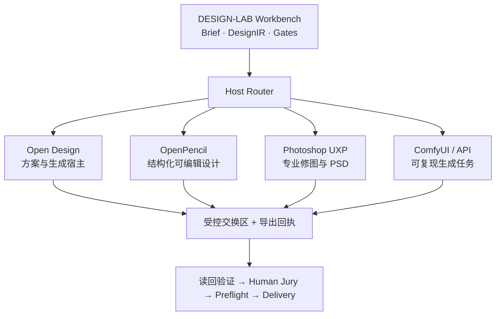
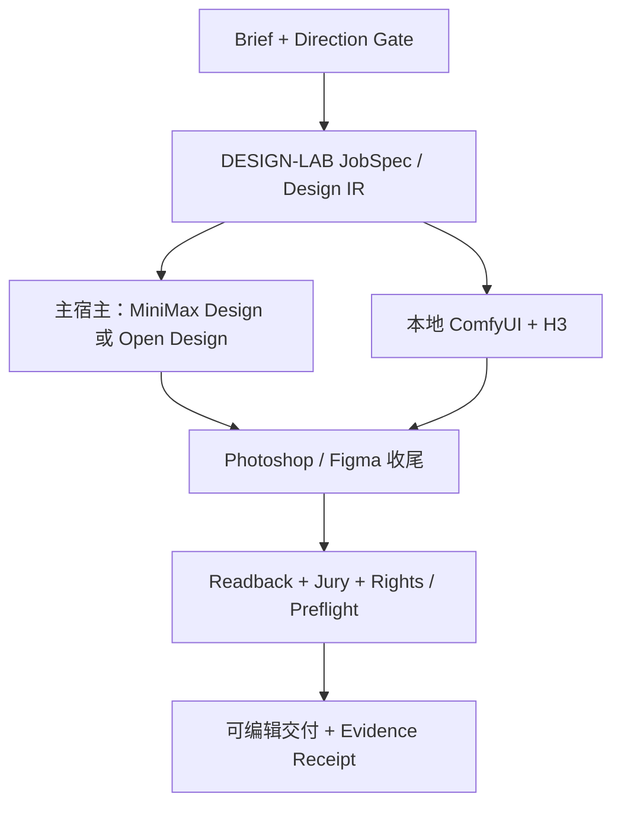
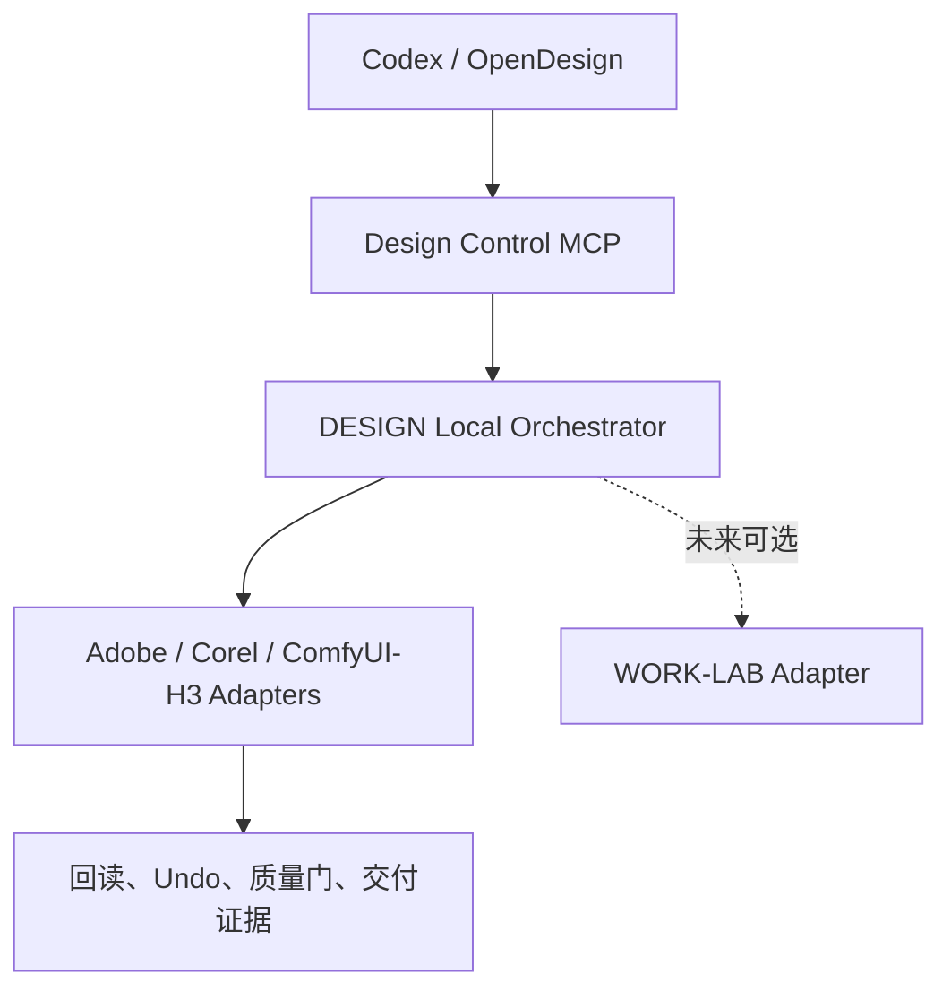

# DESIGN-LAB-0914

来源：conversations-001.json，记录序号 13，唯一键 001:013
归属：DESIGNLAB项目
依据：标题与正文上下文复核

以下保留导出中的全部消息节点（含分支），按节点时间排列；完整结构见同名 JSON。

## user · 4189e0d2-3df0-4b20-a515-d75c9bce8b13

父节点：client-created-root；时间戳：1788364242.994

载入这个项目

## assistant · a46eaecb-ca62-4579-8b9d-018dda9e3500

父节点：4189e0d2-3df0-4b20-a515-d75c9bce8b13；时间戳：1788364245.461806

{
  "content_type": "thoughts",
  "source_analysis_msg_id": "a46eaecb-ca62-4579-8b9d-018dda9e3500",
  "thoughts": []
}

## assistant · 67fe5739-435d-511b-87cd-af0bfeda03eb

父节点：a46eaecb-ca62-4579-8b9d-018dda9e3500；时间戳：1788364253.03017

我先载入这份 DESIGN-LAB 交接文档，并检查当前工作区是否已有项目文件，随后以文档中的正式定位、架构和未完成事项作为本对话的工作基线。

## assistant · 70fc99c7-abea-48ba-b803-66643bec53a4

父节点：67fe5739-435d-511b-87cd-af0bfeda03eb；时间戳：1788364265.25656

{
  "content_type": "thoughts",
  "source_analysis_msg_id": "60c44eaf-8610-43de-9d06-c51b453913f9",
  "thoughts": [
    {
      "chunks": [],
      "content": "",
      "finished": true,
      "summary": "恢复了 DESIGN-LAB 项目上下文与架构"
    }
  ]
}

## assistant · 4a425581-893c-4bbf-bead-c86e90aa3ca0

父节点：70fc99c7-abea-48ba-b803-66643bec53a4；时间戳：1788364276.280967

{
  "content_type": "thoughts",
  "source_analysis_msg_id": "5808808f-9361-43df-9c08-2376604f574d",
  "thoughts": [
    {
      "chunks": [],
      "content": "",
      "finished": true,
      "summary": "查看了设计实验室交接文档"
    }
  ]
}

## assistant · f5ac0490-5f86-4ff0-a384-3cc5493783f9

父节点：4a425581-893c-4bbf-bead-c86e90aa3ca0；时间戳：1788364276.285039

{
  "content": "思考了 31s",
  "content_type": "reasoning_recap"
}

## assistant · 1e3443b8-c487-5a49-8ad1-389cdc12c3ca

父节点：f5ac0490-5f86-4ff0-a384-3cc5493783f9；时间戳：1788364276.288491

已载入 DESIGN-LAB，现以交接文档为本对话的当前约束基线。

当前确认：

- 正式身份：DESIGN-LAB／设计实验室／`design-lab`
- 目标仓库基线：`DTALEX66/DESIGN-LAB`，原审计 SHA 为 `33488c882d267d683250ae684caf28d0916d9099`
- 核心目标：先完成可验收的 0.1 黄金闭环——薄 Workbench + Open Design 主宿主 + Photoshop Adapter + 强制人工审核 + Preflight + Delivery Receipt。
- MiniMax Design 仅作为待资格化的次级宿主，未经 Windows 实测、数据边界、可编辑性与审核闭环验证，不接入生产。
- 运行数据必须限制在项目内 `.project-local/`；不外溢到 `.hermes`、用户目录、其他盘符或其他项目。
- 当前优先：修复 capability/adapter 真相源冲突与 H3 权利问题，再做黄金闭环；目录迁移和旧目录清理必须在验证通过后进行。

当前工作区只有交接文件，尚未加载仓库副本。下一步可以直接按交接要求，对云端 `main` 做只读 SHA 差异复核与现状审计。

## user · b5af77ef-85ce-484f-81ca-57fb856bfc59

父节点：1e3443b8-c487-5a49-8ad1-389cdc12c3ca；时间戳：1788364520.118


## assistant · f1e217d1-968f-424a-9d95-c858bb9ef285

父节点：b5af77ef-85ce-484f-81ca-57fb856bfc59；时间戳：1788364522.11484

{
  "content_type": "thoughts",
  "source_analysis_msg_id": "f1e217d1-968f-424a-9d95-c858bb9ef285",
  "thoughts": []
}

## assistant · 6cb3490e-03a9-5119-b9e0-9b08a7406f8a

父节点：f1e217d1-968f-424a-9d95-c858bb9ef285；时间戳：1788364535.637245

我会把这份 MiniMax 深度审计并入 DESIGN-LAB 的正式决策依据，重点核对许可证、能力边界、Windows 资格化条件和 `DL-MM-*` 任务。

## assistant · 077a49d9-7670-401b-9149-ff8c1f732991

父节点：6cb3490e-03a9-5119-b9e0-9b08a7406f8a；时间戳：1788364546.60422

{
  "content_type": "thoughts",
  "source_analysis_msg_id": "286c9424-a573-4523-9a0a-17f76fe2bbf8",
  "thoughts": [
    {
      "chunks": [],
      "content": "",
      "finished": true,
      "summary": "读取设计集成审计文档"
    }
  ]
}

## assistant · fafa9817-e385-4c23-b073-f9973985e866

父节点：077a49d9-7670-401b-9149-ff8c1f732991；时间戳：1788364546.606849

{
  "content": "思考了 24s",
  "content_type": "reasoning_recap"
}

## assistant · a4292a88-af45-5dc5-bcb4-4c7043008c34

父节点：fafa9817-e385-4c23-b073-f9973985e866；时间戳：1788364546.608715

已载入并合并 MiniMax 深度审计。

MiniMax 现行定位已锁定为四条独立通道：

| 对象 | DESIGN-LAB 定位 |
|---|---|
| MiniMax Design 桌面端 | 有条件的第二外部宿主 |
| MiniMax API | 外部生成 Provider |
| MiniMax H3 | 有条件外置运行时 |
| 官方 ComfyUI GPL 快照 | 只提炼协议与测试方法 |

当前不能把它称为“已接入”。先决任务是 `DL-MM-001/002`：统一能力注册表、拆分四种身份、重新核验 H3 Community License；之后才是 Windows 数据/网络边界资格化与真实黄金案例测试。

我也已记录硬限制：不整仓引入 GPL 插件、不以 UI 点击自动化、不将 RGBA 分层夸大为 PSD/矢量、MiniMax 内部检查不能替代 Human Jury，所有交换文件仅可进入项目内 `.project-local/exchange/`。

## user · a1bc6810-5bd8-4764-a0c0-4ffd9ee622bf

父节点：a4292a88-af45-5dc5-bcb4-4c7043008c34；时间戳：1788368446.521

从多角度审计，深度优化，先去调研

## assistant · 30c945cd-44d0-4c9a-9857-182b9c37c8db

父节点：a1bc6810-5bd8-4764-a0c0-4ffd9ee622bf；时间戳：1788368447.553802

{
  "content_type": "thoughts",
  "source_analysis_msg_id": "30c945cd-44d0-4c9a-9857-182b9c37c8db",
  "thoughts": []
}

## assistant · 32881905-be19-5702-8374-d9ef800036d5

父节点：30c945cd-44d0-4c9a-9857-182b9c37c8db；时间戳：1788368456.155905

{
  "content_type": "thoughts",
  "source_analysis_msg_id": "32881905-be19-5702-8374-d9ef800036d5",
  "thoughts": [
    {
      "chunks": [],
      "content": "**Planning browsing with personal context skill**",
      "finished": true,
      "summary": "Planning browsing with personal context skill"
    },
    {
      "chunks": [],
      "content": "",
      "finished": true,
      "summary": "规划结合个人背景的浏览流程"
    }
  ]
}

## assistant · bda7856f-ca24-5d18-a49e-1220ce5f33ca

父节点：32881905-be19-5702-8374-d9ef800036d5；时间戳：1788368456.711243

我先做只读调研，不改仓库：复核 DESIGN-LAB 当前云端基线，并从产品能力、开放接口、许可证、数据边界、Windows 本地可控性、专业可编辑交付和同类开源宿主七个角度验证。之后再给出有证据的优化路线与任务 DAG。

## assistant · 518da73b-92bf-5982-919b-67ace3f8c9e9

父节点：bda7856f-ca24-5d18-a49e-1220ce5f33ca；时间戳：1788368474.205621

{
  "content_type": "thoughts",
  "source_analysis_msg_id": "518da73b-92bf-5982-919b-67ace3f8c9e9",
  "thoughts": [
    {
      "chunks": [],
      "content": "**Planning targeted web queries**",
      "finished": true,
      "summary": "Planning targeted web queries"
    },
    {
      "chunks": [],
      "content": "",
      "finished": true,
      "summary": "规划定向网页搜索查询"
    }
  ]
}

## assistant · 6a858578-74d2-4a07-9515-7ff0c96aca51

父节点：518da73b-92bf-5982-919b-67ace3f8c9e9；时间戳：1788368480.15622

{
  "content_type": "thoughts",
  "source_analysis_msg_id": "2a72aa73-1021-4476-807b-66f6bdaae8de",
  "thoughts": [
    {
      "chunks": [],
      "content": "",
      "finished": true,
      "summary": "审计并优化 DESIGN-LAB 项目"
    }
  ]
}

## assistant · 196974bf-296f-4328-9269-13e92d76c523

父节点：6a858578-74d2-4a07-9515-7ff0c96aca51；时间戳：1788368496.432871

{
  "content_type": "thoughts",
  "source_analysis_msg_id": "d0c1893a-90ca-428c-b7c5-7e79e9162829",
  "thoughts": [
    {
      "chunks": [],
      "content": "",
      "finished": true,
      "summary": "已搜索 6 个网站"
    }
  ]
}

## assistant · b916f4ab-0971-51c4-8460-387cf77d69e1

父节点：196974bf-296f-4328-9269-13e92d76c523；时间戳：1788368496.435714

初步调研已经发现两项需要修正的现状：Open Design 已从交接时的旧版本快速迭代到 0.21.x；而 ComfyUI 当前把 H3 的商业本地运行明确为另需取得商业许可，不能仅凭“开放权重”推定可商用。我继续复核 DESIGN-LAB 的最新提交和仓库内实际声明。

## assistant · e66b7a32-f2e9-5eaf-9465-c4b7bed0aa86

父节点：b916f4ab-0971-51c4-8460-387cf77d69e1；时间戳：1788368532.985742

{
  "content_type": "thoughts",
  "source_analysis_msg_id": "e66b7a32-f2e9-5eaf-9465-c4b7bed0aa86",
  "thoughts": [
    {
      "chunks": [],
      "content": "**Planning shallow git cloning strategy**",
      "finished": true,
      "summary": "Planning shallow git cloning strategy"
    },
    {
      "chunks": [],
      "content": "",
      "finished": true,
      "summary": "规划浅克隆策略"
    }
  ]
}

## user · 53804f47-b0f2-4bc3-8056-3d3206deff4c

父节点：917690a7-4861-405c-b4cc-518c7faf54b1；时间戳：1788368581.561

还有重点是设计工作流软件的相互配合，和自动化操作

## assistant · 486daf6d-6a57-4696-b592-6d29e9ef7d33

父节点：e66b7a32-f2e9-5eaf-9465-c4b7bed0aa86；时间戳：1788368583.784257

{
  "content_type": "thoughts",
  "source_analysis_msg_id": "84c9ba09-bcea-4c2b-a661-0eff05c7fb7e",
  "thoughts": [
    {
      "chunks": [],
      "content": "",
      "finished": true,
      "summary": "检查并审计多个 GitHub 仓库及设计实验室配置"
    }
  ]
}

## assistant · 917690a7-4861-405c-b4cc-518c7faf54b1

父节点：486daf6d-6a57-4696-b592-6d29e9ef7d33；时间戳：1788368583.787152

{
  "content": "思考了 2m 16s",
  "content_type": "reasoning_recap"
}

## assistant · 8b2a6e5d-4237-58c9-8daf-b276824e136f

父节点：53804f47-b0f2-4bc3-8056-3d3206deff4c；时间戳：1788368583.850824

{
  "content_type": "thoughts",
  "source_analysis_msg_id": "8b2a6e5d-4237-58c9-8daf-b276824e136f",
  "thoughts": [
    {
      "chunks": [],
      "content": "**Planning deep code and test audit**",
      "finished": true,
      "summary": "Planning deep code and test audit"
    },
    {
      "chunks": [],
      "content": "",
      "finished": true,
      "summary": "规划深度代码与测试审计"
    }
  ]
}

## assistant · 8082a0e5-3b24-4ed5-8a47-4a165a570bcd

父节点：8b2a6e5d-4237-58c9-8daf-b276824e136f；时间戳：1788368595.972959

{
  "content_type": "thoughts",
  "source_analysis_msg_id": "2e11de93-d23d-4e1c-bd49-a43da3f6cdba",
  "thoughts": [
    {
      "chunks": [],
      "content": "",
      "finished": true,
      "summary": "审计依赖注册表并制定测试策略"
    }
  ]
}

## assistant · b77385a8-b9b9-566c-b261-a8fcbf0f924b

父节点：8082a0e5-3b24-4ed5-8a47-4a165a570bcd；时间戳：1788368595.97554

这正是本轮优化的核心。我会把“是否能生成”降到次要位置，重点审计设计工作流怎样在 MiniMax、Open Design、OpenPencil、Adobe、ComfyUI 之间交接：谁负责创建、谁可程序化调用、谁能真实读回、谁只允许人工操作，以及如何做到可恢复、可审计、不过度依赖屏幕点击。

## assistant · d8428b6c-bfac-4a18-ab0e-a07059929230

父节点：b77385a8-b9b9-566c-b261-a8fcbf0f924b；时间戳：1788368615.241359

{
  "content_type": "thoughts",
  "source_analysis_msg_id": "985ea138-6895-4bc2-9705-384785f688c0",
  "thoughts": [
    {
      "chunks": [],
      "content": "",
      "finished": true,
      "summary": "已搜索 3 个网站"
    }
  ]
}

## assistant · 88de8271-eaaa-5622-b973-b4a7a84c0038

父节点：d8428b6c-bfac-4a18-ab0e-a07059929230；时间戳：1788368629.228697

{
  "content_type": "thoughts",
  "source_analysis_msg_id": "88de8271-eaaa-5622-b973-b4a7a84c0038",
  "thoughts": [
    {
      "chunks": [],
      "content": "**Planning isolated dependency testing**",
      "finished": true,
      "summary": "Planning isolated dependency testing"
    },
    {
      "chunks": [],
      "content": "",
      "finished": true,
      "summary": "规划孤立依赖测试方案"
    }
  ]
}

## assistant · 01a831b6-c6e9-4550-b619-2b2eacc9e5bc

父节点：88de8271-eaaa-5622-b973-b4a7a84c0038；时间戳：1788368629.733367

{
  "content_type": "thoughts",
  "source_analysis_msg_id": "10c123ac-d186-4bfb-a595-307b8f39b34e",
  "thoughts": [
    {
      "chunks": [],
      "content": "",
      "finished": true,
      "summary": "完成设计实验室合规测试"
    }
  ]
}

## assistant · eee2babf-8ddb-557c-bafa-6b5d4ce9bab9

父节点：01a831b6-c6e9-4550-b619-2b2eacc9e5bc；时间戳：1788368629.735527

云端 `main` 没有变化，仍是交接 SHA。实际代码也确认了交接中的冲突仍未修复：同一 H3 在索引、注册表、权利文件中分别是 E0、E3 和不同许可证；并且 `.hermes/task-runtime` 仍写死在运行合同、测试和文档里。现在的“流程”主要是声明和结构验证，不是跨软件自动化闭环。

## assistant · 56de04c7-a443-5c87-92f0-536e4652ad8d

父节点：eee2babf-8ddb-557c-bafa-6b5d4ce9bab9；时间戳：1788368678.87537

{
  "content_type": "thoughts",
  "source_analysis_msg_id": "56de04c7-a443-5c87-92f0-536e4652ad8d",
  "thoughts": [
    {
      "chunks": [],
      "content": "**Summarizing research findings and next steps**",
      "finished": true,
      "summary": "Summarizing research findings and next steps"
    },
    {
      "chunks": [],
      "content": "**Mapping design workflow with mermaid visualization**",
      "finished": true,
      "summary": "Mapping design workflow with mermaid visualization"
    },
    {
      "chunks": [],
      "content": "",
      "finished": true,
      "summary": "总结研究发现并绘制设计工作流程图"
    }
  ]
}

## assistant · b36ec73b-fc65-5ec7-85b4-4758ea186a82

父节点：56de04c7-a443-5c87-92f0-536e4652ad8d；时间戳：1788368683.205139

{
  "content_type": "thoughts",
  "source_analysis_msg_id": "b36ec73b-fc65-5ec7-85b4-4758ea186a82",
  "thoughts": [
    {
      "chunks": [],
      "content": "**Summarizing research findings and next steps**",
      "finished": true,
      "summary": "Summarizing research findings and next steps"
    },
    {
      "chunks": [],
      "content": "**Mapping design workflow with mermaid visualization**",
      "finished": true,
      "summary": "Mapping design workflow with mermaid visualization"
    },
    {
      "chunks": [],
      "content": "",
      "finished": true,
      "summary": "总结研究发现并绘制设计工作流程"
    }
  ]
}

## assistant · e5cc858d-24c0-5527-b4e1-82e74fdc3a90

父节点：b36ec73b-fc65-5ec7-85b4-4758ea186a82；时间戳：1788368695.736796

{
  "content_type": "thoughts",
  "source_analysis_msg_id": "e5cc858d-24c0-5527-b4e1-82e74fdc3a90",
  "thoughts": [
    {
      "chunks": [],
      "content": "**Identifying missing apps and services folders**",
      "finished": true,
      "summary": "Identifying missing apps and services folders"
    },
    {
      "chunks": [],
      "content": "**Outlining design operation protocol concept**",
      "finished": true,
      "summary": "Outlining design operation protocol concept"
    },
    {
      "chunks": [],
      "content": "",
      "finished": true,
      "summary": "识别缺失应用服务文件夹并概述设计操作协议"
    }
  ]
}

## assistant · 6d95487c-6974-52c3-8402-2eb441a81c9b

父节点：e5cc858d-24c0-5527-b4e1-82e74fdc3a90；时间戳：1788368708.057713

{
  "content_type": "thoughts",
  "source_analysis_msg_id": "6d95487c-6974-52c3-8402-2eb441a81c9b",
  "thoughts": [
    {
      "chunks": [],
      "content": "**Identifying missing apps and services folders**",
      "finished": true,
      "summary": "Identifying missing apps and services folders"
    },
    {
      "chunks": [],
      "content": "**Outlining design operation protocol concept**",
      "finished": true,
      "summary": "Outlining design operation protocol concept"
    },
    {
      "chunks": [],
      "content": "**Planning phased task order with tool differentiation**",
      "finished": true,
      "summary": "Planning phased task order with tool differentiation"
    },
    {
      "chunks": [],
      "content": "",
      "finished": true,
      "summary": "制定应用服务文件夹与设计操作分阶段方案"
    }
  ]
}

## assistant · 46510c19-0cdb-5938-94ae-91c8d5418d13

父节点：6d95487c-6974-52c3-8402-2eb441a81c9b；时间戳：1788368717.05772

{
  "content_type": "thoughts",
  "source_analysis_msg_id": "46510c19-0cdb-5938-94ae-91c8d5418d13",
  "thoughts": [
    {
      "chunks": [],
      "content": "**Identifying missing apps and services folders**",
      "finished": true,
      "summary": "Identifying missing apps and services folders"
    },
    {
      "chunks": [],
      "content": "**Outlining design operation protocol concept**",
      "finished": true,
      "summary": "Outlining design operation protocol concept"
    },
    {
      "chunks": [],
      "content": "**Planning phased task order with tool differentiation**",
      "finished": true,
      "summary": "Planning phased task order with tool differentiation"
    },
    {
      "chunks": [],
      "content": "",
      "finished": true,
      "summary": "规划应用服务文件夹及设计操作协议分阶段任务"
    }
  ]
}

## assistant · 75e8577f-3dd0-4732-8c70-dcca5b4115a5

父节点：46510c19-0cdb-5938-94ae-91c8d5418d13；时间戳：1788368717.352039

{
  "content_type": "thoughts",
  "source_analysis_msg_id": "66189e1d-ab6a-4651-91fe-5f39ca1955db",
  "thoughts": [
    {
      "chunks": [],
      "content": "",
      "finished": true,
      "summary": "完成适配器治理测试与自动化审计及能力清单核查"
    }
  ]
}

## assistant · 1772c4f2-f884-42fe-8a70-45460b478d5c

父节点：75e8577f-3dd0-4732-8c70-dcca5b4115a5；时间戳：1788368717.378342

{
  "content": "思考了 2m 13s",
  "content_type": "reasoning_recap"
}

## assistant · ba1f7502-cf9e-5e91-b613-2568591998ba

父节点：1772c4f2-f884-42fe-8a70-45460b478d5c；时间戳：1788368717.380949

调研完成，且云端 `main` 仍是交接基线：[`33488c8`](https://github.com/DTALEX66/DESIGN-LAB/commit/33488c882d267d683250ae684caf28d0916d9099)。目前最大的缺口不是“再接一个模型”，而是把多个设计软件真正串成可恢复、可读回、可审计的生产流水线。

## 核心判断

DESIGN-LAB 应成为“设计生产控制与质量中枢”，不是新的画布或通用 Agent Runtime。自动化必须按软件实际能力分级：



| 软件 | 正确角色 | 自动化方式 | 当前裁决 |
|---|---|---|---|
| Open Design | Brief、网页/演示稿/设计系统、Agent 设计工作区 | MCP/CLI，但必须每个版本实测连接、创建、导出、读回 | 保持主外部宿主，但不能再固定旧 `0.18.x` 假设；它已快速迭代到 `0.21.x`。 |
| OpenPencil | 结构化二维可编辑设计、`.fig/.pen`、设计令牌、可编程修改 | 本地 MCP/CLI，且可将文件操作限制到指定根目录 | 应升级为“可编辑交付优先适配器”的资格化候选，不与 Open Design 争夺同一画布职责。 [OpenPencil](https://github.com/open-pencil/open-pencil) |
| Photoshop | 精修、分层、CMYK/印前、PSD 交付 | UXP DOM 优先，`batchPlay` 仅补足；以目录令牌限制项目路径 | 必须做正式 UXP Adapter；现有代码只是安全占位，执行后返回 `NOT_EXECUTED`，尚不能改图或导出。 [Adobe UXP](https://developer.adobe.com/photoshop/uxp/2022/ps_reference/media/batchplay/) |
| ComfyUI | 可复现生成执行层 | 官方 HTTP/WebSocket 或 API v2：提交 workflow、监听进度、取回 output、记录 hash | 适合作为自动化引擎；不应 fork 成 DESIGN-LAB 内建运行时。 [ComfyUI Server API](https://docs.comfy.org/development/comfyui-server/comms_overview) |
| MiniMax Design | 小白 Quick Create、广告/视频方向探索 | 只允许“打开受控工作区 → in/out 文件交换 → 导出检测 → 导入回执” | 仍是人工主导的第二宿主；不能 UI 点击自动化、不能读取私有数据库。此为当前公开能力与审计证据下的保守结论。 [MiniMax Design](https://design.minimax.io/) |

MiniMax H3 也应改判为“云端/Partner Node 优先”。ComfyUI 官方文档明确其 H3 工作流在服务器端执行；在自有硬件商业运行需要另行取得商业许可。你的 RTX 5060 8GB 不应承担 H3 本地生产运行。 [ComfyUI H3 文档](https://docs.comfy.org/tutorials/partner-nodes/minimax/minimax-h3)

## 云端实证问题

1. 真相源仍冲突，不能直接做 UI。  
   `capability-index.json` 将 ComfyUI/H3 标为 E0，却写 `runtime-verified`；`adapter-registry.json` 又将 H3 写为 E3；H3 权利文件仍称 proprietary，均与当前 H3 许可路径不一致。

2. 自动化实现仍是“结构和文档”，不是实际工作流。  
   Open Design 的 manifest 仍为 E0；现有真实证据只是一次方案文档产出，非宿主注册、非可编辑文件读回。Photoshop UXP 也没有实际执行层。

3. 运行隔离没有迁完。  
   `.hermes/task-runtime` 仍被重建管线、证据合同、资产摄入和文档硬编码；与项目内 `.project-local/` 单一运行根冲突。

4. 当前验证链本身未闭合。  
   在装入 `jsonschema` 后，适配器结构测试通过；但 `verify_product_manifest_v3.py` 仍因缺失 `project-memory/` 及其旧文档引用失败 13 项；`verify_capability_evidence_v4.py` 还报告 `lastVerifiedTree` 已过期。  
   这说明仓库不是“完全不可用”，但不能宣称为可复现、已验证的 0.1 产品。

5. 仓库形态仍偏“资料、插件、模板、验证脚本集合”。  
   目标中的 `apps/workbench`、`services/*`、中立 contracts 与真实 host/provider adapter 尚未成为产品主干。目录迁移不应先删旧内容，但必须开始从“静态能力库”收束为“可执行工作单元”。

## 深度优化方向

先建立一个很薄的 `Design Work Unit` 合同，不造新的通用工作流引擎。每个设计任务只记录：

- Brief 与 DesignIR 版本；
- 输入资产 hash、允许外发范围与权利状态；
- 当前宿主、宿主版本、受控输入/输出目录；
- 运行状态与可重试条件；
- 导出格式、读回结果、可编辑性等级；
- Human Jury 的 `APPROVE / REJECT / REVISE`；
- Preflight 与 Delivery Receipt。

推荐状态机：

`DRAFT → BRIEF_LOCKED → HOST_READY → RUNNING → EXPORT_DETECTED → READBACK_VERIFIED → JURY_REJECTED / JURY_APPROVED → PREFLIGHT_PASSED → DELIVERED`

其中只有 Open Design、OpenPencil、Photoshop、ComfyUI 这些拥有官方接口或可验证文件合同的节点，才能自动推进状态。MiniMax 只能把状态推进到 `EXPORT_DETECTED`，后续必须读回和人工审核。

下一阶段应按此顺序执行：

1. `DL-WF-001`：统一 capability / host / provider registry，并清除 H3、ComfyUI、Open Design 的冲突声明。  
2. `DL-WF-010`：定义 `DesignWorkUnit`、交换目录、导出回执、读回回执与失败恢复状态机。  
3. `DL-OD-020`：以当前 Open Design 版本完成 Windows MCP/CLI 实机资格化；不能复现则自动降级为手工宿主。  
4. `DL-OP-010`：对 OpenPencil 验证受限目录、MCP 修改、`.fig/.pen` 读写与 close/reopen。  
5. `DL-ADB-PS-010`：做 Photoshop UXP MVP：导入、图层操作、保存 PSD、重新打开读回。  
6. `DL-CFY-010`：以官方 API 跑一次可重现 ComfyUI 生成任务，记录 workflow/node/version/input-output hash 与成本。  
7. `DL-MM-010~022`：最后资格化 MiniMax Windows 数据边界与人工导出闭环，而不是抢先做生产集成。  
8. 所有真实读回都通过后，再执行目录迁移与旧目录清理。

本轮没有修改仓库。下一步我可以据此输出一份可直接交给 Codex / Hermes 执行的“设计软件协同与自动化重构任务包”，按 P0/P1、允许修改目录、验收命令、人工审批点拆开。

如果有用，我还可以设置“每周核验设计宿主接口变更”，及时发现 Open Design、OpenPencil、MiniMax、ComfyUI 或 Adobe 的接口与许可变化。  
genui{"suggest_automation":{"label":"每周核验设计宿主接口变更"}}

## user · d892c829-aa20-4d2a-bdf7-568209e38d41

父节点：ba1f7502-cf9e-5e91-b613-2568591998ba；时间戳：1788368805.636

H3模型在本地跑

## assistant · d51afa24-ef1b-4a83-80ae-df374268370b

父节点：d892c829-aa20-4d2a-bdf7-568209e38d41；时间戳：1788368807.771043

{
  "content_type": "thoughts",
  "source_analysis_msg_id": "d51afa24-ef1b-4a83-80ae-df374268370b",
  "thoughts": []
}

## assistant · ae7f64cd-28b6-53bb-b82b-30660b4d68b9

父节点：d51afa24-ef1b-4a83-80ae-df374268370b；时间戳：1788368812.399153

明白，H3 的运行方式改为“本地可跑”而不是只走云端。我要把两个问题分开核实：**你当前是否已经能本地启动**，以及**该本地运行在你的 8GB 显存设备上能达到什么稳定度与商用权限**；这两点不能混为一条结论。

## assistant · 8c30bf15-f90b-56c1-9f29-f984b5ef6179

父节点：ae7f64cd-28b6-53bb-b82b-30660b4d68b9；时间戳：1788368826.19213

{
  "content_type": "thoughts",
  "source_analysis_msg_id": "8c30bf15-f90b-56c1-9f29-f984b5ef6179",
  "thoughts": [
    {
      "chunks": [],
      "content": "**Clarifying hardware and licensing requirements**",
      "finished": true,
      "summary": "Clarifying hardware and licensing requirements"
    },
    {
      "chunks": [],
      "content": "",
      "finished": true,
      "summary": "明确硬件与许可要求"
    }
  ]
}

## assistant · caecf3db-583b-4e2a-a5be-d1ae63fd60f4

父节点：8c30bf15-f90b-56c1-9f29-f984b5ef6179；时间戳：1788368826.61062

{
  "content_type": "thoughts",
  "source_analysis_msg_id": "ec0d8a3a-8497-4e7f-a5cb-526f91eb63aa",
  "thoughts": [
    {
      "chunks": [],
      "content": "",
      "finished": true,
      "summary": "已搜索 11 个网站"
    }
  ]
}

## assistant · 6e503791-aee8-475c-929b-a220bd233230

父节点：caecf3db-583b-4e2a-a5be-d1ae63fd60f4；时间戳：1788368826.636908

{
  "content": "思考了 18s",
  "content_type": "reasoning_recap"
}

## assistant · d2dfe0d7-866d-55b5-a907-280ef7f16bfe

父节点：6e503791-aee8-475c-929b-a220bd233230；时间戳：1788368826.638927

你说得对：**MiniMax H3 可以在本地跑**。我上一条把“适合直接本地生产运行”说得过于绝对，已更正。

对 DESIGN-LAB 的正确定位应改为：

- `MiniMax H3 = LOCAL_EXTERNAL_RUNTIME`
- 通过本地 ComfyUI / 官方本地推理链运行
- DESIGN-LAB 只通过本地 HTTP/WebSocket 与它交互：提交工作流、监听进度、导入输出、记录 hash 与回执
- 不把模型、权重或 ComfyUI fork 塞进仓库

H3 公开的是权重，但并不是无条件 Apache/MIT 商用。官方仓库采用 **MiniMax H3 Community License**；ComfyUI 当前文档也明确指出：本地生成的商业使用需要对应商业许可。 [MiniMax H3 官方仓库](https://github.com/MiniMax-AI/MiniMax-H3)，[ComfyUI 官方说明](https://docs.comfy.org/tutorials/video/minimax/minimax-h3)

因此需要把 H3 的验证拆成三层：

| 层级 | 证明什么 |
|---|---|
| E2 本地运行 | 本机模型实际载入；记录权重 revision/hash、ComfyUI 版本、GPU/CPU/offload 配置和本地端口；确认任务没有转云端。 |
| E3 本地生产链 | 用权利清晰的测试素材，真实完成生成 → 导出 → DESIGN-LAB 读回；记录 workflow、seed、输入输出 hash、耗时、显存峰值。 |
| E4 商业发布 | 固定可复现工作流、三次稳定运行、权利与交付审查通过；客户项目才能选用。 |

自动化主链则是：

`DESIGN-LAB Work Unit → 本地 ComfyUI API → H3 本地推理 → .project-local/exchange/out → hash/readback → Human Jury → Preflight`

你的 RTX 5060 8GB 若已经通过量化、CPU/RAM offload 或分层加载成功运行，DESIGN-LAB 不需要阻止它；但应将它标为“本地可用、性能需实测”，而不是宣传为默认高速生产配置。模型权重和缓存仍不进入 Git。

下一次仓库修改时，`adapter-minimax-h3` 不应再写成“proprietary / 未就绪 / 无成本上限”，而应拆出：本地运行配置、许可证状态、性能档位、是否允许客户素材、以及严格的预算与取消策略。

## user · 0dae18bb-abb8-426a-a66a-98edbe02c0ab

父节点：d2dfe0d7-866d-55b5-a907-280ef7f16bfe；时间戳：1788369049.817

软件层还能收敛吗？现在软件太多了，有成熟的搭配方案吗？

## assistant · b19eb329-4bd2-458e-ab3c-7315d7edf109

父节点：0dae18bb-abb8-426a-a66a-98edbe02c0ab；时间戳：1788369050.749445

{
  "content_type": "thoughts",
  "source_analysis_msg_id": "b19eb329-4bd2-458e-ab3c-7315d7edf109",
  "thoughts": []
}

## assistant · 3bb669a1-a4db-5fed-ba9d-587bb4e8b546

父节点：b19eb329-4bd2-458e-ab3c-7315d7edf109；时间戳：1788369055.294232

可以收敛，而且应该收敛。现在的问题不是软件能力不够，而是同一职责被多个软件抢占，导致路径、数据和自动化都变得不可控。我先核对各软件目前公开的接口与成熟度，再给你一套“少软件、强分工、可替换”的组合。

## assistant · dd07fd9b-25ca-54de-a403-087ba699e27c

父节点：3bb669a1-a4db-5fed-ba9d-587bb4e8b546；时间戳：1788369080.896933

{
  "content_type": "thoughts",
  "source_analysis_msg_id": "dd07fd9b-25ca-54de-a403-087ba699e27c",
  "thoughts": [
    {
      "chunks": [],
      "content": "**Assessing mature design tool stack**",
      "finished": true,
      "summary": "Assessing mature design tool stack"
    },
    {
      "chunks": [],
      "content": "**Evaluating design tool maturity and strategy**",
      "finished": true,
      "summary": "Evaluating design tool maturity and strategy"
    },
    {
      "chunks": [],
      "content": "",
      "finished": true,
      "summary": "评估成熟设计工具栈及其战略"
    }
  ]
}

## assistant · 94455e88-eec8-505f-98ed-cd9b9a1d3303

父节点：dd07fd9b-25ca-54de-a403-087ba699e27c；时间戳：1788369087.24006

{
  "content_type": "thoughts",
  "source_analysis_msg_id": "94455e88-eec8-505f-98ed-cd9b9a1d3303",
  "thoughts": [
    {
      "chunks": [],
      "content": "**Assessing mature design tool stack**",
      "finished": true,
      "summary": "Assessing mature design tool stack"
    },
    {
      "chunks": [],
      "content": "**Evaluating design tool maturity and strategy**",
      "finished": true,
      "summary": "Evaluating design tool maturity and strategy"
    },
    {
      "chunks": [],
      "content": "",
      "finished": true,
      "summary": "评估成熟设计工具栈及其战略"
    }
  ]
}

## assistant · 18d1faac-e3dc-4b2b-90d9-9b2f28241571

父节点：94455e88-eec8-505f-98ed-cd9b9a1d3303；时间戳：1788369087.491796

{
  "content_type": "thoughts",
  "source_analysis_msg_id": "09c278e1-55bd-4c4d-8fe0-da434c519b70",
  "thoughts": [
    {
      "chunks": [],
      "content": "",
      "finished": true,
      "summary": "评估了DESIGN-LAB软件层整合方案"
    }
  ]
}

## assistant · 5e314504-0719-4c78-a5d4-f1d72abc3241

父节点：18d1faac-e3dc-4b2b-90d9-9b2f28241571；时间戳：1788369087.522744

{
  "content": "思考了 36s",
  "content_type": "reasoning_recap"
}

## assistant · e2be1e52-2e3f-5642-be36-c7dbb355fdda

父节点：5e314504-0719-4c78-a5d4-f1d72abc3241；时间戳：1788369087.525244

能收敛，而且建议收敛成“**3 个日常核心 + 2 个按需工具**”。没有一个成熟软件能同时替代专业编辑、可复现生成、人工审核和交付管理；成熟做法是固定职责边界，而不是把所有软件互相连接。

| 层级 | 保留软件 | 唯一职责 | 不再承担 |
|---|---|---|---|
| 设计控制 | DESIGN-LAB Workbench | Brief、任务状态、素材权限、Jury、Preflight、交付回执 | 画布、模型运行、专业编辑 |
| 设计创作 | Open Design | 方案、网页/提案、设计系统、生成式设计工作区 | PSD/AI 精修、最终可编辑源文件 |
| 专业交付 | Adobe CC：Photoshop 为核心，Illustrator / Premiere / AE 按项目启用 | 修图、印前、矢量、视频后期与最终源文件 | 工作流调度 |
| 本地生成 | ComfyUI + H3 本地模型 | 可复现的视频/图像生成、工作流与输出回执 | 项目管理、客户交付判断 |
| UI 专项（按需） | OpenPencil | `.fig/.pen` 的结构化 UI、令牌、可编辑 UI 文件 | 品牌平面、空间、视频主链 |
| 快速探索（非核心） | MiniMax Design | 小白快速创意、广告/短视频方向探索 | 生产主链、机密客户素材、自动化中枢 |

Open Design、OpenPencil 与 ComfyUI 都有明确的本地/程序化接口方向，但成熟度不同：Open Design 更新很快，必须按已验证版本接入；OpenPencil 更适合承担 UI 的可编辑文件与 MCP 操作；ComfyUI 是最适合做本地模型自动化的执行端。 [Open Design](https://github.com/nexu-io/open-design), [OpenPencil](https://github.com/open-pencil/open-pencil), [ComfyUI API](https://docs.comfy.org/development/comfyui-server/comms_overview)

你的最终日常软件组合应是：

`DESIGN-LAB → Open Design → Photoshop → ComfyUI/H3`

只有做 UI 时才插入 OpenPencil；只有做快速创意探索时才打开 MiniMax Design。Figma、Penpot、Krita、Inkscape、Blender、MiniMax Design 都不应常驻主流程：它们是客户协作、专项编辑或备选工具。

最重要的收敛规则：

- Open Design 与 MiniMax Design：二选一作为“方向生成宿主”；默认保留 Open Design，MiniMax 降为可选手工探索。
- Photoshop 与 Krita/GIMP：只保留 Photoshop 为正式交付宿主；后者只作无 Adobe 环境的降级工具。
- OpenPencil 与 Figma/Penpot：OpenPencil 仅处理内部 UI 可编辑工作；Figma 只负责客户来稿/协作导入导出，不做第二生产主链。
- ComfyUI 与其他模型桌面软件：只保留 ComfyUI 作为本地模型入口；H3、分层、抠图、放大等都作为它的 workflow，不再各自独立运行。
- Blender：仅在 3D、空间、动效项目启用，不进入平面/品牌项目默认栈。

Photoshop 自动化应走 Adobe 官方 UXP/DOM，必要时才用 `batchPlay`，不要依赖鼠标点击脚本。 [Adobe UXP](https://developer.adobe.com/photoshop/uxp/2022/ps_reference/media/batchplay/)

这会把当前“十几个软件互相重叠”的局面收敛为：**一个控制台、一个创作宿主、一个专业交付宿主、一个本地模型执行器**。

## user · f08d7010-be49-407a-9e4e-ad8926a029b5

父节点：e2be1e52-2e3f-5642-be36-c7dbb355fdda；时间戳：1788480384.591

全面审计云端仓库，有最新更新，详细审计下

## assistant · f11b53f6-5e3a-4f4c-9d5b-cd937f2afcf5

父节点：f08d7010-be49-407a-9e4e-ad8926a029b5；时间戳：1788480387.746151

{
  "content_type": "thoughts",
  "source_analysis_msg_id": "f11b53f6-5e3a-4f4c-9d5b-cd937f2afcf5",
  "thoughts": []
}

## assistant · 56682362-cbfd-5ca0-a56a-b78e1c90b2e1

父节点：f11b53f6-5e3a-4f4c-9d5b-cd937f2afcf5；时间戳：1788480395.148415

{
  "content_type": "thoughts",
  "source_analysis_msg_id": "56682362-cbfd-5ca0-a56a-b78e1c90b2e1",
  "thoughts": [
    {
      "chunks": [],
      "content": "**Planning comprehensive audit approach**",
      "finished": true,
      "summary": "Planning comprehensive audit approach"
    },
    {
      "chunks": [],
      "content": "",
      "finished": true,
      "summary": "制定了全面审计方案"
    }
  ]
}

## assistant · adc6ae67-c5af-5982-ba78-428e2bd28afc

父节点：56682362-cbfd-5ca0-a56a-b78e1c90b2e1；时间戳：1788480395.653037

我会按“云端真实代码优先”重新审计，不沿用 9 月 2 日旧结论。先锁定最新 `origin/main` 与旧基线差异，再检查架构、目录、软件协同与自动化、运行隔离、许可证、前端、测试/CI、证据真值和遗留债务；全程只读，不改仓库。为避免丢失已确认的 DESIGN-LAB 边界，我先调用个人上下文，再开始拉取云端证据。

## assistant · fca2b280-58f0-4786-a828-aa38ecf4963d

父节点：adc6ae67-c5af-5982-ba78-428e2bd28afc；时间戳：1788480423.212086

{
  "content_type": "thoughts",
  "source_analysis_msg_id": "e439792c-ed2a-4b03-9def-3a9ed3773c07",
  "thoughts": [
    {
      "chunks": [],
      "content": "",
      "finished": true,
      "summary": "审计 DESIGN-LAB 最新云端状态"
    }
  ]
}

## assistant · 8a70f2f6-6413-4813-9e5b-1bf718906a8a

父节点：fca2b280-58f0-4786-a828-aa38ecf4963d；时间戳：1788480431.890903

{
  "content_type": "thoughts",
  "source_analysis_msg_id": "101ad908-1aeb-4107-9c0f-72f0283f6ad3",
  "thoughts": [
    {
      "chunks": [],
      "content": "",
      "finished": true,
      "summary": "列出 GitHub 仓库分支标签"
    }
  ]
}

## assistant · f526f483-14c2-5bdd-9aa8-0c7a4f28a565

父节点：8a70f2f6-6413-4813-9e5b-1bf718906a8a；时间戳：1788480431.893607

已确认最新更新：`main` 从 `33488c8` 前进到 `2aca27f`，同时新增/保留了目录收敛分支 `migration/dl-directory-convergence-r1`。我会分别判断“已经进入 main 的真实变化”和“只存在分支、尚未落地主线的变化”，避免把未合并工作误判成已完成。

## assistant · 8763e543-2f64-5942-9b44-432085ecbfb5

父节点：f526f483-14c2-5bdd-9aa8-0c7a4f28a565；时间戳：1788480474.39242

{
  "content_type": "thoughts",
  "source_analysis_msg_id": "8763e543-2f64-5942-9b44-432085ecbfb5",
  "thoughts": [
    {
      "chunks": [],
      "content": "**Investigating git diff timeout and output absence**",
      "finished": true,
      "summary": "Investigating git diff timeout and output absence"
    },
    {
      "chunks": [],
      "content": "",
      "finished": true,
      "summary": "调查 git diff 超时及无输出问题"
    }
  ]
}

## assistant · 0971a34a-f94f-59e7-99e8-0b7e38271172

父节点：8763e543-2f64-5942-9b44-432085ecbfb5；时间戳：1788480510.879631

{
  "content_type": "thoughts",
  "source_analysis_msg_id": "0971a34a-f94f-59e7-99e8-0b7e38271172",
  "thoughts": [
    {
      "chunks": [],
      "content": "**Auditing project structure and dependencies**",
      "finished": true,
      "summary": "Auditing project structure and dependencies"
    },
    {
      "chunks": [],
      "content": "",
      "finished": true,
      "summary": "审计了项目结构与依赖关系"
    }
  ]
}

## assistant · 8c30fd75-fa5a-53e2-8e05-88d85a3feeba

父节点：0971a34a-f94f-59e7-99e8-0b7e38271172；时间戳：1788480535.736725

{
  "content_type": "thoughts",
  "source_analysis_msg_id": "8c30fd75-fa5a-53e2-8e05-88d85a3feeba",
  "thoughts": [
    {
      "chunks": [],
      "content": "**Assessing stale migration branch cleanup**",
      "finished": true,
      "summary": "Assessing stale migration branch cleanup"
    },
    {
      "chunks": [],
      "content": "**Inventorying branches and assessing stale sources**",
      "finished": true,
      "summary": "Inventorying branches and assessing stale sources"
    },
    {
      "chunks": [],
      "content": "",
      "finished": true,
      "summary": "评估分支清理并盘点过期来源"
    }
  ]
}

## assistant · 3427cbed-a1f2-46f0-8f1f-e66ba43702ae

父节点：8c30fd75-fa5a-53e2-8e05-88d85a3feeba；时间戳：1788480550.664108

{
  "content_type": "thoughts",
  "source_analysis_msg_id": "bdd2c991-8123-4d84-b8af-2df2b2f4af04",
  "thoughts": [
    {
      "chunks": [],
      "content": "",
      "finished": true,
      "summary": "完成设计实验室仓库差异与依赖治理审计"
    }
  ]
}

## assistant · 67ce1028-4050-5357-a4dd-8ec5fb9484f7

父节点：3427cbed-a1f2-46f0-8f1f-e66ba43702ae；时间戳：1788480550.666791

目录收敛本身是一次明显进步：主线 3 个提交净删除约 51.5 万行、仓库从 3502 个文件降到 1371 个文件，并把 `minigame-runtime`、`design-system`、第三方整仓源码迁出活动根目录。但我已经发现迁移后仍有“索引指向已删除路径”和“旧能力状态未重算”的真值漂移，接下来用干净环境验证这些问题是否会让 CI/发布门失真。

## assistant · 9f0165ee-dbbf-502f-99c6-c04f44919040

父节点：67ce1028-4050-5357-a4dd-8ec5fb9484f7；时间戳：1788480561.44407

{
  "content_type": "thoughts",
  "source_analysis_msg_id": "9f0165ee-dbbf-502f-99c6-c04f44919040",
  "thoughts": [
    {
      "chunks": [],
      "content": "**Identifying CI blind spots in workflows**",
      "finished": true,
      "summary": "Identifying CI blind spots in workflows"
    },
    {
      "chunks": [],
      "content": "",
      "finished": true,
      "summary": "识别工作流中的CI盲点"
    }
  ]
}

## assistant · 49f46251-a494-44fc-beef-22ee289c5a8d

父节点：9f0165ee-dbbf-502f-99c6-c04f44919040；时间戳：1788480693.693692

{
  "content_type": "thoughts",
  "source_analysis_msg_id": "7de8c3f9-eba4-4822-8113-84f6ef23f8c8",
  "thoughts": [
    {
      "chunks": [],
      "content": "",
      "finished": true,
      "summary": "检查依赖、发布工作流及设计实验室脚本"
    }
  ]
}

## assistant · e201b2ad-fc5a-5f51-891e-d06e257696fe

父节点：49f46251-a494-44fc-beef-22ee289c5a8d；时间戳：1788480693.696609

干净环境验证正在跑。云端 Actions 对最新 SHA 显示 5 个作业全绿，但 CI 的触发路径存在盲区：`integrations/**`、`packages/capabilities/**`、`.project/**`、`vendor/**` 没有完整纳入主工作流触发条件；未来只修改适配器或能力包时，可能根本不触发 Canonical Verify。“当前绿”不能等同于“所有关键路径都会被持续守护”。

## assistant · 7b42c272-12f8-5040-a5b7-5f875b55ddf0

父节点：e201b2ad-fc5a-5f51-891e-d06e257696fe；时间戳：1788480707.422457

{
  "content_type": "thoughts",
  "source_analysis_msg_id": "7b42c272-12f8-5040-a5b7-5f875b55ddf0",
  "thoughts": [
    {
      "chunks": [],
      "content": "**Planning controlled /opt installation**",
      "finished": true,
      "summary": "Planning controlled /opt installation"
    },
    {
      "chunks": [],
      "content": "",
      "finished": true,
      "summary": "规划受控的/opt安装方案"
    }
  ]
}

## assistant · 0df35e43-470e-4ed9-83de-4de84f74038e

父节点：7b42c272-12f8-5040-a5b7-5f875b55ddf0；时间戳：1788480804.790473

{
  "content_type": "thoughts",
  "source_analysis_msg_id": "a64a6a80-b887-471f-93a0-46de779c7582",
  "thoughts": [
    {
      "chunks": [],
      "content": "",
      "finished": true,
      "summary": "搜索渲染器引用并验证 resvg 与实验室配置"
    }
  ]
}

## assistant · 0ec3b1ab-5f77-5dd6-bd3c-cf9af20098f6

父节点：0df35e43-470e-4ed9-83de-4de84f74038e；时间戳：1788480804.792871

第一轮本地失败已定位为环境差异，不是主线代码立刻回归：重建管线把 `resvg 0.47.0` 固定在外部绝对路径；GitHub CI 会额外安装它，而根依赖文件不会。也就是说 CI 能绿，但普通干净克隆按 README 的两条命令并不能直接复现，这属于“安装/启动合同缺失”，后面会单独列为可用性阻塞。

## assistant · e7991db8-daa8-5f50-828f-fd5179781774

父节点：0ec3b1ab-5f77-5dd6-bd3c-cf9af20098f6；时间戳：1788480897.704608

已锁定云端最新 `main`：相对上次基线新增 3 个提交，目录迁移已大幅收敛，但初步发现“迁移完成 ≠ 产品闭环完成”。我正在复跑完整测试，并重点核查四类容易被绿灯掩盖的问题：CI 触发盲区、能力等级多源冲突、`.project-local` 隔离违规，以及 MiniMax/H3/Adobe/Open Design 的真实自动化链路。

## assistant · 7f799474-b913-44d3-8bbc-94d2f0cd693e

父节点：e7991db8-daa8-5f50-828f-fd5179781774；时间戳：1788481001.261198

{
  "content_type": "thoughts",
  "source_analysis_msg_id": "b023122b-881e-43c3-a652-6439dbff5e95",
  "thoughts": [
    {
      "chunks": [],
      "content": "",
      "finished": true,
      "summary": "运行完整测试并检查构建漂移"
    }
  ]
}

## assistant · 339c11de-96e7-5b88-beef-cfb6a97ecd00

父节点：7f799474-b913-44d3-8bbc-94d2f0cd693e；时间戳：1788481001.264234

完整 Python 测试仍在运行；目前没有失败，只出现 4 个预期跳过。首轮“干净环境”曾因仓库文档未声明的 `resvg` 外部二进制而失败，补齐 CI 中隐藏的安装步骤后才转绿——这已确认是可复现性/一键启动缺陷，不是业务测试失败。

## assistant · 844dbbcc-e612-53ec-aa68-c75d47b211d6

父节点：339c11de-96e7-5b88-beef-cfb6a97ecd00；时间戳：1788481196.965667

长测仍在推进，新增两个跳过项，依旧无失败。与此同时，已确认当前 30 个适配器的“声明状态、注册表状态、能力索引状态”并不一致；这意味着现有验证更偏格式检查，不能把 CI 全绿等同于软件已经联调可用。

## assistant · fccacd92-97b4-4ea0-9032-c437f048cb67

父节点：844dbbcc-e612-53ec-aa68-c75d47b211d6；时间戳：1788481339.931088

{
  "content_type": "thoughts",
  "source_analysis_msg_id": "19fb9f7e-fc74-437d-985a-95dfa92a964a",
  "thoughts": [
    {
      "chunks": [],
      "content": "",
      "finished": true,
      "summary": "审查工作流配置、集成实现、测试证据与项目状态"
    }
  ]
}

## assistant · 668a5f48-844e-51d0-a272-a81866466e2e

父节点：fccacd92-97b4-4ea0-9032-c437f048cb67；时间戳：1788481339.933209

本地复现结果已经明确：Python `507/507` 通过（6 跳过），MiniGame Node `300/300` 通过，构建产物无漂移。但“测试全绿”只证明现有契约与样例稳定；发布报告仍是旧快照，且 H3/ComfyUI 的历史 E3 与当前 allowlist 的 E0 同时存在，属于需要先修的事实源冲突。

## assistant · 51ae54d3-4bf8-432e-8103-bcb531e946be

父节点：668a5f48-844e-51d0-a272-a81866466e2e；时间戳：1788481356.813409

{
  "content_type": "thoughts",
  "source_analysis_msg_id": "802808e9-7922-4c70-a500-0a3e86c8b5af",
  "thoughts": [
    {
      "chunks": [],
      "content": "",
      "finished": true,
      "summary": "检查了 GitHub 仓库状态与治理配置"
    }
  ]
}

## assistant · 6be881d3-7f4b-4829-9cdf-6b26aed53cb9

父节点：51ae54d3-4bf8-432e-8103-bcb531e946be；时间戳：1788481369.75885

{
  "content_type": "thoughts",
  "source_analysis_msg_id": "3015e2ec-d1f4-4a0f-a4e3-314a53c08556",
  "thoughts": [
    {
      "chunks": [],
      "content": "",
      "finished": true,
      "summary": "已搜索 1 个网站"
    }
  ]
}

## assistant · 10f7bb6f-7d2b-5eff-a441-88edebda1bfd

父节点：6be881d3-7f4b-4829-9cdf-6b26aed53cb9；时间戳：1788481403.585305

{
  "content_type": "thoughts",
  "source_analysis_msg_id": "10f7bb6f-7d2b-5eff-a441-88edebda1bfd",
  "thoughts": [
    {
      "chunks": [],
      "content": "**Investigating branch protection endpoint authentication**",
      "finished": true,
      "summary": "Investigating branch protection endpoint authentication"
    },
    {
      "chunks": [],
      "content": "",
      "finished": true,
      "summary": "调查分支保护端点认证方式"
    }
  ]
}

## assistant · b82ac492-15cb-5c8a-bc8c-689e37396f16

父节点：10f7bb6f-7d2b-5eff-a441-88edebda1bfd；时间戳：1788481412.421689

{
  "content_type": "thoughts",
  "source_analysis_msg_id": "b82ac492-15cb-5c8a-bc8c-689e37396f16",
  "thoughts": [
    {
      "chunks": [],
      "content": "**Assessing branch cleanup limits on history retention**",
      "finished": true,
      "summary": "Assessing branch cleanup limits on history retention"
    },
    {
      "chunks": [],
      "content": "",
      "finished": true,
      "summary": "评估分支清理对历史保留的限制"
    }
  ]
}

## assistant · af8e3986-e3a4-51bf-be61-40caaadf4214

父节点：b82ac492-15cb-5c8a-bc8c-689e37396f16；时间戳：1788481499.08389

{
  "content_type": "thoughts",
  "source_analysis_msg_id": "af8e3986-e3a4-51bf-be61-40caaadf4214",
  "thoughts": [
    {
      "chunks": [],
      "content": "**Planning report freshness audit with generator run**",
      "finished": true,
      "summary": "Planning report freshness audit with generator run"
    },
    {
      "chunks": [],
      "content": "",
      "finished": true,
      "summary": "计划通过运行生成器审计报告新鲜度"
    }
  ]
}

## assistant · bb65d519-4fe2-57f6-9c6d-8c9cc7b10e2f

父节点：af8e3986-e3a4-51bf-be61-40caaadf4214；时间戳：1788481508.91871

{
  "content_type": "thoughts",
  "source_analysis_msg_id": "bb65d519-4fe2-57f6-9c6d-8c9cc7b10e2f",
  "thoughts": [
    {
      "chunks": [],
      "content": "**Planning safe test with temp clone and diffs**",
      "finished": true,
      "summary": "Planning safe test with temp clone and diffs"
    },
    {
      "chunks": [],
      "content": "",
      "finished": true,
      "summary": "规划使用临时克隆和差异进行安全测试"
    }
  ]
}

## assistant · 0c63c416-0e29-55d9-8337-b24b64bbdc94

父节点：bb65d519-4fe2-57f6-9c6d-8c9cc7b10e2f；时间戳：1788481541.876857

{
  "content_type": "thoughts",
  "source_analysis_msg_id": "0c63c416-0e29-55d9-8337-b24b64bbdc94",
  "thoughts": [
    {
      "chunks": [],
      "content": "**Inspecting .project-local absence and size discrepancies**",
      "finished": true,
      "summary": "Inspecting .project-local absence and size discrepancies"
    },
    {
      "chunks": [],
      "content": "",
      "finished": true,
      "summary": "检查项目本地文件缺失及大小差异"
    }
  ]
}

## assistant · 5b59fd1a-f738-5a78-a9f2-153f9956ade6

父节点：0c63c416-0e29-55d9-8337-b24b64bbdc94；时间戳：1788481561.973532

{
  "content_type": "thoughts",
  "source_analysis_msg_id": "5b59fd1a-f738-5a78-a9f2-153f9956ade6",
  "thoughts": [
    {
      "chunks": [],
      "content": "**Identifying release gate resvg dependency gap**",
      "finished": true,
      "summary": "Identifying release gate resvg dependency gap"
    },
    {
      "chunks": [],
      "content": "",
      "finished": true,
      "summary": "Identified the resvg dependency release gate gap"
    }
  ]
}

## assistant · 6871dc28-2ad3-5ea3-81ee-417ceff2750e

父节点：5b59fd1a-f738-5a78-a9f2-153f9956ade6；时间戳：1788481586.682836

{
  "content_type": "thoughts",
  "source_analysis_msg_id": "6871dc28-2ad3-5ea3-81ee-417ceff2750e",
  "thoughts": [
    {
      "chunks": [],
      "content": "**Inspecting recent commit changes for bugs**",
      "finished": true,
      "summary": "Inspecting recent commit changes for bugs"
    },
    {
      "chunks": [],
      "content": "",
      "finished": true,
      "summary": "检查近期提交变更以发现漏洞"
    }
  ]
}

## assistant · ce49c0e8-1553-5ac5-8ce0-5f28f4c85d29

父节点：6871dc28-2ad3-5ea3-81ee-417ceff2750e；时间戳：1788481608.990671

{
  "content_type": "thoughts",
  "source_analysis_msg_id": "ce49c0e8-1553-5ac5-8ce0-5f28f4c85d29",
  "thoughts": [
    {
      "chunks": [],
      "content": "**Testing report generator failure**",
      "finished": true,
      "summary": "Testing report generator failure"
    },
    {
      "chunks": [],
      "content": "",
      "finished": true,
      "summary": "测试报告生成器故障"
    }
  ]
}

## assistant · b5424217-700c-4926-beab-828f977d42ee

父节点：ce49c0e8-1553-5ac5-8ce0-5f28f4c85d29；时间戳：1788481634.828825

{
  "content_type": "thoughts",
  "source_analysis_msg_id": "3c92b2c0-74ec-413e-bb32-fcec1e38f91b",
  "thoughts": [
    {
      "chunks": [],
      "content": "",
      "finished": true,
      "summary": "检查 GitHub 项目配置、安全、依赖、适配器及发布验证状态"
    }
  ]
}

## assistant · 1158bb8a-9d1e-52f7-9618-18e7f58fea85

父节点：b5424217-700c-4926-beab-828f977d42ee；时间戳：1788481657.702855

{
  "content_type": "thoughts",
  "source_analysis_msg_id": "1158bb8a-9d1e-52f7-9618-18e7f58fea85",
  "thoughts": [
    {
      "chunks": [],
      "content": "**Planning software consolidation recommendations**",
      "finished": true,
      "summary": "Planning software consolidation recommendations"
    },
    {
      "chunks": [],
      "content": "**Defining phased software consolidation strategy**",
      "finished": true,
      "summary": "Defining phased software consolidation strategy"
    },
    {
      "chunks": [],
      "content": "",
      "finished": true,
      "summary": "制定分阶段软件整合策略建议"
    }
  ]
}

## assistant · f165db3e-9eb7-5c79-be7d-ecfd758b5b13

父节点：1158bb8a-9d1e-52f7-9618-18e7f58fea85；时间戳：1788481665.360142

{
  "content_type": "thoughts",
  "source_analysis_msg_id": "f165db3e-9eb7-5c79-be7d-ecfd758b5b13",
  "thoughts": [
    {
      "chunks": [],
      "content": "**Planning software consolidation recommendations**",
      "finished": true,
      "summary": "Planning software consolidation recommendations"
    },
    {
      "chunks": [],
      "content": "**Defining phased software consolidation strategy**",
      "finished": true,
      "summary": "Defining phased software consolidation strategy"
    },
    {
      "chunks": [],
      "content": "",
      "finished": true,
      "summary": "制定分阶段软件整合策略及建议"
    }
  ]
}

## assistant · fbfd07b3-77a4-484d-92d1-5b96ba308b38

父节点：f165db3e-9eb7-5c79-be7d-ecfd758b5b13；时间戳：1788481671.104504

{
  "content_type": "thoughts",
  "source_analysis_msg_id": "ed4b4e03-66f1-42fc-807e-29398a6b6dcb",
  "thoughts": [
    {
      "chunks": [],
      "content": "",
      "finished": true,
      "summary": "已搜索 32 个网站"
    }
  ]
}

## assistant · 58bdb6a1-86f3-5bf4-8a84-e22eed839ac7

父节点：fbfd07b3-77a4-484d-92d1-5b96ba308b38；时间戳：1788481679.014019

{
  "content_type": "thoughts",
  "source_analysis_msg_id": "58bdb6a1-86f3-5bf4-8a84-e22eed839ac7",
  "thoughts": [
    {
      "chunks": [],
      "content": "**Planning inspection for project manifest versions**",
      "finished": true,
      "summary": "Planning inspection for project manifest versions"
    },
    {
      "chunks": [],
      "content": "",
      "finished": true,
      "summary": "规划项目清单版本检查"
    }
  ]
}

## assistant · a8d0b16b-73b1-5439-ac7e-eabf2eb1d85a

父节点：58bdb6a1-86f3-5bf4-8a84-e22eed839ac7；时间戳：1788481691.783478

{
  "content_type": "thoughts",
  "source_analysis_msg_id": "a8d0b16b-73b1-5439-ac7e-eabf2eb1d85a",
  "thoughts": [
    {
      "chunks": [],
      "content": "**Inspecting design-system paths and backups**",
      "finished": true,
      "summary": "Inspecting design-system paths and backups"
    },
    {
      "chunks": [],
      "content": "",
      "finished": true,
      "summary": "检查设计系统路径及备份"
    }
  ]
}

## assistant · 60f15b88-eae1-5757-9f55-88ad3cc2c85d

父节点：a8d0b16b-73b1-5439-ac7e-eabf2eb1d85a；时间戳：1788481710.565487

{
  "content_type": "thoughts",
  "source_analysis_msg_id": "60f15b88-eae1-5757-9f55-88ad3cc2c85d",
  "thoughts": [
    {
      "chunks": [],
      "content": "**Identifying major licensing contradiction**",
      "finished": true,
      "summary": "Identifying major licensing contradiction"
    },
    {
      "chunks": [],
      "content": "",
      "finished": true,
      "summary": "识别主要许可矛盾"
    }
  ]
}

## assistant · bfda6e73-fd8c-5614-9c75-b8d8d8d1b59b

父节点：60f15b88-eae1-5757-9f55-88ad3cc2c85d；时间戳：1788481733.354486

{
  "content_type": "thoughts",
  "source_analysis_msg_id": "bfda6e73-fd8c-5614-9c75-b8d8d8d1b59b",
  "thoughts": [
    {
      "chunks": [],
      "content": "**Verifying evidence tree ancestry and status model**",
      "finished": true,
      "summary": "Verifying evidence tree ancestry and status model"
    },
    {
      "chunks": [],
      "content": "",
      "finished": true,
      "summary": "验证证据树继承关系及状态模型"
    }
  ]
}

## assistant · c70e19c4-bfb2-5dce-915f-b8a2f693f545

父节点：bfda6e73-fd8c-5614-9c75-b8d8d8d1b59b；时间戳：1788481744.362585

{
  "content_type": "thoughts",
  "source_analysis_msg_id": "c70e19c4-bfb2-5dce-915f-b8a2f693f545",
  "thoughts": [
    {
      "chunks": [],
      "content": "**Verifying test outputs and legacy `.hermes` creation**",
      "finished": true,
      "summary": "Verifying test outputs and legacy .hermes creation"
    },
    {
      "chunks": [],
      "content": "",
      "finished": true,
      "summary": "验证测试输出并创建旧版.hermes文件"
    }
  ]
}

## assistant · 2e047aae-c5ef-50f5-b12d-b32016f56e71

父节点：c70e19c4-bfb2-5dce-915f-b8a2f693f545；时间戳：1788481792.947092

{
  "content_type": "thoughts",
  "source_analysis_msg_id": "2e047aae-c5ef-50f5-b12d-b32016f56e71",
  "thoughts": [
    {
      "chunks": [],
      "content": "**Confirming inline detailed audit report**",
      "finished": true,
      "summary": "Confirming inline detailed audit report"
    },
    {
      "chunks": [],
      "content": "",
      "finished": true,
      "summary": "确认内联详细审计报告"
    }
  ]
}

## assistant · 714333d0-0575-5fa2-a7b1-acbb950eff81

父节点：2e047aae-c5ef-50f5-b12d-b32016f56e71；时间戳：1788481793.35134

{
  "content_type": "thoughts",
  "source_analysis_msg_id": "714333d0-0575-5fa2-a7b1-acbb950eff81",
  "thoughts": [
    {
      "chunks": [],
      "content": "**Confirming inline detailed audit report**",
      "finished": true,
      "summary": "Confirming inline detailed audit report"
    },
    {
      "chunks": [],
      "content": "**Identifying critical policy and tooling issues**",
      "finished": true,
      "summary": "Identifying critical policy and tooling issues"
    },
    {
      "chunks": [],
      "content": "",
      "finished": true,
      "summary": "确认详细审计报告并识别关键政策工具问题"
    }
  ]
}

## assistant · d8061a3a-111b-5ee6-9ca0-ee2b7469c3e8

父节点：714333d0-0575-5fa2-a7b1-acbb950eff81；时间戳：1788481805.479967

{
  "content_type": "thoughts",
  "source_analysis_msg_id": "d8061a3a-111b-5ee6-9ca0-ee2b7469c3e8",
  "thoughts": [
    {
      "chunks": [],
      "content": "**Confirming inline detailed audit report**",
      "finished": true,
      "summary": "Confirming inline detailed audit report"
    },
    {
      "chunks": [],
      "content": "**Identifying critical policy and tooling issues**",
      "finished": true,
      "summary": "Identifying critical policy and tooling issues"
    },
    {
      "chunks": [],
      "content": "**Assessing software automation gaps and reproducibility issues**",
      "finished": true,
      "summary": "Assessing software automation gaps and reproducibility issues"
    },
    {
      "chunks": [],
      "content": "",
      "finished": true,
      "summary": "确认详细审计报告及政策、工具与自动化缺口"
    }
  ]
}

## assistant · f76486c0-54ab-54aa-abd2-aebd21a5bc2f

父节点：d8061a3a-111b-5ee6-9ca0-ee2b7469c3e8；时间戳：1788481816.066268

{
  "content_type": "thoughts",
  "source_analysis_msg_id": "f76486c0-54ab-54aa-abd2-aebd21a5bc2f",
  "thoughts": [
    {
      "chunks": [],
      "content": "**Confirming inline detailed audit report**",
      "finished": true,
      "summary": "Confirming inline detailed audit report"
    },
    {
      "chunks": [],
      "content": "**Identifying critical policy and tooling issues**",
      "finished": true,
      "summary": "Identifying critical policy and tooling issues"
    },
    {
      "chunks": [],
      "content": "**Assessing software automation gaps and reproducibility issues**",
      "finished": true,
      "summary": "Assessing software automation gaps and reproducibility issues"
    },
    {
      "chunks": [],
      "content": "**Summarizing audit maturity and recommending stack**",
      "finished": true,
      "summary": "Summarizing audit maturity and recommending stack"
    },
    {
      "chunks": [],
      "content": "",
      "finished": true,
      "summary": "确认审计报告并总结政策、工具及自动化改进建议"
    }
  ]
}

## assistant · ba5863d6-7138-5e2d-a566-58f2ccf7a383

父节点：f76486c0-54ab-54aa-abd2-aebd21a5bc2f；时间戳：1788481827.716752

{
  "content_type": "thoughts",
  "source_analysis_msg_id": "ba5863d6-7138-5e2d-a566-58f2ccf7a383",
  "thoughts": [
    {
      "chunks": [],
      "content": "**Confirming inline detailed audit report**",
      "finished": true,
      "summary": "Confirming inline detailed audit report"
    },
    {
      "chunks": [],
      "content": "**Identifying critical policy and tooling issues**",
      "finished": true,
      "summary": "Identifying critical policy and tooling issues"
    },
    {
      "chunks": [],
      "content": "**Assessing software automation gaps and reproducibility issues**",
      "finished": true,
      "summary": "Assessing software automation gaps and reproducibility issues"
    },
    {
      "chunks": [],
      "content": "**Summarizing audit maturity and recommending stack**",
      "finished": true,
      "summary": "Summarizing audit maturity and recommending stack"
    },
    {
      "chunks": [],
      "content": "**Designing automation roadmap and executor architecture**",
      "finished": true,
      "summary": "Designing automation roadmap and executor architecture"
    },
    {
      "chunks": [],
      "content": "",
      "finished": true,
      "summary": "完成审计评估并设计自动化执行架构"
    }
  ]
}

## assistant · 45e45e1a-fd62-46f1-ac6c-a90c9ee5ee59

父节点：ba5863d6-7138-5e2d-a566-58f2ccf7a383；时间戳：1788481828.841484

{
  "content_type": "thoughts",
  "source_analysis_msg_id": "8b20a15e-4805-4040-b232-19f68e41d430",
  "thoughts": [
    {
      "chunks": [],
      "content": "",
      "finished": true,
      "summary": "排查运行时配置、领域资产及端到端生成证据"
    }
  ]
}

## assistant · 081fbef1-df4c-5c74-a4b2-6d052cfb7b0e

父节点：45e45e1a-fd62-46f1-ac6c-a90c9ee5ee59；时间戳：1788481828.844139

审计主体已完成。最终结论会把“目录迁移成功”和“产品仍未闭环”分开：最新更新确实清除了大量混合目录与第三方源码，但当前仍存在 5 个必须先修的 P0——运行目录违约、事实源冲突、CI 触发盲区、当前报告生成链断裂、公开仓库内含自声明不可再分发的 H3 证据文件。

## assistant · 434dd26e-fcba-55ec-a144-4fcca92e70a3

父节点：081fbef1-df4c-5c74-a4b2-6d052cfb7b0e；时间戳：1788481849.578573

{
  "content_type": "thoughts",
  "source_analysis_msg_id": "434dd26e-fcba-55ec-a144-4fcca92e70a3",
  "thoughts": [
    {
      "chunks": [],
      "content": "**Planning detailed Chinese audit report structure**",
      "finished": true,
      "summary": "Planning detailed Chinese audit report structure"
    },
    {
      "chunks": [],
      "content": "",
      "finished": true,
      "summary": "规划详细中文审计报告结构"
    }
  ]
}

## assistant · ccabd654-e742-588b-a6c3-38e07e3d6e80

父节点：434dd26e-fcba-55ec-a144-4fcca92e70a3；时间戳：1788481849.983092

{
  "content_type": "thoughts",
  "source_analysis_msg_id": "ccabd654-e742-588b-a6c3-38e07e3d6e80",
  "thoughts": [
    {
      "chunks": [],
      "content": "**Planning detailed Chinese audit report structure**",
      "finished": true,
      "summary": "Planning detailed Chinese audit report structure"
    },
    {
      "chunks": [],
      "content": "**Summarizing audit results and test outcomes**",
      "finished": true,
      "summary": "Summarizing audit results and test outcomes"
    },
    {
      "chunks": [],
      "content": "",
      "finished": true,
      "summary": "规划中文审计报告结构并总结审计结果"
    }
  ]
}

## assistant · 28038ec7-3184-5576-987c-3e15f42b24bb

父节点：ccabd654-e742-588b-a6c3-38e07e3d6e80；时间戳：1788481857.974187

{
  "content_type": "thoughts",
  "source_analysis_msg_id": "28038ec7-3184-5576-987c-3e15f42b24bb",
  "thoughts": [
    {
      "chunks": [],
      "content": "**Planning detailed Chinese audit report structure**",
      "finished": true,
      "summary": "Planning detailed Chinese audit report structure"
    },
    {
      "chunks": [],
      "content": "**Summarizing audit results and test outcomes**",
      "finished": true,
      "summary": "Summarizing audit results and test outcomes"
    },
    {
      "chunks": [],
      "content": "**Assessing repo contradictions and architecture maturity**",
      "finished": true,
      "summary": "Assessing repo contradictions and architecture maturity"
    },
    {
      "chunks": [],
      "content": "",
      "finished": true,
      "summary": "规划中文审计报告并评估仓库架构成熟度"
    }
  ]
}

## assistant · 111503e0-9489-5e39-85be-70a03f3c6bba

父节点：28038ec7-3184-5576-987c-3e15f42b24bb；时间戳：1788481883.749598

{
  "content_type": "thoughts",
  "source_analysis_msg_id": "111503e0-9489-5e39-85be-70a03f3c6bba",
  "thoughts": [
    {
      "chunks": [],
      "content": "**Planning detailed Chinese audit report structure**",
      "finished": true,
      "summary": "Planning detailed Chinese audit report structure"
    },
    {
      "chunks": [],
      "content": "**Summarizing audit results and test outcomes**",
      "finished": true,
      "summary": "Summarizing audit results and test outcomes"
    },
    {
      "chunks": [],
      "content": "**Assessing repo contradictions and architecture maturity**",
      "finished": true,
      "summary": "Assessing repo contradictions and architecture maturity"
    },
    {
      "chunks": [],
      "content": "",
      "finished": true,
      "summary": "完成中文审计报告规划与架构成熟度评估"
    }
  ]
}

## assistant · afad8835-5ba9-4901-a7f4-376a5eec9039

父节点：111503e0-9489-5e39-85be-70a03f3c6bba；时间戳：1788481884.012569

{
  "content": "思考了 24m 56s",
  "content_type": "reasoning_recap"
}

## assistant · c869e58c-ca94-5a50-b668-a2706908ba5e

父节点：afad8835-5ba9-4901-a7f4-376a5eec9039；时间戳：1788481884.084637

## 总结结论

云端最新 `main` 已更新到 [`2aca27f`](https://github.com/DTALEX66/DESIGN-LAB/commit/2aca27f69b1909251640382ed3b4195cf9accd9b)。这轮目录迁移是有效进步，但当前仓库更准确的定位仍是：

> “结构和验证体系较完整的设计能力研发底座”，还不是可以端到端自动工作的设计工作流产品。

目录成熟度约 `7/10`，运行集成约 `3/10`，自动化闭环约 `2/10`。建议标记为 `0.1-alpha / structural preview`，与机器清单中的 `1.0.0` 不相称。

我只做了只读审计和临时环境复测，没有修改或推送仓库。

## 最新三次更新

从上次基线 `33488c8` 到最新 `2aca27f` 共 3 个提交：

- [`#112`](https://github.com/DTALEX66/DESIGN-LAB/pull/112)：目录迁移收敛。
- [`#113`](https://github.com/DTALEX66/DESIGN-LAB/pull/113)：迁移记录收尾。
- [`#114`](https://github.com/DTALEX66/DESIGN-LAB/pull/114)：第三方源码退出当前 Git 工作树。

变化规模：

| 指标 | 旧基线 | 最新 main |
|---|---:|---:|
| 跟踪文件 | 3,502 | 1,371 |
| 当前树体积 | 60.5 MB | 23.5 MB |
| 变更 | 2,900 文件，删除 514,775 行 | — |
| 硬目录 | intelligence、knowledge、project-memory 等混合 | 已拆到 packages、integrations、fixtures、docs |

这一部分值得肯定：当前 HEAD 已不再把完整第三方技能仓混在产品能力树中，MiniGame 也已明确降为 fixture。

## 验证结果

我在干净临时克隆中复跑：

- `verify_design_lab.py`：`49/49` 通过。
- Python 全量测试：`507` 通过，`6` 跳过，`0` 失败。
- MiniGame Node：`300/300` 通过。
- Android/WebView 重建：无产物漂移。
- 最新云端 Canonical CI 五个 Job 全绿：[Actions Run 33789540128](https://github.com/DTALEX66/DESIGN-LAB/actions/runs/33789540128)。

但第一次按 README 的安装步骤执行时，验证因缺少 `/opt/resvg/v0.47.0/resvg` 失败；补做 CI 内未写进 README 的安装步骤后才通过。因此“测试绿”成立，“新机器开箱即用”不成立。

## 五个 P0 问题

### 1. 当前状态报告已经失真，生成器还断了

所有 `reports/current` 报告仍绑定 8 月 21 日或 8 月 27 日的旧 SHA，不是最新 `main`。

更严重的是 `scripts/generate_current_reports.py` 仍读取已经删除的：

```text
design-lab/adapters/adapter-registry.json
```

真实路径已变成：

```text
integrations/adapter-registry.json
```

也就是说，README 声称“活动文档一律引用生成状态”，但当前状态既过期，也无法用现有生成器完整再生。

### 2. 能力事实源严重分裂

同一个适配器在四处拥有不同等级：

| 能力 | Allowlist | Adapter Registry | 自身 Manifest | Capability Index |
|---|---:|---:|---:|---:|
| Open Design | E2 | E1 | E0 | E0 |
| ComfyUI | E0 | E3 | E3 | E0 |
| MiniMax H3 | E0 | E3 | E3 | E0 |
| Adobe | E0 | E0 | E0 | E0 |

现有验证器能够在这些互相矛盾的状态下全绿，说明它验证了各文件的格式，却没有验证跨文件语义一致性。

正确模型应拆成：

- `historicalEvidenceLevel`
- `currentQualifiedLevel`
- `requiresRequalification`
- `lastRuntimeVerifiedAt`
- `subjectSha`

H3、ComfyUI 可以保留历史 E3，但当前资格不能同时显示 E0、E3 和 supported false/true。

### 3. CI 存在核心路径触发盲区

[`canonical-verify.yml`](https://github.com/DTALEX66/DESIGN-LAB/blob/2aca27f69b1909251640382ed3b4195cf9accd9b/.github/workflows/canonical-verify.yml) 没有监听：

```text
packages/capabilities/**
integrations/**
.project/**
vendor/**
research/**
```

因此以后只修改适配器、治理规则、能力包或第三方锁文件时，Canonical Verify 可能完全不运行。

Open Design Job 虽然内部会检查 `integrations/hosts/open-design`，但工作流本身不被 `integrations/**` 触发，这个检查在 integrations-only PR 中实际上不会启动。

### 4. `.project-local` 政策尚未真正落地

治理文件已经规定：

```text
.project-local/ = 当前运行数据
.hermes/        = legacy quarantine
```

但真实代码仍大量使用 `.hermes`：

- reconstruction 合同、intake、render、state、evidence。
- evidence attestation。
- external asset intake。
- Open Design installer rollback。
- Adobe/ComfyUI/H3 policy。
- release workflow。
- 大量测试。

也就是说，现在只是“写了迁移政策”，还没有迁移运行实现。重建测试也会实际创建 `.hermes`。

此外仍有 `/opt/resvg/...`、`D:\All projects\Model library`、旧 `Design-system`、`MINIGAME` 等硬编码路径，尚未达到项目内自包含。

### 5. 公共仓库包含自声明不可再分发的 H3 产物

仓库公开跟踪了 6 个 H3 二进制文件，即 3 个相同产物分别复制到 ComfyUI 和 H3 证据目录：

- MP4
- FLAC
- WebP

其 sidecar 明确声明：

```text
redistributable: false
commercialUse: false
internal use only; NOT redistributable
exception expiresAt: 2026-09-16
```

但它们已进入公共 Git 仓库，这与 sidecar 自身声明冲突。当前资产门只检查布尔字段、哈希和临时例外是否存在，并不会因为 `redistributable=false` 而阻止提交。

应立即：

1. 从 HEAD 移除二进制，仅保留哈希、任务 ID、尺寸、帧统计和本地证据 URI。
2. 将真实产物放入 `.project-local/evidence` 或受控 Actions Artifact。
3. 决定是否需要清理 Git 历史；仅删除当前文件不能撤回历史分发。

H3 本身确实可以通过开放权重在本地运行，最适合放在本地 ComfyUI 后面；但本地商用输出仍需要单独确认授权条件。[ComfyUI 官方 H3 本地工作流说明](https://docs.comfy.org/zh/tutorials/video/minimax/minimax-h3)、[MiniMax H3 官方仓库](https://github.com/MiniMax-AI/MiniMax-H3)。

## 软件协作和自动化现状

现在的软件数量看起来多，实质上多数只是注册表条目，不是已完成的自动化适配：

- `integrations/executors/` 只有两个空 `.gitkeep`，没有统一执行器。
- ComfyUI/H3 目录没有可执行适配代码，只有 manifest、政策和历史证据。
- Photoshop UXP 当前返回 `NOT_EXECUTED`，不会真正创建或保存 PSD。
- Illustrator 只能验证任务并创建空文档，图层装配、导出和重开回读尚未实现。
- Open Design 自身 manifest 为 E0、`runtimeStatus=not-started`。
- MCP、Figma、Blender、FFmpeg 等大多是 E0 候选。

所以当前不存在：

```text
Brief → 自动路由 → 本地 H3 生成 → 专业软件编辑
→ 重开读回 → Jury/Preflight → 可编辑交付
```

只存在这条链的协议、样例、验证器和少量适配骨架。

## 软件层如何收敛

成熟做法不是同时管理 30 个软件，而是收敛为“一套控制层 + 一个主宿主 + 一个生成后端 + 一个专业收尾工具”。

| 层 | 建议保留 | 收敛方式 |
|---|---|---|
| 控制与证据 | DESIGN-LAB | 唯一 JobSpec、路由、质量、证据控制层 |
| 主界面/Host | MiniMax Design 或 Open Design 二选一 | 不允许两个“正式主宿主” |
| 本地生成 | ComfyUI | 唯一本地生成服务 |
| 模型 | MiniMax H3 | 作为 ComfyUI 模型 Profile，不再作为独立软件层 |
| 专业收尾 | Photoshop；UI 项目切换 Figma | 按 Domain Profile 启用，不同时全开 |
| 内部工具 | MCP、FFmpeg、resvg | 隐藏为 transport/toolchain，不暴露成用户软件 |
| 可选域工具 | Blender、Eagle、Illustrator | 仅在 3D、资产管理、矢量任务中加载 |

MiniMax Design 官方确实主打本地桌面 Agent、Skill 与专业插件，方向上适合作为主界面。[MiniMax Design 官方产品页](https://design.minimaxi.com/)

但仓库最新 MiniMax 调研依赖对 `app.asar`、本地 gateway、`opencode.db` 和私有端口的逆向观察，而根规则又要求只使用官方插件/CLI/MCP。这部分不能直接进入生产实现。应只通过官方公开的 Skill/Plugin 能力接入，私有数据库和内部 gateway 一律保持禁用。

同时必须做一次正式 ADR：当前 `AGENTS.md` 仍称 Open Design 是正式主宿主，而最新调研又称其已冻结、MiniMax Design 将成为新宿主。

## 建议的最终工作流



每个适配器统一实现七个操作：

```text
doctor
capabilities
execute
poll
cancel
readback
rollback
```

所有运行状态固定进入：

```text
.project-local/runs/<run-id>/
├─ input/
├─ work/
├─ output/
├─ logs/
└─ evidence/
```

不直接读写宿主私有数据库，不依赖用户全局缓存，不再产生 `.hermes`。

## 其他重要问题

- `product-manifest.json` 的 `productDefinition` 和 `boundaryContract` 指向不存在的旧路径；验证器没有检查这两个字段。
- README 列出的九份关键文档路径全部已移动，却没有更新。
- 产品 manifest 写着 `1.0.0`，但仓库没有 Tag、没有 Release，Release Gate 从未运行。
- 本地 Release Gate 明确阻塞 6 项：4 个能力低于最低等级、Evidence Cards `0/12`、人工验收未完成。
- 13 个 Domain Pack 中只有 brand、ecommerce、UIUX 有真实 benchmark；多数仍是合同壳。
- `vendor/sources.lock.json` 的 43 个条目都没有正式 revision/hash 字段；6 个 `LOCK_REFERENCE` 仍指向已删除目录。
- 远端仍有 29 个分支；迁移交接声称迁移分支已删除，但远端引用仍存在。
- 当前 HEAD 已删第三方源码，但公开仓库历史仍约 208 MB；需要区分“退出当前树”和“从 Git 历史清除”。
- 未发现高置信度密钥、私钥或安装包；Actions 也使用了提交 SHA 固定版本，这是现有安全面的优点。
- 仓库尚无 `SECURITY.md`、Dependabot、CODEOWNERS；GitHub 也显示未配置安全政策。[仓库 Security 页面](https://github.com/DTALEX66/DESIGN-LAB/security)

## 推荐执行顺序

1. **Truth/Safety 修复**：能力 SSOT、当前报告生成器、README/manifest 路径、H3 受限产物。
2. **运行根迁移**：彻底将 `.hermes`、外置 D 盘路径迁入 `.project-local`。
3. **CI 修复**：补齐核心 path filters、跨注册表一致性门、resvg 哈希及依赖锁。
4. **主宿主裁决**：MiniMax Design 与 Open Design 二选一；MiniMax 只走官方接口。
5. **建立统一 Executor**：先完成 `ComfyUI + 本地 H3` 的 doctor/execute/poll/readback/rollback。
6. **专业收尾闭环**：让 Photoshop 真正生成、保存、重开并读回 PSD。
7. **E4/E5**：12 张 Evidence Card、人工 Jury、rights、preflight、Release Gate、Tag/Release。

最关键的判断是：下一阶段不要继续增加适配器。应暂停扩软件，先让“一个主宿主 + 本地 ComfyUI/H3 + 一个专业编辑器”跑通一个真实案例。

如果需要，我可以设置“监控 DESIGN-LAB main 更新”，在新提交出现后提醒重新核查 CI、事实源和发布阻塞项。  
genui{"suggest_automation":{"label":"监控 DESIGN-LAB main 更新"}}

## user · d53b7d7b-ecf4-4ee3-a070-b8341c0f46e3

父节点：c869e58c-ca94-5a50-b668-a2706908ba5e；时间戳：1788483574.297

结合原归档和历史记录对话等，给我完整修复方案，包括所有问题的解决方案，包括仓库规范和语言迁移

## assistant · c4353653-bbce-495b-b700-47f54ffe61e7

父节点：d53b7d7b-ecf4-4ee3-a070-b8341c0f46e3；时间戳：1788483579.162465

{
  "content_type": "thoughts",
  "source_analysis_msg_id": "c4353653-bbce-495b-b700-47f54ffe61e7",
  "thoughts": []
}

## assistant · 58b94dea-8736-5817-8699-40a6b1f70077

父节点：c4353653-bbce-495b-b700-47f54ffe61e7；时间戳：1788483588.495954

{
  "content_type": "thoughts",
  "source_analysis_msg_id": "58b94dea-8736-5817-8699-40a6b1f70077",
  "thoughts": [
    {
      "chunks": [],
      "content": "**Planning comprehensive repair report**",
      "finished": true,
      "summary": "Planning comprehensive repair report"
    },
    {
      "chunks": [],
      "content": "",
      "finished": true,
      "summary": "规划了综合维修报告"
    }
  ]
}

## assistant · 20203b2d-4e9a-5269-bbe5-fcbb47216206

父节点：58b94dea-8736-5817-8699-40a6b1f70077；时间戳：1788483588.900661

我会把这次结果整理成一份可直接执行的“总修复方案/任务包”，而不是只补几条建议。先用个人历史上下文恢复你已经确定的边界，再从持久文件中找回两份交接/审计文档；最终方案会覆盖：仓库规范、目录与事实源、软件收敛与自动化、H3 本地链路、证据/发布、安全许可，以及 Python/Rust/TypeScript 的渐进迁移。

## assistant · fc2cf91b-0178-42ea-9162-a999ecd47940

父节点：20203b2d-4e9a-5269-bbe5-fcbb47216206；时间戳：1788483626.105323

{
  "content_type": "thoughts",
  "source_analysis_msg_id": "17e05981-e1ca-41fc-b24d-5fcb8c2f5012",
  "thoughts": [
    {
      "chunks": [],
      "content": "",
      "finished": true,
      "summary": "制定 DESIGN-LAB 完整修复计划"
    }
  ]
}

## assistant · 22ca11d9-fdd1-51d4-b3d2-84196a15301c

父节点：fc2cf91b-0178-42ea-9162-a999ecd47940；时间戳：1788483632.449748

{
  "content_type": "thoughts",
  "source_analysis_msg_id": "22ca11d9-fdd1-51d4-b3d2-84196a15301c",
  "thoughts": [
    {
      "chunks": [],
      "content": "**Planning batch reading of project files**",
      "finished": true,
      "summary": "Planning batch reading of project files"
    },
    {
      "chunks": [],
      "content": "",
      "finished": true,
      "summary": "规划批量读取项目文件"
    }
  ]
}

## assistant · 0a6b2ec4-f2f2-4426-bb20-26fe8f6335bd

父节点：22ca11d9-fdd1-51d4-b3d2-84196a15301c；时间戳：1788483645.981953

{
  "content_type": "thoughts",
  "source_analysis_msg_id": "91aeee20-3acd-4c03-b6f6-5d88b07b1c1f",
  "thoughts": [
    {
      "chunks": [],
      "content": "",
      "finished": true,
      "summary": "检索整合Design-Lab资料并汇总交付时间线"
    }
  ]
}

## assistant · 5c81bf95-43fa-595c-a408-ef6aae3062e2

父节点：0a6b2ec4-f2f2-4426-bb20-26fe8f6335bd；时间戳：1788483645.984501

历史材料已恢复出两条关键结论：早期方案要求“薄 Workbench + 外部专业宿主”，而最新仓库实际上把 Workbench 和 services 层删掉了；语言方向也从未要求全量重写，而是“React/TypeScript 保留界面、Rust/Tauri 负责受监督的本地边界、Python 保留成熟 AI/解析侧车”。我正在把 8.9MB 的完整项目时间线按关键决策点抽取，避免把旧阶段口径误当成当前任务。

## assistant · 3ace59f6-5860-4b48-bdc1-e49ea3bd5284

父节点：5c81bf95-43fa-595c-a408-ef6aae3062e2；时间戳：1788483773.785034

{
  "content_type": "thoughts",
  "source_analysis_msg_id": "ea25b5ca-630f-4279-8c10-03e38ad6b932",
  "thoughts": [
    {
      "chunks": [],
      "content": "",
      "finished": true,
      "summary": "检索项目架构与交付规范"
    }
  ]
}

## assistant · 554aa6ea-842a-5211-931b-1b25edef61ca

父节点：3ace59f6-5860-4b48-bdc1-e49ea3bd5284；时间戳：1788483773.788304

我会把“历史上想做什么、当前仓库实际是什么、最终应该收敛成什么”分开处理。下一步先锁定语言迁移和软件协作的最终决策，再把全部问题编排成有依赖关系的修复任务包。

## assistant · 9055a00a-a0bf-58c8-9404-2aeb07be5d0b

父节点：554aa6ea-842a-5211-931b-1b25edef61ca；时间戳：1788483793.154201

{
  "content_type": "thoughts",
  "source_analysis_msg_id": "9055a00a-a0bf-58c8-9404-2aeb07be5d0b",
  "thoughts": [
    {
      "chunks": [],
      "content": "**Planning targeted web research**",
      "finished": true,
      "summary": "Planning targeted web research"
    },
    {
      "chunks": [],
      "content": "",
      "finished": true,
      "summary": "规划定向网络研究"
    }
  ]
}

## assistant · 17f06705-a212-4f2d-95c1-702838bc4b8f

父节点：9055a00a-a0bf-58c8-9404-2aeb07be5d0b；时间戳：1788483796.739472

{
  "content_type": "thoughts",
  "source_analysis_msg_id": "0d1e8e3d-9601-4a81-8c89-06ca595162f6",
  "thoughts": [
    {
      "chunks": [],
      "content": "",
      "finished": true,
      "summary": "评估了 Tauri 全 Rust 化迁移方案"
    }
  ]
}

## assistant · 88a23551-ae4e-491d-ad13-b74321026188

父节点：17f06705-a212-4f2d-95c1-702838bc4b8f；时间戳：1788483831.218713

{
  "content_type": "thoughts",
  "source_analysis_msg_id": "4bd3a336-2370-4dc4-9691-426d6192b296",
  "thoughts": [
    {
      "chunks": [],
      "content": "",
      "finished": true,
      "summary": "已搜索 15 个网站"
    }
  ]
}

## assistant · 1780faee-6636-56a2-9ead-3925b6b985ad

父节点：88a23551-ae4e-491d-ad13-b74321026188；时间戳：1788483831.221714

调研结论已经足够明确：成熟方案不是再加一个“大一统设计软件”，而是把软件收敛为“统一控制台 + 少数专业宿主 + 本地生成引擎”。其中 H3 虽可本地部署，但官方开放的只是本地 768p 基础链，完整 2K 仍依赖官方托管模块；许可证还有地区、再分发、商业展示和下游约束，因此必须做成可替换、默认隔离的本地 Provider，不能直接塞进公开仓库。

## assistant · 1ab48a68-de58-5197-bb3f-fa1fc905e9c7

父节点：1780faee-6636-56a2-9ead-3925b6b985ad；时间戳：1788483842.596038

{
  "content_type": "thoughts",
  "source_analysis_msg_id": "1ab48a68-de58-5197-bb3f-fa1fc905e9c7",
  "thoughts": [
    {
      "chunks": [],
      "content": "**Planning detailed repair document**",
      "finished": true,
      "summary": "Planning detailed repair document"
    },
    {
      "chunks": [],
      "content": "**Defining versioning and software roles**",
      "finished": true,
      "summary": "Defining versioning and software roles"
    },
    {
      "chunks": [],
      "content": "",
      "finished": true,
      "summary": "规划详细维修文档并定义版本与软件角色"
    }
  ]
}

## assistant · 9b373ced-e0b2-59b0-a5e0-cc037ed8aac4

父节点：1ab48a68-de58-5197-bb3f-fa1fc905e9c7；时间戳：1788483852.221724

{
  "content_type": "thoughts",
  "source_analysis_msg_id": "9b373ced-e0b2-59b0-a5e0-cc037ed8aac4",
  "thoughts": [
    {
      "chunks": [],
      "content": "**Planning detailed repair document**",
      "finished": true,
      "summary": "Planning detailed repair document"
    },
    {
      "chunks": [],
      "content": "**Defining versioning and software roles**",
      "finished": true,
      "summary": "Defining versioning and software roles"
    },
    {
      "chunks": [],
      "content": "",
      "finished": true,
      "summary": "规划维修文档并定义版本与软件角色"
    }
  ]
}

## assistant · 5f596be6-189e-5135-b2d6-a9334596a16f

父节点：9b373ced-e0b2-59b0-a5e0-cc037ed8aac4；时间戳：1788483853.935403

{
  "content_type": "thoughts",
  "source_analysis_msg_id": "5f596be6-189e-5135-b2d6-a9334596a16f",
  "thoughts": [
    {
      "chunks": [],
      "content": "**Planning detailed repair document**",
      "finished": true,
      "summary": "Planning detailed repair document"
    },
    {
      "chunks": [],
      "content": "**Defining versioning and software roles**",
      "finished": true,
      "summary": "Defining versioning and software roles"
    },
    {
      "chunks": [],
      "content": "**Proposing OpenPencil as primary host**",
      "finished": true,
      "summary": "Proposing OpenPencil as primary host"
    },
    {
      "chunks": [],
      "content": "",
      "finished": true,
      "summary": "规划详细维修文档并定义版本角色与主机方案"
    }
  ]
}

## assistant · a624bda9-39fd-5cbe-8593-c078c93bad1c

父节点：5f596be6-189e-5135-b2d6-a9334596a16f；时间戳：1788483866.743609

{
  "content_type": "thoughts",
  "source_analysis_msg_id": "a624bda9-39fd-5cbe-8593-c078c93bad1c",
  "thoughts": [
    {
      "chunks": [],
      "content": "**Planning detailed repair document**",
      "finished": true,
      "summary": "Planning detailed repair document"
    },
    {
      "chunks": [],
      "content": "**Defining versioning and software roles**",
      "finished": true,
      "summary": "Defining versioning and software roles"
    },
    {
      "chunks": [],
      "content": "**Proposing OpenPencil as primary host**",
      "finished": true,
      "summary": "Proposing OpenPencil as primary host"
    },
    {
      "chunks": [],
      "content": "**Designing single system registry and issue matrix**",
      "finished": true,
      "summary": "Designing single system registry and issue matrix"
    },
    {
      "chunks": [],
      "content": "",
      "finished": true,
      "summary": "规划维修文档、版本管理及系统登记方案"
    }
  ]
}

## assistant · 350ae13e-9d3a-5505-982b-5444de5f9238

父节点：a624bda9-39fd-5cbe-8593-c078c93bad1c；时间戳：1788483879.998159

{
  "content_type": "thoughts",
  "source_analysis_msg_id": "350ae13e-9d3a-5505-982b-5444de5f9238",
  "thoughts": [
    {
      "chunks": [],
      "content": "**Planning detailed repair document**",
      "finished": true,
      "summary": "Planning detailed repair document"
    },
    {
      "chunks": [],
      "content": "**Defining versioning and software roles**",
      "finished": true,
      "summary": "Defining versioning and software roles"
    },
    {
      "chunks": [],
      "content": "**Proposing OpenPencil as primary host**",
      "finished": true,
      "summary": "Proposing OpenPencil as primary host"
    },
    {
      "chunks": [],
      "content": "**Designing single system registry and issue matrix**",
      "finished": true,
      "summary": "Designing single system registry and issue matrix"
    },
    {
      "chunks": [],
      "content": "**Outlining phased repair and migration tasks**",
      "finished": true,
      "summary": "Outlining phased repair and migration tasks"
    },
    {
      "chunks": [],
      "content": "",
      "finished": true,
      "summary": "规划详细修复与迁移方案及系统治理架构"
    }
  ]
}

## assistant · 767124c9-8a62-58d7-99e7-7949dfed338c

父节点：350ae13e-9d3a-5505-982b-5444de5f9238；时间戳：1788483889.481507

{
  "content_type": "thoughts",
  "source_analysis_msg_id": "767124c9-8a62-58d7-99e7-7949dfed338c",
  "thoughts": [
    {
      "chunks": [],
      "content": "**Planning detailed repair document**",
      "finished": true,
      "summary": "Planning detailed repair document"
    },
    {
      "chunks": [],
      "content": "**Defining versioning and software roles**",
      "finished": true,
      "summary": "Defining versioning and software roles"
    },
    {
      "chunks": [],
      "content": "**Proposing OpenPencil as primary host**",
      "finished": true,
      "summary": "Proposing OpenPencil as primary host"
    },
    {
      "chunks": [],
      "content": "**Designing single system registry and issue matrix**",
      "finished": true,
      "summary": "Designing single system registry and issue matrix"
    },
    {
      "chunks": [],
      "content": "**Outlining phased repair and migration tasks**",
      "finished": true,
      "summary": "Outlining phased repair and migration tasks"
    },
    {
      "chunks": [],
      "content": "",
      "finished": true,
      "summary": "规划修复文档、版本管理、OpenPencil托管及迁移任务"
    }
  ]
}

## assistant · d8acb590-9357-5257-a6e1-a3b41459917b

父节点：767124c9-8a62-58d7-99e7-7949dfed338c；时间戳：1788483890.003335

{
  "content_type": "thoughts",
  "source_analysis_msg_id": "d8acb590-9357-5257-a6e1-a3b41459917b",
  "thoughts": [
    {
      "chunks": [],
      "content": "**Planning detailed repair document**",
      "finished": true,
      "summary": "Planning detailed repair document"
    },
    {
      "chunks": [],
      "content": "**Defining versioning and software roles**",
      "finished": true,
      "summary": "Defining versioning and software roles"
    },
    {
      "chunks": [],
      "content": "**Proposing OpenPencil as primary host**",
      "finished": true,
      "summary": "Proposing OpenPencil as primary host"
    },
    {
      "chunks": [],
      "content": "**Designing single system registry and issue matrix**",
      "finished": true,
      "summary": "Designing single system registry and issue matrix"
    },
    {
      "chunks": [],
      "content": "**Outlining phased repair and migration tasks**",
      "finished": true,
      "summary": "Outlining phased repair and migration tasks"
    },
    {
      "chunks": [],
      "content": "**Defining repo norms and license exception plan**",
      "finished": true,
      "summary": "Defining repo norms and license exception plan"
    },
    {
      "chunks": [],
      "content": "",
      "finished": true,
      "summary": "规划详细修复与迁移方案及仓库规范"
    }
  ]
}

## assistant · 4734f643-6ba4-576c-a0a8-38858f964bd1

父节点：d8acb590-9357-5257-a6e1-a3b41459917b；时间戳：1788483901.887166

{
  "content_type": "thoughts",
  "source_analysis_msg_id": "4734f643-6ba4-576c-a0a8-38858f964bd1",
  "thoughts": [
    {
      "chunks": [],
      "content": "**Planning detailed repair document**",
      "finished": true,
      "summary": "Planning detailed repair document"
    },
    {
      "chunks": [],
      "content": "**Defining versioning and software roles**",
      "finished": true,
      "summary": "Defining versioning and software roles"
    },
    {
      "chunks": [],
      "content": "**Proposing OpenPencil as primary host**",
      "finished": true,
      "summary": "Proposing OpenPencil as primary host"
    },
    {
      "chunks": [],
      "content": "**Designing single system registry and issue matrix**",
      "finished": true,
      "summary": "Designing single system registry and issue matrix"
    },
    {
      "chunks": [],
      "content": "**Outlining phased repair and migration tasks**",
      "finished": true,
      "summary": "Outlining phased repair and migration tasks"
    },
    {
      "chunks": [],
      "content": "**Defining repo norms and license exception plan**",
      "finished": true,
      "summary": "Defining repo norms and license exception plan"
    },
    {
      "chunks": [],
      "content": "**Finalizing software convergence and acceptance criteria**",
      "finished": true,
      "summary": "Finalizing software convergence and acceptance criteria"
    },
    {
      "chunks": [],
      "content": "",
      "finished": true,
      "summary": "制定软件修复迁移与收敛验收方案"
    }
  ]
}

## assistant · db336ca7-36e3-5f33-9231-2db64254c6dc

父节点：4734f643-6ba4-576c-a0a8-38858f964bd1；时间戳：1788484224.962046

{
  "content_type": "thoughts",
  "source_analysis_msg_id": "db336ca7-36e3-5f33-9231-2db64254c6dc",
  "thoughts": [
    {
      "chunks": [],
      "content": "**Planning Markdown structure validation**",
      "finished": true,
      "summary": "Planning Markdown structure validation"
    },
    {
      "chunks": [],
      "content": "**Planning comprehensive audit summary addition**",
      "finished": true,
      "summary": "Planning comprehensive audit summary addition"
    },
    {
      "chunks": [],
      "content": "",
      "finished": true,
      "summary": "规划Markdown结构校验并补充综合审计摘要"
    }
  ]
}

## assistant · 0bdfe970-b795-51e4-9e9d-014f92dbf8fb

父节点：db336ca7-36e3-5f33-9231-2db64254c6dc；时间戳：1788484230.906234

{
  "content_type": "thoughts",
  "source_analysis_msg_id": "0bdfe970-b795-51e4-9e9d-014f92dbf8fb",
  "thoughts": [
    {
      "chunks": [],
      "content": "**Planning Markdown structure validation**",
      "finished": true,
      "summary": "Planning Markdown structure validation"
    },
    {
      "chunks": [],
      "content": "**Planning comprehensive audit summary addition**",
      "finished": true,
      "summary": "Planning comprehensive audit summary addition"
    },
    {
      "chunks": [],
      "content": "",
      "finished": true,
      "summary": "规划Markdown结构验证并补充综合审计摘要"
    }
  ]
}

## assistant · 22503ed3-4388-4e73-993c-233b82ca166d

父节点：0bdfe970-b795-51e4-9e9d-014f92dbf8fb；时间戳：1788484245.06617

{
  "content_type": "thoughts",
  "source_analysis_msg_id": "8dc48906-7144-4629-bf9c-e74b17aa61a0",
  "thoughts": [
    {
      "chunks": [],
      "content": "",
      "finished": true,
      "summary": "查找说明文件并应用补丁检查迁移计划文档"
    }
  ]
}

## assistant · b96e6849-f2a3-57be-a5b5-34be76871d1d

父节点：22503ed3-4388-4e73-993c-233b82ca166d；时间戳：1788484245.069962

完整方案已成稿：当前收敛为 44 个问题映射、6 个修复波次、明确的语言边界和 0.1/1.0 验收门。我现在做最后一致性检查，并把它整理成可直接作为后续唯一执行基线的文档。

## assistant · 69a8c25d-0c86-4540-b529-c2be6d7554f8

父节点：b96e6849-f2a3-57be-a5b5-34be76871d1d；时间戳：1788484261.869035

{
  "content_type": "thoughts",
  "source_analysis_msg_id": "f47da376-fae6-44b4-a044-71ddadf044b8",
  "thoughts": [
    {
      "chunks": [],
      "content": "",
      "finished": true,
      "summary": "制定完整修复与迁移计划"
    }
  ]
}

## assistant · 85502355-ce56-5c89-9dff-9a10f3e80004

父节点：69a8c25d-0c86-4540-b529-c2be6d7554f8；时间戳：1788484306.08034

{
  "content_type": "thoughts",
  "source_analysis_msg_id": "85502355-ce56-5c89-9dff-9a10f3e80004",
  "thoughts": [
    {
      "chunks": [],
      "content": "**Drafting concise Chinese summary with citations**",
      "finished": true,
      "summary": "Drafting concise Chinese summary with citations"
    },
    {
      "chunks": [],
      "content": "",
      "finished": true,
      "summary": "起草带引用的简洁中文摘要"
    }
  ]
}

## assistant · 813bb323-3a9e-4306-b37d-b76b5bf34b8c

父节点：85502355-ce56-5c89-9dff-9a10f3e80004；时间戳：1788484306.470715

{
  "content_type": "thoughts",
  "source_analysis_msg_id": "4446765c-10a2-4e52-96e0-32e1d99111ba",
  "thoughts": [
    {
      "chunks": [],
      "content": "",
      "finished": true,
      "summary": "查看帮助并应用文件及库文件扩展属性"
    }
  ]
}

## assistant · 69ca6ae5-7afc-415f-b50b-31461002028f

父节点：813bb323-3a9e-4306-b37d-b76b5bf34b8c；时间戳：1788484306.575913

{
  "content": "思考了 12m 7s",
  "content_type": "reasoning_recap"
}

## assistant · 2c1fde8c-f463-5e94-a94c-13141355d43a

父节点：69ca6ae5-7afc-415f-b50b-31461002028f；时间戳：1788484306.584758

完整修复方案已经完成：

[DESIGN-LAB-COMPLETE-REPAIR-AND-MIGRATION-PLAN-2026-09-04.md](sandbox:/workspace/scratch/099fcba430db/DESIGN-LAB-COMPLETE-REPAIR-AND-MIGRATION-PLAN-2026-09-04.md)

核心结论：

- 软件收敛为四件套：`DESIGN-LAB Workbench + OpenPencil + Photoshop + ComfyUI/H3`。
- MiniMax Design 降为可选快速创作宿主；Blender 按 3D Profile 启用；Open Design 重新资格审查，不进入 0.1 默认链。
- 语言不做全量重写：React/TypeScript 负责 Workbench，Rust/Tauri 负责进程、路径与权限边界，Python继续负责 DesignIR、质量、Rights、媒体分析和 AI 工作流。
- H3 坚持本地运行，但准确能力应写成“本地 H3-Base 768p”；官方完整 2K 链仍包含托管模块。[H3 官方模型卡](https://huggingface.co/MiniMaxAI/MiniMax-H3)
- H3 Community License 包含地区、再分发、商业展示和下游使用约束，必须先完成 License Decision；当前仓库中受限文件及 2026-09-16 到期例外被列为最高优先级。[H3 官方许可证](https://huggingface.co/MiniMaxAI/MiniMax-H3/blob/main/LICENSE)
- 自动化统一走正式接口：OpenPencil MCP/HTTP、ComfyUI HTTP/WebSocket、Adobe UXP；禁止逆向私有数据库和坐标点击。[OpenPencil](https://github.com/open-pencil/open-pencil)、[ComfyUI API](https://docs.comfy.org/development/comfyui-server/comms_routes)
- 仓库统一为一个 Registry、一个 `.project-local` 运行根、一个当前 Taskpack；所有报告和证据绑定 exact SHA。
- 方案覆盖 44 项问题及对应验收，编排为 R0–R5 六个修复波次。第一步是安全与真值修复，不是立即重写语言。
- `1.0.0` 被拆为规范版本和产品版本；建议从 `0.1.0-alpha.N` 重新建立真实发布证据。

目前没有修改、提交或推送云端仓库。下一阶段应严格从 `DL-R0-001` 开始执行。

如果需要，可以设置“每周复审 DESIGN-LAB 云端更新”，用于持续发现主干、CI、许可证和架构状态漂移。  
genui{"suggest_automation":{"label":"每周复审 DESIGN-LAB 云端更新"}}

## user · 5c1e765b-79e9-4374-84db-2ec2fad60f13

父节点：2c1fde8c-f463-5e94-a94c-13141355d43a；时间戳：1788484748.545

确定历史记录的各种文档记录都完整，不要后面又告诉我你没找到原先的记录，并且根据项目去全网调研，总结，深度优化

## assistant · 759bb0bc-172a-4908-b874-7cf019b8fd47

父节点：5c1e765b-79e9-4374-84db-2ec2fad60f13；时间戳：1788484755.429991

{
  "content_type": "thoughts",
  "source_analysis_msg_id": "759bb0bc-172a-4908-b874-7cf019b8fd47",
  "thoughts": []
}

## assistant · bc5516b3-1d42-5884-a726-6f14628ffd1d

父节点：759bb0bc-172a-4908-b874-7cf019b8fd47；时间戳：1788484768.642384

{
  "content_type": "thoughts",
  "source_analysis_msg_id": "bc5516b3-1d42-5884-a726-6f14628ffd1d",
  "thoughts": [
    {
      "chunks": [],
      "content": "**Clarifying research scope and completeness**",
      "finished": true,
      "summary": "Clarifying research scope and completeness"
    },
    {
      "chunks": [],
      "content": "**Planning comprehensive archive inventory and manifest**",
      "finished": true,
      "summary": "Planning comprehensive archive inventory and manifest"
    },
    {
      "chunks": [],
      "content": "",
      "finished": true,
      "summary": "明确研究范围并规划完整档案清单"
    }
  ]
}

## assistant · cee2180e-f77a-5d03-ade0-b40a723a9aa3

父节点：bc5516b3-1d42-5884-a726-6f14628ffd1d；时间戳：1788484770.569449

明白。这次我不会再只靠交接摘要或关键词抽查。我会先把当前可访问的 DESIGN-LAB 原始归档、完整对话时间线、两份交接/专项审计、云端 Git 历史全部建立“来源清单 + 哈希 + 覆盖范围”，再做全网官方来源调研，并据此重写修复方案。  
我会使用“个人历史上下文”核对跨对话决策，并使用文件归档能力把最终报告和证据索引固化；任何确实不在可访问范围内的材料会在来源清单中显式标成缺口，不会后面才临时改口。

## assistant · 5327e7e6-8b74-5ee7-87e3-3c784b5fedcc

父节点：cee2180e-f77a-5d03-ade0-b40a723a9aa3；时间戳：1788484795.526344

{
  "content_type": "thoughts",
  "source_analysis_msg_id": "5327e7e6-8b74-5ee7-87e3-3c784b5fedcc",
  "thoughts": [
    {
      "chunks": [],
      "content": "**Planning comprehensive library search**",
      "finished": true,
      "summary": "Planning comprehensive library search"
    },
    {
      "chunks": [],
      "content": "",
      "finished": true,
      "summary": "规划了全面的图书馆检索方案"
    }
  ]
}

## assistant · f309bb7a-4b66-4fa5-804e-632726d3e9ac

父节点：5327e7e6-8b74-5ee7-87e3-3c784b5fedcc；时间戳：1788484801.317546

{
  "content_type": "thoughts",
  "source_analysis_msg_id": "bf9c5224-61ac-4acb-8f05-06e7d181d45e",
  "thoughts": [
    {
      "chunks": [],
      "content": "",
      "finished": true,
      "summary": "梳理了 DESIGN-LAB 历史决策与最终方案"
    }
  ]
}

## assistant · 05aba5d9-313a-5e76-9712-e06a84291203

父节点：f309bb7a-4b66-4fa5-804e-632726d3e9ac；时间戳：1788484823.219917

{
  "content_type": "thoughts",
  "source_analysis_msg_id": "05aba5d9-313a-5e76-9712-e06a84291203",
  "thoughts": [
    {
      "chunks": [],
      "content": "**Planning document materialization approach**",
      "finished": true,
      "summary": "Planning document materialization approach"
    },
    {
      "chunks": [],
      "content": "**Designing JSON input streaming for materialization**",
      "finished": true,
      "summary": "Designing JSON input streaming for materialization"
    },
    {
      "chunks": [],
      "content": "",
      "finished": true,
      "summary": "规划文档物化方案并设计JSON输入流式处理"
    }
  ]
}

## assistant · aaf3ff2a-0b48-5125-a259-3ed72508eb5a

父节点：05aba5d9-313a-5e76-9712-e06a84291203；时间戳：1788484830.775062

{
  "content_type": "thoughts",
  "source_analysis_msg_id": "aaf3ff2a-0b48-5125-a259-3ed72508eb5a",
  "thoughts": [
    {
      "chunks": [],
      "content": "**Planning document materialization approach**",
      "finished": true,
      "summary": "Planning document materialization approach"
    },
    {
      "chunks": [],
      "content": "**Designing JSON input streaming for materialization**",
      "finished": true,
      "summary": "Designing JSON input streaming for materialization"
    },
    {
      "chunks": [],
      "content": "",
      "finished": true,
      "summary": "规划文档物化方案并设计JSON输入流式处理"
    }
  ]
}

## assistant · 1ede5c54-ee4d-41be-b227-6ffa28132aad

父节点：aaf3ff2a-0b48-5125-a259-3ed72508eb5a；时间戳：1788484833.294782

{
  "content_type": "thoughts",
  "source_analysis_msg_id": "0486eedd-97c4-42ef-848e-f980c27aa097",
  "thoughts": [
    {
      "chunks": [],
      "content": "",
      "finished": true,
      "summary": "搜索设计资料及DESIGN-LAB工作流架构"
    }
  ]
}

## assistant · c31d424b-ab18-53ec-91d2-c912aa31c988

父节点：1ede5c54-ee4d-41be-b227-6ffa28132aad；时间戳：1788484845.415292

{
  "content_type": "thoughts",
  "source_analysis_msg_id": "c31d424b-ab18-53ec-91d2-c912aa31c988",
  "thoughts": [
    {
      "chunks": [],
      "content": "**Planning dynamic command execution via payload**",
      "finished": true,
      "summary": "Planning dynamic command execution via payload"
    },
    {
      "chunks": [],
      "content": "",
      "finished": true,
      "summary": "规划通过载荷执行动态命令"
    }
  ]
}

## assistant · d03a1cb4-b038-59ba-b0da-48533adfba61

父节点：c31d424b-ab18-53ec-91d2-c912aa31c988；时间戳：1788484879.951635

{
  "content_type": "thoughts",
  "source_analysis_msg_id": "d03a1cb4-b038-59ba-b0da-48533adfba61",
  "thoughts": [
    {
      "chunks": [],
      "content": "**Assessing repository clone availability and URL source**",
      "finished": true,
      "summary": "Assessing repository clone availability and URL source"
    },
    {
      "chunks": [],
      "content": "",
      "finished": true,
      "summary": "检查了仓库克隆可用性及网址来源"
    }
  ]
}

## assistant · ab34b04d-faeb-5976-a54f-327439eb022f

父节点：d03a1cb4-b038-59ba-b0da-48533adfba61；时间戳：1788484892.768319

{
  "content_type": "thoughts",
  "source_analysis_msg_id": "ab34b04d-faeb-5976-a54f-327439eb022f",
  "thoughts": [
    {
      "chunks": [],
      "content": "**Planning safe ZIP extraction**",
      "finished": true,
      "summary": "Planning safe ZIP extraction"
    },
    {
      "chunks": [],
      "content": "",
      "finished": true,
      "summary": "Planned safe ZIP extraction"
    }
  ]
}

## assistant · ff718534-ba90-57cb-94ec-0ae75d2fa15e

父节点：ab34b04d-faeb-5976-a54f-327439eb022f；时间戳：1788484909.534543

{
  "content_type": "thoughts",
  "source_analysis_msg_id": "ff718534-ba90-57cb-94ec-0ae75d2fa15e",
  "thoughts": [
    {
      "chunks": [],
      "content": "**Planning file deduplication analysis**",
      "finished": true,
      "summary": "Planning file deduplication analysis"
    },
    {
      "chunks": [],
      "content": "",
      "finished": true,
      "summary": "规划文件重复项分析"
    }
  ]
}

## assistant · ad9eb90d-fb72-5c24-a270-e9c9dc773e72

父节点：ff718534-ba90-57cb-94ec-0ae75d2fa15e；时间戳：1788484921.564648

{
  "content_type": "thoughts",
  "source_analysis_msg_id": "ad9eb90d-fb72-5c24-a270-e9c9dc773e72",
  "thoughts": [
    {
      "chunks": [],
      "content": "**Planning inventory and document extraction**",
      "finished": true,
      "summary": "Planning inventory and document extraction"
    },
    {
      "chunks": [],
      "content": "",
      "finished": true,
      "summary": "规划库存与文档提取方案"
    }
  ]
}

## assistant · 4202de27-9546-5076-b603-ff1b7654ff86

父节点：ad9eb90d-fb72-5c24-a270-e9c9dc773e72；时间戳：1788484941.855799

{
  "content_type": "thoughts",
  "source_analysis_msg_id": "4202de27-9546-5076-b603-ff1b7654ff86",
  "thoughts": [
    {
      "chunks": [],
      "content": "**Planning historical decision analysis**",
      "finished": true,
      "summary": "Planning historical decision analysis"
    },
    {
      "chunks": [],
      "content": "",
      "finished": true,
      "summary": "规划历史决策分析"
    }
  ]
}

## assistant · 845a247b-dcea-426d-8b27-db8870f5ac18

父节点：4202de27-9546-5076-b603-ff1b7654ff86；时间戳：1788484942.270969

{
  "content_type": "thoughts",
  "source_analysis_msg_id": "22a4ef45-f9e5-4be1-9696-03b453227d01",
  "thoughts": [
    {
      "chunks": [],
      "content": "",
      "finished": true,
      "summary": "下载并检查设计实验室历史资料及审计包"
    }
  ]
}

## assistant · e93eb776-1a3d-5a4f-9890-6b29fad65617

父节点：845a247b-dcea-426d-8b27-db8870f5ac18；时间戳：1788484942.275663

目前已确认：可访问的 DESIGN-LAB 历史不是只有两份交接文档。现已纳入 16 段完整项目对话、6 个旧版 ZIP 任务包、473 个包内文件、历次迁移/收敛任务包、三项目边界文档和交叉审计资料；按内容哈希去重后共有 291 个唯一历史文件。  
这里已经发现上一版方案需要补强的历史资产，包括 Reference DNA、视觉审美轴、去 AI 味、风格谱系、大师方法去姓名化、跨格式一致性、生产预检和知识生命周期。它们会重新并入最终架构，但旧的 HERMES 中心化、整包覆盖式迁移不会复活。

## assistant · d224c8ac-99f7-5b0b-bbbd-2c344861b9d2

父节点：e93eb776-1a3d-5a4f-9890-6b29fad65617；时间戳：1788485043.690341

{
  "content_type": "thoughts",
  "source_analysis_msg_id": "d224c8ac-99f7-5b0b-bbbd-2c344861b9d2",
  "thoughts": [
    {
      "chunks": [],
      "content": "**Reassessing Tauri usage decisions**",
      "finished": true,
      "summary": "Reassessing Tauri usage decisions"
    },
    {
      "chunks": [],
      "content": "**Revising technology stack to exclude Tauri**",
      "finished": true,
      "summary": "Revising technology stack to exclude Tauri"
    },
    {
      "chunks": [],
      "content": "",
      "finished": true,
      "summary": "重新评估并调整技术栈以排除Tauri"
    }
  ]
}

## assistant · a06887a2-977f-5d62-a855-0c0630546ad7

父节点：d224c8ac-99f7-5b0b-bbbd-2c344861b9d2；时间戳：1788485046.519467

{
  "content_type": "thoughts",
  "source_analysis_msg_id": "a06887a2-977f-5d62-a855-0c0630546ad7",
  "thoughts": [
    {
      "chunks": [],
      "content": "**Reassessing Tauri usage decisions**",
      "finished": true,
      "summary": "Reassessing Tauri usage decisions"
    },
    {
      "chunks": [],
      "content": "**Revising technology stack to exclude Tauri**",
      "finished": true,
      "summary": "Revising technology stack to exclude Tauri"
    },
    {
      "chunks": [],
      "content": "",
      "finished": true,
      "summary": "重新评估并调整技术栈以排除Tauri"
    }
  ]
}

## assistant · e606cc22-2908-56ad-b357-c90ee04be85c

父节点：a06887a2-977f-5d62-a855-0c0630546ad7；时间戳：1788485060.373753

{
  "content_type": "thoughts",
  "source_analysis_msg_id": "e606cc22-2908-56ad-b357-c90ee04be85c",
  "thoughts": [
    {
      "chunks": [],
      "content": "**Planning targeted repository audits**",
      "finished": true,
      "summary": "Planning targeted repository audits"
    },
    {
      "chunks": [],
      "content": "**Planning historical coverage manifest**",
      "finished": true,
      "summary": "Planning historical coverage manifest"
    },
    {
      "chunks": [],
      "content": "",
      "finished": true,
      "summary": "规划仓库定向审计与历史覆盖清单"
    }
  ]
}

## assistant · d468381d-2a10-555e-b854-96edf979adf8

父节点：e606cc22-2908-56ad-b357-c90ee04be85c；时间戳：1788485069.320255

{
  "content_type": "thoughts",
  "source_analysis_msg_id": "d468381d-2a10-555e-b854-96edf979adf8",
  "thoughts": [
    {
      "chunks": [],
      "content": "**Planning targeted repository audits**",
      "finished": true,
      "summary": "Planning targeted repository audits"
    },
    {
      "chunks": [],
      "content": "**Planning historical coverage manifest**",
      "finished": true,
      "summary": "Planning historical coverage manifest"
    },
    {
      "chunks": [],
      "content": "",
      "finished": true,
      "summary": "规划定向仓库审计与历史覆盖清单"
    }
  ]
}

## assistant · 06c41f00-c014-5de1-a500-1c65fe148fac

父节点：d468381d-2a10-555e-b854-96edf979adf8；时间戳：1788485077.452592

{
  "content_type": "thoughts",
  "source_analysis_msg_id": "06c41f00-c014-5de1-a500-1c65fe148fac",
  "thoughts": [
    {
      "chunks": [],
      "content": "**Auditing repository language and structure**",
      "finished": true,
      "summary": "Auditing repository language and structure"
    },
    {
      "chunks": [],
      "content": "",
      "finished": true,
      "summary": "审查了代码库语言与结构"
    }
  ]
}

## assistant · 6cf45b1f-35c2-4668-afec-862e64039477

父节点：06c41f00-c014-5de1-a500-1c65fe148fac；时间戳：1788485172.276376

{
  "content_type": "thoughts",
  "source_analysis_msg_id": "292895a6-a3a2-46d9-aad0-8c0b4622f17d",
  "thoughts": [
    {
      "chunks": [],
      "content": "",
      "finished": true,
      "summary": "检查并分析仓库主分支、结构及技术栈信息"
    }
  ]
}

## assistant · 7c0631f0-7cbd-5975-968e-51f4e9c21057

父节点：6cf45b1f-35c2-4668-afec-862e64039477；时间戳：1788485172.278638

我正在做最后一轮“完整性封口”：不是再增加几份摘要，而是把资料库全量目录、内容检索命中、完整对话时间线、旧 ZIP 包内文件、云端 Git 全历史和跨项目边界记录做交叉核对。接下来会把“纳入了什么、重复了什么、哪些结论来自哪一份记录”写成可校验清单，再据此重写修复方案。

## assistant · 2323293b-1b6b-57e7-aabf-8417b9fc00f3

父节点：7c0631f0-7cbd-5975-968e-51f4e9c21057；时间戳：1788485179.626407

{
  "content_type": "thoughts",
  "source_analysis_msg_id": "2323293b-1b6b-57e7-aabf-8417b9fc00f3",
  "thoughts": [
    {
      "chunks": [],
      "content": "**Planning looped parsing with exec**",
      "finished": true,
      "summary": "Planning looped parsing with exec"
    },
    {
      "chunks": [],
      "content": "",
      "finished": true,
      "summary": "规划使用 exec 进行循环解析"
    }
  ]
}

## assistant · 961c6782-8791-4bdc-bb8a-8120df789e26

父节点：2323293b-1b6b-57e7-aabf-8417b9fc00f3；时间戳：1788485238.418312

{
  "content_type": "thoughts",
  "source_analysis_msg_id": "d16ccf72-e486-4554-a307-b944f8f5ec01",
  "thoughts": [
    {
      "chunks": [],
      "content": "",
      "finished": true,
      "summary": "列出并整理库中所有资源与文件"
    }
  ]
}

## assistant · c4efef3b-f932-5e1e-b861-e902a9027575

父节点：961c6782-8791-4bdc-bb8a-8120df789e26；时间戳：1788485238.420395

完整性边界现在可以量化了：当前可访问资料库共 3,939 项，我已逐页遍历；严格项目名命中 36 项，再通过内容检索补入未以项目名命名的三项目审计与迁移材料。关键重复件已经用 SHA-256 识别，不会把“同一文件的 (1) 副本”误当成新决策。历史分析还纠正了一个重要偏差：DESIGN-LAB 的既有决策明确排除了重型 Tauri/第二套 Agent Runtime，因此语言迁移不能把 Rust/Tauri 当默认答案。

## assistant · cb06b18c-2062-4bac-a132-79cbb77999b4

父节点：c4efef3b-f932-5e1e-b861-e902a9027575；时间戳：1788485250.535789

{
  "content_type": "thoughts",
  "source_analysis_msg_id": "e5d14f8d-122f-4be0-a986-9349305e2515",
  "thoughts": [
    {
      "chunks": [],
      "content": "",
      "finished": true,
      "summary": "已搜索 17 个网站"
    }
  ]
}

## assistant · 4b57e31d-df85-43a6-b54d-bed6e63c40f2

父节点：cb06b18c-2062-4bac-a132-79cbb77999b4；时间戳：1788485255.679617

{
  "content_type": "thoughts",
  "source_analysis_msg_id": "1c05a42e-2d6c-4c2b-ad6f-30fdbbe80cb2",
  "thoughts": [
    {
      "chunks": [],
      "content": "",
      "finished": true,
      "summary": "搜索项目中的品牌和设计术语"
    }
  ]
}

## assistant · 890f2176-92e4-4761-b060-6df1fd4cff3f

父节点：4b57e31d-df85-43a6-b54d-bed6e63c40f2；时间戳：1788485259.24059

{
  "content_type": "thoughts",
  "source_analysis_msg_id": "fbd4c256-3866-4ce0-a43e-ed5ac6e289ae",
  "thoughts": [
    {
      "chunks": [],
      "content": "",
      "finished": true,
      "summary": "已搜索 4 个网站"
    }
  ]
}

## assistant · 4060b12a-1077-4ee7-832b-1a7225ef0425

父节点：890f2176-92e4-4761-b060-6df1fd4cff3f；时间戳：1788485265.573054

{
  "content_type": "thoughts",
  "source_analysis_msg_id": "c4ea7513-0cfd-42c2-a03c-2b53bc33d001",
  "thoughts": [
    {
      "chunks": [],
      "content": "",
      "finished": true,
      "summary": "搜索本地模型与集成配置"
    }
  ]
}

## assistant · e9d36ead-2110-5ebb-9ca5-46c1a4ffcd40

父节点：4060b12a-1077-4ee7-832b-1a7225ef0425；时间戳：1788485309.774819

{
  "content_type": "thoughts",
  "source_analysis_msg_id": "e9d36ead-2110-5ebb-9ca5-46c1a4ffcd40",
  "thoughts": [
    {
      "chunks": [],
      "content": "**Verifying repository status and updates**",
      "finished": true,
      "summary": "Verifying repository status and updates"
    },
    {
      "chunks": [],
      "content": "",
      "finished": true,
      "summary": "检查了仓库状态和更新"
    }
  ]
}

## assistant · 8d7ab564-60ef-4e7e-b252-9ee15b92afc6

父节点：e9d36ead-2110-5ebb-9ca5-46c1a4ffcd40；时间戳：1788485310.306392

{
  "content_type": "thoughts",
  "source_analysis_msg_id": "4db97d92-af32-42d9-bfeb-f4217fbb9928",
  "thoughts": [
    {
      "chunks": [],
      "content": "",
      "finished": true,
      "summary": "已搜索 32 个网站"
    }
  ]
}

## assistant · b987c170-f06a-505f-93b3-e9d9780f7d33

父节点：8d7ab564-60ef-4e7e-b252-9ee15b92afc6；时间戳：1788485310.309698

调研端出现了一个关键收敛机会：OpenDesign、OpenPencil、Penpot 都已具备 Agent/MCP 方向，但它们并不是三个都要常驻。OpenDesign 更像“Agent 设计工作台/多产物宿主”，OpenPencil 更像“可编程矢量与 `.fig` 工具链”，Penpot 更偏“团队协作与远程 MCP”。结合你本地 H3 的要求，成熟方案应是“一个主工作台 + 一个专业精修工具 + 一个本地生成后端”，其余按任务启用，而不是叠加安装。

## assistant · 1420596b-daf7-5c65-a479-d021109b150c

父节点：b987c170-f06a-505f-93b3-e9d9780f7d33；时间戳：1788485331.938809

{
  "content_type": "thoughts",
  "source_analysis_msg_id": "1420596b-daf7-5c65-a479-d021109b150c",
  "thoughts": [
    {
      "chunks": [],
      "content": "**Planning programmatic conflict inspection**",
      "finished": true,
      "summary": "Planning programmatic conflict inspection"
    },
    {
      "chunks": [],
      "content": "",
      "finished": true,
      "summary": "规划程序化冲突检查"
    }
  ]
}

## assistant · dbe5ee37-6711-5046-8c9f-9bb0b84335f3

父节点：1420596b-daf7-5c65-a479-d021109b150c；时间戳：1788485359.751286

{
  "content_type": "thoughts",
  "source_analysis_msg_id": "dbe5ee37-6711-5046-8c9f-9bb0b84335f3",
  "thoughts": [
    {
      "chunks": [],
      "content": "**Verifying productManifest paths and roles**",
      "finished": true,
      "summary": "Verifying productManifest paths and roles"
    },
    {
      "chunks": [],
      "content": "",
      "finished": true,
      "summary": "验证产品清单路径及其作用"
    }
  ]
}

## assistant · ac0c03d0-1d93-5b36-a9a0-3a5c1a96d391

父节点：dbe5ee37-6711-5046-8c9f-9bb0b84335f3；时间戳：1788485383.377272

{
  "content_type": "thoughts",
  "source_analysis_msg_id": "ac0c03d0-1d93-5b36-a9a0-3a5c1a96d391",
  "thoughts": [
    {
      "chunks": [],
      "content": "**Planning to run design lab verification script**",
      "finished": true,
      "summary": "Planning to run design lab verification script"
    },
    {
      "chunks": [],
      "content": "",
      "finished": true,
      "summary": "计划运行设计实验室验证脚本"
    }
  ]
}

## assistant · ee01345a-67fc-4835-9207-e69b436e1f03

父节点：ac0c03d0-1d93-5b36-a9a0-3a5c1a96d391；时间戳：1788485383.681249

{
  "content_type": "thoughts",
  "source_analysis_msg_id": "99b54d98-1d60-49d7-8262-c4917b5a4cfd",
  "thoughts": [
    {
      "chunks": [],
      "content": "",
      "finished": true,
      "summary": "检索并验证项目配置、治理、清单及适配器证据"
    }
  ]
}

## assistant · 65f47482-14ec-50e0-a411-149178e94fe9

父节点：ee01345a-67fc-4835-9207-e69b436e1f03；时间戳：1788485383.683356

云端仓库已再次刷新到最新 `main`：`2aca27f69b1909251640382ed3b4195cf9accd9b`，本地与远端一致。最新迁移确实把第三方完整源码移出了 Git，但“迁移完成”只完成了一半：`.project` 已声明运行数据改到 `.project-local`，核心 Python、测试、发布工作流和多份活动文档却仍写 `.hermes`；同时根规则把 Open Design 说成正式主宿主，而唯一产品定义明确规定“无默认宿主”。这两组冲突会进入 P0 修复，不会继续当作小文档问题。

## assistant · 95aa560c-a2d8-50ad-9bdc-07d055052052

父节点：65f47482-14ec-50e0-a411-149178e94fe9；时间戳：1788485403.700555

{
  "content_type": "thoughts",
  "source_analysis_msg_id": "95aa560c-a2d8-50ad-9bdc-07d055052052",
  "thoughts": [
    {
      "chunks": [],
      "content": "**Planning dependency installation in scratch venv**",
      "finished": true,
      "summary": "Planning dependency installation in scratch venv"
    },
    {
      "chunks": [],
      "content": "",
      "finished": true,
      "summary": "规划临时虚拟环境依赖安装"
    }
  ]
}

## assistant · 4ca5b9ff-8899-4683-bfa3-af3befe8972a

父节点：95aa560c-a2d8-50ad-9bdc-07d055052052；时间戳：1788485409.618015

{
  "content_type": "thoughts",
  "source_analysis_msg_id": "133f4cb6-c074-481e-8c06-05ef9f5babda",
  "thoughts": [
    {
      "chunks": [],
      "content": "",
      "finished": true,
      "summary": "验证设计实验室脚本及Python环境依赖配置"
    }
  ]
}

## assistant · 871553e8-6464-53ec-be0a-1e1c0196b6a3

父节点：4ca5b9ff-8899-4683-bfa3-af3befe8972a；时间戳：1788485409.620284

刚才我用“裸系统 Python”复跑验证链，结果因环境未安装仓库声明的 `jsonschema` 而失败；这不是代码回归。我不会把缺依赖造成的红灯误报为仓库缺陷。现在改用隔离审计环境按 `requirements.txt` 安装，再复跑同一 exact-SHA，最终报告会把“环境失败”和“代码失败”分开记录。

## assistant · c3124372-328d-4d65-837c-37a0b9b81c50

父节点：871553e8-6464-53ec-be0a-1e1c0196b6a3；时间戳：1788485499.669281

{
  "content_type": "thoughts",
  "source_analysis_msg_id": "927dd6f9-fb03-4271-970f-75ab0724c32e",
  "thoughts": [
    {
      "chunks": [],
      "content": "",
      "finished": true,
      "summary": "创建虚拟环境并安装依赖后验证设计实验室脚本"
    }
  ]
}

## assistant · 4658eca9-8404-54e9-b8bd-e11ed43f0e4b

父节点：c3124372-328d-4d65-837c-37a0b9b81c50；时间戳：1788485499.672153

隔离环境已经建立并锁定到 Python 3.12；验证链仍在运行。这里也暴露了仓库规范上的真实问题：当前只有宽范围 `requirements.txt`，没有 `pyproject.toml`/`uv.lock`，所以同一份代码会随安装日期解析出不同版本。最终方案会把“可复现环境”列为 P0，而不是继续依赖人工装依赖后再解释。

## assistant · 99d17e74-9878-4b76-80f9-853ed8f070b1

父节点：4658eca9-8404-54e9-b8bd-e11ed43f0e4b；时间戳：1788485618.735039

{
  "content_type": "thoughts",
  "source_analysis_msg_id": "e3584e57-4be1-49c1-9265-61644886be4a",
  "thoughts": [
    {
      "chunks": [],
      "content": "",
      "finished": true,
      "summary": "运行项目及Python测试套件"
    }
  ]
}

## assistant · 0b74bfbb-18e5-5b80-b200-77ae320b6f67

父节点：99d17e74-9878-4b76-80f9-853ed8f070b1；时间戳：1788485618.738333

结构验证已在隔离环境完成：49/49 全绿；Open Design 549 项结构检查、产品 manifest 321 项、运行合同 239 项都通过，MiniGame 300/300 也通过。正在等待全量 Python 测试收尾；目前出现的单个错误需要看最终堆栈，不能先假设是产品代码问题。与此同时，结构全绿并不等于产品可用：现有验证器没有抓住 manifest 的两个失效文档路径，也没有阻止 `.hermes` 迁移残留，这说明“门禁覆盖盲区”本身就是核心缺陷。

## assistant · c5570600-8b2c-5a75-9283-bb7e8c3334ab

父节点：0b74bfbb-18e5-5b80-b200-77ae320b6f67；时间戳：1788485718.389766

Python 全量测试的长耗时来自真实渲染/外部工具探测，而不是普通单元测试；已经出现 3 个错误标记，需等测试汇总才能区分“缺少固定 resvg”还是实际回归。我会保留原始结果，并在方案中把快速纯单元层、可复现工具链层、真实宿主层拆成三套 CI，避免以后一次测试混合跑几分钟又难以解释。

## assistant · 27bee625-6b3a-5e48-b794-c02aef024d60

父节点：c5570600-8b2c-5a75-9283-bb7e8c3334ab；时间戳：1788485883.795836

测试还在跑，现已看到除外部工具错误外还有 2 个断言失败标记。我会在结果出来后对照测试名称判断：如果是因为我同时跑了 MiniGame 构建造成的工作树瞬时变化，会重跑受影响用例；如果是 exact-SHA 本身问题，就列为 P0。不会用“CI 绿”掩盖本地复现差异。

## assistant · dab34f74-25a4-5c0a-9924-d36aa76f9eff

父节点：27bee625-6b3a-5e48-b794-c02aef024d60；时间戳：1788485895.757547

{
  "content_type": "thoughts",
  "source_analysis_msg_id": "dab34f74-25a4-5c0a-9924-d36aa76f9eff",
  "thoughts": [
    {
      "chunks": [],
      "content": "**Diagnosing test interference via shared temp files**",
      "finished": true,
      "summary": "Diagnosing test interference via shared temp files"
    },
    {
      "chunks": [],
      "content": "",
      "finished": true,
      "summary": "诊断共享临时文件导致的测试干扰"
    }
  ]
}

## assistant · 46989666-0bc7-54e4-81aa-8fb73ee9c0c5

父节点：dab34f74-25a4-5c0a-9924-d36aa76f9eff；时间戳：1788485904.043882

{
  "content_type": "thoughts",
  "source_analysis_msg_id": "46989666-0bc7-54e4-81aa-8fb73ee9c0c5",
  "thoughts": [
    {
      "chunks": [],
      "content": "**Investigating test corruption from stale files**",
      "finished": true,
      "summary": "Investigating test corruption from stale files"
    },
    {
      "chunks": [],
      "content": "",
      "finished": true,
      "summary": "调查过时文件导致的测试污染"
    }
  ]
}

## assistant · 53d168b2-6663-5dee-bb63-d70bd0019cd1

父节点：46989666-0bc7-54e4-81aa-8fb73ee9c0c5；时间戳：1788485914.755884

{
  "content_type": "thoughts",
  "source_analysis_msg_id": "53d168b2-6663-5dee-bb63-d70bd0019cd1",
  "thoughts": [
    {
      "chunks": [],
      "content": "**Investigating stale journal hash causes**",
      "finished": true,
      "summary": "Investigating stale journal hash causes"
    },
    {
      "chunks": [],
      "content": "",
      "finished": true,
      "summary": "调查陈旧日志哈希原因"
    }
  ]
}

## assistant · bfee232a-a9c2-4a95-8864-099eeb9109ae

父节点：53d168b2-6663-5dee-bb63-d70bd0019cd1；时间戳：1788486014.724303

{
  "content_type": "thoughts",
  "source_analysis_msg_id": "c52479bf-798f-49a8-8c29-0d58163f3c75",
  "thoughts": [
    {
      "chunks": [],
      "content": "",
      "finished": true,
      "summary": "检查文件更新并运行重建证据测试"
    }
  ]
}

## assistant · 35db185e-1ea6-5a46-9c65-767c17c836e2

父节点：bfee232a-a9c2-4a95-8864-099eeb9109ae；时间戳：1788486014.727207

已确认不是 MiniGame 并发污染：我把刚生成的 `.hermes` 运行目录整体移到独立审计归档后，单独重跑 `test_reconstruction_evidence.py`，仍出现失败。也就是说，最新 main 存在真实的测试非稳定性/状态快照问题；它可能与文件哈希、运行目录或时间边界有关。最终会列为发布阻塞项，而不是仅写“507 测试大体通过”。

## assistant · 661dfba5-4ccf-5c8e-a874-e5a7c3cf45dd

父节点：35db185e-1ea6-5a46-9c65-767c17c836e2；时间戳：1788486127.698603

{
  "content_type": "thoughts",
  "source_analysis_msg_id": "661dfba5-4ccf-5c8e-a874-e5a7c3cf45dd",
  "thoughts": [
    {
      "chunks": [],
      "content": "**Investigating git history for source leakage**",
      "finished": true,
      "summary": "Investigating git history for source leakage"
    },
    {
      "chunks": [],
      "content": "",
      "finished": true,
      "summary": "Investigated git history for source leakage"
    }
  ]
}

## assistant · 259e5fde-fd81-5f49-9142-82c8d617c404

父节点：661dfba5-4ccf-5c8e-a874-e5a7c3cf45dd；时间戳：1788486137.136145

{
  "content_type": "thoughts",
  "source_analysis_msg_id": "259e5fde-fd81-5f49-9142-82c8d617c404",
  "thoughts": [
    {
      "chunks": [],
      "content": "**Evaluating history rewrite necessity**",
      "finished": true,
      "summary": "Evaluating history rewrite necessity"
    },
    {
      "chunks": [],
      "content": "",
      "finished": true,
      "summary": "评估历史重写必要性"
    }
  ]
}

## assistant · 33f2fec9-7b4d-4545-adb7-7a10df727dcc

父节点：259e5fde-fd81-5f49-9142-82c8d617c404；时间戳：1788486141.304203

{
  "content_type": "thoughts",
  "source_analysis_msg_id": "6fde1a1d-a4dd-46e5-afe6-26043bcaf8ac",
  "thoughts": [
    {
      "chunks": [],
      "content": "",
      "finished": true,
      "summary": "查找 Git 历史中的最大文件"
    }
  ]
}

## assistant · a807040e-7492-56b8-bda9-6db7ef222481

父节点：33f2fec9-7b4d-4545-adb7-7a10df727dcc；时间戳：1788486157.56332

{
  "content_type": "thoughts",
  "source_analysis_msg_id": "a807040e-7492-56b8-bda9-6db7ef222481",
  "thoughts": [
    {
      "chunks": [],
      "content": "**Revising collaboration software profiles**",
      "finished": true,
      "summary": "Revising collaboration software profiles"
    },
    {
      "chunks": [],
      "content": "",
      "finished": true,
      "summary": "修改协作软件个人资料"
    }
  ]
}

## assistant · 8a264a7c-1603-4f2f-b071-db886bab0afe

父节点：a807040e-7492-56b8-bda9-6db7ef222481；时间戳：1788486160.012896

{
  "content_type": "thoughts",
  "source_analysis_msg_id": "9779d574-789b-4883-8f4b-4b6fc62ff74e",
  "thoughts": [
    {
      "chunks": [],
      "content": "",
      "finished": true,
      "summary": "已搜索 17 个网站"
    }
  ]
}

## assistant · 963f8107-dae6-5c3c-8fe4-15df5e034a88

父节点：8a264a7c-1603-4f2f-b071-db886bab0afe；时间戳：1788486293.35283

{
  "content_type": "thoughts",
  "source_analysis_msg_id": "963f8107-dae6-5c3c-8fe4-15df5e034a88",
  "thoughts": [
    {
      "chunks": [],
      "content": "**Inspecting tool names and worktree files**",
      "finished": true,
      "summary": "Inspecting tool names and worktree files"
    },
    {
      "chunks": [],
      "content": "",
      "finished": true,
      "summary": "检查工具名称和工作区文件"
    }
  ]
}

## assistant · df061c56-8c35-4e29-a6c1-fc4731f63f87

父节点：963f8107-dae6-5c3c-8fe4-15df5e034a88；时间戳：1788486293.889981

{
  "content_type": "thoughts",
  "source_analysis_msg_id": "259a782a-aee9-4a99-b5ea-212f0d907d65",
  "thoughts": [
    {
      "chunks": [],
      "content": "",
      "finished": true,
      "summary": "检索并读取设计项目工具与集成审计记录"
    }
  ]
}

## assistant · d63ded23-cdc7-5c10-906d-6649c97fe3a9

父节点：df061c56-8c35-4e29-a6c1-fc4731f63f87；时间戳：1788486293.892891

历史证据的可访问范围已封口：资料库全量索引、16 段完整项目对话、6 个旧任务包、跨项目边界文档、个人上下文与最新 Git 全历史都已纳入，并做了哈希去重。现在我在把这些证据与最新实测失败合并成修复版总方案；会明确撤回不符合历史边界的 Rust/Tauri 默认路线，并把 H3 本地运行、软件收敛与自动化验收写成可执行任务图。

## assistant · 69ebe8cd-3ef5-4e68-9dda-783bd700669b

父节点：d63ded23-cdc7-5c10-906d-6649c97fe3a9；时间戳：1788486326.453993

{
  "content_type": "thoughts",
  "source_analysis_msg_id": "9eadaffc-1233-4fde-a82c-4d474d616db4",
  "thoughts": [
    {
      "chunks": [],
      "content": "",
      "finished": true,
      "summary": "检查项目文件、Git历史及验证器测试聚合逻辑"
    }
  ]
}

## assistant · fcf4d06f-1837-56e3-bac4-99256a7ce449

父节点：69ebe8cd-3ef5-4e68-9dda-783bd700669b；时间戳：1788486326.456859

最新仓库的本地复验暴露了一个云端绿灯没有捕捉到的问题：Python 全套测试在当前 SHA 上并非全绿，核心是重建证据的哈希/回滚测试与测试间共享 `.hermes` 状态污染。为避免误判，我再单独跑聚合验证器测试，确认这是门禁隔离缺陷还是独立功能回归；结果会直接进入 P0 修复项。

## assistant · c7e45a3f-3d7e-4637-af2b-cac6c5ee435f

父节点：fcf4d06f-1837-56e3-bac4-99256a7ce449；时间戳：1788486399.22774

{
  "content_type": "thoughts",
  "source_analysis_msg_id": "527bf870-7503-450c-a175-80e65ad718fc",
  "thoughts": [
    {
      "chunks": [],
      "content": "",
      "finished": true,
      "summary": "运行内部验证器单元测试"
    }
  ]
}

## assistant · b3d56bb3-eb9d-5bb3-add1-9bb9815a5617

父节点：c7e45a3f-3d7e-4637-af2b-cac6c5ee435f；时间戳：1788486399.230161

单独隔离后的聚合测试仍在执行长链验证；此前 49/49 与 300/300 已通过，所以这里主要检查“测试是否自带干净运行目录”。如果它单独通过，就能把根因锁定为测试套件污染，而不是整个产品验证链失效。

## assistant · 1ee481d4-7212-4779-92d6-1b0970edb718

父节点：b3d56bb3-eb9d-5bb3-add1-9bb9815a5617；时间戳：1788486424.578737

{
  "content_type": "thoughts",
  "source_analysis_msg_id": "75fea299-201a-4d7e-bfee-1ac648ff4b23",
  "thoughts": [
    {
      "chunks": [],
      "content": "",
      "finished": true,
      "summary": "运行验证器内部测试并完成检查"
    }
  ]
}

## assistant · a10971ce-c75d-5ff2-a57a-d4ca142a9bca

父节点：1ee481d4-7212-4779-92d6-1b0970edb718；时间戳：1788486424.581747

隔离复验已锁定根因：那两个聚合测试在清空 `.hermes` 后 2/2 通过，说明测试会把临时坏样本写进仓库级运行目录，后续验证器又全局扫描它们；这是“测试沙箱与验证范围设计错误”。但重建证据模块仍有一个独立、可复现的原子回滚失败，不能只归因于污染。总方案会把两类问题分开修，并要求 CI 对 exact SHA、干净工作区和隔离临时目录同时验收。

## assistant · 2f250fb5-23dd-5116-8722-1de28ea3c64f

父节点：a10971ce-c75d-5ff2-a57a-d4ca142a9bca；时间戳：1788486447.580289

{
  "content_type": "thoughts",
  "source_analysis_msg_id": "2f250fb5-23dd-5116-8722-1de28ea3c64f",
  "thoughts": [
    {
      "chunks": [],
      "content": "**Flagging territorial license restrictions**",
      "finished": true,
      "summary": "Flagging territorial license restrictions"
    },
    {
      "chunks": [],
      "content": "",
      "finished": true,
      "summary": "标记地域许可证限制"
    }
  ]
}

## assistant · d8a898c8-918f-4f11-b18f-f7a82708d3f1

父节点：2f250fb5-23dd-5116-8722-1de28ea3c64f；时间戳：1788486450.099177

{
  "content_type": "thoughts",
  "source_analysis_msg_id": "c88476b9-20cf-467e-acf6-8b0f109923df",
  "thoughts": [
    {
      "chunks": [],
      "content": "",
      "finished": true,
      "summary": "已搜索 7 个网站"
    }
  ]
}

## assistant · 9eb4cd47-5948-5bee-bb0b-34bf530439cc

父节点：d8a898c8-918f-4f11-b18f-f7a82708d3f1；时间戳：1788486469.987303

{
  "content_type": "thoughts",
  "source_analysis_msg_id": "9eb4cd47-5948-5bee-bb0b-34bf530439cc",
  "thoughts": [
    {
      "chunks": [],
      "content": "**Planning manifest with placeholders**",
      "finished": true,
      "summary": "Planning manifest with placeholders"
    },
    {
      "chunks": [],
      "content": "**Evaluating library inventory retrieval methods**",
      "finished": true,
      "summary": "Evaluating library inventory retrieval methods"
    },
    {
      "chunks": [],
      "content": "",
      "finished": true,
      "summary": "规划占位符清单并评估库存检索方法"
    }
  ]
}

## assistant · 9fa3c61b-b0f6-5d14-839f-4e265953938e

父节点：9eb4cd47-5948-5bee-bb0b-34bf530439cc；时间戳：1788486474.276567

{
  "content_type": "thoughts",
  "source_analysis_msg_id": "9fa3c61b-b0f6-5d14-839f-4e265953938e",
  "thoughts": [
    {
      "chunks": [],
      "content": "**Planning manifest with placeholders**",
      "finished": true,
      "summary": "Planning manifest with placeholders"
    },
    {
      "chunks": [],
      "content": "**Evaluating library inventory retrieval methods**",
      "finished": true,
      "summary": "Evaluating library inventory retrieval methods"
    },
    {
      "chunks": [],
      "content": "",
      "finished": true,
      "summary": "规划占位符清单并评估库存获取方法"
    }
  ]
}

## assistant · a27a732f-3df4-5e4e-9052-d518b2cc4ec3

父节点：9fa3c61b-b0f6-5d14-839f-4e265953938e；时间戳：1788486511.094922

{
  "content_type": "thoughts",
  "source_analysis_msg_id": "a27a732f-3df4-5e4e-9052-d518b2cc4ec3",
  "thoughts": [
    {
      "chunks": [],
      "content": "**Planning comprehensive report creation**",
      "finished": true,
      "summary": "Planning comprehensive report creation"
    },
    {
      "chunks": [],
      "content": "**Detailing test suite results and system dependencies**",
      "finished": true,
      "summary": "Detailing test suite results and system dependencies"
    },
    {
      "chunks": [],
      "content": "",
      "finished": true,
      "summary": "规划综合报告并详述测试结果与系统依赖"
    }
  ]
}

## assistant · a3f3ad0a-2ed1-5cbd-9257-9477997d978c

父节点：a27a732f-3df4-5e4e-9052-d518b2cc4ec3；时间戳：1788486521.40285

{
  "content_type": "thoughts",
  "source_analysis_msg_id": "a3f3ad0a-2ed1-5cbd-9257-9477997d978c",
  "thoughts": [
    {
      "chunks": [],
      "content": "**Planning comprehensive report creation**",
      "finished": true,
      "summary": "Planning comprehensive report creation"
    },
    {
      "chunks": [],
      "content": "**Detailing test suite results and system dependencies**",
      "finished": true,
      "summary": "Detailing test suite results and system dependencies"
    },
    {
      "chunks": [],
      "content": "",
      "finished": true,
      "summary": "规划综合报告并详述测试结果与系统依赖"
    }
  ]
}

## assistant · 2366383d-692e-58b7-ae7d-4aa0a0cd094d

父节点：a3f3ad0a-2ed1-5cbd-9257-9477997d978c；时间戳：1788486523.256278

{
  "content_type": "thoughts",
  "source_analysis_msg_id": "2366383d-692e-58b7-ae7d-4aa0a0cd094d",
  "thoughts": [
    {
      "chunks": [],
      "content": "**Planning comprehensive report creation**",
      "finished": true,
      "summary": "Planning comprehensive report creation"
    },
    {
      "chunks": [],
      "content": "**Detailing test suite results and system dependencies**",
      "finished": true,
      "summary": "Detailing test suite results and system dependencies"
    },
    {
      "chunks": [],
      "content": "**Defining design workflow stack and automation policies**",
      "finished": true,
      "summary": "Defining design workflow stack and automation policies"
    },
    {
      "chunks": [],
      "content": "",
      "finished": true,
      "summary": "规划综合报告并梳理测试结果与设计自动化流程"
    }
  ]
}

## assistant · 623f32ea-0b54-5f76-9bdf-1743e5072dc0

父节点：2366383d-692e-58b7-ae7d-4aa0a0cd094d；时间戳：1788486537.078152

{
  "content_type": "thoughts",
  "source_analysis_msg_id": "623f32ea-0b54-5f76-9bdf-1743e5072dc0",
  "thoughts": [
    {
      "chunks": [],
      "content": "**Planning comprehensive report creation**",
      "finished": true,
      "summary": "Planning comprehensive report creation"
    },
    {
      "chunks": [],
      "content": "**Detailing test suite results and system dependencies**",
      "finished": true,
      "summary": "Detailing test suite results and system dependencies"
    },
    {
      "chunks": [],
      "content": "**Defining design workflow stack and automation policies**",
      "finished": true,
      "summary": "Defining design workflow stack and automation policies"
    },
    {
      "chunks": [],
      "content": "**Outlining repository structure and migration strategy**",
      "finished": true,
      "summary": "Outlining repository structure and migration strategy"
    },
    {
      "chunks": [],
      "content": "",
      "finished": true,
      "summary": "规划综合报告、测试结果、设计流程及迁移策略"
    }
  ]
}

## assistant · 3dc2d183-75a7-5957-a08d-3076ed3be47d

父节点：623f32ea-0b54-5f76-9bdf-1743e5072dc0；时间戳：1788486548.68639

{
  "content_type": "thoughts",
  "source_analysis_msg_id": "3dc2d183-75a7-5957-a08d-3076ed3be47d",
  "thoughts": [
    {
      "chunks": [],
      "content": "**Planning comprehensive report creation**",
      "finished": true,
      "summary": "Planning comprehensive report creation"
    },
    {
      "chunks": [],
      "content": "**Detailing test suite results and system dependencies**",
      "finished": true,
      "summary": "Detailing test suite results and system dependencies"
    },
    {
      "chunks": [],
      "content": "**Defining design workflow stack and automation policies**",
      "finished": true,
      "summary": "Defining design workflow stack and automation policies"
    },
    {
      "chunks": [],
      "content": "**Outlining repository structure and migration strategy**",
      "finished": true,
      "summary": "Outlining repository structure and migration strategy"
    },
    {
      "chunks": [],
      "content": "**Establishing governance, SSOT, and issue prioritization**",
      "finished": true,
      "summary": "Establishing governance, SSOT, and issue prioritization"
    },
    {
      "chunks": [],
      "content": "",
      "finished": true,
      "summary": "制定综合报告涵盖测试、设计、迁移与治理策略"
    }
  ]
}

## assistant · f9b0cf1e-c3a0-5b63-97ab-8b673f946295

父节点：3dc2d183-75a7-5957-a08d-3076ed3be47d；时间戳：1788486551.255037

{
  "content_type": "thoughts",
  "source_analysis_msg_id": "f9b0cf1e-c3a0-5b63-97ab-8b673f946295",
  "thoughts": [
    {
      "chunks": [],
      "content": "**Planning comprehensive report creation**",
      "finished": true,
      "summary": "Planning comprehensive report creation"
    },
    {
      "chunks": [],
      "content": "**Detailing test suite results and system dependencies**",
      "finished": true,
      "summary": "Detailing test suite results and system dependencies"
    },
    {
      "chunks": [],
      "content": "**Defining design workflow stack and automation policies**",
      "finished": true,
      "summary": "Defining design workflow stack and automation policies"
    },
    {
      "chunks": [],
      "content": "**Outlining repository structure and migration strategy**",
      "finished": true,
      "summary": "Outlining repository structure and migration strategy"
    },
    {
      "chunks": [],
      "content": "**Establishing governance, SSOT, and issue prioritization**",
      "finished": true,
      "summary": "Establishing governance, SSOT, and issue prioritization"
    },
    {
      "chunks": [],
      "content": "",
      "finished": true,
      "summary": "规划综合报告并制定测试、设计、迁移与治理方案"
    }
  ]
}

## assistant · 2f357231-4367-5713-8453-380e00cf9132

父节点：f9b0cf1e-c3a0-5b63-97ab-8b673f946295；时间戳：1788486832.746203

{
  "content_type": "thoughts",
  "source_analysis_msg_id": "2f357231-4367-5713-8453-380e00cf9132",
  "thoughts": [
    {
      "chunks": [],
      "content": "**Planning file update strategy with delete-add sequence**",
      "finished": true,
      "summary": "Planning file update strategy with delete-add sequence"
    },
    {
      "chunks": [],
      "content": "",
      "finished": true,
      "summary": "规划文件更新的删除与添加顺序"
    }
  ]
}

## assistant · d241b764-c070-4ec4-ba4e-7bf6b5cd8ddd

父节点：2f357231-4367-5713-8453-380e00cf9132；时间戳：1788487065.804364

{
  "content_type": "thoughts",
  "source_analysis_msg_id": "e24519c0-b685-41e0-89e0-802b2701c5b0",
  "thoughts": [
    {
      "chunks": [],
      "content": "",
      "finished": true,
      "summary": "搜索许可信息并检查迁移文档后应用代码补丁"
    }
  ]
}

## assistant · 5329836c-f981-5304-ac23-c05f45507cea

父节点：d241b764-c070-4ec4-ba4e-7bf6b5cd8ddd；时间戳：1788487065.954038

方案的核心纠偏已经写入：默认组合收敛到 OpenDesign、Photoshop、ComfyUI/H3；OpenPencil/Figma/Penpot 改为互斥 Profile；H3 明确区分“完全本地 768p”和“含托管模块的混合 2K”。同时加入了一个必须先处理的许可事实：官方社区许可证排除美国、欧盟、英国、韩国的常规授权地域，因此本地部署必须先过地域与主体资格门。

## assistant · c1cf0ef7-cff3-45f0-a1f2-08af1fdd685c

父节点：5329836c-f981-5304-ac23-c05f45507cea；时间戳：1788487149.905209

{
  "content_type": "thoughts",
  "source_analysis_msg_id": "7f65edee-6f76-4f7e-8991-6c6392540ed8",
  "thoughts": [
    {
      "chunks": [],
      "content": "",
      "finished": true,
      "summary": "应用补丁修改代码并验证迁移文档与仓库状态"
    }
  ]
}

## assistant · 44998abe-f15e-5c03-b99b-1318ba511ee0

父节点：c1cf0ef7-cff3-45f0-a1f2-08af1fdd685c；时间戳：1788487149.907414

报告与证据清单已完成本地校验：总方案 750 行；机器清单 536 行，核心 DESIGN-LAB 历史集仍精确复现为 509 条、291 个唯一内容。报告中的代码围栏、表格、哈希、最新 SHA 和清单计数均已交叉核验，云端仓库工作树也保持干净。接下来只做持久化版本更新和最终交付核对，不会改远端仓库。

## assistant · 4aa6edd5-5d83-4815-acab-8a407f02097a

父节点：44998abe-f15e-5c03-b99b-1318ba511ee0；时间戳：1788487170.539783

{
  "content_type": "thoughts",
  "source_analysis_msg_id": "be20c10d-4b6e-4d48-98d7-f5ff85d094f3",
  "thoughts": [
    {
      "chunks": [],
      "content": "",
      "finished": true,
      "summary": "创建证据清单并更新设计实验室迁移计划"
    }
  ]
}

## assistant · 41a86597-6536-568e-963d-f6de1d60696f

父节点：4aa6edd5-5d83-4815-acab-8a407f02097a；时间戳：1788487191.630852

{
  "content_type": "thoughts",
  "source_analysis_msg_id": "41a86597-6536-568e-963d-f6de1d60696f",
  "thoughts": [
    {
      "chunks": [],
      "content": "**Summarizing final report key points**",
      "finished": true,
      "summary": "Summarizing final report key points"
    },
    {
      "chunks": [],
      "content": "",
      "finished": true,
      "summary": "总结最终报告要点"
    }
  ]
}

## assistant · 22c53980-c164-4beb-90df-8efc4a59d9b4

父节点：41a86597-6536-568e-963d-f6de1d60696f；时间戳：1788487192.007667

{
  "content_type": "thoughts",
  "source_analysis_msg_id": "1fc9249e-371e-45b4-94b6-974189024dda",
  "thoughts": [
    {
      "chunks": [],
      "content": "",
      "finished": true,
      "summary": "设置文件版本并校验仓库状态"
    }
  ]
}

## assistant · 936d730e-9d47-4edb-b615-82d3be3def7e

父节点：22c53980-c164-4beb-90df-8efc4a59d9b4；时间戳：1788487192.17633

{
  "content": "思考了 40m 36s",
  "content_type": "reasoning_recap"
}

## assistant · 7d440dce-cecb-56b4-a720-d7d789f6699b

父节点：936d730e-9d47-4edb-b615-82d3be3def7e；时间戳：1788487192.180262

已完成深度审计，并将历史基线、全网调研、仓库修复、软件收敛、H3 本地化及语言迁移整合为新版总方案。

核心结论：

- 可访问历史已封口：3,939 项资料索引、16 段完整对话、6 个历史任务包；核心 DESIGN-LAB 历史共 509 条记录、291 个唯一内容。
- 最新主干确认是 `2aca27f69b1909251640382ed3b4195cf9accd9b`，未修改远端仓库。
- 当前并非真正全绿：Python 507 项测试存在 3 failures、3 errors、6 skipped。已确认包括测试间 `.hermes` 污染和一个独立的证据原子回滚故障。
- 软件收敛为：
  - 默认：OpenDesign + Photoshop + ComfyUI／本地 H3；
  - OpenPencil、Figma、Penpot 三者按 Profile 互斥选择；
  - Blender、MiniMax Design 按需启用；
  - 不再建设重桌面壳。
- 撤回 Rust/Tauri 默认迁移：采用 Python 核心 + 渐进式 TypeScript，0.1 不引入 Rust。
- H3 本地链确定为 H3-Base 768p；完整 2K 仍含托管模块，不能称为完全本地。[官方 H3 仓库](https://github.com/MiniMax-AI/MiniMax-H3)
- 已提前暴露许可证风险：官方社区许可证排除美国、欧盟、英国和韩国的常规授权地域，并含商业、分发和披露约束；必须先过 Rights Gate。[官方许可证](https://huggingface.co/MiniMaxAI/MiniMax-H3/blob/main/LICENSE)
- 完整方案包含 13 个 PR 切片、三条 Golden Workflow、Human Jury、仓库规范、CI、SBOM、供应链和 `0.1.0` 发布门。

文件：

- [完整历史基线、深度审计与修复迁移总方案](sandbox:/workspace/scratch/099fcba430db/DESIGN-LAB-COMPLETE-REPAIR-AND-MIGRATION-PLAN-2026-09-04.md)
- [历史证据机器清单](sandbox:/workspace/scratch/099fcba430db/DESIGN-LAB-HISTORY-EVIDENCE-MANIFEST-2026-09-04.csv)

完整性承诺限定在本次可访问的资料、历史归档、个人上下文和 Git 历史内；已删除、未共享或从未进入这些系统的外部材料无法虚构保证。今后新增资料应追加到清单，不再以“没有找到旧记录”为由重新从零判断。

如果需要持续捕捉主干、CI 和 H3 许可证变化，可以设置“每周复核 DESIGN-LAB 主干”。

genui{"suggest_automation":{"label":"每周复核 DESIGN-LAB 主干"}}

## user · 49061478-8ee7-41b8-abf5-fd256c6c881e

父节点：7d440dce-cecb-56b4-a720-d7d789f6699b；时间戳：1788487263.496

许可按照个人非商业使用

## assistant · f4ddff75-1b39-4476-92c7-6b52dfa2e003

父节点：49061478-8ee7-41b8-abf5-fd256c6c881e；时间戳：1788487267.909234

{
  "content_type": "thoughts",
  "source_analysis_msg_id": "f4ddff75-1b39-4476-92c7-6b52dfa2e003",
  "thoughts": []
}

## assistant · e0aac3bc-6a2f-55b7-81f0-30e7f5816769

父节点：f4ddff75-1b39-4476-92c7-6b52dfa2e003；时间戳：1788487277.655878

{
  "content_type": "thoughts",
  "source_analysis_msg_id": "e0aac3bc-6a2f-55b7-81f0-30e7f5816769",
  "thoughts": [
    {
      "chunks": [],
      "content": "**Planning license usage update**",
      "finished": true,
      "summary": "Planning license usage update"
    },
    {
      "chunks": [],
      "content": "**Updating usage classification and preparing territory query**",
      "finished": true,
      "summary": "Updating usage classification and preparing territory query"
    },
    {
      "chunks": [],
      "content": "",
      "finished": true,
      "summary": "更新许可证使用分类并准备区域查询"
    }
  ]
}

## assistant · b5fe69c6-c784-513e-bc94-449817d18f3c

父节点：e0aac3bc-6a2f-55b7-81f0-30e7f5816769；时间戳：1788487280.05087

可以，我会把 H3 权利策略改为“个人、非商业、本地自用”，因此商业 UI 标识、2,000 万美元营收授权等商业条款不再作为当前使用场景的阻塞项。但官方许可证的地域排除与可接受使用条款仍然适用；我会在方案里把“用途已确认”和“部署地域待确认”分开记录，避免误判为已经完全放行。现在更新总方案版本。

## assistant · 7d6ebe8f-7fa5-57c2-bffb-5552a0345e37

父节点：b5fe69c6-c784-513e-bc94-449817d18f3c；时间戳：1788487310.751254

{
  "content_type": "thoughts",
  "source_analysis_msg_id": "7d6ebe8f-7fa5-57c2-bffb-5552a0345e37",
  "thoughts": [
    {
      "chunks": [],
      "content": "**Validating library version and report update**",
      "finished": true,
      "summary": "Validating library version and report update"
    },
    {
      "chunks": [],
      "content": "",
      "finished": true,
      "summary": "验证了库版本并更新报告"
    }
  ]
}

## assistant · ff6ce503-af48-4e45-bb0a-79f6d093512e

父节点：7d6ebe8f-7fa5-57c2-bffb-5552a0345e37；时间戳：1788487319.389332

{
  "content_type": "thoughts",
  "source_analysis_msg_id": "d7daabe5-8782-4e18-91ef-a0878f3d208a",
  "thoughts": [
    {
      "chunks": [],
      "content": "",
      "finished": true,
      "summary": "应用代码补丁并验证设计实验室迁移计划文件"
    }
  ]
}

## assistant · b79970b6-2ed8-4333-b36d-73d3136ec286

父节点：ff6ce503-af48-4e45-bb0a-79f6d093512e；时间戳：1788487327.265496

{
  "content_type": "thoughts",
  "source_analysis_msg_id": "f9db3999-125d-4522-8b03-c666be07e700",
  "thoughts": [
    {
      "chunks": [],
      "content": "",
      "finished": true,
      "summary": "制定设计实验室修复与迁移计划"
    }
  ]
}

## assistant · 63c2991d-e53e-5721-8fca-4528851b4891

父节点：b79970b6-2ed8-4333-b36d-73d3136ec286；时间戳：1788487332.687069

{
  "content_type": "thoughts",
  "source_analysis_msg_id": "63c2991d-e53e-5721-8fca-4528851b4891",
  "thoughts": [
    {
      "chunks": [],
      "content": "**Adding deployment region confirmation question**",
      "finished": true,
      "summary": "Adding deployment region confirmation question"
    },
    {
      "chunks": [],
      "content": "",
      "finished": true,
      "summary": "添加了部署区域确认问题"
    }
  ]
}

## assistant · b54ecbc2-5eea-4641-925b-3382336226c9

父节点：63c2991d-e53e-5721-8fca-4528851b4891；时间戳：1788487332.999495

{
  "content_type": "thoughts",
  "source_analysis_msg_id": "f2616f58-3c78-428f-ab9f-8b3ea255deb1",
  "thoughts": [
    {
      "chunks": [],
      "content": "",
      "finished": true,
      "summary": "应用文件版本元数据"
    }
  ]
}

## assistant · d35d6a38-8b26-48b1-bbfb-67654f967b33

父节点：b54ecbc2-5eea-4641-925b-3382336226c9；时间戳：1788487333.003362

{
  "content": "思考了 1m 5s",
  "content_type": "reasoning_recap"
}

## assistant · 73942abd-7944-5267-8ad2-242deab38360

父节点：d35d6a38-8b26-48b1-bbfb-67654f967b33；时间戳：1788487333.006839

已更新为 `v2.1`：

- 使用类别：`PERSONAL_NONCOMMERCIAL`
- 仅限个人、本地、非商业使用
- 禁止商业交付、对外托管和再分发
- 商业营收授权、商业 UI 标识不再是当前阻塞项
- 地域限制、可接受使用、公开披露及禁止用于训练其他模型仍然有效

更新后的文件：[DESIGN-LAB 完整修复方案 v2.1](sandbox:/workspace/scratch/099fcba430db/DESIGN-LAB-COMPLETE-REPAIR-AND-MIGRATION-PLAN-2026-09-04.md)

还需最终确认 H3 **实际运行所在地**。即使个人非商业使用，[官方许可证](https://huggingface.co/MiniMaxAI/MiniMax-H3/blob/main/LICENSE)仍排除美国、欧盟、英国和韩国；若设备实际位于这些地区，本地运行仍需单独授权。

## user · a71179d7-238e-4822-818f-2785d2fe8bd6

父节点：73942abd-7944-5267-8ad2-242deab38360；时间戳：1788487736.977

我说的是本项目的是个人研究，非商业使用

## assistant · 60d1c916-9ca3-472a-b4b8-e84f78f791a1

父节点：a71179d7-238e-4822-818f-2785d2fe8bd6；时间戳：1788487740.979048

{
  "content_type": "thoughts",
  "source_analysis_msg_id": "60d1c916-9ca3-472a-b4b8-e84f78f791a1",
  "thoughts": []
}

## assistant · e648c616-6d4d-546c-b76d-87235e73a314

父节点：60d1c916-9ca3-472a-b4b8-e84f78f791a1；时间戳：1788487754.462142

{
  "content_type": "thoughts",
  "source_analysis_msg_id": "e648c616-6d4d-546c-b76d-87235e73a314",
  "thoughts": [
    {
      "chunks": [],
      "content": "**Updating project license and usage classification**",
      "finished": true,
      "summary": "Updating project license and usage classification"
    },
    {
      "chunks": [],
      "content": "**Planning metadata and license patches for v2.2**",
      "finished": true,
      "summary": "Planning metadata and license patches for v2.2"
    },
    {
      "chunks": [],
      "content": "",
      "finished": true,
      "summary": "更新项目许可证与v2.2元数据补丁 পরিকল্পনা"
    }
  ]
}

## assistant · 9e4ce3d2-eac4-5bea-83a5-81b253207273

父节点：e648c616-6d4d-546c-b76d-87235e73a314；时间戳：1788487756.477963

{
  "content_type": "thoughts",
  "source_analysis_msg_id": "9e4ce3d2-eac4-5bea-83a5-81b253207273",
  "thoughts": [
    {
      "chunks": [],
      "content": "**Updating project license and usage classification**",
      "finished": true,
      "summary": "Updating project license and usage classification"
    },
    {
      "chunks": [],
      "content": "**Planning metadata and license patches for v2.2**",
      "finished": true,
      "summary": "Planning metadata and license patches for v2.2"
    },
    {
      "chunks": [],
      "content": "",
      "finished": true,
      "summary": "更新项目许可证及v2.2元数据补丁计划"
    }
  ]
}

## assistant · e2afdb3d-5bc9-526e-ad98-01962edad2fe

父节点：9e4ce3d2-eac4-5bea-83a5-81b253207273；时间戳：1788487757.101244

明白，是我刚才把范围缩窄错了。你的意思是：**整个 DESIGN-LAB 项目都是个人研究、非商业使用**，不只是 H3。这个前提应成为项目级治理字段，并由 H3、OpenDesign、Adobe、ComfyUI、素材、模型和发布策略共同继承；不能只写进 H3 小节。我现在把总方案改成项目级 `PERSONAL_RESEARCH_NONCOMMERCIAL`，同时保留“非商业不等于免除第三方许可证、地域和版权约束”的边界。

## assistant · 2c8f3892-e547-45f0-9dae-dde5197cad77

父节点：e2afdb3d-5bc9-526e-ad98-01962edad2fe；时间戳：1788487823.365407

{
  "content_type": "thoughts",
  "source_analysis_msg_id": "5cff6b1a-af6a-461b-a6d1-77c2c0b41957",
  "thoughts": [
    {
      "chunks": [],
      "content": "",
      "finished": true,
      "summary": "应用补丁并验证项目文档与迁移校验和完整性"
    }
  ]
}

## assistant · e7233722-f3aa-4571-88ea-803839f235de

父节点：2c8f3892-e547-45f0-9dae-dde5197cad77；时间戳：1788487832.302847

{
  "content_type": "thoughts",
  "source_analysis_msg_id": "7ab822d4-3f03-4803-b306-4d91d9ea9f44",
  "thoughts": [
    {
      "chunks": [],
      "content": "",
      "finished": true,
      "summary": "修正了 DESIGN-LAB 项目用途与迁移计划"
    }
  ]
}

## assistant · 96cbf1ff-bc9a-4f09-8570-b2dd6d5db970

父节点：e7233722-f3aa-4571-88ea-803839f235de；时间戳：1788487835.853582

{
  "content_type": "thoughts",
  "source_analysis_msg_id": "fbad5db1-5740-49d1-bb46-463c5d8d8496",
  "thoughts": [
    {
      "chunks": [],
      "content": "",
      "finished": true,
      "summary": "应用文档库文件版本属性"
    }
  ]
}

## assistant · d4ba72b6-bfe3-4d8e-acb5-a745b2bfbed7

父节点：96cbf1ff-bc9a-4f09-8570-b2dd6d5db970；时间戳：1788487835.857178

{
  "content": "思考了 1m 35s",
  "content_type": "reasoning_recap"
}

## assistant · 03f7c91a-1168-5c7d-9423-bd8bf8746a7d

父节点：d4ba72b6-bfe3-4d8e-acb5-a745b2bfbed7；时间戳：1788487835.859441

明白，已经纠正：**整个 DESIGN-LAB 项目属于个人研究、非商业使用**，不是只针对 H3。

方案已升级为 `v2.2`，所有软件、模型、素材、自动化、产物及发布策略均继承项目级：

`PERSONAL_RESEARCH_NONCOMMERCIAL`

同时明确：

- 不建设收费服务或商业交付；
- 不对外托管、销售或再分发受限内容；
- 若以后转为商业用途，全部许可结论必须重新审计；
- 非商业研究仍需遵守各组件自身的地域、版权和使用限制。

[查看更新后的完整方案](sandbox:/workspace/scratch/099fcba430db/DESIGN-LAB-COMPLETE-REPAIR-AND-MIGRATION-PLAN-2026-09-04.md)

## user · 4d1599d1-f1f1-42ca-b3cf-94358f11f9cb

父节点：03f7c91a-1168-5c7d-9423-bd8bf8746a7d；时间戳：1788489857.225

重点深挖，工作流软件控制操作电脑设计软件的解决方案，像网上有人使用CODEX做平面设计图，CODEX自动控制CorelDRAW 或者ADOBE全家桶，操作流畅快速。

## assistant · 0ff19907-c91b-4f63-b4d6-7c66a3f6f7ee

父节点：4d1599d1-f1f1-42ca-b3cf-94358f11f9cb；时间戳：1788489864.971032

{
  "content_type": "thoughts",
  "source_analysis_msg_id": "0ff19907-c91b-4f63-b4d6-7c66a3f6f7ee",
  "thoughts": []
}

## assistant · c5f7344a-1648-5980-9c6c-d786c67aa7d4

父节点：0ff19907-c91b-4f63-b4d6-7c66a3f6f7ee；时间戳：1788489876.548134

{
  "content_type": "thoughts",
  "source_analysis_msg_id": "c5f7344a-1648-5980-9c6c-d786c67aa7d4",
  "thoughts": [
    {
      "chunks": [],
      "content": "**Researching official Codex control tools**",
      "finished": true,
      "summary": "Researching official Codex control tools"
    },
    {
      "chunks": [],
      "content": "**Cataloging official CorelDRAW and Adobe automation APIs**",
      "finished": true,
      "summary": "Cataloging official CorelDRAW and Adobe automation APIs"
    },
    {
      "chunks": [],
      "content": "",
      "finished": true,
      "summary": "研究官方 Codex 控制工具及 CorelDRAW、Adobe 自动化 API"
    }
  ]
}

## assistant · e5c9586d-18fc-52ba-8b62-b4032b119939

父节点：c5f7344a-1648-5980-9c6c-d786c67aa7d4；时间戳：1788489886.659042

{
  "content_type": "thoughts",
  "source_analysis_msg_id": "e5c9586d-18fc-52ba-8b62-b4032b119939",
  "thoughts": [
    {
      "chunks": [],
      "content": "**Researching official Codex control tools**",
      "finished": true,
      "summary": "Researching official Codex control tools"
    },
    {
      "chunks": [],
      "content": "**Cataloging official CorelDRAW and Adobe automation APIs**",
      "finished": true,
      "summary": "Cataloging official CorelDRAW and Adobe automation APIs"
    },
    {
      "chunks": [],
      "content": "",
      "finished": true,
      "summary": "研究官方Codex控制工具及CorelDRAW、Adobe自动化API"
    }
  ]
}

## assistant · b2dd7aae-7743-557d-b9ae-013102ae95ef

父节点：e5c9586d-18fc-52ba-8b62-b4032b119939；时间戳：1788489888.132157

{
  "content_type": "thoughts",
  "source_analysis_msg_id": "b2dd7aae-7743-557d-b9ae-013102ae95ef",
  "thoughts": [
    {
      "chunks": [],
      "content": "**Researching official Codex control tools**",
      "finished": true,
      "summary": "Researching official Codex control tools"
    },
    {
      "chunks": [],
      "content": "**Cataloging official CorelDRAW and Adobe automation APIs**",
      "finished": true,
      "summary": "Cataloging official CorelDRAW and Adobe automation APIs"
    },
    {
      "chunks": [],
      "content": "**Designing Windows bridge for CorelDRAW and Adobe automation**",
      "finished": true,
      "summary": "Designing Windows bridge for CorelDRAW and Adobe automation"
    },
    {
      "chunks": [],
      "content": "",
      "finished": true,
      "summary": "研究官方控制工具并设计Windows桥接方案"
    }
  ]
}

## assistant · b42a73f4-9601-57aa-8add-7aae809e2270

父节点：b2dd7aae-7743-557d-b9ae-013102ae95ef；时间戳：1788489891.674818

这个方向要单独深化。网上看起来“Codex 像人一样流畅操作 CorelDRAW/Adobe”，真正高效的方案通常不是让模型不停识图点鼠标，而是：**Codex 负责理解与编排，软件内部脚本/插件负责毫秒级原生操作，Windows UI 自动化只补少数没有 API 的对话框。** 我会重点核实 Codex 的本地工具接入、CorelDRAW COM/VBA、Adobe 各软件真实可用接口，以及 GUI 兜底层，然后把它补成 DESIGN-LAB 的主控制架构与任务包。

## assistant · 818483e1-e33d-5cfe-bbf3-a13f11294d4f

父节点：b42a73f4-9601-57aa-8add-7aae809e2270；时间戳：1788489941.876229

{
  "content_type": "thoughts",
  "source_analysis_msg_id": "818483e1-e33d-5cfe-bbf3-a13f11294d4f",
  "thoughts": [
    {
      "chunks": [],
      "content": "**Planning ExtendScript migration strategy**",
      "finished": true,
      "summary": "Planning ExtendScript migration strategy"
    },
    {
      "chunks": [],
      "content": "",
      "finished": true,
      "summary": "制定了ExtendScript迁移策略"
    }
  ]
}

## assistant · f1963224-f6a0-5402-8ca5-724a8b67f731

父节点：818483e1-e33d-5cfe-bbf3-a13f11294d4f；时间戳：1788490020.586652

{
  "content_type": "thoughts",
  "source_analysis_msg_id": "f1963224-f6a0-5402-8ca5-724a8b67f731",
  "thoughts": [
    {
      "chunks": [],
      "content": "**Clarifying research scope and next steps**",
      "finished": true,
      "summary": "Clarifying research scope and next steps"
    },
    {
      "chunks": [],
      "content": "",
      "finished": true,
      "summary": "明确研究范围与后续步骤"
    }
  ]
}

## assistant · fe483b03-4f15-49aa-bf7d-278bc621a3a2

父节点：f1963224-f6a0-5402-8ca5-724a8b67f731；时间戳：1788490021.101025

{
  "content_type": "thoughts",
  "source_analysis_msg_id": "54b15390-4304-4e49-ae7d-992aa58745b3",
  "thoughts": [
    {
      "chunks": [],
      "content": "",
      "finished": true,
      "summary": "已搜索 27 个网站"
    }
  ]
}

## assistant · 11336fb1-b3cb-5fd7-a873-97675db6241f

父节点：fe483b03-4f15-49aa-bf7d-278bc621a3a2；时间戳：1788490021.11166

我会把“软件层如何收敛”落实成可执行结论：不再堆新的工作流软件，而是让 Codex 只面对一个本地 `Design Control MCP`，内部再按 CorelDRAW、Photoshop、Illustrator、InDesign、Premiere/AE 分适配器；同时明确哪些接口成熟、哪些仍属遗留脚本、哪些只能做 UI 自动化兜底。随后我会把架构、性能、安全、任务拆分和验收标准写回现有修复方案。

## assistant · 1d838820-37d5-4a2f-a05e-e4e65ce7ebf8

父节点：11336fb1-b3cb-5fd7-a873-97675db6241f；时间戳：1788490066.49927

{
  "content_type": "thoughts",
  "source_analysis_msg_id": "9524fd20-e77d-43a3-8725-2dd367d3d802",
  "thoughts": [
    {
      "chunks": [],
      "content": "",
      "finished": true,
      "summary": "已搜索 19 个网站"
    }
  ]
}

## assistant · 5a272a66-79ec-4e8e-9354-c248aa388aed

父节点：1d838820-37d5-4a2f-a05e-e4e65ce7ebf8；时间戳：1788490080.311952

{
  "content_type": "thoughts",
  "source_analysis_msg_id": "f7f638cd-d532-459f-a388-2367cd964104",
  "thoughts": [
    {
      "chunks": [],
      "content": "",
      "finished": true,
      "summary": "查看设计实验室修复迁移计划"
    }
  ]
}

## assistant · 3b7a472f-3cd0-5e41-88e1-2e369b27efe3

父节点：5a272a66-79ec-4e8e-9354-c248aa388aed；时间戳：1788490115.646885

{
  "content_type": "thoughts",
  "source_analysis_msg_id": "3b7a472f-3cd0-5e41-88e1-2e369b27efe3",
  "thoughts": [
    {
      "chunks": [],
      "content": "**Designing detailed section updates**",
      "finished": true,
      "summary": "Designing detailed section updates"
    },
    {
      "chunks": [],
      "content": "**Defining professional automation profile**",
      "finished": true,
      "summary": "Defining professional automation profile"
    },
    {
      "chunks": [],
      "content": "",
      "finished": true,
      "summary": "设计详细章节更新并定义专业自动化档案"
    }
  ]
}

## assistant · 4eaf6932-c1c0-55b9-be59-ce250802786e

父节点：3b7a472f-3cd0-5e41-88e1-2e369b27efe3；时间戳：1788490117.718139

{
  "content_type": "thoughts",
  "source_analysis_msg_id": "4eaf6932-c1c0-55b9-be59-ce250802786e",
  "thoughts": [
    {
      "chunks": [],
      "content": "**Designing detailed section updates**",
      "finished": true,
      "summary": "Designing detailed section updates"
    },
    {
      "chunks": [],
      "content": "**Defining professional automation profile**",
      "finished": true,
      "summary": "Defining professional automation profile"
    },
    {
      "chunks": [],
      "content": "",
      "finished": true,
      "summary": "设计章节更新并定义专业自动化配置"
    }
  ]
}

## assistant · f97ae3fc-45d7-4bcd-935e-d949a3afc5e6

父节点：4eaf6932-c1c0-55b9-be59-ce250802786e；时间戳：1788490118.393868

{
  "content_type": "thoughts",
  "source_analysis_msg_id": "38ea0c33-1d71-4c27-a2fc-376ac8adebb7",
  "thoughts": [
    {
      "chunks": [],
      "content": "",
      "finished": true,
      "summary": "已搜索 5 个网站"
    }
  ]
}

## assistant · f06479bb-4135-5b32-92aa-c1514e41f1d0

父节点：f97ae3fc-45d7-4bcd-935e-d949a3afc5e6；时间戳：1788490118.396544

阶段性结论已经很明确：CorelDRAW 的对象模型足够做“真自动化”，并且官方直接提供屏幕重绘抑制、事件暂停和单步撤销分组；Photoshop 应走 UXP，Illustrator/After Effects 仍要保留遗留脚本适配层，Premiere/InDesign 则可走 UXP。也就是说，“Adobe 全家桶一个万能插件”并不存在，成熟做法是一个统一控制入口、多个宿主适配器。现在我正把速度优化与故障恢复细化到可验收指标。

## assistant · d7f292b4-d5c8-50dd-a4c4-6b816b34a34b

父节点：f06479bb-4135-5b32-92aa-c1514e41f1d0；时间戳：1788490130.256591

{
  "content_type": "thoughts",
  "source_analysis_msg_id": "d7f292b4-d5c8-50dd-a4c4-6b816b34a34b",
  "thoughts": [
    {
      "chunks": [],
      "content": "**Evaluating Windows UI Automation approaches**",
      "finished": true,
      "summary": "Evaluating Windows UI Automation approaches"
    },
    {
      "chunks": [],
      "content": "",
      "finished": true,
      "summary": "评估了 Windows UI 自动化方案"
    }
  ]
}

## assistant · b84f13c0-017d-472f-b353-6930fb2e9cfd

父节点：d7f292b4-d5c8-50dd-a4c4-6b816b34a34b；时间戳：1788490132.689268

{
  "content_type": "thoughts",
  "source_analysis_msg_id": "875eb968-708a-4b7b-99b2-61feb7c46f17",
  "thoughts": [
    {
      "chunks": [],
      "content": "",
      "finished": true,
      "summary": "已搜索 8 个网站"
    }
  ]
}

## assistant · 5add4af8-c065-51f1-8ec8-649a9b643d8d

父节点：b84f13c0-017d-472f-b353-6930fb2e9cfd；时间戳：1788490143.352814

{
  "content_type": "thoughts",
  "source_analysis_msg_id": "5add4af8-c065-51f1-8ec8-649a9b643d8d",
  "thoughts": [
    {
      "chunks": [],
      "content": "**Flagging registry and adapter contradictions**",
      "finished": true,
      "summary": "Flagging registry and adapter contradictions"
    },
    {
      "chunks": [],
      "content": "",
      "finished": true,
      "summary": "标记注册表与适配器矛盾"
    }
  ]
}

## assistant · d6e9fa7a-97f3-401a-920c-0f7f8e10e2e8

父节点：5add4af8-c065-51f1-8ec8-649a9b643d8d；时间戳：1788490151.485747

{
  "content_type": "thoughts",
  "source_analysis_msg_id": "3433e6d8-2ae0-4507-8c8c-1a545d3b869e",
  "thoughts": [
    {
      "chunks": [],
      "content": "",
      "finished": true,
      "summary": "检索设计工具引用与集成适配器配置"
    }
  ]
}

## assistant · fc1e5a84-bee3-5f4a-9d0e-ad32b18e7cea

父节点：d6e9fa7a-97f3-401a-920c-0f7f8e10e2e8；时间戳：1788490157.253005

{
  "content_type": "thoughts",
  "source_analysis_msg_id": "fc1e5a84-bee3-5f4a-9d0e-ad32b18e7cea",
  "thoughts": [
    {
      "chunks": [],
      "content": "**Distinguishing hosted versus local Adobe MCP workflows**",
      "finished": true,
      "summary": "Distinguishing hosted versus local Adobe MCP workflows"
    },
    {
      "chunks": [],
      "content": "",
      "finished": true,
      "summary": "区分Adobe托管与本地MCP工作流"
    }
  ]
}

## assistant · dd767efa-8217-51dc-9686-a16db52bc155

父节点：fc1e5a84-bee3-5f4a-9d0e-ad32b18e7cea；时间戳：1788490189.225577

{
  "content_type": "thoughts",
  "source_analysis_msg_id": "dd767efa-8217-51dc-9686-a16db52bc155",
  "thoughts": [
    {
      "chunks": [],
      "content": "**Recommending side-by-side Illustrator Beta installation**",
      "finished": true,
      "summary": "Recommending side-by-side Illustrator Beta installation"
    },
    {
      "chunks": [],
      "content": "",
      "finished": true,
      "summary": "建议并行安装Illustrator测试版与正式版"
    }
  ]
}

## assistant · 7689e4df-8cbd-4136-8d1d-eb65db44cd82

父节点：dd767efa-8217-51dc-9686-a16db52bc155；时间戳：1788490191.300336

{
  "content_type": "thoughts",
  "source_analysis_msg_id": "aa3ae14c-3e08-44d4-8828-cb83b638ebcd",
  "thoughts": [
    {
      "chunks": [],
      "content": "",
      "finished": true,
      "summary": "已搜索 27 个网站"
    }
  ]
}

## assistant · b0ed6dda-2775-5763-acf0-500187ba18a0

父节点：7689e4df-8cbd-4136-8d1d-eb65db44cd82；时间戳：1788490202.664232

{
  "content_type": "thoughts",
  "source_analysis_msg_id": "b0ed6dda-2775-5763-acf0-500187ba18a0",
  "thoughts": [
    {
      "chunks": [],
      "content": "**Prioritizing adapter registry issues**",
      "finished": true,
      "summary": "Prioritizing adapter registry issues"
    },
    {
      "chunks": [],
      "content": "",
      "finished": true,
      "summary": "确定适配器注册表问题优先级"
    }
  ]
}

## assistant · e2fa9e5e-8dd7-5cd4-bbd6-93158738aa56

父节点：b0ed6dda-2775-5763-acf0-500187ba18a0；时间戳：1788490204.567765

{
  "content_type": "thoughts",
  "source_analysis_msg_id": "e2fa9e5e-8dd7-5cd4-bbd6-93158738aa56",
  "thoughts": [
    {
      "chunks": [],
      "content": "**Prioritizing adapter registry issues**",
      "finished": true,
      "summary": "Prioritizing adapter registry issues"
    },
    {
      "chunks": [],
      "content": "**Planning detailed report structure and updates**",
      "finished": true,
      "summary": "Planning detailed report structure and updates"
    },
    {
      "chunks": [],
      "content": "",
      "finished": true,
      "summary": "制定适配器注册问题报告结构与更新计划"
    }
  ]
}

## assistant · 340703ee-5e89-576a-9ac7-8c93da41a237

父节点：e2fa9e5e-8dd7-5cd4-bbd6-93158738aa56；时间戳：1788490212.947201

{
  "content_type": "thoughts",
  "source_analysis_msg_id": "340703ee-5e89-576a-9ac7-8c93da41a237",
  "thoughts": [
    {
      "chunks": [],
      "content": "**Prioritizing adapter registry issues**",
      "finished": true,
      "summary": "Prioritizing adapter registry issues"
    },
    {
      "chunks": [],
      "content": "**Planning detailed report structure and updates**",
      "finished": true,
      "summary": "Planning detailed report structure and updates"
    },
    {
      "chunks": [],
      "content": "**Designing hybrid Python-TypeScript MCP architecture**",
      "finished": true,
      "summary": "Designing hybrid Python-TypeScript MCP architecture"
    },
    {
      "chunks": [],
      "content": "",
      "finished": true,
      "summary": "规划适配器注册问题报告及混合架构设计"
    }
  ]
}

## assistant · 20d144ab-fbdb-5c46-a9aa-f87dba371940

父节点：340703ee-5e89-576a-9ac7-8c93da41a237；时间戳：1788490224.11479

{
  "content_type": "thoughts",
  "source_analysis_msg_id": "20d144ab-fbdb-5c46-a9aa-f87dba371940",
  "thoughts": [
    {
      "chunks": [],
      "content": "**Prioritizing adapter registry issues**",
      "finished": true,
      "summary": "Prioritizing adapter registry issues"
    },
    {
      "chunks": [],
      "content": "**Planning detailed report structure and updates**",
      "finished": true,
      "summary": "Planning detailed report structure and updates"
    },
    {
      "chunks": [],
      "content": "**Designing hybrid Python-TypeScript MCP architecture**",
      "finished": true,
      "summary": "Designing hybrid Python-TypeScript MCP architecture"
    },
    {
      "chunks": [],
      "content": "**Outlining CorelDRAW COM adapter and Adobe plugin capabilities**",
      "finished": true,
      "summary": "Outlining CorelDRAW COM adapter and Adobe plugin capabilities"
    },
    {
      "chunks": [],
      "content": "",
      "finished": true,
      "summary": "规划适配器注册问题报告及混合架构方案"
    }
  ]
}

## assistant · 99b8de01-78b6-5905-9d9e-706b60472f99

父节点：20d144ab-fbdb-5c46-a9aa-f87dba371940；时间戳：1788490236.181644

{
  "content_type": "thoughts",
  "source_analysis_msg_id": "99b8de01-78b6-5905-9d9e-706b60472f99",
  "thoughts": [
    {
      "chunks": [],
      "content": "**Prioritizing adapter registry issues**",
      "finished": true,
      "summary": "Prioritizing adapter registry issues"
    },
    {
      "chunks": [],
      "content": "**Planning detailed report structure and updates**",
      "finished": true,
      "summary": "Planning detailed report structure and updates"
    },
    {
      "chunks": [],
      "content": "**Designing hybrid Python-TypeScript MCP architecture**",
      "finished": true,
      "summary": "Designing hybrid Python-TypeScript MCP architecture"
    },
    {
      "chunks": [],
      "content": "**Outlining CorelDRAW COM adapter and Adobe plugin capabilities**",
      "finished": true,
      "summary": "Outlining CorelDRAW COM adapter and Adobe plugin capabilities"
    },
    {
      "chunks": [],
      "content": "**Defining acceptance criteria and phased control rollout**",
      "finished": true,
      "summary": "Defining acceptance criteria and phased control rollout"
    },
    {
      "chunks": [],
      "content": "",
      "finished": true,
      "summary": "规划适配器注册与混合架构控制方案"
    }
  ]
}

## assistant · 664bbdfa-94bc-58c7-8e13-e779f6262cf3

父节点：99b8de01-78b6-5905-9d9e-706b60472f99；时间戳：1788490291.843091

{
  "content_type": "thoughts",
  "source_analysis_msg_id": "664bbdfa-94bc-58c7-8e13-e779f6262cf3",
  "thoughts": [
    {
      "chunks": [],
      "content": "**Planning detailed section 5.5 and 5.6 additions**",
      "finished": true,
      "summary": "Planning detailed section 5.5 and 5.6 additions"
    },
    {
      "chunks": [],
      "content": "",
      "finished": true,
      "summary": "规划第5.5和5.6节详细补充内容"
    }
  ]
}

## assistant · ccaaced1-5ad3-5c15-b7f6-a81964ca1ecd

父节点：664bbdfa-94bc-58c7-8e13-e779f6262cf3；时间戳：1788490292.462992

{
  "content_type": "thoughts",
  "source_analysis_msg_id": "ccaaced1-5ad3-5c15-b7f6-a81964ca1ecd",
  "thoughts": [
    {
      "chunks": [],
      "content": "**Planning detailed section 5.5 and 5.6 additions**",
      "finished": true,
      "summary": "Planning detailed section 5.5 and 5.6 additions"
    },
    {
      "chunks": [],
      "content": "**Defining adapter jobs and matrix for integrations**",
      "finished": true,
      "summary": "Defining adapter jobs and matrix for integrations"
    },
    {
      "chunks": [],
      "content": "",
      "finished": true,
      "summary": "规划第5.5和5.6节集成适配器任务矩阵"
    }
  ]
}

## assistant · a4da318a-04a5-5d51-94ef-9126a85456bf

父节点：ccaaced1-5ad3-5c15-b7f6-a81964ca1ecd；时间戳：1788490307.396787

{
  "content_type": "thoughts",
  "source_analysis_msg_id": "a4da318a-04a5-5d51-94ef-9126a85456bf",
  "thoughts": [
    {
      "chunks": [],
      "content": "**Planning detailed section 5.5 and 5.6 additions**",
      "finished": true,
      "summary": "Planning detailed section 5.5 and 5.6 additions"
    },
    {
      "chunks": [],
      "content": "**Defining adapter jobs and matrix for integrations**",
      "finished": true,
      "summary": "Defining adapter jobs and matrix for integrations"
    },
    {
      "chunks": [],
      "content": "**Drafting error handling and cross-app handoff strategies**",
      "finished": true,
      "summary": "Drafting error handling and cross-app handoff strategies"
    },
    {
      "chunks": [],
      "content": "",
      "finished": true,
      "summary": "规划适配器集成矩阵及错误处理交接策略"
    }
  ]
}

## assistant · c906b272-3a28-5a8d-bcb9-62f4c2b94e8d

父节点：a4da318a-04a5-5d51-94ef-9126a85456bf；时间戳：1788490424.746238

{
  "content_type": "thoughts",
  "source_analysis_msg_id": "c906b272-3a28-5a8d-bcb9-62f4c2b94e8d",
  "thoughts": [
    {
      "chunks": [],
      "content": "**Modifying design control sections and CI integrations**",
      "finished": true,
      "summary": "Modifying design control sections and CI integrations"
    },
    {
      "chunks": [],
      "content": "",
      "finished": true,
      "summary": "修改设计控制章节并集成持续集成配置"
    }
  ]
}

## assistant · e137050a-3f34-56aa-8258-0d8016da0d74

父节点：c906b272-3a28-5a8d-bcb9-62f4c2b94e8d；时间戳：1788490509.53584

{
  "content_type": "thoughts",
  "source_analysis_msg_id": "e137050a-3f34-56aa-8258-0d8016da0d74",
  "thoughts": [
    {
      "chunks": [],
      "content": "**Planning report verification and link checks**",
      "finished": true,
      "summary": "Planning report verification and link checks"
    },
    {
      "chunks": [],
      "content": "",
      "finished": true,
      "summary": "规划报告核验与链接检查"
    }
  ]
}

## assistant · 6e012243-0476-5532-98eb-753313c22e04

父节点：e137050a-3f34-56aa-8258-0d8016da0d74；时间戳：1788490524.669857

{
  "content_type": "thoughts",
  "source_analysis_msg_id": "6e012243-0476-5532-98eb-753313c22e04",
  "thoughts": [
    {
      "chunks": [],
      "content": "**Reviewing schema scope and links**",
      "finished": true,
      "summary": "Reviewing schema scope and links"
    },
    {
      "chunks": [],
      "content": "",
      "finished": true,
      "summary": "审查模式范围及关联链接"
    }
  ]
}

## assistant · 38a709db-81e7-4738-96bb-c1513a9d6f89

父节点：6e012243-0476-5532-98eb-753313c22e04；时间戳：1788490525.301097

{
  "content_type": "thoughts",
  "source_analysis_msg_id": "56071358-cf21-42ea-b261-fef6a5473c24",
  "thoughts": [
    {
      "chunks": [],
      "content": "",
      "finished": true,
      "summary": "查看迁移计划并应用补丁后验证完整性"
    }
  ]
}

## assistant · 1fc959c4-5e33-535b-b7e9-868a85d90554

父节点：38a709db-81e7-4738-96bb-c1513a9d6f89；时间戳：1788490525.304332

报告已经补入了一个重要的新事实：2026 年 4 月，Adobe Illustrator (Beta) 已经内置官方 MCP，并明确给出 Codex CLI/桌面连接方式和 40 项可操作能力。这比仓库里记录的第三方 Illustrator MCP 路线更成熟、也更应优先验证；同时我发现仓库把 Adobe 的“通用 MCP 服务端模板”误标成了 Photoshop/Acrobat 控制器，这已列为 P0 事实修复。接下来只做一致性复核与版本写回。

## assistant · f19a401f-f13b-5d77-b78f-47680e2f653b

父节点：1fc959c4-5e33-535b-b7e9-868a85d90554；时间戳：1788490542.557

{
  "content_type": "thoughts",
  "source_analysis_msg_id": "f19a401f-f13b-5d77-b78f-47680e2f653b",
  "thoughts": [
    {
      "chunks": [],
      "content": "**Planning retrieval of structured content**",
      "finished": true,
      "summary": "Planning retrieval of structured content"
    },
    {
      "chunks": [],
      "content": "",
      "finished": true,
      "summary": "规划结构化内容检索方案"
    }
  ]
}

## assistant · e42eca0e-74c2-445d-9df7-04c239569599

父节点：f19a401f-f13b-5d77-b78f-47680e2f653b；时间戳：1788490555.283457

{
  "content_type": "thoughts",
  "source_analysis_msg_id": "79d8cf0d-cb8e-4f3f-b3f1-d8affcddce5f",
  "thoughts": [
    {
      "chunks": [],
      "content": "",
      "finished": true,
      "summary": "深挖设计控制架构并检索实验室修复迁移计划"
    }
  ]
}

## assistant · 2e9ee225-66f7-57c4-a7ee-f9afeb82dd7b

父节点：e42eca0e-74c2-445d-9df7-04c239569599；时间戳：1788490560.906926

{
  "content_type": "thoughts",
  "source_analysis_msg_id": "2e9ee225-66f7-57c4-a7ee-f9afeb82dd7b",
  "thoughts": [
    {
      "chunks": [],
      "content": "**Deciding to apply empty xattrs to preserve identity**",
      "finished": true,
      "summary": "Deciding to apply empty xattrs to preserve identity"
    },
    {
      "chunks": [],
      "content": "",
      "finished": true,
      "summary": "决定应用空扩展属性以保留身份"
    }
  ]
}

## assistant · 3d611e00-b3aa-5d99-828c-c5ae29ea4155

父节点：2e9ee225-66f7-57c4-a7ee-f9afeb82dd7b；时间戳：1788490572.238017

{
  "content_type": "thoughts",
  "source_analysis_msg_id": "3d611e00-b3aa-5d99-828c-c5ae29ea4155",
  "thoughts": [
    {
      "chunks": [],
      "content": "**Verifying library version and citation approach**",
      "finished": true,
      "summary": "Verifying library version and citation approach"
    },
    {
      "chunks": [],
      "content": "**Summarizing software MCP architectures and rollout plans**",
      "finished": true,
      "summary": "Summarizing software MCP architectures and rollout plans"
    },
    {
      "chunks": [],
      "content": "",
      "finished": true,
      "summary": "核实库版本与引用方案并总结软件MCP架构及部署计划"
    }
  ]
}

## assistant · 23e86266-85b6-49f6-a2ff-a9a0b789bb9c

父节点：3d611e00-b3aa-5d99-828c-c5ae29ea4155；时间戳：1788490575.035959

{
  "content_type": "thoughts",
  "source_analysis_msg_id": "e7f20a4c-c4cf-4781-a321-bf784556913f",
  "thoughts": [
    {
      "chunks": [],
      "content": "",
      "finished": true,
      "summary": "检查并应用文档扩展属性"
    }
  ]
}

## assistant · 66750c12-e721-4aee-bd47-baa299250b2f

父节点：23e86266-85b6-49f6-a2ff-a9a0b789bb9c；时间戳：1788490575.304273

{
  "content": "思考了 11m 51s",
  "content_type": "reasoning_recap"
}

## assistant · c4c53aaf-4137-5ef6-95e9-e05b091e0b60

父节点：66750c12-e721-4aee-bd47-baa299250b2f；时间戳：1788490575.398148

已完成重点深挖，并将结果合入完整方案 `v2.3-design-control-audited`：

[打开更新后的完整修复方案](sandbox:/workspace/scratch/099fcba430db/DESIGN-LAB-COMPLETE-REPAIR-AND-MIGRATION-PLAN-2026-09-04.md)

核心结论：

- 目前最成熟、最接近你描述的官方方案，是 **Illustrator (Beta) 内置 MCP → Codex**。Adobe 已明确提供 Codex CLI/桌面连接方式，支持约 40 项文档、画板、对象、图层、文字、变换、预览和导出操作。这应当作为第一条真机验证链。[Adobe 官方说明](https://helpx.adobe.com/illustrator/desktop/connect-with-other-apps-and-tools/connect-illustrator-to-ai-tools.html)
- CorelDRAW 本轮未找到官方 MCP，但其官方 COM/VGCore 对象模型已经足够成熟。最佳路线是自建很薄的 Python COM Adapter，使用批量对象操作、`Optimization`、事件暂停和单步 Undo，而不是视觉点鼠标。[CorelDRAW SDK](https://community.coreldraw.com/sdk)、[Undo 分组](https://community.coreldraw.com/sdk/api/draw/27/m/document.begincommandgroup)、[性能优化](https://community.coreldraw.com/sdk/api/draw/20/p/application.optimization)
- Photoshop 应以 UXP 为长期正式接口：DOM 优先，缺失能力再用 `batchPlay`；通过 `executeAsModal` 和 history suspension 将一个复杂配方合并为一次撤销。ExtendScript/COM 只保留兼容层。[Photoshop 扩展路线](https://developer.adobe.com/photoshop/)、[executeAsModal](https://developer.adobe.com/photoshop/uxp/2022/ps-reference/media/executeasmodal)、[batchPlay](https://developer.adobe.com/photoshop/uxp/2022/ps-reference/media/batchplay)
- Adobe 全家桶没有一个统一的本机控制 API：Illustrator Beta 用官方 MCP，Photoshop/InDesign/Premiere 分别用 UXP，After Effects 用受限 JSX + `afterfx -r`，最终渲染交给 `aerender`。
- 软件层可以收敛为：**Codex → 单一 Design Control MCP → 各宿主原生 Adapter**。Codex 只看到约 10 个高层工具；几十步设计动作在宿主内部作为一个 recipe 执行。Windows UIA 只补不足 5% 的对话框，正式链禁止坐标点击。[Codex MCP](https://learn.chatgpt.com/docs/extend/mcp?surface=cli)

本次还发现了仓库中的专项问题：

- 把 Adobe 的通用 MCP 服务端模板错误登记成 Photoshop/Acrobat 控制器；
- `adapter-mcp` 声称没有真实连接，但同一 Registry 又记录 Photoshop MCP 已连接；
- Photoshop UXP 当前实际只返回 `NOT_EXECUTED`；
- Illustrator JSX 目前只创建空白文档，声明的保存、导出、重开、回读并未实现；
- 写授权 Schema 没有 CorelDRAW；
- 第三方 Photoshop MCP 记录已经过期，而且其匿名分析默认开启。

建议执行次序已经细化为：

1. 1–2 天：Illustrator Beta 官方 MCP + Codex 真机资格赛。
2. 4–6 天：CorelDRAW COM 七个高层配方。
3. 5–8 天：把 Photoshop UXP stub 补成真实执行。
4. 3–5 天：完成 ComfyUI/H3 → Photoshop → CorelDRAW/Illustrator 的无剪贴板交接。
5. 约 2–3 周：形成可回读、单步撤销、失败恢复、Human Jury 验收的平面设计自动化闭环。

云端仓库没有被修改、提交或推送；项目级“个人研究、非商业使用”边界保持不变。

## user · 963d5f50-e48e-47ec-93f5-ea41c4fbbb57

父节点：c4c53aaf-4137-5ef6-95e9-e05b091e0b60；时间戳：1788492008.567

继续深度优化

## assistant · bee4c69d-2a93-47d2-b4ed-9a9ff9a7258e

父节点：963d5f50-e48e-47ec-93f5-ea41c4fbbb57；时间戳：1788492015.715124

{
  "content_type": "thoughts",
  "source_analysis_msg_id": "bee4c69d-2a93-47d2-b4ed-9a9ff9a7258e",
  "thoughts": []
}

## assistant · b0d4143f-1066-56b5-bc61-c2b4c71b40a0

父节点：bee4c69d-2a93-47d2-b4ed-9a9ff9a7258e；时间戳：1788492026.315067

{
  "content_type": "thoughts",
  "source_analysis_msg_id": "b0d4143f-1066-56b5-bc61-c2b4c71b40a0",
  "thoughts": [
    {
      "chunks": [],
      "content": "**Planning deep audit and optimization**",
      "finished": true,
      "summary": "Planning deep audit and optimization"
    },
    {
      "chunks": [],
      "content": "**Identifying missing specs and integration gaps**",
      "finished": true,
      "summary": "Identifying missing specs and integration gaps"
    },
    {
      "chunks": [],
      "content": "",
      "finished": true,
      "summary": "规划深度审计并识别规格缺失与集成缺口"
    }
  ]
}

## assistant · 732e8bdf-e144-507a-ba92-712b7f475e37

父节点：b0d4143f-1066-56b5-bc61-c2b4c71b40a0；时间戳：1788492029.025912

我会继续沿“真正能落地到你的 Windows 设计电脑”深化，而不是再扩充软件名单。这一轮重点补齐三个此前还不够细的部分：**CorelDRAW/Adobe 各宿主的真实通信限制、Design Control MCP 的协议与故障恢复细节、以及可直接交给 Codex/DSH 执行的分阶段任务包和验收 Fixture**。我也会再核对 2026 年最新官方接口，避免刚更新的 Adobe 能力漏掉。

## assistant · e34cfd20-e695-54a2-b4ff-a19ab04d0e31

父节点：732e8bdf-e144-507a-ba92-712b7f475e37；时间戳：1788492034.055586

{
  "content_type": "thoughts",
  "source_analysis_msg_id": "e34cfd20-e695-54a2-b4ff-a19ab04d0e31",
  "thoughts": [
    {
      "chunks": [],
      "content": "**Planning to activate openai-docs skill**",
      "finished": true,
      "summary": "Planning to activate openai-docs skill"
    },
    {
      "chunks": [],
      "content": "",
      "finished": true,
      "summary": "计划启用 OpenAI 文档技能"
    }
  ]
}

## assistant · 5733390f-a807-5af6-9913-6d94c9685c46

父节点：e34cfd20-e695-54a2-b4ff-a19ab04d0e31；时间戳：1788492034.460219

这轮我会使用 OpenAI 官方文档规范来校准 Codex/MCP 接入，使用文件持久化规范继续更新同一份总方案并保留版本历史；它们只约束查证和写回方式，不改变项目技术判断。

## assistant · d82eae8c-8072-5e22-8b18-25561a5140ef

父节点：5733390f-a807-5af6-9913-6d94c9685c46；时间戳：1788492095.931564

我先补齐官方资料的最新变化，重点核验 Codex 本地 MCP 的权限边界，以及 Adobe/Corel 是否已经出现新的官方桌面自动化通道；随后把结论直接并入现有完整修复方案，并保持原文件版本历史。

## assistant · ca1ccd48-1a4b-4ece-90f6-229cb70152f0

父节点：d82eae8c-8072-5e22-8b18-25561a5140ef；时间戳：1788492128.195339

{
  "content_type": "thoughts",
  "source_analysis_msg_id": "5832d312-3c7f-4aac-b07b-73e94fba686d",
  "thoughts": [
    {
      "chunks": [],
      "content": "",
      "finished": true,
      "summary": "已搜索 17 个网站"
    }
  ]
}

## assistant · ccb4e682-bf04-52e8-90c5-95f5c681c11b

父节点：ca1ccd48-1a4b-4ece-90f6-229cb70152f0；时间戳：1788492128.197942

出现了一项比旧方案更值得重视的最新变化：微软在 2026 年 8 月发布了 `winapp ui` 命令行自动化，可让代理通过 UIA 检查和操作 Win32/WPF/Electron/WinUI 应用。它很适合替代零散的坐标点击，但仍受锁屏、UAC、安全桌面和前台窗口限制；我正在核对它能否成为统一的最后兜底层。

## assistant · 7b862b72-2a3c-4a52-a761-6c20a63ef39b

父节点：ccb4e682-bf04-52e8-90c5-95f5c681c11b；时间戳：1788492155.416976

{
  "content_type": "thoughts",
  "source_analysis_msg_id": "ff281ee8-3083-4971-8b6f-e572e64ba6ff",
  "thoughts": [
    {
      "chunks": [],
      "content": "",
      "finished": true,
      "summary": "已搜索 4 个网站"
    }
  ]
}

## assistant · 23645e09-57c0-5fae-83f5-726c86a5b787

父节点：7b862b72-2a3c-4a52-a761-6c20a63ef39b；时间戳：1788492155.41923

初步结论已经收敛：`winapp ui` 可以作为新的“语义化 UIA 兜底适配器”，但目前仍是 Public Preview，不能取代 Corel COM、Illustrator 内置 MCP、Photoshop UXP 这些主通道。我会按“原生 API 主路由 + winapp 预览级兜底 + 禁止裸坐标点击”更新架构，并补上协议、并发、人工接管和故障恢复。

## user · 40c556c6-623a-438a-b6d1-8c73eab232f1

父节点：c6b0ac42-7cc4-43bd-b607-0abb513f5b5a；时间戳：1788492174.178

这些我是交给本项目实现还是交给WORKLAB项目实现？

## assistant · 373cd23e-b7ec-4720-9387-8b187f4f9993

父节点：23645e09-57c0-5fae-83f5-726c86a5b787；时间戳：1788492177.861037

{
  "content_type": "thoughts",
  "source_analysis_msg_id": "921a4f32-facb-4ea3-bb3e-f7ad3d3232e0",
  "thoughts": [
    {
      "chunks": [],
      "content": "",
      "finished": true,
      "summary": "审阅并检查设计实验室迁移计划与项目文件"
    }
  ]
}

## assistant · c6b0ac42-7cc4-43bd-b607-0abb513f5b5a

父节点：373cd23e-b7ec-4720-9387-8b187f4f9993；时间戳：1788492177.864517

{
  "content": "思考了 2m 42s",
  "content_type": "reasoning_recap"
}

## assistant · 49771bc0-27f1-5ea1-8baf-ed27d491b6d0

父节点：40c556c6-623a-438a-b6d1-8c73eab232f1；时间戳：1788492189.931826

{
  "content_type": "thoughts",
  "source_analysis_msg_id": "49771bc0-27f1-5ea1-8baf-ed27d491b6d0",
  "thoughts": [
    {
      "chunks": [],
      "content": "**Clarifying architecture boundary roles**",
      "finished": true,
      "summary": "Clarifying architecture boundary roles"
    },
    {
      "chunks": [],
      "content": "**Defining clear Design-LAB and Work-LAB separation**",
      "finished": true,
      "summary": "Defining clear Design-LAB and Work-LAB separation"
    },
    {
      "chunks": [],
      "content": "",
      "finished": true,
      "summary": "明确了架构边界并区分Design-LAB与Work-LAB"
    }
  ]
}

## assistant · 7a00ebc1-f581-42c1-ac38-9c9a3f3af2c1

父节点：49771bc0-27f1-5ea1-8baf-ed27d491b6d0；时间戳：1788492191.071026

{
  "content_type": "thoughts",
  "source_analysis_msg_id": "3228fb93-2aae-499a-9f3f-1b5f5818f02f",
  "thoughts": [
    {
      "chunks": [],
      "content": "",
      "finished": true,
      "summary": "已搜索 8 个网站"
    }
  ]
}

## assistant · f1cfc04d-ef66-45bc-8ca9-90ee82841a27

父节点：7a00ebc1-f581-42c1-ac38-9c9a3f3af2c1；时间戳：1788492191.254346

{
  "content": "思考了 13s",
  "content_type": "reasoning_recap"
}

## assistant · 1677ee20-092f-54d6-a4b3-e402170a4cbd

父节点：f1cfc04d-ef66-45bc-8ca9-90ee82841a27；时间戳：1788492191.258161

主体交给 **DESIGN-LAB 实现**，不是整体交给 WORK-LAB。

| 能力 | 归属 |
|---|---|
| DesignIR、设计任务规划、质量评分、Rights、Preflight、Human Jury | DESIGN-LAB |
| CorelDRAW、Photoshop、Illustrator、InDesign、Premiere、AE 专用 Adapter | DESIGN-LAB |
| `design-control` MCP、设计配方、撤销、结构回读、跨软件 AssetManifest | DESIGN-LAB |
| ComfyUI／本地 H3 生成与设计资产交接 | DESIGN-LAB |
| 通用 Windows UIA／`winapp ui` 驱动、进程与窗口管理 | WORK-LAB |
| 通用任务调度、长任务监控、电脑会话、人工接管、权限审批基础设施 | WORK-LAB |
| 跨项目自动化和非设计软件操作 | WORK-LAB |

关键原则是：

> **WORK-LAB 提供通用“操作电脑”的能力；DESIGN-LAB 决定如何正确地操作设计软件。**

例如“制作 240×120 cm 企业文化墙”：

1. DESIGN-LAB 生成 DesignIR、版式、颜色、印前规则和 Corel 配方。
2. DESIGN-LAB 的 Corel Adapter 通过 COM 执行主要对象操作。
3. 遇到只能通过标准文件对话框完成的步骤，才调用 WORK-LAB 的通用 UIA 能力。
4. DESIGN-LAB 回读 CDR/PDF、检查字体/出血/色彩，并完成质量验收。
5. WORK-LAB 只负责会话、超时、暂停和人工接管，不判断设计是否合格。

近期最稳的实施方式是：先把完整 `design-control` 闭环放在 DESIGN-LAB，且不强依赖 WORK-LAB；把通用的 `windows-control` 定义为可选外部 Provider。这样即使 WORK-LAB 尚未完成，Codex → Illustrator/CorelDRAW/Photoshop 仍能独立工作，也不会形成循环依赖。

我会把这一边界写成正式 ADR，并修正现有方案中“UIA 兜底属于谁”尚不够明确的问题。

## user · ae37ea40-d51b-4e8c-8c87-82152a1141d9

父节点：1677ee20-092f-54d6-a4b3-e402170a4cbd；时间戳：1788492580.508

还有能优化的吗？调研有结果了吗？

## assistant · 513d9233-71c2-443b-8d63-1c5463d5271e

父节点：ae37ea40-d51b-4e8c-8c87-82152a1141d9；时间戳：1788492586.880381

{
  "content_type": "thoughts",
  "source_analysis_msg_id": "513d9233-71c2-443b-8d63-1c5463d5271e",
  "thoughts": []
}

## assistant · f7e58fe9-aae6-5a93-b2f6-02d11fa02456

父节点：513d9233-71c2-443b-8d63-1c5463d5271e；时间戳：1788492596.098449

{
  "content_type": "thoughts",
  "source_analysis_msg_id": "f7e58fe9-aae6-5a93-b2f6-02d11fa02456",
  "thoughts": [
    {
      "chunks": [],
      "content": "**Preparing to update research report**",
      "finished": true,
      "summary": "Preparing to update research report"
    },
    {
      "chunks": [],
      "content": "",
      "finished": true,
      "summary": "准备更新研究报告"
    }
  ]
}

## assistant · 99e1e9f7-953c-5a37-999a-b662c8732880

父节点：f7e58fe9-aae6-5a93-b2f6-02d11fa02456；时间戳：1788492596.503432

有，而且这轮调研已经得到实质结果。最重要的新发现是微软刚发布的 `winapp ui`，它能把过去不稳定的坐标点击升级为可检查、可等待、可回读的语义 UIA 操作；但它仍处于 Public Preview，只能作为 WORK-LAB 提供的通用兜底，不能替代 DESIGN-LAB 内的 Corel COM、Illustrator MCP 和 Photoshop UXP。

我会使用“个人上下文”核对我们此前对三个项目的职责划分，并更新同一份总方案文件，避免这次结论与旧归档产生新的分叉。

## assistant · b4338c0b-799f-51f4-a443-bb8894ccdbb3

父节点：99e1e9f7-953c-5a37-999a-b662c8732880；时间戳：1788492626.486741

{
  "content_type": "thoughts",
  "source_analysis_msg_id": "b4338c0b-799f-51f4-a443-bb8894ccdbb3",
  "thoughts": [
    {
      "chunks": [],
      "content": "**Reconciling adapter ownership details**",
      "finished": true,
      "summary": "Reconciling adapter ownership details"
    },
    {
      "chunks": [],
      "content": "**Planning adapter code migration to Work-LAB**",
      "finished": true,
      "summary": "Planning adapter code migration to Work-LAB"
    },
    {
      "chunks": [],
      "content": "",
      "finished": true,
      "summary": "规划适配器迁移至Work-LAB"
    }
  ]
}

## assistant · 43bb1ac8-fadf-5cb7-b8de-97872b1f3941

父节点：b4338c0b-799f-51f4-a443-bb8894ccdbb3；时间戳：1788492629.552277

{
  "content_type": "thoughts",
  "source_analysis_msg_id": "43bb1ac8-fadf-5cb7-b8de-97872b1f3941",
  "thoughts": [
    {
      "chunks": [],
      "content": "**Reconciling adapter ownership details**",
      "finished": true,
      "summary": "Reconciling adapter ownership details"
    },
    {
      "chunks": [],
      "content": "**Planning adapter code migration to Work-LAB**",
      "finished": true,
      "summary": "Planning adapter code migration to Work-LAB"
    },
    {
      "chunks": [],
      "content": "",
      "finished": true,
      "summary": "规划适配器代码迁移至 Work-LAB"
    }
  ]
}

## assistant · 260a7e26-ebc3-4a92-98b4-46140560c8a5

父节点：43bb1ac8-fadf-5cb7-b8de-97872b1f3941；时间戳：1788492630.059923

{
  "content_type": "thoughts",
  "source_analysis_msg_id": "4aa39fb0-59c8-44d7-86b2-2bb3206c5279",
  "thoughts": [
    {
      "chunks": [],
      "content": "",
      "finished": true,
      "summary": "完善了DTALEX66修复与调研方案"
    }
  ]
}

## assistant · c9697101-500c-50d6-ad0e-e8b081099d97

父节点：260a7e26-ebc3-4a92-98b4-46140560c8a5；时间戳：1788492630.062247

核对历史记录后，我需要纠正刚才那句“宿主 Adapter 主体放在 DESIGN-LAB”：历史权威边界更严格——**DESIGN-LAB 负责设计判断、DesignIR、受限配方、验收与能力资格；真正启动软件、持有凭据、驱动 Corel/Adobe/ComfyUI/H3 的运行时应归 WORK-LAB。** 两边通过版本化合同连接，不能复制两套 Adapter。

这个修正很重要，我会把总方案从“DESIGN-LAB 内建执行器”改成“DESIGN-LAB 设计控制协议 + WORK-LAB 执行 Provider”，同时保留 DESIGN-LAB 可在开发模式下使用 mock/replay，不让日常测试依赖 WORK-LAB。

## assistant · 681f08aa-97f8-5c5c-bba2-006ce93f72f2

父节点：c9697101-500c-50d6-ad0e-e8b081099d97；时间戳：1788492640.889513

{
  "content_type": "thoughts",
  "source_analysis_msg_id": "681f08aa-97f8-5c5c-bba2-006ce93f72f2",
  "thoughts": [
    {
      "chunks": [],
      "content": "**Confirming official Adobe Illustrator Beta only**",
      "finished": true,
      "summary": "Confirming official Adobe Illustrator Beta only"
    },
    {
      "chunks": [],
      "content": "",
      "finished": true,
      "summary": "确认仅使用官方 Adobe Illustrator Beta"
    }
  ]
}

## assistant · b3a863ea-a5ae-4e3f-bd4b-b6b1f8de5922

父节点：681f08aa-97f8-5c5c-bba2-006ce93f72f2；时间戳：1788492644.333379

{
  "content_type": "thoughts",
  "source_analysis_msg_id": "71a4c186-cc08-4b91-95cc-4104ffd490f9",
  "thoughts": [
    {
      "chunks": [],
      "content": "",
      "finished": true,
      "summary": "已搜索 5 个网站"
    }
  ]
}

## assistant · 43878210-e06e-558e-b964-2fe1613e0c9d

父节点：b3a863ea-a5ae-4e3f-bd4b-b6b1f8de5922；时间戳：1788492655.203499

{
  "content_type": "thoughts",
  "source_analysis_msg_id": "43878210-e06e-558e-b964-2fe1613e0c9d",
  "thoughts": [
    {
      "chunks": [],
      "content": "**Clarifying Host Adapter Ownership**",
      "finished": true,
      "summary": "Clarifying Host Adapter Ownership"
    },
    {
      "chunks": [],
      "content": "",
      "finished": true,
      "summary": "明确了主机适配器归属"
    }
  ]
}

## assistant · 309d8b6c-04e7-5695-9fe7-55e80dd4efd1

父节点：43878210-e06e-558e-b964-2fe1613e0c9d；时间戳：1788492655.898812

{
  "content_type": "thoughts",
  "source_analysis_msg_id": "309d8b6c-04e7-5695-9fe7-55e80dd4efd1",
  "thoughts": [
    {
      "chunks": [],
      "content": "**Clarifying Host Adapter Ownership**",
      "finished": true,
      "summary": "Clarifying Host Adapter Ownership"
    },
    {
      "chunks": [],
      "content": "**Reconciliating Adapter and Control Ownership**",
      "finished": true,
      "summary": "Reconciliating Adapter and Control Ownership"
    },
    {
      "chunks": [],
      "content": "",
      "finished": true,
      "summary": "澄清并协调主机适配器与控制权归属"
    }
  ]
}

## assistant · 49be5bc4-b123-5375-bdec-70dfd285ed9e

父节点：309d8b6c-04e7-5695-9fe7-55e80dd4efd1；时间戳：1788492675.771938

{
  "content_type": "thoughts",
  "source_analysis_msg_id": "49be5bc4-b123-5375-bdec-70dfd285ed9e",
  "thoughts": [
    {
      "chunks": [],
      "content": "**Planning architecture and authority matrix updates**",
      "finished": true,
      "summary": "Planning architecture and authority matrix updates"
    },
    {
      "chunks": [],
      "content": "**Defining DESIGN-LAB and WORK-LAB responsibilities**",
      "finished": true,
      "summary": "Defining DESIGN-LAB and WORK-LAB responsibilities"
    },
    {
      "chunks": [],
      "content": "",
      "finished": true,
      "summary": "规划架构与权限矩阵并明确实验室职责"
    }
  ]
}

## assistant · ae9e0dfc-761f-5356-aa5a-05ae93e47508

父节点：49be5bc4-b123-5375-bdec-70dfd285ed9e；时间戳：1788492685.056938

{
  "content_type": "thoughts",
  "source_analysis_msg_id": "ae9e0dfc-761f-5356-aa5a-05ae93e47508",
  "thoughts": [
    {
      "chunks": [],
      "content": "**Planning architecture and authority matrix updates**",
      "finished": true,
      "summary": "Planning architecture and authority matrix updates"
    },
    {
      "chunks": [],
      "content": "**Defining DESIGN-LAB and WORK-LAB responsibilities**",
      "finished": true,
      "summary": "Defining DESIGN-LAB and WORK-LAB responsibilities"
    },
    {
      "chunks": [],
      "content": "",
      "finished": true,
      "summary": "规划架构与权限矩阵并明确实验室职责"
    }
  ]
}

## assistant · 1025ba31-3f96-584b-b9b5-35f712edd505

父节点：ae9e0dfc-761f-5356-aa5a-05ae93e47508；时间戳：1788492687.632491

{
  "content_type": "thoughts",
  "source_analysis_msg_id": "1025ba31-3f96-584b-b9b5-35f712edd505",
  "thoughts": [
    {
      "chunks": [],
      "content": "**Planning architecture and authority matrix updates**",
      "finished": true,
      "summary": "Planning architecture and authority matrix updates"
    },
    {
      "chunks": [],
      "content": "**Defining DESIGN-LAB and WORK-LAB responsibilities**",
      "finished": true,
      "summary": "Defining DESIGN-LAB and WORK-LAB responsibilities"
    },
    {
      "chunks": [],
      "content": "**Detailing MCP config, protocol, and state machine**",
      "finished": true,
      "summary": "Detailing MCP config, protocol, and state machine"
    },
    {
      "chunks": [],
      "content": "",
      "finished": true,
      "summary": "规划架构权限矩阵及实验室协议状态机更新"
    }
  ]
}

## assistant · 3000a50c-e6d5-426f-a863-a8c2f5431752

父节点：1025ba31-3f96-584b-b9b5-35f712edd505；时间戳：1788492696.196381

{
  "content_type": "thoughts",
  "source_analysis_msg_id": "cba52762-d605-4822-8bb0-3535dc2134da",
  "thoughts": [
    {
      "chunks": [],
      "content": "",
      "finished": true,
      "summary": "审阅项目配置迁移计划及设计实验室内容"
    }
  ]
}

## assistant · 1fea126f-13cb-5016-80ad-f09cfb4c7ed1

父节点：3000a50c-e6d5-426f-a863-a8c2f5431752；时间戳：1788492696.199696

目前可以再优化的核心不是继续加软件，而是消除“谁拥有 Adapter、谁在运行时调度”的歧义。我已经从当前仓库治理文件确认：Host/Canvas/Generator Adapter 的代码与资格证据仍由 DESIGN-LAB 拥有；WORK-LAB 只在复杂任务中调度它们，并持有跨软件会话、全局批准和通用 UIA。这样既符合历史边界，也保证 DESIGN-LAB 离线时可以独立启动。

## assistant · 05992bf3-96ed-4d61-b48f-27fc4624277f

父节点：1fea126f-13cb-5016-80ad-f09cfb4c7ed1；时间戳：1788492781.703972

{
  "content_type": "thoughts",
  "source_analysis_msg_id": "c950da32-e649-427d-bc2f-befc9919f2c3",
  "thoughts": [
    {
      "chunks": [],
      "content": "",
      "finished": true,
      "summary": "应用补丁并检索迁移修复计划"
    }
  ]
}

## assistant · 27f6425d-fb6d-41d6-b643-2cb04c11e8c5

父节点：05992bf3-96ed-4d61-b48f-27fc4624277f；时间戳：1788492789.5606

{
  "content_type": "thoughts",
  "source_analysis_msg_id": "e87309b6-e06d-463a-b343-f7e0590b75ca",
  "thoughts": [
    {
      "chunks": [],
      "content": "",
      "finished": true,
      "summary": "已搜索 4 个网站"
    }
  ]
}

## assistant · 28fc1a39-5bd5-5f61-b9b2-1dc766145b44

父节点：27f6425d-fb6d-41d6-b643-2cb04c11e8c5；时间戳：1788492854.577568

{
  "content_type": "thoughts",
  "source_analysis_msg_id": "28fc1a39-5bd5-5f61-b9b2-1dc766145b44",
  "thoughts": [
    {
      "chunks": [],
      "content": "**Planning fixture pack expansion**",
      "finished": true,
      "summary": "Planning fixture pack expansion"
    },
    {
      "chunks": [],
      "content": "",
      "finished": true,
      "summary": "规划扩展灯具包"
    }
  ]
}

## assistant · 6b4e8afb-cd93-5198-bba6-8e6fb6beafd9

父节点：28fc1a39-5bd5-5f61-b9b2-1dc766145b44；时间戳：1788493017.387869

{
  "content_type": "thoughts",
  "source_analysis_msg_id": "6b4e8afb-cd93-5198-bba6-8e6fb6beafd9",
  "thoughts": [
    {
      "chunks": [],
      "content": "**Planning markdown validation steps**",
      "finished": true,
      "summary": "Planning markdown validation steps"
    },
    {
      "chunks": [],
      "content": "",
      "finished": true,
      "summary": "规划了Markdown验证步骤"
    }
  ]
}

## assistant · aeb1bc6e-7432-48bc-9b94-68f5f4d946e0

父节点：6b4e8afb-cd93-5198-bba6-8e6fb6beafd9；时间戳：1788493017.976651

{
  "content_type": "thoughts",
  "source_analysis_msg_id": "aaca126f-ca4f-4489-8609-c05440f34625",
  "thoughts": [
    {
      "chunks": [],
      "content": "",
      "finished": true,
      "summary": "应用代码补丁并检索设计实验室迁移计划"
    }
  ]
}

## assistant · 7885b9fd-2ab5-5ebe-a260-c15441728d04

父节点：aeb1bc6e-7432-48bc-9b94-68f5f4d946e0；时间戳：1788493017.984384

调研结果已经转化为可执行改动：我补入了双运行模式、五个跨项目合同、唯一文档 lease、人工接管状态机、完整故障矩阵、桌面自动化威胁模型，以及贴近你真实工作的 240×120 cm LOGO 墙、文化墙、分层 PSD、H3 视频四组控制 Fixture。现在正在做文档一致性和版本验证。

## assistant · a240963f-3c8b-5ae9-ae51-c07c1a8ec93c

父节点：7885b9fd-2ab5-5ebe-a260-c15441728d04；时间戳：1788493029.983619

{
  "content_type": "thoughts",
  "source_analysis_msg_id": "a240963f-3c8b-5ae9-ae51-c07c1a8ec93c",
  "thoughts": [
    {
      "chunks": [],
      "content": "**Planning library file update**",
      "finished": true,
      "summary": "Planning library file update"
    },
    {
      "chunks": [],
      "content": "",
      "finished": true,
      "summary": "规划了库文件更新"
    }
  ]
}

## assistant · cc6edc64-ebd5-404c-be23-00492ee9224f

父节点：a240963f-3c8b-5ae9-ae51-c07c1a8ec93c；时间戳：1788493032.175508

{
  "content_type": "thoughts",
  "source_analysis_msg_id": "7fc0acb3-32fe-4b15-bca8-5e8d903fd1ce",
  "thoughts": [
    {
      "chunks": [],
      "content": "",
      "finished": true,
      "summary": "验证设计实验室修复迁移计划完整性"
    }
  ]
}

## assistant · b38cc761-589e-564a-be30-dad9f6e42a8e

父节点：cc6edc64-ebd5-404c-be23-00492ee9224f；时间戳：1788493032.178162

方案已经完成 v2.4 深化并通过结构检查。现在保存到原来的总方案文件中，继续沿用同一文件身份和版本历史。

## assistant · fc487e67-02d5-4beb-8bb1-073ab489a2e7

父节点：b38cc761-589e-564a-be30-dad9f6e42a8e；时间戳：1788493047.20303

{
  "content_type": "thoughts",
  "source_analysis_msg_id": "95cebd3b-3eb0-4f09-84fd-598677cede94",
  "thoughts": [
    {
      "chunks": [],
      "content": "",
      "finished": true,
      "summary": "更新 DESIGN-LAB 完整修复与迁移计划"
    }
  ]
}

## assistant · 86786305-8e1d-4e29-89ca-4afd612d92fe

父节点：fc487e67-02d5-4beb-8bb1-073ab489a2e7；时间戳：1788493053.288124

{
  "content_type": "thoughts",
  "source_analysis_msg_id": "e706ad3a-474f-4bfb-932a-5dec167ce783",
  "thoughts": [
    {
      "chunks": [],
      "content": "",
      "finished": true,
      "summary": "应用了文件版本元数据"
    }
  ]
}

## assistant · c6c3dbeb-f9e8-594d-b40d-503ffdc619ae

父节点：86786305-8e1d-4e29-89ca-4afd612d92fe；时间戳：1788493065.863342

{
  "content_type": "thoughts",
  "source_analysis_msg_id": "c6c3dbeb-f9e8-594d-b40d-503ffdc619ae",
  "thoughts": [
    {
      "chunks": [],
      "content": "**Confirming corrected research findings**",
      "finished": true,
      "summary": "Confirming corrected research findings"
    },
    {
      "chunks": [],
      "content": "**Compiling authoritative citations and version details**",
      "finished": true,
      "summary": "Compiling authoritative citations and version details"
    },
    {
      "chunks": [],
      "content": "",
      "finished": true,
      "summary": "确认研究结果并汇编权威引用版本信息"
    }
  ]
}

## assistant · 7a2449ad-2d2b-4710-8f92-be4aeaea1318

父节点：c6c3dbeb-f9e8-594d-b40d-503ffdc619ae；时间戳：1788493066.472188

{
  "content_type": "thoughts",
  "source_analysis_msg_id": "69d5dc77-7efe-4cd5-a0e9-50fbce1ce424",
  "thoughts": [
    {
      "chunks": [],
      "content": "",
      "finished": true,
      "summary": "检索设计实验室修复迁移计划文档"
    }
  ]
}

## assistant · 4f9f59b7-9c7a-4c52-b74b-dc4fd5bd1f89

父节点：7a2449ad-2d2b-4710-8f92-be4aeaea1318；时间戳：1788493066.734319

{
  "content": "思考了 8m",
  "content_type": "reasoning_recap"
}

## assistant · 2abe57a9-2fe9-565b-854e-7b7450ac2143

父节点：4f9f59b7-9c7a-4c52-b74b-dc4fd5bd1f89；时间戳：1788493066.758122

有，而且调研后又完成了一轮实质收敛，方案已更新为 `v2.4-federated-control-audited`。

最重要的结论是：

- **Adapter 代码属于 DESIGN-LAB**：包括 CorelDRAW、Adobe、OpenDesign、ComfyUI/H3 的适配器、设计配方、宿主插件、Fixture 和资格证据。
- **复杂运行调度属于 WORK-LAB**：包括跨软件 WorkUnit、全局审批、进程/GPU/端口、会话锁、重试、监控和人工接管。
- 简单、单宿主、可撤销的任务可以由 DESIGN-LAB 独立执行，不依赖 WORK-LAB。
- 跨软件、长时间或高风险任务由 WORK-LAB 调度同一套 DESIGN-LAB 能力，不能复制第二套 Adobe/Corel/H3 驱动。
- ArcheAxis 只接收审核后的设计知识候选，不进入实时软件控制链。

本轮新调研结果：

1. 微软在 2026 年 8 月推出了 [`winapp ui`](https://learn.microsoft.com/en-us/windows/apps/dev-tools/winapp-cli/ui-automation)，支持语义化检查、搜索、调用、等待、读取、截图和 JSON 回执，比坐标点击稳定得多。但整个 [winapp CLI 仍为 Public Preview](https://learn.microsoft.com/en-us/windows/apps/dev-tools/winapp-cli/)，所以只作为 WORK-LAB 的通用兜底，并锁定确切版本。

2. Adobe 目前能确认的官方桌面 MCP 路径仍是 [Illustrator Beta 内置 MCP](https://helpx.adobe.com/illustrator/desktop/connect-with-other-apps-and-tools/connect-illustrator-to-ai-tools.html)：同机连接 Codex，提供 40 项操作，并有接受、拒绝和撤销流程。Photoshop、InDesign、Premiere、AE 尚未查到同等级的官方本地 MCP，因此继续走各自官方 UXP/脚本接口。

3. Photoshop UXP 官方支持 [`WebSocket`](https://developer.adobe.com/photoshop/uxp/2022/uxp/reference-js/Global%20Members/Data%20Transfers/WebSocket/) 和网络权限声明，确认可以实现“UXP 插件主动连接本机 loopback bridge”，不必把社区 ExtendScript MCP 当长期主架构。

4. CorelDRAW 增加了单 STA worker、宿主忙有界重试、幂等键和 `RPC_E_CALL_REJECTED` 处理；只有 Python COM 真机压测不稳定时，才引入最小 C# `IMessageFilter` helper。[微软官方说明](https://learn.microsoft.com/en-us/windows/win32/api/objidl/nn-objidl-imessagefilter)

5. Codex 侧增加 MCP 工具 allowlist、写操作审批和超时配置，不再只依赖提示词限制。[Codex MCP](https://learn.chatgpt.com/docs/extend/mcp?surface=cli)、[配置参考](https://learn.chatgpt.com/docs/config-file/config-reference)

方案还新增了：

- Standalone/Federated 双运行模式；
- 五个跨项目合同对象；
- 文档唯一写 lease；
- 人工接管与恢复状态机；
- 宿主忙、断桥、崩溃、保存失败、H3 OOM、UIA 失效等故障矩阵；
- 桌面自动化威胁模型；
- 240×120 cm LOGO 墙、940×270 cm 文化墙、分层 PSD、本地 H3 视频四组真实工作 Fixture；
- 明确 `winapp ui` 只在 WORK-LAB 实现，DESIGN-LAB 不再内置第二套 RPA；
- Python + TypeScript 主路线不变，暂不引入 Rust/Tauri。

完整更新方案：

[DESIGN-LAB-COMPLETE-REPAIR-AND-MIGRATION-PLAN-2026-09-04.md](sandbox:/workspace/scratch/099fcba430db/DESIGN-LAB-COMPLETE-REPAIR-AND-MIGRATION-PLAN-2026-09-04.md)

## user · 0cf6ce50-8e31-4f30-9d0d-ca09b8fbe87a

父节点：2abe57a9-2fe9-565b-854e-7b7450ac2143；时间戳：1788493980.977

不能全收敛到本项目吗？或者继续深度开发本项目各个环节，现在根本没有办法进行跨项目联动

## assistant · c6e3806e-6d58-478a-b552-b75198b55392

父节点：0cf6ce50-8e31-4f30-9d0d-ca09b8fbe87a；时间戳：1788493984.933337

{
  "content_type": "thoughts",
  "source_analysis_msg_id": "c6e3806e-6d58-478a-b552-b75198b55392",
  "thoughts": []
}

## assistant · d7e3eb8d-dc12-520a-9f38-6ba5642d5955

父节点：c6e3806e-6d58-478a-b552-b75198b55392；时间戳：1788493997.801908

{
  "content_type": "thoughts",
  "source_analysis_msg_id": "d7e3eb8d-dc12-520a-9f38-6ba5642d5955",
  "thoughts": [
    {
      "chunks": [],
      "content": "**Planning modular monolith architecture**",
      "finished": true,
      "summary": "Planning modular monolith architecture"
    },
    {
      "chunks": [],
      "content": "**Defining Design-Lab modular boundaries**",
      "finished": true,
      "summary": "Defining Design-Lab modular boundaries"
    },
    {
      "chunks": [],
      "content": "",
      "finished": true,
      "summary": "规划模块化单体架构并定义设计实验室模块边界"
    }
  ]
}

## assistant · afa6de83-a4be-5ffd-8382-c453033d5339

父节点：d7e3eb8d-dc12-520a-9f38-6ba5642d5955；时间戳：1788494003.28783

{
  "content_type": "thoughts",
  "source_analysis_msg_id": "afa6de83-a4be-5ffd-8382-c453033d5339",
  "thoughts": [
    {
      "chunks": [],
      "content": "**Planning modular monolith architecture**",
      "finished": true,
      "summary": "Planning modular monolith architecture"
    },
    {
      "chunks": [],
      "content": "**Defining Design-Lab modular boundaries**",
      "finished": true,
      "summary": "Defining Design-Lab modular boundaries"
    },
    {
      "chunks": [],
      "content": "",
      "finished": true,
      "summary": "规划模块化单体架构并定义设计实验室边界"
    }
  ]
}

## assistant · fb52b3a3-8ed6-5f93-bb9d-46e8e865daeb

父节点：afa6de83-a4be-5ffd-8382-c453033d5339；时间戳：1788494003.691997

可以。基于你现在“跨项目联动根本不可用”的真实状态，正确方向应改为：**DESIGN-LAB 先收敛成可独立完成全部设计生产闭环的模块化单体，WORK-LAB 和 ArcheAxis 都降为未来可选接口，不能成为任何 0.1 功能的前置依赖。**

上一版仍给 WORK-LAB 保留了过多运行责任，这会让项目继续卡在“合同有了、链路没通”。我会重新核对历史边界，并把总方案修订为 standalone-first。

## assistant · ca0be72c-0634-5c9d-a771-dc2fea35661d

父节点：fb52b3a3-8ed6-5f93-bb9d-46e8e865daeb；时间戳：1788494028.681394

{
  "content_type": "thoughts",
  "source_analysis_msg_id": "ca0be72c-0634-5c9d-a771-dc2fea35661d",
  "thoughts": [
    {
      "chunks": [],
      "content": "**Planning architecture update to v2.5**",
      "finished": true,
      "summary": "Planning architecture update to v2.5"
    },
    {
      "chunks": [],
      "content": "**Defining v2.5 standalone architecture and modules**",
      "finished": true,
      "summary": "Defining v2.5 standalone architecture and modules"
    },
    {
      "chunks": [],
      "content": "",
      "finished": true,
      "summary": "规划v2.5独立架构及模块更新"
    }
  ]
}

## assistant · ccae378b-7ce3-5f88-abf1-bd7c621436a1

父节点：ca0be72c-0634-5c9d-a771-dc2fea35661d；时间戳：1788494039.475433

{
  "content_type": "thoughts",
  "source_analysis_msg_id": "ccae378b-7ce3-5f88-abf1-bd7c621436a1",
  "thoughts": [
    {
      "chunks": [],
      "content": "**Planning architecture update to v2.5**",
      "finished": true,
      "summary": "Planning architecture update to v2.5"
    },
    {
      "chunks": [],
      "content": "**Defining v2.5 standalone architecture and modules**",
      "finished": true,
      "summary": "Defining v2.5 standalone architecture and modules"
    },
    {
      "chunks": [],
      "content": "",
      "finished": true,
      "summary": "规划并定义v2.5独立架构与模块"
    }
  ]
}

## assistant · 7332d842-140e-519d-9b1a-685e4d29ee3e

父节点：ccae378b-7ce3-5f88-abf1-bd7c621436a1；时间戳：1788494041.963577

{
  "content_type": "thoughts",
  "source_analysis_msg_id": "7332d842-140e-519d-9b1a-685e4d29ee3e",
  "thoughts": [
    {
      "chunks": [],
      "content": "**Planning architecture update to v2.5**",
      "finished": true,
      "summary": "Planning architecture update to v2.5"
    },
    {
      "chunks": [],
      "content": "**Defining v2.5 standalone architecture and modules**",
      "finished": true,
      "summary": "Defining v2.5 standalone architecture and modules"
    },
    {
      "chunks": [],
      "content": "**Detailing standalone runtime ownership and data flow**",
      "finished": true,
      "summary": "Detailing standalone runtime ownership and data flow"
    },
    {
      "chunks": [],
      "content": "",
      "finished": true,
      "summary": "规划v2.5独立架构及运行时数据流"
    }
  ]
}

## assistant · 9cc0213e-da62-4175-9d59-d46b3fee9e38

父节点：7332d842-140e-519d-9b1a-685e4d29ee3e；时间戳：1788494043.143749

{
  "content_type": "thoughts",
  "source_analysis_msg_id": "773a49a8-0c43-4eb6-9b64-a769e0425b2e",
  "thoughts": [
    {
      "chunks": [],
      "content": "",
      "finished": true,
      "summary": "评估 DESIGN-LAB 独立闭环及跨项目依赖"
    }
  ]
}

## assistant · 299f0a32-3815-5b15-bb46-c69add9e24ed

父节点：9cc0213e-da62-4175-9d59-d46b3fee9e38；时间戳：1788494043.14761

历史记录和当前仓库都支持这个决定：DESIGN-LAB 本来就要求“单仓自包含、不依赖外部项目即可正确执行”。因此现在不应该继续等待 WORK-LAB。

我会把架构改成“纵向全部收敛、横向边界不扩张”：设计领域所需的调度、权限、进程、GPU、UIA、软件 Adapter、H3、证据和交付全部在 DESIGN-LAB 内闭环；只是不把它扩展成控制浏览器、办公软件和其他项目的通用 Agent 平台。

## assistant · 442d42de-4d16-4896-b2e5-c5b5c34471b9

父节点：299f0a32-3815-5b15-bb46-c69add9e24ed；时间戳：1788494158.635799

{
  "content_type": "thoughts",
  "source_analysis_msg_id": "6c10c15f-d45a-41b4-8c8e-cd13090841c9",
  "thoughts": [
    {
      "chunks": [],
      "content": "",
      "finished": true,
      "summary": "应用代码补丁并查看设计实验室迁移计划"
    }
  ]
}

## assistant · b3e122fd-d1e8-54d8-8b91-77e9d590b5e7

父节点：442d42de-4d16-4896-b2e5-c5b5c34471b9；时间戳：1788494158.639302

能，而且这应当成为当前主线：把 DESIGN-LAB 做成“设计域完整闭环”的模块化单体，先不依赖任何跨项目联动。我正在把剩余文档里所有“必须交给 WORK-LAB 才能运行”的旧假设逐项清掉，确保本地 H3、Adobe/CorelDRAW 控制、队列、审批、证据链和交付都能在本项目内完成。

## assistant · 9acb901b-92bf-446a-9ac1-20d6ea499970

父节点：b3e122fd-d1e8-54d8-8b91-77e9d590b5e7；时间戳：1788494178.91673

{
  "content_type": "thoughts",
  "source_analysis_msg_id": "baed5d0a-bedd-4265-a99a-0c7351c3856d",
  "thoughts": [
    {
      "chunks": [],
      "content": "",
      "finished": true,
      "summary": "检索并审阅设计实验室迁移修复计划"
    }
  ]
}

## assistant · 8b16b023-d721-5bbd-8461-d8055b118f95

父节点：9acb901b-92bf-446a-9ac1-20d6ea499970；时间戳：1788494178.919665

架构边界我已收紧为两句话：设计生产所需的纵向能力全部归 DESIGN-LAB；只有“控制任意非设计软件、组织级账号/计费、跨项目全局治理”继续排除。这样不是复制 WORK-LAB，而是消除 DESIGN-LAB 对它的启动依赖。

## assistant · 01fa9f53-91cc-4bf5-a3ab-b4c6a3280966

父节点：8b16b023-d721-5bbd-8461-d8055b118f95；时间戳：1788494351.053709

{
  "content_type": "thoughts",
  "source_analysis_msg_id": "8c3d109c-110d-4157-b8ec-18d6e3c32ba4",
  "thoughts": [
    {
      "chunks": [],
      "content": "",
      "finished": true,
      "summary": "应用代码补丁并审阅设计迁移文档"
    }
  ]
}

## assistant · e2271d62-8c59-5eb0-9e88-bb5d8cf81da2

父节点：01fa9f53-91cc-4bf5-a3ab-b4c6a3280966；时间戳：1788494351.056007

收敛后的实施顺序也已改掉：0.1 先补本仓 Local Orchestrator、队列/lease/审批、进程与 GPU 管理，再接 Illustrator、CorelDRAW、Photoshop、ComfyUI/H3；并把“关闭 WORK-LAB 与 ArcheAxis 仍能跑完跨宿主流程”写成硬性验收条件。现在进行最终一致性检查并更新同一份总方案。

## assistant · 121a192e-2a53-4d57-b9ad-c702ce30c5b0

父节点：e2271d62-8c59-5eb0-9e88-bb5d8cf81da2；时间戳：1788494367.795058

{
  "content_type": "thoughts",
  "source_analysis_msg_id": "3ec2971b-ca1d-407e-b26f-3d1aa54ba4cd",
  "thoughts": [
    {
      "chunks": [],
      "content": "",
      "finished": true,
      "summary": "更新了DESIGN-LAB独立优先修复与迁移计划"
    }
  ]
}

## assistant · 7caaf25f-89ee-4093-9269-0afe4b3a6fdc

父节点：121a192e-2a53-4d57-b9ad-c702ce30c5b0；时间戳：1788494369.522871

{
  "content_type": "thoughts",
  "source_analysis_msg_id": "6b2b9506-a26e-4439-baa6-65b15d37fb6a",
  "thoughts": [
    {
      "chunks": [],
      "content": "",
      "finished": true,
      "summary": "应用了文件扩展属性"
    }
  ]
}

## assistant · 6225a9a3-30a0-502d-b91f-e435c9e0ce2a

父节点：7caaf25f-89ee-4093-9269-0afe4b3a6fdc；时间戳：1788494369.524971

总方案已经更新到同一文件的新版本；上传后的本地版本标记脚本没有执行权限，我改用 Python 直接调用它完成元数据同步，这不影响报告内容。

## assistant · e168e49a-f213-5954-a31f-777ac5149780

父节点：6225a9a3-30a0-502d-b91f-e435c9e0ce2a；时间戳：1788494388.319256

{
  "content_type": "thoughts",
  "source_analysis_msg_id": "e168e49a-f213-5954-a31f-777ac5149780",
  "thoughts": [
    {
      "chunks": [],
      "content": "**Planning JSON input via stdin**",
      "finished": true,
      "summary": "Planning JSON input via stdin"
    },
    {
      "chunks": [],
      "content": "",
      "finished": true,
      "summary": "规划通过标准输入传递JSON"
    }
  ]
}

## assistant · 56469e0c-88bd-45bc-88b5-ba8ab4569155

父节点：e168e49a-f213-5954-a31f-777ac5149780；时间戳：1788494398.699279

{
  "content_type": "thoughts",
  "source_analysis_msg_id": "a6eccd97-cc4a-4a42-aa64-5038556c07b9",
  "thoughts": [
    {
      "chunks": [],
      "content": "",
      "finished": true,
      "summary": "应用文件及库文件版本扩展属性并查看传输脚本"
    }
  ]
}

## assistant · 67833e30-0bed-5886-92e8-c2aa1ee357b0

父节点：56469e0c-88bd-45bc-88b5-ba8ab4569155；时间戳：1788494411.036402

{
  "content_type": "thoughts",
  "source_analysis_msg_id": "67833e30-0bed-5886-92e8-c2aa1ee357b0",
  "thoughts": [
    {
      "chunks": [],
      "content": "**Summarizing modular design and convergence plan**",
      "finished": true,
      "summary": "Summarizing modular design and convergence plan"
    },
    {
      "chunks": [],
      "content": "**Clarifying report update and next implementation steps**",
      "finished": true,
      "summary": "Clarifying report update and next implementation steps"
    },
    {
      "chunks": [],
      "content": "",
      "finished": true,
      "summary": "总结模块化设计、收敛计划及后续实现步骤"
    }
  ]
}

## assistant · 2eb207c3-e3ce-4ed8-b347-00f8ffec9bc8

父节点：67833e30-0bed-5886-92e8-c2aa1ee357b0；时间戳：1788494411.260908

{
  "content_type": "thoughts",
  "source_analysis_msg_id": "2c909b29-bac3-4939-a7c7-15c0e267c32a",
  "thoughts": [
    {
      "chunks": [],
      "content": "",
      "finished": true,
      "summary": "检索设计实验室修复与迁移计划"
    }
  ]
}

## assistant · e58479d2-04c6-4a79-9622-df239bf4227a

父节点：2eb207c3-e3ce-4ed8-b347-00f8ffec9bc8；时间戳：1788494411.449996

{
  "content": "思考了 7m 6s",
  "content_type": "reasoning_recap"
}

## assistant · acbe3027-c92f-5227-8902-166e14d3d77c

父节点：e58479d2-04c6-4a79-9622-df239bf4227a；时间戳：1788494411.456027

能，而且现在就应该这样做：**DESIGN-LAB 先独立完成整个设计生产闭环，暂时取消对 WORK-LAB 和 ArcheAxis 的任何运行依赖。**

最终架构已收敛为：



本项目现在应自行拥有：

- 本地任务编排、跨软件工作流与长任务队列
- 文档/GPU/宿主唯一 Lease
- 写入审批、人工接管、取消、超时和崩溃恢复
- 软件版本、进程、端口、GPU、模型与凭据引用管理
- Illustrator 官方 MCP、CorelDRAW COM、Photoshop UXP
- DESIGN-LAB 内部的 `winapp ui`/UIA 语义兜底
- ComfyUI + MiniMax H3 本地运行、GPU 队列和断网验证
- AssetManifest 跨软件交接
- Readback、一步 Undo、质量/权利/印前门和 Delivery Receipt

明确不收进来的只有：

- 任意非设计软件的通用电脑控制
- 企业账号、计费和组织 IAM
- 非设计项目的全局编排
- 跨项目共享数据库和通用 Agent OS

WORK-LAB、ArcheAxis 改为默认关闭的未来接口。即使它们没有安装、不可连接或开发停滞，DESIGN-LAB 仍必须完成：

`H3/ComfyUI → Photoshop → CorelDRAW/Illustrator → 导出 → 回读 → Jury`

我已把总方案更新为 `v2.5-standalone-first-modular-monolith`，并将以下要求写成 0.1 的硬性验收条件：

- 跨宿主、长时、GPU、高风险任务全部由本仓调度
- UIA Provider 代码和资格测试全部留在本仓
- H3 的安装清单、GPU 队列、端口和资源预算由本仓负责
- WORK-LAB、ArcheAxis 未安装或关闭时，全量集成测试仍通过
- 未来跨项目联动只能增加 Adapter，不能拆掉本地闭环

完整更新方案：[DESIGN-LAB-COMPLETE-REPAIR-AND-MIGRATION-PLAN-2026-09-04.md](sandbox:/workspace/scratch/099fcba430db/DESIGN-LAB-COMPLETE-REPAIR-AND-MIGRATION-PLAN-2026-09-04.md)

需要说明的是：本轮完成的是架构裁决和完整实施方案更新，尚未直接修改云端仓库代码。真正实施时应先落地 `LocalOrchestrator + Queue + Lease + Approval + Process/GPU Supervisor`，随后再接 Illustrator、CorelDRAW、Photoshop 和本地 H3。

## user · 3e6bd874-1ab0-4eed-bd9a-a9ee27ec1161

父节点：acbe3027-c92f-5227-8902-166e14d3d77c；时间戳：1788502513.708

整理对话，梳理后 完整的给我一个今天的任务包

## assistant · 30137fe7-281f-4a53-9f82-e824bd2a8f66

父节点：3e6bd874-1ab0-4eed-bd9a-a9ee27ec1161；时间戳：1788502520.511092

{
  "content_type": "thoughts",
  "source_analysis_msg_id": "30137fe7-281f-4a53-9f82-e824bd2a8f66",
  "thoughts": []
}

## assistant · 6555f400-0b67-59e5-ab2b-dd3784af242c

父节点：30137fe7-281f-4a53-9f82-e824bd2a8f66；时间戳：1788502526.243167

我会把今天这轮对话里的最终裁决收敛成一个可直接交给 Codex/DSH 执行的独立任务包：以 DESIGN-LAB 单仓完整闭环为前提，包含优先级、文件级改造、验收标准、提交切片、禁止事项和恢复策略。我先调用历史上下文规则核对已定结论，再从现有总方案提取，不重新引入被否决的跨项目依赖。

## assistant · e22bdf9b-5ddb-59c1-918a-13b3c61138e0

父节点：6555f400-0b67-59e5-ab2b-dd3784af242c；时间戳：1788502530.981774

历史上下文规则要求我先核对跨对话中已经定下的项目边界。我会把“个人研究、非商业”“H3 本地运行”“DESIGN-LAB 单仓自包含”“跨项目接口默认关闭”等作为不可回退约束，避免任务包再次摇摆。

## assistant · 475150f2-820c-4ecd-a2be-5347d5e5f297

父节点：e22bdf9b-5ddb-59c1-918a-13b3c61138e0；时间戳：1788502552.152084

{
  "content_type": "thoughts",
  "source_analysis_msg_id": "df2bda9e-d34f-4f6e-a8f3-cdd42ee013b7",
  "thoughts": [
    {
      "chunks": [],
      "content": "",
      "finished": true,
      "summary": "整合了 DESIGN-LAB 可执行任务包"
    }
  ]
}

## assistant · 3e84bb1b-817c-57ed-8769-7db26076894c

父节点：475150f2-820c-4ecd-a2be-5347d5e5f297；时间戳：1788502567.580878

{
  "content_type": "thoughts",
  "source_analysis_msg_id": "3e84bb1b-817c-57ed-8769-7db26076894c",
  "thoughts": [
    {
      "chunks": [],
      "content": "**Planning detailed execution taskpack**",
      "finished": true,
      "summary": "Planning detailed execution taskpack"
    },
    {
      "chunks": [],
      "content": "**Designing comprehensive taskpack structure**",
      "finished": true,
      "summary": "Designing comprehensive taskpack structure"
    },
    {
      "chunks": [],
      "content": "",
      "finished": true,
      "summary": "规划并设计详细执行任务包结构"
    }
  ]
}

## assistant · 9dc031fc-e096-51f4-99a9-e77a67ac8b01

父节点：3e84bb1b-817c-57ed-8769-7db26076894c；时间戳：1788502571.24228

{
  "content_type": "thoughts",
  "source_analysis_msg_id": "9dc031fc-e096-51f4-99a9-e77a67ac8b01",
  "thoughts": [
    {
      "chunks": [],
      "content": "**Planning detailed execution taskpack**",
      "finished": true,
      "summary": "Planning detailed execution taskpack"
    },
    {
      "chunks": [],
      "content": "**Designing comprehensive taskpack structure**",
      "finished": true,
      "summary": "Designing comprehensive taskpack structure"
    },
    {
      "chunks": [],
      "content": "",
      "finished": true,
      "summary": "规划并设计详细执行任务包结构"
    }
  ]
}

## assistant · dde8676f-fc56-49e1-80c8-ed4e1f2d0950

父节点：9dc031fc-e096-51f4-99a9-e77a67ac8b01；时间戳：1788502571.793064

{
  "content_type": "thoughts",
  "source_analysis_msg_id": "612ac5de-08c4-4d54-ba1c-a2de408c5016",
  "thoughts": [
    {
      "chunks": [],
      "content": "",
      "finished": true,
      "summary": "查找项目配置并读取设计实验室修复迁移计划"
    }
  ]
}

## assistant · 24ff9343-d43d-5a47-a350-c7f98191cac1

父节点：dde8676f-fc56-49e1-80c8-ed4e1f2d0950；时间戳：1788502571.79596

我已把任务包设计成“执行者不需要回看今天聊天也能开工”的形式。它会明确：当前基线与已知故障、20 个可回滚 PR、每项依赖/修改范围/DoD/证据、四条真实设计 Fixture，以及今天第一轮应该做到哪里；不会只给一张泛化路线图。

## assistant · 4df269dd-d61d-517a-91db-3b14b9d162b4

父节点：24ff9343-d43d-5a47-a350-c7f98191cac1；时间戳：1788502762.73517

{
  "content_type": "thoughts",
  "source_analysis_msg_id": "4df269dd-d61d-517a-91db-3b14b9d162b4",
  "thoughts": [
    {
      "chunks": [],
      "content": "**Validating deliverables consistency**",
      "finished": true,
      "summary": "Validating deliverables consistency"
    },
    {
      "chunks": [],
      "content": "",
      "finished": true,
      "summary": "核验了交付物一致性"
    }
  ]
}

## assistant · 819375f8-6c54-4751-9b80-6147a00661e8

父节点：4df269dd-d61d-517a-91db-3b14b9d162b4；时间戳：1788502797.442221

{
  "content_type": "thoughts",
  "source_analysis_msg_id": "b4644d13-501c-429d-b063-cc85f83d8ff8",
  "thoughts": [
    {
      "chunks": [],
      "content": "",
      "finished": true,
      "summary": "应用补丁并检索验证项目资产文档一致性"
    }
  ]
}

## assistant · f0015179-2ce0-5d19-95e0-d5699468c58d

父节点：819375f8-6c54-4751-9b80-6147a00661e8；时间戳：1788502797.444758

任务包已完成并通过一致性检查：649 行，包含全部 P0、语言迁移、本地 H3、设计软件自动控制、历史承诺任务、20 个 PR 和 0.1 验收门。现在保存这份独立执行基线。

## assistant · 3debbd89-661d-41fc-a9ca-a3cfef47bc14

父节点：f0015179-2ce0-5d19-95e0-d5699468c58d；时间戳：1788502806.853938

{
  "content_type": "thoughts",
  "source_analysis_msg_id": "c861cd11-60cd-4aa8-98bb-ac8d392b3e6c",
  "thoughts": [
    {
      "chunks": [],
      "content": "",
      "finished": true,
      "summary": "创建了设计实验室执行任务包"
    }
  ]
}

## assistant · 5eb45ba0-59df-481f-ad70-3d017e0235fc

父节点：3debbd89-661d-41fc-a9ca-a3cfef47bc14；时间戳：1788502810.653629

{
  "content_type": "thoughts",
  "source_analysis_msg_id": "878bcb6b-047f-4c36-a112-2ada2c79b94e",
  "thoughts": [
    {
      "chunks": [],
      "content": "",
      "finished": true,
      "summary": "应用库文件扩展属性"
    }
  ]
}

## assistant · 9c5bda6a-40ad-4200-9315-73a4a633aa90

父节点：5eb45ba0-59df-481f-ad70-3d017e0235fc；时间戳：1788502810.657562

{
  "content": "思考了 4m 50s",
  "content_type": "reasoning_recap"
}

## assistant · 2b5e63aa-457c-5a61-8cca-88e1ff2bdb84

父节点：9c5bda6a-40ad-4200-9315-73a4a633aa90；时间戳：1788502810.660103

已整理完成今天的 DESIGN-LAB 完整执行任务包，可直接交给 Codex、DSH 或其他执行者，无需重新阅读本轮对话。

[下载今日完整任务包](sandbox:/workspace/scratch/099fcba430db/DESIGN-LAB-TODAY-EXECUTION-TASKPACK-2026-09-04.md)

任务包已经包含：

- DESIGN-LAB 单仓 `standalone_full` 最终架构
- 当前云端 exact SHA 和真实测试故障
- 10 项 P0 问题及修复标准
- Local Orchestrator、队列、Lease、审批、进程/GPU、UIA
- Illustrator MCP、CorelDRAW COM、Photoshop UXP
- ComfyUI + MiniMax H3 本地运行
- Python + TypeScript 渐进迁移方案
- OpenDesign 知识吸收与能力投影
- 外置 `Design assets` 有界摄取规则
- 4 条 Golden Workflow 和 4 个真实设计 Fixture
- 20 个可回滚 PR 的实施顺序
- CI、仓库规范、Rights、供应链和发布门
- 完整 0.1 DoD、禁止事项、交付清单和汇报格式

最重要的执行结论是：

1. DESIGN-LAB 自行完成全部设计域运行闭环。
2. WORK-LAB、ArcheAxis 默认关闭，不再阻塞开发。
3. 首轮只执行 PR-01～PR-04及 Standalone/Rights ADR。
4. 修复现有 Python 测试和证据回滚后，才开始真实软件控制。
5. H3 只把 Base 768p 定义为完全本地，禁止静默回退云端。
6. CorelDRAW、Illustrator、Photoshop、ComfyUI/H3 全部通过统一 Design Control MCP 调度。
7. 关闭跨项目组件后仍能跑完跨宿主流程，是 0.1 的硬性验收条件。

详细审计依据仍保留在：[完整修复与迁移总方案](sandbox:/workspace/scratch/099fcba430db/DESIGN-LAB-COMPLETE-REPAIR-AND-MIGRATION-PLAN-2026-09-04.md)。

## user · e12e6aff-dad1-49aa-911c-5519ac931550

父节点：2b5e63aa-457c-5a61-8cca-88e1ff2bdb84；时间戳：1788525562.096

@Deep Research 深度优化，调研同行，继续深化

## assistant · 1cfb38fb-4e11-4a5c-9869-a1d5f5bddf2f

父节点：e12e6aff-dad1-49aa-911c-5519ac931550；时间戳：1788525563.523311

{
  "content_type": "thoughts",
  "source_analysis_msg_id": "1cfb38fb-4e11-4a5c-9869-a1d5f5bddf2f",
  "thoughts": []
}

## assistant · 20e50cfc-afd6-5818-8fb4-366ce014da95

父节点：1cfb38fb-4e11-4a5c-9869-a1d5f5bddf2f；时间戳：1788525570.439739

{
  "content_type": "thoughts",
  "source_analysis_msg_id": "20e50cfc-afd6-5818-8fb4-366ce014da95",
  "thoughts": [
    {
      "chunks": [],
      "content": "**Planning deep research for taskpack**",
      "finished": true,
      "summary": "Planning deep research for taskpack"
    },
    {
      "chunks": [],
      "content": "",
      "finished": true,
      "summary": "规划taskpack深度研究方案"
    }
  ]
}

## assistant · 83ad228a-855d-5b9c-87b4-de3b5284820e

父节点：20e50cfc-afd6-5818-8fb4-366ce014da95；时间戳：1788525570.843964

我会用 Deep Research 对今天的 DESIGN-LAB 任务包做第二轮深化，重点不是再堆软件，而是对照成熟同行的真实架构：创意软件原生自动化、Agent 工具协议、本地 GPU 工作流、桌面 UIA、安全审批、证据/回滚、插件供应链和模块化单体。调研结论会直接回写为新版任务包，并明确哪些同行方案可吸收、哪些不适合本项目。

## assistant · 81556fde-e5cc-5402-b92c-48e60ab67ab8

父节点：83ad228a-855d-5b9c-87b4-de3b5284820e；时间戳：1788525582.977886

{
  "content_type": "thoughts",
  "source_analysis_msg_id": "81556fde-e5cc-5402-b92c-48e60ab67ab8",
  "thoughts": [
    {
      "chunks": [],
      "content": "**Defining peer categories and artifact format**",
      "finished": true,
      "summary": "Defining peer categories and artifact format"
    },
    {
      "chunks": [],
      "content": "**Planning multi-agent deep research delegation**",
      "finished": true,
      "summary": "Planning multi-agent deep research delegation"
    },
    {
      "chunks": [],
      "content": "",
      "finished": true,
      "summary": "定义同行类别并规划多智能体深度研究委派"
    }
  ]
}

## assistant · 8b64e094-79f0-57b7-998e-39c752282703

父节点：81556fde-e5cc-5402-b92c-48e60ab67ab8；时间戳：1788525584.969285

{
  "content_type": "thoughts",
  "source_analysis_msg_id": "8b64e094-79f0-57b7-998e-39c752282703",
  "thoughts": [
    {
      "chunks": [],
      "content": "**Defining peer categories and artifact format**",
      "finished": true,
      "summary": "Defining peer categories and artifact format"
    },
    {
      "chunks": [],
      "content": "**Planning multi-agent deep research delegation**",
      "finished": true,
      "summary": "Planning multi-agent deep research delegation"
    },
    {
      "chunks": [],
      "content": "",
      "finished": true,
      "summary": "定义同行类别并规划多智能体深度研究"
    }
  ]
}

## assistant · 1a53aaba-d62d-51aa-9e72-692f525cbb56

父节点：8b64e094-79f0-57b7-998e-39c752282703；时间戳：1788525620.476557

{
  "content_type": "thoughts",
  "source_analysis_msg_id": "1a53aaba-d62d-51aa-9e72-692f525cbb56",
  "thoughts": [
    {
      "chunks": [],
      "content": "**Planning peer project benchmarking**",
      "finished": true,
      "summary": "Planning peer project benchmarking"
    },
    {
      "chunks": [],
      "content": "",
      "finished": true,
      "summary": "规划同行项目基准分析"
    }
  ]
}

## assistant · 65e7a939-d31f-59ca-90d8-778ab8fe0736

父节点：1a53aaba-d62d-51aa-9e72-692f525cbb56；时间戳：1788525621.090038

第一轮同行对标分成三条证据线同时推进：专业设计宿主原生自动化、Agent/桌面控制安全、本地 GPU 与供应链。我这边同步核查“可作为产品底座的同行”与“只能作为 Adapter 的工具”，避免把 GitHub 上演示型 MCP 当成熟架构。

## assistant · 7f403973-5561-5520-9a09-aa35e8782121

父节点：65e7a939-d31f-59ca-90d8-778ab8fe0736；时间戳：1788525638.032006

{
  "content_type": "thoughts",
  "source_analysis_msg_id": "7f403973-5561-5520-9a09-aa35e8782121",
  "thoughts": [
    {
      "chunks": [],
      "content": "**Investigating VFX pipeline orchestration tools**",
      "finished": true,
      "summary": "Investigating VFX pipeline orchestration tools"
    },
    {
      "chunks": [],
      "content": "",
      "finished": true,
      "summary": "调查了VFX流程编排工具"
    }
  ]
}

## assistant · e1837f3e-d973-5dbb-8c27-cc4f01fd44e0

父节点：7f403973-5561-5520-9a09-aa35e8782121；时间戳：1788525655.444916

{
  "content_type": "thoughts",
  "source_analysis_msg_id": "e1837f3e-d973-5dbb-8c27-cc4f01fd44e0",
  "thoughts": [
    {
      "chunks": [],
      "content": "**Listing peer matrix components**",
      "finished": true,
      "summary": "Listing peer matrix components"
    },
    {
      "chunks": [],
      "content": "",
      "finished": true,
      "summary": "列出对等矩阵组件"
    }
  ]
}

## assistant · 2fb329e9-712e-4c3a-82f2-3e3f872707e6

父节点：e1837f3e-d973-5dbb-8c27-cc4f01fd44e0；时间戳：1788525783.362295

{
  "content_type": "thoughts",
  "source_analysis_msg_id": "a54ecedd-8df7-4d8c-8705-84d74f99140d",
  "thoughts": [
    {
      "chunks": [],
      "content": "",
      "finished": true,
      "summary": "已搜索 37 个网站"
    }
  ]
}

## assistant · dfe8f4df-eb2d-5017-a738-eb57854ff352

父节点：2fb329e9-712e-4c3a-82f2-3e3f872707e6；时间戳：1788525783.366563

我会继续按 Deep Research 的证据标准推进，并把结果直接回写到今天的任务包，而不是只给一份泛泛的竞品总结。当前重点是核实三类关键证据：同行架构中真正值得吸收的模式、设计软件自动控制的安全/事务边界、以及 H3 本地部署的实际许可与离线条件。

## assistant · 6066f927-6920-47b6-83c3-84b7b1021cf2

父节点：dfe8f4df-eb2d-5017-a738-eb57854ff352；时间戳：1788525818.324888

{
  "content_type": "thoughts",
  "source_analysis_msg_id": "767d4dfe-e5b0-4442-8b10-627e1d9a4d2f",
  "thoughts": [
    {
      "chunks": [],
      "content": "",
      "finished": true,
      "summary": "已搜索 7 个网站"
    }
  ]
}

## assistant · 960f12bb-379f-46ba-b28f-679f16551fb3

父节点：6066f927-6920-47b6-83c3-84b7b1021cf2；时间戳：1788525823.385399

{
  "content_type": "thoughts",
  "source_analysis_msg_id": "313a9232-0ac4-4136-9c4a-9d14b7a1049e",
  "thoughts": [
    {
      "chunks": [],
      "content": "",
      "finished": true,
      "summary": "读取设计实验室完整执行任务包"
    }
  ]
}

## assistant · ecd925f7-ed05-540f-8961-2bcf74cee0e6

父节点：960f12bb-379f-46ba-b28f-679f16551fb3；时间戳：1788525823.388458

初步结论已经比原方案更明确：成熟方案不是“把更多软件都装上”，而是把同行的成熟接口模式收进一个内核——声明式宿主定义、宿主/连接器分层、准备与发布两阶段、原生事务与回读。OpenDesign、AYON、OpenAssetIO、OTIO 分别能提供这些模式，但它们的服务端、数据库和桌面壳不应被搬进 DESIGN-LAB。下一步我在核实每个模式的官方边界，并转成可验收任务卡。

## assistant · 08e0079e-e6e2-4b99-8a95-bd1a1f53fc08

父节点：ecd925f7-ed05-540f-8961-2bcf74cee0e6；时间戳：1788525919.538252

{
  "content_type": "thoughts",
  "source_analysis_msg_id": "1273fd72-cba6-4c26-9266-40cfea7cc9de",
  "thoughts": [
    {
      "chunks": [],
      "content": "",
      "finished": true,
      "summary": "已搜索 9 个网站"
    }
  ]
}

## assistant · 9ba4c468-a8bf-5d41-98c2-b6c85036ee6e

父节点：08e0079e-e6e2-4b99-8a95-bd1a1f53fc08；时间戳：1788525955.857974

{
  "content_type": "thoughts",
  "source_analysis_msg_id": "9ba4c468-a8bf-5d41-98c2-b6c85036ee6e",
  "thoughts": [
    {
      "chunks": [],
      "content": "**Planning report source updates**",
      "finished": true,
      "summary": "Planning report source updates"
    },
    {
      "chunks": [],
      "content": "**Defining runtime modules and profiles**",
      "finished": true,
      "summary": "Defining runtime modules and profiles"
    },
    {
      "chunks": [],
      "content": "",
      "finished": true,
      "summary": "规划报告来源更新并定义运行时模块与配置文件"
    }
  ]
}

## assistant · 0201a090-c2d3-5055-81d6-600fde112579

父节点：9ba4c468-a8bf-5d41-98c2-b6c85036ee6e；时间戳：1788525961.830657

{
  "content_type": "thoughts",
  "source_analysis_msg_id": "0201a090-c2d3-5055-81d6-600fde112579",
  "thoughts": [
    {
      "chunks": [],
      "content": "**Planning report source updates**",
      "finished": true,
      "summary": "Planning report source updates"
    },
    {
      "chunks": [],
      "content": "**Defining runtime modules and profiles**",
      "finished": true,
      "summary": "Defining runtime modules and profiles"
    },
    {
      "chunks": [],
      "content": "",
      "finished": true,
      "summary": "规划报告来源更新并定义运行模块与配置文件"
    }
  ]
}

## assistant · 5713ddaa-eb04-4a32-99b4-ee705c34dd7f

父节点：0201a090-c2d3-5055-81d6-600fde112579；时间戳：1788525962.460658

{
  "content_type": "thoughts",
  "source_analysis_msg_id": "2770e483-0034-4fb5-bc04-aab86115779b",
  "thoughts": [
    {
      "chunks": [],
      "content": "",
      "finished": true,
      "summary": "应用了代码补丁"
    }
  ]
}

## assistant · 09cf1883-0cb5-5553-925e-b722cb2bf3ff

父节点：5713ddaa-eb04-4a32-99b4-ee705c34dd7f；时间戳：1788525962.463579

调研中出现了两个必须改变任务包的反例。第一，OpenDesign 为了无交互运行会对部分 Agent CLI 使用宽权限参数，这种权限姿态不能被 DESIGN-LAB 继承；我们只吸收它的“声明式定义 + 单一通用引擎”。第二，H3 的“个人非商业”仍不绕过地域条款，因此 H3 必须从默认必装项改为许可与硬件双门控的本地 Profile，地域未确认时明确阻断。

## assistant · 94c02f14-ab1c-5a40-8332-0bba12f9cbd1

父节点：09cf1883-0cb5-5553-925e-b722cb2bf3ff；时间戳：1788526058.107831

{
  "content_type": "thoughts",
  "source_analysis_msg_id": "94c02f14-ab1c-5a40-8332-0bba12f9cbd1",
  "thoughts": [
    {
      "chunks": [],
      "content": "**Planning internal agent report additions**",
      "finished": true,
      "summary": "Planning internal agent report additions"
    },
    {
      "chunks": [],
      "content": "",
      "finished": true,
      "summary": "制定了内部代理报告补充方案"
    }
  ]
}

## assistant · 378868d7-8baa-5314-9625-a8712f2426cc

父节点：94c02f14-ab1c-5a40-8332-0bba12f9cbd1；时间戳：1788526116.680817

{
  "content_type": "thoughts",
  "source_analysis_msg_id": "378868d7-8baa-5314-9625-a8712f2426cc",
  "thoughts": [
    {
      "chunks": [],
      "content": "**Updating workflows, state machine, and PR organization**",
      "finished": true,
      "summary": "Updating workflows, state machine, and PR organization"
    },
    {
      "chunks": [],
      "content": "",
      "finished": true,
      "summary": "更新了工作流、状态机与PR组织方式"
    }
  ]
}

## assistant · 8cf37c71-488a-4d12-bfaf-cf742ab9408e

父节点：378868d7-8baa-5314-9625-a8712f2426cc；时间戳：1788526117.294137

{
  "content_type": "thoughts",
  "source_analysis_msg_id": "195e4497-bb5b-4ad8-959c-540ebd54e2a3",
  "thoughts": [
    {
      "chunks": [],
      "content": "",
      "finished": true,
      "summary": "应用了代码补丁"
    }
  ]
}

## assistant · 93c1892d-77bd-58a8-a746-d2ceeba6f9fe

父节点：8cf37c71-488a-4d12-bfaf-cf742ab9408e；时间戳：1788526117.297062

架构层现在已收敛成一套可执行的成熟组合：一个 DESIGN-LAB 控制平面、一个 ComfyUI GPU 执行面、按任务加载一个原生宿主 Adapter。长渲染/导出不再占住 MCP 调用，转成 durable job；活动文档修改按宿主/会话/文档串行，并用 lease generation 防止失联 worker 恢复后继续误写。接下来我在补齐 Golden Workflow、供应链与发布验收。

## assistant · 410a1da5-c006-5579-8477-9c7f10c86119

父节点：93c1892d-77bd-58a8-a746-d2ceeba6f9fe；时间戳：1788526175.942382

{
  "content_type": "thoughts",
  "source_analysis_msg_id": "410a1da5-c006-5579-8477-9c7f10c86119",
  "thoughts": [
    {
      "chunks": [],
      "content": "**Renumbering sections and adding sources**",
      "finished": true,
      "summary": "Renumbering sections and adding sources"
    },
    {
      "chunks": [],
      "content": "",
      "finished": true,
      "summary": "重新编号章节并补充来源"
    }
  ]
}

## assistant · 5da0e3af-3f2c-5c0a-a9cc-61dc9dedb9c9

父节点：410a1da5-c006-5579-8477-9c7f10c86119；时间戳：1788526228.405473

{
  "content_type": "thoughts",
  "source_analysis_msg_id": "5da0e3af-3f2c-5c0a-a9cc-61dc9dedb9c9",
  "thoughts": [
    {
      "chunks": [],
      "content": "**Renaming section 7 to reflect core processes**",
      "finished": true,
      "summary": "Renaming section 7 to reflect core processes"
    },
    {
      "chunks": [],
      "content": "**Planning taskpack consistency and review**",
      "finished": true,
      "summary": "Planning taskpack consistency and review"
    },
    {
      "chunks": [],
      "content": "",
      "finished": true,
      "summary": "重命名第7节并规划任务包一致性审查"
    }
  ]
}

## assistant · 9b144bf5-ca97-5256-abb4-cd3b6bf66337

父节点：5da0e3af-3f2c-5c0a-a9cc-61dc9dedb9c9；时间戳：1788526238.952355

{
  "content_type": "thoughts",
  "source_analysis_msg_id": "9b144bf5-ca97-5256-abb4-cd3b6bf66337",
  "thoughts": [
    {
      "chunks": [],
      "content": "**Renaming section 7 to reflect core processes**",
      "finished": true,
      "summary": "Renaming section 7 to reflect core processes"
    },
    {
      "chunks": [],
      "content": "**Planning taskpack consistency and review**",
      "finished": true,
      "summary": "Planning taskpack consistency and review"
    },
    {
      "chunks": [],
      "content": "**Reviewing H3 licensing and taskpack enhancements**",
      "finished": true,
      "summary": "Reviewing H3 licensing and taskpack enhancements"
    },
    {
      "chunks": [],
      "content": "",
      "finished": true,
      "summary": "完善H3许可与任务包并统一第7节命名"
    }
  ]
}

## assistant · ed041ab9-8f16-570a-9103-62ef0879ef7a

父节点：9b144bf5-ca97-5256-abb4-cd3b6bf66337；时间戳：1788526240.908918

{
  "content_type": "thoughts",
  "source_analysis_msg_id": "ed041ab9-8f16-570a-9103-62ef0879ef7a",
  "thoughts": [
    {
      "chunks": [],
      "content": "**Renaming section 7 to reflect core processes**",
      "finished": true,
      "summary": "Renaming section 7 to reflect core processes"
    },
    {
      "chunks": [],
      "content": "**Planning taskpack consistency and review**",
      "finished": true,
      "summary": "Planning taskpack consistency and review"
    },
    {
      "chunks": [],
      "content": "**Reviewing H3 licensing and taskpack enhancements**",
      "finished": true,
      "summary": "Reviewing H3 licensing and taskpack enhancements"
    },
    {
      "chunks": [],
      "content": "",
      "finished": true,
      "summary": "审查H3许可并规划任务包一致性与章节重命名"
    }
  ]
}

## assistant · a9ecbee0-95a5-5f5f-93db-e07cf94b1ccf

父节点：ed041ab9-8f16-570a-9103-62ef0879ef7a；时间戳：1788526264.510907

{
  "content_type": "thoughts",
  "source_analysis_msg_id": "a9ecbee0-95a5-5f5f-93db-e07cf94b1ccf",
  "thoughts": [
    {
      "chunks": [],
      "content": "**Filtering library tool names from ALL_TOOLS**",
      "finished": true,
      "summary": "Filtering library tool names from ALL_TOOLS"
    },
    {
      "chunks": [],
      "content": "",
      "finished": true,
      "summary": "筛选ALL_TOOLS中的库工具名称"
    }
  ]
}

## assistant · 2e1b90c4-b6d3-44d5-abf7-83563c8a1842

父节点：a9ecbee0-95a5-5f5f-93db-e07cf94b1ccf；时间戳：1788526279.522732

{
  "content_type": "thoughts",
  "source_analysis_msg_id": "19e016b3-7a19-4ac7-99d8-453a2ccf94d3",
  "thoughts": [
    {
      "chunks": [],
      "content": "",
      "finished": true,
      "summary": "应用补丁并校验设计任务包结构与完整性"
    }
  ]
}

## assistant · d19c02ff-01e3-5f3e-91a5-69595d65867e

父节点：2e1b90c4-b6d3-44d5-abf7-83563c8a1842；时间戳：1788526279.526468

任务包的研究裁决和执行卡已经合并完毕，当前共 24 个可回滚 PR 切片。现在做最后一致性检查并保存为原任务包的新版；不会新建一个重复文件，也不会改云端仓库代码。

## assistant · a5eb7452-960a-4faf-809f-b3a9fd99b59e

父节点：d19c02ff-01e3-5f3e-91a5-69595d65867e；时间戳：1788526309.230001

{
  "content_type": "thoughts",
  "source_analysis_msg_id": "f94edcf9-504b-414b-8928-6cd0c266ec86",
  "thoughts": [
    {
      "chunks": [],
      "content": "",
      "finished": true,
      "summary": "更新设计实验室执行任务包"
    }
  ]
}

## assistant · e0b7eb4f-ed0c-444a-b27d-6c71002e77be

父节点：a5eb7452-960a-4faf-809f-b3a9fd99b59e；时间戳：1788526313.904513

{
  "content_type": "thoughts",
  "source_analysis_msg_id": "836095b8-1abe-4f05-860d-91b8c8f593bd",
  "thoughts": [
    {
      "chunks": [],
      "content": "",
      "finished": true,
      "summary": "应用库文件扩展属性"
    }
  ]
}

## assistant · 0629d229-f2dd-5d67-a0f1-6f375923272f

父节点：e0b7eb4f-ed0c-444a-b27d-6c71002e77be；时间戳：1788526329.54511

{
  "content_type": "thoughts",
  "source_analysis_msg_id": "0629d229-f2dd-5d67-a0f1-6f375923272f",
  "thoughts": [
    {
      "chunks": [],
      "content": "**Planning final summary with citations**",
      "finished": true,
      "summary": "Planning final summary with citations"
    },
    {
      "chunks": [],
      "content": "**Summarizing key findings with citations**",
      "finished": true,
      "summary": "Summarizing key findings with citations"
    },
    {
      "chunks": [],
      "content": "",
      "finished": true,
      "summary": "规划并引用关键发现总结"
    }
  ]
}

## assistant · 764dd614-62a8-4b98-be78-7ef5ccef8621

父节点：0629d229-f2dd-5d67-a0f1-6f375923272f；时间戳：1788526330.031358

{
  "content_type": "thoughts",
  "source_analysis_msg_id": "cc941e30-1be6-4f2c-bc7e-9a12374118cd",
  "thoughts": [
    {
      "chunks": [],
      "content": "",
      "finished": true,
      "summary": "搜索设计实验室执行任务包"
    }
  ]
}

## assistant · 0698cd4f-d5d7-4259-a0cb-393e8d762bb4

父节点：764dd614-62a8-4b98-be78-7ef5ccef8621；时间戳：1788526330.257311

{
  "content": "思考了 12m 46s",
  "content_type": "reasoning_recap"
}

## assistant · 9204d92f-98d6-51f7-b1a6-9883cf9932b7

父节点：0698cd4f-d5d7-4259-a0cb-393e8d762bb4；时间戳：1788526330.263604

[下载更新后的完整执行任务包](sandbox:/workspace/scratch/099fcba430db/DESIGN-LAB-TODAY-EXECUTION-TASKPACK-2026-09-04.md)

已完成同行深度调研并回写为 `v1.1-peer-benchmarked-deep-research`，包含 24 个可回滚 PR、50 个证据链接及完整验收门。

核心优化：

- 架构收敛为：`Codex → DESIGN-LAB 控制平面 → 原生设计宿主/ComfyUI → 回读/Jury/交付`。
- 只吸收 OpenDesign 的“声明式定义＋通用引擎”，不复制其 Electron、daemon、SQLite 和宽权限运行方式。[OpenDesign Agent Adapter](https://github.com/nexu-io/open-design/blob/main/docs/agent-adapters.md)
- 引入宿主/Provider/Connector/格式/二进制分层、两阶段发布、AssetRef、OTIO、NativeTransaction、双重回读及 lease fencing。
- CorelDRAW、Photoshop、Premiere、Illustrator、Figma、Blender 均按各自原生事务和长任务能力设计，不再尝试“Adobe 万能插件”。
- UIA 仅允许语义操作；坐标点击、拖拽、键盘注入在正式流程中为零。[Microsoft winapp UIA](https://learn.microsoft.com/en-us/windows/apps/dev-tools/winapp-cli/ui-automation)
- ComfyUI 成为唯一 GPU 执行器；禁用 Partner/API Nodes、在线安装和静默云回退。[ComfyUI Server API](https://docs.comfy.org/development/comfyui-server/comms_routes)
- H3 通过 ComfyUI 原生节点运行，768p Base 与混合云端 2K 已明确分开。其许可证排除欧盟、英国、韩国和美国，个人非商业研究并不豁免地域限制，因此部署地域未确认前必须保持 `BLOCKED_BY_LICENSE`。[MiniMax H3 官方许可证](https://huggingface.co/MiniMaxAI/MiniMax-H3/blob/main/LICENSE)
- Figma MCP 保留为云协作 Beta Profile，不作为离线默认；其写入需要 Full seat，且目前仍有响应、图片、字体等限制。[Figma MCP 官方限制](https://developers.figma.com/docs/figma-mcp-server/write-to-canvas/)

下一阶段不需要继续泛搜：应直接执行任务包的 Wave 0，重新确认远端 SHA，完成 SSOT、测试隔离、证据原子性、依赖锁和 Rights Decision，再进入真实软件资格测试。

## user · 989926e0-a126-4f09-9360-6c553c636829

父节点：9204d92f-98d6-51f7-b1a6-9883cf9932b7；时间戳：1788528997.411

继续深化

## assistant · 95e2050d-abe1-4a08-8abb-638a13f4d829

父节点：989926e0-a126-4f09-9360-6c553c636829；时间戳：1788529001.79599

{
  "content_type": "thoughts",
  "source_analysis_msg_id": "95e2050d-abe1-4a08-8abb-638a13f4d829",
  "thoughts": []
}

## assistant · 659c0722-20fb-51b0-bfa4-19168daab3e2

父节点：95e2050d-abe1-4a08-8abb-638a13f4d829；时间戳：1788529008.862265

我会沿用刚才的 Deep Research 任务包继续深化，这一轮不再扩充软件名单，而是专门找“方案仍可能落不了地”的薄弱处：控制协议能否直接实现、Profile 如何选型、失败恢复是否闭环、以及今天第一批任务能否交给 Codex/DSH 直接执行。先核对既有裁决与当前任务包版本，再继续补强。

## assistant · 496b5b53-d1ce-54fe-b342-417a9f95d585

父节点：659c0722-20fb-51b0-bfa4-19168daab3e2；时间戳：1788529023.625413

{
  "content_type": "thoughts",
  "source_analysis_msg_id": "496b5b53-d1ce-54fe-b342-417a9f95d585",
  "thoughts": [
    {
      "chunks": [],
      "content": "**Deciding context continuity approach**",
      "finished": true,
      "summary": "Deciding context continuity approach"
    },
    {
      "chunks": [],
      "content": "",
      "finished": true,
      "summary": "确定了上下文连续性处理方案"
    }
  ]
}

## assistant · 9e78335f-73bf-5378-be5c-1bb3c0018fbc

父节点：496b5b53-d1ce-54fe-b342-417a9f95d585；时间戳：1788529039.46102

{
  "content_type": "thoughts",
  "source_analysis_msg_id": "9e78335f-73bf-5378-be5c-1bb3c0018fbc",
  "thoughts": [
    {
      "chunks": [],
      "content": "**Planning continued deep research approach**",
      "finished": true,
      "summary": "Planning continued deep research approach"
    },
    {
      "chunks": [],
      "content": "",
      "finished": true,
      "summary": "规划持续深入研究方案"
    }
  ]
}

## assistant · 5f5fdfad-f7b9-4e06-aaec-0c125a8c3850

父节点：9e78335f-73bf-5378-be5c-1bb3c0018fbc；时间戳：1788529040.155472

{
  "content_type": "thoughts",
  "source_analysis_msg_id": "eb0fcab9-7672-4d41-b7be-f4a42e356915",
  "thoughts": [
    {
      "chunks": [],
      "content": "",
      "finished": true,
      "summary": "深化了 DESIGN-LAB 项目执行规划"
    }
  ]
}

## assistant · b13a1818-887e-5519-b363-46a4f96f393a

父节点：5f5fdfad-f7b9-4e06-aaec-0c125a8c3850；时间戳：1788529040.158149

这轮我会继续使用 Deep Research，因为需要把已有“研究结论”推进到“可直接编码的规范”，重点补四个缺口：能力等级与过期规则、动作风险矩阵、运行目录/便携部署、以及第一批机器可执行的任务卡。该技能要求先固定研究计划和证据缺口，我会按同一任务包原文件继续更新。

## assistant · 77387b17-5580-568b-95c6-bdf209f1f87c

父节点：b13a1818-887e-5519-b363-46a4f96f393a；时间戳：1788529053.845052

{
  "content_type": "thoughts",
  "source_analysis_msg_id": "77387b17-5580-568b-95c6-bdf209f1f87c",
  "thoughts": [
    {
      "chunks": [],
      "content": "**Planning capability and job management research**",
      "finished": true,
      "summary": "Planning capability and job management research"
    },
    {
      "chunks": [],
      "content": "**Evaluating SQLite for local durable queue**",
      "finished": true,
      "summary": "Evaluating SQLite for local durable queue"
    },
    {
      "chunks": [],
      "content": "",
      "finished": true,
      "summary": "评估能力管理与SQLite本地持久队列方案"
    }
  ]
}

## assistant · efd0058e-1f4e-5d1c-9e2b-451a9ebcd3df

父节点：77387b17-5580-568b-95c6-bdf209f1f87c；时间戳：1788529065.75069

{
  "content_type": "thoughts",
  "source_analysis_msg_id": "efd0058e-1f4e-5d1c-9e2b-451a9ebcd3df",
  "thoughts": [
    {
      "chunks": [],
      "content": "**Planning capability and job management research**",
      "finished": true,
      "summary": "Planning capability and job management research"
    },
    {
      "chunks": [],
      "content": "**Evaluating SQLite for local durable queue**",
      "finished": true,
      "summary": "Evaluating SQLite for local durable queue"
    },
    {
      "chunks": [],
      "content": "",
      "finished": true,
      "summary": "评估能力管理与SQLite本地持久队列方案"
    }
  ]
}

## assistant · 932dc6c5-9f56-5550-816a-d881f43ce03f

父节点：efd0058e-1f4e-5d1c-9e2b-451a9ebcd3df；时间戳：1788529066.524762

{
  "content_type": "thoughts",
  "source_analysis_msg_id": "932dc6c5-9f56-5550-816a-d881f43ce03f",
  "thoughts": [
    {
      "chunks": [],
      "content": "**Planning capability and job management research**",
      "finished": true,
      "summary": "Planning capability and job management research"
    },
    {
      "chunks": [],
      "content": "**Evaluating SQLite for local durable queue**",
      "finished": true,
      "summary": "Evaluating SQLite for local durable queue"
    },
    {
      "chunks": [],
      "content": "**Planning multi-agent workspace coordination and observability**",
      "finished": true,
      "summary": "Planning multi-agent workspace coordination and observability"
    },
    {
      "chunks": [],
      "content": "",
      "finished": true,
      "summary": "规划能力管理、本地队列与多智能体协作方案"
    }
  ]
}

## assistant · e91da7e5-5180-511f-8b09-a927f525318a

父节点：932dc6c5-9f56-5550-816a-d881f43ce03f；时间戳：1788529114.168435

{
  "content_type": "thoughts",
  "source_analysis_msg_id": "e91da7e5-5180-511f-8b09-a927f525318a",
  "thoughts": [
    {
      "chunks": [],
      "content": "**Designing machine ledger YAML specification**",
      "finished": true,
      "summary": "Designing machine ledger YAML specification"
    },
    {
      "chunks": [],
      "content": "**Defining capability evidence levels and TTL policies**",
      "finished": true,
      "summary": "Defining capability evidence levels and TTL policies"
    },
    {
      "chunks": [],
      "content": "",
      "finished": true,
      "summary": "设计机器账本规范并定义能力证据等级与时效策略"
    }
  ]
}

## assistant · e25aec48-d949-5709-8039-f32f264e7342

父节点：e91da7e5-5180-511f-8b09-a927f525318a；时间戳：1788529125.957023

{
  "content_type": "thoughts",
  "source_analysis_msg_id": "e25aec48-d949-5709-8039-f32f264e7342",
  "thoughts": [
    {
      "chunks": [],
      "content": "**Designing machine ledger YAML specification**",
      "finished": true,
      "summary": "Designing machine ledger YAML specification"
    },
    {
      "chunks": [],
      "content": "**Defining capability evidence levels and TTL policies**",
      "finished": true,
      "summary": "Defining capability evidence levels and TTL policies"
    },
    {
      "chunks": [],
      "content": "",
      "finished": true,
      "summary": "设计机器账本规范并定义能力证据与时效策略"
    }
  ]
}

## assistant · 046deddc-6b9f-524f-80a6-01108daaf017

父节点：e25aec48-d949-5709-8039-f32f264e7342；时间戳：1788529129.351565

{
  "content_type": "thoughts",
  "source_analysis_msg_id": "046deddc-6b9f-524f-80a6-01108daaf017",
  "thoughts": [
    {
      "chunks": [],
      "content": "**Designing machine ledger YAML specification**",
      "finished": true,
      "summary": "Designing machine ledger YAML specification"
    },
    {
      "chunks": [],
      "content": "**Defining capability evidence levels and TTL policies**",
      "finished": true,
      "summary": "Defining capability evidence levels and TTL policies"
    },
    {
      "chunks": [],
      "content": "**Establishing risk matrix and local state store design**",
      "finished": true,
      "summary": "Establishing risk matrix and local state store design"
    },
    {
      "chunks": [],
      "content": "",
      "finished": true,
      "summary": "设计机器账本规范、能力证据策略与风险状态存储方案"
    }
  ]
}

## assistant · 27011e88-2b66-5aed-ae0a-d7f1857715b6

父节点：046deddc-6b9f-524f-80a6-01108daaf017；时间戳：1788529139.995605

{
  "content_type": "thoughts",
  "source_analysis_msg_id": "27011e88-2b66-5aed-ae0a-d7f1857715b6",
  "thoughts": [
    {
      "chunks": [],
      "content": "**Designing machine ledger YAML specification**",
      "finished": true,
      "summary": "Designing machine ledger YAML specification"
    },
    {
      "chunks": [],
      "content": "**Defining capability evidence levels and TTL policies**",
      "finished": true,
      "summary": "Defining capability evidence levels and TTL policies"
    },
    {
      "chunks": [],
      "content": "**Establishing risk matrix and local state store design**",
      "finished": true,
      "summary": "Establishing risk matrix and local state store design"
    },
    {
      "chunks": [],
      "content": "**Verifying git worktree usage inside ignored directories**",
      "finished": true,
      "summary": "Verifying git worktree usage inside ignored directories"
    },
    {
      "chunks": [],
      "content": "",
      "finished": true,
      "summary": "设计机器账本规范及能力证据、风险与状态管理体系"
    }
  ]
}

## assistant · 188dd392-0197-5990-a434-ecd9372ac439

父节点：27011e88-2b66-5aed-ae0a-d7f1857715b6；时间戳：1788529153.504532

{
  "content_type": "thoughts",
  "source_analysis_msg_id": "188dd392-0197-5990-a434-ecd9372ac439",
  "thoughts": [
    {
      "chunks": [],
      "content": "**Designing machine ledger YAML specification**",
      "finished": true,
      "summary": "Designing machine ledger YAML specification"
    },
    {
      "chunks": [],
      "content": "**Defining capability evidence levels and TTL policies**",
      "finished": true,
      "summary": "Defining capability evidence levels and TTL policies"
    },
    {
      "chunks": [],
      "content": "**Establishing risk matrix and local state store design**",
      "finished": true,
      "summary": "Establishing risk matrix and local state store design"
    },
    {
      "chunks": [],
      "content": "**Verifying git worktree usage inside ignored directories**",
      "finished": true,
      "summary": "Verifying git worktree usage inside ignored directories"
    },
    {
      "chunks": [],
      "content": "**Outlining task ledger, supply chain, and language migration plans**",
      "finished": true,
      "summary": "Outlining task ledger, supply chain, and language migration plans"
    },
    {
      "chunks": [],
      "content": "",
      "finished": true,
      "summary": "设计机器账本规范并规划证据、风险与迁移方案"
    }
  ]
}

## assistant · 5666f7cb-81c7-485e-8ee8-1c1974a102a7

父节点：188dd392-0197-5990-a434-ecd9372ac439；时间戳：1788529156.807741

{
  "content_type": "thoughts",
  "source_analysis_msg_id": "b67c3f80-a005-4f5b-9efc-e15b42a4023d",
  "thoughts": [
    {
      "chunks": [],
      "content": "",
      "finished": true,
      "summary": "已搜索 13 个网站"
    }
  ]
}

## assistant · f7be6138-a401-4a03-b0a1-e7fca941f6aa

父节点：5666f7cb-81c7-485e-8ee8-1c1974a102a7；时间戳：1788529172.476761

{
  "content_type": "thoughts",
  "source_analysis_msg_id": "78340aa1-8ce0-4ca9-aa3b-75a3731d2bbc",
  "thoughts": [
    {
      "chunks": [],
      "content": "",
      "finished": true,
      "summary": "查看设计实验室执行任务包"
    }
  ]
}

## assistant · 64541461-5038-51fe-8275-fae59766ffa0

父节点：f7be6138-a401-4a03-b0a1-e7fca941f6aa；时间戳：1788529184.144835

{
  "content_type": "thoughts",
  "source_analysis_msg_id": "64541461-5038-51fe-8275-fae59766ffa0",
  "thoughts": [
    {
      "chunks": [],
      "content": "**Designing job ledger YAML schema**",
      "finished": true,
      "summary": "Designing job ledger YAML schema"
    },
    {
      "chunks": [],
      "content": "",
      "finished": true,
      "summary": "设计了工作账本YAML架构"
    }
  ]
}

## assistant · d7421280-dcf2-5c92-9e27-7ed6e5fa171f

父节点：64541461-5038-51fe-8275-fae59766ffa0；时间戳：1788529186.184904

{
  "content_type": "thoughts",
  "source_analysis_msg_id": "d7421280-dcf2-5c92-9e27-7ed6e5fa171f",
  "thoughts": [
    {
      "chunks": [],
      "content": "**Designing job ledger YAML schema**",
      "finished": true,
      "summary": "Designing job ledger YAML schema"
    },
    {
      "chunks": [],
      "content": "**Planning task batch parallelization and dependencies**",
      "finished": true,
      "summary": "Planning task batch parallelization and dependencies"
    },
    {
      "chunks": [],
      "content": "",
      "finished": true,
      "summary": "设计任务账本并规划批处理依赖"
    }
  ]
}

## assistant · df3afceb-e3e6-56f2-b77d-4d1b1d413f6f

父节点：d7421280-dcf2-5c92-9e27-7ed6e5fa171f；时间戳：1788529195.558074

{
  "content_type": "thoughts",
  "source_analysis_msg_id": "df3afceb-e3e6-56f2-b77d-4d1b1d413f6f",
  "thoughts": [
    {
      "chunks": [],
      "content": "**Designing job ledger YAML schema**",
      "finished": true,
      "summary": "Designing job ledger YAML schema"
    },
    {
      "chunks": [],
      "content": "**Planning task batch parallelization and dependencies**",
      "finished": true,
      "summary": "Planning task batch parallelization and dependencies"
    },
    {
      "chunks": [],
      "content": "",
      "finished": true,
      "summary": "设计作业账本架构并规划任务并行依赖"
    }
  ]
}

## assistant · e50fcea6-dbac-4888-862a-32829ba6d127

父节点：df3afceb-e3e6-56f2-b77d-4d1b1d413f6f；时间戳：1788529195.763757

{
  "content_type": "thoughts",
  "source_analysis_msg_id": "36226f96-5940-491b-adf4-0009d0b90b4e",
  "thoughts": [
    {
      "chunks": [],
      "content": "",
      "finished": true,
      "summary": "已搜索 1 个网站"
    }
  ]
}

## assistant · 71eac887-ca90-5a13-8249-3a75b7a7fd90

父节点：e50fcea6-dbac-4888-862a-32829ba6d127；时间戳：1788529195.76616

第二轮调研已经把一个关键空白查清：项目应该只有一个本地事务状态库，而不是同时维护 JSONL、队列文件、审批文件和另一套数据库。建议用 `.project-local/state/design-lab.db` 作为唯一运行状态库，证据大文件继续内容寻址存文件系统；固定磁盘可用 SQLite WAL，移动盘走单写者回滚日志，网络盘禁止承载活动状态库。Python 虚拟环境不随移动盘搬运，到新机器用 `uv.lock` 重建。

## assistant · 6fd48bf3-d265-5ebc-b925-3bdd629423bd

父节点：71eac887-ca90-5a13-8249-3a75b7a7fd90；时间戳：1788529303.822218

{
  "content_type": "thoughts",
  "source_analysis_msg_id": "6fd48bf3-d265-5ebc-b925-3bdd629423bd",
  "thoughts": [
    {
      "chunks": [],
      "content": "**Extending PR list and adding multi-agent protocol section**",
      "finished": true,
      "summary": "Extending PR list and adding multi-agent protocol section"
    },
    {
      "chunks": [],
      "content": "",
      "finished": true,
      "summary": "扩展PR列表并添加多智能体协议章节"
    }
  ]
}

## assistant · 335c29d0-4003-4574-b9f9-e62ee2248d90

父节点：6fd48bf3-d265-5ebc-b925-3bdd629423bd；时间戳：1788529304.750533

{
  "content_type": "thoughts",
  "source_analysis_msg_id": "154d2b87-9844-4e0e-b40c-b66614697240",
  "thoughts": [
    {
      "chunks": [],
      "content": "",
      "finished": true,
      "summary": "应用了代码补丁"
    }
  ]
}

## assistant · 3f4362b3-e998-5bc5-96fd-76e7b3716d9f

父节点：335c29d0-4003-4574-b9f9-e62ee2248d90；时间戳：1788529304.754166

多 Agent 写仓也已改成可执行规则：不再让 Codex、DSH、HERMES 共享一个工作树。每个任务独立 branch＋worktree＋路径所有权，只有协调者能串行更新 manifest、lockfile、schema index 和 generated report；GitHub Merge Queue 若账户/仓库不支持，就使用本地合并队列逐个重放并全测，不能把云端能力当既成事实。

## assistant · d66304db-f787-4221-ae84-dc87015ceb92

父节点：3f4362b3-e998-5bc5-96fd-76e7b3716d9f；时间戳：1788529408.397936

{
  "content_type": "thoughts",
  "source_analysis_msg_id": "9f46195c-0ee7-4e9d-9d48-ec46467c63c4",
  "thoughts": [
    {
      "chunks": [],
      "content": "",
      "finished": true,
      "summary": "应用代码补丁完成更新"
    }
  ]
}

## assistant · 6d8201ba-a218-5c5b-85ce-ce3835419bfe

父节点：d66304db-f787-4221-ae84-dc87015ceb92；时间戳：1788529408.400483

我已把“深化”落到可执行层：接下来收口三件事——统一本地状态库与崩溃恢复契约、把能力证据/风险等级/配置选择器写成硬规则，并生成可直接派发给多个执行代理的机器任务账本。完成后我会校验并回写同一份任务包。

## assistant · 616dae73-235d-5539-bdae-0a7231483b89

父节点：6d8201ba-a218-5c5b-85ce-ce3835419bfe；时间戳：1788529427.231585

{
  "content_type": "thoughts",
  "source_analysis_msg_id": "616dae73-235d-5539-bdae-0a7231483b89",
  "thoughts": [
    {
      "chunks": [],
      "content": "**Planning YAML schema and ledger section**",
      "finished": true,
      "summary": "Planning YAML schema and ledger section"
    },
    {
      "chunks": [],
      "content": "**Defining ledger placeholders and task ownership**",
      "finished": true,
      "summary": "Defining ledger placeholders and task ownership"
    },
    {
      "chunks": [],
      "content": "",
      "finished": true,
      "summary": "规划YAML架构并定义账本占位与任务归属"
    }
  ]
}

## assistant · e7620fee-3eab-5eec-bc11-c5c2c04f0fd0

父节点：616dae73-235d-5539-bdae-0a7231483b89；时间戳：1788529429.046284

{
  "content_type": "thoughts",
  "source_analysis_msg_id": "e7620fee-3eab-5eec-bc11-c5c2c04f0fd0",
  "thoughts": [
    {
      "chunks": [],
      "content": "**Planning YAML schema and ledger section**",
      "finished": true,
      "summary": "Planning YAML schema and ledger section"
    },
    {
      "chunks": [],
      "content": "**Defining ledger placeholders and task ownership**",
      "finished": true,
      "summary": "Defining ledger placeholders and task ownership"
    },
    {
      "chunks": [],
      "content": "",
      "finished": true,
      "summary": "规划YAML架构并定义台账任务归属"
    }
  ]
}

## assistant · 99f15fee-e44e-4456-8ffd-111f7c6d5a67

父节点：e7620fee-3eab-5eec-bc11-c5c2c04f0fd0；时间戳：1788529451.158512

{
  "content_type": "thoughts",
  "source_analysis_msg_id": "e1dec664-9768-4c2f-a8d8-24d5ba7ad721",
  "thoughts": [
    {
      "chunks": [],
      "content": "",
      "finished": true,
      "summary": "检索任务章节并查看实验任务后应用代码补丁"
    }
  ]
}

## assistant · 005fc1e6-4967-5931-8cb7-69c229b81e34

父节点：99f15fee-e44e-4456-8ffd-111f7c6d5a67；时间戳：1788529451.161079

现在把执行层再压实：机器账本不会伪造仓库路径或测试命令，初始明确标记为 `NOT_READY`；只有协调者从真实仓库解析出 exact SHA、CI 命令和路径租约后才可派工。这样能支持多 Agent 并行，又不会发生共享工作树串写。

## assistant · 13473570-0792-493c-bf46-e16eebfebca8

父节点：005fc1e6-4967-5931-8cb7-69c229b81e34；时间戳：1788529603.577227

{
  "content_type": "thoughts",
  "source_analysis_msg_id": "dffeb9bf-e1de-462c-aa4b-ded35f94a210",
  "thoughts": [
    {
      "chunks": [],
      "content": "",
      "finished": true,
      "summary": "应用补丁并校验设计任务包与作业台账"
    }
  ]
}

## assistant · 4a89f1aa-6d32-51c1-a395-a3a7256edcfa

父节点：13473570-0792-493c-bf46-e16eebfebca8；时间戳：1788529603.580563

一致性检查已通过：Markdown 代码围栏成对、UTF‑8 无替换字符、YAML 可解析、8 个首轮任务 ID 唯一，4 个历史承诺任务仍保留。现在只剩将主任务包回写为同一文件的新版本，并保存机器账本。

## assistant · c85df8fc-efc4-4eae-a265-e9ec0edede7b

父节点：4a89f1aa-6d32-51c1-a395-a3a7256edcfa；时间戳：1788529623.825454

{
  "content_type": "thoughts",
  "source_analysis_msg_id": "c0461c91-6d8a-4b39-8ed0-22a85b893c85",
  "thoughts": [
    {
      "chunks": [],
      "content": "",
      "finished": true,
      "summary": "创建工作账本并深化任务包工程契约与风险策略"
    }
  ]
}

## assistant · b41121bb-b88c-42e9-8280-6bd3b468e14d

父节点：c85df8fc-efc4-4eae-a265-e9ec0edede7b；时间戳：1788529631.374529

{
  "content_type": "thoughts",
  "source_analysis_msg_id": "747ad289-c5f4-4197-82ef-a58f81137b56",
  "thoughts": [
    {
      "chunks": [],
      "content": "",
      "finished": true,
      "summary": "获取应用设计实验室文件元数据"
    }
  ]
}

## assistant · 39e167b4-8e25-4ddc-90cc-0e4029a33d8a

父节点：b41121bb-b88c-42e9-8280-6bd3b468e14d；时间戳：1788529632.189546

{
  "content_type": "thoughts",
  "source_analysis_msg_id": "dba72b11-e5d5-49c2-b674-a46637e4bab4",
  "thoughts": [
    {
      "chunks": [],
      "content": "",
      "finished": true,
      "summary": "检索了设计实验室任务文档"
    }
  ]
}

## assistant · 2482c810-e4b2-5bd5-b019-33bad71660fa

父节点：39e167b4-8e25-4ddc-90cc-0e4029a33d8a；时间戳：1788529649.380596

{
  "content_type": "thoughts",
  "source_analysis_msg_id": "2482c810-e4b2-5bd5-b019-33bad71660fa",
  "thoughts": [
    {
      "chunks": [],
      "content": "**Preparing final research summary with citations**",
      "finished": true,
      "summary": "Preparing final research summary with citations"
    },
    {
      "chunks": [],
      "content": "**Summarizing optimization and audit automation suggestion**",
      "finished": true,
      "summary": "Summarizing optimization and audit automation suggestion"
    },
    {
      "chunks": [],
      "content": "",
      "finished": true,
      "summary": "准备带引文的研究总结并概述优化审计自动化建议"
    }
  ]
}

## assistant · 2dfc456d-18ef-4daa-bc2c-cc3622853f69

父节点：2482c810-e4b2-5bd5-b019-33bad71660fa；时间戳：1788529651.15582

{
  "content_type": "thoughts",
  "source_analysis_msg_id": "f4d0ce36-57e8-405e-8ef5-b5f07ed42eb6",
  "thoughts": [
    {
      "chunks": [],
      "content": "",
      "finished": true,
      "summary": "检查设计任务文件属性"
    }
  ]
}

## assistant · 46c065fb-bf6f-471a-917f-595406638ab7

父节点：2dfc456d-18ef-4daa-bc2c-cc3622853f69；时间戳：1788529651.412065

{
  "content": "思考了 10m 49s",
  "content_type": "reasoning_recap"
}

## assistant · b66de704-632b-5a02-82b6-0b2612586a2c

父节点：46c065fb-bf6f-471a-917f-595406638ab7；时间戳：1788529651.419451

[完整执行任务包 v1.2](sandbox:/workspace/scratch/099fcba430db/DESIGN-LAB-TODAY-EXECUTION-TASKPACK-2026-09-04.md)  
[机器派工账本 YAML](sandbox:/workspace/scratch/099fcba430db/DESIGN-LAB-TODAY-JOB-LEDGER-2026-09-04.yaml)

本轮深化已经完成：

- 确定唯一事务状态库、崩溃恢复、备份和移动硬盘策略；WAL 仅用于已验证的本机磁盘，并纳入 SQLite 2026 修复版本要求。[SQLite WAL](https://www.sqlite.org/wal.html)
- 建立 E0–E4 能力证据等级，防止把“配置存在、历史跑通过”误写成当前真实能力。
- 建立确定性的 `ProfileResolver`，按权利、离线、原生格式、回滚和宿主可用性硬过滤，再进行固定权重评分。
- 建立 A0–A4 操作风险矩阵；覆盖、删除、发布、云上传、付费和许可降级始终逐次人工批准。
- 完成多 Agent 协议：一任务一分支一 worktree、路径租约、权威文件串行、协调者统一合并。[Git worktree](https://git-scm.com/docs/git-worktree)
- 完成依赖、插件、ComfyUI 节点和模型的 staging→prod 提升链，包含 hash、许可、漏洞、回滚、BOM 与 provenance；签名证明不能替代安全和许可审核。[TUF](https://theupdateframework.io/docs/security/)、[GitHub attestations](https://docs.github.com/en/actions/concepts/security/artifact-attestations)
- 明确 `.venv`、活动数据库、Adobe/Corel 插件和驱动不能直接跨机器搬运；携带的是源码、锁文件和离线包，再按机器重建。[Python venv](https://docs.python.org/3/library/venv.html)、[uv](https://docs.astral.sh/uv/concepts/projects/sync/)
- 4 个历史承诺任务 ID 均保留，H3 仍保持 `BLOCKED_BY_LICENSE`，没有因“个人非商业研究”而绕过地域条款。

YAML 已通过解析校验，包含首轮 8 个任务、依赖批次、交接格式和停止条件。它目前故意标记为 `NOT_READY`：必须先从真实仓库填入 exact SHA、CI 命令和实际路径租约，才能安全派工，避免使用历史 SHA 或虚构命令。

如果需要，我可以设置“每周复审 DESIGN-LAB 更新”，持续检查远端 SHA、依赖和许可变化。  
genui{"suggest_automation":{"label":"每周复审 DESIGN-LAB 更新"}}

## user · cb8ed511-9a69-48d9-a675-2c1b0b9270b3

父节点：b66de704-632b-5a02-82b6-0b2612586a2c；时间戳：1788531380.207

整理对话给我完整任务包

## assistant · 83dedc54-0a96-4e28-9154-d0a155cbff39

父节点：cb8ed511-9a69-48d9-a675-2c1b0b9270b3；时间戳：1788531381.973839

{
  "content_type": "thoughts",
  "source_analysis_msg_id": "83dedc54-0a96-4e28-9154-d0a155cbff39",
  "thoughts": []
}

## assistant · dd9c0860-f93f-5e17-878b-be9f4e023b29

父节点：83dedc54-0a96-4e28-9154-d0a155cbff39；时间戳：1788531388.468957

{
  "content_type": "thoughts",
  "source_analysis_msg_id": "dd9c0860-f93f-5e17-878b-be9f4e023b29",
  "thoughts": [
    {
      "chunks": [],
      "content": "**Preparing final consolidated taskpack**",
      "finished": true,
      "summary": "Preparing final consolidated taskpack"
    },
    {
      "chunks": [],
      "content": "",
      "finished": true,
      "summary": "完成最终综合任务包 taýýari了"
    }
  ]
}

## assistant · 29f571d1-7440-5e27-ac72-46f94b246544

父节点：dd9c0860-f93f-5e17-878b-be9f4e023b29；时间戳：1788531389.072969

我会把这轮全部对话裁决、两份原始审计/交接文档、历史任务 ID、最新深化结果和机器派工规则，合并成一份“唯一开工入口”。我先做历史完整性核对，再把现有任务包收口成最终版，避免以后又出现遗漏或相互矛盾。这里会使用个人上下文能力核对历史决策，并用文件能力更新同一份任务包。

## assistant · 4b839cf1-c8af-4b3f-8e71-1deabf6e25f0

父节点：29f571d1-7440-5e27-ac72-46f94b246544；时间戳：1788531416.846323

{
  "content_type": "thoughts",
  "source_analysis_msg_id": "abb27d6a-254c-4410-8965-58bef2b27063",
  "thoughts": [
    {
      "chunks": [],
      "content": "",
      "finished": true,
      "summary": "整合了DESIGN-LAB项目执行任务"
    }
  ]
}

## assistant · d69769de-cbcb-5d37-96e1-24deb9d2d8db

父节点：4b839cf1-c8af-4b3f-8e71-1deabf6e25f0；时间戳：1788531439.400569

{
  "content_type": "thoughts",
  "source_analysis_msg_id": "d69769de-cbcb-5d37-96e1-24deb9d2d8db",
  "thoughts": [
    {
      "chunks": [],
      "content": "**Planning comprehensive taskpack coverage analysis**",
      "finished": true,
      "summary": "Planning comprehensive taskpack coverage analysis"
    },
    {
      "chunks": [],
      "content": "",
      "finished": true,
      "summary": "规划完整任务包覆盖率分析"
    }
  ]
}

## assistant · fea5c862-0b25-43c7-a8f4-c596b9351ca7

父节点：d69769de-cbcb-5d37-96e1-24deb9d2d8db；时间戳：1788531440.055752

{
  "content_type": "thoughts",
  "source_analysis_msg_id": "dd0b887b-2af2-44d4-915f-6d95760a2171",
  "thoughts": [
    {
      "chunks": [],
      "content": "",
      "finished": true,
      "summary": "列出项目文件并统计设计实验室文档结构"
    }
  ]
}

## assistant · 50a61719-6943-5ab8-8675-814a4d700c0e

父节点：fea5c862-0b25-43c7-a8f4-c596b9351ca7；时间戳：1788531440.05956

历史资料已经找到并能交叉核对：包括完整对话时间线、身份迁移任务包、MiniMax Design 专项审计、总修复方案、历史证据清单，以及旧版 OPEN‑DESIGN 任务包。下一步不是把几百条旧任务全部重新激活，而是把它们分成“继续有效、已被替代、仅历史保留、待重新资格化”，写进最终任务包的覆盖合同。

## assistant · bbcc9a3d-472d-54cc-af16-50931547f5d4

父节点：50a61719-6943-5ab8-8675-814a4d700c0e；时间戳：1788531491.870737

{
  "content_type": "thoughts",
  "source_analysis_msg_id": "bbcc9a3d-472d-54cc-af16-50931547f5d4",
  "thoughts": [
    {
      "chunks": [],
      "content": "**Planning enhanced conversation consolidation version**",
      "finished": true,
      "summary": "Planning enhanced conversation consolidation version"
    },
    {
      "chunks": [],
      "content": "",
      "finished": true,
      "summary": "规划增强版对话整合方案"
    }
  ]
}

## assistant · 11788c95-e6fd-565b-928b-3c8cd623f0af

父节点：bbcc9a3d-472d-54cc-af16-50931547f5d4；时间戳：1788531505.592413

{
  "content_type": "thoughts",
  "source_analysis_msg_id": "11788c95-e6fd-565b-928b-3c8cd623f0af",
  "thoughts": [
    {
      "chunks": [],
      "content": "**Planning taskpack status and version upgrade**",
      "finished": true,
      "summary": "Planning taskpack status and version upgrade"
    },
    {
      "chunks": [],
      "content": "**Designing legacy reconciliation and coverage matrix**",
      "finished": true,
      "summary": "Designing legacy reconciliation and coverage matrix"
    },
    {
      "chunks": [],
      "content": "",
      "finished": true,
      "summary": "规划任务包状态升级及遗留覆盖矩阵"
    }
  ]
}

## assistant · fa18062c-adfa-55c6-90f6-3bddd93f3e48

父节点：11788c95-e6fd-565b-928b-3c8cd623f0af；时间戳：1788531515.996195

{
  "content_type": "thoughts",
  "source_analysis_msg_id": "fa18062c-adfa-55c6-90f6-3bddd93f3e48",
  "thoughts": [
    {
      "chunks": [],
      "content": "**Planning taskpack status and version upgrade**",
      "finished": true,
      "summary": "Planning taskpack status and version upgrade"
    },
    {
      "chunks": [],
      "content": "**Designing legacy reconciliation and coverage matrix**",
      "finished": true,
      "summary": "Designing legacy reconciliation and coverage matrix"
    },
    {
      "chunks": [],
      "content": "",
      "finished": true,
      "summary": "规划任务包升级及遗留项覆盖矩阵"
    }
  ]
}

## assistant · 6fed5351-1700-571e-9b4f-b64fccf0d95d

父节点：fa18062c-adfa-55c6-90f6-3bddd93f3e48；时间戳：1788531520.578546

{
  "content_type": "thoughts",
  "source_analysis_msg_id": "6fed5351-1700-571e-9b4f-b64fccf0d95d",
  "thoughts": [
    {
      "chunks": [],
      "content": "**Planning taskpack status and version upgrade**",
      "finished": true,
      "summary": "Planning taskpack status and version upgrade"
    },
    {
      "chunks": [],
      "content": "**Designing legacy reconciliation and coverage matrix**",
      "finished": true,
      "summary": "Designing legacy reconciliation and coverage matrix"
    },
    {
      "chunks": [],
      "content": "**Adding legacy task mappings and MiniGame freeze tasks**",
      "finished": true,
      "summary": "Adding legacy task mappings and MiniGame freeze tasks"
    },
    {
      "chunks": [],
      "content": "",
      "finished": true,
      "summary": "规划任务包升级并补充遗留任务映射"
    }
  ]
}

## assistant · 598d8491-538a-5cae-a293-03dc0b7a2e59

父节点：6fed5351-1700-571e-9b4f-b64fccf0d95d；时间戳：1788531530.896623

{
  "content_type": "thoughts",
  "source_analysis_msg_id": "598d8491-538a-5cae-a293-03dc0b7a2e59",
  "thoughts": [
    {
      "chunks": [],
      "content": "**Planning taskpack status and version upgrade**",
      "finished": true,
      "summary": "Planning taskpack status and version upgrade"
    },
    {
      "chunks": [],
      "content": "**Designing legacy reconciliation and coverage matrix**",
      "finished": true,
      "summary": "Designing legacy reconciliation and coverage matrix"
    },
    {
      "chunks": [],
      "content": "**Adding legacy task mappings and MiniGame freeze tasks**",
      "finished": true,
      "summary": "Adding legacy task mappings and MiniGame freeze tasks"
    },
    {
      "chunks": [],
      "content": "",
      "finished": true,
      "summary": "规划任务包升级及遗留任务映射冻结方案"
    }
  ]
}

## assistant · 9defbd36-b0d8-4c3b-81a6-b796e1bcbaee

父节点：598d8491-538a-5cae-a293-03dc0b7a2e59；时间戳：1788531531.638509

{
  "content_type": "thoughts",
  "source_analysis_msg_id": "8dcc5f93-1732-4e8f-8762-18d91bf501b4",
  "thoughts": [
    {
      "chunks": [],
      "content": "",
      "finished": true,
      "summary": "核验并检索设计实验室迁移资料"
    }
  ]
}

## assistant · 326a8236-8195-5d82-b316-a456153a2445

父节点：9defbd36-b0d8-4c3b-81a6-b796e1bcbaee；时间戳：1788531531.641064

核对后发现一处必须修正：主任务包写着 `READY_FOR_EXECUTION`，而机器账本正确地要求先解析真实仓库 SHA/CI/路径租约，二者状态不一致；另外旧版目录迁移、MiniGame 冻结边界、MiniMax Design 资格赛等任务虽然在历史里存在，但没有逐项映射到当前任务号。我会把这些补齐，升级为对话整合最终版。

## assistant · 7009a823-38c0-5de9-8ff0-8bc884e55ed7

父节点：326a8236-8195-5d82-b316-a456153a2445；时间戳：1788531607.364967

{
  "content_type": "thoughts",
  "source_analysis_msg_id": "7009a823-38c0-5de9-8ff0-8bc884e55ed7",
  "thoughts": [
    {
      "chunks": [],
      "content": "**Mapping legacy tasks to current IDs**",
      "finished": true,
      "summary": "Mapping legacy tasks to current IDs"
    },
    {
      "chunks": [],
      "content": "",
      "finished": true,
      "summary": "映射旧任务与当前任务ID"
    }
  ]
}

## assistant · 5ab00d0c-54bd-544c-9e22-ab7c618e2e9a

父节点：7009a823-38c0-5de9-8ff0-8bc884e55ed7；时间戳：1788531609.937361

{
  "content_type": "thoughts",
  "source_analysis_msg_id": "5ab00d0c-54bd-544c-9e22-ab7c618e2e9a",
  "thoughts": [
    {
      "chunks": [],
      "content": "**Mapping legacy tasks to current IDs**",
      "finished": true,
      "summary": "Mapping legacy tasks to current IDs"
    },
    {
      "chunks": [],
      "content": "",
      "finished": true,
      "summary": "映射旧任务至当前ID"
    }
  ]
}

## assistant · 53969a75-7285-5140-a0ae-493f0f495822

父节点：5ab00d0c-54bd-544c-9e22-ab7c618e2e9a；时间戳：1788531777.762429

{
  "content_type": "thoughts",
  "source_analysis_msg_id": "53969a75-7285-5140-a0ae-493f0f495822",
  "thoughts": [
    {
      "chunks": [],
      "content": "**Validating and parsing exact IDs**",
      "finished": true,
      "summary": "Validating and parsing exact IDs"
    },
    {
      "chunks": [],
      "content": "",
      "finished": true,
      "summary": "验证并解析精确ID"
    }
  ]
}

## assistant · 0ca14d41-441b-527b-badf-93f1d94c89e5

父节点：53969a75-7285-5140-a0ae-493f0f495822；时间戳：1788531801.565664

{
  "content_type": "thoughts",
  "source_analysis_msg_id": "0ca14d41-441b-527b-badf-93f1d94c89e5",
  "thoughts": [
    {
      "chunks": [],
      "content": "**Expanding grouped IDs into exact entries**",
      "finished": true,
      "summary": "Expanding grouped IDs into exact entries"
    },
    {
      "chunks": [],
      "content": "",
      "finished": true,
      "summary": "展开分组ID并整理为精确条目"
    }
  ]
}

## assistant · eb99e0f9-3b3d-5358-b26e-4a293e45f3f7

父节点：0ca14d41-441b-527b-badf-93f1d94c89e5；时间戳：1788531841.831083

{
  "content_type": "thoughts",
  "source_analysis_msg_id": "eb99e0f9-3b3d-5358-b26e-4a293e45f3f7",
  "thoughts": [
    {
      "chunks": [],
      "content": "**Planning validation and ledger sync**",
      "finished": true,
      "summary": "Planning validation and ledger sync"
    },
    {
      "chunks": [],
      "content": "",
      "finished": true,
      "summary": "规划验证与账本同步方案"
    }
  ]
}

## assistant · 2d31793e-9a45-5d95-bc9f-d612d998ca2f

父节点：eb99e0f9-3b3d-5358-b26e-4a293e45f3f7；时间戳：1788531889.245082

{
  "content_type": "thoughts",
  "source_analysis_msg_id": "2d31793e-9a45-5d95-bc9f-d612d998ca2f",
  "thoughts": [
    {
      "chunks": [],
      "content": "**Validating task counts and updating plans**",
      "finished": true,
      "summary": "Validating task counts and updating plans"
    },
    {
      "chunks": [],
      "content": "",
      "finished": true,
      "summary": "验证任务数量并更新计划"
    }
  ]
}

## assistant · c5d76a4a-17cf-484d-81bd-8883228b800e

父节点：2d31793e-9a45-5d95-bc9f-d612d998ca2f；时间戳：1788531889.907564

{
  "content_type": "thoughts",
  "source_analysis_msg_id": "5ed684be-9e9e-41f3-a41e-8591cc04a318",
  "thoughts": [
    {
      "chunks": [],
      "content": "",
      "finished": true,
      "summary": "应用代码补丁并核验设计实验任务包一致性"
    }
  ]
}

## assistant · ed418a57-b444-57c8-998c-b0449cf7f0d8

父节点：c5d76a4a-17cf-484d-81bd-8883228b800e；时间戳：1788531889.910023

任务包现已补成完整六波次：52 个当前任务（Wave 0–5）、31 个 PR 切片、56 个旧任务/问题编号全部有明确重定向；MiniGame、目录清理、MiniMax Design/API/自动分层、质量交付、RC 观察都不再是“历史里有、当前包里没写”。正在做最后的机器一致性校验。

## assistant · 8a2ec44a-2fd6-469e-ac87-acc9afc6495b

父节点：ed418a57-b444-57c8-998c-b0449cf7f0d8；时间戳：1788531919.861158

{
  "content_type": "thoughts",
  "source_analysis_msg_id": "68af4377-0047-4582-a79a-090f370d1b72",
  "thoughts": [
    {
      "chunks": [],
      "content": "",
      "finished": true,
      "summary": "验证设计实验室任务包与登记账本一致性"
    }
  ]
}

## assistant · e34136f5-539d-57aa-98e7-dc919d4e2b08

父节点：8a2ec44a-2fd6-469e-ac87-acc9afc6495b；时间戳：1788531919.863608

最终校验通过：52 个当前任务、44 个后续登记项、31 个 PR、56 个历史编号全部闭合；Markdown 与 YAML 均可解析且版本一致。现在更新同一份任务包和同一份机器账本。

## assistant · bbe6a342-ba24-4513-8eb1-bad9ce9b758e

父节点：e34136f5-539d-57aa-98e7-dc919d4e2b08；时间戳：1788531944.078836

{
  "content_type": "thoughts",
  "source_analysis_msg_id": "69e91ebe-e4de-4e81-b904-557077c0d166",
  "thoughts": [
    {
      "chunks": [],
      "content": "",
      "finished": true,
      "summary": "整合执行任务包并同步任务账本"
    }
  ]
}

## assistant · 2d49dafe-b00e-5e1b-9bad-5f6e107150a5

父节点：bbe6a342-ba24-4513-8eb1-bad9ce9b758e；时间戳：1788531955.557623

{
  "content_type": "thoughts",
  "source_analysis_msg_id": "2d49dafe-b00e-5e1b-9bad-5f6e107150a5",
  "thoughts": [
    {
      "chunks": [],
      "content": "**Summarizing final task package status**",
      "finished": true,
      "summary": "Summarizing final task package status"
    },
    {
      "chunks": [],
      "content": "",
      "finished": true,
      "summary": "总结最终任务包状态"
    }
  ]
}

## assistant · 197d039a-2d4c-4b3f-b6e9-ca17de732368

父节点：2d49dafe-b00e-5e1b-9bad-5f6e107150a5；时间戳：1788531956.165416

{
  "content_type": "thoughts",
  "source_analysis_msg_id": "e28e33c0-f5c9-4d32-a6e2-a391c72a334b",
  "thoughts": [
    {
      "chunks": [],
      "content": "",
      "finished": true,
      "summary": "检查应用库文件版本元数据"
    }
  ]
}

## assistant · 61986288-d141-4e55-8838-66dfa1245aee

父节点：197d039a-2d4c-4b3f-b6e9-ca17de732368；时间戳：1788531956.169008

{
  "content": "思考了 9m 34s",
  "content_type": "reasoning_recap"
}

## assistant · a0da16db-aa2d-5e7c-837b-583fd0b64b39

父节点：61986288-d141-4e55-8838-66dfa1245aee；时间戳：1788531956.171828

[DESIGN-LAB 完整执行任务包 v1.3](sandbox:/workspace/scratch/099fcba430db/DESIGN-LAB-TODAY-EXECUTION-TASKPACK-2026-09-04.md)  
[DESIGN-LAB 机器派工账本](sandbox:/workspace/scratch/099fcba430db/DESIGN-LAB-TODAY-JOB-LEDGER-2026-09-04.yaml)

已完成全部对话与历史任务整合：

- 52 个当前任务，覆盖 Wave 0–5。
- 44 个后续任务已登记。
- 31 个可回滚 PR 切片。
- 56 个历史任务/问题编号全部映射，无遗漏。
- 保留 4 个长期承诺任务：OpenDesign 知识吸收、OpenDesign 投影、外置设计资产摄取、三项目可选契约。
- 补齐 MiniGame 冻结边界、旧目录迁移清理、MiniMax Design/API/自动分层资格赛、质量交付、RC 与观察期。
- 明确软件收敛、Adobe/Corel 自动控制、本地 H3、SQLite 状态库、多 Agent worktree、语言迁移、供应链和移动硬盘方案。
- 主任务包与 YAML 版本一致，并已通过结构、任务 ID、历史覆盖和 YAML 解析校验。

当前状态是 `READY_FOR_COORDINATOR_PREFLIGHT`：把这两个文件交给 Codex、DSH 或 HERMES 后，必须先执行 `Gate 0 / DL-R0-001`，读取真实仓库的最新 SHA、`AGENTS.md`、CI 命令和路径租约。远端若已更新，先做增量审计，不能直接使用历史基线修改代码。

## user · 22a354dd-2ec6-4d9b-83cc-c1932c99356d

父节点：a0da16db-aa2d-5e7c-837b-583fd0b64b39；时间戳：1788532747.821

@Deep Research 继续深度优化，在整理对话给我完整任务包

## assistant · 57a4ea9a-b1f4-43a5-84e9-32e77e7df6ff

父节点：22a354dd-2ec6-4d9b-83cc-c1932c99356d；时间戳：1788532752.639633

{
  "content_type": "thoughts",
  "source_analysis_msg_id": "57a4ea9a-b1f4-43a5-84e9-32e77e7df6ff",
  "thoughts": []
}

## assistant · cab6c685-cec3-56df-8b43-4d5866c0f43d

父节点：57a4ea9a-b1f4-43a5-84e9-32e77e7df6ff；时间戳：1788532760.763788

{
  "content_type": "thoughts",
  "source_analysis_msg_id": "cab6c685-cec3-56df-8b43-4d5866c0f43d",
  "thoughts": [
    {
      "chunks": [],
      "content": "**Planning deep research and skill reading**",
      "finished": true,
      "summary": "Planning deep research and skill reading"
    },
    {
      "chunks": [],
      "content": "",
      "finished": true,
      "summary": "规划深度研究并阅读相关技能"
    }
  ]
}

## assistant · f1226c76-8282-5ef2-abab-30c9e4202610

父节点：cab6c685-cec3-56df-8b43-4d5866c0f43d；时间戳：1788532761.695806

这次我不会只继续增加任务数量，而是做第三轮“反向审计”：从可真正使用、可自动控制设计软件、可恢复、可维护四个角度寻找现有任务包仍然缺少的工程闭环，再合并回同一份最终任务包。会使用 Deep Research 做最新一手资料核验、个人上下文核对历史裁决，并继续保留同一文件版本线。

## assistant · b3cdd486-bf6e-5b9f-85e4-114f7b0d6116

父节点：f1226c76-8282-5ef2-abab-30c9e4202610；时间戳：1788532770.503692

{
  "content_type": "thoughts",
  "source_analysis_msg_id": "b3cdd486-bf6e-5b9f-85e4-114f7b0d6116",
  "thoughts": [
    {
      "chunks": [],
      "content": "**Updating plan and defining scope**",
      "finished": true,
      "summary": "Updating plan and defining scope"
    },
    {
      "chunks": [],
      "content": "",
      "finished": true,
      "summary": "更新计划并明确范围"
    }
  ]
}

## assistant · 86b1ca9e-72ea-5543-88bb-48f81b48bc0f

父节点：b3cdd486-bf6e-5b9f-85e4-114f7b0d6116；时间戳：1788532798.234632

{
  "content_type": "thoughts",
  "source_analysis_msg_id": "86b1ca9e-72ea-5543-88bb-48f81b48bc0f",
  "thoughts": [
    {
      "chunks": [],
      "content": "**Delegating multi-lane research tasks**",
      "finished": true,
      "summary": "Delegating multi-lane research tasks"
    },
    {
      "chunks": [],
      "content": "",
      "finished": true,
      "summary": "完成多线研究任务委派"
    }
  ]
}

## assistant · 626302f5-f26d-5f38-a12c-b226d7dae79c

父节点：86b1ca9e-72ea-5543-88bb-48f81b48bc0f；时间戳：1788532833.44902

{
  "content_type": "thoughts",
  "source_analysis_msg_id": "626302f5-f26d-5f38-a12c-b226d7dae79c",
  "thoughts": [
    {
      "chunks": [],
      "content": "**Planning comprehensive taskpack gap analysis**",
      "finished": true,
      "summary": "Planning comprehensive taskpack gap analysis"
    },
    {
      "chunks": [],
      "content": "**Auditing design-lab security and functionality gaps**",
      "finished": true,
      "summary": "Auditing design-lab security and functionality gaps"
    },
    {
      "chunks": [],
      "content": "",
      "finished": true,
      "summary": "规划任务包差距及设计实验室安全功能审计"
    }
  ]
}

## assistant · 2b609fb9-5560-57b9-9613-89994a4bcc58

父节点：626302f5-f26d-5f38-a12c-b226d7dae79c；时间戳：1788532839.241175

{
  "content_type": "thoughts",
  "source_analysis_msg_id": "2b609fb9-5560-57b9-9613-89994a4bcc58",
  "thoughts": [
    {
      "chunks": [],
      "content": "**Planning comprehensive taskpack gap analysis**",
      "finished": true,
      "summary": "Planning comprehensive taskpack gap analysis"
    },
    {
      "chunks": [],
      "content": "**Auditing design-lab security and functionality gaps**",
      "finished": true,
      "summary": "Auditing design-lab security and functionality gaps"
    },
    {
      "chunks": [],
      "content": "",
      "finished": true,
      "summary": "完成任务包差距分析并审计设计实验室安全功能缺口"
    }
  ]
}

## assistant · 25eb29bb-ed28-4e24-b93c-d815aa812448

父节点：2b609fb9-5560-57b9-9613-89994a4bcc58；时间戳：1788532840.410257

{
  "content_type": "thoughts",
  "source_analysis_msg_id": "7bca75a2-ba7b-48c0-b190-63bd2689ddbd",
  "thoughts": [
    {
      "chunks": [],
      "content": "",
      "finished": true,
      "summary": "制定了完整的设计实验室执行任务包"
    }
  ]
}

## assistant · 5e5e1b2f-a151-56b8-b712-19df7264ba7b

父节点：25eb29bb-ed28-4e24-b93c-d815aa812448；时间戳：1788532840.419117

我已并行拆成三条研究线：设计宿主真实控制、本地 AI/Windows 安全、工作流可靠性与轻量前端。主线同时做“缺口审计”，重点判断当前包有没有遗漏：可恢复的宿主会话、可观测性与隐私留存、无终端弹窗的本地审查界面、插件分发/升级，以及跨软件文件保真。

## assistant · bbc9e8d3-3352-5dd2-8577-9039797ac7ee

父节点：5e5e1b2f-a151-56b8-b712-19df7264ba7b；时间戳：1788532852.686207

{
  "content_type": "thoughts",
  "source_analysis_msg_id": "bbc9e8d3-3352-5dd2-8577-9039797ac7ee",
  "thoughts": [
    {
      "chunks": [],
      "content": "**Identifying authoritative security and lifecycle sources**",
      "finished": true,
      "summary": "Identifying authoritative security and lifecycle sources"
    },
    {
      "chunks": [],
      "content": "",
      "finished": true,
      "summary": "确定了权威安全与生命周期来源"
    }
  ]
}

## assistant · 8dc08d72-1986-5009-8be4-da0ae23d48cf

父节点：bbc9e8d3-3352-5dd2-8577-9039797ac7ee；时间戳：1788532863.197195

{
  "content_type": "thoughts",
  "source_analysis_msg_id": "8dc08d72-1986-5009-8be4-da0ae23d48cf",
  "thoughts": [
    {
      "chunks": [],
      "content": "**Researching format interoperability standards**",
      "finished": true,
      "summary": "Researching format interoperability standards"
    },
    {
      "chunks": [],
      "content": "",
      "finished": true,
      "summary": "研究了格式互操作性标准"
    }
  ]
}

## assistant · 0aa7d944-95a0-4ef1-8604-f19ae5cf2e70

父节点：8dc08d72-1986-5009-8be4-da0ae23d48cf；时间戳：1788532866.597944

{
  "content_type": "thoughts",
  "source_analysis_msg_id": "6bc46b01-9e91-4809-8fb8-377f933ef6fd",
  "thoughts": [
    {
      "chunks": [],
      "content": "",
      "finished": true,
      "summary": "已搜索 17 个网站"
    }
  ]
}

## assistant · 44ddd142-b0c5-5446-ab89-ebf8c2aa04f7

父节点：0aa7d944-95a0-4ef1-8604-f19ae5cf2e70；时间戳：1788532878.196001

{
  "content_type": "thoughts",
  "source_analysis_msg_id": "44ddd142-b0c5-5446-ab89-ebf8c2aa04f7",
  "thoughts": [
    {
      "chunks": [],
      "content": "**Reviewing repo-audit repository status**",
      "finished": true,
      "summary": "Reviewing repo-audit repository status"
    },
    {
      "chunks": [],
      "content": "",
      "finished": true,
      "summary": "检查了repo-audit仓库状态"
    }
  ]
}

## assistant · 2dca9bbf-39e3-4996-ace3-f544965a0130

父节点：44ddd142-b0c5-5446-ab89-ebf8c2aa04f7；时间戳：1788532881.542454

{
  "content_type": "thoughts",
  "source_analysis_msg_id": "01f2f5a1-d751-4051-ace5-a21ba424e8f9",
  "thoughts": [
    {
      "chunks": [],
      "content": "",
      "finished": true,
      "summary": "检索设计执行任务包及终端界面相关内容"
    }
  ]
}

## assistant · f7ec7284-aa03-59de-9d36-981941b68ef4

父节点：2dca9bbf-39e3-4996-ace3-f544965a0130；时间戳：1788532903.245657

{
  "content_type": "thoughts",
  "source_analysis_msg_id": "f7ec7284-aa03-59de-9d36-981941b68ef4",
  "thoughts": [
    {
      "chunks": [],
      "content": "**Verifying run status ambiguity**",
      "finished": true,
      "summary": "Verifying run status ambiguity"
    },
    {
      "chunks": [],
      "content": "**Planning UI and observability integration**",
      "finished": true,
      "summary": "Planning UI and observability integration"
    },
    {
      "chunks": [],
      "content": "",
      "finished": true,
      "summary": "核实运行状态并规划界面与可观测性集成"
    }
  ]
}

## assistant · c22f2fc6-1dc2-58db-aa10-f5caf743b208

父节点：f7ec7284-aa03-59de-9d36-981941b68ef4；时间戳：1788532907.961033

{
  "content_type": "thoughts",
  "source_analysis_msg_id": "c22f2fc6-1dc2-58db-aa10-f5caf743b208",
  "thoughts": [
    {
      "chunks": [],
      "content": "**Verifying run status ambiguity**",
      "finished": true,
      "summary": "Verifying run status ambiguity"
    },
    {
      "chunks": [],
      "content": "**Planning UI and observability integration**",
      "finished": true,
      "summary": "Planning UI and observability integration"
    },
    {
      "chunks": [],
      "content": "",
      "finished": true,
      "summary": "核实运行状态并规划界面与可观测性集成"
    }
  ]
}

## assistant · 9d560121-49d3-4de8-831b-8769f8154ef0

父节点：c22f2fc6-1dc2-58db-aa10-f5caf743b208；时间戳：1788532982.7181

{
  "content_type": "thoughts",
  "source_analysis_msg_id": "0032fa3f-1c39-4c3c-a579-6372bce2ccd1",
  "thoughts": [
    {
      "chunks": [],
      "content": "",
      "finished": true,
      "summary": "已搜索 19 个网站"
    }
  ]
}

## assistant · 7432b7c2-961a-56f7-a5b6-39a9706487ae

父节点：9d560121-49d3-4de8-831b-8769f8154ef0；时间戳：1788532982.72189

我已把第三轮审计的缺口收敛到四类：可真正使用的本地审阅界面、设计宿主会话治理、可观测与隐私、Windows 进程级隔离。现在继续核对官方规范和云端最新状态，再把新增任务并入统一 DAG，而不是另起一份互相冲突的清单。

## assistant · 0cc4297d-9807-444e-b155-35f86e5658b4

父节点：7432b7c2-961a-56f7-a5b6-39a9706487ae；时间戳：1788533015.573127

{
  "content_type": "thoughts",
  "source_analysis_msg_id": "c5a4352c-6839-4637-a45c-e3c0f4d3bdcf",
  "thoughts": [
    {
      "chunks": [],
      "content": "",
      "finished": true,
      "summary": "已搜索 8 个网站"
    }
  ]
}

## assistant · e7411b97-53c2-5fc4-9d66-fb053aa3afa5

父节点：0cc4297d-9807-444e-b155-35f86e5658b4；时间戳：1788533030.014388

{
  "content_type": "thoughts",
  "source_analysis_msg_id": "e7411b97-53c2-5fc4-9d66-fb053aa3afa5",
  "thoughts": [
    {
      "chunks": [],
      "content": "**Planning comprehensive optimization and audit**",
      "finished": true,
      "summary": "Planning comprehensive optimization and audit"
    },
    {
      "chunks": [],
      "content": "",
      "finished": true,
      "summary": "制定全面优化与审计计划"
    }
  ]
}

## assistant · 79be1467-fed9-47f3-9979-29969f5dd734

父节点：e7411b97-53c2-5fc4-9d66-fb053aa3afa5；时间戳：1788533036.191559

{
  "content_type": "thoughts",
  "source_analysis_msg_id": "8560b12a-775d-43c2-b667-3a584491aba1",
  "thoughts": [
    {
      "chunks": [],
      "content": "",
      "finished": true,
      "summary": "检索并读取设计实验室执行任务包与作业台账"
    }
  ]
}

## assistant · 7a05544f-f0bc-5671-83da-898d3617ecbb

父节点：79be1467-fed9-47f3-9979-29969f5dd734；时间戳：1788533057.999559

{
  "content_type": "thoughts",
  "source_analysis_msg_id": "7a05544f-f0bc-5671-83da-898d3617ecbb",
  "thoughts": [
    {
      "chunks": [],
      "content": "**Planning local UI launcher with WebView2 option**",
      "finished": true,
      "summary": "Planning local UI launcher with WebView2 option"
    },
    {
      "chunks": [],
      "content": "**Evaluating Python and C# options for UI launcher**",
      "finished": true,
      "summary": "Evaluating Python and C# options for UI launcher"
    },
    {
      "chunks": [],
      "content": "",
      "finished": true,
      "summary": "规划本地UI启动器及Python与C#方案"
    }
  ]
}

## assistant · dda59dcf-5693-5dd1-9b2a-9ddf262661c3

父节点：7a05544f-f0bc-5671-83da-898d3617ecbb；时间戳：1788533069.792699

{
  "content_type": "thoughts",
  "source_analysis_msg_id": "dda59dcf-5693-5dd1-9b2a-9ddf262661c3",
  "thoughts": [
    {
      "chunks": [],
      "content": "**Planning local UI launcher with WebView2 option**",
      "finished": true,
      "summary": "Planning local UI launcher with WebView2 option"
    },
    {
      "chunks": [],
      "content": "**Evaluating Python and C# options for UI launcher**",
      "finished": true,
      "summary": "Evaluating Python and C# options for UI launcher"
    },
    {
      "chunks": [],
      "content": "",
      "finished": true,
      "summary": "规划本地UI启动器并评估Python与C#方案"
    }
  ]
}

## assistant · bea327a3-8bc3-5aec-acfd-3e1d54f20a20

父节点：dda59dcf-5693-5dd1-9b2a-9ddf262661c3；时间戳：1788533071.812265

{
  "content_type": "thoughts",
  "source_analysis_msg_id": "bea327a3-8bc3-5aec-acfd-3e1d54f20a20",
  "thoughts": [
    {
      "chunks": [],
      "content": "**Planning local UI launcher with WebView2 option**",
      "finished": true,
      "summary": "Planning local UI launcher with WebView2 option"
    },
    {
      "chunks": [],
      "content": "**Evaluating Python and C# options for UI launcher**",
      "finished": true,
      "summary": "Evaluating Python and C# options for UI launcher"
    },
    {
      "chunks": [],
      "content": "**Designing terminal-free Python launcher with secure token handling**",
      "finished": true,
      "summary": "Designing terminal-free Python launcher with secure token handling"
    },
    {
      "chunks": [],
      "content": "",
      "finished": true,
      "summary": "设计支持WebView2的终端免用安全启动器方案"
    }
  ]
}

## assistant · b62bfd72-a045-5c09-a974-f0b303337f60

父节点：bea327a3-8bc3-5aec-acfd-3e1d54f20a20；时间戳：1788533085.273278

{
  "content_type": "thoughts",
  "source_analysis_msg_id": "b62bfd72-a045-5c09-a974-f0b303337f60",
  "thoughts": [
    {
      "chunks": [],
      "content": "**Planning local UI launcher with WebView2 option**",
      "finished": true,
      "summary": "Planning local UI launcher with WebView2 option"
    },
    {
      "chunks": [],
      "content": "**Evaluating Python and C# options for UI launcher**",
      "finished": true,
      "summary": "Evaluating Python and C# options for UI launcher"
    },
    {
      "chunks": [],
      "content": "**Designing terminal-free Python launcher with secure token handling**",
      "finished": true,
      "summary": "Designing terminal-free Python launcher with secure token handling"
    },
    {
      "chunks": [],
      "content": "**Defining user activity detection and process containment strategy**",
      "finished": true,
      "summary": "Defining user activity detection and process containment strategy"
    },
    {
      "chunks": [],
      "content": "",
      "finished": true,
      "summary": "规划带WebView2与安全进程隔离的无终端UI启动器"
    }
  ]
}

## assistant · 6c2848b5-b472-5670-a86f-2e69677394fa

父节点：b62bfd72-a045-5c09-a974-f0b303337f60；时间戳：1788533096.394852

{
  "content_type": "thoughts",
  "source_analysis_msg_id": "6c2848b5-b472-5670-a86f-2e69677394fa",
  "thoughts": [
    {
      "chunks": [],
      "content": "**Planning local UI launcher with WebView2 option**",
      "finished": true,
      "summary": "Planning local UI launcher with WebView2 option"
    },
    {
      "chunks": [],
      "content": "**Evaluating Python and C# options for UI launcher**",
      "finished": true,
      "summary": "Evaluating Python and C# options for UI launcher"
    },
    {
      "chunks": [],
      "content": "**Designing terminal-free Python launcher with secure token handling**",
      "finished": true,
      "summary": "Designing terminal-free Python launcher with secure token handling"
    },
    {
      "chunks": [],
      "content": "**Defining user activity detection and process containment strategy**",
      "finished": true,
      "summary": "Defining user activity detection and process containment strategy"
    },
    {
      "chunks": [],
      "content": "**Planning Host Qualification Matrix and DesignContext tasks**",
      "finished": true,
      "summary": "Planning Host Qualification Matrix and DesignContext tasks"
    },
    {
      "chunks": [],
      "content": "",
      "finished": true,
      "summary": "规划带安全令牌和进程隔离的本地UI启动器方案"
    }
  ]
}

## assistant · 4d24c743-7852-4c87-80d9-82cfbd7abe47

父节点：6c2848b5-b472-5670-a86f-2e69677394fa；时间戳：1788533100.816296

{
  "content_type": "thoughts",
  "source_analysis_msg_id": "ca7c0335-fd81-4770-aa54-654a949a982d",
  "thoughts": [
    {
      "chunks": [],
      "content": "",
      "finished": true,
      "summary": "已搜索 2 个网站"
    }
  ]
}

## assistant · 748da4af-9b41-574c-87f6-b61a30cf4e44

父节点：4d24c743-7852-4c87-80d9-82cfbd7abe47；时间戳：1788533130.815215

{
  "content_type": "thoughts",
  "source_analysis_msg_id": "748da4af-9b41-574c-87f6-b61a30cf4e44",
  "thoughts": [
    {
      "chunks": [],
      "content": "**Planning taskpack enhancements**",
      "finished": true,
      "summary": "Planning taskpack enhancements"
    },
    {
      "chunks": [],
      "content": "",
      "finished": true,
      "summary": "规划任务包增强方案"
    }
  ]
}

## assistant · 54300894-2bcb-4d14-ac24-cda6a4ba3ef0

父节点：748da4af-9b41-574c-87f6-b61a30cf4e44；时间戳：1788533132.97709

{
  "content_type": "thoughts",
  "source_analysis_msg_id": "89ac283c-c788-4260-affb-4ab76035f1a8",
  "thoughts": [
    {
      "chunks": [],
      "content": "",
      "finished": true,
      "summary": "查看设计实验室任务、台账、报告及项目对话"
    }
  ]
}

## assistant · 4008cf1b-f2a3-5b7f-ab9f-66600e70f880

父节点：54300894-2bcb-4d14-ac24-cda6a4ba3ef0；时间戳：1788533147.185521

{
  "content_type": "thoughts",
  "source_analysis_msg_id": "4008cf1b-f2a3-5b7f-ab9f-66600e70f880",
  "thoughts": [
    {
      "chunks": [],
      "content": "**Planning detailed audit report additions**",
      "finished": true,
      "summary": "Planning detailed audit report additions"
    },
    {
      "chunks": [],
      "content": "",
      "finished": true,
      "summary": "规划详细审计报告补充内容"
    }
  ]
}

## assistant · 249d1106-e00d-4c6d-b66d-d077d3baf1c1

父节点：4008cf1b-f2a3-5b7f-ab9f-66600e70f880；时间戳：1788533150.075743

{
  "content_type": "thoughts",
  "source_analysis_msg_id": "765b107e-f43a-41b6-b77f-21d6db8e5302",
  "thoughts": [
    {
      "chunks": [],
      "content": "",
      "finished": true,
      "summary": "已搜索 8 个网站"
    }
  ]
}

## assistant · 6bc5f39f-abfa-57c3-8093-0fd1e8c1efe5

父节点：249d1106-e00d-4c6d-b66d-d077d3baf1c1；时间戳：1788533165.928735

{
  "content_type": "thoughts",
  "source_analysis_msg_id": "6bc5f39f-abfa-57c3-8093-0fd1e8c1efe5",
  "thoughts": [
    {
      "chunks": [],
      "content": "**Auditing ProcessSupervisor and taskpack versioning**",
      "finished": true,
      "summary": "Auditing ProcessSupervisor and taskpack versioning"
    },
    {
      "chunks": [],
      "content": "**Planning comprehensive requirement traceability**",
      "finished": true,
      "summary": "Planning comprehensive requirement traceability"
    },
    {
      "chunks": [],
      "content": "",
      "finished": true,
      "summary": "审核ProcessSupervisor与taskpack版本并规划需求可追溯性"
    }
  ]
}

## assistant · 45de26e3-1326-589d-abda-9e6cdd288fef

父节点：6bc5f39f-abfa-57c3-8093-0fd1e8c1efe5；时间戳：1788533173.836148

{
  "content_type": "thoughts",
  "source_analysis_msg_id": "45de26e3-1326-589d-abda-9e6cdd288fef",
  "thoughts": [
    {
      "chunks": [],
      "content": "**Auditing ProcessSupervisor and taskpack versioning**",
      "finished": true,
      "summary": "Auditing ProcessSupervisor and taskpack versioning"
    },
    {
      "chunks": [],
      "content": "**Planning comprehensive requirement traceability**",
      "finished": true,
      "summary": "Planning comprehensive requirement traceability"
    },
    {
      "chunks": [],
      "content": "",
      "finished": true,
      "summary": "审计ProcessSupervisor与taskpack版本并规划需求追溯"
    }
  ]
}

## assistant · 47fc8c08-4909-5504-8a78-6bfe3a75ec53

父节点：45de26e3-1326-589d-abda-9e6cdd288fef；时间戳：1788533180.328434

{
  "content_type": "thoughts",
  "source_analysis_msg_id": "47fc8c08-4909-5504-8a78-6bfe3a75ec53",
  "thoughts": [
    {
      "chunks": [],
      "content": "**Planning session recovery enhancements**",
      "finished": true,
      "summary": "Planning session recovery enhancements"
    },
    {
      "chunks": [],
      "content": "",
      "finished": true,
      "summary": "规划会话恢复增强方案"
    }
  ]
}

## assistant · 4cd600ec-90a3-46f0-b380-631ac643ec13

父节点：47fc8c08-4909-5504-8a78-6bfe3a75ec53；时间戳：1788533180.733126

{
  "content_type": "thoughts",
  "source_analysis_msg_id": "0a418bcb-bd37-4939-a228-637d0a89339b",
  "thoughts": [
    {
      "chunks": [],
      "content": "",
      "finished": true,
      "summary": "检查 Git 状态并读取任务包验证审核界面实现"
    }
  ]
}

## assistant · 2c5a98cb-f030-5db2-a2f9-d4e80c169f69

父节点：4cd600ec-90a3-46f0-b380-631ac643ec13；时间戳：1788533180.73548

第二轮核对确认了一个关键事实：仓库当前的 “Review Surface” 只是生成 Markdown 的只读脚本，不是可操作界面；宿主会话代理、跨组件追踪、Windows 子进程树治理也尚未落地。因此这次会把它们写成明确任务和验收，不再只留成架构口号。

## assistant · 29010820-9020-55ff-b0fe-209dcc2ffb9e

父节点：2c5a98cb-f030-5db2-a2f9-d4e80c169f69；时间戳：1788533199.422184

{
  "content_type": "thoughts",
  "source_analysis_msg_id": "29010820-9020-55ff-b0fe-209dcc2ffb9e",
  "thoughts": [
    {
      "chunks": [],
      "content": "**Assessing VRAM requirements and usage constraints**",
      "finished": true,
      "summary": "Assessing VRAM requirements and usage constraints"
    },
    {
      "chunks": [],
      "content": "",
      "finished": true,
      "summary": "评估显存需求与使用限制"
    }
  ]
}

## assistant · a3ee71a8-7dc2-4e9f-85de-7498c99d6654

父节点：29010820-9020-55ff-b0fe-209dcc2ffb9e；时间戳：1788533211.098958

{
  "content_type": "thoughts",
  "source_analysis_msg_id": "e3252855-0230-4842-b0b3-1f6d405d58dc",
  "thoughts": [
    {
      "chunks": [],
      "content": "",
      "finished": true,
      "summary": "核验文档完整性并检索商业化内容"
    }
  ]
}

## assistant · 86b553b4-552d-57f2-a21c-93aa802a1429

父节点：a3ee71a8-7dc2-4e9f-85de-7498c99d6654；时间戳：1788533221.795261

{
  "content_type": "thoughts",
  "source_analysis_msg_id": "86b553b4-552d-57f2-a21c-93aa802a1429",
  "thoughts": [
    {
      "chunks": [],
      "content": "**Planning compatibility matrix with software tiers**",
      "finished": true,
      "summary": "Planning compatibility matrix with software tiers"
    },
    {
      "chunks": [],
      "content": "**Clarifying host automation and performance targets**",
      "finished": true,
      "summary": "Clarifying host automation and performance targets"
    },
    {
      "chunks": [],
      "content": "",
      "finished": true,
      "summary": "规划软件分级兼容矩阵并明确主机自动化性能目标"
    }
  ]
}

## assistant · c94c9cc1-2431-5bd1-b9f9-d3e29f96ea93

父节点：86b553b4-552d-57f2-a21c-93aa802a1429；时间戳：1788533231.485689

{
  "content_type": "thoughts",
  "source_analysis_msg_id": "c94c9cc1-2431-5bd1-b9f9-d3e29f96ea93",
  "thoughts": [
    {
      "chunks": [],
      "content": "**Planning compatibility matrix with software tiers**",
      "finished": true,
      "summary": "Planning compatibility matrix with software tiers"
    },
    {
      "chunks": [],
      "content": "**Clarifying host automation and performance targets**",
      "finished": true,
      "summary": "Clarifying host automation and performance targets"
    },
    {
      "chunks": [],
      "content": "",
      "finished": true,
      "summary": "规划软件分层兼容矩阵并明确主机自动化性能目标"
    }
  ]
}

## assistant · 4ed02488-dd13-585e-8e64-d5640f1f9669

父节点：c94c9cc1-2431-5bd1-b9f9-d3e29f96ea93；时间戳：1788533235.238533

{
  "content_type": "thoughts",
  "source_analysis_msg_id": "4ed02488-dd13-585e-8e64-d5640f1f9669",
  "thoughts": [
    {
      "chunks": [],
      "content": "**Planning compatibility matrix with software tiers**",
      "finished": true,
      "summary": "Planning compatibility matrix with software tiers"
    },
    {
      "chunks": [],
      "content": "**Clarifying host automation and performance targets**",
      "finished": true,
      "summary": "Clarifying host automation and performance targets"
    },
    {
      "chunks": [],
      "content": "**Defining new task waves and updating architecture**",
      "finished": true,
      "summary": "Defining new task waves and updating architecture"
    },
    {
      "chunks": [],
      "content": "",
      "finished": true,
      "summary": "规划软件兼容矩阵、主机自动化目标及架构任务波次"
    }
  ]
}

## assistant · 48561aa5-be40-548a-a44c-81360c0f28f5

父节点：4ed02488-dd13-585e-8e64-d5640f1f9669；时间戳：1788533245.554268

{
  "content_type": "thoughts",
  "source_analysis_msg_id": "48561aa5-be40-548a-a44c-81360c0f28f5",
  "thoughts": [
    {
      "chunks": [],
      "content": "**Planning compatibility matrix with software tiers**",
      "finished": true,
      "summary": "Planning compatibility matrix with software tiers"
    },
    {
      "chunks": [],
      "content": "**Clarifying host automation and performance targets**",
      "finished": true,
      "summary": "Clarifying host automation and performance targets"
    },
    {
      "chunks": [],
      "content": "**Defining new task waves and updating architecture**",
      "finished": true,
      "summary": "Defining new task waves and updating architecture"
    },
    {
      "chunks": [],
      "content": "**Adding local UI threat model and design CI details**",
      "finished": true,
      "summary": "Adding local UI threat model and design CI details"
    },
    {
      "chunks": [],
      "content": "",
      "finished": true,
      "summary": "规划软件兼容性、自动化性能、任务架构及本地UI安全设计"
    }
  ]
}

## assistant · 2f5ec93d-995a-5497-93b3-94f65af1e750

父节点：48561aa5-be40-548a-a44c-81360c0f28f5；时间戳：1788533256.199196

{
  "content_type": "thoughts",
  "source_analysis_msg_id": "2f5ec93d-995a-5497-93b3-94f65af1e750",
  "thoughts": [
    {
      "chunks": [],
      "content": "**Planning compatibility matrix with software tiers**",
      "finished": true,
      "summary": "Planning compatibility matrix with software tiers"
    },
    {
      "chunks": [],
      "content": "**Clarifying host automation and performance targets**",
      "finished": true,
      "summary": "Clarifying host automation and performance targets"
    },
    {
      "chunks": [],
      "content": "**Defining new task waves and updating architecture**",
      "finished": true,
      "summary": "Defining new task waves and updating architecture"
    },
    {
      "chunks": [],
      "content": "**Adding local UI threat model and design CI details**",
      "finished": true,
      "summary": "Adding local UI threat model and design CI details"
    },
    {
      "chunks": [],
      "content": "",
      "finished": true,
      "summary": "规划软件兼容矩阵、自动化目标及架构安全更新"
    }
  ]
}

## assistant · 61b0b796-2f80-495b-ab04-38301307e871

父节点：2f5ec93d-995a-5497-93b3-94f65af1e750；时间戳：1788533345.862576

{
  "content_type": "thoughts",
  "source_analysis_msg_id": "4867c785-abb8-436a-beb7-00a3ef5fcb37",
  "thoughts": [
    {
      "chunks": [],
      "content": "",
      "finished": true,
      "summary": "已搜索 5 个网站"
    }
  ]
}

## assistant · f03fd649-8e48-5c28-bdfb-ab0bb35f90f0

父节点：61b0b796-2f80-495b-ab04-38301307e871；时间戳：1788533358.893645

{
  "content_type": "thoughts",
  "source_analysis_msg_id": "f03fd649-8e48-5c28-bdfb-ab0bb35f90f0",
  "thoughts": [
    {
      "chunks": [],
      "content": "**Aligning target hardware to 8GB RTX 5060**",
      "finished": true,
      "summary": "Aligning target hardware to 8GB RTX 5060"
    },
    {
      "chunks": [],
      "content": "**Documenting hardware profile and rights constraints**",
      "finished": true,
      "summary": "Documenting hardware profile and rights constraints"
    },
    {
      "chunks": [],
      "content": "",
      "finished": true,
      "summary": "确定8GB RTX 5060硬件配置及版权限制"
    }
  ]
}

## assistant · e2c9ce47-cbff-509d-8af6-4cec54355b04

父节点：f03fd649-8e48-5c28-bdfb-ab0bb35f90f0；时间戳：1788533362.858929

{
  "content_type": "thoughts",
  "source_analysis_msg_id": "e2c9ce47-cbff-509d-8af6-4cec54355b04",
  "thoughts": [
    {
      "chunks": [],
      "content": "**Aligning target hardware to 8GB RTX 5060**",
      "finished": true,
      "summary": "Aligning target hardware to 8GB RTX 5060"
    },
    {
      "chunks": [],
      "content": "**Documenting hardware profile and rights constraints**",
      "finished": true,
      "summary": "Documenting hardware profile and rights constraints"
    },
    {
      "chunks": [],
      "content": "",
      "finished": true,
      "summary": "确定8GB RTX 5060硬件配置及权益限制"
    }
  ]
}

## assistant · 902060b5-03e7-504a-aff6-26b1d500db83

父节点：e2c9ce47-cbff-509d-8af6-4cec54355b04；时间戳：1788533411.195652

{
  "content_type": "thoughts",
  "source_analysis_msg_id": "902060b5-03e7-504a-aff6-26b1d500db83",
  "thoughts": [
    {
      "chunks": [],
      "content": "**Reconciling task R2-018 and execution model**",
      "finished": true,
      "summary": "Reconciling task R2-018 and execution model"
    },
    {
      "chunks": [],
      "content": "",
      "finished": true,
      "summary": "核对了任务R2-018及其执行模型"
    }
  ]
}

## assistant · 3cce1eb1-aa2a-595f-9c8e-7b5920d04487

父节点：902060b5-03e7-504a-aff6-26b1d500db83；时间戳：1788533412.044112

{
  "content_type": "thoughts",
  "source_analysis_msg_id": "3cce1eb1-aa2a-595f-9c8e-7b5920d04487",
  "thoughts": [
    {
      "chunks": [],
      "content": "**Reconciling task R2-018 and execution model**",
      "finished": true,
      "summary": "Reconciling task R2-018 and execution model"
    },
    {
      "chunks": [],
      "content": "**Finalizing task list and numbering**",
      "finished": true,
      "summary": "Finalizing task list and numbering"
    },
    {
      "chunks": [],
      "content": "",
      "finished": true,
      "summary": "完成任务R2-018对齐并确定任务编号"
    }
  ]
}

## assistant · b34cc31c-34aa-45b8-b041-230a1aacea9d

父节点：3cce1eb1-aa2a-595f-9c8e-7b5920d04487；时间戳：1788533608.04936

{
  "content_type": "thoughts",
  "source_analysis_msg_id": "953a105f-8bcc-4649-aebe-a96d275783d5",
  "thoughts": [
    {
      "chunks": [],
      "content": "",
      "finished": true,
      "summary": "应用代码补丁并读取设计实验室任务包"
    }
  ]
}

## assistant · 1cfcb94e-da86-56ad-a7f4-f3c3e323ce55

父节点：b34cc31c-34aa-45b8-b041-230a1aacea9d；时间戳：1788533608.0533

我已把第三轮调研结果收束到“可执行闭环”，现在补齐任务卡、依赖 DAG、验收门槛与机器账本；这一轮会特别落实无终端日常使用、外部副作用不确定态、设计语义差异、宿主会话治理、插件回滚和 Design CI。之后我会做一次历史索引、任务数量、旧 ID 映射、引用与 YAML 的交叉校验，再交付最终任务包。

## assistant · 6e2edb63-7713-586c-a422-6a46f80b3487

父节点：1cfcb94e-da86-56ad-a7f4-f3c3e323ce55；时间戳：1788533666.771167

{
  "content_type": "thoughts",
  "source_analysis_msg_id": "6e2edb63-7713-586c-a422-6a46f80b3487",
  "thoughts": [
    {
      "chunks": [],
      "content": "**Planning patch sequence and consolidating tasks**",
      "finished": true,
      "summary": "Planning patch sequence and consolidating tasks"
    },
    {
      "chunks": [],
      "content": "",
      "finished": true,
      "summary": "规划补丁顺序并整合任务"
    }
  ]
}

## user · 10e6f859-4948-4b94-b78a-1d04efc5e490

父节点：0aabd05e-91ea-49ef-a061-59bfd82061b0；时间戳：1788533799.464

D:\All projects\OS External Configuration

## user · 1242d9ec-e29c-4989-bfe1-a122ff84733c

父节点：41fd1689-75e7-421e-801c-cbe657637194；时间戳：1788533827.991

发错了

## assistant · 048e873e-b436-4af9-87fc-817de9bdd07f

父节点：6e2edb63-7713-586c-a422-6a46f80b3487；时间戳：1788533833.576208

{
  "content_type": "thoughts",
  "source_analysis_msg_id": "d1001fc9-9308-41bd-8d84-55948c6544d5",
  "thoughts": [
    {
      "chunks": [],
      "content": "",
      "finished": true,
      "summary": "检索并执行设计实验任务包及应用代码补丁"
    }
  ]
}

## assistant · 0aabd05e-91ea-49ef-a061-59bfd82061b0

父节点：048e873e-b436-4af9-87fc-817de9bdd07f；时间戳：1788533833.579107

{
  "content": "思考了 18m 1s",
  "content_type": "reasoning_recap"
}

## assistant · 41fd1689-75e7-421e-801c-cbe657637194

父节点：10e6f859-4948-4b94-b78a-1d04efc5e490；时间戳：1788533833.95494

{
  "content": "思考了一秒",
  "content_type": "reasoning_recap"
}

## assistant · eca7f301-70d2-4d44-9c81-37d71012e3b9

父节点：1242d9ec-e29c-4989-bfe1-a122ff84733c；时间戳：1788533837.466017

{
  "content_type": "thoughts",
  "source_analysis_msg_id": "6123553b-4139-4763-8c1a-d0ae3c78aed7",
  "thoughts": [
    {
      "chunks": [],
      "content": "",
      "finished": true,
      "summary": "应用代码补丁"
    }
  ]
}

## assistant · b1877445-9b87-5ef0-8442-3c870397feef

父节点：eca7f301-70d2-4d44-9c81-37d71012e3b9；时间戳：1788533837.468621

收到，已忽略刚才的路径，不会把它写进 DESIGN-LAB 的任务包或配置。继续按原任务收口。

## assistant · 07e54da3-e279-584f-b73f-d9f1479e244c

父节点：b1877445-9b87-5ef0-8442-3c870397feef；时间戳：1788533903.031117

{
  "content_type": "thoughts",
  "source_analysis_msg_id": "07e54da3-e279-584f-b73f-d9f1479e244c",
  "thoughts": [
    {
      "chunks": [],
      "content": "**Patching fixtures with synthetic data**",
      "finished": true,
      "summary": "Patching fixtures with synthetic data"
    },
    {
      "chunks": [],
      "content": "",
      "finished": true,
      "summary": "已用合成数据修补测试夹具"
    }
  ]
}

## assistant · 97c1d013-2cb9-5231-9ae1-d669270aefd3

父节点：07e54da3-e279-584f-b73f-d9f1479e244c；时间戳：1788533968.997938

{
  "content_type": "thoughts",
  "source_analysis_msg_id": "97c1d013-2cb9-5231-9ae1-d669270aefd3",
  "thoughts": [
    {
      "chunks": [],
      "content": "**Planning integration of diverse AI sources**",
      "finished": true,
      "summary": "Planning integration of diverse AI sources"
    },
    {
      "chunks": [],
      "content": "",
      "finished": true,
      "summary": "规划多元人工智能来源的整合方案"
    }
  ]
}

## assistant · 378843b1-87db-5946-ad7c-fc2d4e0c9f6e

父节点：97c1d013-2cb9-5231-9ae1-d669270aefd3；时间戳：1788534015.364452

{
  "content_type": "thoughts",
  "source_analysis_msg_id": "378843b1-87db-5946-ad7c-fc2d4e0c9f6e",
  "thoughts": [
    {
      "chunks": [],
      "content": "**Updating internal report with third-round sections**",
      "finished": true,
      "summary": "Updating internal report with third-round sections"
    },
    {
      "chunks": [],
      "content": "",
      "finished": true,
      "summary": "更新内部报告第三轮章节"
    }
  ]
}

## assistant · 729c8d86-afc1-4953-92a9-61b7906d6cc5

父节点：378843b1-87db-5946-ad7c-fc2d4e0c9f6e；时间戳：1788534175.715927

{
  "content_type": "thoughts",
  "source_analysis_msg_id": "d2576631-bfdc-4449-955b-e18a2523703c",
  "thoughts": [
    {
      "chunks": [],
      "content": "",
      "finished": true,
      "summary": "应用代码补丁并读取设计实验室任务与报告文件"
    }
  ]
}

## assistant · 132165b4-7774-593b-b999-02564e1be167

父节点：729c8d86-afc1-4953-92a9-61b7906d6cc5；时间戳：1788534175.733448

核心内容已经补齐。现在进入一致性审计：我会同时检查 58 张任务卡、50 个后续登记、38 个 PR、旧 ID 映射、状态机引用和 YAML 可解析性；发现任何计数或依赖漂移会先修正，不把“看起来完整”当完成。

## assistant · a2413b12-9cd7-5c21-b356-018ef014558f

父节点：132165b4-7774-593b-b999-02564e1be167；时间戳：1788534236.097863

{
  "content_type": "thoughts",
  "source_analysis_msg_id": "a2413b12-9cd7-5c21-b356-018ef014558f",
  "thoughts": [
    {
      "chunks": [],
      "content": "**Planning commit link and audit enhancements**",
      "finished": true,
      "summary": "Planning commit link and audit enhancements"
    },
    {
      "chunks": [],
      "content": "",
      "finished": true,
      "summary": "规划提交链接与审计增强"
    }
  ]
}

## assistant · ece7bda4-4a09-53be-a2dd-fbe23e4067b5

父节点：a2413b12-9cd7-5c21-b356-018ef014558f；时间戳：1788534249.631024

{
  "content_type": "thoughts",
  "source_analysis_msg_id": "ece7bda4-4a09-53be-a2dd-fbe23e4067b5",
  "thoughts": [
    {
      "chunks": [],
      "content": "**Planning URL validation and link checks**",
      "finished": true,
      "summary": "Planning URL validation and link checks"
    },
    {
      "chunks": [],
      "content": "",
      "finished": true,
      "summary": "规划URL验证与链接检查"
    }
  ]
}

## assistant · 580b79fe-7333-596a-9d6e-f9d318c5489d

父节点：ece7bda4-4a09-53be-a2dd-fbe23e4067b5；时间戳：1788534309.486339

{
  "content_type": "thoughts",
  "source_analysis_msg_id": "580b79fe-7333-596a-9d6e-f9d318c5489d",
  "thoughts": [
    {
      "chunks": [],
      "content": "**Verifying task dependencies and history artifacts**",
      "finished": true,
      "summary": "Verifying task dependencies and history artifacts"
    },
    {
      "chunks": [],
      "content": "**Validating taskpack status and URL syntax**",
      "finished": true,
      "summary": "Validating taskpack status and URL syntax"
    },
    {
      "chunks": [],
      "content": "",
      "finished": true,
      "summary": "验证任务依赖、历史产物及任务包链接格式"
    }
  ]
}

## assistant · 4ee26d15-9fc8-5940-8f0d-f5940179ff77

父节点：580b79fe-7333-596a-9d6e-f9d318c5489d；时间戳：1788534312.526338

{
  "content_type": "thoughts",
  "source_analysis_msg_id": "4ee26d15-9fc8-5940-8f0d-f5940179ff77",
  "thoughts": [
    {
      "chunks": [],
      "content": "**Verifying task dependencies and history artifacts**",
      "finished": true,
      "summary": "Verifying task dependencies and history artifacts"
    },
    {
      "chunks": [],
      "content": "**Validating taskpack status and URL syntax**",
      "finished": true,
      "summary": "Validating taskpack status and URL syntax"
    },
    {
      "chunks": [],
      "content": "",
      "finished": true,
      "summary": "验证任务依赖与任务包状态及网址语法"
    }
  ]
}

## assistant · 889ffb6f-870a-4602-8a20-2239d10ee699

父节点：4ee26d15-9fc8-5940-8f0d-f5940179ff77；时间戳：1788534475.037925

{
  "content_type": "thoughts",
  "source_analysis_msg_id": "bef0458b-d43a-4876-8f64-22061fa7a34d",
  "thoughts": [
    {
      "chunks": [],
      "content": "",
      "finished": true,
      "summary": "校验任务包、设计实验室证据及代码库文档一致性"
    }
  ]
}

## assistant · fb5ef099-df82-5107-a9cb-f069bdd3ebd3

父节点：889ffb6f-870a-4602-8a20-2239d10ee699；时间戳：1788534475.040779

宿主复核抓到几处会在真实机器上翻车的细节：AutomationId 不能当永久选择器、远程 Figma/无头 InDesign 不能伪造 PID/HWND、Illustrator 的 active document 与 bearer 生命周期必须进硬门、以及真实 GUI CI 必须处于已登录且未锁屏的交互桌面。我正在把这些从“说明”升级为可失败的验收条件。

## assistant · 85469de3-950a-5dfc-8252-cdd799ca53ff

父节点：fb5ef099-df82-5107-a9cb-f069bdd3ebd3；时间戳：1788534575.294128

{
  "content_type": "thoughts",
  "source_analysis_msg_id": "85469de3-950a-5dfc-8252-cdd799ca53ff",
  "thoughts": [
    {
      "chunks": [],
      "content": "**Planning ledger mapping expansion**",
      "finished": true,
      "summary": "Planning ledger mapping expansion"
    },
    {
      "chunks": [],
      "content": "**Evaluating precise legacy ID mappings**",
      "finished": true,
      "summary": "Evaluating precise legacy ID mappings"
    },
    {
      "chunks": [],
      "content": "",
      "finished": true,
      "summary": "规划账本映射扩展并评估旧版ID映射"
    }
  ]
}

## assistant · 4fa88579-7f89-5623-b072-3e5b8caeceeb

父节点：85469de3-950a-5dfc-8252-cdd799ca53ff；时间戳：1788534590.224624

{
  "content_type": "thoughts",
  "source_analysis_msg_id": "4fa88579-7f89-5623-b072-3e5b8caeceeb",
  "thoughts": [
    {
      "chunks": [],
      "content": "**Applying nuanced project restrictions and process handling**",
      "finished": true,
      "summary": "Applying nuanced project restrictions and process handling"
    },
    {
      "chunks": [],
      "content": "",
      "finished": true,
      "summary": "应用细致的项目限制与流程处理"
    }
  ]
}

## assistant · 0e1495ed-2738-5224-8f76-a4fbf2a0a670

父节点：4fa88579-7f89-5623-b072-3e5b8caeceeb；时间戳：1788534592.527665

{
  "content_type": "thoughts",
  "source_analysis_msg_id": "0e1495ed-2738-5224-8f76-a4fbf2a0a670",
  "thoughts": [
    {
      "chunks": [],
      "content": "**Applying nuanced project restrictions and process handling**",
      "finished": true,
      "summary": "Applying nuanced project restrictions and process handling"
    },
    {
      "chunks": [],
      "content": "**Designing secure Comfy process isolation**",
      "finished": true,
      "summary": "Designing secure Comfy process isolation"
    },
    {
      "chunks": [],
      "content": "",
      "finished": true,
      "summary": "设计安全的Comfy进程隔离并应用项目限制"
    }
  ]
}

## assistant · 0629d2f3-6693-5b04-aeff-1de4d06f2137

父节点：0e1495ed-2738-5224-8f76-a4fbf2a0a670；时间戳：1788534728.172476

{
  "content_type": "thoughts",
  "source_analysis_msg_id": "0629d2f3-6693-5b04-aeff-1de4d06f2137",
  "thoughts": [
    {
      "chunks": [],
      "content": "**Expanding and mapping task ID ranges**",
      "finished": true,
      "summary": "Expanding and mapping task ID ranges"
    },
    {
      "chunks": [],
      "content": "",
      "finished": true,
      "summary": "扩展并映射任务编号范围"
    }
  ]
}

## assistant · 78f1eb3e-cc28-4a32-8556-21be121c5c89

父节点：0629d2f3-6693-5b04-aeff-1de4d06f2137；时间戳：1788534728.703976

{
  "content_type": "thoughts",
  "source_analysis_msg_id": "671c27ca-a0d1-4a8a-80ce-00e2b12540ea",
  "thoughts": [
    {
      "chunks": [],
      "content": "",
      "finished": true,
      "summary": "应用代码补丁并检查设计实验任务编号缺失"
    }
  ]
}

## assistant · 3f302b1c-0aca-50a9-9ca1-20b104162372

父节点：78f1eb3e-cc28-4a32-8556-21be121c5c89；时间戳：1788534728.713845

历史索引复核发现了一个必须先修的事实：旧对话中确实存在更多任务 ID，而且 `DL-P0-* / DL-P1-*` 曾在不同来源被重复赋予不同含义。为避免以后“按 ID 找错记录”，我会把本轮阻塞号改成 `DL-TP-P0-*`，并把历史键升级为“来源 hash/对话 ID + 原 ID”，同时补齐遗漏旧 ID 的逐项去向；这些不会膨胀为新开发任务。

## assistant · e9a3f4b3-f80c-571a-85d5-9d08fdd48e85

父节点：3f302b1c-0aca-50a9-9ca1-20b104162372；时间戳：1788534759.091511

{
  "content_type": "thoughts",
  "source_analysis_msg_id": "e9a3f4b3-f80c-571a-85d5-9d08fdd48e85",
  "thoughts": [
    {
      "chunks": [],
      "content": "**Planning comprehensive ID reconciliation artifact**",
      "finished": true,
      "summary": "Planning comprehensive ID reconciliation artifact"
    },
    {
      "chunks": [],
      "content": "**Clarifying source-qualified ID groupings**",
      "finished": true,
      "summary": "Clarifying source-qualified ID groupings"
    },
    {
      "chunks": [],
      "content": "",
      "finished": true,
      "summary": "规划综合ID对账文档并明确来源分组"
    }
  ]
}

## assistant · 0da29117-e85d-59b1-acd7-216786f370fb

父节点：e9a3f4b3-f80c-571a-85d5-9d08fdd48e85；时间戳：1788534763.547269

{
  "content_type": "thoughts",
  "source_analysis_msg_id": "0da29117-e85d-59b1-acd7-216786f370fb",
  "thoughts": [
    {
      "chunks": [],
      "content": "**Planning comprehensive ID reconciliation artifact**",
      "finished": true,
      "summary": "Planning comprehensive ID reconciliation artifact"
    },
    {
      "chunks": [],
      "content": "**Clarifying source-qualified ID groupings**",
      "finished": true,
      "summary": "Clarifying source-qualified ID groupings"
    },
    {
      "chunks": [],
      "content": "",
      "finished": true,
      "summary": "规划综合ID对账工件并明确来源限定分组"
    }
  ]
}

## assistant · 1de4f3a3-f957-521b-9594-bffc5f6a9921

父节点：0da29117-e85d-59b1-acd7-216786f370fb；时间戳：1788534778.932174

{
  "content_type": "thoughts",
  "source_analysis_msg_id": "1de4f3a3-f957-521b-9594-bffc5f6a9921",
  "thoughts": [
    {
      "chunks": [],
      "content": "**Reconciling missing commitment IDs**",
      "finished": true,
      "summary": "Reconciling missing commitment IDs"
    },
    {
      "chunks": [],
      "content": "",
      "finished": true,
      "summary": "核对缺失的承诺编号"
    }
  ]
}

## assistant · 746c6675-40cb-50a5-acbb-e4ed5aa32938

父节点：1de4f3a3-f957-521b-9594-bffc5f6a9921；时间戳：1788534815.428479

{
  "content_type": "thoughts",
  "source_analysis_msg_id": "746c6675-40cb-50a5-acbb-e4ed5aa32938",
  "thoughts": [
    {
      "chunks": [],
      "content": "**Planning comprehensive extraction from history manifest and zips**",
      "finished": true,
      "summary": "Planning comprehensive extraction from history manifest and zips"
    },
    {
      "chunks": [],
      "content": "**Designing exhaustive ID index generation with Python**",
      "finished": true,
      "summary": "Designing exhaustive ID index generation with Python"
    },
    {
      "chunks": [],
      "content": "",
      "finished": true,
      "summary": "规划从历史清单和压缩包提取数据并生成完整ID索引"
    }
  ]
}

## assistant · 0a32330b-e66d-52af-bdb5-625e35d58052

父节点：746c6675-40cb-50a5-acbb-e4ed5aa32938；时间戳：1788534825.384029

{
  "content_type": "thoughts",
  "source_analysis_msg_id": "0a32330b-e66d-52af-bdb5-625e35d58052",
  "thoughts": [
    {
      "chunks": [],
      "content": "**Planning comprehensive extraction from history manifest and zips**",
      "finished": true,
      "summary": "Planning comprehensive extraction from history manifest and zips"
    },
    {
      "chunks": [],
      "content": "**Designing exhaustive ID index generation with Python**",
      "finished": true,
      "summary": "Designing exhaustive ID index generation with Python"
    },
    {
      "chunks": [],
      "content": "",
      "finished": true,
      "summary": "规划历史清单与压缩包提取及ID索引生成"
    }
  ]
}

## assistant · 048b239b-8b0c-5583-b6ea-50aee19f3e10

父节点：0a32330b-e66d-52af-bdb5-625e35d58052；时间戳：1788534848.812741

{
  "content_type": "thoughts",
  "source_analysis_msg_id": "048b239b-8b0c-5583-b6ea-50aee19f3e10",
  "thoughts": [
    {
      "chunks": [],
      "content": "**Planning comprehensive ID indexing**",
      "finished": true,
      "summary": "Planning comprehensive ID indexing"
    },
    {
      "chunks": [],
      "content": "**Designing source-qualified index with heuristics**",
      "finished": true,
      "summary": "Designing source-qualified index with heuristics"
    },
    {
      "chunks": [],
      "content": "",
      "finished": true,
      "summary": "规划综合ID索引及来源限定启发式方案"
    }
  ]
}

## assistant · 7d71f203-5517-5908-839b-9e374dd7bd5b

父节点：048b239b-8b0c-5583-b6ea-50aee19f3e10；时间戳：1788534859.747649

{
  "content_type": "thoughts",
  "source_analysis_msg_id": "7d71f203-5517-5908-839b-9e374dd7bd5b",
  "thoughts": [
    {
      "chunks": [],
      "content": "**Planning comprehensive ID indexing**",
      "finished": true,
      "summary": "Planning comprehensive ID indexing"
    },
    {
      "chunks": [],
      "content": "**Designing source-qualified index with heuristics**",
      "finished": true,
      "summary": "Designing source-qualified index with heuristics"
    },
    {
      "chunks": [],
      "content": "",
      "finished": true,
      "summary": "规划综合ID索引及来源限定启发式方案"
    }
  ]
}

## assistant · 18b56ef8-b73b-541d-a5f3-decdc804fdf3

父节点：7d71f203-5517-5908-839b-9e374dd7bd5b；时间戳：1788534860.903043

{
  "content_type": "thoughts",
  "source_analysis_msg_id": "18b56ef8-b73b-541d-a5f3-decdc804fdf3",
  "thoughts": [
    {
      "chunks": [],
      "content": "**Planning comprehensive ID indexing**",
      "finished": true,
      "summary": "Planning comprehensive ID indexing"
    },
    {
      "chunks": [],
      "content": "**Designing source-qualified index with heuristics**",
      "finished": true,
      "summary": "Designing source-qualified index with heuristics"
    },
    {
      "chunks": [],
      "content": "**Planning detailed CSV index structure**",
      "finished": true,
      "summary": "Planning detailed CSV index structure"
    },
    {
      "chunks": [],
      "content": "",
      "finished": true,
      "summary": "规划带来源限定与启发式规则的详细CSV索引方案"
    }
  ]
}

## assistant · f472e1d4-903a-5de3-9b12-5e794fd621b6

父节点：18b56ef8-b73b-541d-a5f3-decdc804fdf3；时间戳：1788534882.888812

{
  "content_type": "thoughts",
  "source_analysis_msg_id": "f472e1d4-903a-5de3-9b12-5e794fd621b6",
  "thoughts": [
    {
      "chunks": [],
      "content": "**Identifying task ID collisions in data**",
      "finished": true,
      "summary": "Identifying task ID collisions in data"
    },
    {
      "chunks": [],
      "content": "",
      "finished": true,
      "summary": "识别数据中的任务ID冲突"
    }
  ]
}

## assistant · c3e0d361-e55d-5ac7-b394-a1101f05d5ac

父节点：f472e1d4-903a-5de3-9b12-5e794fd621b6；时间戳：1788534888.667619

{
  "content_type": "thoughts",
  "source_analysis_msg_id": "c3e0d361-e55d-5ac7-b394-a1101f05d5ac",
  "thoughts": [
    {
      "chunks": [],
      "content": "**Identifying task ID collisions in data**",
      "finished": true,
      "summary": "Identifying task ID collisions in data"
    },
    {
      "chunks": [],
      "content": "",
      "finished": true,
      "summary": "识别数据中的任务ID冲突"
    }
  ]
}

## assistant · 4cd49234-d6a3-56fc-a747-9e25e9bdaf37

父节点：c3e0d361-e55d-5ac7-b394-a1101f05d5ac；时间戳：1788534916.181986

{
  "content_type": "thoughts",
  "source_analysis_msg_id": "4cd49234-d6a3-56fc-a747-9e25e9bdaf37",
  "thoughts": [
    {
      "chunks": [],
      "content": "**Mapping legacy and current task IDs**",
      "finished": true,
      "summary": "Mapping legacy and current task IDs"
    },
    {
      "chunks": [],
      "content": "**Planning historical ID indexing script**",
      "finished": true,
      "summary": "Planning historical ID indexing script"
    },
    {
      "chunks": [],
      "content": "",
      "finished": true,
      "summary": "映射任务ID并规划历史索引脚本"
    }
  ]
}

## assistant · 1be3eb4d-c3af-5ea1-834f-42c0fcc476f6

父节点：4cd49234-d6a3-56fc-a747-9e25e9bdaf37；时间戳：1788534928.50159

{
  "content_type": "thoughts",
  "source_analysis_msg_id": "1be3eb4d-c3af-5ea1-834f-42c0fcc476f6",
  "thoughts": [
    {
      "chunks": [],
      "content": "**Mapping legacy and current task IDs**",
      "finished": true,
      "summary": "Mapping legacy and current task IDs"
    },
    {
      "chunks": [],
      "content": "**Planning historical ID indexing script**",
      "finished": true,
      "summary": "Planning historical ID indexing script"
    },
    {
      "chunks": [],
      "content": "",
      "finished": true,
      "summary": "规划历史任务ID索引脚本"
    }
  ]
}

## assistant · 2521b4b4-d555-5aa9-b7f7-d0abd12ff1ff

父节点：1be3eb4d-c3af-5ea1-834f-42c0fcc476f6；时间戳：1788534935.62736

{
  "content_type": "thoughts",
  "source_analysis_msg_id": "2521b4b4-d555-5aa9-b7f7-d0abd12ff1ff",
  "thoughts": [
    {
      "chunks": [],
      "content": "**Planning task fixes and schema updates**",
      "finished": true,
      "summary": "Planning task fixes and schema updates"
    },
    {
      "chunks": [],
      "content": "",
      "finished": true,
      "summary": "规划任务修复方案并更新架构"
    }
  ]
}

## assistant · 8da42bc8-efe6-50c9-8190-6d2f7eb7f5a4

父节点：2521b4b4-d555-5aa9-b7f7-d0abd12ff1ff；时间戳：1788535086.558465

{
  "content_type": "thoughts",
  "source_analysis_msg_id": "8da42bc8-efe6-50c9-8190-6d2f7eb7f5a4",
  "thoughts": [
    {
      "chunks": [],
      "content": "**Creating PR ownership table with dependencies**",
      "finished": true,
      "summary": "Creating PR ownership table with dependencies"
    },
    {
      "chunks": [],
      "content": "",
      "finished": true,
      "summary": "创建了包含依赖关系的PR负责人表格"
    }
  ]
}

## assistant · c4423371-4fd7-570c-b328-176d8c212f98

父节点：8da42bc8-efe6-50c9-8190-6d2f7eb7f5a4；时间戳：1788535087.309702

{
  "content_type": "thoughts",
  "source_analysis_msg_id": "c4423371-4fd7-570c-b328-176d8c212f98",
  "thoughts": [
    {
      "chunks": [],
      "content": "**Creating PR ownership table with dependencies**",
      "finished": true,
      "summary": "Creating PR ownership table with dependencies"
    },
    {
      "chunks": [],
      "content": "**Resolving first-round task wave conflicts**",
      "finished": true,
      "summary": "Resolving first-round task wave conflicts"
    },
    {
      "chunks": [],
      "content": "",
      "finished": true,
      "summary": "创建PR负责人表并解决首轮任务冲突"
    }
  ]
}

## assistant · 00809f66-8755-52b2-93b3-7c614abb056d

父节点：c4423371-4fd7-570c-b328-176d8c212f98；时间戳：1788535102.378212

{
  "content_type": "thoughts",
  "source_analysis_msg_id": "00809f66-8755-52b2-93b3-7c614abb056d",
  "thoughts": [
    {
      "chunks": [],
      "content": "**Creating PR ownership table with dependencies**",
      "finished": true,
      "summary": "Creating PR ownership table with dependencies"
    },
    {
      "chunks": [],
      "content": "**Resolving first-round task wave conflicts**",
      "finished": true,
      "summary": "Resolving first-round task wave conflicts"
    },
    {
      "chunks": [],
      "content": "**Reordering PRs and refining task dependencies**",
      "finished": true,
      "summary": "Reordering PRs and refining task dependencies"
    },
    {
      "chunks": [],
      "content": "",
      "finished": true,
      "summary": "重排PR并解决任务冲突依赖"
    }
  ]
}

## assistant · a2b91f3e-e053-5a0f-a01c-2f71a46c6f1e

父节点：00809f66-8755-52b2-93b3-7c614abb056d；时间戳：1788535165.450167

{
  "content_type": "thoughts",
  "source_analysis_msg_id": "a2b91f3e-e053-5a0f-a01c-2f71a46c6f1e",
  "thoughts": [
    {
      "chunks": [],
      "content": "**Planning ledger crosswalk integration**",
      "finished": true,
      "summary": "Planning ledger crosswalk integration"
    },
    {
      "chunks": [],
      "content": "**Designing taskpack crosswalk mapping**",
      "finished": true,
      "summary": "Designing taskpack crosswalk mapping"
    },
    {
      "chunks": [],
      "content": "",
      "finished": true,
      "summary": "规划账本与任务包交叉映射集成"
    }
  ]
}

## assistant · 7cbb0fa2-1766-5c37-b4f1-f948fddea486

父节点：a2b91f3e-e053-5a0f-a01c-2f71a46c6f1e；时间戳：1788535175.967323

{
  "content_type": "thoughts",
  "source_analysis_msg_id": "7cbb0fa2-1766-5c37-b4f1-f948fddea486",
  "thoughts": [
    {
      "chunks": [],
      "content": "**Planning ledger crosswalk integration**",
      "finished": true,
      "summary": "Planning ledger crosswalk integration"
    },
    {
      "chunks": [],
      "content": "**Designing taskpack crosswalk mapping**",
      "finished": true,
      "summary": "Designing taskpack crosswalk mapping"
    },
    {
      "chunks": [],
      "content": "",
      "finished": true,
      "summary": "规划账本与任务包交叉映射集成"
    }
  ]
}

## assistant · 00c1fcdf-750e-5a42-bd4f-abc4f78fdcce

父节点：7cbb0fa2-1766-5c37-b4f1-f948fddea486；时间戳：1788535182.971857

{
  "content_type": "thoughts",
  "source_analysis_msg_id": "00c1fcdf-750e-5a42-bd4f-abc4f78fdcce",
  "thoughts": [
    {
      "chunks": [],
      "content": "**Fixing taskpack history section language**",
      "finished": true,
      "summary": "Fixing taskpack history section language"
    },
    {
      "chunks": [],
      "content": "",
      "finished": true,
      "summary": "修正任务包历史部分文案"
    }
  ]
}

## assistant · 32369f20-e5ab-41a1-809a-c3fef2277106

父节点：00c1fcdf-750e-5a42-bd4f-abc4f78fdcce；时间戳：1788535288.867359

{
  "content_type": "thoughts",
  "source_analysis_msg_id": "aa64fb61-8bab-42ff-a00e-0411ae8e9086",
  "thoughts": [
    {
      "chunks": [],
      "content": "",
      "finished": true,
      "summary": "应用补丁并核对设计实验项目映射与文档标识"
    }
  ]
}

## assistant · 84aefa66-b046-5361-9e0e-3c17f34ec70a

父节点：32369f20-e5ab-41a1-809a-c3fef2277106；时间戳：1788535288.869847

收到，刚才误发的 `D:\All projects\OS External Configuration` 我已完全排除，不会写入项目范围、任务包或路径配置。现在继续收口历史任务 ID 的逐来源交叉表和最终可执行包。

## assistant · 8021b06b-f11b-579d-bec9-513cac7586a5

父节点：84aefa66-b046-5361-9e0e-3c17f34ec70a；时间戳：1788535381.203205

{
  "content_type": "thoughts",
  "source_analysis_msg_id": "8021b06b-f11b-579d-bec9-513cac7586a5",
  "thoughts": [
    {
      "chunks": [],
      "content": "**Clarifying task ID inclusion criteria**",
      "finished": true,
      "summary": "Clarifying task ID inclusion criteria"
    },
    {
      "chunks": [],
      "content": "",
      "finished": true,
      "summary": "明确任务编号纳入标准"
    }
  ]
}

## assistant · fc079c44-5470-54cf-81d1-93f803895798

父节点：8021b06b-f11b-579d-bec9-513cac7586a5；时间戳：1788535381.606932

{
  "content_type": "thoughts",
  "source_analysis_msg_id": "fc079c44-5470-54cf-81d1-93f803895798",
  "thoughts": [
    {
      "chunks": [],
      "content": "**Clarifying task ID inclusion criteria**",
      "finished": true,
      "summary": "Clarifying task ID inclusion criteria"
    },
    {
      "chunks": [],
      "content": "**Planning comprehensive task ID extraction**",
      "finished": true,
      "summary": "Planning comprehensive task ID extraction"
    },
    {
      "chunks": [],
      "content": "",
      "finished": true,
      "summary": "明确任务ID纳入标准并规划全面提取"
    }
  ]
}

## assistant · 49598e6a-6580-51ef-b60d-6ce9d91d3164

父节点：fc079c44-5470-54cf-81d1-93f803895798；时间戳：1788535400.016449

{
  "content_type": "thoughts",
  "source_analysis_msg_id": "49598e6a-6580-51ef-b60d-6ce9d91d3164",
  "thoughts": [
    {
      "chunks": [],
      "content": "**Designing conversation-to-section mapping**",
      "finished": true,
      "summary": "Designing conversation-to-section mapping"
    },
    {
      "chunks": [],
      "content": "**Classifying task and document references**",
      "finished": true,
      "summary": "Classifying task and document references"
    },
    {
      "chunks": [],
      "content": "",
      "finished": true,
      "summary": "设计对话章节映射并分类任务文档引用"
    }
  ]
}

## assistant · 4d6ef69d-cfbb-51b5-ba28-76ed2b61b2cf

父节点：49598e6a-6580-51ef-b60d-6ce9d91d3164；时间戳：1788535409.941474

{
  "content_type": "thoughts",
  "source_analysis_msg_id": "4d6ef69d-cfbb-51b5-ba28-76ed2b61b2cf",
  "thoughts": [
    {
      "chunks": [],
      "content": "**Designing conversation-to-section mapping**",
      "finished": true,
      "summary": "Designing conversation-to-section mapping"
    },
    {
      "chunks": [],
      "content": "**Classifying task and document references**",
      "finished": true,
      "summary": "Classifying task and document references"
    },
    {
      "chunks": [],
      "content": "",
      "finished": true,
      "summary": "设计对话到章节映射并分类任务文档引用"
    }
  ]
}

## assistant · 41a3c01a-473c-5b1e-80d8-02134056bf0a

父节点：4d6ef69d-cfbb-51b5-ba28-76ed2b61b2cf；时间戳：1788535410.719388

{
  "content_type": "thoughts",
  "source_analysis_msg_id": "41a3c01a-473c-5b1e-80d8-02134056bf0a",
  "thoughts": [
    {
      "chunks": [],
      "content": "**Designing conversation-to-section mapping**",
      "finished": true,
      "summary": "Designing conversation-to-section mapping"
    },
    {
      "chunks": [],
      "content": "**Classifying task and document references**",
      "finished": true,
      "summary": "Classifying task and document references"
    },
    {
      "chunks": [],
      "content": "**Planning historical ID collision handling**",
      "finished": true,
      "summary": "Planning historical ID collision handling"
    },
    {
      "chunks": [],
      "content": "",
      "finished": true,
      "summary": "设计对话分节映射并规划历史编号冲突处理"
    }
  ]
}

## assistant · 6c85707f-a530-5a93-a67b-bd9f8f54d3f0

父节点：41a3c01a-473c-5b1e-80d8-02134056bf0a；时间戳：1788535419.431265

{
  "content_type": "thoughts",
  "source_analysis_msg_id": "6c85707f-a530-5a93-a67b-bd9f8f54d3f0",
  "thoughts": [
    {
      "chunks": [],
      "content": "**Designing conversation-to-section mapping**",
      "finished": true,
      "summary": "Designing conversation-to-section mapping"
    },
    {
      "chunks": [],
      "content": "**Classifying task and document references**",
      "finished": true,
      "summary": "Classifying task and document references"
    },
    {
      "chunks": [],
      "content": "**Planning historical ID collision handling**",
      "finished": true,
      "summary": "Planning historical ID collision handling"
    },
    {
      "chunks": [],
      "content": "",
      "finished": true,
      "summary": "设计对话章节映射并规划历史ID冲突处理"
    }
  ]
}

## assistant · 501709f6-caf3-51c0-b972-18c60046cfeb

父节点：6c85707f-a530-5a93-a67b-bd9f8f54d3f0；时间戳：1788535453.345408

{
  "content_type": "thoughts",
  "source_analysis_msg_id": "501709f6-caf3-51c0-b972-18c60046cfeb",
  "thoughts": [
    {
      "chunks": [],
      "content": "**Mapping DL-000 series tasks to references**",
      "finished": true,
      "summary": "Mapping DL-000 series tasks to references"
    },
    {
      "chunks": [],
      "content": "",
      "finished": true,
      "summary": "映射DL-000系列任务与参考资料"
    }
  ]
}

## assistant · e1c75db0-a196-5285-b320-454798725e82

父节点：501709f6-caf3-51c0-b972-18c60046cfeb；时间戳：1788535454.814436

{
  "content_type": "thoughts",
  "source_analysis_msg_id": "e1c75db0-a196-5285-b320-454798725e82",
  "thoughts": [
    {
      "chunks": [],
      "content": "**Mapping DL-000 series tasks to references**",
      "finished": true,
      "summary": "Mapping DL-000 series tasks to references"
    },
    {
      "chunks": [],
      "content": "**Extending DL-050 to DL-100 task mappings and cross-project indexing**",
      "finished": true,
      "summary": "Extending DL-050 to DL-100 task mappings and cross-project indexing"
    },
    {
      "chunks": [],
      "content": "",
      "finished": true,
      "summary": "映射DL任务编号并扩展跨项目索引"
    }
  ]
}

## assistant · dad98996-7347-5b74-a4f1-886a80688236

父节点：e1c75db0-a196-5285-b320-454798725e82；时间戳：1788535467.065246

{
  "content_type": "thoughts",
  "source_analysis_msg_id": "dad98996-7347-5b74-a4f1-886a80688236",
  "thoughts": [
    {
      "chunks": [],
      "content": "**Mapping DL-000 series tasks to references**",
      "finished": true,
      "summary": "Mapping DL-000 series tasks to references"
    },
    {
      "chunks": [],
      "content": "**Extending DL-050 to DL-100 task mappings and cross-project indexing**",
      "finished": true,
      "summary": "Extending DL-050 to DL-100 task mappings and cross-project indexing"
    },
    {
      "chunks": [],
      "content": "**Designing detailed occurrence parsing and deduplication schema**",
      "finished": true,
      "summary": "Designing detailed occurrence parsing and deduplication schema"
    },
    {
      "chunks": [],
      "content": "",
      "finished": true,
      "summary": "映射任务参考并设计事件解析去重方案"
    }
  ]
}

## assistant · 10253a56-e593-5cb0-bb29-6f50fc263b27

父节点：dad98996-7347-5b74-a4f1-886a80688236；时间戳：1788535473.900093

{
  "content_type": "thoughts",
  "source_analysis_msg_id": "10253a56-e593-5cb0-bb29-6f50fc263b27",
  "thoughts": [
    {
      "chunks": [],
      "content": "**Mapping DL-000 series tasks to references**",
      "finished": true,
      "summary": "Mapping DL-000 series tasks to references"
    },
    {
      "chunks": [],
      "content": "**Extending DL-050 to DL-100 task mappings and cross-project indexing**",
      "finished": true,
      "summary": "Extending DL-050 to DL-100 task mappings and cross-project indexing"
    },
    {
      "chunks": [],
      "content": "**Designing detailed occurrence parsing and deduplication schema**",
      "finished": true,
      "summary": "Designing detailed occurrence parsing and deduplication schema"
    },
    {
      "chunks": [],
      "content": "",
      "finished": true,
      "summary": "映射任务编号并设计事件解析去重方案"
    }
  ]
}

## assistant · bc42e3ff-3c97-5557-a06d-dd21816efb9a

父节点：10253a56-e593-5cb0-bb29-6f50fc263b27；时间戳：1788535485.781595

{
  "content_type": "thoughts",
  "source_analysis_msg_id": "bc42e3ff-3c97-5557-a06d-dd21816efb9a",
  "thoughts": [
    {
      "chunks": [],
      "content": "**Planning taskpack mapping and CSV creation**",
      "finished": true,
      "summary": "Planning taskpack mapping and CSV creation"
    },
    {
      "chunks": [],
      "content": "",
      "finished": true,
      "summary": "规划任务包映射并创建CSV"
    }
  ]
}

## assistant · b8d66a8c-20fb-54bb-83af-338875f5bc83

父节点：bc42e3ff-3c97-5557-a06d-dd21816efb9a；时间戳：1788535501.455997

{
  "content_type": "thoughts",
  "source_analysis_msg_id": "b8d66a8c-20fb-54bb-83af-338875f5bc83",
  "thoughts": [
    {
      "chunks": [],
      "content": "**Updating repair taskpack table for ambiguity**",
      "finished": true,
      "summary": "Updating repair taskpack table for ambiguity"
    },
    {
      "chunks": [],
      "content": "",
      "finished": true,
      "summary": "更新维修任务包表格以消除歧义"
    }
  ]
}

## assistant · f69dc9fa-c03d-5b62-bb93-8cb9fc48c18d

父节点：b8d66a8c-20fb-54bb-83af-338875f5bc83；时间戳：1788535513.098437

{
  "content_type": "thoughts",
  "source_analysis_msg_id": "f69dc9fa-c03d-5b62-bb93-8cb9fc48c18d",
  "thoughts": [
    {
      "chunks": [],
      "content": "**Removing nonexistent task IDs from summary**",
      "finished": true,
      "summary": "Removing nonexistent task IDs from summary"
    },
    {
      "chunks": [],
      "content": "",
      "finished": true,
      "summary": "移除了摘要中不存在的任务ID"
    }
  ]
}

## assistant · 803c54a3-cdd5-59f3-a4eb-2f2ea5d82e48

父节点：f69dc9fa-c03d-5b62-bb93-8cb9fc48c18d；时间戳：1788535536.960468

{
  "content_type": "thoughts",
  "source_analysis_msg_id": "803c54a3-cdd5-59f3-a4eb-2f2ea5d82e48",
  "thoughts": [
    {
      "chunks": [],
      "content": "**Mapping codes to references**",
      "finished": true,
      "summary": "Mapping codes to references"
    },
    {
      "chunks": [],
      "content": "",
      "finished": true,
      "summary": "映射代码与参考资料"
    }
  ]
}

## assistant · 54ba4337-fe6f-51f9-8fc0-c626db8f2d9f

父节点：803c54a3-cdd5-59f3-a4eb-2f2ea5d82e48；时间戳：1788535538.625356

{
  "content_type": "thoughts",
  "source_analysis_msg_id": "54ba4337-fe6f-51f9-8fc0-c626db8f2d9f",
  "thoughts": [
    {
      "chunks": [],
      "content": "**Mapping codes to references**",
      "finished": true,
      "summary": "Mapping codes to references"
    },
    {
      "chunks": [],
      "content": "**Planning ID mapping confidence levels**",
      "finished": true,
      "summary": "Planning ID mapping confidence levels"
    },
    {
      "chunks": [],
      "content": "",
      "finished": true,
      "summary": "映射代码与参考并规划置信度等级"
    }
  ]
}

## assistant · 07af50da-3a4b-59c3-985f-e5de264fed5f

父节点：54ba4337-fe6f-51f9-8fc0-c626db8f2d9f；时间戳：1788535546.721256

{
  "content_type": "thoughts",
  "source_analysis_msg_id": "07af50da-3a4b-59c3-985f-e5de264fed5f",
  "thoughts": [
    {
      "chunks": [],
      "content": "**Mapping codes to references**",
      "finished": true,
      "summary": "Mapping codes to references"
    },
    {
      "chunks": [],
      "content": "**Planning ID mapping confidence levels**",
      "finished": true,
      "summary": "Planning ID mapping confidence levels"
    },
    {
      "chunks": [],
      "content": "",
      "finished": true,
      "summary": "制定代码参考映射及置信度分级方案"
    }
  ]
}

## assistant · 22f16340-f0ac-4d27-86ea-ef2bf11c5d93

父节点：07af50da-3a4b-59c3-985f-e5de264fed5f；时间戳：1788535547.147392

{
  "content_type": "thoughts",
  "source_analysis_msg_id": "78192089-149a-40ed-9fc6-15bc497e9be4",
  "thoughts": [
    {
      "chunks": [],
      "content": "",
      "finished": true,
      "summary": "检查并汇总设计实验室历史项目编号与任务资料"
    }
  ]
}

## assistant · fb40b483-8d39-571b-b7c1-d888f28e5313

父节点：22f16340-f0ac-4d27-86ea-ef2bf11c5d93；时间戳：1788535547.15106

历史对账已经发现一个关键问题：旧任务号并不唯一，且现有人工汇总里还混入了未在历史材料中出现的编号。为避免再次“找不到旧记录”，我正在把 536 条文件证据转换成逐来源、逐会话、逐位置的机器索引；未能高置信承接的旧项会显式标为待复核，不再猜映射。

## assistant · 55562f7b-5925-5fdc-9c26-0a2d56b9e31a

父节点：fb40b483-8d39-571b-b7c1-d888f28e5313；时间戳：1788535845.744875

{
  "content_type": "thoughts",
  "source_analysis_msg_id": "55562f7b-5925-5fdc-9c26-0a2d56b9e31a",
  "thoughts": [
    {
      "chunks": [],
      "content": "**Assessing file inclusion and task mapping**",
      "finished": true,
      "summary": "Assessing file inclusion and task mapping"
    },
    {
      "chunks": [],
      "content": "",
      "finished": true,
      "summary": "评估文件包含范围及任务映射"
    }
  ]
}

## assistant · fafd30b4-880e-5f11-8d60-31f0dd554693

父节点：55562f7b-5925-5fdc-9c26-0a2d56b9e31a；时间戳：1788535898.762783

{
  "content_type": "thoughts",
  "source_analysis_msg_id": "fafd30b4-880e-5f11-8d60-31f0dd554693",
  "thoughts": [
    {
      "chunks": [],
      "content": "**Planning candidate_targets column addition**",
      "finished": true,
      "summary": "Planning candidate_targets column addition"
    },
    {
      "chunks": [],
      "content": "",
      "finished": true,
      "summary": "规划添加candidate_targets列"
    }
  ]
}

## assistant · 2864418d-b09d-5af9-ada6-aa04f0f97a34

父节点：fafd30b4-880e-5f11-8d60-31f0dd554693；时间戳：1788536028.26694

{
  "content_type": "thoughts",
  "source_analysis_msg_id": "2864418d-b09d-5af9-ada6-aa04f0f97a34",
  "thoughts": [
    {
      "chunks": [],
      "content": "**Updating patch with source-qualified statuses**",
      "finished": true,
      "summary": "Updating patch with source-qualified statuses"
    },
    {
      "chunks": [],
      "content": "",
      "finished": true,
      "summary": "更新补丁中的来源限定状态"
    }
  ]
}

## assistant · 65c720b3-c44f-5365-a4f7-b6fa1ce8597e

父节点：2864418d-b09d-5af9-ada6-aa04f0f97a34；时间戳：1788536029.028692

{
  "content_type": "thoughts",
  "source_analysis_msg_id": "65c720b3-c44f-5365-a4f7-b6fa1ce8597e",
  "thoughts": [
    {
      "chunks": [],
      "content": "**Updating patch with source-qualified statuses**",
      "finished": true,
      "summary": "Updating patch with source-qualified statuses"
    },
    {
      "chunks": [],
      "content": "",
      "finished": true,
      "summary": "更新补丁并添加来源限定状态"
    }
  ]
}

## assistant · 910f532c-9493-5931-9c81-3c2374580121

父节点：65c720b3-c44f-5365-a4f7-b6fa1ce8597e；时间戳：1788536129.317185

{
  "content_type": "thoughts",
  "source_analysis_msg_id": "910f532c-9493-5931-9c81-3c2374580121",
  "thoughts": [
    {
      "chunks": [],
      "content": "**Fixing status strings and preserving history tasks**",
      "finished": true,
      "summary": "Fixing status strings and preserving history tasks"
    },
    {
      "chunks": [],
      "content": "",
      "finished": true,
      "summary": "修复状态字符串并保留历史任务"
    }
  ]
}

## assistant · ae6e5180-0d5a-4a51-adc0-0398557da00f

父节点：910f532c-9493-5931-9c81-3c2374580121；时间戳：1788536400.023599

{
  "content_type": "thoughts",
  "source_analysis_msg_id": "0c609081-f4ba-410b-a1b3-fe08bf444c27",
  "thoughts": [
    {
      "chunks": [],
      "content": "",
      "finished": true,
      "summary": "应用补丁并验证设计实验室历史任务交叉映射完整性"
    }
  ]
}

## assistant · 04e79e4b-1743-5090-aa5b-63998012d6b6

父节点：ae6e5180-0d5a-4a51-adc0-0398557da00f；时间戳：1788536400.027449

第三轮深研的架构、安全、许可、宿主控制和可靠性结论已经写入任务卡；现在做最后一轮机器一致性验收。当前任务包保持“计划/预检完成、仓库实施尚未开始”的诚实状态，不会把文档修订说成代码已修复。

## user · e5b1395f-ebff-4734-93cf-dc965ba58b70

父节点：97a6b8aa-02bb-428f-9c82-200d9f1718ea；时间戳：1788536465.352

还没完成吗？

## assistant · 97a6b8aa-02bb-428f-9c82-200d9f1718ea

父节点：04e79e4b-1743-5090-aa5b-63998012d6b6；时间戳：1788536467.135102

{
  "content": "思考了 43m 53s",
  "content_type": "reasoning_recap"
}

## assistant · dbc8e63e-2355-5544-8eee-0133d67d6e93

父节点：e5b1395f-ebff-4734-93cf-dc965ba58b70；时间戳：1788536467.146991

最终一致性审计发现两处可闭环阻断：任务包哈希占位符，以及 17 个历史任务 ID 仍处于人工复核状态。我会先逐项完成来源限定映射，再重算全部哈希并做一次不可变验收。

## assistant · 671824e9-4118-4717-8a07-77f1d3878041

父节点：dbc8e63e-2355-5544-8eee-0133d67d6e93；时间戳：1788536475.1196

{
  "content_type": "thoughts",
  "source_analysis_msg_id": "3b2c2b20-59d6-492d-9689-41a49a608d5a",
  "thoughts": [
    {
      "chunks": [],
      "content": "",
      "finished": true,
      "summary": "检索任务包交叉引用配置"
    }
  ]
}

## assistant · 5d9d8df9-bd1f-585b-824f-7f2f8530ab81

父节点：671824e9-4118-4717-8a07-77f1d3878041；时间戳：1788536475.121987

还差最后两项，已经定位，不是在重新调研：

- 17 个历史 ID 的来源限定映射需要从“待人工复核”改成明确处置；
- 随后写入最终任务包哈希并持久化 3 个更新文件。

其余验收已通过：58 个现行任务、38 个 PR 切片、8 个首波任务、50 个后续登记任务，以及 1,450 条历史 occurrence 全部对齐。预计这是最后一轮修订与校验。

## assistant · d591637f-c14d-54ca-abef-9996bd4908bc

父节点：5d9d8df9-bd1f-585b-824f-7f2f8530ab81；时间戳：1788536510.850631

{
  "content_type": "thoughts",
  "source_analysis_msg_id": "d591637f-c14d-54ca-abef-9996bd4908bc",
  "thoughts": [
    {
      "chunks": [],
      "content": "**Planning patch script mappings**",
      "finished": true,
      "summary": "Planning patch script mappings"
    },
    {
      "chunks": [],
      "content": "",
      "finished": true,
      "summary": "规划补丁脚本映射方案"
    }
  ]
}

## assistant · bc844d87-de1b-5c70-9527-504d92f6041d

父节点：d591637f-c14d-54ca-abef-9996bd4908bc；时间戳：1788536597.784931

{
  "content_type": "thoughts",
  "source_analysis_msg_id": "bc844d87-de1b-5c70-9527-504d92f6041d",
  "thoughts": [
    {
      "chunks": [],
      "content": "**Planning inline Python YAML validation**",
      "finished": true,
      "summary": "Planning inline Python YAML validation"
    },
    {
      "chunks": [],
      "content": "",
      "finished": true,
      "summary": "规划内联Python YAML验证"
    }
  ]
}

## assistant · 29a2132d-9b2e-4181-afd0-88708673ed0f

父节点：bc844d87-de1b-5c70-9527-504d92f6041d；时间戳：1788536672.850621

{
  "content_type": "thoughts",
  "source_analysis_msg_id": "e03d4b56-5674-4b7b-9a83-273597be9525",
  "thoughts": [
    {
      "chunks": [],
      "content": "",
      "finished": true,
      "summary": "完成设计实验任务包与历史映射校验并更新代码"
    }
  ]
}

## assistant · 2681ecd4-b767-54b1-bb6b-9b392c8b177b

父节点：29a2132d-9b2e-4181-afd0-88708673ed0f；时间戳：1788536672.852713

内容与机器台账现已通过双重验收：历史待复核项已清零，所有哈希、任务集合和映射规则一致。现在只剩保存最终版本并回传可直接使用的任务包。

## assistant · 089684c0-8cbd-4c1b-9125-7ccd4602370f

父节点：2681ecd4-b767-54b1-bb6b-9b392c8b177b；时间戳：1788536684.915007

{
  "content_type": "thoughts",
  "source_analysis_msg_id": "f8a1af23-cadd-47a5-a672-1d9baf1e0ad3",
  "thoughts": [
    {
      "chunks": [],
      "content": "",
      "finished": true,
      "summary": "读取设计实验室文件属性"
    }
  ]
}

## assistant · 9e9f6880-5f38-47a4-bc81-50dbee266e6b

父节点：089684c0-8cbd-4c1b-9125-7ccd4602370f；时间戳：1788536699.282141

{
  "content_type": "thoughts",
  "source_analysis_msg_id": "9cfc670a-4094-46dd-bd68-baf6714022be",
  "thoughts": [
    {
      "chunks": [],
      "content": "",
      "finished": true,
      "summary": "完成历史数据对账并更新机器作业台账与任务交叉表"
    }
  ]
}

## assistant · 3ce1108e-4721-5d17-b69a-3873304741fe

父节点：9e9f6880-5f38-47a4-bc81-50dbee266e6b；时间戳：1788536726.602608

{
  "content_type": "thoughts",
  "source_analysis_msg_id": "3ce1108e-4721-5d17-b69a-3873304741fe",
  "thoughts": [
    {
      "chunks": [],
      "content": "**Summarizing final repair plan details**",
      "finished": true,
      "summary": "Summarizing final repair plan details"
    },
    {
      "chunks": [],
      "content": "",
      "finished": true,
      "summary": "总结最终维修方案细节"
    }
  ]
}

## assistant · 75849667-8d10-513d-88aa-ca513776d45e

父节点：3ce1108e-4721-5d17-b69a-3873304741fe；时间戳：1788536727.502687

{
  "content_type": "thoughts",
  "source_analysis_msg_id": "75849667-8d10-513d-88aa-ca513776d45e",
  "thoughts": [
    {
      "chunks": [],
      "content": "**Summarizing final repair plan details**",
      "finished": true,
      "summary": "Summarizing final repair plan details"
    },
    {
      "chunks": [],
      "content": "**Compiling comprehensive final report with links**",
      "finished": true,
      "summary": "Compiling comprehensive final report with links"
    },
    {
      "chunks": [],
      "content": "",
      "finished": true,
      "summary": "汇总最终维修方案并编制含链接报告"
    }
  ]
}

## assistant · f9d9bf3a-5e72-4fe8-a53a-de034fba379e

父节点：75849667-8d10-513d-88aa-ca513776d45e；时间戳：1788536732.539659

{
  "content_type": "thoughts",
  "source_analysis_msg_id": "ef4a2ec8-1063-4e86-bf4d-0db45ee7b909",
  "thoughts": [
    {
      "chunks": [],
      "content": "",
      "finished": true,
      "summary": "设置文件版本元数据并计算校验和"
    }
  ]
}

## assistant · c66fcd09-4829-493c-a3bb-1003273be165

父节点：f9d9bf3a-5e72-4fe8-a53a-de034fba379e；时间戳：1788536732.939405

{
  "content": "思考了 4m 25s",
  "content_type": "reasoning_recap"
}

## assistant · f52ee476-c371-524f-845b-51e468c5abc4

父节点：c66fcd09-4829-493c-a3bb-1003273be165；时间戳：1788536732.960576

已完成。最终任务包 v1.4 已通过双重一致性验收，误发的路径未纳入项目。

核心交付物：

- [完整今日执行任务包](sandbox:/workspace/scratch/099fcba430db/DESIGN-LAB-TODAY-EXECUTION-TASKPACK-2026-09-04.md)
- [机器派工台账](sandbox:/workspace/scratch/099fcba430db/DESIGN-LAB-TODAY-JOB-LEDGER-2026-09-04.yaml)
- [历史任务 ID 完整 Crosswalk](sandbox:/workspace/scratch/099fcba430db/DESIGN-LAB-HISTORY-TASK-ID-CROSSWALK-2026-09-04.csv)
- [完整修复与语言迁移方案](sandbox:/workspace/scratch/099fcba430db/DESIGN-LAB-COMPLETE-REPAIR-AND-MIGRATION-PLAN-2026-09-04.md)
- [历史证据清单](sandbox:/workspace/scratch/099fcba430db/DESIGN-LAB-HISTORY-EVIDENCE-MANIFEST-2026-09-04.csv)

最终结果：

- 58 个现行任务、38 个 PR 切片。
- 首波 8 个任务；其余 50 个仅登记，禁止越波执行。
- 仓库基线固定为 `main@2aca27f69b1909251640382ed3b4195cf9accd9b`。
- 历史清单覆盖 536 条记录；Crosswalk 覆盖 1,450 个 occurrence、527 个原始 ID、774 个来源限定实体、178 个碰撞 ID。
- `SOURCE_QUALIFIED_REVIEW_REQUIRED=0`，历史 ID 碰撞均已按来源处理。
- DESIGN-LAB 收敛为独立控制平面；WORK-LAB、ArcheAxis 默认关闭且非必需。
- CorelDRAW/Adobe 优先使用 COM、UXP、官方 API/MCP；UIA 仅语义兜底，禁止坐标点击和输入注入进入正式链路。
- H3 只允许本地 Base 768p；地区、许可或权利未决时禁止下载、安装和运行。
- 当前完成的是可派工方案与证据闭环，不代表代码已经修复。派工状态仍为 `READY_FOR_COORDINATOR_PREFLIGHT`，必须先完成真实 Windows、GPU、宿主许可、GitHub Actions 和路径所有权预检。

如果需要，我可以设置“每周复核 DESIGN-LAB 云端更新”，在仓库、Actions 或宿主版本变化后提醒进行增量审计。

genui{"suggest_automation":{"label":"每周复核 DESIGN-LAB 云端更新"}}

## user · c445ae6a-e4dc-4cce-82c8-ce528ad7df15

父节点：f52ee476-c371-524f-845b-51e468c5abc4；时间戳：1788537471.513

打包给我

## assistant · 0bfb6011-641a-4325-a459-f1a0ea086af6

父节点：c445ae6a-e4dc-4cce-82c8-ce528ad7df15；时间戳：1788537479.572992

{
  "content_type": "thoughts",
  "source_analysis_msg_id": "0bfb6011-641a-4325-a459-f1a0ea086af6",
  "thoughts": []
}

## assistant · 7e860548-fc27-5e83-ba8c-39d3b2bbef90

父节点：0bfb6011-641a-4325-a459-f1a0ea086af6；时间戳：1788537483.832484

我会把最终任务包、机器台账、历史映射、完整修复方案和证据清单合并成一个 ZIP，并附校验文件，方便你一次下载和转交。现在使用文件保存流程生成可长期取用的压缩包。

## assistant · ab55d8bd-5bf0-54df-b502-3b856d562a49

父节点：7e860548-fc27-5e83-ba8c-39d3b2bbef90；时间戳：1788537492.404584

{
  "content_type": "thoughts",
  "source_analysis_msg_id": "ab55d8bd-5bf0-54df-b502-3b856d562a49",
  "thoughts": [
    {
      "chunks": [],
      "content": "**Planning checksum and packaging approach**",
      "finished": true,
      "summary": "Planning checksum and packaging approach"
    },
    {
      "chunks": [],
      "content": "",
      "finished": true,
      "summary": "规划校验和及打包方案"
    }
  ]
}

## assistant · 5324ee62-1858-556f-827f-986fea76bcf2

父节点：ab55d8bd-5bf0-54df-b502-3b856d562a49；时间戳：1788537509.495938

{
  "content_type": "thoughts",
  "source_analysis_msg_id": "5324ee62-1858-556f-827f-986fea76bcf2",
  "thoughts": [
    {
      "chunks": [],
      "content": "**Applying patch and preparing deliverables**",
      "finished": true,
      "summary": "Applying patch and preparing deliverables"
    },
    {
      "chunks": [],
      "content": "",
      "finished": true,
      "summary": "应用补丁并准备交付物"
    }
  ]
}

## assistant · acc2796a-ec89-44fe-b51a-d0eea0437ddd

父节点：5324ee62-1858-556f-827f-986fea76bcf2；时间戳：1788537566.168118

{
  "content_type": "thoughts",
  "source_analysis_msg_id": "8d068b36-df55-40f7-ae43-ce904dc2c830",
  "thoughts": [
    {
      "chunks": [],
      "content": "",
      "finished": true,
      "summary": "已校验并压缩设计实验最终任务包"
    }
  ]
}

## assistant · 8b64ef9d-683b-4fda-8dc7-0f5befcbb08f

父节点：acc2796a-ec89-44fe-b51a-d0eea0437ddd；时间戳：1788537576.660902

{
  "content_type": "thoughts",
  "source_analysis_msg_id": "fb0987dd-6f9e-4379-90bc-676f2c2f62cb",
  "thoughts": [
    {
      "chunks": [],
      "content": "",
      "finished": true,
      "summary": "创建最终设计任务包"
    }
  ]
}

## assistant · 7d442849-c3bf-48f5-9e19-d3354b3a902a

父节点：8b64ef9d-683b-4fda-8dc7-0f5befcbb08f；时间戳：1788537579.119597

{
  "content_type": "thoughts",
  "source_analysis_msg_id": "bbbf4a14-4881-4fa2-aec2-a4ef6300076b",
  "thoughts": [
    {
      "chunks": [],
      "content": "",
      "finished": true,
      "summary": "设置库文件版本元数据"
    }
  ]
}

## assistant · 9420f9b4-eba4-4d45-930b-668d40a56661

父节点：7d442849-c3bf-48f5-9e19-d3354b3a902a；时间戳：1788537579.125612

{
  "content": "思考了 1m 41s",
  "content_type": "reasoning_recap"
}

## assistant · 095a79a1-156a-5e1b-a14a-0f4209b9ee16

父节点：9420f9b4-eba4-4d45-930b-668d40a56661；时间戳：1788537579.128708

已打包完成，包含 5 份核心文件、README 和 SHA-256 校验表，压缩包测试无错误。

[下载 DESIGN-LAB 最终任务包 ZIP](sandbox:/workspace/scratch/099fcba430db/DESIGN-LAB-FINAL-TASK-PACKAGE-2026-09-04.zip)

压缩包 SHA-256：`fccfe2d9cd2f2deb5b7b0df59cbaccd7ded1027fca0a460922a3f9cd5981fb7c`

## user · 844e0cce-f95f-4811-b5fa-61c5a535d05f

父节点：095a79a1-156a-5e1b-a14a-0f4209b9ee16；时间戳：1788615896.576

仓库有更新，审计一下

## assistant · b21a07ce-f058-498c-b0eb-b3734b63b3ee

父节点：844e0cce-f95f-4811-b5fa-61c5a535d05f；时间戳：1788615898.055924

{
  "content_type": "thoughts",
  "source_analysis_msg_id": "b21a07ce-f058-498c-b0eb-b3734b63b3ee",
  "thoughts": []
}

## assistant · f1f09c17-9069-5f85-8a85-61200c7b7b91

父节点：b21a07ce-f058-498c-b0eb-b3734b63b3ee；时间戳：1788615903.695405

我会先读取 DESIGN-LAB 云端最新提交，与上次审计基线对比，再检查变更代码、测试和 CI，重点确认新增实现是否满足任务包的验收要求。

## assistant · 471fd148-3a97-43cd-88f8-208081bfbc2f

父节点：f1f09c17-9069-5f85-8a85-61200c7b7b91；时间戳：1788615925.752915

{
  "content_type": "thoughts",
  "source_analysis_msg_id": "189669f5-430a-4f2b-a905-e79485190b0c",
  "thoughts": [
    {
      "chunks": [],
      "content": "",
      "finished": true,
      "summary": "查找项目配置与审计文件"
    }
  ]
}

## assistant · 86e48b8f-12d5-4f0e-b001-5b2b4b3f8880

父节点：471fd148-3a97-43cd-88f8-208081bfbc2f；时间戳：1788615926.67472

{
  "content_type": "thoughts",
  "source_analysis_msg_id": "9be207fc-d811-4f87-848a-ef2db4eb2765",
  "thoughts": [
    {
      "chunks": [],
      "content": "",
      "finished": true,
      "summary": "获取 GitHub 主分支及 DESIGN-LAB 仓库信息"
    }
  ]
}

## assistant · 79d26aaa-14b0-4ee6-a19a-f9005b6125a3

父节点：86e48b8f-12d5-4f0e-b001-5b2b4b3f8880；时间戳：1788615941.479731

{
  "content_type": "thoughts",
  "source_analysis_msg_id": "29b29c87-bd40-40e6-9ce7-2a03d261be7e",
  "thoughts": [
    {
      "chunks": [],
      "content": "",
      "finished": true,
      "summary": "检查了远程仓库分支状态"
    }
  ]
}

## assistant · d9aef0d1-763e-49c0-809f-eab368bdeeb3

父节点：79d26aaa-14b0-4ee6-a19a-f9005b6125a3；时间戳：1788615958.52598

{
  "content_type": "thoughts",
  "source_analysis_msg_id": "dbcb110f-4a2e-4ecc-a817-2542237ea730",
  "thoughts": [
    {
      "chunks": [],
      "content": "",
      "finished": true,
      "summary": "列出分支并汇总拉取请求及工作流记录"
    }
  ]
}

## assistant · aba70e2f-7895-49a7-9796-a2317bafc72b

父节点：d9aef0d1-763e-49c0-809f-eab368bdeeb3；时间戳：1788615959.347086

{
  "content_type": "thoughts",
  "source_analysis_msg_id": "cb9d0356-580d-4ead-bc69-25d3b5c65117",
  "thoughts": [
    {
      "chunks": [],
      "content": "",
      "finished": true,
      "summary": "克隆指定分支代码仓库"
    }
  ]
}

## assistant · f4c9c92a-5e8e-4db3-9700-8fc3de4d412f

父节点：aba70e2f-7895-49a7-9796-a2317bafc72b；时间戳：1788615964.008711

{
  "content_type": "thoughts",
  "source_analysis_msg_id": "543dce89-35ea-4310-be03-352c416c494f",
  "thoughts": [
    {
      "chunks": [],
      "content": "",
      "finished": true,
      "summary": "审查 GitHub 拉取请求并分析 Actions 工作流作业"
    }
  ]
}

## assistant · 5b561c10-1816-5f67-828c-6fae90dc19c0

父节点：f4c9c92a-5e8e-4db3-9700-8fc3de4d412f；时间戳：1788615964.010861

更新已找到：在尚未合并的 PR #115，`main` 仍是上次基线。PR 声称完成 31/58 个任务，但最新 CI 的 Python 单元测试失败；我正在核对失败原因，以及“完成”是否包含实际运行验证。

## assistant · ed77fe7b-bfcc-4a7b-ab7a-cd81891d0dd6

父节点：5b561c10-1816-5f67-828c-6fae90dc19c0；时间戳：1788615988.252099

{
  "content_type": "thoughts",
  "source_analysis_msg_id": "78b6f6ce-503a-4a78-9c1a-74f86d44f837",
  "thoughts": [
    {
      "chunks": [],
      "content": "",
      "finished": true,
      "summary": "比较提交代码变更并获取工作流作业日志"
    }
  ]
}

## assistant · a2843fd2-a3f3-4d38-b2b0-9cd248c942c1

父节点：ed77fe7b-bfcc-4a7b-ab7a-cd81891d0dd6；时间戳：1788616063.344149

{
  "content_type": "thoughts",
  "source_analysis_msg_id": "3011624d-b9b8-4485-97df-b50f48181eb3",
  "thoughts": [
    {
      "chunks": [],
      "content": "",
      "finished": true,
      "summary": "检查项目配置、基线更新及治理实现一致性"
    }
  ]
}

## assistant · c39a93bc-e4a4-51e7-9797-596117eeb2d8

父节点：a2843fd2-a3f3-4d38-b2b0-9cd248c942c1；时间戳：1788616063.346201

已确认不只是 CI 一处错误：PR 描述中的 SQLite、MCP、任务协调器等实现在提交树中缺失；新增 JobSpec Schema 有无法解析的引用，证据封存检查也未接入执行流程。我会用最小复现验证这些问题，并把已完成的改动和仍不满足验收的部分列清楚。

## assistant · 5a9117f7-8975-5b27-848c-e6483243a453

父节点：c39a93bc-e4a4-51e7-9797-596117eeb2d8；时间戳：1788616147.473361

{
  "content_type": "thoughts",
  "source_analysis_msg_id": "5a9117f7-8975-5b27-848c-e6483243a453",
  "thoughts": [
    {
      "chunks": [],
      "content": "**Running AST count checks**",
      "finished": true,
      "summary": "Running AST count checks"
    },
    {
      "chunks": [],
      "content": "",
      "finished": true,
      "summary": "运行AST计数检查"
    }
  ]
}

## assistant · b4c7167a-ea52-4146-8c00-d1272d7b4dcb

父节点：5a9117f7-8975-5b27-848c-e6483243a453；时间戳：1788616163.505454

{
  "content_type": "thoughts",
  "source_analysis_msg_id": "6351698c-52b0-436b-a633-84670785b9ff",
  "thoughts": [
    {
      "chunks": [],
      "content": "",
      "finished": true,
      "summary": "检查重建流程、适配器测试及架构契约完整性"
    }
  ]
}

## assistant · 01908e2d-7662-49f8-bf10-777b08b4eaa9

父节点：b4c7167a-ea52-4146-8c00-d1272d7b4dcb；时间戳：1788616199.907683

{
  "content_type": "thoughts",
  "source_analysis_msg_id": "e9fc5fdd-b5d2-47df-9150-adf4d3e674a8",
  "thoughts": [
    {
      "chunks": [],
      "content": "",
      "finished": true,
      "summary": "分析了 GitHub Actions 工作流任务"
    }
  ]
}

## assistant · a8696205-7536-5c24-9b08-c160127ca5a9

父节点：01908e2d-7662-49f8-bf10-777b08b4eaa9；时间戳：1788616233.520685

{
  "content_type": "thoughts",
  "source_analysis_msg_id": "a8696205-7536-5c24-9b08-c160127ca5a9",
  "thoughts": [
    {
      "chunks": [],
      "content": "**Reviewing remaining governance docs**",
      "finished": true,
      "summary": "Reviewing remaining governance docs"
    },
    {
      "chunks": [],
      "content": "",
      "finished": true,
      "summary": "审阅剩余治理文档"
    }
  ]
}

## assistant · bcded455-23f4-4b27-97e9-304ddb4eff98

父节点：a8696205-7536-5c24-9b08-c160127ca5a9；时间戳：1788616234.174641

{
  "content_type": "thoughts",
  "source_analysis_msg_id": "5ff4eef2-fb15-4b97-a7b1-dd43cdf29371",
  "thoughts": [
    {
      "chunks": [],
      "content": "",
      "finished": true,
      "summary": "审计契约测试与仓库变更"
    }
  ]
}

## assistant · 53a0bfbb-9e1f-55c1-9fbb-b32906025258

父节点：bcded455-23f4-4b27-97e9-304ddb4eff98；时间戳：1788616234.178247

关键复现已完成：CI 的枚举错误在本地复现；JobSpec 无法验证正常输入；`uv sync --locked` 安装后缺少重建模块所需的四类依赖；`.hermes` 活跃路径仍未迁完。进度文件实际只有 21 项标为 DONE，且其中多项不满足 DoD，不能据此认定已完成 31 项。我正在整理修复顺序和代码位置。

## assistant · 5128d335-15f5-45e7-a7d3-7d90322d7957

父节点：53a0bfbb-9e1f-55c1-9fbb-b32906025258；时间戳：1788616253.408884

{
  "content_type": "thoughts",
  "source_analysis_msg_id": "af786da2-c297-4d1f-a76f-5e205394cd40",
  "thoughts": [
    {
      "chunks": [],
      "content": "",
      "finished": true,
      "summary": "检索设计任务状态与阻塞信息"
    }
  ]
}

## assistant · 596f2970-ea03-4ed8-828a-5b023a03ff33

父节点：5128d335-15f5-45e7-a7d3-7d90322d7957；时间戳：1788616510.916551

{
  "content_type": "thoughts",
  "source_analysis_msg_id": "01cd8279-6889-465e-9ed4-2ca20fcbb206",
  "thoughts": [
    {
      "chunks": [],
      "content": "",
      "finished": true,
      "summary": "获取并概述了 GitHub 拉取请求 115"
    }
  ]
}

## assistant · ccff5c71-7964-4829-8f59-c2df00f33db8

父节点：596f2970-ea03-4ed8-828a-5b023a03ff33；时间戳：1788616532.253221

{
  "content_type": "thoughts",
  "source_analysis_msg_id": "ebaed068-fbb3-46bd-b257-80090bedcd5c",
  "thoughts": [
    {
      "chunks": [],
      "content": "",
      "finished": true,
      "summary": "应用代码补丁并验证设计审计报告内容"
    }
  ]
}

## assistant · 82371bd4-15ea-44aa-ba59-36a5cf800eb2

父节点：ccff5c71-7964-4829-8f59-c2df00f33db8；时间戳：1788616547.274154

{
  "content_type": "thoughts",
  "source_analysis_msg_id": "4746b4a5-6465-427d-9490-b0e616de24b7",
  "thoughts": [
    {
      "chunks": [],
      "content": "",
      "finished": true,
      "summary": "创建了设计实验室更新审计文档"
    }
  ]
}

## assistant · d2138cba-c55f-4096-a9dc-225a210102f3

父节点：82371bd4-15ea-44aa-ba59-36a5cf800eb2；时间戳：1788616550.460064

{
  "content_type": "thoughts",
  "source_analysis_msg_id": "efd7410b-1e06-4ad7-8a34-8ef1ea62bf4e",
  "thoughts": [
    {
      "chunks": [],
      "content": "",
      "finished": true,
      "summary": "设置库文件版本属性"
    }
  ]
}

## assistant · 2e5df817-dc18-4586-8401-5fc93126cd4c

父节点：d2138cba-c55f-4096-a9dc-225a210102f3；时间戳：1788616550.464849

{
  "content": "思考了 10m 53s",
  "content_type": "reasoning_recap"
}

## assistant · 4607ff4b-9f82-5fe9-b1f7-5f450293ad13

父节点：2e5df817-dc18-4586-8401-5fc93126cd4c；时间戳：1788616550.466733

审计完成。**更新在 PR #115，尚未合并；当前建议修复后再合并，“完成 31/58 项”的说法不成立。**

本次审计固定到 `3dd0a13`，覆盖 19 次提交、67 个变更文件，并读取云端 CI、执行本地针对性复现。[查看 PR #115](https://github.com/DTALEX66/DESIGN-LAB/pull/115)

主要问题：

| 问题 | 核实结果 |
|---|---|
| CI 失败 | 509 项测试中 1 error、6 skipped；新增 `BLOCKED_BY_LICENSE` 不符合现行 Schema，本地复现一致 |
| JobSpec 无法验证 | 引用了不存在的 `$defs`，正常输入也报错 |
| 新合同不完整 | 缺少必要身份、权限和证据字段，部分无效输入反而通过 |
| 锁文件缺依赖 | `uv sync --locked` 后缺 Pillow、numpy、scikit-image、defusedxml |
| 回滚修复未接入 | 新增封存检查没有调用，真实证据提升代码未修改 |
| 路径迁移未完成 | 重建主链仍使用 `.hermes` |
| 引用门实现错误 | 读取了不存在的结构；失败结果还会触发异常 |
| 进度失真 | 实际仅 21 项标 DONE，多项未达验收；新增测试是 2 项，所称 SQLite/MCP/协调器等新模块未提交 |

最新 CI 失败记录：[Canonical Verify](https://github.com/DTALEX66/DESIGN-LAB/actions/runs/33931983324)。

**已有成果可以保留，先修基础断点和进度记录，再继续 Wave 2。** 完整报告列出 10 项发现、代码位置、复现证据和修复顺序：

[下载完整审计报告](sandbox:/workspace/scratch/099fcba430db/DESIGN-LAB-PR115-UPDATE-AUDIT-2026-09-05.md)

## user · eede300c-498f-4ffb-83f4-280e78b44e05

父节点：4607ff4b-9f82-5fe9-b1f7-5f450293ad13；时间戳：1788622827.326

最快闭环呢？最快可以能开始正常使用的

## assistant · 3d5f9de6-4131-4803-ab36-1be2e3cf65c6

父节点：eede300c-498f-4ffb-83f4-280e78b44e05；时间戳：1788622828.421716

{
  "content_type": "thoughts",
  "source_analysis_msg_id": "3d5f9de6-4131-4803-ab36-1be2e3cf65c6",
  "thoughts": []
}

## assistant · 6bff235c-d419-5e72-a0b0-ff7d7ae0366b

父节点：3d5f9de6-4131-4803-ab36-1be2e3cf65c6；时间戳：1788622849.55443

我会把计划缩到“你能完成一件真实设计任务”的最短路径，明确首版能用什么、必须先修什么，以及哪些开发可以后置。

## assistant · 5d35500e-b678-44c7-85a8-c5dda0b37912

父节点：6bff235c-d419-5e72-a0b0-ff7d7ae0366b；时间戳：1788622861.077354

{
  "content_type": "thoughts",
  "source_analysis_msg_id": "11d4d177-880d-48be-b2af-98fc725eb0f3",
  "thoughts": [
    {
      "chunks": [],
      "content": "",
      "finished": true,
      "summary": "评估了 GitHub 拉取请求详情"
    }
  ]
}

## assistant · fdd18df1-8a03-547b-a11b-692a725629b3

父节点：5d35500e-b678-44c7-85a8-c5dda0b37912；时间戳：1788622885.628529

{
  "content_type": "thoughts",
  "source_analysis_msg_id": "fdd18df1-8a03-547b-a11b-692a725629b3",
  "thoughts": [
    {
      "chunks": [],
      "content": "**我先核对Corel是否可用**",
      "finished": true,
      "summary": "我先核对Corel是否可用"
    },
    {
      "chunks": [],
      "content": "",
      "finished": true,
      "summary": "核对了Corel是否可用"
    }
  ]
}

## assistant · 7fbf9e21-f34e-4abd-9329-bc110ae8d6e6

父节点：fdd18df1-8a03-547b-a11b-692a725629b3；时间戳：1788622886.001069

{
  "content_type": "thoughts",
  "source_analysis_msg_id": "edd91173-0d6c-46c8-a622-aa95ca18be7d",
  "thoughts": [
    {
      "chunks": [],
      "content": "",
      "finished": true,
      "summary": "检索设计重构脚本与适配器"
    }
  ]
}

## assistant · ae652561-3488-49bd-af34-2acce3475de0

父节点：7fbf9e21-f34e-4abd-9329-bc110ae8d6e6；时间戳：1788622886.341881

{
  "content": "思考了 58s",
  "content_type": "reasoning_recap"
}

## assistant · 15f2ef36-51bb-529e-b3b8-416b02473d92

父节点：ae652561-3488-49bd-af34-2acce3475de0；时间戳：1788622886.34553

**最快路线：先做“单一设计软件的平面设计闭环”，完成后你就开始用。无需等全部 58 项完成。**

上版按完整波次推进，对“尽快能用”偏重。应改成按一条真实工作流推进，把这条链必需的可靠性做好。

结合你常做的文化墙、灯箱、LOGO 墙，首版就实现：

**你提供尺寸、文案和参考图 → Codex 理解要求 → DESIGN-LAB 操作一个设计软件 → 生成可编辑排版 → 预览修改 → 保存并重新打开验证。**

软件组合收敛为 **Codex＋DESIGN-LAB＋一个已安装且有授权的设计宿主**。平面排版优先 CorelDRAW；如果本机实际可用的是 Illustrator，就先接 Illustrator，首版不同时开发两个。

| 顺序 | 必须完成 | 验收结果 |
|---|---|---|
| 1. 修通基础 | CI 枚举错误、完整依赖、所需合同、统一运行目录 | 干净安装后能执行，无路径混乱 |
| 2. 接通一个宿主 | 识别版本、创建文档、文字、图片、形状、图层及尺寸 | DESIGN-LAB 真能修改设计文件 |
| 3. 做一个完整案例 | 用你自己的文化墙需求完成排版、预览和返工 | 能按要求改文案、颜色、位置、尺寸 |
| 4. 做可靠交付 | 保存原生文件、导出 PDF/PNG、重开回读、失败恢复 | 输出能继续编辑，失败不损坏原稿 |

**首版只需要这些日常操作：**

- 新建设计、打开工作副本。
- 替换文字与图片，调整尺寸、颜色、位置和层级。
- 生成预览，按你的反馈继续修改。
- 保存原生文件，导出 PDF、PNG。

Codex 继续作为操作入口；DESIGN-LAB 先提供统一命令入口和预览文件。完整独立前端、通用插件市场、多宿主联动、跨项目联动、H3 视频和复杂调度都后置，原需求保留。

**“正常使用”的标准**是：你能独立完成一次“创建→修改→保存→关闭→重开→继续修改”；中文字体、实际尺寸、图片链接和导出结果正确；取消或失败后可恢复。仅生成一张图、跑通模拟测试，都不算。

刚回读的 [PR #115](https://github.com/DTALEX66/DESIGN-LAB/pull/115) 仍未合并，当前提交尚未达到这个标准。**下一步应暂停扩写通用模块，修复已审计的基础断点，然后集中做一个真实 CorelDRAW／Illustrator 案例。** 这样第一阶段交付的就是你能用的功能。

## user · 042561a5-b674-415f-a77c-d7d0c3834e57

父节点：15f2ef36-51bb-529e-b3b8-416b02473d92；时间戳：1788623113.964

1.先能完整操控这个Illustrator  / photoshop  进行复刻案例  2.DESIGN-LAB项目还是属于存放资料的吗？没有任何界面吗？没有任何前端吗？

## assistant · e9eb7ee4-15ad-4539-a83a-60c0eb3200c7

父节点：042561a5-b674-415f-a77c-d7d0c3834e57；时间戳：1788623114.698476

{
  "content_type": "thoughts",
  "source_analysis_msg_id": "e9eb7ee4-15ad-4539-a83a-60c0eb3200c7",
  "thoughts": []
}

## assistant · 3282fb98-56e7-584a-a719-44a908936117

父节点：e9eb7ee4-15ad-4539-a83a-60c0eb3200c7；时间戳：1788623142.734165

{
  "content_type": "thoughts",
  "source_analysis_msg_id": "3282fb98-56e7-584a-a719-44a908936117",
  "thoughts": [
    {
      "chunks": [],
      "content": "**Checking the repository**",
      "finished": true,
      "summary": "Checking the repository"
    },
    {
      "chunks": [],
      "content": "",
      "finished": true,
      "summary": "检查了代码仓库"
    }
  ]
}

## assistant · 683618f1-75c9-570a-b459-859dfac13e14

父节点：3282fb98-56e7-584a-a719-44a908936117；时间戳：1788623143.443697

明白，首个可用版本改为两项同时交付：Illustrator／Photoshop 的真实复刻流程，以及 DESIGN-LAB 自己可操作的前端。我会核对当前实现和 Adobe 官方控制接口，把“资料”“执行能力”“界面”三者说明白。

## assistant · 88f925cb-44ea-47aa-8926-ac0456762a3f

父节点：683618f1-75c9-570a-b459-859dfac13e14；时间戳：1788623154.522532

{
  "content_type": "thoughts",
  "source_analysis_msg_id": "4313052a-0d44-45bc-b830-2ba05314559e",
  "thoughts": [
    {
      "chunks": [],
      "content": "",
      "finished": true,
      "summary": "获取了 GitHub 拉取请求详情"
    }
  ]
}

## assistant · 5d9174cc-d826-4a56-8a55-c0a8e03bc040

父节点：88f925cb-44ea-47aa-8926-ac0456762a3f；时间戳：1788623168.093617

{
  "content_type": "thoughts",
  "source_analysis_msg_id": "7e4329b1-ad2b-4537-bf39-16daa1f7ac0a",
  "thoughts": [
    {
      "chunks": [],
      "content": "",
      "finished": true,
      "summary": "已搜索 12 个网站"
    }
  ]
}

## assistant · 50616316-6011-4bc6-a09b-46dfe3349082

父节点：5d9174cc-d826-4a56-8a55-c0a8e03bc040；时间戳：1788623168.101044

{
  "content": "思考了 53s",
  "content_type": "reasoning_recap"
}

## assistant · 14f83087-29e5-588d-a553-b84682c970b5

父节点：50616316-6011-4bc6-a09b-46dfe3349082；时间戳：1788623168.511902

**明确了：第一阶段同时交付 Illustrator＋Photoshop 的真实复刻能力，以及 DESIGN-LAB 自己可操作的前端。** 我上一条把前端后置、宿主缩成二选一，与你的实际目标不一致，这里纠正。

**1．Illustrator／Photoshop 要围绕真实复刻案例完整打通。**

目标流程是：

**导入参考图和素材 → 分析版式与元素 → 分配 AI／PS 工作 → 操作软件重建 → 对照检查 → 根据反馈修改 → 保存可编辑源文件 → 重开验证。**

| 软件 | 第一阶段必须具备的操作 |
|---|---|
| Illustrator | 创建画板、设置实际尺寸、绘制和修改路径、文字排版、图片置入、编组与图层、剪切蒙版、颜色与描边、对齐分布、保存 AI、导出 PDF/SVG |
| Photoshop | 创建文档、置入素材、图层与分组、选区与蒙版、变换、文字、调整图层、常用图层效果、保存分层 PSD、导出预览 |
| 两者配合 | 明确由哪个软件处理哪些元素，交换中间素材，保留尺寸、透明通道、色彩设置和素材对应关系 |

接口分别适配：Illustrator 使用其支持的脚本接口；Photoshop 优先 UXP DOM，必要时使用 `batchPlay`，文档修改放在受控执行范围内。不能把一个通用“Adobe 连接成功”当作两个软件都已能用。[Illustrator 官方说明](https://helpx.adobe.com/illustrator/desktop/automate-visualize-data/automate-actions/install-and-run-scripts.html)、[Photoshop 官方 API](https://developer.adobe.com/photoshop/uxp/2022/ps-reference/)

“完整操控”以案例验收：**一个复刻案例所需的全部步骤都能执行、检查、返工和保存。** Adobe 所有菜单、滤镜、插件都支持，需要逐项验证，现阶段不能提前承诺。

复刻成果还必须保证：

- AI 中应重建的文字、路径、形状可以独立编辑。
- PSD 中应保留的图层、蒙版、文字和效果可以继续修改。
- 不能用整张参考图铺满画板冒充复刻。
- 只有图片时，原始字体、被遮挡内容及原图层结构可能无法确定，需要明确标注推断。

**2．DESIGN-LAB 的目标是可使用的设计工作台，不只是资料存放仓库。**

它应包含三部分：

| 部分 | 作用 |
|---|---|
| 设计资料与方法 | 保存参考、案例、模板、设计规范和复刻经验 |
| 本地执行服务 | 控制 AI／PS，管理任务、工作副本、素材交接、取消和恢复 |
| 可操作前端 | 让你创建项目、提交复刻任务、查看结果、提出修改、接管软件和下载交付物 |

**目前的实现确实没有达到这个形态。** 刚核对的 [PR #115](https://github.com/DTALEX66/DESIGN-LAB/pull/115) 仍是同一提交，主要完成了文档、合同草案和接口骨架，独立可用前端及完整执行链还没有交付。

首版前端必须同步做，至少包含：

- **项目页**：参考图、素材、文案、尺寸与输出要求。
- **软件连接页**：AI／PS 版本、连接状态、当前文档。
- **复刻任务页**：执行步骤、进度、暂停、取消与人工接管。
- **对照修改页**：参考图／结果并排或叠加查看，标注修改意见。
- **交付页**：AI、PSD、PDF、预览图和版本记录。

采用之前确定的 **Python 本地服务＋轻量 TypeScript 前端**，提供桌面快捷方式，日常打开不要求你先开终端。专业绘制仍发生在 Illustrator／Photoshop，DESIGN-LAB 的界面负责组织、控制和验收。

**接下来的首个交付目标就固定为：你从 DESIGN-LAB 界面提交一个参考案例，系统实际操作 AI 和 PS，经过你提出修改，最终交付可重开、可继续编辑的源文件。** 前端、双宿主适配和这条案例流程共同验收。

## user · 07ed2cee-18f7-4fb1-bdd9-0a6f7939e331

父节点：14f83087-29e5-588d-a553-b84682c970b5；时间戳：1788624204.399

DESIGN-LAB   这个项目到底应该怎么做？要不要前端，使用全流程怎么设计？流程到底是什么？从多维角度思考下。比如我从网上采集到一张很好的作品集/海报/展馆等图片或者是使用GPT或者其他模型生成了一张很好的图片但不是分层的或者是矢量文件或者很难分层或矢量化可能有错误，想复制不管是平面设计还是3D效果，我想得到它的一比一复刻版，可修改版来进行个人性质的研究灵感，这是我对项目的诉求或者原始需求。

## assistant · 00591086-d184-43bf-9f49-aebb86f42852

父节点：07ed2cee-18f7-4fb1-bdd9-0a6f7939e331；时间戳：1788624207.679828

{
  "content_type": "thoughts",
  "source_analysis_msg_id": "00591086-d184-43bf-9f49-aebb86f42852",
  "thoughts": []
}

## assistant · b3f25023-fd97-5ceb-9fe6-15cab8fd2839

父节点：00591086-d184-43bf-9f49-aebb86f42852；时间戳：1788624242.709566

{
  "content_type": "thoughts",
  "source_analysis_msg_id": "b3f25023-fd97-5ceb-9fe6-15cab8fd2839",
  "thoughts": [
    {
      "chunks": [],
      "content": "**Reassessing original references**",
      "finished": true,
      "summary": "Reassessing original references"
    },
    {
      "chunks": [],
      "content": "",
      "finished": true,
      "summary": "重新评估原始参考资料"
    }
  ]
}

## assistant · 0c1d0961-90dd-53ed-9167-1b7528de5773

父节点：b3f25023-fd97-5ceb-9fe6-15cab8fd2839；时间戳：1788624243.850255

我会以你刚说明的原始需求重新梳理定位：从参考图得到尽可能一比一、可继续修改的设计工程。重点核实二维分层、矢量重建和三维场景重建各自能做到什么，再据此设计前端、完整使用流程和开发顺序。

## assistant · 31c5a4fb-bc3c-4ed0-8aa0-a727116cdf2c

父节点：0c1d0961-90dd-53ed-9167-1b7528de5773；时间戳：1788624437.268782

{
  "content_type": "thoughts",
  "source_analysis_msg_id": "067dd9eb-41ed-402e-ad82-8c10cdb35f52",
  "thoughts": [
    {
      "chunks": [],
      "content": "",
      "finished": true,
      "summary": "已搜索 36 个网站"
    }
  ]
}

## assistant · 09e95101-2e1c-5dd7-bad6-5ca084e216f8

父节点：31c5a4fb-bc3c-4ed0-8aa0-a727116cdf2c；时间戳：1788624437.273432

调研支持采用“拆解图片、重建对象、原软件验证”的组合流程。现有分层模型能提供透明图层，矢量工具能提供路径，但文字、排版和三维结构仍需要分别重建。前端因此应该让你看见拆解结果、指定哪些部分必须可编辑，并直接对比和修正复刻结果。

## assistant · 6467fb36-f4f6-41cb-b51a-484a2971dcc8

父节点：09e95101-2e1c-5dd7-bad6-5ca084e216f8；时间戳：1788624448.505879

{
  "content": "思考了 4m 1s",
  "content_type": "reasoning_recap"
}

## assistant · 5f3fa5cc-6dae-5259-aca1-cc4af66b1f24

父节点：6467fb36-f4f6-41cb-b51a-484a2971dcc8；时间戳：1788624448.559794

**DESIGN-LAB 应该做成一个有前端、能控制本地设计软件的“参考作品重建工作台”。** 你放入参考图，它帮助你拆解作品、重建可编辑对象、操作设计软件、对比修正，最终交付可以继续研究和修改的工程文件。

你这次把原始需求讲清楚了。此前围绕资料归档、软件数量、跨项目联动展开了太多讨论，开发重点应该重新围绕这条核心需求确定：

> **把“我看到的一张好作品”，变成“我能打开、理解、修改、再次输出的设计工程”。**

资料管理、模型接入、软件自动化，都应服务于这个结果。下面是我建议采用的产品方案，并不代表现有仓库已经具备这些功能。

**首先，要把“一比一”和“可修改”变成可以检查的要求。**

这两个要求有关联，但并不等价：把参考图放进 PSD，外观可以完全一样，却没有得到真正可编辑的设计；自动描摹生成大量路径，虽然是矢量文件，也可能非常难改。

| 要求 | DESIGN-LAB 应该如何理解 | 如何验证 |
|---|---|---|
| 视觉复刻 | 构图、文字、颜色、轮廓、材质、光影尽可能接近参考 | 从工程重新导出，与参考图对齐比较 |
| 结构可编辑 | 文字是文字，主要图形是对象，图片有合理蒙版，三维物体可单独修改 | 实际改字、改色、移动对象、修改尺寸 |
| 工程可继续使用 | 文件能重新打开，链接素材齐全，编辑关系清楚 | 关闭后重开，再修改并输出 |
| 原始信息恢复 | 找回作者原来的图层、字体、建模过程和隐藏结构 | 单凭一张图片通常无法确认 |

**项目可以追求高保真的可编辑重建，但不能承诺从任意单图恢复作者原工程。** 被遮挡的背景、三维背面、真实尺寸、已经合并的特效，存在信息缺失；系统应该明确显示哪些来自观察，哪些属于推断。

对于 GPT 等模型生成的图片也一样：图片确定后，就将它作为固定参考重建。反复重新生成，很容易得到“另一张相似作品”，偏离你的复刻目标。

**前端应该有，而且第一版就应该有。**

你的操作需要围绕图像展开：圈选元素、纠正识别、检查分层、观察差异。这些操作仅靠聊天和命令行很难顺畅完成。

建议先做一个本地运行的可视化工作台，通过桌面入口打开。主要界面集中在一个项目工作区：

| 界面区域 | 你实际做什么 |
|---|---|
| 参考区 | 拖入图片、补充其他视角、查看原图、圈出重点 |
| 对象区 | 查看识别出的文字、图形、图片、墙体等，修改分组和编辑要求 |
| 对比区 | 查看当前结果，使用叠加、滑动对比、局部放大检查偏差 |
| 操作区 | 开始重建、暂停、重试、打开 Illustrator / Photoshop、接管编辑 |
| 版本与交付区 | 查看各轮结果、恢复版本、打开工程、导出研究包 |

例如，你圈住标题说“这个字必须能改，字距保持原样”，圈住人物说“人物单独一层，后面要能换背景”。这些要求应该绑定具体对象，而不只是留在聊天记录里。

专业编辑仍在 Illustrator、Photoshop、Blender 内完成。前端负责组织重建、检查结果和协调操作，早期不必另造一套完整的绘图软件。

**完整使用流程应该是下面这八步。**

1. **导入参考。**  
   支持本地图片、粘贴截图，以及保存网页来源；同一项目可以加入多张参考。原图保持不变，裁切、去透视等处理另存版本。默认记录用途为你的个人研究。

2. **确定要复刻的对象和交付物。**  
   系统先判断是海报、作品集页面、合成图、展板还是空间场景，再给你一个可调整的建议。例如：“这张图适合输出 AI 排版工程和 PSD 图像工程。”  
   如果输入的是作品集截图，还要区分你想复刻页面排版，还是页面里面展示的设计。

3. **分析难点和缺失信息。**  
   检查文字清晰度、字体候选、遮挡、透视、复杂材质等。确实影响结果时才让你补充信息，例如确认一处模糊文字，或提供展墙的大致高度。

4. **生成可视化拆解。**  
   在原图上标出对象，展示预计的图层树或场景树，并说明每部分将如何重建。你可以合并、拆分、纠正识别，并指定“必须可编辑”的部分。

5. **先重建主要结构，再补细节。**  
   平面先做画幅、网格、标题、主图和主要形状；三维先做相机、空间比例和主要体块。先得到可以检查的初稿，避免在错误布局上继续堆细节。

6. **自动操作本地软件生成工程。**  
   系统创建真实图层、文字、路径、蒙版、材质和对象，并分阶段保存。前端显示实际进度；遇到失败保留现场，允许重试或人工接管。

7. **对比并局部修正。**  
   从真实工程导出预览，与参考对比。你可以指出“标题太宽”“人物偏右”“墙面反光过强”，系统针对相应对象修改。保留你已经手工调整的内容，避免每次重做整张图。

8. **验证并交付。**  
   重开工程，检查依赖，再执行实际编辑验证。最终交付原生文件、必要素材、预览、差异说明和简短的重建记录。

默认尽量自动推进，在识别不确定或重建方向会明显影响结果时让你介入。

**底层不能只做一条“图片转分层”管线，而应按内容选择重建方式。**

| 内容 | 合适的重建方式 | 应保留的编辑能力 |
|---|---|---|
| 海报、作品集中的文字 | 识别文字，匹配字体，重建文本框与排版 | 改字、字号、行距、字距 |
| 图标、色块、线条、规则图形 | 几何拟合、路径重建，适当辅助描摹 | 改形状、描边、填色 |
| 人像、产品照片、复杂纹理 | 分割、蒙版、必要的背景补全 | 移动、替换、调色、重新合成 |
| 光影、渐变、叠加效果 | 根据情况重建调整层、效果层或独立位图层 | 调强度、颜色和作用范围 |
| 展馆、展台、室内空间 | 相机匹配、结构建模、材质与灯光调整 | 改空间尺寸、物体、材质和视角 |

这里有三个会直接影响技术路线的调研结果：

- **分层模型可以作为助手。** Qwen-Image-Layered 能将图像拆解为可独立调整的 RGBA 图层，但这种输出本身并不提供 Illustrator 的文字和贝塞尔路径。因此还需要文字、矢量和工程组装步骤。[官方项目](https://github.com/QwenLM/Qwen-Image-Layered)
- **矢量描摹适合部分内容。** Illustrator 的 Image Trace 可以将栅格图像转成可编辑矢量，但不能据此认定原始排版结构已经恢复。照片通常应保留为图像，标题应优先重建为文字，规则图形应尽量生成简洁路径。[Adobe 文档](https://helpx.adobe.com/illustrator/desktop/manage-objects/traces-mockups-symbols/trace-images-to-convert-raster-into-vector-artwork.html)
- **三维生成适合作为资产来源之一。** TRELLIS.2 提供图像到三维资产的能力；展馆整体重建还需要空间布局、相机、尺寸关系和灯光，不能仅凭生成一个网格就判定完成。[官方项目](https://github.com/microsoft/TRELLIS.2)

这些技术值得接入，但需要经过你的真实案例验证，再决定哪些成为默认组件。

**三维需求还要明确区分“原视角复刻”和“可换视角的完整场景”。**

如果你主要研究某张展馆效果图的构图、展墙、灯光和视觉关系，可以优先构建匹配该相机的可编辑场景。相机匹配工具已有成熟做法，例如 fSpy 利用图像控制线估计相机参数，并支持导入 Blender。[fSpy 原理说明](https://fspy.io/basics)

如果你希望进入场景、转到背面、任意移动相机，就需要补全更多真实三维结构。只有单张参考时，未显示区域属于推断；增加其他视角、平面图或已知尺寸，可以减少不确定性。

工作台应在开始时解释这一区别。也不能把原图贴在一个平面上，就交付为“完整展馆模型”。

**软件可以收敛为一个工作台、三个按需使用的执行软件。**

| 软件层 | 明确职责 |
|---|---|
| DESIGN-LAB | 项目、分析、对象映射、任务执行、对比修正、版本交付 |
| Illustrator | 可编辑文字、矢量图形、版式和展板 |
| Photoshop | 图像拆分、蒙版、合成、纹理和光影 |
| Blender | 可编辑三维场景、材质、灯光和渲染 |

平面案例不启动 Blender；简单矢量案例不必启动 Photoshop。模型在后台按任务调用，H3 保持你要求的本地运行方式，其具体职责需要依据实际能力验证。

第一阶段全部由 DESIGN-LAB 自己管理，不依赖 WORKLAB 联动，也不要求你同时使用多个工作流界面。

控制软件时，应优先使用软件原生接口：

- Illustrator 通过脚本执行对象和文档操作。[Adobe 脚本文档](https://helpx.adobe.com/illustrator/desktop/automate-visualize-data/automate-actions/install-and-run-scripts.html)
- Photoshop 优先使用 UXP DOM，必要时使用 `batchPlay` 补充操作。[Adobe API 文档](https://developer.adobe.com/photoshop/uxp/2022/ps-reference/media/batchplay)
- Blender 使用 Python API 操作场景和数据。[Blender 文档](https://docs.blender.org/api/current/info_quickstart.html)

鼠标键盘自动化用于接口覆盖不到的步骤，并在操作后检查结果。你看到的流畅演示，可以通过批量执行原生操作来实现；是否可靠，还要看它能否处理报错、保存和继续编辑。

**真正值得深度开发的核心，是“参考元素与工程对象之间的对应关系”。**

例如参考图中的“主标题”，应该一直对应到 Illustrator 中的具体文字对象；展馆中的“左侧展墙”，应该对应到 Blender 中的具体物体及其材质。

有了这个对应关系，系统才能做到：

- 你圈选参考中的某个部分，就定位到工程中的对象。
- 比较发现偏差后，只修改相关对象。
- 你手工调整后，系统读取最新状态继续工作。
- 更换标题或展墙画面后，只更新受影响的文件和预览。

这比接入更多模型更重要。否则项目容易停留在“每次生成一段脚本、重新画一遍”的阶段。

**开发顺序应由可用案例驱动，第一版必须包含前端、Illustrator 和 Photoshop。**

| 阶段 | 必须真正跑通的案例 | 完成标准 |
|---|---|---|
| 第一阶段：平面闭环 | 一张含文字、图形、图片的混合海报 | 从前端导入，自动生成 AI／PSD，支持对比修正，重开后能改字、改色、换图 |
| 第二阶段：复杂平面 | 多页作品集、复杂合成、展板 | 保持跨页面样式，处理复杂蒙版，支持局部重跑与人工接管 |
| 第三阶段：空间闭环 | 一个展墙或小型展台参考 | 生成可编辑 Blender 工程，匹配参考视角，能改尺寸、材质和展板内容 |
| 后续扩展 | 多视角空间、更多案例类型 | 在已有闭环上提高自动化率、精度和稳定性 |

语言层建议保持 Python 负责分析和调度、TypeScript 负责前端，Adobe 适配层保留必要的 JavaScript。语言迁移应随真实功能逐步发生，不能再次成为用户开始使用前的大工程。

验收也应同时看五件事：**像不像、好不好改、能否重新打开、失败后能否继续、需要你手工花多少时间。** 不应只用一个相似度分数，更不能用文档数量或“已接入多少工具”代替完成度。

下一步最有价值的实现目标，就是让你拖入一张真实海报，在 DESIGN-LAB 里看到对象拆解，观察 Illustrator 和 Photoshop 完成重建，再亲手改一次标题、换一次图片并成功输出。这个闭环跑通之后，项目才真正开始满足你的原始需求。

## user · 28dd916a-e3a9-4f4a-8011-746985d191b6

父节点：5f3fa5cc-6dae-5259-aca1-cc4af66b1f24；时间戳：1788625584.918

有调研的目标吗？有成熟的方案吗？有成品的开源项目吗？接入不接入其他AGENT软件？比如GPT CODEX  /  HERMES  / DSH/ open design /minimax design等编程类AGENT或者设计类AGENT软件呢？

## assistant · c22f4b31-31d4-46fc-b166-ee76866c9bba

父节点：28dd916a-e3a9-4f4a-8011-746985d191b6；时间戳：1788625586.729212

{
  "content_type": "thoughts",
  "source_analysis_msg_id": "c22f4b31-31d4-46fc-b166-ee76866c9bba",
  "thoughts": []
}

## assistant · 6a760ac5-1433-55a9-992d-001aa42692da

父节点：c22f4b31-31d4-46fc-b166-ee76866c9bba；时间戳：1788625590.594673

我会把调研目标分成三类：能直接使用的成品、能接入的设计软件控制组件，以及适合作为外部执行入口的 Agent，重点核实它们能否交付真正可编辑的 AI／PSD／三维工程。

## assistant · 27b3f71b-c354-4538-a41f-4e3dfa195bfd

父节点：6a760ac5-1433-55a9-992d-001aa42692da；时间戳：1788625601.422936

{
  "content_type": "thoughts",
  "source_analysis_msg_id": "c2169a7f-c6ff-4c0c-ae6f-13378ad1ec9e",
  "thoughts": [
    {
      "chunks": [],
      "content": "",
      "finished": true,
      "summary": "列出上传目录中的文件"
    }
  ]
}

## assistant · 29fbd51a-5927-5ac5-90aa-813e9c2274f9

父节点：27b3f71b-c354-4538-a41f-4e3dfa195bfd；时间戳：1788625601.425945

涉及 Codex 的接入方式，我会使用 OpenAI Docs 技能核对官方支持；其他项目则核对原仓库、许可证和实际输出格式，避免把演示视频当成成品能力。

## assistant · 7ca4013d-b623-4a8d-a470-18585d027997

父节点：29fbd51a-5927-5ac5-90aa-813e9c2274f9；时间戳：1788625611.765671

{
  "content_type": "thoughts",
  "source_analysis_msg_id": "10a822a6-d72a-4481-be1d-3185a6cdd804",
  "thoughts": [
    {
      "chunks": [],
      "content": "",
      "finished": true,
      "summary": "获取当前工作目录并列出工作区文件路径"
    }
  ]
}

## assistant · dbec10cb-1cde-47e5-8442-2ce550a65700

父节点：7ca4013d-b623-4a8d-a470-18585d027997；时间戳：1788625655.986645

{
  "content_type": "thoughts",
  "source_analysis_msg_id": "ec7c7ab6-1823-407c-baf4-5a5172ad3734",
  "thoughts": [
    {
      "chunks": [],
      "content": "",
      "finished": true,
      "summary": "已搜索 33 个网站"
    }
  ]
}

## assistant · cd708051-ecf6-5846-b5f4-a4bb37e1ed04

父节点：dbec10cb-1cde-47e5-8442-2ce550a65700；时间戳：1788625655.989913

找到两项会改变接入顺序的信息：Illustrator Beta 已有 Adobe 官方 MCP，可以直接连接 Codex；社区 Photoshop MCP 已提供操作流程和独立网页界面。另外，一个 Illustrator 社区项目明确写着 Windows 尚未实机测试，MiniMax 公开的仓库也只是 ComfyUI 插件，不能把它当成整个 Design 客户端的源码。

## assistant · 0bc3dfc9-a101-5e33-a3e6-df5e37dfb34e

父节点：cd708051-ecf6-5846-b5f4-a4bb37e1ed04；时间戳：1788625699.000046

{
  "content_type": "thoughts",
  "source_analysis_msg_id": "0bc3dfc9-a101-5e33-a3e6-df5e37dfb34e",
  "thoughts": [
    {
      "chunks": [],
      "content": "**Prototyping native preview comparison**",
      "finished": true,
      "summary": "Prototyping native preview comparison"
    },
    {
      "chunks": [],
      "content": "",
      "finished": true,
      "summary": "完成原生预览对比原型设计"
    }
  ]
}

## assistant · 3daa6d10-c2e3-42a8-9ffe-b2edb93fc1b2

父节点：0bc3dfc9-a101-5e33-a3e6-df5e37dfb34e；时间戳：1788625699.32693

{
  "content_type": "thoughts",
  "source_analysis_msg_id": "f38bb276-e138-4193-82a2-5a5ef0fa83be",
  "thoughts": [
    {
      "chunks": [],
      "content": "",
      "finished": true,
      "summary": "已搜索 12 个网站"
    }
  ]
}

## assistant · f26a99a9-0cc1-4777-acb4-7ed5c255cc00

父节点：3daa6d10-c2e3-42a8-9ffe-b2edb93fc1b2；时间戳：1788625699.755952

{
  "content": "思考了 1m 53s",
  "content_type": "reasoning_recap"
}

## assistant · e79a05cc-c253-56b2-a2a8-d42fd4f3d487

父节点：f26a99a9-0cc1-4777-acb4-7ed5c255cc00；时间戳：1788625699.784664

**有，已经找到具体目标，也有可以安装使用的开源项目。我的建议是：接入现有 Agent，复用现成的软件控制组件，DESIGN-LAB 集中开发“参考图到可编辑工程”的工作流程和界面。**

但需要分清成熟度：**已有可用的设计工作台和软件控制工具；本轮核查尚未找到能完整覆盖“任意参考图→高保真 AI／PSD／三维工程→自动验证”的现成开源产品。** 以下是官网、仓库及测试记录的核查结果，尚未在你的 Windows 和 Adobe 环境完成实机验证。

**最值得优先验证的，是下面这些明确项目。**

| 目标 | 已有能力与成熟度证据 | DESIGN-LAB 怎么用 |
|---|---|---|
| **Adobe 官方 Illustrator MCP** | Illustrator **Beta** 已内置 MCP，官方提供 Codex 等工具的连接方法，支持一组明确的文档操作；属于测试功能 | **Illustrator 首选验证路线**，先检查能否覆盖你的复刻案例。[官方说明](https://helpx.adobe.com/in/illustrator/desktop/connect-with-other-apps-and-tools/about-using-ai-tools-with-illustrator.html) |
| **mikechambers/adb-mcp** | 提供 Photoshop、Illustrator 等 Adobe 软件的桥接方式；PS 使用 UXP、AI 使用 CEP；作者仍将项目定位为概念验证 | **优先考察统一控制 AI＋PS 的组件**，可以减少分别搭两套连接系统的工作。[仓库](https://github.com/mikechambers/adb-mcp) |
| **alisaitteke/photoshop-mcp** | 已有工具、组合操作流程、独立网页界面；MIT。公开实机测试记录为 PS 26.5／macOS，119 通过、4 跳过 | **Photoshop 重点候选和界面参考**；Windows 需补测，不能直接沿用 macOS 的通过结论。[仓库](https://github.com/alisaitteke/photoshop-mcp)、[测试记录](https://github.com/alisaitteke/photoshop-mcp/blob/master/docs/development.md) |
| **ie3jp/illustrator-mcp-server** | 支持对象读取、修改和导出，面向正式版 Illustrator；但明确标注 **Windows 尚未实机测试** | 正式版 Illustrator 的备选，先验证兼容性。[仓库](https://github.com/ie3jp/illustrator-mcp-server) |
| **ahujasid/blender-mcp** | 已有 Blender 插件和 MCP 服务，可通过提示操作场景、物体和建模；MIT | 三维阶段复用控制层，另补相机匹配、结构重建和渲染对比。[仓库](https://github.com/ahujasid/blender-mcp) |
| **Acly/krita-ai-diffusion** | 已有安装、发布和使用文档，将生成、局部重绘、扩图融入实际绘画流程 | 研究其“区域操作—预览—应用到图层”的交互；你优先使用 Adobe，因此暂不增加一个必装软件。[仓库](https://github.com/Acly/krita-ai-diffusion) |

这会调整我上一条建议的开发顺序：**软件桥接和基础操作不应默认全部自研，应先用这些项目跑通，再补缺口。**

**你提到的五类 Agent，都有位置，但接入方式不同。**

| 软件 | 建议 | 在项目里的职责 |
|---|---|---|
| **GPT／Codex** | **第一优先接入 Codex** | 理解任务、规划步骤、调用软件工具、观察输出并修正；也用于开发 DESIGN-LAB |
| **Hermes** | **保留兼容入口，按需启用** | 使用同一套 DESIGN-LAB 工具和案例技能，承担你习惯的长期任务 |
| **DSH** | **可替换执行器，先固定版本验证** | 复用其 Agent 运行能力，不作为第一版必须安装的依赖 |
| **OpenDesign** | **重点研究和选择性复用** | 工作台界面、项目预览、设计技能、Agent 接入方式，以及网页／演示文稿类任务 |
| **MiniMax Design** | **作为可选创作工具接入，核心复刻流程保持独立** | 生成素材、图像／视频创作、工作流参考；能否自动调用其客户端，需要进一步核实接口 |

这里的“GPT”和“Codex”也要分开：**模型提供理解和推理，Codex 提供执行任务、调用工具及管理会话的运行环境。** 仅接入模型 API，软件操作、错误恢复和执行循环仍需要自己实现；复用现有 Agent 可以减少这部分开发。

Codex 官方已经提供 SDK，并推荐通过 **App Server 构建自定义客户端**，支持会话、审批和事件流。因此可以保留 DESIGN-LAB 自己的前端，由它连接 Codex 执行任务。官方同时标明旧的 `codex mcp-server` 已弃用，新集成应使用推荐接口；这不影响 Codex 作为客户端调用设计工具的 MCP 服务。[官方文档](https://learn.chatgpt.com/docs/codex-sdk)

Hermes 官方支持连接外部 MCP 工具，适合共用 DESIGN-LAB 的操作接口。[Hermes 文档](https://hermes-agent.nousresearch.com/docs/user-guide/features/mcp) DSH 的官方仓库则明确仍处于开发者预览阶段，并提醒存在破坏兼容性的更新，所以应作为可替换选项接入。[DSH 仓库](https://github.com/deepseek-ai/deepseek-harness)

**OpenDesign 值得认真复用，但要检查它与你目标之间的差距。**

它已经是有界面的开源产品，采用 Apache-2.0 许可证，包含项目工作室、预览和多种设计产物流程。当前仓库也明确列出 Codex、Hermes 的接入，以及 DSH 原生运行适配。**“设计界面＋现有编程 Agent”这条路线已有具体实现，可以借鉴。**[OpenDesign 仓库](https://github.com/nexu-io/open-design)

不过，它明确展示的主要输出是 HTML、PDF、PPTX、MP4 等。对你的需求，仍要验证：

- 能否在界面中检查真实 Photoshop 图层和 Illustrator 对象；
- 能否把参考中的元素对应到工程对象；
- 能否保留人工修改，再进行局部重建；
- 能否重新打开原生工程，并验证编辑能力。

**我建议将它列为“前端和 Agent 适配的首要复用候选”，用一个真实案例决定复用范围。** 能直接复用的模块就吸收；需要大量改造才能支持 Adobe 工程的部分，再由 DESIGN-LAB 实现。现在就承诺整体换成 OpenDesign，会把尚未验证的差距藏起来。

**MiniMax Design 也有实物，但必须区分客户端、插件和模型。**

官方提供 Windows／macOS 客户端，介绍了多模态创作、技能插件和本地资产工作流。[产品官网](https://design.minimax.io/)

本轮找到的官方开源仓库是 **`MiniMax-AI/minimax-desgin-plugin`**，这个拼写就是仓库名称。它公开的是 **ComfyUI 插件的前后端源码快照**，采用 GPL-3.0，并明确不包含模型文件、构建产物及内部部署工具。**不能把这个仓库视为整个 MiniMax Design 客户端的完整源码。**[官方插件仓库](https://github.com/MiniMax-AI/minimax-desgin-plugin)

因此建议：

- 研究其多模态工作流和素材管理；
- 对有公开接口的能力进行接入；
- 图片和视频可以先通过文件导入 DESIGN-LAB；
- H3 本地部署单独验证，不能从“客户端可安装”推导出“模型已经在本地运行”。

**我推荐的实际搭配是：一个工作台，一个默认 Agent，一套统一的软件操作入口。**

默认由 DESIGN-LAB 展示项目和参考图，调用 Codex 执行；Codex 通过 DESIGN-LAB 提供的工具入口操作 AI／PS，三维任务再启用 Blender。底层桥接优先复用前面列出的项目。

Hermes、DSH 接入同一个工具入口，作为可切换执行器。同一工程在同一时间只允许一个执行器修改，避免多个 Agent 同时改图层或覆盖文件。

OpenDesign 和 MiniMax Design 按任务提供额外能力，**不需要让每个案例依次经过所有软件**。你日常可以只打开 DESIGN-LAB 和实际使用的设计软件。

DESIGN-LAB 自己重点保留四项能力：

1. **参考与要求：**原图、尺寸、必须保持的内容、必须可编辑的区域。
2. **对象对应：**参考里的标题、人物、展墙分别对应哪个文字对象、图层或三维物体。
3. **执行与恢复：**步骤、文件版本、暂停、接管、失败后继续。
4. **结果验证：**外观对比、实际编辑、重开工程和完整交付。

这些正是把通用 Agent 和设计软件连接起来后，仍需围绕你的需求补齐的部分。

**下一轮调研应直接做三组验证，结果决定选型。**

| 验证 | 对比目标 | 必须拿到的结果 |
|---|---|---|
| AI＋PS 控制 | 官方 Illustrator MCP、adb-mcp、Photoshop MCP | 创建工程、改字、建路径、做蒙版、保存、重开、读回状态 |
| 可编辑复刻 | 同一张含文字、图形和照片的海报 | AI／PSD 原生工程；标题能改、图形能变色、主体能移动，局部修改不破坏其他部分 |
| 工作台复用 | OpenDesign 的现有界面与适配层 | 能否承载参考对比、对象选择、进度、人工接管和原生文件交付 |

记录首次配置时间、成功率、人工修正时间、视觉偏差和可编辑程度，随后选择每个环节的默认组件。**最快开始的具体组合是 Codex＋Illustrator 官方 MCP＋一个 Photoshop 桥接候选，直接跑真实复刻案例；同时验证 OpenDesign 能复用多少界面和接入代码。**

## user · 583d854f-9735-4de9-bb25-dafe179bb158

父节点：e79a05cc-c253-56b2-a2a8-d42fd4f3d487；时间戳：1788626008.992

其实不光是设计类的软件的控制  我还想加入音频视频的生成   我列出一些我可能会用到的ADOBE全家桶  3D软件  COMFYUI 或者Stable Diffusion  ，还有OPEN DESIGN 还有 MINIMAX DESIGN（不是插件是软件也有官网），这些是我能想到的，如果有更好的也可以加入，但是前期需要帮我收敛下  结合今天的对话，帮我深度优化下后续任务方案

## assistant · feb0d130-34eb-487a-92b2-f5d51cdd8af8

父节点：583d854f-9735-4de9-bb25-dafe179bb158；时间戳：1788626010.414764

{
  "content_type": "thoughts",
  "source_analysis_msg_id": "feb0d130-34eb-487a-92b2-f5d51cdd8af8",
  "thoughts": []
}

## assistant · c0b9b0b4-7636-537e-8463-d734ad9680a5

父节点：feb0d130-34eb-487a-92b2-f5d51cdd8af8；时间戳：1788626018.652287

我会把范围扩展为平面、三维、音频和视频的统一创作工作台，并按“前期必需、按任务启用、后续扩展”收敛软件。MiniMax Design 会按完整桌面软件评估；任务方案会包含音视频生成，但优先跑通你最急需的 Illustrator＋Photoshop 可编辑复刻闭环。

## assistant · d76700ad-be1a-4656-a1fa-f36f6d9757ea

父节点：c0b9b0b4-7636-537e-8463-d734ad9680a5；时间戳：1788626036.5693

{
  "content_type": "thoughts",
  "source_analysis_msg_id": "389ef59e-77e0-4b2b-a9d2-b71643d91827",
  "thoughts": [
    {
      "chunks": [],
      "content": "",
      "finished": true,
      "summary": "已搜索 12 个网站"
    }
  ]
}

## assistant · a7cd1fbd-61c0-533b-aef6-a7f5ed1d15dd

父节点：d76700ad-be1a-4656-a1fa-f36f6d9757ea；时间戳：1788626036.572534

我会使用 Library 技能把这轮结论整理成可交给执行 Agent 的任务方案。软件收敛的关键是职责分清：ComfyUI 承担生成工作流，Adobe／Blender 承担可编辑工程，OpenDesign／MiniMax Design 按任务提供创作能力；不让它们各自重复管理一套项目和任务。

## assistant · cf185580-c131-505b-9d45-f51feee4f1f0

父节点：a7cd1fbd-61c0-533b-aef6-a7f5ed1d15dd；时间戳：1788626070.655046

{
  "content_type": "thoughts",
  "source_analysis_msg_id": "cf185580-c131-505b-9d45-f51feee4f1f0",
  "thoughts": [
    {
      "chunks": [],
      "content": "**Structuring the task plan**",
      "finished": true,
      "summary": "Structuring the task plan"
    },
    {
      "chunks": [],
      "content": "",
      "finished": true,
      "summary": "制定任务计划"
    }
  ]
}

## assistant · b9069c9e-d93f-4a8f-89fe-bdc7646d18d7

父节点：cf185580-c131-505b-9d45-f51feee4f1f0；时间戳：1788626087.25336

{
  "content_type": "thoughts",
  "source_analysis_msg_id": "0e2a7738-c08b-4e33-af78-686c1facc2ab",
  "thoughts": [
    {
      "chunks": [],
      "content": "",
      "finished": true,
      "summary": "已搜索 21 个网站"
    }
  ]
}

## assistant · 5e8c2fa6-5723-5104-a512-2b443f8ce382

父节点：b9069c9e-d93f-4a8f-89fe-bdc7646d18d7；时间戳：1788626087.255916

音视频部分也有可复用的路线：ComfyUI 提供任务提交、进度和结果接口，Premiere 有官方 UXP 接口，语音和音乐生成也有可本地部署的候选。另一个需要写进方案的边界是：H3 官方说明部分上下文处理流程仍依赖托管服务，因此“H3 本地推理”和“完整流程全本地”要分别验收。

## assistant · 0c6a9fb4-26bc-4fbc-a275-0b61097fd7ff

父节点：5e8c2fa6-5723-5104-a512-2b443f8ce382；时间戳：1788626450.897464

{
  "content_type": "thoughts",
  "source_analysis_msg_id": "52124de7-1f99-463a-96ef-967c019c9e3a",
  "thoughts": [
    {
      "chunks": [],
      "content": "",
      "finished": true,
      "summary": "应用代码补丁并验证任务计划文件内容"
    }
  ]
}

## assistant · 04ceb364-3f4b-41d0-a3b7-65d766a363d8

父节点：0c6a9fb4-26bc-4fbc-a275-0b61097fd7ff；时间戳：1788626457.718752

{
  "content_type": "thoughts",
  "source_analysis_msg_id": "83ff4d57-7d9f-4883-9dfe-b3067e9c9c3a",
  "thoughts": [
    {
      "chunks": [],
      "content": "",
      "finished": true,
      "summary": "创建了多模态设计实验任务计划"
    }
  ]
}

## assistant · 923717ae-7eb5-4f57-ad18-2022e8f63ed1

父节点：04ceb364-3f4b-41d0-a3b7-65d766a363d8；时间戳：1788626460.991951

{
  "content_type": "thoughts",
  "source_analysis_msg_id": "eaf7fca1-d126-41aa-90d0-b59d5d34022e",
  "thoughts": [
    {
      "chunks": [],
      "content": "",
      "finished": true,
      "summary": "应用了文件扩展属性"
    }
  ]
}

## assistant · 55429ed8-4d4a-47df-91cb-c40d30b34fe3

父节点：923717ae-7eb5-4f57-ad18-2022e8f63ed1；时间戳：1788626460.998855

{
  "content": "思考了 7m 30s",
  "content_type": "reasoning_recap"
}

## assistant · a36efd73-8012-5cee-8e91-1c3bd8688432

父节点：55429ed8-4d4a-47df-91cb-c40d30b34fe3；时间戳：1788626461.00205

**应该把 DESIGN-LAB 扩展为“多模态创作与可编辑重建工作台”：既能复刻参考作品，也能生成图像、音频、视频，并把素材制作成可继续修改的专业工程。**

我已将今天的需求、软件选型、前端流程、实施顺序和验收标准整合成 **18 项后续任务**，包含仓库规范、历史对照和渐进语言迁移：

[下载完整任务方案：DESIGN-LAB-MULTIMODAL-TASK-PLAN-2026-09-05.md](sandbox:/workspace/scratch/099fcba430db/DESIGN-LAB-MULTIMODAL-TASK-PLAN-2026-09-05.md)

这份是可交给执行 Agent 的实施方案；其中的软件组合还需在你的电脑上验证，不能算作已经接通。

**前期建议这样收敛，已安装的软件可以保留，但按任务启动。**

| 层次 | 前期选择 | 职责 |
|---|---|---|
| 统一界面 | **DESIGN-LAB** | 项目、参考、素材、任务、对比、试听、版本和交付 |
| 默认执行 Agent | **Codex** | 理解任务、规划、调用工具、检查与修正 |
| 可选执行 Agent | Hermes／DSH | 共用项目工具，按需切换 |
| 生成工作流 | **ComfyUI** | 统一提交图像、视频及适用的音频生成任务 |
| 平面工程 | **Illustrator＋Photoshop** | 第一阶段必须跑通的可编辑复刻 |
| 音视频工程 | **Premiere Pro** | 镜头、字幕、旁白、音乐和最终剪辑 |
| 三维工程 | **Blender** | 首个三维宿主，承担空间、模型、材质和渲染 |
| 补充创作软件 | **OpenDesign／MiniMax Design** | 根据任务使用，其产物回收到同一项目 |

**ComfyUI 和 Stable Diffusion 不必二选一。** Stable Diffusion 是模型家族，可以通过 ComfyUI 使用；如果你指的是 A1111、Forge 等界面，前期不再默认增加第二套生成环境。

ComfyUI 已有任务提交、进度和结果接口，所以日常可以在 DESIGN-LAB 点击生成，复杂工作流才打开节点界面。[官方接口文档](https://docs.comfy.org/development/comfyui-server/comms_overview)

Adobe 全家桶也按能力逐步接入：先 AI／PS，再 Premiere；出现复杂动效、专业声音修复、长文档排版需求时，再启用 After Effects、Audition、InDesign。这样保留扩展范围，同时降低前期配置负担。

**MiniMax Design 已按你说的“完整软件”纳入，和插件、模型分别处理。**

它有正式官网及 Windows／macOS 客户端，定位包含多模态创作和本地素材工作流。[MiniMax Design 官网](https://design.minimax.io/)

方案为它设置三步接入：

1. **先完成文件协作：**从 DESIGN-LAB 交出参考与任务，在 MiniMax Design 中创作，导出后回收到项目。
2. **再验证自动接口：**检查客户端实际公开的插件、CLI、MCP或项目接口，接入已验证能力。
3. **必要时补桌面操作：**对缺少接口的操作评估界面自动化，保留可见进度和人工接管。

**调用 MiniMax 模型 API，不代表控制了 MiniMax Design 软件。** 两者会分别记录能力和完成状态。

OpenDesign 则重点复用工作台、预览、设计技能与 Agent 适配。它已有多种产物流程和 Agent 接入，可以减少自研；是否作为整个前端底座，要用“参考对比＋真实 Adobe 对象操作”验证后决定。[OpenDesign 仓库](https://github.com/nexu-io/open-design)

**完整流程统一，但每个任务只走需要的部分。**

例如同一个文化墙项目可以这样发展：

> 参考图 → AI／PSD 可编辑重建 → Blender 空间效果 → 生成视频镜头 → 配音与配乐 → Premiere 剪辑 → 原生工程和最终作品。

只做平面时，到 AI／PSD 就交付；只生成讲解音频时，直接进入声音任务。用户不需要每次经过全部软件。

前端保留三种清楚的任务入口：

- **忠实重建：**尽可能保留参考的文字、比例、结构和风格。
- **新内容生成：**生成图片、配音、音乐和视频。
- **工程制作：**把素材组合成可修改的平面、三维或剪辑工程。

这样可以避免“想复刻，结果模型自由发挥”，也避免“生成了 MP4，就被标成完成了可编辑视频工程”。

**音视频生成会真正进入任务队列。**

语音优先验证 **Qwen3-TTS**，音乐优先验证 **ACE-Step** 的适当变体，各选一个默认方案。它们作为后台能力使用，不要求你额外学习两套界面。[Qwen3-TTS](https://github.com/QwenLM/Qwen3-TTS)、[ACE-Step](https://github.com/ace-step/ACE-Step-1.5)

剪辑阶段优先使用 Premiere 官方 UXP 接口，交付独立镜头、字幕、旁白与音乐轨，以及可重新打开的剪辑工程。[Premiere UXP](https://developer.adobe.com/premiere-pro/uxp/)

H3 保持本地运行要求，但需要分别验证本地推理和完整处理流程。官方说明部分上下文处理依赖托管服务，不能因为安装了桌面客户端或下载了模型，就标记为“全流程本地”。[H3 官方说明](https://github.com/MiniMax-AI/MiniMax-H3)

**后续开发按四个可使用的交付阶段推进。**

| 阶段 | 交付目标 | 完成标准 |
|---|---|---|
| **A：选型与基线** | 核对当前仓库、软件环境，选定桥接、前端和 Agent 接入 | 有真实操作证据，明确哪些能力可用 |
| **B：首次可用** | 前端＋AI／PS 海报复刻＋生成入口，紧接首条配音流程 | 能改字、改色、换图、重开工程；配音能试听和逐句重做 |
| **C：音视频闭环** | 配音、配乐、视频生成和 Premiere 制作 | 交付独立素材、可编辑字幕与音轨、PRPROJ 和 MP4 |
| **D：三维与联动** | Blender 重建、平面到空间再到视频 | 修改展板后，只更新相关渲染和镜头 |

最需要自研的能力，是**参考元素、生成素材与原生工程对象之间的对应关系，以及局部更新、失败恢复和交付验证**。软件控制、模型运行、Agent 执行和通用预览，优先复用成熟组件。

完整方案中的第一步是读取执行时的最新仓库，复核旧问题并映射历史任务；已有代码先吸收和验证，语言迁移随实际功能推进。**第一项产品验收仍然是：你从前端放入一张参考，拿到真正能修改的 AI＋PSD；音视频随后沿同一项目流程扩展。**

## user · 6f33e2b4-ab3f-47e2-a61d-70b2bc4568e2

父节点：a36efd73-8012-5cee-8e91-1c3bd8688432；时间戳：1788632777.605

不是做仓库规范化了吗？为什么不管用什么软件都一直在往仓库目录下，子目录.HERMES里写文件呢？

## assistant · 6ca4d6dd-d5dd-42c6-832f-3834f982de95

父节点：6f33e2b4-ab3f-47e2-a61d-70b2bc4568e2；时间戳：1788632782.83336

{
  "content_type": "thoughts",
  "source_analysis_msg_id": "6ca4d6dd-d5dd-42c6-832f-3834f982de95",
  "thoughts": []
}

## assistant · 3f6304aa-6f65-50da-a23d-11159a8dd125

父节点：6ca4d6dd-d5dd-42c6-832f-3834f982de95；时间戳：1788632787.836899

我会检查 DESIGN-LAB 最新仓库里 `.hermes` 路径的来源，重点看代码默认值、启动配置和 Agent 指令是否还在指定这个目录。只改目录规范文档，未必改掉了实际写入路径。

## assistant · 271e601d-e81e-4e5c-8281-97efd30d8b78

父节点：3f6304aa-6f65-50da-a23d-11159a8dd125；时间戳：1788632794.210759

{
  "content_type": "thoughts",
  "source_analysis_msg_id": "11d52d32-0ba5-409e-b3ea-3075d86a122c",
  "thoughts": [
    {
      "chunks": [],
      "content": "",
      "finished": true,
      "summary": "搜索 Hermes、AGENTS 及审计文件"
    }
  ]
}

## assistant · b4358a02-3d70-4836-bc4f-7331ce5f7ce4

父节点：271e601d-e81e-4e5c-8281-97efd30d8b78；时间戳：1788632801.804825

{
  "content_type": "thoughts",
  "source_analysis_msg_id": "cc5f15a1-612b-4961-abde-78022f28d649",
  "thoughts": [
    {
      "chunks": [],
      "content": "",
      "finished": true,
      "summary": "审查 GitHub 拉取请求 115"
    }
  ]
}

## assistant · 55d64c4b-2243-4050-8167-c17a3cda1796

父节点：b4358a02-3d70-4836-bc4f-7331ce5f7ce4；时间戳：1788632815.937535

{
  "content_type": "thoughts",
  "source_analysis_msg_id": "62827f65-5800-4477-abd9-06861600d2bd",
  "thoughts": [
    {
      "chunks": [],
      "content": "",
      "finished": true,
      "summary": "检查 Git 工作区状态并获取远程提交内容"
    }
  ]
}

## assistant · f8da3051-fd16-4d3d-aacd-5a76d18536cd

父节点：55d64c4b-2243-4050-8167-c17a3cda1796；时间戳：1788632816.873653

{
  "content_type": "thoughts",
  "source_analysis_msg_id": "f8c78201-b170-4a5b-9943-923ae57a0c8d",
  "thoughts": [
    {
      "chunks": [],
      "content": "",
      "finished": true,
      "summary": "分析了 DESIGN-LAB 项目代码结构"
    }
  ]
}

## assistant · 3a641b9c-bcf1-4ac6-be0e-9ca64179a96d

父节点：f8da3051-fd16-4d3d-aacd-5a76d18536cd；时间戳：1788632854.577244

{
  "content_type": "thoughts",
  "source_analysis_msg_id": "bc69721e-9aa8-4f23-91f4-7b36b9b5a764",
  "thoughts": [
    {
      "chunks": [],
      "content": "",
      "finished": true,
      "summary": "搜索Hermes配置并创建临时工作树"
    }
  ]
}

## assistant · ca471aaa-5d8f-470b-af0d-e195d34f2789

父节点：3a641b9c-bcf1-4ac6-be0e-9ca64179a96d；时间戳：1788632856.466428

{
  "content_type": "thoughts",
  "source_analysis_msg_id": "6c006c09-7d4b-446c-a9cd-20fc6c659840",
  "thoughts": [
    {
      "chunks": [],
      "content": "",
      "finished": true,
      "summary": "获取了 GitHub 主分支信息"
    }
  ]
}

## assistant · 474ef706-7d75-4509-a471-2bc4bafbba1a

父节点：ca471aaa-5d8f-470b-af0d-e195d34f2789；时间戳：1788632862.899296

{
  "content_type": "thoughts",
  "source_analysis_msg_id": "62c84199-ddaa-4a67-8414-b370573f2be0",
  "thoughts": [
    {
      "chunks": [],
      "content": "",
      "finished": true,
      "summary": "审查身份验证政策并搜索 Hermes 配置引用"
    }
  ]
}

## assistant · 374483de-5f97-5368-b50e-3c17a5dd8364

父节点：474ef706-7d75-4509-a471-2bc4bafbba1a；时间戳：1788632862.90201

最新分支确实已经把重建主链改到 `.project-local`，这部分修复是存在的。但我也确认了两处缺口：修复仍在未合并的 PR 中；最新分支里的 Adobe、ComfyUI、H3 等策略文件仍要求把产物写入 `.hermes`。这会让不同 Agent 读到互相冲突的路径指令。

## assistant · 0c668b7c-b380-414b-a613-dee26a76b70c

父节点：374483de-5f97-5368-b50e-3c17a5dd8364；时间戳：1788632880.857898

{
  "content_type": "thoughts",
  "source_analysis_msg_id": "2993bce4-81c4-4b75-8d87-143bfdbacc7d",
  "thoughts": [
    {
      "chunks": [],
      "content": "",
      "finished": true,
      "summary": "查看历史重建合约代码并搜索设计实验室配置引用"
    }
  ]
}

## assistant · e82d39df-295a-4dbc-b9aa-324d260c7f6e

父节点：0c668b7c-b380-414b-a613-dee26a76b70c；时间戳：1788632880.863752

{
  "content": "思考了 1m 38s",
  "content_type": "reasoning_recap"
}

## assistant · ea9438a8-02f7-575b-a591-81e1c5b94212

父节点：e82d39df-295a-4dbc-b9aa-324d260c7f6e；时间戳：1788632881.300779

**确实没有收尾完整。刚检查了 DESIGN-LAB 最新云端代码：部分代码已经迁移，但主分支、局部策略文件和实际运行环境还没有统一。**

你说的“换什么软件都会写 `.hermes`”，有一个很直接的解释：**这个目录曾被项目当作通用运行目录，其他 Agent 执行同一套代码或读取同一份指令，也会往里面写。目录叫 Hermes，不代表写文件的进程一定是 Hermes。**

这次核实到三处具体问题：

**1．迁移修复仍在 PR 中，主分支保留旧路径。**

检查时：

- `main`：`2aca27f`
- PR #115 最新提交：`dba3854`
- PR 状态：**尚未合并**

主分支的重建合同仍明确要求：

```text
.hermes/task-runtime/reconstruction/<run-id>/
.hermes/task-artifacts/reconstruction/<run-id>/
```

因此，运行旧主分支代码时，即使用 Codex 或 DSH 启动，也会沿用这些路径。[主分支对应代码](https://github.com/DTALEX66/DESIGN-LAB/blob/2aca27f69b1909251640382ed3b4195cf9accd9b/packages/capabilities/reconstruction/contracts.py)、[PR #115](https://github.com/DTALEX66/DESIGN-LAB/pull/115)

**2．最新分支已经修正重建主链，但其他指令仍在要求写 `.hermes`。**

最新分支新增的 `runtime_roots.py` 已经指向 `.project-local`，这部分修复是存在的。然而同一提交中仍有这些冲突：

| 文件或范围 | 仍然写着什么 |
|---|---|
| Adobe 适配策略 | 生成物写入 `.hermes/task-runtime/` |
| ComfyUI、H3 适配策略 | 同样指定旧目录 |
| 外部资产摄取规范 | 运行状态写入 `.hermes/task-runtime/intake/` |
| 外部资产、能力证据索引 | 继续把 `.hermes` 描述为运行产物目录 |

根 `AGENTS.md` 说“不要写”，局部策略却说“写这里”。Agent 检索到局部文件或历史执行方案，就可能继续沿用旧规则。[新版路径实现](https://github.com/DTALEX66/DESIGN-LAB/blob/dba385415ffd3ed05848ca3e8237476253da36d1/packages/capabilities/reconstruction/runtime_roots.py)、[仍冲突的 Adobe 策略](https://github.com/DTALEX66/DESIGN-LAB/blob/dba385415ffd3ed05848ca3e8237476253da36d1/integrations/hosts/adobe/rights-and-provider-policy.md)

**3．现有检查没有证明“所有入口都停止写入”。**

新增迁移测试主要检查重建包里的 Python 文件，以及旧路径合同会被拒绝。它没有覆盖所有适配策略、启动脚本、外部 Agent 配置和你电脑上的常驻进程。[迁移测试](https://github.com/DTALEX66/DESIGN-LAB/blob/dba385415ffd3ed05848ca3e8237476253da36d1/design-lab/tests/test_reconstruction_contracts.py)

而 `.gitignore` 只控制 Git 忽略文件，**不会禁止任何软件创建目录或写文件**。所以“Git 工作区干净”“CI 通过”和“目录不再产生文件”是不同的验收结果。

**这项规范化应该按下面的标准补完：**

1. **统一实际运行版本**：核对本地分支、启动入口和进程加载的代码，确认确实使用迁移后的实现。
2. **清掉全部活跃旧指令**：同步适配策略、索引、技能和启动配置；历史原件保留，但明确退出当前执行规则。
3. **统一输出路径解析**：运行文件、日志、缓存、证据都通过项目路径接口产生，不能让各模块自行拼目录。
4. **迁移存量并重启验证**：先分类保存旧文件和修改引用，再处理旧目录；单纯删除会被旧入口重新创建。
5. **做跨软件写入验收**：分别从 Codex、DSH、Hermes 跑真实任务，检查 `.hermes` 是否新增或修改文件；发生写入时记录具体进程和命令。

**目前可以确认项目里存在造成反复写入的代码和指令来源；你电脑上这一次究竟是哪一个进程在写，还需要本机追踪。规范化的完成标准必须补上“真实任务运行后旧目录零新增写入”，不能只按目录整理和文档更新判定完成。**

## user · e9e81c0a-eab0-44dd-98d9-abd870cea7b2

父节点：ea9438a8-02f7-575b-a591-81e1c5b94212；时间戳：1788665969.692

重新审计云端，结合你刚才分析的，给我新任务包，包括仓库规范化，语言选择等各环节更新修复的新任务包

## assistant · 693f6d2a-3bdf-43b4-84ff-3a0793cb7c73

父节点：e9e81c0a-eab0-44dd-98d9-abd870cea7b2；时间戳：1788665971.322997

{
  "content_type": "thoughts",
  "source_analysis_msg_id": "693f6d2a-3bdf-43b4-84ff-3a0793cb7c73",
  "thoughts": []
}

## assistant · 76808a71-b3d6-557c-8822-0a3db32e7410

父节点：693f6d2a-3bdf-43b4-84ff-3a0793cb7c73；时间戳：1788665977.396625

我会重新读取 DESIGN-LAB 的云端主分支、最新 PR 和检查结果，核实上一轮问题哪些已修复、哪些仍未闭环，再把仓库规范、语言方案、前端及多模态工作流整合成新的执行任务包。

## assistant · ba185ebc-a1f3-4cc5-a3a5-f1310e2abb62

父节点：76808a71-b3d6-557c-8822-0a3db32e7410；时间戳：1788665987.582561

{
  "content_type": "thoughts",
  "source_analysis_msg_id": "e526bd02-bc15-427a-89b3-549040b5ebd5",
  "thoughts": [
    {
      "chunks": [],
      "content": "",
      "finished": true,
      "summary": "获取仓库拉取请求及DESIGN-LAB主分支信息"
    }
  ]
}

## assistant · 6841595d-429c-484e-ada8-a7fa9ec7ec3b

父节点：ba185ebc-a1f3-4cc5-a3a5-f1310e2abb62；时间戳：1788665988.157549

{
  "content_type": "thoughts",
  "source_analysis_msg_id": "fe38b44d-7438-4fd9-9f6a-0fc67bd9626a",
  "thoughts": [
    {
      "chunks": [],
      "content": "",
      "finished": true,
      "summary": "查找了项目任务与审计文件"
    }
  ]
}

## assistant · 8023ab77-fe8f-4bbd-9755-9477ef548884

父节点：6841595d-429c-484e-ada8-a7fa9ec7ec3b；时间戳：1788666000.967855

{
  "content_type": "thoughts",
  "source_analysis_msg_id": "6c2fe3a3-ccac-4142-a7a1-ffa948383dc5",
  "thoughts": [
    {
      "chunks": [],
      "content": "",
      "finished": true,
      "summary": "审查仓库拉取请求及 GitHub Actions 运行记录"
    }
  ]
}

## assistant · 49b45491-c7ff-4582-a844-e2bbc2f52d7f

父节点：8023ab77-fe8f-4bbd-9755-9477ef548884；时间戳：1788666022.267585

{
  "content_type": "thoughts",
  "source_analysis_msg_id": "3c5a19f6-11ec-43af-b3c1-efaa4765d955",
  "thoughts": [
    {
      "chunks": [],
      "content": "",
      "finished": true,
      "summary": "获取主分支提交并检查工作树、差异及项目配置"
    }
  ]
}

## assistant · 9ba09816-cf47-5124-bc86-16ebfe8a90dd

父节点：49b45491-c7ff-4582-a844-e2bbc2f52d7f；时间戳：1788666022.270966

云端状态已经变化：PR #115 已合并，主分支现在是 `c4dccd5`，不能再沿用“修复尚未合并”的结论。依赖锁定和运行状态模块也有新增；不过 `.hermes` 的局部策略冲突仍在，我正在继续检查这些新模块是否真正接入了产品流程。

## assistant · 2655215e-a4b1-5981-ba03-9c1a7c3f214e

父节点：9ba09816-cf47-5124-bc86-16ebfe8a90dd；时间戳：1788666101.366453

{
  "content_type": "thoughts",
  "source_analysis_msg_id": "2655215e-a4b1-5981-ba03-9c1a7c3f214e",
  "thoughts": [
    {
      "chunks": [],
      "content": "**Preparing evidence archive**",
      "finished": true,
      "summary": "Preparing evidence archive"
    },
    {
      "chunks": [],
      "content": "",
      "finished": true,
      "summary": "整理了证据档案"
    }
  ]
}

## assistant · 5b1c8ac0-63be-4eeb-bbf9-894585bc351e

父节点：2655215e-a4b1-5981-ba03-9c1a7c3f214e；时间戳：1788666145.505116

{
  "content_type": "thoughts",
  "source_analysis_msg_id": "1b82c9e6-273c-4f1d-8844-a837c0ac48ef",
  "thoughts": [
    {
      "chunks": [],
      "content": "",
      "finished": true,
      "summary": "检查设计实验室代码并运行测试生成审计证据"
    }
  ]
}

## assistant · b446d245-b751-4697-b38d-08aade9445f1

父节点：5b1c8ac0-63be-4eeb-bbf9-894585bc351e；时间戳：1788666146.487281

{
  "content_type": "thoughts",
  "source_analysis_msg_id": "94c91dd7-cbd5-47d5-8e76-ad6603e64a13",
  "thoughts": [
    {
      "chunks": [],
      "content": "",
      "finished": true,
      "summary": "获取了GitHub Actions运行作业信息"
    }
  ]
}

## assistant · 4b95805a-e2fa-40ed-ae43-83847d5e4971

父节点：b446d245-b751-4697-b38d-08aade9445f1；时间戳：1788666147.114777

{
  "content_type": "thoughts",
  "source_analysis_msg_id": "26b182a4-ac7a-48f3-b4ef-749d3f70c520",
  "thoughts": [
    {
      "chunks": [],
      "content": "",
      "finished": true,
      "summary": "查看了复现结果与审计日志"
    }
  ]
}

## assistant · 9b2f939e-9afe-405b-97ab-73c786720d65

父节点：4b95805a-e2fa-40ed-ae43-83847d5e4971；时间戳：1788666200.271702

{
  "content_type": "thoughts",
  "source_analysis_msg_id": "294a7a9d-005a-46b6-9ecd-7edb35333826",
  "thoughts": [
    {
      "chunks": [],
      "content": "",
      "finished": true,
      "summary": "已搜索 4 个网站"
    }
  ]
}

## assistant · 5c4b039a-8cd8-462e-9df7-f51f21208d52

父节点：9b2f939e-9afe-405b-97ab-73c786720d65；时间戳：1788666329.31091

{
  "content_type": "thoughts",
  "source_analysis_msg_id": "7aa2347f-e2cb-4262-9b9b-0bb3c8583e94",
  "thoughts": [
    {
      "chunks": [],
      "content": "",
      "finished": true,
      "summary": "查看了 Python 审计日志末尾"
    }
  ]
}

## assistant · e2d6d740-9a55-4ef0-8eba-2f744f84f1b0

父节点：5c4b039a-8cd8-462e-9df7-f51f21208d52；时间戳：1788666330.176923

{
  "content_type": "thoughts",
  "source_analysis_msg_id": "4b5c2da1-5968-4633-b413-c299e0df8ef3",
  "thoughts": [
    {
      "chunks": [],
      "content": "",
      "finished": true,
      "summary": "查看了 GitHub Actions 工作流运行状态"
    }
  ]
}

## assistant · bc01c38d-ca81-4b0e-b0e2-2c398b4b2413

父节点：e2d6d740-9a55-4ef0-8eba-2f744f84f1b0；时间戳：1788666331.023365

{
  "content_type": "thoughts",
  "source_analysis_msg_id": "ed0edd77-2db5-493d-9a74-bd82bed9c677",
  "thoughts": [
    {
      "chunks": [],
      "content": "",
      "finished": true,
      "summary": "查找运行时测试文件并搜索Python审计错误日志"
    }
  ]
}

## assistant · cba997f8-fb87-452d-8c53-a280a5e44f69

父节点：bc01c38d-ca81-4b0e-b0e2-2c398b4b2413；时间戳：1788666333.644389

{
  "content_type": "thoughts",
  "source_analysis_msg_id": "955f39b2-a3ae-4217-94ad-a66bea740569",
  "thoughts": [
    {
      "chunks": [],
      "content": "",
      "finished": true,
      "summary": "已搜索 1 个网站"
    }
  ]
}

## assistant · 6e29d431-c2d1-52c8-9bd2-aba9a0f5271a

父节点：cba997f8-fb87-452d-8c53-a280a5e44f69；时间戳：1788666333.64696

新主分支的五项云端检查已全部通过，之前的依赖锁定、历史索引和部分路径修复确实已经合并。不过，我复现了几个检查尚未覆盖的问题：操作未执行也会被判成功、模型只有配置文件就被判为可用、同名素材更新失败后可能留下不完整版本。新任务包会保留已修复成果，把这些问题和 Illustrator／Photoshop 的真实操作闭环放到优先修复项里。

## assistant · a5ffe52e-7173-4190-890b-467f914bbe2b

父节点：6e29d431-c2d1-52c8-9bd2-aba9a0f5271a；时间戳：1788666424.052373

{
  "content_type": "thoughts",
  "source_analysis_msg_id": "e09898ac-8698-48ad-b905-fcb9fa0bbc29",
  "thoughts": [
    {
      "chunks": [],
      "content": "",
      "finished": true,
      "summary": "完成审计日志、项目状态检查及重建任务测试修复"
    }
  ]
}

## assistant · 96d24581-10de-4958-aec9-dbc9f4defebe

父节点：a5ffe52e-7173-4190-890b-467f914bbe2b；时间戳：1788666426.149592

{
  "content_type": "thoughts",
  "source_analysis_msg_id": "66d6781f-f388-4652-836c-43899a58349f",
  "thoughts": [
    {
      "chunks": [],
      "content": "",
      "finished": true,
      "summary": "获取了 GitHub 工作流作业日志"
    }
  ]
}

## assistant · 41ceb472-c838-42cc-80af-05fa5cffd134

父节点：96d24581-10de-4958-aec9-dbc9f4defebe；时间戳：1788666432.545995

{
  "content_type": "thoughts",
  "source_analysis_msg_id": "1d41b89d-bf7b-4065-a972-88b22d6cd621",
  "thoughts": [
    {
      "chunks": [],
      "content": "",
      "finished": true,
      "summary": "已搜索 2 个网站"
    }
  ]
}

## assistant · 969caec6-e729-5df3-abde-e1bae69f671a

父节点：41ceb472-c838-42cc-80af-05fa5cffd134；时间戳：1788666432.549477

语言和软件方案也已收敛：保留 Python 核心，前端用 TypeScript，Adobe 侧保留宿主所需的 JavaScript／JSX；不做阻塞首次使用的全仓重写。仓库记录的机器是约 8GB 显存、AI 29.5.1、PS 26.7；而 Adobe 官方 Illustrator MCP 目前面向 Beta，因此稳定版控制桥应先实测。历史索引哈希已核对一致，但还需要补齐原文的持久检索位置，才能把“索引完整”提升为“原始记录可恢复”。

## assistant · f2aa40b7-2c50-4ab1-b75e-37665b256a51

父节点：969caec6-e729-5df3-abde-e1bae69f671a；时间戳：1788667038.813863

{
  "content_type": "thoughts",
  "source_analysis_msg_id": "9e79413d-b66c-4551-8e57-08aea58d2088",
  "thoughts": [
    {
      "chunks": [],
      "content": "",
      "finished": true,
      "summary": "生成设计实验室审计任务包并应用代码补丁"
    }
  ]
}

## assistant · b876c7c3-3c64-5301-88aa-3a7208a8a394

父节点：f2aa40b7-2c50-4ab1-b75e-37665b256a51；时间戳：1788667038.817585

审计和新任务清单已整理成 24 项，包含旧任务映射、交付物、验收和回退方式。首次可用门槛明确为“前端＋AI／PSD 原生工程＋保存重开＋局部修改”，不等待全仓搬迁或 H3 部署。历史核验也细化到了记录级：276 条能匹配当前仓库原文字节，另外 260 条列入恢复核查清单，不再笼统宣称全部完整。现在正在校验并打包。

## assistant · bff40824-5590-4030-86a3-22a1e42a2862

父节点：b876c7c3-3c64-5301-88aa-3a7208a8a394；时间戳：1788667173.116553

{
  "content_type": "thoughts",
  "source_analysis_msg_id": "daee6e71-7de9-4757-89d4-769aee74e32c",
  "thoughts": [
    {
      "chunks": [],
      "content": "",
      "finished": true,
      "summary": "完成任务编号检索、复现脚本查看、代码修补及版本映射审计"
    }
  ]
}

## assistant · 72e35e5f-9ce9-4d54-a4a5-5ce474fe8798

父节点：bff40824-5590-4030-86a3-22a1e42a2862；时间戳：1788667174.041133

{
  "content_type": "thoughts",
  "source_analysis_msg_id": "518216d7-f853-43cd-a8db-9074dd8b7339",
  "thoughts": [
    {
      "chunks": [],
      "content": "",
      "finished": true,
      "summary": "获取了 DESIGN-LAB 主分支信息"
    }
  ]
}

## assistant · 51c53b1e-bd59-42ab-83f5-49b830804330

父节点：72e35e5f-9ce9-4d54-a4a5-5ce474fe8798；时间戳：1788667178.442191

{
  "content_type": "thoughts",
  "source_analysis_msg_id": "6abc3248-b11b-47a1-8d70-65f60b4885ee",
  "thoughts": [
    {
      "chunks": [],
      "content": "",
      "finished": true,
      "summary": "验证并打包实验任务包并检查Git状态"
    }
  ]
}

## assistant · ad2dc4b1-53a9-4fe8-b317-e2c9621afd80

父节点：51c53b1e-bd59-42ab-83f5-49b830804330；时间戳：1788667190.623716

{
  "content_type": "thoughts",
  "source_analysis_msg_id": "a6ee315c-f5ba-4189-a7e8-c06477634cdb",
  "thoughts": [
    {
      "chunks": [],
      "content": "",
      "finished": true,
      "summary": "创建了设计实验室云端复审任务包"
    }
  ]
}

## assistant · a54b40a6-6ef6-4a2b-b7de-dda708824db1

父节点：ad2dc4b1-53a9-4fe8-b317-e2c9621afd80；时间戳：1788667197.798079

{
  "content_type": "thoughts",
  "source_analysis_msg_id": "af409374-096c-47fe-a9b8-a9e97e793a2e",
  "thoughts": [
    {
      "chunks": [],
      "content": "",
      "finished": true,
      "summary": "检查应用库文件版本属性"
    }
  ]
}

## assistant · 5172c0dc-2962-46b0-90ba-e372cdb4c6f7

父节点：a54b40a6-6ef6-4a2b-b7de-dda708824db1；时间戳：1788667197.804171

{
  "content": "思考了 20m 27s",
  "content_type": "reasoning_recap"
}

## assistant · 4bdc1a60-2d29-57f4-a33e-c6414fa3e307

父节点：5172c0dc-2962-46b0-90ba-e372cdb4c6f7；时间戳：1788667197.80676

已完成最新云端复审，并打包新方案：

[下载完整任务包：DESIGN-LAB-CLOUD-REAUDIT-TASKPACK-2026-09-06.zip](sandbox:/workspace/scratch/099fcba430db/DESIGN-LAB-CLOUD-REAUDIT-TASKPACK-2026-09-06.zip)

**本次结论已按最新代码更新：**

- PR #115 已合并，主分支为 `c4dccd5`，五项云端检查全部通过。[检查记录](https://github.com/DTALEX66/DESIGN-LAB/actions/runs/34009291219)
- 仍复现出状态误报成功、资产版本事务不完整、模型就绪误判等问题；`.hermes` 的局部配置冲突仍需修复。
- 语言方案收敛为 **Python 核心＋TypeScript 前端＋Adobe 所需 JavaScript／JSX**，渐进迁移。
- 首次可用目标明确为：**前端导入参考图 → AI／PSD 真实可编辑工程 → 对比与局部修改 → 保存重开**。

包内包含 **24 项执行任务**、代码证据、复现脚本、测试记录、依赖与验收标准、回退方案，以及此前 **58 项正式任务和 T01—T18／F01—F10 的映射**。

历史核验也逐条列明：536 条记录中，276 条匹配当前仓库原文字节，另外 260 条仍需核实归档位置，不能宣称全部恢复。

**本次交付的是审计及修复任务包，尚未将这些新修复写入云端仓库。** 解压后先读 `README.md`；交给执行 Agent 使用 `04-AGENT-START.md`。

后续可设置“检查仓库更新与回归”，方便新提交后及时复核。

## user · 2a50fa60-a4fc-4cd2-b605-ddc799cdf968

父节点：4bdc1a60-2d29-57f4-a33e-c6414fa3e307；时间戳：1788760774.416

重新审计云端项目，是否漂移，是否有问题，所有任务是否都完成了吗？对比同类项目同行项目，还需要不需要调研，仓库规划化是否做好了，编程语言与否完成了？

## assistant · 6413e83f-a0d9-4a25-be6e-ada4a3646dea

父节点：2a50fa60-a4fc-4cd2-b605-ddc799cdf968；时间戳：1788760779.083029

{
  "content_type": "thoughts",
  "source_analysis_msg_id": "6413e83f-a0d9-4a25-be6e-ada4a3646dea",
  "thoughts": []
}

## assistant · 68d6d0b4-1528-5c71-aad0-e87e12968595

父节点：6413e83f-a0d9-4a25-be6e-ada4a3646dea；时间戳：1788760782.823726

我会按最新云端主分支重新核验：提交与 CI、任务台账与实际代码、仓库规范、语言迁移，以及与同类开源工具的差距。先读取连续项目上下文，避免把昨天已经合并的修复又误判成未完成。

## assistant · c7fa3164-d33d-4269-a1e0-ef45db4ecaf7

父节点：68d6d0b4-1528-5c71-aad0-e87e12968595；时间戳：1788760807.417595

{
  "content_type": "thoughts",
  "source_analysis_msg_id": "ab9bb552-694f-487f-af42-a926a38b4d4b",
  "thoughts": [
    {
      "chunks": [],
      "content": "",
      "finished": true,
      "summary": "审计 DESIGN-LAB 仓库迁移与任务完成度"
    }
  ]
}

## assistant · 19610e34-9f5a-5cf8-a664-8829987504a2

父节点：c7fa3164-d33d-4269-a1e0-ef45db4ecaf7；时间戳：1788760814.896342

{
  "content_type": "thoughts",
  "source_analysis_msg_id": "19610e34-9f5a-5cf8-a664-8829987504a2",
  "thoughts": [
    {
      "chunks": [],
      "content": "**Planning local git fetch and file inspection**",
      "finished": true,
      "summary": "Planning local git fetch and file inspection"
    },
    {
      "chunks": [],
      "content": "",
      "finished": true,
      "summary": "规划本地Git抓取与文件检查"
    }
  ]
}

## assistant · 44cf3bc4-55ed-4907-81ff-03faacf2764e

父节点：19610e34-9f5a-5cf8-a664-8829987504a2；时间戳：1788760818.879311

{
  "content_type": "thoughts",
  "source_analysis_msg_id": "5d3666c6-9109-4836-82bb-26ae15df0178",
  "thoughts": [
    {
      "chunks": [],
      "content": "",
      "finished": true,
      "summary": "获取 GitHub 主分支及 DESIGN-LAB 项目信息"
    }
  ]
}

## assistant · 5cb86936-a56f-5c86-86b1-011c8d2ea7b2

父节点：44cf3bc4-55ed-4907-81ff-03faacf2764e；时间戳：1788760844.062657

{
  "content_type": "thoughts",
  "source_analysis_msg_id": "5cb86936-a56f-5c86-86b1-011c8d2ea7b2",
  "thoughts": [
    {
      "chunks": [],
      "content": "**Examining task status discrepancies**",
      "finished": true,
      "summary": "Examining task status discrepancies"
    },
    {
      "chunks": [],
      "content": "",
      "finished": true,
      "summary": "检查任务状态差异"
    }
  ]
}

## assistant · 09ebce6e-75fd-5b62-83ce-1dc1ce5f20bb

父节点：5cb86936-a56f-5c86-86b1-011c8d2ea7b2；时间戳：1788760878.605726

{
  "content_type": "thoughts",
  "source_analysis_msg_id": "09ebce6e-75fd-5b62-83ce-1dc1ce5f20bb",
  "thoughts": [
    {
      "chunks": [],
      "content": "**Planning peer project comparison**",
      "finished": true,
      "summary": "Planning peer project comparison"
    },
    {
      "chunks": [],
      "content": "**Narrowing peer research scope**",
      "finished": true,
      "summary": "Narrowing peer research scope"
    },
    {
      "chunks": [],
      "content": "",
      "finished": true,
      "summary": "规划同行项目对比并缩小研究范围"
    }
  ]
}

## assistant · 0eaec1a0-7b67-4c38-af74-a73362ee933c

父节点：09ebce6e-75fd-5b62-83ce-1dc1ce5f20bb；时间戳：1788760879.948554

{
  "content_type": "thoughts",
  "source_analysis_msg_id": "55716f00-b107-4854-b597-50b5cb123200",
  "thoughts": [
    {
      "chunks": [],
      "content": "",
      "finished": true,
      "summary": "检查主分支更新、项目进度及应用服务实现"
    }
  ]
}

## assistant · 40bcece5-ad9e-5b22-907e-bbb27900a591

父节点：0eaec1a0-7b67-4c38-af74-a73362ee933c；时间戳：1788760879.951539

最新主分支没有发生漂移：仍是昨天复审的 `c4dccd5`，没有未合并 PR，保护分支所要求的五项检查最近一次均成功。但这不等于产品任务完成；我已重新从代码和台账核对到，前端、AI/PS 真执行、Comfy 实机、H3、Premiere、Blender 等仍未交付。接下来补同行的“可复用边界”判断，避免因项目介绍而误认为已有成品能直接替代。

## assistant · 0661075f-b96d-4535-a815-6c0f4ed67415

父节点：40bcece5-ad9e-5b22-907e-bbb27900a591；时间戳：1788760891.639511

{
  "content_type": "thoughts",
  "source_analysis_msg_id": "a87d5a03-f185-4f39-a36a-f1da1e4b6502",
  "thoughts": [
    {
      "chunks": [],
      "content": "",
      "finished": true,
      "summary": "获取 open-design、adb-mcp 和 Photoshop MCP 项目信息"
    }
  ]
}

## assistant · 5583838c-afbd-563f-875b-a03b210932ba

父节点：0661075f-b96d-4535-a815-6c0f4ed67415；时间戳：1788760905.493195

{
  "content_type": "thoughts",
  "source_analysis_msg_id": "5583838c-afbd-563f-875b-a03b210932ba",
  "thoughts": [
    {
      "chunks": [],
      "content": "**Planning audit report and GitHub checks**",
      "finished": true,
      "summary": "Planning audit report and GitHub checks"
    },
    {
      "chunks": [],
      "content": "**Identifying repository consistency and policy conflicts**",
      "finished": true,
      "summary": "Identifying repository consistency and policy conflicts"
    },
    {
      "chunks": [],
      "content": "",
      "finished": true,
      "summary": "规划审计报告并识别仓库政策冲突"
    }
  ]
}

## assistant · 142d3f6a-13fe-55d0-a6ab-333592891738

父节点：5583838c-afbd-563f-875b-a03b210932ba；时间戳：1788760916.237245

{
  "content_type": "thoughts",
  "source_analysis_msg_id": "142d3f6a-13fe-55d0-a6ab-333592891738",
  "thoughts": [
    {
      "chunks": [],
      "content": "**Planning audit report and GitHub checks**",
      "finished": true,
      "summary": "Planning audit report and GitHub checks"
    },
    {
      "chunks": [],
      "content": "**Identifying repository consistency and policy conflicts**",
      "finished": true,
      "summary": "Identifying repository consistency and policy conflicts"
    },
    {
      "chunks": [],
      "content": "**Validating task pack completeness and migration status**",
      "finished": true,
      "summary": "Validating task pack completeness and migration status"
    },
    {
      "chunks": [],
      "content": "",
      "finished": true,
      "summary": "评估审计报告、仓库策略冲突及迁移完整性"
    }
  ]
}

## assistant · 0dd4239f-b686-5461-8db9-0016e91313a2

父节点：142d3f6a-13fe-55d0-a6ab-333592891738；时间戳：1788760926.649831

{
  "content_type": "thoughts",
  "source_analysis_msg_id": "0dd4239f-b686-5461-8db9-0016e91313a2",
  "thoughts": [
    {
      "chunks": [],
      "content": "**Planning audit report and GitHub checks**",
      "finished": true,
      "summary": "Planning audit report and GitHub checks"
    },
    {
      "chunks": [],
      "content": "**Identifying repository consistency and policy conflicts**",
      "finished": true,
      "summary": "Identifying repository consistency and policy conflicts"
    },
    {
      "chunks": [],
      "content": "**Validating task pack completeness and migration status**",
      "finished": true,
      "summary": "Validating task pack completeness and migration status"
    },
    {
      "chunks": [],
      "content": "",
      "finished": true,
      "summary": "审查报告、仓库策略冲突及迁移状态一致性"
    }
  ]
}

## assistant · d36f7d5d-e2be-52a9-bd04-20c2cf3aa4da

父节点：0dd4239f-b686-5461-8db9-0016e91313a2；时间戳：1788760927.703282

{
  "content_type": "thoughts",
  "source_analysis_msg_id": "d36f7d5d-e2be-52a9-bd04-20c2cf3aa4da",
  "thoughts": [
    {
      "chunks": [],
      "content": "**Planning audit report and GitHub checks**",
      "finished": true,
      "summary": "Planning audit report and GitHub checks"
    },
    {
      "chunks": [],
      "content": "**Identifying repository consistency and policy conflicts**",
      "finished": true,
      "summary": "Identifying repository consistency and policy conflicts"
    },
    {
      "chunks": [],
      "content": "**Validating task pack completeness and migration status**",
      "finished": true,
      "summary": "Validating task pack completeness and migration status"
    },
    {
      "chunks": [],
      "content": "**Summarizing task progress and prioritizing fixes**",
      "finished": true,
      "summary": "Summarizing task progress and prioritizing fixes"
    },
    {
      "chunks": [],
      "content": "",
      "finished": true,
      "summary": "完成审计报告并核查仓库任务迁移状态"
    }
  ]
}

## assistant · 7abbab7e-c5f5-5d42-ab54-541012fc1924

父节点：d36f7d5d-e2be-52a9-bd04-20c2cf3aa4da；时间戳：1788760937.566423

{
  "content_type": "thoughts",
  "source_analysis_msg_id": "7abbab7e-c5f5-5d42-ab54-541012fc1924",
  "thoughts": [
    {
      "chunks": [],
      "content": "**Planning audit report and GitHub checks**",
      "finished": true,
      "summary": "Planning audit report and GitHub checks"
    },
    {
      "chunks": [],
      "content": "**Identifying repository consistency and policy conflicts**",
      "finished": true,
      "summary": "Identifying repository consistency and policy conflicts"
    },
    {
      "chunks": [],
      "content": "**Validating task pack completeness and migration status**",
      "finished": true,
      "summary": "Validating task pack completeness and migration status"
    },
    {
      "chunks": [],
      "content": "**Summarizing task progress and prioritizing fixes**",
      "finished": true,
      "summary": "Summarizing task progress and prioritizing fixes"
    },
    {
      "chunks": [],
      "content": "**Preparing GitHub source citations and monitoring suggestion**",
      "finished": true,
      "summary": "Preparing GitHub source citations and monitoring suggestion"
    },
    {
      "chunks": [],
      "content": "",
      "finished": true,
      "summary": "完成审计报告规划并核查仓库、任务包及迁移状态"
    }
  ]
}

## assistant · 576dedd3-d01f-463e-aa81-f75fca7d6baa

父节点：7abbab7e-c5f5-5d42-ab54-541012fc1924；时间戳：1788760943.565575

{
  "content_type": "thoughts",
  "source_analysis_msg_id": "2efaa8e3-12c1-4f0a-8612-a25c6c1c8886",
  "thoughts": [
    {
      "chunks": [],
      "content": "",
      "finished": true,
      "summary": "已搜索 4 个网站"
    }
  ]
}

## assistant · f5586a22-c3dc-4542-99a3-18ea25b77b02

父节点：576dedd3-d01f-463e-aa81-f75fca7d6baa；时间戳：1788760944.006972

{
  "content": "思考了 2m 45s",
  "content_type": "reasoning_recap"
}

## assistant · 0f6e61e2-3e47-58d4-a8c8-c564fb36dc95

父节点：f5586a22-c3dc-4542-99a3-18ea25b77b02；时间戳：1788760944.017455

结论：云端代码没有漂移，但项目远未完成，且仍有几类真实问题。

截至 2026-09-07，主分支仍是 `c4dccd5`，与昨天复审的版本完全一致；无待合并 PR，受保护分支要求的五项 CI 最近一次均成功。[当前主分支](https://github.com/DTALEX66/DESIGN-LAB/tree/main) · [最近 CI](https://github.com/DTALEX66/DESIGN-LAB/actions/runs/34009291219)

| 维度 | 结论 |
|---|---|
| 云端代码漂移 | 无。主分支未出现新提交。 |
| CI / 基础规范 | 已有明显进展：锁定依赖、保护分支、第三方源码隔离、核心契约和测试门都已落地。 |
| 仓库规范化 | 部分完成，不能结案。 |
| 语言选择 | 已收敛：Python 核心、TypeScript 前端、Adobe 侧 JS/JSX。 |
| 语言迁移 / 产品实现 | 未完成。当前没有独立 DESIGN-LAB 工作台、服务入口或 TS 前端。 |
| 全部任务 | 没有完成。 |
| 用户可正常使用 | 还不具备。AI/PS 真实工程闭环尚未实现。 |

任务台账本身也不一致：最新进度文件中 34 项有状态，只有 20 项 `DONE_VERIFIED`；4 项 `PARTIAL`、5 项仅 Schema、3 项仅登记、2 项运行时阻塞。原 58 项任务卡中，R3—R5 的真实宿主、质量、发布阶段仍没有完成状态。多媒体任务中，AI/PS、前端、音频、Premiere、Blender 都是“待实机”；H3 仍被许可/地域门阻塞。

更重要的是，当前云端仍有这些问题：

- `.project-local` 核心迁移已完成一部分，但多个活跃策略与配置仍写 `.hermes/task-runtime`，与根规则冲突；因此“所有软件都不再写 `.hermes`”尚未证实。
- Photoshop 适配器明确返回 `NOT_EXECUTED`，并未创建图层或保存 PSD；Illustrator 适配器只创建画布，未实现图层、文字、路径、导出、重开读回。[Photoshop 入口](https://github.com/DTALEX66/DESIGN-LAB/blob/c4dccd58331bc4561eb89265283d924b7630d113/integrations/hosts/adobe/photoshop-reconstruction/index.js) · [Illustrator 入口](https://github.com/DTALEX66/DESIGN-LAB/blob/c4dccd58331bc4561eb89265283d924b7630d113/integrations/hosts/adobe/illustrator/reconstruction-assemble.jsx)
- 我重新复现了运行时缺陷：未实际执行的操作可能被记为成功；同名 PSD 第二版本可能留下空 `ACTIVE` 版本；ProfileResolver 会忽略 `DENIED` 与未安装证据而选择 Photoshop；只有配置文件的模型缓存会被判为 READY；Comfy 结构协议可接受非法产物路径和伪指纹。
- 能力状态也有陈旧冲突：`capability-status.json` 记有旧的 Comfy/H3 E3 证据，而最新机器盘点又写 Comfy 未装、H3 阻塞。它们必须拆成“历史曾验证”与“当前机器可用”，不能共用一个 runtime-pass。

所以仓库规范化的准确状态是：身份、历史索引、依赖、CI、第三方隔离已做；运行目录、唯一任务台账、当前能力证据、产品目录和用户作品库仍需收尾。它不是“资料仓库”了，但也还不是可用的软件。

同行对比后的判断也很明确：

- [OpenDesign](https://github.com/nexu-io/open-design) 适合借鉴本地桌面入口、Agent 接入、预览和交付体验；它不替代 AI/PSD 原生可编辑重建。
- Adobe 官方 Illustrator MCP 已能通过 AI 工具控制约 40 项操作，但仍明确是 **Illustrator Beta**，不能直接当作你现有稳定版 Illustrator 的默认方案。[Adobe 说明](https://helpx.adobe.com/illustrator/desktop/connect-with-other-apps-and-tools/about-using-ai-tools-with-illustrator.html)
- Photoshop MCP / Adobe 桥接项目可作为候选桥，但必须在你的 Windows、AI 29.5.1、PS 26.7 上跑固定案例后才能选默认。
- ComfyUI 已有官方 REST/WebSocket 本地服务接口，足够做统一生成入口；当前 DESIGN-LAB 只是协议层，尚未连到真实 Comfy 服务。[ComfyUI 服务文档](https://docs.comfy.org/development/comfyui-server/comms_overview)

不需要再开展一轮“全网搜所有设计 Agent”的大调研。现在只需要四项定向调研并立刻实测：

1. AI 29.5.1 与 PS 26.7 的稳定控制桥，选定一条默认路径。
2. H3 的实际许可适用条件与本机 8GB 显存可行性。
3. MiniMax Design 桌面软件的真实自动化接口，而不是把模型 API 当作软件控制。
4. OpenDesign 可复用的前端/Agent 切片，避免整套搬入。

当前正确顺序是：先统一台账和路径 → 修状态/资产/Comfy 语义错误 → 做 Python 服务与前端 → 做 AI/PS 真实可编辑案例 → 再扩展音视频、H3、Blender。昨天交付的任务包方向仍有效，但应以这次审计的“未漂移、未完成、状态源仍冲突”为最新基线。

可选：我可以设置“每日检查 DESIGN-LAB 云端漂移”，新提交、CI 失败或任务状态异常时再审计。  
genui{"suggest_automation":{"label":"每日检查 DESIGN-LAB 云端漂移"}}

## user · afa2db20-9c3a-48aa-8848-b9e4958ecb7b

父节点：0f6e61e2-3e47-58d4-a8c8-c564fb36dc95；时间戳：1788767835.098

整理成新任务包

## assistant · 8fa78c9a-0a5a-4f24-b877-b1458307fa9a

父节点：afa2db20-9c3a-48aa-8848-b9e4958ecb7b；时间戳：1788767838.841691

{
  "content_type": "thoughts",
  "source_analysis_msg_id": "8fa78c9a-0a5a-4f24-b877-b1458307fa9a",
  "thoughts": []
}

## assistant · 2cce854e-aea6-563b-a0ff-63417895c184

父节点：8fa78c9a-0a5a-4f24-b877-b1458307fa9a；时间戳：1788767847.603115

{
  "content_type": "thoughts",
  "source_analysis_msg_id": "2cce854e-aea6-563b-a0ff-63417895c184",
  "thoughts": [
    {
      "chunks": [],
      "content": "**Planning new task package creation**",
      "finished": true,
      "summary": "Planning new task package creation"
    },
    {
      "chunks": [],
      "content": "",
      "finished": true,
      "summary": "规划创建新任务包"
    }
  ]
}

## assistant · 16b3dcbb-21e1-5165-9ded-23b71ac33c9b

父节点：2cce854e-aea6-563b-a0ff-63417895c184；时间戳：1788767848.228399

我会把这次“无代码漂移但产品与状态台账仍未闭环”的结果，整理成一份替代旧包的新任务包：先统一真相源和路径，再修运行时问题，随后交付前端与 AI／PS 真实工程闭环。为确保你能长期取用，我会按文件交付流程保存成一个可下载包。

## assistant · 0a494e27-80a8-5f2d-bf19-8c8e238f58f8

父节点：16b3dcbb-21e1-5165-9ded-23b71ac33c9b；时间戳：1788767860.563095

{
  "content_type": "thoughts",
  "source_analysis_msg_id": "0a494e27-80a8-5f2d-bf19-8c8e238f58f8",
  "thoughts": [
    {
      "chunks": [],
      "content": "**Preparing new task package ZIP**",
      "finished": true,
      "summary": "Preparing new task package ZIP"
    },
    {
      "chunks": [],
      "content": "",
      "finished": true,
      "summary": "准备新的任务包ZIP"
    }
  ]
}

## assistant · 4ac064b0-69ed-5c17-88d5-a76351c507c5

父节点：0a494e27-80a8-5f2d-bf19-8c8e238f58f8；时间戳：1788767861.714011

{
  "content_type": "thoughts",
  "source_analysis_msg_id": "4ac064b0-69ed-5c17-88d5-a76351c507c5",
  "thoughts": [
    {
      "chunks": [],
      "content": "**Preparing new task package ZIP**",
      "finished": true,
      "summary": "Preparing new task package ZIP"
    },
    {
      "chunks": [],
      "content": "**Outlining comprehensive task package documents**",
      "finished": true,
      "summary": "Outlining comprehensive task package documents"
    },
    {
      "chunks": [],
      "content": "",
      "finished": true,
      "summary": "准备新的任务包并编写完整文档"
    }
  ]
}

## assistant · 73a97539-102d-53d4-8875-60b47bf86349

父节点：4ac064b0-69ed-5c17-88d5-a76351c507c5；时间戳：1788767938.169801

{
  "content_type": "thoughts",
  "source_analysis_msg_id": "73a97539-102d-53d4-8875-60b47bf86349",
  "thoughts": [
    {
      "chunks": [],
      "content": "**Planning detailed task patching phases**",
      "finished": true,
      "summary": "Planning detailed task patching phases"
    },
    {
      "chunks": [],
      "content": "",
      "finished": true,
      "summary": "规划详细任务修补阶段"
    }
  ]
}

## assistant · 08b013c7-0f5d-5f99-9fe2-a3e997f8f168

父节点：73a97539-102d-53d4-8875-60b47bf86349；时间戳：1788768070.780144

{
  "content_type": "thoughts",
  "source_analysis_msg_id": "08b013c7-0f5d-5f99-9fe2-a3e997f8f168",
  "thoughts": [
    {
      "chunks": [],
      "content": "**Planning JSON validation and packaging**",
      "finished": true,
      "summary": "Planning JSON validation and packaging"
    },
    {
      "chunks": [],
      "content": "",
      "finished": true,
      "summary": "规划 JSON 校验与打包方案"
    }
  ]
}

## assistant · 3bd564ad-aae7-4b39-9a6f-e56ff2539854

父节点：08b013c7-0f5d-5f99-9fe2-a3e997f8f168；时间戳：1788768071.298404

{
  "content_type": "thoughts",
  "source_analysis_msg_id": "3e03eff0-f790-4d8c-babb-40bfdbbd660e",
  "thoughts": [
    {
      "chunks": [],
      "content": "",
      "finished": true,
      "summary": "创建证据目录并应用代码补丁更新"
    }
  ]
}

## assistant · e90e6757-839f-5704-988b-7de394d6010c

父节点：3bd564ad-aae7-4b39-9a6f-e56ff2539854；时间戳：1788768071.300898

任务包已经把旧任务重新映射为 23 项可执行任务，并把“防漂移协议”单独做成强制层：以后不同模型可以连续完成各自领取的任务，但状态只能由证据自动投影，不能靠多份手工进度文档互相覆盖。现在做结构校验、依赖无环校验和压缩验证。

## assistant · 41e5609c-4769-53ac-82fe-a2fd3dcb05e2

父节点：e90e6757-839f-5704-988b-7de394d6010c；时间戳：1788768088.918988

{
  "content_type": "thoughts",
  "source_analysis_msg_id": "41e5609c-4769-53ac-82fe-a2fd3dcb05e2",
  "thoughts": [
    {
      "chunks": [],
      "content": "**Fixing legacy CSV crosswalk naming and updating zip**",
      "finished": true,
      "summary": "Fixing legacy CSV crosswalk naming and updating zip"
    },
    {
      "chunks": [],
      "content": "",
      "finished": true,
      "summary": "修复旧版CSV映射命名并更新压缩包"
    }
  ]
}

## assistant · 63bc3a8d-48f0-5dd0-a966-73c8de193693

父节点：41e5609c-4769-53ac-82fe-a2fd3dcb05e2；时间戳：1788768112.66829

{
  "content_type": "thoughts",
  "source_analysis_msg_id": "63bc3a8d-48f0-5dd0-a966-73c8de193693",
  "thoughts": [
    {
      "chunks": [],
      "content": "**Planning zip update strategy**",
      "finished": true,
      "summary": "Planning zip update strategy"
    },
    {
      "chunks": [],
      "content": "",
      "finished": true,
      "summary": "制定压缩包更新策略"
    }
  ]
}

## assistant · 1e2ed64f-230b-4f5e-af23-3268ef4777a4

父节点：63bc3a8d-48f0-5dd0-a966-73c8de193693；时间戳：1788768122.547676

{
  "content_type": "thoughts",
  "source_analysis_msg_id": "729ce505-d989-4ee9-83ee-be0f8f9416f2",
  "thoughts": [
    {
      "chunks": [],
      "content": "",
      "finished": true,
      "summary": "应用代码补丁并验证打包 R4 zip"
    }
  ]
}

## assistant · 00915a29-3bf4-568c-b56b-d867ade9641c

父节点：1e2ed64f-230b-4f5e-af23-3268ef4777a4；时间戳：1788768122.550062

任务图已通过校验：23 个任务、依赖无环、旧任务映射有效，压缩包也已完成完整性检查。它把“先修规范再做产品”改成并行但受门控的执行顺序：真相/路径/状态先闭合，AI 与 PS 宿主闭环可同步开发，M1 不等 H3、三维或全媒体。现在保存最终包。

## assistant · 3da67c0e-ac93-57be-97df-8aac11161f6c

父节点：00915a29-3bf4-568c-b56b-d867ade9641c；时间戳：1788768128.080933

正在保存任务包。

## assistant · 841598b0-d193-4b48-bb5c-b940e8653ce0

父节点：3da67c0e-ac93-57be-97df-8aac11161f6c；时间戳：1788768139.957133

{
  "content_type": "thoughts",
  "source_analysis_msg_id": "33412e89-f1c5-4e20-9bcb-ca2207c9dbbd",
  "thoughts": [
    {
      "chunks": [],
      "content": "",
      "finished": true,
      "summary": "创建了设计实验室执行任务包"
    }
  ]
}

## assistant · 4018ae9a-8da5-4c07-9534-c72fea74267a

父节点：841598b0-d193-4b48-bb5c-b940e8653ce0；时间戳：1788768143.0739

{
  "content_type": "thoughts",
  "source_analysis_msg_id": "974a8415-c1c4-468c-aad4-e6623f5f3c2e",
  "thoughts": [
    {
      "chunks": [],
      "content": "",
      "finished": true,
      "summary": "应用了文件版本扩展属性"
    }
  ]
}

## assistant · 28b0bf65-fb6e-4615-82b1-e2bd827a4d23

父节点：4018ae9a-8da5-4c07-9534-c72fea74267a；时间戳：1788768143.079578

{
  "content": "思考了 5m 5s",
  "content_type": "reasoning_recap"
}

## assistant · 427c2827-d6e1-548c-8142-d6a60f8e7b59

父节点：28b0bf65-fb6e-4615-82b1-e2bd827a4d23；时间戳：1788768143.082247

新任务包已整理完成：

[下载 DESIGN-LAB-EXECUTION-TASKPACK-2026-09-07-R4.zip](sandbox:/workspace/scratch/099fcba430db/DESIGN-LAB-EXECUTION-TASKPACK-2026-09-07-R4.zip)

它以当前云端 `c4dccd5` 为冻结基线，包含：

- 23 项新任务，依赖无环，旧 R0—R5 与 T01—T18 均有映射。
- 先解决状态源冲突、`.hermes` 迁移、CI 与运行时语义问题。
- Python 服务、TypeScript 工作台、Illustrator/Photoshop 真执行作为 M1 主线。
- H3、音频、Premiere、Blender、OpenDesign/MiniMax Design 作为 M1 后独立扩展。
- 单独的防漂移协议：多模型可连续执行任务，但状态只能由证据自动生成，不能再靠多份手工台账互相覆盖。
- 本次云端审计快照和已复现问题记录。

没有修改云端仓库代码。

## user · 36602382-3c71-495a-958b-c35f612f3adc

父节点：427c2827-d6e1-548c-8142-d6a60f8e7b59；时间戳：1788781108.052

这个调研审计下，可以的话加入到新任务包里

## assistant · 55058874-4b57-45e5-b0e6-822423a25044

父节点：36602382-3c71-495a-958b-c35f612f3adc；时间戳：1788781111.093753

{
  "content_type": "thoughts",
  "source_analysis_msg_id": "55058874-4b57-45e5-b0e6-822423a25044",
  "thoughts": []
}

## assistant · d115aa96-f3ce-5107-9223-eeb2107ca2b3

父节点：55058874-4b57-45e5-b0e6-822423a25044；时间戳：1788781119.391559

{
  "content_type": "thoughts",
  "source_analysis_msg_id": "d115aa96-f3ce-5107-9223-eeb2107ca2b3",
  "thoughts": [
    {
      "chunks": [],
      "content": "**Planning task pack update**",
      "finished": true,
      "summary": "Planning task pack update"
    },
    {
      "chunks": [],
      "content": "",
      "finished": true,
      "summary": "更新了任务包计划"
    }
  ]
}

## assistant · 4e1a510c-ddb4-528e-ac03-5e4870145580

父节点：d115aa96-f3ce-5107-9223-eeb2107ca2b3；时间戳：1788781119.998077

我会先审计这份增强任务包：逐项判断是否与 DESIGN-LAB 的当前目标、已有代码、许可证、硬件和“先交付 AI/PS 可编辑复刻”的顺序一致；能直接吸收的合并进去，重复、过早或不可信的内容会明确剔除或降级为候选。随后更新刚交付的 R4 包，而不是另起一份互相冲突的计划。

## assistant · 4695426a-127c-4a4d-ac62-09e80d43d66f

父节点：4e1a510c-ddb4-528e-ac03-5e4870145580；时间戳：1788781141.013354

{
  "content_type": "thoughts",
  "source_analysis_msg_id": "0193a496-4ef7-4a60-a076-3cde76522add",
  "thoughts": [
    {
      "chunks": [],
      "content": "",
      "finished": true,
      "summary": "审计并完善DESIGN-LAB任务包"
    }
  ]
}

## assistant · 3cea515a-14af-52e7-a0ea-f497847d2040

父节点：4695426a-127c-4a4d-ac62-09e80d43d66f；时间戳：1788781152.552042

{
  "content_type": "thoughts",
  "source_analysis_msg_id": "3cea515a-14af-52e7-a0ea-f497847d2040",
  "thoughts": [
    {
      "chunks": [],
      "content": "**Planning audit for ComfyUI-MCP adapter**",
      "finished": true,
      "summary": "Planning audit for ComfyUI-MCP adapter"
    },
    {
      "chunks": [],
      "content": "**Mapping ML-assisted ComfyUI tasks**",
      "finished": true,
      "summary": "Mapping ML-assisted ComfyUI tasks"
    },
    {
      "chunks": [],
      "content": "",
      "finished": true,
      "summary": "规划ComfyUI-MCP适配器审计与机器学习任务映射"
    }
  ]
}

## assistant · 6088cfb5-23e4-5dd6-876c-b9bd881919e1

父节点：3cea515a-14af-52e7-a0ea-f497847d2040；时间戳：1788781154.468091

{
  "content_type": "thoughts",
  "source_analysis_msg_id": "6088cfb5-23e4-5dd6-876c-b9bd881919e1",
  "thoughts": [
    {
      "chunks": [],
      "content": "**Planning audit for ComfyUI-MCP adapter**",
      "finished": true,
      "summary": "Planning audit for ComfyUI-MCP adapter"
    },
    {
      "chunks": [],
      "content": "**Mapping ML-assisted ComfyUI tasks**",
      "finished": true,
      "summary": "Mapping ML-assisted ComfyUI tasks"
    },
    {
      "chunks": [],
      "content": "",
      "finished": true,
      "summary": "规划ComfyUI-MCP适配器审计与机器学习任务映射"
    }
  ]
}

## assistant · 4437235a-5db5-54f5-a139-9751d9c84907

父节点：6088cfb5-23e4-5dd6-876c-b9bd881919e1；时间戳：1788781249.113777

{
  "content_type": "thoughts",
  "source_analysis_msg_id": "4437235a-5db5-54f5-a139-9751d9c84907",
  "thoughts": [
    {
      "chunks": [],
      "content": "**Confirming research approach and skills**",
      "finished": true,
      "summary": "Confirming research approach and skills"
    },
    {
      "chunks": [],
      "content": "",
      "finished": true,
      "summary": "确认研究方法与技能"
    }
  ]
}

## assistant · 26303e38-ab93-4453-b0ee-a392f333e0f4

父节点：4437235a-5db5-54f5-a139-9751d9c84907；时间戳：1788781250.050995

{
  "content_type": "thoughts",
  "source_analysis_msg_id": "9a7f00d7-6124-4a34-99c6-5210d3a65f0f",
  "thoughts": [
    {
      "chunks": [],
      "content": "",
      "finished": true,
      "summary": "读取统计设计任务包并检索相关关键词"
    }
  ]
}

## assistant · 9e36f057-e574-5049-a8e4-6673da8596ca

父节点：26303e38-ab93-4453-b0ee-a392f333e0f4；时间戳：1788781250.054434

我会把这份“独立增强任务包”逐条与当前仓库和 R4 任务包核对；会采纳可验证、能闭环的部分，并把依赖外部实现或会拖慢首个 Illustrator/Photoshop 闭环的部分改为有门槛的后续项。随后我会更新为同一份任务包的新版本。

## assistant · b7ffccdc-208b-4081-a292-daa32c1edfa2

父节点：9e36f057-e574-5049-a8e4-6673da8596ca；时间戳：1788781284.708101

{
  "content_type": "thoughts",
  "source_analysis_msg_id": "ab9790fd-283e-4606-b517-f151d0a7a228",
  "thoughts": [
    {
      "chunks": [],
      "content": "",
      "finished": true,
      "summary": "审计并合并设计实验室任务包"
    }
  ]
}

## assistant · 3479f6cf-a98d-440a-b99f-15db40b6c026

父节点：b7ffccdc-208b-4081-a292-daa32c1edfa2；时间戳：1788781306.272253

{
  "content_type": "thoughts",
  "source_analysis_msg_id": "14df4f8d-56a5-4bbd-99ec-80f8353c0ad8",
  "thoughts": [
    {
      "chunks": [],
      "content": "",
      "finished": true,
      "summary": "已搜索 19 个网站"
    }
  ]
}

## assistant · f9ed8c74-8c31-54d9-85e0-4d5590ed5607

父节点：3479f6cf-a98d-440a-b99f-15db40b6c026；时间戳：1788781319.229452

{
  "content_type": "thoughts",
  "source_analysis_msg_id": "f9ed8c74-8c31-54d9-85e0-4d5590ed5607",
  "thoughts": [
    {
      "chunks": [],
      "content": "**Planning audit documentation structure**",
      "finished": true,
      "summary": "Planning audit documentation structure"
    },
    {
      "chunks": [],
      "content": "",
      "finished": true,
      "summary": "规划审计文档结构"
    }
  ]
}

## assistant · b9ae16b2-feef-5a8e-b9a5-276dcbf04eda

父节点：f9ed8c74-8c31-54d9-85e0-4d5590ed5607；时间戳：1788781331.01226

{
  "content_type": "thoughts",
  "source_analysis_msg_id": "b9ae16b2-feef-5a8e-b9a5-276dcbf04eda",
  "thoughts": [
    {
      "chunks": [],
      "content": "**Defining README patch changes**",
      "finished": true,
      "summary": "Defining README patch changes"
    },
    {
      "chunks": [],
      "content": "**Designing Comfy adapter integration**",
      "finished": true,
      "summary": "Designing Comfy adapter integration"
    },
    {
      "chunks": [],
      "content": "",
      "finished": true,
      "summary": "定义README补丁变更并设计Comfy适配器集成"
    }
  ]
}

## assistant · 7e9555c9-7597-5bfd-8fbb-63b033259744

父节点：b9ae16b2-feef-5a8e-b9a5-276dcbf04eda；时间戳：1788781343.451819

{
  "content_type": "thoughts",
  "source_analysis_msg_id": "7e9555c9-7597-5bfd-8fbb-63b033259744",
  "thoughts": [
    {
      "chunks": [],
      "content": "**Defining README patch changes**",
      "finished": true,
      "summary": "Defining README patch changes"
    },
    {
      "chunks": [],
      "content": "**Designing Comfy adapter integration**",
      "finished": true,
      "summary": "Designing Comfy adapter integration"
    },
    {
      "chunks": [],
      "content": "",
      "finished": true,
      "summary": "定义README补丁修改并设计Comfy适配器集成"
    }
  ]
}

## assistant · 603b0d7c-81db-5904-a667-891425138185

父节点：7e9555c9-7597-5bfd-8fbb-63b033259744；时间戳：1788781345.902668

{
  "content_type": "thoughts",
  "source_analysis_msg_id": "603b0d7c-81db-5904-a667-891425138185",
  "thoughts": [
    {
      "chunks": [],
      "content": "**Defining README patch changes**",
      "finished": true,
      "summary": "Defining README patch changes"
    },
    {
      "chunks": [],
      "content": "**Designing Comfy adapter integration**",
      "finished": true,
      "summary": "Designing Comfy adapter integration"
    },
    {
      "chunks": [],
      "content": "**Prioritizing Comfy workflows and task mapping**",
      "finished": true,
      "summary": "Prioritizing Comfy workflows and task mapping"
    },
    {
      "chunks": [],
      "content": "",
      "finished": true,
      "summary": "规划Comfy适配器集成与工作流任务映射"
    }
  ]
}

## assistant · 92125438-c69e-5ae5-969e-dac94627b084

父节点：603b0d7c-81db-5904-a667-891425138185；时间戳：1788781452.393113

{
  "content_type": "thoughts",
  "source_analysis_msg_id": "92125438-c69e-5ae5-969e-dac94627b084",
  "thoughts": [
    {
      "chunks": [],
      "content": "**Assessing patch formatting feasibility**",
      "finished": true,
      "summary": "Assessing patch formatting feasibility"
    },
    {
      "chunks": [],
      "content": "",
      "finished": true,
      "summary": "评估补丁格式可行性"
    }
  ]
}

## assistant · c9d4850a-6f5f-593f-9cdd-7267389f8641

父节点：92125438-c69e-5ae5-969e-dac94627b084；时间戳：1788781499.471313

{
  "content_type": "thoughts",
  "source_analysis_msg_id": "c9d4850a-6f5f-593f-9cdd-7267389f8641",
  "thoughts": [
    {
      "chunks": [],
      "content": "**Adding documentation with source citations**",
      "finished": true,
      "summary": "Adding documentation with source citations"
    },
    {
      "chunks": [],
      "content": "**Planning detailed audit documentation structure**",
      "finished": true,
      "summary": "Planning detailed audit documentation structure"
    },
    {
      "chunks": [],
      "content": "",
      "finished": true,
      "summary": "规划详细审计文档结构并添加来源引用"
    }
  ]
}

## assistant · c488ec6c-175e-4b6a-bd3e-df8e1fbf7700

父节点：c9d4850a-6f5f-593f-9cdd-7267389f8641；时间戳：1788781501.489045

{
  "content_type": "thoughts",
  "source_analysis_msg_id": "993ab140-6315-4633-91e1-b7345f08d208",
  "thoughts": [
    {
      "chunks": [],
      "content": "",
      "finished": true,
      "summary": "查找任务文件并读取状态后完成代码补丁修改"
    }
  ]
}

## assistant · 13472af0-206a-517b-abe1-07084723d438

父节点：c488ec6c-175e-4b6a-bd3e-df8e1fbf7700；时间戳：1788781501.491684

调研确认了关键变化：ComfyUI 现在有官方的本地 Comfy MCP，但仍是 public beta。因此我会把它纳入 DESIGN-LAB 的受控适配层，而不会把某个 MCP 配置或云端连接误当成“创作闭环已完成”。

## assistant · daaae4f4-2c85-5b64-a40c-b8caf9592bfc

父节点：13472af0-206a-517b-abe1-07084723d438；时间戳：1788781574.267176

{
  "content_type": "thoughts",
  "source_analysis_msg_id": "daaae4f4-2c85-5b64-a40c-b8caf9592bfc",
  "thoughts": [
    {
      "chunks": [],
      "content": "**Planning table and section reorganization**",
      "finished": true,
      "summary": "Planning table and section reorganization"
    },
    {
      "chunks": [],
      "content": "",
      "finished": true,
      "summary": "规划表格与章节重组方案"
    }
  ]
}

## assistant · ddc6b186-6269-5a48-bcd5-bcae76d10090

父节点：daaae4f4-2c85-5b64-a40c-b8caf9592bfc；时间戳：1788781597.648883

{
  "content_type": "thoughts",
  "source_analysis_msg_id": "ddc6b186-6269-5a48-bcd5-bcae76d10090",
  "thoughts": [
    {
      "chunks": [],
      "content": "**Updating research gate dependencies and narratives**",
      "finished": true,
      "summary": "Updating research gate dependencies and narratives"
    },
    {
      "chunks": [],
      "content": "",
      "finished": true,
      "summary": "更新研究关卡依赖关系与叙述"
    }
  ]
}

## assistant · e784d60b-49f5-51e7-a210-5aec7c20b363

父节点：ddc6b186-6269-5a48-bcd5-bcae76d10090；时间戳：1788781630.945927

{
  "content_type": "thoughts",
  "source_analysis_msg_id": "e784d60b-49f5-51e7-a210-5aec7c20b363",
  "thoughts": [
    {
      "chunks": [],
      "content": "**Preparing package ZIP with updated version**",
      "finished": true,
      "summary": "Preparing package ZIP with updated version"
    },
    {
      "chunks": [],
      "content": "",
      "finished": true,
      "summary": "准备包含更新版本的ZIP安装包"
    }
  ]
}

## assistant · 1f5da0e1-006c-46a6-a745-061b89b45b6d

父节点：e784d60b-49f5-51e7-a210-5aec7c20b363；时间戳：1788781647.411004

{
  "content_type": "thoughts",
  "source_analysis_msg_id": "e7d90c63-cd50-4c02-b4ac-fb87cbfb8c26",
  "thoughts": [
    {
      "chunks": [],
      "content": "",
      "finished": true,
      "summary": "应用补丁并校验R4任务包完整性"
    }
  ]
}

## assistant · 839eb127-f4fc-5cf5-8f59-7fcf5fef25e6

父节点：1f5da0e1-006c-46a6-a745-061b89b45b6d；时间戳：1788781647.413386

任务包已完成结构校验：27 个任务、53 条历史/新增映射均有效，依赖图无环；现在正在把 R4.1 覆盖保存为同一份任务包的新版本。

## assistant · da0908de-d89f-4aa8-955e-a718e6fdafe0

父节点：839eb127-f4fc-5cf5-8f59-7fcf5fef25e6；时间戳：1788781667.629974

{
  "content_type": "thoughts",
  "source_analysis_msg_id": "b78705f8-69d3-4ed7-bcb8-700c751c6ceb",
  "thoughts": [
    {
      "chunks": [],
      "content": "",
      "finished": true,
      "summary": "更新了R4.1设计实验执行任务包"
    }
  ]
}

## assistant · dc7bbf17-04f3-52f0-a9bb-b6e8d4f7a086

父节点：da0908de-d89f-4aa8-955e-a718e6fdafe0；时间戳：1788781679.411025

{
  "content_type": "thoughts",
  "source_analysis_msg_id": "dc7bbf17-04f3-52f0-a9bb-b6e8d4f7a086",
  "thoughts": [
    {
      "chunks": [],
      "content": "**Summarizing package update and review decision**",
      "finished": true,
      "summary": "Summarizing package update and review decision"
    },
    {
      "chunks": [],
      "content": "",
      "finished": true,
      "summary": "总结了包更新及评审决定"
    }
  ]
}

## assistant · 2e7f78f6-e02f-4ccf-bd23-ef7bc24dbb0f

父节点：dc7bbf17-04f3-52f0-a9bb-b6e8d4f7a086；时间戳：1788781679.724318

{
  "content_type": "thoughts",
  "source_analysis_msg_id": "3f131ec5-6d19-4ff9-b0bf-68b459d46a8d",
  "thoughts": [
    {
      "chunks": [],
      "content": "",
      "finished": true,
      "summary": "应用库文件扩展属性"
    }
  ]
}

## assistant · 8b879622-1c58-41e2-a852-56301a5f321b

父节点：2e7f78f6-e02f-4ccf-bd23-ef7bc24dbb0f；时间戳：1788781679.729641

{
  "content": "思考了 9m 29s",
  "content_type": "reasoning_recap"
}

## assistant · 262ee800-976f-5169-8cd4-8b935cb241ad

父节点：8b879622-1c58-41e2-a852-56301a5f321b；时间戳：1788781679.732151

已审计并纳入，任务包已更新为同一份文件的 v1：

[下载 R4.1 完整任务包](sandbox:/workspace/scratch/099fcba430db/DESIGN-LAB-EXECUTION-TASKPACK-2026-09-07-R4.1.zip)

核心调整：

- ComfyUI 与官方本地 `comfy-mcp` 纳入 DESIGN-LAB；本地指定实例默认可用，云端/付费/批量/外传需明确范围授权。官方 MCP 仍属 public beta，因此不能仅凭配置视为接通。[Comfy MCP](https://docs.comfy.org/agent-tools/mcp)
- M1 强制加入：平面/图像编辑 Comfy golden workflow 连续 10 次完整记录、可复现资产清单、Human Jury 五项人工结论。
- 新增宿主自动化安全门：官方 API/脚本 → UIA 树 → 人工确认的视觉操作；首个 UIA 仅能操作副本，禁止覆盖、发布、购买、上传。该顺序也符合 Photoshop UXP 与 Windows UIA 的官方能力边界。[Photoshop API](https://developer.adobe.com/photoshop/uxp/2022/ps-reference/) [Windows UI Automation](https://learn.microsoft.com/en-us/windows/win32/winauto/uiauto-uiautomationoverview)
- 短视频、透明通道提取、游戏/交互交付均已加入，但拆为 M1 后独立任务，不拖慢 Illustrator/Photoshop 首个真实闭环。
- 交付预检改为媒体 profile，避免把出血、字体等平面规则错误套用到音频或 3D。

已验证：27 个任务、53 条历史/新增映射，依赖图无环；包内包含逐条审计、研究来源与机器可读决策记录。

## user · d0c121db-dae5-4c5b-9ef8-2322a9ed19ae

父节点：262ee800-976f-5169-8cd4-8b935cb241ad；时间戳：1788838669.229

重新审计

## assistant · 88dc37cc-5501-48a3-9046-2a5da1306b7e

父节点：d0c121db-dae5-4c5b-9ef8-2322a9ed19ae；时间戳：1788838693.100875

{
  "content_type": "thoughts",
  "source_analysis_msg_id": "88dc37cc-5501-48a3-9046-2a5da1306b7e",
  "thoughts": []
}

## assistant · 46c9f6f6-e325-504f-978d-6016e2a40b08

父节点：88dc37cc-5501-48a3-9046-2a5da1306b7e；时间戳：1788838696.696263

我会重新核对 DESIGN-LAB 云端最新提交、实际代码和执行证据，对照 R4.1 的 27 项任务，重点检查完成状态、任务漂移、仓库写入规范，以及 Illustrator／Photoshop 和 ComfyUI 是否真正可用。

## assistant · c6330e7e-4a05-41e8-9aa7-91fcdbe9e668

父节点：46c9f6f6-e325-504f-978d-6016e2a40b08；时间戳：1788838725.266342

{
  "content_type": "thoughts",
  "source_analysis_msg_id": "ba4197f6-434b-4adb-991e-626cd520638c",
  "thoughts": [
    {
      "chunks": [],
      "content": "",
      "finished": true,
      "summary": "检查 Git 状态、同步远程更新并核对项目文件"
    }
  ]
}

## assistant · cd16f467-3879-4995-9c74-5fcd47d48b4a

父节点：c6330e7e-4a05-41e8-9aa7-91fcdbe9e668；时间戳：1788838737.752604

{
  "content_type": "thoughts",
  "source_analysis_msg_id": "4f09441c-408a-42d7-b04d-3055e21ffcdb",
  "thoughts": [
    {
      "chunks": [],
      "content": "",
      "finished": true,
      "summary": "搜索 DESIGN-LAB 仓库更新的拉取请求"
    }
  ]
}

## assistant · 34315793-a2fc-4d36-9570-d4372a12de67

父节点：cd16f467-3879-4995-9c74-5fcd47d48b4a；时间戳：1788838738.896046

{
  "content_type": "thoughts",
  "source_analysis_msg_id": "c8934961-4bf3-480f-86d5-c5f721989ba8",
  "thoughts": [
    {
      "chunks": [],
      "content": "",
      "finished": true,
      "summary": "审查运行协调与外部资产集成"
    }
  ]
}

## assistant · 4a5df666-92b4-4483-9de3-a1fe406bc679

父节点：34315793-a2fc-4d36-9570-d4372a12de67；时间戳：1788838745.01205

{
  "content_type": "thoughts",
  "source_analysis_msg_id": "e2d154b0-2489-4dfa-9de9-ca400393b121",
  "thoughts": [
    {
      "chunks": [],
      "content": "",
      "finished": true,
      "summary": "检索了 DESIGN-LAB 开放拉取请求"
    }
  ]
}

## assistant · 8e662c31-59d4-41aa-9c57-8acb6ffc6c3a

父节点：4a5df666-92b4-4483-9de3-a1fe406bc679；时间戳：1788838745.749272

{
  "content_type": "thoughts",
  "source_analysis_msg_id": "6df32ccd-4f01-4801-83d5-fd8ceb79cac8",
  "thoughts": [
    {
      "chunks": [],
      "content": "",
      "finished": true,
      "summary": "查看了研究复现与任务存储代码"
    }
  ]
}

## assistant · 43b23fde-c99d-4e40-8bd7-38c492d51da5

父节点：8e662c31-59d4-41aa-9c57-8acb6ffc6c3a；时间戳：1788838749.412616

{
  "content_type": "thoughts",
  "source_analysis_msg_id": "65776bbf-7126-40ee-bfaf-35a749971b54",
  "thoughts": [
    {
      "chunks": [],
      "content": "",
      "finished": true,
      "summary": "获取了提交的工作流运行记录"
    }
  ]
}

## assistant · 7a515e5f-1e9f-5bb9-8a4f-e02237e8adc9

父节点：43b23fde-c99d-4e40-8bd7-38c492d51da5；时间戳：1788838749.415304

云端核对结果：`main` 仍是上次审计的 `c4dccd5`，未发现新增开放 PR。仓库的派工入口仍指向 9 月 4 日任务包，尚未登记 R4.1。另一个需要纠正的地方在我上一版任务包里：它把 ComfyUI 和 UIA 后备层设成了 Adobe 首次可用的硬依赖，会拖慢你要求的最快闭环。

## assistant · 741448e0-5f89-4ae8-b3c5-36c7884a604c

父节点：7a515e5f-1e9f-5bb9-8a4f-e02237e8adc9；时间戳：1788838764.174537

{
  "content_type": "thoughts",
  "source_analysis_msg_id": "10f119e5-c05f-43a2-9a34-955a4b8079d0",
  "thoughts": [
    {
      "chunks": [],
      "content": "",
      "finished": true,
      "summary": "复现并核查设计审计发现"
    }
  ]
}

## assistant · 12d8ee65-4d85-4d7d-b474-44cf99b8f66e

父节点：741448e0-5f89-4ae8-b3c5-36c7884a604c；时间戳：1788838776.226687

{
  "content_type": "thoughts",
  "source_analysis_msg_id": "e2d41ea1-cfcd-41c9-a472-9b08af2c37a5",
  "thoughts": [
    {
      "chunks": [],
      "content": "",
      "finished": true,
      "summary": "检查 GitHub Actions、分支及治理修复提交"
    }
  ]
}

## assistant · 13583638-c0e6-5bf2-90d9-d8325497f360

父节点：12d8ee65-4d85-4d7d-b474-44cf99b8f66e；时间戳：1788838776.228849

发现了重要更新：虽然主分支没变，云端 `codex/r3-runtime-correctness` 分支已领先主分支 18 个提交，包含前端、本地服务和 Adobe 控制代码。我会继续审计这个分支；仅凭主分支判断“没有进展”会漏掉这些成果。

## assistant · feff5377-6b17-4384-8316-eeb6bd2c6d4c

父节点：13583638-c0e6-5bf2-90d9-d8325497f360；时间戳：1788838815.684876

{
  "content_type": "thoughts",
  "source_analysis_msg_id": "5f8d6d5b-6e00-45ba-bf01-3790bec6db42",
  "thoughts": [
    {
      "chunks": [],
      "content": "",
      "finished": true,
      "summary": "检查项目分支配置状态并运行安全测试"
    }
  ]
}

## assistant · 3c24e66e-2b81-4529-b13b-53a08fb874e4

父节点：feff5377-6b17-4384-8316-eeb6bd2c6d4c；时间戳：1788838819.130498

{
  "content_type": "thoughts",
  "source_analysis_msg_id": "633a6266-ece1-4fd3-837c-97599a08757c",
  "thoughts": [
    {
      "chunks": [],
      "content": "",
      "finished": true,
      "summary": "获取运行时正确性工作流状态"
    }
  ]
}

## assistant · 864325c3-befb-4559-8a83-8becf543d090

父节点：3c24e66e-2b81-4529-b13b-53a08fb874e4；时间戳：1788838845.680415

{
  "content_type": "thoughts",
  "source_analysis_msg_id": "4281aea0-c4b0-4342-a798-618955ecd0fa",
  "thoughts": [
    {
      "chunks": [],
      "content": "",
      "finished": true,
      "summary": "检查设计实验室配置、任务文档与代码测试 മാറ്റ"
    }
  ]
}

## assistant · a4d15f2b-29fd-4f98-9c3f-15f6e0da3020

父节点：864325c3-befb-4559-8a83-8becf543d090；时间戳：1788838845.685595

{
  "content": "思考了 2m 34s",
  "content_type": "reasoning_recap"
}

## assistant · e1baf8aa-0022-5958-9a0f-ab82e83d0fef

父节点：a4d15f2b-29fd-4f98-9c3f-15f6e0da3020；时间戳：1788838845.6876

**重新审计后，结论需要更新：云端有明显开发进展，主要在开发分支，尚未合并到主分支；项目仍未达到完整可用。**

这次检查了云端分支、提交差异、CI、关键实现与交接记录，并在开发分支运行了 **80 项针对性测试，全部通过**。

| 审计对象 | 当前结果 |
|---|---|
| `main` | 仍为 `c4dccd5`，旧问题仍可复现 |
| `codex/r3-runtime-correctness` | 已到 `ed8d45a`，领先主分支 **18 个提交** |
| 开放 PR | 当前未查到 |
| 开发分支最新 CI | `34155003375` 成功 |
| 正式发布 | 仍为 `NOT_RELEASED` |

[开发分支](https://github.com/DTALEX66/DESIGN-LAB/tree/codex/r3-runtime-correctness) · [最新 CI](https://github.com/DTALEX66/DESIGN-LAB/actions/runs/34155003375)

**已经取得的实际进展**

- **有前端了。** 工作台能创建项目、导入图片、查询任务与事件、展示 AI/PSD 登记资产并校验文件哈希。
- **Python 已可安装。** 已添加构建配置、CLI 入口及 wheel 资源打包，不能再按主分支的 `package=false` 判断。
- **运行时已有修复。** Operation 状态、Attempt 幂等与资产事务增加了实现和回归测试；本次相关测试通过。
- **Adobe 已超出占位阶段。** 新增 COM 适配器、持久化原生任务执行、RIR 到 Photoshop/Illustrator 的转换。仓库记录了受控案例的保存、重开和读回；原始工程保存在用户本机，本轮无法独立核验其字节。
- **R4.1 已有接入映射。** 开发分支保留 R3 为正式账本，通过增量映射吸收 R4.1，避免重置已有成果。[映射记录](https://github.com/DTALEX66/DESIGN-LAB/blob/ed8d45ab2857b312f6056c43f7bb5e19dd9b65eb/docs/taskpacks/R4.1-R3-INCREMENTAL-ALIGNMENT-2026-09-07.md)

**仍需解决的主要问题**

| 问题 | 影响与修复方向 |
|---|---|
| 前端缺少原生任务提交、对象修改、取消对账、完整导出 | 用户仍不能从页面完成复刻；这是下一步主线 |
| Comfy 生产协议仍有缺口 | `comfy_task.py` 相对主分支未改；产物路径、指纹校验和取消确认问题仍需修复 |
| `.hermes` 活跃指令残留 | `EXTERNAL_ASSET_INTAKE.md` 仍要求写入旧路径；其他入口已更新，规则尚未完全一致 |
| 原生执行异常恢复未闭环 | 未知结果会保留宿主锁，但当前 `NativeTasks` 未提供完整恢复入口；异常后可能持续阻塞 |
| RIR 转换模块未完整进入安装包 | 仓库运行与安装后能力仍不一致，需要可安装门面 |
| 同项目页面请求存在返回顺序竞态 | 快速切换资产或任务时，旧请求可能覆盖新选择；需增加请求序号或取消机制 |
| 任务投影大量显示 `UNVERIFIED/TODO` | 与已有实现进展有落差，需补当前源码绑定的证据；不能直接批量改成完成 |

**上一版任务包也有我需要纠正的地方：**

1. ComfyUI 连续十次测试应作为 **Comfy 能力验收门**，不必阻塞先用已有参考图完成 Adobe 闭环。
2. UIA 后备层应在需要它时验收，不能成为原生脚本运行的硬前置。
3. `tasks.json` 只有任务与依赖，验收仍散落在 Markdown，尚不符合“完整机器权威来源”的说法。
4. 不能把旧包的 `NOT_STARTED` 覆盖到当前开发分支。仓库的增量映射已经指出这些问题，应沿用并修正。

**最快接续顺序：审查并收敛这 18 个提交 → 补安装包中的 RIR 入口 → 页面提交 Adobe 任务 → 两次局部修改 → 保存重开 → 人工评审与完整交付。** Comfy 生产适配并行推进。

本轮没有进行 Windows 宿主实测；报告生成器检查因本环境缺少 `jsonschema` 未完成。因此，上述通过范围是针对性代码测试与云端证据核对，不能等同于产品验收通过。

## user · fa135e47-e6f8-45b9-896a-09ea004e645a

父节点：e1baf8aa-0022-5958-9a0f-ab82e83d0fef；时间戳：1788883684.594

新任务包给我

## assistant · f18e58ba-4816-4f57-98a3-9d7ad87f67a8

父节点：fa135e47-e6f8-45b9-896a-09ea004e645a；时间戳：1788883696.999535

{
  "content_type": "thoughts",
  "source_analysis_msg_id": "f18e58ba-4816-4f57-98a3-9d7ad87f67a8",
  "thoughts": []
}

## assistant · c7addee1-4cba-5168-a578-de0f31324a1d

父节点：f18e58ba-4816-4f57-98a3-9d7ad87f67a8；时间戳：1788883702.341218

我会根据刚才审计到的开发分支整理新任务包，保留已有成果，补齐剩余修复、仓库规范化和语言治理，并纠正上一版拖慢 Adobe 闭环的依赖。

## assistant · 6cd11349-13e2-4b20-a2f2-c3baba921565

父节点：c7addee1-4cba-5168-a578-de0f31324a1d；时间戳：1788883943.35959

{
  "content_type": "thoughts",
  "source_analysis_msg_id": "800dce8f-5671-4ec6-bf72-d9e32b4bce2f",
  "thoughts": [
    {
      "chunks": [],
      "content": "",
      "finished": true,
      "summary": "检查远程提交并创建实验任务后应用补丁运行第五版构建"
    }
  ]
}

## assistant · 46ba4490-2c21-5122-9a27-accfb96dc659

父节点：6cd11349-13e2-4b20-a2f2-c3baba921565；时间戳：1788883943.362751

新包已整理为 28 项增量任务，保留上一版全部范围，并单列语言治理与渐进迁移。每项都包含已有进展、剩余实施、依赖、验收和回退；依赖图与压缩包校验已通过。

## assistant · 2f10b990-b650-4257-b73e-71dbcbd0641a

父节点：46ba4490-2c21-5122-9a27-accfb96dc659；时间戳：1788883958.572693

{
  "content_type": "thoughts",
  "source_analysis_msg_id": "e212f7a5-6852-4f0a-9520-7af530fc4d85",
  "thoughts": [
    {
      "chunks": [],
      "content": "",
      "finished": true,
      "summary": "创建了设计实验室任务包文件"
    }
  ]
}

## assistant · 33611b28-b9d6-4d1d-ba8e-bec696f17641

父节点：2f10b990-b650-4257-b73e-71dbcbd0641a；时间戳：1788883961.652691

{
  "content_type": "thoughts",
  "source_analysis_msg_id": "b3751d1e-d9f3-41c2-8034-152b400d4565",
  "thoughts": [
    {
      "chunks": [],
      "content": "",
      "finished": true,
      "summary": "检查应用库文件版本扩展属性"
    }
  ]
}

## assistant · 477ac099-2248-410a-9b06-a5c2f38b57ca

父节点：33611b28-b9d6-4d1d-ba8e-bec696f17641；时间戳：1788883961.659842

{
  "content": "思考了 4m 25s",
  "content_type": "reasoning_recap"
}

## assistant · 4fc1e398-9390-575a-8102-678e0e645727

父节点：477ac099-2248-410a-9b06-a5c2f38b57ca；时间戳：1788883961.662604

[下载 DESIGN-LAB-TASKPACK-20260908-R5.zip](sandbox:/workspace/scratch/099fcba430db/DESIGN-LAB-TASKPACK-20260908-R5.zip)

基于开发分支 **`ed8d45a`**，包含 **28 项增量任务**：

- 保留已有前端、Python 服务和 Adobe 控制成果。
- 补齐提交、局部修改、异常恢复、重开验证与完整导出。
- 明确加入仓库规范化、`.hermes` 残留清理、语言治理与渐进迁移。
- 保留 ComfyUI、H3、音视频、3D 等后续任务。
- 移除 ComfyUI、UIA 对 Adobe 首次可用的不必要阻塞。

包内附完整任务卡、机器任务图、旧新映射、验收回退要求，以及可直接交给执行 Agent 的交接指令。已验证依赖图和 ZIP 完整性。

## user · 5903d984-2150-4cc9-8edd-ec96740df56b

父节点：4fc1e398-9390-575a-8102-678e0e645727；时间戳：1789355086.781


## assistant · b7dec527-7234-42cf-b3c6-a4d8c1dc23ea

父节点：5903d984-2150-4cc9-8edd-ec96740df56b；时间戳：1789355092.951895

{
  "content_type": "thoughts",
  "source_analysis_msg_id": "b7dec527-7234-42cf-b3c6-a4d8c1dc23ea",
  "thoughts": []
}

## assistant · 19e030a9-1069-5087-9d2d-d69b74b4ca59

父节点：b7dec527-7234-42cf-b3c6-a4d8c1dc23ea；时间戳：1789355096.232393

我先读取你上传的 Markdown，确认其中的任务要求和 DESIGN-LAB 接续信息。

## assistant · f2714ff4-cbe4-477e-ab17-cce0c04f57ef

父节点：19e030a9-1069-5087-9d2d-d69b74b4ca59；时间戳：1789355102.346506

{
  "content_type": "thoughts",
  "source_analysis_msg_id": "2d25f197-7b40-4303-a1b4-17bb2dc74f37",
  "thoughts": [
    {
      "chunks": [],
      "content": "",
      "finished": true,
      "summary": "读取了粘贴的 Markdown 文件"
    }
  ]
}

## assistant · fc04b8da-2ff7-4c5b-aa75-9866edccb183

父节点：f2714ff4-cbe4-477e-ab17-cce0c04f57ef；时间戳：1789355102.35563

{
  "content": "思考了 10s",
  "content_type": "reasoning_recap"
}

## assistant · 84fe66cb-b30a-546c-91a1-5332574ee325

父节点：fc04b8da-2ff7-4c5b-aa75-9866edccb183；时间戳：1789355102.359274

已读完附件，后续按这份摘要接续 **DESIGN-LAB**，不会混入 ArcheAxis 或 WORK-LAB 的任务。

关键基线已更新：

- **项目定位**：Creative Execution OS，主线是可编辑原生资产、读回、局部修改、质量评审与交付。
- **执行权威**：仓库 `AGENTS.md`＋当前 DeepSeek Authority TaskPack＋R5 产品台账；附件只作导航。
- **候选版本**：摘要记录为 `codex/deepseek-authority-r1 @ f82f17e`；此前 R5 的 `ed8d45a` 不再作为最新基线。**这些是附件记录，本轮尚未重新核验云端。**
- **当前优先级**：刷新审计绑定 SHA → 修结构遗留问题 → 接入资源注册与 Doctor → 独立合并审计 → PR 收敛到 main。
- **分工**：DeepSeek 处理结构治理；Codex 负责真实软件操作、原生工程验收和设计能力验证。
- **外置资源**：先查 `.project/paths.json`、`.project/resources.yaml` 和环境登记，不能因默认目录未找到就判定未安装。

附件中的测试数量、清理成果和 CI 状态会作为**待核验证据**，不会直接转写为本轮审计通过或任务全部完成。

## user · 386aaed4-2924-465d-9a41-777104adf8e3

父节点：84fe66cb-b30a-546c-91a1-5332574ee325；时间戳：1789355135.617

整理上下文，梳理明白

## assistant · 9f59ffa9-d71d-40a7-a7b4-ee56ddeadd00

父节点：386aaed4-2924-465d-9a41-777104adf8e3；时间戳：1789355141.971171

{
  "content_type": "thoughts",
  "source_analysis_msg_id": "9f59ffa9-d71d-40a7-a7b4-ee56ddeadd00",
  "thoughts": []
}

## assistant · 827d3bd4-9dab-48a8-b05d-84cd8cb23de5

父节点：9f59ffa9-d71d-40a7-a7b4-ee56ddeadd00；时间戳：1789355144.999431

{
  "content": "思考了几秒",
  "content_type": "reasoning_recap"
}

## assistant · 5a45fc1a-2df0-5c97-b72f-c21484fbf470

父节点：827d3bd4-9dab-48a8-b05d-84cd8cb23de5；时间戳：1789355145.002208

**这条对话现在只处理 DESIGN-LAB。上下文应理解为：项目已从早期“方案与协议搭建”，推进到“结构治理收尾、候选分支待收敛、真实创作能力待验收”。不能再按旧主分支断言没有开发进展，也不能把结构测试通过当成产品全部完成。**

以下依据你提供的历史对话和最新接续附件整理，**不是本轮重新审计云端的结果**。

**一、项目究竟要做什么**

DESIGN-LAB 的定位是 **Creative Execution OS——创作执行系统**。

核心流程是：

**需求与参考 → 创作任务 → 专业软件／生成工具 → 可编辑原生资产 → 读回核验 → 局部修改 → 质量检查 → 人工评审 → 交付与溯源。**

它最终要让你通过统一工作台完成设计生产。例如：导入文化墙参考，生成可编辑 AI／PSD，修改指定文字或图形，保存重开，再用于空间效果或视频制作。

三个项目边界如下：

| 项目 | 自己负责的内容 | 与 DESIGN-LAB 的关系 |
|---|---|---|
| **DESIGN-LAB** | 设计需求、创作任务、工程资产、版本、设计方法、质量与交付 | 本对话的主体 |
| **WORK-LAB** | Agent 调度、会话、权限、预算、执行治理 | 提供执行治理，不拥有设计资产 |
| **ArcheAxis** | 知识证据、知识沉淀、人类与机器学习 | 接收允许共享的知识候选，不接管设计生产数据 |

DESIGN-LAB 可以保存设计方法、领域包、案例与生产经验；这些服务于创作执行，不再另造一套通用知识系统。

**二、历史任务包如何接续**

| 阶段 | 当时的主要内容 | 现在如何看待 |
|---|---|---|
| 9 月 6 日复审包 | 24 项任务，修路径、状态误报、资产事务，规划前端与 Adobe 闭环 | 历史问题与来源 |
| R4 | 23 项任务，加入防漂移与任务映射 | 保留映射，不重新派发已完成工作 |
| R4.1 | 27 项任务，加入 Comfy、交付预检等增强 | 已纠正不必要的前置依赖 |
| R5 | 28 项增量任务，承接开发分支成果 | 继续承担产品任务台账 |
| 9 月 14 日 DeepSeek Authority R1 | 仓库治理、清理、外溢、语言、契约、资源登记与交接 | 附件指定的当前结构治理权威 |

**当前不是重新从 R5 开始，更不是另写一个任务包覆盖全部历史。** 应从仓库确认现行权威，通过增量映射承接已有成果。

附件指定的执行依据是：

- 根 `AGENTS.md`
- `docs/taskpacks/DESIGN-LAB-DEEPSEEK-AUTHORITY-TASKPACK-2026-09-14.md`
- `reports/current/DEEPSEEK-AUTHORITY-LEDGER-2026-09-14.json`
- R5 产品台账

聊天摘要、记忆与交接说明只负责导航，不能据此自行把任务标成完成。

**三、版本认知必须更新**

附件最后记录的状态：

| 对象 | 附件记录 |
|---|---|
| 主分支 | `main @ c4dccd5` |
| 最新候选 | `codex/deepseek-authority-r1 @ f82f17e` |
| 候选相对主分支 | 领先 115 个提交、落后 0 |
| 与 R3 的关系 | 已吸收此前 R3 分支成果 |
| 开放 PR | 当时没有 |
| 候选 CI | 当时五项检查成功 |

这意味着两个旧判断都要退出：

- “main 没变，所以项目没进展”——遗漏了候选分支。
- “候选 CI 全绿，所以全部完成”——没有证明真实创作与交付可用。

**下一次云端审计必须同时检查 main、最新候选、任务台账和对应证据，并重新读取实际 SHA。**

**四、哪些有进展，哪些仍未闭环**

下表中的成果来自附件及历史审计记录，仍需按当前源码核验。

| 环节 | 已记录的进展 | 尚不能宣布完成的部分 |
|---|---|---|
| 工作台与服务 | 已有前端、Python 服务、项目与资产流程 | 当前端到端可用范围需重新核验 |
| Adobe | 已有控制适配、原生任务与 RIR 转换；历史有受控案例记录 | 实机工程、读回、局部修改、异常恢复与交付验收 |
| 仓库规范 | 已做目录治理、路径迁移和第三方隔离 | 双目录方案、旧包、备份文件等遗留 |
| 清理与外溢 | 报告回收 316.79 MiB，迁移 10 个旧对象 | 大体积证据目录的分类与保留治理 |
| 契约与数据库 | 报告契约关系已核对、迁移演练通过 | 数据库仍是待审计候选，不能冒充生产迁移 |
| 语言治理 | 已有明确分工，报告未发现禁用语言 | 工具链、遗留代码、编码问题及实际执行门 |
| 测试 | 关键子集有重复运行记录 | 全量多顺序测试仍有延期项 |
| 产品质量 | 已建立 QA／人工评审边界 | 专业设计质量与最终验收尚未完成 |

附件列出的结构遗留重点是：

- 第三方来源锁定：46 条记录中，7 条缺 canonical URL，未固定 revision。
- `design-lab/core` 遗留包、空 `services/`、仍被跟踪的备份文件。
- 约 117 处 `subprocess text=True` 未显式指定编码，需要逐项判断 Windows 中文环境兼容性。
- ruff／pytest 的声明、环境与实际测试入口不一致。
- Final Audit 的审计对象仍需绑定最终候选 SHA。
- `.project-local` 约 4.5 GB，含证据，不能按普通缓存整体清空。
- 完整测试因本机 BugCheck 与转储保全延期，不能记成通过。

**五、语言方案已经选择，但不等于迁移全部完成**

附件给出的最新政策是：

| 技术 | 职责 |
|---|---|
| **Python** | 运行时、编排、QA |
| **TypeScript** | 工作台、Web、OpenDesign／MCP 相关接入 |
| **宿主 JavaScript／JSX** | Adobe 等宿主扩展 |
| **JSON Schema** | 数据契约定义 |
| **Rust** | 有性能基准和架构决策依据后再引入 |

这里追求的是**职责清楚、依赖可安装、接口一致、旧实现可收敛**，不是把仓库强行改成一种语言。此前其他项目讨论的 Rust／C#／Avalonia，不能直接搬成 DESIGN-LAB 的既定迁移目标。

**六、“工具装过却总被说没装”的解决路径**

附件已经登记这些外置位置：

| 路径 | 用途 |
|---|---|
| `D:\All projects\Design assets` | 设计素材与资产 |
| `D:\All projects\Design External Configuration` | 设计工具、插件与专用运行环境 |
| `D:\All projects\Model library` | 共享模型存储，逐模型确认归属 |
| `D:\All projects\OS External Configuration` | 共享外部配置 |
| 其下 `00-registry` | 全局资源注册入口 |

任务启动时应读取：

- `.project/paths.json`
- `.project/resources.yaml`
- `LOCAL_ENVIRONMENT.md`

附件提出统一入口 `design-lab doctor --task <id>`，用于核验任务权威、工具路径、模型、权限与执行环境。**该命令是否已经完整实现、是否被所有入口强制调用，仍需检查代码，不能仅凭摘要认定落地。**

另外，“已安装”“能启动”“接口能调用”“真实任务通过”必须分别记录。

**七、DeepSeek 与 Codex 的分工**

| 执行者 | 当前负责 |
|---|---|
| **DeepSeek** | 仓库收敛、语言治理、清理与外溢、契约与状态、结构测试、资源清单、交接材料 |
| **Codex／独立 GPT 审计** | 独立结构合并审计；真实软件控制、工程读回、局部修改、失败恢复与能力验收 |
| **人工评审** | 审美、专业设计质量、客户需求符合度与最终接受 |

DeepSeek 可以完成结构工作，但不能替 Photoshop、Illustrator、Comfy、Blender 的真实可用性签字；Codex 也不能用自动测试代替人工设计评审。

**八、接下来真正的执行顺序**

1. **核验最新候选和当前权威**：确认已有工作、分支关系与任务状态。
2. **收尾结构问题**：来源锁定、遗留目录、编码、工具链与资源入口。
3. **刷新最终审计**：绑定实际候选 SHA，由独立审计者检查。
4. **通过正式 PR 收敛主分支**：真实设计能力未完成可明确延期，不必阻塞已合格的结构成果合并。
5. **分类处理旧分支**：先确认已合并、被替代或需要保留，再决定处置。
6. **完成首个用户可用闭环**：工作台导入参考 → AI／PSD 原生工程 → 读回 → 局部修改 → 保存重开 → 人工评审与交付。
7. **按独立能力扩展**：OpenDesign、ComfyUI、Penpot、Blender、音视频等继续保留任务，不作为 Adobe 首次可用的统一前置。

**后续上下文就以这个判断接续：结构治理已有大量成果但尚需核验收尾；主分支收敛与真实创作验收是两条不同的完成线；首次可用仍以你能从工作台拿到、修改并重新打开真实 AI／PSD 工程为准。**

## user · c891255b-cd3b-4662-9dd0-3fc3f0b97349

父节点：5a45fc1a-2df0-5c97-b72f-c21484fbf470；时间戳：1789356239.628

你审计云端了吗？

## assistant · 94151486-43fd-4b2e-88ee-728b9c038e17

父节点：c891255b-cd3b-4662-9dd0-3fc3f0b97349；时间戳：1789356243.843801

{
  "content_type": "thoughts",
  "source_analysis_msg_id": "94151486-43fd-4b2e-88ee-728b9c038e17",
  "thoughts": []
}

## assistant · f434bcd0-8169-4454-8bf7-4db866cdb976

父节点：94151486-43fd-4b2e-88ee-728b9c038e17；时间戳：1789356247.18694

{
  "content": "思考了 4s",
  "content_type": "reasoning_recap"
}

## assistant · 8dadbdf6-6ae1-5c73-bfdf-0036608d7d72

父节点：f434bcd0-8169-4454-8bf7-4db866cdb976；时间戳：1789356247.19156

**没有。刚才只读取了你上传的 Markdown，并整理已有对话，没有实际连接 GitHub 重新审计云端。**

其中的 `f82f17e`、领先 115 个提交、五项 CI 成功等，都是**附件记载，尚未由我本轮核实**。仓库代码、最新分支、任务完成状态和测试结果，本轮也没有重新检查。

刚才交付的是上下文梳理，不能作为最新云端审计结论。

## user · 002872d2-e141-4d91-875c-51b675a851bf

父节点：8dadbdf6-6ae1-5c73-bfdf-0036608d7d72；时间戳：1789356291.337

重新审计云端，深化后续任务

## assistant · fea0a61e-efab-4950-87ee-6df1a8327c27

父节点：002872d2-e141-4d91-875c-51b675a851bf；时间戳：1789356293.79013

{
  "content_type": "thoughts",
  "source_analysis_msg_id": "fea0a61e-efab-4950-87ee-6df1a8327c27",
  "thoughts": []
}

## assistant · efda238a-90d0-5a7e-9cc8-cfe61fb4a57c

父节点：fea0a61e-efab-4950-87ee-6df1a8327c27；时间戳：1789356297.306688

我会实际读取 DESIGN-LAB 云端分支、任务权威和关键代码，核对已完成与未完成项，再据此深化后续任务；不会把附件记录当成本轮审计证据。

## assistant · 2fae0ead-11cd-4186-929a-965f82fb37f4

父节点：efda238a-90d0-5a7e-9cc8-cfe61fb4a57c；时间戳：1789356317.20223

{
  "content_type": "thoughts",
  "source_analysis_msg_id": "065f692e-2f26-4598-80ba-fa9a833ffffc",
  "thoughts": [
    {
      "chunks": [],
      "content": "",
      "finished": true,
      "summary": "列出目录详细信息"
    }
  ]
}

## assistant · 53b3206d-466e-4b2d-bd9f-bc385dd33987

父节点：2fae0ead-11cd-4186-929a-965f82fb37f4；时间戳：1789356318.712937

{
  "content_type": "thoughts",
  "source_analysis_msg_id": "59f78f83-6d01-4c37-8129-08b05c17a2bb",
  "thoughts": [
    {
      "chunks": [],
      "content": "",
      "finished": true,
      "summary": "获取 GitHub 分支及开放拉取请求信息"
    }
  ]
}

## assistant · 2058c7e9-46f6-41bf-ab81-82f5fcad3ce3

父节点：53b3206d-466e-4b2d-bd9f-bc385dd33987；时间戳：1789356327.877902

{
  "content_type": "thoughts",
  "source_analysis_msg_id": "a0ab9f5c-4f1c-44f3-9c20-1ca75812684c",
  "thoughts": [
    {
      "chunks": [],
      "content": "",
      "finished": true,
      "summary": "查看了 Git 远程仓库地址"
    }
  ]
}

## assistant · 3698d7ec-dc3a-47cf-be48-102d1d65476f

父节点：2058c7e9-46f6-41bf-ab81-82f5fcad3ce3；时间戳：1789356329.551935

{
  "content_type": "thoughts",
  "source_analysis_msg_id": "efbba358-940f-4f81-9265-fcb2b9f6c1fd",
  "thoughts": [
    {
      "chunks": [],
      "content": "",
      "finished": true,
      "summary": "获取并分析项目代理与资源配置及权威任务包"
    }
  ]
}

## assistant · b690c5b8-7870-40e6-8dd4-cad1785a7039

父节点：3698d7ec-dc3a-47cf-be48-102d1d65476f；时间戳：1789356329.987524

{
  "content_type": "thoughts",
  "source_analysis_msg_id": "f2877a26-35d4-427f-80d8-791659ee1c6a",
  "thoughts": [
    {
      "chunks": [],
      "content": "",
      "finished": true,
      "summary": "检查了 Git 对象类型"
    }
  ]
}

## assistant · 24a9c8ed-4be1-4180-bbde-0eb00b299fc3

父节点：b690c5b8-7870-40e6-8dd4-cad1785a7039；时间戳：1789356335.681058

{
  "content_type": "thoughts",
  "source_analysis_msg_id": "fafbc205-d502-4afd-8a81-802b0dc1cdc1",
  "thoughts": [
    {
      "chunks": [],
      "content": "",
      "finished": true,
      "summary": "获取并分析项目代理配置"
    }
  ]
}

## assistant · 2460f602-8c81-4ae9-92a7-93de3acaf94f

父节点：24a9c8ed-4be1-4180-bbde-0eb00b299fc3；时间戳：1789356351.646091

{
  "content_type": "thoughts",
  "source_analysis_msg_id": "7e34670e-f87c-4efd-8864-bbf4ba7248ec",
  "thoughts": [
    {
      "chunks": [],
      "content": "",
      "finished": true,
      "summary": "获取远程分支最新提交"
    }
  ]
}

## assistant · 37397882-ab7d-4aca-8ae8-3bea0a7bc689

父节点：2460f602-8c81-4ae9-92a7-93de3acaf94f；时间戳：1789356356.341942

{
  "content_type": "thoughts",
  "source_analysis_msg_id": "23db974c-7313-4ba6-b46f-5e0a23f57a00",
  "thoughts": [
    {
      "chunks": [],
      "content": "",
      "finished": true,
      "summary": "获取 DESIGN-LAB 文件树并检查 GitHub 提交运行结果"
    }
  ]
}

## assistant · 6b669370-546e-57fa-b7f9-2dc8ad03026d

父节点：37397882-ab7d-4aca-8ae8-3bea0a7bc689；时间戳：1789356356.344819

已实际核实：候选仍为 `f82f17e`，main 仍为 `c4dccd5`，当前没有开放 PR，候选的五项 CI 成功。也发现附件有一处不能照搬：候选分支中没有 `.project/resources.yaml`；我会继续核对资源 Doctor、任务完成标准和报告绑定，区分“已写入计划”和“代码已落地”。

## assistant · c5d436ca-1caf-4941-918b-60e60705a545

父节点：6b669370-546e-57fa-b7f9-2dc8ad03026d；时间戳：1789356396.39628

{
  "content_type": "thoughts",
  "source_analysis_msg_id": "f63f22c9-ae7d-4d94-936d-efe293364b67",
  "thoughts": [
    {
      "chunks": [],
      "content": "",
      "finished": true,
      "summary": "创建工作树并审计报告、验证脚本及项目进度"
    }
  ]
}

## assistant · 7d8a75bd-f70c-523e-9736-e92d837505a4

父节点：c5d436ca-1caf-4941-918b-60e60705a545；时间戳：1789356396.399209

发现两项实质性验收缺口：零外溢检查只把“新增路径”计入违规，修改已有文件会漏报，而且仓库内 `.hermes` 被整个仓库的允许范围覆盖；干净克隆检查则在安装阶段未验证时仍返回总体 PASS。DeepSeek 台账的 58 项均标为 DONE，但产品台账仍是 28 项 PARTIAL，需要按原验收要求逐项对账。我正在用隔离临时目录复现这些问题。后续会使用 Library 技能保存审计与深化任务文件。

## assistant · d66f9359-2b5c-4867-989b-ca4be0367cce

父节点：7d8a75bd-f70c-523e-9736-e92d837505a4；时间戳：1789356485.297213

{
  "content_type": "thoughts",
  "source_analysis_msg_id": "67d8fc0c-8ba3-4a96-8cef-25ede7874813",
  "thoughts": [
    {
      "chunks": [],
      "content": "",
      "finished": true,
      "summary": "检查设计验证、权威账本及证据完整性一致性"
    }
  ]
}

## assistant · d89b427f-b019-5975-8a7c-4b9be0686506

父节点：d66f9359-2b5c-4867-989b-ca4be0367cce；时间戳：1789356485.299787

隔离复现已确认：同一文件两次不同内容修改会得到相同的 Authority 工作树摘要；把证据路径替换成不存在的文件，账本验证仍返回 PASS。这两项会削弱“按源码与证据确认完成”的机制，应优先修复。另有 34 项针对性测试通过；数据库迁移测试因本环境缺少 `jsonschema` 未能加载，不能记为代码测试失败或通过。

## assistant · a1f0592a-6394-4f2b-80e5-c94b5b5c924c

父节点：d89b427f-b019-5975-8a7c-4b9be0686506；时间戳：1789356506.85264

{
  "content_type": "thoughts",
  "source_analysis_msg_id": "1efa5cc6-2657-422e-b754-acef5a911c97",
  "thoughts": [
    {
      "chunks": [],
      "content": "",
      "finished": true,
      "summary": "检查供应链脚本与项目配置"
    }
  ]
}

## assistant · a63dbf79-046a-4b2e-a137-a92f4963fc06

父节点：a1f0592a-6394-4f2b-80e5-c94b5b5c924c；时间戳：1789356518.717456

{
  "content_type": "thoughts",
  "source_analysis_msg_id": "b2c484fb-f641-406e-bd6a-265568b8df34",
  "thoughts": [
    {
      "chunks": [],
      "content": "",
      "finished": true,
      "summary": "评估了分支代码变更内容"
    }
  ]
}

## assistant · 76b1c269-eeae-44fd-8bca-3eff78115408

父节点：a63dbf79-046a-4b2e-a137-a92f4963fc06；时间戳：1789356731.954944

{
  "content_type": "thoughts",
  "source_analysis_msg_id": "0bcce968-ee87-4a4d-90bc-102162bfe304",
  "thoughts": [
    {
      "chunks": [],
      "content": "",
      "finished": true,
      "summary": "检查远程提交、应用补丁并构建设计实验室复审报告"
    }
  ]
}

## assistant · 80824ae7-7576-562f-b26b-38d80767c01f

父节点：76b1c269-eeae-44fd-8bca-3eff78115408；时间戳：1789356731.9575

审计与 18 项增量任务已整理完成，附有云端快照、复现结果和测试输出。任务优先修复证据绑定、状态验收、外溢检测、安装验证与来源锁定，再接续资源预检、主分支收敛和 AI／PSD 真实闭环。依赖图已通过无环检查；这份文件是供现有权威任务包吸收的审计建议，尚未修改仓库或任务状态。

## assistant · 2ab983b8-e3cf-41f3-b407-1bca36133c26

父节点：80824ae7-7576-562f-b26b-38d80767c01f；时间戳：1789356751.093862

{
  "content_type": "thoughts",
  "source_analysis_msg_id": "86d2b720-fd7f-4c77-b89e-e34ab2ec9a2d",
  "thoughts": [
    {
      "chunks": [],
      "content": "",
      "finished": true,
      "summary": "创建设计实验室复审归档"
    }
  ]
}

## assistant · c22d5b97-3a9f-49b5-b374-45ff90fcd0a8

父节点：2ab983b8-e3cf-41f3-b407-1bca36133c26；时间戳：1789356754.895952

{
  "content_type": "thoughts",
  "source_analysis_msg_id": "426af906-9dc0-4c6d-8147-405f3d95ede7",
  "thoughts": [
    {
      "chunks": [],
      "content": "",
      "finished": true,
      "summary": "应用库文件扩展属性"
    }
  ]
}

## assistant · 6b2f719d-f301-4bd4-814b-8aeb537997d6

父节点：c22d5b97-3a9f-49b5-b374-45ff90fcd0a8；时间戳：1789356754.9023

{
  "content": "思考了 7m 41s",
  "content_type": "reasoning_recap"
}

## assistant · 34dc85d5-01b7-558e-816c-41daf45a33c8

父节点：6b2f719d-f301-4bd4-814b-8aeb537997d6；时间戳：1789356754.904507

**这次已实际审计云端，并拉取候选代码做了隔离复现。结论：开发成果存在，但“结构任务全部完成”仍不成立，验收机制还有真实漏洞。**

[下载审计报告与18项深化任务：DESIGN-LAB-REAUDIT-20260914.zip](sandbox:/workspace/scratch/099fcba430db/DESIGN-LAB-REAUDIT-20260914.zip)

**云端状态已重新核实：**

| 项目 | 本轮结果 |
|---|---|
| main | `c4dccd5` |
| 最新候选 | `codex/deepseek-authority-r1 @ f82f17e` |
| 相对 main | 领先115个提交，落后0 |
| 开放PR | 0 |
| 候选CI | 五项成功 |
| DeepSeek台账 | 58项均标DONE |
| R5产品投影 | 28项PARTIAL，未发布 |

来源：[候选分支](https://github.com/DTALEX66/DESIGN-LAB/tree/f82f17ee5ec1d0e2973414ad673b00191324c68b) · [CI记录](https://github.com/DTALEX66/DESIGN-LAB/actions/runs/34790686395)

**本轮最重要的新发现：**

1. **源码摘要未真正绑定内容。** 同一文件两次修改成不同内容，Authority工作树摘要仍相同，已复现。
2. **不存在的证据也能通过账本验证。** 隔离副本中替换为不存在的证据路径，仍返回PASS，已复现。
3. **零外溢检查会漏报。** 修改已有外部项目文件、在仓库内新建 `.hermes` 产物，两种情况都错误返回“未发现外溢”，已复现。

对应源码：[Authority验证器](https://github.com/DTALEX66/DESIGN-LAB/blob/f82f17ee5ec1d0e2973414ad673b00191324c68b/scripts/deepseek_authority_ledger.py) · [外溢检查](https://github.com/DTALEX66/DESIGN-LAB/blob/f82f17ee5ec1d0e2973414ad673b00191324c68b/scripts/verify_zero_spill.py)

另外，干净克隆检查在安装阶段未验证时仍可总体PASS；第三方来源锁缺revision却不阻止通过；附件所说的 `.project/resources.yaml` **尚未落入候选分支**，Doctor也不支持 `--task`。[安装检查](https://github.com/DTALEX66/DESIGN-LAB/blob/f82f17ee5ec1d0e2973414ad673b00191324c68b/scripts/verify_fresh_clone.py) · [来源检查](https://github.com/DTALEX66/DESIGN-LAB/blob/f82f17ee5ec1d0e2973414ad673b00191324c68b/scripts/verify_supply_chain.py) · [Doctor实现](https://github.com/DTALEX66/DESIGN-LAB/blob/f82f17ee5ec1d0e2973414ad673b00191324c68b/src/design_lab/runtime/doctor.py)

因此，**项目定位未发现明显偏离，但完成标准出现了“记录缺口后仍标DONE”的收缩。** 不能无条件签署结构验收通过。

后续18项任务已明确实施、依赖、验收、负责人和旧任务映射，顺序是：

- 修证据绑定、DONE判定、外溢检测、来源锁与安装验证。
- 落实任务资源预检、语言工具和CI检查。
- 刷新最终候选审计，通过正式PR收敛main。
- Codex继续工作台→AI／PSD→局部修改→保存重开→人工评审；Comfy、音视频与三维分别扩展。

**本轮34项针对性测试通过。** 数据库迁移测试因缺少 `jsonschema` 未能加载；未跑全量测试，也未进行Windows宿主或GPU验收。没有修改云端代码、合并分支或改写任务状态。

## 本地关联附件

- [file_0000000000d081fd9276b0df59a021ae.dat](../附件/file_0000000000d081fd9276b0df59a021ae.dat)
- [file_000000000d5081fd81c0e3f750850502.dat](../附件/file_000000000d5081fd81c0e3f750850502.dat)
- [file_0000000023b481fd874dacfc3eca9251.dat](../附件/file_0000000023b481fd874dacfc3eca9251.dat)
- [file_000000002dec81fdb12b9b91272b6fbb.dat](../附件/file_000000002dec81fdb12b9b91272b6fbb.dat)
- [file_000000002f74823093eefd0119bb76c8.dat](../附件/file_000000002f74823093eefd0119bb76c8.dat)
- [file_00000000333c81fd8b9e50e2745b02c0.dat](../附件/file_00000000333c81fd8b9e50e2745b02c0.dat)
- [file_000000007974823092078dcbb698d045.dat](../附件/file_000000007974823092078dcbb698d045.dat)
- [file_000000007b0481fdab19520870f17f4d.dat](../附件/file_000000007b0481fdab19520870f17f4d.dat)
- [file_00000000b46c81f596e06c6e79bee18a.dat](../附件/file_00000000b46c81f596e06c6e79bee18a.dat)
- [file_00000000c5f881fb9c9c28c37de1c6f1.dat](../附件/file_00000000c5f881fb9c9c28c37de1c6f1.dat)
- [file_00000000d81481fd96ef59a0f327a467.dat](../附件/file_00000000d81481fd96ef59a0f327a467.dat)
- [粘贴的 markdown (1)。md](../附件/file_00000000eb78823095c3e59b6edfea47.dat)