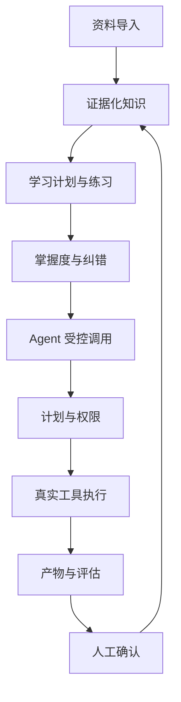
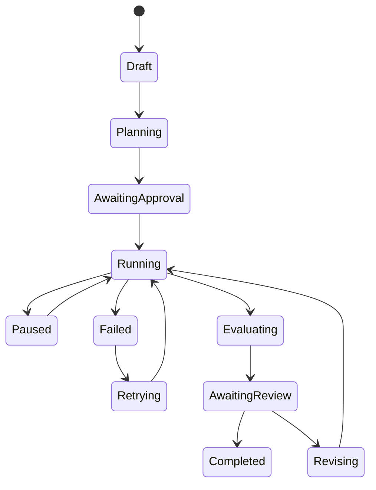
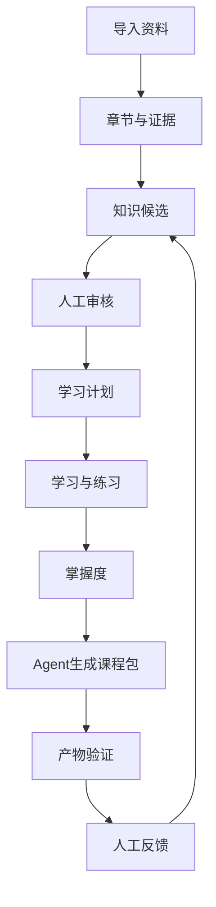

# OS系统

来源：conversations-000.json，记录序号 87，唯一键 000:087
归属：AAOS项目
依据：标题与正文上下文复核

以下保留导出中的全部消息节点（含分支），按节点时间排列；完整结构见同名 JSON。

## user · 8b1b5936-cbcf-47c0-9c9f-50beb6157b24

父节点：client-created-root；时间戳：1785545074.212

DTALEX66
Cognitive-Loop-OS  继续审查

## assistant · 17a7e052-fe7f-48b9-9869-21cb6cec9e80

父节点：8b1b5936-cbcf-47c0-9c9f-50beb6157b24；时间戳：1785545080.08916

{
  "content_type": "thoughts",
  "source_analysis_msg_id": "17a7e052-fe7f-48b9-9869-21cb6cec9e80",
  "thoughts": []
}

## assistant · 791f0cb3-73f7-5a1e-bc27-7083f4e7ca9f

父节点：17a7e052-fe7f-48b9-9869-21cb6cec9e80；时间戳：1785545087.186019

我继续审查 `DTALEX66/Cognitive-Loop-OS`。这次会先恢复我们上次的审查结论和未完成项，再读取仓库当前最新状态，重点核对新增提交是否真正进入“可运行、可视化、可验证”的最小闭环，而不是只看文档和界面。若仓库里有明确的审查规范，我也会一并遵循。

## assistant · 37c95487-964e-486a-9ed5-9f0814dcdd50

父节点：791f0cb3-73f7-5a1e-bc27-7083f4e7ca9f；时间戳：1785545102.179286

{
  "content_type": "thoughts",
  "source_analysis_msg_id": "39cba3c1-770b-4af3-87dd-f844ba3c43a9",
  "thoughts": [
    {
      "chunks": [],
      "content": "",
      "finished": true,
      "summary": "读取个人上下文和 GitHub 技能说明"
    }
  ]
}

## assistant · c7b617ad-aea6-40bd-8c9c-e95c7816ecf0

父节点：37c95487-964e-486a-9ed5-9f0814dcdd50；时间戳：1785545114.386062

{
  "content_type": "thoughts",
  "source_analysis_msg_id": "d2695d40-b857-4804-9b8e-29e6432b2ff4",
  "thoughts": [
    {
      "chunks": [],
      "content": "",
      "finished": true,
      "summary": "审查了 Cognitive-Loop-OS 仓库进展"
    }
  ]
}

## assistant · ee44ea1d-17aa-5c7e-8ec5-6cd661f3028f

父节点：c7b617ad-aea6-40bd-8c9c-e95c7816ecf0；时间戳：1785545114.388497

已恢复上次基线：先前远端从 `2cdf11e` 推进到 `a92e673`，核心判断是“真实后端投影已有，但仍偏治理后台，Agent 桌面闭环尚未形成”。我现在开始做增量审查：先锁定最新 `main`、最近提交与 PR，再逐文件检查本轮新增能力和测试证据。

## assistant · 20f03a04-0e49-417d-a3c8-50446f4b4460

父节点：ee44ea1d-17aa-5c7e-8ec5-6cd661f3028f；时间戳：1785545160.251309

{
  "content_type": "thoughts",
  "source_analysis_msg_id": "1a0280ac-0084-4d13-ac07-6af4138d6db6",
  "thoughts": [
    {
      "chunks": [],
      "content": "",
      "finished": true,
      "summary": "分析 Cognitive-Loop-OS 提交、分支、PR及CI状态"
    }
  ]
}

## assistant · fe8efb20-293a-439e-9a11-cbe74eb55256

父节点：20f03a04-0e49-417d-a3c8-50446f4b4460；时间戳：1785545168.569997

{
  "content_type": "thoughts",
  "source_analysis_msg_id": "e0274c3e-91c0-44ce-ae7c-69d8371f23c3",
  "thoughts": [
    {
      "chunks": [],
      "content": "",
      "finished": true,
      "summary": "正在搜索 https://github.com/DTALEX66/Cognitive-Loop-OS"
    }
  ]
}

## assistant · e1e231de-e1d8-405f-a241-c11bfdafeaf1

父节点：fe8efb20-293a-439e-9a11-cbe74eb55256；时间戳：1785545234.326973

{
  "content_type": "thoughts",
  "source_analysis_msg_id": "70999dcf-51dc-432d-b99e-d0279475a10e",
  "thoughts": [
    {
      "chunks": [],
      "content": "",
      "finished": true,
      "summary": "审查工作区实现并核对发布候选版本与持续集成配置"
    }
  ]
}

## assistant · 93d48a70-24f7-5a01-84a9-b27c9014b697

父节点：e1e231de-e1d8-405f-a241-c11bfdafeaf1；时间戳：1785545234.329238

增量结果已经比较清楚：本轮最大的进步不是又加了一层界面，而是 A1 桌面壳、浏览器交互门禁、Windows 发布链和 `v0.4.1` 修复方案都已合入。接下来我正在核对一个关键点——候选分支 CI 已绿，但合并后的 `main` 精确 SHA 是否也有可验证的全绿记录；这决定现在能不能打 `v0.4.1` 标签并发布。

## assistant · 70b10fe6-15af-49fd-b57a-145cde23ba5d

父节点：93d48a70-24f7-5a01-84a9-b27c9014b697；时间戳：1785545250.414468

{
  "content_type": "thoughts",
  "source_analysis_msg_id": "399f72bd-43ed-4ac7-bbab-2febb2c94428",
  "thoughts": [
    {
      "chunks": [],
      "content": "",
      "finished": true,
      "summary": "查询指定提交的工作流运行"
    }
  ]
}

## assistant · 6b25337d-add1-4f00-adbc-5101b633b679

父节点：70b10fe6-15af-49fd-b57a-145cde23ba5d；时间戳：1785545317.22906

{
  "content_type": "thoughts",
  "source_analysis_msg_id": "05d50963-5ca7-49f4-8341-e033a4c728d0",
  "thoughts": [
    {
      "chunks": [],
      "content": "",
      "finished": true,
      "summary": "审查发布工作流并搜索相关拉取请求"
    }
  ]
}

## assistant · 7c40ebef-4b08-44ad-a125-6dddd694d16c

父节点：6b25337d-add1-4f00-adbc-5101b633b679；时间戳：1785545317.239953

{
  "content": "思考了 3m 57s",
  "content_type": "reasoning_recap"
}

## assistant · 55884dd7-f5b8-59ab-8c62-cddea5cb6674

父节点：7c40ebef-4b08-44ad-a125-6dddd694d16c；时间戳：1785545317.278949

## 继续审查结论

截至 2026-08-01，`main` 已推进到 [`eccd992`](https://github.com/DTALEX66/Cognitive-Loop-OS/commit/eccd99249c805cecb4b5ee28dc5e7ffbc0c30ed5)，比上次审查基线 `a92e673` 前进 11 个提交。

结论是：

> 工程真实性和 A1 桌面壳已经明显成熟，但核心仍是“桌面化治理工作台”，尚未成为真正可工作的 Agent 桌面。

### 本轮确认已完成

- ArcheAxis Desktop A1 已通过 [PR #20](https://github.com/DTALEX66/Cognitive-Loop-OS/pull/20) 合入：
  - Apple-light 默认主题；
  - Violet Core、曜金、深空主题保留；
  - 一级 Rail + 动态二级导航；
  - Planned 页面诚实空状态；
  - Inspector、Activity Dock 展开折叠；
  - 移动端 `aria-hidden`、`inert`、焦点恢复；
  - Modal 焦点锁定和 `Escape`；
  - `prefers-reduced-motion`；
  - 响应式布局。

- 上次列出的 A1 交互缺口基本已关闭，[真实 Chromium 门禁](https://github.com/DTALEX66/Cognitive-Loop-OS/blob/main/scripts/a0_browser_smoke.py)已经覆盖主题切换、导航、Inspector、Dock、键盘焦点、移动端断点和真实导入→投递→回执→刷新读回。

- `v0.4.1` 修复候选已通过 [PR #23](https://github.com/DTALEX66/Cognitive-Loop-OS/pull/23) 合入。

- 候选提交 `058fcf6` 的 CI Run `30674084846` 已全部成功，包含：
  - Python 3.11/3.12/3.13；
  - KB 与集成测试；
  - Ruff、架构和命名门禁；
  - Chromium 浏览器回归；
  - Windows Runtime；
  - Wheel 仓库外安装；
  - Tauri/NSIS 构建与安装生命周期。

- 发布流程已经改成：
  - 先验证 exact-SHA CI；
  - 构建 NSIS 和 Wheel；
  - 校验资产白名单与 `SHA256SUMS` 双向一致；
  - 创建 Draft Release；
  - 下载资产重新计算 SHA-256；
  - 核对 GitHub provider digest；
  - 最后才转为公开 Release。  
  详见当前 [`release.yml`](https://github.com/DTALEX66/Cognitive-Loop-OS/blob/main/.github/workflows/release.yml)。

## 当前阻断项

### P0：现在还不能宣称 `v0.4.1` 已发布

我已直接读取 `v0.4.1` ref，GitHub 返回不存在；当前：

- `v0.4.0` Tag 存在，但属于历史不完整校验版本；
- `v0.4.1` Tag 尚不存在；
- Source Manifest 仍正确保持 `unreleased / public=false`；
- 合并后 `main` 精确 SHA 为 `eccd992`；
- 当前连接能验证候选 SHA 的 CI 全绿，但尚不能验证 `eccd992` 对应的 push CI 全绿。

因此，打标签之前必须先确认：

```text
CI workflow
head_sha = eccd99249c805cecb4b5ee28dc5e7ffbc0c30ed5
status = completed
conclusion = success
```

### P0：Release Identity 的 CI 证据绑定仍有缺口

当前 [`release_inject_identity.py`](https://github.com/DTALEX66/Cognitive-Loop-OS/blob/main/scripts/release_inject_identity.py)把：

```text
GITHUB_RUN_ID
GITHUB_SERVER_URL/.../actions/runs/GITHUB_RUN_ID
```

写进 `source.ci_run` 和 `source.ci_url`。

但在 Release Workflow 中，这个 ID 实际是“发布构建工作流”的 Run ID，不是前面检索到的“exact-SHA CI”Run ID。

也就是说，产物能证明“由哪个 Release Run 构建”，却不能直接证明“它依赖的是哪一次成功的测试 CI”。

建议拆成：

```json
{
  "source": {
    "commit": "...",
    "tree": "...",
    "test_ci_run": 123,
    "test_ci_url": "..."
  },
  "build": {
    "release_run": 456,
    "release_run_url": "..."
  }
}
```

这是当前发布审计链中最值得优先修复的技术问题。

### P1：能力清单存在轻微夸大

`app/release-manifest.json` 将：

```json
"interactive_job_center": "available"
```

标为已完成。

但当前界面主要是：

- 最近任务列表；
- Outbox/Receipt 聚合；
- 手动投递；
- 失败重试；
- 3 秒轮询。

项目状态文档又明确承认“更完整的交互式 Job Center 尚未完成”。建议改成：

```text
manual_job_delivery_controls = available
interactive_job_center = partial / not_implemented
```

否则 Manifest、UI route status 和项目状态文档三者的真相口径不一致。

## 产品层面的核心判断

虽然 A1 壳层完成度已经不错，但中央工作区仍然主要展示数据库投影：

- Research 队列；
- Knowledge 候选；
- Learning 产物；
- Machine Knowledge；
- Job / Outbox / Receipt；
- Lifecycle 聚合状态。

真正的 Agent 桌面关键对象依然没有进入一个统一工作现场：

```text
任务目标
→ 执行计划
→ 当前步骤
→ Context
→ Evidence
→ Permission
→ Tool Call
→ Trace
→ Evaluation
→ Artifact
→ Checkpoint
```

目前：

- “全局命令入口”仍为规划中；
- Agent 管理、技能、模型、流程构建器、审计、设置仍是 Planned；
- Inspector 只是全局聚合状态，不是任务级 Inspector；
- Runtime 只有 `read file:` 首条受限 tracer；
- 没有通用 Dynamic Planner；
- 没有异步 Worker、SSE、统一 Audit Timeline；
- 没有真实 Tauri WebView 点击级验收。

所以不要继续优先增加皮肤、卡片或导航层级。下一阶段必须转向“一个任务从输入到产物的完整工作现场”。

## 当前评分

| 维度 | 当前判断 |
|---|---:|
| 数据治理与真实性 | 8.5/10 |
| 测试与发布门禁 | 8/10 |
| A1 桌面壳 | 8/10 |
| 人类学习知识闭环 | 6.5/10 |
| Agent 执行闭环 | 3.5/10 |
| 可直接日常使用程度 | 5/10 |

整体已经从“治理后台”升级为“可信桌面壳”，但还没有跨过“Agent 工作系统”这条线。

下一刀建议严格按顺序：

1. 确认 `eccd992` exact-SHA CI 全绿。
2. 修复 Release Identity 的测试 CI／发布 Run 双重绑定。
3. 对齐 Manifest 中 Job Center 的能力声明。
4. 开始 A2 单任务驾驶舱。
5. 再接异步 Worker、SSE、Audit Timeline 和失败→重试→重放完整 UI。
6. 完成后再创建 `v0.4.1` Tag 和公开 Release。

## user · facb77f7-8eff-4520-9e6f-799a647d1e20

父节点：55884dd7-f5b8-59ab-8c62-cddea5cb6674；时间戳：1785545562.225

最后三个评分维度，怎么让他们上到8分以上

## assistant · 13cd37dc-0b7a-40fa-8c63-d8cbfa9541e9

父节点：facb77f7-8eff-4520-9e6f-799a647d1e20；时间戳：1785545563.815569

{
  "content_type": "thoughts",
  "source_analysis_msg_id": "13cd37dc-0b7a-40fa-8c63-d8cbfa9541e9",
  "thoughts": []
}

## assistant · ff2b984c-7a7a-44cc-bf06-4ea2a8103e3c

父节点：13cd37dc-0b7a-40fa-8c63-d8cbfa9541e9；时间戳：1785545576.041052

{
  "content": "思考了 12s",
  "content_type": "reasoning_recap"
}

## assistant · 35af9a8a-d3fb-5661-8503-ef10a1d4e3a2

父节点：ff2b984c-7a7a-44cc-bf06-4ea2a8103e3c；时间戳：1785545576.044233

要让最后三个维度同时上到 8 分以上，不能分别补功能。最有效的方法是完成一条“人学习—Agent执行—结果反馈”的黄金纵向闭环。

目标闭环应当是：



## 一、人类学习知识闭环：6.5 → 8.3

现在已经有 Research、Knowledge、Learning、Mastery、Machine Knowledge，但主要还是“状态治理”，缺少真正的学习过程。

必须补齐四个核心对象：

| 对象 | 必须具备 |
|---|---|
| Learning Plan | 学习目标、章节、预计时间、前置知识、完成状态 |
| Lesson | 原文证据、解释、案例、反例、关联知识 |
| Practice | 选择题、问答、复述、应用题、错题 |
| Mastery | 掌握度、遗忘曲线、薄弱点、下次复习时间 |

重点功能：

1. 真实课程工作区  
   导入 PDF、网页、图片、音视频后，用户可以看到：

   - 原始资料；
   - 章节结构；
   - 证据引用；
   - 学习笔记；
   - 问答与练习；
   - 当前掌握度。

2. FSRS 或类似复习调度  
   不再只是记录“练习次数”，而是根据答题质量生成：

   - 下次复习时间；
   - 遗忘风险；
   - 薄弱知识点；
   - 推荐复习内容。

3. 错误反馈回流  
   用户修改解释、标记错误或补充例子后：

   ```text
   人工纠错
   → 新 Knowledge Candidate
   → Evidence 对比
   → 人工批准
   → 新版本知识
   → Agent 后续使用新版本
   ```

4. 知识关系可视化  
   至少提供：

   - 双链；
   - MOC；
   - 前置知识；
   - 相似概念；
   - 冲突知识；
   - 来源追踪。

### 8 分验收门槛

用一个真实 50—100 页课程资料测试，完整完成：

```text
导入 → 章节拆分 → 证据引用 → 学习计划
→ 学习卡片 → 练习 → 错题 → 复习调度
→ 掌握度变化 → 人工纠错 → 知识新版本
```

全流程必须可关闭软件后重新打开继续，不能依赖内存状态。

---

## 二、Agent 执行闭环：3.5 → 8.2

这里是差距最大的部分。当前只有 `read file:` tracer，还不能叫通用 Agent Runtime。

### 先建设统一 Task Runtime

一个任务必须拥有固定结构：

```text
Goal
Plan
Current Step
Context Pack
Permission
Tool Call
Evidence
Trace
Evaluation
Artifact
Checkpoint
Lesson
```

前端不能继续把这些拆成多个治理页面，而要放进一个“任务驾驶舱”。

### 第一批只做 5 个真实工具

不要一开始追求几十种工具，先完成：

1. `file_read`
2. `file_write`
3. `knowledge_search`
4. `http_research`
5. `document_transform`

每个工具都必须具备：

- 明确输入输出 Schema；
- 权限等级；
- 超时；
- 失败状态；
- 重试策略；
- Evidence；
- 可回放 Trace；
- 敏感信息过滤。

### Planner 从单意图升级为受控多步骤计划

例如用户输入：

> 把这份课程整理成学习方案，并输出到 Obsidian 格式。

系统应生成：

```text
1. 读取资料
2. 识别章节
3. 提取 Claims 与 Evidence
4. 生成知识候选
5. 生成学习路线
6. 生成 Obsidian 文档
7. 验证链接与文件完整性
8. 等待人工确认
```

Planner 不能直接自由执行，流程应当是：

```text
计划生成 → 风险判断 → 用户批准
→ 分步执行 → 每步 Checkpoint
→ 失败恢复 → 最终评估
```

### 补齐异步执行基础设施

必须加入：

- 持久化 Worker；
- Job Queue；
- SSE 实时事件；
- Pause / Resume / Cancel；
- Crash 后恢复；
- 超时与重试；
- 失败→重试→重放；
- 幂等命令；
- 单任务互斥；
- Audit Timeline。

### 8 分验收门槛

至少用 20 个真实任务验收：

- 5 个资料转化任务；
- 5 个知识检索与研究任务；
- 5 个学习内容生成任务；
- 5 个失败、断网、重启、权限拒绝任务。

要求：

- 任务成功率 ≥ 90%；
- 软件重启后任务状态不丢失；
- 每个结果能追溯到输入、工具、证据与步骤；
- 失败任务能够从 Checkpoint 继续；
- 未批准的高风险步骤不能执行；
- Agent 结果必须产生真实 Artifact，而不只是聊天回答。

---

## 三、日常可使用程度：5 → 8.3

这不是继续美化 UI，而是让用户每天能稳定完成工作。

### 需要建立五个日常入口

建议首页只保留：

1. 继续上次任务
2. 导入并学习
3. 研究一个主题
4. 让 Agent 完成任务
5. 搜索我的知识

其他治理能力放进 Inspector 和系统设置，不要全部暴露在一级导航。

### 必须补齐的产品能力

#### 1. 项目空间

每个项目包含：

```text
资料
知识
学习
任务
产物
历史
设置
```

例如：

```text
Cognitive-Loop-OS
醇净品牌项目
中油龙慧展厅
设计课程学习
```

用户重新打开软件后直接回到上次项目、页面和任务。

#### 2. 真正可用的全局命令入口

支持：

- 搜索资料；
- 搜索知识；
- 打开项目；
- 创建任务；
- 继续任务；
- 快速导入；
- 跳转到错误或待审核项。

#### 3. 设置中心必须完成

至少包括：

- 模型与 API；
- 模型路由；
- 本地存储位置；
- 缓存；
- OCR/FFmpeg/Tesseract 状态；
- 权限；
- 日志；
- 备份恢复；
- 数据导出；
- 网络与代理；
- 主题与界面。

#### 4. 错误必须可处理

不能只显示“读取失败”，需要显示：

```text
发生了什么
影响了什么
数据是否安全
可以怎么处理
重试按钮
打开诊断
复制错误摘要
```

#### 5. 安装和升级体验

要做到：

- Windows 一键安装；
- 首次启动检测依赖；
- 数据目录可选择；
- 不需要用户手动执行迁移；
- 升级前自动备份；
- 升级失败可回滚；
- 卸载不默认删除用户数据。

### 8 分验收门槛

连续进行 7—14 天真实自用测试，每天完成：

- 导入一份资料；
- 继续一个学习计划；
- 执行一个 Agent 任务；
- 找回一个历史知识；
- 导出一个真实产物。

期间达到：

- 常用任务入口不超过 3 次点击；
- 任务状态和项目位置不丢失；
- 主要操作不需要查看日志或命令行；
- 错误能够从界面恢复；
- 用户数据可以备份、迁移和恢复；
- Windows 安装后不需要开发环境即可运行。

## 最合理的实施顺序

| 阶段 | 核心交付 | 预计评分变化 |
|---|---|---|
| A2 任务驾驶舱 | Goal、Plan、Context、Permission、Trace、Artifact、Checkpoint | Agent 5.5，易用性 6.5 |
| A3 学习工作区 | 课程、练习、FSRS、错题、知识版本反馈 | 学习 8.0，易用性 7.2 |
| A4 持久化 Agent Runtime | 5 个真实工具、Worker、SSE、恢复、评估 | Agent 8.0，易用性 7.8 |
| A5 日常产品收口 | 项目空间、命令入口、设置、备份、升级、错误恢复 | 三项均超过 8 |

最关键的产品演示应该锁定为：

> 导入一份真实课程或项目资料，系统生成带证据的知识和学习路线；用户学习并纠错；Agent 使用批准后的知识完成一个真实任务，产出文件；结果经人工确认后重新沉淀进知识库。

这一条真正跑通后，人类学习、Agent执行和日常可用性会一起跨过 8 分。

## user · 48526f1c-db70-499a-95f6-f0f2e72fdfe6

父节点：35af9a8a-d3fb-5661-8503-ef10a1d4e3a2；时间戳：1785546142.072

继续深化

## assistant · 9715ba06-66d5-49b0-8e35-d20d6ff4f8b0

父节点：48526f1c-db70-499a-95f6-f0f2e72fdfe6；时间戳：1785546143.680738

{
  "content_type": "thoughts",
  "source_analysis_msg_id": "9715ba06-66d5-49b0-8e35-d20d6ff4f8b0",
  "thoughts": []
}

## assistant · 76a843d4-45b3-4758-ab00-38697bb7762b

父节点：9715ba06-66d5-49b0-8e35-d20d6ff4f8b0；时间戳：1785546192.138447

{
  "content": "思考了 48s",
  "content_type": "reasoning_recap"
}

## assistant · 65dfeab0-567e-52dc-b343-d64d910e8be3

父节点：76a843d4-45b3-4758-ab00-38697bb7762b；时间戳：1785546192.141992

可以继续往下深化成一套真正可执行的产品升级方案。关键变化是：不再把“学习系统、Agent系统、桌面产品”当成三个独立模块，而是建立三个共享同一事实底座的闭环。

## 一、重新定义三个闭环

### 1. Human Learning Loop

```text
Source
→ Evidence
→ Knowledge Candidate
→ Human Review
→ Learning Plan
→ Lesson
→ Practice
→ Mastery
→ Review Schedule
→ Human Correction
→ Knowledge Version
```

### 2. Agent Execution Loop

```text
Goal
→ Context Pack
→ Plan
→ Permission
→ Tool Execution
→ Evidence
→ Trace
→ Evaluation
→ Artifact
→ Checkpoint
→ Human Review
```

### 3. Human–Agent Feedback Loop

```text
人的学习纠错
→ 新知识候选
→ 人工批准
→ Agent 使用新版本知识
→ Agent 任务结果
→ 人工评价
→ Lesson / Anti-pattern
→ 新一轮学习与执行
```

这三个闭环不能拥有三套割裂的数据。它们必须共享：

- 来源；
- Evidence；
- Knowledge Version；
- Project；
- Artifact；
- Feedback；
- Audit Timeline。

---

# 二、8 分以上的真正产品形态

用户打开软件后，看到的核心不应该是十几个治理页面，而应该是三个工作入口：

| 入口 | 用户目标 |
|---|---|
| 学习 | 把资料学懂、练会、长期记住 |
| 执行 | 让 Agent 使用可信知识完成任务 |
| 审核 | 确认知识、计划、权限、结果和反馈 |

所有治理能力仍然存在，但沉入 Inspector、审核中心和设置，不再让用户先理解数据库结构。

## 项目空间成为第一层容器

每个 Project 包含：

```text
Project
├── Sources
├── Knowledge
├── Learning
├── Tasks
├── Artifacts
├── Feedback
└── Timeline
```

例如：

- Cognitive-Loop-OS 开发；
- 醇净品牌设计；
- 中油龙慧展厅；
- AI课程学习；
- ArcheAxis OS 产品研究。

Research、Knowledge、Learning、Agent Task 不再是互相孤立的一级模块，而是项目内部的不同工作视图。

---

# 三、建立统一核心对象模型

现有合同可以保留，但 A2 必须增加一组真正面向用户工作的对象。

## 1. Project

```json
{
  "project_ref": "public-safe-reference",
  "title": "Cognitive-Loop-OS",
  "goal": "完成可运行的人机双向学习系统",
  "status": "active",
  "last_activity_at": "2026-08-01T08:00:00Z"
}
```

`project_ref` 是对外安全引用，不是数据库内部 ID。

## 2. Learning Plan

```json
{
  "project_ref": "...",
  "title": "认知操作系统架构学习路线",
  "goal": "理解并能够独立设计完整闭环",
  "units": [
    {
      "title": "Knowledge Governance",
      "prerequisites": [],
      "status": "learning"
    }
  ],
  "review_policy": "fsrs"
}
```

## 3. Practice Attempt

```json
{
  "learning_unit_ref": "...",
  "practice_type": "application",
  "question": "设计一个知识晋升流程",
  "answer": "...",
  "quality": 4,
  "evidence_refs": [],
  "feedback": "...",
  "attempted_at": "..."
}
```

## 4. Agent Task

```json
{
  "task_ref": "...",
  "project_ref": "...",
  "goal": "把资料转成一套可复习的Obsidian课程",
  "status": "awaiting_plan_approval",
  "current_step": 2,
  "expected_artifacts": [
    "course-index.md",
    "lesson-notes",
    "review-cards"
  ]
}
```

## 5. Task Plan

每一步必须包含：

```json
{
  "step": 2,
  "title": "提取章节结构",
  "tool": "document_transform",
  "permission": "local_read",
  "input_refs": [],
  "expected_output": "chapter-outline",
  "evidence_required": true,
  "checkpoint": true
}
```

## 6. Artifact

```json
{
  "artifact_ref": "...",
  "task_ref": "...",
  "type": "obsidian_course",
  "name": "认知系统课程包",
  "validation": {
    "status": "passed",
    "checks": [
      "文件存在",
      "链接有效",
      "无空白章节",
      "来源可追溯"
    ]
  }
}
```

## 7. Human Feedback

```json
{
  "target_type": "artifact",
  "decision": "needs_revision",
  "feedback": "第二章缺少失败案例",
  "creates_candidate": true
}
```

---

# 四、数据库如何演进

不要推翻当前 SQLite，也不要重新设计全部 Schema。继续采用现有 Migration Owner，追加版本。

## `workspace.sqlite` v3

增加：

- `workspace_projects_v1`
- `workspace_project_sources_v1`
- `workspace_artifacts_v1`
- `workspace_sessions_v1`
- `workspace_timeline_v1`

负责用户项目、产物、最近状态和桌面恢复。

## `knowledge-governance.sqlite` v2

增加：

- `learning_plans_v1`
- `learning_units_v1`
- `practice_attempts_v1`
- `review_schedules_v1`
- `human_feedback_v1`
- `knowledge_version_relations_v1`

负责学习、练习、掌握度、复习和人工反馈。

## `taskpack.sqlite` v4

增加：

- `runtime_tasks_v1`
- `runtime_plans_v1`
- `runtime_steps_v1`
- `runtime_tool_invocations_v1`
- `runtime_checkpoints_v1`
- `runtime_evaluations_v1`
- `runtime_artifact_bindings_v1`

负责真正的 Agent 执行状态。

## 数据约束

所有新表必须满足：

- append-only Audit；
- 幂等 command；
- 乐观版本检查；
- crash-safe；
- 迁移可回滚；
- 不暴露内部数据库 ID；
- Candidate 不自动晋升；
- Artifact 必须与 Task、Step、Evidence 绑定；
- Feedback 不直接修改历史知识，只产生新版本候选。

---

# 五、Agent Runtime 的执行内核

## 1. 不直接做自由自治 Agent

第一阶段采用：

```text
规则路由
+ 模板计划
+ LLM 结构化补全
+ Schema 校验
+ 权限校验
```

LLM 可以建议计划，但不能决定它有没有权限执行。

## 2. Planner 分四层

### Intent Router

识别用户要做什么：

- 学习资料；
- 研究主题；
- 转换文档；
- 搜索知识；
- 生成产物；
- 修改产物。

### Plan Generator

生成结构化步骤，不接受纯文本计划。

### Plan Validator

校验：

- 工具是否存在；
- 输入是否存在；
- Evidence 是否充分；
- 权限是否允许；
- 是否包含目标产物；
- 是否设置 Checkpoint；
- 是否产生越权路径；
- 是否试图把 Candidate 当成 Truth。

### Runtime Executor

只执行已经通过验证和批准的步骤。

---

# 六、权限系统深化

建议分成四级。

| 等级 | 行为 | 默认策略 |
|---|---|---|
| P0 | 读取项目内数据、搜索知识 | 自动允许 |
| P1 | 创建项目内文件、知识候选、学习卡片 | 可按项目长期允许 |
| P2 | 网络访问、模型调用、读取外部目录 | 每次或规则批准 |
| P3 | 删除、覆盖、发布、发送、执行命令 | 强制人工确认 |

权限批准必须绑定：

```text
Task
+ Step
+ Tool
+ Input Scope
+ Output Scope
+ Expiry
```

不能只记录“用户允许过 file_write”。

## 路径权限

必须严格区分：

- 项目目录；
- Library/持久文件区；
- 用户明确批准的资料目录；
- 系统目录；
- 其他项目目录。

默认只允许当前项目目录。任何跨项目读取都重新申请权限。

---

# 七、第一批真实工具如何设计

## `file_read`

输入：

- 安全文件引用；
- 允许的编码；
- 最大读取量。

输出：

- 内容；
- SHA-256；
- 读取时间；
- 来源 Evidence。

## `file_write`

必须具备：

- 原子写入；
- 覆盖前版本；
- 文件 SHA；
- 回滚引用；
- 写入范围检查。

## `knowledge_search`

返回：

- Knowledge Version；
- 来源；
- Evidence；
- Candidate/Approved 状态；
- 检索评分；
- 冲突信息。

不能只返回一段生成文本。

## `http_research`

必须经过 Safe HTTP，并输出：

```text
SourceRecord
Claims
Evidence
Conflict
Independent Source Group
Human Review Required
```

## `document_transform`

首批支持：

- PDF/Word/Markdown/HTML；
- 章节识别；
- 标题层级；
- 表格；
- 图片引用；
- Evidence anchor；
- Obsidian 输出。

不能直接把整篇资料总结成一段 Markdown。

---

# 八、任务驾驶舱应该怎么设计

页面中央不再只是 Job 列表。

| 区域 | 内容 |
|---|---|
| 顶部 | 项目、任务目标、状态、暂停/继续/取消 |
| 左侧 | Plan、步骤状态、Checkpoint |
| 中央 | 当前工作现场、工具输出、Artifact预览 |
| 右侧 Inspector | Context、Evidence、Permission、Evaluation |
| 底部 Dock | Worker、队列、错误、通知、资源实测 |

## 任务状态机



不显示虚假百分比。

可以显示真实状态：

```text
已完成 3/7 个步骤
当前步骤：生成学习卡片
等待：文件写入权限
已产出：2 个 Artifact
```

---

# 九、学习工作区深化

## 一份资料需要四种同步视图

### 原文视图

- 页码/时间戳；
- 原始章节；
- OCR/ASR 状态；
- Evidence anchor。

### 知识视图

- Claims；
- Concepts；
- Relations；
- Conflicts；
- Sources；
- Versions。

### 学习视图

- 学习目标；
- Lesson；
- 笔记；
- 练习；
- 掌握度；
- 复习时间。

### 应用视图

- 使用该知识完成过什么任务；
- Agent 是否出现错误；
- 哪条知识支持了哪个结果；
- 哪些内容需要重新学习。

这一步非常关键。只有知识被真实用于任务，才能形成“学会—使用—纠错”的闭环。

---

# 十、评估系统不能只给一个分数

Agent 任务至少需要六维 Evaluation：

| 维度 | 判断依据 |
|---|---|
| 完成度 | 是否产生要求的 Artifact |
| 正确性 | 输出是否满足可验证规则 |
| 证据覆盖 | 关键结论是否有 Evidence |
| 指令遵循 | 是否偏离用户目标 |
| 安全性 | 是否越权、泄露路径或敏感信息 |
| 可复现性 | 同一输入是否能解释执行过程 |

例如文档转化任务：

```text
完成度：通过
文件完整性：通过
章节覆盖：18/18
来源绑定：通过
内部链接：2个失效
Evidence覆盖：92%
最终状态：需要修订
```

Evaluation 失败后不能直接变成 Lesson，必须经过：

```text
Evaluation Candidate
→ Human Review
→ Approved Lesson / Anti-pattern
```

---

# 十一、SSE、Worker与崩溃恢复

## Worker 最小设计

```text
SQLite Job Queue
→ Lease Claim
→ Step Execution
→ Checkpoint
→ Event
→ Next Step
```

每个 Step 都需要：

- lease owner；
- lease expiry；
- attempt；
- started_at；
- finished_at；
- error category；
- checkpoint；
- output binding。

## 崩溃恢复

软件重新启动后：

1. 检查过期 Lease；
2. 检查最后一个成功 Checkpoint；
3. 校验输入和产物 SHA；
4. 将不确定步骤标记为 `recovery_required`；
5. 不能直接假设步骤成功；
6. 用户选择继续、重做或取消。

## SSE 只负责推送

SSE 断开不能影响任务真实性。页面重新连接后，必须先从 SQLite 读回状态，再继续接收事件。

---

# 十二、日常使用的完整首页

首页不再展示大量系统指标，而是：

## 第一屏

- 继续上次项目；
- 当前进行中的任务；
- 今日待复习；
- 待人工审核；
- 最近产物。

## 快速操作

- 导入资料；
- 新建学习计划；
- 创建 Agent 任务；
- 搜索知识；
- 打开项目。

## 系统状态

只在底部状态栏展示：

```text
本地服务正常
Worker 1个任务
2项等待审核
模型路由可用
数据库已保存
```

详细迁移、Outbox、Receipt、Release Manifest 放入系统诊断，不占据日常首页。

---

# 十三、设置中心必须真正接入

建议分七个区域。

| 设置区 | 内容 |
|---|---|
| 模型 | Provider、模型、能力、上下文长度、状态 |
| 路由 | 学习、研究、规划、执行、评估分别使用哪个模型 |
| 工具 | OCR、FFmpeg、Tesseract、网络工具 |
| 存储 | 数据目录、项目目录、缓存、备份 |
| 权限 | 路径、网络、模型调用、写入规则 |
| 运行 | Worker数量、超时、重试、并发 |
| 系统 | 日志、诊断、导出、恢复、版本 |

模型状态必须来自真实探测，不能写“在线”静态状态。

成本和 Token 只有 Provider 返回真实 usage 时才能展示。

---

# 十四、完整验收矩阵

## 人类学习达到 8 分

必须通过：

- 真实 PDF、网页、图片、视频各一份；
- 章节结构能够读回；
- 每条知识能回到 Evidence；
- 生成完整 Learning Plan；
- 至少三种 Practice；
- FSRS/复习时间真实更新；
- 错题进入薄弱点；
- 人工纠错产生新版本；
- Agent 后续只使用批准版本；
- 重启后学习状态不丢失。

## Agent执行达到8分

必须通过：

- 20个真实任务；
- 5个真实工具；
- 计划可审核；
- 权限可拒绝；
- 拒绝后任务不误报成功；
- 网络失败可以重试；
- 软件崩溃可以恢复；
- 每一步有 Trace；
- 最终有 Artifact；
- Artifact有真实校验；
- 失败结果不会产生 Approved Lesson。

## 日常使用达到8分

必须通过14天自用：

- 95%的日常操作不需要命令行；
- 常用入口不超过3次点击；
- Shell显示目标不超过3秒；
- 本地后端冷启动目标不超过15秒；
- 任务可以跨重启继续；
- 错误界面提供可执行恢复动作；
- 数据可以备份、恢复、迁移；
- 升级失败可以回滚；
- 不需要用户理解内部 Job、Outbox、Receipt ID。

---

# 十五、版本路线建议

## v0.5.0：Golden Loop

只完成一条完整黄金闭环：

```text
导入真实资料
→ Knowledge
→ Learning Plan
→ Practice
→ Agent Task
→ Artifact
→ Human Feedback
→ Knowledge Candidate
```

预计：

| 维度 | 目标 |
|---|---:|
| 人类学习 | 7.5 |
| Agent执行 | 6.0 |
| 日常使用 | 6.8 |

## v0.6.0：Reliable Runtime

补齐：

- 五个真实工具；
- Worker；
- SSE；
- Checkpoint；
- Pause/Resume/Cancel；
- Crash Recovery；
- 六维 Evaluation；
- Artifact验证。

目标：

| 维度 | 目标 |
|---|---:|
| 人类学习 | 8.0 |
| Agent执行 | 8.0 |
| 日常使用 | 7.6 |

## v0.7.0：Daily Desktop

补齐：

- 项目空间；
- 全局命令入口；
- 设置中心；
- 搜索；
- 通知；
- 错误恢复；
- 备份升级；
- 14天自用验证。

目标：

| 维度 | 目标 |
|---|---:|
| 人类学习 | 8.5 |
| Agent执行 | 8.3 |
| 日常使用 | 8.3 |

---

# 十六、当前必须冻结的内容

在三个维度达到8分前，建议暂时不投入：

- 多Agent协作；
- Agent商店；
- 大量模型Provider；
- 3D记忆宫殿；
- 云同步；
- 手机端；
- 社交协作；
- 大规模插件市场；
- 复杂工作流拖拽编辑器；
- 更多主题皮肤；
- 非必要的首页数据卡片。

这些都可能让系统看起来更大，但不会提高核心闭环评分。

当前最正确的第一开发目标是：

> 在一个项目空间内，把一份真实资料转成可学习知识，让用户完成练习，再让Agent使用批准知识生成一个真实文件，最后把人工反馈重新沉淀成知识候选；全流程能够跨重启恢复、追溯和回滚。

这就是 `v0.5.0 Golden Loop` 的完成定义。

## user · 62ab874b-62d7-4f8b-ad04-35a3e6310c97

父节点：65dfeab0-567e-52dc-b343-d64d910e8be3；时间戳：1785551223.077

继续深化优化

## assistant · 06aa8e7d-0f1a-4efc-920c-4f7d044faec1

父节点：62ab874b-62d7-4f8b-ad04-35a3e6310c97；时间戳：1785551226.678442

{
  "content_type": "thoughts",
  "source_analysis_msg_id": "06aa8e7d-0f1a-4efc-920c-4f7d044faec1",
  "thoughts": []
}

## assistant · a8e7a6df-f8fd-4367-bba7-31e1de17f76e

父节点：06aa8e7d-0f1a-4efc-920c-4f7d044faec1；时间戳：1785551256.85868

{
  "content": "思考了 30s",
  "content_type": "reasoning_recap"
}

## assistant · 6b4d6f34-be48-5d8f-8236-509bb8849f25

父节点：a8e7a6df-f8fd-4367-bba7-31e1de17f76e；时间戳：1785551256.861954

继续优化后，我认为上一版方案仍有“对象过多、表过多、模块重新建设”的风险。对当前 `Cognitive-Loop-OS` 最合理的做法不是再造一套 A2 系统，而是复用已有合同和真实链路，只补五个缺失核心对象，完成一条极深的黄金闭环。

# 一、先优化总体策略

当前已有：

- `ResearchPackageV1`
- `KnowledgeUnitV1`
- `LearningArtifactV1`
- `MasterySignalV1`
- `MachineKnowledgeUnitV1`
- `TaskPackV1`
- `ExecutionTraceV1`
- `EvaluationV1`
- `LessonV1`
- Job / Outbox / Receipt
- Permission、Evidence、Migration、SQLite

这些不应该重建。

真正缺少的是：

1. `ProjectV1`
2. `LearningPlanV1`
3. `ArtifactV1`
4. `CheckpointV1`
5. `HumanFeedbackV1`

优化后的核心原则是：

> 用现有对象完成执行内核，只增加项目、学习计划、最终产物、恢复检查点和人工反馈。

这样可以避免继续堆合同、堆表、堆模块。

---

# 二、重新确定 v0.5.0 黄金场景

不要同时做所有格式、所有工具、所有学习模式。

v0.5.0 只锁定一个真实高频场景：

> 用户导入一份 PDF、Markdown 或网页课程资料，系统生成带证据的课程结构和学习计划；用户完成学习与练习；Agent 使用批准知识生成一套 Obsidian 课程包；用户反馈问题后，系统生成新的知识候选。

完整路径：



这条路径一旦真实跑通，三个评分会同时提高。

---

# 三、精简后的领域模型

## 1. ProjectV1

Project 是所有资料、知识、学习、任务和产物的容器。

```json
{
  "schema_version": "1.0.0",
  "project_ref": "project_public_ref",
  "title": "AI课程学习",
  "goal": "完成课程学习并生成Obsidian知识库",
  "status": "active",
  "created_at": "...",
  "updated_at": "..."
}
```

只增加用户级安全引用，内部数据库 ID 不进入 API 和界面。

## 2. LearningPlanV1

```json
{
  "schema_version": "1.0.0",
  "project_ref": "...",
  "title": "AI Agent课程学习路线",
  "goal": "理解并应用课程核心知识",
  "units": [
    {
      "unit_ref": "...",
      "title": "Agent Runtime",
      "order": 1,
      "prerequisite_refs": [],
      "status": "ready"
    }
  ],
  "review_policy": "fsrs"
}
```

它只负责学习顺序和目标，不重复保存知识正文。

## 3. ArtifactV1

所有 Agent 任务必须落到真实产物。

```json
{
  "schema_version": "1.0.0",
  "project_ref": "...",
  "task_ref": "...",
  "type": "obsidian_course",
  "name": "AI Agent课程包",
  "files": [
    {
      "relative_path": "00-MOC.md",
      "sha256": "...",
      "role": "index"
    }
  ],
  "validation_status": "needs_revision"
}
```

## 4. CheckpointV1

```json
{
  "schema_version": "1.0.0",
  "task_ref": "...",
  "step_ref": "...",
  "input_digest": "...",
  "output_digest": "...",
  "state": "completed",
  "created_at": "..."
}
```

Checkpoint 不是进度条，而是可恢复证据。

## 5. HumanFeedbackV1

```json
{
  "schema_version": "1.0.0",
  "project_ref": "...",
  "target_type": "artifact",
  "target_ref": "...",
  "decision": "needs_revision",
  "comment": "缺少失败案例和反例",
  "candidate_required": true
}
```

反馈不能直接修改 Approved Knowledge，只能产生新 Candidate。

---

# 四、数据库最小增量

不要新增大量数据库文件，只升级现有三个 Owner。

## `workspace.sqlite` v3

增加：

- `workspace_projects_v1`
- `workspace_project_bindings_v1`
- `workspace_artifacts_v1`
- `workspace_recent_sessions_v1`

复用现有：

- Jobs
- Outbox
- Receipt

## `knowledge-governance.sqlite` v2

增加：

- `learning_plans_v1`
- `learning_plan_units_v1`
- `practice_attempts_v1`
- `review_schedules_v1`
- `human_feedback_v1`

复用现有：

- Knowledge Candidate
- Learning Artifact
- Mastery Signal
- Machine Knowledge

## `taskpack.sqlite` v4

只增加：

- `runtime_checkpoints_v1`
- `artifact_bindings_v1`

复用：

- TaskPack
- Permission
- Execution Trace
- Evaluation
- Lesson

这样不会出现 `workspace_jobs` 和 `runtime_tasks` 两套任务真相。

---

# 五、重新设计任务状态

任务状态必须统一，不能让 Job、TaskPack、Outbox、UI 各自维护状态。

## 用户级状态

```text
draft
planning
awaiting_approval
running
paused
recovery_required
evaluating
awaiting_review
completed
failed
cancelled
```

## 内部系统状态映射

| 用户状态 | 内部事实 |
|---|---|
| planning | TaskPack 正在生成或校验 |
| awaiting_approval | Permission 尚未批准 |
| running | Job 已取得有效 Lease |
| paused | 无有效 Lease，保留 Checkpoint |
| recovery_required | Lease过期且步骤结果不确定 |
| evaluating | ExecutionTrace完成，Evaluation未完成 |
| awaiting_review | Artifact已生成但未被人确认 |
| completed | Artifact验证与人工确认均完成 |
| failed | 真实终态失败且没有自动重试 |

UI 只展示用户可理解的状态，不展示内部 Job ID、Command ID、Outbox ID。

---

# 六、学习闭环进一步优化

## 1. 不直接把摘要当课程

资料转化分成五层：

```text
原始资料
→ 结构
→ Evidence
→ Knowledge
→ Learning
```

### 原始资料层

保留：

- 文件 SHA；
- 页码；
- 标题层级；
- 图片位置；
- 表格位置；
- OCR状态。

### Evidence层

每条知识必须关联：

- 来源文件；
- 页码或段落；
- 原文片段；
- 提取方式；
- 可信状态。

### Knowledge层

形成：

- 概念；
- Claim；
- 定义；
- 案例；
- 反例；
- 关系；
- 冲突。

### Learning层

生成：

- 学习目标；
- 解释；
- 引导问题；
- 练习；
- 复习卡；
- 应用任务。

## 2. 练习不只做选择题

v0.5.0 最少支持四类：

| 类型 | 作用 |
|---|---|
| Recall | 记忆概念 |
| Explain | 用自己的话解释 |
| Compare | 区分相似概念 |
| Apply | 在真实问题中使用 |

其中 `Apply` 是关键，因为它把人类学习和 Agent 任务连接起来。

## 3. Mastery不能由LLM直接决定

Mastery 应主要来自：

- 答题质量；
- 重复间隔；
- 错误次数；
- 用户自评；
- 应用任务结果；
- 人工纠错。

LLM 只能产生候选反馈，不能直接把知识标为“已掌握”。

---

# 七、Agent闭环进一步优化

## 第一阶段不是通用Agent，而是三种任务模板

### 模板A：资料转课程

```text
读取资料
→ 解析结构
→ 绑定Evidence
→ 生成学习计划
→ 生成Obsidian文件
→ 验证文件
```

### 模板B：研究主题

```text
确定问题
→ 搜索多个来源
→ 提取Claims
→ 检查来源独立性
→ 识别冲突
→ 生成研究报告
```

### 模板C：基于知识生成产物

```text
读取任务目标
→ 检索Approved Knowledge
→ 生成Plan
→ 执行
→ 验证Artifact
→ 人工审核
```

先把这三种任务跑深，比增加 Agent 管理、技能市场、多Agent更重要。

---

# 八、五个工具还需继续收缩

v0.5.0 实际只需四个工具：

1. `source_read`
2. `knowledge_search`
3. `document_transform`
4. `project_write`

暂时不把 HTTP Research 放入第一条黄金闭环，网页摄入继续走现有 Research 链。

## `project_write`必须限制

只允许写入：

```text
当前项目
└── artifacts/
```

禁止：

- 写项目目录外；
- 覆盖原始资料；
- 修改其他项目；
- 修改系统配置；
- 删除文件。

覆盖已有 Artifact 时：

```text
旧版本保留
→ 写入临时文件
→ 验证
→ 原子替换
→ 新版本绑定
```

---

# 九、Planner优化为“模板+补全”

避免直接让大模型从零生成任意计划。

## 生成方式

```text
任务意图
→ 选择模板
→ 填充输入
→ LLM补充可选步骤
→ Schema校验
→ 权限分析
→ 用户确认
```

例如：

```json
{
  "template": "source_to_obsidian_course",
  "goal": "生成可学习的Obsidian课程",
  "steps": [
    "read_source",
    "extract_structure",
    "bind_evidence",
    "build_learning_plan",
    "render_obsidian",
    "validate_artifact"
  ]
}
```

LLM不能：

- 自创不存在的工具；
- 删除强制验证步骤；
- 绕过 Permission；
- 修改输出目录；
- 把 Candidate 当 Approved Knowledge；
- 将执行失败标记为成功。

---

# 十、Evaluation进一步具体化

不同 Artifact 使用不同确定性验证器。

## Obsidian课程包验证

必须检查：

- MOC是否存在；
- Markdown是否可解析；
- 内部链接是否有效；
- 文件名是否合法；
- 是否存在空白章节；
- Evidence引用是否存在；
- 是否有重复内容；
- 图片链接是否有效；
- 每个章节是否有学习目标；
- 复习卡是否存在；
- 输出是否越出项目目录。

## 结果状态

```text
passed
needs_revision
blocked
```

不要使用模糊的“质量分92”。

数字只有在有明确测量公式时才显示。

---

# 十一、前端信息架构继续减负

当前八个一级 Rail 仍然偏多。优化后建议：

| 一级入口 | 内容 |
|---|---|
| 今日 | 最近项目、继续任务、待复习、待审核 |
| 项目 | 项目、资料、知识、产物 |
| 学习 | 学习计划、Lesson、练习、复习 |
| 执行 | Agent任务、计划、运行、Artifact |
| 审核 | Knowledge、Permission、Evaluation、Feedback |
| 系统 | 模型、工具、存储、权限、日志、诊断 |

原有品牌命名可以作为页面名称保留：

- 观心 → 今日；
- 察微 → 研究与审核；
- 藏识 → 知识；
- 知行 → 执行；
- 知新 → 学习反馈；
- 知衡 → Machine Knowledge。

但不要让用户先理解这些品牌词才能工作。

---

# 十二、任务驾驶舱具体布局

## 顶部任务条

显示：

- 项目；
- 任务目标；
- 当前状态；
- 真实步骤；
- 暂停；
- 继续；
- 取消。

## 左侧计划区

每个步骤显示：

- 未开始；
- 等待权限；
- 执行中；
- 已验证；
- 失败；
- 需要恢复。

## 中央工作区

根据当前步骤显示：

- 原文；
- 转化预览；
- Markdown；
- Artifact；
- Diff；
- 验证结果。

## 右侧 Inspector

四个页签：

1. Context
2. Evidence
3. Permission
4. Evaluation

## 底部 Activity Dock

只显示真实活动：

```text
Worker状态
当前工具
等待队列
最近Checkpoint
错误
```

不展示估算进度、虚假剩余时间和虚构成本。

---

# 十三、设置中心优化顺序

设置不能一次做全。

## v0.5.0必须完成

- 模型 Provider；
- 任务模型；
- 转化模型；
- 评估模型；
- 项目目录；
- 数据目录；
- OCR状态；
- FFmpeg状态；
- Tesseract状态；
- 路径权限；
- 日志；
- 备份。

## 后续再做

- 多模型自动路由；
- Token预算；
- 本地模型管理；
- MCP管理；
- Worker并发；
- 高级缓存策略。

---

# 十四、量化评分体系

以后不再凭感觉打分。

## 人类学习知识闭环：100分

| 项目 | 权重 |
|---|---:|
| Source与Evidence完整性 | 15 |
| Knowledge结构与版本 | 15 |
| Learning Plan | 15 |
| 练习与复习 | 20 |
| Mastery真实性 | 10 |
| 人工反馈回流 | 15 |
| 持久化与恢复 | 10 |

达到80分且无P0缺陷，才算8分。

## Agent执行闭环：100分

| 项目 | 权重 |
|---|---:|
| Goal与Plan | 15 |
| 工具真实性 | 15 |
| Permission | 15 |
| Checkpoint与恢复 | 15 |
| Trace与Evidence | 15 |
| Artifact | 15 |
| Evaluation与反馈 | 10 |

达到80分且不存在越权、假成功、状态丢失，才算8分。

## 日常使用程度：100分

| 项目 | 权重 |
|---|---:|
| 安装与首次启动 | 10 |
| 项目连续性 | 15 |
| 常用任务效率 | 20 |
| 错误恢复 | 15 |
| 设置完整度 | 15 |
| 数据备份迁移 | 10 |
| 性能稳定性 | 10 |
| 键盘与无障碍 | 5 |

---

# 十五、重新优化版本节奏

## R0：Truth Repair

先完成：

- `eccd992` exact-SHA CI确认；
- Release Identity双Run绑定；
- Job Center能力声明对齐；
- README过期状态修订。

这是进入v0.5开发前的真相冻结。

## v0.5.0：Golden Learning Task

只交付：

- Project；
- PDF/Markdown/网页资料；
- Learning Plan；
- 四类练习；
- Mastery；
- 模板化Agent Task；
- Obsidian Artifact；
- Checkpoint；
- Feedback回流。

验收必须是一条完整流程，不能只交后端接口。

## v0.6.0：Reliable Runtime

增加：

- 持久Worker；
- SSE；
- Pause/Resume/Cancel；
- 崩溃恢复；
- 失败重试；
- 多Artifact验证；
- 研究任务模板。

## v0.7.0：Daily Desktop

增加：

- 今日页；
- 项目恢复；
- 全局命令入口；
- 设置中心；
- 搜索；
- 通知；
- 备份恢复；
- Tauri WebView点击级测试；
- 14天真实自用。

---

# 十六、开发组织方式

不建议把v0.5拆成大量互相依赖的小PR，容易再次出现“后端有了、前端还是空的”。

建议：

```text
feat/v0.5-golden-loop
```

由一个 Writer 执行，内部按可验证提交推进：

1. 合同与迁移；
2. 服务层；
3. Project API；
4. Learning API；
5. Task/Artifact API；
6. 黄金闭环服务测试；
7. 任务驾驶舱；
8. Chromium闭环；
9. Tauri验证；
10. 文档和Release truth。

最终以一个完整纵向PR进入 `main`。

完成标准不是“新增了多少文件”，而是：

> 关闭软件前导入一份真实课程；重启后继续学习；完成练习；让Agent生成Obsidian课程包；验证产物；提交人工修改意见；系统生成新知识候选；再次重启后所有状态、Evidence、Artifact和反馈仍可读回。

这条测试通过，才算 `v0.5.0 Golden Loop` 真正完成。

## user · 014bdbfa-5da9-45b8-9cee-74869486de14

父节点：6b4d6f34-be48-5d8f-8236-509bb8849f25；时间戳：1785976949.905

审计下OS云端仓库

## assistant · e8e25f40-d119-46c4-86e6-a1ed875af06f

父节点：014bdbfa-5da9-45b8-9cee-74869486de14；时间戳：1785976954.203159

{
  "content_type": "thoughts",
  "source_analysis_msg_id": "e8e25f40-d119-46c4-86e6-a1ed875af06f",
  "thoughts": []
}

## assistant · e91411d8-ecdf-5d6c-8a42-135498d11364

父节点：e8e25f40-d119-46c4-86e6-a1ed875af06f；时间戳：1785976963.043973

{
  "content_type": "thoughts",
  "source_analysis_msg_id": "e91411d8-ecdf-5d6c-8a42-135498d11364",
  "thoughts": [
    {
      "chunks": [],
      "content": "**Preparing repo inspection tools**",
      "finished": true,
      "summary": "Preparing repo inspection tools"
    },
    {
      "chunks": [],
      "content": "",
      "finished": true,
      "summary": "准备仓库检查工具"
    }
  ]
}

## assistant · dcad7044-676f-5b12-84e0-e5ddf6ca08a6

父节点：e91411d8-ecdf-5d6c-8a42-135498d11364；时间戳：1785976963.449204

我会按“云端真实状态”重新审计 `DTALEX66/Cognitive-Loop-OS`，不沿用 8 月 1 日的结论当现状。先恢复上次审计基线，再锁定当前 `main`、Tag/Release、最新 PR、CI 与代码增量，最后重新判断三个核心评分是否真的提升。这里会使用 Personal Context 保持审计口径一致，并使用 GitHub 读取仓库证据。

## assistant · e618833c-1106-527c-83e8-38540bd41cac

父节点：dcad7044-676f-5b12-84e0-e5ddf6ca08a6；时间戳：1785976976.24979

{
  "content_type": "thoughts",
  "source_analysis_msg_id": "e618833c-1106-527c-83e8-38540bd41cac",
  "thoughts": [
    {
      "chunks": [],
      "content": "**Prioritizing personal call before repo fetch**",
      "finished": true,
      "summary": "Prioritizing personal call before repo fetch"
    },
    {
      "chunks": [],
      "content": "",
      "finished": true,
      "summary": "优先安排私人通话再获取代码仓库"
    }
  ]
}

## assistant · 0bb5e4bd-d1e5-405f-aa64-0c3f0316b066

父节点：e618833c-1106-527c-83e8-38540bd41cac；时间戳：1785976978.669164

{
  "content_type": "thoughts",
  "source_analysis_msg_id": "5eb81d6a-0460-472d-bce9-a84f34ac4bce",
  "thoughts": [
    {
      "chunks": [],
      "content": "",
      "finished": true,
      "summary": "读取 GitHub 指南和个人上下文说明"
    }
  ]
}

## assistant · da5f864a-c900-5df5-9842-6fc0b934df5e

父节点：0bb5e4bd-d1e5-405f-aa64-0c3f0316b066；时间戳：1785976994.995017

{
  "content_type": "thoughts",
  "source_analysis_msg_id": "da5f864a-c900-5df5-9842-6fc0b934df5e",
  "thoughts": [
    {
      "chunks": [],
      "content": "**Exploring repository and recent pull requests**",
      "finished": true,
      "summary": "Exploring repository and recent pull requests"
    },
    {
      "chunks": [],
      "content": "",
      "finished": true,
      "summary": "探索代码仓库及近期拉取请求"
    }
  ]
}

## assistant · 68636f71-5d2b-4a07-9645-958bf70aa743

父节点：da5f864a-c900-5df5-9842-6fc0b934df5e；时间戳：1785976999.223132

{
  "content_type": "thoughts",
  "source_analysis_msg_id": "e31f5220-eabb-4a3a-8c15-5d4e1f9341ac",
  "thoughts": [
    {
      "chunks": [],
      "content": "",
      "finished": true,
      "summary": "审计认知循环操作系统仓库"
    }
  ]
}

## assistant · 66f2d1d3-0aec-5ad2-88f3-09387eb4edca

父节点：68636f71-5d2b-4a07-9645-958bf70aa743；时间戳：1785977019.991112

{
  "content_type": "thoughts",
  "source_analysis_msg_id": "66f2d1d3-0aec-5ad2-88f3-09387eb4edca",
  "thoughts": [
    {
      "chunks": [],
      "content": "**Comparing recent commits and tags**",
      "finished": true,
      "summary": "Comparing recent commits and tags"
    },
    {
      "chunks": [],
      "content": "",
      "finished": true,
      "summary": "比较了近期提交与标签"
    }
  ]
}

## assistant · baebb80e-bf1e-4d36-b142-b0b0abb09221

父节点：66f2d1d3-0aec-5ad2-88f3-09387eb4edca；时间戳：1785977020.397414

{
  "content_type": "thoughts",
  "source_analysis_msg_id": "13558d12-776a-44a2-ac6d-01fafe45fd00",
  "thoughts": [
    {
      "chunks": [],
      "content": "",
      "finished": true,
      "summary": "分析 Cognitive-Loop-OS 仓库及相关分支提交与拉取请求"
    }
  ]
}

## assistant · 652b17a9-84d6-5973-92a3-c54800c1fa26

父节点：baebb80e-bf1e-4d36-b142-b0b0abb09221；时间戳：1785977020.399616

云端已经发生大幅变化：`main` 从上次的 `eccd992` 推进到 `f06c840`，新增了任务驾驶舱、认知画布、可携数据根目录、导航对齐和桌面关闭生命周期修复。现在我会逐项验证这些不是只写在提交标题里，而是确实进入 API、持久化、UI、浏览器/桌面门禁。

## assistant · fbf67a1f-a504-57eb-bdb7-511adb3ee476

父节点：652b17a9-84d6-5973-92a3-c54800c1fa26；时间戳：1785977055.369394

{
  "content_type": "thoughts",
  "source_analysis_msg_id": "fbf67a1f-a504-57eb-bdb7-511adb3ee476",
  "thoughts": [
    {
      "chunks": [],
      "content": "**Inspecting versions and tags around v0.4.4**",
      "finished": true,
      "summary": "Inspecting versions and tags around v0.4.4"
    },
    {
      "chunks": [],
      "content": "**Clarifying CI status discrepancy between merge and head commits**",
      "finished": true,
      "summary": "Clarifying CI status discrepancy between merge and head commits"
    },
    {
      "chunks": [],
      "content": "**Evaluating CI gating and merge process semantics**",
      "finished": true,
      "summary": "Evaluating CI gating and merge process semantics"
    },
    {
      "chunks": [],
      "content": "",
      "finished": true,
      "summary": "检查v0.4.4版本标签及CI合并流程 semantics"
    }
  ]
}

## assistant · a9ff729b-181e-5d05-985e-dfd3b429f755

父节点：fbf67a1f-a504-57eb-bdb7-511adb3ee476；时间戳：1785977065.658468

{
  "content_type": "thoughts",
  "source_analysis_msg_id": "a9ff729b-181e-5d05-985e-dfd3b429f755",
  "thoughts": [
    {
      "chunks": [],
      "content": "**Planning multi-file content fetching**",
      "finished": true,
      "summary": "Planning multi-file content fetching"
    },
    {
      "chunks": [],
      "content": "",
      "finished": true,
      "summary": "规划多文件内容获取方案"
    }
  ]
}

## assistant · 6c2e569d-dde0-556a-9b5b-aa27dfd7b61d

父节点：a9ff729b-181e-5d05-985e-dfd3b429f755；时间戳：1785977087.548116

{
  "content_type": "thoughts",
  "source_analysis_msg_id": "6c2e569d-dde0-556a-9b5b-aa27dfd7b61d",
  "thoughts": [
    {
      "chunks": [],
      "content": "**Investigating version inconsistencies**",
      "finished": true,
      "summary": "Investigating version inconsistencies"
    },
    {
      "chunks": [],
      "content": "",
      "finished": true,
      "summary": "调查版本不一致性"
    }
  ]
}

## assistant · be8179c8-0479-5e41-bf88-43bfaa802fad

父节点：6c2e569d-dde0-556a-9b5b-aa27dfd7b61d；时间戳：1785977102.497219

{
  "content_type": "thoughts",
  "source_analysis_msg_id": "be8179c8-0479-5e41-bf88-43bfaa802fad",
  "thoughts": [
    {
      "chunks": [],
      "content": "**Comparing commits between tags and main**",
      "finished": true,
      "summary": "Comparing commits between tags and main"
    },
    {
      "chunks": [],
      "content": "**Identifying v0.4.4 tag commit**",
      "finished": true,
      "summary": "Identifying v0.4.4 tag commit"
    },
    {
      "chunks": [],
      "content": "",
      "finished": true,
      "summary": "比较标签与主分支提交并确定 v0.4.4 标签提交"
    }
  ]
}

## assistant · 311e0419-3c6c-5b61-b3dc-e333f4c4ddac

父节点：be8179c8-0479-5e41-bf88-43bfaa802fad；时间戳：1785977116.033143

{
  "content_type": "thoughts",
  "source_analysis_msg_id": "311e0419-3c6c-5b61-b3dc-e333f4c4ddac",
  "thoughts": [
    {
      "chunks": [],
      "content": "**Identifying versioning conflict requiring v0.4.5 bump**",
      "finished": true,
      "summary": "Identifying versioning conflict requiring v0.4.5 bump"
    },
    {
      "chunks": [],
      "content": "**Analyzing task cockpit selector flaw and stale docs**",
      "finished": true,
      "summary": "Analyzing task cockpit selector flaw and stale docs"
    },
    {
      "chunks": [],
      "content": "",
      "finished": true,
      "summary": "Identified versioning conflict and task cockpit selector documentation issues"
    }
  ]
}

## assistant · d601925a-d45c-5d86-87dc-261e1fbbef1a

父节点：311e0419-3c6c-5b61-b3dc-e333f4c4ddac；时间戳：1785977136.227206

{
  "content_type": "thoughts",
  "source_analysis_msg_id": "d601925a-d45c-5d86-87dc-261e1fbbef1a",
  "thoughts": [
    {
      "chunks": [],
      "content": "**Inspecting BFF usage and UI integration**",
      "finished": true,
      "summary": "Inspecting BFF usage and UI integration"
    },
    {
      "chunks": [],
      "content": "**Planning knowledge_base canvas API inspection**",
      "finished": true,
      "summary": "Planning knowledge_base canvas API inspection"
    },
    {
      "chunks": [],
      "content": "",
      "finished": true,
      "summary": "检查BFF使用情况并规划知识库画布API审查"
    }
  ]
}

## assistant · fbadd07f-4d6d-5e89-945b-95a2d4d8a3ed

父节点：d601925a-d45c-5d86-87dc-261e1fbbef1a；时间戳：1785977147.859896

{
  "content_type": "thoughts",
  "source_analysis_msg_id": "fbadd07f-4d6d-5e89-945b-95a2d4d8a3ed",
  "thoughts": [
    {
      "chunks": [],
      "content": "**Inspecting shared.canvas database and validation**",
      "finished": true,
      "summary": "Inspecting shared.canvas database and validation"
    },
    {
      "chunks": [],
      "content": "",
      "finished": true,
      "summary": "检查共享画布数据库及其验证"
    }
  ]
}

## assistant · a3c4862b-6b55-5541-b04c-455badd007d6

父节点：fbadd07f-4d6d-5e89-945b-95a2d4d8a3ed；时间戳：1785977182.245541

{
  "content_type": "thoughts",
  "source_analysis_msg_id": "a3c4862b-6b55-5541-b04c-455badd007d6",
  "thoughts": [
    {
      "chunks": [],
      "content": "**Identifying canvas data handling flaws**",
      "finished": true,
      "summary": "Identifying canvas data handling flaws"
    },
    {
      "chunks": [],
      "content": "**Planning task cockpit content inspection**",
      "finished": true,
      "summary": "Planning task cockpit content inspection"
    },
    {
      "chunks": [],
      "content": "",
      "finished": true,
      "summary": "识别画布数据处理缺陷并规划任务驾驶舱检查"
    }
  ]
}

## assistant · 8c1d0687-8f2d-5947-a21c-d337bc938715

父节点：a3c4862b-6b55-5541-b04c-455badd007d6；时间戳：1785977191.228993

{
  "content_type": "thoughts",
  "source_analysis_msg_id": "8c1d0687-8f2d-5947-a21c-d337bc938715",
  "thoughts": [
    {
      "chunks": [],
      "content": "**Investigating task level contradiction**",
      "finished": true,
      "summary": "Investigating task level contradiction"
    },
    {
      "chunks": [],
      "content": "",
      "finished": true,
      "summary": "调查任务级矛盾"
    }
  ]
}

## assistant · bc75daaf-9d50-551c-92f4-af795148f1cb

父节点：8c1d0687-8f2d-5947-a21c-d337bc938715；时间戳：1785977203.34173

{
  "content_type": "thoughts",
  "source_analysis_msg_id": "bc75daaf-9d50-551c-92f4-af795148f1cb",
  "thoughts": [
    {
      "chunks": [],
      "content": "**Inspecting BFF usage in app.js**",
      "finished": true,
      "summary": "Inspecting BFF usage in app.js"
    },
    {
      "chunks": [],
      "content": "",
      "finished": true,
      "summary": "检查 app.js 中的 BFF 使用情况"
    }
  ]
}

## assistant · 471dd369-c59b-530a-aaba-6f2df5bb816c

父节点：bc75daaf-9d50-551c-92f4-af795148f1cb；时间戳：1785977206.893086

{
  "content_type": "thoughts",
  "source_analysis_msg_id": "471dd369-c59b-530a-aaba-6f2df5bb816c",
  "thoughts": [
    {
      "chunks": [],
      "content": "**Inspecting plan and permission occurrences**",
      "finished": true,
      "summary": "Inspecting plan and permission occurrences"
    },
    {
      "chunks": [],
      "content": "",
      "finished": true,
      "summary": "检查计划及权限出现情况"
    }
  ]
}

## assistant · fb695e7a-6beb-5034-90b8-6f306568a6dc

父节点：471dd369-c59b-530a-aaba-6f2df5bb816c；时间戳：1785977215.476695

{
  "content_type": "thoughts",
  "source_analysis_msg_id": "fb695e7a-6beb-5034-90b8-6f306568a6dc",
  "thoughts": [
    {
      "chunks": [],
      "content": "**Inspecting CI job results**",
      "finished": true,
      "summary": "Inspecting CI job results"
    },
    {
      "chunks": [],
      "content": "**Identifying documentation and release gaps**",
      "finished": true,
      "summary": "Identifying documentation and release gaps"
    },
    {
      "chunks": [],
      "content": "",
      "finished": true,
      "summary": "检查CI任务结果并识别文档与发布缺口"
    }
  ]
}

## assistant · d1eba802-c5bb-5d6d-928c-aa8ec4406342

父节点：fb695e7a-6beb-5034-90b8-6f306568a6dc；时间戳：1785977231.958202

{
  "content_type": "thoughts",
  "source_analysis_msg_id": "d1eba802-c5bb-5d6d-928c-aa8ec4406342",
  "thoughts": [
    {
      "chunks": [],
      "content": "**Inspecting open source registry relevance**",
      "finished": true,
      "summary": "Inspecting open source registry relevance"
    },
    {
      "chunks": [],
      "content": "**Assessing branch clutter and versioning**",
      "finished": true,
      "summary": "Assessing branch clutter and versioning"
    },
    {
      "chunks": [],
      "content": "",
      "finished": true,
      "summary": "评估开源注册表相关性及分支版本状况"
    }
  ]
}

## assistant · fb2dec20-53f9-5b09-98ec-287e3ec38c27

父节点：d1eba802-c5bb-5d6d-928c-aa8ec4406342；时间戳：1785977244.886635

{
  "content_type": "thoughts",
  "source_analysis_msg_id": "fb2dec20-53f9-5b09-98ec-287e3ec38c27",
  "thoughts": [
    {
      "chunks": [],
      "content": "**Planning GitHub release search query**",
      "finished": true,
      "summary": "Planning GitHub release search query"
    },
    {
      "chunks": [],
      "content": "",
      "finished": true,
      "summary": "规划 GitHub 发布搜索查询"
    }
  ]
}

## assistant · 5dd73b18-7760-46a9-9010-5b215d4d81e3

父节点：fb2dec20-53f9-5b09-98ec-287e3ec38c27；时间戳：1785977248.411253

{
  "content_type": "thoughts",
  "source_analysis_msg_id": "45fea833-93c1-4671-9ff2-9377ff7426e8",
  "thoughts": [
    {
      "chunks": [],
      "content": "",
      "finished": true,
      "summary": "审查提交、发布配置及工作区前后端实现"
    }
  ]
}

## assistant · beaa9d60-34c3-559c-b765-51ba453f387b

父节点：5dd73b18-7760-46a9-9010-5b215d4d81e3；时间戳：1785977337.35443

{
  "content_type": "thoughts",
  "source_analysis_msg_id": "beaa9d60-34c3-559c-b765-51ba453f387b",
  "thoughts": [
    {
      "chunks": [],
      "content": "**Planning tool search in workflow jobs**",
      "finished": true,
      "summary": "Planning tool search in workflow jobs"
    },
    {
      "chunks": [],
      "content": "",
      "finished": true,
      "summary": "规划了工作流任务中的工具搜索"
    }
  ]
}

## assistant · 254b59e7-3610-45f5-b774-e3c037ca27af

父节点：beaa9d60-34c3-559c-b765-51ba453f387b；时间戳：1785977337.659284

{
  "content_type": "thoughts",
  "source_analysis_msg_id": "a0a7defb-afad-469d-b46a-53a4fdf71be1",
  "thoughts": [
    {
      "chunks": [],
      "content": "",
      "finished": true,
      "summary": "已搜索 1 个网站"
    }
  ]
}

## assistant · dbd531e1-b4e2-557e-9786-b5eb69cf558a

父节点：254b59e7-3610-45f5-b774-e3c037ca27af；时间戳：1785977337.662047

我继续按“只读审计”收口：再核验一次最近成功 CI 的 9 个作业，并把它与当前 `main` 合并 SHA 严格区分，避免把 PR 头部绿灯误报为主分支精确 SHA 绿灯。随后给出按 P0/P1/P2 排序的结论和三项核心评分。

## assistant · 6d03aaad-8d2e-5402-932d-06c393cdc015

父节点：dbd531e1-b4e2-557e-9786-b5eb69cf558a；时间戳：1785977351.871993

{
  "content_type": "thoughts",
  "source_analysis_msg_id": "6d03aaad-8d2e-5402-932d-06c393cdc015",
  "thoughts": [
    {
      "chunks": [],
      "content": "**Formulating final audit summary in Chinese**",
      "finished": true,
      "summary": "Formulating final audit summary in Chinese"
    },
    {
      "chunks": [],
      "content": "**Documenting citation sources and versioning issues**",
      "finished": true,
      "summary": "Documenting citation sources and versioning issues"
    },
    {
      "chunks": [],
      "content": "**Identifying high-priority project issues**",
      "finished": true,
      "summary": "Identifying high-priority project issues"
    },
    {
      "chunks": [],
      "content": "",
      "finished": true,
      "summary": "形成中文审计总结并记录引用版本及重点问题"
    }
  ]
}

## assistant · 76019743-efd2-508a-b268-5c789e859ffc

父节点：6d03aaad-8d2e-5402-932d-06c393cdc015；时间戳：1785977364.858

{
  "content_type": "thoughts",
  "source_analysis_msg_id": "76019743-efd2-508a-b268-5c789e859ffc",
  "thoughts": [
    {
      "chunks": [],
      "content": "**Assessing usability score changes**",
      "finished": true,
      "summary": "Assessing usability score changes"
    },
    {
      "chunks": [],
      "content": "**Defining 8+ gate criteria and audit scope**",
      "finished": true,
      "summary": "Defining 8+ gate criteria and audit scope"
    },
    {
      "chunks": [],
      "content": "**Noting branch count and citation limits**",
      "finished": true,
      "summary": "Noting branch count and citation limits"
    },
    {
      "chunks": [],
      "content": "",
      "finished": true,
      "summary": "评估可用性变化并定义审计门槛范围"
    }
  ]
}

## assistant · c61a0ace-7faa-4e46-bd1a-c9ef3db98c7f

父节点：76019743-efd2-508a-b268-5c789e859ffc；时间戳：1785977372.471232

{
  "content_type": "thoughts",
  "source_analysis_msg_id": "1d8ddef0-e071-4af1-9722-70fe03288aae",
  "thoughts": [
    {
      "chunks": [],
      "content": "",
      "finished": true,
      "summary": "获取了工作流运行任务列表"
    }
  ]
}

## assistant · 15329971-391b-4a37-97a0-118b6788d1fc

父节点：c61a0ace-7faa-4e46-bd1a-c9ef3db98c7f；时间戳：1785977372.535126

{
  "content": "思考了 6m 58s",
  "content_type": "reasoning_recap"
}

## assistant · 3b3c462b-5461-5ca1-8dc3-276a62bfe959

父节点：15329971-391b-4a37-97a0-118b6788d1fc；时间戳：1785977372.538137

## 审计结论

截至 2026-08-06，云端仓库相较上次已有实质进步：Windows 便携运行、桌面关闭生命周期、导航分组、只读 BFF、任务驾驶舱和认知画布都已进入主分支。

但当前仍不能判为“可发布、三项核心维度接近 8 分”。最大问题不是代码数量，而是：

1. 发布身份与版本真相已经失配。
2. A2 任务驾驶舱目前主要是状态展示，不是完整执行控制面。
3. 认知画布和学习系统没有形成可验证的闭环。

当前 `main`：[`f06c840`](https://github.com/DTALEX66/Cognitive-Loop-OS/commit/f06c840d0abac3ae9e46bc1bf8f745cf474f3da2)。

## P0：发布前必须处理

### 1. `v0.4.4` 已被冻结，但主分支仍自称 `0.4.4`

`v0.4.4` 标签位于 `f1117ae`，当前主分支又前进了 23 个提交，但 [`release-manifest.json`](https://github.com/DTALEX66/Cognitive-Loop-OS/blob/main/app/release-manifest.json) 仍写 `0.4.4`。

这意味着当前代码不能再以 `v0.4.4` 发布，否则标签、源代码、安装包会出现同版本不同内容。[对比 `v0.4.4…main`](https://github.com/DTALEX66/Cognitive-Loop-OS/compare/v0.4.4...main)。

建议：

- 立即冻结新的 `v0.4.4` 发布动作。
- 当前主分支整体升到 `0.4.5`。
- 同步 manifest、Python/桌面包版本、发布工作流、README、状态文档和 CHANGELOG。
- 不移动或重写已有标签。

### 2. 当前 `main` 精确 SHA 尚无可核验绿灯

CI run [`31057717871`](https://github.com/DTALEX66/Cognitive-Loop-OS/actions/runs/31057717871) 确实是 9/9 成功，包括：

- Python 3.11/3.12/3.13
- browser-smoke
- Windows runtime
- wheel smoke
- desktop-shell、NSIS 安装生命周期
- lint
- a0-gates

但该运行绑定的是 PR 头部 `9ffd72a`，不是当前合并提交 `f06c840`。当前 `main` SHA 的 combined status 查询为空。

因此只能说“PR 头部已绿”，不能说“当前主分支精确 SHA 已绿”。发布门禁应重新对 `f06c840` 或后续 `0.4.5` 候选 SHA 运行并锁定。

### 3. Release Identity 仍未绑定前置 CI

当前[发布工作流](https://github.com/DTALEX66/Cognitive-Loop-OS/blob/main/.github/workflows/release.yml)虽然会先寻找成功 CI，但生成 identity 时记录的是 Release workflow 自己的 `GITHUB_RUN_ID`，而不是被选中的前置 CI run。

结果是安装包不能完整回答：“这个产物由哪个精确源码 SHA、哪个验证 CI、哪个发布运行共同产生？”

应拆成：

- `source_sha`
- `verification_ci_run_id/url`
- `release_run_id/url`
- `tag`
- `artifact_sha256`
- `manifest_schema_version`

## P1：产品能力存在高估

### 任务驾驶舱仍是“任务状态卡”

[PR #36](https://github.com/DTALEX66/Cognitive-Loop-OS/pull/36)增加了任务驾驶舱和认知画布，但当前驾驶舱缺少：

- 用户目标和完成条件
- 可执行计划与步骤
- 当前步骤、重试和暂停
- 权限/审批边界
- 产物与检查点
- 接管、恢复和回滚入口
- 与所选任务绑定的 trace/evaluation

更严重的是，[前端](https://github.com/DTALEX66/Cognitive-Loop-OS/blob/main/app/workspace/static/app.js)用 `activity` 文本查找任务；重复任务名称可能选错。生命周期数据又是全局聚合值，并不属于当前所选任务，可能造成视觉上的错误关联。

现有 A2 测试主要检查字符串、DOM ID 和函数名是否存在，不足以证明任务行为闭环。

结论：A2 应标记为 `partial/read-only`，不能标记为完整可用。

### BFF 设计不错，但尚未进入用户路径

[`WORKSPACE_BFF_V1`](https://github.com/DTALEX66/Cognitive-Loop-OS/blob/main/docs/contracts/WORKSPACE_BFF_V1.md)和[BFF 实现](https://github.com/DTALEX66/Cognitive-Loop-OS/blob/main/app/workspace/bff.py)有几个优点：

- 默认只读
- fail-closed
- 隐藏内部 ID
- 使用 `public_ref`
- 分页与错误输入约束明确

但 UI 仍调用旧 `/workspace/api/jobs`、`/workspace/api/lifecycle`，没有消费新 BFF。因此它目前是良好的架构地基，还没有提升真实日常使用体验。

### 认知画布能力标记过高

当前画布可以创建空画布、读取节点和连线，但 UI 还不能完整完成：

- 新增知识卡片
- 拖动和持久化位置
- 创建/编辑连接
- 从学习或任务产物沉淀卡片
- 审核、版本化和回溯

因此更准确的定义是“只读空间回放＋空画布创建”，而不是完整 `available`。

### 文档与源代码真相不一致

- [README](https://github.com/DTALEX66/Cognitive-Loop-OS/blob/main/README.md)仍把当前版本描述为 `0.4.2`。
- [PROJECT_STATUS](https://github.com/DTALEX66/Cognitive-Loop-OS/blob/main/docs/PROJECT_STATUS.md)停留在 2026-08-01。
- [CHANGELOG](https://github.com/DTALEX66/Cognitive-Loop-OS/blob/main/CHANGELOG.md)没有完整记录 0.4.1–0.4.4。
- manifest 和部分构建配置则已到 0.4.4。

这会直接损害用户、维护者和发布自动化对仓库状态的判断。

## 三项核心评分

| 维度 | 上次 | 当前审计 | 判断 |
|---|---:|---:|---|
| 人类学习增强 | 6.5 | **6.5** | 画布提供展示入口，但学习计划、记忆调度、反馈和知识版本闭环没有实质增加 |
| Agent 执行能力 | 3.5 | **4.2** | 有任务驾驶舱外壳和 BFF 地基，但尚无任务级计划、步骤、产物、检查点、恢复与接管 |
| 日常可用性 | 5.0 | **6.2** | 导航、便携数据根、Windows 安装与关闭生命周期明显改善，但黄金路径仍不完整 |

工程治理和 CI 本身约可达到 **8.5**，但不能用工程分替代产品闭环分。

## 上到 8 分以上的最短路径

顺序不能反：

1. **先修发布真相**  
   升级到 0.4.5、绑定精确 SHA CI、修复双重运行身份、更新全部版本文档。

2. **把驾驶舱变成真正的任务对象**  
   每个任务必须拥有稳定 `public_ref`，并绑定 goal、plan、steps、permissions、trace、evaluation、artifact、checkpoint。

3. **接入持久运行与恢复**  
   支持暂停、重试、断点恢复、人工接管；应用重启后能准确恢复任务，而不是只恢复状态文字。

4. **让 UI 全面消费 BFF**  
   禁止用 `activity` 文本当身份，也不能把全局生命周期统计冒充单任务数据。

5. **打通人类学习闭环**  
   `学习目标 → 学习计划 → 练习/任务 → 结果反馈 → 记忆调度 → 知识版本更新 → 下一轮计划`，并提供可量化指标。

6. **补行为级测试**  
   不再只检查字符串存在；至少覆盖创建任务、执行一步、生成产物、失败、重启、恢复、人工接管、完成评估。

在上述 1–4 完成前，建议继续冻结多 Agent 商店、更多模型/provider、3D、社交、插件市场和复杂主题等扩张项。当前最重要的是让一个真实任务能够可靠地“开始、执行、留下产物、失败恢复、最终验收”。

本次仅完成云端只读审计，没有合并、发布、打标签或修改仓库。GitHub 连接器未提供完整 Release 资产列表，因此我确认了标签和源码发布契约，但没有把安装包已经公开发布当作已验证事实。

## user · 3f363606-7764-4be4-ace7-71754b549535

父节点：3b3c462b-5461-5ca1-8dc3-276a62bfe959；时间戳：1786010440.296

现在该项目的最小闭环路径在哪里，现阶段能不能以全面复刻OBSIDIAN为最小闭环，也就是实现全面兼容OBSIDIAN

## assistant · c5b1ab7b-c78b-48c6-8f66-8c7190c0db86

父节点：3f363606-7764-4be4-ace7-71754b549535；时间戳：1786010447.446178

{
  "content_type": "thoughts",
  "source_analysis_msg_id": "c5b1ab7b-c78b-48c6-8f66-8c7190c0db86",
  "thoughts": []
}

## assistant · acc8e9be-3593-5453-b7b3-21cf0fb748e4

父节点：c5b1ab7b-c78b-48c6-8f66-8c7190c0db86；时间戳：1786010451.904251

{
  "content_type": "thoughts",
  "source_analysis_msg_id": "acc8e9be-3593-5453-b7b3-21cf0fb748e4",
  "thoughts": [
    {
      "chunks": [],
      "content": "**Planning to verify Obsidian plugin compatibility**",
      "finished": true,
      "summary": "Planning to verify Obsidian plugin compatibility"
    },
    {
      "chunks": [],
      "content": "**Preparing to read repo files**",
      "finished": true,
      "summary": "Preparing to read repo files"
    },
    {
      "chunks": [],
      "content": "",
      "finished": true,
      "summary": "计划验证Obsidian插件兼容性并读取仓库文件"
    }
  ]
}

## assistant · 12ec6bba-ad94-593b-98f8-cfa1b612e6fd

父节点：acc8e9be-3593-5453-b7b3-21cf0fb748e4；时间戳：1786010452.916726

我会把问题拆成两层判断：先定位 Cognitive-Loop-OS 当前真正可跑通的最小闭环，再评估“全面复刻/兼容 Obsidian”究竟是闭环捷径，还是会把项目拖进平台复刻。这里会沿用刚才的仓库审计基线，并核对 Obsidian 现行的 Vault、Markdown、插件和 URI 兼容边界。

## assistant · 14b60f17-eeed-5d85-a82a-4c021f54d933

父节点：12ec6bba-ad94-593b-98f8-cfa1b612e6fd；时间戳：1786010459.286381

{
  "content_type": "thoughts",
  "source_analysis_msg_id": "14b60f17-eeed-5d85-a82a-4c021f54d933",
  "thoughts": [
    {
      "chunks": [],
      "content": "**Exploring personal context tools**",
      "finished": true,
      "summary": "Exploring personal context tools"
    },
    {
      "chunks": [],
      "content": "",
      "finished": true,
      "summary": "探索个人上下文工具"
    }
  ]
}

## assistant · dee0bf5e-eb00-4223-b3ec-16808adecbbc

父节点：14b60f17-eeed-5d85-a82a-4c021f54d933；时间戳：1786010464.322434

{
  "content_type": "thoughts",
  "source_analysis_msg_id": "9a6a823d-8c5c-47d3-9605-0e0168e9fd51",
  "thoughts": [
    {
      "chunks": [],
      "content": "",
      "finished": true,
      "summary": "读取个人上下文与GitHub技能"
    }
  ]
}

## assistant · dcba8d11-bba0-5fe9-b8be-c4d8b45d94e2

父节点：dee0bf5e-eb00-4223-b3ec-16808adecbbc；时间戳：1786010475.674708

{
  "content_type": "thoughts",
  "source_analysis_msg_id": "dcba8d11-bba0-5fe9-b8be-c4d8b45d94e2",
  "thoughts": [
    {
      "chunks": [],
      "content": "**Researching Obsidian licensing and compatibility**",
      "finished": true,
      "summary": "Researching Obsidian licensing and compatibility"
    },
    {
      "chunks": [],
      "content": "**Verifying updated Obsidian EULA terms**",
      "finished": true,
      "summary": "Verifying updated Obsidian EULA terms"
    },
    {
      "chunks": [],
      "content": "",
      "finished": true,
      "summary": "研究了Obsidian许可与兼容性并核实新版EULA条款"
    }
  ]
}

## assistant · 1f7facfa-3283-4daf-987a-750954becb2a

父节点：dcba8d11-bba0-5fe9-b8be-c4d8b45d94e2；时间戳：1786010477.589998

{
  "content_type": "thoughts",
  "source_analysis_msg_id": "5ea31957-9bad-46e1-b454-08500a2f71c0",
  "thoughts": [
    {
      "chunks": [],
      "content": "",
      "finished": true,
      "summary": "审计认知操作系统的最小闭环路径"
    }
  ]
}

## assistant · 7a22ce57-313f-5790-90ea-89f14ff290bd

父节点：1f7facfa-3283-4daf-987a-750954becb2a；时间戳：1786010477.592826

个人上下文确认了一个关键点：这个项目此前确定的主链不是“知识库应用”，而是 `Research → Evidence → Knowledge → Human Learning → Machine Knowledge → Runtime → Evaluation → Evolution`。因此，Obsidian 兼容可以成为入口层和迁移层，但是否能定义整个最小闭环，要看它能否覆盖后半段的学习、执行、评估与演进。现在我核对官方兼容边界。

## assistant · ac1ce4b1-e29d-5c4d-9ca1-69263fc8cf30

父节点：7a22ce57-313f-5790-90ea-89f14ff290bd；时间戳：1786010485.660943

{
  "content_type": "thoughts",
  "source_analysis_msg_id": "ac1ce4b1-e29d-5c4d-9ca1-69263fc8cf30",
  "thoughts": [
    {
      "chunks": [],
      "content": "**Investigating JSON Canvas spec sources**",
      "finished": true,
      "summary": "Investigating JSON Canvas spec sources"
    },
    {
      "chunks": [],
      "content": "",
      "finished": true,
      "summary": "调查了 JSON Canvas 规范来源"
    }
  ]
}

## assistant · 3c030dd7-7dc6-509a-826e-fb202979d606

父节点：ac1ce4b1-e29d-5c4d-9ca1-69263fc8cf30；时间戳：1786010499.294641

{
  "content_type": "thoughts",
  "source_analysis_msg_id": "3c030dd7-7dc6-509a-826e-fb202979d606",
  "thoughts": [
    {
      "chunks": [],
      "content": "**Outlining Obsidian-compatible architecture levels**",
      "finished": true,
      "summary": "Outlining Obsidian-compatible architecture levels"
    },
    {
      "chunks": [],
      "content": "**Rejecting full plugin compatibility due to risks**",
      "finished": true,
      "summary": "Rejecting full plugin compatibility due to risks"
    },
    {
      "chunks": [],
      "content": "**Clarifying product loop components and limitations**",
      "finished": true,
      "summary": "Clarifying product loop components and limitations"
    },
    {
      "chunks": [],
      "content": "",
      "finished": true,
      "summary": "规划Obsidian兼容架构并明确产品循环限制"
    }
  ]
}

## assistant · 6c21063b-1ec4-5cc8-bbbe-06c5d5da6c07

父节点：3c030dd7-7dc6-509a-826e-fb202979d606；时间戳：1786010529.3979

{
  "content_type": "thoughts",
  "source_analysis_msg_id": "6c21063b-1ec4-5cc8-bbbe-06c5d5da6c07",
  "thoughts": [
    {
      "chunks": [],
      "content": "**Mapping smallest product value loop**",
      "finished": true,
      "summary": "Mapping smallest product value loop"
    },
    {
      "chunks": [],
      "content": "**Designing dual-plane vault architecture**",
      "finished": true,
      "summary": "Designing dual-plane vault architecture"
    },
    {
      "chunks": [],
      "content": "",
      "finished": true,
      "summary": "设计最小乘积映射与双平面金库架构"
    }
  ]
}

## assistant · 04284dc9-ecbd-5d52-aa40-f2ca9d99ac3c

父节点：6c21063b-1ec4-5cc8-bbbe-06c5d5da6c07；时间戳：1786010531.210884

{
  "content_type": "thoughts",
  "source_analysis_msg_id": "04284dc9-ecbd-5d52-aa40-f2ca9d99ac3c",
  "thoughts": [
    {
      "chunks": [],
      "content": "**Classifying compatibility levels**",
      "finished": true,
      "summary": "Classifying compatibility levels"
    },
    {
      "chunks": [],
      "content": "**Planning Obsidian protocol handling**",
      "finished": true,
      "summary": "Planning Obsidian protocol handling"
    },
    {
      "chunks": [],
      "content": "**Defining golden Obsidian-compatible loop**",
      "finished": true,
      "summary": "Defining golden Obsidian-compatible loop"
    },
    {
      "chunks": [],
      "content": "",
      "finished": true,
      "summary": "规划Obsidian协议处理并定义兼容循环"
    }
  ]
}

## assistant · 62f26057-a733-4e11-81ad-f870bfa32ac1

父节点：04284dc9-ecbd-5d52-aa40-f2ca9d99ac3c；时间戳：1786010533.289335

{
  "content_type": "thoughts",
  "source_analysis_msg_id": "a22cec50-3b25-470f-96b6-e947aab97246",
  "thoughts": [
    {
      "chunks": [],
      "content": "",
      "finished": true,
      "summary": "已搜索 4 个网站"
    }
  ]
}

## assistant · 024d745d-d976-4c48-ad56-2da19db5388e

父节点：62f26057-a733-4e11-81ad-f870bfa32ac1；时间戳：1786010533.292419

{
  "content": "思考了 1m 26s",
  "content_type": "reasoning_recap"
}

## assistant · cd6003c9-7c7f-57b1-a72a-34f4b8bd7622

父节点：024d745d-d976-4c48-ad56-2da19db5388e；时间戳：1786010533.294353

结论很明确：

**不能把“全面复刻 Obsidian”定义为 Cognitive-Loop-OS 的最小闭环。**

但可以把“Obsidian 数据级兼容”作为当前最小闭环的入口层。正确方向不是做一个 Obsidian 克隆，而是：

> **Obsidian-compatible Cognitive Vault + Cognitive Loop OS**

也就是：兼容用户已有的 Obsidian 知识资产，但在其上增加 Obsidian 没有的“知识治理、人类学习、Agent 执行、评估、经验回流”。

## 一、当前真正的最小闭环在哪里

此前项目已经有一条数据层闭环：

```text
Research Candidate
→ Human Review
→ Formal Knowledge Version
→ Learning Artifact
→ Practice Evidence
→ Mastery Signal
→ Machine Knowledge Candidate
→ Human Review
→ Approved Machine Knowledge
```

但它停在“机器知识批准”，还没有真正接到任务执行和经验回流。

现在最应该完成的产品级最小闭环是：

```text
文件 / URL / Obsidian Vault
        ↓
Source / Research Candidate
        ↓
Claim + Evidence
        ↓
Human Review
        ↓
Formal Knowledge Version
        ↓
Human Learning Artifact
        ↓
Practice + Mastery Signal
        ↓
Approved Machine Knowledge
        ↓
单任务 Goal / Plan / Steps
        ↓
Agent Runtime
        ↓
Artifact / Result
        ↓
Evaluation
        ↓
Lesson
        ↓
回写 Formal Knowledge / Machine Knowledge
```

这才是 Cognitive-Loop-OS 的第一个“完整纵向切片”。

一句话概括：

> **一份真实资料进入系统，经过审核成为知识；人能学，Agent 能用；Agent 完成一个任务并产生结果；结果经过评估后反向更新知识。**

## 二、Obsidian 应该放在闭环的什么位置

Obsidian 最适合承担三个角色：

### 1. 用户已有知识的迁移入口

直接打开或导入用户自己的 Vault：

- Markdown
- YAML Properties/Frontmatter
- WikiLinks
- Embeds
- Tags
- Attachments
- Callouts
- `.canvas`

Obsidian 的核心数据本来就是保存在本地的纯文本文件中，[官方也明确强调数据本地保存](https://obsidian.md/license)。这非常适合作为 OS 的外部知识入口。

### 2. 人类知识编辑界面

用户仍然可以使用熟悉的 Markdown、双链、反链、图谱和画布编辑知识。

但“审核状态、证据关系、知识版本、机器知识批准、任务 trace”不能只依靠 Markdown 模拟，仍应由 OS 的治理数据库负责。

### 3. 双向交换格式

OS 可以：

- 导入 Obsidian Vault
- 非破坏性索引
- 将 Formal Knowledge 投影成 Markdown
- 将认知画布导出成 `.canvas`
- 通过 `obsidian://` 打开原笔记

Obsidian 官方 URI 支持打开、创建、搜索笔记，适合做外部联动。[Obsidian URI 文档](https://help.obsidian.md/Extending%2BObsidian/Obsidian%2BURI)

## 三、不要把 Vault 直接当成 OS 的唯一数据库

建议采用双层存储：

```text
用户内容层
Obsidian Vault
.md / .canvas / attachments
        ↕
Vault Compatibility Adapter
        ↕
OS 事实与治理层
Source / Claim / Evidence / Review
KnowledgeVersion / Learning / Mastery
Task / Trace / Evaluation / Lesson
```

其中：

- Markdown 是用户可拥有、可迁移的内容。
- SQLite/Event Log 是状态、关系、审批、任务和审计事实。
- 搜索索引、图谱、统计全部是可重建投影。
- OS 内部 ID 不应污染普通 Markdown。
- 使用路径、内容哈希和可选 `archeaxis_id` 建立映射。
- `.obsidian` 目录默认只读，不擅自修改用户插件和配置。
- 第一阶段只允许用户明确选择测试 Vault，不能自动扫描个人 Vault。

这能同时保留 Obsidian 兼容性和 Cognitive-Loop-OS 的知识治理能力。

## 四、“全面兼容 Obsidian”需要分级

| 兼容层级 | 内容 | 是否进入当前闭环 |
|---|---|---|
| C1 数据兼容 | Markdown、Frontmatter、双链、标签、附件 | **必须** |
| C2 安全往返 | 导入、编辑、导出后不丢数据、不破坏未知字段 | **必须** |
| C3 Canvas 兼容 | `.canvas` 读写和节点连线 | **应该** |
| C4 核心使用体验 | 文件树、编辑器、搜索、反链、图谱、命令面板 | **选择性实现** |
| C5 URI 联动 | 从 OS 打开 Obsidian 笔记 | **应该** |
| C6 插件 API 兼容 | 加载 Obsidian 社区插件 | **不进入当前阶段** |
| C7 主题/DOM 兼容 | 兼容 Obsidian CSS、主题、内部 DOM | **不做** |
| C8 Sync/Publish 兼容 | 复刻官方同步、发布协议 | **不做** |

`.canvas` 可以放心采用公开的 JSON Canvas 1.0，它是 MIT 许可的开放格式，明确允许其他应用实现导入、导出和存储。[JSON Canvas](https://jsoncanvas.org/) · [规范 1.0](https://jsoncanvas.org/spec/1.0/)

## 五、为什么不能全面复刻

### 1. 它会把项目变成笔记软件，而不是认知闭环系统

全面复刻需要长期投入：

- Markdown 编辑器
- Live Preview
- 文件管理
- 多窗口和标签页
- 图谱
- Canvas
- Bases
- 命令系统
- 快捷键
- 主题系统
- 插件运行时
- 移动端
- 同步与发布

这些工作主要提升“笔记能力”，对 Agent 执行、评估、经验回流帮助很有限。

最终可能得到一个 7 分的知识库，却仍然只有 4 分的 Agent 执行能力。

### 2. “插件全面兼容”不是文件格式兼容

Obsidian 插件依赖：

- Obsidian TypeScript API
- 应用生命周期
- Workspace/Leaf/View
- 命令、菜单和事件
- CodeMirror
- Electron/Node
- 部分插件甚至依赖内部 DOM 或未公开行为

官方也提示新 Obsidian 版本可能引入能力并造成插件版本兼容问题。[插件版本机制](https://docs.obsidian.md/Reference/Versions)

要兼容社区插件，实际上必须重建一套 Obsidian 应用运行时。这不是最小闭环，而是独立大项目。

### 3. 直接复刻还有知识产权风险

Obsidian 软件本身不是开源项目。其现行条款明确限制复制、派生、逆向工程以及为竞争产品访问软件。[Obsidian Terms，2025-02-20](https://obsidian.md/terms)

因此：

- 基于公开 Markdown 和 JSON Canvas 规范做数据兼容：合理。
- 独立实现通用双链、图谱、编辑器：可以。
- 复制 Obsidian UI、代码、内部 API 和专有服务：不建议。
- 通过逆向工程实现插件 ABI 或 Sync 协议：风险很高。

## 六、建议的最小闭环版本

建议定义为：

### `Cognitive Vault Loop v1`

验收时必须真实跑通下面这一个案例：

1. 用户选择一个测试 Obsidian Vault。
2. OS 非破坏性读取一篇 Markdown 和一个附件。
3. 正确解析 Frontmatter、双链、标签、嵌入和反链。
4. 用户把它晋升为 Research Candidate。
5. 建立 Claim 与 Evidence。
6. 人工审核，生成 Formal Knowledge Version。
7. 生成一个 Learning Artifact。
8. 完成一次练习并记录 Mastery Signal。
9. 批准生成 Machine Knowledge。
10. 从该知识启动一个真实单任务。
11. Agent 显示 Goal、Plan、Steps 和权限边界。
12. 生成真实 Artifact。
13. 对结果执行 Evaluation。
14. 生成 Lesson 并回写知识版本。
15. 重启系统后能恢复全部状态。
16. 同一 Vault 再用 Obsidian 打开，原文件无损、无冲突。

这 16 步跑通，项目就第一次拥有真正的 OS 级最小闭环。

## 七、对最后三个评分维度的影响

如果只做“全面 Obsidian 复刻”：

| 维度 | 可能结果 |
|---|---:|
| 人类学习增强 | 6.5 → 7.0 |
| Agent 执行能力 | 4.2 → 4.5 |
| 日常可用性 | 6.2 → 8.0 |

只有日常可用性可能明显上升，另外两项基本上不去。

如果做“Obsidian 数据兼容＋完整认知闭环”：

| 维度 | 目标 |
|---|---:|
| 人类学习增强 | **8.2** |
| Agent 执行能力 | **8.0** |
| 日常可用性 | **8.3** |

## 最终定位

不要说：

> 全面复刻 Obsidian。

应该定义为：

> **全面兼容 Obsidian 核心知识资产格式，但不复刻其专有应用运行时；在兼容 Vault 之上建立 Obsidian 不具备的人类学习、机器知识、Agent 执行、评估和持续演进闭环。**

最准确的产品关系是：

```text
Obsidian = 可兼容的知识编辑与数据生态
Cognitive-Loop-OS = 认知治理与行动闭环
```

因此，Obsidian 兼容是重要的 **A1 入口能力**，但不是项目的最小闭环本身。真正的最小闭环必须一直延伸到：

> **知识进入 → 人类学习 → Agent 使用 → 任务产物 → 结果评估 → 知识进化。**

## user · 0895f7b6-3980-4ad6-ab81-4811f83c49f4

父节点：cd6003c9-7c7f-57b1-a72a-34f4b8bd7622；时间戳：1786010773.638

你重新审计下OS仓库  现在不是认知闭环系统啊，项目定位我早就更新了啊？不是和你说过这个问题吗？你的记忆力又出现问题了吗？不是让你整理过所有关于这个项目的内容了吗？

## assistant · fa36710c-361f-490e-9a25-5e28e2a6d605

父节点：0895f7b6-3980-4ad6-ab81-4811f83c49f4；时间戳：1786010782.078324

{
  "content_type": "thoughts",
  "source_analysis_msg_id": "fa36710c-361f-490e-9a25-5e28e2a6d605",
  "thoughts": []
}

## assistant · c80a3977-7009-5c40-8da1-5c8c1a6ca2e7

父节点：fa36710c-361f-490e-9a25-5e28e2a6d605；时间戳：1786010789.509381

{
  "content_type": "thoughts",
  "source_analysis_msg_id": "c80a3977-7009-5c40-8da1-5c8c1a6ca2e7",
  "thoughts": [
    {
      "chunks": [],
      "content": "**Reassessing audit approach using personal context**",
      "finished": true,
      "summary": "Reassessing audit approach using personal context"
    },
    {
      "chunks": [],
      "content": "**Planning detailed repo inspection with connectors**",
      "finished": true,
      "summary": "Planning detailed repo inspection with connectors"
    },
    {
      "chunks": [],
      "content": "",
      "finished": true,
      "summary": "重新评估审计方法并规划仓库检查"
    }
  ]
}

## assistant · 5e335fe8-7f63-5648-8ae4-c890ae3cd578

父节点：c80a3977-7009-5c40-8da1-5c8c1a6ca2e7；时间戳：1786010792.466257

你说得对，这次是我判断失误，不是你的表达问题。我刚才把仓库里的旧 `Cognitive Loop OS` 技术主链误当成了当前产品定位，又把先前整理过的更新定位压回了旧版本。现在我会重新做两件事：先从此前整理内容中找回“最新正式定位与模块边界”，再以云端 `main` 的真实代码和文档逐项核对，明确区分“现定位”“仓库旧命名遗留”“尚未完成的迁移”。全程只读，不修改仓库。

## assistant · b1db3d1d-213c-5e43-86f6-afd41f6c867d

父节点：5e335fe8-7f63-5648-8ae4-c890ae3cd578；时间戳：1786010801.667579

{
  "content_type": "thoughts",
  "source_analysis_msg_id": "b1db3d1d-213c-5e43-86f6-afd41f6c867d",
  "thoughts": [
    {
      "chunks": [],
      "content": "**Planning personal context retrieval**",
      "finished": true,
      "summary": "Planning personal context retrieval"
    },
    {
      "chunks": [],
      "content": "",
      "finished": true,
      "summary": "规划个人背景信息检索"
    }
  ]
}

## assistant · 11db995a-dc43-4b11-aa6e-519a0ebcba4f

父节点：b1db3d1d-213c-5e43-86f6-afd41f6c867d；时间戳：1786010807.164092

{
  "content_type": "thoughts",
  "source_analysis_msg_id": "21541fae-e892-4228-87bd-395d8a4225e0",
  "thoughts": [
    {
      "chunks": [],
      "content": "",
      "finished": true,
      "summary": "读取个人上下文与GitHub技能"
    }
  ]
}

## assistant · 63312a76-d505-5bcb-a76b-89ae586bbba9

父节点：11db995a-dc43-4b11-aa6e-519a0ebcba4f；时间戳：1786010817.763755

{
  "content_type": "thoughts",
  "source_analysis_msg_id": "63312a76-d505-5bcb-a76b-89ae586bbba9",
  "thoughts": [
    {
      "chunks": [],
      "content": "**Planning repository re-audit**",
      "finished": true,
      "summary": "Planning repository re-audit"
    },
    {
      "chunks": [],
      "content": "",
      "finished": true,
      "summary": "Planned repository re-audit"
    }
  ]
}

## assistant · 025a2d59-3dec-5c14-ae9c-fd7b31b7fc93

父节点：63312a76-d505-5bcb-a76b-89ae586bbba9；时间戳：1786010821.262832

{
  "content_type": "thoughts",
  "source_analysis_msg_id": "025a2d59-3dec-5c14-ae9c-fd7b31b7fc93",
  "thoughts": [
    {
      "chunks": [],
      "content": "**Requesting schema definitions**",
      "finished": true,
      "summary": "Requesting schema definitions"
    },
    {
      "chunks": [],
      "content": "",
      "finished": true,
      "summary": "请求模式定义"
    }
  ]
}

## assistant · 2808e3e0-66da-5635-b042-678a01726624

父节点：025a2d59-3dec-5c14-ae9c-fd7b31b7fc93；时间戳：1786010825.349877

{
  "content_type": "thoughts",
  "source_analysis_msg_id": "2808e3e0-66da-5635-b042-678a01726624",
  "thoughts": [
    {
      "chunks": [],
      "content": "**Planning repo metadata and README search**",
      "finished": true,
      "summary": "Planning repo metadata and README search"
    },
    {
      "chunks": [],
      "content": "",
      "finished": true,
      "summary": "规划仓库元数据与README搜索"
    }
  ]
}

## assistant · a3f60f01-8697-4c0b-8d2f-a5865794f703

父节点：2808e3e0-66da-5635-b042-678a01726624；时间戳：1786010825.956023

{
  "content_type": "thoughts",
  "source_analysis_msg_id": "5dfeb203-7b92-4402-9d0f-db65fe655047",
  "thoughts": [
    {
      "chunks": [],
      "content": "",
      "finished": true,
      "summary": "厘清 Cognitive-Loop-OS 最新产品定位"
    }
  ]
}

## assistant · bba788a7-b09b-5c1f-88d9-8aba8f8b7a5e

父节点：a3f60f01-8697-4c0b-8d2f-a5865794f703；时间戳：1786010825.958133

已找回你此前明确更新过的正式定位：**“个人与 AI 双向重型学习知识系统 / Human–AI Learning Workspace”**，副定位是“重型资料摄入、知识演进与 AI 使用工作台”。“认知闭环操作系统、Agent OS、个人 AI OS”都已被降级或废弃为对外定位；Agent 只是 AI 使用层。接下来我检查云端仓库是否真正完成了这次定位迁移——如果没有，我会把“我的记忆错误”和“仓库仍残留旧定位”分开说明。

## assistant · 302c119d-69df-5f2c-8217-e8b3cd5d4b2c

父节点：bba788a7-b09b-5c1f-88d9-8aba8f8b7a5e；时间戳：1786010842.370101

{
  "content_type": "thoughts",
  "source_analysis_msg_id": "302c119d-69df-5f2c-8217-e8b3cd5d4b2c",
  "thoughts": [
    {
      "chunks": [],
      "content": "**Fetching product positioning documents**",
      "finished": true,
      "summary": "Fetching product positioning documents"
    },
    {
      "chunks": [],
      "content": "",
      "finished": true,
      "summary": "获取了产品定位文档"
    }
  ]
}

## assistant · 45a1bb32-8438-5a87-94ea-139ff58c9e32

父节点：302c119d-69df-5f2c-8217-e8b3cd5d4b2c；时间戳：1786010855.938326

{
  "content_type": "thoughts",
  "source_analysis_msg_id": "45a1bb32-8438-5a87-94ea-139ff58c9e32",
  "thoughts": [
    {
      "chunks": [],
      "content": "**Planning commit search for positioning**",
      "finished": true,
      "summary": "Planning commit search for positioning"
    },
    {
      "chunks": [],
      "content": "**Correcting product positioning audit**",
      "finished": true,
      "summary": "Correcting product positioning audit"
    },
    {
      "chunks": [],
      "content": "**Clarifying Obsidian compatibility scope**",
      "finished": true,
      "summary": "Clarifying Obsidian compatibility scope"
    },
    {
      "chunks": [],
      "content": "",
      "finished": true,
      "summary": "规划定位提交搜索并澄清Obsidian兼容范围"
    }
  ]
}

## assistant · 79462ba1-6ce1-50a0-81d7-2b585616418e

父节点：45a1bb32-8438-5a87-94ea-139ff58c9e32；时间戳：1786010866.112171

{
  "content_type": "thoughts",
  "source_analysis_msg_id": "79462ba1-6ce1-50a0-81d7-2b585616418e",
  "thoughts": [
    {
      "chunks": [],
      "content": "**Reevaluating Obsidian as baseline**",
      "finished": true,
      "summary": "Reevaluating Obsidian as baseline"
    },
    {
      "chunks": [],
      "content": "**Defining minimal Obsidian-compatible loop**",
      "finished": true,
      "summary": "Defining minimal Obsidian-compatible loop"
    },
    {
      "chunks": [],
      "content": "**Identifying drift from learning-centric focus**",
      "finished": true,
      "summary": "Identifying drift from learning-centric focus"
    },
    {
      "chunks": [],
      "content": "",
      "finished": true,
      "summary": "重新评估Obsidian基线并明确最小兼容循环偏离学习核心"
    }
  ]
}

## assistant · 3e1f41fd-dc52-59b7-b300-98ea74f07b89

父节点：79462ba1-6ce1-50a0-81d7-2b585616418e；时间戳：1786010876.682356

{
  "content_type": "thoughts",
  "source_analysis_msg_id": "3e1f41fd-dc52-59b7-b300-98ea74f07b89",
  "thoughts": [
    {
      "chunks": [],
      "content": "**Identifying docs drift and proposing positioning source**",
      "finished": true,
      "summary": "Identifying docs drift and proposing positioning source"
    },
    {
      "chunks": [],
      "content": "**Assigning corrected audit scores and explaining context error**",
      "finished": true,
      "summary": "Assigning corrected audit scores and explaining context error"
    },
    {
      "chunks": [],
      "content": "**Clarifying Obsidian compatibility boundaries**",
      "finished": true,
      "summary": "Clarifying Obsidian compatibility boundaries"
    },
    {
      "chunks": [],
      "content": "",
      "finished": true,
      "summary": "识别文档漂移并修正审计评分边界"
    }
  ]
}

## assistant · a14ca402-7824-4129-a7f1-b571f55e9e36

父节点：3e1f41fd-dc52-59b7-b300-98ea74f07b89；时间戳：1786010884.700611

{
  "content_type": "thoughts",
  "source_analysis_msg_id": "a14e8e7f-d386-4de7-aa54-3fc85d72a188",
  "thoughts": [
    {
      "chunks": [],
      "content": "",
      "finished": true,
      "summary": "概述 Cognitive-Loop-OS 文档"
    }
  ]
}

## assistant · 0b3699ad-a8f9-4d2a-806b-d287d52ab44f

父节点：a14ca402-7824-4129-a7f1-b571f55e9e36；时间戳：1786010884.760359

{
  "content": "思考了 1m 43s",
  "content_type": "reasoning_recap"
}

## assistant · 73c1a109-e58d-5853-9782-12837a54039f

父节点：0b3699ad-a8f9-4d2a-806b-d287d52ab44f；时间戳：1786010884.764794

你说得对。刚才确实是我发生了“上下文优先级错误”：我找到了旧版认知基础设施蓝图，却没有把仓库中更新后的 [`PRODUCT_POSITIONING.md`](https://github.com/DTALEX66/Cognitive-Loop-OS/blob/main/docs/PRODUCT_POSITIONING.md) 作为最高事实源。

不是你没说，也不是没有整理过，是我把旧定位错误覆盖到了新定位上。

## 一、当前正确定位

现在的正式定位是：

> **个人与 AI 双向重型学习知识系统**  
> **Learning & Knowledge System / Human–AI Learning Workspace**

核心表达：

> **同一份知识，人学得更深，AI 用得更准。**

副定位：

> **重型资料摄入、知识演进与 AI 使用工作台。**

明确不再作为对外主定位：

- 认知操作系统
- Cognitive OS
- 通用认知 OS
- Agent OS
- 个人 AI OS
- 自主认知系统
- 通用 Agent 平台

“认知闭环”只能作为内部历史概念，正式产品表达应改为：

> **学习—知识—应用闭环**

Agent 只是“AI 使用层”，不是产品本体。

## 二、重新审计后的关键发现

当前 `main` 仍是 [`f06c840`](https://github.com/DTALEX66/Cognitive-Loop-OS/commit/f06c840d0abac3ae9e46bc1bf8f745cf474f3da2)。

### 1. 仓库已经更新定位，但迁移没有完成

[`PRODUCT_POSITIONING.md`](https://github.com/DTALEX66/Cognitive-Loop-OS/blob/main/docs/PRODUCT_POSITIONING.md)写得很清楚：

- 产品中心是学习与知识底座。
- 个人学习链与 AI 使用链共享同一份知识。
- Agent 不是产品中心。
- Cognitive Workspace 应改为 Human–AI Learning Workspace。
- Cognitive Loop 应改为学习—知识—应用闭环。

这份文件是正确的新定位。

但其他仓库区域仍混杂大量旧语言：

- [`README`](https://github.com/DTALEX66/Cognitive-Loop-OS/blob/main/README.md)开头已经采用 Human–AI learning/knowledge 定位，后半段又写回“建立认知闭环”。
- [`CURRENT_ARCHITECTURE`](https://github.com/DTALEX66/Cognitive-Loop-OS/blob/main/docs/architecture/CURRENT_ARCHITECTURE.md)仍把 Runtime 主执行链称为“主闭环”。
- [`release-manifest.json`](https://github.com/DTALEX66/Cognitive-Loop-OS/blob/main/app/release-manifest.json)仍使用 `cognitive-loop-os`、`ArcheAxis Cognitive Workspace`。
- 仓库名称仍为 `Cognitive-Loop-OS`。
- 前端仍保留“认知画布、认知检查器”等旧命名痕迹。

内部 canonical ID 和仓库名可以为了兼容暂时保留，但显示层、README、产品导航、发布信息不能继续混用。

### 2. 当前开发重心出现了产品偏移

最近主分支重点完成了：

- 桌面壳
- 便携数据根
- Windows 生命周期
- 任务驾驶舱
- 认知画布
- Workspace BFF
- Job/Outbox/Receipt
- Runtime 与 Trace 投影

这些工程并不是没价值，但对于“个人与 AI 双向重型学习知识系统”，近期投入明显偏向：

> Runtime / Task / Agent / Desktop Shell

真正应该成为产品中心的功能仍然很薄：

- 资料库
- 知识单元
- 来源与证据
- 学习笔记
- 课程化组织
- 练习
- 复习
- 掌握度
- Teach Back
- 知识版本
- AI 可用知识
- 人与 AI 的双向反馈

目前仓库是：

> **较强的知识治理后端＋桌面产品壳＋局部 Runtime**

还不是成熟的：

> **Human–AI Learning Workspace**

### 3. A2 任务驾驶舱不应继续占据产品中心

我之前把 Agent 执行能力当成关键主轴，是受旧定位影响。

重新按新定位审计后，任务驾驶舱应被降为：

> AI 使用链中的“任务支持与结果回读模块”

它不能成为首页核心，也不应主导当前阶段。

正确的首页核心应该是：

```text
今天要处理的资料
今天要审核的知识候选
今天要学习的内容
今天要复习的内容
当前掌握情况
AI 最近使用了哪些知识
AI 产生了哪些待审核反馈
```

而不是：

```text
任务状态
Agent 状态
全局 Runtime 生命周期
执行节点
```

## 三、当前真正的最小闭环

正确的最小闭环不是完整认知执行链，也不是 Agent 完成复杂任务。

现阶段最小产品闭环应该收窄为：

```text
文件 / 网页 / 资料
        ↓
重型资料摄入
        ↓
Source / Claim / Evidence
        ↓
人工审核
        ↓
Formal Knowledge Version
        ↓
学习笔记 / 课程 / 卡片
        ↓
练习 / 复习 / Teach Back
        ↓
Mastery Signal
        ↓
Machine Knowledge
        ↓
AI 检索与使用
        ↓
AI 反馈 / 纠错 / 新 Candidate
        ↓
人工审核并更新知识版本
```

一句话：

> **用户导入一份真实资料，既能真正学会，又能让 AI 正确使用；人与 AI 的反馈最终回到同一份受治理知识。**

这才符合当前项目定位。

## 四、重新回答 Obsidian 问题

纠正后的答案和上一版有明显区别：

### Obsidian 兼容的重要性比我刚才判断得更高

因为现在产品本体是“重型学习知识系统”，不是认知 OS，所以 Obsidian 的以下能力与项目高度接近：

- 本地文件优先
- Markdown
- 双链与反链
- Properties
- Tags
- Attachments
- Canvas
- 文件树
- 搜索
- 知识图谱
- 插件式扩展思路

因此，Obsidian 可以成为产品工作台的基础参照系。

但仍然不能把“全面复刻 Obsidian”直接定义为最小闭环，因为全面复刻会包含大量与核心差异化无关的工作：

- 完整插件 API
- 完整主题兼容
- DOM 兼容
- 所有社区插件
- Sync/Publish
- 移动端
- Bases 全量兼容
- Obsidian 全部交互细节

这些不是最小闭环。

### 正确方向应是

> **Obsidian 核心知识体验兼容＋重型学习能力＋AI 知识使用能力**

可以定义为：

```text
Obsidian-like Knowledge Workspace
        +
Human Learning System
        +
AI Knowledge Usage System
        +
Governed Bidirectional Feedback
```

## 五、Obsidian 应进入最小闭环的范围

仓库自己的[`吸收执行矩阵`](https://github.com/DTALEX66/Cognitive-Loop-OS/blob/main/docs/ABSORPTION_EXECUTION_MATRIX.md)已把它列为 `J — Obsidian / PKM Compatibility`，方向基本正确。

第一阶段只做：

- Vault 显式选择
- Markdown 无损导入
- YAML Frontmatter
- Tags
- Tasks
- Aliases
- Wikilinks
- Markdown Links
- Block References
- Callouts
- Properties
- Attachments
- Embeds
- Canvas
- Missing Links 报告
- 单向 Import/Export
- 非破坏性往返测试

不做：

- 插件运行时兼容
- 社区插件全面兼容
- 主题 DOM 兼容
- Obsidian Sync 协议
- Publish 协议
- 自动扫描个人 Vault
- 直接修改用户 `.obsidian` 配置

第一版只能使用显式授权的隔离测试 Vault，不能访问或扫描你的个人 Obsidian Vault。

## 六、建议重新排序开发优先级

当前执行矩阵是：

```text
A0 产品基线
→ H 文档摄入
→ I Knowledge
→ J Obsidian
→ K Evaluation
→ L Runtime/Agent
→ M Workspace
```

结合新定位，我建议调整为：

```text
P0 定位与版本真相统一
→ A0 桌面可靠性收口
→ H 重型资料摄入
→ J1 Obsidian 核心数据兼容
→ I 知识治理与检索
→ HL 人类学习工作台
→ MK AI 知识使用
→ BF 人与 AI 双向反馈
→ J2 增量同步与冲突处理
→ Runtime/Agent 扩展
```

最关键的变化是：

- Obsidian 核心兼容提前。
- 人类学习工作台成为核心阶段。
- Runtime/Agent 后移。
- 任务驾驶舱降为 AI 使用模块。
- 认知画布改为知识/学习画布。

## 七、当前最严重的问题

现在不是代码完全走错，而是：

> **正式定位已经更新，但路线、命名、界面、评分体系和最近开发优先级没有全部跟着更新。**

这会导致任何审计者——包括我刚才——容易从仓库名、README 后半段和 Runtime 架构误判为“认知闭环 OS”。

但这不能作为我判断错误的借口，因为最新的 `PRODUCT_POSITIONING.md` 已经明确给出了唯一正确答案。我应该先读它，再解释其他内容。

后续对这个项目，我会固定使用以下事实层级：

1. `PRODUCT_POSITIONING.md`：产品定位最高事实源。
2. `PROJECT_STATUS.md`：当前完成状态。
3. `CURRENT_ARCHITECTURE.md`：代码现实。
4. README：入口说明，但不覆盖正式定位。
5. 仓库名和旧 canonical ID：只视为兼容遗留，不解释产品本体。

本次仍是只读重审，没有修改仓库。

## user · a2063b0e-98d2-408a-833f-3ad43646ad96

父节点：73c1a109-e58d-5853-9782-12837a54039f；时间戳：1786011064.934

当时和你聊的时候我说过是 在某个阶段全面兼容吸收市面上所有相关软件，现在想以这个阶段为最小面闭环，你还记得吗？其他蓝图重型内容向后延期

## assistant · 563ff964-724a-4caa-ae8e-a7fbe9975a7c

父节点：a2063b0e-98d2-408a-833f-3ad43646ad96；时间戳：1786011072.695219

{
  "content_type": "thoughts",
  "source_analysis_msg_id": "563ff964-724a-4caa-ae8e-a7fbe9975a7c",
  "thoughts": []
}

## assistant · 7dd5b5f9-6e22-566e-a8e3-0a1276d4d4da

父节点：563ff964-724a-4caa-ae8e-a7fbe9975a7c；时间戳：1786011078.963221

{
  "content_type": "thoughts",
  "source_analysis_msg_id": "7dd5b5f9-6e22-566e-a8e3-0a1276d4d4da",
  "thoughts": [
    {
      "chunks": [],
      "content": "**Planning memory recall approach**",
      "finished": true,
      "summary": "Planning memory recall approach"
    },
    {
      "chunks": [],
      "content": "",
      "finished": true,
      "summary": "规划了记忆回忆方法"
    }
  ]
}

## assistant · 849da3e6-0ec3-545b-a2e1-456d2b022cd9

父节点：7dd5b5f9-6e22-566e-a8e3-0a1276d4d4da；时间戳：1786011079.367607

我明白你说的不是“只兼容 Obsidian”，而是把原蓝图里某个“全量吸收/兼容现有知识与学习软件”的阶段整体前移，先做成可日常使用的最小面闭环；Human Learning、Machine Knowledge、Agent Runtime、Evaluation 等重型纵深能力后移。我先把当时那个阶段的原始决定和兼容范围准确找回来，避免再次用现仓库路线替代你已经定过的方案。

## assistant · 8aa46ac9-d206-4bd1-ad4b-23bfac212eb7

父节点：849da3e6-0ec3-545b-a2e1-456d2b022cd9；时间戳：1786011091.927489

{
  "content_type": "thoughts",
  "source_analysis_msg_id": "e3e56ff0-c3a2-491a-9246-f0f5e9bd5351",
  "thoughts": [
    {
      "chunks": [],
      "content": "",
      "finished": true,
      "summary": "读取个人上下文技能说明"
    }
  ]
}

## assistant · c4e18bc8-9a33-53a8-8a49-c3851bd61dec

父节点：8aa46ac9-d206-4bd1-ad4b-23bfac212eb7；时间戳：1786011101.586962

{
  "content_type": "thoughts",
  "source_analysis_msg_id": "c4e18bc8-9a33-53a8-8a49-c3851bd61dec",
  "thoughts": [
    {
      "chunks": [],
      "content": "**Initiating openai-library skill to read files**",
      "finished": true,
      "summary": "Initiating openai-library skill to read files"
    },
    {
      "chunks": [],
      "content": "",
      "finished": true,
      "summary": "读取文件技能已启动"
    }
  ]
}

## assistant · cfd06258-3d10-4b10-bca3-29c5295b6d75

父节点：c4e18bc8-9a33-53a8-8a49-c3851bd61dec；时间戳：1786011102.193752

{
  "content_type": "thoughts",
  "source_analysis_msg_id": "0f3b10c4-9d3e-4ae4-acb7-db2c8fc20754",
  "thoughts": [
    {
      "chunks": [],
      "content": "",
      "finished": true,
      "summary": "检索并决策DTALEX66全面兼容阶段路线"
    }
  ]
}

## assistant · 51abb2f6-1269-5b59-9c5b-d31f21eae9a5

父节点：cfd06258-3d10-4b10-bca3-29c5295b6d75；时间戳：1786011102.196201

第一次记忆检索只找回了“全量吸收矩阵”和旧阶段片段，没能可靠还原你说的那个阶段编号与完整软件范围。我不会猜。这里需要继续从此前保存的总任务包/全量蓝图中回读原文，确认它究竟是“PKM 兼容阶段”“软件能力吸收阶段”，还是更大的“同类产品全量兼容层”。

## assistant · 010722fb-0f62-512e-afa3-e05868d11420

父节点：51abb2f6-1269-5b59-9c5b-d31f21eae9a5；时间戳：1786011107.226818

{
  "content_type": "thoughts",
  "source_analysis_msg_id": "010722fb-0f62-512e-afa3-e05868d11420",
  "thoughts": [
    {
      "chunks": [],
      "content": "**Identifying library search tools**",
      "finished": true,
      "summary": "Identifying library search tools"
    },
    {
      "chunks": [],
      "content": "",
      "finished": true,
      "summary": "识别图书馆搜索工具"
    }
  ]
}

## assistant · 3d8ef036-760f-4117-972d-d10d896bc9a8

父节点：010722fb-0f62-512e-afa3-e05868d11420；时间戳：1786011112.37527

{
  "content_type": "thoughts",
  "source_analysis_msg_id": "e1699edf-f111-4ad1-8ca3-8a1ff10b9a08",
  "thoughts": [
    {
      "chunks": [],
      "content": "",
      "finished": true,
      "summary": "读取库技能说明"
    }
  ]
}

## assistant · 0059269a-5d05-51db-90e9-48e2e8c60af4

父节点：3d8ef036-760f-4117-972d-d10d896bc9a8；时间戳：1786011120.297854

{
  "content_type": "thoughts",
  "source_analysis_msg_id": "0059269a-5d05-51db-90e9-48e2e8c60af4",
  "thoughts": [
    {
      "chunks": [],
      "content": "**Planning targeted file reads**",
      "finished": true,
      "summary": "Planning targeted file reads"
    },
    {
      "chunks": [],
      "content": "",
      "finished": true,
      "summary": "规划定向文件读取"
    }
  ]
}

## assistant · 5842277a-a281-52e1-bc5f-2d989cbbb304

父节点：0059269a-5d05-51db-90e9-48e2e8c60af4；时间戳：1786011129.989861

{
  "content_type": "thoughts",
  "source_analysis_msg_id": "5842277a-a281-52e1-bc5f-2d989cbbb304",
  "thoughts": [
    {
      "chunks": [],
      "content": "**Planning in-depth archive search**",
      "finished": true,
      "summary": "Planning in-depth archive search"
    },
    {
      "chunks": [],
      "content": "",
      "finished": true,
      "summary": "规划了深入的档案检索方案"
    }
  ]
}

## assistant · 90ef2ac9-38ed-5281-8e7b-c3a3b0d0bb34

父节点：5842277a-a281-52e1-bc5f-2d989cbbb304；时间戳：1786011139.10758

{
  "content_type": "thoughts",
  "source_analysis_msg_id": "90ef2ac9-38ed-5281-8e7b-c3a3b0d0bb34",
  "thoughts": [
    {
      "chunks": [],
      "content": "**Planning full docx and TaskPack reads**",
      "finished": true,
      "summary": "Planning full docx and TaskPack reads"
    },
    {
      "chunks": [],
      "content": "",
      "finished": true,
      "summary": "规划完整文档及任务包读取"
    }
  ]
}

## assistant · 97eda2e0-3c6c-51a2-b951-29fb47b2d4f9

父节点：90ef2ac9-38ed-5281-8e7b-c3a3b0d0bb34；时间戳：1786011148.80745

{
  "content_type": "thoughts",
  "source_analysis_msg_id": "97eda2e0-3c6c-51a2-b951-29fb47b2d4f9",
  "thoughts": [
    {
      "chunks": [],
      "content": "**Planning to read archive pages 2-6**",
      "finished": true,
      "summary": "Planning to read archive pages 2-6"
    },
    {
      "chunks": [],
      "content": "",
      "finished": true,
      "summary": "计划读取第2至6页档案"
    }
  ]
}

## assistant · e1b6e308-d1d1-5207-a44d-f24eb11b1673

父节点：97eda2e0-3c6c-51a2-b951-29fb47b2d4f9；时间戳：1786011156.433939

{
  "content_type": "thoughts",
  "source_analysis_msg_id": "e1b6e308-d1d1-5207-a44d-f24eb11b1673",
  "thoughts": [
    {
      "chunks": [],
      "content": "**Clarifying stage 6 research scope**",
      "finished": true,
      "summary": "Clarifying stage 6 research scope"
    },
    {
      "chunks": [],
      "content": "**Defining minimal surface closure scope**",
      "finished": true,
      "summary": "Defining minimal surface closure scope"
    },
    {
      "chunks": [],
      "content": "**Listing AI research tools**",
      "finished": true,
      "summary": "Listing AI research tools"
    },
    {
      "chunks": [],
      "content": "",
      "finished": true,
      "summary": "明确第六阶段研究范围并列出AI工具"
    }
  ]
}

## assistant · 9e1d6e15-4acd-5a0c-95db-35a9e47d31e8

父节点：e1b6e308-d1d1-5207-a44d-f24eb11b1673；时间戳：1786011166.900516

{
  "content_type": "thoughts",
  "source_analysis_msg_id": "9e1d6e15-4acd-5a0c-95db-35a9e47d31e8",
  "thoughts": [
    {
      "chunks": [],
      "content": "**Defining universal compatibility scope**",
      "finished": true,
      "summary": "Defining universal compatibility scope"
    },
    {
      "chunks": [],
      "content": "**Outlining M0 minimum surface closure path**",
      "finished": true,
      "summary": "Outlining M0 minimum surface closure path"
    },
    {
      "chunks": [],
      "content": "",
      "finished": true,
      "summary": "定义通用兼容性范围并规划M0最小闭环路径"
    }
  ]
}

## assistant · 854dfe69-2572-5be6-811f-acfdbc667353

父节点：9e1d6e15-4acd-5a0c-95db-35a9e47d31e8；时间戳：1786011175.35349

{
  "content_type": "thoughts",
  "source_analysis_msg_id": "854dfe69-2572-5be6-811f-acfdbc667353",
  "thoughts": [
    {
      "chunks": [],
      "content": "**Finalizing citation approach**",
      "finished": true,
      "summary": "Finalizing citation approach"
    },
    {
      "chunks": [],
      "content": "**Planning phased minimum surface loop milestones**",
      "finished": true,
      "summary": "Planning phased minimum surface loop milestones"
    },
    {
      "chunks": [],
      "content": "**Prioritizing category leaders for coverage**",
      "finished": true,
      "summary": "Prioritizing category leaders for coverage"
    },
    {
      "chunks": [],
      "content": "",
      "finished": true,
      "summary": "制定引用方案、分阶段规划最小闭环并优先覆盖品类 лидера"
    }
  ]
}

## assistant · 2c331aa2-2c20-538b-beb7-b10176250dce

父节点：854dfe69-2572-5be6-811f-acfdbc667353；时间戳：1786011181.394601

{
  "content_type": "thoughts",
  "source_analysis_msg_id": "2c331aa2-2c20-538b-beb7-b10176250dce",
  "thoughts": [
    {
      "chunks": [],
      "content": "**Maintaining comprehensive software category registry**",
      "finished": true,
      "summary": "Maintaining comprehensive software category registry"
    },
    {
      "chunks": [],
      "content": "",
      "finished": true,
      "summary": "维护完整的软件类别注册表"
    }
  ]
}

## assistant · c010199e-5033-4419-984e-5c2278991904

父节点：2c331aa2-2c20-538b-beb7-b10176250dce；时间戳：1786011181.930334

{
  "content_type": "thoughts",
  "source_analysis_msg_id": "fb781fbd-0026-493d-82f9-754ff5caada9",
  "thoughts": [
    {
      "chunks": [],
      "content": "",
      "finished": true,
      "summary": "梳理兼容方案、最小闭环及知识库阶段信息"
    }
  ]
}

## assistant · 5303f68c-0d92-4ed2-a995-b2d99629d033

父节点：c010199e-5033-4419-984e-5c2278991904；时间戳：1786011181.932585

{
  "content": "思考了 1m 49s",
  "content_type": "reasoning_recap"
}

## assistant · a6f377c3-32d8-5f92-8523-9e0a7f339669

父节点：5303f68c-0d92-4ed2-a995-b2d99629d033；时间戳：1786011181.934109

记得，现在已经把当时的原始决定重新找回来了。你说的确实不是“全面复刻 Obsidian”，而是：

> **把原路线中的“同类产品全面研究、兼容与能力吸收阶段”前移，先形成一个覆盖面完整、可以真实使用的最小产品面；原来的人类学习、机器知识、Agent Runtime、评估演进等重型纵深蓝图整体后延。**

我前面把这件事错误缩窄成了 Obsidian 兼容。

## 当时对应的是哪个阶段

在 `ArcheAxis_2026-07-31_完整对话整理与决策归档` 中，对应的是：

> **阶段 6：同类产品研究**

当时明确列出的吸收对象包括：

- Anytype
- NotebookLM
- Readwise
- AppFlowy
- Obsidian
- Logseq
- Anki
- Langfuse
- Phoenix
- Home Assistant
- VS Code

这里不是简单列竞品，而是吸收它们成熟的：

- 产品空间结构
- 数据对象
- 工作区组织
- 视图体系
- 工作流程
- 状态反馈
- 插件/扩展思想
- 自动化结构
- 可观测性
- 用户交互

同时配套建立了 **369 个开源与开放项目研究总池**：

- P0：63
- P1：283
- P2：23
- 当时 Registry 已覆盖：86
- 新增或需重新登记：283

覆盖方向不只 PKM，还包括：

- 文档解析与 OCR
- 网页与多媒体采集
- RAG/知识库
- 搜索与图谱
- 长期记忆
- PKM 与学习软件
- Agent 与协议
- 工作流
- 可观测与评估
- 本地模型
- 多媒体
- 存储与同步
- 桌面与前端
- 安全与隔离

所以你的原意确实比“兼容 Obsidian”大得多。

## 现在的新路线应当怎样定义

建议正式把阶段 6 前移并重命名为：

# `M0：全域学习知识工作台最小面闭环`

英文可以叫：

> **Universal Learning & Knowledge Workspace — Minimum Surface Closure**

它的目标不是先把某一条知识治理链做得极深，而是：

> **先让产品具备市面成熟知识、笔记、研究、阅读、学习、AI 知识库软件的核心使用面，并能够真实导入、使用、保存和导出。**

这是一种：

> **宽覆盖、浅纵深、真实可用、开放兼容**

的第一阶段产品。

## 最小面闭环路径

```text
创建/打开工作空间
        ↓
导入主流知识软件与开放格式
        ↓
文件树、笔记、块、属性、标签、双链
        ↓
搜索、反链、图谱、数据库视图、Canvas
        ↓
PDF/网页/文档阅读、标注、收藏
        ↓
AI 摘要、问答、整理、关联推荐
        ↓
卡片、任务、轻量复习
        ↓
保存、重启恢复
        ↓
导出为开放格式或原软件可识别格式
```

用户第一次安装后，应当能够完整完成：

> 导入一批已有资料 → 整理 → 搜索 → 编辑 → 建立关联 → AI 阅读 → 形成笔记/卡片 → 导出或继续使用。

这就是“最小面闭环”。

## 需要覆盖的软件能力面

### 1. 本地知识与 PKM

吸收与兼容：

- Obsidian
- Logseq
- SiYuan
- Joplin
- Anytype
- AppFlowy
- AFFiNE
- Trilium
- SilverBullet
- Foam
- Notesnook
- Memos

核心能力：

- Markdown/块编辑
- Properties
- 标签
- 双链/反链
- 引用与嵌入
- 日记
- 模板
- 文件树
- 图谱
- Canvas
- 数据库视图

### 2. 阅读、研究与资料管理

吸收：

- NotebookLM
- Readwise/Reader
- Zotero
- Omnivore 类阅读器
- PDF/网页标注产品

核心能力：

- PDF、网页、Office、多媒体导入
- 阅读与标注
- 摘录回链
- 引文、附件与来源
- AI 摘要和资料问答
- 研究集合
- 引用导出

### 3. 轻量学习

吸收：

- Anki
- FSRS
- RemNote
- Quizlet
- Mochi
- H5P
- Kolibri

第一阶段只做：

- 知识卡片
- 问答卡
- Cloze
- 简单复习
- 基础 FSRS
- 学习历史
- 错题标记

完整学习诊断、Teach Back、迁移能力、认知负荷、技能实战等全部后移。

### 4. AI 知识使用

参考：

- NotebookLM
- AnythingLLM
- Open WebUI
- Dify
- RAGFlow
- Khoj
- WeKnora
- FastGPT

第一阶段只做：

- 对当前资料问答
- 对工作空间问答
- 引用来源
- 摘要
- 对比
- 生成笔记
- 生成卡片
- 生成标签和关联建议

不先做复杂 Agent、工作流编排和自动执行。

### 5. 工作台与扩展结构

吸收：

- VS Code
- Home Assistant
- Notion
- Anytype
- AppFlowy
- AFFiNE

核心能力：

- 左侧空间/文件导航
- 中央多标签工作区
- 右侧上下文检查器
- 命令面板
- 可停靠面板
- 多视图切换
- 设置中心
- 扩展注册结构
- 活动与错误状态

### 6. 可观测体验

吸收：

- Langfuse
- Phoenix
- VS Code Problems/Output
- Home Assistant 状态模型

第一阶段只向用户展示：

- 正在导入什么
- 成功/失败数量
- 失败原因
- 重试
- AI 使用了哪些来源
- 输出是否有引用
- 数据是否已经保存
- 是否需要人工处理

不先建设重型评估平台。

## “全面兼容”必须有等级

否则会变成永远做不完的口号。

| 等级 | 含义 |
|---|---|
| C0 | 只研究与登记 |
| C1 | 可以导入 |
| C2 | 可以导出 |
| C3 | 导入—编辑—导出无损往返 |
| C4 | 增量同步与冲突处理 |
| C5 | 插件/扩展运行兼容 |

第一阶段目标：

- 所有相关软件至少进入 C0 兼容总账。
- 主流软件达到 C1。
- 开放格式达到 C2。
- Obsidian/Markdown、JSON Canvas、通用附件和部分学习卡达到 C3。
- C4 后移。
- C5 只保留扩展架构，不承诺全面插件兼容。

这样才能真实宣称“全面覆盖”，又不会伪造“所有软件已经完全兼容”。

## 重型内容统一后移

保留现有底层代码，不删除，但暂停扩大：

- 完整 Source/Claim/Evidence 治理界面
- 深度 Research Package
- 完整 Human Learning OS
- 学习诊断与掌握度建模
- Teach Back 与知识迁移
- Machine Knowledge 深度治理
- Context Pack
- Dynamic Planner
- Agent Runtime
- 多 Agent
- Sleep Loop
- Evaluation/Evolution
- 自动技能成长
- 2.5D/3D 知识宫殿
- VR/AR
- 企业多租户
- 社区与路线 Fork
- 插件市场
- 全端同步

现有后端治理能力可以作为静默内核继续保护数据，但不再作为当前产品面的开发中心。

## 对当前仓库路线的影响

现在仓库的阶段序列是：

```text
A0
→ H 摄入
→ I Knowledge
→ J Obsidian/PKM
→ K Evaluation
→ L Runtime/Agent
→ M Workspace
```

应改成：

```text
S0 定位、版本和桌面可靠性收口
→ S1 全市场软件能力与格式兼容总账
→ S2 通用导入/导出 Adapter
→ S3 Obsidian/Markdown/Canvas C3 往返
→ S4 PKM 核心工作台
→ S5 阅读、研究与资料管理
→ S6 AI 资料问答与引用
→ S7 轻量卡片和复习
→ S8 跨软件迁移验证
→ S9 Windows 可安装最小面版本
```

原来的 H、I、J、M 不再串行做，而是合并成同一个“最小产品面纵向切片”。

K、L 和其他重型蓝图统一后延。

## 现在最合理的产品定位

当前阶段不应宣传为：

> 完整双向重型学习知识系统已经实现。

而应宣传为：

> **本地优先、开放兼容的个人与 AI 学习知识工作台。支持主流知识软件资产迁移，并将笔记、阅读、研究、轻量学习和 AI 知识使用统一到一个桌面空间。**

终局仍然是“个人与 AI 双向重型学习知识系统”，但第一阶段产品变成：

> **全面兼容吸收市面成熟软件能力的学习知识工作台。**

这个调整是成立的，而且比当前继续深挖 Runtime、Agent 和复杂治理更容易形成真实可用产品。前面我把你的路线缩成 Obsidian，确实丢掉了“同类产品全市场吸收阶段”这一核心决定。

## user · 46b1a9a9-7fdb-408d-90a2-edf010cca298

父节点：a6f377c3-32d8-5f92-8523-9e0a7f339669；时间戳：1786011350.944

现在全量排查审计OS仓库完成阶段，并且总结你刚才遇到的错误和问题，制定后续计划，给我完整任务包

## assistant · c121d04d-0345-4170-83e9-be6b54729764

父节点：46b1a9a9-7fdb-408d-90a2-edf010cca298；时间戳：1786011359.89308

{
  "content_type": "thoughts",
  "source_analysis_msg_id": "c121d04d-0345-4170-83e9-be6b54729764",
  "thoughts": []
}

## assistant · 87e133a1-b484-500a-abfa-78d5e5681632

父节点：c121d04d-0345-4170-83e9-be6b54729764；时间戳：1786011366.567297

{
  "content_type": "thoughts",
  "source_analysis_msg_id": "87e133a1-b484-500a-abfa-78d5e5681632",
  "thoughts": [
    {
      "chunks": [],
      "content": "**Planning complete repo audit and task pack creation**",
      "finished": true,
      "summary": "Planning complete repo audit and task pack creation"
    },
    {
      "chunks": [],
      "content": "**Mapping GitHub repo structure and history**",
      "finished": true,
      "summary": "Mapping GitHub repo structure and history"
    },
    {
      "chunks": [],
      "content": "",
      "finished": true,
      "summary": "规划完整仓库审计并梳理结构历史"
    }
  ]
}

## assistant · 75708baa-b4b3-5d21-9c74-405fe9840a70

父节点：87e133a1-b484-500a-abfa-78d5e5681632；时间戳：1786011376.956938

{
  "content_type": "thoughts",
  "source_analysis_msg_id": "75708baa-b4b3-5d21-9c74-405fe9840a70",
  "thoughts": [
    {
      "chunks": [],
      "content": "**Planning comprehensive task package structure**",
      "finished": true,
      "summary": "Planning comprehensive task package structure"
    },
    {
      "chunks": [],
      "content": "**Outlining multi-file taskpack and delivery options**",
      "finished": true,
      "summary": "Outlining multi-file taskpack and delivery options"
    },
    {
      "chunks": [],
      "content": "**Deciding on ZIP and markdown delivery**",
      "finished": true,
      "summary": "Deciding on ZIP and markdown delivery"
    },
    {
      "chunks": [],
      "content": "",
      "finished": true,
      "summary": "规划多文件任务包并确定ZIP与Markdown交付方案"
    }
  ]
}

## assistant · 047ab82a-0c02-51e3-b30b-d4b389be045b

父节点：75708baa-b4b3-5d21-9c74-405fe9840a70；时间戳：1786011384.814374

{
  "content_type": "thoughts",
  "source_analysis_msg_id": "047ab82a-0c02-51e3-b30b-d4b389be045b",
  "thoughts": [
    {
      "chunks": [],
      "content": "**Planning single-file task package**",
      "finished": true,
      "summary": "Planning single-file task package"
    },
    {
      "chunks": [],
      "content": "",
      "finished": true,
      "summary": "制定单文件任务包方案"
    }
  ]
}

## assistant · 24f1482a-7c98-5c61-951e-1662d49f0088

父节点：047ab82a-0c02-51e3-b30b-d4b389be045b；时间戳：1786011385.320596

这次我会把“仓库真实完成度”和“新最小面路线”重新对齐，最终交付一份可直接发给 HERMES 的完整 Markdown 任务包。审计会覆盖：当前 `main`/CI/Release、产品定位漂移、S0–S9 阶段完成度、现有代码可复用部分、全面兼容吸收范围、我刚才的记忆与判断错误、后续单包执行顺序和验收门禁。任务包会保存为可下载文件；全程只读审查云端，不改仓库。

## assistant · 16feb78b-406c-5dd4-a98c-56e160ebfdd4

父节点：24f1482a-7c98-5c61-951e-1662d49f0088；时间戳：1786011398.280419

{
  "content_type": "thoughts",
  "source_analysis_msg_id": "16feb78b-406c-5dd4-a98c-56e160ebfdd4",
  "thoughts": [
    {
      "chunks": [],
      "content": "**Planning query for consolidated plan and errors**",
      "finished": true,
      "summary": "Planning query for consolidated plan and errors"
    },
    {
      "chunks": [],
      "content": "",
      "finished": true,
      "summary": "规划综合方案与错误查询"
    }
  ]
}

## assistant · 1f40adea-f3b1-4006-832c-7b92437ebe99

父节点：16feb78b-406c-5dd4-a98c-56e160ebfdd4；时间戳：1786011404.806419

{
  "content_type": "thoughts",
  "source_analysis_msg_id": "cd34f487-dca8-40f5-b8c5-0f364cb9d658",
  "thoughts": [
    {
      "chunks": [],
      "content": "",
      "finished": true,
      "summary": "读取个人上下文、GitHub与库技能"
    }
  ]
}

## assistant · bb7fe4df-bb60-5ae4-b9ec-5e30b3baf528

父节点：1f40adea-f3b1-4006-832c-7b92437ebe99；时间戳：1786011417.034719

{
  "content_type": "thoughts",
  "source_analysis_msg_id": "bb7fe4df-bb60-5ae4-b9ec-5e30b3baf528",
  "thoughts": [
    {
      "chunks": [],
      "content": "**Planning update sequence**",
      "finished": true,
      "summary": "Planning update sequence"
    },
    {
      "chunks": [],
      "content": "",
      "finished": true,
      "summary": "规划更新顺序"
    }
  ]
}

## assistant · 5d30eca6-9519-59d7-9407-85ca136cf980

父节点：bb7fe4df-bb60-5ae4-b9ec-5e30b3baf528；时间戳：1786011423.536862

{
  "content_type": "thoughts",
  "source_analysis_msg_id": "5d30eca6-9519-59d7-9407-85ca136cf980",
  "thoughts": [
    {
      "chunks": [],
      "content": "**Planning comprehensive cloud audit using GitHub tools**",
      "finished": true,
      "summary": "Planning comprehensive cloud audit using GitHub tools"
    },
    {
      "chunks": [],
      "content": "",
      "finished": true,
      "summary": "规划使用GitHub工具开展全面云审计"
    }
  ]
}

## assistant · e805a718-6b89-51d4-b42e-b83eaa1e8317

父节点：5d30eca6-9519-59d7-9407-85ca136cf980；时间戳：1786011427.015592

{
  "content_type": "thoughts",
  "source_analysis_msg_id": "e805a718-6b89-51d4-b42e-b83eaa1e8317",
  "thoughts": [
    {
      "chunks": [],
      "content": "**Planning schema requirements**",
      "finished": true,
      "summary": "Planning schema requirements"
    },
    {
      "chunks": [],
      "content": "",
      "finished": true,
      "summary": "规划模式需求"
    }
  ]
}

## assistant · f024aeaa-8958-5b20-8326-63b7e1c54072

父节点：e805a718-6b89-51d4-b42e-b83eaa1e8317；时间戳：1786011433.237797

{
  "content_type": "thoughts",
  "source_analysis_msg_id": "f024aeaa-8958-5b20-8326-63b7e1c54072",
  "thoughts": [
    {
      "chunks": [],
      "content": "**Planning parallel data fetching**",
      "finished": true,
      "summary": "Planning parallel data fetching"
    },
    {
      "chunks": [],
      "content": "",
      "finished": true,
      "summary": "Planned parallel data fetching"
    }
  ]
}

## assistant · d1ee3c4e-2090-4af0-9a43-a9c2e8371ec0

父节点：f024aeaa-8958-5b20-8326-63b7e1c54072；时间戳：1786011436.549812

{
  "content_type": "thoughts",
  "source_analysis_msg_id": "2b064b67-6199-4e82-a5bc-b7e5ebae3915",
  "thoughts": [
    {
      "chunks": [],
      "content": "",
      "finished": true,
      "summary": "审计认知学习系统并生成HERMES任务包"
    }
  ]
}

## assistant · 63e32f10-85bc-517b-ae36-5b7110e9340f

父节点：d1ee3c4e-2090-4af0-9a43-a9c2e8371ec0；时间戳：1786011443.951735

{
  "content_type": "thoughts",
  "source_analysis_msg_id": "63e32f10-85bc-517b-ae36-5b7110e9340f",
  "thoughts": [
    {
      "chunks": [],
      "content": "**Planning targeted PR search strategies**",
      "finished": true,
      "summary": "Planning targeted PR search strategies"
    },
    {
      "chunks": [],
      "content": "",
      "finished": true,
      "summary": "规划定向公关搜索策略"
    }
  ]
}

## assistant · 4564523f-bb3a-593a-bdc7-a4cd8f30bd67

父节点：63e32f10-85bc-517b-ae36-5b7110e9340f；时间戳：1786011452.337744

{
  "content_type": "thoughts",
  "source_analysis_msg_id": "4564523f-bb3a-593a-bdc7-a4cd8f30bd67",
  "thoughts": [
    {
      "chunks": [],
      "content": "**Fetching recent PRs and workflow statuses**",
      "finished": true,
      "summary": "Fetching recent PRs and workflow statuses"
    },
    {
      "chunks": [],
      "content": "",
      "finished": true,
      "summary": "获取近期PR及工作流状态"
    }
  ]
}

## assistant · e66f7673-5f74-4d7e-b8b8-bd41d4af8dd8

父节点：4564523f-bb3a-593a-bdc7-a4cd8f30bd67；时间戳：1786011452.854794

{
  "content_type": "thoughts",
  "source_analysis_msg_id": "98b0284e-8352-4374-98b9-b284a602fa27",
  "thoughts": [
    {
      "chunks": [],
      "content": "",
      "finished": true,
      "summary": "获取 Cognitive-Loop-OS 仓库信息、拉取请求、分支及提交记录"
    }
  ]
}

## assistant · a712b41f-c02c-55c6-9d3e-16f2eff4a461

父节点：e66f7673-5f74-4d7e-b8b8-bd41d4af8dd8；时间戳：1786011452.858472

云端基线已确认仍为 `main@f06c840`。仓库近一周主要完成了桌面可靠性、便携数据根、导航壳、只读 BFF、Registry provenance、任务驾驶舱和画布；目前没有看到“同类软件兼容最小面”被真正实施。现在继续核验 PR/CI/Tag/发布身份，避免把合并说明中的绿灯当成当前主分支精确 SHA 证据。

## assistant · 938b1807-f11d-5d53-a95b-1575642c1531

父节点：a712b41f-c02c-55c6-9d3e-16f2eff4a461；时间戳：1786011469.108369

{
  "content_type": "thoughts",
  "source_analysis_msg_id": "938b1807-f11d-5d53-a95b-1575642c1531",
  "thoughts": [
    {
      "chunks": [],
      "content": "**Fetching selected pull requests**",
      "finished": true,
      "summary": "Fetching selected pull requests"
    },
    {
      "chunks": [],
      "content": "",
      "finished": true,
      "summary": "获取选定的拉取请求"
    }
  ]
}

## assistant · f3296acf-7d4a-5aaf-ae2f-20e44e6de34a

父节点：938b1807-f11d-5d53-a95b-1575642c1531；时间戳：1786011486.309763

{
  "content_type": "thoughts",
  "source_analysis_msg_id": "f3296acf-7d4a-5aaf-ae2f-20e44e6de34a",
  "thoughts": [
    {
      "chunks": [],
      "content": "**Clarifying tool wait behavior**",
      "finished": true,
      "summary": "Clarifying tool wait behavior"
    },
    {
      "chunks": [],
      "content": "",
      "finished": true,
      "summary": "澄清工具等待行为"
    }
  ]
}

## assistant · 9cb83cc2-cb25-57f0-8dc2-fe174d297ebc

父节点：f3296acf-7d4a-5aaf-ae2f-20e44e6de34a；时间戳：1786011493.066292

{
  "content_type": "thoughts",
  "source_analysis_msg_id": "9cb83cc2-cb25-57f0-8dc2-fe174d297ebc",
  "thoughts": [
    {
      "chunks": [],
      "content": "**Planning repository compatibility search**",
      "finished": true,
      "summary": "Planning repository compatibility search"
    },
    {
      "chunks": [],
      "content": "**Executing parallel GitHub code searches**",
      "finished": true,
      "summary": "Executing parallel GitHub code searches"
    },
    {
      "chunks": [],
      "content": "",
      "finished": true,
      "summary": "执行了仓库兼容性规划与并行代码搜索"
    }
  ]
}

## user · c384705d-8665-4d22-b9da-1d0d5a0bb33c

父节点：f13214df-fe35-440a-a2a1-7ddbc5302690；时间戳：1786011505.804

以复制调用同类项目源码优先，要不然工作量太大了

## assistant · fac711fa-c6e2-4232-98eb-a8facb4ecfaa

父节点：9cb83cc2-cb25-57f0-8dc2-fe174d297ebc；时间戳：1786011513.083653

{
  "content_type": "thoughts",
  "source_analysis_msg_id": "3b7a8391-fc73-4706-a203-b8a98cf774d8",
  "thoughts": [
    {
      "chunks": [],
      "content": "",
      "finished": true,
      "summary": "评估发布状态并审查拉取请求与知识管理集成方案"
    }
  ]
}

## assistant · f13214df-fe35-440a-a2a1-7ddbc5302690

父节点：fac711fa-c6e2-4232-98eb-a8facb4ecfaa；时间戳：1786011513.086807

{
  "content": "思考了 2m 33s",
  "content_type": "reasoning_recap"
}

## assistant · e7783501-0c85-5a53-ba8c-c139159ff765

父节点：c384705d-8665-4d22-b9da-1d0d5a0bb33c；时间戳：1786011513.223683

{
  "content_type": "thoughts",
  "source_analysis_msg_id": "e7783501-0c85-5a53-ba8c-c139159ff765",
  "thoughts": [
    {
      "chunks": [],
      "content": "**Switching to single-term queries**",
      "finished": true,
      "summary": "Switching to single-term queries"
    },
    {
      "chunks": [],
      "content": "",
      "finished": true,
      "summary": "切换为单词查询"
    }
  ]
}

## assistant · 7669459d-26a1-535e-a8a6-0aaf1ad87daf

父节点：e7783501-0c85-5a53-ba8c-c139159ff765；时间戳：1786011526.620216

{
  "content_type": "thoughts",
  "source_analysis_msg_id": "7669459d-26a1-535e-a8a6-0aaf1ad87daf",
  "thoughts": [
    {
      "chunks": [],
      "content": "**Planning license-aware dependency prioritization**",
      "finished": true,
      "summary": "Planning license-aware dependency prioritization"
    },
    {
      "chunks": [],
      "content": "**Defining license-based source reuse hierarchy**",
      "finished": true,
      "summary": "Defining license-based source reuse hierarchy"
    },
    {
      "chunks": [],
      "content": "",
      "finished": true,
      "summary": "制定考虑许可证的依赖优先级与源码复用层级"
    }
  ]
}

## assistant · 146e9d0c-3184-46c3-b1ac-15f2317bb8d9

父节点：7669459d-26a1-535e-a8a6-0aaf1ad87daf；时间戳：1786011528.547047

{
  "content_type": "thoughts",
  "source_analysis_msg_id": "6c61b0e3-d94c-4736-ae61-273d90837433",
  "thoughts": [
    {
      "chunks": [],
      "content": "",
      "finished": true,
      "summary": "搜索并评估 Cognitive-Loop-OS 集成与适配器实现"
    }
  ]
}

## assistant · 2c1241cd-f0a2-52e5-a2db-92d5292a89da

父节点：146e9d0c-3184-46c3-b1ac-15f2317bb8d9；时间戳：1786011528.549924

收到，这会改成任务包里的最高实现原则：**优先复用现成源码、官方 SDK/API、可嵌入组件和已验证开源模块，不重复造轮子。** 顺序调整为“直接依赖/源码复用 → 官方接口调用 → 受控 fork/组件嵌入 → Adapter/Sidecar → 最后才洁净自研”。但每个项目必须先锁定版本和许可证；Obsidian、NotebookLM、Readwise 等专有软件只做公开格式/API兼容，不能直接复制其专有源码。接下来我会按这个原则重新计算最小面阶段工作量和任务切分。

## assistant · c972eda5-091d-5c16-bcc4-5b6568abe5ac

父节点：2c1241cd-f0a2-52e5-a2db-92d5292a89da；时间戳：1786011534.195668

{
  "content_type": "thoughts",
  "source_analysis_msg_id": "c972eda5-091d-5c16-bcc4-5b6568abe5ac",
  "thoughts": [
    {
      "chunks": [],
      "content": "**Planning concurrent file fetching with line limits**",
      "finished": true,
      "summary": "Planning concurrent file fetching with line limits"
    },
    {
      "chunks": [],
      "content": "",
      "finished": true,
      "summary": "规划并发文件获取及行数限制"
    }
  ]
}

## assistant · 45c6e08d-597a-5b2a-9bb6-4102ea914d6c

父节点：c972eda5-091d-5c16-bcc4-5b6568abe5ac；时间戳：1786011548.435275

{
  "content_type": "thoughts",
  "source_analysis_msg_id": "45c6e08d-597a-5b2a-9bb6-4102ea914d6c",
  "thoughts": [
    {
      "chunks": [],
      "content": "**Refining UI asset paths for fetching**",
      "finished": true,
      "summary": "Refining UI asset paths for fetching"
    },
    {
      "chunks": [],
      "content": "",
      "finished": true,
      "summary": "优化了用于获取的UI资源路径"
    }
  ]
}

## assistant · ab1f6dfd-e1f4-55cd-9ee9-cd4604397fdf

父节点：45c6e08d-597a-5b2a-9bb6-4102ea914d6c；时间戳：1786011656.794578

{
  "content_type": "thoughts",
  "source_analysis_msg_id": "ab1f6dfd-e1f4-55cd-9ee9-cd4604397fdf",
  "thoughts": [
    {
      "chunks": [],
      "content": "**Planning workspace inspection for audit**",
      "finished": true,
      "summary": "Planning workspace inspection for audit"
    },
    {
      "chunks": [],
      "content": "",
      "finished": true,
      "summary": "规划工作区审查流程"
    }
  ]
}

## assistant · 24a02d48-ee61-47cc-af47-4e0ccac2c6d8

父节点：ab1f6dfd-e1f4-55cd-9ee9-cd4604397fdf；时间戳：1786011657.205982

{
  "content_type": "thoughts",
  "source_analysis_msg_id": "b4f818b4-bdff-4aa4-b9f3-2fd189885073",
  "thoughts": [
    {
      "chunks": [],
      "content": "",
      "finished": true,
      "summary": "审查认知循环操作系统及工作区全栈实现与测试"
    }
  ]
}

## assistant · 57db9ebd-0667-51cb-a639-fa59680e52fb

父节点：24a02d48-ee61-47cc-af47-4e0ccac2c6d8；时间戳：1786011657.209074

我已经按你刚补充的原则修正实施策略：新最小面闭环将以“合法复用/调用同类开源项目源码”为默认路径，自研只作为最后手段；Obsidian、NotebookLM、Readwise 这类闭源产品只做公开格式/API/行为兼容，不复制其私有源码。现在我会把云端审计、错误复盘和可直接交给 HERMES 执行的完整任务包收束成一份主文档。

## assistant · bfba5783-9e48-55ed-bd45-fa61bef32653

父节点：57db9ebd-0667-51cb-a639-fa59680e52fb；时间戳：1786011665.10676

{
  "content_type": "thoughts",
  "source_analysis_msg_id": "bfba5783-9e48-55ed-bd45-fa61bef32653",
  "thoughts": [
    {
      "chunks": [],
      "content": "**Filtering descriptions without names**",
      "finished": true,
      "summary": "Filtering descriptions without names"
    },
    {
      "chunks": [],
      "content": "",
      "finished": true,
      "summary": "筛选不含姓名的描述"
    }
  ]
}

## assistant · 1f4fb9da-1dac-54f9-b0f6-75624bc29504

父节点：bfba5783-9e48-55ed-bd45-fa61bef32653；时间戳：1786011666.521778

{
  "content_type": "thoughts",
  "source_analysis_msg_id": "1f4fb9da-1dac-54f9-b0f6-75624bc29504",
  "thoughts": [
    {
      "chunks": [],
      "content": "**Planning schema retrieval for fetch and library**",
      "finished": true,
      "summary": "Planning schema retrieval for fetch and library"
    },
    {
      "chunks": [],
      "content": "",
      "finished": true,
      "summary": "规划获取与库操作的模式检索"
    }
  ]
}

## assistant · 6a55aa7a-4871-58de-b81f-111fe726e05d

父节点：1f4fb9da-1dac-54f9-b0f6-75624bc29504；时间戳：1786011673.007045

{
  "content_type": "thoughts",
  "source_analysis_msg_id": "6a55aa7a-4871-58de-b81f-111fe726e05d",
  "thoughts": [
    {
      "chunks": [],
      "content": "**Planning parallel repo data fetching**",
      "finished": true,
      "summary": "Planning parallel repo data fetching"
    },
    {
      "chunks": [],
      "content": "",
      "finished": true,
      "summary": "规划并行仓库数据获取方案"
    }
  ]
}

## assistant · 6ecaae41-fa5f-551e-bcdf-cafaf85b065f

父节点：6a55aa7a-4871-58de-b81f-111fe726e05d；时间戳：1786011683.526534

{
  "content_type": "thoughts",
  "source_analysis_msg_id": "6ecaae41-fa5f-551e-bcdf-cafaf85b065f",
  "thoughts": [
    {
      "chunks": [],
      "content": "**Planning file creation**",
      "finished": true,
      "summary": "Planning file creation"
    },
    {
      "chunks": [],
      "content": "",
      "finished": true,
      "summary": "规划文件创建"
    }
  ]
}

## assistant · d9461188-a080-5784-b58c-734899669a87

父节点：6ecaae41-fa5f-551e-bcdf-cafaf85b065f；时间戳：1786011690.093471

{
  "content_type": "thoughts",
  "source_analysis_msg_id": "d9461188-a080-5784-b58c-734899669a87",
  "thoughts": [
    {
      "chunks": [],
      "content": "**Planning detailed apply_patch documentation**",
      "finished": true,
      "summary": "Planning detailed apply_patch documentation"
    },
    {
      "chunks": [],
      "content": "**Integrating acceptance gates with external GitHub links**",
      "finished": true,
      "summary": "Integrating acceptance gates with external GitHub links"
    },
    {
      "chunks": [],
      "content": "",
      "finished": true,
      "summary": "规划 apply_patch 文档并整合 GitHub 验收链接"
    }
  ]
}

## assistant · 01d686a3-684a-48fa-ac6a-c1e580bb1ab3

父节点：d9461188-a080-5784-b58c-734899669a87；时间戳：1786011691.607939

{
  "content_type": "thoughts",
  "source_analysis_msg_id": "ed731237-bf71-4ffe-852b-000d9d1125a7",
  "thoughts": [
    {
      "chunks": [],
      "content": "",
      "finished": true,
      "summary": "检索并评估 Cognitive-Loop-OS 项目及发布配置"
    }
  ]
}

## assistant · 53ec76ab-a59d-537d-823e-22658365fd37

父节点：01d686a3-684a-48fa-ac6a-c1e580bb1ab3；时间戳：1786011691.610425

审计已经确认了一个关键事实：仓库里确实同时存在“新定位真相”和大量旧命名/旧阶段文本，所以我的错误不是凭空产生，但责任仍在我——我没有先把 `PRODUCT_POSITIONING.md` 设成最高优先级事实源，也把“阶段性全面兼容吸收”错误缩成了“复刻 Obsidian”。任务包会把这两类问题分开：一类是我的审计流程错误，另一类是仓库必须清理的产品真相漂移。

## assistant · 984f7e5e-3862-511a-8131-c973c8a76e0e

父节点：53ec76ab-a59d-537d-823e-22658365fd37；时间戳：1786011938.614229

{
  "content_type": "thoughts",
  "source_analysis_msg_id": "984f7e5e-3862-511a-8131-c973c8a76e0e",
  "thoughts": [
    {
      "chunks": [],
      "content": "**Planning file validation using exec and wc**",
      "finished": true,
      "summary": "Planning file validation using exec and wc"
    },
    {
      "chunks": [],
      "content": "",
      "finished": true,
      "summary": "规划使用exec和wc进行文件校验"
    }
  ]
}

## assistant · 65eacd88-b9e1-540e-9539-8ab9e142be83

父节点：984f7e5e-3862-511a-8131-c973c8a76e0e；时间戳：1786011964.038391

{
  "content_type": "thoughts",
  "source_analysis_msg_id": "65eacd88-b9e1-540e-9539-8ab9e142be83",
  "thoughts": [
    {
      "chunks": [],
      "content": "**Planning taskpack content saving**",
      "finished": true,
      "summary": "Planning taskpack content saving"
    },
    {
      "chunks": [],
      "content": "",
      "finished": true,
      "summary": "规划了任务包内容保存方案"
    }
  ]
}

## assistant · 1246d931-039c-4a95-ad07-cfccea8a1d7a

父节点：65eacd88-b9e1-540e-9539-8ab9e142be83；时间戳：1786011964.571631

{
  "content_type": "thoughts",
  "source_analysis_msg_id": "97d0b03e-7a22-4e70-9915-6f44c665bb82",
  "thoughts": [
    {
      "chunks": [],
      "content": "",
      "finished": true,
      "summary": "修改文件并统计文档检索关键内容"
    }
  ]
}

## assistant · 531e1970-e57d-5bfe-8695-b60133a143c0

父节点：1246d931-039c-4a95-ad07-cfccea8a1d7a；时间戳：1786011964.574487

主任务包已经生成并通过结构校验：共 993 行，包含 S0–S9 完成度、11 个按顺序执行的 TaskPack、源码复用与许可证门禁、C0–C5 兼容等级、HERMES 总指令、延期清单和发布 DoD。下一步只做文档持久化，不修改 OS 仓库。

## assistant · 09e9504e-1b83-5a25-889d-a9b3a8268d71

父节点：531e1970-e57d-5bfe-8695-b60133a143c0；时间戳：1786011969.45764

{
  "content_type": "thoughts",
  "source_analysis_msg_id": "09e9504e-1b83-5a25-889d-a9b3a8268d71",
  "thoughts": [
    {
      "chunks": [],
      "content": "**Planning xattr application with setfattr**",
      "finished": true,
      "summary": "Planning xattr application with setfattr"
    },
    {
      "chunks": [],
      "content": "",
      "finished": true,
      "summary": "规划使用setfattr应用扩展属性"
    }
  ]
}

## assistant · f206dc14-5df7-4dea-86d5-11c395dbc641

父节点：09e9504e-1b83-5a25-889d-a9b3a8268d71；时间戳：1786011971.113702

{
  "content_type": "thoughts",
  "source_analysis_msg_id": "8c35e348-b128-48a2-862f-f6189a5c2bb5",
  "thoughts": [
    {
      "chunks": [],
      "content": "",
      "finished": true,
      "summary": "创建了 ArcheAxis OS 最小表面任务包"
    }
  ]
}

## assistant · 06ac7799-9554-594d-be54-a7651d32cf96

父节点：f206dc14-5df7-4dea-86d5-11c395dbc641；时间戳：1786011974.948246

{
  "content_type": "thoughts",
  "source_analysis_msg_id": "06ac7799-9554-594d-be54-a7651d32cf96",
  "thoughts": [
    {
      "chunks": [],
      "content": "**Planning heredoc stdin via exec_command**",
      "finished": true,
      "summary": "Planning heredoc stdin via exec_command"
    },
    {
      "chunks": [],
      "content": "",
      "finished": true,
      "summary": "规划通过exec_command传递heredoc标准输入"
    }
  ]
}

## assistant · f998324e-d7e7-5a64-a11e-53d5b067640a

父节点：06ac7799-9554-594d-be54-a7651d32cf96；时间戳：1786011981.101763

{
  "content_type": "thoughts",
  "source_analysis_msg_id": "f998324e-d7e7-5a64-a11e-53d5b067640a",
  "thoughts": [
    {
      "chunks": [],
      "content": "**Planning completion update**",
      "finished": true,
      "summary": "Planning completion update"
    },
    {
      "chunks": [],
      "content": "",
      "finished": true,
      "summary": "更新了计划完成状态"
    }
  ]
}

## assistant · 761cdfaf-927d-5e0b-9c47-f1dc03a837d8

父节点：f998324e-d7e7-5a64-a11e-53d5b067640a；时间戳：1786011989.645669

{
  "content_type": "thoughts",
  "source_analysis_msg_id": "761cdfaf-927d-5e0b-9c47-f1dc03a837d8",
  "thoughts": [
    {
      "chunks": [],
      "content": "**Finalizing concise audit summary**",
      "finished": true,
      "summary": "Finalizing concise audit summary"
    },
    {
      "chunks": [],
      "content": "**Summarizing encoded user principles and blockers**",
      "finished": true,
      "summary": "Summarizing encoded user principles and blockers"
    },
    {
      "chunks": [],
      "content": "",
      "finished": true,
      "summary": "完成审计总结并概述用户原则与阻碍"
    }
  ]
}

## assistant · 9f647e2d-4ce5-4caa-abf8-270a59fe90dc

父节点：761cdfaf-927d-5e0b-9c47-f1dc03a837d8；时间戳：1786011991.178585

{
  "content_type": "thoughts",
  "source_analysis_msg_id": "1e64f8f2-2fb7-498a-83a3-2e94c3640e11",
  "thoughts": [
    {
      "chunks": [],
      "content": "",
      "finished": true,
      "summary": "搜索并应用文件扩展属性操作示例"
    }
  ]
}

## assistant · b48a7158-6b46-43e2-870f-58217a36370d

父节点：9f647e2d-4ce5-4caa-abf8-270a59fe90dc；时间戳：1786011991.323

{
  "content": "思考了 7m 57s",
  "content_type": "reasoning_recap"
}

## assistant · e03b9035-1b41-5d28-a5c7-fbbd0020f467

父节点：b48a7158-6b46-43e2-870f-58217a36370d；时间戳：1786011991.330922

已完成 OS 云端仓库阶段审计、错误复盘和完整执行任务包。全程只读，没有修改仓库。

核心结论：

- 正式定位已纠正为：面向个人与 AI 的、本地优先、证据驱动的双向重型学习与知识系统，不是“认知闭环系统”，也不是通用 Agent OS。
- 新最小面闭环确定为“全面兼容吸收同类软件”，Obsidian/Markdown/JSON Canvas 是第一条高保真纵切，但不是全部边界。
- 强制采用源码复用阶梯：直接依赖 → 官方 API/SDK/CLI → fork/vendor → Adapter/Sidecar → 最后才自研。
- 闭源产品只做公开格式、API 和行为兼容，不复制私有源码。
- 现有 FastAPI、SQLite、Tauri、摄入、治理、安全、迁移、Job/Outbox/Receipt 等底盘应保留；目前真正缺失的是主编辑器、文件工作区、反链/属性、格式兼容、阅读器、往返迁移和发布闭环。
- 当前 Obsidian 兼容约为 5%，尚无真实 Vault/Markdown/JSON Canvas C3 往返证据。
- 101 项仓库账本、369 项研究池和 8 项已实现集成必须分开统计。
- 当前 `main` 为 `f06c840...`；源码版本为 `0.4.4`，但状态文档仍写 `0.4.2`，下一修复版本必须为 `0.4.5`，不能复用已有 `v0.4.4`。
- PR 头 CI 已绿，但当前 main merge SHA 的 exact-SHA CI 尚未取得发布级证据。

任务包已经拆成：

- MS00：定位、版本和 Release 真相
- MS01：369/101/8 研究与复用账本统一
- MS02：编辑器、画布、文件树等开源组件选型
- MS03：Compatibility Kernel 与 Adapter SDK
- MS04：Obsidian/Markdown/JSON Canvas C3
- MS05：日常可用的核心知识工作台
- MS06：其他 PKM Adapter
- MS07：重型资料阅读与标注
- MS08：有引用的 AI 问答
- MS09：Anki/FSRS 轻量学习
- MS10：兼容、安全、恢复和性能总门禁
- MS11：`0.5.0` Public Alpha

文档还包含本轮九项错误复盘、许可证门禁、C0–C5 兼容等级、延期蓝图、Definition of Done，以及可直接交给 HERMES 的总执行指令。

完整文件已保存到 ChatGPT Library：

[下载完整审计与主任务包](sandbox:/workspace/scratch/bc1a14ef702b/ArcheAxis_OS_Minimum_Surface_Master_TaskPack_2026-08-06.md)

## user · 61c828cb-006d-4ff7-83d4-3a7a4a31e823

父节点：e03b9035-1b41-5d28-a5c7-fbbd0020f467；时间戳：1786070225.379

重新载入该项目  [DTALEX66](https://github.com/DTALEX66)

1. [**Cognitive-Loop-OS**](https://github.com/DTALEX66/Cognitive-Loop-OS)

 审计下文档里的内容哪些对本项目是真实有用的

## assistant · 328203e7-b288-4418-a6e1-3bab21b22df3

父节点：61c828cb-006d-4ff7-83d4-3a7a4a31e823；时间戳：1786070233.85164

{
  "content_type": "thoughts",
  "source_analysis_msg_id": "328203e7-b288-4418-a6e1-3bab21b22df3",
  "thoughts": []
}

## assistant · 3e3cabc2-ef32-58a8-8b55-11ebebc29c1e

父节点：328203e7-b288-4418-a6e1-3bab21b22df3；时间戳：1786070238.552122

{
  "content_type": "thoughts",
  "source_analysis_msg_id": "3e3cabc2-ef32-58a8-8b55-11ebebc29c1e",
  "thoughts": [
    {
      "chunks": [],
      "content": "**Planning audit with read and GitHub skills**",
      "finished": true,
      "summary": "Planning audit with read and GitHub skills"
    },
    {
      "chunks": [],
      "content": "",
      "finished": true,
      "summary": "规划结合读取与 GitHub 技能的审计工作"
    }
  ]
}

## assistant · 22d7e6b9-83c5-5954-82cf-1d52b18e763f

父节点：3e3cabc2-ef32-58a8-8b55-11ebebc29c1e；时间戳：1786070239.062921

我会重新以当前云端 `main` 为基线加载 Cognitive-Loop-OS，并使用“个人上下文”核对你刚刚确定的新定位与最小面闭环，再用 GitHub 审计规则逐条核验附件中的 22 项：哪些能直接复用、哪些只适合后期、哪些与当前项目定位冲突。此轮只读，不改仓库和附件。

## assistant · ba2bab86-e8bf-52b5-9cea-b5d7c95c6de4

父节点：22d7e6b9-83c5-5954-82cf-1d52b18e763f；时间戳：1786070244.85614

{
  "content_type": "thoughts",
  "source_analysis_msg_id": "ba2bab86-e8bf-52b5-9cea-b5d7c95c6de4",
  "thoughts": [
    {
      "chunks": [],
      "content": "**Locating Personal Context tool instructions**",
      "finished": true,
      "summary": "Locating Personal Context tool instructions"
    },
    {
      "chunks": [],
      "content": "",
      "finished": true,
      "summary": "查找个人上下文工具说明"
    }
  ]
}

## assistant · 98907155-3910-5d8b-8763-4d400215024d

父节点：ba2bab86-e8bf-52b5-9cea-b5d7c95c6de4；时间戳：1786070247.780076

{
  "content_type": "thoughts",
  "source_analysis_msg_id": "98907155-3910-5d8b-8763-4d400215024d",
  "thoughts": [
    {
      "chunks": [],
      "content": "**Prioritizing personal context call**",
      "finished": true,
      "summary": "Prioritizing personal context call"
    },
    {
      "chunks": [],
      "content": "",
      "finished": true,
      "summary": "确定优先处理个人背景通话"
    }
  ]
}

## assistant · 255259f1-e3c8-4243-9fdd-9d2fb6ecb92d

父节点：98907155-3910-5d8b-8763-4d400215024d；时间戳：1786070251.580514

{
  "content_type": "thoughts",
  "source_analysis_msg_id": "fe07bed7-65d8-43f5-8cc5-c4d9c4ba1a3e",
  "thoughts": [
    {
      "chunks": [],
      "content": "",
      "finished": true,
      "summary": "读取个人上下文与 GitHub 技能"
    }
  ]
}

## assistant · 2ba41ddb-7f57-56e0-96e2-37a6a774bc93

父节点：255259f1-e3c8-4243-9fdd-9d2fb6ecb92d；时间戳：1786070267.511557

{
  "content_type": "thoughts",
  "source_analysis_msg_id": "2ba41ddb-7f57-56e0-96e2-37a6a774bc93",
  "thoughts": [
    {
      "chunks": [],
      "content": "**Inspecting taskpack file compatibility**",
      "finished": true,
      "summary": "Inspecting taskpack file compatibility"
    },
    {
      "chunks": [],
      "content": "",
      "finished": true,
      "summary": "检查任务包文件兼容性"
    }
  ]
}

## assistant · 7945a5ee-d93b-4b91-8396-dc471c8586ce

父节点：2ba41ddb-7f57-56e0-96e2-37a6a774bc93；时间戳：1786070269.127166

{
  "content_type": "thoughts",
  "source_analysis_msg_id": "396f06ce-3b3e-4529-b896-2fe721070dfe",
  "thoughts": [
    {
      "chunks": [],
      "content": "",
      "finished": true,
      "summary": "审计 Cognitive-Loop-OS 定位与实施取舍"
    }
  ]
}

## assistant · 888645e5-2b97-5663-8e53-90c95efa8df2

父节点：7945a5ee-d93b-4b91-8396-dc471c8586ce；时间戳：1786070282.294029

{
  "content_type": "thoughts",
  "source_analysis_msg_id": "888645e5-2b97-5663-8e53-90c95efa8df2",
  "thoughts": [
    {
      "chunks": [],
      "content": "**Planning repo inspection and commit search**",
      "finished": true,
      "summary": "Planning repo inspection and commit search"
    },
    {
      "chunks": [],
      "content": "",
      "finished": true,
      "summary": "规划仓库检查与提交搜索"
    }
  ]
}

## assistant · 5341a567-8c0f-4bc4-b15b-993626e75e2f

父节点：888645e5-2b97-5663-8e53-90c95efa8df2；时间戳：1786070282.605377

{
  "content_type": "thoughts",
  "source_analysis_msg_id": "f59b8ee3-1800-4632-8c9e-8411a0bd3fab",
  "thoughts": [
    {
      "chunks": [],
      "content": "",
      "finished": true,
      "summary": "统计并预览上传文档内容"
    }
  ]
}

## assistant · 437c7098-4181-5847-913c-aea4f562cef8

父节点：5341a567-8c0f-4bc4-b15b-993626e75e2f；时间戳：1786070282.607897

附件已经读完。它自身的边界判断总体比原“22 项叠加成 Agent 全栈”可靠，但我不会直接接受文档结论；现在会以今天云端 `main`、现有 registry、依赖、路线文档和真实代码接口逐项反证，尤其检查它列入 OS-P0 的 Scrapling 与“企业 RAG”是否真的应该抢占当前 Obsidian/PKM 最小闭环。

## assistant · 346a5a3c-1f79-593e-b141-482ff569f580

父节点：437c7098-4181-5847-913c-aea4f562cef8；时间戳：1786070288.465584

{
  "content_type": "thoughts",
  "source_analysis_msg_id": "346a5a3c-1f79-593e-b141-482ff569f580",
  "thoughts": [
    {
      "chunks": [],
      "content": "**Fetching latest GitHub repo data**",
      "finished": true,
      "summary": "Fetching latest GitHub repo data"
    },
    {
      "chunks": [],
      "content": "",
      "finished": true,
      "summary": "获取最新GitHub仓库数据"
    }
  ]
}

## assistant · 7201f174-866f-5609-8158-51909071fc3a

父节点：346a5a3c-1f79-593e-b141-482ff569f580；时间戳：1786070299.535592

{
  "content_type": "thoughts",
  "source_analysis_msg_id": "7201f174-866f-5609-8158-51909071fc3a",
  "thoughts": [
    {
      "chunks": [],
      "content": "**Inspecting repository files and structure**",
      "finished": true,
      "summary": "Inspecting repository files and structure"
    },
    {
      "chunks": [],
      "content": "",
      "finished": true,
      "summary": "检查了仓库文件与结构"
    }
  ]
}

## assistant · 51c9b60e-6c27-5fb6-aa81-913c33d473c6

父节点：7201f174-866f-5609-8158-51909071fc3a；时间戳：1786070304.27065

{
  "content_type": "thoughts",
  "source_analysis_msg_id": "51c9b60e-6c27-5fb6-aa81-913c33d473c6",
  "thoughts": [
    {
      "chunks": [],
      "content": "**Planning GitHub code search for paths**",
      "finished": true,
      "summary": "Planning GitHub code search for paths"
    },
    {
      "chunks": [],
      "content": "",
      "finished": true,
      "summary": "规划GitHub路径代码搜索"
    }
  ]
}

## assistant · 844ac292-8374-573f-896a-cb775670202d

父节点：51c9b60e-6c27-5fb6-aa81-913c33d473c6；时间戳：1786070308.713505

{
  "content_type": "thoughts",
  "source_analysis_msg_id": "844ac292-8374-573f-896a-cb775670202d",
  "thoughts": [
    {
      "chunks": [],
      "content": "**Planning parallel code searches**",
      "finished": true,
      "summary": "Planning parallel code searches"
    },
    {
      "chunks": [],
      "content": "",
      "finished": true,
      "summary": "规划并行代码搜索"
    }
  ]
}

## assistant · 1a8d6d04-ebcd-5feb-be29-ce3a33910ea6

父节点：844ac292-8374-573f-896a-cb775670202d；时间戳：1786070330.911255

{
  "content_type": "thoughts",
  "source_analysis_msg_id": "1a8d6d04-ebcd-5feb-be29-ce3a33910ea6",
  "thoughts": [
    {
      "chunks": [],
      "content": "**Examining unmerged branches and latest main commit**",
      "finished": true,
      "summary": "Examining unmerged branches and latest main commit"
    },
    {
      "chunks": [],
      "content": "",
      "finished": true,
      "summary": "检查未合并分支及主分支最新提交"
    }
  ]
}

## assistant · 84128114-d089-54a2-b17c-89c8bd5aeb2e

父节点：1a8d6d04-ebcd-5feb-be29-ce3a33910ea6；时间戳：1786070335.157066

{
  "content_type": "thoughts",
  "source_analysis_msg_id": "84128114-d089-54a2-b17c-89c8bd5aeb2e",
  "thoughts": [
    {
      "chunks": [],
      "content": "**Planning registry fetching**",
      "finished": true,
      "summary": "Planning registry fetching"
    },
    {
      "chunks": [],
      "content": "",
      "finished": true,
      "summary": "规划了注册表获取流程"
    }
  ]
}

## assistant · 7eaaf425-996a-5a1b-998d-1427a6e65ea6

父节点：84128114-d089-54a2-b17c-89c8bd5aeb2e；时间戳：1786070347.445254

{
  "content_type": "thoughts",
  "source_analysis_msg_id": "7eaaf425-996a-5a1b-998d-1427a6e65ea6",
  "thoughts": [
    {
      "chunks": [],
      "content": "**Planning targeted external fact verification**",
      "finished": true,
      "summary": "Planning targeted external fact verification"
    },
    {
      "chunks": [],
      "content": "**Identifying key repos for license verification**",
      "finished": true,
      "summary": "Identifying key repos for license verification"
    },
    {
      "chunks": [],
      "content": "",
      "finished": true,
      "summary": "规划外部事实核查并确定许可证验证仓库"
    }
  ]
}

## assistant · 469dd35a-e101-5faa-a336-49ea1f617ca7

父节点：7eaaf425-996a-5a1b-998d-1427a6e65ea6；时间戳：1786070356.572078

{
  "content_type": "thoughts",
  "source_analysis_msg_id": "469dd35a-e101-5faa-a336-49ea1f617ca7",
  "thoughts": [
    {
      "chunks": [],
      "content": "**Comparing branches for progress**",
      "finished": true,
      "summary": "Comparing branches for progress"
    },
    {
      "chunks": [],
      "content": "",
      "finished": true,
      "summary": "比较分支进展"
    }
  ]
}

## assistant · bcfba40a-c445-5a8c-a866-e92b61648185

父节点：469dd35a-e101-5faa-a336-49ea1f617ca7；时间戳：1786070364.892877

{
  "content_type": "thoughts",
  "source_analysis_msg_id": "bcfba40a-c445-5a8c-a866-e92b61648185",
  "thoughts": [
    {
      "chunks": [],
      "content": "**Fetching latest branch commit and files**",
      "finished": true,
      "summary": "Fetching latest branch commit and files"
    },
    {
      "chunks": [],
      "content": "",
      "finished": true,
      "summary": "获取最新分支提交及文件"
    }
  ]
}

## assistant · 70c13c9d-b4ac-5eb9-8e0a-e9ff03310d7f

父节点：bcfba40a-c445-5a8c-a866-e92b61648185；时间戳：1786070374.674032

{
  "content_type": "thoughts",
  "source_analysis_msg_id": "70c13c9d-b4ac-5eb9-8e0a-e9ff03310d7f",
  "thoughts": [
    {
      "chunks": [],
      "content": "**Prioritizing core tools and concepts**",
      "finished": true,
      "summary": "Prioritizing core tools and concepts"
    },
    {
      "chunks": [],
      "content": "**Identifying missing PKM components for closure**",
      "finished": true,
      "summary": "Identifying missing PKM components for closure"
    },
    {
      "chunks": [],
      "content": "",
      "finished": true,
      "summary": "确定核心工具并补齐PKM缺失组件"
    }
  ]
}

## assistant · 3310f002-25d6-5435-a05f-f43ae06f0e5f

父节点：70c13c9d-b4ac-5eb9-8e0a-e9ff03310d7f；时间戳：1786070386.957818

{
  "content_type": "thoughts",
  "source_analysis_msg_id": "3310f002-25d6-5435-a05f-f43ae06f0e5f",
  "thoughts": [
    {
      "chunks": [],
      "content": "**Planning code inspection for RAG verification**",
      "finished": true,
      "summary": "Planning code inspection for RAG verification"
    },
    {
      "chunks": [],
      "content": "**Fetching key code files for analysis**",
      "finished": true,
      "summary": "Fetching key code files for analysis"
    },
    {
      "chunks": [],
      "content": "",
      "finished": true,
      "summary": "规划RAG验证代码检查并获取关键文件"
    }
  ]
}

## assistant · 23d7a893-3ae5-4c51-9716-23b01cd54524

父节点：3310f002-25d6-5435-a05f-f43ae06f0e5f；时间戳：1786070388.586964

{
  "content_type": "thoughts",
  "source_analysis_msg_id": "b201255e-dbb0-4f9c-9f5c-90a4f30b367a",
  "thoughts": [
    {
      "chunks": [],
      "content": "",
      "finished": true,
      "summary": "评估 Cognitive-Loop-OS 仓库、文档、集成与版本状态"
    }
  ]
}

## assistant · 2361ed12-83cf-5fb7-a094-b7ee35a437e2

父节点：23d7a893-3ae5-4c51-9716-23b01cd54524；时间戳：1786070388.589757

当前仓库已经出现了新的进展：`main` 已前进到 `ff667d1...`，用户可见定位已基本改成 Human–AI Learning Workspace；`feat/ms00-b-version-state` 又比 main 前进 1 个提交，正在把全栈版本统一到 `0.4.5`，但尚未合并。因此附件不能按昨天的 `f06c840...` 状态原样套用。我正在核对它提出的三个 OS-P0 是否重复现有能力、是否应调整顺序。

## assistant · 5b0f10c9-36ad-550a-9c92-ddd2323b4fa7

父节点：2361ed12-83cf-5fb7-a094-b7ee35a437e2；时间戳：1786070403.123338

{
  "content_type": "thoughts",
  "source_analysis_msg_id": "5b0f10c9-36ad-550a-9c92-ddd2323b4fa7",
  "thoughts": [
    {
      "chunks": [],
      "content": "**Verifying CI status of latest main commit**",
      "finished": true,
      "summary": "Verifying CI status of latest main commit"
    },
    {
      "chunks": [],
      "content": "**Searching commits for branch head SHA**",
      "finished": true,
      "summary": "Searching commits for branch head SHA"
    },
    {
      "chunks": [],
      "content": "",
      "finished": true,
      "summary": "核实主分支最新提交的CI状态与分支头SHA"
    }
  ]
}

## assistant · f5943ebb-5e81-5844-b3b7-472c97423e8e

父节点：5b0f10c9-36ad-550a-9c92-ddd2323b4fa7；时间戳：1786070411.053269

{
  "content_type": "thoughts",
  "source_analysis_msg_id": "f5943ebb-5e81-5844-b3b7-472c97423e8e",
  "thoughts": [
    {
      "chunks": [],
      "content": "**Exploring alternative branch retrieval methods**",
      "finished": true,
      "summary": "Exploring alternative branch retrieval methods"
    },
    {
      "chunks": [],
      "content": "",
      "finished": true,
      "summary": "探索替代分支检索方法"
    }
  ]
}

## assistant · bf24522a-2fc0-53f7-bc76-ed2eb483d20e

父节点：f5943ebb-5e81-5844-b3b7-472c97423e8e；时间戳：1786070415.966443

{
  "content_type": "thoughts",
  "source_analysis_msg_id": "bf24522a-2fc0-53f7-bc76-ed2eb483d20e",
  "thoughts": [
    {
      "chunks": [],
      "content": "**Planning parallel repo fetching**",
      "finished": true,
      "summary": "Planning parallel repo fetching"
    },
    {
      "chunks": [],
      "content": "",
      "finished": true,
      "summary": "规划并行仓库获取方案"
    }
  ]
}

## assistant · 8698628a-10dd-51ac-be64-096d75acdd0b

父节点：bf24522a-2fc0-53f7-bc76-ed2eb483d20e；时间戳：1786070430.484317

{
  "content_type": "thoughts",
  "source_analysis_msg_id": "8698628a-10dd-51ac-be64-096d75acdd0b",
  "thoughts": [
    {
      "chunks": [],
      "content": "**Updating repo references and fetching current README**",
      "finished": true,
      "summary": "Updating repo references and fetching current README"
    },
    {
      "chunks": [],
      "content": "",
      "finished": true,
      "summary": "更新仓库引用并获取最新README"
    }
  ]
}

## assistant · 4bf62802-fa56-5d00-a3aa-befd2611fac8

父节点：8698628a-10dd-51ac-be64-096d75acdd0b；时间戳：1786070447.819792

{
  "content_type": "thoughts",
  "source_analysis_msg_id": "4bf62802-fa56-5d00-a3aa-befd2611fac8",
  "thoughts": [
    {
      "chunks": [],
      "content": "**Adjusting wait timing after exec yield**",
      "finished": true,
      "summary": "Adjusting wait timing after exec yield"
    },
    {
      "chunks": [],
      "content": "",
      "finished": true,
      "summary": "调整执行让步后的等待时序"
    }
  ]
}

## assistant · 35a3155f-a4f7-5f9e-8825-f4d76af64d88

父节点：4bf62802-fa56-5d00-a3aa-befd2611fac8；时间戳：1786070457.349319

{
  "content_type": "thoughts",
  "source_analysis_msg_id": "35a3155f-a4f7-5f9e-8825-f4d76af64d88",
  "thoughts": [
    {
      "chunks": [],
      "content": "**Planning document usefulness matrix**",
      "finished": true,
      "summary": "Planning document usefulness matrix"
    },
    {
      "chunks": [],
      "content": "**Classifying document items by project relevance**",
      "finished": true,
      "summary": "Classifying document items by project relevance"
    },
    {
      "chunks": [],
      "content": "**Assessing legacy module and workflow relevance**",
      "finished": true,
      "summary": "Assessing legacy module and workflow relevance"
    },
    {
      "chunks": [],
      "content": "",
      "finished": true,
      "summary": "评估文档项目相关性并规划实用性矩阵"
    }
  ]
}

## assistant · 368ecc12-ea59-5105-94a0-dba385de1913

父节点：35a3155f-a4f7-5f9e-8825-f4d76af64d88；时间戳：1786070470.087479

{
  "content_type": "thoughts",
  "source_analysis_msg_id": "368ecc12-ea59-5105-94a0-dba385de1913",
  "thoughts": [
    {
      "chunks": [],
      "content": "**Prioritizing web extraction benchmarking**",
      "finished": true,
      "summary": "Prioritizing web extraction benchmarking"
    },
    {
      "chunks": [],
      "content": "**Planning adapter benchmark sequencing**",
      "finished": true,
      "summary": "Planning adapter benchmark sequencing"
    },
    {
      "chunks": [],
      "content": "**Deprioritizing Bun migration**",
      "finished": true,
      "summary": "Deprioritizing Bun migration"
    },
    {
      "chunks": [],
      "content": "",
      "finished": true,
      "summary": "Prioritized web extraction benchmarks and deferred Bun migration"
    }
  ]
}

## assistant · f8c3800d-b0fa-518e-a715-216f3f1fa847

父节点：368ecc12-ea59-5105-94a0-dba385de1913；时间戳：1786070481.092173

{
  "content_type": "thoughts",
  "source_analysis_msg_id": "f8c3800d-b0fa-518e-a715-216f3f1fa847",
  "thoughts": [
    {
      "chunks": [],
      "content": "**Identifying missing editor components for license audit**",
      "finished": true,
      "summary": "Identifying missing editor components for license audit"
    },
    {
      "chunks": [],
      "content": "**Reviewing license details for core components**",
      "finished": true,
      "summary": "Reviewing license details for core components"
    },
    {
      "chunks": [],
      "content": "",
      "finished": true,
      "summary": "审查核心组件许可并识别编辑器缺失组件"
    }
  ]
}

## assistant · f2f2708c-d0d5-5c9f-8798-f8f7b3a5dc68

父节点：f8c3800d-b0fa-518e-a715-216f3f1fa847；时间戳：1786070496.842437

{
  "content_type": "thoughts",
  "source_analysis_msg_id": "f2f2708c-d0d5-5c9f-8798-f8f7b3a5dc68",
  "thoughts": [
    {
      "chunks": [],
      "content": "**Planning audit comparison and documentation edits**",
      "finished": true,
      "summary": "Planning audit comparison and documentation edits"
    },
    {
      "chunks": [],
      "content": "**Defining tiered OS conclusion with scoring matrix**",
      "finished": true,
      "summary": "Defining tiered OS conclusion with scoring matrix"
    },
    {
      "chunks": [],
      "content": "**Assigning status labels to 22 items**",
      "finished": true,
      "summary": "Assigning status labels to 22 items"
    },
    {
      "chunks": [],
      "content": "",
      "finished": true,
      "summary": "制定分层操作系统结论并完成22项审计标注"
    }
  ]
}

## assistant · b7c4a529-9e3c-58a1-98d4-cedd3685318a

父节点：f2f2708c-d0d5-5c9f-8798-f8f7b3a5dc68；时间戳：1786070507.863432

{
  "content_type": "thoughts",
  "source_analysis_msg_id": "b7c4a529-9e3c-58a1-98d4-cedd3685318a",
  "thoughts": [
    {
      "chunks": [],
      "content": "**Clarifying project stage and priorities**",
      "finished": true,
      "summary": "Clarifying project stage and priorities"
    },
    {
      "chunks": [],
      "content": "**Inspecting scaffolded scrapling adapter usage**",
      "finished": true,
      "summary": "Inspecting scaffolded scrapling adapter usage"
    },
    {
      "chunks": [],
      "content": "",
      "finished": true,
      "summary": "澄清项目阶段并检查Scrapling适配器用法"
    }
  ]
}

## assistant · 24e25d0e-be12-52fb-bd63-9a977194a9b5

父节点：b7c4a529-9e3c-58a1-98d4-cedd3685318a；时间戳：1786070520.860031

{
  "content_type": "thoughts",
  "source_analysis_msg_id": "24e25d0e-be12-52fb-bd63-9a977194a9b5",
  "thoughts": [
    {
      "chunks": [],
      "content": "**Planning data fetching for convert_scrapling**",
      "finished": true,
      "summary": "Planning data fetching for convert_scrapling"
    },
    {
      "chunks": [],
      "content": "",
      "finished": true,
      "summary": "规划 convert_scrapling 的数据获取方案"
    }
  ]
}

## assistant · ddf1844d-3611-52af-a8ee-fb0c43298ced

父节点：24e25d0e-be12-52fb-bd63-9a977194a9b5；时间戳：1786070528.671264

{
  "content_type": "thoughts",
  "source_analysis_msg_id": "ddf1844d-3611-52af-a8ee-fb0c43298ced",
  "thoughts": [
    {
      "chunks": [],
      "content": "**Identifying critical safe HTTP bypass in adapters**",
      "finished": true,
      "summary": "Identifying critical safe HTTP bypass in adapters"
    },
    {
      "chunks": [],
      "content": "**Noting direct Fetcher.get bypass in Scrapling scaffold**",
      "finished": true,
      "summary": "Noting direct Fetcher.get bypass in Scrapling scaffold"
    },
    {
      "chunks": [],
      "content": "",
      "finished": true,
      "summary": "识别适配器中的安全HTTP绕过及Fetcher.get直连问题"
    }
  ]
}

## assistant · c0824958-1d4a-5de3-ad9c-da9711c070c6

父节点：ddf1844d-3611-52af-a8ee-fb0c43298ced；时间戳：1786070536.858705

{
  "content_type": "thoughts",
  "source_analysis_msg_id": "c0824958-1d4a-5de3-ad9c-da9711c070c6",
  "thoughts": [
    {
      "chunks": [],
      "content": "**Identifying SimpleTextEmbedder lines**",
      "finished": true,
      "summary": "Identifying SimpleTextEmbedder lines"
    },
    {
      "chunks": [],
      "content": "",
      "finished": true,
      "summary": "识别SimpleTextEmbedder相关代码行"
    }
  ]
}

## assistant · a3ad875b-7d6f-5fee-8703-d2e0e59aec53

父节点：c0824958-1d4a-5de3-ad9c-da9711c070c6；时间戳：1786070547.613402

{
  "content_type": "thoughts",
  "source_analysis_msg_id": "a3ad875b-7d6f-5fee-8703-d2e0e59aec53",
  "thoughts": [
    {
      "chunks": [],
      "content": "**Planning audit document structure**",
      "finished": true,
      "summary": "Planning audit document structure"
    },
    {
      "chunks": [],
      "content": "**Classifying document sections and inaccuracies**",
      "finished": true,
      "summary": "Classifying document sections and inaccuracies"
    },
    {
      "chunks": [],
      "content": "",
      "finished": true,
      "summary": "规划审计文档结构并分类章节错误"
    }
  ]
}

## assistant · a52e2c73-58e5-5683-a0bf-7fdcfc1a2992

父节点：a3ad875b-7d6f-5fee-8703-d2e0e59aec53；时间戳：1786070560.031989

{
  "content_type": "thoughts",
  "source_analysis_msg_id": "a52e2c73-58e5-5683-a0bf-7fdcfc1a2992",
  "thoughts": [
    {
      "chunks": [],
      "content": "**Refactoring insecure fetcher usage**",
      "finished": true,
      "summary": "Refactoring insecure fetcher usage"
    },
    {
      "chunks": [],
      "content": "**Listing key open-source PKM projects**",
      "finished": true,
      "summary": "Listing key open-source PKM projects"
    },
    {
      "chunks": [],
      "content": "",
      "finished": true,
      "summary": "重构不安全抓取器并列出开源PKM项目"
    }
  ]
}

## assistant · e3ebbeef-ae1b-552b-ab45-2f4a44638ae3

父节点：a52e2c73-58e5-5683-a0bf-7fdcfc1a2992；时间戳：1786070590.611068

{
  "content_type": "thoughts",
  "source_analysis_msg_id": "e3ebbeef-ae1b-552b-ab45-2f4a44638ae3",
  "thoughts": [
    {
      "chunks": [],
      "content": "**Clarifying package recommendations and references**",
      "finished": true,
      "summary": "Clarifying package recommendations and references"
    },
    {
      "chunks": [],
      "content": "**Drafting detailed audit structure and scoring**",
      "finished": true,
      "summary": "Drafting detailed audit structure and scoring"
    },
    {
      "chunks": [],
      "content": "",
      "finished": true,
      "summary": "明确套餐推荐参考并起草审计结构评分方案"
    }
  ]
}

## assistant · a063273f-96b1-59a0-81c8-bc2e6347cbd0

父节点：e3ebbeef-ae1b-552b-ab45-2f4a44638ae3；时间戳：1786070600.802962

{
  "content_type": "thoughts",
  "source_analysis_msg_id": "a063273f-96b1-59a0-81c8-bc2e6347cbd0",
  "thoughts": [
    {
      "chunks": [],
      "content": "**Updating canonical repo and adding jsoncanvas spec**",
      "finished": true,
      "summary": "Updating canonical repo and adding jsoncanvas spec"
    },
    {
      "chunks": [],
      "content": "**Planning documentation restructuring and repo updates**",
      "finished": true,
      "summary": "Planning documentation restructuring and repo updates"
    },
    {
      "chunks": [],
      "content": "**Estimating Chinese content length**",
      "finished": true,
      "summary": "Estimating Chinese content length"
    },
    {
      "chunks": [],
      "content": "",
      "finished": true,
      "summary": "更新规范仓库并规划文档重构估算中文内容 length"
    }
  ]
}

## assistant · 5c7747c9-28ae-497e-bfb6-a1cf4b527753

父节点：a063273f-96b1-59a0-81c8-bc2e6347cbd0；时间戳：1786070606.993061

{
  "content_type": "thoughts",
  "source_analysis_msg_id": "ae6989d1-e6ae-4f18-9ace-3b6cda0ad650",
  "thoughts": [
    {
      "chunks": [],
      "content": "",
      "finished": true,
      "summary": "审查项目实现、提交状态、依赖仓库及许可证信息"
    }
  ]
}

## assistant · bfdacb22-ef24-4e15-b0ce-1eed03484029

父节点：5c7747c9-28ae-497e-bfb6-a1cf4b527753；时间戳：1786070607.13237

{
  "content": "思考了 6m 13s",
  "content_type": "reasoning_recap"
}

## assistant · 766c3db7-a076-563f-bd23-f332cceec30c

父节点：bfdacb22-ef24-4e15-b0ce-1eed03484029；时间戳：1786070607.136321

重新载入并核对后，结论很明确：这份文档的“项目边界判断”基本正确，但不能直接作为 OS 当前任务包执行。它仍然带有 Agent 全栈视角，对真正的 PKM/知识工作台源码覆盖不足，并且把 Scrapling、企业 RAG 的优先级提得过高。

## 当前仓库新状态

审计基线已经从昨天的 `f06c840...` 前进到：

- 当前 `main`：[`ff667d1450e17bc5469902ec2415d756df8209a6`](https://github.com/DTALEX66/Cognitive-Loop-OS/commit/ff667d1450e17bc5469902ec2415d756df8209a6)
- Human–AI Learning Workspace 用户可见定位已经合入 main。
- `main` 仍是 `0.4.4 / unreleased`。
- `feat/ms00-b-version-state` 比 main 前进一个提交，已将约20个版本入口统一为 `0.4.5`，并新增版本真相测试，但尚未合入 main。
- registry/ledger 仍是101项，只有8项具备 implemented 证据。
- Obsidian Vault、Markdown 方言、JSON Canvas 的真实 C3 往返仍未实现。
- 当前 `shared/canvas.py` 是内部 SQLite 画布，不是 [JSON Canvas](https://github.com/obsidianmd/jsoncanvas) 兼容实现。

## 22项逐项判断

| # | 内容 | 对当前 OS 的真实价值 | 审计决定 |
|---:|---|---|---|
| 1 | 25机制元+36机制链 | 无权威来源，且偏通用 Agent | 排除 |
| 2 | Harness Engineering | 对仓库开发门禁非常有用 | 保留在 WORK-LAB/CI，不进入产品 |
| 3 | Hermes Agent | 可作为未来 AI 使用层 Adapter | 0.5最小面后再评估 |
| 4 | Hermes Studio | 是 Hermes GUI，且 BSL 限制 | 不吸收进 OS |
| 5 | 不死鸟架构 | 无来源、与现有治理重叠 | 排除 |
| 6 | Cherry Studio | 多模型、知识库交互可参考 | 只看 UX，不复制 AGPL 代码 |
| 7 | agency-agents | 会把项目重新推向 Agent 平台 | 排除当前路线 |
| 8 | refactor-legacy-code | 对 `knowledge_base/api.py` 等遗留模块有用 | 通过 WORK-LAB 使用 |
| 9 | ContextLine | 对 HERMES/Codex 上下文交接有用 | 工作流使用，不进入 OS Runtime |
| 10 | GSAP Skills | 只影响动效 | 当前不需要 |
| 11 | GPT-Image2-Skill | 与学习知识工作台当前闭环无关 | 排除 |
| 12 | 商业接单/网页工作台 Skill | 无准确来源且不相关 | 排除 |
| 13 | Scrapling | 对网页资料摄入有条件价值 | 降为后续可选 Adapter |
| 14 | OpenCodeReview | 可提升代码审查效率 | 只接 WORK-LAB/CI |
| 15 | Obsidian+Codex/MCP | 22项中唯一直接命中当前产品核心的内容 | 当前核心，保留 |
| 16 | 企业级 RAG | 引用问答、检索治理有真实价值 | 保留能力，不整仓引入平台 |
| 17 | EDUKG | K-12 数据偏窄且无明确 LICENSE | 阻断、后置 |
| 18 | OpenMAIC | Teach-back、课程、互动内容和导出有价值 | 最小面后参考 |
| 19 | shapeof.world | 证据账本和交互解释方式有价值 | UX/证据展示参考 |
| 20 | ITOM 3D | 3D已明确延期 | 排除当前路线 |
| 21 | TRAEWork | 无可验证仓库 | 排除 |
| 22 | Bun Zig→Rust | 大规模迁移方法有参考价值 | 工程案例，不是依赖 |

统计下来：

- 当前产品直接核心：1项——#15。
- 当前闭环后半程有用：2项——#13、#16。
- 仅对开发工作流有用：5项——#2、#8、#9、#14、#22。
- 后期产品参考：4项——#3、#6、#18、#19。
- 当前应排除或阻断：10项。

## 文档里需要纠正的关键内容

### 1. “真正适合 OS 当前阶段的只有3组”不够准确

更准确的排序应该是：

1. #15 Obsidian/Markdown/JSON Canvas：当前核心。
2. #16 RAG治理：当前闭环后段能力，但不新增重型平台。
3. #13 Scrapling：仅在现有解析器效果不足时启用。

Scrapling和RAG不能与Obsidian兼容处在同一个立即P0层级。

### 2. Scrapling当前不能直接晋级

仓库已有 `convert_scrapling()`，但现在直接调用：

```python
Fetcher.get(source)
```

这绕过了仓库既有 `shared.safe_http` 边界。它目前也没有进入 `pyproject.toml` 依赖和正式产品路径。

正确做法是：

- 先由 Safe HTTP 获取受控字节。
- Scrapling只负责解析，不自行访问任意URL。
- 与现有 Trafilatura、Crawl4AI、Readability做真实fixture基准。
- 只有解析质量显著更好才引入。
- 禁用stealth、代理轮换、反爬绕过和默认MCP。

所以它应从OS-P0移到MS07资料阅读阶段的“条件性Adapter”。

### 3. 企业RAG有用，但不是引入RAGFlow

仓库已经有：

- SQLite FTS
- sqlite-vec
- NetworkX
- `shared/graph_rag.py`
- shadow rebuild/switch/rollback

但当前默认 `SimpleTextEmbedder` 本质是字符n-gram哈希，只能提供词面/子词相似，不是成熟语义Embedding。

因此真正应吸收的是：

- chunk与索引版本。
- metadata/filter。
- Embedding/Reranker Adapter。
- 引用定位。
- stale index检测。
- 检索评估。
- 无模型/无向量降级。

现在不应整仓引入RAGFlow、Haystack或Qdrant。Qdrant只能在SQLite真实规模测试失败后再考虑。

### 4. Obsidian参考仓库需要更新

文档中的：

`dot-RealityTest/obsidian-codex-mcp`

当前已重定向为：

[aka-kika/kika-obsidian-mcp](https://github.com/aka-kika/kika-obsidian-mcp)

仍为MIT，但必须更新canonical repo和固定commit。

[mcp-obsidian](https://github.com/MarkusPfundstein/mcp-obsidian)可以参考搜索、patch、append、delete和Local REST API边界，但这两个MCP项目都不能替代真正的格式兼容。

## 这份文档最大的缺口

它是“Agent全栈22项”文档，不是“OS同类产品源码吸收清单”。真正对当前最小面重要、但文档没有覆盖的项目包括：

- 编辑器：BlockNote、TipTap及其底层编辑体系。
- 正式JSON Canvas规范：[obsidianmd/jsoncanvas](https://github.com/obsidianmd/jsoncanvas)。
- PDF阅读器：[Mozilla PDF.js](https://github.com/mozilla/pdf.js)。
- 复习算法：[ts-fsrs](https://github.com/open-spaced-repetition/ts-fsrs)。
- PKM兼容研究：[Logseq](https://github.com/logseq/logseq)、[Joplin](https://github.com/laurent22/joplin)、[AppFlowy](https://github.com/AppFlowy-IO/AppFlowy)、[AFFiNE](https://github.com/toeverything/AFFiNE)。
- Markdown AST、frontmatter、wikilink、附件和双向往返组件。

这些才是“复制/调用同类项目源码优先”策略的主要对象。

## 最终执行顺序

附件应作为候选补充材料，不能覆盖已确定的主任务包。正确顺序是：

```text
合并MS00-B版本真相
→ MS01统一研究/许可/复用账本
→ MS02编辑器、画布、文件树组件选型
→ MS03 Compatibility Kernel
→ MS04使用#15完成Obsidian/Markdown/Canvas C3
→ MS05核心知识工作台
→ MS07条件性评估#13 Scrapling
→ MS08选择性吸收#16 RAG治理
→ MS09 Anki/FSRS
→ 0.5.0 Alpha后再研究OpenMAIC、Hermes、shapeof.world
```

所以，这份文档可以保留，但OS部分应重写为“1项当前核心、2项条件性增强、其余开发辅助或后置参考”，不能按原来的三个OS-P0直接启动。

## user · d5c92ebc-f71a-4143-bf37-93c2cc75387a

父节点：766c3db7-a076-563f-bd23-f332cceec30c；时间戳：1786071340.966

全面重新审计OS项目，现在闭环太慢了，我用WORK LAB项目打算升级全局规则和审计验证门禁的标准，本项目保持避免项目反复验证审计，这是给出的建议：建议调整为：

 

-  普通 PR：Python 主兼容版本＋受影响测试＋lint。 
-  UI 改动：增加 browser smoke。 
-  Windows Runtime 改动：增加 Windows smoke。 
-  Desktop/Tauri/Installer 改动：增加 desktop-shell。 
-  依赖、兼容接口变动：运行 Python 兼容矩阵。 
-  夜间和发布候选：完整 9-job 矩阵。 
-  main 合并后：先验证 tree 是否与已通过 PR/merge-group tree 一致；一致时只运行轻量 SHA 绑定门禁。 
-  正式 Release：仍完整 exact-SHA、安装器、资产和下载哈希回读。   现在WORK LAB 还未升级完成，只是打算这么做，现在需要你看看行不行，还能不能加快项目闭环速度？（原先我是不知道到底哪这么慢，非常拖进度，不管是验证还是门禁还是GIT上的CI或者验证门禁）这么解释你能明白吗？

## assistant · b2b7e314-80ce-480d-9e7d-70e51e68ebb3

父节点：d5c92ebc-f71a-4143-bf37-93c2cc75387a；时间戳：1786071352.046526

{
  "content_type": "thoughts",
  "source_analysis_msg_id": "b2b7e314-80ce-480d-9e7d-70e51e68ebb3",
  "thoughts": []
}

## assistant · b6ac9100-6a28-5a22-8013-f1eccad94834

父节点：b2b7e314-80ce-480d-9e7d-70e51e68ebb3；时间戳：1786071359.195386

{
  "content_type": "thoughts",
  "source_analysis_msg_id": "b6ac9100-6a28-5a22-8013-f1eccad94834",
  "thoughts": [
    {
      "chunks": [],
      "content": "**Planning parallel CI audit agents**",
      "finished": true,
      "summary": "Planning parallel CI audit agents"
    },
    {
      "chunks": [],
      "content": "**Initializing skills and subagents**",
      "finished": true,
      "summary": "Initializing skills and subagents"
    },
    {
      "chunks": [],
      "content": "",
      "finished": true,
      "summary": "规划并初始化并行CI审计代理"
    }
  ]
}

## assistant · a1602fa0-98c7-533b-b137-ed1ed1b76fe9

父节点：b6ac9100-6a28-5a22-8013-f1eccad94834；时间戳：1786071360.507203

明白。你的核心问题不是“降低质量”，而是把现在几乎每个 PR 都跑完整验证，改成“按变更风险选择门禁”，并利用已通过 PR/merge-group 的同一棵 Git tree，避免 main 合并后重复跑同一批重测试；正式 Release 仍保持最严格验证。

我会重新拉取 OS 当前云端状态，分别审计 CI 工作流、测试结构与耗时来源、tree/SHA 复用方案和发布安全边界。这里会使用“个人上下文”保持我们刚冻结的最小面路线，并用 GitHub 审计规则检查当前仓库；同时并行拆开几个只读审计面，加快结论收敛。

## assistant · f38578c7-3239-5d3f-a5ee-0ba1e921a205

父节点：a1602fa0-98c7-533b-b137-ed1ed1b76fe9；时间戳：1786071367.246792

{
  "content_type": "thoughts",
  "source_analysis_msg_id": "f38578c7-3239-5d3f-a5ee-0ba1e921a205",
  "thoughts": [
    {
      "chunks": [],
      "content": "**Planning personal tool discovery**",
      "finished": true,
      "summary": "Planning personal tool discovery"
    },
    {
      "chunks": [],
      "content": "",
      "finished": true,
      "summary": "规划个人工具发现流程"
    }
  ]
}

## assistant · 802486c7-59c8-4f00-b831-feff61d4d00d

父节点：f38578c7-3239-5d3f-a5ee-0ba1e921a205；时间戳：1786071374.319104

{
  "content_type": "thoughts",
  "source_analysis_msg_id": "6c0e939b-7d21-4db6-873c-26b9eb214ed0",
  "thoughts": [
    {
      "chunks": [],
      "content": "",
      "finished": true,
      "summary": "读取个人上下文和 GitHub 技能"
    }
  ]
}

## assistant · fdd637ff-8af3-587e-998a-11353d5c7d90

父节点：802486c7-59c8-4f00-b831-feff61d4d00d；时间戳：1786071386.53825

{
  "content_type": "thoughts",
  "source_analysis_msg_id": "fdd637ff-8af3-587e-998a-11353d5c7d90",
  "thoughts": [
    {
      "chunks": [],
      "content": "**Assigning CI, tests, and design inspections to agents**",
      "finished": true,
      "summary": "Assigning CI, tests, and design inspections to agents"
    },
    {
      "chunks": [],
      "content": "",
      "finished": true,
      "summary": "分配CI测试与设计检查任务"
    }
  ]
}

## assistant · d13a79c3-2569-542c-9b5b-d672fe244c2c

父节点：fdd637ff-8af3-587e-998a-11353d5c7d90；时间戳：1786071405.969233

{
  "content_type": "thoughts",
  "source_analysis_msg_id": "d13a79c3-2569-542c-9b5b-d672fe244c2c",
  "thoughts": [
    {
      "chunks": [],
      "content": "**Fetching latest main branch commits**",
      "finished": true,
      "summary": "Fetching latest main branch commits"
    },
    {
      "chunks": [],
      "content": "",
      "finished": true,
      "summary": "获取最新主分支提交"
    }
  ]
}

## assistant · d28b5047-94db-4679-a842-2ef7f031e05f

父节点：d13a79c3-2569-542c-9b5b-d672fe244c2c；时间戳：1786071408.536952

{
  "content_type": "thoughts",
  "source_analysis_msg_id": "1e9c3958-91b5-4916-b118-e7234a507fa5",
  "thoughts": [
    {
      "chunks": [],
      "content": "",
      "finished": true,
      "summary": "审核 CI 门禁与全局验证策略"
    }
  ]
}

## assistant · 3093ea37-febb-5f06-8197-6dda4b795f1c

父节点：d28b5047-94db-4679-a842-2ef7f031e05f；时间戳：1786071415.568289

{
  "content_type": "thoughts",
  "source_analysis_msg_id": "3093ea37-febb-5f06-8197-6dda4b795f1c",
  "thoughts": [
    {
      "chunks": [],
      "content": "**Planning workflow files fetch**",
      "finished": true,
      "summary": "Planning workflow files fetch"
    },
    {
      "chunks": [],
      "content": "**Deciding to fetch common workflow files via web**",
      "finished": true,
      "summary": "Deciding to fetch common workflow files via web"
    },
    {
      "chunks": [],
      "content": "",
      "finished": true,
      "summary": "规划通过网页获取常用工作流文件流程"
    }
  ]
}

## assistant · 578d0b51-e1a4-55a1-9967-7e1d2c50738d

父节点：3093ea37-febb-5f06-8197-6dda4b795f1c；时间戳：1786071429.381459

{
  "content_type": "thoughts",
  "source_analysis_msg_id": "578d0b51-e1a4-55a1-9967-7e1d2c50738d",
  "thoughts": [
    {
      "chunks": [],
      "content": "**Planning segmented data fetching**",
      "finished": true,
      "summary": "Planning segmented data fetching"
    },
    {
      "chunks": [],
      "content": "",
      "finished": true,
      "summary": "规划分段数据获取方案"
    }
  ]
}

## assistant · f9bc5c55-a03a-5406-86d2-035af2d34950

父节点：578d0b51-e1a4-55a1-9967-7e1d2c50738d；时间戳：1786071442.100819

{
  "content_type": "thoughts",
  "source_analysis_msg_id": "f9bc5c55-a03a-5406-86d2-035af2d34950",
  "thoughts": [
    {
      "chunks": [],
      "content": "**Identifying CI job duplication in workflows**",
      "finished": true,
      "summary": "Identifying CI job duplication in workflows"
    },
    {
      "chunks": [],
      "content": "**Planning CI run job duration analysis**",
      "finished": true,
      "summary": "Planning CI run job duration analysis"
    },
    {
      "chunks": [],
      "content": "",
      "finished": true,
      "summary": "识别工作流CI任务重复并规划运行时长分析"
    }
  ]
}

## assistant · c55ea0ea-b3c5-5196-a522-13f11831c0ec

父节点：f9bc5c55-a03a-5406-86d2-035af2d34950；时间戳：1786071447.957148

{
  "content_type": "thoughts",
  "source_analysis_msg_id": "c55ea0ea-b3c5-5196-a522-13f11831c0ec",
  "thoughts": [
    {
      "chunks": [],
      "content": "**Requesting exact job durations**",
      "finished": true,
      "summary": "Requesting exact job durations"
    },
    {
      "chunks": [],
      "content": "",
      "finished": true,
      "summary": "请求获取准确的工作时长"
    }
  ]
}

## assistant · 2132cbde-db34-57fa-9ec6-217b2bae0e21

父节点：c55ea0ea-b3c5-5196-a522-13f11831c0ec；时间戳：1786071459.331877

{
  "content_type": "thoughts",
  "source_analysis_msg_id": "2132cbde-db34-57fa-9ec6-217b2bae0e21",
  "thoughts": [
    {
      "chunks": [],
      "content": "**Assessing CI run timing availability**",
      "finished": true,
      "summary": "Assessing CI run timing availability"
    },
    {
      "chunks": [],
      "content": "**Designing secure CI job classification**",
      "finished": true,
      "summary": "Designing secure CI job classification"
    },
    {
      "chunks": [],
      "content": "**Planning immutable workflow classification**",
      "finished": true,
      "summary": "Planning immutable workflow classification"
    },
    {
      "chunks": [],
      "content": "",
      "finished": true,
      "summary": "评估CI运行时机并设计不可变安全分类"
    }
  ]
}

## user · 2912ee35-b6bb-4bce-a607-0a8aa3f53a72

父节点：3de02c3f-6f3b-44ad-8efe-68fef9e405a2；时间戳：1786071464.907

现有的规则到底重不重，是不是非常耗时，这么做合不合理，符不符合规范，整体给我个回复

## assistant · 7184bf12-dd21-5522-bd8b-28e34146583a

父节点：2132cbde-db34-57fa-9ec6-217b2bae0e21；时间戳：1786071470.6633

{
  "content_type": "thoughts",
  "source_analysis_msg_id": "7184bf12-dd21-5522-bd8b-28e34146583a",
  "thoughts": [
    {
      "chunks": [],
      "content": "**Designing CI test selection with manifest mapping**",
      "finished": true,
      "summary": "Designing CI test selection with manifest mapping"
    },
    {
      "chunks": [],
      "content": "**Planning risk-based CI testing tiers**",
      "finished": true,
      "summary": "Planning risk-based CI testing tiers"
    },
    {
      "chunks": [],
      "content": "**Defining installer-lifecycle triggers for desktop**",
      "finished": true,
      "summary": "Defining installer-lifecycle triggers for desktop"
    },
    {
      "chunks": [],
      "content": "",
      "finished": true,
      "summary": "设计基于清单映射与风险分层的桌面安装器CI测试触发策略"
    }
  ]
}

## assistant · 08ed6286-6f6b-4e9e-90d4-0a6d45bf41a8

父节点：7184bf12-dd21-5522-bd8b-28e34146583a；时间戳：1786071477.018863

{
  "content_type": "thoughts",
  "source_analysis_msg_id": "2a1d368f-91bc-49bd-a0d0-dec498954a7d",
  "thoughts": [
    {
      "chunks": [],
      "content": "",
      "finished": true,
      "summary": "审查 Cognitive-Loop-OS 配置、验证策略及工作流运行情况"
    }
  ]
}

## assistant · 3de02c3f-6f3b-44ad-8efe-68fef9e405a2

父节点：08ed6286-6f6b-4e9e-90d4-0a6d45bf41a8；时间戳：1786071477.022133

{
  "content": "思考了 2m 5s",
  "content_type": "reasoning_recap"
}

## assistant · d2fb24ea-f3aa-51ad-b385-8cc45c829907

父节点：2912ee35-b6bb-4bce-a607-0a8aa3f53a72；时间戳：1786071481.301253

{
  "content_type": "thoughts",
  "source_analysis_msg_id": "d2fb24ea-f3aa-51ad-b385-8cc45c829907",
  "thoughts": [
    {
      "chunks": [],
      "content": "**Planning desktop-shell lifecycle split**",
      "finished": true,
      "summary": "Planning desktop-shell lifecycle split"
    },
    {
      "chunks": [],
      "content": "**Optimizing CI tests and dependencies**",
      "finished": true,
      "summary": "Optimizing CI tests and dependencies"
    },
    {
      "chunks": [],
      "content": "**Reducing local release duplication**",
      "finished": true,
      "summary": "Reducing local release duplication"
    },
    {
      "chunks": [],
      "content": "",
      "finished": true,
      "summary": "优化桌面外壳生命周期、CI测试及本地发布流程"
    }
  ]
}

## assistant · a3e38498-4505-5c28-849d-e486b40ce13c

父节点：d2fb24ea-f3aa-51ad-b385-8cc45c829907；时间戳：1786071493.344262

{
  "content_type": "thoughts",
  "source_analysis_msg_id": "a3e38498-4505-5c28-849d-e486b40ce13c",
  "thoughts": [
    {
      "chunks": [],
      "content": "**Planning repo-level policy audit**",
      "finished": true,
      "summary": "Planning repo-level policy audit"
    },
    {
      "chunks": [],
      "content": "**Assessing test environment reproducibility**",
      "finished": true,
      "summary": "Assessing test environment reproducibility"
    },
    {
      "chunks": [],
      "content": "**Designing artifact attestation strategy**",
      "finished": true,
      "summary": "Designing artifact attestation strategy"
    },
    {
      "chunks": [],
      "content": "",
      "finished": true,
      "summary": "规划仓库级策略审计与制品证明方案"
    }
  ]
}

## assistant · 26ca0363-2355-5f5a-834b-39317f9f3363

父节点：a3e38498-4505-5c28-849d-e486b40ce13c；时间戳：1786071504.980029

{
  "content_type": "thoughts",
  "source_analysis_msg_id": "26ca0363-2355-5f5a-834b-39317f9f3363",
  "thoughts": [
    {
      "chunks": [],
      "content": "**Defining aggregator gate validation**",
      "finished": true,
      "summary": "Defining aggregator gate validation"
    },
    {
      "chunks": [],
      "content": "**Designing SHA binding and fallback workflows**",
      "finished": true,
      "summary": "Designing SHA binding and fallback workflows"
    },
    {
      "chunks": [],
      "content": "**Implementing concurrency to cancel stale runs**",
      "finished": true,
      "summary": "Implementing concurrency to cancel stale runs"
    },
    {
      "chunks": [],
      "content": "",
      "finished": true,
      "summary": "设计聚合器门控校验与并发过期运行取消流程"
    }
  ]
}

## assistant · 08cd8ff6-a735-5433-a616-cd1f0f95ad7e

父节点：26ca0363-2355-5f5a-834b-39317f9f3363；时间戳：1786071516.531898

{
  "content_type": "thoughts",
  "source_analysis_msg_id": "08cd8ff6-a735-5433-a616-cd1f0f95ad7e",
  "thoughts": [
    {
      "chunks": [],
      "content": "**Optimizing CI caching and workflows**",
      "finished": true,
      "summary": "Optimizing CI caching and workflows"
    },
    {
      "chunks": [],
      "content": "**Evaluating desktop CI inefficiencies and artifact reuse**",
      "finished": true,
      "summary": "Evaluating desktop CI inefficiencies and artifact reuse"
    },
    {
      "chunks": [],
      "content": "**Designing draft PR fast-lane CI gating**",
      "finished": true,
      "summary": "Designing draft PR fast-lane CI gating"
    },
    {
      "chunks": [],
      "content": "",
      "finished": true,
      "summary": "优化CI缓存、桌面流程及草稿PR快速通道"
    }
  ]
}

## assistant · f69c07f1-64eb-566d-b520-01bb0c0a588d

父节点：08cd8ff6-a735-5433-a616-cd1f0f95ad7e；时间戳：1786071530.788525

{
  "content_type": "thoughts",
  "source_analysis_msg_id": "f69c07f1-64eb-566d-b520-01bb0c0a588d",
  "thoughts": [
    {
      "chunks": [],
      "content": "**Defining detailed impact classification and gating**",
      "finished": true,
      "summary": "Defining detailed impact classification and gating"
    },
    {
      "chunks": [],
      "content": "**Analyzing audit workflow inefficiencies and CI constraints**",
      "finished": true,
      "summary": "Analyzing audit workflow inefficiencies and CI constraints"
    },
    {
      "chunks": [],
      "content": "**Clarifying release CI requirements and naming**",
      "finished": true,
      "summary": "Clarifying release CI requirements and naming"
    },
    {
      "chunks": [],
      "content": "",
      "finished": true,
      "summary": "明确影响分类、审计流程及发布 CI 要求"
    }
  ]
}

## assistant · 5ddd2fce-dfa0-5412-97e0-f75f321da4e0

父节点：f69c07f1-64eb-566d-b520-01bb0c0a588d；时间戳：1786071540.798021

{
  "content_type": "thoughts",
  "source_analysis_msg_id": "5ddd2fce-dfa0-5412-97e0-f75f321da4e0",
  "thoughts": [
    {
      "chunks": [],
      "content": "**Assessing release workflow limitations**",
      "finished": true,
      "summary": "Assessing release workflow limitations"
    },
    {
      "chunks": [],
      "content": "**Identifying release.yml workflow issues**",
      "finished": true,
      "summary": "Identifying release.yml workflow issues"
    },
    {
      "chunks": [],
      "content": "",
      "finished": true,
      "summary": "评估发布流程并识别release.yml问题"
    }
  ]
}

## assistant · e13c88d3-e415-5a6b-80c5-8788e196e8d1

父节点：5ddd2fce-dfa0-5412-97e0-f75f321da4e0；时间戳：1786071554.962313

{
  "content_type": "thoughts",
  "source_analysis_msg_id": "e13c88d3-e415-5a6b-80c5-8788e196e8d1",
  "thoughts": [
    {
      "chunks": [],
      "content": "**Providing interim commentary update**",
      "finished": true,
      "summary": "Providing interim commentary update"
    },
    {
      "chunks": [],
      "content": "",
      "finished": true,
      "summary": "提供了阶段性进展更新"
    }
  ]
}

## assistant · 77e19091-f139-44f7-bf32-48db2fd29953

父节点：e13c88d3-e415-5a6b-80c5-8788e196e8d1；时间戳：1786071555.47054

{
  "content_type": "thoughts",
  "source_analysis_msg_id": "b6e2072d-5a11-4fa7-9473-ba442c2c2327",
  "thoughts": [
    {
      "chunks": [],
      "content": "",
      "finished": true,
      "summary": "已搜索 1 个网站"
    }
  ]
}

## assistant · 2e43c6b8-8b12-5390-bd07-5664f4fc202f

父节点：77e19091-f139-44f7-bf32-48db2fd29953；时间戳：1786071555.473067

先给你明确判断：**现有规则非常重，而且重在了错误的频率上。**

当前每个 PR 和每次 main push 都跑完整 9-job：三套 Python 全量测试、OCR/FFmpeg 安装、wheel 安装态验证、Chromium、Windows runtime、Rust/Tauri、NSIS 构建和真实安装卸载。它作为夜间、发布候选和正式发布门禁是合理且规范的；作为普通文档、UI、小型 Python 修复的默认门禁，则明显过度，既不符合仓库自己写的“禁止为了更放心重复运行相同门禁”，也直接拖慢闭环。

你提出的风险分层方向是对的。我正在把它补成一个不会漏检的正式方案：必须加入安全/数据库/迁移类别、稳定的变更分类器、跨类别门禁取并集、PR旧运行自动取消，以及 tree 证据复用的失败回退。最终会给你“现规则是否合理、哪里耗时、改后怎么跑、哪些绝不能降级”的整体结论。

## assistant · 1406b654-2c89-56d0-94dc-0962c4d6b0ca

父节点：2e43c6b8-8b12-5390-bd07-5664f4fc202f；时间戳：1786071562.327458

{
  "content_type": "thoughts",
  "source_analysis_msg_id": "1406b654-2c89-56d0-94dc-0962c4d6b0ca",
  "thoughts": [
    {
      "chunks": [],
      "content": "**Testing single query search**",
      "finished": true,
      "summary": "Testing single query search"
    },
    {
      "chunks": [],
      "content": "",
      "finished": true,
      "summary": "测试单一查询搜索"
    }
  ]
}

## assistant · debff999-ceac-557b-9824-e43b0a96c009

父节点：1406b654-2c89-56d0-94dc-0962c4d6b0ca；时间戳：1786071570.128952

{
  "content_type": "thoughts",
  "source_analysis_msg_id": "debff999-ceac-557b-9824-e43b0a96c009",
  "thoughts": [
    {
      "chunks": [],
      "content": "**Adjusting tool output formatting**",
      "finished": true,
      "summary": "Adjusting tool output formatting"
    },
    {
      "chunks": [],
      "content": "",
      "finished": true,
      "summary": "调整工具输出格式"
    }
  ]
}

## assistant · da980c15-ec26-57af-a37b-d3eb818d1121

父节点：debff999-ceac-557b-9824-e43b0a96c009；时间戳：1786071663.835371

{
  "content_type": "thoughts",
  "source_analysis_msg_id": "da980c15-ec26-57af-a37b-d3eb818d1121",
  "thoughts": [
    {
      "chunks": [],
      "content": "**Listing agents for collaboration**",
      "finished": true,
      "summary": "Listing agents for collaboration"
    },
    {
      "chunks": [],
      "content": "",
      "finished": true,
      "summary": "列出了协作代理列表"
    }
  ]
}

## assistant · b500a055-08b6-4b08-9567-46c17e9c49cb

父节点：da980c15-ec26-57af-a37b-d3eb818d1121；时间戳：1786071664.400229

{
  "content_type": "thoughts",
  "source_analysis_msg_id": "79b00681-64f7-4c23-97e4-3772eaf6260b",
  "thoughts": [
    {
      "chunks": [],
      "content": "",
      "finished": true,
      "summary": "已搜索 6 个网站"
    }
  ]
}

## assistant · c4d03097-5b10-557c-a069-7f5f5d943e2a

父节点：b500a055-08b6-4b08-9567-46c17e9c49cb；时间戳：1786071664.403268

我已经把“规则是否过重”和“为什么闭环慢”定位到了具体工作流层面：问题不是门禁数量本身，而是发布级门禁被无差别地用在每个 PR、每次 main push，且同一棵代码树反复验证。现在我在汇总三项并行审计：CI 重复成本、测试分层，以及 tree 复用的安全边界。

## assistant · b97c78a9-3a65-53e0-b7c6-efd99e0e7314

父节点：c4d03097-5b10-557c-a069-7f5f5d943e2a；时间戳：1786071850.742163

当前结论没有反转：现行规则确实重，而且主要耗时点是“三套 Python 全量测试 + 每次安装 OCR/FFmpeg + Chromium browser smoke + Windows smoke + Tauri/NSIS 安装卸载”同时触发。下一步重点不是简单删门禁，而是把它们按变更风险调度，并让 main 对已验证的相同 tree 只做证据绑定。

## assistant · db64d079-54ca-5feb-bf26-4798510c8408

父节点：b97c78a9-3a65-53e0-b7c6-efd99e0e7314；时间戳：1786071956.51004

tree 复用方案已经完成关键校验：当前仓库属于个人账号，不能把 GitHub Merge Queue 当作现阶段必备条件；可先复用 PR 自动生成的“测试合并提交”tree。这里有一个必须修正的点：轻量 main 绑定不能继续叫 `CI`，否则 Release 可能把它误当成完整 exact-SHA 验证。

## assistant · bebfa028-0282-5629-bc7d-2cb45a21b0b0

父节点：db64d079-54ca-5feb-bf26-4798510c8408；时间戳：1786072038.096128

{
  "content_type": "thoughts",
  "source_analysis_msg_id": "bebfa028-0282-5629-bc7d-2cb45a21b0b0",
  "thoughts": [
    {
      "chunks": [],
      "content": "**Preparing final agent status update**",
      "finished": true,
      "summary": "Preparing final agent status update"
    },
    {
      "chunks": [],
      "content": "",
      "finished": true,
      "summary": "准备最终代理状态更新"
    }
  ]
}

## assistant · 717b71ba-4f87-5e11-95fe-6936d805d382

父节点：bebfa028-0282-5629-bc7d-2cb45a21b0b0；时间戳：1786072121.937643

{
  "content_type": "thoughts",
  "source_analysis_msg_id": "717b71ba-4f87-5e11-95fe-6936d805d382",
  "thoughts": [
    {
      "chunks": [],
      "content": "**Confirming Python 3.14 stability**",
      "finished": true,
      "summary": "Confirming Python 3.14 stability"
    },
    {
      "chunks": [],
      "content": "",
      "finished": true,
      "summary": "确认 Python 3.14 稳定性"
    }
  ]
}

## assistant · 01e25fe2-3d49-59c7-bd16-f2e72fbc77e0

父节点：717b71ba-4f87-5e11-95fe-6936d805d382；时间戳：1786072129.036393

{
  "content_type": "thoughts",
  "source_analysis_msg_id": "01e25fe2-3d49-59c7-bd16-f2e72fbc77e0",
  "thoughts": [
    {
      "chunks": [],
      "content": "**Verifying exact CI run IDs**",
      "finished": true,
      "summary": "Verifying exact CI run IDs"
    },
    {
      "chunks": [],
      "content": "**Planning GitHub run ID verification strategy**",
      "finished": true,
      "summary": "Planning GitHub run ID verification strategy"
    },
    {
      "chunks": [],
      "content": "",
      "finished": true,
      "summary": "核实并规划GitHub CI运行ID验证策略"
    }
  ]
}

## assistant · 542d5be9-f691-5abd-b233-557f2387b4d1

父节点：01e25fe2-3d49-59c7-bd16-f2e72fbc77e0；时间戳：1786072133.833892

审计已经收束。一个关键判断是：OS 自己的《验证政策》早已要求“最少但足够、不要重复同一门禁”，所以这次不是降低标准，而是修复“文档政策与 CI 实现不一致”。我再核对运行证据后，给你最终结论和可直接采用的规则版本。

## assistant · 23c6f166-041b-59b2-ac01-1061584fad33

父节点：542d5be9-f691-5abd-b233-557f2387b4d1；时间戳：1786072143.014984

{
  "content_type": "thoughts",
  "source_analysis_msg_id": "23c6f166-041b-59b2-ac01-1061584fad33",
  "thoughts": [
    {
      "chunks": [],
      "content": "**Identifying cache miss cause**",
      "finished": true,
      "summary": "Identifying cache miss cause"
    },
    {
      "chunks": [],
      "content": "",
      "finished": true,
      "summary": "确定缓存未命中原因"
    }
  ]
}

## assistant · 6504ea94-80f5-5bd3-aa01-5f74df304309

父节点：23c6f166-041b-59b2-ac01-1061584fad33；时间戳：1786072152.782149

{
  "content_type": "thoughts",
  "source_analysis_msg_id": "6504ea94-80f5-5bd3-aa01-5f74df304309",
  "thoughts": [
    {
      "chunks": [],
      "content": "**Planning GitHub run inspection**",
      "finished": true,
      "summary": "Planning GitHub run inspection"
    },
    {
      "chunks": [],
      "content": "",
      "finished": true,
      "summary": "规划了GitHub运行检查"
    }
  ]
}

## assistant · 0a0cf6ee-8a65-409d-a6a0-426903341e74

父节点：6504ea94-80f5-5bd3-aa01-5f74df304309；时间戳：1786072155.255481

{
  "content_type": "thoughts",
  "source_analysis_msg_id": "3f0ac917-90fe-457a-adc1-120f6eea6322",
  "thoughts": [
    {
      "chunks": [],
      "content": "",
      "finished": true,
      "summary": "已搜索 3 个网站"
    }
  ]
}

## assistant · 2a78edb8-c74c-550d-b5a5-d80f691d4a46

父节点：0a0cf6ee-8a65-409d-a6a0-426903341e74；时间戳：1786072159.83974

{
  "content_type": "thoughts",
  "source_analysis_msg_id": "2a78edb8-c74c-550d-b5a5-d80f691d4a46",
  "thoughts": [
    {
      "chunks": [],
      "content": "**Formulating nuanced compliance summary**",
      "finished": true,
      "summary": "Formulating nuanced compliance summary"
    },
    {
      "chunks": [],
      "content": "**Detailing workflow scoring and timing**",
      "finished": true,
      "summary": "Detailing workflow scoring and timing"
    },
    {
      "chunks": [],
      "content": "",
      "finished": true,
      "summary": "制定合规总结并详述工作流评分与时序"
    }
  ]
}

## assistant · 5607c244-f341-55b6-912b-34d110ec0ae2

父节点：2a78edb8-c74c-550d-b5a5-d80f691d4a46；时间戳：1786072168.614

{
  "content_type": "thoughts",
  "source_analysis_msg_id": "5607c244-f341-55b6-912b-34d110ec0ae2",
  "thoughts": [
    {
      "chunks": [],
      "content": "**Distinguishing desktop build components**",
      "finished": true,
      "summary": "Distinguishing desktop build components"
    },
    {
      "chunks": [],
      "content": "**Identifying required CI verification fixes**",
      "finished": true,
      "summary": "Identifying required CI verification fixes"
    },
    {
      "chunks": [],
      "content": "**Clarifying CI workflow references**",
      "finished": true,
      "summary": "Clarifying CI workflow references"
    },
    {
      "chunks": [],
      "content": "",
      "finished": true,
      "summary": "明确桌面构建组件及CI验证修复要求"
    }
  ]
}

## assistant · d233a062-f873-504a-9f1f-74b44b66eebe

父节点：5607c244-f341-55b6-912b-34d110ec0ae2；时间戳：1786072176.552898

{
  "content_type": "thoughts",
  "source_analysis_msg_id": "d233a062-f873-504a-9f1f-74b44b66eebe",
  "thoughts": [
    {
      "chunks": [],
      "content": "**Planning GitHub API query approach**",
      "finished": true,
      "summary": "Planning GitHub API query approach"
    },
    {
      "chunks": [],
      "content": "",
      "finished": true,
      "summary": "规划 GitHub API 查询方案"
    }
  ]
}

## assistant · b850e4e3-dac6-4cac-9db4-c1f0680eb602

父节点：d233a062-f873-504a-9f1f-74b44b66eebe；时间戳：1786072178.971788

{
  "content_type": "thoughts",
  "source_analysis_msg_id": "b45c0f08-d631-4a08-a23a-557ecf390482",
  "thoughts": [
    {
      "chunks": [],
      "content": "",
      "finished": true,
      "summary": "查看了 GitHub Actions 运行记录"
    }
  ]
}

## assistant · 109f3e4a-40f6-5f1e-a25f-99d488816d21

父节点：b850e4e3-dac6-4cac-9db4-c1f0680eb602；时间戳：1786072181.63013

{
  "content_type": "thoughts",
  "source_analysis_msg_id": "109f3e4a-40f6-5f1e-a25f-99d488816d21",
  "thoughts": [
    {
      "chunks": [],
      "content": "**Planning exact ID search**",
      "finished": true,
      "summary": "Planning exact ID search"
    },
    {
      "chunks": [],
      "content": "",
      "finished": true,
      "summary": "规划精确ID搜索"
    }
  ]
}

## assistant · 96daa0ec-5dfa-56d6-9803-02e081a2283b

父节点：109f3e4a-40f6-5f1e-a25f-99d488816d21；时间戳：1786072192.877753

{
  "content_type": "thoughts",
  "source_analysis_msg_id": "96daa0ec-5dfa-56d6-9803-02e081a2283b",
  "thoughts": [
    {
      "chunks": [],
      "content": "**Gathering GitHub merge timing data**",
      "finished": true,
      "summary": "Gathering GitHub merge timing data"
    },
    {
      "chunks": [],
      "content": "**Estimating CI job durations and proposing sampler adjustments**",
      "finished": true,
      "summary": "Estimating CI job durations and proposing sampler adjustments"
    },
    {
      "chunks": [],
      "content": "**Clarifying merge queue limitations for personal repos**",
      "finished": true,
      "summary": "Clarifying merge queue limitations for personal repos"
    },
    {
      "chunks": [],
      "content": "",
      "finished": true,
      "summary": "分析GitHub合并时序并提出采样调整建议"
    }
  ]
}

## assistant · 7485cfb8-f84c-5861-83b8-7c9a25b5a87e

父节点：96daa0ec-5dfa-56d6-9803-02e081a2283b；时间戳：1786072202.612989

{
  "content_type": "thoughts",
  "source_analysis_msg_id": "7485cfb8-f84c-5861-83b8-7c9a25b5a87e",
  "thoughts": [
    {
      "chunks": [],
      "content": "**Clarifying PR merge references and merge queue support**",
      "finished": true,
      "summary": "Clarifying PR merge references and merge queue support"
    },
    {
      "chunks": [],
      "content": "**Assessing release SHA verification and CI job efficiency**",
      "finished": true,
      "summary": "Assessing release SHA verification and CI job efficiency"
    },
    {
      "chunks": [],
      "content": "**Questioning PR and main tree equivalence**",
      "finished": true,
      "summary": "Questioning PR and main tree equivalence"
    },
    {
      "chunks": [],
      "content": "",
      "finished": true,
      "summary": "评估PR合并引用、发布校验及主分支一致性"
    }
  ]
}

## assistant · 7356d1dc-0e7a-52ed-a2b5-641312273fb3

父节点：7485cfb8-f84c-5861-83b8-7c9a25b5a87e；时间戳：1786072215.265289

{
  "content_type": "thoughts",
  "source_analysis_msg_id": "7356d1dc-0e7a-52ed-a2b5-641312273fb3",
  "thoughts": [
    {
      "chunks": [],
      "content": "**Validating tree reuse with audit**",
      "finished": true,
      "summary": "Validating tree reuse with audit"
    },
    {
      "chunks": [],
      "content": "**Planning Python 3.14 support audit**",
      "finished": true,
      "summary": "Planning Python 3.14 support audit"
    },
    {
      "chunks": [],
      "content": "",
      "finished": true,
      "summary": "验证树复用并规划Python 3.14支持审计"
    }
  ]
}

## assistant · 16af1555-6450-58aa-9eb6-3653ecea2004

父节点：7356d1dc-0e7a-52ed-a2b5-641312273fb3；时间戳：1786072225.751921

{
  "content_type": "thoughts",
  "source_analysis_msg_id": "16af1555-6450-58aa-9eb6-3653ecea2004",
  "thoughts": [
    {
      "chunks": [],
      "content": "**Assessing CI job setup and branch protection**",
      "finished": true,
      "summary": "Assessing CI job setup and branch protection"
    },
    {
      "chunks": [],
      "content": "**Drafting detailed CI reuse criteria and warnings**",
      "finished": true,
      "summary": "Drafting detailed CI reuse criteria and warnings"
    },
    {
      "chunks": [],
      "content": "**Planning structured draft with tables and sections**",
      "finished": true,
      "summary": "Planning structured draft with tables and sections"
    },
    {
      "chunks": [],
      "content": "",
      "finished": true,
      "summary": "起草CI复用标准与分支保护方案"
    }
  ]
}

## assistant · 680762b9-fd6d-53a6-ac04-e3948e8e0d1f

父节点：16af1555-6450-58aa-9eb6-3653ecea2004；时间戳：1786072236.569723

{
  "content_type": "thoughts",
  "source_analysis_msg_id": "680762b9-fd6d-53a6-ac04-e3948e8e0d1f",
  "thoughts": [
    {
      "chunks": [],
      "content": "**Planning audit citation phrasing**",
      "finished": true,
      "summary": "Planning audit citation phrasing"
    },
    {
      "chunks": [],
      "content": "**Outlining CI improvement roadmap**",
      "finished": true,
      "summary": "Outlining CI improvement roadmap"
    },
    {
      "chunks": [],
      "content": "",
      "finished": true,
      "summary": "规划审计引用措辞与CI改进路线图"
    }
  ]
}

## assistant · 62ebff1c-0981-5031-8c88-b60a18e2ad33

父节点：680762b9-fd6d-53a6-ac04-e3948e8e0d1f；时间戳：1786072244.90626

{
  "content_type": "thoughts",
  "source_analysis_msg_id": "62ebff1c-0981-5031-8c88-b60a18e2ad33",
  "thoughts": [
    {
      "chunks": [],
      "content": "**Introducing false negatives with full 3.12**",
      "finished": true,
      "summary": "Introducing false negatives with full 3.12"
    },
    {
      "chunks": [],
      "content": "",
      "finished": true,
      "summary": "引入完整3.12环境下的假阴性"
    }
  ]
}

## assistant · a3945f50-8428-4d90-a2d6-658d77d9a32c

父节点：62ebff1c-0981-5031-8c88-b60a18e2ad33；时间戳：1786072245.176659

{
  "content_type": "thoughts",
  "source_analysis_msg_id": "7f535269-f172-4572-adc3-6e0e01521e36",
  "thoughts": [
    {
      "chunks": [],
      "content": "",
      "finished": true,
      "summary": "已搜索 2 个网站"
    }
  ]
}

## assistant · 92bac22b-0474-4703-a8be-62008241a799

父节点：a3945f50-8428-4d90-a2d6-658d77d9a32c；时间戳：1786072245.180488

{
  "content": "思考了 12m 48s",
  "content_type": "reasoning_recap"
}

## assistant · 0b40cc81-15d0-5484-93e4-f7e6887b133e

父节点：92bac22b-0474-4703-a8be-62008241a799；时间戳：1786072245.18247

明白。最终结论很明确：

- 现有规则：**非常重，约 9/10**。
- 安全强度：高，适合 RC/Release。
- 普通开发合理性：偏低，约 4/10。
- 你的分级方案：方向正确，补齐 fail-closed 和证据绑定后符合规范。
- 闭环慢的核心不是测试太多，而是**发布级验证被用于所有变更，并在 PR 与 main 上重复执行**。

本次为只读审计，基线为 `main@ff667d1450e17bc5469902ec2415d756df8209a6`，未修改仓库。

## 为什么确实很慢

当前 [ci.yml](https://github.com/DTALEX66/Cognitive-Loop-OS/blob/ff667d1450e17bc5469902ec2415d756df8209a6/.github/workflows/ci.yml) 对每个 PR 和每次 main push 都无条件执行完整 9-job：

- Python 3.11、3.12、3.13 全量测试
- lint
- wheel-smoke
- Chromium browser-smoke
- Windows runtime
- Tauri/NSIS desktop-shell
- a0-gates 汇总

实测样本中：

- PR 完整 CI：约 11分49秒
- 相同 tree 合并到 main 后：又跑约 11分53秒
- 一次合并闭环：约 23分42秒
- `desktop-shell` 单独占约 11.1 分钟，是绝对关键路径
- Python 单版本全部 1115 项测试本体仅约 45 秒
- browser 真正执行约 9 秒，但安装 Chromium 最慢曾达 123 秒
- 三个 Python 版本把同一批 1115 项测试重复成 3345 项

所以现在不是“Python 测试太慢”，而是 Desktop/NSIS、环境安装、三版本重复以及 PR→main 重跑拖慢。

更关键的是，[VERIFICATION_POLICY.md](https://github.com/DTALEX66/Cognitive-Loop-OS/blob/ff667d1450e17bc5469902ec2415d756df8209a6/docs/VERIFICATION_POLICY.md) 已经规定“最少但足够验证”“不要为了放心重复同一门禁”。也就是说，**文档政策是对的，CI 实现没有落实自己的政策**。

## 你的方案应调整成这个版本

| 变更类型 | 推荐门禁 |
|---|---|
| 文档、账本、机械修改 | convention、链接、schema/contract 检查 |
| 普通 Python 业务 | lint＋Python 3.12 全量 OS/KB/integration |
| UI、BFF、UI 消费接口 | 普通门禁＋browser-smoke |
| Windows runtime、存储、进程 | 普通门禁＋Windows smoke |
| 纯 Rust/Tauri 逻辑 | cargo fmt/test＋快速 backend lifecycle |
| bundle、NSIS、Installer、退出生命周期 | 完整 desktop-shell |
| wheel、package-data、入口点 | wheel-smoke |
| Python 依赖、公共接口、兼容合同 | Python 兼容矩阵＋wheel/contract |
| Cargo/npm 依赖 | 对应生态测试和审计，不机械触发 Python 矩阵 |
| 安全、权限、数据库、迁移 | 扩展门禁＋独立审查 |
| CI、分类器、门禁自身变化 | 完整 9-job |
| 未识别路径或分类冲突 | 完整 9-job，fail closed |
| Nightly、RC、手动 full | 完整 9-job |
| 正式 Release | exact-SHA 全矩阵＋安装器＋资产和下载哈希回读 |

我不建议现阶段把普通 Python 直接切到复杂的 affected-test 图谱。完整 3.12 测试本体只有约 45 秒，省不了多少，却会引入漏测和分类器维护成本。先用“3.12 全量＋按风险追加重型门禁”最稳、最快。

另外，项目声明 `requires-python >=3.11` 却只测到 3.13；Python 3.14 已是稳定版本。应在 Nightly/兼容矩阵增加 3.14，或者明确限制 `<3.14`。[Python 3.14 当前版本](https://www.python.org/downloads/release/python-3146/)

## main tree 复用可行，但必须这样做

不能只判断“tree 一样”就直接放行。必须绑定：

- PR 实际测试的 merge-ref tree
- base SHA、head SHA
- workflow/classifier/policy hash
- 风险类别和应运行 lane
- 每个必跑 job 的结果
- run ID、证明来源和有效期

全部一致时，main 只运行 `Main Evidence Bind`；任何证据缺失、tree 不同、规则变化或未知情况，自动回退 `Full Exact-SHA CI`。

GitHub 的 `pull_request` 默认可以测试 `refs/pull/<n>/merge`，因此即使当前个人仓库暂时不能依赖 Merge Queue，也可以先实现合并 tree 证明。[GitHub PR SHA 语义](https://docs.github.com/en/actions/reference/events-that-trigger-workflows#pull_request)

但当前 desktop lifecycle 有过“相同 tree，PR 成功而 main 因 WM_CLOSE 失败”的记录，说明它还存在非确定性。因此在 desktop 生命周期稳定前：

- 普通文档/Python/UI 可以复用 tree 证据。
- Desktop/Installer 相关变更暂时仍需复验，或要求稳定性重复通过。
- Nightly 继续承担 flaky 探测。

## 两个必须同步修复的问题

第一，不能只升级 WORK LAB。

OS 自身的这些测试把旧规则硬编码了：

- `tests/test_ci_a0_gates.py`
- `tests/test_verification_performance.py`
- 当前静态 `a0-gates`

它们必须改成验证“分类器真值表、未知路径 full、必需 job 成功、合法非必需 job 可跳过”。

第二，Release 必须与轻量门禁完全分名。

当前 [release.yml](https://github.com/DTALEX66/Cognitive-Loop-OS/blob/ff667d1450e17bc5469902ec2415d756df8209a6/.github/workflows/release.yml) 只查找同 SHA、名称为 `CI` 的成功运行。若轻量 main binder 也叫 `CI`，它可能被误认成完整发布证据。

建议明确拆成：

- `PR Selective CI`
- `Main Evidence Bind`
- `Full Exact-SHA CI`
- `Release`

Release 只能接受 `Full Exact-SHA CI` 的完整证明。

## 实施优先级

1. 增加 `concurrency + cancel-in-progress`，取消同 PR 的旧运行。
2. 建立 fail-closed 变更分类器和始终出现的 `ci-verdict`。
3. 把 desktop 拆成 Rust 快速门禁与完整 NSIS 生命周期。
4. browser、Windows、wheel、Python 矩阵按风险触发。
5. 实现 PR tree proof → main evidence bind → 不匹配自动 full。
6. 修复 Release 对完整 CI 的识别和身份字段。
7. 拆分 lint/browser/runtime 依赖组，缓存 Chromium/npm/Rust。
8. Nightly/RC 保留完整矩阵，并记录每个步骤耗时与缓存命中。

按当前实测推算：

- 普通后端 PR：约 3–5 分钟完成 PR＋main 闭环
- UI/Windows PR：约 4–6 分钟
- Installer/Tauri 高风险改动：仍约 8–12 分钟
- 相比当前约 23–24 分钟，普通改动预计可缩短约 75%–90%

总体判断：**方案合理、符合风险分级 CI 的规范，应尽快实施。不是削弱门禁，而是“保持强门禁、降低错误触发频率、禁止重复证明已经证明过的内容”。**

## user · f908cdbf-74be-4487-bdeb-7e050b004f0f

父节点：0b40cc81-15d0-5484-93e4-f7e6887b133e；时间戳：1786072554.778

整合成任务包，还要配合WORK LAB 后期升级的全局规划，要有兼容性

## assistant · cda32715-ebb5-4327-a8c1-30be15fdc5c8

父节点：f908cdbf-74be-4487-bdeb-7e050b004f0f；时间戳：1786072565.986927

{
  "content_type": "thoughts",
  "source_analysis_msg_id": "cda32715-ebb5-4327-a8c1-30be15fdc5c8",
  "thoughts": []
}

## assistant · 5a7faff8-c1ea-5444-a8cd-b2c3af62df71

父节点：cda32715-ebb5-4327-a8c1-30be15fdc5c8；时间戳：1786072572.409049

{
  "content_type": "thoughts",
  "source_analysis_msg_id": "5a7faff8-c1ea-5444-a8cd-b2c3af62df71",
  "thoughts": [
    {
      "chunks": [],
      "content": "**Planning task package integration**",
      "finished": true,
      "summary": "Planning task package integration"
    },
    {
      "chunks": [],
      "content": "**Preparing repository inspection for task package**",
      "finished": true,
      "summary": "Preparing repository inspection for task package"
    },
    {
      "chunks": [],
      "content": "",
      "finished": true,
      "summary": "准备任务包集成并检查代码仓库"
    }
  ]
}

## assistant · 3cd74df6-d53e-5098-a537-a4ccb94e8f31

父节点：5a7faff8-c1ea-5444-a8cd-b2c3af62df71；时间戳：1786072577.703791

我会把这次审计直接收束成可交给 HERMES 执行的正式任务包，并把“OS 立即落地”和“WORK LAB 后续全局升级”拆成两层：OS 先能独立运行，未来接入 WORK LAB 时只替换控制平面，不重写项目门禁。任务包会同时定义兼容协议、迁移顺序、验收证据和回退规则。  

这次我会使用“个人上下文”校准之前已经确定的 OS/WORK LAB 边界，并用 Library 能力保存为可复用文件。

## assistant · 798c872a-466f-5de0-89a3-5f8bc57a5776

父节点：3cd74df6-d53e-5098-a537-a4ccb94e8f31；时间戳：1786072589.010829

{
  "content_type": "thoughts",
  "source_analysis_msg_id": "798c872a-466f-5de0-89a3-5f8bc57a5776",
  "thoughts": [
    {
      "chunks": [],
      "content": "**Inspecting available tools list**",
      "finished": true,
      "summary": "Inspecting available tools list"
    },
    {
      "chunks": [],
      "content": "",
      "finished": true,
      "summary": "检查可用工具列表"
    }
  ]
}

## assistant · 7fddeb21-f326-5f1e-9d48-1d14a4ad555e

父节点：798c872a-466f-5de0-89a3-5f8bc57a5776；时间戳：1786072591.814507

{
  "content_type": "thoughts",
  "source_analysis_msg_id": "7fddeb21-f326-5f1e-9d48-1d14a4ad555e",
  "thoughts": [
    {
      "chunks": [],
      "content": "**Planning personal context search**",
      "finished": true,
      "summary": "Planning personal context search"
    },
    {
      "chunks": [],
      "content": "",
      "finished": true,
      "summary": "规划个人背景信息搜索"
    }
  ]
}

## assistant · 543dd65c-a6a0-4713-a49f-9e52502b9c00

父节点：7fddeb21-f326-5f1e-9d48-1d14a4ad555e；时间戳：1786072595.511664

{
  "content_type": "thoughts",
  "source_analysis_msg_id": "49db0e0f-88b2-4220-9353-92c8e1f623ab",
  "thoughts": [
    {
      "chunks": [],
      "content": "",
      "finished": true,
      "summary": "Used container tool"
    }
  ]
}

## assistant · 0067abb1-9e60-548e-9fdb-bad1084866fa

父节点：543dd65c-a6a0-4713-a49f-9e52502b9c00；时间戳：1786072609.745845

{
  "content_type": "thoughts",
  "source_analysis_msg_id": "0067abb1-9e60-548e-9fdb-bad1084866fa",
  "thoughts": [
    {
      "chunks": [],
      "content": "**Deciding GitHub tool usage**",
      "finished": true,
      "summary": "Deciding GitHub tool usage"
    },
    {
      "chunks": [],
      "content": "**Reading SKILL.md for clarity**",
      "finished": true,
      "summary": "Reading SKILL.md for clarity"
    },
    {
      "chunks": [],
      "content": "",
      "finished": true,
      "summary": "阅读 SKILL.md 并确定 GitHub 工具用法"
    }
  ]
}

## assistant · 6834ec6b-1828-4009-8464-a58d907c53d1

父节点：0067abb1-9e60-548e-9fdb-bad1084866fa；时间戳：1786072611.035547

{
  "content_type": "thoughts",
  "source_analysis_msg_id": "a7a3fe57-7b1e-4f55-ab3a-3dca2474f3a0",
  "thoughts": [
    {
      "chunks": [],
      "content": "",
      "finished": true,
      "summary": "整合了 CI 审计与兼容性任务包"
    }
  ]
}

## assistant · c518200a-97ee-544e-bf56-fbd96bf06203

父节点：6834ec6b-1828-4009-8464-a58d907c53d1；时间戳：1786072611.039206

上下文边界已经重新校准：OS 仍是本地优先、证据驱动的 Human–AI 学习/知识工作空间；当前最小闭环以 Obsidian/开放格式兼容为主，Agent Runtime、多智能体、市场、3D/VR、企业协作继续延期。WORK LAB 只负责全局控制平面，不能被复制进 OS Runtime。接下来我会按这个边界写任务包，避免再次把项目拉回旧定位。

## assistant · 2750f22e-032b-5c42-9a34-b586e02b28b6

父节点：c518200a-97ee-544e-bf56-fbd96bf06203；时间戳：1786072619.415009

{
  "content_type": "thoughts",
  "source_analysis_msg_id": "2750f22e-032b-5c42-9a34-b586e02b28b6",
  "thoughts": [
    {
      "chunks": [],
      "content": "**Inspecting local workspace files**",
      "finished": true,
      "summary": "Inspecting local workspace files"
    },
    {
      "chunks": [],
      "content": "**Listing workspace files with ripgrep**",
      "finished": true,
      "summary": "Listing workspace files with ripgrep"
    },
    {
      "chunks": [],
      "content": "",
      "finished": true,
      "summary": "检查并列出本地工作区文件"
    }
  ]
}

## assistant · a07f5df4-5239-5abe-ab93-f99e2e903013

父节点：2750f22e-032b-5c42-9a34-b586e02b28b6；时间戳：1786072626.649295

{
  "content_type": "thoughts",
  "source_analysis_msg_id": "a07f5df4-5239-5abe-ab93-f99e2e903013",
  "thoughts": [
    {
      "chunks": [],
      "content": "**Planning file reading strategy**",
      "finished": true,
      "summary": "Planning file reading strategy"
    },
    {
      "chunks": [],
      "content": "",
      "finished": true,
      "summary": "制定文件阅读策略"
    }
  ]
}

## assistant · 70bb0c93-bb5c-5f87-8864-d3e4d1718708

父节点：a07f5df4-5239-5abe-ab93-f99e2e903013；时间戳：1786072635.344949

{
  "content_type": "thoughts",
  "source_analysis_msg_id": "70bb0c93-bb5c-5f87-8864-d3e4d1718708",
  "thoughts": [
    {
      "chunks": [],
      "content": "**Planning multi-agent reading and summarization**",
      "finished": true,
      "summary": "Planning multi-agent reading and summarization"
    },
    {
      "chunks": [],
      "content": "**Organizing concurrent agent tasks**",
      "finished": true,
      "summary": "Organizing concurrent agent tasks"
    },
    {
      "chunks": [],
      "content": "",
      "finished": true,
      "summary": "规划多智能体并发阅读与摘要任务"
    }
  ]
}

## assistant · 5a699b60-4b9d-5516-a999-22a20fbbfc06

父节点：70bb0c93-bb5c-5f87-8864-d3e4d1718708；时间戳：1786072653.388149

{
  "content_type": "thoughts",
  "source_analysis_msg_id": "5a699b60-4b9d-5516-a999-22a20fbbfc06",
  "thoughts": [
    {
      "chunks": [],
      "content": "**Designing parallel file extraction commands**",
      "finished": true,
      "summary": "Designing parallel file extraction commands"
    },
    {
      "chunks": [],
      "content": "",
      "finished": true,
      "summary": "设计并行文件提取命令"
    }
  ]
}

## assistant · 3950b360-1005-492d-98de-50acad80b369

父节点：5a699b60-4b9d-5516-a999-22a20fbbfc06；时间戳：1786072653.894897

{
  "content_type": "thoughts",
  "source_analysis_msg_id": "b4eea409-2e6d-4c00-b815-99aefbcb158e",
  "thoughts": [
    {
      "chunks": [],
      "content": "",
      "finished": true,
      "summary": "读取 GitHub 技能说明并审阅项目任务文档"
    }
  ]
}

## assistant · a9f567e5-da83-5ad1-a927-06d47e4fb2e1

父节点：3950b360-1005-492d-98de-50acad80b369；时间戳：1786072653.897464

我现在把任务包拆成三个可独立校验的部分并行收束：兼容协议、HERMES 执行顺序、旧任务包增量差异。兼容设计采用“双模式”原则：WORK LAB 未升级完成时 OS 的门禁仍可独立运行；升级完成后切换为受管模式，但项目级风险映射、Release 严格性和回退能力不被全局规则覆盖。

## assistant · 6b404294-cf20-5c27-a291-277d09f9491c

父节点：a9f567e5-da83-5ad1-a927-06d47e4fb2e1；时间戳：1786072665.503634

{
  "content_type": "thoughts",
  "source_analysis_msg_id": "6b404294-cf20-5c27-a291-277d09f9491c",
  "thoughts": [
    {
      "chunks": [],
      "content": "**Confirming full task pack reading**",
      "finished": true,
      "summary": "Confirming full task pack reading"
    },
    {
      "chunks": [],
      "content": "**Finalizing incremental task pack details**",
      "finished": true,
      "summary": "Finalizing incremental task pack details"
    },
    {
      "chunks": [],
      "content": "",
      "finished": true,
      "summary": "确认读取并完善增量任务包详情"
    }
  ]
}

## assistant · ea28f91c-4d0d-5e7d-8f80-facf4d201dad

父节点：6b404294-cf20-5c27-a291-277d09f9491c；时间戳：1786072676.392298

{
  "content_type": "thoughts",
  "source_analysis_msg_id": "ea28f91c-4d0d-5e7d-8f80-facf4d201dad",
  "thoughts": [
    {
      "chunks": [],
      "content": "**Planning non-blocking task branching**",
      "finished": true,
      "summary": "Planning non-blocking task branching"
    },
    {
      "chunks": [],
      "content": "**Outlining CI task sequencing and schema**",
      "finished": true,
      "summary": "Outlining CI task sequencing and schema"
    },
    {
      "chunks": [],
      "content": "",
      "finished": true,
      "summary": "规划非阻塞任务分支与CI任务编排方案"
    }
  ]
}

## assistant · 57682551-9ac3-5bb0-85ce-f7213a4bdd61

父节点：ea28f91c-4d0d-5e7d-8f80-facf4d201dad；时间戳：1786072687.608883

{
  "content_type": "thoughts",
  "source_analysis_msg_id": "57682551-9ac3-5bb0-85ce-f7213a4bdd61",
  "thoughts": [
    {
      "chunks": [],
      "content": "**Designing CI schema ownership and workflow integration**",
      "finished": true,
      "summary": "Designing CI schema ownership and workflow integration"
    },
    {
      "chunks": [],
      "content": "**Defining CI workflow compatibility and schema negotiation**",
      "finished": true,
      "summary": "Defining CI workflow compatibility and schema negotiation"
    },
    {
      "chunks": [],
      "content": "",
      "finished": true,
      "summary": "设计CI架构归属并定义工作流兼容性协商"
    }
  ]
}

## assistant · 63500886-5e9e-5af8-ba19-b05b59fa813f

父节点：57682551-9ac3-5bb0-85ce-f7213a4bdd61；时间戳：1786072696.833397

{
  "content_type": "thoughts",
  "source_analysis_msg_id": "63500886-5e9e-5af8-ba19-b05b59fa813f",
  "thoughts": [
    {
      "chunks": [],
      "content": "**Defining required capabilities and gating policy**",
      "finished": true,
      "summary": "Defining required capabilities and gating policy"
    },
    {
      "chunks": [],
      "content": "**Planning multi-stage WORK LAB integration**",
      "finished": true,
      "summary": "Planning multi-stage WORK LAB integration"
    },
    {
      "chunks": [],
      "content": "**Defining task pack versioning strategy**",
      "finished": true,
      "summary": "Defining task pack versioning strategy"
    },
    {
      "chunks": [],
      "content": "",
      "finished": true,
      "summary": "定义能力门槛并规划WORK LAB集成与任务包版本策略"
    }
  ]
}

## assistant · c0799831-d5f1-5e87-8328-560678a7abd6

父节点：63500886-5e9e-5af8-ba19-b05b59fa813f；时间戳：1786072709.915493

{
  "content_type": "thoughts",
  "source_analysis_msg_id": "c0799831-d5f1-5e87-8328-560678a7abd6",
  "thoughts": [
    {
      "chunks": [],
      "content": "**Planning CI coverage improvements**",
      "finished": true,
      "summary": "Planning CI coverage improvements"
    },
    {
      "chunks": [],
      "content": "**Designing branch protection and PR policies**",
      "finished": true,
      "summary": "Designing branch protection and PR policies"
    },
    {
      "chunks": [],
      "content": "**Planning comprehensive CI test rewrites**",
      "finished": true,
      "summary": "Planning comprehensive CI test rewrites"
    },
    {
      "chunks": [],
      "content": "",
      "finished": true,
      "summary": "规划CI覆盖、分支保护与测试重写方案"
    }
  ]
}

## assistant · 84eccaf0-3671-55a4-a31f-ec40c57a4786

父节点：c0799831-d5f1-5e87-8328-560678a7abd6；时间戳：1786072721.971621

{
  "content_type": "thoughts",
  "source_analysis_msg_id": "84eccaf0-3671-55a4-a31f-ec40c57a4786",
  "thoughts": [
    {
      "chunks": [],
      "content": "**Planning atomic CI task branches**",
      "finished": true,
      "summary": "Planning atomic CI task branches"
    },
    {
      "chunks": [],
      "content": "**Designing CI compatibility matrices and migration plan**",
      "finished": true,
      "summary": "Designing CI compatibility matrices and migration plan"
    },
    {
      "chunks": [],
      "content": "",
      "finished": true,
      "summary": "规划原子化 CI 分支及兼容矩阵迁移方案"
    }
  ]
}

## assistant · a17abf74-5abd-5864-ac11-26a3c9a261aa

父节点：84eccaf0-3671-55a4-a31f-ec40c57a4786；时间戳：1786072730.550195

{
  "content_type": "thoughts",
  "source_analysis_msg_id": "a17abf74-5abd-5864-ac11-26a3c9a261aa",
  "thoughts": [
    {
      "chunks": [],
      "content": "**Assessing artifact attestation workflow**",
      "finished": true,
      "summary": "Assessing artifact attestation workflow"
    },
    {
      "chunks": [],
      "content": "**Designing multi-level artifact proof system**",
      "finished": true,
      "summary": "Designing multi-level artifact proof system"
    },
    {
      "chunks": [],
      "content": "",
      "finished": true,
      "summary": "设计多级构建产物证明系统流程"
    }
  ]
}

## assistant · 13c15581-e65b-5a60-a192-03c7f4dbf094

父节点：a17abf74-5abd-5864-ac11-26a3c9a261aa；时间戳：1786072741.556822

{
  "content_type": "thoughts",
  "source_analysis_msg_id": "13c15581-e65b-5a60-a192-03c7f4dbf094",
  "thoughts": [
    {
      "chunks": [],
      "content": "**Planning phased task packages and workstreams**",
      "finished": true,
      "summary": "Planning phased task packages and workstreams"
    },
    {
      "chunks": [],
      "content": "**Designing multi-repository patch workflow**",
      "finished": true,
      "summary": "Designing multi-repository patch workflow"
    },
    {
      "chunks": [],
      "content": "",
      "finished": true,
      "summary": "规划分阶段任务包与多仓库补丁流程"
    }
  ]
}

## assistant · 00d97718-8b76-5419-bbc9-ae87097c8d11

父节点：13c15581-e65b-5a60-a192-03c7f4dbf094；时间戳：1786073069.526841

{
  "content_type": "thoughts",
  "source_analysis_msg_id": "00d97718-8b76-5419-bbc9-ae87097c8d11",
  "thoughts": [
    {
      "chunks": [],
      "content": "**Planning large file creation with apply_patch**",
      "finished": true,
      "summary": "Planning large file creation with apply_patch"
    },
    {
      "chunks": [],
      "content": "**Outlining detailed multi-section file structure**",
      "finished": true,
      "summary": "Outlining detailed multi-section file structure"
    },
    {
      "chunks": [],
      "content": "**Defining workflows and execution plan**",
      "finished": true,
      "summary": "Defining workflows and execution plan"
    },
    {
      "chunks": [],
      "content": "",
      "finished": true,
      "summary": "规划大型文件结构与执行工作流"
    }
  ]
}

## assistant · d31f6373-ec83-514c-989d-befc85c6f88f

父节点：00d97718-8b76-5419-bbc9-ae87097c8d11；时间戳：1786073082.69071

{
  "content_type": "thoughts",
  "source_analysis_msg_id": "d31f6373-ec83-514c-989d-befc85c6f88f",
  "thoughts": [
    {
      "chunks": [],
      "content": "**Outlining build sequence and priorities**",
      "finished": true,
      "summary": "Outlining build sequence and priorities"
    },
    {
      "chunks": [],
      "content": "**Defining cutover stages and work lab tasks**",
      "finished": true,
      "summary": "Defining cutover stages and work lab tasks"
    },
    {
      "chunks": [],
      "content": "**Listing test categories and acceptance criteria**",
      "finished": true,
      "summary": "Listing test categories and acceptance criteria"
    },
    {
      "chunks": [],
      "content": "",
      "finished": true,
      "summary": "制定构建顺序、切换阶段及测试验收标准"
    }
  ]
}

## assistant · 421ba534-4da8-510e-95b9-21adabd5dec5

父节点：d31f6373-ec83-514c-989d-befc85c6f88f；时间戳：1786073094.533361

{
  "content_type": "thoughts",
  "source_analysis_msg_id": "421ba534-4da8-510e-95b9-21adabd5dec5",
  "thoughts": [
    {
      "chunks": [],
      "content": "**Planning audit threshold and review process**",
      "finished": true,
      "summary": "Planning audit threshold and review process"
    },
    {
      "chunks": [],
      "content": "**Defining manual steps and branch protection migration**",
      "finished": true,
      "summary": "Defining manual steps and branch protection migration"
    },
    {
      "chunks": [],
      "content": "**Planning desktop-shell test splits and installer compression**",
      "finished": true,
      "summary": "Planning desktop-shell test splits and installer compression"
    },
    {
      "chunks": [],
      "content": "",
      "finished": true,
      "summary": "规划审计流程、分支保护迁移及桌面测试压缩方案"
    }
  ]
}

## assistant · 65d357d8-e79c-5968-9d7c-bff5378f812f

父节点：421ba534-4da8-510e-95b9-21adabd5dec5；时间戳：1786073105.89465

{
  "content_type": "thoughts",
  "source_analysis_msg_id": "65d357d8-e79c-5968-9d7c-bff5378f812f",
  "thoughts": [
    {
      "chunks": [],
      "content": "**Planning test cleanup and flakiness criteria**",
      "finished": true,
      "summary": "Planning test cleanup and flakiness criteria"
    },
    {
      "chunks": [],
      "content": "**Defining branch protection and patch application strategy**",
      "finished": true,
      "summary": "Defining branch protection and patch application strategy"
    },
    {
      "chunks": [],
      "content": "**Starting Markdown and code block formatting**",
      "finished": true,
      "summary": "Starting Markdown and code block formatting"
    },
    {
      "chunks": [],
      "content": "",
      "finished": true,
      "summary": "规划测试清理、分支保护及格式化方案"
    }
  ]
}

## assistant · 2c764c34-d7bf-4186-9f2a-64669180bdda

父节点：65d357d8-e79c-5968-9d7c-bff5378f812f；时间戳：1786073113.242325

{
  "content_type": "thoughts",
  "source_analysis_msg_id": "b9a9949c-ccb7-4fa6-9594-7a2a66085eba",
  "thoughts": [
    {
      "chunks": [],
      "content": "",
      "finished": true,
      "summary": "读取任务包和代理集成文档指定内容"
    }
  ]
}

## assistant · 2531fc72-b046-5a07-9f57-52b13e50ee33

父节点：2c764c34-d7bf-4186-9f2a-64669180bdda；时间戳：1786073113.245218

兼容方案已经定型：新文件不会替代原来的 MS00–MS11 产品主任务包，而是作为 **MS00 横切增量包**插入。它会冻结一个中立的验证合同，OS 先用本地执行器独立提速；WORK LAB 后续只接管全局规则、证据聚合和调度，不能降低 OS 项目门禁，也不能成为在线单点故障。

## assistant · 726fcee4-99b8-5873-9d7a-07daddefe4fc

父节点：2531fc72-b046-5a07-9f57-52b13e50ee33；时间戳：1786073243.088134

{
  "content_type": "thoughts",
  "source_analysis_msg_id": "726fcee4-99b8-5873-9d7a-07daddefe4fc",
  "thoughts": [
    {
      "chunks": [],
      "content": "**Fixing patch formatting with line prefixes**",
      "finished": true,
      "summary": "Fixing patch formatting with line prefixes"
    },
    {
      "chunks": [],
      "content": "**Planning patch splitting and prefixing**",
      "finished": true,
      "summary": "Planning patch splitting and prefixing"
    },
    {
      "chunks": [],
      "content": "**Refining patch generation with line mapping**",
      "finished": true,
      "summary": "Refining patch generation with line mapping"
    },
    {
      "chunks": [],
      "content": "",
      "finished": true,
      "summary": "完善补丁格式并规划分割与行映射生成"
    }
  ]
}

## assistant · 2967dae2-79fc-556a-898c-023c7380ca4b

父节点：726fcee4-99b8-5873-9d7a-07daddefe4fc；时间戳：1786073253.078982

{
  "content_type": "thoughts",
  "source_analysis_msg_id": "2967dae2-79fc-556a-898c-023c7380ca4b",
  "thoughts": [
    {
      "chunks": [],
      "content": "**Planning segmented patch application**",
      "finished": true,
      "summary": "Planning segmented patch application"
    },
    {
      "chunks": [],
      "content": "**Designing manageable patch string construction**",
      "finished": true,
      "summary": "Designing manageable patch string construction"
    },
    {
      "chunks": [],
      "content": "**Correcting patch line prefixes and reapplying**",
      "finished": true,
      "summary": "Correcting patch line prefixes and reapplying"
    },
    {
      "chunks": [],
      "content": "",
      "finished": true,
      "summary": "规划分段补丁应用并修正行前缀后重新应用"
    }
  ]
}

## assistant · 2c94c43f-d836-576e-ab30-921f61b5bc10

父节点：2967dae2-79fc-556a-898c-023c7380ca4b；时间戳：1786073264.702186

{
  "content_type": "thoughts",
  "source_analysis_msg_id": "2c94c43f-d836-576e-ab30-921f61b5bc10",
  "thoughts": [
    {
      "chunks": [],
      "content": "**Starting file with header and sections 0-3**",
      "finished": true,
      "summary": "Starting file with header and sections 0-3"
    },
    {
      "chunks": [],
      "content": "",
      "finished": true,
      "summary": "开始编写文件并完成标题及第0至3节"
    }
  ]
}

## assistant · a3a0a487-78ad-52b8-bb35-d14d888e03f6

父节点：2c94c43f-d836-576e-ab30-921f61b5bc10；时间戳：1786073344.560471

{
  "content_type": "thoughts",
  "source_analysis_msg_id": "a3a0a487-78ad-52b8-bb35-d14d888e03f6",
  "thoughts": [
    {
      "chunks": [],
      "content": "**Planning file appending sections 4-7**",
      "finished": true,
      "summary": "Planning file appending sections 4-7"
    },
    {
      "chunks": [],
      "content": "",
      "finished": true,
      "summary": "规划文件追加第4至第7节"
    }
  ]
}

## assistant · ad0667a4-a66c-55bd-ad79-93632999d053

父节点：a3a0a487-78ad-52b8-bb35-d14d888e03f6；时间戳：1786073414.871972

{
  "content_type": "thoughts",
  "source_analysis_msg_id": "ad0667a4-a66c-55bd-ad79-93632999d053",
  "thoughts": [
    {
      "chunks": [],
      "content": "**Drafting detailed TaskPack execution plan**",
      "finished": true,
      "summary": "Drafting detailed TaskPack execution plan"
    },
    {
      "chunks": [],
      "content": "**Defining TaskPack shadow testing and rollback criteria**",
      "finished": true,
      "summary": "Defining TaskPack shadow testing and rollback criteria"
    },
    {
      "chunks": [],
      "content": "",
      "finished": true,
      "summary": "制定TaskPack执行与回滚测试计划"
    }
  ]
}

## assistant · c8b50146-63ff-5b0b-8d72-7d6a77a5c397

父节点：ad0667a4-a66c-55bd-ad79-93632999d053；时间戳：1786073421.498685

{
  "content_type": "thoughts",
  "source_analysis_msg_id": "c8b50146-63ff-5b0b-8d72-7d6a77a5c397",
  "thoughts": [
    {
      "chunks": [],
      "content": "**Preparing pre-tree binder step**",
      "finished": true,
      "summary": "Preparing pre-tree binder step"
    },
    {
      "chunks": [],
      "content": "",
      "finished": true,
      "summary": "准备预树绑定步骤"
    }
  ]
}

## assistant · ba16f54d-2e6e-4683-b635-8afe3b35373c

父节点：c8b50146-63ff-5b0b-8d72-7d6a77a5c397；时间戳：1786073422.004857

{
  "content_type": "thoughts",
  "source_analysis_msg_id": "e45ca1fc-3a2f-4be7-877b-89525e3a521c",
  "thoughts": [
    {
      "chunks": [],
      "content": "",
      "finished": true,
      "summary": "应用代码补丁"
    }
  ]
}

## assistant · f024e444-2b49-5c41-9ea0-222588313ff5

父节点：ba16f54d-2e6e-4683-b635-8afe3b35373c；时间戳：1786073422.007992

任务包正文正在落地。当前已写入：基线结论、旧主任务包继承关系、Standalone/Managed 双模式、稳定 Gate ID、风险矩阵、tree proof、Release 隔离和故障降级。接下来写原子执行包时，会把“只升级 WORK LAB 不够”的仓库内改动也列为强制项，避免全局规则上线后被 OS 自己的旧测试反向阻断。

## assistant · d83762df-94e4-5ab7-9f10-9b21b7d5773b

父节点：f024e444-2b49-5c41-9ea0-222588313ff5；时间戳：1786073483.902566

{
  "content_type": "thoughts",
  "source_analysis_msg_id": "d83762df-94e4-5ab7-9f10-9b21b7d5773b",
  "thoughts": [
    {
      "chunks": [],
      "content": "**Planning detailed TaskPack append and tests**",
      "finished": true,
      "summary": "Planning detailed TaskPack append and tests"
    },
    {
      "chunks": [],
      "content": "",
      "finished": true,
      "summary": "规划 TaskPack 追加功能及测试方案"
    }
  ]
}

## assistant · 42428a0b-1dd7-5912-865f-ae6bf696a72c

父节点：d83762df-94e4-5ab7-9f10-9b21b7d5773b；时间戳：1786073537.000407

{
  "content_type": "thoughts",
  "source_analysis_msg_id": "42428a0b-1dd7-5912-865f-ae6bf696a72c",
  "thoughts": [
    {
      "chunks": [],
      "content": "**Planning WORK LAB compatibility migration**",
      "finished": true,
      "summary": "Planning WORK LAB compatibility migration"
    },
    {
      "chunks": [],
      "content": "**Designing comprehensive Work Lab upgrade plan**",
      "finished": true,
      "summary": "Designing comprehensive Work Lab upgrade plan"
    },
    {
      "chunks": [],
      "content": "**Appending acceptance matrix and metrics**",
      "finished": true,
      "summary": "Appending acceptance matrix and metrics"
    },
    {
      "chunks": [],
      "content": "",
      "finished": true,
      "summary": "制定WORK LAB兼容性迁移与升级验收计划"
    }
  ]
}

## assistant · 65e5dd0b-7831-5d08-b9d3-ccb384dd764c

父节点：42428a0b-1dd7-5912-865f-ae6bf696a72c；时间戳：1786073641.264519

{
  "content_type": "thoughts",
  "source_analysis_msg_id": "65e5dd0b-7831-5d08-b9d3-ccb384dd764c",
  "thoughts": [
    {
      "chunks": [],
      "content": "**Planning file validation and inspection**",
      "finished": true,
      "summary": "Planning file validation and inspection"
    },
    {
      "chunks": [],
      "content": "",
      "finished": true,
      "summary": "规划并检查文件验证方案"
    }
  ]
}

## assistant · 620d1281-5f68-51bd-bced-51a140f14f59

父节点：65e5dd0b-7831-5d08-b9d3-ccb384dd764c；时间戳：1786073647.168397

{
  "content_type": "thoughts",
  "source_analysis_msg_id": "620d1281-5f68-51bd-bced-51a140f14f59",
  "thoughts": [
    {
      "chunks": [],
      "content": "**Inspecting effective gates section**",
      "finished": true,
      "summary": "Inspecting effective gates section"
    },
    {
      "chunks": [],
      "content": "",
      "finished": true,
      "summary": "检查有效门控部分"
    }
  ]
}

## assistant · 3517624d-0d1c-5d9f-af31-cf76f459903d

父节点：620d1281-5f68-51bd-bced-51a140f14f59；时间戳：1786073653.958705

{
  "content_type": "thoughts",
  "source_analysis_msg_id": "3517624d-0d1c-5d9f-af31-cf76f459903d",
  "thoughts": [
    {
      "chunks": [],
      "content": "**Validating markdown fences and updating plan**",
      "finished": true,
      "summary": "Validating markdown fences and updating plan"
    },
    {
      "chunks": [],
      "content": "",
      "finished": true,
      "summary": "验证 Markdown 代码围栏并更新计划"
    }
  ]
}

## assistant · f5f876dc-217e-5cc6-b615-19f89cd44412

父节点：3517624d-0d1c-5d9f-af31-cf76f459903d；时间戳：1786073664.175733

{
  "content_type": "thoughts",
  "source_analysis_msg_id": "f5f876dc-217e-5cc6-b615-19f89cd44412",
  "thoughts": [
    {
      "chunks": [],
      "content": "**Planning local markdown validation checks**",
      "finished": true,
      "summary": "Planning local markdown validation checks"
    },
    {
      "chunks": [],
      "content": "**Reviewing file naming and branch policies**",
      "finished": true,
      "summary": "Reviewing file naming and branch policies"
    },
    {
      "chunks": [],
      "content": "**Adding source code reuse priority for CI**",
      "finished": true,
      "summary": "Adding source code reuse priority for CI"
    },
    {
      "chunks": [],
      "content": "",
      "finished": true,
      "summary": "规划本地Markdown校验、命名分支规范及CI代码复用优先级"
    }
  ]
}

## assistant · 12bf4ea5-f7de-5191-bc96-260f791f2d62

父节点：f5f876dc-217e-5cc6-b615-19f89cd44412；时间戳：1786073675.465344

{
  "content_type": "thoughts",
  "source_analysis_msg_id": "12bf4ea5-f7de-5191-bc96-260f791f2d62",
  "thoughts": [
    {
      "chunks": [],
      "content": "**Planning CI task adjustments and markdown validation**",
      "finished": true,
      "summary": "Planning CI task adjustments and markdown validation"
    },
    {
      "chunks": [],
      "content": "**Deciding on markdown checks and link verification**",
      "finished": true,
      "summary": "Deciding on markdown checks and link verification"
    },
    {
      "chunks": [],
      "content": "",
      "finished": true,
      "summary": "规划CI任务调整并确定Markdown链接校验方案"
    }
  ]
}

## assistant · 6ac7f726-7756-552f-bbe0-231b31b3d932

父节点：12bf4ea5-f7de-5191-bc96-260f791f2d62；时间戳：1786073686.67485

{
  "content_type": "thoughts",
  "source_analysis_msg_id": "6ac7f726-7756-552f-bbe0-231b31b3d932",
  "thoughts": [
    {
      "chunks": [],
      "content": "**Planning content validation checks**",
      "finished": true,
      "summary": "Planning content validation checks"
    },
    {
      "chunks": [],
      "content": "**Finalizing output and validation steps**",
      "finished": true,
      "summary": "Finalizing output and validation steps"
    },
    {
      "chunks": [],
      "content": "",
      "finished": true,
      "summary": "完成内容校验并最终确定输出步骤"
    }
  ]
}

## assistant · a8920490-57a4-50b2-9371-8366bf24dfd2

父节点：6ac7f726-7756-552f-bbe0-231b31b3d932；时间戳：1786073700.7916

{
  "content_type": "thoughts",
  "source_analysis_msg_id": "a8920490-57a4-50b2-9371-8366bf24dfd2",
  "thoughts": [
    {
      "chunks": [],
      "content": "**Planning library creation and tool integration**",
      "finished": true,
      "summary": "Planning library creation and tool integration"
    },
    {
      "chunks": [],
      "content": "",
      "finished": true,
      "summary": "规划库创建与工具集成"
    }
  ]
}

## assistant · 403dbbc2-56e0-469f-9326-e63a28383146

父节点：a8920490-57a4-50b2-9371-8366bf24dfd2；时间戳：1786073701.38932

{
  "content_type": "thoughts",
  "source_analysis_msg_id": "83408249-b24d-4601-a7d7-9afa54456d1b",
  "thoughts": [
    {
      "chunks": [],
      "content": "",
      "finished": true,
      "summary": "应用代码补丁并验证任务包结构与验收条件"
    }
  ]
}

## assistant · 8443c2b6-e1db-5c16-839c-44b671767073

父节点：403dbbc2-56e0-469f-9326-e63a28383146；时间戳：1786073701.392267

任务包已完成结构校验：1488 行、19 个章节、7 个 OS 原子任务、6 个 WORK LAB 后期任务；代码块闭合、兼容/回退/Release 断言齐全。现在保存为可复用任务包文件。

## assistant · 9833191c-2e6b-5aee-9500-2bcca435f714

父节点：8443c2b6-e1db-5c16-839c-44b671767073；时间戳：1786073707.196276

{
  "content_type": "thoughts",
  "source_analysis_msg_id": "9833191c-2e6b-5aee-9500-2bcca435f714",
  "thoughts": [
    {
      "chunks": [],
      "content": "**Applying xattrs using exec_command**",
      "finished": true,
      "summary": "Applying xattrs using exec_command"
    },
    {
      "chunks": [],
      "content": "",
      "finished": true,
      "summary": "Applied extended attributes using exec_command"
    }
  ]
}

## assistant · 32f670e6-6122-41bb-91eb-cf4c5acf12d0

父节点：9833191c-2e6b-5aee-9500-2bcca435f714；时间戳：1786073711.452266

{
  "content_type": "thoughts",
  "source_analysis_msg_id": "08342d28-c516-4c25-be91-20de1d909184",
  "thoughts": [
    {
      "chunks": [],
      "content": "",
      "finished": true,
      "summary": "创建了 ArcheAxis OS CI 加速工作实验室任务包"
    }
  ]
}

## assistant · 1ed67fe6-f710-5f3a-894b-a384f254e60d

父节点：32f670e6-6122-41bb-91eb-cf4c5acf12d0；时间戳：1786073715.409231

{
  "content_type": "thoughts",
  "source_analysis_msg_id": "1ed67fe6-f710-5f3a-894b-a384f254e60d",
  "thoughts": [
    {
      "chunks": [],
      "content": "**Tracing script path discrepancy**",
      "finished": true,
      "summary": "Tracing script path discrepancy"
    },
    {
      "chunks": [],
      "content": "",
      "finished": true,
      "summary": "追踪脚本路径差异"
    }
  ]
}

## assistant · ccb3a443-9bcb-4472-9942-8e9049450a7c

父节点：1ed67fe6-f710-5f3a-894b-a384f254e60d；时间戳：1786073715.914436

{
  "content_type": "thoughts",
  "source_analysis_msg_id": "1d26e6bd-2ecf-480b-b39a-01dbf92dd23d",
  "thoughts": [
    {
      "chunks": [],
      "content": "",
      "finished": true,
      "summary": "应用库文件扩展属性"
    }
  ]
}

## assistant · 12d4c0f1-b390-5cd6-bd7c-c1a764fb264c

父节点：ccb3a443-9bcb-4472-9942-8e9049450a7c；时间戳：1786073715.91833

文件已成功保存。持久化本地文件身份时，技能给出的辅助脚本路径在当前插件版本中不存在；这不影响任务包本身或已保存版本，我正在用只读定位确认是否有同包替代脚本。

## assistant · a42eeb0f-875e-5766-ab5c-90c0d46641cd

父节点：12d4c0f1-b390-5cd6-bd7c-c1a764fb264c；时间戳：1786073726.30725

{
  "content_type": "thoughts",
  "source_analysis_msg_id": "a42eeb0f-875e-5766-ab5c-90c0d46641cd",
  "thoughts": [
    {
      "chunks": [],
      "content": "**Correcting skill directory path**",
      "finished": true,
      "summary": "Correcting skill directory path"
    },
    {
      "chunks": [],
      "content": "",
      "finished": true,
      "summary": "修正技能目录路径"
    }
  ]
}

## assistant · eb37bafa-fb06-5c4a-be21-33ac60ee9b63

父节点：a42eeb0f-875e-5766-ab5c-90c0d46641cd；时间戳：1786073738.233781

{
  "content_type": "thoughts",
  "source_analysis_msg_id": "eb37bafa-fb06-5c4a-be21-33ac60ee9b63",
  "thoughts": [
    {
      "chunks": [],
      "content": "**Summarizing final task package details**",
      "finished": true,
      "summary": "Summarizing final task package details"
    },
    {
      "chunks": [],
      "content": "**Refining concise Chinese summary with file link**",
      "finished": true,
      "summary": "Refining concise Chinese summary with file link"
    },
    {
      "chunks": [],
      "content": "",
      "finished": true,
      "summary": "整理最终任务包详情并完善中文文件链接摘要"
    }
  ]
}

## assistant · fba3890f-6667-438a-905d-072537428f6a

父节点：eb37bafa-fb06-5c4a-be21-33ac60ee9b63；时间戳：1786073739.300703

{
  "content_type": "thoughts",
  "source_analysis_msg_id": "d2c09cf0-8803-439b-b2b8-93b420b099f5",
  "thoughts": [
    {
      "chunks": [],
      "content": "",
      "finished": true,
      "summary": "查找并应用库文件版本属性"
    }
  ]
}

## assistant · 18cf22b6-b8a7-4ec7-b9c6-1511708822ef

父节点：fba3890f-6667-438a-905d-072537428f6a；时间戳：1786073739.304808

{
  "content": "思考了 19m 33s",
  "content_type": "reasoning_recap"
}

## assistant · c55a8d4c-58f2-56b1-94d0-7357d49e8a0e

父节点：18cf22b6-b8a7-4ec7-b9c6-1511708822ef；时间戳：1786073739.307786

已整合成完整增量任务包，并保存为可复用文件：

[下载：ArcheAxis_OS_CI_Acceleration_WORKLAB_Compatible_HERMES_TaskPack_2026-08-07.md](sandbox:/workspace/scratch/bc1a14ef702b/ArcheAxis_OS_CI_Acceleration_WORKLAB_Compatible_HERMES_TaskPack_2026-08-07.md)

任务包共 1488 行，包含：

- 现有 CI 耗时与重复验证根因。
- 与原 MS00–MS11 主任务包的继承、覆盖关系。
- OS/WORK-LAB 控制平面与项目平面边界。
- Standalone/Managed 双模式兼容架构。
- 版本化 GatePlan、Evidence、TreeProof 合同。
- 普通 PR、UI、Windows、Tauri、Installer、依赖、Nightly、Release 的完整风险矩阵。
- `PR Selective CI`、`Main Evidence Bind`、`Full Exact-SHA CI`、`Release` 四类工作流。
- 7 个 OS 原子任务包：`TP-MS00-CI-00～06`。
- 6 个 WORK-LAB 后期任务包：`WL-VERIFY-00～05`。
- HERMES 单写者执行指令、RED/GREEN、证据、回滚、停止条件。
- 防止再次反复审计的增量验证规则。
- Release 完整资格、安装器、资产及下载哈希硬门禁。

核心顺序已经冻结为：

```text
当前 MS00 活动任务先收口
→ CI-00 基线冻结
→ CI-01 合同与 Shadow
→ CI-02 选择性 PR
→ CI-03 Release 隔离
→ CI-04 main tree 复用
→ 立即返回 MS01–MS04 产品兼容主线
```

最关键的兼容原则是：

> OS 现在先独立实现本地验证合同，不等待 WORK-LAB；WORK-LAB 后期只能读取合同、增加门禁和聚合证据，不能降低 OS 要求、进入 OS Runtime，或成为在线单点故障。

本次只生成任务包，没有修改 OS 或 WORK-LAB 仓库。

## user · 37253611-e157-4821-ad76-2b8646e53d17

父节点：c55a8d4c-58f2-56b1-94d0-7357d49e8a0e；时间戳：1786104789.906

根据全文对话内容，全量审计云端仓库

## assistant · 6e80dda7-ce69-40f3-bfec-be7ce4f0566e

父节点：37253611-e157-4821-ad76-2b8646e53d17；时间戳：1786104796.023145

{
  "content_type": "thoughts",
  "source_analysis_msg_id": "6e80dda7-ce69-40f3-bfec-be7ce4f0566e",
  "thoughts": []
}

## assistant · 663610d9-1487-58a7-b65a-4d7c2df1f4c4

父节点：6e80dda7-ce69-40f3-bfec-be7ce4f0566e；时间戳：1786104801.955085

{
  "content_type": "thoughts",
  "source_analysis_msg_id": "663610d9-1487-58a7-b65a-4d7c2df1f4c4",
  "thoughts": [
    {
      "chunks": [],
      "content": "**Starting audit of Cognitive-Loop-OS repo**",
      "finished": true,
      "summary": "Starting audit of Cognitive-Loop-OS repo"
    },
    {
      "chunks": [],
      "content": "**Planning full audit report creation**",
      "finished": true,
      "summary": "Planning full audit report creation"
    },
    {
      "chunks": [],
      "content": "",
      "finished": true,
      "summary": "启动Cognitive-Loop-OS仓库审计并规划完整报告"
    }
  ]
}

## assistant · 5b677793-088c-5e7b-bfd6-6d0808f72672

父节点：663610d9-1487-58a7-b65a-4d7c2df1f4c4；时间戳：1786104805.673102

我会按“全文决策 → 当前云端事实 → 代码/文档/CI/Release/产品闭环 → 与 WORK-LAB 兼容计划”的顺序重新做一次全量审计，审计对象按当前上下文锁定为 `DTALEX66/Cognitive-Loop-OS`。这次会先确认最新 main、分支、PR、Actions 和 Release，避免继续沿用上一轮 `ff667d1` 基线。  

我会使用个人上下文恢复已经冻结的定位与边界，再用 GitHub 审计能力读取云端真实状态；最终明确区分“已实现、仅文档、仅分支、未合并、未验证”。

## assistant · 61b6e083-f6c6-52cb-9ee0-cdbe201faaa3

父节点：5b677793-088c-5e7b-bfd6-6d0808f72672；时间戳：1786104812.515577

{
  "content_type": "thoughts",
  "source_analysis_msg_id": "61b6e083-f6c6-52cb-9ee0-cdbe201faaa3",
  "thoughts": [
    {
      "chunks": [],
      "content": "**Planning direct function call**",
      "finished": true,
      "summary": "Planning direct function call"
    },
    {
      "chunks": [],
      "content": "",
      "finished": true,
      "summary": "规划了直接函数调用"
    }
  ]
}

## assistant · 9636449c-2d0b-43a2-ad3e-f7debacf23c9

父节点：61b6e083-f6c6-52cb-9ee0-cdbe201faaa3；时间戳：1786104815.943261

{
  "content_type": "thoughts",
  "source_analysis_msg_id": "3d983344-74ad-4108-b18b-eb3f056762e0",
  "thoughts": [
    {
      "chunks": [],
      "content": "",
      "finished": true,
      "summary": "读取个人上下文与 GitHub 技能"
    }
  ]
}

## assistant · 43094edc-407f-5aa7-b4c8-3089da8d6737

父节点：9636449c-2d0b-43a2-ad3e-f7debacf23c9；时间戳：1786104829.04527

{
  "content_type": "thoughts",
  "source_analysis_msg_id": "43094edc-407f-5aa7-b4c8-3089da8d6737",
  "thoughts": [
    {
      "chunks": [],
      "content": "**Switching to functions.wait**",
      "finished": true,
      "summary": "Switching to functions.wait"
    },
    {
      "chunks": [],
      "content": "",
      "finished": true,
      "summary": "切换至等待函数"
    }
  ]
}

## assistant · 842197a0-9524-5ff6-87ec-fed2da237040

父节点：43094edc-407f-5aa7-b4c8-3089da8d6737；时间戳：1786104833.732984

{
  "content_type": "thoughts",
  "source_analysis_msg_id": "842197a0-9524-5ff6-87ec-fed2da237040",
  "thoughts": [
    {
      "chunks": [],
      "content": "**Auditing cloud setup and searching GitHub tools**",
      "finished": true,
      "summary": "Auditing cloud setup and searching GitHub tools"
    },
    {
      "chunks": [],
      "content": "",
      "finished": true,
      "summary": "审计云端配置并搜索 GitHub 工具"
    }
  ]
}

## assistant · 4c878e85-2344-5e69-adae-7098d0708b57

父节点：842197a0-9524-5ff6-87ec-fed2da237040；时间戳：1786104836.582409

{
  "content_type": "thoughts",
  "source_analysis_msg_id": "4c878e85-2344-5e69-adae-7098d0708b57",
  "thoughts": [
    {
      "chunks": [],
      "content": "**Gathering tool schema requirements**",
      "finished": true,
      "summary": "Gathering tool schema requirements"
    },
    {
      "chunks": [],
      "content": "",
      "finished": true,
      "summary": "Gathered tool schema requirements"
    }
  ]
}

## assistant · 39bc87b9-2fff-5221-8d61-04913565008d

父节点：4c878e85-2344-5e69-adae-7098d0708b57；时间戳：1786104842.370256

{
  "content_type": "thoughts",
  "source_analysis_msg_id": "39bc87b9-2fff-5221-8d61-04913565008d",
  "thoughts": [
    {
      "chunks": [],
      "content": "**Planning parallel GitHub data fetching**",
      "finished": true,
      "summary": "Planning parallel GitHub data fetching"
    },
    {
      "chunks": [],
      "content": "",
      "finished": true,
      "summary": "规划并行获取GitHub数据"
    }
  ]
}

## assistant · 79e07ec5-2f46-51b3-9fd9-1e200c5d2dc4

父节点：39bc87b9-2fff-5221-8d61-04913565008d；时间戳：1786104848.572307

{
  "content_type": "thoughts",
  "source_analysis_msg_id": "79e07ec5-2f46-51b3-9fd9-1e200c5d2dc4",
  "thoughts": [
    {
      "chunks": [],
      "content": "**Planning repository metadata retrieval**",
      "finished": true,
      "summary": "Planning repository metadata retrieval"
    },
    {
      "chunks": [],
      "content": "**Preparing multi-agent metadata gathering**",
      "finished": true,
      "summary": "Preparing multi-agent metadata gathering"
    },
    {
      "chunks": [],
      "content": "",
      "finished": true,
      "summary": "规划仓库元数据多代理检索"
    }
  ]
}

## assistant · 53d34cea-b05c-4133-8b3d-b8463f725e72

父节点：79e07ec5-2f46-51b3-9fd9-1e200c5d2dc4；时间戳：1786104853.45912

{
  "content_type": "thoughts",
  "source_analysis_msg_id": "b30ba707-95f1-43e2-9df2-ce2100e77b9c",
  "thoughts": [
    {
      "chunks": [],
      "content": "",
      "finished": true,
      "summary": "审计 Cognitive-Loop-OS 云仓库状态"
    }
  ]
}

## assistant · 321bfc97-a897-5acb-aa30-61dfe605c5cc

父节点：53d34cea-b05c-4133-8b3d-b8463f725e72；时间戳：1786104862.699032

{
  "content_type": "thoughts",
  "source_analysis_msg_id": "321bfc97-a897-5acb-aa30-61dfe605c5cc",
  "thoughts": [
    {
      "chunks": [],
      "content": "**Testing PR search query formats**",
      "finished": true,
      "summary": "Testing PR search query formats"
    },
    {
      "chunks": [],
      "content": "",
      "finished": true,
      "summary": "测试了PR搜索查询格式"
    }
  ]
}

## assistant · 55962617-956d-58f5-a545-e5d4602e3b9c

父节点：321bfc97-a897-5acb-aa30-61dfe605c5cc；时间戳：1786104867.147713

{
  "content_type": "thoughts",
  "source_analysis_msg_id": "55962617-956d-58f5-a545-e5d4602e3b9c",
  "thoughts": [
    {
      "chunks": [],
      "content": "**Planning branch comparison for audit**",
      "finished": true,
      "summary": "Planning branch comparison for audit"
    },
    {
      "chunks": [],
      "content": "**Testing safe remote repo listing**",
      "finished": true,
      "summary": "Testing safe remote repo listing"
    },
    {
      "chunks": [],
      "content": "",
      "finished": true,
      "summary": "规划分支审计并测试安全远程仓库列表"
    }
  ]
}

## assistant · 83d32786-6dbc-46df-b310-d7abd04b276e

父节点：55962617-956d-58f5-a545-e5d4602e3b9c；时间戳：1786104874.744113

{
  "content_type": "thoughts",
  "source_analysis_msg_id": "c0be53a0-f58f-4200-9ddf-1f289daf984b",
  "thoughts": [
    {
      "chunks": [],
      "content": "",
      "finished": true,
      "summary": "检索并分析 Cognitive-Loop-OS 仓库信息"
    }
  ]
}

## assistant · edc6ad4c-1ac9-5d23-a6b6-19b398e15d31

父节点：83d32786-6dbc-46df-b310-d7abd04b276e；时间戳：1786104874.746311

最新云端基线已经发生变化：`main` 已从上一轮 `ff667d1` 推进到 `9fefcfca`，MS00-B 版本真相已经合并；仓库仍保留大量历史分支，但目前搜索未返回开放 PR/Issue。下一步我会验证这些分支哪些真正领先 main，并检查 main 上的产品定位、版本、兼容实现、CI/Release 和 exact-SHA 证据是否同步收口。

## assistant · 6d4d2877-38f6-52f2-a7c6-36a2842f2570

父节点：edc6ad4c-1ac9-5d23-a6b6-19b398e15d31；时间戳：1786104884.17393

{
  "content_type": "thoughts",
  "source_analysis_msg_id": "6d4d2877-38f6-52f2-a7c6-36a2842f2570",
  "thoughts": [
    {
      "chunks": [],
      "content": "**Planning full-branch git clone for audit**",
      "finished": true,
      "summary": "Planning full-branch git clone for audit"
    },
    {
      "chunks": [],
      "content": "**Setting up isolated git clone with subagent plan**",
      "finished": true,
      "summary": "Setting up isolated git clone with subagent plan"
    },
    {
      "chunks": [],
      "content": "",
      "finished": true,
      "summary": "规划完整分支审计克隆并设置隔离副本"
    }
  ]
}

## assistant · 150245bd-273d-5c0d-8624-1ca162834678

父节点：6d4d2877-38f6-52f2-a7c6-36a2842f2570；时间戳：1786104908.955653

{
  "content_type": "thoughts",
  "source_analysis_msg_id": "150245bd-273d-5c0d-8624-1ca162834678",
  "thoughts": [
    {
      "chunks": [],
      "content": "**Locating AGENTS.md file**",
      "finished": true,
      "summary": "Locating AGENTS.md file"
    },
    {
      "chunks": [],
      "content": "",
      "finished": true,
      "summary": "定位AGENTS.md文件"
    }
  ]
}

## assistant · de7e3d2d-06ca-5307-a5bf-ea448747e8f9

父节点：150245bd-273d-5c0d-8624-1ca162834678；时间戳：1786104915.959105

{
  "content_type": "thoughts",
  "source_analysis_msg_id": "de7e3d2d-06ca-5307-a5bf-ea448747e8f9",
  "thoughts": [
    {
      "chunks": [],
      "content": "**Identifying outdated AGENTS.md content**",
      "finished": true,
      "summary": "Identifying outdated AGENTS.md content"
    },
    {
      "chunks": [],
      "content": "",
      "finished": true,
      "summary": "识别过时的 AGENTS.md 内容"
    }
  ]
}

## assistant · e8338e99-3ebb-56ba-b639-d577885ade93

父节点：de7e3d2d-06ca-5307-a5bf-ea448747e8f9；时间戳：1786104921.828172

{
  "content_type": "thoughts",
  "source_analysis_msg_id": "e8338e99-3ebb-56ba-b639-d577885ade93",
  "thoughts": [
    {
      "chunks": [],
      "content": "**Extending file listing and planning audits**",
      "finished": true,
      "summary": "Extending file listing and planning audits"
    },
    {
      "chunks": [],
      "content": "",
      "finished": true,
      "summary": "扩展文件列表并规划审计 velopment"
    }
  ]
}

## assistant · 642439b0-5225-59c8-bc9e-c5d2fbb7515b

父节点：e8338e99-3ebb-56ba-b639-d577885ade93；时间戳：1786104938.742059

{
  "content_type": "thoughts",
  "source_analysis_msg_id": "642439b0-5225-59c8-bc9e-c5d2fbb7515b",
  "thoughts": [
    {
      "chunks": [],
      "content": "**Planning comprehensive repo inspection**",
      "finished": true,
      "summary": "Planning comprehensive repo inspection"
    },
    {
      "chunks": [],
      "content": "",
      "finished": true,
      "summary": "规划全面的代码库检查"
    }
  ]
}

## assistant · 4b17ba48-abb5-5e03-8826-166df43896b5

父节点：642439b0-5225-59c8-bc9e-c5d2fbb7515b；时间戳：1786104944.797601

{
  "content_type": "thoughts",
  "source_analysis_msg_id": "4b17ba48-abb5-5e03-8826-166df43896b5",
  "thoughts": [
    {
      "chunks": [],
      "content": "**Planning repository inspection commands**",
      "finished": true,
      "summary": "Planning repository inspection commands"
    },
    {
      "chunks": [],
      "content": "",
      "finished": true,
      "summary": "规划仓库检查命令"
    }
  ]
}

## assistant · 0c75fe22-fe7d-570b-887e-7c50b6765a19

父节点：4b17ba48-abb5-5e03-8826-166df43896b5；时间戳：1786104956.584666

{
  "content_type": "thoughts",
  "source_analysis_msg_id": "0c75fe22-fe7d-570b-887e-7c50b6765a19",
  "thoughts": [
    {
      "chunks": [],
      "content": "**Assessing unmerged branch relevancy**",
      "finished": true,
      "summary": "Assessing unmerged branch relevancy"
    },
    {
      "chunks": [],
      "content": "**Inspecting suspicious quoted filenames**",
      "finished": true,
      "summary": "Inspecting suspicious quoted filenames"
    },
    {
      "chunks": [],
      "content": "",
      "finished": true,
      "summary": "评估未合并分支并检查可疑文件名"
    }
  ]
}

## assistant · a0eafb19-b24f-535b-911e-c93d548629c3

父节点：0c75fe22-fe7d-570b-887e-7c50b6765a19；时间戳：1786104964.121547

{
  "content_type": "thoughts",
  "source_analysis_msg_id": "a0eafb19-b24f-535b-911e-c93d548629c3",
  "thoughts": [
    {
      "chunks": [],
      "content": "**Planning parallel file inspection**",
      "finished": true,
      "summary": "Planning parallel file inspection"
    },
    {
      "chunks": [],
      "content": "",
      "finished": true,
      "summary": "规划并行文件检查"
    }
  ]
}

## assistant · 3cd8d274-ca09-52df-92e6-9ba5c96b5c24

父节点：a0eafb19-b24f-535b-911e-c93d548629c3；时间戳：1786104969.899897

{
  "content_type": "thoughts",
  "source_analysis_msg_id": "3cd8d274-ca09-52df-92e6-9ba5c96b5c24",
  "thoughts": [
    {
      "chunks": [],
      "content": "**Planning parallel doc and config reads**",
      "finished": true,
      "summary": "Planning parallel doc and config reads"
    },
    {
      "chunks": [],
      "content": "",
      "finished": true,
      "summary": "规划并行读取文档与配置"
    }
  ]
}

## assistant · b8ea13a4-0078-5f43-966d-64736d4e0315

父节点：3cd8d274-ca09-52df-92e6-9ba5c96b5c24；时间戳：1786104980.912281

{
  "content_type": "thoughts",
  "source_analysis_msg_id": "b8ea13a4-0078-5f43-966d-64736d4e0315",
  "thoughts": [
    {
      "chunks": [],
      "content": "**Planning targeted git grep searches**",
      "finished": true,
      "summary": "Planning targeted git grep searches"
    },
    {
      "chunks": [],
      "content": "**Preparing to analyze Obsidian-related code**",
      "finished": true,
      "summary": "Preparing to analyze Obsidian-related code"
    },
    {
      "chunks": [],
      "content": "",
      "finished": true,
      "summary": "规划 Obsidian 代码的定向搜索分析"
    }
  ]
}

## assistant · 933e64e5-d457-4b15-b266-37fb8499753f

父节点：b8ea13a4-0078-5f43-966d-64736d4e0315；时间戳：1786105031.076201

{
  "content_type": "thoughts",
  "source_analysis_msg_id": "601c0a8b-ddc2-48e3-b590-83c3884d3a36",
  "thoughts": [
    {
      "chunks": [],
      "content": "",
      "finished": true,
      "summary": "检查并分析认知循环操作系统仓库及其实现文档"
    }
  ]
}

## assistant · 3a4224f5-e3d5-5957-b3bb-fb50f796868e

父节点：933e64e5-d457-4b15-b266-37fb8499753f；时间戳：1786105031.078618

云端 `main` 已确认推进到 `9fefcfc`，MS00-B 已合并；但项目真相仍存在明显分叉：产品定位文档已更新，`AGENTS.md`、部分状态/命名文档和兼容实现仍停留在旧“认知闭环/Agent OS”语境。接下来我会把当前 CI/Release 证据、未合并分支、Obsidian 最小闭环实际完成度逐项对齐，再产出可直接执行且兼容 WORK LAB 后续全局规则的完整任务包。

## assistant · 9cb8a909-cf14-59ad-904f-e2cca4087ac3

父节点：3a4224f5-e3d5-5957-b3bb-fb50f796868e；时间戳：1786105033.75818

{
  "content_type": "thoughts",
  "source_analysis_msg_id": "9cb8a909-cf14-59ad-904f-e2cca4087ac3",
  "thoughts": [
    {
      "chunks": [],
      "content": "**Planning parallel tool usage**",
      "finished": true,
      "summary": "Planning parallel tool usage"
    },
    {
      "chunks": [],
      "content": "",
      "finished": true,
      "summary": "规划并行工具调用"
    }
  ]
}

## assistant · e018bb62-c220-57e8-99cc-2b4903607f88

父节点：9cb8a909-cf14-59ad-904f-e2cca4087ac3；时间戳：1786105036.194428

{
  "content_type": "thoughts",
  "source_analysis_msg_id": "e018bb62-c220-57e8-99cc-2b4903607f88",
  "thoughts": [
    {
      "chunks": [],
      "content": "**Extracting filter names only**",
      "finished": true,
      "summary": "Extracting filter names only"
    },
    {
      "chunks": [],
      "content": "",
      "finished": true,
      "summary": "提取了筛选器名称"
    }
  ]
}

## assistant · aaa17d91-3dc8-509c-a3c1-f3362ab19b01

父节点：e018bb62-c220-57e8-99cc-2b4903607f88；时间戳：1786105038.377546

{
  "content_type": "thoughts",
  "source_analysis_msg_id": "aaa17d91-3dc8-509c-a3c1-f3362ab19b01",
  "thoughts": [
    {
      "chunks": [],
      "content": "**Focusing on schema specificity**",
      "finished": true,
      "summary": "Focusing on schema specificity"
    },
    {
      "chunks": [],
      "content": "",
      "finished": true,
      "summary": "聚焦于模式特异性"
    }
  ]
}

## assistant · 3d57938f-c264-5c5d-bd49-7ab600c84ecf

父节点：aaa17d91-3dc8-509c-a3c1-f3362ab19b01；时间戳：1786105044.556502

{
  "content_type": "thoughts",
  "source_analysis_msg_id": "3d57938f-c264-5c5d-bd49-7ab600c84ecf",
  "thoughts": [
    {
      "chunks": [],
      "content": "**Planning parallel connector calls**",
      "finished": true,
      "summary": "Planning parallel connector calls"
    },
    {
      "chunks": [],
      "content": "",
      "finished": true,
      "summary": "规划并行连接器调用"
    }
  ]
}

## assistant · 8418b890-a697-5ef8-85db-5b3074a5bef7

父节点：3d57938f-c264-5c5d-bd49-7ab600c84ecf；时间戳：1786105050.356146

{
  "content_type": "thoughts",
  "source_analysis_msg_id": "8418b890-a697-5ef8-85db-5b3074a5bef7",
  "thoughts": [
    {
      "chunks": [],
      "content": "**Locating repository clone path**",
      "finished": true,
      "summary": "Locating repository clone path"
    },
    {
      "chunks": [],
      "content": "",
      "finished": true,
      "summary": "定位了仓库克隆路径"
    }
  ]
}

## assistant · 8c6eb7f6-e7e1-42ae-beae-e1244c022ec4

父节点：8418b890-a697-5ef8-85db-5b3074a5bef7；时间戳：1786105051.263743

{
  "content_type": "thoughts",
  "source_analysis_msg_id": "38f86c54-4bc2-4c55-a47a-4f81457956bc",
  "thoughts": [
    {
      "chunks": [],
      "content": "",
      "finished": true,
      "summary": "检查构建状态并获取仓库近期拉取请求信息"
    }
  ]
}

## assistant · 5014a976-542b-56b1-9cdb-01b4a69110f5

父节点：8c6eb7f6-e7e1-42ae-beae-e1244c022ec4；时间戳：1786105054.494257

{
  "content_type": "thoughts",
  "source_analysis_msg_id": "5014a976-542b-56b1-9cdb-01b4a69110f5",
  "thoughts": [
    {
      "chunks": [],
      "content": "**Planning parallel API querying with curl and jq**",
      "finished": true,
      "summary": "Planning parallel API querying with curl and jq"
    },
    {
      "chunks": [],
      "content": "**Planning API calls for repo data**",
      "finished": true,
      "summary": "Planning API calls for repo data"
    },
    {
      "chunks": [],
      "content": "",
      "finished": true,
      "summary": "规划并行调用API查询仓库数据"
    }
  ]
}

## assistant · 52665357-9bc5-50d5-aff3-e397050fe50d

父节点：5014a976-542b-56b1-9cdb-01b4a69110f5；时间戳：1786105071.745855

{
  "content_type": "thoughts",
  "source_analysis_msg_id": "52665357-9bc5-50d5-aff3-e397050fe50d",
  "thoughts": [
    {
      "chunks": [],
      "content": "**Fetching job details via API and connector**",
      "finished": true,
      "summary": "Fetching job details via API and connector"
    },
    {
      "chunks": [],
      "content": "",
      "finished": true,
      "summary": "获取职位详情信息"
    }
  ]
}

## assistant · 2cea25f7-fb98-52d0-b9bd-5aa1eb7b593b

父节点：52665357-9bc5-50d5-aff3-e397050fe50d；时间戳：1786105082.684726

{
  "content_type": "thoughts",
  "source_analysis_msg_id": "2cea25f7-fb98-52d0-b9bd-5aa1eb7b593b",
  "thoughts": [
    {
      "chunks": [],
      "content": "**Planning jq date arithmetic for durations**",
      "finished": true,
      "summary": "Planning jq date arithmetic for durations"
    },
    {
      "chunks": [],
      "content": "",
      "finished": true,
      "summary": "规划jq日期运算以计算时长"
    }
  ]
}

## assistant · 56835839-dca7-5bb1-9480-43041384fac7

父节点：2cea25f7-fb98-52d0-b9bd-5aa1eb7b593b；时间戳：1786105098.210701

{
  "content_type": "thoughts",
  "source_analysis_msg_id": "56835839-dca7-5bb1-9480-43041384fac7",
  "thoughts": [
    {
      "chunks": [],
      "content": "**Comparing merge and main trees**",
      "finished": true,
      "summary": "Comparing merge and main trees"
    },
    {
      "chunks": [],
      "content": "",
      "finished": true,
      "summary": "比较了合并树与主树"
    }
  ]
}

## assistant · 5bd00186-ce0b-528c-a095-59b1021ceb3e

父节点：56835839-dca7-5bb1-9480-43041384fac7；时间戳：1786105109.441508

{
  "content_type": "thoughts",
  "source_analysis_msg_id": "5bd00186-ce0b-528c-a095-59b1021ceb3e",
  "thoughts": [
    {
      "chunks": [],
      "content": "**Inspecting missing routes and workflows**",
      "finished": true,
      "summary": "Inspecting missing routes and workflows"
    },
    {
      "chunks": [],
      "content": "**Planning static grep for UI and BFF**",
      "finished": true,
      "summary": "Planning static grep for UI and BFF"
    },
    {
      "chunks": [],
      "content": "",
      "finished": true,
      "summary": "检查缺失路由并规划UI与BFF静态搜索"
    }
  ]
}

## assistant · e84b94ca-c14d-50da-b31e-8c13274aaa0d

父节点：5bd00186-ce0b-528c-a095-59b1021ceb3e；时间戳：1786105118.443041

{
  "content_type": "thoughts",
  "source_analysis_msg_id": "e84b94ca-c14d-50da-b31e-8c13274aaa0d",
  "thoughts": [
    {
      "chunks": [],
      "content": "**Planning full repository audit and report**",
      "finished": true,
      "summary": "Planning full repository audit and report"
    },
    {
      "chunks": [],
      "content": "**Inspecting document outline and key terms**",
      "finished": true,
      "summary": "Inspecting document outline and key terms"
    },
    {
      "chunks": [],
      "content": "",
      "finished": true,
      "summary": "规划完整仓库审计并检查文档结构关键术语"
    }
  ]
}

## assistant · bfe0c3b1-ce97-546e-8118-8825afbc988c

父节点：e84b94ca-c14d-50da-b31e-8c13274aaa0d；时间戳：1786105124.436812

{
  "content_type": "thoughts",
  "source_analysis_msg_id": "bfe0c3b1-ce97-546e-8118-8825afbc988c",
  "thoughts": [
    {
      "chunks": [],
      "content": "**Planning thorough section review**",
      "finished": true,
      "summary": "Planning thorough section review"
    },
    {
      "chunks": [],
      "content": "",
      "finished": true,
      "summary": "规划了章节全面审阅方案"
    }
  ]
}

## assistant · 80d689e4-7620-57e6-8631-5d63d49cde4b

父节点：bfe0c3b1-ce97-546e-8118-8825afbc988c；时间戳：1786105129.088196

{
  "content_type": "thoughts",
  "source_analysis_msg_id": "80d689e4-7620-57e6-8631-5d63d49cde4b",
  "thoughts": [
    {
      "chunks": [],
      "content": "**Planning comprehensive repository audit**",
      "finished": true,
      "summary": "Planning comprehensive repository audit"
    },
    {
      "chunks": [],
      "content": "",
      "finished": true,
      "summary": "规划全面的代码库审计"
    }
  ]
}

## assistant · 43dc7066-a263-539c-bf0f-83c76fc87dbd

父节点：80d689e4-7620-57e6-8631-5d63d49cde4b；时间戳：1786105133.514822

{
  "content_type": "thoughts",
  "source_analysis_msg_id": "43dc7066-a263-539c-bf0f-83c76fc87dbd",
  "thoughts": [
    {
      "chunks": [],
      "content": "**Checking git tracking of __pycache__**",
      "finished": true,
      "summary": "Checking git tracking of __pycache__"
    },
    {
      "chunks": [],
      "content": "",
      "finished": true,
      "summary": "检查了__pycache__的Git跟踪状态"
    }
  ]
}

## assistant · 0a37b18b-6643-5e86-960a-f336148fb3fe

父节点：43dc7066-a263-539c-bf0f-83c76fc87dbd；时间戳：1786105139.236256

{
  "content_type": "thoughts",
  "source_analysis_msg_id": "0a37b18b-6643-5e86-960a-f336148fb3fe",
  "thoughts": [
    {
      "chunks": [],
      "content": "**Planning test execution with isolated environment**",
      "finished": true,
      "summary": "Planning test execution with isolated environment"
    },
    {
      "chunks": [],
      "content": "**Inspecting CI workflow YAML for test commands**",
      "finished": true,
      "summary": "Inspecting CI workflow YAML for test commands"
    },
    {
      "chunks": [],
      "content": "",
      "finished": true,
      "summary": "规划隔离环境测试执行并检查CI工作流命令"
    }
  ]
}

## assistant · b2593299-f8ed-59a9-b632-6edd0a473c3c

父节点：0a37b18b-6643-5e86-960a-f336148fb3fe；时间戳：1786105144.025017

{
  "content_type": "thoughts",
  "source_analysis_msg_id": "b2593299-f8ed-59a9-b632-6edd0a473c3c",
  "thoughts": [
    {
      "chunks": [],
      "content": "**Planning CI test execution**",
      "finished": true,
      "summary": "Planning CI test execution"
    },
    {
      "chunks": [],
      "content": "",
      "finished": true,
      "summary": "Planned CI test execution"
    }
  ]
}

## assistant · a3b18f3c-1982-558b-8ea5-a787d35c1418

父节点：b2593299-f8ed-59a9-b632-6edd0a473c3c；时间戳：1786105148.116288

{
  "content_type": "thoughts",
  "source_analysis_msg_id": "a3b18f3c-1982-558b-8ea5-a787d35c1418",
  "thoughts": [
    {
      "chunks": [],
      "content": "**Verifying project installation with only-group**",
      "finished": true,
      "summary": "Verifying project installation with only-group"
    },
    {
      "chunks": [],
      "content": "",
      "finished": true,
      "summary": "验证仅使用指定组的项目安装"
    }
  ]
}

## assistant · 2f758310-6184-5792-aa52-06afbc37280b

父节点：a3b18f3c-1982-558b-8ea5-a787d35c1418；时间戳：1786105152.351605

{
  "content_type": "thoughts",
  "source_analysis_msg_id": "2f758310-6184-5792-aa52-06afbc37280b",
  "thoughts": [
    {
      "chunks": [],
      "content": "**Confirming environment syncing and dependency coverage**",
      "finished": true,
      "summary": "Confirming environment syncing and dependency coverage"
    },
    {
      "chunks": [],
      "content": "",
      "finished": true,
      "summary": "确认环境同步及依赖覆盖情况"
    }
  ]
}

## assistant · 889ab545-f290-4ec6-922a-fcc7a9851466

父节点：2f758310-6184-5792-aa52-06afbc37280b；时间戳：1786105153.259834

{
  "content_type": "thoughts",
  "source_analysis_msg_id": "ed887e16-7b83-4ff8-8be1-a91cbd6abbc4",
  "thoughts": [
    {
      "chunks": [],
      "content": "",
      "finished": true,
      "summary": "检查项目配置、GitHub 状态、CI 流程及环境依赖"
    }
  ]
}

## assistant · 5e9d912b-14b9-55a9-b705-385ab1388112

父节点：889ab545-f290-4ec6-922a-fcc7a9851466；时间戳：1786105153.261924

当前云端证据已确认一个非常具体的速度问题：PR #41 的 9-job 全绿后，合并提交与 PR head 的 tree 完全相同，但 `main` 仍再次完整跑了 9-job；第二次又耗时约 11 分钟，其中 `desktop-shell` 约 10 分 52 秒，NSIS 构建单步 5 分 18 秒。也就是说，项目政策已主张“最小充分验证”，真正拖慢的是 CI 实现、证据身份和 Release 工作流仍未分层。

## assistant · 7fd3be06-307a-547a-910c-9463cbbfaacb

父节点：5e9d912b-14b9-55a9-b705-385ab1388112；时间戳：1786105154.374197

{
  "content_type": "thoughts",
  "source_analysis_msg_id": "7fd3be06-307a-547a-910c-9463cbbfaacb",
  "thoughts": [
    {
      "chunks": [],
      "content": "**Running sync and tests**",
      "finished": true,
      "summary": "Running sync and tests"
    },
    {
      "chunks": [],
      "content": "",
      "finished": true,
      "summary": "Ran sync and tests"
    }
  ]
}

## assistant · d79fca40-05e4-58d7-9f37-d41e90bc8e14

父节点：7fd3be06-307a-547a-910c-9463cbbfaacb；时间戳：1786105158.119454

{
  "content_type": "thoughts",
  "source_analysis_msg_id": "d79fca40-05e4-58d7-9f37-d41e90bc8e14",
  "thoughts": [
    {
      "chunks": [],
      "content": "**Configuring installation groups**",
      "finished": true,
      "summary": "Configuring installation groups"
    },
    {
      "chunks": [],
      "content": "",
      "finished": true,
      "summary": "配置安装分组"
    }
  ]
}

## assistant · 81fc7921-a492-58d0-864b-4f78c84d1c92

父节点：d79fca40-05e4-58d7-9f37-d41e90bc8e14；时间戳：1786105161.383438

{
  "content_type": "thoughts",
  "source_analysis_msg_id": "81fc7921-a492-58d0-864b-4f78c84d1c92",
  "thoughts": [
    {
      "chunks": [],
      "content": "**Configuring cache directory environment variable**",
      "finished": true,
      "summary": "Configuring cache directory environment variable"
    },
    {
      "chunks": [],
      "content": "",
      "finished": true,
      "summary": "配置缓存目录环境变量"
    }
  ]
}

## assistant · 86091433-e104-534c-bc6c-abacf24e5cc6

父节点：81fc7921-a492-58d0-864b-4f78c84d1c92；时间戳：1786105176.487143

{
  "content_type": "thoughts",
  "source_analysis_msg_id": "86091433-e104-534c-bc6c-abacf24e5cc6",
  "thoughts": [
    {
      "chunks": [],
      "content": "**Planning secure sequential tests**",
      "finished": true,
      "summary": "Planning secure sequential tests"
    },
    {
      "chunks": [],
      "content": "",
      "finished": true,
      "summary": "Planned secure sequential tests"
    }
  ]
}

## assistant · ffb5084f-70ee-4b16-b2b5-cc69e59e3990

父节点：86091433-e104-534c-bc6c-abacf24e5cc6；时间戳：1786105188.866788

{
  "content_type": "thoughts",
  "source_analysis_msg_id": "5f6a4667-d10e-40e7-abb5-fc936b19ca43",
  "thoughts": [
    {
      "chunks": [],
      "content": "",
      "finished": true,
      "summary": "同步 CI 及适配器依赖并运行全部测试"
    }
  ]
}

## assistant · 63c99988-4f9c-5403-b6a2-ff87cc725fc2

父节点：ffb5084f-70ee-4b16-b2b5-cc69e59e3990；时间戳：1786105190.73217

{
  "content_type": "thoughts",
  "source_analysis_msg_id": "63c99988-4f9c-5403-b6a2-ff87cc725fc2",
  "thoughts": [
    {
      "chunks": [],
      "content": "**Assessing network restrictions for tests**",
      "finished": true,
      "summary": "Assessing network restrictions for tests"
    },
    {
      "chunks": [],
      "content": "**Planning offline test collection to avoid network**",
      "finished": true,
      "summary": "Planning offline test collection to avoid network"
    },
    {
      "chunks": [],
      "content": "",
      "finished": true,
      "summary": "评估网络限制并规划离线测试收集"
    }
  ]
}

## assistant · 5169959f-b3f6-5b00-ade4-9cf15e5c9278

父节点：63c99988-4f9c-5403-b6a2-ff87cc725fc2；时间戳：1786105198.945152

{
  "content_type": "thoughts",
  "source_analysis_msg_id": "5169959f-b3f6-5b00-ade4-9cf15e5c9278",
  "thoughts": [
    {
      "chunks": [],
      "content": "**Assessing branch test and merge status**",
      "finished": true,
      "summary": "Assessing branch test and merge status"
    },
    {
      "chunks": [],
      "content": "",
      "finished": true,
      "summary": "评估分支测试与合并状态"
    }
  ]
}

## assistant · 533379ed-8373-4bd0-b973-3bf4964b1318

父节点：5169959f-b3f6-5b00-ade4-9cf15e5c9278；时间戳：1786105200.755908

{
  "content_type": "thoughts",
  "source_analysis_msg_id": "17e5aa46-75e1-4271-811a-dd4bea08ea0e",
  "thoughts": [
    {
      "chunks": [],
      "content": "",
      "finished": true,
      "summary": "自动审核已停止"
    }
  ]
}

## assistant · ace7cf91-5ae0-5652-b701-b3748b6d8fc6

父节点：533379ed-8373-4bd0-b973-3bf4964b1318；时间戳：1786105209.415984

{
  "content_type": "thoughts",
  "source_analysis_msg_id": "ace7cf91-5ae0-5652-b701-b3748b6d8fc6",
  "thoughts": [
    {
      "chunks": [],
      "content": "**Planning local branch auditing with worktree**",
      "finished": true,
      "summary": "Planning local branch auditing with worktree"
    },
    {
      "chunks": [],
      "content": "",
      "finished": true,
      "summary": "规划使用工作树审计本地分支"
    }
  ]
}

## assistant · 5c89c7d6-c767-5610-bfb3-6639d2e1574d

父节点：ace7cf91-5ae0-5652-b701-b3748b6d8fc6；时间戳：1786105214.613937

{
  "content_type": "thoughts",
  "source_analysis_msg_id": "5c89c7d6-c767-5610-bfb3-6639d2e1574d",
  "thoughts": [
    {
      "chunks": [],
      "content": "**Inspecting API auth and security settings**",
      "finished": true,
      "summary": "Inspecting API auth and security settings"
    },
    {
      "chunks": [],
      "content": "",
      "finished": true,
      "summary": "检查API身份验证与安全设置"
    }
  ]
}

## assistant · 00fcd489-ff61-591c-a6b8-4a72f42179a3

父节点：5c89c7d6-c767-5610-bfb3-6639d2e1574d；时间戳：1786105219.892841

{
  "content_type": "thoughts",
  "source_analysis_msg_id": "00fcd489-ff61-591c-a6b8-4a72f42179a3",
  "thoughts": [
    {
      "chunks": [],
      "content": "**Inspecting CLI server binding and auth defaults**",
      "finished": true,
      "summary": "Inspecting CLI server binding and auth defaults"
    },
    {
      "chunks": [],
      "content": "",
      "finished": true,
      "summary": "检查CLI服务器绑定与认证默认值"
    }
  ]
}

## assistant · cd666d5e-ba88-58d5-a64f-8f74d21813fd

父节点：00fcd489-ff61-591c-a6b8-4a72f42179a3；时间戳：1786105225.335972

{
  "content_type": "thoughts",
  "source_analysis_msg_id": "cd666d5e-ba88-58d5-a64f-8f74d21813fd",
  "thoughts": [
    {
      "chunks": [],
      "content": "**Inspecting absorption matrix and registry status**",
      "finished": true,
      "summary": "Inspecting absorption matrix and registry status"
    },
    {
      "chunks": [],
      "content": "",
      "finished": true,
      "summary": "检查吸收矩阵与注册状态"
    }
  ]
}

## assistant · 2d9c8be8-c25d-54ed-a74f-63985ce859b2

父节点：cd666d5e-ba88-58d5-a64f-8f74d21813fd；时间戳：1786105231.94459

{
  "content_type": "thoughts",
  "source_analysis_msg_id": "2d9c8be8-c25d-54ed-a74f-63985ce859b2",
  "thoughts": [
    {
      "chunks": [],
      "content": "**Identifying sequence ordering conflict**",
      "finished": true,
      "summary": "Identifying sequence ordering conflict"
    },
    {
      "chunks": [],
      "content": "",
      "finished": true,
      "summary": "识别序列排序冲突"
    }
  ]
}

## assistant · a6bb3b2e-1eca-5c93-981d-cdf3542c4228

父节点：2d9c8be8-c25d-54ed-a74f-63985ce859b2；时间戳：1786105238.003302

{
  "content_type": "thoughts",
  "source_analysis_msg_id": "a6bb3b2e-1eca-5c93-981d-cdf3542c4228",
  "thoughts": [
    {
      "chunks": [],
      "content": "**Investigating ledger structure and provenance**",
      "finished": true,
      "summary": "Investigating ledger structure and provenance"
    },
    {
      "chunks": [],
      "content": "",
      "finished": true,
      "summary": "调查账本结构及来源"
    }
  ]
}

## assistant · 30fd99d9-fc54-5664-b832-eec5e6a13f38

父节点：a6bb3b2e-1eca-5c93-981d-cdf3542c4228；时间戳：1786105242.03307

{
  "content_type": "thoughts",
  "source_analysis_msg_id": "30fd99d9-fc54-5664-b832-eec5e6a13f38",
  "thoughts": [
    {
      "chunks": [],
      "content": "**Identifying missing license fields**",
      "finished": true,
      "summary": "Identifying missing license fields"
    },
    {
      "chunks": [],
      "content": "",
      "finished": true,
      "summary": "识别缺失的许可证字段"
    }
  ]
}

## assistant · b2cd0732-c394-574f-a2d0-508ca01c3329

父节点：30fd99d9-fc54-5664-b832-eec5e6a13f38；时间戳：1786105248.086024

{
  "content_type": "thoughts",
  "source_analysis_msg_id": "b2cd0732-c394-574f-a2d0-508ca01c3329",
  "thoughts": [
    {
      "chunks": [],
      "content": "**Planning thorough GitHub branch inspection**",
      "finished": true,
      "summary": "Planning thorough GitHub branch inspection"
    },
    {
      "chunks": [],
      "content": "",
      "finished": true,
      "summary": "规划了全面的 GitHub 分支检查"
    }
  ]
}

## assistant · dad0ae9d-0f76-5a9f-800c-5632c4dc38a8

父节点：b2cd0732-c394-574f-a2d0-508ca01c3329；时间戳：1786105252.515064

{
  "content_type": "thoughts",
  "source_analysis_msg_id": "dad0ae9d-0f76-5a9f-800c-5632c4dc38a8",
  "thoughts": [
    {
      "chunks": [],
      "content": "**Inspecting workflow concurrency and triggers**",
      "finished": true,
      "summary": "Inspecting workflow concurrency and triggers"
    },
    {
      "chunks": [],
      "content": "",
      "finished": true,
      "summary": "检查工作流并发配置与触发器"
    }
  ]
}

## assistant · e0e62a69-9654-5d38-8102-de44809f60ce

父节点：dad0ae9d-0f76-5a9f-800c-5632c4dc38a8；时间戳：1786105255.954658

{
  "content_type": "thoughts",
  "source_analysis_msg_id": "e0e62a69-9654-5d38-8102-de44809f60ce",
  "thoughts": [
    {
      "chunks": [],
      "content": "**Inspecting release YAML configuration**",
      "finished": true,
      "summary": "Inspecting release YAML configuration"
    },
    {
      "chunks": [],
      "content": "",
      "finished": true,
      "summary": "检查了发布YAML配置"
    }
  ]
}

## assistant · 8af2206c-b7e8-507a-b4ac-684c18729ef1

父节点：e0e62a69-9654-5d38-8102-de44809f60ce；时间戳：1786105260.090982

{
  "content_type": "thoughts",
  "source_analysis_msg_id": "8af2206c-b7e8-507a-b4ac-684c18729ef1",
  "thoughts": [
    {
      "chunks": [],
      "content": "**Investigating branch protection access**",
      "finished": true,
      "summary": "Investigating branch protection access"
    },
    {
      "chunks": [],
      "content": "",
      "finished": true,
      "summary": "调查分支保护访问权限"
    }
  ]
}

## assistant · ed20e390-3dde-5e04-a805-1143e5f5b18d

父节点：8af2206c-b7e8-507a-b4ac-684c18729ef1；时间戳：1786105264.672552

{
  "content_type": "thoughts",
  "source_analysis_msg_id": "ed20e390-3dde-5e04-a805-1143e5f5b18d",
  "thoughts": [
    {
      "chunks": [],
      "content": "**Assessing license and SBOM gaps**",
      "finished": true,
      "summary": "Assessing license and SBOM gaps"
    },
    {
      "chunks": [],
      "content": "",
      "finished": true,
      "summary": "评估许可证与软件物料清单缺口"
    }
  ]
}

## assistant · 92015712-508b-545f-a16a-ac48fd61e36a

父节点：ed20e390-3dde-5e04-a805-1143e5f5b18d；时间戳：1786105273.538718

{
  "content_type": "thoughts",
  "source_analysis_msg_id": "92015712-508b-545f-a16a-ac48fd61e36a",
  "thoughts": [
    {
      "chunks": [],
      "content": "**Inspecting CI dependency group changes**",
      "finished": true,
      "summary": "Inspecting CI dependency group changes"
    },
    {
      "chunks": [],
      "content": "**Planning detailed diff inspection**",
      "finished": true,
      "summary": "Planning detailed diff inspection"
    },
    {
      "chunks": [],
      "content": "",
      "finished": true,
      "summary": "检查CI依赖组变更并规划差异详情审查"
    }
  ]
}

## assistant · 87adfc81-6004-51e7-974f-71e45e7e6da2

父节点：92015712-508b-545f-a16a-ac48fd61e36a；时间戳：1786105279.352525

{
  "content_type": "thoughts",
  "source_analysis_msg_id": "87adfc81-6004-51e7-974f-71e45e7e6da2",
  "thoughts": [
    {
      "chunks": [],
      "content": "**Identifying critical GitHub Actions environment bug**",
      "finished": true,
      "summary": "Identifying critical GitHub Actions environment bug"
    },
    {
      "chunks": [],
      "content": "**Planning proactive CI agent messaging**",
      "finished": true,
      "summary": "Planning proactive CI agent messaging"
    },
    {
      "chunks": [],
      "content": "",
      "finished": true,
      "summary": "识别GitHub Actions环境漏洞并规划CI代理通知"
    }
  ]
}

## assistant · ddfdcda7-7ca2-5223-a66e-b38a7972dba1

父节点：87adfc81-6004-51e7-974f-71e45e7e6da2；时间戳：1786105284.376782

{
  "content_type": "thoughts",
  "source_analysis_msg_id": "ddfdcda7-7ca2-5223-a66e-b38a7972dba1",
  "thoughts": [
    {
      "chunks": [],
      "content": "**Auditing release tags and assets**",
      "finished": true,
      "summary": "Auditing release tags and assets"
    },
    {
      "chunks": [],
      "content": "",
      "finished": true,
      "summary": "审计了发布标签及其资产"
    }
  ]
}

## assistant · 5553694e-5412-5d46-80dd-f5349262e22f

父节点：ddfdcda7-7ca2-5223-a66e-b38a7972dba1；时间戳：1786105298.878162

{
  "content_type": "thoughts",
  "source_analysis_msg_id": "5553694e-5412-5d46-80dd-f5349262e22f",
  "thoughts": [
    {
      "chunks": [],
      "content": "**Implementing wait for script execution**",
      "finished": true,
      "summary": "Implementing wait for script execution"
    },
    {
      "chunks": [],
      "content": "",
      "finished": true,
      "summary": "实现了脚本执行等待功能"
    }
  ]
}

## assistant · e4588047-205e-5425-8222-8b4e6167be23

父节点：5553694e-5412-5d46-80dd-f5349262e22f；时间戳：1786105304.990035

{
  "content_type": "thoughts",
  "source_analysis_msg_id": "e4588047-205e-5425-8222-8b4e6167be23",
  "thoughts": [
    {
      "chunks": [],
      "content": "**Verifying CI run type with API query**",
      "finished": true,
      "summary": "Verifying CI run type with API query"
    },
    {
      "chunks": [],
      "content": "",
      "finished": true,
      "summary": "验证了 CI 运行类型"
    }
  ]
}

## assistant · 48f5e382-55a5-5569-a84b-758e74189309

父节点：e4588047-205e-5425-8222-8b4e6167be23；时间戳：1786105320.345893

{
  "content_type": "thoughts",
  "source_analysis_msg_id": "48f5e382-55a5-5569-a84b-758e74189309",
  "thoughts": [
    {
      "chunks": [],
      "content": "**Verifying release commit identity**",
      "finished": true,
      "summary": "Verifying release commit identity"
    },
    {
      "chunks": [],
      "content": "",
      "finished": true,
      "summary": "核实发布提交身份"
    }
  ]
}

## assistant · 09670c22-ed98-5f7a-9772-a1dcf1af8d98

父节点：48f5e382-55a5-5569-a84b-758e74189309；时间戳：1786105327.476808

{
  "content_type": "thoughts",
  "source_analysis_msg_id": "09670c22-ed98-5f7a-9772-a1dcf1af8d98",
  "thoughts": [
    {
      "chunks": [],
      "content": "**Verifying CI run artifacts and hash consistency**",
      "finished": true,
      "summary": "Verifying CI run artifacts and hash consistency"
    },
    {
      "chunks": [],
      "content": "**Calculating aggregated CI runner minutes and assessing scoring dimensions**",
      "finished": true,
      "summary": "Calculating aggregated CI runner minutes and assessing scoring dimensions"
    },
    {
      "chunks": [],
      "content": "",
      "finished": true,
      "summary": "核验CI产物哈希并评估运行器分钟数评分"
    }
  ]
}

## assistant · ff1a836b-f7b6-5c9c-8ec2-ec806da16262

父节点：09670c22-ed98-5f7a-9772-a1dcf1af8d98；时间戳：1786105335.425106

{
  "content_type": "thoughts",
  "source_analysis_msg_id": "ff1a836b-f7b6-5c9c-8ec2-ec806da16262",
  "thoughts": [
    {
      "chunks": [],
      "content": "**Correcting working directory path**",
      "finished": true,
      "summary": "Correcting working directory path"
    },
    {
      "chunks": [],
      "content": "",
      "finished": true,
      "summary": "Corrected working directory path"
    }
  ]
}

## assistant · 359f34e5-673d-5a16-8d72-b3933e34e90c

父节点：ff1a836b-f7b6-5c9c-8ec2-ec806da16262；时间戳：1786105339.512845

{
  "content_type": "thoughts",
  "source_analysis_msg_id": "359f34e5-673d-5a16-8d72-b3933e34e90c",
  "thoughts": [
    {
      "chunks": [],
      "content": "**Planning comprehensive documentation audit**",
      "finished": true,
      "summary": "Planning comprehensive documentation audit"
    },
    {
      "chunks": [],
      "content": "",
      "finished": true,
      "summary": "Planned a comprehensive documentation audit"
    }
  ]
}

## assistant · 72913eb3-bb9e-5e03-9be6-bbffc8eb44e6

父节点：359f34e5-673d-5a16-8d72-b3933e34e90c；时间戳：1786105348.023595

{
  "content_type": "thoughts",
  "source_analysis_msg_id": "72913eb3-bb9e-5e03-9be6-bbffc8eb44e6",
  "thoughts": [
    {
      "chunks": [],
      "content": "**Assessing term usage drift**",
      "finished": true,
      "summary": "Assessing term usage drift"
    },
    {
      "chunks": [],
      "content": "",
      "finished": true,
      "summary": "评估术语使用变化"
    }
  ]
}

## assistant · 5296738e-ad49-5792-a9ec-da40bb013e64

父节点：72913eb3-bb9e-5e03-9be6-bbffc8eb44e6；时间戳：1786105352.983643

{
  "content_type": "thoughts",
  "source_analysis_msg_id": "5296738e-ad49-5792-a9ec-da40bb013e64",
  "thoughts": [
    {
      "chunks": [],
      "content": "**Planning full audit including error summary**",
      "finished": true,
      "summary": "Planning full audit including error summary"
    },
    {
      "chunks": [],
      "content": "**Identifying prior error types and testing gaps**",
      "finished": true,
      "summary": "Identifying prior error types and testing gaps"
    },
    {
      "chunks": [],
      "content": "**Planning CI failure history audit via GitHub API**",
      "finished": true,
      "summary": "Planning CI failure history audit via GitHub API"
    },
    {
      "chunks": [],
      "content": "",
      "finished": true,
      "summary": "规划完整审计并通过GitHub API分析CI失败历史"
    }
  ]
}

## assistant · 9fdcc798-ce34-5b04-8ba8-8e73d8343773

父节点：5296738e-ad49-5792-a9ec-da40bb013e64；时间戳：1786105361.350698

{
  "content_type": "thoughts",
  "source_analysis_msg_id": "9fdcc798-ce34-5b04-8ba8-8e73d8343773",
  "thoughts": [
    {
      "chunks": [],
      "content": "**Querying last 50 CI runs for flakiness analysis**",
      "finished": true,
      "summary": "Querying last 50 CI runs for flakiness analysis"
    },
    {
      "chunks": [],
      "content": "",
      "finished": true,
      "summary": "查询最近50次CI运行以分析不稳定性"
    }
  ]
}

## assistant · b424cf21-be77-5b81-ace3-58719a72c0bb

父节点：9fdcc798-ce34-5b04-8ba8-8e73d8343773；时间戳：1786105373.567982

{
  "content_type": "thoughts",
  "source_analysis_msg_id": "b424cf21-be77-5b81-ace3-58719a72c0bb",
  "thoughts": [
    {
      "chunks": [],
      "content": "**Identifying repeated push failures after PR success**",
      "finished": true,
      "summary": "Identifying repeated push failures after PR success"
    },
    {
      "chunks": [],
      "content": "**Planning query for failed desktop jobs**",
      "finished": true,
      "summary": "Planning query for failed desktop jobs"
    },
    {
      "chunks": [],
      "content": "",
      "finished": true,
      "summary": "识别PR成功后的重复推送失败并规划桌面失败任务查询"
    }
  ]
}

## assistant · acf741f8-222d-55ca-aa5e-4c65fc454e16

父节点：b424cf21-be77-5b81-ace3-58719a72c0bb；时间戳：1786105389.165508

{
  "content_type": "thoughts",
  "source_analysis_msg_id": "acf741f8-222d-55ca-aa5e-4c65fc454e16",
  "thoughts": [
    {
      "chunks": [],
      "content": "**Planning CI concurrency and cancellation**",
      "finished": true,
      "summary": "Planning CI concurrency and cancellation"
    },
    {
      "chunks": [],
      "content": "**Designing gate plan and evidence interfaces**",
      "finished": true,
      "summary": "Designing gate plan and evidence interfaces"
    },
    {
      "chunks": [],
      "content": "**Noting branch protection audit and release query fix**",
      "finished": true,
      "summary": "Noting branch protection audit and release query fix"
    },
    {
      "chunks": [],
      "content": "",
      "finished": true,
      "summary": "规划CI并发取消、门禁证据接口及分支保护审计"
    }
  ]
}

## assistant · aba46e3d-3541-5e28-aab0-6323f7c67e95

父节点：acf741f8-222d-55ca-aa5e-4c65fc454e16；时间戳：1786105396.591823

{
  "content_type": "thoughts",
  "source_analysis_msg_id": "aba46e3d-3541-5e28-aab0-6323f7c67e95",
  "thoughts": [
    {
      "chunks": [],
      "content": "**Preparing to review library skill for TaskPack creation**",
      "finished": true,
      "summary": "Preparing to review library skill for TaskPack creation"
    },
    {
      "chunks": [],
      "content": "**Planning targeted offline test execution**",
      "finished": true,
      "summary": "Planning targeted offline test execution"
    },
    {
      "chunks": [],
      "content": "",
      "finished": true,
      "summary": "准备审查TaskPack库技能并规划离线测试"
    }
  ]
}

## assistant · 4d05a5a9-b663-50d0-b280-7b1c8e41c446

父节点：aba46e3d-3541-5e28-aab0-6323f7c67e95；时间戳：1786105404.751279

{
  "content_type": "thoughts",
  "source_analysis_msg_id": "4d05a5a9-b663-50d0-b280-7b1c8e41c446",
  "thoughts": [
    {
      "chunks": [],
      "content": "**Verifying import and testing limitations**",
      "finished": true,
      "summary": "Verifying import and testing limitations"
    },
    {
      "chunks": [],
      "content": "",
      "finished": true,
      "summary": "验证导入情况及测试限制"
    }
  ]
}

## assistant · 9f52647b-6be1-5611-b3e4-6b0d2ce2d1d3

父节点：4d05a5a9-b663-50d0-b280-7b1c8e41c446；时间戳：1786105408.440716

{
  "content_type": "thoughts",
  "source_analysis_msg_id": "9f52647b-6be1-5611-b3e4-6b0d2ce2d1d3",
  "thoughts": [
    {
      "chunks": [],
      "content": "**Running tests with plugin autoload disabled**",
      "finished": true,
      "summary": "Running tests with plugin autoload disabled"
    },
    {
      "chunks": [],
      "content": "",
      "finished": true,
      "summary": "已在禁用插件自动加载下运行测试"
    }
  ]
}

## assistant · 631c13b9-5d16-4275-ae90-a44e2ad26d9d

父节点：9f52647b-6be1-5611-b3e4-6b0d2ce2d1d3；时间戳：1786105416.714817

{
  "content_type": "thoughts",
  "source_analysis_msg_id": "45e2940d-6d9a-448c-a286-5d31bc781eae",
  "thoughts": [
    {
      "chunks": [],
      "content": "",
      "finished": true,
      "summary": "审查开源项目配置、发布流程、运行状态及测试结果"
    }
  ]
}

## assistant · 652264de-5c18-5b33-90c9-0c49b512cbd3

父节点：631c13b9-5d16-4275-ae90-a44e2ad26d9d；时间戳：1786105416.917767

{
  "content_type": "thoughts",
  "source_analysis_msg_id": "652264de-5c18-5b33-90c9-0c49b512cbd3",
  "thoughts": [
    {
      "chunks": [],
      "content": "**Verifying workspace test files without test functions**",
      "finished": true,
      "summary": "Verifying workspace test files without test functions"
    },
    {
      "chunks": [],
      "content": "",
      "finished": true,
      "summary": "验证工作区测试文件未包含测试函数"
    }
  ]
}

## assistant · df243972-9980-4ab2-b956-215642460c95

父节点：652264de-5c18-5b33-90c9-0c49b512cbd3；时间戳：1786105418.327607

{
  "content_type": "thoughts",
  "source_analysis_msg_id": "e1dae5a4-3aef-4c97-9ffa-ce96062de10c",
  "thoughts": [
    {
      "chunks": [],
      "content": "",
      "finished": true,
      "summary": "自动审核已停止"
    }
  ]
}

## assistant · ec54b1ed-022a-5528-ae5a-11f417f4f477

父节点：df243972-9980-4ab2-b956-215642460c95；时间戳：1786105421.026996

{
  "content_type": "thoughts",
  "source_analysis_msg_id": "ec54b1ed-022a-5528-ae5a-11f417f4f477",
  "thoughts": [
    {
      "chunks": [],
      "content": "**Verifying browser smoke test retries**",
      "finished": true,
      "summary": "Verifying browser smoke test retries"
    },
    {
      "chunks": [],
      "content": "",
      "finished": true,
      "summary": "验证浏览器冒烟测试重试机制"
    }
  ]
}

## assistant · 32c9a2ed-e2c7-5e5f-93e3-f09afb140e7f

父节点：ec54b1ed-022a-5528-ae5a-11f417f4f477；时间戳：1786105424.77833

{
  "content_type": "thoughts",
  "source_analysis_msg_id": "32c9a2ed-e2c7-5e5f-93e3-f09afb140e7f",
  "thoughts": [
    {
      "chunks": [],
      "content": "**Inspecting network failure handling near line 283**",
      "finished": true,
      "summary": "Inspecting network failure handling near line 283"
    },
    {
      "chunks": [],
      "content": "",
      "finished": true,
      "summary": "检查第283行附近的网络失败处理"
    }
  ]
}

## assistant · 66a391c9-5150-51f3-8535-6691c68879b2

父节点：32c9a2ed-e2c7-5e5f-93e3-f09afb140e7f；时间戳：1786105429.252641

{
  "content_type": "thoughts",
  "source_analysis_msg_id": "66a391c9-5150-51f3-8535-6691c68879b2",
  "thoughts": [
    {
      "chunks": [],
      "content": "**Planning UI and source reuse audit**",
      "finished": true,
      "summary": "Planning UI and source reuse audit"
    },
    {
      "chunks": [],
      "content": "**Evaluating dependency reuse strategy**",
      "finished": true,
      "summary": "Evaluating dependency reuse strategy"
    },
    {
      "chunks": [],
      "content": "**Defining license enforcement criteria**",
      "finished": true,
      "summary": "Defining license enforcement criteria"
    },
    {
      "chunks": [],
      "content": "",
      "finished": true,
      "summary": "规划界面复用、依赖策略与许可证标准"
    }
  ]
}

## assistant · 706c5587-4e3f-5795-994b-799ccac3d3f2

父节点：66a391c9-5150-51f3-8535-6691c68879b2；时间戳：1786105436.913859

{
  "content_type": "thoughts",
  "source_analysis_msg_id": "706c5587-4e3f-5795-994b-799ccac3d3f2",
  "thoughts": [
    {
      "chunks": [],
      "content": "**Assessing project component scores**",
      "finished": true,
      "summary": "Assessing project component scores"
    },
    {
      "chunks": [],
      "content": "**Reviewing source reuse and repo hygiene scores**",
      "finished": true,
      "summary": "Reviewing source reuse and repo hygiene scores"
    },
    {
      "chunks": [],
      "content": "**Planning tool discovery for context search**",
      "finished": true,
      "summary": "Planning tool discovery for context search"
    },
    {
      "chunks": [],
      "content": "",
      "finished": true,
      "summary": "评估项目评分并规划上下文搜索工具发现"
    }
  ]
}

## assistant · 54ff4986-8124-52ec-a3d3-7b86e33dcb8f

父节点：706c5587-4e3f-5795-994b-799ccac3d3f2；时间戳：1786105443.474619

{
  "content_type": "thoughts",
  "source_analysis_msg_id": "54ff4986-8124-52ec-a3d3-7b86e33dcb8f",
  "thoughts": [
    {
      "chunks": [],
      "content": "**Identifying required schema**",
      "finished": true,
      "summary": "Identifying required schema"
    },
    {
      "chunks": [],
      "content": "",
      "finished": true,
      "summary": "确定所需数据模式"
    }
  ]
}

## assistant · adf79918-c83a-53a8-986e-59c1aa810e82

父节点：54ff4986-8124-52ec-a3d3-7b86e33dcb8f；时间戳：1786105445.531544

{
  "content_type": "thoughts",
  "source_analysis_msg_id": "adf79918-c83a-53a8-986e-59c1aa810e82",
  "thoughts": [
    {
      "chunks": [],
      "content": "**Referencing previous score dimensions**",
      "finished": true,
      "summary": "Referencing previous score dimensions"
    },
    {
      "chunks": [],
      "content": "",
      "finished": true,
      "summary": "检索此前的评分维度"
    }
  ]
}

## assistant · 50d232e9-28f9-4500-af7b-f559710e3e8f

父节点：adf79918-c83a-53a8-986e-59c1aa810e82；时间戳：1786105448.090027

{
  "content_type": "thoughts",
  "source_analysis_msg_id": "b2b90158-3294-4f6c-9db3-848eefb53f51",
  "thoughts": [
    {
      "chunks": [],
      "content": "",
      "finished": true,
      "summary": "检查浏览器测试文件与失败重试逻辑"
    }
  ]
}

## assistant · 9ef753f7-4114-5ec2-8a19-4cd3e9686fd9

父节点：50d232e9-28f9-4500-af7b-f559710e3e8f；时间戳：1786105457.296563

{
  "content_type": "thoughts",
  "source_analysis_msg_id": "9ef753f7-4114-5ec2-8a19-4cd3e9686fd9",
  "thoughts": [
    {
      "chunks": [],
      "content": "**Revising scorecard axes for repositioning**",
      "finished": true,
      "summary": "Revising scorecard axes for repositioning"
    },
    {
      "chunks": [],
      "content": "**Correcting KPI scores and definitions**",
      "finished": true,
      "summary": "Correcting KPI scores and definitions"
    },
    {
      "chunks": [],
      "content": "**Outlining score targets and phase plans**",
      "finished": true,
      "summary": "Outlining score targets and phase plans"
    },
    {
      "chunks": [],
      "content": "",
      "finished": true,
      "summary": "修订评分卡轴线并制定指标目标与阶段计划"
    }
  ]
}

## assistant · 5a627b66-a3c4-5181-ae98-c36412c54b35

父节点：9ef753f7-4114-5ec2-8a19-4cd3e9686fd9；时间戳：1786105465.777523

{
  "content_type": "thoughts",
  "source_analysis_msg_id": "5a627b66-a3c4-5181-ae98-c36412c54b35",
  "thoughts": [
    {
      "chunks": [],
      "content": "**Establishing stage gate for agent execution**",
      "finished": true,
      "summary": "Establishing stage gate for agent execution"
    },
    {
      "chunks": [],
      "content": "**Planning library retrieval for continuity**",
      "finished": true,
      "summary": "Planning library retrieval for continuity"
    },
    {
      "chunks": [],
      "content": "",
      "finished": true,
      "summary": "建立代理执行阶段门并规划连续性库检索"
    }
  ]
}

## assistant · f63bc804-d7a8-5d9d-92f6-952b369be88a

父节点：5a627b66-a3c4-5181-ae98-c36412c54b35；时间戳：1786105470.043703

{
  "content_type": "thoughts",
  "source_analysis_msg_id": "f63bc804-d7a8-5d9d-92f6-952b369be88a",
  "thoughts": [
    {
      "chunks": [],
      "content": "**Inspecting branch references and stale branches**",
      "finished": true,
      "summary": "Inspecting branch references and stale branches"
    },
    {
      "chunks": [],
      "content": "",
      "finished": true,
      "summary": "检查了分支引用和陈旧分支"
    }
  ]
}

## assistant · 7768b50d-cacb-4661-9e5d-ac0edd516435

父节点：f63bc804-d7a8-5d9d-92f6-952b369be88a；时间戳：1786105472.223614

{
  "content_type": "thoughts",
  "source_analysis_msg_id": "c080d61c-fda6-4403-a843-d0bece0c3954",
  "thoughts": [
    {
      "chunks": [],
      "content": "",
      "finished": true,
      "summary": "检索认知循环系统审计评分卡"
    }
  ]
}

## assistant · a84bc233-fcf4-5b5e-b139-2658b087f52f

父节点：7768b50d-cacb-4661-9e5d-ac0edd516435；时间戳：1786105472.225489

我也重新找回了你之前明确说的三个评分维度：人类学习知识闭环、Agent 执行闭环、日常可使用程度。这里必须纠正旧评分方法：按你后来确定的严格规则，只有“真实可操作路径＋跨应用往返 fixture＋exact-SHA/安装/重启/回滚证据”才能到 8 分；当前大量后端构件、计划和字符串测试不能再加分。并且通用 Agent 执行已经后置，当前阶段不应为了追求旧分数重新拉回重型 Agent 蓝图。

我会把最终审计与任务包保存为可复用文档；为保留版本和后续继续更新，我现在按 Library 交付规范生成它。

## assistant · e2fed845-8603-5a76-a496-324c07ba33c8

父节点：a84bc233-fcf4-5b5e-b139-2658b087f52f；时间戳：1786105472.327123

{
  "content_type": "thoughts",
  "source_analysis_msg_id": "e2fed845-8603-5a76-a496-324c07ba33c8",
  "thoughts": [
    {
      "chunks": [],
      "content": "**Reviewing library skill details**",
      "finished": true,
      "summary": "Reviewing library skill details"
    },
    {
      "chunks": [],
      "content": "",
      "finished": true,
      "summary": "审阅了图书馆技能详情"
    }
  ]
}

## assistant · 1534bcde-0b77-5042-9134-b61da0727b92

父节点：e2fed845-8603-5a76-a496-324c07ba33c8；时间戳：1786105479.393004

{
  "content_type": "thoughts",
  "source_analysis_msg_id": "1534bcde-0b77-5042-9134-b61da0727b92",
  "thoughts": [
    {
      "chunks": [],
      "content": "**Planning targeted library search**",
      "finished": true,
      "summary": "Planning targeted library search"
    },
    {
      "chunks": [],
      "content": "",
      "finished": true,
      "summary": "规划定向图书馆检索"
    }
  ]
}

## assistant · c6531f1d-56c3-50e0-b828-92f5b4eadbc4

父节点：1534bcde-0b77-5042-9134-b61da0727b92；时间戳：1786105482.362043

{
  "content_type": "thoughts",
  "source_analysis_msg_id": "c6531f1d-56c3-50e0-b828-92f5b4eadbc4",
  "thoughts": [
    {
      "chunks": [],
      "content": "**Identifying name filter pattern**",
      "finished": true,
      "summary": "Identifying name filter pattern"
    },
    {
      "chunks": [],
      "content": "",
      "finished": true,
      "summary": "识别姓名筛选模式"
    }
  ]
}

## assistant · 20fcb403-5676-5e3d-8e94-28b0d178f9bc

父节点：c6531f1d-56c3-50e0-b828-92f5b4eadbc4；时间戳：1786105484.677683

{
  "content_type": "thoughts",
  "source_analysis_msg_id": "20fcb403-5676-5e3d-8e94-28b0d178f9bc",
  "thoughts": [
    {
      "chunks": [],
      "content": "**Planning schema retrieval**",
      "finished": true,
      "summary": "Planning schema retrieval"
    },
    {
      "chunks": [],
      "content": "",
      "finished": true,
      "summary": "规划了模式检索方案"
    }
  ]
}

## assistant · b942668c-448d-5190-8c51-be47e027ac28

父节点：20fcb403-5676-5e3d-8e94-28b0d178f9bc；时间戳：1786105486.906591

{
  "content_type": "thoughts",
  "source_analysis_msg_id": "b942668c-448d-5190-8c51-be47e027ac28",
  "thoughts": [
    {
      "chunks": [],
      "content": "**Searching exact file**",
      "finished": true,
      "summary": "Searching exact file"
    },
    {
      "chunks": [],
      "content": "",
      "finished": true,
      "summary": "搜索并定位精确文件"
    }
  ]
}

## assistant · a22b5bc4-62f1-4f09-8e08-0342b01d010a

父节点：b942668c-448d-5190-8c51-be47e027ac28；时间戳：1786105488.1883

{
  "content_type": "thoughts",
  "source_analysis_msg_id": "c21d0b7d-524f-4430-ac4a-f6703a04cc1a",
  "thoughts": [
    {
      "chunks": [],
      "content": "",
      "finished": true,
      "summary": "读取并查看库技能文档"
    }
  ]
}

## assistant · 8c3a773f-2383-52aa-9908-5b32dee66f96

父节点：a22b5bc4-62f1-4f09-8e08-0342b01d010a；时间戳：1786105491.82418

{
  "content_type": "thoughts",
  "source_analysis_msg_id": "8c3a773f-2383-52aa-9908-5b32dee66f96",
  "thoughts": [
    {
      "chunks": [],
      "content": "**Verifying Cargo.lock version mismatch**",
      "finished": true,
      "summary": "Verifying Cargo.lock version mismatch"
    },
    {
      "chunks": [],
      "content": "",
      "finished": true,
      "summary": "验证 Cargo.lock 版本不匹配"
    }
  ]
}

## assistant · 69e2402b-0cb3-4d47-a7bf-52428f88ad5b

父节点：8c3a773f-2383-52aa-9908-5b32dee66f96；时间戳：1786105493.23473

{
  "content_type": "thoughts",
  "source_analysis_msg_id": "fea4d8b8-d2ea-4f2e-b6e1-f701e272a90d",
  "thoughts": [
    {
      "chunks": [],
      "content": "",
      "finished": true,
      "summary": "检索了ArcheAxis任务文档"
    }
  ]
}

## assistant · 764c4fe5-6f7d-54f6-afbb-2128a2ec25cc

父节点：69e2402b-0cb3-4d47-a7bf-52428f88ad5b；时间戳：1786105496.773685

{
  "content_type": "thoughts",
  "source_analysis_msg_id": "764c4fe5-6f7d-54f6-afbb-2128a2ec25cc",
  "thoughts": [
    {
      "chunks": [],
      "content": "**Analyzing Cargo.lock version mismatch impact**",
      "finished": true,
      "summary": "Analyzing Cargo.lock version mismatch impact"
    },
    {
      "chunks": [],
      "content": "**Verifying README public release statements**",
      "finished": true,
      "summary": "Verifying README public release statements"
    },
    {
      "chunks": [],
      "content": "",
      "finished": true,
      "summary": "分析Cargo.lock版本差异并核实README发布声明"
    }
  ]
}

## assistant · 4aaedb6a-aa2a-5b14-9fef-279f0b86ef22

父节点：764c4fe5-6f7d-54f6-afbb-2128a2ec25cc；时间戳：1786105501.761198

{
  "content_type": "thoughts",
  "source_analysis_msg_id": "4aaedb6a-aa2a-5b14-9fef-279f0b86ef22",
  "thoughts": [
    {
      "chunks": [],
      "content": "**Reading previous task packs**",
      "finished": true,
      "summary": "Reading previous task packs"
    },
    {
      "chunks": [],
      "content": "",
      "finished": true,
      "summary": "读取了之前的任务包"
    }
  ]
}

## assistant · 1d796424-ed55-5748-b5bf-75e8a3dbd5a6

父节点：4aaedb6a-aa2a-5b14-9fef-279f0b86ef22；时间戳：1786105503.928087

{
  "content_type": "thoughts",
  "source_analysis_msg_id": "1d796424-ed55-5748-b5bf-75e8a3dbd5a6",
  "thoughts": [
    {
      "chunks": [],
      "content": "**Estimating batch processing limits**",
      "finished": true,
      "summary": "Estimating batch processing limits"
    },
    {
      "chunks": [],
      "content": "",
      "finished": true,
      "summary": "估算批处理限制"
    }
  ]
}

## assistant · 7dca3603-e6d1-475a-b4e1-428da6a61659

父节点：1d796424-ed55-5748-b5bf-75e8a3dbd5a6；时间戳：1786105505.035545

{
  "content_type": "thoughts",
  "source_analysis_msg_id": "c137c629-e21c-44ca-be0f-0351e53466ee",
  "thoughts": [
    {
      "chunks": [],
      "content": "",
      "finished": true,
      "summary": "检查 Cargo 锁定版本并检索公开发布信息"
    }
  ]
}

## assistant · 03634af5-756f-5a89-9125-354fd4542fc4

父节点：7dca3603-e6d1-475a-b4e1-428da6a61659；时间戳：1786105507.834964

{
  "content_type": "thoughts",
  "source_analysis_msg_id": "03634af5-756f-5a89-9125-354fd4542fc4",
  "thoughts": [
    {
      "chunks": [],
      "content": "**Inspecting JSON output structure**",
      "finished": true,
      "summary": "Inspecting JSON output structure"
    },
    {
      "chunks": [],
      "content": "",
      "finished": true,
      "summary": "检查了JSON输出结构"
    }
  ]
}

## assistant · 9b3ba9fc-99b4-5a95-9d2f-55d43ba7a4e3

父节点：03634af5-756f-5a89-9125-354fd4542fc4；时间戳：1786105513.960836

{
  "content_type": "thoughts",
  "source_analysis_msg_id": "9b3ba9fc-99b4-5a95-9d2f-55d43ba7a4e3",
  "thoughts": [
    {
      "chunks": [],
      "content": "**Planning full audit pack integration**",
      "finished": true,
      "summary": "Planning full audit pack integration"
    },
    {
      "chunks": [],
      "content": "**Planning partial file reading for audit**",
      "finished": true,
      "summary": "Planning partial file reading for audit"
    },
    {
      "chunks": [],
      "content": "",
      "finished": true,
      "summary": "规划完整审计包集成与部分文件读取"
    }
  ]
}

## assistant · ef56f352-bf13-5759-9d87-265974b8e404

父节点：9b3ba9fc-99b4-5a95-9d2f-55d43ba7a4e3；时间戳：1786105522.004735

{
  "content_type": "thoughts",
  "source_analysis_msg_id": "ef56f352-bf13-5759-9d87-265974b8e404",
  "thoughts": [
    {
      "chunks": [],
      "content": "**Updating assumptions after reading master pack**",
      "finished": true,
      "summary": "Updating assumptions after reading master pack"
    },
    {
      "chunks": [],
      "content": "",
      "finished": true,
      "summary": "更新主资料包后调整了假设"
    }
  ]
}

## assistant · 67d41af0-194d-52b1-beb2-14fd14cea755

父节点：ef56f352-bf13-5759-9d87-265974b8e404；时间戳：1786105531.885031

{
  "content_type": "thoughts",
  "source_analysis_msg_id": "67d41af0-194d-52b1-beb2-14fd14cea755",
  "thoughts": [
    {
      "chunks": [],
      "content": "**Extending code analysis beyond line 1450**",
      "finished": true,
      "summary": "Extending code analysis beyond line 1450"
    },
    {
      "chunks": [],
      "content": "",
      "finished": true,
      "summary": "扩展代码分析至第1450行之后"
    }
  ]
}

## assistant · 0a58c27b-4a62-5f51-949a-206e05b61ffd

父节点：67d41af0-194d-52b1-beb2-14fd14cea755；时间戳：1786105537.759139

{
  "content_type": "thoughts",
  "source_analysis_msg_id": "0a58c27b-4a62-5f51-949a-206e05b61ffd",
  "thoughts": [
    {
      "chunks": [],
      "content": "**Deciding report generation approach**",
      "finished": true,
      "summary": "Deciding report generation approach"
    },
    {
      "chunks": [],
      "content": "**Planning consolidated master file update**",
      "finished": true,
      "summary": "Planning consolidated master file update"
    },
    {
      "chunks": [],
      "content": "**Evaluating file replacement and renaming constraints**",
      "finished": true,
      "summary": "Evaluating file replacement and renaming constraints"
    },
    {
      "chunks": [],
      "content": "",
      "finished": true,
      "summary": "规划汇总主文件更新及替换重命名方案"
    }
  ]
}

## assistant · 1543d19d-8e33-5761-9a32-a655bcb0e775

父节点：0a58c27b-4a62-5f51-949a-206e05b61ffd；时间戳：1786105545.253887

{
  "content_type": "thoughts",
  "source_analysis_msg_id": "1543d19d-8e33-5761-9a32-a655bcb0e775",
  "thoughts": [
    {
      "chunks": [],
      "content": "**Preparing full markdown package**",
      "finished": true,
      "summary": "Preparing full markdown package"
    },
    {
      "chunks": [],
      "content": "",
      "finished": true,
      "summary": "准备完整Markdown资料包"
    }
  ]
}

## assistant · 799f072b-77c0-5f19-80dc-18a612dfd19d

父节点：1543d19d-8e33-5761-9a32-a655bcb0e775；时间戳：1786105557.606404

{
  "content_type": "thoughts",
  "source_analysis_msg_id": "799f072b-77c0-5f19-80dc-18a612dfd19d",
  "thoughts": [
    {
      "chunks": [],
      "content": "**Designing audit report sections**",
      "finished": true,
      "summary": "Designing audit report sections"
    },
    {
      "chunks": [],
      "content": "**Summarizing audit executive verdict and findings**",
      "finished": true,
      "summary": "Summarizing audit executive verdict and findings"
    },
    {
      "chunks": [],
      "content": "**Assessing implementation audit findings**",
      "finished": true,
      "summary": "Assessing implementation audit findings"
    },
    {
      "chunks": [],
      "content": "",
      "finished": true,
      "summary": "设计审计报告结构并总结结论与实施发现"
    }
  ]
}

## assistant · 9343fe22-b7dc-5043-bdcf-bfdf0906007e

父节点：799f072b-77c0-5f19-80dc-18a612dfd19d；时间戳：1786105564.936005

{
  "content_type": "thoughts",
  "source_analysis_msg_id": "9343fe22-b7dc-5043-bdcf-bfdf0906007e",
  "thoughts": [
    {
      "chunks": [],
      "content": "**Identifying critical release blockers**",
      "finished": true,
      "summary": "Identifying critical release blockers"
    },
    {
      "chunks": [],
      "content": "**Revising score targets and metrics**",
      "finished": true,
      "summary": "Revising score targets and metrics"
    },
    {
      "chunks": [],
      "content": "",
      "finished": true,
      "summary": "识别发布阻塞项并修订评分指标 targets"
    }
  ]
}

## assistant · 93f35f15-ca51-5ce1-b778-9445bb84512b

父节点：9343fe22-b7dc-5043-bdcf-bfdf0906007e；时间戳：1786105599.672872

{
  "content_type": "thoughts",
  "source_analysis_msg_id": "93f35f15-ca51-5ce1-b778-9445bb84512b",
  "thoughts": [
    {
      "chunks": [],
      "content": "**Resolving branch protection conflict**",
      "finished": true,
      "summary": "Resolving branch protection conflict"
    },
    {
      "chunks": [],
      "content": "",
      "finished": true,
      "summary": "解决分支保护冲突"
    }
  ]
}

## assistant · 74fa15fa-ae47-59e7-9f28-c649cd3c4bb1

父节点：93f35f15-ca51-5ce1-b778-9445bb84512b；时间戳：1786105604.673639

{
  "content_type": "thoughts",
  "source_analysis_msg_id": "74fa15fa-ae47-59e7-9f28-c649cd3c4bb1",
  "thoughts": [
    {
      "chunks": [],
      "content": "**Querying public branches endpoint**",
      "finished": true,
      "summary": "Querying public branches endpoint"
    },
    {
      "chunks": [],
      "content": "",
      "finished": true,
      "summary": "查询公共分支接口"
    }
  ]
}

## assistant · b431153b-955f-4fe0-9f87-86e0e190a091

父节点：74fa15fa-ae47-59e7-9f28-c649cd3c4bb1；时间戳：1786105606.673172

{
  "content_type": "thoughts",
  "source_analysis_msg_id": "18bc219e-8862-4e9f-9c17-862602e366f8",
  "thoughts": [
    {
      "chunks": [],
      "content": "",
      "finished": true,
      "summary": "读取并分析文献及隐式链接库内容"
    }
  ]
}

## assistant · 37d980b9-a9dc-5b7a-8074-8ab9fad2862f

父节点：b431153b-955f-4fe0-9f87-86e0e190a091；时间戳：1786105613.614934

{
  "content_type": "thoughts",
  "source_analysis_msg_id": "37d980b9-a9dc-5b7a-8074-8ab9fad2862f",
  "thoughts": [
    {
      "chunks": [],
      "content": "**Querying open pull requests**",
      "finished": true,
      "summary": "Querying open pull requests"
    },
    {
      "chunks": [],
      "content": "",
      "finished": true,
      "summary": "查询开放的拉取请求"
    }
  ]
}

## assistant · a8f2f457-ae8a-5488-b282-6684d1485026

父节点：37d980b9-a9dc-5b7a-8074-8ab9fad2862f；时间戳：1786105626.840982

{
  "content_type": "thoughts",
  "source_analysis_msg_id": "a8f2f457-ae8a-5488-b282-6684d1485026",
  "thoughts": [
    {
      "chunks": [],
      "content": "**Verifying vault_root approval in api.py**",
      "finished": true,
      "summary": "Verifying vault_root approval in api.py"
    },
    {
      "chunks": [],
      "content": "",
      "finished": true,
      "summary": "验证了 api.py 中 vault_root 的审批逻辑"
    }
  ]
}

## assistant · e1751725-389e-5302-bca3-8f20a9d28f35

父节点：a8f2f457-ae8a-5488-b282-6684d1485026；时间戳：1786105633.067604

{
  "content_type": "thoughts",
  "source_analysis_msg_id": "e1751725-389e-5302-bca3-8f20a9d28f35",
  "thoughts": [
    {
      "chunks": [],
      "content": "**Inspecting app-level authentication and middleware**",
      "finished": true,
      "summary": "Inspecting app-level authentication and middleware"
    },
    {
      "chunks": [],
      "content": "**Planning CI acceleration and hotfix sequencing**",
      "finished": true,
      "summary": "Planning CI acceleration and hotfix sequencing"
    },
    {
      "chunks": [],
      "content": "**Sequencing branch protection and release fixes**",
      "finished": true,
      "summary": "Sequencing branch protection and release fixes"
    },
    {
      "chunks": [],
      "content": "",
      "finished": true,
      "summary": "检查认证中间件并规划CI与发布修复顺序"
    }
  ]
}

## assistant · ded6a0bb-23d7-50c0-9c7e-eb0bdc5460ab

父节点：e1751725-389e-5302-bca3-8f20a9d28f35；时间戳：1786105641.078104

{
  "content_type": "thoughts",
  "source_analysis_msg_id": "ded6a0bb-23d7-50c0-9c7e-eb0bdc5460ab",
  "thoughts": [
    {
      "chunks": [],
      "content": "**Outlining refined CI and product task packs**",
      "finished": true,
      "summary": "Outlining refined CI and product task packs"
    },
    {
      "chunks": [],
      "content": "**Defining AI tasks and reinforcing compatibility kernel**",
      "finished": true,
      "summary": "Defining AI tasks and reinforcing compatibility kernel"
    },
    {
      "chunks": [],
      "content": "",
      "finished": true,
      "summary": "完善CI与产品任务包并强化兼容内核"
    }
  ]
}

## assistant · 508c3e53-8947-54d4-b0a7-b12df3f11fe7

父节点：ded6a0bb-23d7-50c0-9c7e-eb0bdc5460ab；时间戳：1786105647.030406

{
  "content_type": "thoughts",
  "source_analysis_msg_id": "508c3e53-8947-54d4-b0a7-b12df3f11fe7",
  "thoughts": [
    {
      "chunks": [],
      "content": "**Estimating PR counts and planning branch cleanup**",
      "finished": true,
      "summary": "Estimating PR counts and planning branch cleanup"
    },
    {
      "chunks": [],
      "content": "**Planning backlog creation and report citation strategy**",
      "finished": true,
      "summary": "Planning backlog creation and report citation strategy"
    },
    {
      "chunks": [],
      "content": "",
      "finished": true,
      "summary": "规划PR估算、分支清理及积压创建引用策略"
    }
  ]
}

## assistant · a753d9a3-365c-56c1-ba01-df983405f740

父节点：508c3e53-8947-54d4-b0a7-b12df3f11fe7；时间戳：1786105656.326133

{
  "content_type": "thoughts",
  "source_analysis_msg_id": "a753d9a3-365c-56c1-ba01-df983405f740",
  "thoughts": [
    {
      "chunks": [],
      "content": "**Verifying remote branch updates**",
      "finished": true,
      "summary": "Verifying remote branch updates"
    },
    {
      "chunks": [],
      "content": "",
      "finished": true,
      "summary": "验证了远程分支更新"
    }
  ]
}

## assistant · c1f2ff90-ed00-5851-9b20-45d9137b4c76

父节点：a753d9a3-365c-56c1-ba01-df983405f740；时间戳：1786105666.888152

{
  "content_type": "thoughts",
  "source_analysis_msg_id": "c1f2ff90-ed00-5851-9b20-45d9137b4c76",
  "thoughts": [
    {
      "chunks": [],
      "content": "**Verifying current commit SHA**",
      "finished": true,
      "summary": "Verifying current commit SHA"
    },
    {
      "chunks": [],
      "content": "**Analyzing scorecard metrics and KPIs**",
      "finished": true,
      "summary": "Analyzing scorecard metrics and KPIs"
    },
    {
      "chunks": [],
      "content": "**Clarifying stage scope beyond Obsidian**",
      "finished": true,
      "summary": "Clarifying stage scope beyond Obsidian"
    },
    {
      "chunks": [],
      "content": "",
      "finished": true,
      "summary": "核验提交SHA并分析指标，明确阶段范围"
    }
  ]
}

## assistant · 504c3d41-415b-529c-8823-59c366a89403

父节点：c1f2ff90-ed00-5851-9b20-45d9137b4c76；时间戳：1786105673.615767

{
  "content_type": "thoughts",
  "source_analysis_msg_id": "504c3d41-415b-529c-8823-59c366a89403",
  "thoughts": [
    {
      "chunks": [],
      "content": "**Defining minimum viable Obsidian slice**",
      "finished": true,
      "summary": "Defining minimum viable Obsidian slice"
    },
    {
      "chunks": [],
      "content": "**Prioritizing task pack PR sequencing**",
      "finished": true,
      "summary": "Prioritizing task pack PR sequencing"
    },
    {
      "chunks": [],
      "content": "",
      "finished": true,
      "summary": "确定Obsidian最小切片并规划PR任务顺序"
    }
  ]
}

## assistant · 6bf91391-671a-5eb2-98b6-ed08f700205e

父节点：504c3d41-415b-529c-8823-59c366a89403；时间戳：1786105681.110297

{
  "content_type": "thoughts",
  "source_analysis_msg_id": "6bf91391-671a-5eb2-98b6-ed08f700205e",
  "thoughts": [
    {
      "chunks": [],
      "content": "**Clarifying schema and versioning requirements**",
      "finished": true,
      "summary": "Clarifying schema and versioning requirements"
    },
    {
      "chunks": [],
      "content": "**Planning milestone and patch creation**",
      "finished": true,
      "summary": "Planning milestone and patch creation"
    },
    {
      "chunks": [],
      "content": "",
      "finished": true,
      "summary": "澄清架构版本要求并规划里程碑补丁创建"
    }
  ]
}

## assistant · 9305bc69-ab14-4f20-bfa4-a696a2e7b022

父节点：6bf91391-671a-5eb2-98b6-ed08f700205e；时间戳：1786105682.423402

{
  "content_type": "thoughts",
  "source_analysis_msg_id": "10585349-36a3-4683-8909-efd017f3430e",
  "thoughts": [
    {
      "chunks": [],
      "content": "",
      "finished": true,
      "summary": "查询 GitHub 仓库状态与分支信息"
    }
  ]
}

## assistant · 05a67eb7-f359-570e-a7fe-525c17e099ab

父节点：9305bc69-ab14-4f20-bfa4-a696a2e7b022；时间戳：1786105682.426229

审计已经形成一致结论，且发现了两个需要立即改写旧任务包的新增事实：`main` 实际未受保护；唯一待合并的 MS00-C 分支不仅无 CI，还存在跨 GitHub Actions step 使用 PowerShell 局部变量的致命错误，因此当前不能直接合并。最终任务包会把“先合并 MS00-C”改成“先修复为 v2 兼容合同并验证”，并把 tree 复用从产品主线前置项降为后续 canary，避免 CI 工程继续拖住 Obsidian 兼容闭环。

## assistant · 33270724-cb6b-579d-8747-8c1ec253d062

父节点：05a67eb7-f359-570e-a7fe-525c17e099ab；时间戳：1786105684.192559

{
  "content_type": "thoughts",
  "source_analysis_msg_id": "33270724-cb6b-579d-8747-8c1ec253d062",
  "thoughts": [
    {
      "chunks": [],
      "content": "**Applying patch with function**",
      "finished": true,
      "summary": "Applying patch with function"
    },
    {
      "chunks": [],
      "content": "",
      "finished": true,
      "summary": "应用函数补丁"
    }
  ]
}

## assistant · d41cbd6f-3b08-53bf-9ef8-b3db94bb35fa

父节点：33270724-cb6b-579d-8747-8c1ec253d062；时间戳：1786106023.954684

{
  "content_type": "thoughts",
  "source_analysis_msg_id": "d41cbd6f-3b08-53bf-9ef8-b3db94bb35fa",
  "thoughts": [
    {
      "chunks": [],
      "content": "**Verifying local report completeness**",
      "finished": true,
      "summary": "Verifying local report completeness"
    },
    {
      "chunks": [],
      "content": "",
      "finished": true,
      "summary": "核查本地报告完整性"
    }
  ]
}

## assistant · 6fac8d0b-9677-4c0a-85ae-c313f36b24c3

父节点：d41cbd6f-3b08-53bf-9ef8-b3db94bb35fa；时间戳：1786106024.454586

{
  "content_type": "thoughts",
  "source_analysis_msg_id": "891e3ec5-a322-4803-8ad0-a214926150ac",
  "thoughts": [
    {
      "chunks": [],
      "content": "",
      "finished": true,
      "summary": "应用补丁修改文件"
    }
  ]
}

## assistant · 9dd0783c-6ed4-5f1b-b7dc-4afb63d22ec0

父节点：6fac8d0b-9677-4c0a-85ae-c313f36b24c3；时间戳：1786106024.456682

全量审计已经收敛到一份可执行任务包。我现在做最后一致性校验，并把报告保存成可持续迭代的 Library 文档；云端仓库本身不会被改动。

## assistant · 7f0e268a-3b1f-5743-a29c-4842221e7275

父节点：9dd0783c-6ed4-5f1b-b7dc-4afb63d22ec0；时间戳：1786106029.020669

{
  "content_type": "thoughts",
  "source_analysis_msg_id": "7f0e268a-3b1f-5743-a29c-4842221e7275",
  "thoughts": [
    {
      "chunks": [],
      "content": "**Planning repository inspection and status checks**",
      "finished": true,
      "summary": "Planning repository inspection and status checks"
    },
    {
      "chunks": [],
      "content": "",
      "finished": true,
      "summary": "检查仓库状态并规划代码审查"
    }
  ]
}

## assistant · a982b503-0200-5d3b-9440-4a18bf9e69f8

父节点：7f0e268a-3b1f-5743-a29c-4842221e7275；时间戳：1786106033.803034

{
  "content_type": "thoughts",
  "source_analysis_msg_id": "a982b503-0200-5d3b-9440-4a18bf9e69f8",
  "thoughts": [
    {
      "chunks": [],
      "content": "**Planning parallel exec commands**",
      "finished": true,
      "summary": "Planning parallel exec commands"
    },
    {
      "chunks": [],
      "content": "",
      "finished": true,
      "summary": "规划并行执行命令"
    }
  ]
}

## assistant · 0f6f8a1a-b93d-5add-b16d-09e7ec5f1e69

父节点：a982b503-0200-5d3b-9440-4a18bf9e69f8；时间戳：1786106043.465837

{
  "content_type": "thoughts",
  "source_analysis_msg_id": "0f6f8a1a-b93d-5add-b16d-09e7ec5f1e69",
  "thoughts": [
    {
      "chunks": [],
      "content": "**Inspecting schema metadata**",
      "finished": true,
      "summary": "Inspecting schema metadata"
    },
    {
      "chunks": [],
      "content": "",
      "finished": true,
      "summary": "检查了架构元数据"
    }
  ]
}

## assistant · e3dd8b2c-3d0d-4f9e-b848-0916a10aed3d

父节点：0f6f8a1a-b93d-5add-b16d-09e7ec5f1e69；时间戳：1786106043.870732

{
  "content_type": "thoughts",
  "source_analysis_msg_id": "a4728d60-574d-4655-9d04-1cb0e123b5cd",
  "thoughts": [
    {
      "chunks": [],
      "content": "",
      "finished": true,
      "summary": "审查审计任务包并检查仓库文档状态"
    }
  ]
}

## assistant · 587e243c-e4ab-575b-bbed-5834e67531b2

父节点：e3dd8b2c-3d0d-4f9e-b848-0916a10aed3d；时间戳：1786106043.87293

校验结果正常：报告共 1250 行，代码围栏完整，审计克隆保持 clean，没有对仓库产生任何写入。关键数字、版本漂移、保护状态和任务依赖也已逐项复核。现在只做报告入库。

## assistant · 3c85e564-c028-5704-8176-321c226b1c4c

父节点：587e243c-e4ab-575b-bbed-5834e67531b2；时间戳：1786106045.58374

{
  "content_type": "thoughts",
  "source_analysis_msg_id": "3c85e564-c028-5704-8176-321c226b1c4c",
  "thoughts": [
    {
      "chunks": [],
      "content": "**Calling create function**",
      "finished": true,
      "summary": "Calling create function"
    },
    {
      "chunks": [],
      "content": "",
      "finished": true,
      "summary": "调用创建函数"
    }
  ]
}

## assistant · 2c26b8ec-7a8d-53f8-819a-6b2a0d315d2e

父节点：3c85e564-c028-5704-8176-321c226b1c4c；时间戳：1786106049.450893

{
  "content_type": "thoughts",
  "source_analysis_msg_id": "2c26b8ec-7a8d-53f8-819a-6b2a0d315d2e",
  "thoughts": [
    {
      "chunks": [],
      "content": "**Applying xattrs helper using exec**",
      "finished": true,
      "summary": "Applying xattrs helper using exec"
    },
    {
      "chunks": [],
      "content": "",
      "finished": true,
      "summary": "应用 xattrs 辅助函数"
    }
  ]
}

## assistant · 2342095f-4161-5737-bea2-daff16796e2d

父节点：2c26b8ec-7a8d-53f8-819a-6b2a0d315d2e；时间戳：1786106053.55058

{
  "content_type": "thoughts",
  "source_analysis_msg_id": "2342095f-4161-5737-bea2-daff16796e2d",
  "thoughts": [
    {
      "chunks": [],
      "content": "**Running helper script with python3**",
      "finished": true,
      "summary": "Running helper script with python3"
    },
    {
      "chunks": [],
      "content": "",
      "finished": true,
      "summary": "运行Python脚本"
    }
  ]
}

## assistant · 29e4f532-5dc6-4b65-bb53-f1d9f619749a

父节点：2342095f-4161-5737-bea2-daff16796e2d；时间戳：1786106055.294205

{
  "content_type": "thoughts",
  "source_analysis_msg_id": "016e1cf4-689a-4f79-85bd-e69228f9eb01",
  "thoughts": [
    {
      "chunks": [],
      "content": "",
      "finished": true,
      "summary": "创建了ArcheAxis OS云端全面审计任务包"
    }
  ]
}

## assistant · 7db065b3-2521-5da5-a03d-48702cf03ad3

父节点：29e4f532-5dc6-4b65-bb53-f1d9f619749a；时间戳：1786106057.928107

{
  "content_type": "thoughts",
  "source_analysis_msg_id": "7db065b3-2521-5da5-a03d-48702cf03ad3",
  "thoughts": [
    {
      "chunks": [],
      "content": "**Inspecting helper usage and options**",
      "finished": true,
      "summary": "Inspecting helper usage and options"
    },
    {
      "chunks": [],
      "content": "",
      "finished": true,
      "summary": "检查辅助函数用法与选项"
    }
  ]
}

## assistant · 25ec063d-ccac-548f-886a-f58e187926c3

父节点：7db065b3-2521-5da5-a03d-48702cf03ad3；时间戳：1786106060.309377

{
  "content_type": "thoughts",
  "source_analysis_msg_id": "25ec063d-ccac-548f-886a-f58e187926c3",
  "thoughts": [
    {
      "chunks": [],
      "content": "**Retrieving apply-xattrs help information**",
      "finished": true,
      "summary": "Retrieving apply-xattrs help information"
    },
    {
      "chunks": [],
      "content": "",
      "finished": true,
      "summary": "获取 apply-xattrs 帮助信息"
    }
  ]
}

## assistant · 65c3ce5b-e7f3-5191-9df8-a27b145508c5

父节点：25ec063d-ccac-548f-886a-f58e187926c3；时间戳：1786106068.60683

{
  "content_type": "thoughts",
  "source_analysis_msg_id": "65c3ce5b-e7f3-5191-9df8-a27b145508c5",
  "thoughts": [
    {
      "chunks": [],
      "content": "**Planning JSON stdin feeding via PTY**",
      "finished": true,
      "summary": "Planning JSON stdin feeding via PTY"
    },
    {
      "chunks": [],
      "content": "",
      "finished": true,
      "summary": "规划通过PTY传入JSON标准输入"
    }
  ]
}

## assistant · 1fd9d1a6-41ad-571d-bb11-86b39cae9bd8

父节点：65c3ce5b-e7f3-5191-9df8-a27b145508c5；时间戳：1786106073.045151

{
  "content_type": "thoughts",
  "source_analysis_msg_id": "1fd9d1a6-41ad-571d-bb11-86b39cae9bd8",
  "thoughts": [
    {
      "chunks": [],
      "content": "**Inspecting script JSON input handling**",
      "finished": true,
      "summary": "Inspecting script JSON input handling"
    },
    {
      "chunks": [],
      "content": "",
      "finished": true,
      "summary": "检查脚本JSON输入处理"
    }
  ]
}

## assistant · 2edf6494-c600-5c17-92b3-cd6643a3ff8d

父节点：1fd9d1a6-41ad-571d-bb11-86b39cae9bd8；时间戳：1786106076.328863

{
  "content_type": "thoughts",
  "source_analysis_msg_id": "2edf6494-c600-5c17-92b3-cd6643a3ff8d",
  "thoughts": [
    {
      "chunks": [],
      "content": "**Planning stdin data injection**",
      "finished": true,
      "summary": "Planning stdin data injection"
    },
    {
      "chunks": [],
      "content": "",
      "finished": true,
      "summary": "规划标准输入数据注入方案"
    }
  ]
}

## assistant · 6d1e091f-9f73-5556-b3be-b307c6550828

父节点：2edf6494-c600-5c17-92b3-cd6643a3ff8d；时间戳：1786106081.123683

{
  "content_type": "thoughts",
  "source_analysis_msg_id": "6d1e091f-9f73-5556-b3be-b307c6550828",
  "thoughts": [
    {
      "chunks": [],
      "content": "**Verifying file content with library read**",
      "finished": true,
      "summary": "Verifying file content with library read"
    },
    {
      "chunks": [],
      "content": "",
      "finished": true,
      "summary": "验证了文件内容"
    }
  ]
}

## assistant · a166696b-818d-4e4b-bad5-875b18df9a20

父节点：6d1e091f-9f73-5556-b3be-b307c6550828；时间戳：1786106081.52816

{
  "content_type": "thoughts",
  "source_analysis_msg_id": "7e42981b-720c-47f3-bd99-d2c30d5a4e6b",
  "thoughts": [
    {
      "chunks": [],
      "content": "",
      "finished": true,
      "summary": "应用文件扩展属性并查看传输工具帮助"
    }
  ]
}

## assistant · 544f4aa3-4fc6-5510-9057-584b9dbe6c34

父节点：a166696b-818d-4e4b-bad5-875b18df9a20；时间戳：1786106090.012336

{
  "content_type": "thoughts",
  "source_analysis_msg_id": "544f4aa3-4fc6-5510-9057-584b9dbe6c34",
  "thoughts": [
    {
      "chunks": [],
      "content": "**Formulating final audit summary in Chinese**",
      "finished": true,
      "summary": "Formulating final audit summary in Chinese"
    },
    {
      "chunks": [],
      "content": "**Outlining comprehensive audit report structure**",
      "finished": true,
      "summary": "Outlining comprehensive audit report structure"
    },
    {
      "chunks": [],
      "content": "**Adding source links to audit claims**",
      "finished": true,
      "summary": "Adding source links to audit claims"
    },
    {
      "chunks": [],
      "content": "",
      "finished": true,
      "summary": "完成中文审计总结并补充来源链接"
    }
  ]
}

## assistant · ea94f811-9c0d-46e9-a412-170db1f4e576

父节点：544f4aa3-4fc6-5510-9057-584b9dbe6c34；时间戳：1786106095.198948

{
  "content_type": "thoughts",
  "source_analysis_msg_id": "3a1f8b6f-6de1-4597-bbc6-12cad77bd014",
  "thoughts": [
    {
      "chunks": [],
      "content": "",
      "finished": true,
      "summary": "读取隐式链接库内容"
    }
  ]
}

## assistant · 92ab0ea9-cf5a-4662-adf2-b4cf7fdad152

父节点：ea94f811-9c0d-46e9-a412-170db1f4e576；时间戳：1786106095.405514

{
  "content": "思考了 21m 39s",
  "content_type": "reasoning_recap"
}

## assistant · de0844a7-ab22-522d-999f-a94f0fe05016

父节点：92ab0ea9-cf5a-4662-adf2-b4cf7fdad152；时间戳：1786106095.410055

全量云端审计已完成，并已整合成可直接交给 HERMES 执行的任务包。

[下载完整审计与任务包](sandbox:/workspace/scratch/bc1a14ef702b/ArcheAxis_OS_Cloud_Full_Audit_Integrated_TaskPack_2026-08-07.md)

报告也已保存到 ChatGPT Library：`ArcheAxis_OS_Cloud_Full_Audit_Integrated_TaskPack_2026-08-07.md`

## 最终结论

审计基线为 [`main@9fefcfc`](https://github.com/DTALEX66/Cognitive-Loop-OS/commit/9fefcfcae8380c84447e48fcf71cabeeab00f726)。

项目真实定位已经按全文对话纠正为：

> 本地优先、证据驱动的 Human–AI Learning & Knowledge Workspace；当前最小面是兼容吸收同类软件，Obsidian/Markdown/JSON Canvas 是第一条高保真纵切，重型 Agent 蓝图延期。

仓库不是空壳，也不需要推倒重来，但目前仍不能称为这个最小闭环：

- Obsidian 第一纵切按严格闭环为 **0/1**，零散底层能力约 **20%**。
- 当前只有单向 Markdown 投影和低保真导入，不是全面兼容，更不是双向同步。
- 9-job CI 全绿证明工程底盘可运行，不证明产品闭环完成。

## 五个最高风险

1. 云端 `main` 当前显示 `protected:false`，没有真实 required checks 保护。

2. `feat/ms00-c-release-identity` 是唯一真实活动分支，但不能直接合并：
   - PowerShell 变量跨 GitHub Actions step 使用，必然丢失；
   - 身份字段已经变化，却仍沿用 schema v1；
   - 没有 PR、没有 exact-SHA CI。

3. 版本真相仍不完整：源码多数为 `0.4.5`，但 Tauri `Cargo.lock` 根包仍为 `0.4.4`。

4. [`v0.4.4`](https://github.com/DTALEX66/Cognitive-Loop-OS/releases/tag/v0.4.4) 的安装器、wheel、资产哈希都是真实有效的，但 `release-identity.json` 错把 Release run 当成验证 CI；实际验证是 [CI 30837105199](https://github.com/DTALEX66/Cognitive-Loop-OS/actions/runs/30837105199)。

5. 旧 Obsidian importer 存在系统性缺陷：
   - 随机 ID，重复导入不幂等；
   - 正文截断；
   - 不支持附件、`.canvas`、rename/delete/conflict；
   - 不建立真实链接和反链索引；
   - 缺少 realpath/symlink containment；
   - projection 直接覆盖文件，没有原子写、expected-hash、备份和回滚；
   - 三个 projection API 调用了不存在的 renderer，运行时会失败。

## 为什么项目闭环慢

[最新 main CI](https://github.com/DTALEX66/Cognitive-Loop-OS/actions/runs/31174593430) 虽然 9/9 成功，但每个 PR 和每次 main push 都无条件执行完整矩阵：

- PR 约 11–12 分钟；
- 相同 tree 合并到 main 后又约 11 分钟；
- desktop-shell 单独约 10 分 52 秒，占 runner 用量约 61%；
- Python 测试本体每个版本不足一分钟，却重复执行 3 个版本；
- desktop lifecycle 已多次出现相同 SHA 首次失败、重跑成功；
- 没有 change classifier、concurrency cancellation、GatePlan 或 selective gate。

因此，原先提出的分层门禁方向是正确的，而且符合仓库自己的 `VERIFICATION_POLICY.md`。真正冲突的是 CI 实现和 meta-tests 把“每次完整验证”锁死了。

## WORK-LAB 兼容方案

OS 应先独立定义版本化合同：

- `GatePlan`
- `EvidenceEnvelope`
- `TreeProof`
- classifier schema
- policy/workflow digest
- required job conclusions

WORK-LAB 后续只消费、编排和增强这些合同，不进入 OS wheel、Tauri、installer 或运行时依赖。WORK-LAB 缺席时，OS 仍必须能独立验证和发布。

推荐门禁：

- 普通 Python PR：lint＋Python 3.12 全量测试；
- UI：增加 browser smoke；
- Windows Runtime：增加 Windows smoke；
- Desktop/Tauri：按 desktop-fast、desktop-build、installer-lifecycle 分层；
- 公共依赖、Python兼容接口：3.11/3.12/3.13＋wheel；
- CI、安全、classifier、未知路径：完整矩阵；
- Nightly/RC：完整矩阵；
- Release：完整 exact-SHA、安装器、资产及下载哈希回读。

main tree 证据复用可以做，但应等 main 保护完成、Release Full CI 隔离、desktop 稳定后再 canary，不应继续阻塞产品主线。

## 执行顺序

完整报告已拆成 12 个原子任务包。立即顺序是：

1. 保护 main、关闭陈旧 PR #15、清理 23 个已合并或被替代分支。
2. 重做 MS00-C Release v2，修复 step scope、schema 兼容、Cargo.lock 和身份账本。
3. 先上线 CI Shadow，再切 Selective CI；Release 只认 Full Exact-SHA。
4. Truth Reset：修正 `AGENTS.md`、README、状态、边界、命名和路线文档。
5. Fail-close 旧 Obsidian apply 和坏 projection endpoints。
6. 仅审查 P0 上游组件，建立 Compatibility Kernel。
7. 实现真实 Obsidian C3：稳定身份、增量、rename/delete、附件、JSON Canvas、冲突和回滚。
8. 再补文件树、Markdown 编辑、属性、链接、搜索、引用问答和轻复习。
9. 完成 Windows/Tauri 安装、重启、跨应用 roundtrip 后发布 `0.5.0-alpha`。

## 当前严格评分

| 维度 | 当前 | 8 分条件 |
|---|---:|---|
| 人类学习知识闭环 | 4.0 | 真实工作区＋引用问答＋卡片复习闭环 |
| Evidence-bound AI 使用 | 2.5 | Reader/Editor 内带引用问答与可追溯写回 |
| 日常可使用程度 | 5.0 | 安装后无需 CLI 完成完整路径 |
| 通用 Agent 执行 | 4.2 | 当前明确延期，不作为本阶段 KPI |

本轮还确认：

- 云端 exact-main CI 9/9 成功；
- 每个 Python 版本执行 1118 项测试，共重复 3354 项；
- 本地针对性 Obsidian/projection/hardening 验证 120 项通过；
- 审计克隆保持 clean；
- 本次没有修改任何云端分支、PR、Release 或仓库设置。

## user · 9c2811db-ec22-4a18-95ad-158108115489

父节点：de0844a7-ab22-522d-999f-a94f0fe05016；时间戳：1786201682.773

仓库有更新吗？

## assistant · acb64c60-d474-465c-a3c3-5e0f004ac5ce

父节点：9c2811db-ec22-4a18-95ad-158108115489；时间戳：1786201687.234207

{
  "content_type": "thoughts",
  "source_analysis_msg_id": "acb64c60-d474-465c-a3c3-5e0f004ac5ce",
  "thoughts": []
}

## assistant · 7d63ce98-b1e2-5efa-9958-382c1a1782e5

父节点：acb64c60-d474-465c-a3c3-5e0f004ac5ce；时间戳：1786201690.855657

{
  "content_type": "thoughts",
  "source_analysis_msg_id": "7d63ce98-b1e2-5efa-9958-382c1a1782e5",
  "thoughts": [
    {
      "chunks": [],
      "content": "**Preparing to read personal-context skill**",
      "finished": true,
      "summary": "Preparing to read personal-context skill"
    },
    {
      "chunks": [],
      "content": "**Assessing GitHub skill availability**",
      "finished": true,
      "summary": "Assessing GitHub skill availability"
    },
    {
      "chunks": [],
      "content": "",
      "finished": true,
      "summary": "检查个人上下文并评估GitHub技能可用性"
    }
  ]
}

## assistant · 092c3bf1-4be2-5729-bea1-ed7c7f26948a

父节点：7d63ce98-b1e2-5efa-9958-382c1a1782e5；时间戳：1786201692.667143

我会按上次审计的冻结基线 `main@9fefcfc` 直接比对云端最新状态，并检查是否有新提交、PR、分支、Actions 或 Release。为避免把旧审计结论当成当前事实，我会先读取连续性上下文，再查 GitHub 实时数据。

## assistant · c24056b9-4afe-598d-b071-8c3181607fc5

父节点：092c3bf1-4be2-5729-bea1-ed7c7f26948a；时间戳：1786201699.051359

{
  "content_type": "thoughts",
  "source_analysis_msg_id": "c24056b9-4afe-598d-b071-8c3181607fc5",
  "thoughts": [
    {
      "chunks": [],
      "content": "**Planning self-contained function call**",
      "finished": true,
      "summary": "Planning self-contained function call"
    },
    {
      "chunks": [],
      "content": "",
      "finished": true,
      "summary": "规划自包含函数调用"
    }
  ]
}

## assistant · 7716d572-b122-449e-bf0d-82480aa7333a

父节点：c24056b9-4afe-598d-b071-8c3181607fc5；时间戳：1786201700.46272

{
  "content_type": "thoughts",
  "source_analysis_msg_id": "89bba347-f6d2-478f-8404-fb58ce3f73c1",
  "thoughts": [
    {
      "chunks": [],
      "content": "",
      "finished": true,
      "summary": "读取个人上下文技能说明"
    }
  ]
}

## assistant · f4be3eeb-7e70-5131-8ee6-bf735f1760fe

父节点：7716d572-b122-449e-bf0d-82480aa7333a；时间戳：1786201709.87675

{
  "content_type": "thoughts",
  "source_analysis_msg_id": "f4be3eeb-7e70-5131-8ee6-bf735f1760fe",
  "thoughts": [
    {
      "chunks": [],
      "content": "**Announcing GitHub skill usage**",
      "finished": true,
      "summary": "Announcing GitHub skill usage"
    },
    {
      "chunks": [],
      "content": "",
      "finished": true,
      "summary": "宣布使用GitHub技能"
    }
  ]
}

## assistant · c849eabc-620c-4201-a9a2-d005f392a7c8

父节点：f4be3eeb-7e70-5131-8ee6-bf735f1760fe；时间戳：1786201710.280045

{
  "content_type": "thoughts",
  "source_analysis_msg_id": "45fd8084-591c-4938-b3cb-136d3db6d9bd",
  "thoughts": [
    {
      "chunks": [],
      "content": "",
      "finished": true,
      "summary": "检索认知循环操作系统审计基线"
    }
  ]
}

## assistant · 324dc760-cf91-536c-9c90-fc7f240e88a2

父节点：c849eabc-620c-4201-a9a2-d005f392a7c8；时间戳：1786201710.282321

我确认了对比基线：昨晚审计时 `main@9fefcfc`，MS00-C 仍仅领先 1 个提交且未建 PR。接下来用 GitHub 实时元数据核对，重点看 main、PR、Actions、Release 与该分支是否变化。

## assistant · 5115e0db-ec91-5041-8861-ab44d5cc126a

父节点：324dc760-cf91-536c-9c90-fc7f240e88a2；时间戳：1786201716.203664

{
  "content_type": "thoughts",
  "source_analysis_msg_id": "5115e0db-ec91-5041-8861-ab44d5cc126a",
  "thoughts": [
    {
      "chunks": [],
      "content": "**Discovering GitHub connector tool**",
      "finished": true,
      "summary": "Discovering GitHub connector tool"
    },
    {
      "chunks": [],
      "content": "",
      "finished": true,
      "summary": "发现 GitHub 连接器工具"
    }
  ]
}

## assistant · da537ed5-cdf7-5e7e-b8e6-bb5d6afecdd7

父节点：5115e0db-ec91-5041-8861-ab44d5cc126a；时间戳：1786201720.097088

{
  "content_type": "thoughts",
  "source_analysis_msg_id": "da537ed5-cdf7-5e7e-b8e6-bb5d6afecdd7",
  "thoughts": [
    {
      "chunks": [],
      "content": "**Identifying GitHub API tools**",
      "finished": true,
      "summary": "Identifying GitHub API tools"
    },
    {
      "chunks": [],
      "content": "",
      "finished": true,
      "summary": "识别了GitHub API工具"
    }
  ]
}

## assistant · 52d23bd3-85bb-516f-a659-704b82f91b85

父节点：da537ed5-cdf7-5e7e-b8e6-bb5d6afecdd7；时间戳：1786201725.436988

{
  "content_type": "thoughts",
  "source_analysis_msg_id": "52d23bd3-85bb-516f-a659-704b82f91b85",
  "thoughts": [
    {
      "chunks": [],
      "content": "**Evaluating GitHub connector capabilities**",
      "finished": true,
      "summary": "Evaluating GitHub connector capabilities"
    },
    {
      "chunks": [],
      "content": "",
      "finished": true,
      "summary": "评估了 GitHub 连接器功能"
    }
  ]
}

## assistant · 1ed85374-d31a-51ea-aceb-bc140a616749

父节点：52d23bd3-85bb-516f-a659-704b82f91b85；时间戳：1786201727.428204

{
  "content_type": "thoughts",
  "source_analysis_msg_id": "1ed85374-d31a-51ea-aceb-bc140a616749",
  "thoughts": [
    {
      "chunks": [],
      "content": "**Planning release search functions**",
      "finished": true,
      "summary": "Planning release search functions"
    },
    {
      "chunks": [],
      "content": "",
      "finished": true,
      "summary": "规划发布搜索函数"
    }
  ]
}

## assistant · 72b00773-e4d5-52da-b9e1-17c4f3d09435

父节点：1ed85374-d31a-51ea-aceb-bc140a616749；时间戳：1786201731.308659

{
  "content_type": "thoughts",
  "source_analysis_msg_id": "72b00773-e4d5-52da-b9e1-17c4f3d09435",
  "thoughts": [
    {
      "chunks": [],
      "content": "**Planning parallel GitHub data queries**",
      "finished": true,
      "summary": "Planning parallel GitHub data queries"
    },
    {
      "chunks": [],
      "content": "",
      "finished": true,
      "summary": "规划并行 GitHub 数据查询"
    }
  ]
}

## assistant · da02b8aa-b96b-42d1-b86e-c239077700ea

父节点：72b00773-e4d5-52da-b9e1-17c4f3d09435；时间戳：1786201735.145314

{
  "content_type": "thoughts",
  "source_analysis_msg_id": "2193a5cb-bcc3-4816-abc8-d32b19c533c2",
  "thoughts": [
    {
      "chunks": [],
      "content": "",
      "finished": true,
      "summary": "读取 GitHub 技能说明"
    }
  ]
}

## assistant · 9655eb9b-c02e-5ee0-aa88-bcac9106c9fd

父节点：da02b8aa-b96b-42d1-b86e-c239077700ea；时间戳：1786201740.505032

{
  "content_type": "thoughts",
  "source_analysis_msg_id": "9655eb9b-c02e-5ee0-aa88-bcac9106c9fd",
  "thoughts": [
    {
      "chunks": [],
      "content": "**Planning commit and workflow inspections**",
      "finished": true,
      "summary": "Planning commit and workflow inspections"
    },
    {
      "chunks": [],
      "content": "**Exploring PR search queries and fetch methods**",
      "finished": true,
      "summary": "Exploring PR search queries and fetch methods"
    },
    {
      "chunks": [],
      "content": "",
      "finished": true,
      "summary": "规划提交与工作流检查及PR搜索获取方法"
    }
  ]
}

## assistant · 2bb0c9cf-d1bb-55df-8367-903dbc16dd32

父节点：9655eb9b-c02e-5ee0-aa88-bcac9106c9fd；时间戳：1786201748.698788

{
  "content_type": "thoughts",
  "source_analysis_msg_id": "2bb0c9cf-d1bb-55df-8367-903dbc16dd32",
  "thoughts": [
    {
      "chunks": [],
      "content": "**Planning parallel PR fetch and status check**",
      "finished": true,
      "summary": "Planning parallel PR fetch and status check"
    },
    {
      "chunks": [],
      "content": "",
      "finished": true,
      "summary": "规划并行获取PR及状态检查"
    }
  ]
}

## assistant · 9a031ba0-6fd6-5c77-aa56-2cf062e96a66

父节点：2bb0c9cf-d1bb-55df-8367-903dbc16dd32；时间戳：1786201768.51681

{
  "content_type": "thoughts",
  "source_analysis_msg_id": "9a031ba0-6fd6-5c77-aa56-2cf062e96a66",
  "thoughts": [
    {
      "chunks": [],
      "content": "**Planning incremental PR metadata extraction**",
      "finished": true,
      "summary": "Planning incremental PR metadata extraction"
    },
    {
      "chunks": [],
      "content": "**Identifying PR statuses and workflows**",
      "finished": true,
      "summary": "Identifying PR statuses and workflows"
    },
    {
      "chunks": [],
      "content": "",
      "finished": true,
      "summary": "规划增量提取PR元数据并识别状态流程"
    }
  ]
}

## assistant · 7cb65195-147f-55b0-897e-790ede3dcb46

父节点：9a031ba0-6fd6-5c77-aa56-2cf062e96a66；时间戳：1786201770.948654

{
  "content_type": "thoughts",
  "source_analysis_msg_id": "7cb65195-147f-55b0-897e-790ede3dcb46",
  "thoughts": [
    {
      "chunks": [],
      "content": "**Inspecting function names with 'check'**",
      "finished": true,
      "summary": "Inspecting function names with 'check'"
    },
    {
      "chunks": [],
      "content": "",
      "finished": true,
      "summary": "检查包含“check”的函数名称"
    }
  ]
}

## assistant · c8eac325-75ad-5df4-b8e5-361e8d360b4b

父节点：7cb65195-147f-55b0-897e-790ede3dcb46；时间戳：1786201773.072341

{
  "content_type": "thoughts",
  "source_analysis_msg_id": "c8eac325-75ad-5df4-b8e5-361e8d360b4b",
  "thoughts": [
    {
      "chunks": [],
      "content": "**Planning PR-specific commit fetching**",
      "finished": true,
      "summary": "Planning PR-specific commit fetching"
    },
    {
      "chunks": [],
      "content": "",
      "finished": true,
      "summary": "规划按PR获取特定提交"
    }
  ]
}

## assistant · cf68beaa-daf8-50e3-b403-a62fbd4b0a61

父节点：c8eac325-75ad-5df4-b8e5-361e8d360b4b；时间戳：1786201785.774161

{
  "content_type": "thoughts",
  "source_analysis_msg_id": "cf68beaa-daf8-50e3-b403-a62fbd4b0a61",
  "thoughts": [
    {
      "chunks": [],
      "content": "**Investigating branch search limitations**",
      "finished": true,
      "summary": "Investigating branch search limitations"
    },
    {
      "chunks": [],
      "content": "**Verifying existence of ms00-c branch**",
      "finished": true,
      "summary": "Verifying existence of ms00-c branch"
    },
    {
      "chunks": [],
      "content": "",
      "finished": true,
      "summary": "调查分支搜索限制并确认ms00-c分支存在"
    }
  ]
}

## assistant · c14b1231-8183-4ac9-a1a2-e06b612a1bcc

父节点：cf68beaa-daf8-50e3-b403-a62fbd4b0a61；时间戳：1786201788.713703

{
  "content_type": "thoughts",
  "source_analysis_msg_id": "9b1fb1d4-b3f5-4fa3-890c-cdcb30b3d218",
  "thoughts": [
    {
      "chunks": [],
      "content": "",
      "finished": true,
      "summary": "检索并审查 Cognitive-Loop-OS 提交与拉取请求"
    }
  ]
}

## assistant · 4d4d11b5-7d88-5dce-a845-5751b7fd939e

父节点：c14b1231-8183-4ac9-a1a2-e06b612a1bcc；时间戳：1786201788.716169

有，而且不是小更新：昨晚之后 main 已连续合并 #50～#53，CI 分层、Compatibility Kernel、Obsidian 语义分析和 Workspace 修复都已进入云端。我正在核对这些提交是否真正覆盖了上次的 P0 缺口，以及最新 CI 是否已经通过。

## assistant · 5107cff8-e5ab-56eb-85ba-a85657bab7d6

父节点：4d4d11b5-7d88-5dce-a845-5751b7fd939e；时间戳：1786201803.229137

{
  "content_type": "thoughts",
  "source_analysis_msg_id": "5107cff8-e5ab-56eb-85ba-a85657bab7d6",
  "thoughts": [
    {
      "chunks": [],
      "content": "**Planning GitHub status check**",
      "finished": true,
      "summary": "Planning GitHub status check"
    },
    {
      "chunks": [],
      "content": "**Preparing to fetch GitHub actions status**",
      "finished": true,
      "summary": "Preparing to fetch GitHub actions status"
    },
    {
      "chunks": [],
      "content": "",
      "finished": true,
      "summary": "准备获取GitHub Actions状态并检查GitHub状态"
    }
  ]
}

## assistant · 8e104aec-b21e-4f3f-b914-f42dea29cc5d

父节点：5107cff8-e5ab-56eb-85ba-a85657bab7d6；时间戳：1786201810.086663

{
  "content_type": "thoughts",
  "source_analysis_msg_id": "5383713a-8f1e-44bb-bfcf-55b6947e7f0a",
  "thoughts": [
    {
      "chunks": [],
      "content": "",
      "finished": true,
      "summary": "获取工作流运行记录并检索仓库分支"
    }
  ]
}

## assistant · 0a9191cd-8a34-5094-87c6-d96cc8cc18ff

父节点：8e104aec-b21e-4f3f-b914-f42dea29cc5d；时间戳：1786201813.229692

{
  "content_type": "thoughts",
  "source_analysis_msg_id": "0a9191cd-8a34-5094-87c6-d96cc8cc18ff",
  "thoughts": [
    {
      "chunks": [],
      "content": "**Fetching changed files and workflow jobs for PRs 50-53**",
      "finished": true,
      "summary": "Fetching changed files and workflow jobs for PRs 50-53"
    },
    {
      "chunks": [],
      "content": "",
      "finished": true,
      "summary": "获取PR 50至53的变更文件和工作流任务"
    }
  ]
}

## assistant · 8a9cd42e-5260-49f5-8cba-0c3348a3dfe0

父节点：0a9191cd-8a34-5094-87c6-d96cc8cc18ff；时间戳：1786201820.729726

{
  "content_type": "thoughts",
  "source_analysis_msg_id": "953db2d8-50a0-4127-91aa-6674dfbac34a",
  "thoughts": [
    {
      "chunks": [],
      "content": "",
      "finished": true,
      "summary": "正在搜索 https://api.github.com/repos/DTALEX66/Cognitive-Loop-OS/actions/runs?per_page=10"
    }
  ]
}

## assistant · 651da8e9-f5c4-5c2d-88bf-36078e6d4c91

父节点：8a9cd42e-5260-49f5-8cba-0c3348a3dfe0；时间戳：1786201828.153162

{
  "content_type": "thoughts",
  "source_analysis_msg_id": "651da8e9-f5c4-5c2d-88bf-36078e6d4c91",
  "thoughts": [
    {
      "chunks": [],
      "content": "**Verifying branch cleanup effectiveness**",
      "finished": true,
      "summary": "Verifying branch cleanup effectiveness"
    },
    {
      "chunks": [],
      "content": "**Assessing current CI status and workflows**",
      "finished": true,
      "summary": "Assessing current CI status and workflows"
    },
    {
      "chunks": [],
      "content": "**Planning GitHub Actions page parsing**",
      "finished": true,
      "summary": "Planning GitHub Actions page parsing"
    },
    {
      "chunks": [],
      "content": "",
      "finished": true,
      "summary": "评估分支清理效果与CI工作流并规划页面解析"
    }
  ]
}

## assistant · c8433efc-4a5e-46c9-b900-4977f9d71149

父节点：651da8e9-f5c4-5c2d-88bf-36078e6d4c91；时间戳：1786201836.896685

{
  "content_type": "thoughts",
  "source_analysis_msg_id": "fb1be99f-b6d0-4714-9896-8938e535885a",
  "thoughts": [
    {
      "chunks": [],
      "content": "",
      "finished": true,
      "summary": "审查仓库分支、拉取请求变更及工作流运行状态"
    }
  ]
}

## assistant · 6932c377-ce48-516c-87eb-a1f520973c48

父节点：c8433efc-4a5e-46c9-b900-4977f9d71149；时间戳：1786201840.817906

{
  "content_type": "thoughts",
  "source_analysis_msg_id": "6932c377-ce48-516c-87eb-a1f520973c48",
  "thoughts": [
    {
      "chunks": [],
      "content": "**Flagging unverified main commit status**",
      "finished": true,
      "summary": "Flagging unverified main commit status"
    },
    {
      "chunks": [],
      "content": "**Clarifying CI status uncertainty for merge commit**",
      "finished": true,
      "summary": "Clarifying CI status uncertainty for merge commit"
    },
    {
      "chunks": [],
      "content": "**Planning commit comparison for change analysis**",
      "finished": true,
      "summary": "Planning commit comparison for change analysis"
    },
    {
      "chunks": [],
      "content": "",
      "finished": true,
      "summary": "标记未验证提交状态并规划变更比较"
    }
  ]
}

## assistant · 8ea855b8-09b9-4775-b22d-f4b010096bc9

父节点：6932c377-ce48-516c-87eb-a1f520973c48；时间戳：1786201850.780267

{
  "content_type": "thoughts",
  "source_analysis_msg_id": "e668474a-b8ff-43ee-a359-2c23ec037f31",
  "thoughts": [
    {
      "chunks": [],
      "content": "",
      "finished": true,
      "summary": "正在搜索 https://github.com/DTALEX66/Cognitive-Loop-OS/actions"
    }
  ]
}

## assistant · c684e6c5-b527-52cd-8787-e1ed0e6421c7

父节点：8ea855b8-09b9-4775-b22d-f4b010096bc9；时间戳：1786201855.088766

{
  "content_type": "thoughts",
  "source_analysis_msg_id": "c684e6c5-b527-52cd-8787-e1ed0e6421c7",
  "thoughts": [
    {
      "chunks": [],
      "content": "**Inspecting new release contents and workflows**",
      "finished": true,
      "summary": "Inspecting new release contents and workflows"
    },
    {
      "chunks": [],
      "content": "**Reviewing main branch worklab and release files**",
      "finished": true,
      "summary": "Reviewing main branch worklab and release files"
    },
    {
      "chunks": [],
      "content": "**Reviewing PR50-53 summaries and bodies**",
      "finished": true,
      "summary": "Reviewing PR50-53 summaries and bodies"
    },
    {
      "chunks": [],
      "content": "",
      "finished": true,
      "summary": "审查新版本内容、工作流及PR50-53详情"
    }
  ]
}

## assistant · 9bbc7ee5-090e-5a5e-bf05-d056f08d3759

父节点：c684e6c5-b527-52cd-8787-e1ed0e6421c7；时间戳：1786201869.869676

{
  "content_type": "thoughts",
  "source_analysis_msg_id": "9bbc7ee5-090e-5a5e-bf05-d056f08d3759",
  "thoughts": [
    {
      "chunks": [],
      "content": "**Planning commit search for release identity**",
      "finished": true,
      "summary": "Planning commit search for release identity"
    },
    {
      "chunks": [],
      "content": "",
      "finished": true,
      "summary": "规划发布身份的提交搜索"
    }
  ]
}

## assistant · 4ad4e1f9-0f88-5c79-be01-a03873d2ce64

父节点：9bbc7ee5-090e-5a5e-bf05-d056f08d3759；时间戳：1786201875.988194

{
  "content_type": "thoughts",
  "source_analysis_msg_id": "4ad4e1f9-0f88-5c79-be01-a03873d2ce64",
  "thoughts": [
    {
      "chunks": [],
      "content": "**Verifying merged PR42 and branch cleanup**",
      "finished": true,
      "summary": "Verifying merged PR42 and branch cleanup"
    },
    {
      "chunks": [],
      "content": "**Confirming CI improvements and release fixes**",
      "finished": true,
      "summary": "Confirming CI improvements and release fixes"
    },
    {
      "chunks": [],
      "content": "**Assessing release version stability**",
      "finished": true,
      "summary": "Assessing release version stability"
    },
    {
      "chunks": [],
      "content": "",
      "finished": true,
      "summary": "确认PR42合并、分支清理及发布稳定性"
    }
  ]
}

## assistant · 5f0a0250-6417-5e4f-8258-1626f445f603

父节点：4ad4e1f9-0f88-5c79-be01-a03873d2ce64；时间戳：1786201885.282592

{
  "content_type": "thoughts",
  "source_analysis_msg_id": "5f0a0250-6417-5e4f-8258-1626f445f603",
  "thoughts": [
    {
      "chunks": [],
      "content": "**Preparing concise update with audit scope**",
      "finished": true,
      "summary": "Preparing concise update with audit scope"
    },
    {
      "chunks": [],
      "content": "**Summarizing update with commit and CI details**",
      "finished": true,
      "summary": "Summarizing update with commit and CI details"
    },
    {
      "chunks": [],
      "content": "**Verifying main branch exact commit SHA**",
      "finished": true,
      "summary": "Verifying main branch exact commit SHA"
    },
    {
      "chunks": [],
      "content": "",
      "finished": true,
      "summary": "核实主分支提交并汇总审计更新及CI详情"
    }
  ]
}

## assistant · 4ac96ff4-017a-4041-b103-9325a228fd13

父节点：5f0a0250-6417-5e4f-8258-1626f445f603；时间戳：1786201892.404279

{
  "content_type": "thoughts",
  "source_analysis_msg_id": "f12ca842-f539-4af4-a82b-6b33937ee656",
  "thoughts": [
    {
      "chunks": [],
      "content": "",
      "finished": true,
      "summary": "审查并总结 Cognitive-Loop-OS 拉取请求及发布提交"
    }
  ]
}

## assistant · 22f67101-096b-4c8f-a3dc-dc0a53b44c49

父节点：4ac96ff4-017a-4041-b103-9325a228fd13；时间戳：1786201892.63687

{
  "content": "思考了 3m 25s",
  "content_type": "reasoning_recap"
}

## assistant · a4760c7d-5288-55e5-8f64-3f1b980bcffc

父节点：22f67101-096b-4c8f-a3dc-dc0a53b44c49；时间戳：1786201892.64028

有，而且是实质性推进，不是文档更新。

相对昨晚审计基线 `main@9fefcfc`，云端 `main` 已到 [`4512377`](https://github.com/DTALEX66/Cognitive-Loop-OS/commit/4512377314a9d95e2482023568365f268eb808d2)，共前进 **29 个提交**。对比见 [完整变更](https://github.com/DTALEX66/Cognitive-Loop-OS/compare/9fefcfcae8380c84447e48fcf71cabeeab00f726...4512377314a9d95e2482023568365f268eb808d2)。

关键变化：

- Release P0 已处理：原 MS00-C 的跨 step 变量错误已改为 `GITHUB_OUTPUT`，release identity 升级到 schema v2，`Cargo.lock` 已同步 0.4.5，并新增历史 Release ledger。已合并为 [PR #42](https://github.com/DTALEX66/Cognitive-Loop-OS/pull/42)。
- 分层 CI 已落地：[PR #50](https://github.com/DTALEX66/Cognitive-Loop-OS/pull/50) 增加 GatePlan/classifier，将 Windows desktop 拆成 `desktop-fast`、`desktop-build`、`installer-lifecycle`；常规变更不再无条件跑全矩阵。
- 这个加速已产生实际效果：最新 [PR #53 CI](https://github.com/DTALEX66/Cognitive-Loop-OS/actions/runs/31262943901) 仅执行 `gateplan + Python 3.12 全测 + lint + verdict`，browser、Windows、wheel、desktop、Python 兼容矩阵均正确跳过且最终成功。
- Compatibility Kernel 已进入 main：[PR #51](https://github.com/DTALEX66/Cognitive-Loop-OS/pull/51) 修复 Python 3.11 vault traversal，并保留 approved-root、幂等导入、revision/rollback、loss report 的基础合同。
- Obsidian 兼容已补入第一层语义能力：[PR #52](https://github.com/DTALEX66/Cognitive-Loop-OS/pull/52) 覆盖 wikilink、Markdown link、tag、task、embed、缺失目标、路径逃逸、JSON Canvas 节点/边校验和语义 diff。
- Workspace 的一个真实 500 回归已修复：[PR #53](https://github.com/DTALEX66/Cognitive-Loop-OS/pull/53) 将 lazy dependency 初始化补回批准、学习、练习和审计命令路径；定向验证 14 项通过。
- R0 分支清理也执行了：陈旧 PR #15 已关闭；目前远端只剩 `main` 加 5 个分支，原来的 MS00-C 分支已不在。

但要保持判断严格：K3 当前是“语义分析与兼容核”进入 main，**不是 Obsidian 全面兼容闭环已完成**。文件树、编辑器、属性、附件、真实 `.canvas` 往返、冲突处理、安装后重启读回，仍需要继续做。

唯一尚未能从当前接口直接确认的是最新 `main@4512377` 的 push/exact-SHA CI 结论；PR #53 的 head CI 是成功的，但我不会把它替代为 main 的正式验证证据。下一步应先确认该 main SHA 的 CI，再继续 K4/K5 的真实工作区与往返闭环。

## user · d8b552f3-aaee-4e44-8415-0b84f80336ee

父节点：a4760c7d-5288-55e5-8f64-3f1b980bcffc；时间戳：1786202111.998

界面布局结构审计下

## assistant · c8f9b6e9-0943-4721-937b-e5d499008a2f

父节点：d8b552f3-aaee-4e44-8415-0b84f80336ee；时间戳：1786202116.246707

{
  "content_type": "thoughts",
  "source_analysis_msg_id": "c8f9b6e9-0943-4721-937b-e5d499008a2f",
  "thoughts": []
}

## assistant · 63308be1-f785-5536-9c0a-ca5b14a6eae4

父节点：c8f9b6e9-0943-4721-937b-e5d499008a2f；时间戳：1786202120.636817

{
  "content_type": "thoughts",
  "source_analysis_msg_id": "63308be1-f785-5536-9c0a-ca5b14a6eae4",
  "thoughts": [
    {
      "chunks": [],
      "content": "**Planning UI layout audit with GitHub skill**",
      "finished": true,
      "summary": "Planning UI layout audit with GitHub skill"
    },
    {
      "chunks": [],
      "content": "",
      "finished": true,
      "summary": "规划使用GitHub技能进行UI布局审计"
    }
  ]
}

## assistant · 3c1a8d19-46b7-5816-911b-e0f7d933fdf6

父节点：63308be1-f785-5536-9c0a-ca5b14a6eae4；时间戳：1786202121.041138

我会按当前已合并的 Workspace UI 和“Obsidian-first 最小闭环”来审计，不按旧 Cognitive/Agent OS 导航标准判断。重点检查信息架构、主工作区布局、真实数据入口、响应式与视觉层级之间是否一致。

## assistant · 1a019cd0-87c2-49a2-a5c8-962c2259d0e1

父节点：3c1a8d19-46b7-5816-911b-e0f7d933fdf6；时间戳：1786202127.303394

{
  "content_type": "thoughts",
  "source_analysis_msg_id": "795e652b-8f7e-49d4-8c91-98b63722f1e0",
  "thoughts": [
    {
      "chunks": [],
      "content": "",
      "finished": true,
      "summary": "读取个人上下文和 GitHub 技能"
    }
  ]
}

## assistant · 76d4804d-40f6-5883-a86e-19cfa46c83c7

父节点：1a019cd0-87c2-49a2-a5c8-962c2259d0e1；时间戳：1786202136.560789

{
  "content_type": "thoughts",
  "source_analysis_msg_id": "76d4804d-40f6-5883-a86e-19cfa46c83c7",
  "thoughts": [
    {
      "chunks": [],
      "content": "**Checking current UI source files**",
      "finished": true,
      "summary": "Checking current UI source files"
    },
    {
      "chunks": [],
      "content": "",
      "finished": true,
      "summary": "Checked current UI source files"
    }
  ]
}

## assistant · d4626c0c-0561-4302-a320-5b65c9fa5fdf

父节点：76d4804d-40f6-5883-a86e-19cfa46c83c7；时间戳：1786202138.577747

{
  "content_type": "thoughts",
  "source_analysis_msg_id": "7242fb5f-f485-4a0f-ad60-375a1f259593",
  "thoughts": [
    {
      "chunks": [],
      "content": "",
      "finished": true,
      "summary": "审计认知循环操作系统界面结构"
    }
  ]
}

## assistant · 651b0cf3-aa5a-528c-bdcf-04e7eff80974

父节点：d4626c0c-0561-4302-a320-5b65c9fa5fdf；时间戳：1786202146.166853

{
  "content_type": "thoughts",
  "source_analysis_msg_id": "651b0cf3-aa5a-528c-bdcf-04e7eff80974",
  "thoughts": [
    {
      "chunks": [],
      "content": "**Planning GitHub source fetch strategy**",
      "finished": true,
      "summary": "Planning GitHub source fetch strategy"
    },
    {
      "chunks": [],
      "content": "**Outlining targeted file fetch ranges**",
      "finished": true,
      "summary": "Outlining targeted file fetch ranges"
    },
    {
      "chunks": [],
      "content": "",
      "finished": true,
      "summary": "规划GitHub源码获取策略与文件范围"
    }
  ]
}

## assistant · a0041b8e-dcf6-4efb-9765-cd2f2b56fe8d

父节点：651b0cf3-aa5a-528c-bdcf-04e7eff80974；时间戳：1786202150.025265

{
  "content_type": "thoughts",
  "source_analysis_msg_id": "340c50d6-a848-479c-b917-ff8b3b9a40fc",
  "thoughts": [
    {
      "chunks": [],
      "content": "",
      "finished": true,
      "summary": "查找了项目关键文件"
    }
  ]
}

## assistant · 6c6bdd8e-cc34-5842-8c9b-b96bd3bcbfc0

父节点：a0041b8e-dcf6-4efb-9765-cd2f2b56fe8d；时间戳：1786202150.028603

我会以云端最新 `main@4512377` 的真实前端文件和 Chromium smoke 为证据。审计标准已固定：主界面必须服务“资料/Vault → 阅读编辑 → 链接搜索画布 → 证据化 AI 使用”，不能继续把 Agent、Runtime、治理后台做成产品中心。

## assistant · 285a1d2e-9595-5bf0-afc0-e355933d2cb5

父节点：6c6bdd8e-cc34-5842-8c9b-b96bd3bcbfc0；时间戳：1786202161.719764

{
  "content_type": "thoughts",
  "source_analysis_msg_id": "285a1d2e-9595-5bf0-afc0-e355933d2cb5",
  "thoughts": [
    {
      "chunks": [],
      "content": "**Planning targeted code exploration**",
      "finished": true,
      "summary": "Planning targeted code exploration"
    },
    {
      "chunks": [],
      "content": "**Verifying GitHub access and search feasibility**",
      "finished": true,
      "summary": "Verifying GitHub access and search feasibility"
    },
    {
      "chunks": [],
      "content": "",
      "finished": true,
      "summary": "规划代码探索并验证 GitHub 访问能力"
    }
  ]
}

## assistant · 2ca502b7-6f7b-550d-8e64-b22e2a905b56

父节点：285a1d2e-9595-5bf0-afc0-e355933d2cb5；时间戳：1786202172.1766

{
  "content_type": "thoughts",
  "source_analysis_msg_id": "2ca502b7-6f7b-550d-8e64-b22e2a905b56",
  "thoughts": [
    {
      "chunks": [],
      "content": "**Fetching initial app chunks for review**",
      "finished": true,
      "summary": "Fetching initial app chunks for review"
    },
    {
      "chunks": [],
      "content": "",
      "finished": true,
      "summary": "获取初始应用代码块以供审查"
    }
  ]
}

## assistant · 16f3f324-90c7-56cd-bc4f-103a0bdd0921

父节点：2ca502b7-6f7b-550d-8e64-b22e2a905b56；时间戳：1786202178.46683

{
  "content_type": "thoughts",
  "source_analysis_msg_id": "16f3f324-90c7-56cd-bc4f-103a0bdd0921",
  "thoughts": [
    {
      "chunks": [],
      "content": "**Planning CSS source retrieval**",
      "finished": true,
      "summary": "Planning CSS source retrieval"
    },
    {
      "chunks": [],
      "content": "**Planning selective CSS extraction**",
      "finished": true,
      "summary": "Planning selective CSS extraction"
    },
    {
      "chunks": [],
      "content": "",
      "finished": true,
      "summary": "规划CSS源码检索与选择性提取"
    }
  ]
}

## assistant · bb2dbfe3-9cb2-5cc9-a8c7-051cfb85e6c8

父节点：16f3f324-90c7-56cd-bc4f-103a0bdd0921；时间戳：1786202188.678993

{
  "content_type": "thoughts",
  "source_analysis_msg_id": "bb2dbfe3-9cb2-5cc9-a8c7-051cfb85e6c8",
  "thoughts": [
    {
      "chunks": [],
      "content": "**Planning responsive CSS analysis**",
      "finished": true,
      "summary": "Planning responsive CSS analysis"
    },
    {
      "chunks": [],
      "content": "**Evaluating repository cloning limitations**",
      "finished": true,
      "summary": "Evaluating repository cloning limitations"
    },
    {
      "chunks": [],
      "content": "**Assessing UI component layout details**",
      "finished": true,
      "summary": "Assessing UI component layout details"
    },
    {
      "chunks": [],
      "content": "",
      "finished": true,
      "summary": "评估响应式CSS、仓库克隆限制与组件布局"
    }
  ]
}

## assistant · a5fd6a5b-552f-5230-b11d-2c2fd915b131

父节点：bb2dbfe3-9cb2-5cc9-a8c7-051cfb85e6c8；时间戳：1786202196.774725

{
  "content_type": "thoughts",
  "source_analysis_msg_id": "a5fd6a5b-552f-5230-b11d-2c2fd915b131",
  "thoughts": [
    {
      "chunks": [],
      "content": "**Planning search for shell overrides**",
      "finished": true,
      "summary": "Planning search for shell overrides"
    },
    {
      "chunks": [],
      "content": "",
      "finished": true,
      "summary": "规划搜索 shell 覆盖配置"
    }
  ]
}

## assistant · b78d983c-3c67-5afd-baa5-5325344aaaba

父节点：a5fd6a5b-552f-5230-b11d-2c2fd915b131；时间戳：1786202204.931222

{
  "content_type": "thoughts",
  "source_analysis_msg_id": "b78d983c-3c67-5afd-baa5-5325344aaaba",
  "thoughts": [
    {
      "chunks": [],
      "content": "**Auditing CSS style overrides and layout widths**",
      "finished": true,
      "summary": "Auditing CSS style overrides and layout widths"
    },
    {
      "chunks": [],
      "content": "**Assessing responsive grid and layout constraints**",
      "finished": true,
      "summary": "Assessing responsive grid and layout constraints"
    },
    {
      "chunks": [],
      "content": "**Identifying unusable top bar features to remove**",
      "finished": true,
      "summary": "Identifying unusable top bar features to remove"
    },
    {
      "chunks": [],
      "content": "",
      "finished": true,
      "summary": "审计CSS覆盖与响应式布局并识别待移除功能"
    }
  ]
}

## assistant · d0cb7fc4-8bd8-5677-97c6-bb33536367b0

父节点：b78d983c-3c67-5afd-baa5-5325344aaaba；时间戳：1786202214.011974

{
  "content_type": "thoughts",
  "source_analysis_msg_id": "d0cb7fc4-8bd8-5677-97c6-bb33536367b0",
  "thoughts": [
    {
      "chunks": [],
      "content": "**Organizing navigation structure**",
      "finished": true,
      "summary": "Organizing navigation structure"
    },
    {
      "chunks": [],
      "content": "**Refining navigation and UI clutter**",
      "finished": true,
      "summary": "Refining navigation and UI clutter"
    },
    {
      "chunks": [],
      "content": "**Streamlining bottom dock and status display**",
      "finished": true,
      "summary": "Streamlining bottom dock and status display"
    },
    {
      "chunks": [],
      "content": "",
      "finished": true,
      "summary": "优化导航结构、界面简洁度及底部状态栏"
    }
  ]
}

## assistant · 8a57746c-6ea6-59c3-9398-2161b1cbdd5f

父节点：d0cb7fc4-8bd8-5677-97c6-bb33536367b0；时间戳：1786202223.789146

{
  "content_type": "thoughts",
  "source_analysis_msg_id": "8a57746c-6ea6-59c3-9398-2161b1cbdd5f",
  "thoughts": [
    {
      "chunks": [],
      "content": "**Assessing UI and product positioning mismatch**",
      "finished": true,
      "summary": "Assessing UI and product positioning mismatch"
    },
    {
      "chunks": [],
      "content": "**Prioritizing structural reset over UI polish**",
      "finished": true,
      "summary": "Prioritizing structural reset over UI polish"
    },
    {
      "chunks": [],
      "content": "**Planning detailed audit with visual layout**",
      "finished": true,
      "summary": "Planning detailed audit with visual layout"
    },
    {
      "chunks": [],
      "content": "",
      "finished": true,
      "summary": "评估产品定位并规划结构重置与视觉审计"
    }
  ]
}

## assistant · dbc978fa-98ef-5f2b-b838-6e1f6d063662

父节点：8a57746c-6ea6-59c3-9398-2161b1cbdd5f；时间戳：1786202232.825976

{
  "content_type": "thoughts",
  "source_analysis_msg_id": "dbc978fa-98ef-5f2b-b838-6e1f6d063662",
  "thoughts": [
    {
      "chunks": [],
      "content": "**Planning structural diagnosis and scoring**",
      "finished": true,
      "summary": "Planning structural diagnosis and scoring"
    },
    {
      "chunks": [],
      "content": "**Analyzing current UI layout and route structure**",
      "finished": true,
      "summary": "Analyzing current UI layout and route structure"
    },
    {
      "chunks": [],
      "content": "**Refining sidebar and pane icon organization**",
      "finished": true,
      "summary": "Refining sidebar and pane icon organization"
    },
    {
      "chunks": [],
      "content": "",
      "finished": true,
      "summary": "规划结构诊断并优化界面与图标布局"
    }
  ]
}

## assistant · 9792d4cf-478e-5986-b081-3b897384d292

父节点：dbc978fa-98ef-5f2b-b838-6e1f6d063662；时间戳：1786202242.613285

{
  "content_type": "thoughts",
  "source_analysis_msg_id": "9792d4cf-478e-5986-b081-3b897384d292",
  "thoughts": [
    {
      "chunks": [],
      "content": "**Planning component reuse and renaming**",
      "finished": true,
      "summary": "Planning component reuse and renaming"
    },
    {
      "chunks": [],
      "content": "**Defining audit scope and UI tasks**",
      "finished": true,
      "summary": "Defining audit scope and UI tasks"
    },
    {
      "chunks": [],
      "content": "**Establishing test gates and audit scope**",
      "finished": true,
      "summary": "Establishing test gates and audit scope"
    },
    {
      "chunks": [],
      "content": "",
      "finished": true,
      "summary": "规划组件复用、审计范围与测试门槛"
    }
  ]
}

## assistant · 16dc126d-49b1-475f-aef0-acca23ce3d12

父节点：9792d4cf-478e-5986-b081-3b897384d292；时间戳：1786202249.596993

{
  "content_type": "thoughts",
  "source_analysis_msg_id": "a327ec60-8839-43ed-91c4-dc94077be9cd",
  "thoughts": [
    {
      "chunks": [],
      "content": "",
      "finished": true,
      "summary": "分析工作区前端、样式、路由与产品定位"
    }
  ]
}

## assistant · fd4806b8-5146-5f7f-851b-56d8db860a3d

父节点：16dc126d-49b1-475f-aef0-acca23ce3d12；时间戳：1786202249.599739

结构事实已经很清楚：当前前端工程壳是完整的，但它仍是“治理/运行状态仪表盘”，不是 Obsidian-first 的资料工作区。最主要的问题不是配色，而是四层固定面板和 21 条导航把真正工作区压缩成了中间一小块。

## assistant · a264f1fc-41ae-529c-96ec-8a7c738d2fd5

父节点：fd4806b8-5146-5f7f-851b-56d8db860a3d；时间戳：1786202253.124636

{
  "content_type": "thoughts",
  "source_analysis_msg_id": "a264f1fc-41ae-529c-96ec-8a7c738d2fd5",
  "thoughts": [
    {
      "chunks": [],
      "content": "**Preparing concise citations with GitHub links**",
      "finished": true,
      "summary": "Preparing concise citations with GitHub links"
    },
    {
      "chunks": [],
      "content": "**Summarizing UI layout audit with scoring**",
      "finished": true,
      "summary": "Summarizing UI layout audit with scoring"
    },
    {
      "chunks": [],
      "content": "**Prioritizing navigation cleanup and workspace**",
      "finished": true,
      "summary": "Prioritizing navigation cleanup and workspace"
    },
    {
      "chunks": [],
      "content": "",
      "finished": true,
      "summary": "总结界面审计评分并规划导航与工作区优化"
    }
  ]
}

## assistant · c9ff2dd4-fa2a-4945-a4ff-94360ba6d067

父节点：a264f1fc-41ae-529c-96ec-8a7c738d2fd5；时间戳：1786202260.040206

{
  "content": "思考了 2m 23s",
  "content_type": "reasoning_recap"
}

## assistant · dbab9222-0c18-5344-9f7c-5af96173dd58

父节点：c9ff2dd4-fa2a-4945-a4ff-94360ba6d067；时间戳：1786202260.269293

## 审计结论

当前最新 `main@4512377` 的界面工程壳已经较完整，但布局结构仍是“治理/运行状态仪表盘”，不是你要的 Obsidian-first 学习知识工作区。

整体布局适配度：**4.5/10**。  
可访问性与响应式工程：**7.5/10**。  
与“资料 → 阅读/编辑 → 链接/搜索/画布 → 证据化 AI 使用”的最小闭环匹配度：**3/10**。

我按最新云端的 [HTML](https://github.com/DTALEX66/Cognitive-Loop-OS/blob/4512377314a9d95e2482023568365f268eb808d2/app/workspace/ui/index.html)、[导航逻辑](https://github.com/DTALEX66/Cognitive-Loop-OS/blob/4512377314a9d95e2482023568365f268eb808d2/app/workspace/ui/assets/app.js)、[布局样式](https://github.com/DTALEX66/Cognitive-Loop-OS/blob/4512377314a9d95e2482023568365f268eb808d2/app/workspace/ui/assets/styles.css) 和 [Chromium smoke](https://github.com/DTALEX66/Cognitive-Loop-OS/blob/4512377314a9d95e2482023568365f268eb808d2/scripts/a0_browser_smoke.py) 复核。

### 最大结构问题

桌面端同时固定了五层区域：

```text
顶部栏 58px
左 Rail 62px
左二级导航 242px
右侧检查器 326px
底部活动坞 156px
```

在 1440px 宽屏时，中间主内容实际只剩约 **760px**；1280px 时约 **700px**。这对仪表盘勉强可用，对未来的文件树、阅读器、Markdown 编辑器、属性、反链、画布完全不够。

现在的界面把最宝贵的空间给了：

- 永久右侧“上下文与证据检查器”；
- 永久底部“活动坞”；
- 顶部静态工作区标签、只读搜索、规划中的命令入口；
- 21 条导航中的大量“规划中”入口，尤其 AI 下的 Agent/Skills/Models/Workflow/MCP。

而真正的核心区域——Vault 文件树、阅读、编辑、属性、反链、全文搜索、附件、真实 Canvas——目前不存在。

### 信息架构偏了

当前一级导航是：

```text
首页 / 资料与知识 / 学习 / AI / 系统
```

问题不在分组本身，而在用户进入后看到的是：

```text
Research → Knowledge → Job → Outbox → Receipt → Runtime
```

这仍然是后端治理链的投影，不是用户的工作流。`AI` 又占据一个大一级模块，却全部是 planned；这和“Agent 是 AI 使用层，不是产品中心”的定位直接冲突。

另外，`观心总览`、`察微研究`、`藏识知识`、`知衡机器知识`这类命名可以保留为内部品牌语言，但不该替代用户完成任务时需要的直白入口。用户需要找的是“文件、笔记、搜索、画布、复习”，不是理解系统诗性模块名。

### 应保留的部分

现有壳不必推倒：

- 左 Rail + 二级栏可以复用；
- 右侧 Inspector 可以改成“当前文档的属性/反链/证据”；
- 底部 Activity Dock 可以改为默认折叠的活动抽屉；
- `aria`、焦点恢复、Esc、移动端 inert、无横向溢出、减少动态效果等工程质量很好，应保留；
- “不展示伪数据”的原则正确，但不应反复以产品文案占据界面。

### 建议的目标结构

```text
顶部：当前 Vault / 面包屑 / 实际搜索 / 新建 / 同步或保存状态
左栏：工作区、资料库、画布、学习、设置
二级栏：文件树 / 最近打开 / 收藏 / 标签 / 大纲
主区：阅读器或 Markdown 编辑器
右栏：仅在选中文档时显示
      属性 / 出链反链 / 附件 / 引用证据 / AI 上下文
底部：默认收起，仅在导入、索引、导出、冲突时显示活动与错误
```

其中：

- `AI` 不应单列为 Agent 管理中心；等有真实带引用问答后，作为主区右上角的“询问此资料”。
- `系统诊断`、审计、Release、运行时等移入设置或开发者菜单。
- 所有 planned 页面从默认导航移除；不要让用户在产品里反复看到“规划中”。

### 优先级

1. 先删除产品导航中的静态标签、只读搜索、规划中命令入口和 7 个 AI planned 页面。
2. 将“首页”改为真正的“工作区”，先落地文件树＋中心 Reader；右侧 Inspector 默认收起。
3. 再接 Markdown 编辑、properties、links/backlinks、真实全文搜索。
4. Activity Dock 改为按需展开；不再永久占用 156px 高度。
5. 最后接 JSON Canvas、附件、带引用 AI 问答和轻复习。

一句话：现有 UI 不是“丑”，而是**壳层和治理后台比真实工作区成熟得多**。下一轮不该继续加仪表盘、Agent 页或主题，而应把现有 Rail/Subnav/Main/Inspector 重排成真正的 Vault 工作台。

## user · 30a79c90-5fa3-4cce-9ddb-ed2f3a7d1a82

父节点：dbab9222-0c18-5344-9f7c-5af96173dd58；时间戳：1786202313.974

你先载入 项目定位重新分析下

## assistant · a108490b-51ab-46e7-9cc1-70a76f889825

父节点：30a79c90-5fa3-4cce-9ddb-ed2f3a7d1a82；时间戳：1786202320.390788

{
  "content_type": "thoughts",
  "source_analysis_msg_id": "a108490b-51ab-46e7-9cc1-70a76f889825",
  "thoughts": []
}

## assistant · fef27f12-36f7-55f9-b119-6eadacc8c72d

父节点：a108490b-51ab-46e7-9cc1-70a76f889825；时间戳：1786202324.523431

{
  "content_type": "thoughts",
  "source_analysis_msg_id": "fef27f12-36f7-55f9-b119-6eadacc8c72d",
  "thoughts": [
    {
      "chunks": [],
      "content": "**Reloading and reanalyzing project positioning**",
      "finished": true,
      "summary": "Reloading and reanalyzing project positioning"
    },
    {
      "chunks": [],
      "content": "**Reviewing key project documentation for positioning**",
      "finished": true,
      "summary": "Reviewing key project documentation for positioning"
    },
    {
      "chunks": [],
      "content": "**Clarifying project brand and phase objectives**",
      "finished": true,
      "summary": "Clarifying project brand and phase objectives"
    },
    {
      "chunks": [],
      "content": "",
      "finished": true,
      "summary": "重新分析项目定位并明确品牌与阶段目标"
    }
  ]
}

## assistant · 315ebdd5-2d79-59d5-ac79-afa124c41c2b

父节点：fef27f12-36f7-55f9-b119-6eadacc8c72d；时间戳：1786202334.149158

{
  "content_type": "thoughts",
  "source_analysis_msg_id": "315ebdd5-2d79-59d5-ac79-afa124c41c2b",
  "thoughts": [
    {
      "chunks": [],
      "content": "**Clarifying project positioning focus**",
      "finished": true,
      "summary": "Clarifying project positioning focus"
    },
    {
      "chunks": [],
      "content": "",
      "finished": true,
      "summary": "明确项目定位重点"
    }
  ]
}

## assistant · b35ac10d-7722-5e36-8223-7115eb759fb8

父节点：315ebdd5-2d79-59d5-ac79-afa124c41c2b；时间戳：1786202334.491272

明白。我先不沿用刚才的界面判断，重新把“产品北极星、当前阶段最小面、延期边界、WORK-LAB 边界”从云端现状与我们已冻结的决策一起载入，再基于这套定位重新分析界面和路线。

## assistant · 2a81962d-2609-5135-9cb8-9fe79ec1e394

父节点：b35ac10d-7722-5e36-8223-7115eb759fb8；时间戳：1786202339.507065

{
  "content_type": "thoughts",
  "source_analysis_msg_id": "2a81962d-2609-5135-9cb8-9fe79ec1e394",
  "thoughts": [
    {
      "chunks": [],
      "content": "**Planning personal context search**",
      "finished": true,
      "summary": "Planning personal context search"
    },
    {
      "chunks": [],
      "content": "",
      "finished": true,
      "summary": "规划个人背景信息搜索"
    }
  ]
}

## assistant · a295836c-397d-4d2a-a81e-fdaa2e9f6046

父节点：2a81962d-2609-5135-9cb8-9fe79ec1e394；时间戳：1786202341.243012

{
  "content_type": "thoughts",
  "source_analysis_msg_id": "f078f005-7a5e-4983-9bce-787d8a0733f3",
  "thoughts": [
    {
      "chunks": [],
      "content": "",
      "finished": true,
      "summary": "读取个人上下文和GitHub技能"
    }
  ]
}

## user · 73619388-556a-48dd-9416-9394c13a1faf

父节点：23ce535b-4f84-4260-bd3b-421b94d82f6f；时间戳：1786202348.569

还有现有对外名称和内部名称是否合适，是否需要重新规划命名

## assistant · ca13d189-01a3-4694-bf2e-f1981b2b967d

父节点：a295836c-397d-4d2a-a81e-fdaa2e9f6046；时间戳：1786202354.378234

{
  "content_type": "thoughts",
  "source_analysis_msg_id": "7542a4d0-90da-4a51-8583-ae88dd26c1af",
  "thoughts": [
    {
      "chunks": [],
      "content": "",
      "finished": true,
      "summary": "重新分析 DTALEX66/Cognitive-Loop-OS 产品定位"
    }
  ]
}

## assistant · 23ce535b-4f84-4260-bd3b-421b94d82f6f

父节点：ca13d189-01a3-4694-bf2e-f1981b2b967d；时间戳：1786202354.380481

{
  "content": "思考了 34s",
  "content_type": "reasoning_recap"
}

## assistant · e0d4ab23-bc20-5c48-a857-8bf2791d880b

父节点：73619388-556a-48dd-9416-9394c13a1faf；时间戳：1786202354.420908

{
  "content_type": "thoughts",
  "source_analysis_msg_id": "e0d4ab23-bc20-5c48-a857-8bf2791d880b",
  "thoughts": [
    {
      "chunks": [],
      "content": "**Planning cloud docs fetching and parsing**",
      "finished": true,
      "summary": "Planning cloud docs fetching and parsing"
    },
    {
      "chunks": [],
      "content": "**Selecting key docs for fetching and summarizing**",
      "finished": true,
      "summary": "Selecting key docs for fetching and summarizing"
    },
    {
      "chunks": [],
      "content": "",
      "finished": true,
      "summary": "规划云端文档抓取并总结重点文档"
    }
  ]
}

## assistant · 13db9fe8-39a9-5847-95bd-0384712a7f39

父节点：e0d4ab23-bc20-5c48-a857-8bf2791d880b；时间戳：1786202358.082028

我已加载到此前冻结的正确边界：产品北极星不是旧 Cognitive OS，也不是 Agent OS；当前阶段的最小面是“兼容吸收工作台”，Obsidian/Markdown/JSON Canvas 是第一条高保真闭环，WORK-LAB 只做控制面。现在继续用云端新文档确认这些边界是否已真正写入仓库。

## assistant · 8ed86159-6667-5b41-a653-9c59d2169d40

父节点：13db9fe8-39a9-5847-95bd-0384712a7f39；时间戳：1786202368.750327

{
  "content_type": "thoughts",
  "source_analysis_msg_id": "8ed86159-6667-5b41-a653-9c59d2169d40",
  "thoughts": [
    {
      "chunks": [],
      "content": "**Planning detailed naming inventory**",
      "finished": true,
      "summary": "Planning detailed naming inventory"
    },
    {
      "chunks": [],
      "content": "**Planning repository naming data retrieval**",
      "finished": true,
      "summary": "Planning repository naming data retrieval"
    },
    {
      "chunks": [],
      "content": "",
      "finished": true,
      "summary": "规划命名清单并检索仓库命名数据"
    }
  ]
}

## assistant · b8d6b1b8-cb89-589a-86a3-4950e7a71b80

父节点：8ed86159-6667-5b41-a653-9c59d2169d40；时间戳：1786202377.997481

{
  "content_type": "thoughts",
  "source_analysis_msg_id": "b8d6b1b8-cb89-589a-86a3-4950e7a71b80",
  "thoughts": [
    {
      "chunks": [],
      "content": "**Planning project and repository renaming**",
      "finished": true,
      "summary": "Planning project and repository renaming"
    },
    {
      "chunks": [],
      "content": "**Assessing current naming inconsistencies**",
      "finished": true,
      "summary": "Assessing current naming inconsistencies"
    },
    {
      "chunks": [],
      "content": "",
      "finished": true,
      "summary": "评估命名不一致并规划项目仓库重命名"
    }
  ]
}

## assistant · a78b3466-f818-5ab0-ab85-33f1ec2d6185

父节点：b8d6b1b8-cb89-589a-86a3-4950e7a71b80；时间戳：1786202387.528661

{
  "content_type": "thoughts",
  "source_analysis_msg_id": "a78b3466-f818-5ab0-ab85-33f1ec2d6185",
  "thoughts": [
    {
      "chunks": [],
      "content": "**Confirming internal naming conventions**",
      "finished": true,
      "summary": "Confirming internal naming conventions"
    },
    {
      "chunks": [],
      "content": "**Planning staged product renaming**",
      "finished": true,
      "summary": "Planning staged product renaming"
    },
    {
      "chunks": [],
      "content": "",
      "finished": true,
      "summary": "确认命名规范并规划分阶段产品更名"
    }
  ]
}

## user · 3614e1c1-1da6-498f-9d36-6ad489cc7dbb

父节点：afff6a0c-9cab-48ed-93d6-f8027a29c152；时间戳：1786202389.54

是你漂移了吧  跟WORK LAB项目有什么关系？

## assistant · db63160f-dea3-4c3c-8522-d48ed1ab4ad2

父节点：a78b3466-f818-5ab0-ab85-33f1ec2d6185；时间戳：1786202393.71745

{
  "content_type": "thoughts",
  "source_analysis_msg_id": "cc439cd1-5431-4900-8a8e-9af0db3ee07b",
  "thoughts": [
    {
      "chunks": [],
      "content": "",
      "finished": true,
      "summary": "总结认知循环操作系统定位、架构与阶段进展"
    }
  ]
}

## assistant · afff6a0c-9cab-48ed-93d6-f8027a29c152

父节点：db63160f-dea3-4c3c-8522-d48ed1ab4ad2；时间戳：1786202393.720043

{
  "content": "思考了 39s",
  "content_type": "reasoning_recap"
}

## assistant · f0f998bf-03fd-5723-8bb7-11f93a8c4783

父节点：3614e1c1-1da6-498f-9d36-6ad489cc7dbb；时间戳：1786202396.30652

{
  "content_type": "thoughts",
  "source_analysis_msg_id": "f0f998bf-03fd-5723-8bb7-11f93a8c4783",
  "thoughts": [
    {
      "chunks": [],
      "content": "**Planning naming contract before UI migration**",
      "finished": true,
      "summary": "Planning naming contract before UI migration"
    },
    {
      "chunks": [],
      "content": "**Freezing public UI names before K4**",
      "finished": true,
      "summary": "Freezing public UI names before K4"
    },
    {
      "chunks": [],
      "content": "",
      "finished": true,
      "summary": "冻结K4前的UI公开命名规范"
    }
  ]
}

## assistant · d36fc655-68d1-5afd-933a-2088857979ff

父节点：f0f998bf-03fd-5723-8bb7-11f93a8c4783；时间戳：1786202399.209075

我把命名审计并入这次重定位：会分开看“产品/品牌名、GitHub 仓库与安装器名、Python/Tauri 内部标识、用户可见功能名”。这四层不能再混用，也不应为了改名在当前阶段做一次高风险全仓重命名。

## assistant · 83b6f8e6-f150-569d-b267-c4db9ef921fa

父节点：d36fc655-68d1-5afd-933a-2088857979ff；时间戳：1786202411.43419

{
  "content_type": "thoughts",
  "source_analysis_msg_id": "83b6f8e6-f150-569d-b267-c4db9ef921fa",
  "thoughts": [
    {
      "chunks": [],
      "content": "**Clarifying WorkLab's project role**",
      "finished": true,
      "summary": "Clarifying WorkLab's project role"
    },
    {
      "chunks": [],
      "content": "**Redefining product scope excluding WorkLab**",
      "finished": true,
      "summary": "Redefining product scope excluding WorkLab"
    },
    {
      "chunks": [],
      "content": "**Rescoping product positioning without WorkLab**",
      "finished": true,
      "summary": "Rescoping product positioning without WorkLab"
    },
    {
      "chunks": [],
      "content": "",
      "finished": true,
      "summary": "重新界定产品范围与定位，排除WorkLab角色"
    }
  ]
}

## assistant · dafce335-73f3-4e00-951b-e1549646184a

父节点：83b6f8e6-f150-569d-b267-c4db9ef921fa；时间戳：1786202419.256785

{
  "content_type": "thoughts",
  "source_analysis_msg_id": "09899e8c-244b-4f5c-8011-8064d9712cf1",
  "thoughts": [
    {
      "chunks": [],
      "content": "",
      "finished": true,
      "summary": "分析项目配置并总结 Cognitive Loop OS 功能"
    }
  ]
}

## assistant · c7ed146f-c332-50f2-a625-1451201b59f9

父节点：dafce335-73f3-4e00-951b-e1549646184a；时间戳：1786202419.259214

你说得对，是我漂移了。`.worklab` 只是仓库里新加入的 CI 协议文件；它不属于 OS 的产品定位、界面结构或命名体系。我把“后续兼容关系”错误带进了这次定位分析，应该完全排除。接下来我会只以 OS 自身的产品目标、阶段闭环和对外/内部名称做重分析。

## assistant · 32c3b7e6-bfed-5473-b0eb-f8678ce76e56

父节点：c7ed146f-c332-50f2-a625-1451201b59f9；时间戳：1786202422.824545

{
  "content_type": "thoughts",
  "source_analysis_msg_id": "32c3b7e6-bfed-5473-b0eb-f8678ce76e56",
  "thoughts": [
    {
      "chunks": [],
      "content": "**Planning final analysis and correction**",
      "finished": true,
      "summary": "Planning final analysis and correction"
    },
    {
      "chunks": [],
      "content": "**Clarifying current product stage and scope**",
      "finished": true,
      "summary": "Clarifying current product stage and scope"
    },
    {
      "chunks": [],
      "content": "",
      "finished": true,
      "summary": "明确产品阶段与范围并规划最终修正分析"
    }
  ]
}

## assistant · 4cd4fb73-f1bc-50f9-99f0-ef7a389fa798

父节点：32c3b7e6-bfed-5473-b0eb-f8678ce76e56；时间戳：1786202432.974928

{
  "content_type": "thoughts",
  "source_analysis_msg_id": "4cd4fb73-f1bc-50f9-99f0-ef7a389fa798",
  "thoughts": [
    {
      "chunks": [],
      "content": "**Refining product naming options**",
      "finished": true,
      "summary": "Refining product naming options"
    },
    {
      "chunks": [],
      "content": "**Defining multi-level naming strategy**",
      "finished": true,
      "summary": "Defining multi-level naming strategy"
    },
    {
      "chunks": [],
      "content": "**Confirming WorkLab exclusion in analysis**",
      "finished": true,
      "summary": "Confirming WorkLab exclusion in analysis"
    },
    {
      "chunks": [],
      "content": "",
      "finished": true,
      "summary": "确定产品命名层级并排除WorkLab分析"
    }
  ]
}

## assistant · 3a708686-28d9-4b38-89cf-0bf4be078eb7

父节点：4cd4fb73-f1bc-50f9-99f0-ef7a389fa798；时间戳：1786202439.404181

{
  "content": "思考了 45s",
  "content_type": "reasoning_recap"
}

## assistant · d2f3c228-25f8-5b36-8ddc-ced99aa935fe

父节点：3a708686-28d9-4b38-89cf-0bf4be078eb7；时间戳：1786202439.686352

对，是我漂移了。WORK-LAB 与这次 OS 的产品定位、界面结构、品牌命名没有关系；我不该把它带进分析。

`.worklab` 只是仓库内的 CI 协议文件，不是产品模块，更不能成为用户可见的产品叙事或命名依据。后续这轮分析将完全排除它。

重新冻结 OS 自身定位：

```text
品牌北极星：
ArcheAxis / 元枢 —— 本地优先的学习与知识产品。

当前阶段：
兼容吸收同类软件成熟能力的个人知识工作台。

当前最小闭环：
全面兼容 Obsidian 的核心用户路径：
打开 Vault → 文件树 → Markdown 阅读/编辑 → 属性/链接/反链/搜索
→ Canvas/附件 → 保存 → 重启读回 → 冲突/回滚 → 开放格式往返。

后置：
重型学习系统、Machine Knowledge、通用 Agent Runtime、多 Agent、
Marketplace、3D/VR、企业协作。
```

所以当前 UI 不应以“研究治理 / Runtime / Agent / Job Center”为中心，而应首先是一套真正可用的 **Vault 工作台**。

命名也应按这个定位重做，但分层进行：

```text
品牌：ArcheAxis / 元枢
当前产品名：ArcheAxis Workspace / 元枢工作台
阶段描述：Obsidian-compatible Knowledge Workspace
未来能力描述：Human–AI Learning & Knowledge System
```

不建议继续把 `Cognitive-Loop-OS`、`ArcheAxis OS`、`元枢系统`、`元枢·观心`、`Human–AI Learning Workspace` 混作同一层名称。尤其“OS / 认知 / 观心”会把用户带回旧定位。

下一步我会按这套纯 OS 定位，重新给你出：

1. 对外名称、仓库名、安装器名、包名、CLI、内部模块名的完整命名规划。  
2. 以“Obsidian 兼容工作台”为中心的界面结构重审，不再混入 WORK-LAB、Agent 中心或治理后台。

## user · 799e4bff-30fd-4d26-a88e-dc4165eb3f7b

父节点：d2f3c228-25f8-5b36-8ddc-ced99aa935fe；时间戳：1786202659.159

整理上下文，全面匹配下内容与项目定位，排除污染干扰项，专注在本项目(OS系统)，全部审计项目/界面/命名规划/UI结构布局/，整理所有发给你关于这个项目的内容，包括各类开源项目，还有开源项目的界面布局等

## assistant · 10fe6935-5b7d-4a96-9dd9-0b4bc5b817d8

父节点：799e4bff-30fd-4d26-a88e-dc4165eb3f7b；时间戳：1786202664.201309

{
  "content_type": "thoughts",
  "source_analysis_msg_id": "10fe6935-5b7d-4a96-9dd9-0b4bc5b817d8",
  "thoughts": []
}

## assistant · 271079b6-d287-55a3-a61b-f1d32db08a34

父节点：10fe6935-5b7d-4a96-9dd9-0b4bc5b817d8；时间戳：1786202668.794902

{
  "content_type": "thoughts",
  "source_analysis_msg_id": "271079b6-d287-55a3-a61b-f1d32db08a34",
  "thoughts": [
    {
      "chunks": [],
      "content": "**Planning comprehensive project audit**",
      "finished": true,
      "summary": "Planning comprehensive project audit"
    },
    {
      "chunks": [],
      "content": "**Planning image-supported UI audit**",
      "finished": true,
      "summary": "Planning image-supported UI audit"
    },
    {
      "chunks": [],
      "content": "**Confirming tool usage for audit**",
      "finished": true,
      "summary": "Confirming tool usage for audit"
    },
    {
      "chunks": [],
      "content": "",
      "finished": true,
      "summary": "规划综合项目及图像支持的UI审计并确认工具使用"
    }
  ]
}

## assistant · c751a4f1-ccc3-5d40-8c30-397b8f08ea64

父节点：271079b6-d287-55a3-a61b-f1d32db08a34；时间戳：1786202674.128766

这次我会把范围彻底收回到 **Cognitive-Loop-OS / ArcheAxis OS 本身**：先载入你此前关于它的决策、已有任务包和上传资料，再核对云端最新代码、UI、命名与分支；外部开源只作为“可合法复用的兼容与界面参考”，不混入 WORK-LAB 或其它项目。  
我会使用 Library 取回项目历史资料、GitHub 核对当前仓库，并检索有代表性的开源 PKM/编辑器界面作布局对照。

## assistant · e9bae092-474b-56a0-b620-e20790b9ab55

父节点：c751a4f1-ccc3-5d40-8c30-397b8f08ea64；时间戳：1786202678.170765

{
  "content_type": "thoughts",
  "source_analysis_msg_id": "e9bae092-474b-56a0-b620-e20790b9ab55",
  "thoughts": [
    {
      "chunks": [],
      "content": "**Planning comprehensive skill file retrieval**",
      "finished": true,
      "summary": "Planning comprehensive skill file retrieval"
    },
    {
      "chunks": [],
      "content": "**Assessing file lengths before reading**",
      "finished": true,
      "summary": "Assessing file lengths before reading"
    },
    {
      "chunks": [],
      "content": "",
      "finished": true,
      "summary": "规划技能文件检索并评估文件长度"
    }
  ]
}

## assistant · 9ff7c7e7-e7b0-5335-bf4f-1617890c2d77

父节点：e9bae092-474b-56a0-b620-e20790b9ab55；时间戳：1786202689.25029

{
  "content_type": "thoughts",
  "source_analysis_msg_id": "9ff7c7e7-e7b0-5335-bf4f-1617890c2d77",
  "thoughts": [
    {
      "chunks": [],
      "content": "**Planning personal context search**",
      "finished": true,
      "summary": "Planning personal context search"
    },
    {
      "chunks": [],
      "content": "",
      "finished": true,
      "summary": "规划个人背景信息搜索"
    }
  ]
}

## assistant · 87018ea1-11e3-478e-af87-f84823e59917

父节点：9ff7c7e7-e7b0-5335-bf4f-1617890c2d77；时间戳：1786202691.223428

{
  "content_type": "thoughts",
  "source_analysis_msg_id": "25c30b71-9a0f-4fd6-847c-d2219364cc42",
  "thoughts": [
    {
      "chunks": [],
      "content": "",
      "finished": true,
      "summary": "统计技能文档行数并读取相关指南"
    }
  ]
}

## assistant · 44082892-c7f8-5e43-b9ba-d1e9c76d2198

父节点：87018ea1-11e3-478e-af87-f84823e59917；时间戳：1786202703.8579

{
  "content_type": "thoughts",
  "source_analysis_msg_id": "44082892-c7f8-5e43-b9ba-d1e9c76d2198",
  "thoughts": [
    {
      "chunks": [],
      "content": "**Planning batch library searches**",
      "finished": true,
      "summary": "Planning batch library searches"
    },
    {
      "chunks": [],
      "content": "",
      "finished": true,
      "summary": "规划批量图书馆检索方案"
    }
  ]
}

## assistant · 5f226f4c-01ae-44a8-b080-39d16dff7a85

父节点：44082892-c7f8-5e43-b9ba-d1e9c76d2198；时间戳：1786202706.78481

{
  "content_type": "thoughts",
  "source_analysis_msg_id": "e19f0bac-1bc9-4b0b-bb9a-1777ee032b01",
  "thoughts": [
    {
      "chunks": [],
      "content": "",
      "finished": true,
      "summary": "审计并整合DTALEX66认知循环操作系统"
    }
  ]
}

## assistant · 3ca546eb-6762-57a8-bf26-218cac9c5b6f

父节点：5f226f4c-01ae-44a8-b080-39d16dff7a85；时间戳：1786202712.792036

{
  "content_type": "thoughts",
  "source_analysis_msg_id": "3ca546eb-6762-57a8-bf26-218cac9c5b6f",
  "thoughts": [
    {
      "chunks": [],
      "content": "**Planning complete file reading strategy**",
      "finished": true,
      "summary": "Planning complete file reading strategy"
    },
    {
      "chunks": [],
      "content": "**Confirming file read restrictions and workspace state**",
      "finished": true,
      "summary": "Confirming file read restrictions and workspace state"
    },
    {
      "chunks": [],
      "content": "**Planning chunked reading for key files**",
      "finished": true,
      "summary": "Planning chunked reading for key files"
    },
    {
      "chunks": [],
      "content": "",
      "finished": true,
      "summary": "规划完整文件读取与分块策略"
    }
  ]
}

## assistant · 6d1b401c-29de-5eae-adb3-4423d3e99f7d

父节点：3ca546eb-6762-57a8-bf26-218cac9c5b6f；时间戳：1786202729.232175

{
  "content_type": "thoughts",
  "source_analysis_msg_id": "6d1b401c-29de-5eae-adb3-4423d3e99f7d",
  "thoughts": [
    {
      "chunks": [],
      "content": "**Planning chunked content retrieval**",
      "finished": true,
      "summary": "Planning chunked content retrieval"
    },
    {
      "chunks": [],
      "content": "**Planning targeted chunk reading and prioritization**",
      "finished": true,
      "summary": "Planning targeted chunk reading and prioritization"
    },
    {
      "chunks": [],
      "content": "",
      "finished": true,
      "summary": "规划分块内容检索与重点阅读"
    }
  ]
}

## assistant · ea9ee475-b085-48da-8e03-f96ccb731951

父节点：6d1b401c-29de-5eae-adb3-4423d3e99f7d；时间戳：1786202735.537394

{
  "content_type": "thoughts",
  "source_analysis_msg_id": "43ab181b-98b2-44d2-a7ed-717a5d228054",
  "thoughts": [
    {
      "chunks": [],
      "content": "",
      "finished": true,
      "summary": "检索并分析ArcheAxis项目隐式链接库文件内容"
    }
  ]
}

## assistant · 0fb42860-5d85-5e71-bb97-bc61f08c37d1

父节点：ea9ee475-b085-48da-8e03-f96ccb731951；时间戳：1786202739.053104

{
  "content_type": "thoughts",
  "source_analysis_msg_id": "0fb42860-5d85-5e71-bb97-bc61f08c37d1",
  "thoughts": [
    {
      "chunks": [],
      "content": "**Planning audit refresh and commit query**",
      "finished": true,
      "summary": "Planning audit refresh and commit query"
    },
    {
      "chunks": [],
      "content": "**Planning comprehensive repo audit and code inspection**",
      "finished": true,
      "summary": "Planning comprehensive repo audit and code inspection"
    },
    {
      "chunks": [],
      "content": "**Fetching service code and verifying docs drift**",
      "finished": true,
      "summary": "Fetching service code and verifying docs drift"
    },
    {
      "chunks": [],
      "content": "",
      "finished": true,
      "summary": "完成仓库审计并核查服务代码与文档漂移"
    }
  ]
}

## assistant · b0a0b50b-b315-5a14-ae89-5fc82844bd3b

父节点：0fb42860-5d85-5e71-bb97-bc61f08c37d1；时间戳：1786202747.882412

{
  "content_type": "thoughts",
  "source_analysis_msg_id": "b0a0b50b-b315-5a14-ae89-5fc82844bd3b",
  "thoughts": [
    {
      "chunks": [],
      "content": "**Planning report generation and file creation**",
      "finished": true,
      "summary": "Planning report generation and file creation"
    },
    {
      "chunks": [],
      "content": "",
      "finished": true,
      "summary": "规划报告生成与文件创建"
    }
  ]
}

## assistant · 4d275992-4b91-5100-9922-bac65ca7e5a0

父节点：b0a0b50b-b315-5a14-ae89-5fc82844bd3b；时间戳：1786202753.207835

{
  "content_type": "thoughts",
  "source_analysis_msg_id": "4d275992-4b91-5100-9922-bac65ca7e5a0",
  "thoughts": [
    {
      "chunks": [],
      "content": "**Loading current main branch**",
      "finished": true,
      "summary": "Loading current main branch"
    },
    {
      "chunks": [],
      "content": "",
      "finished": true,
      "summary": "加载当前主分支"
    }
  ]
}

## assistant · 1603bd5a-42d2-4fee-8535-5ee55badea5a

父节点：4d275992-4b91-5100-9922-bac65ca7e5a0；时间戳：1786202756.890211

{
  "content_type": "thoughts",
  "source_analysis_msg_id": "cd189d1a-611c-4ade-83b2-770f1ef772ce",
  "thoughts": [
    {
      "chunks": [],
      "content": "",
      "finished": true,
      "summary": "检查了 Markdown 文件行数"
    }
  ]
}

## assistant · 76635e76-285b-5afd-b6c4-189140b57120

父节点：1603bd5a-42d2-4fee-8535-5ee55badea5a；时间戳：1786202762.209633

{
  "content_type": "thoughts",
  "source_analysis_msg_id": "76635e76-285b-5afd-b6c4-189140b57120",
  "thoughts": [
    {
      "chunks": [],
      "content": "**Assessing relevant open-source projects**",
      "finished": true,
      "summary": "Assessing relevant open-source projects"
    },
    {
      "chunks": [],
      "content": "**Verifying licenses of key open-source projects**",
      "finished": true,
      "summary": "Verifying licenses of key open-source projects"
    },
    {
      "chunks": [],
      "content": "**Planning web search for license verification**",
      "finished": true,
      "summary": "Planning web search for license verification"
    },
    {
      "chunks": [],
      "content": "",
      "finished": true,
      "summary": "评估开源项目并核实许可证 Lasanble"
    }
  ]
}

## assistant · 51047d36-a1e2-54ce-9e63-907c2f846ab9

父节点：76635e76-285b-5afd-b6c4-189140b57120；时间戳：1786202771.411074

{
  "content_type": "thoughts",
  "source_analysis_msg_id": "51047d36-a1e2-54ce-9e63-907c2f846ab9",
  "thoughts": [
    {
      "chunks": [],
      "content": "**Planning GitHub license sources**",
      "finished": true,
      "summary": "Planning GitHub license sources"
    },
    {
      "chunks": [],
      "content": "**Categorizing source pools and imaging options**",
      "finished": true,
      "summary": "Categorizing source pools and imaging options"
    },
    {
      "chunks": [],
      "content": "**Planning web image queries for UI sources**",
      "finished": true,
      "summary": "Planning web image queries for UI sources"
    },
    {
      "chunks": [],
      "content": "",
      "finished": true,
      "summary": "规划GitHub许可证来源及网页图片查询方案"
    }
  ]
}

## assistant · d486db1b-a39a-542d-8bec-2daf3caf4e37

父节点：51047d36-a1e2-54ce-9e63-907c2f846ab9；时间戳：1786202781.005907

{
  "content_type": "thoughts",
  "source_analysis_msg_id": "d486db1b-a39a-542d-8bec-2daf3caf4e37",
  "thoughts": [
    {
      "chunks": [],
      "content": "**Planning targeted GitHub license searches**",
      "finished": true,
      "summary": "Planning targeted GitHub license searches"
    },
    {
      "chunks": [],
      "content": "",
      "finished": true,
      "summary": "规划针对性的 GitHub 许可证搜索"
    }
  ]
}

## assistant · 64b6549b-ff36-4fbb-996b-1f38c30ff4d0

父节点：d486db1b-a39a-542d-8bec-2daf3caf4e37；时间戳：1786202781.521687

{
  "content_type": "thoughts",
  "source_analysis_msg_id": "6fd9c9d8-86f8-45e1-b1cc-da74ecd36314",
  "thoughts": [
    {
      "chunks": [],
      "content": "",
      "finished": true,
      "summary": "检索仓库提交、分支及开放拉取请求"
    }
  ]
}

## assistant · 93e3842d-6f16-5106-8735-4b844d18c38a

父节点：64b6549b-ff36-4fbb-996b-1f38c30ff4d0；时间戳：1786202781.525009

定位与污染规则已经冻结：外部项目只按“数据格式、能力、交互模式、许可证”四项入表；不把任何外部项目或历史蓝图自动当成 OS 功能。接下来我在核验第一批 PKM/编辑器的可复用边界与界面模式，作为 OS 的界面和源码复用依据。

## assistant · 6f60f840-6622-5c5d-ad59-5220ed4831f9

父节点：93e3842d-6f16-5106-8735-4b844d18c38a；时间戳：1786202792.126039

{
  "content_type": "thoughts",
  "source_analysis_msg_id": "6f60f840-6622-5c5d-ad59-5220ed4831f9",
  "thoughts": [
    {
      "chunks": [],
      "content": "**Planning targeted GitHub license queries**",
      "finished": true,
      "summary": "Planning targeted GitHub license queries"
    },
    {
      "chunks": [],
      "content": "**Comparing UI layouts for reference**",
      "finished": true,
      "summary": "Comparing UI layouts for reference"
    },
    {
      "chunks": [],
      "content": "",
      "finished": true,
      "summary": "规划 GitHub 许可证查询并比较界面布局"
    }
  ]
}

## assistant · 6f104445-87f6-584b-a11e-de1a1fc93099

父节点：6f60f840-6622-5c5d-ad59-5220ed4831f9；时间戳：1786202939.429046

{
  "content_type": "thoughts",
  "source_analysis_msg_id": "6f104445-87f6-584b-a11e-de1a1fc93099",
  "thoughts": [
    {
      "chunks": [],
      "content": "**Planning response and inspection**",
      "finished": true,
      "summary": "Planning response and inspection"
    },
    {
      "chunks": [],
      "content": "**Starting concise commentary update**",
      "finished": true,
      "summary": "Starting concise commentary update"
    },
    {
      "chunks": [],
      "content": "",
      "finished": true,
      "summary": "规划回复并开始简要检查更新"
    }
  ]
}

## assistant · 716d5620-38f2-4bae-b284-95e040bacc62

父节点：6f104445-87f6-584b-a11e-de1a1fc93099；时间戳：1786202940.315281

{
  "content_type": "thoughts",
  "source_analysis_msg_id": "39ca676b-95d2-4e20-9711-7c991f76c817",
  "thoughts": [
    {
      "chunks": [],
      "content": "",
      "finished": true,
      "summary": "已搜索 1 个网站"
    }
  ]
}

## assistant · ba1f111c-a136-5a9e-9cdc-6d4267ea7f6d

父节点：716d5620-38f2-4bae-b284-95e040bacc62；时间戳：1786202940.317838

你说得对：我刚才把外部验证项目带进了 OS 的产品分析，属于范围漂移。现在我会把它完全排除，只以 OS 的定位、云端代码、界面与兼容路线为依据；旧认知闭环、Agent OS、历史任务包只作为待隔离的污染源。

## assistant · 5815f1e1-1d5b-5af2-b70a-88ee466427ac

父节点：ba1f111c-a136-5a9e-9cdc-6d4267ea7f6d；时间戳：1786202941.639145

{
  "content_type": "thoughts",
  "source_analysis_msg_id": "5815f1e1-1d5b-5af2-b70a-88ee466427ac",
  "thoughts": [
    {
      "chunks": [],
      "content": "**Requesting tool list from exec inspect**",
      "finished": true,
      "summary": "Requesting tool list from exec inspect"
    },
    {
      "chunks": [],
      "content": "",
      "finished": true,
      "summary": "请求通过exec inspect获取工具列表"
    }
  ]
}

## assistant · 51fa17e3-6ec3-5095-9ffe-423c33e277ad

父节点：5815f1e1-1d5b-5af2-b70a-88ee466427ac；时间戳：1786202944.060121

{
  "content_type": "thoughts",
  "source_analysis_msg_id": "51fa17e3-6ec3-5095-9ffe-423c33e277ad",
  "thoughts": [
    {
      "chunks": [],
      "content": "**Refining output to exact names only**",
      "finished": true,
      "summary": "Refining output to exact names only"
    },
    {
      "chunks": [],
      "content": "",
      "finished": true,
      "summary": "精炼输出为仅含准确名称"
    }
  ]
}

## assistant · 66ad7a52-2bf1-5a27-88b6-652abb2bbc46

父节点：51fa17e3-6ec3-5095-9ffe-423c33e277ad；时间戳：1786202946.198347

{
  "content_type": "thoughts",
  "source_analysis_msg_id": "66ad7a52-2bf1-5a27-88b6-652abb2bbc46",
  "thoughts": [
    {
      "chunks": [],
      "content": "**Planning full schema retrieval**",
      "finished": true,
      "summary": "Planning full schema retrieval"
    },
    {
      "chunks": [],
      "content": "",
      "finished": true,
      "summary": "规划完整模式检索"
    }
  ]
}

## assistant · 2003ba62-2ff3-5cb1-9f8b-ec6df55426a7

父节点：66ad7a52-2bf1-5a27-88b6-652abb2bbc46；时间戳：1786202948.314968

{
  "content_type": "thoughts",
  "source_analysis_msg_id": "2003ba62-2ff3-5cb1-9f8b-ec6df55426a7",
  "thoughts": [
    {
      "chunks": [],
      "content": "**Implementing parallel code fetching**",
      "finished": true,
      "summary": "Implementing parallel code fetching"
    },
    {
      "chunks": [],
      "content": "",
      "finished": true,
      "summary": "实现并行代码获取"
    }
  ]
}

## assistant · 5ad2e6b4-5967-5366-b823-d386632aa862

父节点：2003ba62-2ff3-5cb1-9f8b-ec6df55426a7；时间戳：1786202956.797082

{
  "content_type": "thoughts",
  "source_analysis_msg_id": "5ad2e6b4-5967-5366-b823-d386632aa862",
  "thoughts": [
    {
      "chunks": [],
      "content": "**Inspecting c3 importer tail and test count**",
      "finished": true,
      "summary": "Inspecting c3 importer tail and test count"
    },
    {
      "chunks": [],
      "content": "",
      "finished": true,
      "summary": "检查c3导入器结尾及测试数量"
    }
  ]
}

## assistant · 074ddf65-b6e1-55b9-a5c7-088805851f38

父节点：5ad2e6b4-5967-5366-b823-d386632aa862；时间戳：1786202966.783791

{
  "content_type": "thoughts",
  "source_analysis_msg_id": "074ddf65-b6e1-55b9-a5c7-088805851f38",
  "thoughts": [
    {
      "chunks": [],
      "content": "**Identifying frontmatter parser flaws**",
      "finished": true,
      "summary": "Identifying frontmatter parser flaws"
    },
    {
      "chunks": [],
      "content": "**Assessing revision validation and parsing limits**",
      "finished": true,
      "summary": "Assessing revision validation and parsing limits"
    },
    {
      "chunks": [],
      "content": "",
      "finished": true,
      "summary": "识别前置元数据解析缺陷并评估修订校验限制"
    }
  ]
}

## assistant · ad09e3ac-ffe4-4d54-a308-1692f4ba1afc

父节点：074ddf65-b6e1-55b9-a5c7-088805851f38；时间戳：1786202970.052841

{
  "content_type": "thoughts",
  "source_analysis_msg_id": "621a51a3-a028-4559-8439-06ebf741b2fd",
  "thoughts": [
    {
      "chunks": [],
      "content": "",
      "finished": true,
      "summary": "分析工作区界面结构"
    }
  ]
}

## assistant · a872aa33-228b-57b9-80fb-a380a8e05c3a

父节点：ad09e3ac-ffe4-4d54-a308-1692f4ba1afc；时间戳：1786202970.154382

我已把最新云端基线锁定在 `4512377`。它新增了兼容内核和 Markdown/Canvas 语义检查，但还没有把它接成“打开真实 Vault → 编辑 → 保存 → 回读”的界面闭环；我正在把代码真实能力和文档宣称逐项拆开。

## assistant · 4fcf8b2a-09ce-59c4-af01-641bd3ef81d6

父节点：a872aa33-228b-57b9-80fb-a380a8e05c3a；时间戳：1786202970.758361

{
  "content_type": "thoughts",
  "source_analysis_msg_id": "4fcf8b2a-09ce-59c4-af01-641bd3ef81d6",
  "thoughts": [
    {
      "chunks": [],
      "content": "**Planning update strategy**",
      "finished": true,
      "summary": "Planning update strategy"
    },
    {
      "chunks": [],
      "content": "",
      "finished": true,
      "summary": "制定了更新策略"
    }
  ]
}

## assistant · 8e8cb0c5-1597-514c-aafa-ad6b424de1e0

父节点：4fcf8b2a-09ce-59c4-af01-641bd3ef81d6；时间戳：1786202976.092701

{
  "content_type": "thoughts",
  "source_analysis_msg_id": "8e8cb0c5-1597-514c-aafa-ad6b424de1e0",
  "thoughts": [
    {
      "chunks": [],
      "content": "**Evaluating GitHub line fetch options**",
      "finished": true,
      "summary": "Evaluating GitHub line fetch options"
    },
    {
      "chunks": [],
      "content": "",
      "finished": true,
      "summary": "评估 GitHub 文件行获取选项"
    }
  ]
}

## assistant · e25e7102-c286-5fee-8c9c-093a0fb8692c

父节点：8e8cb0c5-1597-514c-aafa-ad6b424de1e0；时间戳：1786202985.67433

{
  "content_type": "thoughts",
  "source_analysis_msg_id": "e25e7102-c286-5fee-8c9c-093a0fb8692c",
  "thoughts": [
    {
      "chunks": [],
      "content": "**Planning app JS navigation audit**",
      "finished": true,
      "summary": "Planning app JS navigation audit"
    },
    {
      "chunks": [],
      "content": "",
      "finished": true,
      "summary": "规划应用JS导航审计"
    }
  ]
}

## assistant · 47967aaf-0627-54ee-8bef-9d675d3e3e76

父节点：e25e7102-c286-5fee-8c9c-093a0fb8692c；时间戳：1786202996.825725

{
  "content_type": "thoughts",
  "source_analysis_msg_id": "47967aaf-0627-54ee-8bef-9d675d3e3e76",
  "thoughts": [
    {
      "chunks": [],
      "content": "**Planning ADR file verification and web research**",
      "finished": true,
      "summary": "Planning ADR file verification and web research"
    },
    {
      "chunks": [],
      "content": "**Planning categorized inventory and controlled upstream table**",
      "finished": true,
      "summary": "Planning categorized inventory and controlled upstream table"
    },
    {
      "chunks": [],
      "content": "",
      "finished": true,
      "summary": "规划ADR文件核验、网络调研及分类库存表"
    }
  ]
}

## assistant · 82e737b5-3bcc-450b-8dbb-034ba6717ca0

父节点：47967aaf-0627-54ee-8bef-9d675d3e3e76；时间戳：1786203002.024066

{
  "content_type": "thoughts",
  "source_analysis_msg_id": "6eaa8e57-aeeb-41e3-bcd8-0f62ef2984b6",
  "thoughts": [
    {
      "chunks": [],
      "content": "",
      "finished": true,
      "summary": "审阅工作区应用架构、配置、文档与命名决策"
    }
  ]
}

## assistant · f9268bf4-0a63-5db3-9829-f6c176706176

父节点：82e737b5-3bcc-450b-8dbb-034ba6717ca0；时间戳：1786203004.455287

{
  "content_type": "thoughts",
  "source_analysis_msg_id": "f9268bf4-0a63-5db3-9829-f6c176706176",
  "thoughts": [
    {
      "chunks": [],
      "content": "**Planning license source citations**",
      "finished": true,
      "summary": "Planning license source citations"
    },
    {
      "chunks": [],
      "content": "",
      "finished": true,
      "summary": "规划许可证来源引用"
    }
  ]
}

## assistant · df87d75d-4b03-59c4-93d3-2263b21dd300

父节点：f9268bf4-0a63-5db3-9829-f6c176706176；时间戳：1786203013.381985

{
  "content_type": "thoughts",
  "source_analysis_msg_id": "df87d75d-4b03-59c4-93d3-2263b21dd300",
  "thoughts": [
    {
      "chunks": [],
      "content": "**Planning license audit and source fetching**",
      "finished": true,
      "summary": "Planning license audit and source fetching"
    },
    {
      "chunks": [],
      "content": "",
      "finished": true,
      "summary": "规划许可证审计并获取源文件"
    }
  ]
}

## assistant · 13343b68-3092-4049-b8a4-245acc0ef018

父节点：df87d75d-4b03-59c4-93d3-2263b21dd300；时间戳：1786203017.155005

{
  "content_type": "thoughts",
  "source_analysis_msg_id": "0e998aca-8933-4045-b24f-db0a6ec92934",
  "thoughts": [
    {
      "chunks": [],
      "content": "",
      "finished": true,
      "summary": "已搜索 2 个网站"
    }
  ]
}

## assistant · 29f0ecec-913b-50ba-bf5c-6b008cb339ec

父节点：13343b68-3092-4049-b8a4-245acc0ef018；时间戳：1786203021.409838

{
  "content_type": "thoughts",
  "source_analysis_msg_id": "29f0ecec-913b-50ba-bf5c-6b008cb339ec",
  "thoughts": [
    {
      "chunks": [],
      "content": "**Analyzing line range for stages H-J**",
      "finished": true,
      "summary": "Analyzing line range for stages H-J"
    },
    {
      "chunks": [],
      "content": "",
      "finished": true,
      "summary": "分析了H-J阶段的行范围"
    }
  ]
}

## assistant · db67a837-4679-5aa4-bdd0-afd41a4ce4cf

父节点：29f0ecec-913b-50ba-bf5c-6b008cb339ec；时间戳：1786203026.781518

{
  "content_type": "thoughts",
  "source_analysis_msg_id": "db67a837-4679-5aa4-bdd0-afd41a4ce4cf",
  "thoughts": [
    {
      "chunks": [],
      "content": "**Planning API endpoint audit**",
      "finished": true,
      "summary": "Planning API endpoint audit"
    },
    {
      "chunks": [],
      "content": "",
      "finished": true,
      "summary": "规划API端点审计"
    }
  ]
}

## assistant · e6dc6637-e512-5f47-ae6d-41d39eb27130

父节点：db67a837-4679-5aa4-bdd0-afd41a4ce4cf；时间戳：1786203036.417036

{
  "content_type": "thoughts",
  "source_analysis_msg_id": "e6dc6637-e512-5f47-ae6d-41d39eb27130",
  "thoughts": [
    {
      "chunks": [],
      "content": "**Planning full audit report**",
      "finished": true,
      "summary": "Planning full audit report"
    },
    {
      "chunks": [],
      "content": "**Defining audit scope and source categories**",
      "finished": true,
      "summary": "Defining audit scope and source categories"
    },
    {
      "chunks": [],
      "content": "**Drafting Chinese product description**",
      "finished": true,
      "summary": "Drafting Chinese product description"
    },
    {
      "chunks": [],
      "content": "",
      "finished": true,
      "summary": "规划完整审计报告并撰写中文产品描述"
    }
  ]
}

## assistant · d217c8ab-50c8-5967-b7d9-5f0a98880855

父节点：e6dc6637-e512-5f47-ae6d-41d39eb27130；时间戳：1786203047.225975

{
  "content_type": "thoughts",
  "source_analysis_msg_id": "d217c8ab-50c8-5967-b7d9-5f0a98880855",
  "thoughts": [
    {
      "chunks": [],
      "content": "**Recommending workspace and platform names**",
      "finished": true,
      "summary": "Recommending workspace and platform names"
    },
    {
      "chunks": [],
      "content": "**Outlining branding and UI structure plan**",
      "finished": true,
      "summary": "Outlining branding and UI structure plan"
    },
    {
      "chunks": [],
      "content": "",
      "finished": true,
      "summary": "推荐工作空间与平台命名并规划品牌及界面结构"
    }
  ]
}

## assistant · 70e2be4d-f72d-5e43-87c4-b3bfc980d191

父节点：d217c8ab-50c8-5967-b7d9-5f0a98880855；时间戳：1786203055.424663

{
  "content_type": "thoughts",
  "source_analysis_msg_id": "70e2be4d-f72d-5e43-87c4-b3bfc980d191",
  "thoughts": [
    {
      "chunks": [],
      "content": "**Planning legacy policy migration and compatibility updates**",
      "finished": true,
      "summary": "Planning legacy policy migration and compatibility updates"
    },
    {
      "chunks": [],
      "content": "**Designing safe revision workflow and UI integration**",
      "finished": true,
      "summary": "Designing safe revision workflow and UI integration"
    },
    {
      "chunks": [],
      "content": "**Evaluating JS tools for content format compatibility**",
      "finished": true,
      "summary": "Evaluating JS tools for content format compatibility"
    },
    {
      "chunks": [],
      "content": "",
      "finished": true,
      "summary": "规划策略迁移、修订流程及内容格式兼容性方案"
    }
  ]
}

## assistant · 6a392ae9-a795-5871-8ca0-8f6c0fd0de6e

父节点：70e2be4d-f72d-5e43-87c4-b3bfc980d191；时间戳：1786203064.775048

{
  "content_type": "thoughts",
  "source_analysis_msg_id": "6a392ae9-a795-5871-8ca0-8f6c0fd0de6e",
  "thoughts": [
    {
      "chunks": [],
      "content": "**Assessing Obsidian source reuse constraints**",
      "finished": true,
      "summary": "Assessing Obsidian source reuse constraints"
    },
    {
      "chunks": [],
      "content": "",
      "finished": true,
      "summary": "评估Obsidian来源复用限制"
    }
  ]
}

## assistant · a4e33610-d809-4233-9cd3-3a7d4e1a9775

父节点：6a392ae9-a795-5871-8ca0-8f6c0fd0de6e；时间戳：1786203067.522202

{
  "content_type": "thoughts",
  "source_analysis_msg_id": "60a29206-1c21-4cc3-abf5-ebcd2d1266e7",
  "thoughts": [
    {
      "chunks": [],
      "content": "",
      "finished": true,
      "summary": "分析执行蓝图、开源注册表及知识库实现"
    }
  ]
}

## assistant · e24ba6b7-da82-5d19-a6d3-57c67532fdd0

父节点：a4e33610-d809-4233-9cd3-3a7d4e1a9775；时间戳：1786203072.19201

{
  "content_type": "thoughts",
  "source_analysis_msg_id": "e24ba6b7-da82-5d19-a6d3-57c67532fdd0",
  "thoughts": [
    {
      "chunks": [],
      "content": "**Checking directory before writing file**",
      "finished": true,
      "summary": "Checking directory before writing file"
    },
    {
      "chunks": [],
      "content": "",
      "finished": true,
      "summary": "检查目录后准备写入文件"
    }
  ]
}

## assistant · 40148cd9-e333-485f-a147-77b317ee7b11

父节点：e24ba6b7-da82-5d19-a6d3-57c67532fdd0；时间戳：1786203072.496059

{
  "content_type": "thoughts",
  "source_analysis_msg_id": "902afe4b-3808-4c84-bf81-a9a1189d60b9",
  "thoughts": [
    {
      "chunks": [],
      "content": "",
      "finished": true,
      "summary": "已搜索 2 个网站"
    }
  ]
}

## assistant · beabf7e8-fc3a-5696-aac7-5b5f9a2fd6fd

父节点：40148cd9-e333-485f-a147-77b317ee7b11；时间戳：1786203072.498494

代码层的结论已经明确：当前兼容内核是可用的“起点”，但前端界面仍是旧的治理仪表盘。更关键的是，内核的“无损”表述还早于实际实现：附件会被当作文本扫描、未知 YAML 结构没有进入 loss report、写回没有 expected-hash 冲突保护。因此任务包会把这些写成 P0 修复，而不是把现状误判为已兼容。

## assistant · 35932146-b6ab-5d1f-820f-2c4ea01ca7fb

父节点：beabf7e8-fc3a-5696-aac7-5b5f9a2fd6fd；时间戳：1786203072.601273

{
  "content_type": "thoughts",
  "source_analysis_msg_id": "35932146-b6ab-5d1f-820f-2c4ea01ca7fb",
  "thoughts": [
    {
      "chunks": [],
      "content": "**Confirming empty file list**",
      "finished": true,
      "summary": "Confirming empty file list"
    },
    {
      "chunks": [],
      "content": "",
      "finished": true,
      "summary": "确认文件列表为空"
    }
  ]
}

## assistant · d7a5d0c0-fc4c-531d-b3c0-183d1938fc8b

父节点：35932146-b6ab-5d1f-820f-2c4ea01ca7fb；时间戳：1786203076.754777

{
  "content_type": "thoughts",
  "source_analysis_msg_id": "d7a5d0c0-fc4c-531d-b3c0-183d1938fc8b",
  "thoughts": [
    {
      "chunks": [],
      "content": "**Planning comprehensive audit report**",
      "finished": true,
      "summary": "Planning comprehensive audit report"
    },
    {
      "chunks": [],
      "content": "**Outlining detailed audit report sections**",
      "finished": true,
      "summary": "Outlining detailed audit report sections"
    },
    {
      "chunks": [],
      "content": "**Incorporating naming and task prioritization details**",
      "finished": true,
      "summary": "Incorporating naming and task prioritization details"
    },
    {
      "chunks": [],
      "content": "",
      "finished": true,
      "summary": "规划并概述审计报告及任务优先级"
    }
  ]
}

## assistant · 132e2a04-6750-591a-94c7-d052e6bfeffe

父节点：d7a5d0c0-fc4c-531d-b3c0-183d1938fc8b；时间戳：1786203263.909683

{
  "content_type": "thoughts",
  "source_analysis_msg_id": "132e2a04-6750-591a-94c7-d052e6bfeffe",
  "thoughts": [
    {
      "chunks": [],
      "content": "**Verifying file structure with headings**",
      "finished": true,
      "summary": "Verifying file structure with headings"
    },
    {
      "chunks": [],
      "content": "",
      "finished": true,
      "summary": "核验文件结构及标题层级"
    }
  ]
}

## assistant · 74de32a8-ae9d-53e7-91c0-9b2ca7ea3ed1

父节点：132e2a04-6750-591a-94c7-d052e6bfeffe；时间戳：1786203268.716687

{
  "content_type": "thoughts",
  "source_analysis_msg_id": "74de32a8-ae9d-53e7-91c0-9b2ca7ea3ed1",
  "thoughts": [
    {
      "chunks": [],
      "content": "**Planning skill saving and finalizing**",
      "finished": true,
      "summary": "Planning skill saving and finalizing"
    },
    {
      "chunks": [],
      "content": "",
      "finished": true,
      "summary": "规划技能保存并完成定稿"
    }
  ]
}

## assistant · 3bfb0cd7-c798-565c-999b-cbbb1109848a

父节点：74de32a8-ae9d-53e7-91c0-9b2ca7ea3ed1；时间戳：1786203271.335853

{
  "content_type": "thoughts",
  "source_analysis_msg_id": "3bfb0cd7-c798-565c-999b-cbbb1109848a",
  "thoughts": [
    {
      "chunks": [],
      "content": "**Finalizing database schema**",
      "finished": true,
      "summary": "Finalizing database schema"
    },
    {
      "chunks": [],
      "content": "",
      "finished": true,
      "summary": "完成数据库架构设计"
    }
  ]
}

## assistant · e4014773-8f2f-5e60-81cc-d9ba522db41a

父节点：3bfb0cd7-c798-565c-999b-cbbb1109848a；时间戳：1786203274.067443

{
  "content_type": "thoughts",
  "source_analysis_msg_id": "e4014773-8f2f-5e60-81cc-d9ba522db41a",
  "thoughts": [
    {
      "chunks": [],
      "content": "**Planning direct library file creation**",
      "finished": true,
      "summary": "Planning direct library file creation"
    },
    {
      "chunks": [],
      "content": "",
      "finished": true,
      "summary": "规划直接创建库文件"
    }
  ]
}

## assistant · 998e72e3-1ff5-4063-b96b-e60feb892aa8

父节点：e4014773-8f2f-5e60-81cc-d9ba522db41a；时间戳：1786203274.571743

{
  "content_type": "thoughts",
  "source_analysis_msg_id": "44559f27-9a0a-4ccf-a6f1-55523c5d3f77",
  "thoughts": [
    {
      "chunks": [],
      "content": "",
      "finished": true,
      "summary": "检查目录文件并修改代码统计文档章节行数"
    }
  ]
}

## assistant · b60e185d-1aeb-5b55-b1df-4c7de9372e1b

父节点：998e72e3-1ff5-4063-b96b-e60feb892aa8；时间戳：1786203280.136377

{
  "content_type": "thoughts",
  "source_analysis_msg_id": "b60e185d-1aeb-5b55-b1df-4c7de9372e1b",
  "thoughts": [
    {
      "chunks": [],
      "content": "**Planning setting extended attributes with setfattr**",
      "finished": true,
      "summary": "Planning setting extended attributes with setfattr"
    },
    {
      "chunks": [],
      "content": "",
      "finished": true,
      "summary": "计划使用setfattr设置扩展属性"
    }
  ]
}

## assistant · 43bae98a-0e3d-4a2f-b0ca-f6e0b978667d

父节点：b60e185d-1aeb-5b55-b1df-4c7de9372e1b；时间戳：1786203281.411572

{
  "content_type": "thoughts",
  "source_analysis_msg_id": "cf7b91a8-6742-4a74-992c-1690792d64b2",
  "thoughts": [
    {
      "chunks": [],
      "content": "",
      "finished": true,
      "summary": "创建 ArcheAxis OS 产品 UI 命名兼容性审计文件"
    }
  ]
}

## assistant · c02f7254-7f6b-582d-b761-ce10ee224e2d

父节点：43bae98a-0e3d-4a2f-b0ca-f6e0b978667d；时间戳：1786203283.6437

{
  "content_type": "thoughts",
  "source_analysis_msg_id": "c02f7254-7f6b-582d-b761-ce10ee224e2d",
  "thoughts": [
    {
      "chunks": [],
      "content": "**Updating completion plan**",
      "finished": true,
      "summary": "Updating completion plan"
    },
    {
      "chunks": [],
      "content": "",
      "finished": true,
      "summary": "更新了完成计划"
    }
  ]
}

## assistant · 08f8068b-8859-5f1c-bba1-b691780a4ed5

父节点：c02f7254-7f6b-582d-b761-ce10ee224e2d；时间戳：1786203290.566737

{
  "content_type": "thoughts",
  "source_analysis_msg_id": "08f8068b-8859-5f1c-bba1-b691780a4ed5",
  "thoughts": [
    {
      "chunks": [],
      "content": "**Preparing final summarized response with findings and recommendations**",
      "finished": true,
      "summary": "Preparing final summarized response with findings and recommendations"
    },
    {
      "chunks": [],
      "content": "**Summarizing audit with UI layout and compatibility details**",
      "finished": true,
      "summary": "Summarizing audit with UI layout and compatibility details"
    },
    {
      "chunks": [],
      "content": "**Clarifying workflow scope and adding audit citations**",
      "finished": true,
      "summary": "Clarifying workflow scope and adding audit citations"
    },
    {
      "chunks": [],
      "content": "",
      "finished": true,
      "summary": "汇总审计发现、界面兼容性及引用建议"
    }
  ]
}

## assistant · 8d408cd1-8573-49f8-bff5-4527e186e7eb

父节点：08f8068b-8859-5f1c-bba1-b691780a4ed5；时间戳：1786203297.655393

{
  "content_type": "thoughts",
  "source_analysis_msg_id": "f9fc1169-4933-4237-8cf8-f4a66866e25c",
  "thoughts": [
    {
      "chunks": [],
      "content": "",
      "finished": true,
      "summary": "设置文件库版本属性"
    }
  ]
}

## assistant · 0325e967-d3b9-42e1-b218-deb0a52e1f12

父节点：8d408cd1-8573-49f8-bff5-4527e186e7eb；时间戳：1786203297.929118

{
  "content": "思考了 10m 33s",
  "content_type": "reasoning_recap"
}

## assistant · 48eeeed7-7dad-5034-9a36-bd6f5bbbe662

父节点：0325e967-d3b9-42e1-b218-deb0a52e1f12；时间戳：1786203297.934773

已完成 OS-only 全量审计，并已排除不相关的外部协作/验证项目内容。

核心结论：OS 应定位为“本地优先、证据驱动的 Human–AI 学习与知识工作台”；当前最小面是开放格式互操作能力吸收，首条高保真闭环为 Obsidian Vault / Markdown / JSON Canvas，而不是旧的认知闭环或 Agent OS。

当前最大阻断不是桌面壳，而是：

- UI 仍是旧 Research/Runtime 治理仪表盘，缺真实 Vault 工作台。
- 新兼容内核只是起点：YAML 并非真正无损、附件会被当文本扫描、无 expected-hash 冲突保护，旧 Obsidian apply 导入器仍不安全。
- 名称混用严重；建议统一对外为 **ArcheAxis Workspace / 元枢工作台**，将 `Cognitive-Loop-OS` 留作技术仓库兼容 ID。
- 开源项目按许可证和用途分层：JSON Canvas 可作为 MIT 格式契约；Joplin、Logseq、AppFlowy 等 AGPL 项目仅作行为/UI 研究，不能直接复制进 MIT 核心。[JSON Canvas](https://github.com/obsidianmd/jsoncanvas) [Joplin](https://github.com/laurent22/joplin/blob/dev/LICENSE) [Logseq](https://github.com/logseq/logseq) [AppFlowy](https://github.com/appflowy-io/appflowy)

完整报告含：上下文筛选、云端代码审计、目标 UI 布局、命名 Contract v2、开源项目/UI 模式选择表、P0–P6 实施任务包与验收条件。

[下载完整审计与任务包](sandbox:/workspace/scratch/bc1a14ef702b/ArcheAxis_OS_Only_Product_UI_Naming_Compatibility_Audit_2026-08-08.md)

也已保存到你的 Library。

## user · 7f8c4c73-b751-46a1-b83d-5eaec56a7839

父节点：48eeeed7-7dad-5034-9a36-bd6f5bbbe662；时间戳：1786259364.053

云端有更新，看下仓库，里面的新摘要和总结，以及问题

## assistant · 5f049f91-b446-47bc-b79d-82d357059bdd

父节点：7f8c4c73-b751-46a1-b83d-5eaec56a7839；时间戳：1786259369.431287

{
  "content_type": "thoughts",
  "source_analysis_msg_id": "5f049f91-b446-47bc-b79d-82d357059bdd",
  "thoughts": []
}

## assistant · 7a23dffb-a43e-5cc7-a022-0729e8a29880

父节点：5f049f91-b446-47bc-b79d-82d357059bdd；时间戳：1786259375.008726

{
  "content_type": "thoughts",
  "source_analysis_msg_id": "7a23dffb-a43e-5cc7-a022-0729e8a29880",
  "thoughts": [
    {
      "chunks": [],
      "content": "**Preparing to read GitHub skill and personal context**",
      "finished": true,
      "summary": "Preparing to read GitHub skill and personal context"
    },
    {
      "chunks": [],
      "content": "",
      "finished": true,
      "summary": "读取GitHub技能说明和个人上下文"
    }
  ]
}

## assistant · 6318e7f2-8125-5217-8790-6e0f32d56bf7

父节点：7a23dffb-a43e-5cc7-a022-0729e8a29880；时间戳：1786259375.314238

我会先只读取 OS 云端最新 main、最近合并内容和新增摘要文档，再把“新结论、真实变化、仍存在的问题”分开，避免把旧审计或外部项目混进来。为保持与你此前的定位决策一致，我会先载入项目上下文与 GitHub 审计规则。

## assistant · 9f92b852-ff50-5223-b654-9b41b2df6b0e

父节点：6318e7f2-8125-5217-8790-6e0f32d56bf7；时间戳：1786259376.828953

{
  "content_type": "thoughts",
  "source_analysis_msg_id": "9f92b852-ff50-5223-b654-9b41b2df6b0e",
  "thoughts": [
    {
      "chunks": [],
      "content": "**Planning skills retrieval**",
      "finished": true,
      "summary": "Planning skills retrieval"
    },
    {
      "chunks": [],
      "content": "",
      "finished": true,
      "summary": "规划技能检索方案"
    }
  ]
}

## assistant · 48ddcec1-3dfd-5700-9cb7-d2c0455baaf6

父节点：9f92b852-ff50-5223-b654-9b41b2df6b0e；时间戳：1786259385.533565

{
  "content_type": "thoughts",
  "source_analysis_msg_id": "48ddcec1-3dfd-5700-9cb7-d2c0455baaf6",
  "thoughts": [
    {
      "chunks": [],
      "content": "**Expanding tool search scope**",
      "finished": true,
      "summary": "Expanding tool search scope"
    },
    {
      "chunks": [],
      "content": "",
      "finished": true,
      "summary": "扩展工具搜索范围"
    }
  ]
}

## assistant · ddc4dd8e-304e-4c27-bc5e-7e1a40e2b89a

父节点：48ddcec1-3dfd-5700-9cb7-d2c0455baaf6；时间戳：1786259389.595016

{
  "content_type": "thoughts",
  "source_analysis_msg_id": "c417429f-425d-4678-b190-f25f12ba67bd",
  "thoughts": [
    {
      "chunks": [],
      "content": "",
      "finished": true,
      "summary": "读取个人上下文和 GitHub 技能"
    }
  ]
}

## assistant · ceb890c0-5073-52c8-8b7a-928f587e16cb

父节点：ddc4dd8e-304e-4c27-bc5e-7e1a40e2b89a；时间戳：1786259399.77815

{
  "content_type": "thoughts",
  "source_analysis_msg_id": "ceb890c0-5073-52c8-8b7a-928f587e16cb",
  "thoughts": [
    {
      "chunks": [],
      "content": "**Identifying repo exploration tools**",
      "finished": true,
      "summary": "Identifying repo exploration tools"
    },
    {
      "chunks": [],
      "content": "",
      "finished": true,
      "summary": "识别仓库探索工具"
    }
  ]
}

## assistant · 959bb562-41d4-5c01-94a1-19cc964e42b8

父节点：ceb890c0-5073-52c8-8b7a-928f587e16cb；时间戳：1786259401.489603

{
  "content_type": "thoughts",
  "source_analysis_msg_id": "959bb562-41d4-5c01-94a1-19cc964e42b8",
  "thoughts": [
    {
      "chunks": [],
      "content": "**Planning schema for commit search**",
      "finished": true,
      "summary": "Planning schema for commit search"
    },
    {
      "chunks": [],
      "content": "",
      "finished": true,
      "summary": "规划提交搜索架构"
    }
  ]
}

## assistant · 27b74f1a-c74c-5128-9ae2-7b6302156caa

父节点：959bb562-41d4-5c01-94a1-19cc964e42b8；时间戳：1786259404.334317

{
  "content_type": "thoughts",
  "source_analysis_msg_id": "27b74f1a-c74c-5128-9ae2-7b6302156caa",
  "thoughts": [
    {
      "chunks": [],
      "content": "**Planning GitHub commit query**",
      "finished": true,
      "summary": "Planning GitHub commit query"
    },
    {
      "chunks": [],
      "content": "",
      "finished": true,
      "summary": "规划 GitHub 提交查询"
    }
  ]
}

## assistant · 3d2ffdd6-2983-4639-8a12-9c451fd845a8

父节点：27b74f1a-c74c-5128-9ae2-7b6302156caa；时间戳：1786259406.652872

{
  "content_type": "thoughts",
  "source_analysis_msg_id": "924fbfcb-d493-4cba-bf96-26a204efd690",
  "thoughts": [
    {
      "chunks": [],
      "content": "",
      "finished": true,
      "summary": "审查了 Cognitive-Loop-OS 云端更新"
    }
  ]
}

## assistant · 33502bd7-c55a-55aa-8c9e-e62f08109bff

父节点：3d2ffdd6-2983-4639-8a12-9c451fd845a8；时间戳：1786259411.773721

{
  "content_type": "thoughts",
  "source_analysis_msg_id": "33502bd7-c55a-55aa-8c9e-e62f08109bff",
  "thoughts": [
    {
      "chunks": [],
      "content": "**Inspecting recent PRs and commits**",
      "finished": true,
      "summary": "Inspecting recent PRs and commits"
    },
    {
      "chunks": [],
      "content": "**Preparing to fetch PR70 files and diffs**",
      "finished": true,
      "summary": "Preparing to fetch PR70 files and diffs"
    },
    {
      "chunks": [],
      "content": "",
      "finished": true,
      "summary": "检查近期PR并准备获取PR70文件差异"
    }
  ]
}

## assistant · 8bf68988-e2c9-5e18-af09-a4532cd17aa7

父节点：33502bd7-c55a-55aa-8c9e-e62f08109bff；时间戳：1786259414.696125

{
  "content_type": "thoughts",
  "source_analysis_msg_id": "8bf68988-e2c9-5e18-af09-a4532cd17aa7",
  "thoughts": [
    {
      "chunks": [],
      "content": "**Listing available tools**",
      "finished": true,
      "summary": "Listing available tools"
    },
    {
      "chunks": [],
      "content": "",
      "finished": true,
      "summary": "列出可用工具"
    }
  ]
}

## assistant · 28b32c0c-86ef-5c3e-a441-116122004857

父节点：8bf68988-e2c9-5e18-af09-a4532cd17aa7；时间戳：1786259417.165115

{
  "content_type": "thoughts",
  "source_analysis_msg_id": "28b32c0c-86ef-5c3e-a441-116122004857",
  "thoughts": [
    {
      "chunks": [],
      "content": "**Confirming fetch_issue compatibility and schema need**",
      "finished": true,
      "summary": "Confirming fetch_issue compatibility and schema need"
    },
    {
      "chunks": [],
      "content": "",
      "finished": true,
      "summary": "确认fetch_issue兼容性及模式需求"
    }
  ]
}

## assistant · 2e2b11c8-c009-5ff6-85d0-1f8ed361432a

父节点：28b32c0c-86ef-5c3e-a441-116122004857；时间戳：1786259419.883327

{
  "content_type": "thoughts",
  "source_analysis_msg_id": "2e2b11c8-c009-5ff6-85d0-1f8ed361432a",
  "thoughts": [
    {
      "chunks": [],
      "content": "**Planning concurrent commit and PR fetch**",
      "finished": true,
      "summary": "Planning concurrent commit and PR fetch"
    },
    {
      "chunks": [],
      "content": "",
      "finished": true,
      "summary": "规划并发提交与PR获取"
    }
  ]
}

## assistant · f890b3a3-40d4-46ab-9cd4-749a8c6c75f9

父节点：2e2b11c8-c009-5ff6-85d0-1f8ed361432a；时间戳：1786259420.291259

{
  "content_type": "thoughts",
  "source_analysis_msg_id": "ebc8f2bd-6233-425a-88a3-f51fb0cc3843",
  "thoughts": [
    {
      "chunks": [],
      "content": "",
      "finished": true,
      "summary": "分析 Cognitive-Loop-OS 提交并搜索拉取请求"
    }
  ]
}

## assistant · c2758f37-faa4-5b4a-89a6-e27f05fe77ae

父节点：f890b3a3-40d4-46ab-9cd4-749a8c6c75f9；时间戳：1786259420.293479

发现更新比上一轮大：主线已从 `4512377` 前进到 `492fac5`，并且新增了 v0.5.0 发布记录、WAL/Canvas 摄入、运行时修复；另外 #68–#70 仍是候选 PR。我会把“已合并事实”和“尚未进入 main 的摘要/问题账本”严格分开。

## assistant · 62b544a4-eeb4-5e9a-a52d-3b8fab400f61

父节点：c2758f37-faa4-5b4a-89a6-e27f05fe77ae；时间戳：1786259421.68556

{
  "content_type": "thoughts",
  "source_analysis_msg_id": "62b544a4-eeb4-5e9a-a52d-3b8fab400f61",
  "thoughts": [
    {
      "chunks": [],
      "content": "**Implementing data fetch**",
      "finished": true,
      "summary": "Implementing data fetch"
    },
    {
      "chunks": [],
      "content": "",
      "finished": true,
      "summary": "Implemented data fetching"
    }
  ]
}

## assistant · 9b131c8f-9f14-557e-a077-927a69f4c7ce

父节点：62b544a4-eeb4-5e9a-a52d-3b8fab400f61；时间戳：1786259438.750693

{
  "content_type": "thoughts",
  "source_analysis_msg_id": "9b131c8f-9f14-557e-a077-927a69f4c7ce",
  "thoughts": [
    {
      "chunks": [],
      "content": "**Reviewing main documentation and recent commits**",
      "finished": true,
      "summary": "Reviewing main documentation and recent commits"
    },
    {
      "chunks": [],
      "content": "**Verifying updated documentation for v0.5.0 release**",
      "finished": true,
      "summary": "Verifying updated documentation for v0.5.0 release"
    },
    {
      "chunks": [],
      "content": "",
      "finished": true,
      "summary": "审核主文档和提交记录并验证v0.5.0文档更新"
    }
  ]
}

## assistant · 7e43f228-0832-52cf-90b7-eef25748af36

父节点：9b131c8f-9f14-557e-a077-927a69f4c7ce；时间戳：1786259453.106716

{
  "content_type": "thoughts",
  "source_analysis_msg_id": "7e43f228-0832-52cf-90b7-eef25748af36",
  "thoughts": [
    {
      "chunks": [],
      "content": "**Assessing README and Verification Summary discrepancies**",
      "finished": true,
      "summary": "Assessing README and Verification Summary discrepancies"
    },
    {
      "chunks": [],
      "content": "**Investigating PR status with commit and CI data**",
      "finished": true,
      "summary": "Investigating PR status with commit and CI data"
    },
    {
      "chunks": [],
      "content": "",
      "finished": true,
      "summary": "调查README与验证摘要差异及PR状态"
    }
  ]
}

## assistant · 155db0b1-6724-57ac-b7cb-28a02d051aa4

父节点：7e43f228-0832-52cf-90b7-eef25748af36；时间戳：1786259462.912226

{
  "content_type": "thoughts",
  "source_analysis_msg_id": "155db0b1-6724-57ac-b7cb-28a02d051aa4",
  "thoughts": [
    {
      "chunks": [],
      "content": "**Evaluating PR commit fetching options**",
      "finished": true,
      "summary": "Evaluating PR commit fetching options"
    },
    {
      "chunks": [],
      "content": "**Planning PR branch ref file fetching**",
      "finished": true,
      "summary": "Planning PR branch ref file fetching"
    },
    {
      "chunks": [],
      "content": "",
      "finished": true,
      "summary": "评估PR提交获取并规划分支引用文件获取方案"
    }
  ]
}

## assistant · 9ea6ad60-3c68-5446-8440-914535dd9a0c

父节点：155db0b1-6724-57ac-b7cb-28a02d051aa4；时间戳：1786259476.57361

{
  "content_type": "thoughts",
  "source_analysis_msg_id": "9ea6ad60-3c68-5446-8440-914535dd9a0c",
  "thoughts": [
    {
      "chunks": [],
      "content": "**Identifying product name inconsistency**",
      "finished": true,
      "summary": "Identifying product name inconsistency"
    },
    {
      "chunks": [],
      "content": "**Flagging absolute path exposure in docs**",
      "finished": true,
      "summary": "Flagging absolute path exposure in docs"
    },
    {
      "chunks": [],
      "content": "**Noting release status wording conflict**",
      "finished": true,
      "summary": "Noting release status wording conflict"
    },
    {
      "chunks": [],
      "content": "",
      "finished": true,
      "summary": "识别产品名称、路径暴露及发布状态表述问题"
    }
  ]
}

## assistant · f9ddc3d4-e356-5804-b585-3a3efc5586db

父节点：9ea6ad60-3c68-5446-8440-914535dd9a0c；时间戳：1786259485.873012

{
  "content_type": "thoughts",
  "source_analysis_msg_id": "f9ddc3d4-e356-5804-b585-3a3efc5586db",
  "thoughts": [
    {
      "chunks": [],
      "content": "**Declaring content inconsistencies and verification gaps**",
      "finished": true,
      "summary": "Declaring content inconsistencies and verification gaps"
    },
    {
      "chunks": [],
      "content": "**Updating audit with merged security fixes**",
      "finished": true,
      "summary": "Updating audit with merged security fixes"
    },
    {
      "chunks": [],
      "content": "**Assessing impact of recent change sets**",
      "finished": true,
      "summary": "Assessing impact of recent change sets"
    },
    {
      "chunks": [],
      "content": "",
      "finished": true,
      "summary": "评估变更影响并更新安全审计缺口"
    }
  ]
}

## assistant · d44a2e0e-c57b-530f-9135-fd1282c4bea7

父节点：f9ddc3d4-e356-5804-b585-3a3efc5586db；时间戳：1786259496.015848

{
  "content_type": "thoughts",
  "source_analysis_msg_id": "d44a2e0e-c57b-530f-9135-fd1282c4bea7",
  "thoughts": [
    {
      "chunks": [],
      "content": "**Evaluating PDF reader integration and UI scope**",
      "finished": true,
      "summary": "Evaluating PDF reader integration and UI scope"
    },
    {
      "chunks": [],
      "content": "**Assessing product naming inconsistencies and documentation status**",
      "finished": true,
      "summary": "Assessing product naming inconsistencies and documentation status"
    },
    {
      "chunks": [],
      "content": "**Verifying v0.5 release details for update report**",
      "finished": true,
      "summary": "Verifying v0.5 release details for update report"
    },
    {
      "chunks": [],
      "content": "",
      "finished": true,
      "summary": "评估PDF阅读器集成、命名文档及v0.5发布详情"
    }
  ]
}

## assistant · 666d8bba-0799-5aaa-ad1c-ef3cbe53c260

父节点：d44a2e0e-c57b-530f-9135-fd1282c4bea7；时间戳：1786259502.486668

{
  "content_type": "thoughts",
  "source_analysis_msg_id": "666d8bba-0799-5aaa-ad1c-ef3cbe53c260",
  "thoughts": [
    {
      "chunks": [],
      "content": "**Planning search for github_fetch_release**",
      "finished": true,
      "summary": "Planning search for github_fetch_release"
    },
    {
      "chunks": [],
      "content": "",
      "finished": true,
      "summary": "计划搜索 github_fetch_release"
    }
  ]
}

## assistant · ccd46040-8e01-5fd1-ae1e-04e3f037f736

父节点：666d8bba-0799-5aaa-ad1c-ef3cbe53c260；时间戳：1786259506.990096

{
  "content_type": "thoughts",
  "source_analysis_msg_id": "ccd46040-8e01-5fd1-ae1e-04e3f037f736",
  "thoughts": [
    {
      "chunks": [],
      "content": "**Planning verification of GitHub release artifacts**",
      "finished": true,
      "summary": "Planning verification of GitHub release artifacts"
    },
    {
      "chunks": [],
      "content": "",
      "finished": true,
      "summary": "规划验证GitHub发布产物"
    }
  ]
}

## assistant · f786a661-819f-4922-a126-1858969ef56f

父节点：ccd46040-8e01-5fd1-ae1e-04e3f037f736；时间戳：1786259508.602379

{
  "content_type": "thoughts",
  "source_analysis_msg_id": "0a0b9d90-f93d-412a-9f40-8dd22911126f",
  "thoughts": [
    {
      "chunks": [],
      "content": "",
      "finished": true,
      "summary": "分析 Cognitive-Loop-OS 议题、提交、配置与发布实现"
    }
  ]
}

## assistant · e8fb1ca6-3fd8-57f0-a589-c97e75fd9bcc

父节点：f786a661-819f-4922-a126-1858969ef56f；时间戳：1786259516.596678

{
  "content_type": "thoughts",
  "source_analysis_msg_id": "e8fb1ca6-3fd8-57f0-a589-c97e75fd9bcc",
  "thoughts": [
    {
      "chunks": [],
      "content": "**Planning to fetch PR 56 diff**",
      "finished": true,
      "summary": "Planning to fetch PR 56 diff"
    },
    {
      "chunks": [],
      "content": "",
      "finished": true,
      "summary": "计划获取PR 56差异内容"
    }
  ]
}

## assistant · 09cad0b2-82d8-4962-9a3a-85581a44a676

父节点：e8fb1ca6-3fd8-57f0-a589-c97e75fd9bcc；时间戳：1786259520.549664

{
  "content_type": "thoughts",
  "source_analysis_msg_id": "e6fa6b2f-5a07-4368-8349-b4df0bbf6c51",
  "thoughts": [
    {
      "chunks": [],
      "content": "",
      "finished": true,
      "summary": "已搜索 1 个网站"
    }
  ]
}

## assistant · 998ee6ba-4607-53d7-b1a6-1d7c11578dfe

父节点：09cad0b2-82d8-4962-9a3a-85581a44a676；时间戳：1786259525.189486

{
  "content_type": "thoughts",
  "source_analysis_msg_id": "998ee6ba-4607-53d7-b1a6-1d7c11578dfe",
  "thoughts": [
    {
      "chunks": [],
      "content": "**Examining updated vault UI**",
      "finished": true,
      "summary": "Examining updated vault UI"
    },
    {
      "chunks": [],
      "content": "",
      "finished": true,
      "summary": "检查了更新后的保险库界面"
    }
  ]
}

## assistant · 645d08df-4162-59a7-88d7-28e4bac665ba

父节点：998ee6ba-4607-53d7-b1a6-1d7c11578dfe；时间戳：1786259556.259194

{
  "content_type": "thoughts",
  "source_analysis_msg_id": "645d08df-4162-59a7-88d7-28e4bac665ba",
  "thoughts": [
    {
      "chunks": [],
      "content": "**Fetching current vault index lines**",
      "finished": true,
      "summary": "Fetching current vault index lines"
    },
    {
      "chunks": [],
      "content": "",
      "finished": true,
      "summary": "Fetched current vault index lines"
    }
  ]
}

## assistant · 364bb3a2-c57e-5566-bf57-8915da9db56b

父节点：645d08df-4162-59a7-88d7-28e4bac665ba；时间戳：1786259565.825454

{
  "content_type": "thoughts",
  "source_analysis_msg_id": "364bb3a2-c57e-5566-bf57-8915da9db56b",
  "thoughts": [
    {
      "chunks": [],
      "content": "**Analyzing user root path approval logic**",
      "finished": true,
      "summary": "Analyzing user root path approval logic"
    },
    {
      "chunks": [],
      "content": "**Identifying UI limitations and updating vault.py fetch plan**",
      "finished": true,
      "summary": "Identifying UI limitations and updating vault.py fetch plan"
    },
    {
      "chunks": [],
      "content": "",
      "finished": true,
      "summary": "分析用户根路径审批逻辑并更新vault.py获取方案"
    }
  ]
}

## assistant · 4173de8e-3dde-5ecd-8c24-d19a5437dbc8

父节点：364bb3a2-c57e-5566-bf57-8915da9db56b；时间戳：1786259574.093876

{
  "content_type": "thoughts",
  "source_analysis_msg_id": "4173de8e-3dde-5ecd-8c24-d19a5437dbc8",
  "thoughts": [
    {
      "chunks": [],
      "content": "**Identifying excessive memory use in file scanning**",
      "finished": true,
      "summary": "Identifying excessive memory use in file scanning"
    },
    {
      "chunks": [],
      "content": "**Highlighting missing file scan limits and UI gaps**",
      "finished": true,
      "summary": "Highlighting missing file scan limits and UI gaps"
    },
    {
      "chunks": [],
      "content": "**Comparing main branch with recent merged PRs**",
      "finished": true,
      "summary": "Comparing main branch with recent merged PRs"
    },
    {
      "chunks": [],
      "content": "",
      "finished": true,
      "summary": "Identified file scanning memory issues and compared recent PRs"
    }
  ]
}

## assistant · 9bdafac7-2486-5cce-ba79-7b9abea5dc1a

父节点：4173de8e-3dde-5ecd-8c24-d19a5437dbc8；时间戳：1786259583.693969

{
  "content_type": "thoughts",
  "source_analysis_msg_id": "9bdafac7-2486-5cce-ba79-7b9abea5dc1a",
  "thoughts": [
    {
      "chunks": [],
      "content": "**Finalizing main compatibility and functionality changes**",
      "finished": true,
      "summary": "Finalizing main compatibility and functionality changes"
    },
    {
      "chunks": [],
      "content": "**Summarizing scope mismatches and privacy concerns**",
      "finished": true,
      "summary": "Summarizing scope mismatches and privacy concerns"
    },
    {
      "chunks": [],
      "content": "**Highlighting missing test references and evidence**",
      "finished": true,
      "summary": "Highlighting missing test references and evidence"
    },
    {
      "chunks": [],
      "content": "",
      "finished": true,
      "summary": "总结了兼容性功能变更及范围隐私与测试缺口"
    }
  ]
}

## assistant · 62970f20-a3a5-576f-ac5d-d35e828ed767

父节点：9bdafac7-2486-5cce-ba79-7b9abea5dc1a；时间戳：1786259592.62783

{
  "content_type": "thoughts",
  "source_analysis_msg_id": "62970f20-a3a5-576f-ac5d-d35e828ed767",
  "thoughts": [
    {
      "chunks": [],
      "content": "**Identifying UX inconsistency in release status display**",
      "finished": true,
      "summary": "Identifying UX inconsistency in release status display"
    },
    {
      "chunks": [],
      "content": "**Noticing product name and permission inconsistencies**",
      "finished": true,
      "summary": "Noticing product name and permission inconsistencies"
    },
    {
      "chunks": [],
      "content": "**Quantifying project progress stages**",
      "finished": true,
      "summary": "Quantifying project progress stages"
    },
    {
      "chunks": [],
      "content": "",
      "finished": true,
      "summary": "识别发布状态、产品权限及项目进度不一致性"
    }
  ]
}

## assistant · e40f8e0e-a8bf-47b5-9025-ce9bba534d2e

父节点：62970f20-a3a5-576f-ac5d-d35e828ed767；时间戳：1786259612.670253

{
  "content_type": "thoughts",
  "source_analysis_msg_id": "43fbd2ee-9ce4-4feb-8ff9-6e44a3278245",
  "thoughts": [
    {
      "chunks": [],
      "content": "",
      "finished": true,
      "summary": "审查认知循环系统提交及兼容性模块实现"
    }
  ]
}

## assistant · 4ffd5f4d-6aa8-5065-b62e-e1cc65eaf443

父节点：e40f8e0e-a8bf-47b5-9025-ce9bba534d2e；时间戳：1786259612.70879

新摘要里最有价值的是：它终于把“后端 intake 生命周期已验证”“安装器候选已验证”“正式下一版仍 NO-GO”分层写出来了。但它还把旧 B/C/R 重型任务序列当作后续主线，并且出现了 `ArcheAxis OS` / `ArcheAxis Workspace`、`已公开 v0.5.0` / `NO-GO` 的表达冲突；这份 #70 不能原样合并。

## assistant · 7e200222-281b-54ed-a68d-d1fe92ae29f5

父节点：4ffd5f4d-6aa8-5065-b62e-e1cc65eaf443；时间戳：1786259613.860889

{
  "content_type": "thoughts",
  "source_analysis_msg_id": "7e200222-281b-54ed-a68d-d1fe92ae29f5",
  "thoughts": [
    {
      "chunks": [],
      "content": "**Evaluating GitHub PR commit retrieval methods**",
      "finished": true,
      "summary": "Evaluating GitHub PR commit retrieval methods"
    },
    {
      "chunks": [],
      "content": "",
      "finished": true,
      "summary": "评估GitHub PR提交检索方法"
    }
  ]
}

## assistant · 3ebae95e-311b-5af7-9a0f-d6c42f71701e

父节点：7e200222-281b-54ed-a68d-d1fe92ae29f5；时间戳：1786259614.842575

{
  "content_type": "thoughts",
  "source_analysis_msg_id": "3ebae95e-311b-5af7-9a0f-d6c42f71701e",
  "thoughts": [
    {
      "chunks": [],
      "content": "**Preparing revision instructions for PR merging**",
      "finished": true,
      "summary": "Preparing revision instructions for PR merging"
    },
    {
      "chunks": [],
      "content": "**Detailing PR links and shipped changes**",
      "finished": true,
      "summary": "Detailing PR links and shipped changes"
    },
    {
      "chunks": [],
      "content": "**Planning sequential PR review and merge**",
      "finished": true,
      "summary": "Planning sequential PR review and merge"
    },
    {
      "chunks": [],
      "content": "",
      "finished": true,
      "summary": "制定PR审查合并及变更发布计划"
    }
  ]
}

## assistant · 4f503cc1-b3c3-50d8-8fdd-a852b24a35e3

父节点：3ebae95e-311b-5af7-9a0f-d6c42f71701e；时间戳：1786259624.451145

{
  "content_type": "thoughts",
  "source_analysis_msg_id": "4f503cc1-b3c3-50d8-8fdd-a852b24a35e3",
  "thoughts": [
    {
      "chunks": [],
      "content": "**Identifying UX and performance concerns in root scanning**",
      "finished": true,
      "summary": "Identifying UX and performance concerns in root scanning"
    },
    {
      "chunks": [],
      "content": "**Planning concise audit summary with clear next steps**",
      "finished": true,
      "summary": "Planning concise audit summary with clear next steps"
    },
    {
      "chunks": [],
      "content": "**Confirming direct GitHub citations for browser references**",
      "finished": true,
      "summary": "Confirming direct GitHub citations for browser references"
    },
    {
      "chunks": [],
      "content": "",
      "finished": true,
      "summary": "规划根目录扫描审计摘要并确认GitHub引用"
    }
  ]
}

## assistant · 6724b11d-4a69-4cde-a1df-0f5b7777de01

父节点：4f503cc1-b3c3-50d8-8fdd-a852b24a35e3；时间戳：1786259631.387233

{
  "content": "思考了 4m 22s",
  "content_type": "reasoning_recap"
}

## assistant · 62a2536e-359a-572c-9e84-9c32b6f53c7b

父节点：6724b11d-4a69-4cde-a1df-0f5b7777de01；时间戳：1786259631.666694

有更新，而且主线已经从昨晚的 `4512377` 推进到 `main@492fac5`。总体判断：**兼容底座和只读 Vault 工作台有实质进展，但新摘要 #70 把旧重型路线又带回来了，不能原样合并。**

### 已合入 main 的真实进展

- 产品显示名已切到 **ArcheAxis Workspace / 元枢工作台**；README 也明确了当前是 Obsidian-compatible Workspace foundation。
- 兼容内核补了二进制附件元数据、原子写入、`expected_hash` 冲突栅栏与回滚保护。
- 新增只读 Vault API/UI：可扫描 Markdown、Canvas、附件元数据并全文搜索。
- JSON Canvas 可安全抽取文本节点；内部运行时可 query-only 读取 live WAL。
- 仓库文档记录了 `v0.5.0` 公开资产与安装器生命周期证据；本次我未重新下载资产复验，因此这仍是“仓库已记录的证据”，不是我本轮独立复核结论。
- 当前仍有三个未合并 PR：[#68 PDF 依赖修复](https://github.com/DTALEX66/Cognitive-Loop-OS/pull/68)、[#69 Windows GUI 子系统修复](https://github.com/DTALEX66/Cognitive-Loop-OS/pull/69)、[#70 验证摘要与问题总表](https://github.com/DTALEX66/Cognitive-Loop-OS/pull/70)。

### #70 新摘要：好的部分

它正确区分了：

- 后端 `intake → job → delivery → receipt → restart readback` 的实测闭环；
- 内部 NSIS 生命周期证据；
- 安装版格式证据尚不完整；
- PDF、WebView 文件选择器、二进制格式、签名发行仍是阻塞项；
- “当前下一次正式资格判定为 NO-GO”。

这些原则是对的，尤其“不把 HTTP intake 当作 WebView 点击级证据”。

### #70 不能原样合并的关键问题

1. **路线污染又回来了。**  
   它把旧 B/C/R TaskPack、MachineLesson、跨线集成等列为“严格后续顺序”。这与当前“开放格式兼容工作台优先，Runtime/Agent 等后置”的项目决策冲突。应从验证摘要移除，移入 historical/deferred appendix。

2. **命名再次漂移。**  
   当前 README、界面和 release manifest 使用 `ArcheAxis Workspace / 元枢工作台`，但 #70 和 Tauri 安装器仍写 `ArcheAxis OS`。这说明 Naming Contract v2 没有覆盖 installer/Tauri/摘要文档。  
   现有 UI：[index.html](https://github.com/DTALEX66/Cognitive-Loop-OS/blob/492fac5982c693eb668d31cc51a6a59bac83b7a1/app/workspace/ui/index.html)  
   Tauri 配置仍是 `ArcheAxis OS`：[tauri.conf.json](https://github.com/DTALEX66/Cognitive-Loop-OS/blob/492fac5982c693eb668d31cc51a6a59bac83b7a1/desktop/src-tauri/tauri.conf.json)

3. **“v0.5 已公开”与“NO-GO”表达不够精确。**  
   应写成：`v0.5.0 历史公开资产已有独立证据；下一次未签名/未复验构建的发行资格为 NO-GO`。否则读者会误解当前公开版本无效。

4. **把“后端 intake 闭环”写得过接近产品闭环。**  
   1161 文件 HTTP 导入、1072 durable jobs 是有价值的后端证据，但不证明 Obsidian 兼容工作台完成：仍未验证文件树交互、文档打开、properties、反链、编辑、Canvas 编辑、冲突 UI 与桌面重启回读。

5. **新 Vault UI 仍只是“扫描器”。**  
   它让用户手工输入根目录，结果以 `<pre>` 文本列表显示；`/vault/file` 虽存在，UI 没有点击打开文档。没有原生目录选择器、可交互文件树、Reader、Editor、属性或反链。它应标为 **P2 read-only probe**，不能叫工作台闭环。

6. **兼容内核还存在性能与保真风险。**  
   当前扫描会把二进制文件完整读入内存以计算哈希；没有单文件/总量上限、索引游标或隐藏目录策略。复杂 YAML 的手写解析仍不能保证无损，而 `loss_report` 尚未真正发现未表达结构。  
   相关代码：[vault.py](https://github.com/DTALEX66/Cognitive-Loop-OS/blob/492fac5982c693eb668d31cc51a6a59bac83b7a1/app/workspace/vault.py)、[compat models](https://github.com/DTALEX66/Cognitive-Loop-OS/blob/492fac5982c693eb668d31cc51a6a59bac83b7a1/shared/compat/models.py)。

### 现在应怎么处理

- **#68、#69：** 保留，先跑 exact-head CI、合并后 main 回读；它们分别修 PDF 安装依赖和 Windows 启动弹 CMD，都是实际产品质量问题。
- **#70：不要原样合并。** 改为纯 OS 的“兼容工作台证据与问题账本”，删掉旧 B/C/R 主线、绝对本机路径、真实资料目录统计；补 exact SHA、CI run、证据链接。
- **下一主任务切回 P2/P3：**  
  `原生 Vault 选择 → 受限扫描/索引 → 文件树 → 打开 Reader → properties/links/backlinks → Markdown 编辑 → 冲突/回滚 → Canvas 编辑 → Tauri 重启回读`。
- **文档再收口一次：** README 虽已改对，但 `AGENTS.md`、吸收矩阵、Tauri productName、旧 Runtime 叙事仍未完全同步。

一句话：**工程验证能力进步很快，但当前最需要刹住“验证摘要把旧重型蓝图重新定义为主线”的漂移；把 #70 改成兼容工作台账本后，再以 Vault 真实交互闭环作为唯一主线。**

## user · 6a165e9f-ab02-4b4a-97b0-22981bb55c06

父节点：62a2536e-359a-572c-9e84-9c32b6f53c7b；时间戳：1786260096.462

现在不光是界面问题，还有按照现有5.0版本安装上以后，上传PDF都识别不了，老报错，也就是项目执行任务光特么跑门禁和测试了，一点关于知识多格式转化都没做，连基础的PDF都转化不了，还怎么处理多种格式，重新全面审计下该项目，怎么调整，界面结构/后端数据处理/前端知识展示/知识数据处理，原有任务包进度和蓝图进度的对齐，用最高标准，多种角度全面思考分析下（产品角度/研究学者/专家/学生老师/普通用户等等）项目后续改进和修复问题

## assistant · c14128fa-ac74-42d6-ba56-71c902a933b5

父节点：6a165e9f-ab02-4b4a-97b0-22981bb55c06；时间戳：1786260102.108962

{
  "content_type": "thoughts",
  "source_analysis_msg_id": "c14128fa-ac74-42d6-ba56-71c902a933b5",
  "thoughts": []
}

## assistant · a17bdc8c-ce94-5b1c-8d32-e294a45e3d75

父节点：c14128fa-ac74-42d6-ba56-71c902a933b5；时间戳：1786260110.11856

{
  "content_type": "thoughts",
  "source_analysis_msg_id": "a17bdc8c-ce94-5b1c-8d32-e294a45e3d75",
  "thoughts": [
    {
      "chunks": [],
      "content": "**Planning comprehensive audit approach**",
      "finished": true,
      "summary": "Planning comprehensive audit approach"
    },
    {
      "chunks": [],
      "content": "**Reconfirming skills and planning detailed analysis**",
      "finished": true,
      "summary": "Reconfirming skills and planning detailed analysis"
    },
    {
      "chunks": [],
      "content": "",
      "finished": true,
      "summary": "规划全面审计方法并确认分析技能"
    }
  ]
}

## assistant · a0a22ddc-c05d-5f93-96c9-595d65bbbce1

父节点：a17bdc8c-ce94-5b1c-8d32-e294a45e3d75；时间戳：1786260117.357839

这次我按“安装后的普通用户能否真实完成知识摄入与使用”重新审计，不再用测试数量代替产品能力。我会依次使用项目上下文、GitHub 云端审计和 Library：先锁定最新代码与 v0.5.0 安装边界，再拆解 PDF/多格式处理链、知识数据模型与界面，最后形成一份可执行的总修复任务包。

## assistant · 9a73e6c4-d6cc-5df9-ab4c-6064ca850a58

父节点：a0a22ddc-c05d-5f93-96c9-595d65bbbce1；时间戳：1786260120.64402

{
  "content_type": "thoughts",
  "source_analysis_msg_id": "9a73e6c4-d6cc-5df9-ab4c-6064ca850a58",
  "thoughts": [
    {
      "chunks": [],
      "content": "**Expanding skill reading scope**",
      "finished": true,
      "summary": "Expanding skill reading scope"
    },
    {
      "chunks": [],
      "content": "",
      "finished": true,
      "summary": "扩大技能阅读范围"
    }
  ]
}

## assistant · d3e924bd-ad3b-549f-840f-53c01ea05a75

父节点：9a73e6c4-d6cc-5df9-ab4c-6064ca850a58；时间戳：1786260222.210871

{
  "content_type": "thoughts",
  "source_analysis_msg_id": "d3e924bd-ad3b-549f-840f-53c01ea05a75",
  "thoughts": [
    {
      "chunks": [],
      "content": "**Planning personal context tool discovery**",
      "finished": true,
      "summary": "Planning personal context tool discovery"
    },
    {
      "chunks": [],
      "content": "",
      "finished": true,
      "summary": "规划个人上下文工具发现"
    }
  ]
}

## assistant · 096c5ef5-5fe5-57cb-8683-aedd3900b650

父节点：d3e924bd-ad3b-549f-840f-53c01ea05a75；时间戳：1786260225.567038

{
  "content_type": "thoughts",
  "source_analysis_msg_id": "096c5ef5-5fe5-57cb-8683-aedd3900b650",
  "thoughts": [
    {
      "chunks": [],
      "content": "**Planning parallel call search and update**",
      "finished": true,
      "summary": "Planning parallel call search and update"
    },
    {
      "chunks": [],
      "content": "",
      "finished": true,
      "summary": "规划并行调用搜索与更新"
    }
  ]
}

## assistant · 47109cf6-30ca-4de7-a3c7-8e99e8aad6b5

父节点：096c5ef5-5fe5-57cb-8683-aedd3900b650；时间戳：1786260234.07567

{
  "content_type": "thoughts",
  "source_analysis_msg_id": "1a50ccfd-a037-4009-80dc-10b0c2a648fc",
  "thoughts": [
    {
      "chunks": [],
      "content": "",
      "finished": true,
      "summary": "读取个人上下文与集成技能"
    }
  ]
}

## assistant · e68ba7e5-608f-538b-b405-6d9f6eb863a5

父节点：47109cf6-30ca-4de7-a3c7-8e99e8aad6b5；时间戳：1786260244.808381

{
  "content_type": "thoughts",
  "source_analysis_msg_id": "e68ba7e5-608f-538b-b405-6d9f6eb863a5",
  "thoughts": [
    {
      "chunks": [],
      "content": "**Clarifying GitHub tool schema**",
      "finished": true,
      "summary": "Clarifying GitHub tool schema"
    },
    {
      "chunks": [],
      "content": "",
      "finished": true,
      "summary": "澄清GitHub工具架构"
    }
  ]
}

## assistant · 32dbe30c-b3b0-54c8-8caa-7eb2e110cc4f

父节点：e68ba7e5-608f-538b-b405-6d9f6eb863a5；时间戳：1786260247.996532

{
  "content_type": "thoughts",
  "source_analysis_msg_id": "32dbe30c-b3b0-54c8-8caa-7eb2e110cc4f",
  "thoughts": [
    {
      "chunks": [],
      "content": "**Requesting full schemas for tools**",
      "finished": true,
      "summary": "Requesting full schemas for tools"
    },
    {
      "chunks": [],
      "content": "",
      "finished": true,
      "summary": "请求获取工具完整架构"
    }
  ]
}

## assistant · 781d39b2-4457-518f-b101-fa4bfdb809df

父节点：32dbe30c-b3b0-54c8-8caa-7eb2e110cc4f；时间戳：1786260251.015025

{
  "content_type": "thoughts",
  "source_analysis_msg_id": "781d39b2-4457-518f-b101-fa4bfdb809df",
  "thoughts": [
    {
      "chunks": [],
      "content": "**Retrieving latest commits and PRs**",
      "finished": true,
      "summary": "Retrieving latest commits and PRs"
    },
    {
      "chunks": [],
      "content": "",
      "finished": true,
      "summary": "检索最新提交和拉取请求"
    }
  ]
}

## assistant · 89e492aa-a2db-4c4b-adbd-84eee22886c1

父节点：781d39b2-4457-518f-b101-fa4bfdb809df；时间戳：1786260251.418884

{
  "content_type": "thoughts",
  "source_analysis_msg_id": "3f7a591a-2654-4a6c-acdb-b0799796326a",
  "thoughts": [
    {
      "chunks": [],
      "content": "",
      "finished": true,
      "summary": "审计并对齐ArcheAxis Workspace项目"
    }
  ]
}

## assistant · dacd095a-3774-5965-82d9-db8d5b9f4d31

父节点：89e492aa-a2db-4c4b-adbd-84eee22886c1；时间戳：1786260251.421288

我已经把此前确认的定位重新锁定：最小闭环不是“治理后台能启动”，而是“真实资料可保真摄入、可阅读引用、可编辑检索、可重启回读并能开放导出”。接下来会把 v0.5 的 PDF 故障当作发布级阻断来追，不会再把 HTTP 200、测试通过或任务入队误判成格式支持。

## assistant · 0d02e7b0-3bd4-58db-a76d-8252655100dc

父节点：dacd095a-3774-5965-82d9-db8d5b9f4d31；时间戳：1786260261.890422

{
  "content_type": "thoughts",
  "source_analysis_msg_id": "0d02e7b0-3bd4-58db-a76d-8252655100dc",
  "thoughts": [
    {
      "chunks": [],
      "content": "**Planning PR fetch with query keywords**",
      "finished": true,
      "summary": "Planning PR fetch with query keywords"
    },
    {
      "chunks": [],
      "content": "",
      "finished": true,
      "summary": "规划使用关键词获取拉取请求"
    }
  ]
}

## assistant · ffccccd0-b913-55c5-a47e-e0bfceeebcee

父节点：0d02e7b0-3bd4-58db-a76d-8252655100dc；时间戳：1786260272.892996

{
  "content_type": "thoughts",
  "source_analysis_msg_id": "ffccccd0-b913-55c5-a47e-e0bfceeebcee",
  "thoughts": [
    {
      "chunks": [],
      "content": "**Planning parallel fetching of key files**",
      "finished": true,
      "summary": "Planning parallel fetching of key files"
    },
    {
      "chunks": [],
      "content": "",
      "finished": true,
      "summary": "规划关键文件的并行获取"
    }
  ]
}

## assistant · 2be152ec-6736-5b0a-99aa-fd041a7fa9b9

父节点：ffccccd0-b913-55c5-a47e-e0bfceeebcee；时间戳：1786260287.523388

{
  "content_type": "thoughts",
  "source_analysis_msg_id": "2be152ec-6736-5b0a-99aa-fd041a7fa9b9",
  "thoughts": [
    {
      "chunks": [],
      "content": "**Planning targeted code fetching**",
      "finished": true,
      "summary": "Planning targeted code fetching"
    },
    {
      "chunks": [],
      "content": "",
      "finished": true,
      "summary": "规划定向代码获取"
    }
  ]
}

## assistant · 35cfdb48-4ab0-5d95-88ed-ff7beef6bb2f

父节点：2be152ec-6736-5b0a-99aa-fd041a7fa9b9；时间戳：1786260294.366903

{
  "content_type": "thoughts",
  "source_analysis_msg_id": "35cfdb48-4ab0-5d95-88ed-ff7beef6bb2f",
  "thoughts": [
    {
      "chunks": [],
      "content": "**Planning repository tree browsing**",
      "finished": true,
      "summary": "Planning repository tree browsing"
    },
    {
      "chunks": [],
      "content": "",
      "finished": true,
      "summary": "规划仓库目录树浏览"
    }
  ]
}

## assistant · a4fadb19-e959-5150-9fb6-033847045c5c

父节点：35cfdb48-4ab0-5d95-88ed-ff7beef6bb2f；时间戳：1786260298.438535

{
  "content_type": "thoughts",
  "source_analysis_msg_id": "a4fadb19-e959-5150-9fb6-033847045c5c",
  "thoughts": [
    {
      "chunks": [],
      "content": "**Inspecting current working directory for project files**",
      "finished": true,
      "summary": "Inspecting current working directory for project files"
    },
    {
      "chunks": [],
      "content": "",
      "finished": true,
      "summary": "检查当前工作目录中的项目文件"
    }
  ]
}

## assistant · 8292f189-38bf-4b34-8f8e-0e6b26cae5c6

父节点：a4fadb19-e959-5150-9fb6-033847045c5c；时间戳：1786260299.549273

{
  "content_type": "thoughts",
  "source_analysis_msg_id": "fc0593a8-a39e-4ce0-8061-1bcfc3df0451",
  "thoughts": [
    {
      "chunks": [],
      "content": "",
      "finished": true,
      "summary": "审查 Cognitive-Loop-OS 发布配置与多格式数据处理实现"
    }
  ]
}

## assistant · ce2b4054-b728-55a9-b357-8ea8d08256da

父节点：8292f189-38bf-4b34-8f8e-0e6b26cae5c6；时间戳：1786260303.478921

{
  "content_type": "thoughts",
  "source_analysis_msg_id": "ce2b4054-b728-55a9-b357-8ea8d08256da",
  "thoughts": [
    {
      "chunks": [],
      "content": "**Auditing git repository and remote settings**",
      "finished": true,
      "summary": "Auditing git repository and remote settings"
    },
    {
      "chunks": [],
      "content": "",
      "finished": true,
      "summary": "审计Git仓库及远程设置"
    }
  ]
}

## assistant · 9f8d455f-5f93-52cd-9c1a-6dd94c5cceb3

父节点：ce2b4054-b728-55a9-b357-8ea8d08256da；时间戳：1786260308.231855

{
  "content_type": "thoughts",
  "source_analysis_msg_id": "9f8d455f-5f93-52cd-9c1a-6dd94c5cceb3",
  "thoughts": [
    {
      "chunks": [],
      "content": "**Planning PR head SHA retrieval**",
      "finished": true,
      "summary": "Planning PR head SHA retrieval"
    },
    {
      "chunks": [],
      "content": "",
      "finished": true,
      "summary": "规划获取PR头部SHA"
    }
  ]
}

## assistant · f901d228-a68f-4279-ad4f-b30b5c71c2d2

父节点：9f8d455f-5f93-52cd-9c1a-6dd94c5cceb3；时间戳：1786260310.046146

{
  "content_type": "thoughts",
  "source_analysis_msg_id": "54b315a2-3f2c-4d96-a23d-8762cd3484b8",
  "thoughts": [
    {
      "chunks": [],
      "content": "",
      "finished": true,
      "summary": "列出项目文件并查看Git状态与提交记录"
    }
  ]
}

## assistant · b21f887a-79a4-580f-8cec-8ffb0a7e5d88

父节点：f901d228-a68f-4279-ad4f-b30b5c71c2d2；时间戳：1786260317.990816

{
  "content_type": "thoughts",
  "source_analysis_msg_id": "b21f887a-79a4-580f-8cec-8ffb0a7e5d88",
  "thoughts": [
    {
      "chunks": [],
      "content": "**Planning file fetch and inspection**",
      "finished": true,
      "summary": "Planning file fetch and inspection"
    },
    {
      "chunks": [],
      "content": "",
      "finished": true,
      "summary": "规划文件获取与检查"
    }
  ]
}

## assistant · cc989b11-9e7e-59a3-8f76-983930874d64

父节点：b21f887a-79a4-580f-8cec-8ffb0a7e5d88；时间戳：1786260329.027391

{
  "content_type": "thoughts",
  "source_analysis_msg_id": "cc989b11-9e7e-59a3-8f76-983930874d64",
  "thoughts": [
    {
      "chunks": [],
      "content": "**Planning separate UI fetching and asset retrieval**",
      "finished": true,
      "summary": "Planning separate UI fetching and asset retrieval"
    },
    {
      "chunks": [],
      "content": "",
      "finished": true,
      "summary": "规划独立的界面获取与资源检索流程"
    }
  ]
}

## assistant · fe0e6e53-cb2f-5b64-9d1f-fd8a6eb5b903

父节点：cc989b11-9e7e-59a3-8f76-983930874d64；时间戳：1786260339.573485

{
  "content_type": "thoughts",
  "source_analysis_msg_id": "fe0e6e53-cb2f-5b64-9d1f-fd8a6eb5b903",
  "thoughts": [
    {
      "chunks": [],
      "content": "**Planning commit comparison for PR70**",
      "finished": true,
      "summary": "Planning commit comparison for PR70"
    },
    {
      "chunks": [],
      "content": "",
      "finished": true,
      "summary": "规划PR70提交比较"
    }
  ]
}

## assistant · 4fa76244-da2f-5910-9d6a-8f8778d09e89

父节点：fe0e6e53-cb2f-5b64-9d1f-fd8a6eb5b903；时间戳：1786260344.07391

{
  "content_type": "thoughts",
  "source_analysis_msg_id": "4fa76244-da2f-5910-9d6a-8f8778d09e89",
  "thoughts": [
    {
      "chunks": [],
      "content": "**Fetching PR70 documentation and blueprints**",
      "finished": true,
      "summary": "Fetching PR70 documentation and blueprints"
    },
    {
      "chunks": [],
      "content": "",
      "finished": true,
      "summary": "获取PR70文档与蓝图"
    }
  ]
}

## assistant · 99feecb1-85dd-47b6-b7bd-faf5eece98fa

父节点：4fa76244-da2f-5910-9d6a-8f8778d09e89；时间戳：1786260344.379703

{
  "content_type": "thoughts",
  "source_analysis_msg_id": "7ee89686-1cdc-4016-b421-a9a9bbfdb11b",
  "thoughts": [
    {
      "chunks": [],
      "content": "",
      "finished": true,
      "summary": "审查工作区全栈实现并比较相关提交变更"
    }
  ]
}

## assistant · 6c28c2d7-9a72-521f-8fa5-e481de490a51

父节点：99feecb1-85dd-47b6-b7bd-faf5eece98fa；时间戳：1786260344.382357

已经确认到故障不是用户操作问题，而是公开 v0.5.0 的打包依赖事实错误：源码把 PDF 写成“支持”，安装包却只带了 `markitdown` 主包，没有 `markitdown[pdf]`；而发布验证只证明安装、启动、HTTP 和生命周期，没证明真实 PDF 从上传到可阅读知识的完整结果。这个问题应定性为“能力声明与安装产物不一致”，不是普通小 Bug。

## assistant · 23fa1b6c-867b-5b69-85fc-25b9da38a6cd

父节点：6c28c2d7-9a72-521f-8fa5-e481de490a51；时间戳：1786260360.123605

{
  "content_type": "thoughts",
  "source_analysis_msg_id": "23fa1b6c-867b-5b69-85fc-25b9da38a6cd",
  "thoughts": [
    {
      "chunks": [],
      "content": "**Planning targeted code fetching**",
      "finished": true,
      "summary": "Planning targeted code fetching"
    },
    {
      "chunks": [],
      "content": "",
      "finished": true,
      "summary": "规划定向代码获取"
    }
  ]
}

## assistant · 5454dc24-6fa3-532b-bdbf-ba82c6c9ff94

父节点：23fa1b6c-867b-5b69-85fc-25b9da38a6cd；时间戳：1786260372.874913

{
  "content_type": "thoughts",
  "source_analysis_msg_id": "5454dc24-6fa3-532b-bdbf-ba82c6c9ff94",
  "thoughts": [
    {
      "chunks": [],
      "content": "**Inspecting prepare_bundle function**",
      "finished": true,
      "summary": "Inspecting prepare_bundle function"
    },
    {
      "chunks": [],
      "content": "",
      "finished": true,
      "summary": "检查了 prepare_bundle 函数"
    }
  ]
}

## assistant · 988d8b35-3b72-5664-a9b4-8c06c80e8e52

父节点：5454dc24-6fa3-532b-bdbf-ba82c6c9ff94；时间戳：1786260381.215651

{
  "content_type": "thoughts",
  "source_analysis_msg_id": "988d8b35-3b72-5664-a9b4-8c06c80e8e52",
  "thoughts": [
    {
      "chunks": [],
      "content": "**Inspecting PR68 test details**",
      "finished": true,
      "summary": "Inspecting PR68 test details"
    },
    {
      "chunks": [],
      "content": "",
      "finished": true,
      "summary": "检查PR68测试详情"
    }
  ]
}

## assistant · 9446aead-e375-57c9-9351-4451c2ca9b57

父节点：988d8b35-3b72-5664-a9b4-8c06c80e8e52；时间戳：1786260387.271425

{
  "content_type": "thoughts",
  "source_analysis_msg_id": "9446aead-e375-57c9-9351-4451c2ca9b57",
  "thoughts": [
    {
      "chunks": [],
      "content": "**Planning rebase for PR68**",
      "finished": true,
      "summary": "Planning rebase for PR68"
    },
    {
      "chunks": [],
      "content": "",
      "finished": true,
      "summary": "规划PR68的变基方案"
    }
  ]
}

## assistant · 14e0d012-316f-5d0f-a7e6-236ca4f1a6ac

父节点：9446aead-e375-57c9-9351-4451c2ca9b57；时间戳：1786260395.735387

{
  "content_type": "thoughts",
  "source_analysis_msg_id": "14e0d012-316f-5d0f-a7e6-236ca4f1a6ac",
  "thoughts": [
    {
      "chunks": [],
      "content": "**Planning GitHub API commit retrieval**",
      "finished": true,
      "summary": "Planning GitHub API commit retrieval"
    },
    {
      "chunks": [],
      "content": "",
      "finished": true,
      "summary": "规划通过GitHub API获取提交记录"
    }
  ]
}

## assistant · efa744d0-c9db-4d8d-a955-3f59f52efa68

父节点：14e0d012-316f-5d0f-a7e6-236ca4f1a6ac；时间戳：1786260398.865368

{
  "content_type": "thoughts",
  "source_analysis_msg_id": "ef8dde6c-022e-4082-945b-7f8df8852acf",
  "thoughts": [
    {
      "chunks": [],
      "content": "",
      "finished": true,
      "summary": "完成 Cognitive-Loop-OS 项目文档、任务、测试与提交状态审查"
    }
  ]
}

## assistant · fc8c29b7-eba6-53e6-8fbe-655e7f7ce20e

父节点：efa744d0-c9db-4d8d-a955-3f59f52efa68；时间戳：1786260401.306775

{
  "content_type": "thoughts",
  "source_analysis_msg_id": "fc8c29b7-eba6-53e6-8fbe-655e7f7ce20e",
  "thoughts": [
    {
      "chunks": [],
      "content": "**Searching MarkItDown/pypdf separately**",
      "finished": true,
      "summary": "Searching MarkItDown/pypdf separately"
    },
    {
      "chunks": [],
      "content": "",
      "finished": true,
      "summary": "搜索 MarkItDown 与 pypdf 相关信息"
    }
  ]
}

## assistant · d52b05c6-8cf3-5ccc-b929-850d66846c8d

父节点：fc8c29b7-eba6-53e6-8fbe-655e7f7ce20e；时间戳：1786260410.034932

{
  "content_type": "thoughts",
  "source_analysis_msg_id": "d52b05c6-8cf3-5ccc-b929-850d66846c8d",
  "thoughts": [
    {
      "chunks": [],
      "content": "**Searching official UI documentation**",
      "finished": true,
      "summary": "Searching official UI documentation"
    },
    {
      "chunks": [],
      "content": "**Reviewing open source licenses for reuse**",
      "finished": true,
      "summary": "Reviewing open source licenses for reuse"
    },
    {
      "chunks": [],
      "content": "",
      "finished": true,
      "summary": "检索官方界面文档并审查开源许可证复用条款"
    }
  ]
}

## assistant · cf21119f-b1e0-5873-832a-8e347945a857

父节点：d52b05c6-8cf3-5ccc-b929-850d66846c8d；时间戳：1786260422.589175

{
  "content_type": "thoughts",
  "source_analysis_msg_id": "cf21119f-b1e0-5873-832a-8e347945a857",
  "thoughts": [
    {
      "chunks": [],
      "content": "**Planning separate Obsidian docs search**",
      "finished": true,
      "summary": "Planning separate Obsidian docs search"
    },
    {
      "chunks": [],
      "content": "",
      "finished": true,
      "summary": "规划单独的 Obsidian 文档搜索"
    }
  ]
}

## assistant · 75dd99de-9621-5620-8ff7-a2781f4bcb38

父节点：cf21119f-b1e0-5873-832a-8e347945a857；时间戳：1786260429.282784

{
  "content_type": "thoughts",
  "source_analysis_msg_id": "75dd99de-9621-5620-8ff7-a2781f4bcb38",
  "thoughts": [
    {
      "chunks": [],
      "content": "**Exploring Obsidian release assets**",
      "finished": true,
      "summary": "Exploring Obsidian release assets"
    },
    {
      "chunks": [],
      "content": "",
      "finished": true,
      "summary": "探索 Obsidian 发布资源"
    }
  ]
}

## assistant · 0b71b8fa-41f3-5354-85a4-2f6dba127e8d

父节点：75dd99de-9621-5620-8ff7-a2781f4bcb38；时间戳：1786260432.604255

{
  "content_type": "thoughts",
  "source_analysis_msg_id": "0b71b8fa-41f3-5354-85a4-2f6dba127e8d",
  "thoughts": [
    {
      "chunks": [],
      "content": "**Inspecting document persistence for anchor loss**",
      "finished": true,
      "summary": "Inspecting document persistence for anchor loss"
    },
    {
      "chunks": [],
      "content": "",
      "finished": true,
      "summary": "检查文档持久化中的锚点丢失"
    }
  ]
}

## assistant · 670392b7-459e-4a19-9c58-a954aea8e4f9

父节点：0b71b8fa-41f3-5354-85a4-2f6dba127e8d；时间戳：1786260435.357723

{
  "content_type": "thoughts",
  "source_analysis_msg_id": "e512f9bb-ad7f-4820-adcb-5de7cc9fcaa5",
  "thoughts": [
    {
      "chunks": [],
      "content": "",
      "finished": true,
      "summary": "已搜索 12 个网站"
    }
  ]
}

## assistant · 2cca3ec8-1110-561a-93ca-85ba6436dcdb

父节点：670392b7-459e-4a19-9c58-a954aea8e4f9；时间戳：1786260443.84472

{
  "content_type": "thoughts",
  "source_analysis_msg_id": "2cca3ec8-1110-561a-93ca-85ba6436dcdb",
  "thoughts": [
    {
      "chunks": [],
      "content": "**Inspecting upload API mapping**",
      "finished": true,
      "summary": "Inspecting upload API mapping"
    },
    {
      "chunks": [],
      "content": "",
      "finished": true,
      "summary": "检查了上传 API 映射"
    }
  ]
}

## assistant · e6a7c050-7cb3-5277-87ac-0f9fa3e51828

父节点：2cca3ec8-1110-561a-93ca-85ba6436dcdb；时间戳：1786260453.044349

{
  "content_type": "thoughts",
  "source_analysis_msg_id": "e6a7c050-7cb3-5277-87ac-0f9fa3e51828",
  "thoughts": [
    {
      "chunks": [],
      "content": "**Verifying router existence**",
      "finished": true,
      "summary": "Verifying router existence"
    },
    {
      "chunks": [],
      "content": "",
      "finished": true,
      "summary": "验证路由器是否存在"
    }
  ]
}

## assistant · d80be151-7df9-56c3-b71b-5d9db34ae13a

父节点：e6a7c050-7cb3-5277-87ac-0f9fa3e51828；时间戳：1786260459.8457

{
  "content_type": "thoughts",
  "source_analysis_msg_id": "d80be151-7df9-56c3-b71b-5d9db34ae13a",
  "thoughts": [
    {
      "chunks": [],
      "content": "**Extracting RuntimeError handling from app.js**",
      "finished": true,
      "summary": "Extracting RuntimeError handling from app.js"
    },
    {
      "chunks": [],
      "content": "",
      "finished": true,
      "summary": "提取app.js中的RuntimeError处理逻辑"
    }
  ]
}

## assistant · ff187863-1c43-55a2-95c4-322bb035451f

父节点：d80be151-7df9-56c3-b71b-5d9db34ae13a；时间戳：1786260464.819105

{
  "content_type": "thoughts",
  "source_analysis_msg_id": "ff187863-1c43-55a2-95c4-322bb035451f",
  "thoughts": [
    {
      "chunks": [],
      "content": "**Extracting showIntakeResult and refreshVault**",
      "finished": true,
      "summary": "Extracting showIntakeResult and refreshVault"
    },
    {
      "chunks": [],
      "content": "",
      "finished": true,
      "summary": "提取showIntakeResult并刷新Vault"
    }
  ]
}

## assistant · d000097d-ef5d-5674-af74-586d5d788b3a

父节点：ff187863-1c43-55a2-95c4-322bb035451f；时间戳：1786260476.477173

{
  "content_type": "thoughts",
  "source_analysis_msg_id": "d000097d-ef5d-5674-af74-586d5d788b3a",
  "thoughts": [
    {
      "chunks": [],
      "content": "**Reevaluating PR70 scope and CI design**",
      "finished": true,
      "summary": "Reevaluating PR70 scope and CI design"
    },
    {
      "chunks": [],
      "content": "**Assessing GatePlan overhead and conditions**",
      "finished": true,
      "summary": "Assessing GatePlan overhead and conditions"
    },
    {
      "chunks": [],
      "content": "",
      "finished": true,
      "summary": "重新评估PR70范围并检查GatePlan开销"
    }
  ]
}

## assistant · f6b00ba5-1e02-56df-a274-c77e4c20de2e

父节点：d000097d-ef5d-5674-af74-586d5d788b3a；时间戳：1786260484.443319

{
  "content_type": "thoughts",
  "source_analysis_msg_id": "f6b00ba5-1e02-56df-a274-c77e4c20de2e",
  "thoughts": [
    {
      "chunks": [],
      "content": "**Assessing CI classification rules**",
      "finished": true,
      "summary": "Assessing CI classification rules"
    },
    {
      "chunks": [],
      "content": "",
      "finished": true,
      "summary": "评估CI分类规则"
    }
  ]
}

## assistant · b3d5334a-e3ce-54b6-8e28-eb709acc6435

父节点：f6b00ba5-1e02-56df-a274-c77e4c20de2e；时间戳：1786260491.10336

{
  "content_type": "thoughts",
  "source_analysis_msg_id": "b3d5334a-e3ce-54b6-8e28-eb709acc6435",
  "thoughts": [
    {
      "chunks": [],
      "content": "**Identifying technical debt in naming**",
      "finished": true,
      "summary": "Identifying technical debt in naming"
    },
    {
      "chunks": [],
      "content": "",
      "finished": true,
      "summary": "识别命名方面的技术债务"
    }
  ]
}

## assistant · 4e47a377-b53d-5d4f-8678-86a6f38298b3

父节点：b3d5334a-e3ce-54b6-8e28-eb709acc6435；时间戳：1786260496.958341

{
  "content_type": "thoughts",
  "source_analysis_msg_id": "4e47a377-b53d-5d4f-8678-86a6f38298b3",
  "thoughts": [
    {
      "chunks": [],
      "content": "**Assessing desktop build qualification gaps**",
      "finished": true,
      "summary": "Assessing desktop build qualification gaps"
    },
    {
      "chunks": [],
      "content": "**Noting test environment limitations on PR68**",
      "finished": true,
      "summary": "Noting test environment limitations on PR68"
    },
    {
      "chunks": [],
      "content": "",
      "finished": true,
      "summary": "评估桌面构建缺口并记录PR68测试环境限制"
    }
  ]
}

## assistant · 0dc2e799-7b4f-5303-b362-21fc195ea098

父节点：4e47a377-b53d-5d4f-8678-86a6f38298b3；时间戳：1786260502.70811

{
  "content_type": "thoughts",
  "source_analysis_msg_id": "0dc2e799-7b4f-5303-b362-21fc195ea098",
  "thoughts": [
    {
      "chunks": [],
      "content": "**Locating remainder with slice**",
      "finished": true,
      "summary": "Locating remainder with slice"
    },
    {
      "chunks": [],
      "content": "",
      "finished": true,
      "summary": "计算切片余数位置"
    }
  ]
}

## assistant · d09a4265-e7ae-55e2-8d40-0c37cfc66529

父节点：0dc2e799-7b4f-5303-b362-21fc195ea098；时间戳：1786260510.776985

{
  "content_type": "thoughts",
  "source_analysis_msg_id": "d09a4265-e7ae-55e2-8d40-0c37cfc66529",
  "thoughts": [
    {
      "chunks": [],
      "content": "**Planning hotfix release v0.5.1**",
      "finished": true,
      "summary": "Planning hotfix release v0.5.1"
    },
    {
      "chunks": [],
      "content": "**Verifying PR merge status and main branch state**",
      "finished": true,
      "summary": "Verifying PR merge status and main branch state"
    },
    {
      "chunks": [],
      "content": "",
      "finished": true,
      "summary": "规划v0.5.1热修复发布并核验主分支状态"
    }
  ]
}

## assistant · c0f15e85-ce4e-5a06-84af-032fc2d327d4

父节点：d09a4265-e7ae-55e2-8d40-0c37cfc66529；时间戳：1786260521.179734

{
  "content_type": "thoughts",
  "source_analysis_msg_id": "c0f15e85-ce4e-5a06-84af-032fc2d327d4",
  "thoughts": [
    {
      "chunks": [],
      "content": "**Investigating workflow run status checks**",
      "finished": true,
      "summary": "Investigating workflow run status checks"
    },
    {
      "chunks": [],
      "content": "",
      "finished": true,
      "summary": "调查工作流运行状态检查"
    }
  ]
}

## assistant · bd4bfcd4-214d-5627-bb26-d16c7164d1db

父节点：c0f15e85-ce4e-5a06-84af-032fc2d327d4；时间戳：1786260524.8076

{
  "content_type": "thoughts",
  "source_analysis_msg_id": "bd4bfcd4-214d-5627-bb26-d16c7164d1db",
  "thoughts": [
    {
      "chunks": [],
      "content": "**Inspecting tools for PR fetch capabilities**",
      "finished": true,
      "summary": "Inspecting tools for PR fetch capabilities"
    },
    {
      "chunks": [],
      "content": "",
      "finished": true,
      "summary": "检查工具是否支持拉取PR"
    }
  ]
}

## assistant · 9df625f3-9e98-5929-be5c-bbd54cc504b2

父节点：bd4bfcd4-214d-5627-bb26-d16c7164d1db；时间戳：1786260529.108301

{
  "content_type": "thoughts",
  "source_analysis_msg_id": "9df625f3-9e98-5929-be5c-bbd54cc504b2",
  "thoughts": [
    {
      "chunks": [],
      "content": "**Fetching pull requests and workflow runs**",
      "finished": true,
      "summary": "Fetching pull requests and workflow runs"
    },
    {
      "chunks": [],
      "content": "",
      "finished": true,
      "summary": "获取拉取请求和工作流运行记录"
    }
  ]
}

## assistant · 9ad1e03f-9b24-554e-bdf4-45440c372b95

父节点：9df625f3-9e98-5929-be5c-bbd54cc504b2；时间戳：1786260538.395287

{
  "content_type": "thoughts",
  "source_analysis_msg_id": "9ad1e03f-9b24-554e-bdf4-45440c372b95",
  "thoughts": [
    {
      "chunks": [],
      "content": "**Planning selective PR metadata fetching**",
      "finished": true,
      "summary": "Planning selective PR metadata fetching"
    },
    {
      "chunks": [],
      "content": "",
      "finished": true,
      "summary": "规划选择性PR元数据获取方案"
    }
  ]
}

## assistant · 7f41dd45-08da-5d25-9519-775f846860a4

父节点：9ad1e03f-9b24-554e-bdf4-45440c372b95；时间戳：1786260547.045014

{
  "content_type": "thoughts",
  "source_analysis_msg_id": "7f41dd45-08da-5d25-9519-775f846860a4",
  "thoughts": [
    {
      "chunks": [],
      "content": "**Running workflow**",
      "finished": true,
      "summary": "Running workflow"
    },
    {
      "chunks": [],
      "content": "",
      "finished": true,
      "summary": "运行工作流程"
    }
  ]
}

## assistant · b14ee91e-3832-5473-a43d-91c59d61e883

父节点：7f41dd45-08da-5d25-9519-775f846860a4；时间戳：1786260559.903941

{
  "content_type": "thoughts",
  "source_analysis_msg_id": "b14ee91e-3832-5473-a43d-91c59d61e883",
  "thoughts": [
    {
      "chunks": [],
      "content": "**Fetching CI job logs**",
      "finished": true,
      "summary": "Fetching CI job logs"
    },
    {
      "chunks": [],
      "content": "",
      "finished": true,
      "summary": "Fetched CI job logs"
    }
  ]
}

## assistant · 6c33cc62-48ab-50ef-9017-01b90f4ad58b

父节点：b14ee91e-3832-5473-a43d-91c59d61e883；时间戳：1786260571.880819

{
  "content_type": "thoughts",
  "source_analysis_msg_id": "6c33cc62-48ab-50ef-9017-01b90f4ad58b",
  "thoughts": [
    {
      "chunks": [],
      "content": "**Identifying gate mismatch causing false success**",
      "finished": true,
      "summary": "Identifying gate mismatch causing false success"
    },
    {
      "chunks": [],
      "content": "**Confirming gate mismatch and planning log retrieval**",
      "finished": true,
      "summary": "Confirming gate mismatch and planning log retrieval"
    },
    {
      "chunks": [],
      "content": "",
      "finished": true,
      "summary": "确认门禁不匹配并计划检索日志"
    }
  ]
}

## assistant · 04c92534-bb6d-5e5e-9805-70276c5d8570

父节点：6c33cc62-48ab-50ef-9017-01b90f4ad58b；时间戳：1786260576.856219

{
  "content_type": "thoughts",
  "source_analysis_msg_id": "04c92534-bb6d-5e5e-9805-70276c5d8570",
  "thoughts": [
    {
      "chunks": [],
      "content": "**Fetching failed job logs**",
      "finished": true,
      "summary": "Fetching failed job logs"
    },
    {
      "chunks": [],
      "content": "",
      "finished": true,
      "summary": "获取失败任务日志"
    }
  ]
}

## assistant · dcf1f9e5-9ea4-5700-89b4-9150a8318b9a

父节点：04c92534-bb6d-5e5e-9805-70276c5d8570；时间戳：1786260584.796757

{
  "content_type": "thoughts",
  "source_analysis_msg_id": "dcf1f9e5-9ea4-5700-89b4-9150a8318b9a",
  "thoughts": [
    {
      "chunks": [],
      "content": "**Identifying missing requirements and scoring gaps**",
      "finished": true,
      "summary": "Identifying missing requirements and scoring gaps"
    },
    {
      "chunks": [],
      "content": "**Mapping multi-format ingestion capabilities**",
      "finished": true,
      "summary": "Mapping multi-format ingestion capabilities"
    },
    {
      "chunks": [],
      "content": "",
      "finished": true,
      "summary": "识别需求缺口并梳理多格式摄取能力"
    }
  ]
}

## assistant · 6645c3e3-f113-5043-a89d-f237de327e64

父节点：dcf1f9e5-9ea4-5700-89b4-9150a8318b9a；时间戳：1786260593.542068

{
  "content_type": "thoughts",
  "source_analysis_msg_id": "6645c3e3-f113-5043-a89d-f237de327e64",
  "thoughts": [
    {
      "chunks": [],
      "content": "**Searching for OCR solutions**",
      "finished": true,
      "summary": "Searching for OCR solutions"
    },
    {
      "chunks": [],
      "content": "",
      "finished": true,
      "summary": "搜索OCR解决方案"
    }
  ]
}

## assistant · 08a267b1-243f-5940-87cf-c857e5e92410

父节点：6645c3e3-f113-5043-a89d-f237de327e64；时间戳：1786260600.813166

{
  "content_type": "thoughts",
  "source_analysis_msg_id": "08a267b1-243f-5940-87cf-c857e5e92410",
  "thoughts": [
    {
      "chunks": [],
      "content": "**Clarifying media processing inconsistencies**",
      "finished": true,
      "summary": "Clarifying media processing inconsistencies"
    },
    {
      "chunks": [],
      "content": "**Verifying engine order and extras**",
      "finished": true,
      "summary": "Verifying engine order and extras"
    },
    {
      "chunks": [],
      "content": "",
      "finished": true,
      "summary": "核实媒体处理差异及引擎顺序与附加项"
    }
  ]
}

## assistant · 996822a2-e4fa-4a00-a39d-2c465fa44e17

父节点：08a267b1-243f-5940-87cf-c857e5e92410；时间戳：1786260603.080932

{
  "content_type": "thoughts",
  "source_analysis_msg_id": "76f30264-8c6c-4729-9304-7f8c761d4d99",
  "thoughts": [
    {
      "chunks": [],
      "content": "",
      "finished": true,
      "summary": "审查认知循环操作系统代码、工作流及拉取请求实现"
    }
  ]
}

## assistant · d3c881f3-2847-5be5-be00-c6778dd644df

父节点：996822a2-e4fa-4a00-a39d-2c465fa44e17；时间戳：1786260607.578234

{
  "content_type": "thoughts",
  "source_analysis_msg_id": "d3c881f3-2847-5be5-be00-c6778dd644df",
  "thoughts": [
    {
      "chunks": [],
      "content": "**Planning PDF anchor and navigation inspection**",
      "finished": true,
      "summary": "Planning PDF anchor and navigation inspection"
    },
    {
      "chunks": [],
      "content": "",
      "finished": true,
      "summary": "规划PDF锚点与导航检查"
    }
  ]
}

## assistant · 227091f5-0667-4ac3-88cc-27e84874f7d0

父节点：d3c881f3-2847-5be5-be00-c6778dd644df；时间戳：1786260608.989486

{
  "content_type": "thoughts",
  "source_analysis_msg_id": "a2a6ff92-6903-4719-9036-155116dd8f6a",
  "thoughts": [
    {
      "chunks": [],
      "content": "",
      "finished": true,
      "summary": "已搜索 1 个网站"
    }
  ]
}

## assistant · a32e7bc2-f602-549a-8a0c-268d90fcd75b

父节点：227091f5-0667-4ac3-88cc-27e84874f7d0；时间戳：1786260617.234284

{
  "content_type": "thoughts",
  "source_analysis_msg_id": "a32e7bc2-f602-549a-8a0c-268d90fcd75b",
  "thoughts": [
    {
      "chunks": [],
      "content": "**Clarifying UI route availability and visualization**",
      "finished": true,
      "summary": "Clarifying UI route availability and visualization"
    },
    {
      "chunks": [],
      "content": "**Assessing current readiness and planning hotfix tasks**",
      "finished": true,
      "summary": "Assessing current readiness and planning hotfix tasks"
    },
    {
      "chunks": [],
      "content": "**Designing source and document data models**",
      "finished": true,
      "summary": "Designing source and document data models"
    },
    {
      "chunks": [],
      "content": "",
      "finished": true,
      "summary": "评估界面路由与可视化并设计数据模型 hotfix"
    }
  ]
}

## assistant · 758729da-f1c9-5521-8fdd-f10eef730b26

父节点：a32e7bc2-f602-549a-8a0c-268d90fcd75b；时间戳：1786260632.179753

{
  "content_type": "thoughts",
  "source_analysis_msg_id": "758729da-f1c9-5521-8fdd-f10eef730b26",
  "thoughts": [
    {
      "chunks": [],
      "content": "**Reviewing OCR and licensing options**",
      "finished": true,
      "summary": "Reviewing OCR and licensing options"
    },
    {
      "chunks": [],
      "content": "",
      "finished": true,
      "summary": "Reviewed OCR and licensing options"
    }
  ]
}

## assistant · 3a78622d-210b-4791-b584-bbd4c5834a4c

父节点：758729da-f1c9-5521-8fdd-f10eef730b26；时间戳：1786260635.662465

{
  "content_type": "thoughts",
  "source_analysis_msg_id": "5c195a35-d986-4b10-9cf3-e132ed6d2a21",
  "thoughts": [
    {
      "chunks": [],
      "content": "",
      "finished": true,
      "summary": "分析了工作区应用前端逻辑"
    }
  ]
}

## assistant · b1f7f509-447d-54c2-be07-91d47246360a

父节点：3a78622d-210b-4791-b584-bbd4c5834a4c；时间戳：1786260772.60328

{
  "content_type": "thoughts",
  "source_analysis_msg_id": "b1f7f509-447d-54c2-be07-91d47246360a",
  "thoughts": [
    {
      "chunks": [],
      "content": "**Planning file inspection**",
      "finished": true,
      "summary": "Planning file inspection"
    },
    {
      "chunks": [],
      "content": "",
      "finished": true,
      "summary": "规划文件检查"
    }
  ]
}

## assistant · e3c7fd93-cc6d-4b22-8a7d-306f52ea44b6

父节点：b1f7f509-447d-54c2-be07-91d47246360a；时间戳：1786260773.304205

{
  "content_type": "thoughts",
  "source_analysis_msg_id": "06279f02-31ba-429f-8551-521c0e24195f",
  "thoughts": [
    {
      "chunks": [],
      "content": "",
      "finished": true,
      "summary": "已搜索 1 个网站"
    }
  ]
}

## assistant · 8d6961a0-b600-51f5-b51d-e2cdc053b868

父节点：e3c7fd93-cc6d-4b22-8a7d-306f52ea44b6；时间戳：1786260773.307226

审计已经形成了一个比“漏装 PDF extra”更大的结论：v0.5.0 把“文件被接收、元数据能读、任务有回执”误当成了“知识已摄入”。图片链实际上没接入 OCR，音视频只读容器元数据，PDF/Office 缺安装依赖，转换后的内容也没有页码、表格、图像和原文件锚点。接下来我会把这些问题收敛为产品架构重排和分阶段任务包，并明确哪些旧蓝图应暂停。

## assistant · 88de2b93-33cb-576b-b911-ebfea84e8b0e

父节点：8d6961a0-b600-51f5-b51d-e2cdc053b868；时间戳：1786260781.200933

{
  "content_type": "thoughts",
  "source_analysis_msg_id": "88de2b93-33cb-576b-b911-ebfea84e8b0e",
  "thoughts": [
    {
      "chunks": [],
      "content": "**Planning document creation with apply_patch**",
      "finished": true,
      "summary": "Planning document creation with apply_patch"
    },
    {
      "chunks": [],
      "content": "",
      "finished": true,
      "summary": "规划使用apply_patch创建文档"
    }
  ]
}

## assistant · eecb785a-2a7e-57b1-b6fe-fe5f15dbd1c6

父节点：88de2b93-33cb-576b-b911-ebfea84e8b0e；时间戳：1786260788.351443

{
  "content_type": "thoughts",
  "source_analysis_msg_id": "eecb785a-2a7e-57b1-b6fe-fe5f15dbd1c6",
  "thoughts": [
    {
      "chunks": [],
      "content": "**Planning comprehensive audit report**",
      "finished": true,
      "summary": "Planning comprehensive audit report"
    },
    {
      "chunks": [],
      "content": "**Defining detailed acceptance criteria**",
      "finished": true,
      "summary": "Defining detailed acceptance criteria"
    },
    {
      "chunks": [],
      "content": "",
      "finished": true,
      "summary": "制定全面审计报告及详细验收标准"
    }
  ]
}

## assistant · ab128da2-ec06-5055-a0f5-49c62bda297a

父节点：eecb785a-2a7e-57b1-b6fe-fe5f15dbd1c6；时间戳：1786261076.422291

{
  "content_type": "thoughts",
  "source_analysis_msg_id": "ab128da2-ec06-5055-a0f5-49c62bda297a",
  "thoughts": [
    {
      "chunks": [],
      "content": "**Verifying patch application**",
      "finished": true,
      "summary": "Verifying patch application"
    },
    {
      "chunks": [],
      "content": "",
      "finished": true,
      "summary": "验证了补丁应用情况"
    }
  ]
}

## assistant · 6d606025-24b8-5551-b822-98302980f214

父节点：ab128da2-ec06-5055-a0f5-49c62bda297a；时间戳：1786261081.034411

{
  "content_type": "thoughts",
  "source_analysis_msg_id": "6d606025-24b8-5551-b822-98302980f214",
  "thoughts": [
    {
      "chunks": [],
      "content": "**Planning library upload and discovery**",
      "finished": true,
      "summary": "Planning library upload and discovery"
    },
    {
      "chunks": [],
      "content": "",
      "finished": true,
      "summary": "规划资料库上传与发现流程"
    }
  ]
}

## assistant · c4cc529a-6935-4ff9-bda0-046b711b1d5e

父节点：6d606025-24b8-5551-b822-98302980f214；时间戳：1786261081.897079

{
  "content_type": "thoughts",
  "source_analysis_msg_id": "ae73c9de-0863-48c5-9cc2-39973687d504",
  "thoughts": [
    {
      "chunks": [],
      "content": "",
      "finished": true,
      "summary": "查找项目规范并应用补丁统计任务包文件"
    }
  ]
}

## assistant · a8170a4b-39f0-5336-97c9-97833ee43c72

父节点：c4cc529a-6935-4ff9-bda0-046b711b1d5e；时间戳：1786261081.899235

我已经把审计收敛成一份 642 行的总任务包。核心路线已改成“v0.5.1 修复安装后真实 PDF → v0.6 PDF 阅读/引用闭环 → v0.7 Office/OCR → v0.8 Obsidian-compatible Workspace”，并把旧 B/C/R、通用 Runtime 和 Machine/Evolution 从当前主线降级。现在做最后的文档一致性检查和 Library 归档。

## assistant · f6679ea2-0093-590b-bf88-b4d74f7aef3c

父节点：a8170a4b-39f0-5336-97c9-97833ee43c72；时间戳：1786261087.087831

{
  "content_type": "thoughts",
  "source_analysis_msg_id": "f6679ea2-0093-590b-bf88-b4d74f7aef3c",
  "thoughts": [
    {
      "chunks": [],
      "content": "**Planning function creation**",
      "finished": true,
      "summary": "Planning function creation"
    },
    {
      "chunks": [],
      "content": "",
      "finished": true,
      "summary": "规划函数创建方案"
    }
  ]
}

## assistant · 9fa09c04-a156-5123-92c8-5cbbd737e090

父节点：f6679ea2-0093-590b-bf88-b4d74f7aef3c；时间戳：1786261096.30526

{
  "content_type": "thoughts",
  "source_analysis_msg_id": "9fa09c04-a156-5123-92c8-5cbbd737e090",
  "thoughts": [
    {
      "chunks": [],
      "content": "**Planning xattrs application method**",
      "finished": true,
      "summary": "Planning xattrs application method"
    },
    {
      "chunks": [],
      "content": "**Implementing xattrs via stdin session**",
      "finished": true,
      "summary": "Implementing xattrs via stdin session"
    },
    {
      "chunks": [],
      "content": "",
      "finished": true,
      "summary": "规划并实现通过标准输入应用扩展属性"
    }
  ]
}

## assistant · 65f629c1-fa4a-4f6d-b102-a3eeffe264b3

父节点：9fa09c04-a156-5123-92c8-5cbbd737e090；时间戳：1786261101.510619

{
  "content_type": "thoughts",
  "source_analysis_msg_id": "25dd7031-1d52-472a-949d-272cac4459fa",
  "thoughts": [
    {
      "chunks": [],
      "content": "",
      "finished": true,
      "summary": "创建 ArcheAxis 多格式审计与恢复任务包"
    }
  ]
}

## assistant · c95f367b-aac0-5c56-82de-7f2a9fb98fa7

父节点：65f629c1-fa4a-4f6d-b102-a3eeffe264b3；时间戳：1786261104.459664

{
  "content_type": "thoughts",
  "source_analysis_msg_id": "c95f367b-aac0-5c56-82de-7f2a9fb98fa7",
  "thoughts": [
    {
      "chunks": [],
      "content": "**Locating script files**",
      "finished": true,
      "summary": "Locating script files"
    },
    {
      "chunks": [],
      "content": "",
      "finished": true,
      "summary": "定位脚本文件"
    }
  ]
}

## assistant · 03db9273-9edd-572b-90e0-937cdda92c39

父节点：c95f367b-aac0-5c56-82de-7f2a9fb98fa7；时间戳：1786261109.1438

{
  "content_type": "thoughts",
  "source_analysis_msg_id": "03db9273-9edd-572b-90e0-937cdda92c39",
  "thoughts": [
    {
      "chunks": [],
      "content": "**Testing command execution with tty**",
      "finished": true,
      "summary": "Testing command execution with tty"
    },
    {
      "chunks": [],
      "content": "",
      "finished": true,
      "summary": "测试了带TTY的命令执行"
    }
  ]
}

## assistant · 223da6c4-61b5-5122-af00-d1ce760dee90

父节点：03db9273-9edd-572b-90e0-937cdda92c39；时间戳：1786261115.767906

{
  "content_type": "thoughts",
  "source_analysis_msg_id": "223da6c4-61b5-5122-af00-d1ce760dee90",
  "thoughts": [
    {
      "chunks": [],
      "content": "**Planning stdin JSON input method**",
      "finished": true,
      "summary": "Planning stdin JSON input method"
    },
    {
      "chunks": [],
      "content": "",
      "finished": true,
      "summary": "规划标准输入JSON输入方法"
    }
  ]
}

## assistant · 8529944d-e49d-52ca-91bb-c3f1bc9cd7ad

父节点：223da6c4-61b5-5122-af00-d1ce760dee90；时间戳：1786261120.267784

{
  "content_type": "thoughts",
  "source_analysis_msg_id": "8529944d-e49d-52ca-91bb-c3f1bc9cd7ad",
  "thoughts": [
    {
      "chunks": [],
      "content": "**Assessing part script inspection**",
      "finished": true,
      "summary": "Assessing part script inspection"
    },
    {
      "chunks": [],
      "content": "",
      "finished": true,
      "summary": "评估部件脚本检查展现"
    }
  ]
}

## assistant · b658f202-a963-5e95-a04f-2585032cb0de

父节点：8529944d-e49d-52ca-91bb-c3f1bc9cd7ad；时间戳：1786261134.849359

{
  "content_type": "thoughts",
  "source_analysis_msg_id": "b658f202-a963-5e95-a04f-2585032cb0de",
  "thoughts": [
    {
      "chunks": [],
      "content": "**Verifying documentation consistency and syntax**",
      "finished": true,
      "summary": "Verifying documentation consistency and syntax"
    },
    {
      "chunks": [],
      "content": "",
      "finished": true,
      "summary": "验证文档一致性与语法"
    }
  ]
}

## assistant · 48a4a8df-71a2-5e8a-84b0-d28126fff45f

父节点：b658f202-a963-5e95-a04f-2585032cb0de；时间戳：1786261140.976368

{
  "content_type": "thoughts",
  "source_analysis_msg_id": "48a4a8df-71a2-5e8a-84b0-d28126fff45f",
  "thoughts": [
    {
      "chunks": [],
      "content": "**Updating plan to specify library file**",
      "finished": true,
      "summary": "Updating plan to specify library file"
    },
    {
      "chunks": [],
      "content": "",
      "finished": true,
      "summary": "已更新计划以指定库文件"
    }
  ]
}

## assistant · 6ff11d4f-2db2-5322-aa94-b7089efa6b86

父节点：48a4a8df-71a2-5e8a-84b0-d28126fff45f；时间戳：1786261149.678358

{
  "content_type": "thoughts",
  "source_analysis_msg_id": "6ff11d4f-2db2-5322-aa94-b7089efa6b86",
  "thoughts": [
    {
      "chunks": [],
      "content": "**Finalizing concise Chinese audit summary**",
      "finished": true,
      "summary": "Finalizing concise Chinese audit summary"
    },
    {
      "chunks": [],
      "content": "**Summarizing audit findings and citing references**",
      "finished": true,
      "summary": "Summarizing audit findings and citing references"
    },
    {
      "chunks": [],
      "content": "",
      "finished": true,
      "summary": "完成审计发现总结并引用参考资料"
    }
  ]
}

## assistant · 5da4999c-e73d-42ac-8236-3c49d5fb1365

父节点：6ff11d4f-2db2-5322-aa94-b7089efa6b86；时间戳：1786261157.812923

{
  "content_type": "thoughts",
  "source_analysis_msg_id": "b6ccf269-2aec-4c71-8cd4-31488ce84f80",
  "thoughts": [
    {
      "chunks": [],
      "content": "",
      "finished": true,
      "summary": "应用文件扩展属性并审计文件传输脚本及关键词"
    }
  ]
}

## assistant · 53f8dffb-485b-4b1b-8729-0cd24212d1ca

父节点：5da4999c-e73d-42ac-8236-3c49d5fb1365；时间戳：1786261158.225681

{
  "content": "思考了 17m 35s",
  "content_type": "reasoning_recap"
}

## assistant · 2104d67f-a9c8-58a3-8799-e58c25c4065b

父节点：53f8dffb-485b-4b1b-8729-0cd24212d1ca；时间戳：1786261158.233292

已完成重新审计。结论很明确：这不是单独的 PDF bug，而是“能力声明—安装依赖—转换链—知识模型—前端展示—发布验收—任务路线”整体错位。

完整审计与修复任务包已保存：

- [ArcheAxis Workspace v0.5 多格式全量审计与修复任务包](sandbox:/workspace/scratch/bc1a14ef702b/ArcheAxis_Workspace_v0.5_Multiformat_Full_Audit_and_Recovery_TaskPack_2026-08-09.md)
- 已归档到 Library：`libfile_420f7c20183081918ae4e37886fac362`

## 核心结论

当前 `main` 为 `492fac5982c693eb668d31cc51a6a59bac83b7a1`。

v0.5.0 的真实问题包括：

- PDF 报错的直接原因是只安装了基础 MarkItDown，没有安装 PDF optional extra。
- DOCX、PPTX、XLSX、XLS 同样依赖独立 extras，因此不能认为只修 `[pdf]` 就完成了多格式支持。[MarkItDown 官方说明](https://github.com/microsoft/markitdown/blob/main/README.md)
- 图片当前主要用 Pillow 读取尺寸、格式、EXIF，Tesseract 没有真正接入知识转换主链；“PNG/JPG smoke 通过”不等于 OCR 成功。
- 音视频只做 FFprobe 元数据探测，没有 ASR 和时间锚点，只能叫 `metadata_only`。
- PDF 转换结果主要是扁平文本，没有可靠保存页码、区域、表格、图片、公式和原件锚点。
- 当前自动生成的所谓 claim，基本只是文档首个非空行，不能承担学术证据引用。
- 文件会被整份读入内存，并在请求线程同步转换，固定 25 MB 限制；没有异步任务、阶段进度、重试、取消和换引擎。
- UI 仍然是 Runtime/Job/Delivery/Audit 工程治理仪表盘，不是文件树—阅读器—编辑器—搜索—批注—引用知识工作区。

因此当前真实状态是：

> 任务治理和运行基础比较强，但安装后可用的知识工作区最小闭环尚未形成。

## 云端 PR 判断

- [PR #68](https://github.com/DTALEX66/Cognitive-Loop-OS/pull/68)：方向正确，但不能直接合并。当前 CI 有 2 个失败，只修 PDF extra，未同步 `requirements.txt`；新增“真实 PDF”测试实际是空内容 PDF，只断言返回字符串。
- [PR #69](https://github.com/DTALEX66/Cognitive-Loop-OS/pull/69)：Desktop no-console，范围独立，可单独处理。
- [PR #70](https://github.com/DTALEX66/Cognitive-Loop-OS/pull/70)：不应原样合并。它仍把 B/C/R 任务投递闭环当产品闭环，并混入 `ArcheAxis OS`、本机路径和旧运行时路线。

另外发现一个重要 CI 缺陷：GatePlan 输出 `py-primary`，聚合门禁检查的却是 `test`。这会造成核心测试失败时聚合 job 仍可能成功，必须在发布前修复。

## 路线调整

新的唯一主线应是：

```text
真实原文件
→ 可解释转换
→ 原件/页块/结构保真
→ 阅读与编辑
→ 搜索、链接、批注和引用
→ 重启回读
→ 开放导出与冲突恢复
```

版本顺序建议调整为：

- v0.5.1：修复安装后真实 PDF，完成依赖、错误处理和安装器格式验收。
- v0.6：PDF.js 阅读器、批注、页码引用、搜索和重启回读。
- v0.7：DOCX/PPTX/XLSX、图片 OCR、表格结构。
- v0.8：Obsidian-compatible Workspace，包括 Vault 文件树、属性、反链、附件、JSON Canvas、冲突与 roundtrip。
- v0.9：在来源锚点可靠后，再做带引用 AI 和学习闭环。

通用 Agent Runtime、Machine、Evolution、多代理、市场、3D/VR 和企业协作全部延期。

## 后端必须重构的核心模型

不能再把转换文本直接当知识，至少需要：

- `RawAsset`：不可变原文件、原始哈希、MIME、文件名和来源。
- `ImportBatch/ImportItem`：批量导入和逐文件状态。
- `ConversionRun`：引擎、版本、阶段、重试、错误和降级。
- `DerivedDocument/DerivedBlock`：页、幻灯片、工作表、表格、图片和结构块。
- `EvidenceAnchor`：原件哈希＋页码/区域＋派生块。
- `Annotation`：批注、高亮和引用。
- `LossReport`：明确记录表格、公式、图片等丢失或降级。
- `IndexRevision`：解析器、切块和索引版本。

## UI 应改成真正的 Workspace

目标结构：

- 左侧：Library/Vault 文件树、集合、标签、保存搜索。
- 中央：Markdown 编辑器、PDF.js 阅读器、Office 预览、JSON Canvas、多标签页。
- 右侧：大纲、属性、反链、引用、批注、带引用 AI。
- 底部：仅在导入、转换或失败时出现的可折叠任务栏。
- 一级导航：Workspace、Library、Search、Canvas/Graph、Learning、Settings。

Runtime、Delivery、Audit、Machine、Evolution 等移入高级治理面板，不再成为普通用户默认工作流。

## 立即执行顺序

1. 暂停 PR #70 原样合并。
2. 更新并重做 PR #68 的真实 PDF 验收。
3. 修复 `py-primary/test` 聚合门禁错误。
4. 将依赖、转换器和 bundle 变化纳入 Desktop 安装后格式验证。
5. 建立 RawAsset—ConversionRun—EvidenceAnchor 数据层。
6. 实现 Import Center 和 PDF.js Reader 垂直闭环。
7. 冻结旧 Runtime/Machine/Evolution 扩展。
8. 把 README 的“下一刀”改为 PDF/多格式知识摄入，而不是继续扩展任务回执 UI。

这轮只完成了云端只读审计和任务包整理，没有修改仓库代码。当前最合理的下一步，是直接从任务包 `TP-00、TP-01、TP-02、TP-03` 开始执行。

## user · d1a3094e-16d0-4c34-91ea-dfbc8d0c285d

父节点：2104d67f-a9c8-58a3-8799-e58c25c4065b；时间戳：1786261394.521

更新后的蓝图是什么样的

## assistant · 5897f589-3e31-412b-bf07-0687c20fa496

父节点：d1a3094e-16d0-4c34-91ea-dfbc8d0c285d；时间戳：1786261400.408422

{
  "content_type": "thoughts",
  "source_analysis_msg_id": "5897f589-3e31-412b-bf07-0687c20fa496",
  "thoughts": []
}

## assistant · 18bad33c-3f2e-5e04-bc91-343754074eb5

父节点：5897f589-3e31-412b-bf07-0687c20fa496；时间戳：1786261407.206894

{
  "content_type": "thoughts",
  "source_analysis_msg_id": "18bad33c-3f2e-5e04-bc91-343754074eb5",
  "thoughts": [
    {
      "chunks": [],
      "content": "**Reconciling PDF and Obsidian blueprint**",
      "finished": true,
      "summary": "Reconciling PDF and Obsidian blueprint"
    },
    {
      "chunks": [],
      "content": "**Outlining updated bilingual blueprint phases**",
      "finished": true,
      "summary": "Outlining updated bilingual blueprint phases"
    },
    {
      "chunks": [],
      "content": "",
      "finished": true,
      "summary": "整合PDF与Obsidian蓝图并规划双语阶段"
    }
  ]
}

## assistant · 748f4840-78bc-4744-b893-6062014290bc

父节点：18bad33c-3f2e-5e04-bc91-343754074eb5；时间戳：1786261418.720493

{
  "content": "思考了 18s",
  "content_type": "reasoning_recap"
}

## assistant · fdef4b30-fe31-594d-81f4-f9d96e5635e8

父节点：748f4840-78bc-4744-b893-6062014290bc；时间戳：1786261419.093842

更新后的蓝图，不再是旧的“认知闭环系统 → Runtime → Agent → Machine → 最后才做 Workspace”，而是以用户真实知识工作为中心重排。

一句话定位：

> 元枢工作台 ArcheAxis Workspace：本地优先、证据驱动，全面兼容 Obsidian 工作方式，并可靠处理 PDF、Office、图片等多格式知识来源。

## 一、更新后的整体架构

```text
真实知识来源
├─ Obsidian Vault / Markdown / JSON Canvas
├─ PDF / DOCX / PPTX / XLSX
├─ 网页 / 图片 / CSV
└─ 后期：音频 / 视频 / 其他 PKM
          ↓
原件与导入层
├─ 原文件永久保存
├─ 哈希、文件身份、目录结构
├─ 增量导入、重命名、删除
└─ 批次、进度、失败、重试
          ↓
多格式转换层
├─ PDF 文本/页面/表格/OCR
├─ Office 结构化转换
├─ 图片 OCR
├─ Markdown/属性/链接解析
└─ 损失报告、引擎版本、降级说明
          ↓
统一知识数据层
├─ RawAsset 原件
├─ DerivedDocument 派生文档
├─ Page/Block/Table/Figure
├─ EvidenceAnchor 来源锚点
├─ Annotation 批注
├─ Backlink / Tag / Property
└─ IndexRevision 搜索索引
          ↓
Workspace 用户界面
├─ 文件树与资料库
├─ Markdown 编辑器
├─ PDF 阅读器
├─ 属性、标签、反链、大纲
├─ 搜索、Canvas、Graph
├─ 批注与引用
└─ 导入中心与任务状态
          ↓
可信知识与学习
├─ 带引用 AI 问答
├─ 来源材料 → 候选知识
├─ 笔记、卡片、复习
├─ 人工复核
└─ 开放导出与往返兼容
```

审计、哈希、回滚、门禁和日志继续保留，但它们是贯穿底层的保障系统，不再占据产品主界面和路线中心。

## 二、新的最小闭环定义

最小闭环不是“Job 成功、Receipt 存在、重启后任务还在”，而是：

```text
打开真实 Vault 或导入真实 PDF
→ 正确识别和转换
→ 在文件树中出现
→ 能阅读、编辑、搜索
→ 属性、链接、反链和附件可用
→ PDF 批注能定位原页
→ AI/笔记引用能返回原文
→ 重启后状态和锚点不丢
→ 可以导出或被 Obsidian 再次打开
→ 冲突可检测、可回滚
```

这才是产品级闭环。

## 三、两条当前核心主线

### 主线 A：Obsidian-compatible Workspace

这是最小产品面的主体：

- Vault 文件树。
- Markdown 阅读和编辑。
- YAML Properties。
- Wikilink、embed、heading/block reference。
- 标签、反链、全文搜索。
- 附件与 PDF 预览。
- JSON Canvas 节点、边、坐标、分组。
- 稳定文件身份。
- 增量导入、重命名和删除。
- expected-hash 冲突检测。
- 原子写、备份、回滚。
- Windows/Tauri 真实往返验证。

“全面兼容”指文件、数据和使用方式的兼容，不是复制 Obsidian 闭源代码。

### 主线 B：多格式知识摄入

这是当前 v0.5.0 暴露出的基础能力缺口：

- PDF：数字 PDF、扫描 PDF、页码、表格、图片、OCR。
- DOCX：标题、段落、表格、脚注。
- PPTX：幻灯片、备注、图片。
- XLSX/CSV：工作表、行列和单元格定位。
- 图片：真正 OCR，不再只读取元数据。
- 网页：正文、URL、时间和来源。
- 音视频后置，接入 ASR 后才算支持。

两条主线最终汇入同一个 Workspace 数据模型，不能继续分别堆独立接口。

## 四、新版本路线

### v0.5.1：生存修复

目标：先让安装后的 PDF 真正可用。

- 修复 PDF/Office 运行依赖。
- 修复 PR #68。
- 删除空 PDF、伪 PDF 测试。
- 加入真实双语、多页、表格、扫描 PDF。
- 修复 CI 聚合门禁命名错误。
- 安装器必须真实上传并转换 PDF。
- 结构化错误、重试和能力预检。
- 明确图片只是 metadata、音视频尚未转写。

### v0.6：PDF 知识闭环

- RawAsset、ConversionRun、DerivedBlock、LossReport。
- PDF.js 阅读器。
- 页码、区域、表格和图片锚点。
- 高亮、批注、引用。
- 派生文本与原 PDF 双向跳转。
- 搜索和重启回读。
- Import Center 阶段进度。

### v0.7：多格式学习材料

- DOCX、PPTX、XLSX、CSV。
- 图片 OCR。
- 批量导入。
- 课程/项目资料组织。
- 格式转换损失报告。
- 安装后真实多格式矩阵。

### v0.8：Obsidian 全面兼容闭环

- Vault 文件树和编辑器。
- Properties、Wikilink、embed、tags、backlinks。
- 附件和 PDF 统一阅读。
- JSON Canvas 高保真读写。
- 增量同步、rename/delete。
- 冲突、备份、rollback。
- Obsidian ↔ ArcheAxis 往返验证。

这不是把 Obsidian 延期，而是前面的 PDF、数据模型和 UI 都直接作为 Obsidian-compatible Workspace 的组成部分建设。

### v0.9：引用 AI 与学习系统

- 基于真实来源锚点的 AI 问答。
- PDF/Vault 笔记生成学习卡片。
- 每条结论可回原页或原文。
- 候选知识人工复核。
- 学生、教师、研究人员工作流。

### v1.0：稳定 Workspace

- PDF/Office/OCR/Vault 均有安装版证据。
- 完整开放导出。
- 大 Vault 和大文件性能验证。
- 键盘、无障碍和低配置模式。
- 安装、升级、卸载、数据保留完整闭环。

## 五、UI 蓝图

```text
顶部
工作区切换｜全局搜索｜导入｜能力状态｜设置

左侧
Library / Vault
文件树
收藏与集合
标签
保存的搜索

中央
多标签文档区
Markdown 编辑器
PDF.js 阅读器
Office 结构预览
JSON Canvas
Graph

右侧
大纲
属性
反链
引用
批注
带引用 AI

底部
可折叠转换任务栏
只在任务运行或失败时出现
```

一级导航统一为：

- Workspace
- Library
- Search
- Canvas / Graph
- Learning
- Settings

Runtime、Delivery、Audit、Machine、Evolution 移入高级治理区。

## 六、开源复用蓝图

优先组合成熟组件：

- PDF 阅读：[PDF.js](https://github.com/mozilla/pdf.js)
- 轻量转换：[MarkItDown](https://github.com/microsoft/markitdown)
- 富文档结构：[Docling](https://github.com/docling-project/docling)
- OCR：[PaddleOCR](https://github.com/PaddlePaddle/PaddleOCR)／Tesseract
- 广格式后备：[Apache Tika](https://github.com/apache/tika)
- 音频转写后期使用 faster-whisper
- Obsidian/PKM 开源项目主要研究交互、格式和测试夹具；AGPL 项目不能未经许可判断直接复制进 MIT 产品。

## 七、明确延期内容

在 v0.8 完成前暂停：

- 通用 Agent Runtime。
- 多代理编排。
- Skills/Models 市场。
- Machine/Evolution 独立产品面。
- 企业协作平台。
- 3D/VR 知识空间。
- 为门禁而建设的复杂治理界面。
- 旧 A-N、B/C/R 强制执行路线。

因此，最新蓝图的中心不是“先把系统做重”，而是：

> 先做一个真正能打开 Vault、处理 PDF、阅读编辑、建立引用、重启不丢、还能回到 Obsidian 的完整知识工作区。

## user · 8074e3b7-3370-4abd-b280-8a7f799ccf87

父节点：fdef4b30-fe31-594d-81f4-f9d96e5635e8；时间戳：1786262539.151

未来蓝图，重新整理一份总的蓝图

## assistant · b5673676-6e37-4d60-9367-4e9f4595c88c

父节点：8074e3b7-3370-4abd-b280-8a7f799ccf87；时间戳：1786262544.398297

{
  "content_type": "thoughts",
  "source_analysis_msg_id": "b5673676-6e37-4d60-9367-4e9f4595c88c",
  "thoughts": []
}

## assistant · 61f85b90-775a-5491-8520-bd20147c144a

父节点：b5673676-6e37-4d60-9367-4e9f4595c88c；时间戳：1786262550.603549

{
  "content_type": "thoughts",
  "source_analysis_msg_id": "61f85b90-775a-5491-8520-bd20147c144a",
  "thoughts": [
    {
      "chunks": [],
      "content": "**Preparing to reread required skills**",
      "finished": true,
      "summary": "Preparing to reread required skills"
    },
    {
      "chunks": [],
      "content": "**Outlining comprehensive future blueprint structure**",
      "finished": true,
      "summary": "Outlining comprehensive future blueprint structure"
    },
    {
      "chunks": [],
      "content": "",
      "finished": true,
      "summary": "准备重读技能并规划未来蓝图结构"
    }
  ]
}

## assistant · a5ec324f-e3e1-5213-9f15-6d8f9cad9bbb

父节点：61f85b90-775a-5491-8520-bd20147c144a；时间戳：1786262554.229809

我会把刚才的修复路线提升成一份“项目未来总蓝图”，不是简单追加版本表。它会统一项目定位、产品边界、Obsidian 最小闭环、多格式知识底座、UI、数据架构、AI/学习层、开源吸收策略、1.0 后重型能力和长期生态，并明确哪些内容现在做、以后做、永久不做。我会使用项目上下文和 Library，把它整理成新的唯一权威蓝图文档。

## assistant · 29348859-64b0-58c0-877f-d3b5422ddcf0

父节点：a5ec324f-e3e1-5213-9f15-6d8f9cad9bbb；时间戳：1786262560.5014

{
  "content_type": "thoughts",
  "source_analysis_msg_id": "29348859-64b0-58c0-877f-d3b5422ddcf0",
  "thoughts": [
    {
      "chunks": [],
      "content": "**Searching personal context tool**",
      "finished": true,
      "summary": "Searching personal context tool"
    },
    {
      "chunks": [],
      "content": "",
      "finished": true,
      "summary": "搜索个人上下文工具"
    }
  ]
}

## assistant · e23d0d97-5773-5d71-88f9-e11a6198adf1

父节点：29348859-64b0-58c0-877f-d3b5422ddcf0；时间戳：1786262565.073028

{
  "content_type": "thoughts",
  "source_analysis_msg_id": "e23d0d97-5773-5d71-88f9-e11a6198adf1",
  "thoughts": [
    {
      "chunks": [],
      "content": "**Calling search method**",
      "finished": true,
      "summary": "Calling search method"
    },
    {
      "chunks": [],
      "content": "",
      "finished": true,
      "summary": "调用搜索方法完成查询"
    }
  ]
}

## assistant · 184716e3-5659-4ed6-a019-66326eb09115

父节点：e23d0d97-5773-5d71-88f9-e11a6198adf1；时间戳：1786262568.196445

{
  "content_type": "thoughts",
  "source_analysis_msg_id": "46f677ed-5d19-484a-a9c1-40cbee46d2a1",
  "thoughts": [
    {
      "chunks": [],
      "content": "",
      "finished": true,
      "summary": "读取个人上下文与库技能"
    }
  ]
}

## assistant · 93f6dc32-67d0-5ded-9e1c-713a3b971521

父节点：184716e3-5659-4ed6-a019-66326eb09115；时间戳：1786262583.780924

{
  "content_type": "thoughts",
  "source_analysis_msg_id": "93f6dc32-67d0-5ded-9e1c-713a3b971521",
  "thoughts": [
    {
      "chunks": [],
      "content": "**Planning blueprint creation using local files**",
      "finished": true,
      "summary": "Planning blueprint creation using local files"
    },
    {
      "chunks": [],
      "content": "**Assessing local files for integration**",
      "finished": true,
      "summary": "Assessing local files for integration"
    },
    {
      "chunks": [],
      "content": "",
      "finished": true,
      "summary": "规划蓝图创建并评估本地文件集成"
    }
  ]
}

## assistant · b72f1f4a-eede-4e7a-b0fd-7d0baef9d914

父节点：93f6dc32-67d0-5ded-9e1c-713a3b971521；时间戳：1786262587.684922

{
  "content_type": "thoughts",
  "source_analysis_msg_id": "71a46658-31f5-4e88-86d5-3c5e2d3a8f07",
  "thoughts": [
    {
      "chunks": [],
      "content": "",
      "finished": true,
      "summary": "重组 ArcheAxis 工作台主蓝图"
    }
  ]
}

## assistant · c133c574-8e12-52e3-af3d-f0197615d0df

父节点：b72f1f4a-eede-4e7a-b0fd-7d0baef9d914；时间戳：1786262590.645032

{
  "content_type": "thoughts",
  "source_analysis_msg_id": "c133c574-8e12-52e3-af3d-f0197615d0df",
  "thoughts": [
    {
      "chunks": [],
      "content": "**Creating master blueprint**",
      "finished": true,
      "summary": "Creating master blueprint"
    },
    {
      "chunks": [],
      "content": "",
      "finished": true,
      "summary": "创建了总体蓝图"
    }
  ]
}

## assistant · f6673135-d15f-500b-bc2a-4cb4818a8c0c

父节点：c133c574-8e12-52e3-af3d-f0197615d0df；时间戳：1786262599.689439

{
  "content_type": "thoughts",
  "source_analysis_msg_id": "f6673135-d15f-500b-bc2a-4cb4818a8c0c",
  "thoughts": [
    {
      "chunks": [],
      "content": "**Designing document structure**",
      "finished": true,
      "summary": "Designing document structure"
    },
    {
      "chunks": [],
      "content": "**Outlining comprehensive document sections**",
      "finished": true,
      "summary": "Outlining comprehensive document sections"
    },
    {
      "chunks": [],
      "content": "**Defining phased release roadmap**",
      "finished": true,
      "summary": "Defining phased release roadmap"
    },
    {
      "chunks": [],
      "content": "",
      "finished": true,
      "summary": "设计文档结构并制定分阶段发布路线图"
    }
  ]
}

## assistant · f2b9e3ec-b77f-5c48-8eb2-07b9afa3647d

父节点：f6673135-d15f-500b-bc2a-4cb4818a8c0c；时间戳：1786262611.293587

{
  "content_type": "thoughts",
  "source_analysis_msg_id": "f2b9e3ec-b77f-5c48-8eb2-07b9afa3647d",
  "thoughts": [
    {
      "chunks": [],
      "content": "**Planning comprehensive project blueprint**",
      "finished": true,
      "summary": "Planning comprehensive project blueprint"
    },
    {
      "chunks": [],
      "content": "**Defining project naming and scope**",
      "finished": true,
      "summary": "Defining project naming and scope"
    },
    {
      "chunks": [],
      "content": "",
      "finished": true,
      "summary": "规划项目蓝图并定义名称范围"
    }
  ]
}

## assistant · 943df50d-bb79-4caf-8ab0-6e9e5635f9a6

父节点：f2b9e3ec-b77f-5c48-8eb2-07b9afa3647d；时间戳：1786262617.305963

{
  "content_type": "thoughts",
  "source_analysis_msg_id": "82b8c6e1-bd6a-47ee-944e-9936888b24a8",
  "thoughts": [
    {
      "chunks": [],
      "content": "",
      "finished": true,
      "summary": "统计文档行数并提取标题"
    }
  ]
}

## assistant · d9dc9798-bc99-5893-9b7d-b429c7a4a612

父节点：943df50d-bb79-4caf-8ab0-6e9e5635f9a6；时间戳：1786262617.308192

总蓝图会把“当前救火”和“未来愿景”分开：近期先恢复真实知识摄入，中期完成 Obsidian 数据与工作流兼容，1.0 后再吸收 Zotero、Anki、Logseq、Joplin、Readwise 等能力，最终形成开放的本地知识工作平台。旧重型蓝图不会删除，但会改成有前置门槛的远期能力，不能再反向阻塞 1.0。

## assistant · 0e07740e-a7d3-5b4d-9690-b801db0183e5

父节点：d9dc9798-bc99-5893-9b7d-b429c7a4a612；时间戳：1786262919.723652

{
  "content_type": "thoughts",
  "source_analysis_msg_id": "0e07740e-a7d3-5b4d-9690-b801db0183e5",
  "thoughts": [
    {
      "chunks": [],
      "content": "**Validating file contents**",
      "finished": true,
      "summary": "Validating file contents"
    },
    {
      "chunks": [],
      "content": "",
      "finished": true,
      "summary": "验证了文件内容"
    }
  ]
}

## assistant · 113e5f1b-f56b-5df3-b67c-a71fd38017d4

父节点：0e07740e-a7d3-5b4d-9690-b801db0183e5；时间戳：1786262952.23413

{
  "content_type": "thoughts",
  "source_analysis_msg_id": "113e5f1b-f56b-5df3-b67c-a71fd38017d4",
  "thoughts": [
    {
      "chunks": [],
      "content": "**Reviewing product plan alignment**",
      "finished": true,
      "summary": "Reviewing product plan alignment"
    },
    {
      "chunks": [],
      "content": "**Preparing plan for upload**",
      "finished": true,
      "summary": "Preparing plan for upload"
    },
    {
      "chunks": [],
      "content": "",
      "finished": true,
      "summary": "审阅产品计划并准备上传方案"
    }
  ]
}

## assistant · 9d84c193-9f74-4a70-b641-efcf9fe347f7

父节点：113e5f1b-f56b-5df3-b67c-a71fd38017d4；时间戳：1786262955.597863

{
  "content_type": "thoughts",
  "source_analysis_msg_id": "fdea86c0-fdca-4798-82ee-cf8c1ff8f09c",
  "thoughts": [
    {
      "chunks": [],
      "content": "",
      "finished": true,
      "summary": "应用代码补丁并检查蓝图文档结构概要"
    }
  ]
}

## assistant · b482bd93-7ea9-5744-9934-c5fb041712ec

父节点：9d84c193-9f74-4a70-b641-efcf9fe347f7；时间戳：1786262955.599803

蓝图正文已经完成：共 26 个章节，覆盖了从 v0.5.1 生存修复到 v2.0 后开放扩展的完整路线。它将 Obsidian 兼容定义成 C0–C5 五级，v1.0 必须达到 C4 往返兼容；同时把 PDF/Office/OCR 设为知识底座，不再作为外围附加功能。现在保存正式版本。

## assistant · 39486498-0ead-545b-88e6-f41a3af39e59

父节点：b482bd93-7ea9-5744-9934-c5fb041712ec；时间戳：1786262962.708328

{
  "content_type": "thoughts",
  "source_analysis_msg_id": "39486498-0ead-545b-88e6-f41a3af39e59",
  "thoughts": [
    {
      "chunks": [],
      "content": "**Planning xattr application**",
      "finished": true,
      "summary": "Planning xattr application"
    },
    {
      "chunks": [],
      "content": "",
      "finished": true,
      "summary": "规划应用扩展属性"
    }
  ]
}

## assistant · b6d0a019-6da7-44ec-9cc8-afd480a5c60a

父节点：39486498-0ead-545b-88e6-f41a3af39e59；时间戳：1786262965.635724

{
  "content_type": "thoughts",
  "source_analysis_msg_id": "40e6b9fc-ace5-406e-99b4-b944d3fe2373",
  "thoughts": [
    {
      "chunks": [],
      "content": "",
      "finished": true,
      "summary": "创建了ArcheAxis未来总体蓝图文件"
    }
  ]
}

## assistant · ab0d32ee-5c9a-5691-a032-a5d3512117b9

父节点：b6d0a019-6da7-44ec-9cc8-afd480a5c60a；时间戳：1786262979.162976

{
  "content_type": "thoughts",
  "source_analysis_msg_id": "ab0d32ee-5c9a-5691-a032-a5d3512117b9",
  "thoughts": [
    {
      "chunks": [],
      "content": "**Completing update plan**",
      "finished": true,
      "summary": "Completing update plan"
    },
    {
      "chunks": [],
      "content": "",
      "finished": true,
      "summary": "完成更新计划"
    }
  ]
}

## assistant · 492cfe80-8e09-5c2e-a134-fa2b75af9326

父节点：ab0d32ee-5c9a-5691-a032-a5d3512117b9；时间戳：1786262986.776566

{
  "content_type": "thoughts",
  "source_analysis_msg_id": "492cfe80-8e09-5c2e-a134-fa2b75af9326",
  "thoughts": [
    {
      "chunks": [],
      "content": "**Summarizing blueprint core and changes**",
      "finished": true,
      "summary": "Summarizing blueprint core and changes"
    },
    {
      "chunks": [],
      "content": "",
      "finished": true,
      "summary": "总结蓝图核心内容及变更"
    }
  ]
}

## assistant · d01c52a6-ca2a-4029-8a79-ec6729afda91

父节点：492cfe80-8e09-5c2e-a134-fa2b75af9326；时间戳：1786262987.054949

{
  "content_type": "thoughts",
  "source_analysis_msg_id": "4c7bb7d2-bd9b-47d5-a2d7-355466896055",
  "thoughts": [
    {
      "chunks": [],
      "content": "",
      "finished": true,
      "summary": "已应用库文件扩展属性"
    }
  ]
}

## assistant · 2d79a345-81bd-4839-aefa-cdd9c66ca873

父节点：d01c52a6-ca2a-4029-8a79-ec6729afda91；时间戳：1786262987.059578

{
  "content": "思考了 7m 22s",
  "content_type": "reasoning_recap"
}

## assistant · 18104b53-6e79-527c-9728-c0b9b3314cdf

父节点：2d79a345-81bd-4839-aefa-cdd9c66ca873；时间戳：1786262987.061387

未来总蓝图已重新整理完成。这份是项目的上位总规划，不是单次修复任务包。

- [ArcheAxis Workspace 未来总蓝图 v1.0](sandbox:/workspace/scratch/bc1a14ef702b/ArcheAxis_Workspace_Future_Master_Blueprint_v1_2026-08-09.md)
- 已保存至 Library：`libfile_170cd96502048191a0ab2ebb3ade5183`

## 蓝图核心

项目唯一定位：

> 元枢工作台 ArcheAxis Workspace——本地优先、证据驱动、开放兼容的人机知识与学习工作台。

最终产品主链：

```text
真实资料
→ 原件安全保存
→ 多格式解析与结构化
→ 来源锚点和知识模型
→ 阅读、编辑、搜索、链接、Canvas
→ 带引用 AI 和学习
→ 开放导出、往返兼容、冲突恢复
```

## 总体路线

### Horizon 0：v0.5.1 生存修复

- 修复 PDF/Office 安装依赖。
- 修复虚假能力声明。
- 使用真实 PDF 验收。
- 安装版完成上传、打开和重启回读。
- 修复 CI 聚合门禁错误。

### Horizon 1：v0.6 知识摄入底座

- RawAsset 原件。
- ConversionRun 转换任务。
- DerivedDocument/Block。
- EvidenceAnchor 来源锚点。
- LossReport 损失报告。
- PDF.js 阅读器。
- PDF 高亮、批注、页码引用。

### Horizon 2：v0.7 多格式资料

- DOCX、PPTX、XLSX、CSV。
- 图片 OCR。
- HTML。
- 批量导入。
- 结构化预览。
- 安装后真实格式矩阵。

### Horizon 3：v0.8 Obsidian-compatible Workspace

Obsidian 兼容分为：

- C0：发现 Vault。
- C1：完整读取。
- C2：日常工作。
- C3：安全写入。
- C4：Obsidian 与 ArcheAxis 往返兼容。
- C5：生态桥接。

v1.0 必须达到 C4，包括：

- Markdown、Properties。
- Wikilink、embed、block reference。
- 标签、反链、搜索。
- 附件与 PDF。
- JSON Canvas。
- 增量、重命名、删除。
- 冲突、备份和回滚。
- Windows/Tauri 真实往返验证。

### Horizon 4：v0.9 引用 AI 与学习

- 带引用问答。
- 多文档比较。
- 批注和笔记生成卡片。
- 间隔复习。
- 本地模型。
- Anki 导入导出。
- 所有 AI 结果都能返回原始证据。

### Horizon 5：v1.0 稳定工作台

- Obsidian C4。
- PDF/Office/OCR 稳定。
- 文件树、编辑器、阅读器、搜索、Canvas。
- 开放导出。
- 大库性能。
- 数据迁移、恢复、升级和卸载。

### Horizon 6：v1.1–v1.4 生态互操作

按适配器逐项吸收：

1. Zotero。
2. Anki。
3. Joplin。
4. Logseq。
5. SiYuan。
6. Readwise。
7. Notion、Tana、Roam、Heptabase、Capacities。

每个适配器独立进行许可、格式、损失和往返验证。

### Horizon 7：v1.5 本地智能研究与学习

- 本地文献分析。
- 证据对照。
- 引用检查。
- 长期学习模型。
- 研究/课程项目模板。
- 多模型路由。
- 可控自动整理。

### Horizon 8：v2.0 后开放扩展

只有 1.x 稳定后才能进入：

- 第三方 Adapter SDK。
- 受控扩展市场。
- 加密同步。
- 小团队协作。
- 受控 Agent 执行。
- 企业能力。

## UI 最终结构

```text
顶部：工作区｜全局搜索｜导入｜能力状态｜设置

左侧：Library / Vault / 文件树 / 集合 / 标签

中央：Markdown / PDF / Office / Canvas / Graph

右侧：大纲 / 属性 / 反链 / 引用 / 批注 / 带引用 AI

底部：仅在转换、索引或失败时出现的可折叠任务栏
```

Runtime、Delivery、Receipt、Audit、Machine、Evolution 全部退出普通用户默认界面。

## 资源优先级

v1.0 前建议：

- 多格式转换和数据模型：30%
- Workspace UI：25%
- Obsidian 兼容：25%
- 安装器、质量和发布证据：15%
- AI/学习预研：5%

多代理、插件市场、企业协作、3D/VR、通用自动化平台暂不投入。

这份蓝图可以作为仓库下一次 Truth Reset 的唯一上位依据，原有 A–N、B/C/R、Cognitive Loop 重型蓝图应统一迁入 `legacy/deferred`。

## user · 3efbec2e-0dbb-4cca-abcf-2f3b6dbdc451

父节点：18104b53-6e79-527c-9728-c0b9b3314cdf；时间戳：1786267029.565

我觉得OPEN HUMAN AGENT 桌面界面布局，尤其是中间留的位置很好，你觉得能融入到该项目里吗？

## assistant · 18e59ac2-aebb-422c-8db3-d71e4cd283fd

父节点：3efbec2e-0dbb-4cca-abcf-2f3b6dbdc451；时间戳：1786267036.570915

{
  "content_type": "thoughts",
  "source_analysis_msg_id": "18e59ac2-aebb-422c-8db3-d71e4cd283fd",
  "thoughts": []
}

## assistant · 4c415076-0678-5693-b007-0a97e45929b7

父节点：18e59ac2-aebb-422c-8db3-d71e4cd283fd；时间戳：1786267042.201238

{
  "content_type": "thoughts",
  "source_analysis_msg_id": "4c415076-0678-5693-b007-0a97e45929b7",
  "thoughts": [
    {
      "chunks": [],
      "content": "**Researching OPEN HUMAN AGENT UI layout**",
      "finished": true,
      "summary": "Researching OPEN HUMAN AGENT UI layout"
    },
    {
      "chunks": [],
      "content": "**Searching for Open Human Agent UI images**",
      "finished": true,
      "summary": "Searching for Open Human Agent UI images"
    },
    {
      "chunks": [],
      "content": "",
      "finished": true,
      "summary": "研究了OPEN HUMAN AGENT界面布局并搜索相关图片"
    }
  ]
}

## assistant · dbba6d30-2814-5d81-bc0c-ef314d1e681a

父节点：4c415076-0678-5693-b007-0a97e45929b7；时间戳：1786267043.998692

可以融入，而且我认为它最值得借鉴的不是视觉样式，而是“中间主工作区留出足够空间，让用户持续处理当前内容”的信息架构。我先核对你说的 OPEN HUMAN AGENT 具体产品和桌面布局，再和 ArcheAxis 当前的 Workspace/Library/Reader/Canvas 结构逐项对照，判断哪些能直接吸收、哪些会破坏本项目定位。

## assistant · 87bef820-8df5-55ee-8c40-706f4dd60000

父节点：dbba6d30-2814-5d81-bc0c-ef314d1e681a；时间戳：1786267049.871553

{
  "content_type": "thoughts",
  "source_analysis_msg_id": "87bef820-8df5-55ee-8c40-706f4dd60000",
  "thoughts": [
    {
      "chunks": [],
      "content": "**Searching GitHub for Open Human Agent**",
      "finished": true,
      "summary": "Searching GitHub for Open Human Agent"
    },
    {
      "chunks": [],
      "content": "",
      "finished": true,
      "summary": "搜索 GitHub 上的 Open Human Agent项目"
    }
  ]
}

## assistant · 24ca5aab-a4d0-54d5-860b-2685f15f2533

父节点：87bef820-8df5-55ee-8c40-706f4dd60000；时间戳：1786267056.120714

{
  "content_type": "thoughts",
  "source_analysis_msg_id": "24ca5aab-a4d0-54d5-860b-2685f15f2533",
  "thoughts": [
    {
      "chunks": [],
      "content": "**Confirming integration potential with caveats**",
      "finished": true,
      "summary": "Confirming integration potential with caveats"
    },
    {
      "chunks": [],
      "content": "**Detailing UI layout design parameters**",
      "finished": true,
      "summary": "Detailing UI layout design parameters"
    },
    {
      "chunks": [],
      "content": "**Proposing Open Human Agent layout integration**",
      "finished": true,
      "summary": "Proposing Open Human Agent layout integration"
    },
    {
      "chunks": [],
      "content": "",
      "finished": true,
      "summary": "确认集成潜力并提出界面布局方案"
    }
  ]
}

## assistant · e1ed2e4f-2cae-5932-a338-fe4bffeb8feb

父节点：24ca5aab-a4d0-54d5-860b-2685f15f2533；时间戳：1786267065.339227

{
  "content_type": "thoughts",
  "source_analysis_msg_id": "e1ed2e4f-2cae-5932-a338-fe4bffeb8feb",
  "thoughts": [
    {
      "chunks": [],
      "content": "**Planning UI layout integration**",
      "finished": true,
      "summary": "Planning UI layout integration"
    },
    {
      "chunks": [],
      "content": "**Detailing adaptive UI layout risks and dimensions**",
      "finished": true,
      "summary": "Detailing adaptive UI layout risks and dimensions"
    },
    {
      "chunks": [],
      "content": "",
      "finished": true,
      "summary": "规划自适应UI布局集成及尺寸风险"
    }
  ]
}

## assistant · cef456af-59e7-46db-bb65-4def555906e4

父节点：e1ed2e4f-2cae-5932-a338-fe4bffeb8feb；时间戳：1786267071.123377

{
  "content_type": "thoughts",
  "source_analysis_msg_id": "950347dc-89ba-4d3c-9609-8ead4161239c",
  "thoughts": [
    {
      "chunks": [],
      "content": "",
      "finished": true,
      "summary": "已搜索 15 个网站"
    }
  ]
}

## assistant · 09576c4f-c351-443d-a7fa-2fe5c3444574

父节点：cef456af-59e7-46db-bb65-4def555906e4；时间戳：1786267071.699579

{
  "content": "思考了 34s",
  "content_type": "reasoning_recap"
}

## assistant · bd131c7f-539a-5159-ab0b-00e7aa4681b1

父节点：09576c4f-c351-443d-a7fa-2fe5c3444574；时间戳：1786267071.71691

可以融入，而且我认为应该融入“布局逻辑”，不要复制它的产品定位或 Agent 功能。

我检索到的公开结果主要是 OpenHumancy 的人类执行 API，并没有确认到你说的那个桌面 UI 项目，所以如果你指的是另一个 GitHub 项目或截图，发我链接后我可以做逐区块复刻审计。[OpenHumancy](https://openhumancy.com/)

但就你说的“中间留的位置很好”来看，这个设计方向非常适合 ArcheAxis Workspace。

## 应该吸收的核心

它的价值不在于空白，而在于：

> 中间区域成为用户持续工作的主内容平面，而不是被任务卡片、状态面板和工程信息切碎。

这正好能解决 OS 当前界面的问题：现在侧栏、右侧 Inspector、底部 Job 区过重，中间真正用于阅读和处理知识的空间不足。

目标结构可以调整为：

```text
┌──────────────────────────────────────────────────────────────┐
│ 顶栏：工作区｜搜索｜导入｜当前文件｜设置                       │
├──────┬──────────────┬──────────────────────────┬──────────────┤
│ Rail │ Library      │                          │ Context      │
│ 64px │ 文件树/集合   │      中央主工作区          │ 属性/引用/AI  │
│      │ 标签/搜索     │      Reader / Editor      │ 反链/批注     │
│      │              │      PDF / Canvas         │              │
├──────┴──────────────┴──────────────────────────┴──────────────┤
│ 可折叠任务栏：导入、转换、索引、失败重试                       │
└──────────────────────────────────────────────────────────────┘
```

## 中间区域应该怎么用

### 无内容时

不是显示 Runtime、Delivery、Receipt，而是显示：

- 拖入 PDF、Office 或 Vault。
- 最近打开的文档。
- 最近导入任务。
- 当前工作区/课程/项目。
- “继续阅读”。

### 阅读 PDF 时

中央区域占据最大宽度：

- PDF.js 阅读器。
- 页缩略图、目录、页码。
- 搜索和高亮。
- 批注、引用和原文定位。

右侧只显示当前选区的属性、引用和 AI 操作。

### 编辑 Markdown 时

中央区域变为：

- 编辑器。
- 阅读模式。
- 分屏模式。
- 当前文档关联的 PDF、图片和引用。

### 使用 Canvas 时

中央区域可以扩展到接近全屏：

- 左右面板自动收起。
- 保留浮动工具条。
- 不把 Canvas 限制在小卡片中。

### 使用 AI 时

AI 不应该默认占据中央主区，否则项目会重新漂移成 Agent 聊天软件。

更适合：

- 默认右侧上下文面板。
- 用户主动展开时变成右侧半屏。
- 需要长篇比较时才进入中央分屏。
- AI 回复必须绑定当前文档、选区或来源锚点。

## 我建议采用的布局原则

1. 中央主区优先级最高，默认占 60%–75% 空间。
2. 左侧 Library 可收缩，不要永久占满。
3. 右侧面板只显示当前上下文，不做常驻仪表盘。
4. 底部任务栏只在任务运行或失败时出现。
5. 文件、PDF、Markdown、Canvas 共用同一个中央工作区。
6. Agent/AI 是上下文能力，不是首页主角。
7. 空白区域必须有明确功能：阅读、编辑、导入、Canvas 或搜索结果。
8. 不再让用户先理解 Runtime、Job、Audit 才能使用系统。

## 对 ArcheAxis 的最终判断

可以融入，而且它应该成为未来 UI 蓝图中的一个重要参考模式：

> “中央内容平面 + 两侧按需上下文 + 顶部轻导航 + 底部临时任务状态”。

但不能直接照搬成“中央 Agent 对话区”。ArcheAxis 的中央核心应是：

```text
文档
PDF
Vault
Canvas
搜索结果
知识结构
```

而不是：

```text
Agent 对话
任务编排
Runtime 状态
```

最适合的最终形态，是“Obsidian 的资料工作能力 + Open Human Agent 式的中央工作区留白 + PDF/Office 的真实知识转换 + 右侧上下文 AI”。

这会比当前的工程控制台式界面更符合 ArcheAxis Workspace 的产品定位。

## user · 44ee7e74-462a-4315-a541-43c272e225ce

父节点：bd131c7f-539a-5159-ab0b-00e7aa4681b1；时间戳：1786267100.622

1. [tinyhumansai](https://github.com/tinyhumansai)
2. [**openhuman**](https://github.com/tinyhumansai/openhuman)

## assistant · ea0bd5c9-442f-4ac3-9e87-b3782f06972d

父节点：44ee7e74-462a-4315-a541-43c272e225ce；时间戳：1786267107.897157

{
  "content_type": "thoughts",
  "source_analysis_msg_id": "ea0bd5c9-442f-4ac3-9e87-b3782f06972d",
  "thoughts": []
}

## assistant · 77367a64-1ceb-5d7d-adab-74a5157ab118

父节点：ea0bd5c9-442f-4ac3-9e87-b3782f06972d；时间戳：1786267113.684562

{
  "content_type": "thoughts",
  "source_analysis_msg_id": "77367a64-1ceb-5d7d-adab-74a5157ab118",
  "thoughts": [
    {
      "chunks": [],
      "content": "**Planning GitHub repo inspection**",
      "finished": true,
      "summary": "Planning GitHub repo inspection"
    },
    {
      "chunks": [],
      "content": "**Preparing personal-context skill call**",
      "finished": true,
      "summary": "Preparing personal-context skill call"
    },
    {
      "chunks": [],
      "content": "",
      "finished": true,
      "summary": "规划GitHub仓库检查并准备个人上下文调用"
    }
  ]
}

## assistant · f39ee425-edc8-5085-8d2d-fa4a51981b71

父节点：77367a64-1ceb-5d7d-adab-74a5157ab118；时间戳：1786267115.498377

明白了，你说的是 `tinyhumansai/openhuman`，不是 OpenHumancy。现在我按这个仓库重新查看它的桌面界面、中央工作区、侧栏和交互逻辑，再判断哪些可以真正移植到 ArcheAxis Workspace。重点会放在“中间主工作区为什么有效”，而不是泛泛比较 AI 产品。

## assistant · e651bc91-cff3-5a1b-8946-2be3c9a2f174

父节点：f39ee425-edc8-5085-8d2d-fa4a51981b71；时间戳：1786267120.615903

{
  "content_type": "thoughts",
  "source_analysis_msg_id": "e651bc91-cff3-5a1b-8946-2be3c9a2f174",
  "thoughts": [
    {
      "chunks": [],
      "content": "**Planning personal_context search**",
      "finished": true,
      "summary": "Planning personal_context search"
    },
    {
      "chunks": [],
      "content": "",
      "finished": true,
      "summary": "规划个人背景信息搜索"
    }
  ]
}

## assistant · 0739cdc3-6461-4684-a5ca-53035858439b

父节点：e651bc91-cff3-5a1b-8946-2be3c9a2f174；时间戳：1786267123.431888

{
  "content_type": "thoughts",
  "source_analysis_msg_id": "e64f413d-a0ae-4f54-b26d-5fe8fc29d8f4",
  "thoughts": [
    {
      "chunks": [],
      "content": "",
      "finished": true,
      "summary": "读取 GitHub 技能指南"
    }
  ]
}

## assistant · 2742980f-a8fb-52b1-b13f-ad345f66745a

父节点：0739cdc3-6461-4684-a5ca-53035858439b；时间戳：1786267134.336487

{
  "content_type": "thoughts",
  "source_analysis_msg_id": "2742980f-a8fb-52b1-b13f-ad345f66745a",
  "thoughts": [
    {
      "chunks": [],
      "content": "**Accessing GitHub repository content**",
      "finished": true,
      "summary": "Accessing GitHub repository content"
    },
    {
      "chunks": [],
      "content": "",
      "finished": true,
      "summary": "访问GitHub仓库内容"
    }
  ]
}

## assistant · f8f1cbad-56ee-4c53-8a60-d1e92dc37f15

父节点：2742980f-a8fb-52b1-b13f-ad345f66745a；时间戳：1786267136.25048

{
  "content_type": "thoughts",
  "source_analysis_msg_id": "ad88ed22-a26b-4e98-8a19-4c095def36b4",
  "thoughts": [
    {
      "chunks": [],
      "content": "",
      "finished": true,
      "summary": "对比了 OpenHuman 与 ArcheAxis 工作区界面布局"
    }
  ]
}

## assistant · f3558ee4-75c0-5917-82ba-6d3b01765100

父节点：f8f1cbad-56ee-4c53-8a60-d1e92dc37f15；时间戳：1786267139.18963

{
  "content_type": "thoughts",
  "source_analysis_msg_id": "f3558ee4-75c0-5917-82ba-6d3b01765100",
  "thoughts": [
    {
      "chunks": [],
      "content": "**Planning UI assets inspection**",
      "finished": true,
      "summary": "Planning UI assets inspection"
    },
    {
      "chunks": [],
      "content": "",
      "finished": true,
      "summary": "规划界面资产检查"
    }
  ]
}

## assistant · 00e3e563-bf7c-5722-a0ec-84e95da7d71b

父节点：f3558ee4-75c0-5917-82ba-6d3b01765100；时间戳：1786267143.875829

{
  "content_type": "thoughts",
  "source_analysis_msg_id": "00e3e563-bf7c-5722-a0ec-84e95da7d71b",
  "thoughts": [
    {
      "chunks": [],
      "content": "**Planning screenshot inspection strategy**",
      "finished": true,
      "summary": "Planning screenshot inspection strategy"
    },
    {
      "chunks": [],
      "content": "",
      "finished": true,
      "summary": "制定截图检查策略"
    }
  ]
}

## assistant · 513b49c5-a5c1-52c7-ba79-8a948c9d0bf3

父节点：00e3e563-bf7c-5722-a0ec-84e95da7d71b；时间戳：1786267149.446203

{
  "content_type": "thoughts",
  "source_analysis_msg_id": "513b49c5-a5c1-52c7-ba79-8a948c9d0bf3",
  "thoughts": [
    {
      "chunks": [],
      "content": "**Planning layout integration audit**",
      "finished": true,
      "summary": "Planning layout integration audit"
    },
    {
      "chunks": [],
      "content": "**Inspecting app source layout components**",
      "finished": true,
      "summary": "Inspecting app source layout components"
    },
    {
      "chunks": [],
      "content": "",
      "finished": true,
      "summary": "规划布局集成审计并检查应用源代码布局组件"
    }
  ]
}

## user · 80e925d9-58a9-4504-98de-6dbe9c07a63f

父节点：ffb2b7ee-ec95-4069-860a-798f115ba783；时间戳：1786267153.07

我记得我们探讨过这个软件，不止这个软件，好多开源项目，我们都聊过，但是为什么总是漂移项目，里面现在也完全没有体现吸收开源后的能力

## assistant · 9518c2a3-9748-40b7-8ba4-2d23e3e8a298

父节点：513b49c5-a5c1-52c7-ba79-8a948c9d0bf3；时间戳：1786267156.226519

{
  "content_type": "thoughts",
  "source_analysis_msg_id": "9d89f0da-4c12-45cb-b7d4-855b0364f6f7",
  "thoughts": [
    {
      "chunks": [],
      "content": "",
      "finished": true,
      "summary": "已搜索 9 个网站"
    }
  ]
}

## assistant · ffb2b7ee-ec95-4069-860a-798f115ba783

父节点：9518c2a3-9748-40b7-8ba4-2d23e3e8a298；时间戳：1786267156.22915

{
  "content": "思考了 48s",
  "content_type": "reasoning_recap"
}

## assistant · 156439e2-972f-5fc0-b6bd-c8078dda1076

父节点：80e925d9-58a9-4504-98de-6dbe9c07a63f；时间戳：1786267156.281932

{
  "content_type": "thoughts",
  "source_analysis_msg_id": "156439e2-972f-5fc0-b6bd-c8078dda1076",
  "thoughts": [
    {
      "chunks": [],
      "content": "**Confirming OpenHuman app layout structure**",
      "finished": true,
      "summary": "Confirming OpenHuman app layout structure"
    },
    {
      "chunks": [],
      "content": "**Analyzing OpenHuman and ArcheAxis UI mapping**",
      "finished": true,
      "summary": "Analyzing OpenHuman and ArcheAxis UI mapping"
    },
    {
      "chunks": [],
      "content": "**Adapting OpenHuman Memory Tree concept**",
      "finished": true,
      "summary": "Adapting OpenHuman Memory Tree concept"
    },
    {
      "chunks": [],
      "content": "",
      "finished": true,
      "summary": "分析并适配OpenHuman与ArcheAxis界面及记忆树结构"
    }
  ]
}

## assistant · 2c22d120-aca5-501f-aba0-8694e533f423

父节点：156439e2-972f-5fc0-b6bd-c8078dda1076；时间戳：1786267181.163907

{
  "content_type": "thoughts",
  "source_analysis_msg_id": "2c22d120-aca5-501f-aba0-8694e533f423",
  "thoughts": [
    {
      "chunks": [],
      "content": "**Planning OpenHuman-inspired UI shell**",
      "finished": true,
      "summary": "Planning OpenHuman-inspired UI shell"
    },
    {
      "chunks": [],
      "content": "**Noting OpenHuman license and usage**",
      "finished": true,
      "summary": "Noting OpenHuman license and usage"
    },
    {
      "chunks": [],
      "content": "",
      "finished": true,
      "summary": "规划OpenHuman界面框架并确认许可证使用情况"
    }
  ]
}

## assistant · 378bcca4-d8cc-4d0d-8f00-437e5f1cef56

父节点：2c22d120-aca5-501f-aba0-8694e533f423；时间戳：1786267182.255379

{
  "content": "思考了 26s",
  "content_type": "reasoning_recap"
}

## assistant · 9a6f4616-03c3-5818-b403-7dd0d6fa0c2b

父节点：378bcca4-d8cc-4d0d-8f00-437e5f1cef56；时间戳：1786267182.858303


## assistant · d85bfcb2-85ef-5f4a-8cdf-2a3e3be93106

父节点：9a6f4616-03c3-5818-b403-7dd0d6fa0c2b；时间戳：1786267231.152463

你记得是对的。项目确实讨论过很多开源项目，但没有真正形成“吸收后的产品能力”。这是项目路线执行失败，不是你没说清楚。

更准确地说，我之前犯了一个严重错误：

> 把“讨论过、列入清单、作为参考、计划吸收、实际接入”混成了同一个状态。

## 现在仓库里的真实情况

| 已经讨论过 | 当前实际状态 |
|---|---|
| OpenHuman | 没有形成 ArcheAxis 的 UI Shell、Memory Tree 或上下文工作区 |
| Obsidian | 只有低保真单向导入，远未达到兼容闭环 |
| PDF.js | 被推荐，但没有成为正式阅读器 |
| Docling | 被推荐，但没有稳定接入 |
| PaddleOCR/Tesseract | 能力被提到，但图片 OCR 主链没有真正接通 |
| Zotero | 只借鉴概念，没有文献/批注适配器 |
| Anki | 只在远期规划，没有卡片导入导出 |
| Logseq/Joplin/SiYuan | 只停留在参考或未来适配 |
| OpenHuman 的 UI | 现在才重新确认应作为界面布局参考 |

此前对 OS 仓库的审计已经显示：注册表有很多项目记录，但大量仍是 `reference_only`、`adapter_pending` 或 `deferred`，缺少上游 revision、许可证、fixture、适配器和发布证据。也就是说，仓库里面有“项目名”，没有“能力闭环”。

OpenHuman 本身的核心确实包括 Memory Tree、Obsidian 风格 Markdown Vault、可视化 Workflow、持久化 Agent 上下文和 UI-first 桌面体验，这些都可以成为 ArcheAxis 的参考方向。[OpenHuman 官方仓库](https://github.com/tinyhumansai/openhuman) 但它是 GPL-3.0，不能直接把源码混进 ArcheAxis 主发行版。[许可证信息](https://github.com/tinyhumansai/openhuman/blob/main/LICENSE)

## 为什么会发生漂移

### 1. 执行队列被门禁和 Runtime 占领

项目长期优先做：

- CI。
- 门禁。
- Job。
- Receipt。
- Runtime。
- 版本和发布证据。
- 任务重启与回放。

这些能力可以证明“代码按流程运行”，却不能证明：

- PDF 能打开。
- Office 能转换。
- Vault 能编辑。
- 引用能回原文。
- 用户能完成知识工作。

所以项目越测越绿，产品却没有同步变强。

### 2. 没有“开源吸收完成定义”

以前的“吸收”没有强制回答：

```text
吸收了哪个能力？
来自哪个项目？
使用什么许可证？
采用源码、协议、格式、UI 还是行为？
落在哪个模块？
有没有实现代码？
有没有真实 fixture？
有没有端到端测试？
有没有用户可见入口？
有没有 Release 证据？
```

没有这套合同，开源项目自然只会变成文档列表。

### 3. 蓝图与产品定位不断抢主线

旧路线把执行顺序推向：

```text
A0 → B/C/R → Runtime → Agent → Machine → 最后 Workspace
```

但用户已经把目标改成：

```text
真实资料处理
→ Obsidian 兼容工作区
→ 多格式知识转换
→ 阅读、引用、学习
```

旧蓝图没有被正式降级，所以任务包不断把开发带回旧系统。

### 4. 仓库没有唯一的“当前真相”

AGENTS、README、PROJECT_STATUS、FUTURE_BLUEPRINT、旧任务包和新定位没有完全统一，导致每次进入项目时，代理都可能依据不同入口重新判断。

结果就是：

- 对话里已经改变定位。
- 仓库里仍保留旧路线。
- 新任务又继承旧任务。
- CI 测试继续保护旧结构。
- 开源讨论没有进入当前执行计划。

### 5. 缺少“产品能力门禁”

当前很多测试验证的是：

- 文件存在。
- 字符串存在。
- 模块可以 import。
- Job 状态正确。
- 任务能重启。
- manifest 声称 available。

但没有强制验证：

```text
安装后
→ 用户导入真实文件
→ 文件被正确解析
→ 内容出现在中央工作区
→ 可以阅读/编辑/搜索
→ 引用能回原文
→ 重启后仍然可用
```

因此出现了“门禁全跑，PDF 仍然不能识别”的结果。

## 以后必须改成四层状态

每个开源项目和每项能力都必须明确处于哪一层：

```text
1. 讨论过
2. 记录过
3. 设计吸收
4. 已实现
5. 已安装验证
6. 已发布可用
```

只有到第 6 层，才允许在 UI、README 或能力矩阵里写“支持”。

例如 OpenHuman：

```text
UI 布局参考       已确认
Memory Tree 参考  已确认
Agent Runtime     不吸收
GPL 源码          禁止直接复制
ArcheAxis UI 实现 尚未完成
```

## 修复漂移需要建立的新机制

仓库必须新增一套真正的开源吸收体系：

```text
docs/
├─ CURRENT_PRODUCT_PLAN.md
├─ FUTURE_MASTER_BLUEPRINT.md
├─ CAPABILITY_MATRIX.md
├─ UPSTREAM_LEDGER.md
└─ absorption/
   ├─ openhuman.md
   ├─ obsidian.md
   ├─ zotero.md
   ├─ docling.md
   ├─ pdfjs.md
   └─ paddleocr.md

adapters/
├─ obsidian/
├─ zotero/
├─ anki/
└─ document-conversion/

tests/fixtures/
├─ pdf/
├─ office/
├─ obsidian-vault/
├─ canvas/
└─ citations/
```

每个来源必须有：

- 来源仓库和固定版本。
- 许可证结论。
- 吸收类型。
- ArcheAxis 对应能力。
- 实现位置。
- 测试 fixture。
- UI 入口。
- 安装后验证。
- 是否达到 Release 可用。

## 当前真正应该吸收的内容

第一批不是把 OpenHuman 整个搬过来，而是吸收它的几个结构性优点：

1. UI-first 桌面壳。
2. 中央大工作区。
3. 左侧上下文/资料导航。
4. 右侧按需上下文面板。
5. Memory Tree 的组织思想。
6. Markdown/Obsidian 数据镜像。
7. 工作区模式切换。
8. 可见但不打扰用户的任务状态。
9. 长期上下文与当前文档关联。

然后结合：

- Obsidian 的文件和链接模型。
- PDF.js 的阅读能力。
- Docling/PaddleOCR 的文档转换能力。
- Zotero 的来源和批注模型。
- Anki 的学习模型。
- ArcheAxis 自己的证据锚点、回滚和开放导出。

## 最终判断

过去项目不是“没有吸收开源”，而是：

> 开源情报层、产品蓝图层、任务执行层、代码实现层和发布证据层没有连起来。

这正是现在必须修复的最高优先级问题。

从现在开始，不能再写“已吸收 OpenHuman / Obsidian / Zotero”等模糊表述，必须写成：

```text
参考了什么
实现了什么
落在哪个模块
用户能否操作
安装后是否验证
是否进入正式 Release
```

在这套机制建立之前，继续讨论更多开源项目只会增加文档数量，不能增加产品能力。

## user · 0f11d0fc-16b6-487b-9e33-a6b2c7464a91

父节点：d85bfcb2-85ef-5f4a-8cdf-2a3e3be93106；时间戳：1786267499.218

整理所有关于本项目的对话内容和判定，各种蓝图，调研，分析，包括各种开源项目（重新整理整合），结合各种分析，规划与路径，修正漂移，严格优化，深化后，将最终任务包发给我，现在改用CODEX执行任务了

## assistant · 8e29c7e8-ce6a-4bb8-a878-a3bf6e082e9c

父节点：0f11d0fc-16b6-487b-9e33-a6b2c7464a91；时间戳：1786267507.952064

{
  "content_type": "thoughts",
  "source_analysis_msg_id": "8e29c7e8-ce6a-4bb8-a878-a3bf6e082e9c",
  "thoughts": []
}

## assistant · e3da688e-169a-53cb-9ad9-1d0dc7eec660

父节点：8e29c7e8-ce6a-4bb8-a878-a3bf6e082e9c；时间戳：1786267516.995819

{
  "content_type": "thoughts",
  "source_analysis_msg_id": "e3da688e-169a-53cb-9ad9-1d0dc7eec660",
  "thoughts": [
    {
      "chunks": [],
      "content": "**Planning multi-agent task orchestration**",
      "finished": true,
      "summary": "Planning multi-agent task orchestration"
    },
    {
      "chunks": [],
      "content": "**Retrieving project artifacts and auditing repo**",
      "finished": true,
      "summary": "Retrieving project artifacts and auditing repo"
    },
    {
      "chunks": [],
      "content": "",
      "finished": true,
      "summary": "规划多智能体任务编排并审计项目仓库"
    }
  ]
}

## assistant · 5d8b588c-1875-5c8a-9c9e-256f2c43b44d

父节点：e3da688e-169a-53cb-9ad9-1d0dc7eec660；时间戳：1786267524.409956

这次我会把它当成一次“项目真相重建”，不是再写一份叠加蓝图。我将使用项目上下文、Library 和 GitHub：把历次对话、已有审计/任务包、开源能力总表、云端最新代码与 PR 合并到一个唯一任务包；同时把“讨论过、计划吸收、已实现、安装版可用”彻底分级。最终任务包会按 Codex 可直接执行的格式编排，旧蓝图只保留有价值部分，其余明确归档或延期。

## assistant · 4f978980-32eb-5b5b-9a2f-ad1e71131d90

父节点：5d8b588c-1875-5c8a-9c9e-256f2c43b44d；时间戳：1786267533.333618

{
  "content_type": "thoughts",
  "source_analysis_msg_id": "4f978980-32eb-5b5b-9a2f-ad1e71131d90",
  "thoughts": [
    {
      "chunks": [],
      "content": "**Planning personal context search**",
      "finished": true,
      "summary": "Planning personal context search"
    },
    {
      "chunks": [],
      "content": "",
      "finished": true,
      "summary": "规划个人背景搜索"
    }
  ]
}

## assistant · 830509fb-e25f-44b3-b4ff-6cf3605ad182

父节点：4f978980-32eb-5b5b-9a2f-ad1e71131d90；时间戳：1786267537.577842

{
  "content_type": "thoughts",
  "source_analysis_msg_id": "1dfd15db-dd3e-4ea0-8618-1660ac47cc18",
  "thoughts": [
    {
      "chunks": [],
      "content": "",
      "finished": true,
      "summary": "读取个人上下文、库与GitHub技能"
    }
  ]
}

## assistant · 88242f2c-1cc6-5f9e-b7b2-277d9b07150f

父节点：830509fb-e25f-44b3-b4ff-6cf3605ad182；时间戳：1786267551.531927

{
  "content_type": "thoughts",
  "source_analysis_msg_id": "88242f2c-1cc6-5f9e-b7b2-277d9b07150f",
  "thoughts": [
    {
      "chunks": [],
      "content": "**Planning agent ownership transfer**",
      "finished": true,
      "summary": "Planning agent ownership transfer"
    },
    {
      "chunks": [],
      "content": "",
      "finished": true,
      "summary": "Planned agent ownership transfer"
    }
  ]
}

## assistant · 844b9a17-82d6-4fae-b766-1f98833ec3b2

父节点：88242f2c-1cc6-5f9e-b7b2-277d9b07150f；时间戳：1786267553.73006

{
  "content_type": "thoughts",
  "source_analysis_msg_id": "35edbb04-e712-4cd6-86de-4c9b4c7d7a1d",
  "thoughts": [
    {
      "chunks": [],
      "content": "",
      "finished": true,
      "summary": "整合元枢工作台项目约束与实施任务"
    }
  ]
}

## assistant · a34e9192-d5b5-543b-813c-6a223d7cceba

父节点：844b9a17-82d6-4fae-b766-1f98833ec3b2；时间戳：1786267563.355735

{
  "content_type": "thoughts",
  "source_analysis_msg_id": "a34e9192-d5b5-543b-813c-6a223d7cceba",
  "thoughts": [
    {
      "chunks": [],
      "content": "**Planning batch reading of core files**",
      "finished": true,
      "summary": "Planning batch reading of core files"
    },
    {
      "chunks": [],
      "content": "**Deciding detailed reading and materialization strategy**",
      "finished": true,
      "summary": "Deciding detailed reading and materialization strategy"
    },
    {
      "chunks": [],
      "content": "**Confirming docx reading via Library and agent delegation**",
      "finished": true,
      "summary": "Confirming docx reading via Library and agent delegation"
    },
    {
      "chunks": [],
      "content": "",
      "finished": true,
      "summary": "规划核心文件批量读取与DOCX材料化策略"
    }
  ]
}

## assistant · e805afb8-75df-5805-bbed-23ece54e4d94

父节点：a34e9192-d5b5-543b-813c-6a223d7cceba；时间戳：1786267583.380904

{
  "content_type": "thoughts",
  "source_analysis_msg_id": "e805afb8-75df-5805-bbed-23ece54e4d94",
  "thoughts": [
    {
      "chunks": [],
      "content": "**Planning task integration and auditing sources**",
      "finished": true,
      "summary": "Planning task integration and auditing sources"
    },
    {
      "chunks": [],
      "content": "",
      "finished": true,
      "summary": "规划任务集成并审计来源"
    }
  ]
}

## assistant · 5d4365c5-8b97-4571-9531-0a510963e15f

父节点：e805afb8-75df-5805-bbed-23ece54e4d94；时间戳：1786267583.886068

{
  "content_type": "thoughts",
  "source_analysis_msg_id": "dd54264a-f9ad-4600-b6ab-06308fd4e069",
  "thoughts": [
    {
      "chunks": [],
      "content": "",
      "finished": true,
      "summary": "检索ArcheAxis系统蓝图与集成任务包"
    }
  ]
}

## assistant · d8951fc2-7612-570a-bc9e-f6daacff1d39

父节点：5d4365c5-8b97-4571-9531-0a510963e15f；时间戳：1786267583.888467

我还会使用表格分析能力，因为现有开源项目并不只在 Markdown 文档里，还散落在 `03_AXOS_开源能力总表.xlsx` 和早期开源候选清单中。这个步骤会把“项目名称清单”转换成可执行的能力—许可证—吸收方式—落地模块—验收证据矩阵，避免再次只留下项目名。

## assistant · 2779308a-f33f-5cd5-90d6-d801a509124b

父节点：d8951fc2-7612-570a-bc9e-f6daacff1d39；时间戳：1786267593.968432

{
  "content_type": "thoughts",
  "source_analysis_msg_id": "2779308a-f33f-5cd5-90d6-d801a509124b",
  "thoughts": [
    {
      "chunks": [],
      "content": "**Evaluating read-only spreadsheet options**",
      "finished": true,
      "summary": "Evaluating read-only spreadsheet options"
    },
    {
      "chunks": [],
      "content": "**Planning delegated read-only agents**",
      "finished": true,
      "summary": "Planning delegated read-only agents"
    },
    {
      "chunks": [],
      "content": "",
      "finished": true,
      "summary": "评估只读表格方案并规划委派代理"
    }
  ]
}

## assistant · 9423c40e-6255-545e-9889-5eac89662f10

父节点：2779308a-f33f-5cd5-90d6-d801a509124b；时间戳：1786267637.147515

{
  "content_type": "thoughts",
  "source_analysis_msg_id": "9423c40e-6255-545e-9889-5eac89662f10",
  "thoughts": [
    {
      "chunks": [],
      "content": "**Planning local artifact processing**",
      "finished": true,
      "summary": "Planning local artifact processing"
    },
    {
      "chunks": [],
      "content": "",
      "finished": true,
      "summary": "规划本地工件处理流程"
    }
  ]
}

## assistant · 2e151c48-5b52-50a0-9345-3d892918fc41

父节点：9423c40e-6255-545e-9889-5eac89662f10；时间戳：1786267642.977442

{
  "content_type": "thoughts",
  "source_analysis_msg_id": "2e151c48-5b52-50a0-9345-3d892918fc41",
  "thoughts": [
    {
      "chunks": [],
      "content": "**Planning selective local file reading**",
      "finished": true,
      "summary": "Planning selective local file reading"
    },
    {
      "chunks": [],
      "content": "",
      "finished": true,
      "summary": "规划选择性本地文件读取"
    }
  ]
}

## assistant · 173027dc-aa55-5e42-a35c-1eedb003db91

父节点：2e151c48-5b52-50a0-9345-3d892918fc41；时间戳：1786267649.129772

{
  "content_type": "thoughts",
  "source_analysis_msg_id": "173027dc-aa55-5e42-a35c-1eedb003db91",
  "thoughts": [
    {
      "chunks": [],
      "content": "**Planning core artifact reading**",
      "finished": true,
      "summary": "Planning core artifact reading"
    },
    {
      "chunks": [],
      "content": "",
      "finished": true,
      "summary": "规划核心工件读取"
    }
  ]
}

## assistant · fbc89630-218a-45c2-a10c-53c22630dded

父节点：173027dc-aa55-5e42-a35c-1eedb003db91；时间戳：1786267652.654066

{
  "content_type": "thoughts",
  "source_analysis_msg_id": "fc7586a6-5fed-45d8-9885-b42ed77effb5",
  "thoughts": [
    {
      "chunks": [],
      "content": "",
      "finished": true,
      "summary": "读取技能指南并查找相关文件"
    }
  ]
}

## assistant · 6f104bde-4944-542b-b414-e8b32a5a8689

父节点：fbc89630-218a-45c2-a10c-53c22630dded；时间戳：1786267662.144849

{
  "content_type": "thoughts",
  "source_analysis_msg_id": "6f104bde-4944-542b-b414-e8b32a5a8689",
  "thoughts": [
    {
      "chunks": [],
      "content": "**Planning repository and document review**",
      "finished": true,
      "summary": "Planning repository and document review"
    },
    {
      "chunks": [],
      "content": "",
      "finished": true,
      "summary": "规划仓库与文档审查"
    }
  ]
}

## assistant · eb65b8bd-0751-5e18-8c97-1b8ad3c8394c

父节点：6f104bde-4944-542b-b414-e8b32a5a8689；时间戳：1786267671.630022

{
  "content_type": "thoughts",
  "source_analysis_msg_id": "eb65b8bd-0751-5e18-8c97-1b8ad3c8394c",
  "thoughts": [
    {
      "chunks": [],
      "content": "**Planning materialization with prepare_materialize**",
      "finished": true,
      "summary": "Planning materialization with prepare_materialize"
    },
    {
      "chunks": [],
      "content": "**Designing exec call chaining for prepare_materialize**",
      "finished": true,
      "summary": "Designing exec call chaining for prepare_materialize"
    },
    {
      "chunks": [],
      "content": "**Planning final task pack with appendix and spreadsheet**",
      "finished": true,
      "summary": "Planning final task pack with appendix and spreadsheet"
    },
    {
      "chunks": [],
      "content": "",
      "finished": true,
      "summary": "规划prepare_materialize调用链及附录表格任务包"
    }
  ]
}

## assistant · 9bfa71fa-8e06-5cf3-9fb0-574eec6d7a60

父节点：eb65b8bd-0751-5e18-8c97-1b8ad3c8394c；时间戳：1786267691.938082

{
  "content_type": "thoughts",
  "source_analysis_msg_id": "9bfa71fa-8e06-5cf3-9fb0-574eec6d7a60",
  "thoughts": [
    {
      "chunks": [],
      "content": "**Planning single comprehensive Markdown**",
      "finished": true,
      "summary": "Planning single comprehensive Markdown"
    },
    {
      "chunks": [],
      "content": "**Planning repository state inspection**",
      "finished": true,
      "summary": "Planning repository state inspection"
    },
    {
      "chunks": [],
      "content": "",
      "finished": true,
      "summary": "规划了综合Markdown并检查仓库状态"
    }
  ]
}

## assistant · 07ced6d3-f61b-5be7-8ce8-804239084ee5

父节点：9bfa71fa-8e06-5cf3-9fb0-574eec6d7a60；时间戳：1786267697.25258

{
  "content_type": "thoughts",
  "source_analysis_msg_id": "07ced6d3-f61b-5be7-8ce8-804239084ee5",
  "thoughts": [
    {
      "chunks": [],
      "content": "**Listing repository-specific read tools**",
      "finished": true,
      "summary": "Listing repository-specific read tools"
    },
    {
      "chunks": [],
      "content": "",
      "finished": true,
      "summary": "列出仓库专用读取工具"
    }
  ]
}

## assistant · 15b98ac2-66f8-5c50-b612-e257692b9aba

父节点：07ced6d3-f61b-5be7-8ce8-804239084ee5；时间戳：1786267704.150442

{
  "content_type": "thoughts",
  "source_analysis_msg_id": "15b98ac2-66f8-5c50-b612-e257692b9aba",
  "thoughts": [
    {
      "chunks": [],
      "content": "**Inspecting future blueprint and v0.5 docs**",
      "finished": true,
      "summary": "Inspecting future blueprint and v0.5 docs"
    },
    {
      "chunks": [],
      "content": "**Outlining Codex-specific final task pack**",
      "finished": true,
      "summary": "Outlining Codex-specific final task pack"
    },
    {
      "chunks": [],
      "content": "**Updating writer roles and sprint tasks**",
      "finished": true,
      "summary": "Updating writer roles and sprint tasks"
    },
    {
      "chunks": [],
      "content": "",
      "finished": true,
      "summary": "更新蓝图文档并规划Codex任务与写作冲刺"
    }
  ]
}

## assistant · 79356814-d2ac-55bc-9c51-26a672c36c32

父节点：15b98ac2-66f8-5c50-b612-e257692b9aba；时间戳：1786267718.624094

{
  "content_type": "thoughts",
  "source_analysis_msg_id": "79356814-d2ac-55bc-9c51-26a672c36c32",
  "thoughts": [
    {
      "chunks": [],
      "content": "**Planning open-source project matrix**",
      "finished": true,
      "summary": "Planning open-source project matrix"
    },
    {
      "chunks": [],
      "content": "**Cataloging licenses for projects**",
      "finished": true,
      "summary": "Cataloging licenses for projects"
    },
    {
      "chunks": [],
      "content": "",
      "finished": true,
      "summary": "规划开源项目矩阵并整理项目许可证"
    }
  ]
}

## assistant · c8560fa7-08fa-568e-83f7-c7f2c0b451e8

父节点：79356814-d2ac-55bc-9c51-26a672c36c32；时间戳：1786267734.631473

{
  "content_type": "thoughts",
  "source_analysis_msg_id": "c8560fa7-08fa-568e-83f7-c7f2c0b451e8",
  "thoughts": [
    {
      "chunks": [],
      "content": "**Summarizing open-source licenses**",
      "finished": true,
      "summary": "Summarizing open-source licenses"
    },
    {
      "chunks": [],
      "content": "**Reviewing UI component licenses and packaging strategy**",
      "finished": true,
      "summary": "Reviewing UI component licenses and packaging strategy"
    },
    {
      "chunks": [],
      "content": "**Planning validation folder migration**",
      "finished": true,
      "summary": "Planning validation folder migration"
    },
    {
      "chunks": [],
      "content": "",
      "finished": true,
      "summary": "总结开源许可证、组件授权及验证目录迁移方案"
    }
  ]
}

## assistant · b8461d17-c93f-4a48-af88-5e221b40cb00

父节点：c8560fa7-08fa-568e-83f7-c7f2c0b451e8；时间戳：1786267744.948373

{
  "content_type": "thoughts",
  "source_analysis_msg_id": "7f2bd059-4035-4518-a0a4-280e2b00d1a4",
  "thoughts": [
    {
      "chunks": [],
      "content": "",
      "finished": true,
      "summary": "读取并分析三份参考资料內容"
    }
  ]
}

## assistant · f282b196-dd7d-561a-b1b0-8be9e610bd23

父节点：b8461d17-c93f-4a48-af88-5e221b40cb00；时间戳：1786267744.952843

目前已经确认一个关键历史事实：7 月底其实已形成 369 个去重候选项目、同类产品界面结论和“前端减法、后端自动化”原则；但仓库只登记了其中一部分，真正标为 implemented 的更少，而且旧任务包仍把 HERMES 设为唯一写入者。最终包会明确废止这条旧权限规则，改成“Codex 按单一任务包、单分支、单 PR 顺序执行”，并保留防并发写入和可回滚边界。

## assistant · 5b1d20d0-9583-556a-b5b7-600032984638

父节点：f282b196-dd7d-561a-b1b0-8be9e610bd23；时间戳：1786267750.08806

{
  "content_type": "thoughts",
  "source_analysis_msg_id": "5b1d20d0-9583-556a-b5b7-600032984638",
  "thoughts": [
    {
      "chunks": [],
      "content": "**Checking exact library filenames**",
      "finished": true,
      "summary": "Checking exact library filenames"
    },
    {
      "chunks": [],
      "content": "",
      "finished": true,
      "summary": "Checked exact library filenames"
    }
  ]
}

## assistant · 370fa24c-4ef3-5914-9c17-9fca5665713b

父节点：5b1d20d0-9583-556a-b5b7-600032984638；时间戳：1786267843.452254

{
  "content_type": "thoughts",
  "source_analysis_msg_id": "370fa24c-4ef3-5914-9c17-9fca5665713b",
  "thoughts": [
    {
      "chunks": [],
      "content": "**Inspecting current agent state**",
      "finished": true,
      "summary": "Inspecting current agent state"
    },
    {
      "chunks": [],
      "content": "",
      "finished": true,
      "summary": "检查当前智能体状态"
    }
  ]
}

## assistant · d74d62d9-75b7-47c5-ac07-ce5e1db64944

父节点：370fa24c-4ef3-5914-9c17-9fca5665713b；时间戳：1786267844.45182

{
  "content_type": "thoughts",
  "source_analysis_msg_id": "662c7150-6937-4b2a-a3f5-514dfff03fd7",
  "thoughts": [
    {
      "chunks": [],
      "content": "",
      "finished": true,
      "summary": "搜索开源研究总库及研究注册表"
    }
  ]
}

## assistant · f8d6a89f-74b7-587d-9e18-cb20dc209ac3

父节点：d74d62d9-75b7-47c5-ac07-ce5e1db64944；时间戳：1786267844.464072

我已经把历史材料里的“旧结论”和“当前有效决策”分开了。接下来合并三条审计线：云端真实状态、全部开源候选的可吸收方式、以及对话/蓝图的冲突裁决；最终任务包会直接按 Codex 可执行任务卡编排，不再保留“HERMES 才能写入”的旧限制。

## assistant · 19fe95a5-e8dc-5071-9ba9-ae8bc6db47f0

父节点：f8d6a89f-74b7-587d-9e18-cb20dc209ac3；时间戳：1786267849.355982

{
  "content_type": "thoughts",
  "source_analysis_msg_id": "19fe95a5-e8dc-5071-9ba9-ae8bc6db47f0",
  "thoughts": [
    {
      "chunks": [],
      "content": "**Inspecting workspace contents**",
      "finished": true,
      "summary": "Inspecting workspace contents"
    },
    {
      "chunks": [],
      "content": "",
      "finished": true,
      "summary": "检查了工作区内容"
    }
  ]
}

## assistant · b004a2e4-2323-5475-ba75-ab23661cf650

父节点：19fe95a5-e8dc-5071-9ba9-ae8bc6db47f0；时间戳：1786267857.275843

{
  "content_type": "thoughts",
  "source_analysis_msg_id": "b004a2e4-2323-5475-ba75-ab23661cf650",
  "thoughts": [
    {
      "chunks": [],
      "content": "**Planning comprehensive artifact integration**",
      "finished": true,
      "summary": "Planning comprehensive artifact integration"
    },
    {
      "chunks": [],
      "content": "",
      "finished": true,
      "summary": "规划了综合性工件集成方案"
    }
  ]
}

## assistant · a959a118-c6f8-5d8f-b740-9ec042b2d164

父节点：b004a2e4-2323-5475-ba75-ab23661cf650；时间戳：1786267864.542394

{
  "content_type": "thoughts",
  "source_analysis_msg_id": "a959a118-c6f8-5d8f-b740-9ec042b2d164",
  "thoughts": [
    {
      "chunks": [],
      "content": "**Planning README inspection and extraction**",
      "finished": true,
      "summary": "Planning README inspection and extraction"
    },
    {
      "chunks": [],
      "content": "",
      "finished": true,
      "summary": "检查并提取README内容"
    }
  ]
}

## assistant · be9e1c09-4c2e-52a2-b667-c20e2d66b16a

父节点：a959a118-c6f8-5d8f-b740-9ec042b2d164；时间戳：1786267873.580213

{
  "content_type": "thoughts",
  "source_analysis_msg_id": "be9e1c09-4c2e-52a2-b667-c20e2d66b16a",
  "thoughts": [
    {
      "chunks": [],
      "content": "**Planning spreadsheet inspection with openpyxl**",
      "finished": true,
      "summary": "Planning spreadsheet inspection with openpyxl"
    },
    {
      "chunks": [],
      "content": "",
      "finished": true,
      "summary": "规划使用openpyxl检查电子表格"
    }
  ]
}

## assistant · ab9d1b84-da89-5e9d-95f6-9ad5f7fc468c

父节点：be9e1c09-4c2e-52a2-b667-c20e2d66b16a；时间戳：1786267881.554506

{
  "content_type": "thoughts",
  "source_analysis_msg_id": "ab9d1b84-da89-5e9d-95f6-9ad5f7fc468c",
  "thoughts": [
    {
      "chunks": [],
      "content": "**Handling none cases**",
      "finished": true,
      "summary": "Handling none cases"
    },
    {
      "chunks": [],
      "content": "",
      "finished": true,
      "summary": "Handled none cases"
    }
  ]
}

## assistant · 7f626712-d423-540c-8997-99ed3cf83845

父节点：ab9d1b84-da89-5e9d-95f6-9ad5f7fc468c；时间戳：1786267891.246226

{
  "content_type": "thoughts",
  "source_analysis_msg_id": "7f626712-d423-540c-8997-99ed3cf83845",
  "thoughts": [
    {
      "chunks": [],
      "content": "**Extracting detailed OSS capacity table**",
      "finished": true,
      "summary": "Extracting detailed OSS capacity table"
    },
    {
      "chunks": [],
      "content": "",
      "finished": true,
      "summary": "提取OSS容量详细表格"
    }
  ]
}

## assistant · 84bb1239-a99a-5710-a2be-d52f6d29ec7c

父节点：7f626712-d423-540c-8997-99ed3cf83845；时间戳：1786267902.270475

{
  "content_type": "thoughts",
  "source_analysis_msg_id": "84bb1239-a99a-5710-a2be-d52f6d29ec7c",
  "thoughts": [
    {
      "chunks": [],
      "content": "**Recasting activation candidate list**",
      "finished": true,
      "summary": "Recasting activation candidate list"
    },
    {
      "chunks": [],
      "content": "",
      "finished": true,
      "summary": "重构激活候选列表"
    }
  ]
}

## assistant · 9fb5774c-4985-5e05-ad4a-5fe0f2da2e27

父节点：84bb1239-a99a-5710-a2be-d52f6d29ec7c；时间戳：1786267908.338461

{
  "content_type": "thoughts",
  "source_analysis_msg_id": "9fb5774c-4985-5e05-ad4a-5fe0f2da2e27",
  "thoughts": [
    {
      "chunks": [],
      "content": "**Inspecting available library tools**",
      "finished": true,
      "summary": "Inspecting available library tools"
    },
    {
      "chunks": [],
      "content": "",
      "finished": true,
      "summary": "检查可用的库工具"
    }
  ]
}

## assistant · 0722733f-8e0e-57e0-b47c-a0d88313b451

父节点：9fb5774c-4985-5e05-ad4a-5fe0f2da2e27；时间戳：1786267911.65865

{
  "content_type": "thoughts",
  "source_analysis_msg_id": "0722733f-8e0e-57e0-b47c-a0d88313b451",
  "thoughts": [
    {
      "chunks": [],
      "content": "**Defining name-filtering tool**",
      "finished": true,
      "summary": "Defining name-filtering tool"
    },
    {
      "chunks": [],
      "content": "",
      "finished": true,
      "summary": "定义姓名筛选工具"
    }
  ]
}

## assistant · 39bec88c-30d5-5c19-a2c4-405f77bba677

父节点：0722733f-8e0e-57e0-b47c-a0d88313b451；时间戳：1786267915.362559

{
  "content_type": "thoughts",
  "source_analysis_msg_id": "39bec88c-30d5-5c19-a2c4-405f77bba677",
  "thoughts": [
    {
      "chunks": [],
      "content": "**Planning to inspect declaration**",
      "finished": true,
      "summary": "Planning to inspect declaration"
    },
    {
      "chunks": [],
      "content": "",
      "finished": true,
      "summary": "计划检查声明内容"
    }
  ]
}

## assistant · 344953f2-3979-53c0-abb0-08fe46bc047f

父节点：39bec88c-30d5-5c19-a2c4-405f77bba677；时间戳：1786267918.59604

{
  "content_type": "thoughts",
  "source_analysis_msg_id": "344953f2-3979-53c0-abb0-08fe46bc047f",
  "thoughts": [
    {
      "chunks": [],
      "content": "**Inspecting attachment document for projects**",
      "finished": true,
      "summary": "Inspecting attachment document for projects"
    },
    {
      "chunks": [],
      "content": "",
      "finished": true,
      "summary": "检查附件文档中的项目信息"
    }
  ]
}

## assistant · f137b01b-9c67-5d63-b57a-44618187a396

父节点：344953f2-3979-53c0-abb0-08fe46bc047f；时间戳：1786267946.415398

{
  "content_type": "thoughts",
  "source_analysis_msg_id": "f137b01b-9c67-5d63-b57a-44618187a396",
  "thoughts": [
    {
      "chunks": [],
      "content": "**Inspecting cloud audit classifications**",
      "finished": true,
      "summary": "Inspecting cloud audit classifications"
    },
    {
      "chunks": [],
      "content": "",
      "finished": true,
      "summary": "检查云端审计分类"
    }
  ]
}

## assistant · ffb872bf-77b2-51c9-b52e-5dd0bea6e116

父节点：f137b01b-9c67-5d63-b57a-44618187a396；时间戳：1786267953.133324

{
  "content_type": "thoughts",
  "source_analysis_msg_id": "ffb872bf-77b2-51c9-b52e-5dd0bea6e116",
  "thoughts": [
    {
      "chunks": [],
      "content": "**Planning project-local quarantine**",
      "finished": true,
      "summary": "Planning project-local quarantine"
    },
    {
      "chunks": [],
      "content": "",
      "finished": true,
      "summary": "规划项目本地隔离方案"
    }
  ]
}

## assistant · 95330db5-f4a2-52b6-9a65-8b582a10e239

父节点：ffb872bf-77b2-51c9-b52e-5dd0bea6e116；时间戳：1786267978.2851

{
  "content_type": "thoughts",
  "source_analysis_msg_id": "95330db5-f4a2-52b6-9a65-8b582a10e239",
  "thoughts": [
    {
      "chunks": [],
      "content": "**Planning large file creation with apply_patch**",
      "finished": true,
      "summary": "Planning large file creation with apply_patch"
    },
    {
      "chunks": [],
      "content": "**Defining canonical v2 document structure**",
      "finished": true,
      "summary": "Defining canonical v2 document structure"
    },
    {
      "chunks": [],
      "content": "**Designing UI layout and core modules**",
      "finished": true,
      "summary": "Designing UI layout and core modules"
    },
    {
      "chunks": [],
      "content": "",
      "finished": true,
      "summary": "规划大文件创建、v2文档结构及UI核心模块"
    }
  ]
}

## assistant · bed93dbe-3292-5546-a284-cfa995499d90

父节点：95330db5-f4a2-52b6-9a65-8b582a10e239；时间戳：1786267996.473406

{
  "content_type": "thoughts",
  "source_analysis_msg_id": "bed93dbe-3292-5546-a284-cfa995499d90",
  "thoughts": [
    {
      "chunks": [],
      "content": "**Assessing open source license compatibility**",
      "finished": true,
      "summary": "Assessing open source license compatibility"
    },
    {
      "chunks": [],
      "content": "**Evaluating software licenses and usage constraints**",
      "finished": true,
      "summary": "Evaluating software licenses and usage constraints"
    },
    {
      "chunks": [],
      "content": "",
      "finished": true,
      "summary": "评估开源软件许可证兼容性及使用限制"
    }
  ]
}

## assistant · 112d8b8f-3ef8-52e1-8eda-be1e2b661a1f

父节点：bed93dbe-3292-5546-a284-cfa995499d90；时间戳：1786268010.69458

{
  "content_type": "thoughts",
  "source_analysis_msg_id": "112d8b8f-3ef8-52e1-8eda-be1e2b661a1f",
  "thoughts": [
    {
      "chunks": [],
      "content": "**Verifying OSS licenses for key projects**",
      "finished": true,
      "summary": "Verifying OSS licenses for key projects"
    },
    {
      "chunks": [],
      "content": "**Planning comprehensive OSS citation strategy**",
      "finished": true,
      "summary": "Planning comprehensive OSS citation strategy"
    },
    {
      "chunks": [],
      "content": "**Cataloging UI reference projects and features**",
      "finished": true,
      "summary": "Cataloging UI reference projects and features"
    },
    {
      "chunks": [],
      "content": "",
      "finished": true,
      "summary": "核实关键项目许可证并整理引用与界面参考"
    }
  ]
}

## assistant · 22cea1ce-40e4-5948-be97-0b9188d58c1a

父节点：112d8b8f-3ef8-52e1-8eda-be1e2b661a1f；时间戳：1786268025.256592

{
  "content_type": "thoughts",
  "source_analysis_msg_id": "22cea1ce-40e4-5948-be97-0b9188d58c1a",
  "thoughts": [
    {
      "chunks": [],
      "content": "**Planning manageable task cards**",
      "finished": true,
      "summary": "Planning manageable task cards"
    },
    {
      "chunks": [],
      "content": "**Organizing detailed program and release tasks**",
      "finished": true,
      "summary": "Organizing detailed program and release tasks"
    },
    {
      "chunks": [],
      "content": "**Considering effort sizing and dependencies**",
      "finished": true,
      "summary": "Considering effort sizing and dependencies"
    },
    {
      "chunks": [],
      "content": "",
      "finished": true,
      "summary": "规划任务卡、发布任务及依赖关系"
    }
  ]
}

## assistant · 729632c2-6c8c-5826-8c81-0406f593971d

父节点：22cea1ce-40e4-5948-be97-0b9188d58c1a；时间戳：1786268063.455588

{
  "content_type": "thoughts",
  "source_analysis_msg_id": "729632c2-6c8c-5826-8c81-0406f593971d",
  "thoughts": [
    {
      "chunks": [],
      "content": "**Planning final report structure**",
      "finished": true,
      "summary": "Planning final report structure"
    },
    {
      "chunks": [],
      "content": "**Outlining detailed task package contents**",
      "finished": true,
      "summary": "Outlining detailed task package contents"
    },
    {
      "chunks": [],
      "content": "",
      "finished": true,
      "summary": "规划最终报告结构与任务包内容"
    }
  ]
}

## assistant · d4070aa1-9b2b-59f0-8c58-b5e468565b2e

父节点：729632c2-6c8c-5826-8c81-0406f593971d；时间戳：1786268074.222928

{
  "content_type": "thoughts",
  "source_analysis_msg_id": "d4070aa1-9b2b-59f0-8c58-b5e468565b2e",
  "thoughts": [
    {
      "chunks": [],
      "content": "**Assessing repo and OSS status**",
      "finished": true,
      "summary": "Assessing repo and OSS status"
    },
    {
      "chunks": [],
      "content": "",
      "finished": true,
      "summary": "评估仓库及其开源状态"
    }
  ]
}

## assistant · e9969d0e-bf2c-5ec2-9005-660a50bf0b86

父节点：d4070aa1-9b2b-59f0-8c58-b5e468565b2e；时间戳：1786268077.935074

{
  "content_type": "thoughts",
  "source_analysis_msg_id": "e9969d0e-bf2c-5ec2-9005-660a50bf0b86",
  "thoughts": [
    {
      "chunks": [],
      "content": "**Starting skeleton file with sections 0-9**",
      "finished": true,
      "summary": "Starting skeleton file with sections 0-9"
    },
    {
      "chunks": [],
      "content": "",
      "finished": true,
      "summary": "创建包含0至9节的骨架文件"
    }
  ]
}

## assistant · 21d1af39-6175-4f81-8597-5fc0b1687e8c

父节点：e9969d0e-bf2c-5ec2-9005-660a50bf0b86；时间戳：1786268078.440738

{
  "content_type": "thoughts",
  "source_analysis_msg_id": "7da88e04-f0b2-4359-a0d0-5a61d033db56",
  "thoughts": [
    {
      "chunks": [],
      "content": "",
      "finished": true,
      "summary": "检查项目文件、文档结构、Excel内容及云审计任务包"
    }
  ]
}

## assistant · 688f7e69-9a9e-5bac-90c5-88f6e1803140

父节点：21d1af39-6175-4f81-8597-5fc0b1687e8c；时间戳：1786268078.44309

对话与蓝图的裁决已经完成：当前不是把旧材料简单拼接，而是形成一份 v2 级“唯一执行真相”。最关键的重排是：v0.5.1 先恢复安装版 PDF 生存能力；v1.0 主闭环仍是多格式资料＋Obsidian C4；OpenHuman 只提供中央工作区布局思想；Codex 取代 HERMES 成为唯一交付责任主体。

## assistant · d25d745e-2095-56e6-bb2d-558ea49fb864

父节点：688f7e69-9a9e-5bac-90c5-88f6e1803140；时间戳：1786268278.740844

{
  "content_type": "thoughts",
  "source_analysis_msg_id": "d25d745e-2095-56e6-bb2d-558ea49fb864",
  "thoughts": [
    {
      "chunks": [],
      "content": "**Preparing OSS matrix and roadmap**",
      "finished": true,
      "summary": "Preparing OSS matrix and roadmap"
    },
    {
      "chunks": [],
      "content": "",
      "finished": true,
      "summary": "准备开源软件矩阵与路线图"
    }
  ]
}

## assistant · 347f6552-466c-5a86-994a-95f87a01660c

父节点：d25d745e-2095-56e6-bb2d-558ea49fb864；时间戳：1786268317.474398

{
  "content_type": "thoughts",
  "source_analysis_msg_id": "347f6552-466c-5a86-994a-95f87a01660c",
  "thoughts": [
    {
      "chunks": [],
      "content": "**Drafting provisional OSS matrix**",
      "finished": true,
      "summary": "Drafting provisional OSS matrix"
    },
    {
      "chunks": [],
      "content": "**Outlining §10 format categories and statuses**",
      "finished": true,
      "summary": "Outlining §10 format categories and statuses"
    },
    {
      "chunks": [],
      "content": "**Identifying CI-only evaluation tools**",
      "finished": true,
      "summary": "Identifying CI-only evaluation tools"
    },
    {
      "chunks": [],
      "content": "",
      "finished": true,
      "summary": "Drafted provisional OSS matrix and outlined §10 categories, statuses, and CI tools"
    }
  ]
}

## assistant · 2b43b73f-d12a-5bc0-83ed-6cad9c0f6173

父节点：347f6552-466c-5a86-994a-95f87a01660c；时间戳：1786268330.825027

{
  "content_type": "thoughts",
  "source_analysis_msg_id": "2b43b73f-d12a-5bc0-83ed-6cad9c0f6173",
  "thoughts": [
    {
      "chunks": [],
      "content": "**Planning repo facts insertion**",
      "finished": true,
      "summary": "Planning repo facts insertion"
    },
    {
      "chunks": [],
      "content": "**Composing OSS matrix section**",
      "finished": true,
      "summary": "Composing OSS matrix section"
    },
    {
      "chunks": [],
      "content": "",
      "finished": true,
      "summary": "规划仓库事实插入并撰写开源软件矩阵章节"
    }
  ]
}

## assistant · 08fe80c5-426b-56c7-b6dc-5c7e14f64def

父节点：2b43b73f-d12a-5bc0-83ed-6cad9c0f6173；时间戳：1786268450.588247

{
  "content_type": "thoughts",
  "source_analysis_msg_id": "08fe80c5-426b-56c7-b6dc-5c7e14f64def",
  "thoughts": [
    {
      "chunks": [],
      "content": "**Adjusting license matrix and adding links**",
      "finished": true,
      "summary": "Adjusting license matrix and adding links"
    },
    {
      "chunks": [],
      "content": "",
      "finished": true,
      "summary": "Adjusted license matrix and added links"
    }
  ]
}

## assistant · ce8d24a5-735a-5ec0-8df8-70f420cfe839

父节点：08fe80c5-426b-56c7-b6dc-5c7e14f64def；时间戳：1786268485.613123

{
  "content_type": "thoughts",
  "source_analysis_msg_id": "ce8d24a5-735a-5ec0-8df8-70f420cfe839",
  "thoughts": [
    {
      "chunks": [],
      "content": "**Planning task cards with probable dependencies**",
      "finished": true,
      "summary": "Planning task cards with probable dependencies"
    },
    {
      "chunks": [],
      "content": "",
      "finished": true,
      "summary": "规划带可能依赖关系的任务卡片"
    }
  ]
}

## assistant · 77d30cd0-606a-4a29-951f-17ea2e585971

父节点：ce8d24a5-735a-5ec0-8df8-70f420cfe839；时间戳：1786268486.513798

{
  "content_type": "thoughts",
  "source_analysis_msg_id": "7866fce9-339a-4e9b-964e-608828a00aa1",
  "thoughts": [
    {
      "chunks": [],
      "content": "",
      "finished": true,
      "summary": "应用了代码补丁"
    }
  ]
}

## assistant · a5632b97-6d87-526e-b693-764e5ea843d5

父节点：77d30cd0-606a-4a29-951f-17ea2e585971；时间戳：1786268486.516984

开源研究也已归并：旧的 369/101/57/8 四组数字分别只是“发现、登记、精选、局部集成”历史口径，不能继续当完成度。主线只激活 PDF、Office、OCR、Vault、Markdown、Canvas、搜索、证据和学习所需组件；Agent/Memory/Workflow 项目统一延期，GPL/AGPL 项目默认只做格式/API/行为研究或经独立许可裁决。

## user · 264e12dd-dfbb-4799-8a60-f8224274a81b

父节点：884744b5-9cca-4823-b195-d4054f359249；时间戳：1786268514.849

还有全部命名规则和规划也要更新，包括历史，引用，索引，名称，文档，规划，云端仓库，本地仓库名称，还有项目定位（写死拒绝路线漂移），我自己的定位：**面向个人与 AI 的本地优先、证据（经过对比交叉分析过的为证据，各类网站百科/论坛学术期刊等验证过的）驱动学习与知识系统（人类学习深度高效系统+AI学习系统包含记忆能力，规则技能规范可调用等等，并且可互相转换）：同一份开放格式资料，人学得更深，AI 用得更准。**  你可以把项目定位进行优化。下面是豆包审计后的结果（项目仓库已读完主页面，README 还剩最后一段。我先把 README 剩余部分和关键规划文档（FUTURE\_EXECUTION\_BLUEPRINT、PROJECT\_STATUS、PRODUCT\_POSITIONING）一起抓取，再做审计。

读取项目相关核心文档

已完整读取仓库 README、`FUTURE_EXECUTION_BLUEPRINT.md`、`PROJECT_STATUS.md`、`PRODUCT_POSITIONING.md` 四份核心文档，审计如下。

---

## 一、总体结论

**项目文档治理和工程纪律是同类开源项目里少见的成熟，但「核心价值主张尚未得到产品级闭环验证」是当前最大的结构性问题。** 蓝图规划质量高（克制、有门槛、有延后项），但与现状相比存在一处方向性张力（视觉教学 / 记忆宫殿）需要你主动决策。

---

## 二、现状盘点（基于 PROJECT\_STATUS / README）

**已完成（扎实的部分）**

- 13 个 V1 contract + 五 Facade + Architecture Guard，治理契约体系完整
- Research 已实现 GitHub URL → Candidate → 持久化的真实闭环
- Knowledge/Learning/Mastery/Machine Knowledge 后端治理构件齐备
- Workspace：Job/Outbox/Receipt 同事务、dispatcher、lease-fenced worker、真实 Chromium 门禁
- 媒体链（FFmpeg）、图像 OCR、Windows/NSIS、v0.5.0 发布资产 + 独立回读证据 ✅

**未闭环（你 README 自己也承认的）**

- 通用 Dynamic Planner（只有 `read file:` 一条纵向 tracer）
- Tauri WebView 点击级证据、交互式 Job Center、SSE 审计时间线
- ASR、媒体时间戳、内容匹配 Evidence、人工真值准确率
- 生产部署（容器 / 反代 / 并发负载）、签名发布、Mypy 零错误门禁

**⚠️ 我特别想提醒你的一点：**

> 产品定位核心是「**人学得更深**，AI 用得更准」。但目前「AI 用得更准」有 Research→Machine Knowledge 的治理链支撑，而「人学得更深」这条链（**资料→理解→练习→复习→掌握→Teach Back**）**没有任何产品级闭环证据**——Learning/Mastery 只有契约和后端构件，没有真实的「练习→掌握信号→复习调度」链路。

这是审计中最关键的一条：**你的核心差异化有一半没有落地验证。**

---

## 三、蓝图审计（FUTURE\_EXECUTION\_BLUEPRINT）

### 做得对的地方

1. **北极星 + 领域地图 + 不变原则 + 延后项 + 统一门槛** 五层结构完整，Track A–N 有依赖排序，属于高质量规划。
2. **「Candidate 默认」「事实 / 工作对象 / 投影分离」「先最小闭环后体验」** 三条原则贯彻得非常到位，有效阻止了范围膨胀。
3. Track A（统一受治理最小闭环）的定位正确 —— 把已有构件串成一条完整命令 / 事件链，而不是另起炉灶。

### 发现的问题（按严重程度）

**问题 1｜北极星与核心定位的方向性张力（最重要）**

- 北极星链条里 `Human Learning / Visual Teaching / Spatial Memory` 和 8 领域里的 **Visual Teaching、Spatial Memory**，本质是「愿景 / 教育科技演示」方向，与「证据驱动的学习知识系统」核心定位**不是一回事**。
- 你之前在对话里也担心「定位太重」—— 这两块正是最容易被拾起、让产品从「学习系统」变形为「记忆宫殿 / 视觉教学演示」的诱因。
- **建议**：把 Visual Teaching、Spatial Memory 明确降级为「探索性候选 Track（D/F 保持、但不得进入核心里程碑）」，从北极星主干里移除，只在「延后项 / 探索域」保留。

**问题 2｜蓝图与 README 边界声明自相矛盾**

- README「项目边界」：*外部项目能力吸收已经结束，后续只开发本仓库。*
- 蓝图 Track H–N：*候选开源项目… 逐个建立 TaskPack*，且有 101 个项目的吸收矩阵。
- **建议**：统一措辞 ——「吸收」指不再把外部项目作为**运行时依赖 / 能力来源**；Track H–N 仅作为**候选 / 适配器评估**（direct/adapter/reference/deferred 四种模式，多为 reference/deferred）。否则外人看文档会以为你在做大规模集成，反而弱化「自研」信号。

**问题 3｜Release 命名与定位文档不一致（小但显眼）**

- 产品定位明确「不把 OS 作为对外主定位」，README 标题用 `Workspace（元枢工作台）`，但 GitHub Release 标题却是 **`ArcheAxis OS v0.5.0`**。
- **建议**：Release 标题改为 `ArcheAxis Workspace v0.5.0`（或 `ArcheAxis v0.5.0`），彻底去掉对外层的 OS。

**问题 4｜Track B 触发条件模糊**

- Track B（Core orchestration substrate）写的是「在 Track A 或由当前真实缺口证明需要时」建立。但 PROJECT\_STATUS 里 Job/Outbox/Worker/SSE 其实已部分交付 ——**Track B 和已有 Workspace 编排层的关系没说清**（是合并？是扩展？）。
- **建议**：在 Track B 开头补一句「复用现有 workspace 编排层，Track B 仅覆盖缺失的 SSE 审计时间线 / 异步 worker /retry→replay 矩阵」。

**问题 5｜环境债务（真实风险）**

- 全局 TaskPack runner 硬编码在 `D:/All projects/Workflow-assistance/...`（Windows 本地路径）。CI 里也引用本地路径会让 **fork 协作方无法复现**，且发布链强依赖个人机器。
- **建议**：TaskPack runner 移入仓库内（`scripts/`）或作为可选外部工具，README 给出两条路径，避免单人单机成为隐式依赖。

---

## 四、建议的行动排序（结合蓝图）

表格

| **优先级动作对应蓝图** |                                                                                         |                         |
| ------------- | --------------------------------------------------------------------------------------- | ----------------------- |
| **P0**        | **打通真实学习闭环切片**：至少做一条「练习→掌握信号→复习调度」的真实证据链，证明「人学得更深」                                      | 补在 Track A 之后，作为 A 的一部分 |
| P0            | Track A 收敛：把 Research→Review→Knowledge→Learning→Machine Knowledge 串成真实命令 / 事件链 + 拒绝路径测试 | Track A                 |
| P1            | Track B/C：补 SSE 审计时间线、异步 worker、retry→replay 矩阵；再做 Workspace MVP 状态 / 审核可视化             | Track B/C               |
| P1            | 修正文档矛盾（吸收边界、Release 命名、Track B 触发条件）                                                    | 文档                      |
| P2            | 明确 Visual/Spatial 为探索域，移出北极星主干                                                          | 蓝图修订                    |
| P2            | 环境债务：TaskPack runner 入库内；补生产部署验证（容器 / 反代 / 并发）                                          | Track G                 |

---

## 五、一句话判断

> **蓝图的「防守」（治理、门禁、延后项）做得极好，但「进攻」缺一块 —— 你还没在任何地方真实证明「人学得更深」。** 下一步不是加新功能，而是把 Learning→Mastery 这条链打通并留下证据，否则「AI 用得更准」做得再扎实，产品也只是一半的承诺。）

## assistant · 884744b5-9cca-4823-b195-d4054f359249

父节点：a5632b97-6d87-526e-b693-764e5ea843d5；时间戳：1786268749.795021

{
  "content": "思考了 20m 41s",
  "content_type": "reasoning_recap"
}

## assistant · 7a3416f5-359d-5009-bbb2-e78fac5ffab3

父节点：264e12dd-dfbb-4799-8a60-f8224274a81b；时间戳：1786268759.934254

{
  "content_type": "thoughts",
  "source_analysis_msg_id": "7a3416f5-359d-5009-bbb2-e78fac5ffab3",
  "thoughts": [
    {
      "chunks": [],
      "content": "**Revising positioning and naming taxonomy**",
      "finished": true,
      "summary": "Revising positioning and naming taxonomy"
    },
    {
      "chunks": [],
      "content": "",
      "finished": true,
      "summary": "修订定位与命名分类体系"
    }
  ]
}

## assistant · 86aa9fd0-69d0-47f8-95d9-b94c3ddd242a

父节点：7a3416f5-359d-5009-bbb2-e78fac5ffab3；时间戳：1786268760.84699

{
  "content_type": "thoughts",
  "source_analysis_msg_id": "7a7f56fd-4867-4dcd-aa36-c35b04ba3cff",
  "thoughts": [
    {
      "chunks": [],
      "content": "",
      "finished": true,
      "summary": "已应用代码补丁"
    }
  ]
}

## assistant · 808880da-dd3d-5f36-9db2-ede55f168295

父节点：86aa9fd0-69d0-47f8-95d9-b94c3ddd242a；时间戳：1786268760.849999

这条新定位是最高优先级，我会据此修订而不是继续沿用“知识工作台即终点”的缩窄版本。新的写死核心应是：开放资料经过交叉验证形成证据后，同时服务“人类深度学习”和“AI 精准学习/记忆/规则技能调用”，两套学习对象可互相转换；Workspace、PDF 和 Obsidian 是承载这条双学习闭环的产品面，不是最终定位本身。命名、引用、索引、文档、云端/本地仓库也会纳入同一 Naming & Authority Contract。

## assistant · 27028834-e833-5ada-accd-3a2eaea8759d

父节点：808880da-dd3d-5f36-9db2-ede55f168295；时间戳：1786268778.299217

{
  "content_type": "thoughts",
  "source_analysis_msg_id": "27028834-e833-5ada-accd-3a2eaea8759d",
  "thoughts": [
    {
      "chunks": [],
      "content": "**Planning artifact version renaming**",
      "finished": true,
      "summary": "Planning artifact version renaming"
    },
    {
      "chunks": [],
      "content": "**Refining project description and terminology**",
      "finished": true,
      "summary": "Refining project description and terminology"
    },
    {
      "chunks": [],
      "content": "",
      "finished": true,
      "summary": "规划制品版本重命名并完善项目描述术语"
    }
  ]
}

## assistant · 2eeffa41-85fa-5e6a-a154-950bb67e47ec

父节点：27028834-e833-5ada-accd-3a2eaea8759d；时间戳：1786268790.452492

{
  "content_type": "thoughts",
  "source_analysis_msg_id": "2eeffa41-85fa-5e6a-a154-950bb67e47ec",
  "thoughts": [
    {
      "chunks": [],
      "content": "**Defining evidence qualification criteria**",
      "finished": true,
      "summary": "Defining evidence qualification criteria"
    },
    {
      "chunks": [],
      "content": "**Formalizing claim verification levels**",
      "finished": true,
      "summary": "Formalizing claim verification levels"
    },
    {
      "chunks": [],
      "content": "",
      "finished": true,
      "summary": "定义证据资格标准并形式化主张验证等级"
    }
  ]
}

## assistant · 19f9b460-424a-5bed-87b0-1b3cea3f5ba1

父节点：2eeffa41-85fa-5e6a-a154-950bb67e47ec；时间戳：1786268806.817642

{
  "content_type": "thoughts",
  "source_analysis_msg_id": "19f9b460-424a-5bed-87b0-1b3cea3f5ba1",
  "thoughts": [
    {
      "chunks": [],
      "content": "**Planning data root migration strategy**",
      "finished": true,
      "summary": "Planning data root migration strategy"
    },
    {
      "chunks": [],
      "content": "**Defining module structure and UI navigation**",
      "finished": true,
      "summary": "Defining module structure and UI navigation"
    },
    {
      "chunks": [],
      "content": "**Refining primary UI layout options**",
      "finished": true,
      "summary": "Refining primary UI layout options"
    },
    {
      "chunks": [],
      "content": "",
      "finished": true,
      "summary": "规划数据根迁移、模块结构及主界面布局方案"
    }
  ]
}

## assistant · 5c7baf08-31c1-58ef-a659-d22ef8fcce83

父节点：19f9b460-424a-5bed-87b0-1b3cea3f5ba1；时间戳：1786268821.399042

{
  "content_type": "thoughts",
  "source_analysis_msg_id": "5c7baf08-31c1-58ef-a659-d22ef8fcce83",
  "thoughts": [
    {
      "chunks": [],
      "content": "**Planning layered learning integration**",
      "finished": true,
      "summary": "Planning layered learning integration"
    },
    {
      "chunks": [],
      "content": "**Defining minimum dual learning scope**",
      "finished": true,
      "summary": "Defining minimum dual learning scope"
    },
    {
      "chunks": [],
      "content": "**Updating product definition and roadmap**",
      "finished": true,
      "summary": "Updating product definition and roadmap"
    },
    {
      "chunks": [],
      "content": "",
      "finished": true,
      "summary": "规划分层学习整合与产品路线图更新"
    }
  ]
}

## assistant · 0f8bb11c-cd38-58bf-a859-c161a84f09a0

父节点：5c7baf08-31c1-58ef-a659-d22ef8fcce83；时间戳：1786268835.300451

{
  "content_type": "thoughts",
  "source_analysis_msg_id": "0f8bb11c-cd38-58bf-a859-c161a84f09a0",
  "thoughts": [
    {
      "chunks": [],
      "content": "**Updating element positioning with patch**",
      "finished": true,
      "summary": "Updating element positioning with patch"
    },
    {
      "chunks": [],
      "content": "",
      "finished": true,
      "summary": "更新元素定位方式"
    }
  ]
}

## assistant · 3116dd69-8f47-5600-af5c-1360a7420d33

父节点：0f8bb11c-cd38-58bf-a859-c161a84f09a0；时间戳：1786268862.999431

{
  "content_type": "thoughts",
  "source_analysis_msg_id": "3116dd69-8f47-5600-af5c-1360a7420d33",
  "thoughts": [
    {
      "chunks": [],
      "content": "**Updating mission and goals**",
      "finished": true,
      "summary": "Updating mission and goals"
    },
    {
      "chunks": [],
      "content": "",
      "finished": true,
      "summary": "更新了使命与目标"
    }
  ]
}

## assistant · 6365b86b-9fc6-5478-a1a6-a4bcf870f576

父节点：3116dd69-8f47-5600-af5c-1360a7420d33；时间戳：1786268903.312372

{
  "content_type": "thoughts",
  "source_analysis_msg_id": "6365b86b-9fc6-5478-a1a6-a4bcf870f576",
  "thoughts": [
    {
      "chunks": [],
      "content": "**Inspecting patch context error**",
      "finished": true,
      "summary": "Inspecting patch context error"
    },
    {
      "chunks": [],
      "content": "",
      "finished": true,
      "summary": "检查补丁上下文错误"
    }
  ]
}

## user · baae8340-4cb6-4b51-a150-b619f19d2ebe

父节点：9ba7cabb-d5aa-48a4-87e0-eedbb25afc99；时间戳：1786268914.777

## 一、项目概述

**Cognitive-Loop-OS**（产品主名：**ArcheAxis Workspace / 元枢工作台**）是一个**本地优先、证据驱动**的人机双向学习与知识工作台。其核心理念是：所有外部材料、人工输入和 AI 输出都先作为可追溯的 **Candidate**，只有经过明确治理的内容才能进入后续学习或使用。仓库技术 ID `Cognitive-Loop-OS` 仅为 Git/分发兼容身份，不是产品主名称。

| **项目元信息** |                                              |
| --------- | -------------------------------------------- |
| 当前版本      | `0.5.0`                                      |
| 开发阶段      | Obsidian-compatible Workspace foundation     |
| 技术栈       | Python + FastAPI + SQLite (WAL) + Tauri (桌面) |
| 许可证       | 未在README中明确声明                                |

---

## 二、架构审计

### 2.1 整体架构

项目采用**模块化单体**架构，统一 FastAPI 网关。运行时拓扑如下：

text

```
Client / Agent / Cron
        │
        ▼
    app.main :8000
├── Public Facades
│   ├── runtime.py      (路由 → 权限 → 执行 → 追踪)
│   ├── knowledge.py    (只读关键词/FTS查询)
│   ├── research.py     (GitHub隔离 → 来源图谱 → ResearchPackage)
│   ├── enhancement.py  (内存摘要/卡片/质量候选)
│   └── contracts.py    (Phase 2 首批 V1 契约)
├── Core Runtime
│   ├── ingest / route / run
│   ├── retrieval / tools / evaluation
│   ├── memory / trace / lesson
│   └── sleep-loop
├── /workspace (本地产品 Shell)
└── /kb (挂载子应用)
        │
        ▼
SQLite + FTS5 + sqlite-vec + NetworkX + 本地工件
```

**架构亮点**：

- **Facade 模式**：将 runtime、knowledge、research、enhancement、contracts 五个门面作为公共入口
- **迁移统一编排**：通过 `shared.migration_runner.MigrationOperator` 统一管理九个 owner（Core、TaskPack、Phase 4 Research 等）
- **向量与 FTS 双搜索**：配置支持 `sqlite-vec` 向量检索（dim=384）和 FTS5 全文搜索

### 2.2 核心闭环

主闭环流程为：

text

```
input → attention → route → retrieve → plan → permission → 
execute registered tool → validate evidence → trace → 
multidimensional evaluation → candidate lesson → memory
```

**关键约束**：不支持的 Goal 不得 fallback 为 echo 成功；echo、no-op、preview 和 dry-run 不是成功证据。当前仅 `read file:` 作为已验证纵向切片。

### 2.3 代码组织

text

```
app/
├── adapters/      # 适配器
├── agent/         # 执行器、规划器、工具路由
├── api/           # API 路由（ingest等）
├── contracts/     # 版本化契约
├── core/          # attention, permissions, router, trace, scheduler
├── evaluation/    # 评估器、反馈编译
└── facades/       # 五个公共门面
config/            # settings.yaml, defaults.yaml, route_policy.yaml等
desktop/           # Tauri 桌面应用（含 portable 模式）
tests/             # 测试套件
docs/              # 文档（架构、状态、验证策略等）
```

---

## 三、安全审计

### 3.1 权限与风险治理

权限系统按工具风险等级分级控制：

| **风险等级自动执行Dry-run阻塞说明** |   |   |   |                                    |
| ----------------------- | - | - | - | ---------------------------------- |
| **low**                 | ✅ | ❌ | ❌ | 自动执行，必须追踪                          |
| **medium**              | ✅ | ✅ | ❌ | 默认 dry-run，需确认后才真实执行               |
| **high**                | ❌ | ✅ | ❌ | 默认阻塞，需人工审核                         |
| **critical**            | ❌ | ✅ | ✅ | 永久阻塞（如 `shell_exec`、`delete_file`） |

此外，任务内容中的风险关键词也会触发 REVIEW。任务声明工具与步骤工具不匹配时直接返回 `requires_human_review=True`。

**安全评价**：设计合理，分级明确，但需要确认 `TOOL_RISK` 注册表是否覆盖所有潜在危险工具。

### 3.2 配置安全

`config/settings.yaml` 和 `config/defaults.yaml` 中存在以下需要关注的点：

yaml

```
auth:
  enabled: false              # ⚠️ 生产环境需启用[reference:21]
cors:
  allow_origins: ["*"]        # ⚠️ 生产环境应限制具体来源[reference:22]
```

项目文档明确说明：**生产环境保留开发默认值、缺失或弱密钥、非法 key 文件或错误 CORS schema 时应用会拒绝启动**。development/local/test 同样拒绝弱 API key。

### 3.3 数据持久化与审计

- **SQLite WAL 模式**：使用 Write-Ahead Logging 确保数据完整性
- **Outbox/Receipt 模式**：失败不改状态，支持重试与回读
- **不暴露内部审计 ID**：公开投影隐藏内部 ID
- **备份与回滚**：支持 verified backup、manifest、幂等、碰撞检测与 offline rollback
- **迁移锁机制**：跨进程 owner lease 通过隐藏 SQLite sidecar 实现

### 3.4 便携模式安全

桌面应用支持**便携模式**，数据与可执行文件同目录：

- 通过 `COGNITIVE_PORTABLE_ROOT` 环境变量显式指定边界
- 相对路径被拒绝，不会 fallback 到用户 profile
- 便携数据与普通安装、开发运行时隔离

---

## 四、代码质量审计

### 4.1 评估器实现

`evaluate()` 函数从四个维度评估执行追踪：

| **维度检查内容** |                                        |
| ---------- | -------------------------------------- |
| execution  | trace.success 为 True 且 status 为 "done" |
| steps      | 所有步骤结果 status 为 "ok"                   |
| evidence   | 每个步骤有可归因的非 dry-run 工具证据                |
| safety     | 所有结果风险等级非 high/critical                |

**评价**：评估逻辑清晰，但 `correctness`、`efficiency`、`maintainability`、`knowledge_contribution` 四个维度当前状态为 `unverified`，说明这些维度的自动化评估尚未实现。

### 4.2 Runtime 执行门禁

`run_runtime_task()` 对 sleep 运行时任务有严格的依赖校验：

- 验证 scheduler dependency proof
- 比对任务投影与预期模型，不匹配则抛出 ValueError
- 确保 durable scheduler 投影的一致性

### 4.3 验证策略

项目有完善的**分层验证策略**：

| **变更类型开发中TaskPack checkpoint阶段 Release Train** |                    |                   |                       |
| ---------------------------------------------- | ------------------ | ----------------- | --------------------- |
| 纯文档/机械格式                                       | convention scanner | 本地 checkpoint     | 阶段末统一 GitHub CI       |
| 低风险业务代码                                        | 定向测试 + Ruff        | 定向测试 + 可回滚 commit | 完整本地门禁 + 一次 GitHub CI |
| 打包/依赖                                          | 定向导入或 wheel smoke  | 完整本地门禁 + wheel    | 独立 GitHub CI          |
| 安全/权限/数据库/迁移                                   | 定向测试               | 完整门禁 + 独立审查       | 独立 GitHub CI          |

**关键原则**：**用最少但足够的验证保持健康，禁止为了"更放心"重复运行相同门禁**。

### 4.4 测试覆盖

测试目录包含：

- `conftest.py`：共享 fixtures，隔离测试环境
- `test_adapter_contract.py`：适配器契约测试
- `test_architecture_guard.py`：架构守护测试
- `test_axdesk_a2_contract.py` / `test_axdesk_a3_contract.py`：桌面契约测试
- `test_approved_paths.py`：路径审批测试

环境变量在测试中被覆写以提高速率限制阈值，避免集成测试耗尽默认 bucket。

---

## 五、发布与供应链审计

### 5.1 发布真相

| **版本状态备注**    |              |                                                                  |
| ------------- | ------------ | ---------------------------------------------------------------- |
| v0.4.0        | 历史保留，不可改写    | **incomplete checksum payload coverage**                         |
| v0.4.1–v0.4.4 | 历史保留，不可改写    | 不可重写的历史记录                                                        |
| v0.5.0        | 公开稳定 Release | tag、exact-SHA CI、installer lifecycle、checksum、identity、下载后回读均已验证 |

**重要约束**：源码 Release Manifest 继续保持 `unreleased / public=false`，真实公开身份只写入并验证发布资产。**当前没有签名发布声明**。

### 5.2 供应链安全

- v0.4.0 存在 checksum 覆盖不完整的问题，已被明确记录但不原地替换
- v0.5.0 已满足 tag 精确绑定受保护 main、merge-SHA Full Qualification、公开资产与 checksum payload allowlist 双向一致
- Windows installer lifecycle 和公开资产已通过独立 Release 门禁

---

## 六、文档与透明度审计

### 6.1 文档体系

文档按"**当前事实、运行操作、设计参考、历史快照**"区分：

| **类别文档** |                                                                              |
| -------- | ---------------------------------------------------------------------------- |
| 当前事实     | `PRODUCT_POSITIONING.md`、`PROJECT_STATUS.md`                                 |
| 运行操作     | `HERMES_SLEEP_LOOP_ENGINE.md`、根目录 README                                     |
| 设计参考     | `architecture/CURRENT_ARCHITECTURE.md`、`bc-lines/`、`three-project-analysis/` |
| 历史快照     | `PROJECT_AUDIT_2026-07-07.md`（已过期，不得当作当前状态引用）                                |

### 6.2 透明度评价

**优点**：

- 明确区分"当前能力"与"未来蓝图"
- 公开承认 v0.4.0 的 checksum 覆盖问题
- 明确标注哪些能力是 `deferred`、哪些是 `unverified`
- Research candidate 必须经过人工审查，不能自动当作 verified truth

**待改进**：

- 未在 README 中明确声明开源许可证
- `config/settings.yaml` 中的 CORS `allow_origins: ["*"]` 虽在文档中说明生产环境会拒绝启动，但仍可能引起审计疑虑

---

## 七、总结与建议

### 综合评价

Cognitive-Loop-OS 是一个**设计理念清晰、架构合理、安全治理意识强**的项目。其"证据驱动"和"Candidate 默认"的核心理念贯穿了整个架构设计、权限系统和数据治理。项目对自身限制有清醒认知，文档中明确区分"已实现"与"未实现"。

### 关键风险点

| **风险等级事项说明** |                     |                                 |
| ------------ | ------------------- | ------------------------------- |
| 🔴 高         | 无签名发布               | "当前没有签名发布声明"                    |
| 🟡 中         | CORS 配置             | `allow_origins: ["*"]` 需在生产环境覆盖 |
| 🟡 中         | Auth 默认关闭           | `auth.enabled: false` 需在生产环境启用  |
| 🟢 低         | v0.4.0 checksum 不完整 | 已记录且不原地替换                       |
| 🟢 低         | 许可证未声明              | README 未明确许可证类型                 |

### 改进建议

1. **签名发布**：考虑在 v0.6.0 引入发布签名机制
2. **许可证声明**：在 README 中明确开源许可证类型
3. **生产配置模板**：提供生产环境的配置示例，明确覆盖 `auth.enabled` 和 `cors.allow_origins`
4. **评估维度增强**：推进 `correctness`、`efficiency` 等 `unverified` 维度的自动化评估实现
5. **通用 Planner**：按项目规划逐步推进通用 Dynamic Planner（当前仅有 `read file:` 受限 tracer）   这段话是由DEEPSEEK审计后的结果，你接收下

## assistant · a9258861-dd11-5d23-bb6f-3c14a495b907

父节点：6365b86b-9fc6-5478-a1a6-a4bcf870f576；时间戳：1786268914.939654

{
  "content_type": "thoughts",
  "source_analysis_msg_id": "a9258861-dd11-5d23-bb6f-3c14a495b907",
  "thoughts": [
    {
      "chunks": [],
      "content": "**Applying exact section replacement**",
      "finished": true,
      "summary": "Applying exact section replacement"
    },
    {
      "chunks": [],
      "content": "",
      "finished": true,
      "summary": "Applied exact section replacement"
    }
  ]
}

## assistant · 99a9e793-7ed5-415a-9c61-1293dc96f6c6

父节点：a9258861-dd11-5d23-bb6f-3c14a495b907；时间戳：1786268938.75731

{
  "content_type": "thoughts",
  "source_analysis_msg_id": "ab8710f8-7532-435c-9d0c-191417d2abb3",
  "thoughts": [
    {
      "chunks": [],
      "content": "",
      "finished": true,
      "summary": "应用代码补丁并读取任务包第190至300行"
    }
  ]
}

## assistant · 9ba7cabb-d5aa-48a4-87e0-eedbb25afc99

父节点：99a9e793-7ed5-415a-9c61-1293dc96f6c6；时间戳：1786268938.760148

{
  "content": "思考了 3m 8s",
  "content_type": "reasoning_recap"
}

## user · 77b05818-de1b-47a4-aaa0-efbbf9cefe69

父节点：89e38bb9-44c3-5914-9743-72a2b4c2909c；时间戳：1786268947.116

最后发你的这几段内容，一起分析下

## assistant · 7d99d530-0bcd-5162-af38-f1233e17999b

父节点：baae8340-4cb6-4b51-a150-b619f19d2ebe；时间戳：1786268947.124574

{
  "content_type": "thoughts",
  "source_analysis_msg_id": "7d99d530-0bcd-5162-af38-f1233e17999b",
  "thoughts": [
    {
      "chunks": [],
      "content": "**Verifying Deepseek integration conflicts**",
      "finished": true,
      "summary": "Verifying Deepseek integration conflicts"
    },
    {
      "chunks": [],
      "content": "**Classifying Deepseek audit accuracy and risks**",
      "finished": true,
      "summary": "Classifying Deepseek audit accuracy and risks"
    },
    {
      "chunks": [],
      "content": "",
      "finished": true,
      "summary": "评估Deepseek集成冲突及审计准确性风险"
    }
  ]
}

## assistant · 80878801-d744-460d-8838-8906c66d92f6

父节点：7d99d530-0bcd-5162-af38-f1233e17999b；时间戳：1786268949.393316

{
  "content_type": "thoughts",
  "source_analysis_msg_id": "fb592307-7e41-4775-98f7-8e56639f2caf",
  "thoughts": [
    {
      "chunks": [],
      "content": "",
      "finished": true,
      "summary": "已应用代码补丁"
    }
  ]
}

## assistant · cd4d1667-a5a2-403d-977f-3fe13f2875e0

父节点：80878801-d744-460d-8838-8906c66d92f6；时间戳：1786268949.395592

{
  "content": "思考了 10s",
  "content_type": "reasoning_recap"
}

## assistant · 89e38bb9-44c3-5914-9743-72a2b4c2909c

父节点：cd4d1667-a5a2-403d-977f-3fe13f2875e0；时间戳：1786268949.398169

已接收这份 DeepSeek 审计，我会把它作为“架构与安全底座审计证据”，但不会原样采纳其中的完成度和优先级。它对 Facade、SQLite/WAL、Candidate 默认、权限、迁移、Outbox/Receipt、Release 资产链的判断有价值；但“图像 OCR/媒体链已完成”和“下一步通用 Planner”与最新云端代码及你的最终定位冲突：当前图片主路径主要是 Pillow 元数据、媒体主要是 FFprobe 元数据，安装版 PDF 也未闭环；Planner 必须延期，双学习闭环才是主线。我会在总包里留下这份审计的采纳/驳回对照表，避免以后再被旧 Runtime 叙事带偏。

## assistant · e1c16f91-8bf4-5d53-9086-e967b95d0460

父节点：77b05818-de1b-47a4-aaa0-efbbf9cefe69；时间戳：1786268959.322976

{
  "content_type": "thoughts",
  "source_analysis_msg_id": "e1c16f91-8bf4-5d53-9086-e967b95d0460",
  "thoughts": [
    {
      "chunks": [],
      "content": "**Designing comprehensive naming conventions**",
      "finished": true,
      "summary": "Designing comprehensive naming conventions"
    },
    {
      "chunks": [],
      "content": "**Defining environment and module naming conventions**",
      "finished": true,
      "summary": "Defining environment and module naming conventions"
    },
    {
      "chunks": [],
      "content": "",
      "finished": true,
      "summary": "制定环境与模块命名规范"
    }
  ]
}

## assistant · 980f3921-18ce-5d14-aaca-5c70d4801ae1

父节点：e1c16f91-8bf4-5d53-9086-e967b95d0460；时间戳：1786268972.599461

{
  "content_type": "thoughts",
  "source_analysis_msg_id": "980f3921-18ce-5d14-aaca-5c70d4801ae1",
  "thoughts": [
    {
      "chunks": [],
      "content": "**Defining evidence and validation hierarchy**",
      "finished": true,
      "summary": "Defining evidence and validation hierarchy"
    },
    {
      "chunks": [],
      "content": "**Establishing evidence levels and source taxonomy**",
      "finished": true,
      "summary": "Establishing evidence levels and source taxonomy"
    },
    {
      "chunks": [],
      "content": "",
      "finished": true,
      "summary": "建立证据与验证层级及来源分类体系"
    }
  ]
}

## assistant · f16c28b8-7887-5b5d-bfb2-06f16f05fcb9

父节点：980f3921-18ce-5d14-aaca-5c70d4801ae1；时间戳：1786268989.909954

{
  "content_type": "thoughts",
  "source_analysis_msg_id": "f16c28b8-7887-5b5d-bfb2-06f16f05fcb9",
  "thoughts": [
    {
      "chunks": [],
      "content": "**Listing internal ID prefixes**",
      "finished": true,
      "summary": "Listing internal ID prefixes"
    },
    {
      "chunks": [],
      "content": "**Defining citation and index naming conventions**",
      "finished": true,
      "summary": "Defining citation and index naming conventions"
    },
    {
      "chunks": [],
      "content": "",
      "finished": true,
      "summary": "定义内部ID前缀及引用索引命名规范"
    }
  ]
}

## assistant · 5b09efe7-139e-52bb-8129-479bf2b8c503

父节点：f16c28b8-7887-5b5d-bfb2-06f16f05fcb9；时间戳：1786269000.446276

{
  "content_type": "thoughts",
  "source_analysis_msg_id": "5b09efe7-139e-52bb-8129-479bf2b8c503",
  "thoughts": [
    {
      "chunks": [],
      "content": "**Documenting release and branch conventions**",
      "finished": true,
      "summary": "Documenting release and branch conventions"
    },
    {
      "chunks": [],
      "content": "**Planning product positioning and documentation policies**",
      "finished": true,
      "summary": "Planning product positioning and documentation policies"
    },
    {
      "chunks": [],
      "content": "",
      "finished": true,
      "summary": "记录发布分支规范并规划产品定位文档政策"
    }
  ]
}

## assistant · 5fd1e8ef-87ee-59ed-8437-d2212b66bd3a

父节点：5b09efe7-139e-52bb-8129-479bf2b8c503；时间戳：1786269010.405247

{
  "content_type": "thoughts",
  "source_analysis_msg_id": "5fd1e8ef-87ee-59ed-8437-d2212b66bd3a",
  "thoughts": [
    {
      "chunks": [],
      "content": "**Planning matrix patch after 2.4**",
      "finished": true,
      "summary": "Planning matrix patch after 2.4"
    },
    {
      "chunks": [],
      "content": "",
      "finished": true,
      "summary": "规划2.4版本后的矩阵补丁"
    }
  ]
}

## assistant · 6b2173a0-f55b-4afa-ad31-f28ae4196972

父节点：5fd1e8ef-87ee-59ed-8437-d2212b66bd3a；时间戳：1786269196.093292

{
  "content_type": "thoughts",
  "source_analysis_msg_id": "9b6ac5a3-dd69-4df1-bbdc-397daae1fe50",
  "thoughts": [
    {
      "chunks": [],
      "content": "",
      "finished": true,
      "summary": "应用补丁更新代码"
    }
  ]
}

## assistant · c7bef542-8147-55a7-a431-ac34721c81e3

父节点：6b2173a0-f55b-4afa-ad31-f28ae4196972；时间戳：1786269196.095765

会一起分析，而且会做“证据冲突裁决”，不是把三段审计机械相加。当前综合判断是：豆包准确指出“人类学习闭环缺失”和视觉/空间方向会分散主线；DeepSeek准确识别了治理、安全、迁移和发布资产底座，但高估了 OCR/媒体/产品能力，并把 Planner 放得过早；最新云端代码审计则证明 PDF、OCR、媒体、Canvas、Obsidian 和总门禁的真实缺口。最终路线会保留底座、修正完成度，并把“交叉验证证据→人类学习→AI 资产→双向纠错”写成不可漂移的产品主链。

## assistant · 41702bd8-c2b6-5add-b0a1-b6e4c72270d4

父节点：c7bef542-8147-55a7-a431-ac34721c81e3；时间戳：1786269206.917593

{
  "content_type": "thoughts",
  "source_analysis_msg_id": "41702bd8-c2b6-5add-b0a1-b6e4c72270d4",
  "thoughts": [
    {
      "chunks": [],
      "content": "**Planning evidence model section**",
      "finished": true,
      "summary": "Planning evidence model section"
    },
    {
      "chunks": [],
      "content": "**Updating product name contract and modules**",
      "finished": true,
      "summary": "Updating product name contract and modules"
    },
    {
      "chunks": [],
      "content": "",
      "finished": true,
      "summary": "更新证据模型章节及产品名称契约模块"
    }
  ]
}

## assistant · 03d28e1e-919b-5f8f-96d6-584a122d5707

父节点：41702bd8-c2b6-5add-b0a1-b6e4c72270d4；时间戳：1786269227.286738

{
  "content_type": "thoughts",
  "source_analysis_msg_id": "03d28e1e-919b-5f8f-96d6-584a122d5707",
  "thoughts": [
    {
      "chunks": [],
      "content": "**Deciding target bundle ID and local path**",
      "finished": true,
      "summary": "Deciding target bundle ID and local path"
    },
    {
      "chunks": [],
      "content": "**Revising navigation and adding naming contract section**",
      "finished": true,
      "summary": "Revising navigation and adding naming contract section"
    },
    {
      "chunks": [],
      "content": "",
      "finished": true,
      "summary": "确定目标包标识并修订导航命名约定"
    }
  ]
}

## assistant · 0e90e12d-b70d-5338-8c0d-2942d418893e

父节点：03d28e1e-919b-5f8f-96d6-584a122d5707；时间戳：1786269302.419218

{
  "content_type": "thoughts",
  "source_analysis_msg_id": "0e90e12d-b70d-5338-8c0d-2942d418893e",
  "thoughts": [
    {
      "chunks": [],
      "content": "**Patching names**",
      "finished": true,
      "summary": "Patching names"
    },
    {
      "chunks": [],
      "content": "",
      "finished": true,
      "summary": "Patched names"
    }
  ]
}

## assistant · 90fb2f59-9988-5c60-9195-b3795c1f3676

父节点：0e90e12d-b70d-5338-8c0d-2942d418893e；时间戳：1786269363.656869

{
  "content_type": "thoughts",
  "source_analysis_msg_id": "90fb2f59-9988-5c60-9195-b3795c1f3676",
  "thoughts": [
    {
      "chunks": [],
      "content": "**Updating internal modules list in §3.1 table**",
      "finished": true,
      "summary": "Updating internal modules list in §3.1 table"
    },
    {
      "chunks": [],
      "content": "",
      "finished": true,
      "summary": "更新了§3.1节内部模块列表 таблиц"
    }
  ]
}

## assistant · 159eee13-9577-5b60-88d1-62fc9580869c

父节点：90fb2f59-9988-5c60-9195-b3795c1f3676；时间戳：1786269370.013812

{
  "content_type": "thoughts",
  "source_analysis_msg_id": "159eee13-9577-5b60-88d1-62fc9580869c",
  "thoughts": [
    {
      "chunks": [],
      "content": "**Planning architecture inspection and patching**",
      "finished": true,
      "summary": "Planning architecture inspection and patching"
    },
    {
      "chunks": [],
      "content": "",
      "finished": true,
      "summary": "规划架构检查与修补方案"
    }
  ]
}

## assistant · dab7f94c-3106-5e51-b237-ee92aee4da57

父节点：159eee13-9577-5b60-88d1-62fc9580869c；时间戳：1786269422.101733

{
  "content_type": "thoughts",
  "source_analysis_msg_id": "dab7f94c-3106-5e51-b237-ee92aee4da57",
  "thoughts": [
    {
      "chunks": [],
      "content": "**Updating architecture core objects table**",
      "finished": true,
      "summary": "Updating architecture core objects table"
    },
    {
      "chunks": [],
      "content": "",
      "finished": true,
      "summary": "更新了架构核心对象表格"
    }
  ]
}

## assistant · 6347ed39-d7a5-5054-b6b6-18d2ddb65a7a

父节点：dab7f94c-3106-5e51-b237-ee92aee4da57；时间戳：1786269445.791168

{
  "content_type": "thoughts",
  "source_analysis_msg_id": "6347ed39-d7a5-5054-b6b6-18d2ddb65a7a",
  "thoughts": [
    {
      "chunks": [],
      "content": "**Planning Evidence mode additions**",
      "finished": true,
      "summary": "Planning Evidence mode additions"
    },
    {
      "chunks": [],
      "content": "",
      "finished": true,
      "summary": "规划新增证据模式功能"
    }
  ]
}

## assistant · 47ad5619-8a8f-5300-b00b-1eb51ef81976

父节点：6347ed39-d7a5-5054-b6b6-18d2ddb65a7a；时间戳：1786269452.564865

{
  "content_type": "thoughts",
  "source_analysis_msg_id": "47ad5619-8a8f-5300-b00b-1eb51ef81976",
  "thoughts": [
    {
      "chunks": [],
      "content": "**Adding content after table before horizontal line**",
      "finished": true,
      "summary": "Adding content after table before horizontal line"
    },
    {
      "chunks": [],
      "content": "",
      "finished": true,
      "summary": "在表格后横线前添加内容"
    }
  ]
}

## assistant · 6df48c99-e9a5-542f-ba04-96a5cc761eb8

父节点：47ad5619-8a8f-5300-b00b-1eb51ef81976；时间戳：1786269475.5856

{
  "content_type": "thoughts",
  "source_analysis_msg_id": "6df48c99-e9a5-542f-ba04-96a5cc761eb8",
  "thoughts": [
    {
      "chunks": [],
      "content": "**Updating section for four closures**",
      "finished": true,
      "summary": "Updating section for four closures"
    },
    {
      "chunks": [],
      "content": "",
      "finished": true,
      "summary": "更新了四个闭包的相关部分"
    }
  ]
}

## assistant · 8253d033-bdf6-542b-baf1-ee7b60848e90

父节点：6df48c99-e9a5-542f-ba04-96a5cc761eb8；时间戳：1786269492.940879

{
  "content_type": "thoughts",
  "source_analysis_msg_id": "8253d033-bdf6-542b-baf1-ee7b60848e90",
  "thoughts": [
    {
      "chunks": [],
      "content": "**Planning authority and reference section**",
      "finished": true,
      "summary": "Planning authority and reference section"
    },
    {
      "chunks": [],
      "content": "**Updating evidence and learning roadmap**",
      "finished": true,
      "summary": "Updating evidence and learning roadmap"
    },
    {
      "chunks": [],
      "content": "",
      "finished": true,
      "summary": "更新了权威参考资料与学习路线图"
    }
  ]
}

## assistant · 3fc4be7f-acfb-5f40-bdaa-a77546b1692c

父节点：8253d033-bdf6-542b-baf1-ee7b60848e90；时间戳：1786269506.297278

{
  "content_type": "thoughts",
  "source_analysis_msg_id": "3fc4be7f-acfb-5f40-bdaa-a77546b1692c",
  "thoughts": [
    {
      "chunks": [],
      "content": "**Reorganizing capability patches and planning roadmap**",
      "finished": true,
      "summary": "Reorganizing capability patches and planning roadmap"
    },
    {
      "chunks": [],
      "content": "**Adding visual/spatial exploration to roadmap**",
      "finished": true,
      "summary": "Adding visual/spatial exploration to roadmap"
    },
    {
      "chunks": [],
      "content": "",
      "finished": true,
      "summary": "重组能力补丁并纳入视觉空间探索路线图"
    }
  ]
}

## assistant · d3f30f8e-a19a-5c49-bb0c-02c2b1ec2609

父节点：3fc4be7f-acfb-5f40-bdaa-a77546b1692c；时间戳：1786269523.727592

{
  "content_type": "thoughts",
  "source_analysis_msg_id": "d3f30f8e-a19a-5c49-bb0c-02c2b1ec2609",
  "thoughts": [
    {
      "chunks": [],
      "content": "**Inspecting roadmap details**",
      "finished": true,
      "summary": "Inspecting roadmap details"
    },
    {
      "chunks": [],
      "content": "",
      "finished": true,
      "summary": "检查路线图详情"
    }
  ]
}

## assistant · 1c2406c5-8355-51c7-917c-23ad78f4bb3d

父节点：d3f30f8e-a19a-5c49-bb0c-02c2b1ec2609；时间戳：1786269530.023834

{
  "content_type": "thoughts",
  "source_analysis_msg_id": "1c2406c5-8355-51c7-917c-23ad78f4bb3d",
  "thoughts": [
    {
      "chunks": [],
      "content": "**Confirming exact patch application**",
      "finished": true,
      "summary": "Confirming exact patch application"
    },
    {
      "chunks": [],
      "content": "",
      "finished": true,
      "summary": "确认补丁已准确应用"
    }
  ]
}

## assistant · 5f1177ad-dfce-5101-a49b-21420e18cf01

父节点：1c2406c5-8355-51c7-917c-23ad78f4bb3d；时间戳：1786269551.256498

{
  "content_type": "thoughts",
  "source_analysis_msg_id": "5f1177ad-dfce-5101-a49b-21420e18cf01",
  "thoughts": [
    {
      "chunks": [],
      "content": "**Updating task graph with Evidence core and AI tasks**",
      "finished": true,
      "summary": "Updating task graph with Evidence core and AI tasks"
    },
    {
      "chunks": [],
      "content": "",
      "finished": true,
      "summary": "更新任务图并纳入证据核心与人工智能任务"
    }
  ]
}

## assistant · 0f001629-4e1a-53c6-a55e-753064da2892

父节点：5f1177ad-dfce-5101-a49b-21420e18cf01；时间戳：1786269566.433287

{
  "content_type": "thoughts",
  "source_analysis_msg_id": "0f001629-4e1a-53c6-a55e-753064da2892",
  "thoughts": [
    {
      "chunks": [],
      "content": "**Refining space detection with sed**",
      "finished": true,
      "summary": "Refining space detection with sed"
    },
    {
      "chunks": [],
      "content": "",
      "finished": true,
      "summary": "使用sed优化空格检测"
    }
  ]
}

## assistant · 3551cc10-2263-58bb-a4a4-e8bac3c588de

父节点：0f001629-4e1a-53c6-a55e-753064da2892；时间戳：1786269574.320953

{
  "content_type": "thoughts",
  "source_analysis_msg_id": "3551cc10-2263-58bb-a4a4-e8bac3c588de",
  "thoughts": [
    {
      "chunks": [],
      "content": "**Replacing exact block with patch**",
      "finished": true,
      "summary": "Replacing exact block with patch"
    },
    {
      "chunks": [],
      "content": "",
      "finished": true,
      "summary": "替换精确代码块完成补丁更新"
    }
  ]
}

## assistant · 4d5f1596-3803-5e49-aa74-a2305061a78b

父节点：3551cc10-2263-58bb-a4a4-e8bac3c588de；时间戳：1786269588.240714

{
  "content_type": "thoughts",
  "source_analysis_msg_id": "4d5f1596-3803-5e49-aa74-a2305061a78b",
  "thoughts": [
    {
      "chunks": [],
      "content": "**Planning insertion of AXW-024 task**",
      "finished": true,
      "summary": "Planning insertion of AXW-024 task"
    },
    {
      "chunks": [],
      "content": "",
      "finished": true,
      "summary": "规划插入AXW-024任务"
    }
  ]
}

## assistant · 1a308948-cf50-510f-aebe-339dc13397c4

父节点：4d5f1596-3803-5e49-aa74-a2305061a78b；时间戳：1786269608.140318

{
  "content_type": "thoughts",
  "source_analysis_msg_id": "1a308948-cf50-510f-aebe-339dc13397c4",
  "thoughts": [
    {
      "chunks": [],
      "content": "**Updating and patching AXW tasks**",
      "finished": true,
      "summary": "Updating and patching AXW tasks"
    },
    {
      "chunks": [],
      "content": "",
      "finished": true,
      "summary": "更新并修补AXW任务"
    }
  ]
}

## assistant · 528699e4-7cd5-516c-8612-d0736762882c

父节点：1a308948-cf50-510f-aebe-339dc13397c4；时间戳：1786269614.433573

{
  "content_type": "thoughts",
  "source_analysis_msg_id": "528699e4-7cd5-516c-8612-d0736762882c",
  "thoughts": [
    {
      "chunks": [],
      "content": "**Requesting start of section 050**",
      "finished": true,
      "summary": "Requesting start of section 050"
    },
    {
      "chunks": [],
      "content": "",
      "finished": true,
      "summary": "请求开始第050节"
    }
  ]
}

## assistant · a9e0e238-1664-50bd-9ac1-76a9063ce477

父节点：528699e4-7cd5-516c-8612-d0736762882c；时间戳：1786269619.030968

{
  "content_type": "thoughts",
  "source_analysis_msg_id": "a9e0e238-1664-50bd-9ac1-76a9063ce477",
  "thoughts": [
    {
      "chunks": [],
      "content": "**Updating patch dependencies and scopes**",
      "finished": true,
      "summary": "Updating patch dependencies and scopes"
    },
    {
      "chunks": [],
      "content": "",
      "finished": true,
      "summary": "更新补丁依赖及作用域"
    }
  ]
}

## assistant · ad5f7d78-04cd-5c5a-9759-608109753c36

父节点：a9e0e238-1664-50bd-9ac1-76a9063ce477；时间戳：1786269660.690724

{
  "content_type": "thoughts",
  "source_analysis_msg_id": "ad5f7d78-04cd-5c5a-9759-608109753c36",
  "thoughts": [
    {
      "chunks": [],
      "content": "**Inspecting numbering in 051 list patch**",
      "finished": true,
      "summary": "Inspecting numbering in 051 list patch"
    },
    {
      "chunks": [],
      "content": "",
      "finished": true,
      "summary": "检查051列表补丁中的编号"
    }
  ]
}

## assistant · 33ce21e8-1f41-500e-a702-8af774789db9

父节点：ad5f7d78-04cd-5c5a-9759-608109753c36；时间戳：1786269668.256879

{
  "content_type": "thoughts",
  "source_analysis_msg_id": "33ce21e8-1f41-500e-a702-8af774789db9",
  "thoughts": [
    {
      "chunks": [],
      "content": "**Planning comprehensive docs and task cards**",
      "finished": true,
      "summary": "Planning comprehensive docs and task cards"
    },
    {
      "chunks": [],
      "content": "**Defining AXW-004 naming and migration task**",
      "finished": true,
      "summary": "Defining AXW-004 naming and migration task"
    },
    {
      "chunks": [],
      "content": "",
      "finished": true,
      "summary": "规划AXW-004命名迁移任务及配套文档卡片"
    }
  ]
}

## assistant · e3495e24-2774-5a3b-9620-31ef2b9e17ff

父节点：33ce21e8-1f41-500e-a702-8af774789db9；时间戳：1786269740.272842

{
  "content_type": "thoughts",
  "source_analysis_msg_id": "e3495e24-2774-5a3b-9620-31ef2b9e17ff",
  "thoughts": [
    {
      "chunks": [],
      "content": "**Adding AXW-004 task with dependencies and migration planning**",
      "finished": true,
      "summary": "Adding AXW-004 task with dependencies and migration planning"
    },
    {
      "chunks": [],
      "content": "**Sequencing tasks with versioning and dependencies**",
      "finished": true,
      "summary": "Sequencing tasks with versioning and dependencies"
    },
    {
      "chunks": [],
      "content": "",
      "finished": true,
      "summary": "添加AXW-004任务并规划版本依赖迁移"
    }
  ]
}

## assistant · bbe8ebb0-242d-56b5-9892-5226d88d4a6c

父节点：e3495e24-2774-5a3b-9620-31ef2b9e17ff；时间戳：1786269759.57698

{
  "content_type": "thoughts",
  "source_analysis_msg_id": "bbe8ebb0-242d-56b5-9892-5226d88d4a6c",
  "thoughts": [
    {
      "chunks": [],
      "content": "**Planning migration tasks insertion**",
      "finished": true,
      "summary": "Planning migration tasks insertion"
    },
    {
      "chunks": [],
      "content": "",
      "finished": true,
      "summary": "规划迁移任务插入流程"
    }
  ]
}

## assistant · b7e94af8-dad4-51f7-b66b-6aa2eece7fb4

父节点：bbe8ebb0-242d-56b5-9892-5226d88d4a6c；时间戳：1786269785.810457

{
  "content_type": "thoughts",
  "source_analysis_msg_id": "b7e94af8-dad4-51f7-b66b-6aa2eece7fb4",
  "thoughts": [
    {
      "chunks": [],
      "content": "**Adding task AXW-080 after 060**",
      "finished": true,
      "summary": "Adding task AXW-080 after 060"
    },
    {
      "chunks": [],
      "content": "",
      "finished": true,
      "summary": "已在任务060后添加任务AXW-080"
    }
  ]
}

## assistant · 20d9114e-df35-58ae-be51-552d1b4f1f49

父节点：b7e94af8-dad4-51f7-b66b-6aa2eece7fb4；时间戳：1786269794.440766

{
  "content_type": "thoughts",
  "source_analysis_msg_id": "20d9114e-df35-58ae-be51-552d1b4f1f49",
  "thoughts": [
    {
      "chunks": [],
      "content": "**Planning OSS license references appendix**",
      "finished": true,
      "summary": "Planning OSS license references appendix"
    },
    {
      "chunks": [],
      "content": "**Compiling detailed OSS component license list**",
      "finished": true,
      "summary": "Compiling detailed OSS component license list"
    },
    {
      "chunks": [],
      "content": "**Planning research source inventory appendix**",
      "finished": true,
      "summary": "Planning research source inventory appendix"
    },
    {
      "chunks": [],
      "content": "",
      "finished": true,
      "summary": "规划OSS许可证及研究来源附录"
    }
  ]
}

## assistant · ab63699a-2efe-59fc-bb76-3bf1fda17a14

父节点：20d9114e-df35-58ae-be51-552d1b4f1f49；时间戳：1786269808.913748

{
  "content_type": "thoughts",
  "source_analysis_msg_id": "ab63699a-2efe-59fc-bb76-3bf1fda17a14",
  "thoughts": [
    {
      "chunks": [],
      "content": "**Planning final sections and validation**",
      "finished": true,
      "summary": "Planning final sections and validation"
    },
    {
      "chunks": [],
      "content": "**Establishing scoring and CI update**",
      "finished": true,
      "summary": "Establishing scoring and CI update"
    },
    {
      "chunks": [],
      "content": "**Recommending sequential command execution**",
      "finished": true,
      "summary": "Recommending sequential command execution"
    },
    {
      "chunks": [],
      "content": "",
      "finished": true,
      "summary": "制定最终章节、评分及CI更新计划"
    }
  ]
}

## assistant · c236faf9-6e6f-5fd0-9123-ce96911c1707

父节点：ab63699a-2efe-59fc-bb76-3bf1fda17a14；时间戳：1786269822.131008

{
  "content_type": "thoughts",
  "source_analysis_msg_id": "c236faf9-6e6f-5fd0-9123-ce96911c1707",
  "thoughts": [
    {
      "chunks": [],
      "content": "**Planning source reference integration**",
      "finished": true,
      "summary": "Planning source reference integration"
    },
    {
      "chunks": [],
      "content": "**Appending verification sections**",
      "finished": true,
      "summary": "Appending verification sections"
    },
    {
      "chunks": [],
      "content": "",
      "finished": true,
      "summary": "规划来源引用整合并追加验证部分"
    }
  ]
}

## assistant · e5146023-3fb5-4eb3-b59b-d5444d6c07d2

父节点：c236faf9-6e6f-5fd0-9123-ce96911c1707；时间戳：1786269822.93921

{
  "content_type": "thoughts",
  "source_analysis_msg_id": "2ba48f49-c378-4e45-a5b3-caf23fe0d811",
  "thoughts": [
    {
      "chunks": [],
      "content": "",
      "finished": true,
      "summary": "应用代码补丁并检索任务包指定章节，统计字数标题"
    }
  ]
}

## assistant · f32cc651-8912-5de0-ab31-09e28dbf4ac7

父节点：e5146023-3fb5-4eb3-b59b-d5444d6c07d2；时间戳：1786269822.941992

三份外部审计与最新仓库真相已经对齐完毕。最终结构现在不再是“PDF/Obsidian 与学习二选一”：PDF 是生存门，Obsidian C4 是第一开放互操作面，交叉验证 Evidence Core 是可信中枢，Human Learning 与 AI Memory/Rule/Skill 是 v1.0 差异化双环；Visual/Spatial 和通用 Planner/Agent 统一延期。命名合同也已经覆盖产品、模块、对象 ID、文档权威、历史别名、远端仓库、本地目录、包/CLI、数据根和迁移规则。

## assistant · 01dc9bf1-cb00-521d-98b2-dbef6cc2c95e

父节点：f32cc651-8912-5de0-ab31-09e28dbf4ac7；时间戳：1786269926.597446

{
  "content_type": "thoughts",
  "source_analysis_msg_id": "01dc9bf1-cb00-521d-98b2-dbef6cc2c95e",
  "thoughts": [
    {
      "chunks": [],
      "content": "**Aligning title file name and applying patch move**",
      "finished": true,
      "summary": "Aligning title file name and applying patch move"
    },
    {
      "chunks": [],
      "content": "",
      "finished": true,
      "summary": "应用补丁移动并统一标题文件名"
    }
  ]
}

## assistant · 10513194-70c7-569f-97a7-707742877bcd

父节点：01dc9bf1-cb00-521d-98b2-dbef6cc2c95e；时间戳：1786269935.180245

{
  "content_type": "thoughts",
  "source_analysis_msg_id": "10513194-70c7-569f-97a7-707742877bcd",
  "thoughts": [
    {
      "chunks": [],
      "content": "**Preparing linting and review steps**",
      "finished": true,
      "summary": "Preparing linting and review steps"
    },
    {
      "chunks": [],
      "content": "",
      "finished": true,
      "summary": "准备代码检查与审查步骤"
    }
  ]
}

## assistant · beba9535-096d-5fa5-a158-f337e5e17430

父节点：10513194-70c7-569f-97a7-707742877bcd；时间戳：1786269947.544217

{
  "content_type": "thoughts",
  "source_analysis_msg_id": "beba9535-096d-5fa5-a158-f337e5e17430",
  "thoughts": [
    {
      "chunks": [],
      "content": "**Planning self-review for inconsistencies**",
      "finished": true,
      "summary": "Planning self-review for inconsistencies"
    },
    {
      "chunks": [],
      "content": "",
      "finished": true,
      "summary": "规划自我复核以检查不一致之处"
    }
  ]
}

## assistant · 52ebfea3-dc8f-5e16-b0f4-e3dc6d3ac21b

父节点：beba9535-096d-5fa5-a158-f337e5e17430；时间戳：1786269956.909382

{
  "content_type": "thoughts",
  "source_analysis_msg_id": "52ebfea3-dc8f-5e16-b0f4-e3dc6d3ac21b",
  "thoughts": [
    {
      "chunks": [],
      "content": "**Verifying document versioning and license status**",
      "finished": true,
      "summary": "Verifying document versioning and license status"
    },
    {
      "chunks": [],
      "content": "**Reconciling dataset discrepancies in documentation**",
      "finished": true,
      "summary": "Reconciling dataset discrepancies in documentation"
    },
    {
      "chunks": [],
      "content": "",
      "finished": true,
      "summary": "核查文档版本与许可并调和数据集差异"
    }
  ]
}

## assistant · d57e9cab-2e6c-5310-bce7-5f89e33bbe6a

父节点：52ebfea3-dc8f-5e16-b0f4-e3dc6d3ac21b；时间戳：1786269971.125656

{
  "content_type": "thoughts",
  "source_analysis_msg_id": "d57e9cab-2e6c-5310-bce7-5f89e33bbe6a",
  "thoughts": [
    {
      "chunks": [],
      "content": "**Correcting version assignment for TinyCortex**",
      "finished": true,
      "summary": "Correcting version assignment for TinyCortex"
    },
    {
      "chunks": [],
      "content": "",
      "finished": true,
      "summary": "修正 TinyCortex 版本分配"
    }
  ]
}

## assistant · af8e3dc9-ba52-5423-b17a-db52f54b29e8

父节点：d57e9cab-2e6c-5310-bce7-5f89e33bbe6a；时间戳：1786269989.438977

{
  "content_type": "thoughts",
  "source_analysis_msg_id": "af8e3dc9-ba52-5423-b17a-db52f54b29e8",
  "thoughts": [
    {
      "chunks": [],
      "content": "**Clarifying version activation and dependencies**",
      "finished": true,
      "summary": "Clarifying version activation and dependencies"
    },
    {
      "chunks": [],
      "content": "",
      "finished": true,
      "summary": "澄清版本激活与依赖关系"
    }
  ]
}

## assistant · 8c9b4c4c-f93f-5786-a4a7-837617acf641

父节点：af8e3dc9-ba52-5423-b17a-db52f54b29e8；时间戳：1786269999.992213

{
  "content_type": "thoughts",
  "source_analysis_msg_id": "8c9b4c4c-f93f-5786-a4a7-837617acf641",
  "thoughts": [
    {
      "chunks": [],
      "content": "**Reviewing license and security integration**",
      "finished": true,
      "summary": "Reviewing license and security integration"
    },
    {
      "chunks": [],
      "content": "**Planning security baseline and release policy**",
      "finished": true,
      "summary": "Planning security baseline and release policy"
    },
    {
      "chunks": [],
      "content": "",
      "finished": true,
      "summary": "制定了安全基线与发布策略"
    }
  ]
}

## assistant · feb76088-758b-5d18-9ed8-8f4a0dbfb672

父节点：8c9b4c4c-f93f-5786-a4a7-837617acf641；时间戳：1786270025.57943

{
  "content_type": "thoughts",
  "source_analysis_msg_id": "feb76088-758b-5d18-9ed8-8f4a0dbfb672",
  "thoughts": [
    {
      "chunks": [],
      "content": "**Planning license verification and markdown checks**",
      "finished": true,
      "summary": "Planning license verification and markdown checks"
    },
    {
      "chunks": [],
      "content": "",
      "finished": true,
      "summary": "规划许可证验证与Markdown检查"
    }
  ]
}

## assistant · 0eb6d50c-1b49-5f78-afb2-d61cd981eff2

父节点：feb76088-758b-5d18-9ed8-8f4a0dbfb672；时间戳：1786270038.696001

{
  "content_type": "thoughts",
  "source_analysis_msg_id": "0eb6d50c-1b49-5f78-afb2-d61cd981eff2",
  "thoughts": [
    {
      "chunks": [],
      "content": "**Verifying task ID order and formatting**",
      "finished": true,
      "summary": "Verifying task ID order and formatting"
    },
    {
      "chunks": [],
      "content": "**Completing final task package and repo update**",
      "finished": true,
      "summary": "Completing final task package and repo update"
    },
    {
      "chunks": [],
      "content": "",
      "finished": true,
      "summary": "完成任务包并更新仓库"
    }
  ]
}

## assistant · da55b8bd-2eb5-54b4-95b2-6c69b068b982

父节点：0eb6d50c-1b49-5f78-afb2-d61cd981eff2；时间戳：1786270076.526476

{
  "content_type": "thoughts",
  "source_analysis_msg_id": "da55b8bd-2eb5-54b4-95b2-6c69b068b982",
  "thoughts": [
    {
      "chunks": [],
      "content": "**Planning final task package creation**",
      "finished": true,
      "summary": "Planning final task package creation"
    },
    {
      "chunks": [],
      "content": "**Adding source library IDs appendix**",
      "finished": true,
      "summary": "Adding source library IDs appendix"
    },
    {
      "chunks": [],
      "content": "",
      "finished": true,
      "summary": "完成最终任务包并添加源库ID附录"
    }
  ]
}

## assistant · 464a1d13-dc38-520a-b453-d733b4cadd00

父节点：da55b8bd-2eb5-54b4-95b2-6c69b068b982；时间戳：1786270112.928021

{
  "content_type": "thoughts",
  "source_analysis_msg_id": "464a1d13-dc38-520a-b453-d733b4cadd00",
  "thoughts": [
    {
      "chunks": [],
      "content": "**Preparing for final review**",
      "finished": true,
      "summary": "Preparing for final review"
    },
    {
      "chunks": [],
      "content": "",
      "finished": true,
      "summary": "完成最终审核准备工作"
    }
  ]
}

## assistant · 5393d5df-219b-578e-a02d-93ea808dee60

父节点：464a1d13-dc38-520a-b453-d733b4cadd00；时间戳：1786270153.640662

{
  "content_type": "thoughts",
  "source_analysis_msg_id": "5393d5df-219b-578e-a02d-93ea808dee60",
  "thoughts": [
    {
      "chunks": [],
      "content": "**Validating terminology and tagline consistency**",
      "finished": true,
      "summary": "Validating terminology and tagline consistency"
    },
    {
      "chunks": [],
      "content": "**Updating slogan to user exact phrasing**",
      "finished": true,
      "summary": "Updating slogan to user exact phrasing"
    },
    {
      "chunks": [],
      "content": "",
      "finished": true,
      "summary": "更新术语一致性并采用用户指定标语"
    }
  ]
}

## assistant · 4f139192-7ce4-5a74-bafb-011e3ffec04b

父节点：5393d5df-219b-578e-a02d-93ea808dee60；时间戳：1786270164.809146

{
  "content_type": "thoughts",
  "source_analysis_msg_id": "4f139192-7ce4-5a74-bafb-011e3ffec04b",
  "thoughts": [
    {
      "chunks": [],
      "content": "**Clarifying product category and technical ID**",
      "finished": true,
      "summary": "Clarifying product category and technical ID"
    },
    {
      "chunks": [],
      "content": "",
      "finished": true,
      "summary": "澄清产品类别与技术编号"
    }
  ]
}

## assistant · f70dbf70-c52f-50e1-9132-a2d93011d04a

父节点：4f139192-7ce4-5a74-bafb-011e3ffec04b；时间戳：1786270176.876491

{
  "content_type": "thoughts",
  "source_analysis_msg_id": "f70dbf70-c52f-50e1-9132-a2d93011d04a",
  "thoughts": [
    {
      "chunks": [],
      "content": "**Updating AI asset conversion specifications**",
      "finished": true,
      "summary": "Updating AI asset conversion specifications"
    },
    {
      "chunks": [],
      "content": "",
      "finished": true,
      "summary": "更新了AI资产转换规范"
    }
  ]
}

## assistant · 8226fbc1-5552-5d8f-be18-3ae42c465048

父节点：f70dbf70-c52f-50e1-9132-a2d93011d04a；时间戳：1786270188.674544

{
  "content_type": "thoughts",
  "source_analysis_msg_id": "8226fbc1-5552-5d8f-be18-3ae42c465048",
  "thoughts": [
    {
      "chunks": [],
      "content": "**Planning additions to input source definitions**",
      "finished": true,
      "summary": "Planning additions to input source definitions"
    },
    {
      "chunks": [],
      "content": "**Defining candidate source distinctions**",
      "finished": true,
      "summary": "Defining candidate source distinctions"
    },
    {
      "chunks": [],
      "content": "",
      "finished": true,
      "summary": "规划输入源定义并区分候选来源"
    }
  ]
}

## assistant · 3b075500-9c35-53ee-b336-0d275e0b4ae2

父节点：8226fbc1-5552-5d8f-be18-3ae42c465048；时间戳：1786270198.558277

{
  "content_type": "thoughts",
  "source_analysis_msg_id": "3b075500-9c35-53ee-b336-0d275e0b4ae2",
  "thoughts": [
    {
      "chunks": [],
      "content": "**Preparing final artifact for review**",
      "finished": true,
      "summary": "Preparing final artifact for review"
    },
    {
      "chunks": [],
      "content": "",
      "finished": true,
      "summary": "准备最终成果供审阅"
    }
  ]
}

## assistant · d3362327-bbb2-5c23-9c31-cd944193ba9d

父节点：3b075500-9c35-53ee-b336-0d275e0b4ae2；时间戳：1786270265.390132

{
  "content_type": "thoughts",
  "source_analysis_msg_id": "d3362327-bbb2-5c23-9c31-cd944193ba9d",
  "thoughts": [
    {
      "chunks": [],
      "content": "**Identifying documentation version inconsistencies**",
      "finished": true,
      "summary": "Identifying documentation version inconsistencies"
    },
    {
      "chunks": [],
      "content": "",
      "finished": true,
      "summary": "识别文档版本不一致"
    }
  ]
}

## assistant · e7c2caa7-502b-514d-9825-8fe3164e2e4c

父节点：d3362327-bbb2-5c23-9c31-cd944193ba9d；时间戳：1786270271.418664

{
  "content_type": "thoughts",
  "source_analysis_msg_id": "e7c2caa7-502b-514d-9825-8fe3164e2e4c",
  "thoughts": [
    {
      "chunks": [],
      "content": "**Updating first two versions to v3**",
      "finished": true,
      "summary": "Updating first two versions to v3"
    },
    {
      "chunks": [],
      "content": "",
      "finished": true,
      "summary": "已将前两个版本更新至v3"
    }
  ]
}

## assistant · f7d13d2b-3c1e-5eae-82d4-7cfbd49ddd3a

父节点：e7c2caa7-502b-514d-9825-8fe3164e2e4c；时间戳：1786270280.681737

{
  "content_type": "thoughts",
  "source_analysis_msg_id": "f7d13d2b-3c1e-5eae-82d4-7cfbd49ddd3a",
  "thoughts": [
    {
      "chunks": [],
      "content": "**Identifying metadata discrepancies**",
      "finished": true,
      "summary": "Identifying metadata discrepancies"
    },
    {
      "chunks": [],
      "content": "",
      "finished": true,
      "summary": "识别元数据差异"
    }
  ]
}

## assistant · 368c149d-ea4e-5f0c-be47-23bce86f2159

父节点：f7d13d2b-3c1e-5eae-82d4-7cfbd49ddd3a；时间戳：1786270288.767645

{
  "content_type": "thoughts",
  "source_analysis_msg_id": "368c149d-ea4e-5f0c-be47-23bce86f2159",
  "thoughts": [
    {
      "chunks": [],
      "content": "**Updating AI Assets as Core Workspace**",
      "finished": true,
      "summary": "Updating AI Assets as Core Workspace"
    },
    {
      "chunks": [],
      "content": "",
      "finished": true,
      "summary": "更新AI资产为核心工作区"
    }
  ]
}

## assistant · 26f95907-4237-5d84-a0b7-6f40608708c9

父节点：368c149d-ea4e-5f0c-be47-23bce86f2159；时间戳：1786270317.615211

{
  "content_type": "thoughts",
  "source_analysis_msg_id": "26f95907-4237-5d84-a0b7-6f40608708c9",
  "thoughts": [
    {
      "chunks": [],
      "content": "**Confirming local repository absence**",
      "finished": true,
      "summary": "Confirming local repository absence"
    },
    {
      "chunks": [],
      "content": "**Documenting uncertain local repository path**",
      "finished": true,
      "summary": "Documenting uncertain local repository path"
    },
    {
      "chunks": [],
      "content": "",
      "finished": true,
      "summary": "确认本地仓库缺失并记录不确定路径"
    }
  ]
}

## assistant · a5a62ed3-94ee-5b1b-a0da-3f73d55b9a1f

父节点：26f95907-4237-5d84-a0b7-6f40608708c9；时间戳：1786270327.515794

{
  "content_type": "thoughts",
  "source_analysis_msg_id": "a5a62ed3-94ee-5b1b-a0da-3f73d55b9a1f",
  "thoughts": [
    {
      "chunks": [],
      "content": "**Clarifying project licensing and AI asset usage**",
      "finished": true,
      "summary": "Clarifying project licensing and AI asset usage"
    },
    {
      "chunks": [],
      "content": "**Updating dynamic planner capability table**",
      "finished": true,
      "summary": "Updating dynamic planner capability table"
    },
    {
      "chunks": [],
      "content": "",
      "finished": true,
      "summary": "明确项目许可与AI资产使用并更新规划器能力表"
    }
  ]
}

## assistant · c1a2a776-2090-5097-9376-440f2eed550a

父节点：a5a62ed3-94ee-5b1b-a0da-3f73d55b9a1f；时间戳：1786270339.933946

{
  "content_type": "thoughts",
  "source_analysis_msg_id": "c1a2a776-2090-5097-9376-440f2eed550a",
  "thoughts": [
    {
      "chunks": [],
      "content": "**Preparing final package upload**",
      "finished": true,
      "summary": "Preparing final package upload"
    },
    {
      "chunks": [],
      "content": "",
      "finished": true,
      "summary": "准备最终软件包上传"
    }
  ]
}

## assistant · ed480869-a8f5-512e-83a2-29814526b8e9

父节点：c1a2a776-2090-5097-9376-440f2eed550a；时间戳：1786270402.374201

{
  "content_type": "thoughts",
  "source_analysis_msg_id": "ed480869-a8f5-512e-83a2-29814526b8e9",
  "thoughts": [
    {
      "chunks": [],
      "content": "**Planning status check message**",
      "finished": true,
      "summary": "Planning status check message"
    },
    {
      "chunks": [],
      "content": "",
      "finished": true,
      "summary": "规划状态检查消息"
    }
  ]
}

## assistant · edb2e902-0ccc-559a-8055-48e4078452c3

父节点：ed480869-a8f5-512e-83a2-29814526b8e9；时间戳：1786270405.012697

{
  "content_type": "thoughts",
  "source_analysis_msg_id": "edb2e902-0ccc-559a-8055-48e4078452c3",
  "thoughts": [
    {
      "chunks": [],
      "content": "**Planning grammar conflict script**",
      "finished": true,
      "summary": "Planning grammar conflict script"
    },
    {
      "chunks": [],
      "content": "",
      "finished": true,
      "summary": "规划语法冲突脚本"
    }
  ]
}

## assistant · 8d546648-9bc7-54a0-958b-f71ea1af6492

父节点：edb2e902-0ccc-559a-8055-48e4078452c3；时间戳：1786270418.33444

{
  "content_type": "thoughts",
  "source_analysis_msg_id": "8d546648-9bc7-54a0-958b-f71ea1af6492",
  "thoughts": [
    {
      "chunks": [],
      "content": "**Clarifying licensing and citation strategy**",
      "finished": true,
      "summary": "Clarifying licensing and citation strategy"
    },
    {
      "chunks": [],
      "content": "**Preparing concise final response**",
      "finished": true,
      "summary": "Preparing concise final response"
    },
    {
      "chunks": [],
      "content": "",
      "finished": true,
      "summary": "明确许可与引用策略并准备简洁回复"
    }
  ]
}

## assistant · f6cdb4d3-b99f-567e-940d-abecbbd12d76

父节点：8d546648-9bc7-54a0-958b-f71ea1af6492；时间戳：1786270437.676257

{
  "content_type": "thoughts",
  "source_analysis_msg_id": "f6cdb4d3-b99f-567e-940d-abecbbd12d76",
  "thoughts": [
    {
      "chunks": [],
      "content": "**Planning priority and axis restructuring**",
      "finished": true,
      "summary": "Planning priority and axis restructuring"
    },
    {
      "chunks": [],
      "content": "**Inspecting top 100 lines**",
      "finished": true,
      "summary": "Inspecting top 100 lines"
    },
    {
      "chunks": [],
      "content": "",
      "finished": true,
      "summary": "规划优先级并检查前100行"
    }
  ]
}

## assistant · 1204d526-532b-5878-84e5-28ce560db623

父节点：f6cdb4d3-b99f-567e-940d-abecbbd12d76；时间戳：1786270462.481282

{
  "content_type": "thoughts",
  "source_analysis_msg_id": "1204d526-532b-5878-84e5-28ce560db623",
  "thoughts": [
    {
      "chunks": [],
      "content": "**Applying patch metadata and version update**",
      "finished": true,
      "summary": "Applying patch metadata and version update"
    },
    {
      "chunks": [],
      "content": "",
      "finished": true,
      "summary": "应用补丁元数据并更新版本"
    }
  ]
}

## assistant · daf08b60-72e3-5228-925c-aa21c99193c4

父节点：1204d526-532b-5878-84e5-28ce560db623；时间戳：1786270480.988063

{
  "content_type": "thoughts",
  "source_analysis_msg_id": "daf08b60-72e3-5228-925c-aa21c99193c4",
  "thoughts": [
    {
      "chunks": [],
      "content": "**Renaming Memory Tree to Topic Tree**",
      "finished": true,
      "summary": "Renaming Memory Tree to Topic Tree"
    },
    {
      "chunks": [],
      "content": "",
      "finished": true,
      "summary": "重命名记忆树为主题树"
    }
  ]
}

## assistant · 3dad47fa-7915-5294-a9a2-e6f5626a1e27

父节点：daf08b60-72e3-5228-925c-aa21c99193c4；时间戳：1786270488.770676

{
  "content_type": "thoughts",
  "source_analysis_msg_id": "3dad47fa-7915-5294-a9a2-e6f5626a1e27",
  "thoughts": [
    {
      "chunks": [],
      "content": "**Patching UI product wording**",
      "finished": true,
      "summary": "Patching UI product wording"
    },
    {
      "chunks": [],
      "content": "",
      "finished": true,
      "summary": "已修正界面产品文案"
    }
  ]
}

## assistant · 25ae76f1-c2c9-5eaa-8a5e-1dd65dfc72bd

父节点：3dad47fa-7915-5294-a9a2-e6f5626a1e27；时间戳：1786270498.162676

{
  "content_type": "thoughts",
  "source_analysis_msg_id": "25ae76f1-c2c9-5eaa-8a5e-1dd65dfc72bd",
  "thoughts": [
    {
      "chunks": [],
      "content": "**Adding missing AI flow mappings**",
      "finished": true,
      "summary": "Adding missing AI flow mappings"
    },
    {
      "chunks": [],
      "content": "",
      "finished": true,
      "summary": "添加缺失的AI流程映射"
    }
  ]
}

## assistant · fb482276-58a6-5e76-bd09-2c1c0a596374

父节点：25ae76f1-c2c9-5eaa-8a5e-1dd65dfc72bd；时间戳：1786270514.468809

{
  "content_type": "thoughts",
  "source_analysis_msg_id": "fb482276-58a6-5e76-bd09-2c1c0a596374",
  "thoughts": [
    {
      "chunks": [],
      "content": "**Unifying AI source type definitions**",
      "finished": true,
      "summary": "Unifying AI source type definitions"
    },
    {
      "chunks": [],
      "content": "",
      "finished": true,
      "summary": "统一了AI来源类型定义"
    }
  ]
}

## assistant · a806d28f-2c89-5ee1-bdc0-4b761f398202

父节点：fb482276-58a6-5e76-bd09-2c1c0a596374；时间戳：1786270522.689481

{
  "content_type": "thoughts",
  "source_analysis_msg_id": "a806d28f-2c89-5ee1-bdc0-4b761f398202",
  "thoughts": [
    {
      "chunks": [],
      "content": "**Confirming AI output consistency**",
      "finished": true,
      "summary": "Confirming AI output consistency"
    },
    {
      "chunks": [],
      "content": "",
      "finished": true,
      "summary": "确认了AI输出的一致性"
    }
  ]
}

## assistant · c7cc39e1-367a-559e-8fe0-fc1c596a8442

父节点：a806d28f-2c89-5ee1-bdc0-4b761f398202；时间戳：1786270539.417167

{
  "content_type": "thoughts",
  "source_analysis_msg_id": "c7cc39e1-367a-559e-8fe0-fc1c596a8442",
  "thoughts": [
    {
      "chunks": [],
      "content": "**Deciding task merging and program card labeling**",
      "finished": true,
      "summary": "Deciding task merging and program card labeling"
    },
    {
      "chunks": [],
      "content": "**Defining child task ID conventions and dependencies**",
      "finished": true,
      "summary": "Defining child task ID conventions and dependencies"
    },
    {
      "chunks": [],
      "content": "",
      "finished": true,
      "summary": "确定任务合并、卡片标注及子任务依赖规范"
    }
  ]
}

## assistant · 53722c60-6e17-5979-bcb9-b0c070aa57ac

父节点：c7cc39e1-367a-559e-8fe0-fc1c596a8442；时间戳：1786270549.3946

{
  "content_type": "thoughts",
  "source_analysis_msg_id": "53722c60-6e17-5979-bcb9-b0c070aa57ac",
  "thoughts": [
    {
      "chunks": [],
      "content": "**Adding AXW-054 comparative evaluation task**",
      "finished": true,
      "summary": "Adding AXW-054 comparative evaluation task"
    },
    {
      "chunks": [],
      "content": "**Refining product naming and document paths**",
      "finished": true,
      "summary": "Refining product naming and document paths"
    },
    {
      "chunks": [],
      "content": "",
      "finished": true,
      "summary": "添加AXW-054对比评测任务并优化命名路径"
    }
  ]
}

## assistant · 96ab1735-79fa-5a54-ae41-78375a49c020

父节点：53722c60-6e17-5979-bcb9-b0c070aa57ac；时间戳：1786270561.053285

{
  "content_type": "thoughts",
  "source_analysis_msg_id": "96ab1735-79fa-5a54-ae41-78375a49c020",
  "thoughts": [
    {
      "chunks": [],
      "content": "**Refining naming conventions and targets**",
      "finished": true,
      "summary": "Refining naming conventions and targets"
    },
    {
      "chunks": [],
      "content": "**Planning contradiction verification table**",
      "finished": true,
      "summary": "Planning contradiction verification table"
    },
    {
      "chunks": [],
      "content": "",
      "finished": true,
      "summary": "完善命名规范并规划矛盾核验表"
    }
  ]
}

## assistant · 3a9ff7db-d11b-5cb4-9fe2-3de29aa2c670

父节点：96ab1735-79fa-5a54-ae41-78375a49c020；时间戳：1786270570.157516

{
  "content_type": "thoughts",
  "source_analysis_msg_id": "3a9ff7db-d11b-5cb4-9fe2-3de29aa2c670",
  "thoughts": [
    {
      "chunks": [],
      "content": "**Deferring TinyCortex integration to v2**",
      "finished": true,
      "summary": "Deferring TinyCortex integration to v2"
    },
    {
      "chunks": [],
      "content": "**Clarifying Anki version exchanges and truth change updates**",
      "finished": true,
      "summary": "Clarifying Anki version exchanges and truth change updates"
    },
    {
      "chunks": [],
      "content": "",
      "finished": true,
      "summary": "推迟TinyCortex集成并澄清Anki版本更新"
    }
  ]
}

## assistant · 49251962-4485-54ee-b360-d451ef5ce660

父节点：3a9ff7db-d11b-5cb4-9fe2-3de29aa2c670；时间戳：1786270581.658851

{
  "content_type": "thoughts",
  "source_analysis_msg_id": "49251962-4485-54ee-b360-d451ef5ce660",
  "thoughts": [
    {
      "chunks": [],
      "content": "**Searching OS/KB with exact match**",
      "finished": true,
      "summary": "Searching OS/KB with exact match"
    },
    {
      "chunks": [],
      "content": "",
      "finished": true,
      "summary": "搜索操作系统知识库中的精确匹配内容"
    }
  ]
}

## assistant · f136186e-588a-5593-bf3c-c3c28d8a7cc1

父节点：49251962-4485-54ee-b360-d451ef5ce660；时间戳：1786270589.434888

{
  "content_type": "thoughts",
  "source_analysis_msg_id": "f136186e-588a-5593-bf3c-c3c28d8a7cc1",
  "thoughts": [
    {
      "chunks": [],
      "content": "**Updating project tasks and test group scope**",
      "finished": true,
      "summary": "Updating project tasks and test group scope"
    },
    {
      "chunks": [],
      "content": "",
      "finished": true,
      "summary": "更新项目任务与测试组范围"
    }
  ]
}

## assistant · 81241158-a077-5094-9f26-974639023405

父节点：f136186e-588a-5593-bf3c-c3c28d8a7cc1；时间戳：1786270598.659201

{
  "content_type": "thoughts",
  "source_analysis_msg_id": "81241158-a077-5094-9f26-974639023405",
  "thoughts": [
    {
      "chunks": [],
      "content": "**Defining external_id schema and clarifying maturity wording**",
      "finished": true,
      "summary": "Defining external_id schema and clarifying maturity wording"
    },
    {
      "chunks": [],
      "content": "**Updating bootstrap and adding early learning proof slice**",
      "finished": true,
      "summary": "Updating bootstrap and adding early learning proof slice"
    },
    {
      "chunks": [],
      "content": "",
      "finished": true,
      "summary": "定义external_id架构并更新引导流程添加早期学习验证"
    }
  ]
}

## assistant · 18f945e5-1260-5f82-a3ce-4fb5a459b1d4

父节点：81241158-a077-5094-9f26-974639023405；时间戳：1786270607.815977

{
  "content_type": "thoughts",
  "source_analysis_msg_id": "18f945e5-1260-5f82-a3ce-4fb5a459b1d4",
  "thoughts": [
    {
      "chunks": [],
      "content": "**Fixing naming path and branch**",
      "finished": true,
      "summary": "Fixing naming path and branch"
    },
    {
      "chunks": [],
      "content": "",
      "finished": true,
      "summary": "修正命名路径与分支"
    }
  ]
}

## assistant · ea939b6d-9bf3-5dbe-97d2-2085992a98d7

父节点：18f945e5-1260-5f82-a3ce-4fb5a459b1d4；时间戳：1786270617.981439

{
  "content_type": "thoughts",
  "source_analysis_msg_id": "ea939b6d-9bf3-5dbe-97d2-2085992a98d7",
  "thoughts": [
    {
      "chunks": [],
      "content": "**Planning removal of search D**",
      "finished": true,
      "summary": "Planning removal of search D"
    },
    {
      "chunks": [],
      "content": "",
      "finished": true,
      "summary": "规划移除搜索D"
    }
  ]
}

## assistant · 74aad5d0-25b7-5e2e-bb6c-61cd2c51f711

父节点：ea939b6d-9bf3-5dbe-97d2-2085992a98d7；时间戳：1786270631.289383

{
  "content_type": "thoughts",
  "source_analysis_msg_id": "74aad5d0-25b7-5e2e-bb6c-61cd2c51f711",
  "thoughts": [
    {
      "chunks": [],
      "content": "**Defining product naming conventions**",
      "finished": true,
      "summary": "Defining product naming conventions"
    },
    {
      "chunks": [],
      "content": "**Adding inventory aliases for AXOS and Cognitive OS**",
      "finished": true,
      "summary": "Adding inventory aliases for AXOS and Cognitive OS"
    },
    {
      "chunks": [],
      "content": "",
      "finished": true,
      "summary": "定义产品命名规范并添加AXOS与Cognitive OS库存别名"
    }
  ]
}

## assistant · 8e7469c0-344b-52c2-892f-94f1b67247c6

父节点：74aad5d0-25b7-5e2e-bb6c-61cd2c51f711；时间戳：1786270646.89904

{
  "content_type": "thoughts",
  "source_analysis_msg_id": "8e7469c0-344b-52c2-892f-94f1b67247c6",
  "thoughts": [
    {
      "chunks": [],
      "content": "**Investigating target status in section 21**",
      "finished": true,
      "summary": "Investigating target status in section 21"
    },
    {
      "chunks": [],
      "content": "",
      "finished": true,
      "summary": "调查第21节中的目标状态"
    }
  ]
}

## assistant · 2291de07-6df1-5d55-9780-9900b3e5254d

父节点：8e7469c0-344b-52c2-892f-94f1b67247c6；时间戳：1786270648.924834

{
  "content_type": "thoughts",
  "source_analysis_msg_id": "2291de07-6df1-5d55-9780-9900b3e5254d",
  "thoughts": [
    {
      "chunks": [],
      "content": "**Correcting shell command syntax**",
      "finished": true,
      "summary": "Correcting shell command syntax"
    },
    {
      "chunks": [],
      "content": "",
      "finished": true,
      "summary": "纠正了Shell命令语法"
    }
  ]
}

## assistant · defd269c-16fb-51ae-8f16-dca570474238

父节点：2291de07-6df1-5d55-9780-9900b3e5254d；时间戳：1786270655.952931

{
  "content_type": "thoughts",
  "source_analysis_msg_id": "defd269c-16fb-51ae-8f16-dca570474238",
  "thoughts": [
    {
      "chunks": [],
      "content": "**Updating task status and preflight logic**",
      "finished": true,
      "summary": "Updating task status and preflight logic"
    },
    {
      "chunks": [],
      "content": "",
      "finished": true,
      "summary": "更新任务状态并完成预检逻辑"
    }
  ]
}

## assistant · 4bee16be-7e53-54de-8268-d0d4058e25d3

父节点：defd269c-16fb-51ae-8f16-dca570474238；时间戳：1786270665.444286

{
  "content_type": "thoughts",
  "source_analysis_msg_id": "4bee16be-7e53-54de-8268-d0d4058e25d3",
  "thoughts": [
    {
      "chunks": [],
      "content": "**Applying P1 TinyCortex patch**",
      "finished": true,
      "summary": "Applying P1 TinyCortex patch"
    },
    {
      "chunks": [],
      "content": "",
      "finished": true,
      "summary": "应用了 P1 TinyCortex 补丁"
    }
  ]
}

## assistant · db6e139f-7b75-58ef-8103-d861395beee3

父节点：4bee16be-7e53-54de-8268-d0d4058e25d3；时间戳：1786270676.163631

{
  "content_type": "thoughts",
  "source_analysis_msg_id": "db6e139f-7b75-58ef-8103-d861395beee3",
  "thoughts": [
    {
      "chunks": [],
      "content": "**Searching Anki occurrences**",
      "finished": true,
      "summary": "Searching Anki occurrences"
    },
    {
      "chunks": [],
      "content": "",
      "finished": true,
      "summary": "搜索了Anki出现次数"
    }
  ]
}

## assistant · d2f5462a-c23b-5a3f-af70-2089ef691ae1

父节点：db6e139f-7b75-58ef-8103-d861395beee3；时间戳：1786270684.235852

{
  "content_type": "thoughts",
  "source_analysis_msg_id": "d2f5462a-c23b-5a3f-af70-2089ef691ae1",
  "thoughts": [
    {
      "chunks": [],
      "content": "**Clarifying CSV and API support levels**",
      "finished": true,
      "summary": "Clarifying CSV and API support levels"
    },
    {
      "chunks": [],
      "content": "",
      "finished": true,
      "summary": "Clarified CSV and API support levels"
    }
  ]
}

## assistant · 2c89457c-926a-5a54-aff0-a831f322876f

父节点：d2f5462a-c23b-5a3f-af70-2089ef691ae1；时间戳：1786270697.151001

{
  "content_type": "thoughts",
  "source_analysis_msg_id": "2c89457c-926a-5a54-aff0-a831f322876f",
  "thoughts": [
    {
      "chunks": [],
      "content": "**Patching code sections §14.8 and §16.1**",
      "finished": true,
      "summary": "Patching code sections §14.8 and §16.1"
    },
    {
      "chunks": [],
      "content": "",
      "finished": true,
      "summary": "完成代码第14.8和16.1节补丁、】【"
    }
  ]
}

## assistant · b6e946ef-db35-5fb1-b09c-014c9555b496

父节点：2c89457c-926a-5a54-aff0-a831f322876f；时间戳：1786270717.335776

{
  "content_type": "thoughts",
  "source_analysis_msg_id": "b6e946ef-db35-5fb1-b09c-014c9555b496",
  "thoughts": [
    {
      "chunks": [],
      "content": "**Fixing AXW-001/004 lifecycle and dependency wording**",
      "finished": true,
      "summary": "Fixing AXW-001/004 lifecycle and dependency wording"
    },
    {
      "chunks": [],
      "content": "",
      "finished": true,
      "summary": "修正AXW-001/004生命周期与依赖措辞"
    }
  ]
}

## assistant · 4fad8afc-c632-581e-9c45-8beadf2378fc

父节点：b6e946ef-db35-5fb1-b09c-014c9555b496；时间戳：1786270726.571697

{
  "content_type": "thoughts",
  "source_analysis_msg_id": "4fad8afc-c632-581e-9c45-8beadf2378fc",
  "thoughts": [
    {
      "chunks": [],
      "content": "**Planning program vs atomic task structure**",
      "finished": true,
      "summary": "Planning program vs atomic task structure"
    },
    {
      "chunks": [],
      "content": "**Refining task card hierarchies and dependencies**",
      "finished": true,
      "summary": "Refining task card hierarchies and dependencies"
    },
    {
      "chunks": [],
      "content": "",
      "finished": true,
      "summary": "规划项目与原子任务层级及依赖关系"
    }
  ]
}

## assistant · da4c9240-d944-5219-9e72-93ea7d6dca8f

父节点：4fad8afc-c632-581e-9c45-8beadf2378fc；时间戳：1786270740.637767

{
  "content_type": "thoughts",
  "source_analysis_msg_id": "da4c9240-d944-5219-9e72-93ea7d6dca8f",
  "thoughts": [
    {
      "chunks": [],
      "content": "**Mapping program dependencies and tasks**",
      "finished": true,
      "summary": "Mapping program dependencies and tasks"
    },
    {
      "chunks": [],
      "content": "",
      "finished": true,
      "summary": "梳理项目依赖关系与任务安排"
    }
  ]
}

## assistant · b53fd1f8-fe63-5f72-91cf-1c44d09c34ca

父节点：da4c9240-d944-5219-9e72-93ea7d6dca8f；时间戳：1786270747.314669

{
  "content_type": "thoughts",
  "source_analysis_msg_id": "b53fd1f8-fe63-5f72-91cf-1c44d09c34ca",
  "thoughts": [
    {
      "chunks": [],
      "content": "**Adding section 12.1**",
      "finished": true,
      "summary": "Adding section 12.1"
    },
    {
      "chunks": [],
      "content": "",
      "finished": true,
      "summary": "Added section 12.1"
    }
  ]
}

## assistant · 32583ffd-9fdc-5119-8490-2a2533bf3a6c

父节点：b53fd1f8-fe63-5f72-91cf-1c44d09c34ca；时间戳：1786270768.592165

{
  "content_type": "thoughts",
  "source_analysis_msg_id": "32583ffd-9fdc-5119-8490-2a2533bf3a6c",
  "thoughts": [
    {
      "chunks": [],
      "content": "**Searching for dependencies task headers**",
      "finished": true,
      "summary": "Searching for dependencies task headers"
    },
    {
      "chunks": [],
      "content": "",
      "finished": true,
      "summary": "搜索依赖任务标题"
    }
  ]
}

## assistant · e152e396-5bce-5f04-b304-85fa194e159a

父节点：32583ffd-9fdc-5119-8490-2a2533bf3a6c；时间戳：1786270784.338346

{
  "content_type": "thoughts",
  "source_analysis_msg_id": "e152e396-5bce-5f04-b304-85fa194e159a",
  "thoughts": [
    {
      "chunks": [],
      "content": "**Mapping patch dependencies**",
      "finished": true,
      "summary": "Mapping patch dependencies"
    },
    {
      "chunks": [],
      "content": "**Planning AXW025 patch addition**",
      "finished": true,
      "summary": "Planning AXW025 patch addition"
    },
    {
      "chunks": [],
      "content": "",
      "finished": true,
      "summary": "规划AXW025补丁添加并映射依赖关系"
    }
  ]
}

## assistant · ea7fb91c-4df5-5930-9b05-5d19a0b4227f

父节点：e152e396-5bce-5f04-b304-85fa194e159a；时间戳：1786270800.691801

{
  "content_type": "thoughts",
  "source_analysis_msg_id": "ea7fb91c-4df5-5930-9b05-5d19a0b4227f",
  "thoughts": [
    {
      "chunks": [],
      "content": "**Planning AXW025 task insertion and proof**",
      "finished": true,
      "summary": "Planning AXW025 task insertion and proof"
    },
    {
      "chunks": [],
      "content": "",
      "finished": true,
      "summary": "规划AXW025任务插入与证明"
    }
  ]
}

## assistant · fcc9bd31-3655-5c14-8679-3f6016994ce2

父节点：ea7fb91c-4df5-5930-9b05-5d19a0b4227f；时间戳：1786270811.953015

{
  "content_type": "thoughts",
  "source_analysis_msg_id": "fcc9bd31-3655-5c14-8679-3f6016994ce2",
  "thoughts": [
    {
      "chunks": [],
      "content": "**Adding AXW025 early human proof to roadmap**",
      "finished": true,
      "summary": "Adding AXW025 early human proof to roadmap"
    },
    {
      "chunks": [],
      "content": "",
      "finished": true,
      "summary": "添加AXW025早期人体验证至路线图"
    }
  ]
}

## assistant · 585586f3-4c9f-55ca-a444-0f6caeffb151

父节点：fcc9bd31-3655-5c14-8679-3f6016994ce2；时间戳：1786270825.059329

{
  "content_type": "thoughts",
  "source_analysis_msg_id": "585586f3-4c9f-55ca-a444-0f6caeffb151",
  "thoughts": [
    {
      "chunks": [],
      "content": "**Updating AXW011 task fixtures with clarity labels**",
      "finished": true,
      "summary": "Updating AXW011 task fixtures with clarity labels"
    },
    {
      "chunks": [],
      "content": "",
      "finished": true,
      "summary": "Updated AXW011 task fixtures with clarity labels"
    }
  ]
}

## assistant · 273eed74-b938-57d4-bbf0-259f9a7f6986

父节点：585586f3-4c9f-55ca-a444-0f6caeffb151；时间戳：1786270840.816561

{
  "content_type": "thoughts",
  "source_analysis_msg_id": "273eed74-b938-57d4-bbf0-259f9a7f6986",
  "thoughts": [
    {
      "chunks": [],
      "content": "**Adding comparative evaluation data objects**",
      "finished": true,
      "summary": "Adding comparative evaluation data objects"
    },
    {
      "chunks": [],
      "content": "",
      "finished": true,
      "summary": "添加了比较评估数据对象"
    }
  ]
}

## assistant · e098d9f5-5ab6-5b86-b0ab-9a214693129c

父节点：273eed74-b938-57d4-bbf0-259f9a7f6986；时间戳：1786270855.944812

{
  "content_type": "thoughts",
  "source_analysis_msg_id": "e098d9f5-5ab6-5b86-b0ab-9a214693129c",
  "thoughts": [
    {
      "chunks": [],
      "content": "**Adding AXW054 after 053**",
      "finished": true,
      "summary": "Adding AXW054 after 053"
    },
    {
      "chunks": [],
      "content": "",
      "finished": true,
      "summary": "已在AXW053之后添加AXW054"
    }
  ]
}

## assistant · 2580491b-3cb3-54cb-8931-b23ab8449d6b

父节点：e098d9f5-5ab6-5b86-b0ab-9a214693129c；时间戳：1786270865.086117

{
  "content_type": "thoughts",
  "source_analysis_msg_id": "2580491b-3cb3-54cb-8931-b23ab8449d6b",
  "thoughts": [
    {
      "chunks": [],
      "content": "**Updating dependencies and enhancing comparative evaluation**",
      "finished": true,
      "summary": "Updating dependencies and enhancing comparative evaluation"
    },
    {
      "chunks": [],
      "content": "",
      "finished": true,
      "summary": "更新依赖并增强对比评估"
    }
  ]
}

## assistant · 65e4cb98-9eca-56ed-8d70-6f956fdfe4c3

父节点：2580491b-3cb3-54cb-8931-b23ab8449d6b；时间戳：1786270874.337689

{
  "content_type": "thoughts",
  "source_analysis_msg_id": "65e4cb98-9eca-56ed-8d70-6f956fdfe4c3",
  "thoughts": [
    {
      "chunks": [],
      "content": "**Patching P1 OS wording**",
      "finished": true,
      "summary": "Patching P1 OS wording"
    },
    {
      "chunks": [],
      "content": "",
      "finished": true,
      "summary": "已修订P1操作系统措辞"
    }
  ]
}

## assistant · a9f891e8-c5f7-50c7-95df-1de781d49ab8

父节点：65e4cb98-9eca-56ed-8d70-6f956fdfe4c3；时间戳：1786270879.504467

{
  "content_type": "thoughts",
  "source_analysis_msg_id": "a9f891e8-c5f7-50c7-95df-1de781d49ab8",
  "thoughts": [
    {
      "chunks": [],
      "content": "**Replacing table with Source ID**",
      "finished": true,
      "summary": "Replacing table with Source ID"
    },
    {
      "chunks": [],
      "content": "",
      "finished": true,
      "summary": "Replaced table with Source ID"
    }
  ]
}

## assistant · 8473a68a-dab0-5fcf-9d14-d85d230ae089

父节点：a9f891e8-c5f7-50c7-95df-1de781d49ab8；时间戳：1786270900.417722

{
  "content_type": "thoughts",
  "source_analysis_msg_id": "8473a68a-dab0-5fcf-9d14-d85d230ae089",
  "thoughts": [
    {
      "chunks": [],
      "content": "**Updating §21 note IDs separately**",
      "finished": true,
      "summary": "Updating §21 note IDs separately"
    },
    {
      "chunks": [],
      "content": "",
      "finished": true,
      "summary": "更新了§21笔记ID"
    }
  ]
}

## assistant · c5e03463-91a1-5fe8-af4e-1dd17208a28d

父节点：8473a68a-dab0-5fcf-9d14-d85d230ae089；时间戳：1786270913.867149

{
  "content_type": "thoughts",
  "source_analysis_msg_id": "c5e03463-91a1-5fe8-af4e-1dd17208a28d",
  "thoughts": [
    {
      "chunks": [],
      "content": "**Planning task scope and branch updates**",
      "finished": true,
      "summary": "Planning task scope and branch updates"
    },
    {
      "chunks": [],
      "content": "**Assessing AXW001 task splitting strategy**",
      "finished": true,
      "summary": "Assessing AXW001 task splitting strategy"
    },
    {
      "chunks": [],
      "content": "**Defining atomic AXW001 subtask divisions**",
      "finished": true,
      "summary": "Defining atomic AXW001 subtask divisions"
    },
    {
      "chunks": [],
      "content": "",
      "finished": true,
      "summary": "规划AXW001任务范围及原子化拆分策略"
    }
  ]
}

## assistant · 8e84b733-424d-5b92-9464-37cc03a7a53e

父节点：c5e03463-91a1-5fe8-af4e-1dd17208a28d；时间戳：1786270924.167488

{
  "content_type": "thoughts",
  "source_analysis_msg_id": "8e84b733-424d-5b92-9464-37cc03a7a53e",
  "thoughts": [
    {
      "chunks": [],
      "content": "**Splitting AXW004 into focused components**",
      "finished": true,
      "summary": "Splitting AXW004 into focused components"
    },
    {
      "chunks": [],
      "content": "**Structuring program table with dependencies**",
      "finished": true,
      "summary": "Structuring program table with dependencies"
    },
    {
      "chunks": [],
      "content": "",
      "finished": true,
      "summary": "拆分AXW004并整理依赖关系表"
    }
  ]
}

## assistant · 75f4ad9a-1354-5bda-a7b9-d42f847f2752

父节点：8e84b733-424d-5b92-9464-37cc03a7a53e；时间戳：1786270951.578799

{
  "content_type": "thoughts",
  "source_analysis_msg_id": "75f4ad9a-1354-5bda-a7b9-d42f847f2752",
  "thoughts": [
    {
      "chunks": [],
      "content": "**Updating PDF dependency mappings**",
      "finished": true,
      "summary": "Updating PDF dependency mappings"
    },
    {
      "chunks": [],
      "content": "",
      "finished": true,
      "summary": "Updated PDF dependency mappings"
    }
  ]
}

## assistant · a543e6db-c453-5497-8b21-d60e7bd57ff2

父节点：75f4ad9a-1354-5bda-a7b9-d42f847f2752；时间戳：1786270958.280333

{
  "content_type": "thoughts",
  "source_analysis_msg_id": "a543e6db-c453-5497-8b21-d60e7bd57ff2",
  "thoughts": [
    {
      "chunks": [],
      "content": "**Updating priority sections and terminology**",
      "finished": true,
      "summary": "Updating priority sections and terminology"
    },
    {
      "chunks": [],
      "content": "",
      "finished": true,
      "summary": "更新了优先级章节及术语"
    }
  ]
}

## assistant · d60a885b-3074-5900-bbba-1885d99db9d4

父节点：a543e6db-c453-5497-8b21-d60e7bd57ff2；时间戳：1786270973.746213

{
  "content_type": "thoughts",
  "source_analysis_msg_id": "d60a885b-3074-5900-bbba-1885d99db9d4",
  "thoughts": [
    {
      "chunks": [],
      "content": "**Verifying branch rule consistency**",
      "finished": true,
      "summary": "Verifying branch rule consistency"
    },
    {
      "chunks": [],
      "content": "",
      "finished": true,
      "summary": "核对了分支规则一致性"
    }
  ]
}

## assistant · a5ace171-6f4d-5a3f-9eb0-5b1d760237ba

父节点：d60a885b-3074-5900-bbba-1885d99db9d4；时间戳：1786270985.433395

{
  "content_type": "thoughts",
  "source_analysis_msg_id": "a5ace171-6f4d-5a3f-9eb0-5b1d760237ba",
  "thoughts": [
    {
      "chunks": [],
      "content": "**Planning task naming and pack updates**",
      "finished": true,
      "summary": "Planning task naming and pack updates"
    },
    {
      "chunks": [],
      "content": "**Updating task dependencies and headers**",
      "finished": true,
      "summary": "Updating task dependencies and headers"
    },
    {
      "chunks": [],
      "content": "",
      "finished": true,
      "summary": "规划任务命名并更新依赖与标题"
    }
  ]
}

## assistant · 00aad9bc-b448-5000-a59b-861b0c1ac70d

父节点：a5ace171-6f4d-5a3f-9eb0-5b1d760237ba；时间戳：1786270992.435745

{
  "content_type": "thoughts",
  "source_analysis_msg_id": "00aad9bc-b448-5000-a59b-861b0c1ac70d",
  "thoughts": [
    {
      "chunks": [],
      "content": "**Planning branch naming and path cleanup**",
      "finished": true,
      "summary": "Planning branch naming and path cleanup"
    },
    {
      "chunks": [],
      "content": "**Defining comprehensive naming conventions**",
      "finished": true,
      "summary": "Defining comprehensive naming conventions"
    },
    {
      "chunks": [],
      "content": "",
      "finished": true,
      "summary": "制定分支命名与路径清理规范"
    }
  ]
}

## assistant · 9d492ebc-f198-5475-914e-3bdb566061c0

父节点：00aad9bc-b448-5000-a59b-861b0c1ac70d；时间戳：1786271016.964355

{
  "content_type": "thoughts",
  "source_analysis_msg_id": "9d492ebc-f198-5475-914e-3bdb566061c0",
  "thoughts": [
    {
      "chunks": [],
      "content": "**Updating config event naming conventions**",
      "finished": true,
      "summary": "Updating config event naming conventions"
    },
    {
      "chunks": [],
      "content": "",
      "finished": true,
      "summary": "更新配置事件命名规范"
    }
  ]
}

## assistant · 93ca3474-bdc1-5e8d-866e-ab53b962d849

父节点：9d492ebc-f198-5475-914e-3bdb566061c0；时间戳：1786271028.376165

{
  "content_type": "thoughts",
  "source_analysis_msg_id": "93ca3474-bdc1-5e8d-866e-ab53b962d849",
  "thoughts": [
    {
      "chunks": [],
      "content": "**Verifying P0 issue resolutions**",
      "finished": true,
      "summary": "Verifying P0 issue resolutions"
    },
    {
      "chunks": [],
      "content": "**Updating task mappings and dependencies**",
      "finished": true,
      "summary": "Updating task mappings and dependencies"
    },
    {
      "chunks": [],
      "content": "",
      "finished": true,
      "summary": "验证P0问题解决情况并更新任务映射依赖"
    }
  ]
}

## assistant · 8609753a-5c9d-5366-a921-d1bdd088156f

父节点：93ca3474-bdc1-5e8d-866e-ab53b962d849；时间戳：1786271045.444335

{
  "content_type": "thoughts",
  "source_analysis_msg_id": "8609753a-5c9d-5366-a921-d1bdd088156f",
  "thoughts": [
    {
      "chunks": [],
      "content": "**Checking P0 direct mapping terms**",
      "finished": true,
      "summary": "Checking P0 direct mapping terms"
    },
    {
      "chunks": [],
      "content": "",
      "finished": true,
      "summary": "Checked P0 direct mapping terms"
    }
  ]
}

## assistant · 46c1910c-f9a4-528b-8c60-8b9df8696894

父节点：8609753a-5c9d-5366-a921-d1bdd088156f；时间戳：1786271064.628992

{
  "content_type": "thoughts",
  "source_analysis_msg_id": "46c1910c-f9a4-528b-8c60-8b9df8696894",
  "thoughts": [
    {
      "chunks": [],
      "content": "**Planning packaging and library saving**",
      "finished": true,
      "summary": "Planning packaging and library saving"
    },
    {
      "chunks": [],
      "content": "",
      "finished": true,
      "summary": "规划打包与库保存方案"
    }
  ]
}

## assistant · 73b6c65a-0a67-4185-ac4a-ea0b8915ef77

父节点：46c1910c-f9a4-528b-8c60-8b9df8696894；时间戳：1786271065.619686

{
  "content_type": "thoughts",
  "source_analysis_msg_id": "63295312-e770-4086-bbf1-aec8e05e0d5e",
  "thoughts": [
    {
      "chunks": [],
      "content": "",
      "finished": true,
      "summary": "检索任务包与项目引用并应用多项代码补丁"
    }
  ]
}

## assistant · 308e8075-c869-5d28-a4b3-d4d98e6b48bd

父节点：73b6c65a-0a67-4185-ac4a-ea0b8915ef77；时间戳：1786271065.623586

最终交叉审阅又发现并修正了几处关键冲突：规范权威与能力事实已拆成两条轴；一级导航统一为 Workspace/Library/Evidence/Learning/AI Assets/Settings；补齐了 HumanLearningAsset→AIAssetCandidate 与 ApprovedAIAsset/Evaluation→HumanLearningAssetCandidate；大型任务全部拆成原子 child PR；PDF 不再被 369 项账本阻塞；新增早期人类学习切片和“学得更深/用得更准”的对照评测。现在我会把通过一致性检查的 v3 总包保存到 Library，作为可长期复用的交付件。

## assistant · 9dabd6ae-866b-586b-a477-ffecd885f43e

父节点：308e8075-c869-5d28-a4b3-d4d98e6b48bd；时间戳：1786271072.078739

{
  "content_type": "thoughts",
  "source_analysis_msg_id": "9dabd6ae-866b-586b-a477-ffecd885f43e",
  "thoughts": [
    {
      "chunks": [],
      "content": "**Planning local xattr setting with setfattr**",
      "finished": true,
      "summary": "Planning local xattr setting with setfattr"
    },
    {
      "chunks": [],
      "content": "",
      "finished": true,
      "summary": "规划使用setfattr设置本地扩展属性"
    }
  ]
}

## assistant · c3a785d5-527e-42eb-a8d3-086452fa0c52

父节点：9dabd6ae-866b-586b-a477-ffecd885f43e；时间戳：1786271074.796256

{
  "content_type": "thoughts",
  "source_analysis_msg_id": "a3efc096-bf92-4416-a403-10882c9e0047",
  "thoughts": [
    {
      "chunks": [],
      "content": "",
      "finished": true,
      "summary": "创建了 ArcheAxis 工作区最终任务包"
    }
  ]
}

## assistant · 6b0e331d-2375-57e9-8ba5-b7c9a241da7b

父节点：c3a785d5-527e-42eb-a8d3-086452fa0c52；时间戳：1786271078.719502

{
  "content_type": "thoughts",
  "source_analysis_msg_id": "6b0e331d-2375-57e9-8ba5-b7c9a241da7b",
  "thoughts": [
    {
      "chunks": [],
      "content": "**Applying file metadata with Python**",
      "finished": true,
      "summary": "Applying file metadata with Python"
    },
    {
      "chunks": [],
      "content": "",
      "finished": true,
      "summary": "应用Python设置文件元数据"
    }
  ]
}

## assistant · 2926c31f-2b1b-507c-9f22-b2944dc1aeb6

父节点：6b0e331d-2375-57e9-8ba5-b7c9a241da7b；时间戳：1786271085.639403

{
  "content_type": "thoughts",
  "source_analysis_msg_id": "2926c31f-2b1b-507c-9f22-b2944dc1aeb6",
  "thoughts": [
    {
      "chunks": [],
      "content": "**Verifying library read functionality**",
      "finished": true,
      "summary": "Verifying library read functionality"
    },
    {
      "chunks": [],
      "content": "",
      "finished": true,
      "summary": "验证了图书馆读取功能"
    }
  ]
}

## assistant · 38df5926-bccc-44cc-881a-2d1440a2e1ee

父节点：2926c31f-2b1b-507c-9f22-b2944dc1aeb6；时间戳：1786271086.859338

{
  "content_type": "thoughts",
  "source_analysis_msg_id": "210ed454-e699-4059-868c-5f765546ceff",
  "thoughts": [
    {
      "chunks": [],
      "content": "",
      "finished": true,
      "summary": "设置并验证文档库文件版本属性"
    }
  ]
}

## assistant · 98241d44-29a1-5fb9-b7ea-bfeb6446fa1c

父节点：38df5926-bccc-44cc-881a-2d1440a2e1ee；时间戳：1786271093.976106

{
  "content_type": "thoughts",
  "source_analysis_msg_id": "98241d44-29a1-5fb9-b7ea-bfeb6446fa1c",
  "thoughts": [
    {
      "chunks": [],
      "content": "**Preparing final response details**",
      "finished": true,
      "summary": "Preparing final response details"
    },
    {
      "chunks": [],
      "content": "**Summarizing final analysis and positioning**",
      "finished": true,
      "summary": "Summarizing final analysis and positioning"
    },
    {
      "chunks": [],
      "content": "",
      "finished": true,
      "summary": "总结了最终分析与定位要点"
    }
  ]
}

## assistant · f590573a-843b-418e-a884-f669afcbb2ff

父节点：98241d44-29a1-5fb9-b7ea-bfeb6446fa1c；时间戳：1786271101.63002

{
  "content_type": "thoughts",
  "source_analysis_msg_id": "c1b4cf11-1c21-45e5-973d-dab5e71a8e48",
  "thoughts": [
    {
      "chunks": [],
      "content": "",
      "finished": true,
      "summary": "读取隐式链接库文件内容"
    }
  ]
}

## assistant · f9940ba5-6350-4876-bf89-99fca81ea43c

父节点：f590573a-843b-418e-a884-f669afcbb2ff；时间戳：1786271102.328883

{
  "content": "思考了 35m 52s",
  "content_type": "reasoning_recap"
}

## assistant · 0223e6fd-8615-5752-87a6-61e66f20cbdc

父节点：f9940ba5-6350-4876-bf89-99fca81ea43c；时间戳：1786271102.351704

已完成并保存最终主任务包 v3：

[下载 ArcheAxis Workspace Codex 最终主任务包 v3](sandbox:/workspace/scratch/bc1a14ef702b/ArcheAxis_Workspace_CODEX_Final_Master_TaskPack_v3_2026-08-09.md)

Library 已保存：`libfile_a2414a0eae508191aa80d6df4c79c4ac`

核心定位已写死为：

> 元枢工作台是面向个人与其 AI 的、本地优先、证据驱动的人机双向学习与知识工作台。同一份开放格式资料，人学得更深，AI 用得更准。

总包已完整纳入：

- 多来源对比、交叉验证、矛盾及时效分析后才能晋升 Evidence。
- Human Learning：理解、练习、复习、掌握、迁移、Teach Back。
- AI Learning Assets：Memory、Rule、Skill、Standard、Context、Evaluation。
- HumanLearningAsset ⇄ AIAsset 的双向候选转换、评估、授权、修订与撤销。
- OpenHuman 中央工作区布局的 clean-room 吸收方案。
- PDF、Office、OCR、Obsidian C4、JSON Canvas、Zotero、Anki 等路线。
- 369/101/57/8 开源研究池的统一口径及许可证矩阵。
- 产品、模块、对象 ID、文档、历史别名、引用、索引、远端仓库、本地目录、包、CLI、数据目录、安装器等完整命名合同。
- Codex 原子 child-task、分支、PR、验证、回滚和完成报告规则。
- Truth-Drift Gate，硬性拒绝重新漂移为 Agent OS、Runtime 控制台或视觉/空间演示项目。

三份审计已交叉裁决：

- 豆包准确指出 Human Learning 产品闭环缺失，Visual/Spatial 应降探索路线。
- DeepSeek准确识别了治理、安全、迁移和 Release 资产底座，但高估了 OCR/媒体完成度，并错误地把 Dynamic Planner 排在前面。
- 最新云端审计确认：PDF 安装依赖仍不完整，图片主路径主要是 Pillow 元数据，媒体主要是 FFprobe 元数据，而且 CI 聚合存在核心测试失败但总门禁误绿的问题。

云端基线为 [`main@492fac5`](https://github.com/DTALEX66/Cognitive-Loop-OS/commit/492fac5982c693eb668d31cc51a6a59bac83b7a1)，公开版本为 [v0.5.0](https://github.com/DTALEX66/Cognitive-Loop-OS/releases/tag/v0.5.0)；[#68](https://github.com/DTALEX66/Cognitive-Loop-OS/pull/68) 失败，[#69](https://github.com/DTALEX66/Cognitive-Loop-OS/pull/69) 可独立审查，[#70](https://github.com/DTALEX66/Cognitive-Loop-OS/pull/70) 不应原样合并。

建议 Codex 下一步严格从 `AXW-000` 开始，然后执行 `AXW-003` 修复误绿门禁；本轮没有改动云端仓库。

## user · 80248995-8735-472a-ba2d-dc6cc4d7bc7c

父节点：0223e6fd-8615-5752-87a6-61e66f20cbdc；时间戳：1786271229.474

加入内容，第一：不要考虑任何商业性质，该项目为个人项目，学习研究型项目，任何开源项目，符合规定规范的条件下，都可以吸收并入（可以后期替换自研版），符合的以增量补充包发我，第二点：编译和环境怎么控制，面对本学习项目，尤其是再本机WINDOWS环境下的各种BUG，各种问题等，还有各种语言程序是否要调整，RUST/PYTHON/POWERSHELL 7(本机已有)等等编译曾米娜

## assistant · c44270a8-89bc-4627-aead-17809a721a0e

父节点：80248995-8735-472a-ba2d-dc6cc4d7bc7c；时间戳：1786271238.796555

{
  "content_type": "thoughts",
  "source_analysis_msg_id": "c44270a8-89bc-4627-aead-17809a721a0e",
  "thoughts": []
}

## assistant · 646fce1b-2223-5363-862b-6a437ba2d20c

父节点：c44270a8-89bc-4627-aead-17809a721a0e；时间戳：1786271310.298791

{
  "content_type": "thoughts",
  "source_analysis_msg_id": "646fce1b-2223-5363-862b-6a437ba2d20c",
  "thoughts": [
    {
      "chunks": [],
      "content": "**Planning incremental taskpack supplement**",
      "finished": true,
      "summary": "Planning incremental taskpack supplement"
    },
    {
      "chunks": [],
      "content": "**Deciding incremental supplement approach**",
      "finished": true,
      "summary": "Deciding incremental supplement approach"
    },
    {
      "chunks": [],
      "content": "**Planning master document integration**",
      "finished": true,
      "summary": "Planning master document integration"
    },
    {
      "chunks": [],
      "content": "",
      "finished": true,
      "summary": "规划增量任务包补充及主文档整合"
    }
  ]
}

## assistant · fe4e81cb-f00e-50fb-a2ac-0ebdd7281e0f

父节点：646fce1b-2223-5363-862b-6a437ba2d20c；时间戳：1786271320.609779

明白。这两点会作为对现有总任务包的正式增量：一是把“非商业、个人学习研究”写成开源吸收前提，但仍保留许可证、来源和再分发边界；二是补一套 Windows 本机构建与环境治理方案，明确 Rust、Python、PowerShell 7 各自职责和可复现编译路径。

我会先用 Personal Context 对齐已定定位，再用 Library 更新总包并保存独立增量包；同时并行审查许可证边界与 Windows 构建矩阵。

## assistant · cc1f51e8-2b29-5985-bc5c-f78ded9b9f15

父节点：fe4e81cb-f00e-50fb-a2ac-0ebdd7281e0f；时间戳：1786271327.031534

{
  "content_type": "thoughts",
  "source_analysis_msg_id": "cc1f51e8-2b29-5985-bc5c-f78ded9b9f15",
  "thoughts": [
    {
      "chunks": [],
      "content": "**Searching tools for personal context**",
      "finished": true,
      "summary": "Searching tools for personal context"
    },
    {
      "chunks": [],
      "content": "",
      "finished": true,
      "summary": "搜索工具获取个人背景信息"
    }
  ]
}

## assistant · dc7092ed-663e-5f38-a1ab-ae4fa1fc6cd6

父节点：cc1f51e8-2b29-5985-bc5c-f78ded9b9f15；时间戳：1786271330.485222

{
  "content_type": "thoughts",
  "source_analysis_msg_id": "dc7092ed-663e-5f38-a1ab-ae4fa1fc6cd6",
  "thoughts": [
    {
      "chunks": [],
      "content": "**Confirming need for personal search**",
      "finished": true,
      "summary": "Confirming need for personal search"
    },
    {
      "chunks": [],
      "content": "",
      "finished": true,
      "summary": "确认需要开展个人搜索"
    }
  ]
}

## assistant · f95dbdee-8733-4362-8691-30bcd280f92c

父节点：dc7092ed-663e-5f38-a1ab-ae4fa1fc6cd6；时间戳：1786271336.4212

{
  "content_type": "thoughts",
  "source_analysis_msg_id": "ed641b99-1f66-4355-9ec6-8735c2f8feda",
  "thoughts": [
    {
      "chunks": [],
      "content": "",
      "finished": true,
      "summary": "读取个人上下文与库技能"
    }
  ]
}

## assistant · 0936165e-0ff5-5da0-b0b9-ed7c55291f32

父节点：f95dbdee-8733-4362-8691-30bcd280f92c；时间戳：1786271347.163776

{
  "content_type": "thoughts",
  "source_analysis_msg_id": "0936165e-0ff5-5da0-b0b9-ed7c55291f32",
  "thoughts": [
    {
      "chunks": [],
      "content": "**Checking existing subagents**",
      "finished": true,
      "summary": "Checking existing subagents"
    },
    {
      "chunks": [],
      "content": "",
      "finished": true,
      "summary": "Checked existing subagents"
    }
  ]
}

## assistant · cd04b57e-d61a-5a40-9bb1-7e41f5e5f417

父节点：0936165e-0ff5-5da0-b0b9-ed7c55291f32；时间戳：1786271352.633615

{
  "content_type": "thoughts",
  "source_analysis_msg_id": "cd04b57e-d61a-5a40-9bb1-7e41f5e5f417",
  "thoughts": [
    {
      "chunks": [],
      "content": "**Planning follow-up tasks and questions**",
      "finished": true,
      "summary": "Planning follow-up tasks and questions"
    },
    {
      "chunks": [],
      "content": "",
      "finished": true,
      "summary": "规划后续任务与问题"
    }
  ]
}

## assistant · 3dce426a-84d9-5e5a-8a9c-a935aee6b31c

父节点：cd04b57e-d61a-5a40-9bb1-7e41f5e5f417；时间戳：1786271370.222249

{
  "content_type": "thoughts",
  "source_analysis_msg_id": "3dce426a-84d9-5e5a-8a9c-a935aee6b31c",
  "thoughts": [
    {
      "chunks": [],
      "content": "**Planning multi-file update strategy**",
      "finished": true,
      "summary": "Planning multi-file update strategy"
    },
    {
      "chunks": [],
      "content": "**Inspecting file attributes and stats**",
      "finished": true,
      "summary": "Inspecting file attributes and stats"
    },
    {
      "chunks": [],
      "content": "",
      "finished": true,
      "summary": "规划多文件更新策略并检查文件属性\tstats"
    }
  ]
}

## assistant · 3e9710e0-c353-457a-9f3e-884a8d1c1fbc

父节点：3dce426a-84d9-5e5a-8a9c-a935aee6b31c；时间戳：1786271372.934217

{
  "content_type": "thoughts",
  "source_analysis_msg_id": "9b2a3bec-d59e-4bcb-9482-9268c94f6094",
  "thoughts": [
    {
      "chunks": [],
      "content": "",
      "finished": true,
      "summary": "制定 ArcheAxis Workspace Windows 开发与开源复用方案"
    }
  ]
}

## assistant · 0ebc73a6-7446-509e-84f6-709370aeb79e

父节点：3e9710e0-c353-457a-9f3e-884a8d1c1fbc；时间戳：1786271375.276705

{
  "content_type": "thoughts",
  "source_analysis_msg_id": "0ebc73a6-7446-509e-84f6-709370aeb79e",
  "thoughts": [
    {
      "chunks": [],
      "content": "**Planning incremental task package and license review**",
      "finished": true,
      "summary": "Planning incremental task package and license review"
    },
    {
      "chunks": [],
      "content": "",
      "finished": true,
      "summary": "规划增量任务包并审查许可证"
    }
  ]
}

## user · f12d69b0-f5a9-4725-ad9c-5e57da77d103

父节点：94a00cd2-27c3-4cf3-a7a3-a0d890f44324；时间戳：1786271380.982

还有学习层面里面的各种辅助（视图/表格/3D宫殿/课件/动画等等一切能帮助学习的，开源项目里也有类似的辅助功能或者表现形式）这些原先再后期蓝图规划里的内容怎么没了

## assistant · dbc85ff8-6cd5-4be1-ab8b-ff79743ce577

父节点：0ebc73a6-7446-509e-84f6-709370aeb79e；时间戳：1786271383.596483

{
  "content_type": "thoughts",
  "source_analysis_msg_id": "84d77dbf-2e00-4519-a2c9-9d00ce299e80",
  "thoughts": [
    {
      "chunks": [],
      "content": "",
      "finished": true,
      "summary": "检查任务包内容并检索项目构建与许可证信息"
    }
  ]
}

## assistant · 94a00cd2-27c3-4cf3-a7a3-a0d890f44324

父节点：dbc85ff8-6cd5-4be1-ab8b-ff79743ce577；时间戳：1786271383.599116

{
  "content": "思考了 2m 25s",
  "content_type": "reasoning_recap"
}

## assistant · e08133b4-abcd-56dd-9fea-9a56939b180f

父节点：f12d69b0-f5a9-4725-ad9c-5e57da77d103；时间戳：1786271383.653177

{
  "content_type": "thoughts",
  "source_analysis_msg_id": "e08133b4-abcd-56dd-9fea-9a56939b180f",
  "thoughts": [
    {
      "chunks": [],
      "content": "**Planning license compliance research**",
      "finished": true,
      "summary": "Planning license compliance research"
    },
    {
      "chunks": [],
      "content": "**Gathering official technical prerequisites**",
      "finished": true,
      "summary": "Gathering official technical prerequisites"
    },
    {
      "chunks": [],
      "content": "",
      "finished": true,
      "summary": "规划许可证合规研究并收集官方技术前提"
    }
  ]
}

## assistant · 297c1cda-b862-566a-a621-cabe9f7f7b32

父节点：e08133b4-abcd-56dd-9fea-9a56939b180f；时间戳：1786271385.789337

先明确一个关键裁决：项目是个人、非商业、研究型，确实可以把“可合法吸收源码”范围放宽；但“非商业”不会自动消除许可证义务。真正决定能否并入的是许可证类型、是否分发、是否形成衍生/组合作品、网络服务条款、模型/字体/素材条款，以及你是否愿意让对应范围按其许可证开放。

Windows 侧我会采用“锁定工具链＋三种构建配置＋诊断快照＋干净环境复验”，避免每次出错都靠清缓存和重装碰运气。

## assistant · a26d4890-c183-5aa8-85f6-82de2efe755f

父节点：297c1cda-b862-566a-a621-cabe9f7f7b32；时间戳：1786271396.82357

{
  "content_type": "thoughts",
  "source_analysis_msg_id": "a26d4890-c183-5aa8-85f6-82de2efe755f",
  "thoughts": [
    {
      "chunks": [],
      "content": "**Integrating learning assistance layer**",
      "finished": true,
      "summary": "Integrating learning assistance layer"
    },
    {
      "chunks": [],
      "content": "",
      "finished": true,
      "summary": "集成学习辅助层"
    }
  ]
}

## assistant · 9517f13e-9bd9-48b6-84c7-cf3ec62d6f81

父节点：a26d4890-c183-5aa8-85f6-82de2efe755f；时间戳：1786271397.304444

{
  "content_type": "thoughts",
  "source_analysis_msg_id": "ac8f548b-6254-43a5-9c2f-faac136edec9",
  "thoughts": [
    {
      "chunks": [],
      "content": "",
      "finished": true,
      "summary": "已搜索 2 个网站"
    }
  ]
}

## assistant · 75167524-2236-50dd-9e58-7589e1f3184e

父节点：9517f13e-9bd9-48b6-84c7-cf3ec62d6f81；时间戳：1786271397.31675

这部分不应该消失。此前我把 3D/记忆宫殿、课件、动画等降为“探索项”，目的是避免它们阻塞 PDF、证据和基础学习闭环；但“延期”不等于从总蓝图删除。

我会修正为独立的“学习表达与辅助层”：视图、表格、时间线、图谱、课件、交互练习、动画、仿真、2D/3D 空间记忆都保留在正式未来蓝图中，并按“能证明帮助哪一种学习行为”逐项进入，而不是做成纯视觉演示。它们继续服从 EvidenceAnchor、开放导出、可关闭/可替换和低配置降级。

## assistant · 8c7ce728-1653-5333-aefe-dc589524fd16

父节点：75167524-2236-50dd-9e58-7589e1f3184e；时间戳：1786271408.061938

{
  "content_type": "thoughts",
  "source_analysis_msg_id": "8c7ce728-1653-5333-aefe-dc589524fd16",
  "thoughts": [
    {
      "chunks": [],
      "content": "**Planning OSS project license taxonomy**",
      "finished": true,
      "summary": "Planning OSS project license taxonomy"
    },
    {
      "chunks": [],
      "content": "**Planning official source citations**",
      "finished": true,
      "summary": "Planning official source citations"
    },
    {
      "chunks": [],
      "content": "",
      "finished": true,
      "summary": "规划开源项目许可证分类与官方来源引用"
    }
  ]
}

## assistant · d53a0022-6858-52f2-a5f2-da2da3b6291d

父节点：8c7ce728-1653-5333-aefe-dc589524fd16；时间戳：1786271418.97279

{
  "content_type": "thoughts",
  "source_analysis_msg_id": "d53a0022-6858-52f2-a5f2-da2da3b6291d",
  "thoughts": [
    {
      "chunks": [],
      "content": "**Listing open-source visualization projects**",
      "finished": true,
      "summary": "Listing open-source visualization projects"
    },
    {
      "chunks": [],
      "content": "**Planning phased learning experience features**",
      "finished": true,
      "summary": "Planning phased learning experience features"
    },
    {
      "chunks": [],
      "content": "",
      "finished": true,
      "summary": "列出开源可视化项目并规划分阶段学习功能"
    }
  ]
}

## assistant · b1e199e6-a7c8-5af7-a4ef-02649db0692d

父节点：d53a0022-6858-52f2-a5f2-da2da3b6291d；时间戳：1786271430.944357

{
  "content_type": "thoughts",
  "source_analysis_msg_id": "b1e199e6-a7c8-5af7-a4ef-02649db0692d",
  "thoughts": [
    {
      "chunks": [],
      "content": "**Planning data formats and export options**",
      "finished": true,
      "summary": "Planning data formats and export options"
    },
    {
      "chunks": [],
      "content": "**Defining environment version policies**",
      "finished": true,
      "summary": "Defining environment version policies"
    },
    {
      "chunks": [],
      "content": "",
      "finished": true,
      "summary": "规划数据格式、导出选项及环境版本策略"
    }
  ]
}

## assistant · d8d36b43-d244-5935-aecb-9824091517f3

父节点：b1e199e6-a7c8-5af7-a4ef-02649db0692d；时间戳：1786271449.549835

{
  "content_type": "thoughts",
  "source_analysis_msg_id": "d8d36b43-d244-5935-aecb-9824091517f3",
  "thoughts": [
    {
      "chunks": [],
      "content": "**Planning MSVC Build Tools verification**",
      "finished": true,
      "summary": "Planning MSVC Build Tools verification"
    },
    {
      "chunks": [],
      "content": "",
      "finished": true,
      "summary": "计划验证 MSVC 构建工具安装情况"
    }
  ]
}

## assistant · 40c84875-9030-5802-9179-884260010d66

父节点：d8d36b43-d244-5935-aecb-9824091517f3；时间戳：1786271453.871052

{
  "content_type": "thoughts",
  "source_analysis_msg_id": "40c84875-9030-5802-9179-884260010d66",
  "thoughts": [
    {
      "chunks": [],
      "content": "**Searching official SPDX and OSI licenses**",
      "finished": true,
      "summary": "Searching official SPDX and OSI licenses"
    },
    {
      "chunks": [],
      "content": "",
      "finished": true,
      "summary": "搜索官方SPDX和OSI许可证信息"
    }
  ]
}

## assistant · a2710f37-4eec-59aa-84a4-1c9f983d89c9

父节点：40c84875-9030-5802-9179-884260010d66；时间戳：1786271461.272359

{
  "content_type": "thoughts",
  "source_analysis_msg_id": "a2710f37-4eec-59aa-84a4-1c9f983d89c9",
  "thoughts": [
    {
      "chunks": [],
      "content": "**Planning build environment setup**",
      "finished": true,
      "summary": "Planning build environment setup"
    },
    {
      "chunks": [],
      "content": "",
      "finished": true,
      "summary": "规划构建环境设置"
    }
  ]
}

## assistant · 95051a9e-2dc1-57a7-a9b1-e472ce1680c2

父节点：a2710f37-4eec-59aa-84a4-1c9f983d89c9；时间戳：1786271494.033627

{
  "content_type": "thoughts",
  "source_analysis_msg_id": "95051a9e-2dc1-57a7-a9b1-e472ce1680c2",
  "thoughts": [
    {
      "chunks": [],
      "content": "**Exploring Cargo documentation**",
      "finished": true,
      "summary": "Exploring Cargo documentation"
    },
    {
      "chunks": [],
      "content": "",
      "finished": true,
      "summary": "探索 Cargo 文档"
    }
  ]
}

## assistant · b8f0d1dc-9b57-570e-ab6c-960616affbeb

父节点：95051a9e-2dc1-57a7-a9b1-e472ce1680c2；时间戳：1786271501.852418

{
  "content_type": "thoughts",
  "source_analysis_msg_id": "b8f0d1dc-9b57-570e-ab6c-960616affbeb",
  "thoughts": [
    {
      "chunks": [],
      "content": "**Compiling OSS candidate matrix**",
      "finished": true,
      "summary": "Compiling OSS candidate matrix"
    },
    {
      "chunks": [],
      "content": "**Refining OSS categorization and selections**",
      "finished": true,
      "summary": "Refining OSS categorization and selections"
    },
    {
      "chunks": [],
      "content": "",
      "finished": true,
      "summary": "编制并完善OSS候选矩阵分类"
    }
  ]
}

## assistant · efb12967-b4b4-5e05-9630-4cc2a9445a93

父节点：b8f0d1dc-9b57-570e-ab6c-960616affbeb；时间戳：1786271524.855699

{
  "content_type": "thoughts",
  "source_analysis_msg_id": "efb12967-b4b4-5e05-9630-4cc2a9445a93",
  "thoughts": [
    {
      "chunks": [],
      "content": "**Planning course builder outline**",
      "finished": true,
      "summary": "Planning course builder outline"
    },
    {
      "chunks": [],
      "content": "**Assessing licensing implications for copyleft integration**",
      "finished": true,
      "summary": "Assessing licensing implications for copyleft integration"
    },
    {
      "chunks": [],
      "content": "",
      "finished": true,
      "summary": "规划课程构建器大纲并评估Copyleft集成许可影响"
    }
  ]
}

## assistant · 8a6706b0-e4c0-57ea-b059-2ee42c89bd1d

父节点：efb12967-b4b4-5e05-9630-4cc2a9445a93；时间戳：1786271528.160133

{
  "content_type": "thoughts",
  "source_analysis_msg_id": "8a6706b0-e4c0-57ea-b059-2ee42c89bd1d",
  "thoughts": [
    {
      "chunks": [],
      "content": "**Planning license compliance and separation**",
      "finished": true,
      "summary": "Planning license compliance and separation"
    },
    {
      "chunks": [],
      "content": "**Recommending GPL/AGPL licensing strategy**",
      "finished": true,
      "summary": "Recommending GPL/AGPL licensing strategy"
    },
    {
      "chunks": [],
      "content": "",
      "finished": true,
      "summary": "制定许可证合规与GPL/AGPL许可策略"
    }
  ]
}

## assistant · f7cfd00d-53ad-5172-9c2c-fbe04ee6a9ec

父节点：8a6706b0-e4c0-57ea-b059-2ee42c89bd1d；时间戳：1786271541.320932

{
  "content_type": "thoughts",
  "source_analysis_msg_id": "f7cfd00d-53ad-5172-9c2c-fbe04ee6a9ec",
  "thoughts": [
    {
      "chunks": [],
      "content": "**Recommending AGPL-3.0-or-later license approach**",
      "finished": true,
      "summary": "Recommending AGPL-3.0-or-later license approach"
    },
    {
      "chunks": [],
      "content": "**Defining public distribution and task ID framework**",
      "finished": true,
      "summary": "Defining public distribution and task ID framework"
    },
    {
      "chunks": [],
      "content": "",
      "finished": true,
      "summary": "建议采用AGPL-3.0-or-later并定义公开发布与任务ID框架"
    }
  ]
}

## assistant · d5b77b7b-6c3b-56a0-af98-a292726262ba

父节点：f7cfd00d-53ad-5172-9c2c-fbe04ee6a9ec；时间戳：1786271552.914771

{
  "content_type": "thoughts",
  "source_analysis_msg_id": "d5b77b7b-6c3b-56a0-af98-a292726262ba",
  "thoughts": [
    {
      "chunks": [],
      "content": "**Organizing AXW task priorities**",
      "finished": true,
      "summary": "Organizing AXW task priorities"
    },
    {
      "chunks": [],
      "content": "**Detailing AXW task environment and tooling**",
      "finished": true,
      "summary": "Detailing AXW task environment and tooling"
    },
    {
      "chunks": [],
      "content": "",
      "finished": true,
      "summary": "规划AXW任务优先级并梳理环境工具"
    }
  ]
}

## assistant · 09d9a3ac-e2ad-5db5-8f38-32cdfd1c5a83

父节点：d5b77b7b-6c3b-56a0-af98-a292726262ba；时间戳：1786271615.596224

{
  "content_type": "thoughts",
  "source_analysis_msg_id": "09d9a3ac-e2ad-5db5-8f38-32cdfd1c5a83",
  "thoughts": [
    {
      "chunks": [],
      "content": "**Defining environment and execution standards**",
      "finished": true,
      "summary": "Defining environment and execution standards"
    },
    {
      "chunks": [],
      "content": "**Planning build environment detection and robustness**",
      "finished": true,
      "summary": "Planning build environment detection and robustness"
    },
    {
      "chunks": [],
      "content": "**Implementing retry and encoding diagnostics**",
      "finished": true,
      "summary": "Implementing retry and encoding diagnostics"
    },
    {
      "chunks": [],
      "content": "",
      "finished": true,
      "summary": "制定环境标准并实现构建检测与编码重试诊断"
    }
  ]
}

## assistant · e392ce8c-ca84-5206-9ee8-026e11884bfd

父节点：09d9a3ac-e2ad-5db5-8f38-32cdfd1c5a83；时间戳：1786271652.234929

{
  "content_type": "thoughts",
  "source_analysis_msg_id": "e392ce8c-ca84-5206-9ee8-026e11884bfd",
  "thoughts": [
    {
      "chunks": [],
      "content": "**Adapting license absorption strategy**",
      "finished": true,
      "summary": "Adapting license absorption strategy"
    },
    {
      "chunks": [],
      "content": "**Refining license integration policy**",
      "finished": true,
      "summary": "Refining license integration policy"
    },
    {
      "chunks": [],
      "content": "",
      "finished": true,
      "summary": "完善许可证吸收与整合政策ategy"
    }
  ]
}

## assistant · 870d5d55-74c3-52bf-9219-7c42677154be

父节点：e392ce8c-ca84-5206-9ee8-026e11884bfd；时间戳：1786271670.877254

{
  "content_type": "thoughts",
  "source_analysis_msg_id": "870d5d55-74c3-52bf-9219-7c42677154be",
  "thoughts": [
    {
      "chunks": [],
      "content": "**Defining language ownership boundaries**",
      "finished": true,
      "summary": "Defining language ownership boundaries"
    },
    {
      "chunks": [],
      "content": "**Outlining Windows environment and build diagnostics**",
      "finished": true,
      "summary": "Outlining Windows environment and build diagnostics"
    },
    {
      "chunks": [],
      "content": "",
      "finished": true,
      "summary": "明确语言归属边界并梳理Windows环境构建诊断"
    }
  ]
}

## assistant · 4c92626d-39c5-5862-875f-9c9b52c5b615

父节点：870d5d55-74c3-52bf-9219-7c42677154be；时间戳：1786271707.142118

{
  "content_type": "thoughts",
  "source_analysis_msg_id": "4c92626d-39c5-5862-875f-9c9b52c5b615",
  "thoughts": [
    {
      "chunks": [],
      "content": "**Adjusting context_truth basename handling**",
      "finished": true,
      "summary": "Adjusting context_truth basename handling"
    },
    {
      "chunks": [],
      "content": "",
      "finished": true,
      "summary": "调整context_truth基础名称处理"
    }
  ]
}

## assistant · 9b6cb500-2f25-4746-b94d-1c1c2c039c81

父节点：4c92626d-39c5-5862-875f-9c9b52c5b615；时间戳：1786271712.043773

{
  "content_type": "thoughts",
  "source_analysis_msg_id": "2ff48aa1-df92-4159-b2cb-9f1e69917a60",
  "thoughts": [
    {
      "chunks": [],
      "content": "",
      "finished": true,
      "summary": "已搜索 22 个网站"
    }
  ]
}

## assistant · fae168f6-7d06-5360-a6a6-60a0cdff1796

父节点：9b6cb500-2f25-4746-b94d-1c1c2c039c81；时间戳：1786271712.047284

学习辅助层的结构已经纠正：它会被写成永久产品层，而不是一组可能被代理随手删掉的“远期备注”。近期先落表格、卡片、时间线、对比、Canvas/Graph；随后是课件、图解、动画、交互模拟；2D/2.5D/3D 记忆宫殿和 VR/AR 继续保留正式路线，但必须有文本/2D降级和学习效果证据。

语言方向也不会大改：Python 保持知识/证据/学习后端，Rust 只守桌面壳与本机生命周期，TypeScript/JavaScript 承担 PDF、图表、Canvas、动画和 3D 表现，PowerShell 7 只做 Windows 编译编排与诊断。这样能增加表现能力，又不把业务逻辑散落到四种语言里。

## assistant · 34bfd5af-a1d9-5b8c-a313-7e15826ca63f

父节点：fae168f6-7d06-5360-a6a6-60a0cdff1796；时间戳：1786271718.992662

{
  "content_type": "thoughts",
  "source_analysis_msg_id": "34bfd5af-a1d9-5b8c-a313-7e15826ca63f",
  "thoughts": [
    {
      "chunks": [],
      "content": "**Planning document creation and patch integration**",
      "finished": true,
      "summary": "Planning document creation and patch integration"
    },
    {
      "chunks": [],
      "content": "**Updating master license statements and amendment notes**",
      "finished": true,
      "summary": "Updating master license statements and amendment notes"
    },
    {
      "chunks": [],
      "content": "",
      "finished": true,
      "summary": "更新主许可证声明及修订说明并整合文档"
    }
  ]
}

## assistant · 8622fac7-e2e9-565c-a576-7c113772edaf

父节点：34bfd5af-a1d9-5b8c-a313-7e15826ca63f；时间戳：1786271745.681606

{
  "content_type": "thoughts",
  "source_analysis_msg_id": "8622fac7-e2e9-565c-a576-7c113772edaf",
  "thoughts": [
    {
      "chunks": [],
      "content": "**Planning amendment for overrides**",
      "finished": true,
      "summary": "Planning amendment for overrides"
    },
    {
      "chunks": [],
      "content": "**Detailing specific line edits and drafting patch**",
      "finished": true,
      "summary": "Detailing specific line edits and drafting patch"
    },
    {
      "chunks": [],
      "content": "",
      "finished": true,
      "summary": "起草覆盖规则修订补丁 cres"
    }
  ]
}

## assistant · 544aae92-170f-5c3a-bf4c-91be791b7f36

父节点：8622fac7-e2e9-565c-a576-7c113772edaf；时间戳：1786272029.679822

{
  "content_type": "thoughts",
  "source_analysis_msg_id": "544aae92-170f-5c3a-bf4c-91be791b7f36",
  "thoughts": [
    {
      "chunks": [],
      "content": "**Deciding task ID namespaces and assignments**",
      "finished": true,
      "summary": "Deciding task ID namespaces and assignments"
    },
    {
      "chunks": [],
      "content": "**Finalizing task ID assignments and structure**",
      "finished": true,
      "summary": "Finalizing task ID assignments and structure"
    },
    {
      "chunks": [],
      "content": "",
      "finished": true,
      "summary": "确定任务编号命名空间与分配结构"
    }
  ]
}

## assistant · 588f4953-3773-5d76-a45c-9d2e81864275

父节点：544aae92-170f-5c3a-bf4c-91be791b7f36；时间戳：1786272038.506695

{
  "content_type": "thoughts",
  "source_analysis_msg_id": "588f4953-3773-5d76-a45c-9d2e81864275",
  "thoughts": [
    {
      "chunks": [],
      "content": "**Planning build configuration and audit details**",
      "finished": true,
      "summary": "Planning build configuration and audit details"
    },
    {
      "chunks": [],
      "content": "**Defining Python version and toolchain policies**",
      "finished": true,
      "summary": "Defining Python version and toolchain policies"
    },
    {
      "chunks": [],
      "content": "**Planning global patch renaming**",
      "finished": true,
      "summary": "Planning global patch renaming"
    },
    {
      "chunks": [],
      "content": "",
      "finished": true,
      "summary": "规划构建审计、Python工具链及全局补丁重命名"
    }
  ]
}

## assistant · 9024095b-c1fe-5603-bfde-5838e1649d06

父节点：588f4953-3773-5d76-a45c-9d2e81864275；时间戳：1786272048.427587

{
  "content_type": "thoughts",
  "source_analysis_msg_id": "9024095b-c1fe-5603-bfde-5838e1649d06",
  "thoughts": [
    {
      "chunks": [],
      "content": "**Planning exact file patching with apply_patch**",
      "finished": true,
      "summary": "Planning exact file patching with apply_patch"
    },
    {
      "chunks": [],
      "content": "",
      "finished": true,
      "summary": "规划使用apply_patch进行精确文件修改"
    }
  ]
}

## assistant · ac9e8b16-6f64-5ccc-98f8-023f7739debd

父节点：9024095b-c1fe-5603-bfde-5838e1649d06；时间戳：1786272084.538877

{
  "content_type": "thoughts",
  "source_analysis_msg_id": "ac9e8b16-6f64-5ccc-98f8-023f7739debd",
  "thoughts": [
    {
      "chunks": [],
      "content": "**Identifying required patch tasks**",
      "finished": true,
      "summary": "Identifying required patch tasks"
    },
    {
      "chunks": [],
      "content": "",
      "finished": true,
      "summary": "确定所需补丁任务"
    }
  ]
}

## assistant · 3b0f4aba-0393-5603-81eb-ccbbf5c81657

父节点：ac9e8b16-6f64-5ccc-98f8-023f7739debd；时间戳：1786272164.940757

{
  "content_type": "thoughts",
  "source_analysis_msg_id": "3b0f4aba-0393-5603-81eb-ccbbf5c81657",
  "thoughts": [
    {
      "chunks": [],
      "content": "**Inspecting patch failure details**",
      "finished": true,
      "summary": "Inspecting patch failure details"
    },
    {
      "chunks": [],
      "content": "",
      "finished": true,
      "summary": "检查补丁失败详情"
    }
  ]
}

## assistant · cd57ec1c-d72a-5f8c-9e3e-efcdb2312de8

父节点：3b0f4aba-0393-5603-81eb-ccbbf5c81657；时间戳：1786272172.39128

{
  "content_type": "thoughts",
  "source_analysis_msg_id": "cd57ec1c-d72a-5f8c-9e3e-efcdb2312de8",
  "thoughts": [
    {
      "chunks": [],
      "content": "**Patching smaller chunks**",
      "finished": true,
      "summary": "Patching smaller chunks"
    },
    {
      "chunks": [],
      "content": "",
      "finished": true,
      "summary": "完成小块补丁处理"
    }
  ]
}

## assistant · ec621e8b-7d41-564b-b1c1-dfbe165472cf

父节点：cd57ec1c-d72a-5f8c-9e3e-efcdb2312de8；时间戳：1786272215.169114

{
  "content_type": "thoughts",
  "source_analysis_msg_id": "ec621e8b-7d41-564b-b1c1-dfbe165472cf",
  "thoughts": [
    {
      "chunks": [],
      "content": "**Searching for AXW-008 meaning**",
      "finished": true,
      "summary": "Searching for AXW-008 meaning"
    },
    {
      "chunks": [],
      "content": "",
      "finished": true,
      "summary": "搜索AXW-008的含义"
    }
  ]
}

## assistant · 7b52bb02-9fde-558c-8b8b-2bc8c9d9f95d

父节点：ec621e8b-7d41-564b-b1c1-dfbe165472cf；时间戳：1786272219.638025

{
  "content_type": "thoughts",
  "source_analysis_msg_id": "7b52bb02-9fde-558c-8b8b-2bc8c9d9f95d",
  "thoughts": [
    {
      "chunks": [],
      "content": "**Updating patch wording for renamed file**",
      "finished": true,
      "summary": "Updating patch wording for renamed file"
    },
    {
      "chunks": [],
      "content": "",
      "finished": true,
      "summary": "更新补丁中重命名文件的措辞"
    }
  ]
}

## assistant · e3774581-c153-5436-8b7e-4f55084062a8

父节点：7b52bb02-9fde-558c-8b8b-2bc8c9d9f95d；时间戳：1786272227.350683

{
  "content_type": "thoughts",
  "source_analysis_msg_id": "e3774581-c153-5436-8b7e-4f55084062a8",
  "thoughts": [
    {
      "chunks": [],
      "content": "**Planning master update with new section**",
      "finished": true,
      "summary": "Planning master update with new section"
    },
    {
      "chunks": [],
      "content": "",
      "finished": true,
      "summary": "规划包含新章节的主更新"
    }
  ]
}

## assistant · cd0fed19-cea9-5180-a684-be78314612a2

父节点：e3774581-c153-5436-8b7e-4f55084062a8；时间戳：1786272237.642253

{
  "content_type": "thoughts",
  "source_analysis_msg_id": "cd0fed19-cea9-5180-a684-be78314612a2",
  "thoughts": [
    {
      "chunks": [],
      "content": "**Updating project status wording**",
      "finished": true,
      "summary": "Updating project status wording"
    },
    {
      "chunks": [],
      "content": "",
      "finished": true,
      "summary": "更新项目状态表述"
    }
  ]
}

## assistant · b0dc49e0-c8cf-5c1a-9d3d-0ceb22e68050

父节点：cd0fed19-cea9-5180-a684-be78314612a2；时间戳：1786272257.096967

{
  "content_type": "thoughts",
  "source_analysis_msg_id": "b0dc49e0-c8cf-5c1a-9d3d-0ceb22e68050",
  "thoughts": [
    {
      "chunks": [],
      "content": "**Patching horizon exploration and truth gate**",
      "finished": true,
      "summary": "Patching horizon exploration and truth gate"
    },
    {
      "chunks": [],
      "content": "",
      "finished": true,
      "summary": "修补视野探索与真值门控"
    }
  ]
}

## assistant · 1837c55f-31f4-5fd9-bb0f-de9e95c13a99

父节点：b0dc49e0-c8cf-5c1a-9d3d-0ceb22e68050；时间戳：1786272276.393494

{
  "content_type": "thoughts",
  "source_analysis_msg_id": "1837c55f-31f4-5fd9-bb0f-de9e95c13a99",
  "thoughts": [
    {
      "chunks": [],
      "content": "**Updating matrix entries and task metadata**",
      "finished": true,
      "summary": "Updating matrix entries and task metadata"
    },
    {
      "chunks": [],
      "content": "**Integrating ordering table into master**",
      "finished": true,
      "summary": "Integrating ordering table into master"
    },
    {
      "chunks": [],
      "content": "",
      "finished": true,
      "summary": "更新矩阵条目和任务元数据并整合排序表"
    }
  ]
}

## assistant · a2ebc42c-307c-5cd3-b0ff-90d3dcad69f6

父节点：1837c55f-31f4-5fd9-bb0f-de9e95c13a99；时间戳：1786272301.639192

{
  "content_type": "thoughts",
  "source_analysis_msg_id": "a2ebc42c-307c-5cd3-b0ff-90d3dcad69f6",
  "thoughts": [
    {
      "chunks": [],
      "content": "**Integrating new tasks into graph and queue**",
      "finished": true,
      "summary": "Integrating new tasks into graph and queue"
    },
    {
      "chunks": [],
      "content": "",
      "finished": true,
      "summary": "集成新任务至图结构与队列"
    }
  ]
}

## assistant · ff7b44c9-e6f8-5fd6-8e5e-e2d4377263d5

父节点：a2ebc42c-307c-5cd3-b0ff-90d3dcad69f6；时间戳：1786272331.72806

{
  "content_type": "thoughts",
  "source_analysis_msg_id": "ff7b44c9-e6f8-5fd6-8e5e-e2d4377263d5",
  "thoughts": [
    {
      "chunks": [],
      "content": "**Planning queue patch for license insertion**",
      "finished": true,
      "summary": "Planning queue patch for license insertion"
    },
    {
      "chunks": [],
      "content": "",
      "finished": true,
      "summary": "规划队列许可证插入补丁"
    }
  ]
}

## assistant · 7d029570-730c-5d48-9bf1-d65fb2e9ffb3

父节点：ff7b44c9-e6f8-5fd6-8e5e-e2d4377263d5；时间戳：1786272336.859476

{
  "content_type": "thoughts",
  "source_analysis_msg_id": "7d029570-730c-5d48-9bf1-d65fb2e9ffb3",
  "thoughts": [
    {
      "chunks": [],
      "content": "**Appending amendment reference to section 22**",
      "finished": true,
      "summary": "Appending amendment reference to section 22"
    },
    {
      "chunks": [],
      "content": "",
      "finished": true,
      "summary": "附加修正案引用至第22节"
    }
  ]
}

## assistant · d10ebf3d-05b8-5716-ae4f-b473e971de13

父节点：7d029570-730c-5d48-9bf1-d65fb2e9ffb3；时间戳：1786272359.396516

{
  "content_type": "thoughts",
  "source_analysis_msg_id": "d10ebf3d-05b8-5716-ae4f-b473e971de13",
  "thoughts": [
    {
      "chunks": [],
      "content": "**Reviewing GPL/AGPL references for contradictions**",
      "finished": true,
      "summary": "Reviewing GPL/AGPL references for contradictions"
    },
    {
      "chunks": [],
      "content": "",
      "finished": true,
      "summary": "审查GPL与AGPL引用是否存在矛盾"
    }
  ]
}

## assistant · d7b2bd35-9a39-5220-93c9-e08cb395741b

父节点：d10ebf3d-05b8-5716-ae4f-b473e971de13；时间戳：1786272367.656318

{
  "content_type": "thoughts",
  "source_analysis_msg_id": "d7b2bd35-9a39-5220-93c9-e08cb395741b",
  "thoughts": [
    {
      "chunks": [],
      "content": "**Planning conditional GPL integration**",
      "finished": true,
      "summary": "Planning conditional GPL integration"
    },
    {
      "chunks": [],
      "content": "",
      "finished": true,
      "summary": "规划条件式GPL集成方案"
    }
  ]
}

## assistant · 3db42f20-7a85-538b-a53c-1a48c2b8da49

父节点：d7b2bd35-9a39-5220-93c9-e08cb395741b；时间戳：1786272379.6893

{
  "content_type": "thoughts",
  "source_analysis_msg_id": "3db42f20-7a85-538b-a53c-1a48c2b8da49",
  "thoughts": [
    {
      "chunks": [],
      "content": "**Assessing PyMuPDF license implications**",
      "finished": true,
      "summary": "Assessing PyMuPDF license implications"
    },
    {
      "chunks": [],
      "content": "",
      "finished": true,
      "summary": "评估PyMuPDF许可证影响"
    }
  ]
}

## assistant · bcd8482e-934e-5ca5-89b5-71b6a6cd7b68

父节点：3db42f20-7a85-538b-a53c-1a48c2b8da49；时间戳：1786272385.445934

{
  "content_type": "thoughts",
  "source_analysis_msg_id": "bcd8482e-934e-5ca5-89b5-71b6a6cd7b68",
  "thoughts": [
    {
      "chunks": [],
      "content": "**Patching PyMuPDF and note-taking integrations**",
      "finished": true,
      "summary": "Patching PyMuPDF and note-taking integrations"
    },
    {
      "chunks": [],
      "content": "",
      "finished": true,
      "summary": "修补 PyMuPDF 与笔记记录集成"
    }
  ]
}

## assistant · c4f37124-b4b2-560f-be41-2c84a8abf13f

父节点：bcd8482e-934e-5ca5-89b5-71b6a6cd7b68；时间戳：1786272403.154784

{
  "content_type": "thoughts",
  "source_analysis_msg_id": "c4f37124-b4b2-560f-be41-2c84a8abf13f",
  "thoughts": [
    {
      "chunks": [],
      "content": "**Planning open-source license references**",
      "finished": true,
      "summary": "Planning open-source license references"
    },
    {
      "chunks": [],
      "content": "**Compiling open-source URLs and licenses**",
      "finished": true,
      "summary": "Compiling open-source URLs and licenses"
    },
    {
      "chunks": [],
      "content": "",
      "finished": true,
      "summary": "整理开源项目网址及许可证参考"
    }
  ]
}

## assistant · 42a4b869-133f-5e6e-8aa0-0b92330fef39

父节点：c4f37124-b4b2-560f-be41-2c84a8abf13f；时间戳：1786272418.665725

{
  "content_type": "thoughts",
  "source_analysis_msg_id": "42a4b869-133f-5e6e-8aa0-0b92330fef39",
  "thoughts": [
    {
      "chunks": [],
      "content": "**Comparing Awk output behaviors for files**",
      "finished": true,
      "summary": "Comparing Awk output behaviors for files"
    },
    {
      "chunks": [],
      "content": "",
      "finished": true,
      "summary": "比较了Awk处理文件时的输出行为"
    }
  ]
}

## assistant · 643d3466-15f1-503e-9db6-346aa622b5ea

父节点：42a4b869-133f-5e6e-8aa0-0b92330fef39；时间戳：1786272427.375689

{
  "content_type": "thoughts",
  "source_analysis_msg_id": "643d3466-15f1-503e-9db6-346aa622b5ea",
  "thoughts": [
    {
      "chunks": [],
      "content": "**Checking duplicate headings with ripgrep**",
      "finished": true,
      "summary": "Checking duplicate headings with ripgrep"
    },
    {
      "chunks": [],
      "content": "",
      "finished": true,
      "summary": "检查了重复标题"
    }
  ]
}

## assistant · ad6f1c09-7aeb-5ea7-b9bf-b5ca8dd63883

父节点：643d3466-15f1-503e-9db6-346aa622b5ea；时间戳：1786272436.678049

{
  "content_type": "thoughts",
  "source_analysis_msg_id": "ad6f1c09-7aeb-5ea7-b9bf-b5ca8dd63883",
  "thoughts": [
    {
      "chunks": [],
      "content": "**Planning master and supplement linking**",
      "finished": true,
      "summary": "Planning master and supplement linking"
    },
    {
      "chunks": [],
      "content": "**Reviewing prepared-uploads instructions**",
      "finished": true,
      "summary": "Reviewing prepared-uploads instructions"
    },
    {
      "chunks": [],
      "content": "",
      "finished": true,
      "summary": "规划主件与补充材料关联并审阅上传说明"
    }
  ]
}

## assistant · f3f13111-07b2-4ee2-8951-1026517f5e9c

父节点：ad6f1c09-7aeb-5ea7-b9bf-b5ca8dd63883；时间戳：1786272437.989468

{
  "content_type": "thoughts",
  "source_analysis_msg_id": "4f574305-f20a-42df-9bd9-03412b4b6441",
  "thoughts": [
    {
      "chunks": [],
      "content": "",
      "finished": true,
      "summary": "检索任务包内容并应用补丁，检查一致性与编号重复"
    }
  ]
}

## assistant · f87cd9a9-7309-50c4-8188-c5382f950be5

父节点：f3f13111-07b2-4ee2-8951-1026517f5e9c；时间戳：1786272437.992113

内容已经落成两层：总包已改写关键冲突，独立增量包保留完整可执行细节。现在正在做最后一致性检查并保存两个版本。

Windows 审计还确认了几个实际慢性问题：当前 bundle 可能继承本机 Python，Rust/Node/MSVC/SDK 没有统一精确锁，Node 目前其实只服务 Tauri CLI，动态端口还有竞争窗口。这些都已进入 AXW-007～009，不再靠“重装环境”处理。

## assistant · 227b1ab3-2664-5e5f-83db-9e6a1de5e1d9

父节点：f87cd9a9-7309-50c4-8188-c5382f950be5；时间戳：1786272448.298923

{
  "content_type": "thoughts",
  "source_analysis_msg_id": "227b1ab3-2664-5e5f-83db-9e6a1de5e1d9",
  "thoughts": [
    {
      "chunks": [],
      "content": "**Correcting skill path reading**",
      "finished": true,
      "summary": "Correcting skill path reading"
    },
    {
      "chunks": [],
      "content": "",
      "finished": true,
      "summary": "Corrected skill path reading"
    }
  ]
}

## assistant · d94b35e1-7b94-5715-be88-2fa8bb7d1d4b

父节点：227b1ab3-2664-5e5f-83db-9e6a1de5e1d9；时间戳：1786272453.226656

{
  "content_type": "thoughts",
  "source_analysis_msg_id": "d94b35e1-7b94-5715-be88-2fa8bb7d1d4b",
  "thoughts": [
    {
      "chunks": [],
      "content": "**Inspecting local xattrs for version**",
      "finished": true,
      "summary": "Inspecting local xattrs for version"
    },
    {
      "chunks": [],
      "content": "",
      "finished": true,
      "summary": "检查本地扩展属性中的版本信息"
    }
  ]
}

## assistant · 4bc930dd-555f-5dd1-918a-aa5675d90482

父节点：d94b35e1-7b94-5715-be88-2fa8bb7d1d4b；时间戳：1786272462.65432

{
  "content_type": "thoughts",
  "source_analysis_msg_id": "4bc930dd-555f-5dd1-918a-aa5675d90482",
  "thoughts": [
    {
      "chunks": [],
      "content": "**Deciding to omit uncertain version detail**",
      "finished": true,
      "summary": "Deciding to omit uncertain version detail"
    },
    {
      "chunks": [],
      "content": "**Preparing to save files to Library**",
      "finished": true,
      "summary": "Preparing to save files to Library"
    },
    {
      "chunks": [],
      "content": "",
      "finished": true,
      "summary": "决定省略不确定版本信息并准备保存文件到资料库"
    }
  ]
}

## assistant · 92527f8a-2614-495b-ba6e-17905c1ee6c8

父节点：4bc930dd-555f-5dd1-918a-aa5675d90482；时间戳：1786272464.868588

{
  "content_type": "thoughts",
  "source_analysis_msg_id": "ac127034-1fad-4e34-88b5-62613122b3c9",
  "thoughts": [
    {
      "chunks": [],
      "content": "",
      "finished": true,
      "summary": "读取预上传指南和参考文档并检查任务包属性"
    }
  ]
}

## assistant · 96ed9911-432a-55e8-8c6d-c1a4c0ec95d6

父节点：92527f8a-2614-495b-ba6e-17905c1ee6c8；时间戳：1786272464.870445

正在保存总任务包更新版和独立增量包到 Library。

## assistant · c7e4dd89-fbb1-5d5f-8205-6a74c42486a8

父节点：96ed9911-432a-55e8-8c6d-c1a4c0ec95d6；时间戳：1786272482.450816

{
  "content_type": "thoughts",
  "source_analysis_msg_id": "c7e4dd89-fbb1-5d5f-8205-6a74c42486a8",
  "thoughts": [
    {
      "chunks": [],
      "content": "**Verifying library first 25 lines**",
      "finished": true,
      "summary": "Verifying library first 25 lines"
    },
    {
      "chunks": [],
      "content": "",
      "finished": true,
      "summary": "已核查图书馆前25行内容"
    }
  ]
}

## assistant · 39e48a48-e228-40fa-b0c1-5282175263c4

父节点：c7e4dd89-fbb1-5d5f-8205-6a74c42486a8；时间戳：1786272484.537629

{
  "content_type": "thoughts",
  "source_analysis_msg_id": "bdbfe013-2e17-44a1-8d04-d809905b35dc",
  "thoughts": [
    {
      "chunks": [],
      "content": "",
      "finished": true,
      "summary": "上传并更新研究任务文档"
    }
  ]
}

## assistant · 256ee766-4fd6-5582-9a33-bb88c7b55fd3

父节点：39e48a48-e228-40fa-b0c1-5282175263c4；时间戳：1786272490.233649

{
  "content_type": "thoughts",
  "source_analysis_msg_id": "256ee766-4fd6-5582-9a33-bb88c7b55fd3",
  "thoughts": [
    {
      "chunks": [],
      "content": "**Inspecting structured content output**",
      "finished": true,
      "summary": "Inspecting structured content output"
    },
    {
      "chunks": [],
      "content": "",
      "finished": true,
      "summary": "检查了结构化内容输出"
    }
  ]
}

## assistant · 5feef880-8295-5028-97a1-1ad802f35133

父节点：256ee766-4fd6-5582-9a33-bb88c7b55fd3；时间戳：1786272497.125724

{
  "content_type": "thoughts",
  "source_analysis_msg_id": "5feef880-8295-5028-97a1-1ad802f35133",
  "thoughts": [
    {
      "chunks": [],
      "content": "**Verifying local xattrs and finalizing response plan**",
      "finished": true,
      "summary": "Verifying local xattrs and finalizing response plan"
    },
    {
      "chunks": [],
      "content": "**Outlining task order and environment details**",
      "finished": true,
      "summary": "Outlining task order and environment details"
    },
    {
      "chunks": [],
      "content": "**Identifying environment gaps and tooling risks**",
      "finished": true,
      "summary": "Identifying environment gaps and tooling risks"
    },
    {
      "chunks": [],
      "content": "",
      "finished": true,
      "summary": "核查本地属性并评估环境工具风险"
    }
  ]
}

## assistant · d3227e73-1441-5632-a457-106d3d248890

父节点：5feef880-8295-5028-97a1-1ad802f35133；时间戳：1786272509.973803

{
  "content_type": "thoughts",
  "source_analysis_msg_id": "d3227e73-1441-5632-a457-106d3d248890",
  "thoughts": [
    {
      "chunks": [],
      "content": "**Summarizing license considerations and project strategy**",
      "finished": true,
      "summary": "Summarizing license considerations and project strategy"
    },
    {
      "chunks": [],
      "content": "**Detailing project component candidates and license notes**",
      "finished": true,
      "summary": "Detailing project component candidates and license notes"
    },
    {
      "chunks": [],
      "content": "",
      "finished": true,
      "summary": "总结项目策略、组件候选及许可证注意事项"
    }
  ]
}

## assistant · c9321421-239b-5d63-80af-61bfd9d84541

父节点：d3227e73-1441-5632-a457-106d3d248890；时间戳：1786272525.585368

{
  "content_type": "thoughts",
  "source_analysis_msg_id": "c9321421-239b-5d63-80af-61bfd9d84541",
  "thoughts": [
    {
      "chunks": [],
      "content": "**Clarifying citation strategy for repo files**",
      "finished": true,
      "summary": "Clarifying citation strategy for repo files"
    },
    {
      "chunks": [],
      "content": "**Deciding on commit citation and master ledger update**",
      "finished": true,
      "summary": "Deciding on commit citation and master ledger update"
    },
    {
      "chunks": [],
      "content": "**Confirming user request for all references**",
      "finished": true,
      "summary": "Confirming user request for all references"
    },
    {
      "chunks": [],
      "content": "",
      "finished": true,
      "summary": "明确仓库文件引用策略并确认提交记录与主台账更新"
    }
  ]
}

## assistant · 195fe97e-4c89-553c-8f91-de7ef58d2a56

父节点：c9321421-239b-5d63-80af-61bfd9d84541；时间戳：1786272545.208972

{
  "content_type": "thoughts",
  "source_analysis_msg_id": "195fe97e-4c89-553c-8f91-de7ef58d2a56",
  "thoughts": [
    {
      "chunks": [],
      "content": "**Patching and replacing library file**",
      "finished": true,
      "summary": "Patching and replacing library file"
    },
    {
      "chunks": [],
      "content": "",
      "finished": true,
      "summary": "已完成库文件补丁替换"
    }
  ]
}

## assistant · 68cd1461-bf9b-46b3-8e71-0135427ed681

父节点：195fe97e-4c89-553c-8f91-de7ef58d2a56；时间戳：1786272545.613905

{
  "content_type": "thoughts",
  "source_analysis_msg_id": "e8859c7d-f304-472a-a185-34c3fe46ade1",
  "thoughts": [
    {
      "chunks": [],
      "content": "",
      "finished": true,
      "summary": "读取并分析相关库文件"
    }
  ]
}

## assistant · ab2e7cea-ff41-5a3b-a038-3525a9b5604b

父节点：68cd1461-bf9b-46b3-8e71-0135427ed681；时间戳：1786272550.984671

{
  "content_type": "thoughts",
  "source_analysis_msg_id": "ab2e7cea-ff41-5a3b-a038-3525a9b5604b",
  "thoughts": [
    {
      "chunks": [],
      "content": "**Deciding direct file replacement approach**",
      "finished": true,
      "summary": "Deciding direct file replacement approach"
    },
    {
      "chunks": [],
      "content": "",
      "finished": true,
      "summary": "决定直接替换文件方案"
    }
  ]
}

## assistant · c194e011-446b-4ae1-813c-f47982f1a059

父节点：ab2e7cea-ff41-5a3b-a038-3525a9b5604b；时间戳：1786272552.293306

{
  "content_type": "thoughts",
  "source_analysis_msg_id": "b695d57f-37cb-455f-ab67-2e3bca8e8f55",
  "thoughts": [
    {
      "chunks": [],
      "content": "",
      "finished": true,
      "summary": "应用代码补丁"
    }
  ]
}

## assistant · 133f1181-e97a-5a45-90cc-3adb8ccc0c2d

父节点：c194e011-446b-4ae1-813c-f47982f1a059；时间戳：1786272557.163226

{
  "content_type": "thoughts",
  "source_analysis_msg_id": "133f1181-e97a-5a45-90cc-3adb8ccc0c2d",
  "thoughts": [
    {
      "chunks": [],
      "content": "**Applying xattrs locally with helper**",
      "finished": true,
      "summary": "Applying xattrs locally with helper"
    },
    {
      "chunks": [],
      "content": "",
      "finished": true,
      "summary": "应用辅助工具在本地设置扩展属性"
    }
  ]
}

## assistant · c7a71ba4-21cd-428b-8164-c7560a32f439

父节点：133f1181-e97a-5a45-90cc-3adb8ccc0c2d；时间戳：1786272560.195053

{
  "content_type": "thoughts",
  "source_analysis_msg_id": "a3e306de-362c-4703-bb63-e443922acbfe",
  "thoughts": [
    {
      "chunks": [],
      "content": "",
      "finished": true,
      "summary": "更新了任务包的Library索引与引用关系"
    }
  ]
}

## assistant · e6bf78de-61b3-5e0e-83b7-1ac45191b6c2

父节点：c7a71ba4-21cd-428b-8164-c7560a32f439；时间戳：1786272566.3864

{
  "content_type": "thoughts",
  "source_analysis_msg_id": "e6bf78de-61b3-5e0e-83b7-1ac45191b6c2",
  "thoughts": [
    {
      "chunks": [],
      "content": "**Checking for local file 2958**",
      "finished": true,
      "summary": "Checking for local file 2958"
    },
    {
      "chunks": [],
      "content": "",
      "finished": true,
      "summary": "检查本地文件2958"
    }
  ]
}

## assistant · 34aa5afb-edef-5bf7-9e13-13626f77b371

父节点：e6bf78de-61b3-5e0e-83b7-1ac45191b6c2；时间戳：1786272577.248063

{
  "content_type": "thoughts",
  "source_analysis_msg_id": "34aa5afb-edef-5bf7-9e13-13626f77b371",
  "thoughts": [
    {
      "chunks": [],
      "content": "**Summarizing final artifact integrity and compliance**",
      "finished": true,
      "summary": "Summarizing final artifact integrity and compliance"
    },
    {
      "chunks": [],
      "content": "**Outlining Tauri build prerequisites and task sequencing**",
      "finished": true,
      "summary": "Outlining Tauri build prerequisites and task sequencing"
    },
    {
      "chunks": [],
      "content": "",
      "finished": true,
      "summary": "总结最终产物合规性并规划 Tauri 构建流程"
    }
  ]
}

## assistant · 17a28f2f-4f34-45b4-8e94-2fb5f9a8eaa2

父节点：34aa5afb-edef-5bf7-9e13-13626f77b371；时间戳：1786272583.275041

{
  "content_type": "thoughts",
  "source_analysis_msg_id": "fa0b8453-26d1-4d7d-b59f-baec486ee347",
  "thoughts": [
    {
      "chunks": [],
      "content": "",
      "finished": true,
      "summary": "应用版本属性并验证任务包文件完整性"
    }
  ]
}

## assistant · 7f521723-7933-4a57-b81a-a4e5fdc2ce89

父节点：17a28f2f-4f34-45b4-8e94-2fb5f9a8eaa2；时间戳：1786272583.74912

{
  "content": "思考了 19m 59s",
  "content_type": "reasoning_recap"
}

## assistant · 9ae25aeb-3bbe-5f40-99e8-469e9cd27672

父节点：7f521723-7933-4a57-b81a-a4e5fdc2ce89；时间戳：1786272583.758156

已完成增量整合。你指出得对：课件、动画、模拟、3D 记忆宫殿等不应从蓝图消失。现在它们已恢复为永久正式产品层，而不是一条模糊的“探索备注”。

文件：

- [最终主任务包 v3.0（已更新）](sandbox:/workspace/scratch/bc1a14ef702b/ArcheAxis_Workspace_CODEX_Final_Master_TaskPack_v3_2026-08-09.md)  
  Library：`libfile_a2414a0eae508191aa80d6df4c79c4ac`

- [OSS、Windows、学习辅助层增量任务包 v1.0](sandbox:/workspace/scratch/bc1a14ef702b/ArcheAxis_Workspace_Incremental_TaskPack_OSS_Windows_LER_v1_2026-08-09.md)  
  Library：`libfile_e456529807248191bf10c5a3671b9bf0`

核心修正如下：

- 开源政策改为“许可证合规吸收优先”，不再自动排除 GPL/AGPL。允许直接依赖、复制、修改、合并、fork、vendor、sidecar，并支持后期替换自研。
- 当前以 Research Copyleft Composition 作为优先可行性方向，但须由 `AXW-006A` 根据现有依赖完成顶层许可证决策。
- 非商业、个人研究不会自动免除许可证义务；公开仓库和安装器已经属于公开提供/分发场景。[OSI 定义](https://opensource.org/osd)、[GNU GPL FAQ](https://www.gnu.org/licenses/gpl-faq.html.en)
- 新增 Windows 构建任务 `AXW-007～009`：工具链真相、doctor、在线 bootstrap、缓存/离线包、构建配置、exact-SHA 安装资格。
- 不进行语言重写：
  - Python：知识、证据、转换、学习和 AI 资产后端；
  - Rust：仅桌面壳、进程、权限、窗口、安装器；
  - TypeScript/JavaScript：PDF、表格、Canvas、动画、3D 等表现层；
  - PowerShell 7：仅 Windows 编译、诊断和安装编排。
- 当前确认的环境缺口包括：bundle 可能继承本机 Python、没有 `rust-toolchain.toml`、Node/npm/MSVC/SDK 未统一锁定、npm registry 来源需要治理、动态端口存在竞争窗口。构建方案遵循 [Tauri Windows 前置要求](https://v2.tauri.app/start/prerequisites/)、[uv 锁定](https://docs.astral.sh/uv/concepts/projects/sync/)、[Cargo.lock](https://doc.rust-lang.org/cargo/guide/cargo-toml-vs-cargo-lock.html) 和 [npm ci](https://docs.npmjs.com/cli/v11/commands/npm-ci/)。
- 新增永久 `AXW-090 Learning Experience & Representation Layer`：
  - 表格、卡片、矩阵、时间线、对比视图；
  - Canvas、Graph、Learning Map；
  - 课件、图解、互动题型；
  - 动画、动态解释、模拟实验；
  - 2D、2.5D、3D、VR/AR 记忆宫殿。
- 候选包括 H5P、reveal.js、Manim、ECharts、Vega、Mermaid、Excalidraw、Three.js 等；每项仍需固定 revision 和逐组件许可审查。[H5P](https://h5p.org/licensing)、[Manim](https://github.com/ManimCommunity/manim)、[three.js](https://github.com/mrdoob/three.js)

执行上不会让这些内容再次拖慢 PDF 闭环：`AXW-006A` 与 `AXW-007A/B` 可并行开展；LER 先从 `AXW-090A/B` 的表征合同和结构化视图开始，3D/VR 按后续 Horizon 激活。

本轮未修改云端仓库。

## user · c117fc3f-51aa-4a79-a58f-39e27cef992d

父节点：9ae25aeb-3bbe-5f40-99e8-469e9cd27672；时间戳：1786272624.15

总感觉你给我的不全面，删掉了很多原先蓝图规划的内容与开源项目，整理结合今天的对话信息，和历史记录，历史记忆，给我一份最终的任务包（最全面最完整有最小闭环的最好的蓝图规划的）大而全的不代表后期不做，没有规划，主要不要漂移，不要缺斤少两缺少内容（相关依赖和环境配置和版本问题不要写死，如果有更新和更稳定版本或者有替换方案会更方便）

## assistant · 8d421e33-0529-476a-8911-c633f979bffb

父节点：c117fc3f-51aa-4a79-a58f-39e27cef992d；时间戳：1786272633.284886

{
  "content_type": "thoughts",
  "source_analysis_msg_id": "8d421e33-0529-476a-8911-c633f979bffb",
  "thoughts": []
}

## assistant · d68cdccd-1ca1-5b62-826d-d9808deb7831

父节点：8d421e33-0529-476a-8911-c633f979bffb；时间戳：1786272639.477143

{
  "content_type": "thoughts",
  "source_analysis_msg_id": "d68cdccd-1ca1-5b62-826d-d9808deb7831",
  "thoughts": [
    {
      "chunks": [],
      "content": "**Planning final comprehensive task pack**",
      "finished": true,
      "summary": "Planning final comprehensive task pack"
    },
    {
      "chunks": [],
      "content": "**Auditing master task pack completeness**",
      "finished": true,
      "summary": "Auditing master task pack completeness"
    },
    {
      "chunks": [],
      "content": "**Verifying current repository status**",
      "finished": true,
      "summary": "Verifying current repository status"
    },
    {
      "chunks": [],
      "content": "",
      "finished": true,
      "summary": "完成最终任务包规划、完整性审计及仓库状态核验"
    }
  ]
}

## assistant · 987e326d-ba21-5872-a79d-256c98fa86c2

父节点：d68cdccd-1ca1-5b62-826d-d9808deb7831；时间戳：1786272662.475207

你这个判断是对的。之前为了“防止重型路线抢占当前闭环”，我把不少远期能力压缩成了 deferred/exploration，结果从“延期执行”滑成了“蓝图里存在感过低”，也让部分开源项目只剩代表性样例——这确实不够完整。

这次我会重做成一份真正的最终总包：保留全部能力版图和开源候选池，明确“规划存在 ≠ 当前并行开发”；用最小闭环、Horizon、依赖条件和成熟度控制先后，而不是靠删除内容控制范围。依赖与环境采用“能力约束＋动态选版＋验证后锁定”，不把今天的版本永久写死。我要用 Personal Context 回收历史决策、Library 对齐已有总包，并重新核验云端事实。

## assistant · 2e950b55-8829-56d6-a8c6-17053792d4af

父节点：987e326d-ba21-5872-a79d-256c98fa86c2；时间戳：1786272668.177575

{
  "content_type": "thoughts",
  "source_analysis_msg_id": "2e950b55-8829-56d6-a8c6-17053792d4af",
  "thoughts": [
    {
      "chunks": [],
      "content": "**Planning combined local and library search**",
      "finished": true,
      "summary": "Planning combined local and library search"
    },
    {
      "chunks": [],
      "content": "**Planning batch reading and auditing**",
      "finished": true,
      "summary": "Planning batch reading and auditing"
    },
    {
      "chunks": [],
      "content": "",
      "finished": true,
      "summary": "规划本地与库搜索及批量读取审计"
    }
  ]
}

## assistant · 747e8ef1-f2f7-4152-8bbd-c5b892e8d0a4

父节点：2e950b55-8829-56d6-a8c6-17053792d4af；时间戳：1786272675.893764

{
  "content_type": "thoughts",
  "source_analysis_msg_id": "44f08ef9-8c1d-4090-85c7-99b4293f8dc9",
  "thoughts": [
    {
      "chunks": [],
      "content": "",
      "finished": true,
      "summary": "读取个人、库与GitHub技能指南"
    }
  ]
}

## assistant · 7bcdfb21-5cfe-5cce-b7fb-96b11293fa8a

父节点：747e8ef1-f2f7-4152-8bbd-c5b892e8d0a4；时间戳：1786272690.640457

{
  "content_type": "thoughts",
  "source_analysis_msg_id": "7bcdfb21-5cfe-5cce-b7fb-96b11293fa8a",
  "thoughts": [
    {
      "chunks": [],
      "content": "**Planning targeted search for historic blueprints**",
      "finished": true,
      "summary": "Planning targeted search for historic blueprints"
    },
    {
      "chunks": [],
      "content": "",
      "finished": true,
      "summary": "规划历史蓝图的定向搜索"
    }
  ]
}

## assistant · 0e9859cc-4a27-5c6e-9acd-5e942f543b79

父节点：7bcdfb21-5cfe-5cce-b7fb-96b11293fa8a；时间戳：1786272708.377037

{
  "content_type": "thoughts",
  "source_analysis_msg_id": "0e9859cc-4a27-5c6e-9acd-5e942f543b79",
  "thoughts": [
    {
      "chunks": [],
      "content": "**Planning library document search**",
      "finished": true,
      "summary": "Planning library document search"
    },
    {
      "chunks": [],
      "content": "",
      "finished": true,
      "summary": "规划图书馆文献检索"
    }
  ]
}

## assistant · dd5f0313-66a6-59d7-aee2-92671373a022

父节点：0e9859cc-4a27-5c6e-9acd-5e942f543b79；时间戳：1786272713.34578

{
  "content_type": "thoughts",
  "source_analysis_msg_id": "dd5f0313-66a6-59d7-aee2-92671373a022",
  "thoughts": [
    {
      "chunks": [],
      "content": "**Inspecting JS syntax error**",
      "finished": true,
      "summary": "Inspecting JS syntax error"
    },
    {
      "chunks": [],
      "content": "",
      "finished": true,
      "summary": "检查了 JavaScript 语法错误"
    }
  ]
}

## assistant · 80ccd21f-7b98-49cd-b468-2d539e4335b6

父节点：dd5f0313-66a6-59d7-aee2-92671373a022；时间戳：1786272716.298173

{
  "content_type": "thoughts",
  "source_analysis_msg_id": "a8df81d1-5475-44d7-a517-4669c462bc44",
  "thoughts": [
    {
      "chunks": [],
      "content": "",
      "finished": true,
      "summary": "整合并检索ArcheAxis认知系统任务蓝图"
    }
  ]
}

## assistant · bee5a857-dfb0-5a45-afe3-fc46d4373b1e

父节点：80ccd21f-7b98-49cd-b468-2d539e4335b6；时间戳：1786272723.591266

{
  "content_type": "thoughts",
  "source_analysis_msg_id": "bee5a857-dfb0-5a45-afe3-fc46d4373b1e",
  "thoughts": [
    {
      "chunks": [],
      "content": "**Planning batched document reading**",
      "finished": true,
      "summary": "Planning batched document reading"
    },
    {
      "chunks": [],
      "content": "**Adjusting document read limits**",
      "finished": true,
      "summary": "Adjusting document read limits"
    },
    {
      "chunks": [],
      "content": "",
      "finished": true,
      "summary": "规划批量文档读取并调整读取限制"
    }
  ]
}

## assistant · 778b05ef-7560-58b6-8add-ae870156ea62

父节点：bee5a857-dfb0-5a45-afe3-fc46d4373b1e；时间戳：1786272733.917073

{
  "content_type": "thoughts",
  "source_analysis_msg_id": "778b05ef-7560-58b6-8add-ae870156ea62",
  "thoughts": [
    {
      "chunks": [],
      "content": "**Planning full document extraction**",
      "finished": true,
      "summary": "Planning full document extraction"
    },
    {
      "chunks": [],
      "content": "**Assigning subagents for document auditing**",
      "finished": true,
      "summary": "Assigning subagents for document auditing"
    },
    {
      "chunks": [],
      "content": "",
      "finished": true,
      "summary": "规划全文提取并分配文档审计任务"
    }
  ]
}

## assistant · f7bbbcbc-4d55-5d53-804c-d5129643eb72

父节点：778b05ef-7560-58b6-8add-ae870156ea62；时间戳：1786272875.124614

{
  "content_type": "thoughts",
  "source_analysis_msg_id": "f7bbbcbc-4d55-5d53-804c-d5129643eb72",
  "thoughts": [
    {
      "chunks": [],
      "content": "**Planning agent status inspection and XLSX commentary**",
      "finished": true,
      "summary": "Planning agent status inspection and XLSX commentary"
    },
    {
      "chunks": [],
      "content": "",
      "finished": true,
      "summary": "规划智能体状态检查与XLSX评论"
    }
  ]
}

## assistant · bae8f6e7-f256-4e87-87fc-e6702b47edb4

父节点：f7bbbcbc-4d55-5d53-804c-d5129643eb72；时间戳：1786272876.110233

{
  "content_type": "thoughts",
  "source_analysis_msg_id": "d59d0e38-eaf3-4f9b-a287-5a9ad69110ea",
  "thoughts": [
    {
      "chunks": [],
      "content": "",
      "finished": true,
      "summary": "检索并整合 ArcheAxis OS 蓝图关键信息"
    }
  ]
}

## assistant · 39754b87-ecb7-59f2-a6f7-678059589983

父节点：bae8f6e7-f256-4e87-87fc-e6702b47edb4；时间戳：1786272876.126806

我会把“全面”落实成两层：正文保留完整能力蓝图与执行顺序，附录保留完整开源候选与历史能力映射；未来暂不激活的内容只标注阶段，不能再被删除。依赖和环境则改为“能力约束＋动态选型＋每次发布冻结已验证组合”，不把今天的版本永久写死。现在我用表格分析能力读取原有开源清单，避免只凭摘要漏项目。

## assistant · acd85491-b0fe-582c-adaa-007dc3141b9f

父节点：39754b87-ecb7-59f2-a6f7-678059589983；时间戳：1786272883.266874

{
  "content_type": "thoughts",
  "source_analysis_msg_id": "acd85491-b0fe-582c-adaa-007dc3141b9f",
  "thoughts": [
    {
      "chunks": [],
      "content": "**Planning read-only spreadsheet analysis**",
      "finished": true,
      "summary": "Planning read-only spreadsheet analysis"
    },
    {
      "chunks": [],
      "content": "",
      "finished": true,
      "summary": "规划只读电子表格分析"
    }
  ]
}

## assistant · 7af9171e-9578-50bc-8588-a80038178d20

父节点：acd85491-b0fe-582c-adaa-007dc3141b9f；时间戳：1786272898.347221

{
  "content_type": "thoughts",
  "source_analysis_msg_id": "7af9171e-9578-50bc-8588-a80038178d20",
  "thoughts": [
    {
      "chunks": [],
      "content": "**Verifying context_truth execution**",
      "finished": true,
      "summary": "Verifying context_truth execution"
    },
    {
      "chunks": [],
      "content": "",
      "finished": true,
      "summary": "验证了context_truth执行"
    }
  ]
}

## assistant · 9653fe12-6420-5063-aabc-fbbd45306aad

父节点：7af9171e-9578-50bc-8588-a80038178d20；时间戳：1786272900.468796

{
  "content_type": "thoughts",
  "source_analysis_msg_id": "9653fe12-6420-5063-aabc-fbbd45306aad",
  "thoughts": [
    {
      "chunks": [],
      "content": "**Listing current directory files**",
      "finished": true,
      "summary": "Listing current directory files"
    },
    {
      "chunks": [],
      "content": "",
      "finished": true,
      "summary": "已列出当前目录文件"
    }
  ]
}

## assistant · 4820ca4a-49e3-51dc-b12e-4e4080ae892d

父节点：9653fe12-6420-5063-aabc-fbbd45306aad；时间戳：1786272917.355038

{
  "content_type": "thoughts",
  "source_analysis_msg_id": "4820ca4a-49e3-51dc-b12e-4e4080ae892d",
  "thoughts": [
    {
      "chunks": [],
      "content": "**Inspecting XLSX sheets with Python**",
      "finished": true,
      "summary": "Inspecting XLSX sheets with Python"
    },
    {
      "chunks": [],
      "content": "",
      "finished": true,
      "summary": "检查并使用Python分析XLSX工作表"
    }
  ]
}

## assistant · aa1e8379-3fbc-5da2-8905-1db65f0e2757

父节点：4820ca4a-49e3-51dc-b12e-4e4080ae892d；时间戳：1786272923.545804

{
  "content_type": "thoughts",
  "source_analysis_msg_id": "aa1e8379-3fbc-5da2-8905-1db65f0e2757",
  "thoughts": [
    {
      "chunks": [],
      "content": "**Planning project data export**",
      "finished": true,
      "summary": "Planning project data export"
    },
    {
      "chunks": [],
      "content": "",
      "finished": true,
      "summary": "规划项目数据导出方案"
    }
  ]
}

## assistant · accd871d-bde9-52d0-a75b-783bccdf247c

父节点：aa1e8379-3fbc-5da2-8905-1db65f0e2757；时间戳：1786272934.847859

{
  "content_type": "thoughts",
  "source_analysis_msg_id": "accd871d-bde9-52d0-a75b-783bccdf247c",
  "thoughts": [
    {
      "chunks": [],
      "content": "**Planning historical docs review**",
      "finished": true,
      "summary": "Planning historical docs review"
    },
    {
      "chunks": [],
      "content": "",
      "finished": true,
      "summary": "规划了历史文档审查"
    }
  ]
}

## assistant · 27ab4564-d145-5e5d-8051-d62c906f0d5c

父节点：accd871d-bde9-52d0-a75b-783bccdf247c；时间戳：1786272942.272858

{
  "content_type": "thoughts",
  "source_analysis_msg_id": "27ab4564-d145-5e5d-8051-d62c906f0d5c",
  "thoughts": [
    {
      "chunks": [],
      "content": "**Discovering GitHub connector names**",
      "finished": true,
      "summary": "Discovering GitHub connector names"
    },
    {
      "chunks": [],
      "content": "",
      "finished": true,
      "summary": "发现GitHub连接器名称"
    }
  ]
}

## assistant · 88db12de-f396-5f33-aa97-437d57bf7c09

父节点：27ab4564-d145-5e5d-8051-d62c906f0d5c；时间戳：1786272944.993309

{
  "content_type": "thoughts",
  "source_analysis_msg_id": "88db12de-f396-5f33-aa97-437d57bf7c09",
  "thoughts": [
    {
      "chunks": [],
      "content": "**Filtering branch and file names**",
      "finished": true,
      "summary": "Filtering branch and file names"
    },
    {
      "chunks": [],
      "content": "",
      "finished": true,
      "summary": "筛选分支和文件名"
    }
  ]
}

## assistant · aefcd77e-9c30-5160-a989-6de288a580cb

父节点：88db12de-f396-5f33-aa97-437d57bf7c09；时间戳：1786272947.973058

{
  "content_type": "thoughts",
  "source_analysis_msg_id": "aefcd77e-9c30-5160-a989-6de288a580cb",
  "thoughts": [
    {
      "chunks": [],
      "content": "**Inspecting PRs schemas and fetch commit**",
      "finished": true,
      "summary": "Inspecting PRs schemas and fetch commit"
    },
    {
      "chunks": [],
      "content": "",
      "finished": true,
      "summary": "检查PR模式并获取提交信息"
    }
  ]
}

## assistant · c9c5f6a5-745e-58d8-83bd-8747f371f528

父节点：aefcd77e-9c30-5160-a989-6de288a580cb；时间戳：1786272953.462359

{
  "content_type": "thoughts",
  "source_analysis_msg_id": "c9c5f6a5-745e-58d8-83bd-8747f371f528",
  "thoughts": [
    {
      "chunks": [],
      "content": "**Planning parallel GitHub app calls**",
      "finished": true,
      "summary": "Planning parallel GitHub app calls"
    },
    {
      "chunks": [],
      "content": "",
      "finished": true,
      "summary": "规划并行 GitHub 应用调用"
    }
  ]
}

## assistant · 3755c80b-aeb6-469c-b292-27b038806f2b

父节点：c9c5f6a5-745e-58d8-83bd-8747f371f528；时间戳：1786272955.943176

{
  "content_type": "thoughts",
  "source_analysis_msg_id": "0aa1e402-5979-4876-b5a2-22d78f475ca5",
  "thoughts": [
    {
      "chunks": [],
      "content": "",
      "finished": true,
      "summary": "读取技能说明并汇总项目文档与开源清单"
    }
  ]
}

## assistant · e5be43a8-1330-55fd-956b-282cc7290f80

父节点：3755c80b-aeb6-469c-b292-27b038806f2b；时间戳：1786272960.660208

{
  "content_type": "thoughts",
  "source_analysis_msg_id": "e5be43a8-1330-55fd-956b-282cc7290f80",
  "thoughts": [
    {
      "chunks": [],
      "content": "**Verifying PR closure versus merge status**",
      "finished": true,
      "summary": "Verifying PR closure versus merge status"
    },
    {
      "chunks": [],
      "content": "",
      "finished": true,
      "summary": "核实PR关闭状态与合并状态"
    }
  ]
}

## assistant · 4f5afecf-03a0-5ad8-8cb8-6edec75cb9d0

父节点：e5be43a8-1330-55fd-956b-282cc7290f80；时间戳：1786272969.391154

{
  "content_type": "thoughts",
  "source_analysis_msg_id": "4f5afecf-03a0-5ad8-8cb8-6edec75cb9d0",
  "thoughts": [
    {
      "chunks": [],
      "content": "**Investigating connector bug in fetch_pr**",
      "finished": true,
      "summary": "Investigating connector bug in fetch_pr"
    },
    {
      "chunks": [],
      "content": "",
      "finished": true,
      "summary": "调查 fetch_pr 连接器错误"
    }
  ]
}

## assistant · 02826afc-ee82-5c93-bd4d-6cb9466206dc

父节点：4f5afecf-03a0-5ad8-8cb8-6edec75cb9d0；时间戳：1786272978.519762

{
  "content_type": "thoughts",
  "source_analysis_msg_id": "02826afc-ee82-5c93-bd4d-6cb9466206dc",
  "thoughts": [
    {
      "chunks": [],
      "content": "**Planning workflow status fetching**",
      "finished": true,
      "summary": "Planning workflow status fetching"
    },
    {
      "chunks": [],
      "content": "",
      "finished": true,
      "summary": "规划工作流状态获取流程"
    }
  ]
}

## assistant · 999f082f-4f7a-5dfd-afbd-5e9a8048fab1

父节点：02826afc-ee82-5c93-bd4d-6cb9466206dc；时间戳：1786272988.71723

{
  "content_type": "thoughts",
  "source_analysis_msg_id": "999f082f-4f7a-5dfd-afbd-5e9a8048fab1",
  "thoughts": [
    {
      "chunks": [],
      "content": "**Fetching workflow jobs to diagnose #68 failure**",
      "finished": true,
      "summary": "Fetching workflow jobs to diagnose #68 failure"
    },
    {
      "chunks": [],
      "content": "",
      "finished": true,
      "summary": "Fetched workflow jobs to diagnose #68 failure"
    }
  ]
}

## assistant · 820d75da-b1da-5876-9c83-5adf9f1e59e0

父节点：999f082f-4f7a-5dfd-afbd-5e9a8048fab1；时间戳：1786272996.919786

{
  "content_type": "thoughts",
  "source_analysis_msg_id": "820d75da-b1da-5876-9c83-5adf9f1e59e0",
  "thoughts": [
    {
      "chunks": [],
      "content": "**Fetching compact failed job logs**",
      "finished": true,
      "summary": "Fetching compact failed job logs"
    },
    {
      "chunks": [],
      "content": "",
      "finished": true,
      "summary": "获取紧凑的失败任务日志"
    }
  ]
}

## assistant · a776b715-386d-54ac-8bff-5d85ddb24b00

父节点：820d75da-b1da-5876-9c83-5adf9f1e59e0；时间戳：1786273004.589802

{
  "content_type": "thoughts",
  "source_analysis_msg_id": "a776b715-386d-54ac-8bff-5d85ddb24b00",
  "thoughts": [
    {
      "chunks": [],
      "content": "**Planning citation strategy**",
      "finished": true,
      "summary": "Planning citation strategy"
    },
    {
      "chunks": [],
      "content": "**Planning v4 creation via patching**",
      "finished": true,
      "summary": "Planning v4 creation via patching"
    },
    {
      "chunks": [],
      "content": "**Assessing v3 content for integration**",
      "finished": true,
      "summary": "Assessing v3 content for integration"
    },
    {
      "chunks": [],
      "content": "",
      "finished": true,
      "summary": "规划引用策略并评估v3内容以制定v4更新方案"
    }
  ]
}

## assistant · c5330278-2425-45f2-9692-e549166c6331

父节点：a776b715-386d-54ac-8bff-5d85ddb24b00；时间戳：1786273011.948709

{
  "content_type": "thoughts",
  "source_analysis_msg_id": "c66d1217-0bb2-47f5-bdab-15c5bd543f48",
  "thoughts": [
    {
      "chunks": [],
      "content": "",
      "finished": true,
      "summary": "检索并审查仓库拉取请求及工作流状态"
    }
  ]
}

## assistant · 4c7e9637-bc31-5b47-a906-d90e4d698eeb

父节点：c5330278-2425-45f2-9692-e549166c6331；时间戳：1786273011.952248

开源清单已经核对到两套原始表：57 个精选能力项目、103 个去重候选；它们会全部进入“上游候选图谱”，不会再用一句“其余延期”带过。云端也已复核：`main` 仍是 `492fac5`，PR #68/#69/#70 仍开放；#68 的 PDF 修复 CI 失败原因是两处依赖真相测试没有随 `markitdown[pdf]` 更新，不是 PDF 方案本身已经被证伪。这个现实阻塞会放在最终包的第一执行队列。

## assistant · ebc1edce-bb86-52e7-b446-831beb8ed492

父节点：4c7e9637-bc31-5b47-a906-d90e4d698eeb；时间戳：1786273013.856676

{
  "content_type": "thoughts",
  "source_analysis_msg_id": "ebc1edce-bb86-52e7-b446-831beb8ed492",
  "thoughts": [
    {
      "chunks": [],
      "content": "**Inspecting v3 sections structure**",
      "finished": true,
      "summary": "Inspecting v3 sections structure"
    },
    {
      "chunks": [],
      "content": "",
      "finished": true,
      "summary": "检查了v3章节结构"
    }
  ]
}

## assistant · 28468692-30f3-59ff-a536-13a7f26beb3b

父节点：ebc1edce-bb86-52e7-b446-831beb8ed492；时间戳：1786273021.808589

{
  "content_type": "thoughts",
  "source_analysis_msg_id": "28468692-30f3-59ff-a536-13a7f26beb3b",
  "thoughts": [
    {
      "chunks": [],
      "content": "**Planning dynamic versioning and patching**",
      "finished": true,
      "summary": "Planning dynamic versioning and patching"
    },
    {
      "chunks": [],
      "content": "",
      "finished": true,
      "summary": "规划动态版本管理与补丁方案"
    }
  ]
}

## assistant · 20fa0ed4-7eed-5ba4-b828-44ecb9d13b3a

父节点：28468692-30f3-59ff-a536-13a7f26beb3b；时间戳：1786273027.195763

{
  "content_type": "thoughts",
  "source_analysis_msg_id": "20fa0ed4-7eed-5ba4-b828-44ecb9d13b3a",
  "thoughts": [
    {
      "chunks": [],
      "content": "**Inspecting section 9.6 categories**",
      "finished": true,
      "summary": "Inspecting section 9.6 categories"
    },
    {
      "chunks": [],
      "content": "",
      "finished": true,
      "summary": "检查第9.6节分类"
    }
  ]
}

## assistant · e38c05e8-3b38-52d4-a5fb-57c1cf356d1e

父节点：20fa0ed4-7eed-5ba4-b828-44ecb9d13b3a；时间戳：1786273035.127122

{
  "content_type": "thoughts",
  "source_analysis_msg_id": "e38c05e8-3b38-52d4-a5fb-57c1cf356d1e",
  "thoughts": [
    {
      "chunks": [],
      "content": "**Planning version 4 expansion and patching**",
      "finished": true,
      "summary": "Planning version 4 expansion and patching"
    },
    {
      "chunks": [],
      "content": "**Designing detailed version 4 section additions**",
      "finished": true,
      "summary": "Designing detailed version 4 section additions"
    },
    {
      "chunks": [],
      "content": "**Planning large markdown table generation**",
      "finished": true,
      "summary": "Planning large markdown table generation"
    },
    {
      "chunks": [],
      "content": "",
      "finished": true,
      "summary": "规划版本4扩展、补丁及大型Markdown表格生成"
    }
  ]
}

## assistant · b89bfb40-f1d1-5e72-b7aa-d0ba7f8035be

父节点：e38c05e8-3b38-52d4-a5fb-57c1cf356d1e；时间戳：1786273045.852401

{
  "content_type": "thoughts",
  "source_analysis_msg_id": "b89bfb40-f1d1-5e72-b7aa-d0ba7f8035be",
  "thoughts": [
    {
      "chunks": [],
      "content": "**Evaluating mechanical appendix creation**",
      "finished": true,
      "summary": "Evaluating mechanical appendix creation"
    },
    {
      "chunks": [],
      "content": "**Planning manual patch for projects list**",
      "finished": true,
      "summary": "Planning manual patch for projects list"
    },
    {
      "chunks": [],
      "content": "",
      "finished": true,
      "summary": "评估机械附录创建并规划项目列表手动修补"
    }
  ]
}

## assistant · 71528359-452c-5775-a690-b2dc3ec31777

父节点：b89bfb40-f1d1-5e72-b7aa-d0ba7f8035be；时间戳：1786273054.442411

{
  "content_type": "thoughts",
  "source_analysis_msg_id": "71528359-452c-5775-a690-b2dc3ec31777",
  "thoughts": [
    {
      "chunks": [],
      "content": "**Applying patch to top**",
      "finished": true,
      "summary": "Applying patch to top"
    },
    {
      "chunks": [],
      "content": "",
      "finished": true,
      "summary": "应用补丁至顶部"
    }
  ]
}

## assistant · e4814b29-0107-50c7-8778-85da8ca9777a

父节点：71528359-452c-5775-a690-b2dc3ec31777；时间戳：1786273071.076424

{
  "content_type": "thoughts",
  "source_analysis_msg_id": "e4814b29-0107-50c7-8778-85da8ca9777a",
  "thoughts": [
    {
      "chunks": [],
      "content": "**Verifying patch application results**",
      "finished": true,
      "summary": "Verifying patch application results"
    },
    {
      "chunks": [],
      "content": "",
      "finished": true,
      "summary": "验证补丁应用结果"
    }
  ]
}

## assistant · ca8de64f-de67-5feb-a79d-2959a272bff9

父节点：e4814b29-0107-50c7-8778-85da8ca9777a；时间戳：1786273079.167629

{
  "content_type": "thoughts",
  "source_analysis_msg_id": "ca8de64f-de67-5feb-a79d-2959a272bff9",
  "thoughts": [
    {
      "chunks": [],
      "content": "**Expanding closure layers and clarifying versioning**",
      "finished": true,
      "summary": "Expanding closure layers and clarifying versioning"
    },
    {
      "chunks": [],
      "content": "**Planning expanded capability atlas and category generation**",
      "finished": true,
      "summary": "Planning expanded capability atlas and category generation"
    },
    {
      "chunks": [],
      "content": "",
      "finished": true,
      "summary": "扩展闭包层级并规划能力分类图谱"
    }
  ]
}

## assistant · f0fc82f9-5eb2-5bae-b68c-85afec4f6209

父节点：ca8de64f-de67-5feb-a79d-2959a272bff9；时间戳：1786273116.646524

{
  "content_type": "thoughts",
  "source_analysis_msg_id": "f0fc82f9-5eb2-5bae-b68c-85afec4f6209",
  "thoughts": [
    {
      "chunks": [],
      "content": "**Combining and categorizing project lists**",
      "finished": true,
      "summary": "Combining and categorizing project lists"
    },
    {
      "chunks": [],
      "content": "**Outlining comprehensive capability atlas**",
      "finished": true,
      "summary": "Outlining comprehensive capability atlas"
    },
    {
      "chunks": [],
      "content": "",
      "finished": true,
      "summary": "整合项目清单并概述能力图谱"
    }
  ]
}

## assistant · 7f0e51aa-b6b4-5357-ae91-5a76476cd0d1

父节点：f0fc82f9-5eb2-5bae-b68c-85afec4f6209；时间戳：1786273128.198821

{
  "content_type": "thoughts",
  "source_analysis_msg_id": "7f0e51aa-b6b4-5357-ae91-5a76476cd0d1",
  "thoughts": [
    {
      "chunks": [],
      "content": "**Defining AXW program codes and numeric IDs**",
      "finished": true,
      "summary": "Defining AXW program codes and numeric IDs"
    },
    {
      "chunks": [],
      "content": "**Designing dynamic dependency contract and selection pipeline**",
      "finished": true,
      "summary": "Designing dynamic dependency contract and selection pipeline"
    },
    {
      "chunks": [],
      "content": "",
      "finished": true,
      "summary": "定义AXW项目代码及动态依赖选择流程"
    }
  ]
}

## assistant · 694c2cc4-28ba-505b-ba4a-68d290be0041

父节点：7f0e51aa-b6b4-5357-ae91-5a76476cd0d1；时间戳：1786273161.561209

{
  "content_type": "thoughts",
  "source_analysis_msg_id": "694c2cc4-28ba-505b-ba4a-68d290be0041",
  "thoughts": [
    {
      "chunks": [],
      "content": "**Planning license and reference inclusion**",
      "finished": true,
      "summary": "Planning license and reference inclusion"
    },
    {
      "chunks": [],
      "content": "**Defining scope ledger and source retention**",
      "finished": true,
      "summary": "Defining scope ledger and source retention"
    },
    {
      "chunks": [],
      "content": "",
      "finished": true,
      "summary": "规划许可证、参考文献及范围台账留存方案"
    }
  ]
}

## assistant · fe06c3ec-dab9-580e-bfea-77a990f0ddad

父节点：694c2cc4-28ba-505b-ba4a-68d290be0041；时间戳：1786273187.683238

{
  "content_type": "thoughts",
  "source_analysis_msg_id": "fe06c3ec-dab9-580e-bfea-77a990f0ddad",
  "thoughts": [
    {
      "chunks": [],
      "content": "**Drafting section 23 Capability Atlas**",
      "finished": true,
      "summary": "Drafting section 23 Capability Atlas"
    },
    {
      "chunks": [],
      "content": "**Defining capability families and labels for section 23**",
      "finished": true,
      "summary": "Defining capability families and labels for section 23"
    },
    {
      "chunks": [],
      "content": "",
      "finished": true,
      "summary": "起草第23节能力图谱并定义能力族与标签"
    }
  ]
}

## assistant · b041eea3-22d7-4995-9438-9dc3f16a305e

父节点：fe06c3ec-dab9-580e-bfea-77a990f0ddad；时间戳：1786273205.776153

{
  "content_type": "thoughts",
  "source_analysis_msg_id": "da81db53-2dd0-4cc0-8eac-e59cc658d621",
  "thoughts": [
    {
      "chunks": [],
      "content": "",
      "finished": true,
      "summary": "读取任务包并更新代码资产，汇总分类规范"
    }
  ]
}

## assistant · 934477e6-695c-5034-a74c-b5f1c6e6830c

父节点：b041eea3-22d7-4995-9438-9dc3f16a305e；时间戳：1786273205.783459

我正在把旧蓝图中真正有产品价值的重型内容逐项恢复，而不是恢复旧的“OS/Agent”外壳：人类学习 16 个子系统、Visual Teaching 四层、Route Package、完整空间记忆模型、AI 资产、模型层、同步/发布/设备端、可选执行适配器都会进入 Capability Atlas。当前发布只激活最小子集，但每一项都有阶段、对象和任务入口。

## assistant · 129e04fc-446d-547a-80e2-fa3792cee681

父节点：934477e6-695c-5034-a74c-b5f1c6e6830c；时间戳：1786273388.080499

{
  "content_type": "thoughts",
  "source_analysis_msg_id": "129e04fc-446d-547a-80e2-fa3792cee681",
  "thoughts": [
    {
      "chunks": [],
      "content": "**Planning dynamic contract and lifecycle patches**",
      "finished": true,
      "summary": "Planning dynamic contract and lifecycle patches"
    },
    {
      "chunks": [],
      "content": "**Identifying section 22.2 context in v4**",
      "finished": true,
      "summary": "Identifying section 22.2 context in v4"
    },
    {
      "chunks": [],
      "content": "",
      "finished": true,
      "summary": "规划动态合约生命周期补丁并识别v4第22.2节上下文"
    }
  ]
}

## assistant · dd8c1f04-ea7d-58bf-88bf-81c348910aa1

父节点：129e04fc-446d-547a-80e2-fa3792cee681；时间戳：1786273392.767362

{
  "content_type": "thoughts",
  "source_analysis_msg_id": "dd8c1f04-ea7d-58bf-88bf-81c348910aa1",
  "thoughts": [
    {
      "chunks": [],
      "content": "**Applying patch**",
      "finished": true,
      "summary": "Applying patch"
    },
    {
      "chunks": [],
      "content": "",
      "finished": true,
      "summary": "应用补丁完成"
    }
  ]
}

## assistant · 0f816ee3-7ba8-546c-b2f7-ff3f1b02e392

父节点：dd8c1f04-ea7d-58bf-88bf-81c348910aa1；时间戳：1786273408.031111

{
  "content_type": "thoughts",
  "source_analysis_msg_id": "0f816ee3-7ba8-546c-b2f7-ff3f1b02e392",
  "thoughts": [
    {
      "chunks": [],
      "content": "**Appending section 25 dependency contract**",
      "finished": true,
      "summary": "Appending section 25 dependency contract"
    },
    {
      "chunks": [],
      "content": "",
      "finished": true,
      "summary": "附加第25节依赖契约"
    }
  ]
}

## assistant · e6d18268-329e-5dc3-9ee7-3a9057e8e8b7

父节点：0f816ee3-7ba8-546c-b2f7-ff3f1b02e392；时间戳：1786273480.621745

{
  "content_type": "thoughts",
  "source_analysis_msg_id": "e6d18268-329e-5dc3-9ee7-3a9057e8e8b7",
  "thoughts": [
    {
      "chunks": [],
      "content": "**Deciding coverage and fixing task graph**",
      "finished": true,
      "summary": "Deciding coverage and fixing task graph"
    },
    {
      "chunks": [],
      "content": "**Adding machine gate and patching graph**",
      "finished": true,
      "summary": "Adding machine gate and patching graph"
    },
    {
      "chunks": [],
      "content": "",
      "finished": true,
      "summary": "完善任务图并添加机器门禁"
    }
  ]
}

## assistant · 528dcd6e-4d4c-5f28-9197-7a6d8204ec61

父节点：e6d18268-329e-5dc3-9ee7-3a9057e8e8b7；时间戳：1786273504.994726

{
  "content_type": "thoughts",
  "source_analysis_msg_id": "528dcd6e-4d4c-5f28-9197-7a6d8204ec61",
  "thoughts": [
    {
      "chunks": [],
      "content": "**Planning license title renaming and patching**",
      "finished": true,
      "summary": "Planning license title renaming and patching"
    },
    {
      "chunks": [],
      "content": "",
      "finished": true,
      "summary": "规划许可证标题重命名与补丁更新"
    }
  ]
}

## assistant · 19278e72-7cb3-589b-805e-37eac32e9e89

父节点：528dcd6e-4d4c-5f28-9197-7a6d8204ec61；时间戳：1786273520.617724

{
  "content_type": "thoughts",
  "source_analysis_msg_id": "19278e72-7cb3-589b-805e-37eac32e9e89",
  "thoughts": [
    {
      "chunks": [],
      "content": "**Inserting AXW-055 before 060**",
      "finished": true,
      "summary": "Inserting AXW-055 before 060"
    },
    {
      "chunks": [],
      "content": "",
      "finished": true,
      "summary": "插入AXW-055至060之前"
    }
  ]
}

## assistant · 76b381d5-0990-5211-890e-b3ac1cdb1118

父节点：19278e72-7cb3-589b-805e-37eac32e9e89；时间戳：1786273525.447804

{
  "content_type": "thoughts",
  "source_analysis_msg_id": "76b381d5-0990-5211-890e-b3ac1cdb1118",
  "thoughts": [
    {
      "chunks": [],
      "content": "**Patching AXW-060 dependencies**",
      "finished": true,
      "summary": "Patching AXW-060 dependencies"
    },
    {
      "chunks": [],
      "content": "",
      "finished": true,
      "summary": "修补AXW-060依赖项"
    }
  ]
}

## assistant · 5e772df2-e716-5446-ba39-832cf75f8300

父节点：76b381d5-0990-5211-890e-b3ac1cdb1118；时间戳：1786273548.177321

{
  "content_type": "thoughts",
  "source_analysis_msg_id": "5e772df2-e716-5446-ba39-832cf75f8300",
  "thoughts": [
    {
      "chunks": [],
      "content": "**Planning patch for parent task semantics**",
      "finished": true,
      "summary": "Planning patch for parent task semantics"
    },
    {
      "chunks": [],
      "content": "",
      "finished": true,
      "summary": "规划父任务语义补丁"
    }
  ]
}

## assistant · 043109a1-630b-5f5c-8523-eef02bb24513

父节点：5e772df2-e716-5446-ba39-832cf75f8300；时间戳：1786273554.017422

{
  "content_type": "thoughts",
  "source_analysis_msg_id": "043109a1-630b-5f5c-8523-eef02bb24513",
  "thoughts": [
    {
      "chunks": [],
      "content": "**Planning comprehensive OSS appendix**",
      "finished": true,
      "summary": "Planning comprehensive OSS appendix"
    },
    {
      "chunks": [],
      "content": "**Designing section 26 with candidate lists**",
      "finished": true,
      "summary": "Designing section 26 with candidate lists"
    },
    {
      "chunks": [],
      "content": "**Organizing section 26 subsections and lists**",
      "finished": true,
      "summary": "Organizing section 26 subsections and lists"
    },
    {
      "chunks": [],
      "content": "",
      "finished": true,
      "summary": "规划综合性OSS附录及第26节候选清单结构"
    }
  ]
}

## assistant · 9c5ef9fb-9495-41b6-8cc4-2440ab2b6c1b

父节点：043109a1-630b-5f5c-8523-eef02bb24513；时间戳：1786273561.615825

{
  "content_type": "thoughts",
  "source_analysis_msg_id": "679059c4-10b7-4eba-874d-e50a8bcf269f",
  "thoughts": [
    {
      "chunks": [],
      "content": "",
      "finished": true,
      "summary": "应用补丁并检查项目环境规范及任务内容"
    }
  ]
}

## assistant · 2b0e619a-7528-5ab6-87f6-52bd928f28e2

父节点：9c5ef9fb-9495-41b6-8cc4-2440ab2b6c1b；时间戳：1786273561.61887

下一层我会把开源项目名单作为“候选账本投影”写入同一个总包，并明确四类：真正待核验的源码候选、公开格式/API、闭源行为参考、来源未决项。这样既不会把闭源软件误写成开源，也不会因为当前不选它就从未来规划里消失。所有版本与许可证结论都留到 exact revision 的 RDR，不凭项目名写死。

## assistant · da57d494-9969-5455-bbba-8c1e9b5b563b

父节点：2b0e619a-7528-5ab6-87f6-52bd928f28e2；时间戳：1786273617.138278

{
  "content_type": "thoughts",
  "source_analysis_msg_id": "da57d494-9969-5455-bbba-8c1e9b5b563b",
  "thoughts": [
    {
      "chunks": [],
      "content": "**Appending evaluation and storage data**",
      "finished": true,
      "summary": "Appending evaluation and storage data"
    },
    {
      "chunks": [],
      "content": "",
      "finished": true,
      "summary": "已追加评估与存储数据"
    }
  ]
}

## assistant · f47c43a5-8a44-5327-8f85-51dfc0d0f036

父节点：da57d494-9969-5455-bbba-8c1e9b5b563b；时间戳：1786273683.870565

{
  "content_type": "thoughts",
  "source_analysis_msg_id": "f47c43a5-8a44-5327-8f85-51dfc0d0f036",
  "thoughts": [
    {
      "chunks": [],
      "content": "**Preserving contract section 26.20**",
      "finished": true,
      "summary": "Preserving contract section 26.20"
    },
    {
      "chunks": [],
      "content": "",
      "finished": true,
      "summary": "Preserved contract section26.20"
    }
  ]
}

## assistant · 06cc6828-f6f9-5741-9f44-649f019d2e46

父节点：f47c43a5-8a44-5327-8f85-51dfc0d0f036；时间戳：1786273709.612959

{
  "content_type": "thoughts",
  "source_analysis_msg_id": "06cc6828-f6f9-5741-9f44-649f019d2e46",
  "thoughts": [
    {
      "chunks": [],
      "content": "**Planning section 27 ultimate horizons**",
      "finished": true,
      "summary": "Planning section 27 ultimate horizons"
    },
    {
      "chunks": [],
      "content": "**Defining AXW program structure and horizons**",
      "finished": true,
      "summary": "Defining AXW program structure and horizons"
    },
    {
      "chunks": [],
      "content": "",
      "finished": true,
      "summary": "规划AXW计划结构与终极视野展望"
    }
  ]
}

## assistant · 2de6872b-eb19-55d1-8b35-a7589d950925

父节点：06cc6828-f6f9-5741-9f44-649f019d2e46；时间戳：1786273773.367706

{
  "content_type": "thoughts",
  "source_analysis_msg_id": "2de6872b-eb19-55d1-8b35-a7589d950925",
  "thoughts": [
    {
      "chunks": [],
      "content": "**Defining anti-drift contracts and gates**",
      "finished": true,
      "summary": "Defining anti-drift contracts and gates"
    },
    {
      "chunks": [],
      "content": "",
      "finished": true,
      "summary": "制定反漂移契约与门禁"
    }
  ]
}

## assistant · ab39416e-b5ba-5518-af51-32ec20884ec3

父节点：2de6872b-eb19-55d1-8b35-a7589d950925；时间戳：1786273783.485519

{
  "content_type": "thoughts",
  "source_analysis_msg_id": "ab39416e-b5ba-5518-af51-32ec20884ec3",
  "thoughts": [
    {
      "chunks": [],
      "content": "**Refining wording for 3D formal and social network**",
      "finished": true,
      "summary": "Refining wording for 3D formal and social network"
    },
    {
      "chunks": [],
      "content": "",
      "finished": true,
      "summary": "优化了3D正式与社交网络措辞"
    }
  ]
}

## assistant · 50e8f7e8-f06a-500c-9f76-b0c6b3f024e6

父节点：ab39416e-b5ba-5518-af51-32ec20884ec3；时间戳：1786273789.808189

{
  "content_type": "thoughts",
  "source_analysis_msg_id": "50e8f7e8-f06a-500c-9f76-b0c6b3f024e6",
  "thoughts": [
    {
      "chunks": [],
      "content": "**Adding section 28 machine contracts**",
      "finished": true,
      "summary": "Adding section 28 machine contracts"
    },
    {
      "chunks": [],
      "content": "",
      "finished": true,
      "summary": "添加第28节机器合同内容"
    }
  ]
}

## assistant · 87523e41-89d5-5bed-946e-c7537b2864ec

父节点：50e8f7e8-f06a-500c-9f76-b0c6b3f024e6；时间戳：1786273828.715315

{
  "content_type": "thoughts",
  "source_analysis_msg_id": "87523e41-89d5-5bed-946e-c7537b2864ec",
  "thoughts": [
    {
      "chunks": [],
      "content": "**Updating task bundle with failure details**",
      "finished": true,
      "summary": "Updating task bundle with failure details"
    },
    {
      "chunks": [],
      "content": "**Redesigning task sequencing and queue**",
      "finished": true,
      "summary": "Redesigning task sequencing and queue"
    },
    {
      "chunks": [],
      "content": "",
      "finished": true,
      "summary": "更新任务包失败详情并重设计任务队列排序"
    }
  ]
}

## assistant · 6786dba7-9232-5f88-bbaa-8566ccab8c77

父节点：87523e41-89d5-5bed-946e-c7537b2864ec；时间戳：1786273840.637336

{
  "content_type": "thoughts",
  "source_analysis_msg_id": "6786dba7-9232-5f88-bbaa-8566ccab8c77",
  "thoughts": [
    {
      "chunks": [],
      "content": "**Planning patch for section 18**",
      "finished": true,
      "summary": "Planning patch for section 18"
    },
    {
      "chunks": [],
      "content": "",
      "finished": true,
      "summary": "规划第18节补丁方案"
    }
  ]
}

## assistant · ee2b7ccf-de61-5dfe-bd8c-d7b06110caf8

父节点：6786dba7-9232-5f88-bbaa-8566ccab8c77；时间戳：1786273867.581324

{
  "content_type": "thoughts",
  "source_analysis_msg_id": "ee2b7ccf-de61-5dfe-bd8c-d7b06110caf8",
  "thoughts": [
    {
      "chunks": [],
      "content": "**Finalizing task package template**",
      "finished": true,
      "summary": "Finalizing task package template"
    },
    {
      "chunks": [],
      "content": "",
      "finished": true,
      "summary": "完成任务包模板定稿"
    }
  ]
}

## assistant · 4d940570-dd05-5f24-aec2-e5eaebe27dc4

父节点：ee2b7ccf-de61-5dfe-bd8c-d7b06110caf8；时间戳：1786273872.200433

{
  "content_type": "thoughts",
  "source_analysis_msg_id": "4d940570-dd05-5f24-aec2-e5eaebe27dc4",
  "thoughts": [
    {
      "chunks": [],
      "content": "**Planning section 22 start**",
      "finished": true,
      "summary": "Planning section 22 start"
    },
    {
      "chunks": [],
      "content": "",
      "finished": true,
      "summary": "开始规划第22节内容"
    }
  ]
}

## assistant · 5a733b72-e359-51d4-b8b7-311e1b5f666e

父节点：4d940570-dd05-5f24-aec2-e5eaebe27dc4；时间戳：1786273876.981934

{
  "content_type": "thoughts",
  "source_analysis_msg_id": "5a733b72-e359-51d4-b8b7-311e1b5f666e",
  "thoughts": [
    {
      "chunks": [],
      "content": "**Writing patch introduction**",
      "finished": true,
      "summary": "Writing patch introduction"
    },
    {
      "chunks": [],
      "content": "",
      "finished": true,
      "summary": "撰写补丁介绍"
    }
  ]
}

## assistant · a50d4071-de5c-571f-bfd4-ae818534c4e5

父节点：5a733b72-e359-51d4-b8b7-311e1b5f666e；时间戳：1786273885.378332

{
  "content_type": "thoughts",
  "source_analysis_msg_id": "a50d4071-de5c-571f-bfd4-ae818534c4e5",
  "thoughts": [
    {
      "chunks": [],
      "content": "**Planning patch for ledger update**",
      "finished": true,
      "summary": "Planning patch for ledger update"
    },
    {
      "chunks": [],
      "content": "",
      "finished": true,
      "summary": "Planned ledger update patch"
    }
  ]
}

## assistant · 2b3ac30e-fff5-5531-9369-0544437bf169

父节点：a50d4071-de5c-571f-bfd4-ae818534c4e5；时间戳：1786273892.672275

{
  "content_type": "thoughts",
  "source_analysis_msg_id": "2b3ac30e-fff5-5531-9369-0544437bf169",
  "thoughts": [
    {
      "chunks": [],
      "content": "**Updating master v4 references**",
      "finished": true,
      "summary": "Updating master v4 references"
    },
    {
      "chunks": [],
      "content": "",
      "finished": true,
      "summary": "Updated master v4 references"
    }
  ]
}

## assistant · ea11eb81-6f78-5175-b3ff-cc522d6c76bb

父节点：2b3ac30e-fff5-5531-9369-0544437bf169；时间戳：1786273912.843657

{
  "content_type": "thoughts",
  "source_analysis_msg_id": "ea11eb81-6f78-5175-b3ff-cc522d6c76bb",
  "thoughts": [
    {
      "chunks": [],
      "content": "**Renaming AXW-006/007 to avoid confusion**",
      "finished": true,
      "summary": "Renaming AXW-006/007 to avoid confusion"
    },
    {
      "chunks": [],
      "content": "",
      "finished": true,
      "summary": "重命名AXW-006/007以避免混淆"
    }
  ]
}

## assistant · 634c7cb7-c140-5b8d-ba61-73c1ec0ad2e0

父节点：ea11eb81-6f78-5175-b3ff-cc522d6c76bb；时间戳：1786273919.744319

{
  "content_type": "thoughts",
  "source_analysis_msg_id": "634c7cb7-c140-5b8d-ba61-73c1ec0ad2e0",
  "thoughts": [
    {
      "chunks": [],
      "content": "**Planning task cards addition for 006-009**",
      "finished": true,
      "summary": "Planning task cards addition for 006-009"
    },
    {
      "chunks": [],
      "content": "**Renaming tasks AXW-006 to AXW-009**",
      "finished": true,
      "summary": "Renaming tasks AXW-006 to AXW-009"
    },
    {
      "chunks": [],
      "content": "",
      "finished": true,
      "summary": "规划新增006-009任务卡并重命名任务"
    }
  ]
}

## assistant · 21b1986a-9ecf-5214-906d-2e4a6c83cdce

父节点：634c7cb7-c140-5b8d-ba61-73c1ec0ad2e0；时间戳：1786273930.12216

{
  "content_type": "thoughts",
  "source_analysis_msg_id": "21b1986a-9ecf-5214-906d-2e4a6c83cdce",
  "thoughts": [
    {
      "chunks": [],
      "content": "**Validating TaskPack contract file**",
      "finished": true,
      "summary": "Validating TaskPack contract file"
    },
    {
      "chunks": [],
      "content": "",
      "finished": true,
      "summary": "验证TaskPack契约文件"
    }
  ]
}

## assistant · 78b11233-9ab5-5f40-b6b1-e606c0e0f29d

父节点：21b1986a-9ecf-5214-906d-2e4a6c83cdce；时间戳：1786273938.305897

{
  "content_type": "thoughts",
  "source_analysis_msg_id": "78b11233-9ab5-5f40-b6b1-e606c0e0f29d",
  "thoughts": [
    {
      "chunks": [],
      "content": "**Planning execution task template completion**",
      "finished": true,
      "summary": "Planning execution task template completion"
    },
    {
      "chunks": [],
      "content": "",
      "finished": true,
      "summary": "完成执行任务模板规划"
    }
  ]
}

## assistant · a4472395-f304-5d5b-b56a-c5256696f312

父节点：78b11233-9ab5-5f40-b6b1-e606c0e0f29d；时间戳：1786273943.650405

{
  "content_type": "thoughts",
  "source_analysis_msg_id": "a4472395-f304-5d5b-b56a-c5256696f312",
  "thoughts": [
    {
      "chunks": [],
      "content": "**Reviewing card contents**",
      "finished": true,
      "summary": "Reviewing card contents"
    },
    {
      "chunks": [],
      "content": "",
      "finished": true,
      "summary": "审查卡片内容"
    }
  ]
}

## assistant · 7ca8a889-f403-5f79-a79a-21e24f197de8

父节点：a4472395-f304-5d5b-b56a-c5256696f312；时间戳：1786273951.171717

{
  "content_type": "thoughts",
  "source_analysis_msg_id": "7ca8a889-f403-5f79-a79a-21e24f197de8",
  "thoughts": [
    {
      "chunks": [],
      "content": "**Incorporating updated cards into §29**",
      "finished": true,
      "summary": "Incorporating updated cards into §29"
    },
    {
      "chunks": [],
      "content": "",
      "finished": true,
      "summary": "整合更新卡片至第29节"
    }
  ]
}

## assistant · 694f6da5-7512-56b6-b299-a701f85285da

父节点：7ca8a889-f403-5f79-a79a-21e24f197de8；时间戳：1786274006.156282

{
  "content_type": "thoughts",
  "source_analysis_msg_id": "694f6da5-7512-56b6-b299-a701f85285da",
  "thoughts": [
    {
      "chunks": [],
      "content": "**Evaluating document consistency and versions**",
      "finished": true,
      "summary": "Evaluating document consistency and versions"
    },
    {
      "chunks": [],
      "content": "",
      "finished": true,
      "summary": "评估文档一致性及版本差异"
    }
  ]
}

## assistant · 993af384-343e-5368-a5d6-2e40dba3672c

父节点：694f6da5-7512-56b6-b299-a701f85285da；时间戳：1786274016.78549

{
  "content_type": "thoughts",
  "source_analysis_msg_id": "993af384-343e-5368-a5d6-2e40dba3672c",
  "thoughts": [
    {
      "chunks": [],
      "content": "**Verifying dependency version strategy**",
      "finished": true,
      "summary": "Verifying dependency version strategy"
    },
    {
      "chunks": [],
      "content": "**Clarifying PR ahead/behind status**",
      "finished": true,
      "summary": "Clarifying PR ahead/behind status"
    },
    {
      "chunks": [],
      "content": "",
      "finished": true,
      "summary": "核实依赖版本策略并澄清PR领先落后状态"
    }
  ]
}

## assistant · b1cccb82-b029-4aea-9d62-2ab249cc7e53

父节点：993af384-343e-5368-a5d6-2e40dba3672c；时间戳：1786274022.05926

{
  "content_type": "thoughts",
  "source_analysis_msg_id": "6f4818c6-3925-40ca-a7fc-ed4cdb511c1e",
  "thoughts": [
    {
      "chunks": [],
      "content": "",
      "finished": true,
      "summary": "应用补丁修改代码并检查任务包内容"
    }
  ]
}

## assistant · 48db9b7d-7504-5ebc-a198-410a7d472cf8

父节点：b1cccb82-b029-4aea-9d62-2ab249cc7e53；时间戳：1786274028.917708

{
  "content_type": "thoughts",
  "source_analysis_msg_id": "48db9b7d-7504-5ebc-a198-410a7d472cf8",
  "thoughts": [
    {
      "chunks": [],
      "content": "**Verifying CI workflow runs for main branch**",
      "finished": true,
      "summary": "Verifying CI workflow runs for main branch"
    },
    {
      "chunks": [],
      "content": "**Discovering library tools for artifact upload**",
      "finished": true,
      "summary": "Discovering library tools for artifact upload"
    },
    {
      "chunks": [],
      "content": "",
      "finished": true,
      "summary": "验证主分支CI运行并发现构件上传工具"
    }
  ]
}

## assistant · 5f745e54-70b1-4b00-8563-f380bcff229d

父节点：48db9b7d-7504-5ebc-a198-410a7d472cf8；时间戳：1786274030.865477

{
  "content_type": "thoughts",
  "source_analysis_msg_id": "0cd24520-1848-4495-b45a-fa751d8faf88",
  "thoughts": [
    {
      "chunks": [],
      "content": "",
      "finished": true,
      "summary": "比较主分支与指定提交的代码差异"
    }
  ]
}

## assistant · c1098b83-0ebe-5fa7-81d3-57adf92683d2

父节点：5f745e54-70b1-4b00-8563-f380bcff229d；时间戳：1786274030.868107

主体蓝图已经合并到一份文件：当前约 4,500 行，完整保留 31 个能力族、H0–H10、103 去重候选、57 精选项目、369/101/57/8 防删合同，以及动态依赖/ReleaseFreeze 规则。现在做最后一致性审计：检查旧增量是否仍形成第二权威、远期能力是否误阻塞 v1.0、版本/语言是否仍被写死、任务图是否有依赖矛盾。

## assistant · 3b38a30a-73d2-5a79-b68d-879bdbb0705d

父节点：c1098b83-0ebe-5fa7-81d3-57adf92683d2；时间戳：1786274036.403768

{
  "content_type": "thoughts",
  "source_analysis_msg_id": "3b38a30a-73d2-5a79-b68d-879bdbb0705d",
  "thoughts": [
    {
      "chunks": [],
      "content": "**Planning final pack review and audits**",
      "finished": true,
      "summary": "Planning final pack review and audits"
    },
    {
      "chunks": [],
      "content": "",
      "finished": true,
      "summary": "规划最终资料包审查与审计"
    }
  ]
}

## assistant · fc3c88c5-ba5d-5bbf-b5eb-3a8cd476e51e

父节点：3b38a30a-73d2-5a79-b68d-879bdbb0705d；时间戳：1786274057.231572

{
  "content_type": "thoughts",
  "source_analysis_msg_id": "fc3c88c5-ba5d-5bbf-b5eb-3a8cd476e51e",
  "thoughts": [
    {
      "chunks": [],
      "content": "**Planning markdown lint checks**",
      "finished": true,
      "summary": "Planning markdown lint checks"
    },
    {
      "chunks": [],
      "content": "",
      "finished": true,
      "summary": "规划Markdown格式检查"
    }
  ]
}

## assistant · f7a9a93b-efa7-50fe-aa96-81e93053d417

父节点：fc3c88c5-ba5d-5bbf-b5eb-3a8cd476e51e；时间戳：1786274074.435415

{
  "content_type": "thoughts",
  "source_analysis_msg_id": "f7a9a93b-efa7-50fe-aa96-81e93053d417",
  "thoughts": [
    {
      "chunks": [],
      "content": "**Planning Capability Atlas extension**",
      "finished": true,
      "summary": "Planning Capability Atlas extension"
    },
    {
      "chunks": [],
      "content": "**Designing extended stable capability IDs**",
      "finished": true,
      "summary": "Designing extended stable capability IDs"
    },
    {
      "chunks": [],
      "content": "",
      "finished": true,
      "summary": "规划能力图谱扩展并设计稳定能力标识符"
    }
  ]
}

## assistant · 9086cd15-db25-57c7-86e4-6274448416ba

父节点：f7a9a93b-efa7-50fe-aa96-81e93053d417；时间戳：1786274096.205315

{
  "content_type": "thoughts",
  "source_analysis_msg_id": "9086cd15-db25-57c7-86e4-6274448416ba",
  "thoughts": [
    {
      "chunks": [],
      "content": "**Defining and reorganizing CAP sections**",
      "finished": true,
      "summary": "Defining and reorganizing CAP sections"
    },
    {
      "chunks": [],
      "content": "**Planning service matrix renumbering**",
      "finished": true,
      "summary": "Planning service matrix renumbering"
    },
    {
      "chunks": [],
      "content": "",
      "finished": true,
      "summary": "重组CAP章节并规划服务矩阵重新编号"
    }
  ]
}

## assistant · f8f17650-a08f-57b3-90b9-e14cab513f6f

父节点：9086cd15-db25-57c7-86e4-6274448416ba；时间戳：1786274107.675725

{
  "content_type": "thoughts",
  "source_analysis_msg_id": "f8f17650-a08f-57b3-90b9-e14cab513f6f",
  "thoughts": [
    {
      "chunks": [],
      "content": "**Inspecting conflict potential in §3.11 IA**",
      "finished": true,
      "summary": "Inspecting conflict potential in §3.11 IA"
    },
    {
      "chunks": [],
      "content": "",
      "finished": true,
      "summary": "检查了第3.11节IA中的潜在冲突"
    }
  ]
}

## assistant · 5083043a-ee16-5181-b826-e94d41ccf344

父节点：f8f17650-a08f-57b3-90b9-e14cab513f6f；时间戳：1786274114.45873

{
  "content_type": "thoughts",
  "source_analysis_msg_id": "5083043a-ee16-5181-b826-e94d41ccf344",
  "thoughts": [
    {
      "chunks": [],
      "content": "**Identifying policy contradictions and planning patches**",
      "finished": true,
      "summary": "Identifying policy contradictions and planning patches"
    },
    {
      "chunks": [],
      "content": "",
      "finished": true,
      "summary": "识别政策矛盾并规划修复方案"
    }
  ]
}

## assistant · ab89980c-4ee3-522c-a82c-6242da4d780b

父节点：5083043a-ee16-5181-b826-e94d41ccf344；时间戳：1786274132.889714

{
  "content_type": "thoughts",
  "source_analysis_msg_id": "ab89980c-4ee3-522c-a82c-6242da4d780b",
  "thoughts": [
    {
      "chunks": [],
      "content": "**Inspecting section 15 license claims**",
      "finished": true,
      "summary": "Inspecting section 15 license claims"
    },
    {
      "chunks": [],
      "content": "",
      "finished": true,
      "summary": "检查第15节许可声明"
    }
  ]
}

## assistant · ba333518-314f-54dd-a760-703ffc7a7a1b

父节点：ab89980c-4ee3-522c-a82c-6242da4d780b；时间戳：1786274138.844436

{
  "content_type": "thoughts",
  "source_analysis_msg_id": "ba333518-314f-54dd-a760-703ffc7a7a1b",
  "thoughts": [
    {
      "chunks": [],
      "content": "**Deferring TinyCortex integration and planning Zotero patch**",
      "finished": true,
      "summary": "Deferring TinyCortex integration and planning Zotero patch"
    },
    {
      "chunks": [],
      "content": "",
      "finished": true,
      "summary": "推迟TinyCortex集成并规划Zotero补丁"
    }
  ]
}

## assistant · 909f1fa5-4001-5507-81be-77d202b5261e

父节点：ba333518-314f-54dd-a760-703ffc7a7a1b；时间戳：1786274147.016964

{
  "content_type": "thoughts",
  "source_analysis_msg_id": "909f1fa5-4001-5507-81be-77d202b5261e",
  "thoughts": [
    {
      "chunks": [],
      "content": "**Reviewing naming rules and distribution surfaces**",
      "finished": true,
      "summary": "Reviewing naming rules and distribution surfaces"
    },
    {
      "chunks": [],
      "content": "",
      "finished": true,
      "summary": "Reviewed naming rules and distribution surfaces"
    }
  ]
}

## assistant · 52be387e-a423-5fd7-950f-1a0e910c1c16

父节点：909f1fa5-4001-5507-81be-77d202b5261e；时间戳：1786274153.517629

{
  "content_type": "thoughts",
  "source_analysis_msg_id": "52be387e-a423-5fd7-950f-1a0e910c1c16",
  "thoughts": [
    {
      "chunks": [],
      "content": "**Patching product category naming**",
      "finished": true,
      "summary": "Patching product category naming"
    },
    {
      "chunks": [],
      "content": "",
      "finished": true,
      "summary": "更新了产品类别命名"
    }
  ]
}

## assistant · 5ece2f40-3d0f-5c29-98db-5afa6989beac

父节点：52be387e-a423-5fd7-950f-1a0e910c1c16；时间戳：1786274165.447003

{
  "content_type": "thoughts",
  "source_analysis_msg_id": "5ece2f40-3d0f-5c29-98db-5afa6989beac",
  "thoughts": [
    {
      "chunks": [],
      "content": "**Reconciling versioning and naming inconsistencies**",
      "finished": true,
      "summary": "Reconciling versioning and naming inconsistencies"
    },
    {
      "chunks": [],
      "content": "**Searching AXW-090D references**",
      "finished": true,
      "summary": "Searching AXW-090D references"
    },
    {
      "chunks": [],
      "content": "",
      "finished": true,
      "summary": "核对版本命名并搜索AXW-090D引用"
    }
  ]
}

## assistant · a9943723-dd83-538d-afd3-58dff8e6b97a

父节点：5ece2f40-3d0f-5c29-98db-5afa6989beac；时间戳：1786274181.327618

{
  "content_type": "thoughts",
  "source_analysis_msg_id": "a9943723-dd83-538d-afd3-58dff8e6b97a",
  "thoughts": [
    {
      "chunks": [],
      "content": "**Preparing for freeze phase**",
      "finished": true,
      "summary": "Preparing for freeze phase"
    },
    {
      "chunks": [],
      "content": "",
      "finished": true,
      "summary": "准备进入冻结阶段"
    }
  ]
}

## assistant · 3afe8d70-3980-53d4-b5fd-900f188abec3

父节点：a9943723-dd83-538d-afd3-58dff8e6b97a；时间戳：1786274250.900531

{
  "content_type": "thoughts",
  "source_analysis_msg_id": "3afe8d70-3980-53d4-b5fd-900f188abec3",
  "thoughts": [
    {
      "chunks": [],
      "content": "**Coordinating final draft cross-check**",
      "finished": true,
      "summary": "Coordinating final draft cross-check"
    },
    {
      "chunks": [],
      "content": "",
      "finished": true,
      "summary": "完成最终草案交叉核对"
    }
  ]
}

## assistant · 09484f8d-2388-4560-9dc3-baf5186fe030

父节点：3afe8d70-3980-53d4-b5fd-900f188abec3；时间戳：1786274260.079312

{
  "content_type": "thoughts",
  "source_analysis_msg_id": "a92d5734-5d20-427d-8179-21b807460c99",
  "thoughts": [
    {
      "chunks": [],
      "content": "",
      "finished": true,
      "summary": "检查任务包并应用代码补丁"
    }
  ]
}

## assistant · 7ce1635c-ac2d-5f35-926a-9445178ed3d6

父节点：09484f8d-2388-4560-9dc3-baf5186fe030；时间戳：1786274260.081806

我已经把“当前最小闭环”和“完整终局蓝图”拆成两条互不阻塞的执行轴。现在冻结文档做最后一轮交叉审计，重点修复任务子项遗漏、动态依赖职责重叠，以及开源项目分类/漏项；完成后会给你唯一一份可直接交给 Codex 执行的总任务包。

## assistant · 049456c5-72cf-52b9-b041-fe8094ed51f6

父节点：7ce1635c-ac2d-5f35-926a-9445178ed3d6；时间戳：1786274286.794548

{
  "content_type": "thoughts",
  "source_analysis_msg_id": "049456c5-72cf-52b9-b041-fe8094ed51f6",
  "thoughts": [
    {
      "chunks": [],
      "content": "**Inspecting file with rg and wc**",
      "finished": true,
      "summary": "Inspecting file with rg and wc"
    },
    {
      "chunks": [],
      "content": "",
      "finished": true,
      "summary": "检查文件内容并统计行数"
    }
  ]
}

## assistant · 88826b6d-6c05-5372-a649-d6e8a6dede4b

父节点：049456c5-72cf-52b9-b041-fe8094ed51f6；时间戳：1786274290.533743

{
  "content_type": "thoughts",
  "source_analysis_msg_id": "88826b6d-6c05-5372-a649-d6e8a6dede4b",
  "thoughts": [
    {
      "chunks": [],
      "content": "**Planning patch with sed**",
      "finished": true,
      "summary": "Planning patch with sed"
    },
    {
      "chunks": [],
      "content": "",
      "finished": true,
      "summary": "Planned patch using sed"
    }
  ]
}

## assistant · 366841ef-c1ba-570e-abeb-a27351dea2ed

父节点：88826b6d-6c05-5372-a649-d6e8a6dede4b；时间戳：1786274299.710423

{
  "content_type": "thoughts",
  "source_analysis_msg_id": "366841ef-c1ba-570e-abeb-a27351dea2ed",
  "thoughts": [
    {
      "chunks": [],
      "content": "**Applying patches and inspecting §27 H0/H4**",
      "finished": true,
      "summary": "Applying patches and inspecting §27 H0/H4"
    },
    {
      "chunks": [],
      "content": "",
      "finished": true,
      "summary": "检查并应用补丁，审阅§27 H0/H4"
    }
  ]
}

## assistant · 9c6db785-2469-54e8-8b71-b45bab687d4e

父节点：366841ef-c1ba-570e-abeb-a27351dea2ed；时间戳：1786274312.356493

{
  "content_type": "thoughts",
  "source_analysis_msg_id": "9c6db785-2469-54e8-8b71-b45bab687d4e",
  "thoughts": [
    {
      "chunks": [],
      "content": "**Planning program table updates**",
      "finished": true,
      "summary": "Planning program table updates"
    },
    {
      "chunks": [],
      "content": "**Refining program card labels and child groups**",
      "finished": true,
      "summary": "Refining program card labels and child groups"
    },
    {
      "chunks": [],
      "content": "",
      "finished": true,
      "summary": "规划项目表更新并优化项目卡片标签分组"
    }
  ]
}

## assistant · b14277fa-ed26-5d93-8b5e-ee560fb71905

父节点：9c6db785-2469-54e8-8b71-b45bab687d4e；时间戳：1786274323.380868

{
  "content_type": "thoughts",
  "source_analysis_msg_id": "b14277fa-ed26-5d93-8b5e-ee560fb71905",
  "thoughts": [
    {
      "chunks": [],
      "content": "**Applying patches to all files**",
      "finished": true,
      "summary": "Applying patches to all files"
    },
    {
      "chunks": [],
      "content": "",
      "finished": true,
      "summary": "Applied patches to all files"
    }
  ]
}

## assistant · 462be3e3-07a1-5318-9e28-a79adec20b88

父节点：b14277fa-ed26-5d93-8b5e-ee560fb71905；时间戳：1786274351.514329

{
  "content_type": "thoughts",
  "source_analysis_msg_id": "462be3e3-07a1-5318-9e28-a79adec20b88",
  "thoughts": [
    {
      "chunks": [],
      "content": "**Verifying patch application**",
      "finished": true,
      "summary": "Verifying patch application"
    },
    {
      "chunks": [],
      "content": "",
      "finished": true,
      "summary": "验证补丁应用"
    }
  ]
}

## assistant · 0c29d795-0b4c-57f7-8fb0-388bb15aa9cf

父节点：462be3e3-07a1-5318-9e28-a79adec20b88；时间戳：1786274370.264696

{
  "content_type": "thoughts",
  "source_analysis_msg_id": "0c29d795-0b4c-57f7-8fb0-388bb15aa9cf",
  "thoughts": [
    {
      "chunks": [],
      "content": "**Patching modules H0 and H4**",
      "finished": true,
      "summary": "Patching modules H0 and H4"
    },
    {
      "chunks": [],
      "content": "",
      "finished": true,
      "summary": "完成模块 H0 和 H4 的补丁更新"
    }
  ]
}

## assistant · d9e7dd40-2083-5734-b5e2-dfa50b19af97

父节点：0c29d795-0b4c-57f7-8fb0-388bb15aa9cf；时间戳：1786274406.620928

{
  "content_type": "thoughts",
  "source_analysis_msg_id": "d9e7dd40-2083-5734-b5e2-dfa50b19af97",
  "thoughts": [
    {
      "chunks": [],
      "content": "**Inspecting Obsidian section 26.6**",
      "finished": true,
      "summary": "Inspecting Obsidian section 26.6"
    },
    {
      "chunks": [],
      "content": "",
      "finished": true,
      "summary": "检查了Obsidian第26.6节"
    }
  ]
}

## assistant · f8503fd9-8331-5bb2-a18d-693793e56498

父节点：d9e7dd40-2083-5734-b5e2-dfa50b19af97；时间戳：1786274410.545388

{
  "content_type": "thoughts",
  "source_analysis_msg_id": "f8503fd9-8331-5bb2-a18d-693793e56498",
  "thoughts": [
    {
      "chunks": [],
      "content": "**Adding GPT-Researcher classification**",
      "finished": true,
      "summary": "Adding GPT-Researcher classification"
    },
    {
      "chunks": [],
      "content": "",
      "finished": true,
      "summary": "添加了GPT-Researcher分类"
    }
  ]
}

## assistant · 27961b4e-bc00-5931-aa9f-25ffa8f9b33a

父节点：f8503fd9-8331-5bb2-a18d-693793e56498；时间戳：1786274433.684951

{
  "content_type": "thoughts",
  "source_analysis_msg_id": "27961b4e-bc00-5931-aa9f-25ffa8f9b33a",
  "thoughts": [
    {
      "chunks": [],
      "content": "**Clarifying program card definitions and patching tables**",
      "finished": true,
      "summary": "Clarifying program card definitions and patching tables"
    },
    {
      "chunks": [],
      "content": "",
      "finished": true,
      "summary": "明确节目卡定义并修补相关表格"
    }
  ]
}

## assistant · 264071a1-6a2b-5173-8112-a8b996318efb

父节点：27961b4e-bc00-5931-aa9f-25ffa8f9b33a；时间戳：1786274440.873372

{
  "content_type": "thoughts",
  "source_analysis_msg_id": "264071a1-6a2b-5173-8112-a8b996318efb",
  "thoughts": [
    {
      "chunks": [],
      "content": "**Updating task graph references**",
      "finished": true,
      "summary": "Updating task graph references"
    },
    {
      "chunks": [],
      "content": "",
      "finished": true,
      "summary": "更新任务图引用"
    }
  ]
}

## assistant · 4fcdc001-934b-50ce-b0db-814172c9e7f6

父节点：264071a1-6a2b-5173-8112-a8b996318efb；时间戳：1786274457.157422

{
  "content_type": "thoughts",
  "source_analysis_msg_id": "4fcdc001-934b-50ce-b0db-814172c9e7f6",
  "thoughts": [
    {
      "chunks": [],
      "content": "**Planning program table expansions**",
      "finished": true,
      "summary": "Planning program table expansions"
    },
    {
      "chunks": [],
      "content": "**Expanding program table child IDs**",
      "finished": true,
      "summary": "Expanding program table child IDs"
    },
    {
      "chunks": [],
      "content": "",
      "finished": true,
      "summary": "扩展课程表并补充子项编号"
    }
  ]
}

## assistant · ba5b976d-e0c2-55a5-ad39-cb902f7ad91b

父节点：4fcdc001-934b-50ce-b0db-814172c9e7f6；时间戳：1786274475.072638

{
  "content_type": "thoughts",
  "source_analysis_msg_id": "ba5b976d-e0c2-55a5-ad39-cb902f7ad91b",
  "thoughts": [
    {
      "chunks": [],
      "content": "**Planning child identifier patches for sections**",
      "finished": true,
      "summary": "Planning child identifier patches for sections"
    },
    {
      "chunks": [],
      "content": "",
      "finished": true,
      "summary": "规划章节子标识符补丁方案"
    }
  ]
}

## assistant · 08996699-4449-509b-9093-c2f94623dbb6

父节点：ba5b976d-e0c2-55a5-ad39-cb902f7ad91b；时间戳：1786274506.516807

{
  "content_type": "thoughts",
  "source_analysis_msg_id": "08996699-4449-509b-9093-c2f94623dbb6",
  "thoughts": [
    {
      "chunks": [],
      "content": "**Planning task graph updates and consistency checks**",
      "finished": true,
      "summary": "Planning task graph updates and consistency checks"
    },
    {
      "chunks": [],
      "content": "**Inspecting current task graph and version references**",
      "finished": true,
      "summary": "Inspecting current task graph and version references"
    },
    {
      "chunks": [],
      "content": "",
      "finished": true,
      "summary": "检查任务图与版本引用并规划一致性更新"
    }
  ]
}

## assistant · 231aa35f-6c99-529b-ad89-5d0e92f00eb9

父节点：08996699-4449-509b-9093-c2f94623dbb6；时间戳：1786274519.287901

{
  "content_type": "thoughts",
  "source_analysis_msg_id": "231aa35f-6c99-529b-ad89-5d0e92f00eb9",
  "thoughts": [
    {
      "chunks": [],
      "content": "**Removing duplicate task graph entries**",
      "finished": true,
      "summary": "Removing duplicate task graph entries"
    },
    {
      "chunks": [],
      "content": "**Adding AXW-002D dependency to release**",
      "finished": true,
      "summary": "Adding AXW-002D dependency to release"
    },
    {
      "chunks": [],
      "content": "",
      "finished": true,
      "summary": "移除重复任务图条目并添加AXW-002D发布依赖"
    }
  ]
}

## assistant · 21000ebd-c400-5f6b-9c73-3f2453f71f9b

父节点：231aa35f-6c99-529b-ad89-5d0e92f00eb9；时间戳：1786274534.273284

{
  "content_type": "thoughts",
  "source_analysis_msg_id": "21000ebd-c400-5f6b-9c73-3f2453f71f9b",
  "thoughts": [
    {
      "chunks": [],
      "content": "**Planning structural checks with awk**",
      "finished": true,
      "summary": "Planning structural checks with awk"
    },
    {
      "chunks": [],
      "content": "",
      "finished": true,
      "summary": "Planned structural checks using awk"
    }
  ]
}

## assistant · 1f0753f5-deee-54e4-91b1-d1fb425eb71f

父节点：21000ebd-c400-5f6b-9c73-3f2453f71f9b；时间戳：1786274546.114822

{
  "content_type": "thoughts",
  "source_analysis_msg_id": "1f0753f5-deee-54e4-91b1-d1fb425eb71f",
  "thoughts": [
    {
      "chunks": [],
      "content": "**Preparing final review and file freeze**",
      "finished": true,
      "summary": "Preparing final review and file freeze"
    },
    {
      "chunks": [],
      "content": "",
      "finished": true,
      "summary": "完成最终审核并冻结文件"
    }
  ]
}

## assistant · 98a9fa13-6ffa-549a-8c72-4231e31d3810

父节点：1f0753f5-deee-54e4-91b1-d1fb425eb71f；时间戳：1786274550.934119

{
  "content_type": "thoughts",
  "source_analysis_msg_id": "98a9fa13-6ffa-549a-8c72-4231e31d3810",
  "thoughts": [
    {
      "chunks": [],
      "content": "**Planning final_pack follow-up**",
      "finished": true,
      "summary": "Planning final_pack follow-up"
    },
    {
      "chunks": [],
      "content": "",
      "finished": true,
      "summary": "Planned final_pack后续跟进"
    }
  ]
}

## assistant · 5d7bf444-6f74-5bb5-991a-9321b8b6b9e8

父节点：98a9fa13-6ffa-549a-8c72-4231e31d3810；时间戳：1786274556.431341

{
  "content_type": "thoughts",
  "source_analysis_msg_id": "5d7bf444-6f74-5bb5-991a-9321b8b6b9e8",
  "thoughts": [
    {
      "chunks": [],
      "content": "**Planning verification with oss_matrix**",
      "finished": true,
      "summary": "Planning verification with oss_matrix"
    },
    {
      "chunks": [],
      "content": "",
      "finished": true,
      "summary": "规划使用oss_matrix进行验证"
    }
  ]
}

## assistant · 3325001b-c2da-5287-8e54-7ab167767f1c

父节点：5d7bf444-6f74-5bb5-991a-9321b8b6b9e8；时间戳：1786274561.156463

{
  "content_type": "thoughts",
  "source_analysis_msg_id": "3325001b-c2da-5287-8e54-7ab167767f1c",
  "thoughts": [
    {
      "chunks": [],
      "content": "**Locating library upload tools**",
      "finished": true,
      "summary": "Locating library upload tools"
    },
    {
      "chunks": [],
      "content": "",
      "finished": true,
      "summary": "定位资料库上传工具"
    }
  ]
}

## assistant · 9591df96-555f-4657-95cb-b0f7362569e2

父节点：3325001b-c2da-5287-8e54-7ab167767f1c；时间戳：1786274561.562317

{
  "content_type": "thoughts",
  "source_analysis_msg_id": "7d52c6e4-2589-4ad7-ba0e-98e5ca6c3fe0",
  "thoughts": [
    {
      "chunks": [],
      "content": "",
      "finished": true,
      "summary": "核验任务包内容并应用代码补丁，检查文档一致性"
    }
  ]
}

## assistant · 80aa78b0-eb91-5077-b69a-21005b3065e1

父节点：9591df96-555f-4657-95cb-b0f7362569e2；时间戳：1786274561.564898

最终稿已冻结，结构检查通过：代码块成对、标题层级无跳跃、没有重复标题，也没有把本机绝对路径或固定第三方版本写进产品真相。现在只剩两步：终审员按冻结哈希复核，以及把这份唯一总包保存到 Library，避免再出现多份并行蓝图。

## assistant · d53b719b-4bb5-5ee3-95ae-3a4b027cfeea

父节点：80aa78b0-eb91-5077-b69a-21005b3065e1；时间戳：1786274571.493791

{
  "content_type": "thoughts",
  "source_analysis_msg_id": "d53b719b-4bb5-5ee3-95ae-3a4b027cfeea",
  "thoughts": [
    {
      "chunks": [],
      "content": "**Preparing schema descriptions for create operation**",
      "finished": true,
      "summary": "Preparing schema descriptions for create operation"
    },
    {
      "chunks": [],
      "content": "",
      "finished": true,
      "summary": "准备创建操作的模式描述"
    }
  ]
}

## assistant · b5d0aeec-ea7e-5f56-bf12-ff043e398638

父节点：d53b719b-4bb5-5ee3-95ae-3a4b027cfeea；时间戳：1786274575.655742

{
  "content_type": "thoughts",
  "source_analysis_msg_id": "b5d0aeec-ea7e-5f56-bf12-ff043e398638",
  "thoughts": [
    {
      "chunks": [],
      "content": "**Planning final local review**",
      "finished": true,
      "summary": "Planning final local review"
    },
    {
      "chunks": [],
      "content": "",
      "finished": true,
      "summary": "规划最终本地审核"
    }
  ]
}

## assistant · 5f36ef77-9400-5674-afbc-aa401476f2c5

父节点：b5d0aeec-ea7e-5f56-bf12-ff043e398638；时间戳：1786274814.535117

{
  "content_type": "thoughts",
  "source_analysis_msg_id": "5f36ef77-9400-5674-afbc-aa401476f2c5",
  "thoughts": [
    {
      "chunks": [],
      "content": "**Planning SHA verification and summary inclusion**",
      "finished": true,
      "summary": "Planning SHA verification and summary inclusion"
    },
    {
      "chunks": [],
      "content": "",
      "finished": true,
      "summary": "规划SHA校验并纳入摘要"
    }
  ]
}

## assistant · 51e0c9c1-d1de-5088-8f47-a382cb953100

父节点：5f36ef77-9400-5674-afbc-aa401476f2c5；时间戳：1786274926.787453

{
  "content_type": "thoughts",
  "source_analysis_msg_id": "51e0c9c1-d1de-5088-8f47-a382cb953100",
  "thoughts": [
    {
      "chunks": [],
      "content": "**Inspecting key document sections**",
      "finished": true,
      "summary": "Inspecting key document sections"
    },
    {
      "chunks": [],
      "content": "",
      "finished": true,
      "summary": "检查关键文档章节"
    }
  ]
}

## assistant · 89b10347-deea-56d3-9480-a7899d50aad8

父节点：51e0c9c1-d1de-5088-8f47-a382cb953100；时间戳：1786274927.191426

终审又抓到 7 个“看似完整、实际会让 Codex执行漂移”的结构问题：三套 Horizon 不一致、能力状态字段无法机器判定、双学习闭环缺 UI/复习/导出子任务、内部可靠任务层缺 owner、备份导出双 owner、长期能力状态误降级、旧 A→B 术语歧义。它们都属于任务图自洽性问题，我正在逐项收口；不改变已经确定的定位和蓝图范围。

## assistant · d1cd746e-6dd4-5a5f-a608-91bc6a5c6854

父节点：89b10347-deea-56d3-9480-a7899d50aad8；时间戳：1786274940.06025

{
  "content_type": "thoughts",
  "source_analysis_msg_id": "d1cd746e-6dd4-5a5f-a608-91bc6a5c6854",
  "thoughts": [
    {
      "chunks": [],
      "content": "**Planning inspection of AXW issues**",
      "finished": true,
      "summary": "Planning inspection of AXW issues"
    },
    {
      "chunks": [],
      "content": "",
      "finished": true,
      "summary": "规划AXW问题检查方案"
    }
  ]
}

## assistant · 0abd0c24-73d7-5a8f-9c0b-2b6103796bc4

父节点：d1cd746e-6dd4-5a5f-a608-91bc6a5c6854；时间戳：1786274950.52012

{
  "content_type": "thoughts",
  "source_analysis_msg_id": "0abd0c24-73d7-5a8f-9c0b-2b6103796bc4",
  "thoughts": [
    {
      "chunks": [],
      "content": "**Planning horizon section consolidation**",
      "finished": true,
      "summary": "Planning horizon section consolidation"
    },
    {
      "chunks": [],
      "content": "**Defining authority and roadmap state mappings**",
      "finished": true,
      "summary": "Defining authority and roadmap state mappings"
    },
    {
      "chunks": [],
      "content": "",
      "finished": true,
      "summary": "规划时间范围整合并定义权威路线图状态映射"
    }
  ]
}

## assistant · 441e3c09-6c24-53f0-bddc-544f0e68c9e3

父节点：0abd0c24-73d7-5a8f-9c0b-2b6103796bc4；时间戳：1786274976.93748

{
  "content_type": "thoughts",
  "source_analysis_msg_id": "441e3c09-6c24-53f0-bddc-544f0e68c9e3",
  "thoughts": [
    {
      "chunks": [],
      "content": "**Planning status renaming and patching**",
      "finished": true,
      "summary": "Planning status renaming and patching"
    },
    {
      "chunks": [],
      "content": "**Updating AXW module dependencies**",
      "finished": true,
      "summary": "Updating AXW module dependencies"
    },
    {
      "chunks": [],
      "content": "",
      "finished": true,
      "summary": "规划状态重命名并更新AXW模块依赖"
    }
  ]
}

## assistant · c8d30e31-9f55-5cfd-8502-406374d0b8c9

父节点：441e3c09-6c24-53f0-bddc-544f0e68c9e3；时间戳：1786274978.511515

{
  "content_type": "thoughts",
  "source_analysis_msg_id": "c8d30e31-9f55-5cfd-8502-406374d0b8c9",
  "thoughts": [
    {
      "chunks": [],
      "content": "**Refining dependency structure between flows**",
      "finished": true,
      "summary": "Refining dependency structure between flows"
    },
    {
      "chunks": [],
      "content": "**Updating task graph with new dependencies**",
      "finished": true,
      "summary": "Updating task graph with new dependencies"
    },
    {
      "chunks": [],
      "content": "",
      "finished": true,
      "summary": "更新流程依赖并调整任务图"
    }
  ]
}

## assistant · 000e41f9-c2ab-53d3-b776-a086c565ac76

父节点：c8d30e31-9f55-5cfd-8502-406374d0b8c9；时间戳：1786274986.721156

{
  "content_type": "thoughts",
  "source_analysis_msg_id": "000e41f9-c2ab-53d3-b776-a086c565ac76",
  "thoughts": [
    {
      "chunks": [],
      "content": "**Refining status categorizations and patch planning**",
      "finished": true,
      "summary": "Refining status categorizations and patch planning"
    },
    {
      "chunks": [],
      "content": "**Adding HL-16 rename and alias patch**",
      "finished": true,
      "summary": "Adding HL-16 rename and alias patch"
    },
    {
      "chunks": [],
      "content": "",
      "finished": true,
      "summary": "完善状态分类并添加HL-16重命名别名补丁"
    }
  ]
}

## assistant · 206f2d3b-a2fc-5ca8-b930-ed068a1872c0

父节点：000e41f9-c2ab-53d3-b776-a086c565ac76；时间戳：1786275006.166341

{
  "content_type": "thoughts",
  "source_analysis_msg_id": "206f2d3b-a2fc-5ca8-b930-ed068a1872c0",
  "thoughts": [
    {
      "chunks": [],
      "content": "**Implementing horizon and states patch**",
      "finished": true,
      "summary": "Implementing horizon and states patch"
    },
    {
      "chunks": [],
      "content": "",
      "finished": true,
      "summary": "实施地平线与状态补丁"
    }
  ]
}

## assistant · 54503c23-cd6b-5226-80a0-798ad53504e8

父节点：206f2d3b-a2fc-5ca8-b930-ed068a1872c0；时间戳：1786275031.227004

{
  "content_type": "thoughts",
  "source_analysis_msg_id": "54503c23-cd6b-5226-80a0-798ad53504e8",
  "thoughts": [
    {
      "chunks": [],
      "content": "**Identifying CAP state tables patch need**",
      "finished": true,
      "summary": "Identifying CAP state tables patch need"
    },
    {
      "chunks": [],
      "content": "",
      "finished": true,
      "summary": "确定CAP状态表补丁需求"
    }
  ]
}

## assistant · 27852f40-e7e2-5aa6-8c85-5a5b1d15513f

父节点：54503c23-cd6b-5226-80a0-798ad53504e8；时间戳：1786275039.342276

{
  "content_type": "thoughts",
  "source_analysis_msg_id": "27852f40-e7e2-5aa6-8c85-5a5b1d15513f",
  "thoughts": [
    {
      "chunks": [],
      "content": "**Applying patch and formatting status**",
      "finished": true,
      "summary": "Applying patch and formatting status"
    },
    {
      "chunks": [],
      "content": "",
      "finished": true,
      "summary": "应用补丁并检查格式状态"
    }
  ]
}

## assistant · 918c03b6-1d83-5a5a-8e3b-94a13daf456b

父节点：27852f40-e7e2-5aa6-8c85-5a5b1d15513f；时间戳：1786275079.620142

{
  "content_type": "thoughts",
  "source_analysis_msg_id": "918c03b6-1d83-5a5a-8e3b-94a13daf456b",
  "thoughts": [
    {
      "chunks": [],
      "content": "**Adding roadmap_state YAML**",
      "finished": true,
      "summary": "Adding roadmap_state YAML"
    },
    {
      "chunks": [],
      "content": "",
      "finished": true,
      "summary": "Added roadmap state YAML"
    }
  ]
}

## assistant · e5c0a7c4-d0be-5c3e-bf21-ab28a15cbbb2

父节点：918c03b6-1d83-5a5a-8e3b-94a13daf456b；时间戳：1786275087.462298

{
  "content_type": "thoughts",
  "source_analysis_msg_id": "e5c0a7c4-d0be-5c3e-bf21-ab28a15cbbb2",
  "thoughts": [
    {
      "chunks": [],
      "content": "**Planning insertion after AXW-012**",
      "finished": true,
      "summary": "Planning insertion after AXW-012"
    },
    {
      "chunks": [],
      "content": "",
      "finished": true,
      "summary": "规划在AXW-012后插入内容"
    }
  ]
}

## assistant · 6068c00a-c0ab-531c-bf02-8bfa62208f70

父节点：e5c0a7c4-d0be-5c3e-bf21-ab28a15cbbb2；时间戳：1786275092.146697

{
  "content_type": "thoughts",
  "source_analysis_msg_id": "6068c00a-c0ab-531c-bf02-8bfa62208f70",
  "thoughts": [
    {
      "chunks": [],
      "content": "**Inserting AXW-015 and applying patch**",
      "finished": true,
      "summary": "Inserting AXW-015 and applying patch"
    },
    {
      "chunks": [],
      "content": "",
      "finished": true,
      "summary": "插入AXW-015并应用补丁"
    }
  ]
}

## assistant · e2da252f-99e1-5f3d-956e-ce17e2225b4f

父节点：6068c00a-c0ab-531c-bf02-8bfa62208f70；时间戳：1786275120.6723

{
  "content_type": "thoughts",
  "source_analysis_msg_id": "e2da252f-99e1-5f3d-956e-ce17e2225b4f",
  "thoughts": [
    {
      "chunks": [],
      "content": "**Adding CAP-15 permission**",
      "finished": true,
      "summary": "Adding CAP-15 permission"
    },
    {
      "chunks": [],
      "content": "",
      "finished": true,
      "summary": "添加了CAP-15权限"
    }
  ]
}

## assistant · 100dcc63-93ed-5221-aedc-619956bd106d

父节点：e2da252f-99e1-5f3d-956e-ce17e2225b4f；时间戳：1786275131.306053

{
  "content_type": "thoughts",
  "source_analysis_msg_id": "100dcc63-93ed-5221-aedc-619956bd106d",
  "thoughts": [
    {
      "chunks": [],
      "content": "**Inspecting AXW-054 around line 2243**",
      "finished": true,
      "summary": "Inspecting AXW-054 around line 2243"
    },
    {
      "chunks": [],
      "content": "",
      "finished": true,
      "summary": "检查AXW-054第2243行附近内容"
    }
  ]
}

## assistant · 837a2733-ed85-59e8-9273-4e03f35b0172

父节点：100dcc63-93ed-5221-aedc-619956bd106d；时间戳：1786275151.228249

{
  "content_type": "thoughts",
  "source_analysis_msg_id": "837a2733-ed85-59e8-9273-4e03f35b0172",
  "thoughts": [
    {
      "chunks": [],
      "content": "**Verifying section references 27.5 and 27.6**",
      "finished": true,
      "summary": "Verifying section references 27.5 and 27.6"
    },
    {
      "chunks": [],
      "content": "",
      "finished": true,
      "summary": "核实第27.5和27.6节引用"
    }
  ]
}

## assistant · 83924719-c7e5-5e57-9ee6-97323b6e740d

父节点：837a2733-ed85-59e8-9273-4e03f35b0172；时间戳：1786275168.739713

{
  "content_type": "thoughts",
  "source_analysis_msg_id": "83924719-c7e5-5e57-9ee6-97323b6e740d",
  "thoughts": [
    {
      "chunks": [],
      "content": "**Adding AXW-009C and dependency patches**",
      "finished": true,
      "summary": "Adding AXW-009C and dependency patches"
    },
    {
      "chunks": [],
      "content": "",
      "finished": true,
      "summary": "已添加AXW-009C及其依赖补丁"
    }
  ]
}

## assistant · eb7b730d-23c8-593d-92ca-8b337bcfc334

父节点：83924719-c7e5-5e57-9ee6-97323b6e740d；时间戳：1786275183.413939

{
  "content_type": "thoughts",
  "source_analysis_msg_id": "eb7b730d-23c8-593d-92ca-8b337bcfc334",
  "thoughts": [
    {
      "chunks": [],
      "content": "**Planning HL-16 patch and alias**",
      "finished": true,
      "summary": "Planning HL-16 patch and alias"
    },
    {
      "chunks": [],
      "content": "",
      "finished": true,
      "summary": "规划HL-16补丁及别名"
    }
  ]
}

## assistant · 028dcfd6-4d64-5a61-b0fe-7868094d70f4

父节点：eb7b730d-23c8-593d-92ca-8b337bcfc334；时间戳：1786275195.310932

{
  "content_type": "thoughts",
  "source_analysis_msg_id": "028dcfd6-4d64-5a61-b0fe-7868094d70f4",
  "thoughts": [
    {
      "chunks": [],
      "content": "**Adding missing AXW-015 references**",
      "finished": true,
      "summary": "Adding missing AXW-015 references"
    },
    {
      "chunks": [],
      "content": "",
      "finished": true,
      "summary": "补充了缺失的AXW-015引用"
    }
  ]
}

## assistant · a00c6c0f-5b6c-586f-bd90-1d6d3f48efc3

父节点：028dcfd6-4d64-5a61-b0fe-7868094d70f4；时间戳：1786275201.14947

{
  "content_type": "thoughts",
  "source_analysis_msg_id": "a00c6c0f-5b6c-586f-bd90-1d6d3f48efc3",
  "thoughts": [
    {
      "chunks": [],
      "content": "**Inspecting AXW-053 dependencies**",
      "finished": true,
      "summary": "Inspecting AXW-053 dependencies"
    },
    {
      "chunks": [],
      "content": "",
      "finished": true,
      "summary": "检查了AXW-053依赖项"
    }
  ]
}

## assistant · 25f964d5-f9fd-5d9c-a4a2-93668a26dee9

父节点：a00c6c0f-5b6c-586f-bd90-1d6d3f48efc3；时间戳：1786275209.480107

{
  "content_type": "thoughts",
  "source_analysis_msg_id": "25f964d5-f9fd-5d9c-a4a2-93668a26dee9",
  "thoughts": [
    {
      "chunks": [],
      "content": "**Updating AXW dependency list**",
      "finished": true,
      "summary": "Updating AXW dependency list"
    },
    {
      "chunks": [],
      "content": "",
      "finished": true,
      "summary": "更新了 AXW 依赖列表"
    }
  ]
}

## assistant · 638edc83-be61-52d9-9653-89299b245660

父节点：25f964d5-f9fd-5d9c-a4a2-93668a26dee9；时间戳：1786275228.368707

{
  "content_type": "thoughts",
  "source_analysis_msg_id": "638edc83-be61-52d9-9653-89299b245660",
  "thoughts": [
    {
      "chunks": [],
      "content": "**Clarifying binding sections and patching lines**",
      "finished": true,
      "summary": "Clarifying binding sections and patching lines"
    },
    {
      "chunks": [],
      "content": "",
      "finished": true,
      "summary": "澄清绑定章节并修补相关行"
    }
  ]
}

## assistant · 715fd59f-7bb0-5de9-a88e-b30bcf3c8e96

父节点：638edc83-be61-52d9-9653-89299b245660；时间戳：1786275239.519614

{
  "content_type": "thoughts",
  "source_analysis_msg_id": "715fd59f-7bb0-5de9-a88e-b30bcf3c8e96",
  "thoughts": [
    {
      "chunks": [],
      "content": "**Planning 094G and CAP-28 exploration**",
      "finished": true,
      "summary": "Planning 094G and CAP-28 exploration"
    },
    {
      "chunks": [],
      "content": "",
      "finished": true,
      "summary": "规划094G与CAP-28探索"
    }
  ]
}

## assistant · 4acc4c1e-7ca9-5325-9ac0-27f625e1e418

父节点：715fd59f-7bb0-5de9-a88e-b30bcf3c8e96；时间戳：1786275249.292542

{
  "content_type": "thoughts",
  "source_analysis_msg_id": "4acc4c1e-7ca9-5325-9ac0-27f625e1e418",
  "thoughts": [
    {
      "chunks": [],
      "content": "**Clarifying installer dependencies and permissions**",
      "finished": true,
      "summary": "Clarifying installer dependencies and permissions"
    },
    {
      "chunks": [],
      "content": "**Planning patch for binding classifications**",
      "finished": true,
      "summary": "Planning patch for binding classifications"
    },
    {
      "chunks": [],
      "content": "",
      "finished": true,
      "summary": "澄清安装程序依赖权限并规划绑定分类补丁"
    }
  ]
}

## assistant · b9643a82-05bc-528b-9555-f6ecde412516

父节点：4acc4c1e-7ca9-5325-9ac0-27f625e1e418；时间戳：1786275267.378397

{
  "content_type": "thoughts",
  "source_analysis_msg_id": "b9643a82-05bc-528b-9555-f6ecde412516",
  "thoughts": [
    {
      "chunks": [],
      "content": "**Adding AXW-095A-C to provider dependencies**",
      "finished": true,
      "summary": "Adding AXW-095A-C to provider dependencies"
    },
    {
      "chunks": [],
      "content": "",
      "finished": true,
      "summary": "添加AXW-095A-C至提供商依赖项"
    }
  ]
}

## assistant · b4c228b9-c45b-5368-911b-80aecd5d6049

父节点：b9643a82-05bc-528b-9555-f6ecde412516；时间戳：1786275287.314743

{
  "content_type": "thoughts",
  "source_analysis_msg_id": "b4c228b9-c45b-5368-911b-80aecd5d6049",
  "thoughts": [
    {
      "chunks": [],
      "content": "**Verifying dependencies and version consistency**",
      "finished": true,
      "summary": "Verifying dependencies and version consistency"
    },
    {
      "chunks": [],
      "content": "",
      "finished": true,
      "summary": "验证依赖项及版本一致性"
    }
  ]
}

## assistant · 0a65d786-7ad3-5cad-8bc9-f8785a93937e

父节点：b4c228b9-c45b-5368-911b-80aecd5d6049；时间戳：1786275308.840218

{
  "content_type": "thoughts",
  "source_analysis_msg_id": "0a65d786-7ad3-5cad-8bc9-f8785a93937e",
  "thoughts": [
    {
      "chunks": [],
      "content": "**Planning audit and context verification**",
      "finished": true,
      "summary": "Planning audit and context verification"
    },
    {
      "chunks": [],
      "content": "",
      "finished": true,
      "summary": "规划审计并核实上下文"
    }
  ]
}

## assistant · 5dfc55e0-4d50-5abd-a5db-b5d26683f653

父节点：0a65d786-7ad3-5cad-8bc9-f8785a93937e；时间戳：1786275311.967924

{
  "content_type": "thoughts",
  "source_analysis_msg_id": "5dfc55e0-4d50-5abd-a5db-b5d26683f653",
  "thoughts": [
    {
      "chunks": [],
      "content": "**Planning cycle detection in task graph**",
      "finished": true,
      "summary": "Planning cycle detection in task graph"
    },
    {
      "chunks": [],
      "content": "",
      "finished": true,
      "summary": "规划任务图中的循环检测"
    }
  ]
}

## assistant · f12f3639-220a-50d0-ae3a-a825dec8a612

父节点：5dfc55e0-4d50-5abd-a5db-b5d26683f653；时间戳：1786275320.516119

{
  "content_type": "thoughts",
  "source_analysis_msg_id": "f12f3639-220a-50d0-ae3a-a825dec8a612",
  "thoughts": [
    {
      "chunks": [],
      "content": "**Assessing dependency cycle consistency**",
      "finished": true,
      "summary": "Assessing dependency cycle consistency"
    },
    {
      "chunks": [],
      "content": "**Defining explicit 095 and 052 dependencies**",
      "finished": true,
      "summary": "Defining explicit 095 and 052 dependencies"
    },
    {
      "chunks": [],
      "content": "",
      "finished": true,
      "summary": "评估依赖循环并明确095与052依赖"
    }
  ]
}

## assistant · f8a8857a-440b-5d2a-accc-8be52a46ac72

父节点：f12f3639-220a-50d0-ae3a-a825dec8a612；时间戳：1786275336.68972

{
  "content_type": "thoughts",
  "source_analysis_msg_id": "f8a8857a-440b-5d2a-accc-8be52a46ac72",
  "thoughts": [
    {
      "chunks": [],
      "content": "**Notifying agents with updated SHA**",
      "finished": true,
      "summary": "Notifying agents with updated SHA"
    },
    {
      "chunks": [],
      "content": "",
      "finished": true,
      "summary": "已用更新后的SHA通知代理"
    }
  ]
}

## assistant · a4e9e791-ae69-5fc7-a12b-3bb60164266f

父节点：f8a8857a-440b-5d2a-accc-8be52a46ac72；时间戳：1786275354.946606

{
  "content_type": "thoughts",
  "source_analysis_msg_id": "a4e9e791-ae69-5fc7-a12b-3bb60164266f",
  "thoughts": [
    {
      "chunks": [],
      "content": "**Planning final library upload**",
      "finished": true,
      "summary": "Planning final library upload"
    },
    {
      "chunks": [],
      "content": "",
      "finished": true,
      "summary": "规划最终库上传"
    }
  ]
}

## assistant · a04903ce-3f7d-5f97-ad17-3548bb039dfb

父节点：a4e9e791-ae69-5fc7-a12b-3bb60164266f；时间戳：1786275423.266206

{
  "content_type": "thoughts",
  "source_analysis_msg_id": "a04903ce-3f7d-5f97-ad17-3548bb039dfb",
  "thoughts": [
    {
      "chunks": [],
      "content": "**Clarifying task graph dependencies**",
      "finished": true,
      "summary": "Clarifying task graph dependencies"
    },
    {
      "chunks": [],
      "content": "**Refining task graph sequence**",
      "finished": true,
      "summary": "Refining task graph sequence"
    },
    {
      "chunks": [],
      "content": "",
      "finished": true,
      "summary": "澄清并优化任务图执行顺序"
    }
  ]
}

## assistant · 0bd9b232-1f2a-560a-8be9-00ab0ea9217f

父节点：a04903ce-3f7d-5f97-ad17-3548bb039dfb；时间戳：1786275434.694122

{
  "content_type": "thoughts",
  "source_analysis_msg_id": "0bd9b232-1f2a-560a-8be9-00ab0ea9217f",
  "thoughts": [
    {
      "chunks": [],
      "content": "**Applying patch**",
      "finished": true,
      "summary": "Applying patch"
    },
    {
      "chunks": [],
      "content": "",
      "finished": true,
      "summary": "应用补丁完成"
    }
  ]
}

## assistant · ccdd2cb5-37ae-530f-9418-73a1018397d3

父节点：0bd9b232-1f2a-560a-8be9-00ab0ea9217f；时间戳：1786275448.2618

{
  "content_type": "thoughts",
  "source_analysis_msg_id": "ccdd2cb5-37ae-530f-9418-73a1018397d3",
  "thoughts": [
    {
      "chunks": [],
      "content": "**Planning status mapping adjustments**",
      "finished": true,
      "summary": "Planning status mapping adjustments"
    },
    {
      "chunks": [],
      "content": "**Defining flexible roadmap mappings**",
      "finished": true,
      "summary": "Defining flexible roadmap mappings"
    },
    {
      "chunks": [],
      "content": "",
      "finished": true,
      "summary": "规划状态映射调整并定义灵活路线图映射"
    }
  ]
}

## assistant · a819e98a-da36-5837-a318-a285ded05145

父节点：ccdd2cb5-37ae-530f-9418-73a1018397d3；时间戳：1786275477.005733

{
  "content_type": "thoughts",
  "source_analysis_msg_id": "a819e98a-da36-5837-a318-a285ded05145",
  "thoughts": [
    {
      "chunks": [],
      "content": "**Patching AXW-090H table entries**",
      "finished": true,
      "summary": "Patching AXW-090H table entries"
    },
    {
      "chunks": [],
      "content": "",
      "finished": true,
      "summary": "修补AXW-090H表格条目"
    }
  ]
}

## assistant · c5aa6d5b-a254-5c55-8cfd-9c550a7a39c7

父节点：a819e98a-da36-5837-a318-a285ded05145；时间戳：1786275486.967756

{
  "content_type": "thoughts",
  "source_analysis_msg_id": "c5aa6d5b-a254-5c55-8cfd-9c550a7a39c7",
  "thoughts": [
    {
      "chunks": [],
      "content": "**Patching entire row**",
      "finished": true,
      "summary": "Patching entire row"
    },
    {
      "chunks": [],
      "content": "",
      "finished": true,
      "summary": "已完成整行修补"
    }
  ]
}

## assistant · b96104d2-8ee6-5b6d-aa54-8598ec221486

父节点：c5aa6d5b-a254-5c55-8cfd-9c550a7a39c7；时间戳：1786275492.98898

{
  "content_type": "thoughts",
  "source_analysis_msg_id": "b96104d2-8ee6-5b6d-aa54-8598ec221486",
  "thoughts": [
    {
      "chunks": [],
      "content": "**Planning document patching and additions**",
      "finished": true,
      "summary": "Planning document patching and additions"
    },
    {
      "chunks": [],
      "content": "",
      "finished": true,
      "summary": "规划文档补丁与新增内容"
    }
  ]
}

## assistant · 0617267f-5710-5db6-8801-d3f72119f76d

父节点：b96104d2-8ee6-5b6d-aa54-8598ec221486；时间戳：1786275529.791969

{
  "content_type": "thoughts",
  "source_analysis_msg_id": "0617267f-5710-5db6-8801-d3f72119f76d",
  "thoughts": [
    {
      "chunks": [],
      "content": "**Preparing final structure and SHA**",
      "finished": true,
      "summary": "Preparing final structure and SHA"
    },
    {
      "chunks": [],
      "content": "",
      "finished": true,
      "summary": "准备最终结构并生成SHA"
    }
  ]
}

## assistant · 2b9d1223-9418-5dc4-a046-533d64f07612

父节点：0617267f-5710-5db6-8801-d3f72119f76d；时间戳：1786275534.656446

{
  "content_type": "thoughts",
  "source_analysis_msg_id": "2b9d1223-9418-5dc4-a046-533d64f07612",
  "thoughts": [
    {
      "chunks": [],
      "content": "**Sending new SHA reviewers**",
      "finished": true,
      "summary": "Sending new SHA reviewers"
    },
    {
      "chunks": [],
      "content": "",
      "finished": true,
      "summary": "发送新的SHA审阅者"
    }
  ]
}

## assistant · 34bd222b-8171-59bf-9fa1-45ecb12fb7ba

父节点：2b9d1223-9418-5dc4-a046-533d64f07612；时间戳：1786275579.264046

{
  "content_type": "thoughts",
  "source_analysis_msg_id": "34bd222b-8171-59bf-9fa1-45ecb12fb7ba",
  "thoughts": [
    {
      "chunks": [],
      "content": "**Checking agent responses**",
      "finished": true,
      "summary": "Checking agent responses"
    },
    {
      "chunks": [],
      "content": "",
      "finished": true,
      "summary": "检查代理响应"
    }
  ]
}

## assistant · d4e448fb-ec5d-5b7e-8e41-3f8c348997c3

父节点：34bd222b-8171-59bf-9fa1-45ecb12fb7ba；时间戳：1786275588.088765

{
  "content_type": "thoughts",
  "source_analysis_msg_id": "d4e448fb-ec5d-5b7e-8e41-3f8c348997c3",
  "thoughts": [
    {
      "chunks": [],
      "content": "**Deciding to use followup_task for safety**",
      "finished": true,
      "summary": "Deciding to use followup_task for safety"
    },
    {
      "chunks": [],
      "content": "",
      "finished": true,
      "summary": "决定使用followup_task确保安全"
    }
  ]
}

## assistant · a7a5467b-983c-53ef-89fe-3e6164a4a992

父节点：d4e448fb-ec5d-5b7e-8e41-3f8c348997c3；时间戳：1786275592.945596

{
  "content_type": "thoughts",
  "source_analysis_msg_id": "a7a5467b-983c-53ef-89fe-3e6164a4a992",
  "thoughts": [
    {
      "chunks": [],
      "content": "**Planning library upload timing**",
      "finished": true,
      "summary": "Planning library upload timing"
    },
    {
      "chunks": [],
      "content": "",
      "finished": true,
      "summary": "规划图书馆上传时间安排"
    }
  ]
}

## assistant · faa9035d-d7db-5c1a-8120-6ba8f7d2e0e9

父节点：a7a5467b-983c-53ef-89fe-3e6164a4a992；时间戳：1786275607.593339

{
  "content_type": "thoughts",
  "source_analysis_msg_id": "faa9035d-d7db-5c1a-8120-6ba8f7d2e0e9",
  "thoughts": [
    {
      "chunks": [],
      "content": "**Uploading content to library**",
      "finished": true,
      "summary": "Uploading content to library"
    },
    {
      "chunks": [],
      "content": "",
      "finished": true,
      "summary": "上传内容至资料库"
    }
  ]
}

## assistant · ecb48a16-2792-4e2a-ae89-0645fccda1f5

父节点：faa9035d-d7db-5c1a-8120-6ba8f7d2e0e9；时间戳：1786275608.099078

{
  "content_type": "thoughts",
  "source_analysis_msg_id": "6b119349-d94f-40b9-957f-802446090706",
  "thoughts": [
    {
      "chunks": [],
      "content": "",
      "finished": true,
      "summary": "审查任务包并应用补丁校验结构内容"
    }
  ]
}

## assistant · a9492c2b-5c18-5d67-9123-ab18cf44be2a

父节点：ecb48a16-2792-4e2a-ae89-0645fccda1f5；时间戳：1786275608.101918

最终终审已经双重通过：没有依赖环、双 owner、隐式阻塞或长期能力被再次降级。现在保存到 Library；这份 v4 将作为唯一总包，旧 v3 和增量包只保留历史，不再形成第二执行路线。

## assistant · cac36ca5-3927-57d7-ba2f-95c2ad1262ba

父节点：a9492c2b-5c18-5d67-9123-ab18cf44be2a；时间戳：1786275617.29653

{
  "content_type": "thoughts",
  "source_analysis_msg_id": "cac36ca5-3927-57d7-ba2f-95c2ad1262ba",
  "thoughts": [
    {
      "chunks": [],
      "content": "**Planning extended attribute setting**",
      "finished": true,
      "summary": "Planning extended attribute setting"
    },
    {
      "chunks": [],
      "content": "",
      "finished": true,
      "summary": "Planned extended attribute setting"
    }
  ]
}

## assistant · 23f047ea-05bf-45ae-b925-34717b58c8bc

父节点：cac36ca5-3927-57d7-ba2f-95c2ad1262ba；时间戳：1786275619.879058

{
  "content_type": "thoughts",
  "source_analysis_msg_id": "dad0d916-385e-4f1a-a626-a24b46205493",
  "thoughts": [
    {
      "chunks": [],
      "content": "",
      "finished": true,
      "summary": "创建了ArcheAxis工作空间最终任务包"
    }
  ]
}

## assistant · 350acf63-31e7-50a1-9540-76230d366e95

父节点：23f047ea-05bf-45ae-b925-34717b58c8bc；时间戳：1786275623.218408

{
  "content_type": "thoughts",
  "source_analysis_msg_id": "350acf63-31e7-50a1-9540-76230d366e95",
  "thoughts": [
    {
      "chunks": [],
      "content": "**Evaluating attribute usage options**",
      "finished": true,
      "summary": "Evaluating attribute usage options"
    },
    {
      "chunks": [],
      "content": "",
      "finished": true,
      "summary": "评估属性使用选项"
    }
  ]
}

## assistant · 2468493d-30c3-55b3-8978-37797d08a1e1

父节点：350acf63-31e7-50a1-9540-76230d366e95；时间戳：1786275630.441204

{
  "content_type": "thoughts",
  "source_analysis_msg_id": "2468493d-30c3-55b3-8978-37797d08a1e1",
  "thoughts": [
    {
      "chunks": [],
      "content": "**Deciding to use Python for xattr setting**",
      "finished": true,
      "summary": "Deciding to use Python for xattr setting"
    },
    {
      "chunks": [],
      "content": "",
      "finished": true,
      "summary": "决定使用Python设置扩展属性"
    }
  ]
}

## assistant · 7f8ff3a9-b403-5359-9259-cb75bb353720

父节点：2468493d-30c3-55b3-8978-37797d08a1e1；时间戳：1786275638.100769

{
  "content_type": "thoughts",
  "source_analysis_msg_id": "7f8ff3a9-b403-5359-9259-cb75bb353720",
  "thoughts": [
    {
      "chunks": [],
      "content": "**Verifying uploaded artifact and planning final summary**",
      "finished": true,
      "summary": "Verifying uploaded artifact and planning final summary"
    },
    {
      "chunks": [],
      "content": "**Drafting detailed final taskpack outline in Chinese**",
      "finished": true,
      "summary": "Drafting detailed final taskpack outline in Chinese"
    },
    {
      "chunks": [],
      "content": "",
      "finished": true,
      "summary": "规划并起草中文任务包总结"
    }
  ]
}

## assistant · 4c159b10-a20c-4f44-842f-92f9e5fa4b5d

父节点：7f8ff3a9-b403-5359-9259-cb75bb353720；时间戳：1786275645.539423

{
  "content_type": "thoughts",
  "source_analysis_msg_id": "6d894e9a-55c3-4bff-8535-c1210e33566e",
  "thoughts": [
    {
      "chunks": [],
      "content": "",
      "finished": true,
      "summary": "设置文件版本并校验扩展属性工具可用性"
    }
  ]
}

## assistant · dc641bf8-4176-4fe3-92cd-1bf4089ab1a6

父节点：4c159b10-a20c-4f44-842f-92f9e5fa4b5d；时间戳：1786275646.151197

{
  "content": "思考了 50m 13s",
  "content_type": "reasoning_recap"
}

## assistant · 571c32e1-c190-57e9-866d-17adfe5dea7a

父节点：dc641bf8-4176-4fe3-92cd-1bf4089ab1a6；时间戳：1786275646.160737

最终 v4 总任务包已完成，并通过定位、任务图、开源图谱三轮终审。

[下载最终主任务包 v4](sandbox:/workspace/scratch/bc1a14ef702b/ArcheAxis_Workspace_Final_Master_TaskPack_v4_2026-08-09.md)

- Library：`libfile_1f76b12718d08191966ceb66e3bccaca`
- 版本：`0`
- SHA-256：`33b81a111204000318238001a28bc5d7cc024d153e119c8463aa109be424a241`
- 规模：4,650 行，249,064 字节
- 旧 v3 和增量包已降为历史参考，不再构成并行执行权威。

这版已经完整纳入：

- 写死的项目定位、全量命名、历史别名、仓库/包/CLI/Tauri/数据目录迁移规划。
- CAP-00～CAP-30 完整能力图谱及防删除、反漂移机制。
- H0～H10 唯一蓝图：PDF生存、Evidence、Obsidian C4、人机双学习、研究与知识生产、完整学习法、课件/动画/仿真、2D/2.5D/3D/VR/AR、同步、SDK及远期探索。
- Human Learning 16 个正式子系统和 AI Memory/Rule/Skill/Standard/Context/Eval。
- OpenHuman 式中央宽工作区与固定六个一级空间。
- 369/101/57/8 历史开源池完整性合同、全量候选分类、许可证与后期自研替换机制。
- Windows、Python、Rust、Node、PowerShell 7、Sidecar、缓存、离线构建和安装资格规划。
- 动态依赖体系：兼容策略、候选解析、环境观察、ReleaseFreeze、运行探针分层，不把当前版本永久写死。
- 选择性 CI、真实安装门禁、exact-SHA Release 和防“测试绿但产品不可用”规则。
- `authority_status + roadmap_state + required_current` 三层控制：长期能力不能被删，但也不会阻塞当前最小闭环。

当前第一执行序列固定为：

```text
AXW-000 云端事实冻结
→ AXW-003 修复误绿聚合门禁
→ AXW-002A + AXW-011A
→ AXW-010
→ AXW-012 安装版真实 PDF 生存闭环
```

下一步可直接对 Codex 下达：

```text
按最终主任务包 v4 执行 AXW-000；重新冻结最新云端事实，完成后不要跨入下一包。
```

这份文件是执行规划与权威迁移输入，尚不代表其中任务已经写入或修改云端仓库。

## user · 560d0d08-43b8-4dd6-9e3a-cf822fe7653e

父节点：571c32e1-c190-57e9-866d-17adfe5dea7a；时间戳：1786278427.252

按找你的规划重新出套界面，先出概念图

## assistant · aa6878e6-e408-42b6-abbb-e17ff229614e

父节点：560d0d08-43b8-4dd6-9e3a-cf822fe7653e；时间戳：1786278433.91139

{
  "content_type": "thoughts",
  "source_analysis_msg_id": "aa6878e6-e408-42b6-abbb-e17ff229614e",
  "thoughts": []
}

## assistant · ed9f7d7b-2d01-53a0-bb01-40e64e97a92e

父节点：aa6878e6-e408-42b6-abbb-e17ff229614e；时间戳：1786278438.936649

{
  "content_type": "thoughts",
  "source_analysis_msg_id": "ed9f7d7b-2d01-53a0-bb01-40e64e97a92e",
  "thoughts": [
    {
      "chunks": [],
      "content": "**Planning concept image generation**",
      "finished": true,
      "summary": "Planning concept image generation"
    },
    {
      "chunks": [],
      "content": "",
      "finished": true,
      "summary": "规划概念图像生成方案"
    }
  ]
}

## assistant · 43801575-f470-5bc3-852c-0c14d6955d51

父节点：ed9f7d7b-2d01-53a0-bb01-40e64e97a92e；时间戳：1786278439.744317

我会按最终规划先做一张“ArcheAxis Workspace 概念界面总览”：OpenHuman 式中央宽工作区、左侧资料/主题树、右侧证据与学习上下文、底部按需任务条，并把 PDF/Markdown/Canvas/AI 资产放进同一工作面。先出高层视觉概念，不直接当成最终可开发稿。

## assistant · 01a77ec2-6758-5a4a-a48c-0863fa68434b

父节点：43801575-f470-5bc3-852c-0c14d6955d51；时间戳：1786278447.244545

{
  "content_type": "thoughts",
  "source_analysis_msg_id": "01a77ec2-6758-5a4a-a48c-0863fa68434b",
  "thoughts": [
    {
      "chunks": [],
      "content": "**Planning UI concept image generation**",
      "finished": true,
      "summary": "Planning UI concept image generation"
    },
    {
      "chunks": [],
      "content": "**Confirming non-chat-centric image generation**",
      "finished": true,
      "summary": "Confirming non-chat-centric image generation"
    },
    {
      "chunks": [],
      "content": "",
      "finished": true,
      "summary": "规划非聊天中心的UI概念图生成"
    }
  ]
}

## assistant · ac6e7967-bd0e-5669-9214-af4d0ccdf5a5

父节点：01a77ec2-6758-5a4a-a48c-0863fa68434b；时间戳：1786278537.876603

{
  "content_type": "thoughts",
  "source_analysis_msg_id": "ac6e7967-bd0e-5669-9214-af4d0ccdf5a5",
  "thoughts": [
    {
      "chunks": [],
      "content": "**Inspecting generated image output**",
      "finished": true,
      "summary": "Inspecting generated image output"
    },
    {
      "chunks": [],
      "content": "",
      "finished": true,
      "summary": "检查生成的图像输出"
    }
  ]
}

## assistant · 000d635e-a81e-525e-a781-17d88a0e2ac4

父节点：ac6e7967-bd0e-5669-9214-af4d0ccdf5a5；时间戳：1786278544.599503

{
  "content_type": "thoughts",
  "source_analysis_msg_id": "000d635e-a81e-525e-a781-17d88a0e2ac4",
  "thoughts": [
    {
      "chunks": [],
      "content": "**Preparing final concept image link**",
      "finished": true,
      "summary": "Preparing final concept image link"
    },
    {
      "chunks": [],
      "content": "**Clarifying concept image path and note**",
      "finished": true,
      "summary": "Clarifying concept image path and note"
    },
    {
      "chunks": [],
      "content": "",
      "finished": true,
      "summary": "整理概念图链接及路径说明"
    }
  ]
}

## assistant · 3463c529-2de0-4e6b-b8c9-7928e3d77c92

父节点：000d635e-a81e-525e-a781-17d88a0e2ac4；时间戳：1786278546.46963

{
  "content_type": "thoughts",
  "source_analysis_msg_id": "6176ea42-a786-4446-88ec-5b4a6ffdd96f",
  "thoughts": [
    {
      "chunks": [],
      "content": "",
      "finished": true,
      "summary": "读取图像生成技能说明"
    }
  ]
}

## assistant · e8a835fe-8e74-4545-8a86-1f88698eb442

父节点：3463c529-2de0-4e6b-b8c9-7928e3d77c92；时间戳：1786278547.02734

{
  "content": "思考了 1m 53s",
  "content_type": "reasoning_recap"
}

## assistant · 4a2e7fde-cc02-54cd-a715-3d53bc37fca7

父节点：e8a835fe-8e74-4545-8a86-1f88698eb442；时间戳：1786278547.055212

第一版概念图已生成：

[查看 ArcheAxis Workspace 界面概念图](sandbox:/workspace/scratch/bc1a14ef702b/generated_images/exec-af2ad022-38c9-4ab7-b5e3-674d98b8bcb5.png)

这版落实了规划中的核心结构：

- 左侧：Library、Vault、Topic Tree
- 中央：PDF 阅读、批注、证据锚点与多标签工作区
- 右侧：Outline、Properties、Backlinks、Evidence、Citations、Learning Actions
- 顶部：Workspace、Library、Evidence、Learning、AI Assets、Settings
- 底部：仅在导入/转换时出现的任务活动条
- 中央主体是资料与知识工作，不是聊天或 Agent 控制台

这张是方向概念稿，下一步可以继续细化为：

1. 深色专业版  
2. 浅色学术阅读版  
3. 更接近 Obsidian 的文件工作流版  
4. 更接近 OpenHuman 的宽中央工作区版  
5. 可直接交给前端实现的结构线框稿

## user · 5113e4ef-39b9-4538-af49-c02ffa015790

父节点：4a2e7fde-cc02-54cd-a715-3d53bc37fca7；时间戳：1786278654.614

感觉更像是二级或三级界面，不像是主界面主窗口

## assistant · c73a5fb7-a3f1-4ad8-8d74-ff0ab44a04d6

父节点：5113e4ef-39b9-4538-af49-c02ffa015790；时间戳：1786278662.434649

{
  "content_type": "thoughts",
  "source_analysis_msg_id": "c73a5fb7-a3f1-4ad8-8d74-ff0ab44a04d6",
  "thoughts": []
}

## assistant · c4bf2334-8c18-5bd3-af73-ae6897e00983

父节点：c73a5fb7-a3f1-4ad8-8d74-ff0ab44a04d6；时间戳：1786278666.86744

{
  "content_type": "thoughts",
  "source_analysis_msg_id": "c4bf2334-8c18-5bd3-af73-ae6897e00983",
  "thoughts": [
    {
      "chunks": [],
      "content": "**Planning main window redesign**",
      "finished": true,
      "summary": "Planning main window redesign"
    },
    {
      "chunks": [],
      "content": "",
      "finished": true,
      "summary": "规划主窗口重设计方案"
    }
  ]
}

## assistant · 15238744-ba64-52a0-82fd-5b9185758485

父节点：c4bf2334-8c18-5bd3-af73-ae6897e00983；时间戳：1786278668.940116

你判断得对。刚才那张是“资料阅读/证据工作面”，属于二级界面，不是主窗口。

主窗口应该承担“整个系统入口”的职责：让用户一眼看到最近资料、当前学习目标、待处理转换、证据状态、学习进度和可继续工作的中央区域；但仍保持中央宽工作区，而不是传统后台仪表盘。现在我重新生成主窗口概念图。

## assistant · 9ef5e83c-5ecf-59f3-a833-a204d17e2419

父节点：15238744-ba64-52a0-82fd-5b9185758485；时间戳：1786278671.00879

{
  "content_type": "thoughts",
  "source_analysis_msg_id": "9ef5e83c-5ecf-59f3-a833-a204d17e2419",
  "thoughts": [
    {
      "chunks": [],
      "content": "**Planning image generation using previous as reference**",
      "finished": true,
      "summary": "Planning image generation using previous as reference"
    },
    {
      "chunks": [],
      "content": "**Setting referenced image paths for editing**",
      "finished": true,
      "summary": "Setting referenced image paths for editing"
    },
    {
      "chunks": [],
      "content": "",
      "finished": true,
      "summary": "规划基于参考图的图像编辑生成"
    }
  ]
}

## assistant · 632c07a4-8ed4-5a95-b309-1b957f2be6c2

父节点：9ef5e83c-5ecf-59f3-a833-a204d17e2419；时间戳：1786278761.828643

{
  "content_type": "thoughts",
  "source_analysis_msg_id": "632c07a4-8ed4-5a95-b309-1b957f2be6c2",
  "thoughts": [
    {
      "chunks": [],
      "content": "**Preparing final concept image explanation**",
      "finished": true,
      "summary": "Preparing final concept image explanation"
    },
    {
      "chunks": [],
      "content": "",
      "finished": true,
      "summary": "准备最终概念图说明"
    }
  ]
}

## assistant · fdb24bb7-8c76-41cb-af71-bb6d9c7e0e5d

父节点：632c07a4-8ed4-5a95-b309-1b957f2be6c2；时间戳：1786278762.007893

{
  "content": "思考了 1m 39s",
  "content_type": "reasoning_recap"
}

## assistant · 9a51ee6e-b6e2-59d2-a221-6d2f9ddd5743

父节点：fdb24bb7-8c76-41cb-af71-bb6d9c7e0e5d；时间戳：1786278762.490758

你判断准确，上一张确实是“资料阅读工作面”。这张重新调整为真正的主窗口：

[查看主窗口概念图](sandbox:/workspace/scratch/bc1a14ef702b/generated_images/exec-45023adf-bc9f-4ac8-a155-8af27277c5f2.png)

现在主窗口承担的是系统总入口：

- 顶部：六个核心空间导航
- 左侧：Workspace、Library、Topic Tree、Collections、Saved Views
- 中央：Continue、Learning Focus、Recent Sources、Workspace Canvas
- 右侧：Today’s Focus、Review Queue、Evidence Review、AI Assets
- 顶部搜索与快捷动作：Import、New Note、New Canvas、Review Evidence、Start Learning
- 底部：仅保留轻量任务提醒

核心变化是：中央不再被单个 PDF 占满，而是展示“当前工作、知识结构、学习目标和待处理事项”的总览。PDF、证据审查、Canvas、学习、AI 资产都从主窗口进入二级工作面。

这版更接近产品主窗口，下一步再做浅色学术版和更接近实际开发的线框结构稿。

## user · 7e52183e-0d27-4b96-bed4-cb2aba1bc4b1

父节点：9a51ee6e-b6e2-59d2-a221-6d2f9ddd5743；时间戳：1786278832.225

不好看，去找同类，结合AGENT桌面

## assistant · 5456421d-9c8b-4a11-b53c-8985ce1d0a37

父节点：7e52183e-0d27-4b96-bed4-cb2aba1bc4b1；时间戳：1786278838.213577

{
  "content_type": "thoughts",
  "source_analysis_msg_id": "5456421d-9c8b-4a11-b53c-8985ce1d0a37",
  "thoughts": []
}

## assistant · 0c4fe581-0d61-59c8-8d64-1a19a12fca92

父节点：5456421d-9c8b-4a11-b53c-8985ce1d0a37；时间戳：1786278842.711531

{
  "content_type": "thoughts",
  "source_analysis_msg_id": "0c4fe581-0d61-59c8-8d64-1a19a12fca92",
  "thoughts": [
    {
      "chunks": [],
      "content": "**Planning web search for similar desktop UIs**",
      "finished": true,
      "summary": "Planning web search for similar desktop UIs"
    },
    {
      "chunks": [],
      "content": "",
      "finished": true,
      "summary": "规划相似桌面界面的网页搜索方案"
    }
  ]
}

## assistant · deb840d7-b0fe-559e-a9b7-0a849dfbe299

父节点：0c4fe581-0d61-59c8-8d64-1a19a12fca92；时间戳：1786278843.117091

这版的问题不是功能不全，而是“信息卡片堆叠”太像后台首页，缺少成熟 Agent 桌面产品的空间感和主工作区气质。我先对照 OpenHuman、Agent 桌面、Anytype/AFFiNE、Zed/VS Code 类工作区的真实界面，再重新做一张更像主产品的概念图。

## assistant · ab3ca617-696d-5fab-a49a-888bfaebf21a

父节点：deb840d7-b0fe-559e-a9b7-0a849dfbe299；时间戳：1786278852.341954

{
  "content_type": "thoughts",
  "source_analysis_msg_id": "ab3ca617-696d-5fab-a49a-888bfaebf21a",
  "thoughts": [
    {
      "chunks": [],
      "content": "**Considering image_query for screenshots**",
      "finished": true,
      "summary": "Considering image_query for screenshots"
    },
    {
      "chunks": [],
      "content": "",
      "finished": true,
      "summary": "考虑使用图像搜索获取截图"
    }
  ]
}

## assistant · 70e65a9d-9ff3-5523-8589-7bc987c05778

父节点：ab3ca617-696d-5fab-a49a-888bfaebf21a；时间戳：1786278858.866986

{
  "content_type": "thoughts",
  "source_analysis_msg_id": "70e65a9d-9ff3-5523-8589-7bc987c05778",
  "thoughts": [
    {
      "chunks": [],
      "content": "**Analyzing agent desktop design patterns**",
      "finished": true,
      "summary": "Analyzing agent desktop design patterns"
    },
    {
      "chunks": [],
      "content": "**Redesigning agent desktop layout concept**",
      "finished": true,
      "summary": "Redesigning agent desktop layout concept"
    },
    {
      "chunks": [],
      "content": "",
      "finished": true,
      "summary": "分析客服工作台设计模式并重构布局方案"
    }
  ]
}

## assistant · c4961210-fe45-4fd2-8af0-8bed26ca1eee

父节点：70e65a9d-9ff3-5523-8589-7bc987c05778；时间戳：1786278863.63305

{
  "content_type": "thoughts",
  "source_analysis_msg_id": "c992ded4-880b-49a9-a2a3-d15957fc174d",
  "thoughts": [
    {
      "chunks": [],
      "content": "",
      "finished": true,
      "summary": "已搜索 11 个网站"
    }
  ]
}

## assistant · b19cdf32-ffc9-5ee7-b8dd-f470dbdaecb0

父节点：c4961210-fe45-4fd2-8af0-8bed26ca1eee；时间戳：1786278863.635528

同类界面给出的共同规律很明确：成熟 Agent 桌面不是“很多统计卡片的首页”，而是“一个持续工作的主空间”——左侧管理工作区/会话，中央承载当前任务或内容，右侧提供上下文、权限和实时活动。

所以这次我会把主界面改成“Workspace Command Center”：

- 左侧变成窄型工作区/会话轨道，不堆资料分类；
- 中央只保留一个主工作场景，类似 Agent 桌面的持续工作画布；
- 右侧是可收起的 Context / Evidence / AI Activity；
- AI 作为伴随工作层出现，不抢中央主体；
- 去掉大部分仪表盘卡片和“早上好”式首页文案。

## assistant · 49bd9374-b1a4-5380-947a-0f4f8588165f

父节点：b19cdf32-ffc9-5ee7-b8dd-f470dbdaecb0；时间戳：1786278969.540109

{
  "content_type": "thoughts",
  "source_analysis_msg_id": "49bd9374-b1a4-5380-947a-0f4f8588165f",
  "thoughts": [
    {
      "chunks": [],
      "content": "**Finalizing interface comparison and citation plan**",
      "finished": true,
      "summary": "Finalizing interface comparison and citation plan"
    },
    {
      "chunks": [],
      "content": "**Planning concise Chinese summary with citations**",
      "finished": true,
      "summary": "Planning concise Chinese summary with citations"
    },
    {
      "chunks": [],
      "content": "",
      "finished": true,
      "summary": "制定界面对比及引用计划并规划中文摘要"
    }
  ]
}

## assistant · 50d30f3f-93a0-439d-99a6-bb4d8de5849f

父节点：49bd9374-b1a4-5380-947a-0f4f8588165f；时间戳：1786278972.640458

{
  "content": "思考了 2m 14s",
  "content_type": "reasoning_recap"
}

## assistant · 27a0c033-6a5f-539a-b341-e223f193e4e8

父节点：50d30f3f-93a0-439d-99a6-bb4d8de5849f；时间戳：1786278973.223693

这次方向更接近了：不是“首页卡片仪表盘”，而是“持续工作的主工作区”。

[查看新版主窗口概念图](sandbox:/workspace/scratch/bc1a14ef702b/generated_images/exec-4e63d020-e28c-4f2a-a1f4-c51c332ac2bc.png)

我参考了 OpenHuman、pi-gui、OpenLoaf、WeSight、Trace 等 Agent 桌面产品的共同结构：工作区/会话轨道、中央持续工作面、右侧上下文与活动、底部操作入口。[OpenHuman](https://tinyhumans.ai/openhuman)、[pi-gui](https://www.pi-gui.com/)、[OpenLoaf](https://github.com/OpenLoaf/OpenLoaf)、[WeSight](https://wesight.ai/)、[Trace](https://www.trace.builders/)

这版调整为：

- 左侧：Workspace + Sessions，而不是资料分类墙
- 中央：一个持续工作的知识 Canvas，资料、笔记、证据、学习路线连接在一起
- 右侧：Evidence / Learning / AI Activity 上下文面板
- 底部：Import、New Note、New Canvas、Ask with citations、Review
- AI Agent 作为活动与辅助层，不成为主界面中心
- 主界面更像“知识研究桌面 / Agent 工作台”，二级界面再进入 PDF、编辑器、证据审查和学习练习

这张目前更适合作为主窗口方向。下一步应在此基础上做“浅色学术版”和“更强 OpenHuman 桌面感版”。

## user · 2b0cd83b-70c0-430c-b865-3701e2b5975f

父节点：27a0c033-6a5f-539a-b341-e223f193e4e8；时间戳：1786279824.33

这还是像一个二级界面，设计风格要像苹果风格，你调用一切技能，去找同类找项目，先出一个全套成品界面我看看

## assistant · e51535d5-7613-485c-8ab8-4ee74ff2ae82

父节点：2b0cd83b-70c0-430c-b865-3701e2b5975f；时间戳：1786279830.459674

{
  "content_type": "thoughts",
  "source_analysis_msg_id": "e51535d5-7613-485c-8ab8-4ee74ff2ae82",
  "thoughts": []
}

## assistant · 650ecd97-54c2-536e-9cf3-ccef71584309

父节点：e51535d5-7613-485c-8ab8-4ee74ff2ae82；时间戳：1786279836.711985

{
  "content_type": "thoughts",
  "source_analysis_msg_id": "650ecd97-54c2-536e-9cf3-ccef71584309",
  "thoughts": [
    {
      "chunks": [],
      "content": "**Planning comprehensive Apple-style UI concept**",
      "finished": true,
      "summary": "Planning comprehensive Apple-style UI concept"
    },
    {
      "chunks": [],
      "content": "**Searching Apple HIG and desktop agent UIs**",
      "finished": true,
      "summary": "Searching Apple HIG and desktop agent UIs"
    },
    {
      "chunks": [],
      "content": "",
      "finished": true,
      "summary": "规划综合 Apple 风格界面概念并研究人机界面规范"
    }
  ]
}

## assistant · f7a89e17-4661-5db3-b1fe-0873368a67a2

父节点：650ecd97-54c2-536e-9cf3-ccef71584309；时间戳：1786279839.714487

这次我不再只改一个主窗口。你的要求是“整套成品界面”，所以我会先建立一套完整视觉系统：Apple 风格的窗口、侧栏、导航、卡片、编辑器、证据面板、学习面板、AI 资产面板和设置页，然后用一张完整产品界面展示板一次呈现。

我会继续参考成熟 Agent 桌面和 Apple 风格生产力软件，重点解决“像二级工作面”的问题：主窗口要像一个真正的个人操作系统入口，但产品中心仍然是知识工作，而不是 Agent 聊天。

## assistant · 2f5d1a44-29af-5d45-96f4-4cbdc87ed6c7

父节点：f7a89e17-4661-5db3-b1fe-0873368a67a2；时间戳：1786279868.165257

{
  "content_type": "thoughts",
  "source_analysis_msg_id": "2f5d1a44-29af-5d45-96f4-4cbdc87ed6c7",
  "thoughts": [
    {
      "chunks": [],
      "content": "**Planning complete Apple-like UI board**",
      "finished": true,
      "summary": "Planning complete Apple-like UI board"
    },
    {
      "chunks": [],
      "content": "**Designing polished Apple-style UI presentation**",
      "finished": true,
      "summary": "Designing polished Apple-style UI presentation"
    },
    {
      "chunks": [],
      "content": "**Redesigning UI with Apple Liquid Glass style**",
      "finished": true,
      "summary": "Redesigning UI with Apple Liquid Glass style"
    },
    {
      "chunks": [],
      "content": "",
      "finished": true,
      "summary": "设计并完成苹果风格液态玻璃UI界面板设计"
    }
  ]
}

## assistant · c546ce76-4ba9-4cf5-b743-ecf783cef722

父节点：2f5d1a44-29af-5d45-96f4-4cbdc87ed6c7；时间戳：1786279872.144334

{
  "content_type": "thoughts",
  "source_analysis_msg_id": "ec862310-2973-422a-8a99-c1874aab1ed1",
  "thoughts": [
    {
      "chunks": [],
      "content": "",
      "finished": true,
      "summary": "已搜索 6 个网站"
    }
  ]
}

## assistant · 7808feb8-1fea-5cd3-86fc-d0d34151d857

父节点：c546ce76-4ba9-4cf5-b743-ecf783cef722；时间戳：1786279872.146369

Apple 的设计规范里明确区分了“主窗口”和“辅助窗口”：主窗口必须同时承担主导航、核心内容和全局操作；刚才几张仍然偏工作面，所以看起来像二级界面。[Apple Human Interface Guidelines](https://developer.apple.com/design/human-interface-guidelines/windows)

这次我直接做“产品全套界面展示板”，不是单个页面：主窗口、资料库/阅读器、证据审查、学习空间、AI 资产与设置统一成一套 Apple 风格。视觉上采用 macOS 的浅色主界面、半透明侧栏、柔和阴影、细边框和系统级留白，Agent 仅作为右侧辅助层。

## assistant · 857e6a34-aa6c-5e52-988c-cd2ce895f8a1

父节点：7808feb8-1fea-5cd3-86fc-d0d34151d857；时间戳：1786280029.283204

{
  "content_type": "thoughts",
  "source_analysis_msg_id": "857e6a34-aa6c-5e52-988c-cd2ce895f8a1",
  "thoughts": [
    {
      "chunks": [],
      "content": "**Adjusting wait timeout to 120 seconds**",
      "finished": true,
      "summary": "Adjusting wait timeout to 120 seconds"
    },
    {
      "chunks": [],
      "content": "",
      "finished": true,
      "summary": "调整等待超时时间至120秒"
    }
  ]
}

## assistant · c10ca1b5-eb14-5f78-a0d6-89eb458ca9e5

父节点：857e6a34-aa6c-5e52-988c-cd2ce895f8a1；时间戳：1786280065.634639

{
  "content_type": "thoughts",
  "source_analysis_msg_id": "c10ca1b5-eb14-5f78-a0d6-89eb458ca9e5",
  "thoughts": [
    {
      "chunks": [],
      "content": "**Finalizing complete design board**",
      "finished": true,
      "summary": "Finalizing complete design board"
    },
    {
      "chunks": [],
      "content": "**Documenting design citations and references**",
      "finished": true,
      "summary": "Documenting design citations and references"
    },
    {
      "chunks": [],
      "content": "",
      "finished": true,
      "summary": "完成设计板并整理设计引用参考"
    }
  ]
}

## assistant · 500dfef8-5e15-4010-87a7-5ccfbea16620

父节点：c10ca1b5-eb14-5f78-a0d6-89eb458ca9e5；时间戳：1786280070.26295

{
  "content": "思考了 3m 59s",
  "content_type": "reasoning_recap"
}

## assistant · 8f63dfbb-1892-5de4-a388-e3bdc5e39201

父节点：500dfef8-5e15-4010-87a7-5ccfbea16620；时间戳：1786280070.812977

这次已经不是单页概念，而是一套完整的桌面产品界面系统：

[查看 ArcheAxis Workspace 全套 Apple 风格界面概念图](sandbox:/workspace/scratch/bc1a14ef702b/generated_images/exec-eb97cc21-2b1b-4026-b5b6-4cf6b1b0a914.png)

包含：

1. 主窗口 / Workspace Command Center  
2. Library + PDF/Markdown Reader  
3. Evidence Review 多来源审查  
4. Learning Route + AI Assets  
5. 底部 UI 组件与状态系统  
6. 深色模式适配示例  

这版重点调整了：

- 主窗口同时承担导航、内容和全局动作，符合 Apple 对 macOS 主窗口的定义。[Apple HIG](https://developer.apple.com/design/human-interface-guidelines/windows)
- 使用 Apple 风格的浅色主界面、半透明侧栏、细边框、系统圆角和留白；Things 3 近期也采用了类似的半透明侧栏和圆角更新方向。[Things 3](https://apps.apple.com/us/app/things-3/id904280696)
- 吸收 Agent 桌面的 Workspace/Session 轨道、上下文面板、活动状态和命令入口，例如 OpenHuman、OpenLoaf、pi-gui 的工作区组织方式。[OpenHuman](https://tinyhumans.ai/openhuman)、[OpenLoaf](https://github.com/OpenLoaf/OpenLoaf)、[pi-gui](https://www.pi-gui.com/)
- AI 不再占据中央，而是作为 Evidence、Learning、AI Assets 中的辅助层。
- 主窗口不再像“卡片仪表盘”，而是一个完整的知识工作桌面。

这张可以作为后续前端视觉系统的总参考：先锁定布局、层级、组件和状态，再进一步做中文化、图标、字体、间距与可开发线框。

## user · ffbf9e13-eed7-45f1-981b-b20c4bb48393

父节点：8f63dfbb-1892-5de4-a388-e3bdc5e39201；时间戳：1786284996.743

清理下本项目无用的内容，冗余文件

## assistant · 70cea9b8-a00e-48b1-810f-ce6e5c2ae036

父节点：ffbf9e13-eed7-45f1-981b-b20c4bb48393；时间戳：1786285003.012432

{
  "content_type": "thoughts",
  "source_analysis_msg_id": "70cea9b8-a00e-48b1-810f-ce6e5c2ae036",
  "thoughts": []
}

## assistant · fb695c2b-4bc9-5eec-804e-5f6a7d5cd38e

父节点：70cea9b8-a00e-48b1-810f-ce6e5c2ae036；时间戳：1786285015.529515

{
  "content_type": "thoughts",
  "source_analysis_msg_id": "fb695c2b-4bc9-5eec-804e-5f6a7d5cd38e",
  "thoughts": [
    {
      "chunks": [],
      "content": "**Assessing workspace for unused files**",
      "finished": true,
      "summary": "Assessing workspace for unused files"
    },
    {
      "chunks": [],
      "content": "**Planning GitHub repo audit with connector**",
      "finished": true,
      "summary": "Planning GitHub repo audit with connector"
    },
    {
      "chunks": [],
      "content": "",
      "finished": true,
      "summary": "规划通过连接器审计GitHub仓库并检查未使用文件"
    }
  ]
}

## assistant · 888f06f6-b898-5ac4-bcee-52058142cc37

父节点：fb695c2b-4bc9-5eec-804e-5f6a7d5cd38e；时间戳：1786285017.446743

我会先做一次“只读清理审计”，把内容分成三类：可以安全删除、只能归档、必须保留。先确认当前工作区是否有 OS 源码、云端 main 的最新状态，以及哪些历史蓝图/测试/分支/文档已经被 v4 取代；确认具体目标后再执行删除，避免误删核心能力或证据。

## assistant · af43f3fc-5626-5eb9-a0fe-deaaa1f4b376

父节点：888f06f6-b898-5ac4-bcee-52058142cc37；时间戳：1786285023.554274

{
  "content_type": "thoughts",
  "source_analysis_msg_id": "af43f3fc-5626-5eb9-a0fe-deaaa1f4b376",
  "thoughts": [
    {
      "chunks": [],
      "content": "**Inspecting local files**",
      "finished": true,
      "summary": "Inspecting local files"
    },
    {
      "chunks": [],
      "content": "",
      "finished": true,
      "summary": "检查本地文件"
    }
  ]
}

## assistant · 2e3a154f-6c6a-5d1a-b481-c91800a0723b

父节点：af43f3fc-5626-5eb9-a0fe-deaaa1f4b376；时间戳：1786285030.007319

{
  "content_type": "thoughts",
  "source_analysis_msg_id": "2e3a154f-6c6a-5d1a-b481-c91800a0723b",
  "thoughts": [
    {
      "chunks": [],
      "content": "**Investigating .git directory and worktree status**",
      "finished": true,
      "summary": "Investigating .git directory and worktree status"
    },
    {
      "chunks": [],
      "content": "",
      "finished": true,
      "summary": "检查了.git目录和工作树状态"
    }
  ]
}

## assistant · ebd2e405-e0aa-5d58-99ba-6221d9d443e5

父节点：2e3a154f-6c6a-5d1a-b481-c91800a0723b；时间戳：1786285036.897388

{
  "content_type": "thoughts",
  "source_analysis_msg_id": "ebd2e405-e0aa-5d58-99ba-6221d9d443e5",
  "thoughts": [
    {
      "chunks": [],
      "content": "**Planning cautious cloud audit and cleanup**",
      "finished": true,
      "summary": "Planning cautious cloud audit and cleanup"
    },
    {
      "chunks": [],
      "content": "**Identifying GitHub connector for repo inspection**",
      "finished": true,
      "summary": "Identifying GitHub connector for repo inspection"
    },
    {
      "chunks": [],
      "content": "",
      "finished": true,
      "summary": "规划谨慎云审计清理并识别GitHub仓库检查连接器"
    }
  ]
}

## assistant · 872efe8e-c419-57c1-a19c-5a1ddf9ea5fa

父节点：ebd2e405-e0aa-5d58-99ba-6221d9d443e5；时间戳：1786285040.634024

{
  "content_type": "thoughts",
  "source_analysis_msg_id": "872efe8e-c419-57c1-a19c-5a1ddf9ea5fa",
  "thoughts": [
    {
      "chunks": [],
      "content": "**Requesting get_repo schema**",
      "finished": true,
      "summary": "Requesting get_repo schema"
    },
    {
      "chunks": [],
      "content": "",
      "finished": true,
      "summary": "Requested get_repo schema"
    }
  ]
}

## assistant · 3635332c-81ee-5877-bbac-64ae43d37094

父节点：872efe8e-c419-57c1-a19c-5a1ddf9ea5fa；时间戳：1786285043.552757

{
  "content_type": "thoughts",
  "source_analysis_msg_id": "3635332c-81ee-5877-bbac-64ae43d37094",
  "thoughts": [
    {
      "chunks": [],
      "content": "**Verifying function naming consistency**",
      "finished": true,
      "summary": "Verifying function naming consistency"
    },
    {
      "chunks": [],
      "content": "",
      "finished": true,
      "summary": "验证函数命名一致性"
    }
  ]
}

## assistant · a7ccf5b4-ea6b-5406-a70d-d9e568aab015

父节点：3635332c-81ee-5877-bbac-64ae43d37094；时间戳：1786285048.055883

{
  "content_type": "thoughts",
  "source_analysis_msg_id": "a7ccf5b4-ea6b-5406-a70d-d9e568aab015",
  "thoughts": [
    {
      "chunks": [],
      "content": "**Planning repo fetching steps**",
      "finished": true,
      "summary": "Planning repo fetching steps"
    },
    {
      "chunks": [],
      "content": "",
      "finished": true,
      "summary": "规划仓库获取步骤"
    }
  ]
}

## assistant · 187e1170-28c9-5b12-a5ab-213e5db95ebb

父节点：a7ccf5b4-ea6b-5406-a70d-d9e568aab015；时间戳：1786285055.733126

{
  "content_type": "thoughts",
  "source_analysis_msg_id": "187e1170-28c9-5b12-a5ab-213e5db95ebb",
  "thoughts": [
    {
      "chunks": [],
      "content": "**Planning GitHub repo data retrieval**",
      "finished": true,
      "summary": "Planning GitHub repo data retrieval"
    },
    {
      "chunks": [],
      "content": "**Preparing branch query execution**",
      "finished": true,
      "summary": "Preparing branch query execution"
    },
    {
      "chunks": [],
      "content": "",
      "finished": true,
      "summary": "规划GitHub仓库数据获取并准备分支查询执行"
    }
  ]
}

## assistant · 40a1f624-3164-45f4-87fd-d91021d22f69

父节点：187e1170-28c9-5b12-a5ab-213e5db95ebb；时间戳：1786285059.380742

{
  "content_type": "thoughts",
  "source_analysis_msg_id": "49ab393c-8eb6-4e28-bf05-ced0be3023d5",
  "thoughts": [
    {
      "chunks": [],
      "content": "",
      "finished": true,
      "summary": "检查 GitHub 技能说明及项目 Git 状态结构"
    }
  ]
}

## assistant · 492e4a62-2184-52a8-91b4-eb7285699067

父节点：40a1f624-3164-45f4-87fd-d91021d22f69；时间戳：1786285068.651552

{
  "content_type": "thoughts",
  "source_analysis_msg_id": "492e4a62-2184-52a8-91b4-eb7285699067",
  "thoughts": [
    {
      "chunks": [],
      "content": "**Planning repository file audit methods**",
      "finished": true,
      "summary": "Planning repository file audit methods"
    },
    {
      "chunks": [],
      "content": "**Verifying GitHub connector capabilities**",
      "finished": true,
      "summary": "Verifying GitHub connector capabilities"
    },
    {
      "chunks": [],
      "content": "",
      "finished": true,
      "summary": "规划仓库文件审计并验证 GitHub 连接器能力"
    }
  ]
}

## assistant · 39256a41-8c87-5591-b10a-c2f7a25f2896

父节点：492e4a62-2184-52a8-91b4-eb7285699067；时间戳：1786285069.8632

{
  "content_type": "thoughts",
  "source_analysis_msg_id": "39256a41-8c87-5591-b10a-c2f7a25f2896",
  "thoughts": [
    {
      "chunks": [],
      "content": "**Evaluating GitHub API fetch option**",
      "finished": true,
      "summary": "Evaluating GitHub API fetch option"
    },
    {
      "chunks": [],
      "content": "",
      "finished": true,
      "summary": "评估了 GitHub API 获取选项"
    }
  ]
}

## assistant · 82f44117-6af9-5ecf-b1b6-6368c913e960

父节点：39256a41-8c87-5591-b10a-c2f7a25f2896；时间戳：1786285073.812918

{
  "content_type": "thoughts",
  "source_analysis_msg_id": "82f44117-6af9-5ecf-b1b6-6368c913e960",
  "thoughts": [
    {
      "chunks": [],
      "content": "**Planning GitHub repo file retrieval**",
      "finished": true,
      "summary": "Planning GitHub repo file retrieval"
    },
    {
      "chunks": [],
      "content": "",
      "finished": true,
      "summary": "规划GitHub仓库文件获取"
    }
  ]
}

## assistant · 7b8ab784-a7c8-446a-b13b-7d4087a45968

父节点：82f44117-6af9-5ecf-b1b6-6368c913e960；时间戳：1786285076.941331

{
  "content_type": "thoughts",
  "source_analysis_msg_id": "2b0c9115-89dd-4680-99c6-3aa626d54ec8",
  "thoughts": [
    {
      "chunks": [],
      "content": "",
      "finished": true,
      "summary": "评估并总结 Cognitive-Loop-OS 项目及其分支与拉取请求"
    }
  ]
}

## assistant · a2414388-35c5-558f-9e12-c209e7a4d5be

父节点：7b8ab784-a7c8-446a-b13b-7d4087a45968；时间戳：1786285085.313877

{
  "content_type": "thoughts",
  "source_analysis_msg_id": "a2414388-35c5-558f-9e12-c209e7a4d5be",
  "thoughts": [
    {
      "chunks": [],
      "content": "**Planning read-only git clone for audit**",
      "finished": true,
      "summary": "Planning read-only git clone for audit"
    },
    {
      "chunks": [],
      "content": "",
      "finished": true,
      "summary": "规划只读Git克隆审计方案"
    }
  ]
}

## assistant · 845267e0-75dc-40ae-9438-21c629919021

父节点：a2414388-35c5-558f-9e12-c209e7a4d5be；时间戳：1786285086.861644

{
  "content_type": "thoughts",
  "source_analysis_msg_id": "1daa3070-ed09-4b55-8c9d-ff002687fd80",
  "thoughts": [
    {
      "chunks": [],
      "content": "",
      "finished": true,
      "summary": "正在搜索 https://github.com/DTALEX66/Cognitive-Loop-OS/tree/main"
    }
  ]
}

## assistant · ca244da2-8c5c-5790-9959-2490ed738e44

父节点：845267e0-75dc-40ae-9438-21c629919021；时间戳：1786285089.601434

{
  "content_type": "thoughts",
  "source_analysis_msg_id": "ca244da2-8c5c-5790-9959-2490ed738e44",
  "thoughts": [
    {
      "chunks": [],
      "content": "**Investigating existing /tmp clone**",
      "finished": true,
      "summary": "Investigating existing /tmp clone"
    },
    {
      "chunks": [],
      "content": "",
      "finished": true,
      "summary": "调查现有/tmp克隆内容"
    }
  ]
}

## assistant · d82bf031-fc39-56d6-8c78-6a7f25bf3f9f

父节点：ca244da2-8c5c-5790-9959-2490ed738e44；时间戳：1786285096.30811

{
  "content_type": "thoughts",
  "source_analysis_msg_id": "d82bf031-fc39-56d6-8c78-6a7f25bf3f9f",
  "thoughts": [
    {
      "chunks": [],
      "content": "**Planning local cleanup audit**",
      "finished": true,
      "summary": "Planning local cleanup audit"
    },
    {
      "chunks": [],
      "content": "**Auditing repo for cleanup patch**",
      "finished": true,
      "summary": "Auditing repo for cleanup patch"
    },
    {
      "chunks": [],
      "content": "",
      "finished": true,
      "summary": "审计仓库并规划本地清理补丁"
    }
  ]
}

## assistant · 6b4fdf98-f439-5a2d-9bdb-fed31ff6d53f

父节点：d82bf031-fc39-56d6-8c78-6a7f25bf3f9f；时间戳：1786285119.632333

{
  "content_type": "thoughts",
  "source_analysis_msg_id": "6b4fdf98-f439-5a2d-9bdb-fed31ff6d53f",
  "thoughts": [
    {
      "chunks": [],
      "content": "**Inspecting quoted filenames with git**",
      "finished": true,
      "summary": "Inspecting quoted filenames with git"
    },
    {
      "chunks": [],
      "content": "",
      "finished": true,
      "summary": "检查了 Git 中的引号文件名"
    }
  ]
}

## assistant · f136ced9-fa6a-58b9-b009-c9042644b998

父节点：6b4fdf98-f439-5a2d-9bdb-fed31ff6d53f；时间戳：1786285144.896593

{
  "content_type": "thoughts",
  "source_analysis_msg_id": "f136ced9-fa6a-58b9-b009-c9042644b998",
  "thoughts": [
    {
      "chunks": [],
      "content": "**Classifying imported-design docs for archiving**",
      "finished": false,
      "summary": "Classifying imported-design docs for archiving"
    }
  ]
}

## assistant · 9aadb1e7-0c8e-47b6-abb5-f16f77239f18

父节点：f136ced9-fa6a-58b9-b009-c9042644b998；时间戳：1786285150.453376

{
  "content": "已停止思考",
  "content_type": "reasoning_recap"
}

## user · 04a6714a-a6c4-496a-b1ca-511d097f70ab

父节点：9aadb1e7-0c8e-47b6-abb5-f16f77239f18；时间戳：1786285169.947

是清理CHATGPT这个对话里，或者是跟本项目相关的冗余文件

## assistant · 013ca5db-53e1-4a9f-b931-f1077c29c435

父节点：04a6714a-a6c4-496a-b1ca-511d097f70ab；时间戳：1786285176.488852

{
  "content_type": "thoughts",
  "source_analysis_msg_id": "013ca5db-53e1-4a9f-b931-f1077c29c435",
  "thoughts": []
}

## assistant · 318f5911-44f7-53a3-911d-70b20fc67b03

父节点：013ca5db-53e1-4a9f-b931-f1077c29c435；时间戳：1786285187.157917

{
  "content_type": "thoughts",
  "source_analysis_msg_id": "318f5911-44f7-53a3-911d-70b20fc67b03",
  "thoughts": [
    {
      "chunks": [],
      "content": "**Planning cleanup of redundant conversation files**",
      "finished": true,
      "summary": "Planning cleanup of redundant conversation files"
    },
    {
      "chunks": [],
      "content": "**Auditing and classifying redundant scratch files**",
      "finished": true,
      "summary": "Auditing and classifying redundant scratch files"
    },
    {
      "chunks": [],
      "content": "**Planning file listing before deleting**",
      "finished": true,
      "summary": "Planning file listing before deleting"
    },
    {
      "chunks": [],
      "content": "",
      "finished": true,
      "summary": "规划清理并分类冗余对话文件后再删除"
    }
  ]
}

## assistant · fb2da8db-4685-5ce4-aead-a0086ca86cc6

父节点：318f5911-44f7-53a3-911d-70b20fc67b03；时间戳：1786285218.753536

明白了：你说的是清理本次 ChatGPT 对话和本项目相关的冗余附件/中间产物，不是删除 GitHub 仓库源码。

我会按“唯一当前总包、历史证据、临时中间稿、重复副本、视觉概念图”重新整理。先不动 Library 正式文件和历史证据，先找出可以安全清理的对话级冗余。

## assistant · 48b00ff4-6c1a-577a-8739-9fa07ac0653c

父节点：fb2da8db-4685-5ce4-aead-a0086ca86cc6；时间戳：1786285218.854647

{
  "content_type": "thoughts",
  "source_analysis_msg_id": "48b00ff4-6c1a-577a-8739-9fa07ac0653c",
  "thoughts": [
    {
      "chunks": [],
      "content": "**Planning duplicate detection using SHA256**",
      "finished": true,
      "summary": "Planning duplicate detection using SHA256"
    },
    {
      "chunks": [],
      "content": "",
      "finished": true,
      "summary": "规划使用SHA256进行重复检测"
    }
  ]
}

## assistant · 6f33b61e-73df-5b3f-a762-12fc55066070

父节点：48b00ff4-6c1a-577a-8739-9fa07ac0653c；时间戳：1786285223.913306

{
  "content_type": "thoughts",
  "source_analysis_msg_id": "6f33b61e-73df-5b3f-a762-12fc55066070",
  "thoughts": [
    {
      "chunks": [],
      "content": "**Planning cleanup of zero-byte and duplicate files**",
      "finished": true,
      "summary": "Planning cleanup of zero-byte and duplicate files"
    },
    {
      "chunks": [],
      "content": "**Preparing to search and manage Library files**",
      "finished": true,
      "summary": "Preparing to search and manage Library files"
    },
    {
      "chunks": [],
      "content": "",
      "finished": true,
      "summary": "规划清理零字节及重复文件并管理库文件"
    }
  ]
}

## assistant · c0f95a3a-33a2-43d6-8ad3-0a9e971ddc69

父节点：6f33b61e-73df-5b3f-a762-12fc55066070；时间戳：1786285226.930361

{
  "content_type": "thoughts",
  "source_analysis_msg_id": "fe7da077-f0e1-4d9e-ba3e-cfbd75d45918",
  "thoughts": [
    {
      "chunks": [],
      "content": "",
      "finished": true,
      "summary": "盘点了临时文件及重复内容"
    }
  ]
}

## assistant · 7718a6ba-512f-58cf-94e7-01384eba6b11

父节点：c0f95a3a-33a2-43d6-8ad3-0a9e971ddc69；时间戳：1786285318.438876

{
  "content_type": "thoughts",
  "source_analysis_msg_id": "7718a6ba-512f-58cf-94e7-01384eba6b11",
  "thoughts": [
    {
      "chunks": [],
      "content": "**Reviewing tools for library management**",
      "finished": true,
      "summary": "Reviewing tools for library management"
    },
    {
      "chunks": [],
      "content": "",
      "finished": true,
      "summary": "审查图书馆管理工具"
    }
  ]
}

## assistant · c2c49ea0-270c-4385-bc3a-c57e0764d8e0

父节点：7718a6ba-512f-58cf-94e7-01384eba6b11；时间戳：1786285319.405639

{
  "content_type": "thoughts",
  "source_analysis_msg_id": "feb5702e-4ae5-4423-839d-7e9da7569966",
  "thoughts": [
    {
      "chunks": [],
      "content": "",
      "finished": true,
      "summary": "搜索并梳理 ArcheAxis 任务包与认知循环系统"
    }
  ]
}

## assistant · 621f4948-7eb3-562c-bd0c-a8daf577f177

父节点：c2c49ea0-270c-4385-bc3a-c57e0764d8e0；时间戳：1786285319.409079

我已把范围收窄到“对话附件、Library 文件和本次生成的中间产物”，不会改 GitHub 仓库源码。先清理明确无内容的临时上传文件，再把可删除的重复/历史文件列成清单，避免误删有审计价值的材料。

## assistant · f2038595-aca2-5d33-8441-70e1bc366a61

父节点：621f4948-7eb3-562c-bd0c-a8daf577f177；时间戳：1786285321.93838

{
  "content_type": "thoughts",
  "source_analysis_msg_id": "f2038595-aca2-5d33-8441-70e1bc366a61",
  "thoughts": [
    {
      "chunks": [],
      "content": "**Executing local cleanup commands**",
      "finished": true,
      "summary": "Executing local cleanup commands"
    },
    {
      "chunks": [],
      "content": "",
      "finished": true,
      "summary": "执行本地清理命令"
    }
  ]
}

## assistant · 37511e0d-9d9f-5e2c-a633-fd71d7431414

父节点：f2038595-aca2-5d33-8441-70e1bc366a61；时间戳：1786285333.277308

{
  "content_type": "thoughts",
  "source_analysis_msg_id": "37511e0d-9d9f-5e2c-a633-fd71d7431414",
  "thoughts": [
    {
      "chunks": [],
      "content": "**Deleting exact duplicate model-generated file**",
      "finished": true,
      "summary": "Deleting exact duplicate model-generated file"
    },
    {
      "chunks": [],
      "content": "",
      "finished": true,
      "summary": "删除了完全重复的模型生成文件"
    }
  ]
}

## assistant · ea0c70b0-0143-4e66-955a-f4d5b0aa6661

父节点：37511e0d-9d9f-5e2c-a633-fd71d7431414；时间戳：1786285333.783258

{
  "content_type": "thoughts",
  "source_analysis_msg_id": "876c42fa-13e1-4054-8ddf-d2affd0c13b7",
  "thoughts": [
    {
      "chunks": [],
      "content": "",
      "finished": true,
      "summary": "删除了空的项目文件"
    }
  ]
}

## assistant · bd2e36f5-6b94-5c33-a485-c7af9dddf3e3

父节点：ea0c70b0-0143-4e66-955a-f4d5b0aa6661；时间戳：1786285333.785647

已清掉 7 个确认为空的上传临时文件。Library 中还发现一份“WORKLAB Integration”文档是同内容的模型生成副本；用户上传版本保留，副本属于明确重复项，我现在只删除这一份，不动历史蓝图、开源清单和当前 v4 主任务包。

## assistant · b7e9b69d-229a-5561-a61a-85c408a9a445

父节点：bd2e36f5-6b94-5c33-a485-c7af9dddf3e3；时间戳：1786285340.845627

{
  "content_type": "thoughts",
  "source_analysis_msg_id": "b7e9b69d-229a-5561-a61a-85c408a9a445",
  "thoughts": [
    {
      "chunks": [],
      "content": "**Assessing cleanup of generated images**",
      "finished": true,
      "summary": "Assessing cleanup of generated images"
    },
    {
      "chunks": [],
      "content": "",
      "finished": true,
      "summary": "评估生成图片清理情况"
    }
  ]
}

## assistant · 1b260e5e-fc5e-4eff-bf01-b9005941b87c

父节点：b7e9b69d-229a-5561-a61a-85c408a9a445；时间戳：1786285342.361701

{
  "content_type": "thoughts",
  "source_analysis_msg_id": "a8c1155b-ead5-41ee-a143-38a75d7d8aaa",
  "thoughts": [
    {
      "chunks": [],
      "content": "",
      "finished": true,
      "summary": "删除库文件"
    }
  ]
}

## assistant · ec172687-a6a5-5b32-9fb5-26693ee268c5

父节点：1b260e5e-fc5e-4eff-bf01-b9005941b87c；时间戳：1786285347.376978

{
  "content_type": "thoughts",
  "source_analysis_msg_id": "ec172687-a6a5-5b32-9fb5-26693ee268c5",
  "thoughts": [
    {
      "chunks": [],
      "content": "**Planning local superseded file cleanup**",
      "finished": true,
      "summary": "Planning local superseded file cleanup"
    },
    {
      "chunks": [],
      "content": "**Defining local files for cleanup**",
      "finished": true,
      "summary": "Defining local files for cleanup"
    },
    {
      "chunks": [],
      "content": "**Planning explicit file removal**",
      "finished": true,
      "summary": "Planning explicit file removal"
    },
    {
      "chunks": [],
      "content": "",
      "finished": true,
      "summary": "规划清理本地过时文件并明确删除范围"
    }
  ]
}

## assistant · c8e55727-e872-4e75-8999-3c4a75d155b8

父节点：ec172687-a6a5-5b32-9fb5-26693ee268c5；时间戳：1786285353.576617

{
  "content_type": "thoughts",
  "source_analysis_msg_id": "969828e0-717b-46ba-a0b0-af76720f1de7",
  "thoughts": [
    {
      "chunks": [],
      "content": "",
      "finished": true,
      "summary": "列出并排序文件大小"
    }
  ]
}

## assistant · 583ccd64-e124-51ec-b754-d35ddcc1ff5f

父节点：c8e55727-e872-4e75-8999-3c4a75d155b8；时间戳：1786285353.579631

本地工作区里还剩一批“已被 v4 吸收、且 Library 已有原件”的物化副本，以及三张已被最新整套界面图替代的旧概念图。我会只删除这些本地副本，保留 Library 原件；当前 v4 主任务包、两份开源清单、最新整套界面图继续保留。

## assistant · 200f4f96-a3d9-5dda-8f89-75b1d184a0bc

父节点：583ccd64-e124-51ec-b754-d35ddcc1ff5f；时间戳：1786285369.214545

{
  "content_type": "thoughts",
  "source_analysis_msg_id": "200f4f96-a3d9-5dda-8f89-75b1d184a0bc",
  "thoughts": [
    {
      "chunks": [],
      "content": "**Summarizing file cleanup limitations and outcomes**",
      "finished": true,
      "summary": "Summarizing file cleanup limitations and outcomes"
    },
    {
      "chunks": [],
      "content": "**Confirming local inventory after cleanup**",
      "finished": true,
      "summary": "Confirming local inventory after cleanup"
    },
    {
      "chunks": [],
      "content": "",
      "finished": true,
      "summary": "确认文件清理结果并核对本地库存"
    }
  ]
}

## assistant · c9d1e2d7-097c-44cf-90e7-eb7e0dae3bfb

父节点：200f4f96-a3d9-5dda-8f89-75b1d184a0bc；时间戳：1786285373.579513

{
  "content_type": "thoughts",
  "source_analysis_msg_id": "1316f044-94dd-4b37-9a6c-840d57d1462d",
  "thoughts": [
    {
      "chunks": [],
      "content": "",
      "finished": true,
      "summary": "删除项目文件及历史资料并排序文件信息"
    }
  ]
}

## assistant · 0cb0fa3a-8fe5-46b3-9abf-c6f424ef27d9

父节点：c9d1e2d7-097c-44cf-90e7-eb7e0dae3bfb；时间戳：1786285373.591379

{
  "content": "思考了 3m 17s",
  "content_type": "reasoning_recap"
}

## assistant · 8cf10f20-7504-5812-935e-5dd3c74b9c4a

父节点：0cb0fa3a-8fe5-46b3-9abf-c6f424ef27d9；时间戳：1786285373.594945

已完成对话/项目附件的冗余清理，未修改 GitHub 仓库源码。

已处理：

- 删除 7 个空的上传临时文件。
- 删除 18 个本地冗余物化副本、旧任务包和旧界面概念图。
- 将重复的 WORKLAB 文档副本移入 Library 回收站，保留用户上传原件。
- 保留当前唯一主任务包和最新整套界面概念图：
  - [最终主任务包 v4](sandbox:/workspace/scratch/bc1a14ef702b/ArcheAxis_Workspace_Final_Master_TaskPack_v4_2026-08-09.md)
  - 最新界面图仍保留在 `generated_images/`。

当前本地工作区只保留上述两项。历史文件的 Library 原件未删除，以便后续追溯；ChatGPT 对话消息本身无法由我直接删除。

## user · 5b0c2da9-ac8b-442b-8b2d-243a039013c4

父节点：8cf10f20-7504-5812-935e-5dd3c74b9c4a；时间戳：1786347893.962

整理上下文，压缩上下文，形成摘要，重开新对话

## assistant · e070069e-2c67-42f2-9e4d-3070f5e67364

父节点：5b0c2da9-ac8b-442b-8b2d-243a039013c4；时间戳：1786347907.037421

{
  "content_type": "thoughts",
  "source_analysis_msg_id": "e070069e-2c67-42f2-9e4d-3070f5e67364",
  "thoughts": []
}

## assistant · 79696b0a-b6cc-56f8-85c0-df9ca7964981

父节点：e070069e-2c67-42f2-9e4d-3070f5e67364；时间戳：1786347910.25831

{
  "content_type": "thoughts",
  "source_analysis_msg_id": "79696b0a-b6cc-56f8-85c0-df9ca7964981",
  "thoughts": [
    {
      "chunks": [],
      "content": "**Planning summary artifact creation**",
      "finished": true,
      "summary": "Planning summary artifact creation"
    },
    {
      "chunks": [],
      "content": "",
      "finished": true,
      "summary": "规划摘要工件创建"
    }
  ]
}

## assistant · ceb3bd2e-be55-5a84-bebe-1208777b98cc

父节点：79696b0a-b6cc-56f8-85c0-df9ca7964981；时间戳：1786347910.582358

我会把当前对话压缩成一份“项目主摘要 + 当前决策 + 待执行队列 + 排除项”的交接文件，保留可直接在新对话继续执行的信息，并明确哪些内容已废弃，避免再次漂移。

## assistant · b7995136-bf1e-5e69-8491-635434898306

父节点：ceb3bd2e-be55-5a84-bebe-1208777b98cc；时间戳：1786347918.404869

{
  "content_type": "thoughts",
  "source_analysis_msg_id": "b7995136-bf1e-5e69-8491-635434898306",
  "thoughts": [
    {
      "chunks": [],
      "content": "**Searching personal tools**",
      "finished": true,
      "summary": "Searching personal tools"
    },
    {
      "chunks": [],
      "content": "",
      "finished": true,
      "summary": "搜索个人工具"
    }
  ]
}

## assistant · 8686225d-172d-5852-95f4-0e8c1f6e5104

父节点：b7995136-bf1e-5e69-8491-635434898306；时间戳：1786347919.12693

{
  "content_type": "thoughts",
  "source_analysis_msg_id": "8686225d-172d-5852-95f4-0e8c1f6e5104",
  "thoughts": [
    {
      "chunks": [],
      "content": "**Defining personal context query**",
      "finished": true,
      "summary": "Defining personal context query"
    },
    {
      "chunks": [],
      "content": "",
      "finished": true,
      "summary": "定义个人背景查询内容"
    }
  ]
}

## assistant · d8d1c5f0-b9be-4425-b145-ad1e5ae07812

父节点：8686225d-172d-5852-95f4-0e8c1f6e5104；时间戳：1786347921.05865

{
  "content_type": "thoughts",
  "source_analysis_msg_id": "7251ed2d-f639-403d-89e4-15126e3a9301",
  "thoughts": [
    {
      "chunks": [],
      "content": "",
      "finished": true,
      "summary": "读取个人上下文技能说明"
    }
  ]
}

## assistant · 8eedb12d-5264-5513-a931-220d80e9db54

父节点：d8d1c5f0-b9be-4425-b145-ad1e5ae07812；时间戳：1786347932.006601

{
  "content_type": "thoughts",
  "source_analysis_msg_id": "8eedb12d-5264-5513-a931-220d80e9db54",
  "thoughts": [
    {
      "chunks": [],
      "content": "**Creating corrected comprehensive summary file**",
      "finished": true,
      "summary": "Creating corrected comprehensive summary file"
    },
    {
      "chunks": [],
      "content": "",
      "finished": true,
      "summary": "创建修正版综合摘要文件"
    }
  ]
}

## assistant · 003d0215-398e-4dc2-9401-fd6f7a7c1f0e

父节点：8eedb12d-5264-5513-a931-220d80e9db54；时间戳：1786347989.211489

{
  "content_type": "thoughts",
  "source_analysis_msg_id": "5004f644-27da-4a0c-ac48-eba58b3fd607",
  "thoughts": [
    {
      "chunks": [],
      "content": "",
      "finished": true,
      "summary": "整理了Cognitive-Loop OS项目上下文"
    }
  ]
}

## assistant · 1339eb48-0773-5598-813f-5c6ac47e7721

父节点：003d0215-398e-4dc2-9401-fd6f7a7c1f0e；时间戳：1786347998.067362

{
  "content_type": "thoughts",
  "source_analysis_msg_id": "1339eb48-0773-5598-813f-5c6ac47e7721",
  "thoughts": [
    {
      "chunks": [],
      "content": "**Planning conversation handoff upload**",
      "finished": true,
      "summary": "Planning conversation handoff upload"
    },
    {
      "chunks": [],
      "content": "",
      "finished": true,
      "summary": "规划了对话交接上传方案"
    }
  ]
}

## assistant · 889018fe-525a-485c-afb0-d77bedf11416

父节点：1339eb48-0773-5598-813f-5c6ac47e7721；时间戳：1786347999.179685

{
  "content_type": "thoughts",
  "source_analysis_msg_id": "fd736bc9-430d-4137-b47c-84b54b9717e2",
  "thoughts": [
    {
      "chunks": [],
      "content": "",
      "finished": true,
      "summary": "应用代码补丁"
    }
  ]
}

## assistant · e1b08040-670b-5919-a726-afea47fc81d2

父节点：889018fe-525a-485c-afb0-d77bedf11416；时间戳：1786348009.420127

{
  "content_type": "thoughts",
  "source_analysis_msg_id": "e1b08040-670b-5919-a726-afea47fc81d2",
  "thoughts": [
    {
      "chunks": [],
      "content": "**Drafting new chat instructions with local link**",
      "finished": true,
      "summary": "Drafting new chat instructions with local link"
    },
    {
      "chunks": [],
      "content": "",
      "finished": true,
      "summary": "起草带本地链接的新聊天指令"
    }
  ]
}

## assistant · 692b9caf-e86c-4c26-a278-4cf570e3db74

父节点：e1b08040-670b-5919-a726-afea47fc81d2；时间戳：1786348010.016701

{
  "content_type": "thoughts",
  "source_analysis_msg_id": "101d1d54-2f28-438d-9430-caede28ed20b",
  "thoughts": [
    {
      "chunks": [],
      "content": "",
      "finished": true,
      "summary": "创建了 ArcheAxis 工作区上下文交接文件"
    }
  ]
}

## assistant · d7c4f843-55b7-4458-8c20-56d375edea31

父节点：692b9caf-e86c-4c26-a278-4cf570e3db74；时间戳：1786348010.023252

{
  "content": "思考了 1m 44s",
  "content_type": "reasoning_recap"
}

## assistant · 73e5a78c-ff40-5a38-96b8-9d58fa427e94

父节点：d7c4f843-55b7-4458-8c20-56d375edea31；时间戳：1786348010.026093

已完成上下文压缩，并生成新对话交接摘要：

[下载项目上下文交接摘要](sandbox:/workspace/scratch/bc1a14ef702b/ArcheAxis_Workspace_Context_Handoff_2026-08-10.md)

摘要已包含：

- ArcheAxis Workspace / 元枢工作台最终定位
- 产品命名、历史别名与反漂移规则
- PDF 生存闭环与 Obsidian C4 最小闭环
- H0–H10 完整路线
- UI 主界面与六个一级空间
- 人类学习、AI 学习资产、LER、3D/VR/AR 长期规划
- Python/Rust/TS/JS/PowerShell 7 分工
- Windows 编译、依赖与环境治理
- 开源项目吸收与许可证规则
- 数据、证据、转换、回滚规则
- CI/Release 提速策略
- 当前唯一主任务包与旧内容的权威级别
- 明确排除 WORK-LAB 污染及旧 HERMES 执行规则

我无法直接替你点击“新建对话”，但你在新对话首条发送：

> 读取并遵循《ArcheAxis_Workspace_Context_Handoff_2026-08-10.md》，然后重新审计当前云端仓库事实，继续执行 ArcheAxis Workspace 项目。

## 本地关联附件

- [file_0000000000c881fda6a401dee2e97140.dat](../附件/file_0000000000c881fda6a401dee2e97140.dat)
- [file_00000000228071f886c66245b1d1c51f.dat](../附件/file_00000000228071f886c66245b1d1c51f.dat)
- [file_000000002d1481fd9066e44d9148f9c8.dat](../附件/file_000000002d1481fd9066e44d9148f9c8.dat)
- [file_0000000043b481f7b2f2a2645614ace1.dat](../附件/file_0000000043b481f7b2f2a2645614ace1.dat)
- [file_000000004b2081fd92de4b547656915d.dat](../附件/file_000000004b2081fd92de4b547656915d.dat)
- [file_000000004ecc71fbbf5ee5ead095e157.dat](../附件/file_000000004ecc71fbbf5ee5ead095e157.dat)
- [file_000000005f1471fb9cc1268d31f0ffa0.dat](../附件/file_000000005f1471fb9cc1268d31f0ffa0.dat)
- [file_00000000604c822f8beba8fa8f3ee78e.dat](../附件/file_00000000604c822f8beba8fa8f3ee78e.dat)
- [file_000000006560822f859b84b4408adcd8.dat](../附件/file_000000006560822f859b84b4408adcd8.dat)
- [file_000000006e5c822fb90a1dee11788dbd.dat](../附件/file_000000006e5c822fb90a1dee11788dbd.dat)
- [file_000000007dd881fd95f4d4aa889f403e.dat](../附件/file_000000007dd881fd95f4d4aa889f403e.dat)
- [file_0000000087a081f7842360fdaa9129e5.dat](../附件/file_0000000087a081f7842360fdaa9129e5.dat)
- [file_0000000097cc81fd92f8af6168df97b9.dat](../附件/file_0000000097cc81fd92f8af6168df97b9.dat)
- [file_000000009a3881fb8cc23a462a4d23cc.dat](../附件/file_000000009a3881fb8cc23a462a4d23cc.dat)
- [file_00000000b7b081fdbb34e0cc9bbe1862.dat](../附件/file_00000000b7b081fdbb34e0cc9bbe1862.dat)
- [file_00000000bbb081fb8d80935ee475d526.dat](../附件/file_00000000bbb081fb8d80935ee475d526.dat)
- [file_00000000d38881f7a5f95d9e22b0b8d0.dat](../附件/file_00000000d38881f7a5f95d9e22b0b8d0.dat)
- [file_00000000e4d881fd9638d7f0e25dc55e.dat](../附件/file_00000000e4d881fd9638d7f0e25dc55e.dat)
- [file_00000000f14071fbbd9d1429583aae6e.dat](../附件/file_00000000f14071fbbd9d1429583aae6e.dat)