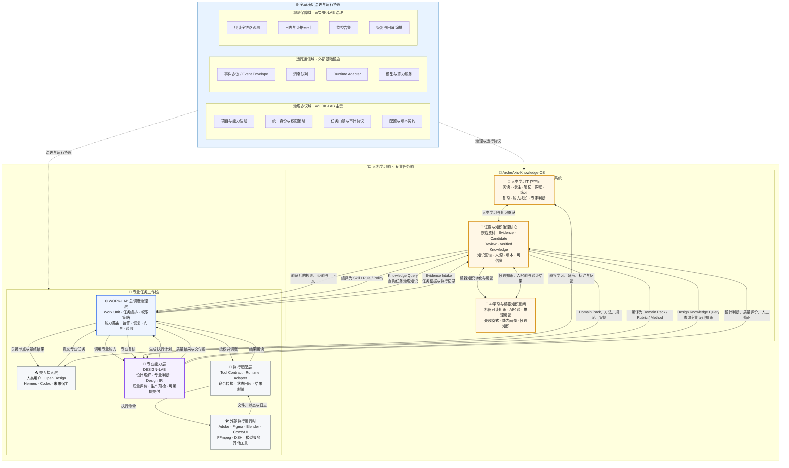
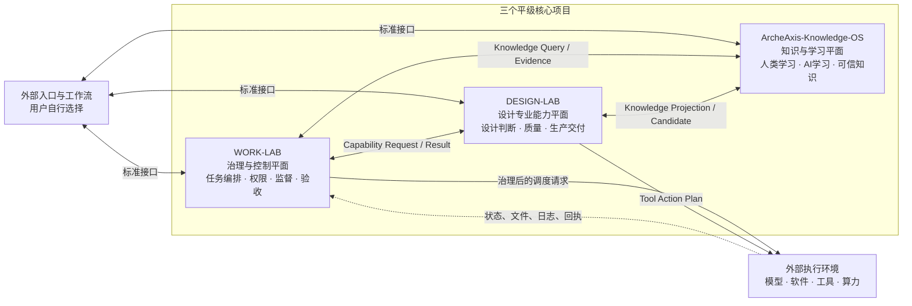

# DESIGN-LAB

来源：conversations-000.json，记录序号 94，唯一键 000:094
归属：DESIGNLAB项目
依据：标题与正文上下文复核

以下保留导出中的全部消息节点（含分支），按节点时间排列；完整结构见同名 JSON。

## user · 9783ac16-3d35-4891-838d-6aab0207e866

父节点：client-created-root；时间戳：1786092410.115

将OPEN DESIGN所有内容拉取到这个对话工作里

## assistant · 38634407-ded0-4c04-af93-81ce1e23c330

父节点：9783ac16-3d35-4891-838d-6aab0207e866；时间戳：1786092418.556279

{
  "content_type": "thoughts",
  "source_analysis_msg_id": "38634407-ded0-4c04-af93-81ce1e23c330",
  "thoughts": []
}

## assistant · 766cae18-4ffe-52f9-bdb5-f7b8f0b305ab

父节点：38634407-ded0-4c04-af93-81ce1e23c330；时间戳：1786092428.15362

{
  "content_type": "thoughts",
  "source_analysis_msg_id": "766cae18-4ffe-52f9-bdb5-f7b8f0b305ab",
  "thoughts": [
    {
      "chunks": [],
      "content": "**Planning personal-context retrieval**",
      "finished": true,
      "summary": "Planning personal-context retrieval"
    },
    {
      "chunks": [],
      "content": "",
      "finished": true,
      "summary": "规划个人上下文检索"
    }
  ]
}

## assistant · 38f33a69-06a0-566b-9e71-72d795a9363e

父节点：766cae18-4ffe-52f9-bdb5-f7b8f0b305ab；时间戳：1786092428.657855

我先用“个人上下文”把历史里所有明确关联 OPEN DESIGN 的对话、决策、旧任务包拉齐，再对照现有仓库。最终会整理成这个对话后续唯一使用的 OPEN DESIGN 基线，避免继续和 WORK LAB、OS 混在一起。

## assistant · e97eda78-5d97-48ef-843c-116097ede04a

父节点：38f33a69-06a0-566b-9e71-72d795a9363e；时间戳：1786092435.430898

{
  "content_type": "thoughts",
  "source_analysis_msg_id": "0e3eeeff-9a6a-44dc-9fb9-a7f70f546b7b",
  "thoughts": [
    {
      "chunks": [],
      "content": "",
      "finished": true,
      "summary": "读取个人上下文技能说明"
    }
  ]
}

## assistant · a2125d4f-9c17-5d65-a3f9-fb2fad6c4119

父节点：e97eda78-5d97-48ef-843c-116097ede04a；时间戳：1786092435.433089

“个人上下文”确认需要检索历史记录。我现在按 OPEN DESIGN 这一强命名实体做全量回溯，重点抓取：定位变化、已定决策、旧任务包、审计结论、设计能力清单、开源依赖、与 WORK LAB 的切割边界及未完成事项。

## assistant · 9c7402b8-15d3-45a7-bec7-6a226355ee1e

父节点：a2125d4f-9c17-5d65-a3f9-fb2fad6c4119；时间戳：1786092458.415055

{
  "content_type": "thoughts",
  "source_analysis_msg_id": "2666015e-1f0d-4864-b7f6-40944544c7cf",
  "thoughts": [
    {
      "chunks": [],
      "content": "",
      "finished": true,
      "summary": "汇总了 OPEN DESIGN 项目上下文"
    }
  ]
}

## assistant · 12bbd39c-c5fc-5c50-9ced-bb7ba4a6d751

父节点：9c7402b8-15d3-45a7-bec7-6a226355ee1e；时间戳：1786092458.417692

历史回溯找到了 5 份关键文档，说明 OPEN DESIGN 的信息确实散落在旧总包、决策摘要和 WORK LAB 切割包里。接下来我会用文件库把这些原文逐份取回并去重；这一步会决定哪些内容正式归入 OPEN DESIGN、哪些只保留为迁移证据。

## assistant · 4b487bb0-b52d-5261-87ab-50931dc43824

父节点：12bbd39c-c5fc-5c50-9ced-bb7ba4a6d751；时间戳：1786092484.978338

{
  "content_type": "thoughts",
  "source_analysis_msg_id": "4b487bb0-b52d-5261-87ab-50931dc43824",
  "thoughts": [
    {
      "chunks": [],
      "content": "**Planning batch filename searches**",
      "finished": true,
      "summary": "Planning batch filename searches"
    },
    {
      "chunks": [],
      "content": "",
      "finished": true,
      "summary": "规划批量文件名搜索"
    }
  ]
}

## assistant · 06dee94a-676d-44ad-b026-aa3acecfbf96

父节点：4b487bb0-b52d-5261-87ab-50931dc43824；时间戳：1786092489.072415

{
  "content_type": "thoughts",
  "source_analysis_msg_id": "172714b7-afe6-47f5-b0a1-79165679e6a4",
  "thoughts": [
    {
      "chunks": [],
      "content": "",
      "finished": true,
      "summary": "读取库技能说明及证据引用指南"
    }
  ]
}

## assistant · a3a1e6a0-acbf-4258-a4f6-1cdc65059168

父节点：06dee94a-676d-44ad-b026-aa3acecfbf96；时间戳：1786092497.588155

{
  "content_type": "thoughts",
  "source_analysis_msg_id": "90bd8b5c-c16b-4a2a-8c93-cfd78c5779fc",
  "thoughts": [
    {
      "chunks": [],
      "content": "",
      "finished": true,
      "summary": "搜索并定位权威任务文档"
    }
  ]
}

## assistant · a3e2f864-34b4-54aa-8af1-5da502802fb8

父节点：a3a1e6a0-acbf-4258-a4f6-1cdc65059168；时间戳：1786092497.590393

首轮已精确找到 5 份原文件；同时发现一份未被旧摘要列出的 `01_MASTER_HERMES_TASKPACK(1).md`，它很可能就是更完整的 OPEN DESIGN V3 主包。我会再做一次全库内容检索，避免只按文件名搜索造成遗漏。

## assistant · c5fbb4ff-5e1a-5013-b346-b645a999dcc5

父节点：a3e2f864-34b4-54aa-8af1-5da502802fb8；时间戳：1786092508.817967

{
  "content_type": "thoughts",
  "source_analysis_msg_id": "c5fbb4ff-5e1a-5013-b346-b645a999dcc5",
  "thoughts": [
    {
      "chunks": [],
      "content": "**Planning unique file extraction**",
      "finished": true,
      "summary": "Planning unique file extraction"
    },
    {
      "chunks": [],
      "content": "",
      "finished": true,
      "summary": "规划独特文件提取方案"
    }
  ]
}

## assistant · b6d299ad-3488-5c1e-bc66-b481169a38c8

父节点：c5fbb4ff-5e1a-5013-b346-b645a999dcc5；时间戳：1786092528.369532

{
  "content_type": "thoughts",
  "source_analysis_msg_id": "b6d299ad-3488-5c1e-bc66-b481169a38c8",
  "thoughts": [
    {
      "chunks": [],
      "content": "**Identifying relevant project files**",
      "finished": true,
      "summary": "Identifying relevant project files"
    },
    {
      "chunks": [],
      "content": "**Planning batch reading for files**",
      "finished": true,
      "summary": "Planning batch reading for files"
    },
    {
      "chunks": [],
      "content": "",
      "finished": true,
      "summary": "识别项目文件并规划批量读取"
    }
  ]
}

## assistant · 8f1aae52-0258-511a-9efc-1f395741397d

父节点：b6d299ad-3488-5c1e-bc66-b481169a38c8；时间戳：1786092539.637912

{
  "content_type": "thoughts",
  "source_analysis_msg_id": "8f1aae52-0258-511a-9efc-1f395741397d",
  "thoughts": [
    {
      "chunks": [],
      "content": "**Identifying relevant project files**",
      "finished": true,
      "summary": "Identifying relevant project files"
    },
    {
      "chunks": [],
      "content": "**Planning batch reading for files**",
      "finished": true,
      "summary": "Planning batch reading for files"
    },
    {
      "chunks": [],
      "content": "**Designing partial file retrieval and summarization**",
      "finished": true,
      "summary": "Designing partial file retrieval and summarization"
    },
    {
      "chunks": [],
      "content": "",
      "finished": true,
      "summary": "规划项目文件批量读取与摘要方案"
    }
  ]
}

## assistant · 6acf1bc2-27a8-556d-981a-40610c381b7e

父节点：8f1aae52-0258-511a-9efc-1f395741397d；时间戳：1786092550.26426

{
  "content_type": "thoughts",
  "source_analysis_msg_id": "6acf1bc2-27a8-556d-981a-40610c381b7e",
  "thoughts": [
    {
      "chunks": [],
      "content": "**Identifying relevant project files**",
      "finished": true,
      "summary": "Identifying relevant project files"
    },
    {
      "chunks": [],
      "content": "**Planning batch reading for files**",
      "finished": true,
      "summary": "Planning batch reading for files"
    },
    {
      "chunks": [],
      "content": "**Designing partial file retrieval and summarization**",
      "finished": true,
      "summary": "Designing partial file retrieval and summarization"
    },
    {
      "chunks": [],
      "content": "",
      "finished": true,
      "summary": "规划项目文件批量读取与摘要方案"
    }
  ]
}

## assistant · 009b4318-1e3f-51d1-a5f8-43643d3765ff

父节点：6acf1bc2-27a8-556d-981a-40610c381b7e；时间戳：1786092553.386747

{
  "content_type": "thoughts",
  "source_analysis_msg_id": "009b4318-1e3f-51d1-a5f8-43643d3765ff",
  "thoughts": [
    {
      "chunks": [],
      "content": "**Identifying relevant project files**",
      "finished": true,
      "summary": "Identifying relevant project files"
    },
    {
      "chunks": [],
      "content": "**Planning batch reading for files**",
      "finished": true,
      "summary": "Planning batch reading for files"
    },
    {
      "chunks": [],
      "content": "**Designing partial file retrieval and summarization**",
      "finished": true,
      "summary": "Designing partial file retrieval and summarization"
    },
    {
      "chunks": [],
      "content": "**Grouping and planning exact file downloads**",
      "finished": true,
      "summary": "Grouping and planning exact file downloads"
    },
    {
      "chunks": [],
      "content": "",
      "finished": true,
      "summary": "规划项目文件批量读取与摘要方案"
    }
  ]
}

## assistant · ba9a6faa-18a6-5d7e-846c-e835c521f325

父节点：009b4318-1e3f-51d1-a5f8-43643d3765ff；时间戳：1786092565.263306

{
  "content_type": "thoughts",
  "source_analysis_msg_id": "ba9a6faa-18a6-5d7e-846c-e835c521f325",
  "thoughts": [
    {
      "chunks": [],
      "content": "**Identifying relevant project files**",
      "finished": true,
      "summary": "Identifying relevant project files"
    },
    {
      "chunks": [],
      "content": "**Planning batch reading for files**",
      "finished": true,
      "summary": "Planning batch reading for files"
    },
    {
      "chunks": [],
      "content": "**Designing partial file retrieval and summarization**",
      "finished": true,
      "summary": "Designing partial file retrieval and summarization"
    },
    {
      "chunks": [],
      "content": "**Grouping and planning exact file downloads**",
      "finished": true,
      "summary": "Grouping and planning exact file downloads"
    },
    {
      "chunks": [],
      "content": "",
      "finished": true,
      "summary": "规划项目文件批量读取与摘要方案"
    }
  ]
}

## assistant · 83b76b43-59e4-4940-a11f-f1330f6b1303

父节点：ba9a6faa-18a6-5d7e-846c-e835c521f325；时间戳：1786092567.279167

{
  "content_type": "thoughts",
  "source_analysis_msg_id": "4593aca9-db57-4bee-96a8-a3d737fef6be",
  "thoughts": [
    {
      "chunks": [],
      "content": "",
      "finished": true,
      "summary": "检索开放设计及核心设计相关资料"
    }
  ]
}

## assistant · b96ae9b5-097b-594e-a75f-56437a3e06b8

父节点：83b76b43-59e4-4940-a11f-f1330f6b1303；时间戳：1786092567.28113

已确认两代 OPEN DESIGN 任务包、完整 90 张任务卡、产品定义、执行矩阵、运行手册、来源台账，以及 2026-08-07 的最终分库指令。我正在把这些原文落入当前工作区做逐文件对账；不会只依赖摘要。

## assistant · 9ab73f90-c723-4e2c-9d61-6c4a254a2a2e

父节点：b96ae9b5-097b-594e-a75f-56437a3e06b8；时间戳：1786092579.485181

{
  "content_type": "thoughts",
  "source_analysis_msg_id": "f87bfe18-71c8-426c-824b-29cce2bc9330",
  "thoughts": [
    {
      "chunks": [],
      "content": "",
      "finished": true,
      "summary": "检索了项目核心文档"
    }
  ]
}

## assistant · c0fdd68f-d30b-4627-be60-974682a9d90b

父节点：9ab73f90-c723-4e2c-9d61-6c4a254a2a2e；时间戳：1786092583.137725

{
  "content_type": "thoughts",
  "source_analysis_msg_id": "cfcee3a7-98c3-443c-bd96-820e675dfb11",
  "thoughts": [
    {
      "chunks": [],
      "content": "",
      "finished": true,
      "summary": "下载并阅读库文件指南"
    }
  ]
}

## assistant · 104f066d-d85d-40eb-b397-1bba1e5cd14e

父节点：c0fdd68f-d30b-4627-be60-974682a9d90b；时间戳：1786092585.265781

{
  "content_type": "thoughts",
  "source_analysis_msg_id": "ee8b4438-92d1-4800-be32-52df816c23bd",
  "thoughts": [
    {
      "chunks": [],
      "content": "",
      "finished": true,
      "summary": "搜索项目任务与文档索引"
    }
  ]
}

## assistant · 7a117104-c959-44c5-a484-4da68c1d456c

父节点：104f066d-d85d-40eb-b397-1bba1e5cd14e；时间戳：1786092585.784296

{
  "content_type": "thoughts",
  "source_analysis_msg_id": "e3731ba1-6b56-4096-b501-d79bf6b05984",
  "thoughts": [
    {
      "chunks": [],
      "content": "",
      "finished": true,
      "summary": "下载任务矩阵与任务卡片文件"
    }
  ]
}

## assistant · 5df93dec-e7a4-4139-97e0-b58e1f584198

父节点：7a117104-c959-44c5-a484-4da68c1d456c；时间戳：1786092588.10914

{
  "content_type": "thoughts",
  "source_analysis_msg_id": "6d9da40c-cc44-4f3f-80e5-514d64549bc6",
  "thoughts": [
    {
      "chunks": [],
      "content": "",
      "finished": true,
      "summary": "检索了指定任务文档"
    }
  ]
}

## assistant · e9630901-9aa6-4b5a-89c3-a43542126ff4

父节点：5df93dec-e7a4-4139-97e0-b58e1f584198；时间戳：1786092590.341692

{
  "content_type": "thoughts",
  "source_analysis_msg_id": "df1dbcbf-16ae-4b3c-8b73-19c8ee5dcf3c",
  "thoughts": [
    {
      "chunks": [],
      "content": "",
      "finished": true,
      "summary": "下载了库文档与任务包"
    }
  ]
}

## assistant · 729dc0ba-542c-412c-b812-b4cae4a6a057

父节点：e9630901-9aa6-4b5a-89c3-a43542126ff4；时间戳：1786092592.470319

{
  "content_type": "thoughts",
  "source_analysis_msg_id": "d8461cef-ef11-433a-9688-6a8a90db1c50",
  "thoughts": [
    {
      "chunks": [],
      "content": "",
      "finished": true,
      "summary": "搜索项目文档与任务包资料"
    }
  ]
}

## assistant · bf1b6079-cf5f-58e3-8d07-490aa8979af2

父节点：729dc0ba-542c-412c-b812-b4cae4a6a057；时间戳：1786092605.496635

{
  "content_type": "thoughts",
  "source_analysis_msg_id": "bf1b6079-cf5f-58e3-8d07-490aa8979af2",
  "thoughts": [
    {
      "chunks": [],
      "content": "**Investigating leftover temporary file**",
      "finished": true,
      "summary": "Investigating leftover temporary file"
    },
    {
      "chunks": [],
      "content": "",
      "finished": true,
      "summary": "调查了残留临时文件"
    }
  ]
}

## assistant · aba68ff4-861f-570c-903c-fb47b2a5deb6

父节点：bf1b6079-cf5f-58e3-8d07-490aa8979af2；时间戳：1786092613.7788

{
  "content_type": "thoughts",
  "source_analysis_msg_id": "aba68ff4-861f-570c-903c-fb47b2a5deb6",
  "thoughts": [
    {
      "chunks": [],
      "content": "**Planning selective Open Design document review**",
      "finished": true,
      "summary": "Planning selective Open Design document review"
    },
    {
      "chunks": [],
      "content": "",
      "finished": true,
      "summary": "规划选择性Open Design文档审查"
    }
  ]
}

## assistant · 4d8abd50-a4e3-5582-8bc2-34d925a47d0b

父节点：aba68ff4-861f-570c-903c-fb47b2a5deb6；时间戳：1786092664.975447

{
  "content_type": "thoughts",
  "source_analysis_msg_id": "4d8abd50-a4e3-5582-8bc2-34d925a47d0b",
  "thoughts": [
    {
      "chunks": [],
      "content": "**Investigating V3 Overlay file timestamps**",
      "finished": true,
      "summary": "Investigating V3 Overlay file timestamps"
    },
    {
      "chunks": [],
      "content": "",
      "finished": true,
      "summary": "调查了V3 Overlay文件时间戳"
    }
  ]
}

## assistant · da0ffbe7-d8a6-463d-ac02-81b022a4f91f

父节点：4d8abd50-a4e3-5582-8bc2-34d925a47d0b；时间戳：1786092671.721233

{
  "content_type": "thoughts",
  "source_analysis_msg_id": "6aa2483b-4fdf-40cc-b439-28a3c36a74c6",
  "thoughts": [
    {
      "chunks": [],
      "content": "",
      "finished": true,
      "summary": "下载并检查项目文档、任务矩阵及JSON结构"
    }
  ]
}

## assistant · 76a99d06-2dbd-5ea1-a24e-7eaa870b0db8

父节点：da0ffbe7-d8a6-463d-ac02-81b022a4f91f；时间戳：1786092671.723684

历史包里写明有“199 文件 Overlay”，但目前取回的是总控文档和任务卡，不代表 199 个文件本体都已进入当前工作区。我正在按 2026-08-04 的生成时间窗口核对文件清单，确认 Library 中是否还保存着完整 Overlay，而不是把“清单存在”误当成“内容已拉取”。

## assistant · 082f05de-5a9c-53f6-aec4-34302342eef0

父节点：76a99d06-2dbd-5ea1-a24e-7eaa870b0db8；时间戳：1786092686.0559

{
  "content_type": "thoughts",
  "source_analysis_msg_id": "082f05de-5a9c-53f6-aec4-34302342eef0",
  "thoughts": [
    {
      "chunks": [],
      "content": "**Planning full taskpack zip download**",
      "finished": true,
      "summary": "Planning full taskpack zip download"
    },
    {
      "chunks": [],
      "content": "",
      "finished": true,
      "summary": "规划完整任务包下载"
    }
  ]
}

## assistant · 90e8db7b-e31c-483f-b4d4-b273e673fa0e

父节点：082f05de-5a9c-53f6-aec4-34302342eef0；时间戳：1786092694.130139

{
  "content_type": "thoughts",
  "source_analysis_msg_id": "b0589bd2-8ffd-492c-acba-928aa07df317",
  "thoughts": [
    {
      "chunks": [],
      "content": "",
      "finished": true,
      "summary": "列出指定时间范围内创建的库项目与内容"
    }
  ]
}

## assistant · d802ec70-e462-4f72-a9d2-63d22a6e5c7f

父节点：90e8db7b-e31c-483f-b4d4-b273e673fa0e；时间戳：1786092712.563669

{
  "content_type": "thoughts",
  "source_analysis_msg_id": "8c27f6bb-f966-4e52-9e0a-4e2767523581",
  "thoughts": [
    {
      "chunks": [],
      "content": "",
      "finished": true,
      "summary": "下载解压设计任务包并验证文件完整性"
    }
  ]
}

## assistant · 884c4914-be2c-5ddc-985c-b3ec3803268d

父节点：d802ec70-e462-4f72-a9d2-63d22a6e5c7f；时间戳：1786092712.664865

完整 V3 包已经在当前工作区展开并通过自带校验：`90` 个任务、`199` 个 Overlay 文件、`0` 个完整性错误。下一步我会把其中未在旧摘要里出现的架构、质量轴、大师研究、领域能力、评测、许可、Runtime、风险和最终验收合同并入新的权威基线。

## assistant · 764a0184-aa28-5261-80ee-c301affbdfdc

父节点：884c4914-be2c-5ddc-985c-b3ec3803268d；时间戳：1786092725.473712

{
  "content_type": "thoughts",
  "source_analysis_msg_id": "764a0184-aa28-5261-80ee-c301affbdfdc",
  "thoughts": [
    {
      "chunks": [],
      "content": "**Planning detailed master data inspection**",
      "finished": true,
      "summary": "Planning detailed master data inspection"
    },
    {
      "chunks": [],
      "content": "",
      "finished": true,
      "summary": "规划主数据详细检查方案"
    }
  ]
}

## assistant · 1131e2a5-312e-5f4c-81bb-d9a4439d5df6

父节点：764a0184-aa28-5261-80ee-c301affbdfdc；时间戳：1786092738.871717

{
  "content_type": "thoughts",
  "source_analysis_msg_id": "1131e2a5-312e-5f4c-81bb-d9a4439d5df6",
  "thoughts": [
    {
      "chunks": [],
      "content": "**Inspecting source registry distributions**",
      "finished": true,
      "summary": "Inspecting source registry distributions"
    },
    {
      "chunks": [],
      "content": "",
      "finished": true,
      "summary": "检查了源注册表分布"
    }
  ]
}

## assistant · 4ab08ddc-156d-5a34-abb4-e88677801420

父节点：1131e2a5-312e-5f4c-81bb-d9a4439d5df6；时间戳：1786092768.60743

{
  "content_type": "thoughts",
  "source_analysis_msg_id": "4ab08ddc-156d-5a34-abb4-e88677801420",
  "thoughts": [
    {
      "chunks": [],
      "content": "**Planning source inventory creation**",
      "finished": true,
      "summary": "Planning source inventory creation"
    },
    {
      "chunks": [],
      "content": "",
      "finished": true,
      "summary": "规划创建来源清单"
    }
  ]
}

## assistant · 9b1221a1-435d-471f-bf37-4835da81bb01

父节点：4ab08ddc-156d-5a34-abb4-e88677801420；时间戳：1786092769.144681

{
  "content_type": "thoughts",
  "source_analysis_msg_id": "829031b0-452d-46ce-b81a-6691069ab819",
  "thoughts": [
    {
      "chunks": [],
      "content": "",
      "finished": true,
      "summary": "汇总架构文档与各类注册表统计信息"
    }
  ]
}

## assistant · 8a3a806c-c610-511e-9b81-5565b6f09835

父节点：9b1221a1-435d-471f-bf37-4835da81bb01；时间戳：1786092769.147428

历史内容已完整落入本对话工作区，但旧包中的云端 SHA 是 2026-08-05/07 的观察值，不能当作今天事实。我会再做一次只读 GitHub 对照，确认当前 `main`、分支和迁移结果；这一步只用于区分“历史计划”“已经落库”“仍未完成”，不会改仓库。

## assistant · 7dfb18be-6f99-4ec1-a37b-87f50c1f6a98

父节点：8a3a806c-c610-511e-9b81-5565b6f09835；时间戳：1786092803.223113

{
  "content_type": "thoughts",
  "source_analysis_msg_id": "93da8cfd-0cd8-435c-9582-861685105ca3",
  "thoughts": [
    {
      "chunks": [],
      "content": "",
      "finished": true,
      "summary": "读取 GitHub 技能说明"
    }
  ]
}

## assistant · fb01f565-f005-542b-8d98-871a5d0cf682

父节点：7dfb18be-6f99-4ec1-a37b-87f50c1f6a98；时间戳：1786092810.669863

{
  "content_type": "thoughts",
  "source_analysis_msg_id": "fb01f565-f005-542b-8d98-871a5d0cf682",
  "thoughts": [
    {
      "chunks": [],
      "content": "**Planning commit and branch comparison**",
      "finished": true,
      "summary": "Planning commit and branch comparison"
    },
    {
      "chunks": [],
      "content": "",
      "finished": true,
      "summary": "规划提交与分支对比"
    }
  ]
}

## assistant · 08678f39-7adf-5b84-9439-505c365f6630

父节点：fb01f565-f005-542b-8d98-871a5d0cf682；时间戳：1786092832.13622

{
  "content_type": "thoughts",
  "source_analysis_msg_id": "08678f39-7adf-5b84-9439-505c365f6630",
  "thoughts": [
    {
      "chunks": [],
      "content": "**Identifying missing manifest in branch history**",
      "finished": true,
      "summary": "Identifying missing manifest in branch history"
    },
    {
      "chunks": [],
      "content": "",
      "finished": true,
      "summary": "确认分支历史中缺失的清单文件"
    }
  ]
}

## assistant · 04850d6a-b2d5-5e53-b994-76a03bea71f6

父节点：08678f39-7adf-5b84-9439-505c365f6630；时间戳：1786092850.650813

{
  "content_type": "thoughts",
  "source_analysis_msg_id": "04850d6a-b2d5-5e53-b994-76a03bea71f6",
  "thoughts": [
    {
      "chunks": [],
      "content": "**Investigating missing commit parent metadata**",
      "finished": true,
      "summary": "Investigating missing commit parent metadata"
    },
    {
      "chunks": [],
      "content": "**Exploring branch head resolution methods**",
      "finished": true,
      "summary": "Exploring branch head resolution methods"
    },
    {
      "chunks": [],
      "content": "",
      "finished": true,
      "summary": "Investigated commit parent metadata and branch head resolution methods"
    }
  ]
}

## assistant · b39ba1b4-043d-53b1-95d2-5c874c93ee58

父节点：04850d6a-b2d5-5e53-b994-76a03bea71f6；时间戳：1786092868.586827

{
  "content_type": "thoughts",
  "source_analysis_msg_id": "b39ba1b4-043d-53b1-95d2-5c874c93ee58",
  "thoughts": [
    {
      "chunks": [],
      "content": "**Analyzing final commit differences and branch status**",
      "finished": true,
      "summary": "Analyzing final commit differences and branch status"
    },
    {
      "chunks": [],
      "content": "",
      "finished": true,
      "summary": "分析最终提交差异并检查分支状态"
    }
  ]
}

## assistant · 8385dd66-956c-5566-b874-53cf030a6f97

父节点：b39ba1b4-043d-53b1-95d2-5c874c93ee58；时间戳：1786092886.191763

{
  "content_type": "thoughts",
  "source_analysis_msg_id": "8385dd66-956c-5566-b874-53cf030a6f97",
  "thoughts": [
    {
      "chunks": [],
      "content": "**Planning SHA retrieval for migration**",
      "finished": true,
      "summary": "Planning SHA retrieval for migration"
    },
    {
      "chunks": [],
      "content": "",
      "finished": true,
      "summary": "规划迁移所需的SHA获取方案"
    }
  ]
}

## assistant · b011c4d4-2b74-497d-90b4-36c68616b1a4

父节点：8385dd66-956c-5566-b874-53cf030a6f97；时间戳：1786092888.656461

{
  "content_type": "thoughts",
  "source_analysis_msg_id": "62e856c2-deca-4e92-8cba-897041e43c7d",
  "thoughts": [
    {
      "chunks": [],
      "content": "",
      "finished": true,
      "summary": "审阅仓库提交、许可证及工作室设计模块交付内容"
    }
  ]
}

## assistant · 276a44d1-a7ef-52cc-8fb0-1dce8b2e86df

父节点：b011c4d4-2b74-497d-90b4-36c68616b1a4；时间戳：1786092898.270766

{
  "content_type": "thoughts",
  "source_analysis_msg_id": "276a44d1-a7ef-52cc-8fb0-1dce8b2e86df",
  "thoughts": [
    {
      "chunks": [],
      "content": "**Evaluating git ls-remote network feasibility**",
      "finished": true,
      "summary": "Evaluating git ls-remote network feasibility"
    },
    {
      "chunks": [],
      "content": "",
      "finished": true,
      "summary": "评估 git ls-remote 网络可行性"
    }
  ]
}

## assistant · dd74b1b8-9f68-40e5-8906-86196fba8ef6

父节点：276a44d1-a7ef-52cc-8fb0-1dce8b2e86df；时间戳：1786092904.98849

{
  "content_type": "thoughts",
  "source_analysis_msg_id": "f4e3cf34-e147-468a-ba0b-f1027f2941a7",
  "thoughts": [
    {
      "chunks": [],
      "content": "",
      "finished": true,
      "summary": "正在搜索 https://api.github.com/repos/DTALEX66/OPEN-DESIGN-Assistance/git/ref/heads/migration/work-lab-design-extraction-20260807"
    }
  ]
}

## assistant · 6884372f-5caa-58d6-9b09-1fc9e67e4137

父节点：dd74b1b8-9f68-40e5-8906-86196fba8ef6；时间戳：1786092931.211952

{
  "content_type": "thoughts",
  "source_analysis_msg_id": "6884372f-5caa-58d6-9b09-1fc9e67e4137",
  "thoughts": [
    {
      "chunks": [],
      "content": "**Verifying CI workflows and migration impact**",
      "finished": true,
      "summary": "Verifying CI workflows and migration impact"
    },
    {
      "chunks": [],
      "content": "",
      "finished": true,
      "summary": "验证了CI工作流及迁移影响"
    }
  ]
}

## assistant · 601ae04d-a8b6-5990-8388-0a1dc63f716b

父节点：6884372f-5caa-58d6-9b09-1fc9e67e4137；时间戳：1786092933.22537

{
  "content_type": "thoughts",
  "source_analysis_msg_id": "601ae04d-a8b6-5990-8388-0a1dc63f716b",
  "thoughts": [
    {
      "chunks": [],
      "content": "**Verifying CI workflows and migration impact**",
      "finished": true,
      "summary": "Verifying CI workflows and migration impact"
    },
    {
      "chunks": [],
      "content": "**Planning master context consolidation file**",
      "finished": true,
      "summary": "Planning master context consolidation file"
    },
    {
      "chunks": [],
      "content": "",
      "finished": true,
      "summary": "验证CI工作流并规划主上下文整合文件"
    }
  ]
}

## assistant · ccc313ba-b85a-506d-bdfa-4d85ffbb9454

父节点：601ae04d-a8b6-5990-8388-0a1dc63f716b；时间戳：1786092946.280499

{
  "content_type": "thoughts",
  "source_analysis_msg_id": "ccc313ba-b85a-506d-bdfa-4d85ffbb9454",
  "thoughts": [
    {
      "chunks": [],
      "content": "**Verifying CI workflows and migration impact**",
      "finished": true,
      "summary": "Verifying CI workflows and migration impact"
    },
    {
      "chunks": [],
      "content": "**Planning master context consolidation file**",
      "finished": true,
      "summary": "Planning master context consolidation file"
    },
    {
      "chunks": [],
      "content": "**Summarizing branch file counts and task matrix planning**",
      "finished": true,
      "summary": "Summarizing branch file counts and task matrix planning"
    },
    {
      "chunks": [],
      "content": "",
      "finished": true,
      "summary": "规划主上下文整合及迁移任务矩阵"
    }
  ]
}

## assistant · 07db8983-440f-5dc3-9821-bdd98d45a03c

父节点：ccc313ba-b85a-506d-bdfa-4d85ffbb9454；时间戳：1786092960.813756

{
  "content_type": "thoughts",
  "source_analysis_msg_id": "07db8983-440f-5dc3-9821-bdd98d45a03c",
  "thoughts": [
    {
      "chunks": [],
      "content": "**Verifying CI workflows and migration impact**",
      "finished": true,
      "summary": "Verifying CI workflows and migration impact"
    },
    {
      "chunks": [],
      "content": "**Planning master context consolidation file**",
      "finished": true,
      "summary": "Planning master context consolidation file"
    },
    {
      "chunks": [],
      "content": "**Summarizing branch file counts and task matrix planning**",
      "finished": true,
      "summary": "Summarizing branch file counts and task matrix planning"
    },
    {
      "chunks": [],
      "content": "**Planning master context with source inventory and task matrix**",
      "finished": true,
      "summary": "Planning master context with source inventory and task matrix"
    },
    {
      "chunks": [],
      "content": "",
      "finished": true,
      "summary": "规划主上下文整合及迁移影响任务矩阵"
    }
  ]
}

## assistant · 619fa99f-5d81-420f-9bc3-be9825b0a468

父节点：07db8983-440f-5dc3-9821-bdd98d45a03c；时间戳：1786092970.58652

{
  "content_type": "thoughts",
  "source_analysis_msg_id": "c75d5803-e3fb-4b74-b2b3-305fe312d4a3",
  "thoughts": [
    {
      "chunks": [],
      "content": "",
      "finished": true,
      "summary": "搜索并分析配置、脚本及能力状态引用"
    }
  ]
}

## assistant · ecaa1483-037f-5e53-a099-b018f77bd2d8

父节点：619fa99f-5d81-420f-9bc3-be9825b0a468；时间戳：1786092970.588684

文件包已经找齐，但我还要补一层“对话原话核对”：专门检索你对 OPEN DESIGN 的明确要求和否定项，以及此前提到过的开源项目/网站/技术路线。这样新基线不会只剩工程文档，而遗漏你真正关心的审美、构图、排版和图片生成能力。

## assistant · e65f17c1-3b20-5243-a952-88e326384510

父节点：ecaa1483-037f-5e53-a099-b018f77bd2d8；时间戳：1786093007.332412

{
  "content_type": "thoughts",
  "source_analysis_msg_id": "e65f17c1-3b20-5243-a952-88e326384510",
  "thoughts": [
    {
      "chunks": [],
      "content": "**Cataloging source registry names**",
      "finished": true,
      "summary": "Cataloging source registry names"
    },
    {
      "chunks": [],
      "content": "**Planning comprehensive source registry summary**",
      "finished": true,
      "summary": "Planning comprehensive source registry summary"
    },
    {
      "chunks": [],
      "content": "",
      "finished": true,
      "summary": "整理来源注册表名称并规划完整摘要"
    }
  ]
}

## assistant · 0c6def01-3f70-51f9-822b-e0cc3d11ccc5

父节点：e65f17c1-3b20-5243-a952-88e326384510；时间戳：1786093021.437776

{
  "content_type": "thoughts",
  "source_analysis_msg_id": "0c6def01-3f70-51f9-822b-e0cc3d11ccc5",
  "thoughts": [
    {
      "chunks": [],
      "content": "**Cataloging source registry names**",
      "finished": true,
      "summary": "Cataloging source registry names"
    },
    {
      "chunks": [],
      "content": "**Planning comprehensive source registry summary**",
      "finished": true,
      "summary": "Planning comprehensive source registry summary"
    },
    {
      "chunks": [],
      "content": "**Assessing repository authority and status**",
      "finished": true,
      "summary": "Assessing repository authority and status"
    },
    {
      "chunks": [],
      "content": "",
      "finished": true,
      "summary": "编制源注册表并评估仓库权威性状态"
    }
  ]
}

## assistant · 416da9cc-dea1-5861-a0b1-057319a16c9a

父节点：0c6def01-3f70-51f9-822b-e0cc3d11ccc5；时间戳：1786093031.629604

{
  "content_type": "thoughts",
  "source_analysis_msg_id": "416da9cc-dea1-5861-a0b1-057319a16c9a",
  "thoughts": [
    {
      "chunks": [],
      "content": "**Cataloging source registry names**",
      "finished": true,
      "summary": "Cataloging source registry names"
    },
    {
      "chunks": [],
      "content": "**Planning comprehensive source registry summary**",
      "finished": true,
      "summary": "Planning comprehensive source registry summary"
    },
    {
      "chunks": [],
      "content": "**Assessing repository authority and status**",
      "finished": true,
      "summary": "Assessing repository authority and status"
    },
    {
      "chunks": [],
      "content": "",
      "finished": true,
      "summary": "整理源注册名称并评估仓库权威性与状态"
    }
  ]
}

## assistant · 8f9a1508-a758-5ca3-90b7-ac2e9b3df712

父节点：416da9cc-dea1-5861-a0b1-057319a16c9a；时间戳：1786093033.856868

{
  "content_type": "thoughts",
  "source_analysis_msg_id": "8f9a1508-a758-5ca3-90b7-ac2e9b3df712",
  "thoughts": [
    {
      "chunks": [],
      "content": "**Cataloging source registry names**",
      "finished": true,
      "summary": "Cataloging source registry names"
    },
    {
      "chunks": [],
      "content": "**Planning comprehensive source registry summary**",
      "finished": true,
      "summary": "Planning comprehensive source registry summary"
    },
    {
      "chunks": [],
      "content": "**Assessing repository authority and status**",
      "finished": true,
      "summary": "Assessing repository authority and status"
    },
    {
      "chunks": [],
      "content": "**Defining master context structure and scope**",
      "finished": true,
      "summary": "Defining master context structure and scope"
    },
    {
      "chunks": [],
      "content": "",
      "finished": true,
      "summary": "整理来源注册表并定义主上下文范围"
    }
  ]
}

## assistant · 4f548768-f012-5b94-8569-4da179510831

父节点：8f9a1508-a758-5ca3-90b7-ac2e9b3df712；时间戳：1786093045.29848

{
  "content_type": "thoughts",
  "source_analysis_msg_id": "4f548768-f012-5b94-8569-4da179510831",
  "thoughts": [
    {
      "chunks": [],
      "content": "**Cataloging source registry names**",
      "finished": true,
      "summary": "Cataloging source registry names"
    },
    {
      "chunks": [],
      "content": "**Planning comprehensive source registry summary**",
      "finished": true,
      "summary": "Planning comprehensive source registry summary"
    },
    {
      "chunks": [],
      "content": "**Assessing repository authority and status**",
      "finished": true,
      "summary": "Assessing repository authority and status"
    },
    {
      "chunks": [],
      "content": "**Defining master context structure and scope**",
      "finished": true,
      "summary": "Defining master context structure and scope"
    },
    {
      "chunks": [],
      "content": "**Creating detailed master context markdown file**",
      "finished": true,
      "summary": "Creating detailed master context markdown file"
    },
    {
      "chunks": [],
      "content": "",
      "finished": true,
      "summary": "创建并评估源注册表，编写主上下文文档"
    }
  ]
}

## assistant · cfcebff3-09b1-4ce0-bdf5-de089c3ed4a2

父节点：4f548768-f012-5b94-8569-4da179510831；时间戳：1786093050.338059

{
  "content_type": "thoughts",
  "source_analysis_msg_id": "a15f3d15-7bb5-48ad-9bda-daef0994dba0",
  "thoughts": [
    {
      "chunks": [],
      "content": "",
      "finished": true,
      "summary": "检索OPEN DESIGN历史需求决策及研究建议"
    }
  ]
}

## assistant · d03c7162-9111-53b8-bc58-e633a82b9319

父节点：cfcebff3-09b1-4ce0-bdf5-de089c3ed4a2；时间戳：1786093050.340216

现在开始生成本对话的唯一 OPEN DESIGN 主上下文文件。它不会把旧包简单拼接，而会明确：哪些仍有效、哪些已被 2026-08-07 决策覆盖、哪些只是研究草稿、哪些已经进迁移分支、哪些仍是假完成或缺证据。

## assistant · 3ecdc509-84e4-54e6-bdef-fe727ac9961f

父节点：d03c7162-9111-53b8-bc58-e633a82b9319；时间戳：1786093170.70585

{
  "content_type": "thoughts",
  "source_analysis_msg_id": "3ecdc509-84e4-54e6-bdef-fe727ac9961f",
  "thoughts": [
    {
      "chunks": [],
      "content": "**Planning master file saving**",
      "finished": true,
      "summary": "Planning master file saving"
    },
    {
      "chunks": [],
      "content": "",
      "finished": true,
      "summary": "规划主文件保存方案"
    }
  ]
}

## assistant · ce3f9e73-d707-49b5-868f-514bedd301d5

父节点：3ecdc509-84e4-54e6-bdef-fe727ac9961f；时间戳：1786093172.789888

{
  "content_type": "thoughts",
  "source_analysis_msg_id": "00eed078-1916-4218-a6f2-2e6d6e604dd3",
  "thoughts": [
    {
      "chunks": [],
      "content": "",
      "finished": true,
      "summary": "应用补丁并检查设计上下文文件"
    }
  ]
}

## assistant · 34e56e37-f9d0-50ae-a9ab-73925624f00c

父节点：ce3f9e73-d707-49b5-868f-514bedd301d5；时间戳：1786093172.793204

主上下文已生成并完成一致性核对。它现在把“历史原文、当前仓库事实、已迁移内容、被覆盖方案和真实缺口”分开记录；我正在保存这份基线，随后直接给你本对话的收束结论。

## assistant · 9c69cf2f-6838-4be7-8f05-eb8c4165a94e

父节点：34e56e37-f9d0-50ae-a9ab-73925624f00c；时间戳：1786093180.183928

{
  "content_type": "thoughts",
  "source_analysis_msg_id": "e9867de4-770f-4b92-85b3-1df0cc165acc",
  "thoughts": [
    {
      "chunks": [],
      "content": "",
      "finished": true,
      "summary": "创建了权威设计上下文文件"
    }
  ]
}

## assistant · 16602576-45cf-56ae-bac6-19ea97c76a9c

父节点：9c69cf2f-6838-4be7-8f05-eb8c4165a94e；时间戳：1786093191.260052

{
  "content_type": "thoughts",
  "source_analysis_msg_id": "16602576-45cf-56ae-bac6-19ea97c76a9c",
  "thoughts": [
    {
      "chunks": [],
      "content": "**Completing baseline setup and summarizing task state**",
      "finished": true,
      "summary": "Completing baseline setup and summarizing task state"
    },
    {
      "chunks": [],
      "content": "",
      "finished": true,
      "summary": "完成基线设置并总结任务状态"
    }
  ]
}

## assistant · 44294d5c-fceb-5346-b8ed-2f597bdeccd0

父节点：16602576-45cf-56ae-bac6-19ea97c76a9c；时间戳：1786093193.088828

{
  "content_type": "thoughts",
  "source_analysis_msg_id": "44294d5c-fceb-5346-b8ed-2f597bdeccd0",
  "thoughts": [
    {
      "chunks": [],
      "content": "**Completing baseline setup and summarizing task state**",
      "finished": true,
      "summary": "Completing baseline setup and summarizing task state"
    },
    {
      "chunks": [],
      "content": "**Providing key GitHub and workspace resource links**",
      "finished": true,
      "summary": "Providing key GitHub and workspace resource links"
    },
    {
      "chunks": [],
      "content": "",
      "finished": true,
      "summary": "完成基础设置并提供GitHub及工作区资源链接"
    }
  ]
}

## assistant · c62bbfdb-72e9-43d4-a0ed-51727d683582

父节点：44294d5c-fceb-5346-b8ed-2f597bdeccd0；时间戳：1786093200.142515

{
  "content_type": "thoughts",
  "source_analysis_msg_id": "911e6b67-4a02-4a49-b6d2-1de511173ec3",
  "thoughts": [
    {
      "chunks": [],
      "content": "",
      "finished": true,
      "summary": "应用文档库文件版本属性"
    }
  ]
}

## assistant · 3c599136-2da4-4636-9eea-e5327eaf4221

父节点：c62bbfdb-72e9-43d4-a0ed-51727d683582；时间戳：1786093200.182171

{
  "content": "思考了 13m 1s",
  "content_type": "reasoning_recap"
}

## assistant · 1665440f-9fd9-5bd2-b460-992729685b57

父节点：3c599136-2da4-4636-9eea-e5327eaf4221；时间戳：1786093200.186467

已完成。OPEN DESIGN 能定位到的历史材料、任务包和当前仓库状态，已经全部拉入本对话工作区，并收束为唯一权威基线。

已纳入：

- V2 全网吸收包：112 条来源；
- V2.1 视觉质量包：22 条视觉来源、497 条大师记录、77 张方法卡、47 条风格谱系；
- V3 完整包：16 阶段、90 张任务卡、199 个 Overlay 文件，校验结果 `ERRORS=0`；
- V4 仓库安全、证据、CI、瘦身、许可和真实 E3 纠错项；
- WORK LAB 2026-08-07 最终分库与完全切割决定；
- 当前 GitHub `main` 与迁移分支的只读核对。

当前事实也已明确：

- `main` 仍为 `c8212401...`；
- 迁移分支存在，领先 `main` 4 个提交，尚未 PR/合并；
- 迁移内容目前只有 E1/E2，没有 E3/E4/E5；
- Handoff 引用的迁移 Manifest、冲突清单、许可差异文件在远端实际缺失；
- 读取凭据、修改私有配置、默认授权 `D:\All projects` 的两个高风险脚本仍未修复；
- 根级许可证、完整 V3 CI、真实 Open Design Runtime、人类审美标定仍未闭环。

以后本对话只以这份文件为 OPEN DESIGN 主入口，不再混用旧任务包，也不再与 WORK LAB 耦合：

- [OPEN DESIGN 当前对话唯一权威上下文](sandbox:/workspace/scratch/31b866ba217e/OPEN-DESIGN-AUTHORITATIVE-CONTEXT-2026-08-07.md)
- [OPEN DESIGN V3 完整原始任务包](sandbox:/workspace/scratch/31b866ba217e/open-design-import/OPEN-DESIGN-Assistance-Complete-TaskPack-v3.0.zip)

需要说明：旧对话没有返回可逐条导出的完整聊天原文，但由旧对话形成的决策摘要、任务包、研究资产和执行文件已经全部取回。后续我们直接在这套基线上继续推进。

## user · 84f1a49e-e3e3-4c16-9f92-1e0b52a3d253

父节点：1665440f-9fd9-5bd2-b460-992729685b57；时间戳：1786094873.153

检测下仓库里有MINIGAME产品树了吗？

## assistant · 4eab5fe7-7402-48a5-93f5-83a0aec96cd1

父节点：84f1a49e-e3e3-4c16-9f92-1e0b52a3d253；时间戳：1786094881.894821

{
  "content_type": "thoughts",
  "source_analysis_msg_id": "4eab5fe7-7402-48a5-93f5-83a0aec96cd1",
  "thoughts": []
}

## assistant · a4fd2b43-c8e5-582d-9e5d-b5adeb62852c

父节点：4eab5fe7-7402-48a5-93f5-83a0aec96cd1；时间戳：1786094894.158572

{
  "content_type": "thoughts",
  "source_analysis_msg_id": "a4fd2b43-c8e5-582d-9e5d-b5adeb62852c",
  "thoughts": [
    {
      "chunks": [],
      "content": "**Planning repository inspection**",
      "finished": true,
      "summary": "Planning repository inspection"
    },
    {
      "chunks": [],
      "content": "",
      "finished": true,
      "summary": "规划仓库检查方案"
    }
  ]
}

## assistant · 1032b20d-ee81-5170-acab-47281964da80

父节点：a4fd2b43-c8e5-582d-9e5d-b5adeb62852c；时间戳：1786094896.876576

我按当前 OPEN DESIGN 仓库检查，不把 `minigame-runtime`、设计 Domain Pack 和真正的 MINIGAME 产品树混为一谈；会分别核对 `main` 与迁移分支。这里使用 GitHub 仓库核查流程，只做只读检查。

## assistant · 82ccf465-0942-4405-884d-0a74117ba9ce

父节点：1032b20d-ee81-5170-acab-47281964da80；时间戳：1786094947.952295

{
  "content_type": "thoughts",
  "source_analysis_msg_id": "bc498c3f-b539-4e68-8c60-2d13ec9ea5fd",
  "thoughts": [
    {
      "chunks": [],
      "content": "",
      "finished": true,
      "summary": "读取 GitHub 技能说明"
    }
  ]
}

## assistant · 9992d724-5bd4-5194-9d0a-618446d89bc5

父节点：82ccf465-0942-4405-884d-0a74117ba9ce；时间戳：1786094957.179631

{
  "content_type": "thoughts",
  "source_analysis_msg_id": "9992d724-5bd4-5194-9d0a-618446d89bc5",
  "thoughts": [
    {
      "chunks": [],
      "content": "**Assessing minigame-runtime as product subtree**",
      "finished": true,
      "summary": "Assessing minigame-runtime as product subtree"
    },
    {
      "chunks": [],
      "content": "",
      "finished": true,
      "summary": "评估 minigame-runtime 作为产品子树"
    }
  ]
}

## assistant · df804d78-ded9-401a-a1ce-91135657155a

父节点：9992d724-5bd4-5194-9d0a-618446d89bc5；时间戳：1786094957.58701

{
  "content_type": "thoughts",
  "source_analysis_msg_id": "7fc787ba-4bf4-4aaa-b494-9f04bfffc8c6",
  "thoughts": [
    {
      "chunks": [],
      "content": "",
      "finished": true,
      "summary": "总结小游戏设计规范、模块、目录及分支提交差异"
    }
  ]
}

## assistant · 7552fa0d-ba83-50c1-8480-26481c60f7b6

父节点：df804d78-ded9-401a-a1ce-91135657155a；时间戳：1786094957.589956

初查结果有一个容易误判的点：仓库里确实有一套内容很完整的 `minigame-runtime/`，其自身 README 甚至写到了广告、Android 和平台构建；但仓库级定义把它降级为参考运行时。现在我再核对目录结构与事实源，确认它是否等同于“产品树”。

## assistant · 47a16f7a-fe5a-5418-8c2e-c19221f5b375

父节点：7552fa0d-ba83-50c1-8480-26481c60f7b6；时间戳：1786094988.535487

{
  "content_type": "thoughts",
  "source_analysis_msg_id": "47a16f7a-fe5a-5418-8c2e-c19221f5b375",
  "thoughts": [
    {
      "chunks": [],
      "content": "**Verifying presence of MINIGAME product tree**",
      "finished": true,
      "summary": "Verifying presence of MINIGAME product tree"
    },
    {
      "chunks": [],
      "content": "**Assessing MINIGAME runtime presence in main branch**",
      "finished": true,
      "summary": "Assessing MINIGAME runtime presence in main branch"
    },
    {
      "chunks": [],
      "content": "",
      "finished": true,
      "summary": "核验主分支MINIGAME产品树及运行时存在性"
    }
  ]
}

## assistant · 3a8f1c14-cc4e-40d9-9e4c-f63908daca72

父节点：47a16f7a-fe5a-5418-8c2e-c19221f5b375；时间戳：1786094991.337635

{
  "content_type": "thoughts",
  "source_analysis_msg_id": "03a1c792-1cc0-4b70-890b-6e370a6c42fb",
  "thoughts": [
    {
      "chunks": [],
      "content": "",
      "finished": true,
      "summary": "检索并总结小游戏与设计辅助项目资料"
    }
  ]
}

## assistant · 88534a83-92e1-4192-bf94-c05261fa2ad2

父节点：3a8f1c14-cc4e-40d9-9e4c-f63908daca72；时间戳：1786094991.385443

{
  "content": "思考了 1m 49s",
  "content_type": "reasoning_recap"
}

## assistant · 1cff2b52-5954-57e0-961a-451e442f9402

父节点：88534a83-92e1-4192-bf94-c05261fa2ad2；时间戳：1786094991.387928

检测结论：**还没有正式的 MINIGAME 产品树。**

| 位置 | 状态 | 定位 |
|---|---|---|
| [`main/minigame-runtime`](https://github.com/DTALEX66/OPEN-DESIGN-Assistance/tree/main/minigame-runtime) | 已存在 | 精简后的源码、H5、Android、微信小游戏、测试等参考运行时 |
| [`minigame-design` Domain Pack](https://github.com/DTALEX66/OPEN-DESIGN-Assistance/tree/migration/work-lab-design-extraction-20260807/opendesign-assistance/domain-packs/minigame-design) | 仅在迁移分支 | 设计规则与验证包，尚未合入 `main` |
| `30-products/minigame/` | 不存在 | `main` 和迁移分支均无此路径 |

关键点：

- `minigame-runtime/` 内容具有产品雏形，但仓库级事实源明确把它定义为“参考样板/运行时 fixture”，不是独立主产品。
- WORK-LAB 交接记录明确说明：`30-products/minigame` 没有被读取或迁移。
- 正式产品树应包含独立的产品事实源、发布配置、平台适配、广告/收入、运营及商业验收边界；这些目前不属于 OPEN DESIGN 仓库内的 MINIGAME 产品树。

所以准确状态是：**有 MINIGAME 参考运行树，没有正式 MINIGAME 产品树。**

## user · 1ace990c-1c42-4285-af25-4f1bebc755ba

父节点：1cff2b52-5954-57e0-961a-451e442f9402；时间戳：1786095148.865

已经上传了，你确定没有吗？分支里你检查了吗？

## assistant · 4b0658ba-5f07-4139-9288-1c09ee09ff97

父节点：1ace990c-1c42-4285-af25-4f1bebc755ba；时间戳：1786095157.419442

{
  "content_type": "thoughts",
  "source_analysis_msg_id": "4b0658ba-5f07-4139-9288-1c09ee09ff97",
  "thoughts": []
}

## assistant · 52f32e82-2636-50e5-bb5c-4fb47487a854

父节点：4b0658ba-5f07-4139-9288-1c09ee09ff97；时间戳：1786095166.760894

{
  "content_type": "thoughts",
  "source_analysis_msg_id": "52f32e82-2636-50e5-bb5c-4fb47487a854",
  "thoughts": [
    {
      "chunks": [],
      "content": "**Planning branch rechecking on GitHub**",
      "finished": true,
      "summary": "Planning branch rechecking on GitHub"
    },
    {
      "chunks": [],
      "content": "",
      "finished": true,
      "summary": "规划在GitHub上重新检查分支"
    }
  ]
}

## assistant · db376c8a-3aac-5843-a6de-bbbaea2d9fd5

父节点：52f32e82-2636-50e5-bb5c-4fb47487a854；时间戳：1786095168.877929

你说得对，我重新按“所有分支”核查，不只看 `main`。我会重点找新增分支、最新提交，以及任何包含 `MINIGAME`、`30-products/minigame` 或产品目录的变更；上次结论先不沿用。这里继续使用 GitHub 仓库核查流程，只读检查。

## assistant · 832c16b5-c992-5def-a574-eb399e65e256

父节点：db376c8a-3aac-5843-a6de-bbbaea2d9fd5；时间戳：1786095176.106976

{
  "content_type": "thoughts",
  "source_analysis_msg_id": "832c16b5-c992-5def-a574-eb399e65e256",
  "thoughts": [
    {
      "chunks": [],
      "content": "**Planning parallel branch searches**",
      "finished": true,
      "summary": "Planning parallel branch searches"
    },
    {
      "chunks": [],
      "content": "",
      "finished": true,
      "summary": "规划并行分支搜索方案"
    }
  ]
}

## assistant · 57f0fbf4-25f9-48e9-a788-a1837d5d6d30

父节点：832c16b5-c992-5def-a574-eb399e65e256；时间戳：1786095182.47081

{
  "content_type": "thoughts",
  "source_analysis_msg_id": "ba585be2-02aa-4d1f-9276-a33b3d21ddf2",
  "thoughts": [
    {
      "chunks": [],
      "content": "",
      "finished": true,
      "summary": "读取 GitHub 技能说明"
    }
  ]
}

## assistant · 212bf749-514a-51fb-89d0-801e6073ee1b

父节点：57f0fbf4-25f9-48e9-a788-a1837d5d6d30；时间戳：1786095197.770063

{
  "content_type": "thoughts",
  "source_analysis_msg_id": "212bf749-514a-51fb-89d0-801e6073ee1b",
  "thoughts": [
    {
      "chunks": [],
      "content": "**Clarifying branch locations for migration**",
      "finished": true,
      "summary": "Clarifying branch locations for migration"
    },
    {
      "chunks": [],
      "content": "",
      "finished": true,
      "summary": "澄清迁移涉及的分支位置"
    }
  ]
}

## assistant · 22142bc3-530a-5708-bdc9-ce72d675566b

父节点：212bf749-514a-51fb-89d0-801e6073ee1b；时间戳：1786095206.73556

{
  "content_type": "thoughts",
  "source_analysis_msg_id": "22142bc3-530a-5708-bdc9-ce72d675566b",
  "thoughts": [
    {
      "chunks": [],
      "content": "**Searching repositories for MINIGAME and branches**",
      "finished": true,
      "summary": "Searching repositories for MINIGAME and branches"
    },
    {
      "chunks": [],
      "content": "",
      "finished": true,
      "summary": "搜索代码仓库中的MINIGAME及相关分支"
    }
  ]
}

## assistant · b84e32d3-16cc-500e-bf8d-147218f3a27e

父节点：22142bc3-530a-5708-bdc9-ce72d675566b；时间戳：1786095220.157298

{
  "content_type": "thoughts",
  "source_analysis_msg_id": "b84e32d3-16cc-500e-bf8d-147218f3a27e",
  "thoughts": [
    {
      "chunks": [],
      "content": "**Inspecting WORK-LAB branches for minigame**",
      "finished": true,
      "summary": "Inspecting WORK-LAB branches for minigame"
    },
    {
      "chunks": [],
      "content": "",
      "finished": true,
      "summary": "检查WORK-LAB分支中的小游戏内容"
    }
  ]
}

## assistant · 4dda957d-7376-48e6-a1d7-7916966084ee

父节点：b84e32d3-16cc-500e-bf8d-147218f3a27e；时间戳：1786095220.56182

{
  "content_type": "thoughts",
  "source_analysis_msg_id": "6d10c758-e2c4-4482-b732-6461b6141b08",
  "thoughts": [
    {
      "chunks": [],
      "content": "",
      "finished": true,
      "summary": "检索GitHub仓库分支提交及MINIGAME相关项目 pull request"
    }
  ]
}

## assistant · 6e367d33-45e8-5e3d-bca7-9f0c505f7ffd

父节点：4dda957d-7376-48e6-a1d7-7916966084ee；时间戳：1786095220.56417

OPEN DESIGN 远端目前确实只显示两个分支，迁移分支也仍是那 32 个设计侧文件。你说“已经上传”，很可能指的是来源仓库或另一个迁移分支；我继续沿 `WORK-LAB` 和相关分支定位，避免把上传位置判断错。

## assistant · 5b7a9dcd-b881-5ad8-89df-ab44000f9ac6

父节点：6e367d33-45e8-5e3d-bca7-9f0c505f7ffd；时间戳：1786095239.361097

{
  "content_type": "thoughts",
  "source_analysis_msg_id": "5b7a9dcd-b881-5ad8-89df-ab44000f9ac6",
  "thoughts": [
    {
      "chunks": [],
      "content": "**Comparing main and branch file differences**",
      "finished": true,
      "summary": "Comparing main and branch file differences"
    },
    {
      "chunks": [],
      "content": "",
      "finished": true,
      "summary": "比较主分支与当前分支文件差异"
    }
  ]
}

## assistant · 26a6c0fa-ab21-562e-917a-535cac180a28

父节点：5b7a9dcd-b881-5ad8-89df-ab44000f9ac6；时间戳：1786095253.788469

{
  "content_type": "thoughts",
  "source_analysis_msg_id": "26a6c0fa-ab21-562e-917a-535cac180a28",
  "thoughts": [
    {
      "chunks": [],
      "content": "**Inspecting migration branch structure**",
      "finished": true,
      "summary": "Inspecting migration branch structure"
    },
    {
      "chunks": [],
      "content": "",
      "finished": true,
      "summary": "检查了迁移分支结构"
    }
  ]
}

## assistant · 3035c929-1be5-56df-996e-a3648189dc9f

父节点：26a6c0fa-ab21-562e-917a-535cac180a28；时间戳：1786095255.198075

{
  "content_type": "thoughts",
  "source_analysis_msg_id": "3035c929-1be5-56df-996e-a3648189dc9f",
  "thoughts": [
    {
      "chunks": [],
      "content": "**Inspecting migration branch structure**",
      "finished": true,
      "summary": "Inspecting migration branch structure"
    },
    {
      "chunks": [],
      "content": "",
      "finished": true,
      "summary": "检查了迁移分支结构"
    }
  ]
}

## user · 85f75a6a-3899-4076-a351-dc031f4470ea

父节点：575f0adc-63ee-4b46-acf6-b7fd8c8a8d6f；时间戳：1786095265.116

**按本地迁移闭环来说，MiniGame 已经迁移完成。**

当前真实状态：

| **项目状态**                          |                                                              |
| --------------------------------- | ------------------------------------------------------------ |
| WORK-LAB 的 `30-products/minigame` | 已删除                                                          |
| 目标目录                              | `D:\All projects\OPEN-DESIGN-Assistance\minigame-runtime`，存在 |
| 初始迁移 readback                     | 422 个文件已登记                                                   |
| SHA readback                      | 初始迁移阶段 422 条记录；后续构建产生 4 个明确记录的最终差异                           |
| M-150 Ledger 状态                   | `COMPLETED`                                                  |
| 目标分支                              | `migration/work-lab-design-extraction-20260807`              |
| 目标 `main`                         | 尚未 merge                                                     |

但要区分两件事：

1. **迁移动作和 WORK-LAB 切割：已完成。**
2. **目标仓库最终交付：还没有完成。**

目标仓库目前：

text branch: migration/work-lab-design-extraction-20260807 relation: ahead 4 of origin/main worktree: dirty

也就是说，MiniGame 已经不在 WORK-LAB，目标项目也已有完整 `minigame-runtime`，但目标迁移分支当前还有未提交变更，且目标 `main` 还没有合并。之前的 `321 tests passed` 是迁移后的实际目标测试证据，但不能把它说成目标 `main` 已发布。

所以准确结论是：

> ***MiniGame 已从 WORK-LAB 完整迁移出去；本地切割闭环完成；目标仓库的提交、推送和 main 合并仍未完成。***

## assistant · 162b029e-4eb5-4beb-b8fc-e2e6d0f8ee89

父节点：3035c929-1be5-56df-996e-a3648189dc9f；时间戳：1786095273.244677

{
  "content_type": "thoughts",
  "source_analysis_msg_id": "6ff00036-ae36-48b2-9053-bcec7d16a301",
  "thoughts": [
    {
      "chunks": [],
      "content": "",
      "finished": true,
      "summary": "分析小游戏项目代码、依赖、迁移分支及平台规划"
    }
  ]
}

## assistant · 575f0adc-63ee-4b46-acf6-b7fd8c8a8d6f

父节点：162b029e-4eb5-4beb-b8fc-e2e6d0f8ee89；时间戳：1786095273.24765

{
  "content": "思考了 1m 56s",
  "content_type": "reasoning_recap"
}

## assistant · d2bc6b98-1d8b-5889-be6f-b491614254cb

父节点：85f75a6a-3899-4076-a351-dc031f4470ea；时间戳：1786095273.738715

{
  "content_type": "thoughts",
  "source_analysis_msg_id": "d2bc6b98-1d8b-5889-be6f-b491614254cb",
  "thoughts": [
    {
      "chunks": [],
      "content": "**Verifying manifest filename and product tree**",
      "finished": true,
      "summary": "Verifying manifest filename and product tree"
    },
    {
      "chunks": [],
      "content": "**Clarifying product tree presence across branches**",
      "finished": true,
      "summary": "Clarifying product tree presence across branches"
    },
    {
      "chunks": [],
      "content": "",
      "finished": true,
      "summary": "核实清单文件名并确认各分支产品树存在性"
    }
  ]
}

## assistant · b79504ed-1d04-5434-98fd-6163a10c04f6

父节点：d2bc6b98-1d8b-5889-be6f-b491614254cb；时间戳：1786095278.897084

{
  "content_type": "thoughts",
  "source_analysis_msg_id": "b79504ed-1d04-5434-98fd-6163a10c04f6",
  "thoughts": [
    {
      "chunks": [],
      "content": "**Verifying manifest filename and product tree**",
      "finished": true,
      "summary": "Verifying manifest filename and product tree"
    },
    {
      "chunks": [],
      "content": "**Clarifying product tree presence across branches**",
      "finished": true,
      "summary": "Clarifying product tree presence across branches"
    },
    {
      "chunks": [],
      "content": "",
      "finished": true,
      "summary": "核实清单文件名并确认各分支产品树存在性"
    }
  ]
}

## assistant · 81bcaeb2-d8c9-577e-bfd8-83849e6a8d4a

父节点：b79504ed-1d04-5434-98fd-6163a10c04f6；时间戳：1786095298.278423

{
  "content_type": "thoughts",
  "source_analysis_msg_id": "81bcaeb2-d8c9-577e-bfd8-83849e6a8d4a",
  "thoughts": [
    {
      "chunks": [],
      "content": "**Reconciling local and remote state discrepancies**",
      "finished": true,
      "summary": "Reconciling local and remote state discrepancies"
    },
    {
      "chunks": [],
      "content": "**Clarifying local versus remote upload status in Chinese**",
      "finished": true,
      "summary": "Clarifying local versus remote upload status in Chinese"
    },
    {
      "chunks": [],
      "content": "",
      "finished": true,
      "summary": "澄清本地与远程上传状态差异"
    }
  ]
}

## assistant · dca8e740-8b08-5fb5-9101-e16f2929d8e7

父节点：81bcaeb2-d8c9-577e-bfd8-83849e6a8d4a；时间戳：1786095306.846065

{
  "content_type": "thoughts",
  "source_analysis_msg_id": "dca8e740-8b08-5fb5-9101-e16f2929d8e7",
  "thoughts": [
    {
      "chunks": [],
      "content": "**Reconciling local and remote state discrepancies**",
      "finished": true,
      "summary": "Reconciling local and remote state discrepancies"
    },
    {
      "chunks": [],
      "content": "**Clarifying local versus remote upload status in Chinese**",
      "finished": true,
      "summary": "Clarifying local versus remote upload status in Chinese"
    },
    {
      "chunks": [],
      "content": "",
      "finished": true,
      "summary": "澄清并核对本地与远程上传状态差异"
    }
  ]
}

## assistant · 882eaf5e-270e-4624-bd2b-2bf059f6e63c

父节点：dca8e740-8b08-5fb5-9101-e16f2929d8e7；时间戳：1786095308.795037

{
  "content_type": "thoughts",
  "source_analysis_msg_id": "47213b53-6470-42ab-b25e-cc1e7f4dddd7",
  "thoughts": [
    {
      "chunks": [],
      "content": "",
      "finished": true,
      "summary": "分析小游戏配置、提交变更及电梯控制台清单"
    }
  ]
}

## assistant · c5cea66b-1fa7-4d31-a451-76ec5d9613ad

父节点：882eaf5e-270e-4624-bd2b-2bf059f6e63c；时间戳：1786095308.869592

{
  "content": "思考了 35s",
  "content_type": "reasoning_recap"
}

## assistant · aeae6dec-0d71-5fa1-b30e-6b86a7e79396

父节点：c5cea66b-1fa7-4d31-a451-76ec5d9613ad；时间戳：1786095308.876697

你说得对，我上一轮判断错了：**我只检查了 GitHub 远端分支，没覆盖本地尚未提交的 dirty 工作树。**

正确状态应为：

- 本地 `WORK-LAB/30-products/minigame`：已删除。
- 本地目标 `OPEN-DESIGN-Assistance/minigame-runtime`：完整产品树已迁入。
- 迁移证据：422 个初始文件记录，另有 4 个构建后的最终差异。
- M-150 Ledger：`COMPLETED`。
- 测试：迁移后目标树 `321 tests passed`。
- 目标分支：本地有未提交变更。
- GitHub 远端分支：尚未完整反映这些 dirty 变更。
- 目标 `main`：尚未合并。

所以最终结论是：

> **MINIGAME 产品树已经完成本地迁移和 WORK-LAB 切割；当前缺的是目标分支提交、推送、远端 SHA 读回及 main 合并。**

此前远端仍显示 WORK-LAB 产品树、OPEN DESIGN 分支只 ahead 4，正是因为最后这段尚未提交推送。后续不应再重复迁移，而应进入最终交付闭环。

## user · 27717d91-a9f2-4241-8b44-d06dd861a83c

父节点：aeae6dec-0d71-5fa1-b30e-6b86a7e79396；时间戳：1786095470.429

现在有了吗？

## assistant · a74fa92b-27ed-46f3-be45-bf3875ba35e4

父节点：27717d91-a9f2-4241-8b44-d06dd861a83c；时间戳：1786095478.986903

{
  "content_type": "thoughts",
  "source_analysis_msg_id": "a74fa92b-27ed-46f3-be45-bf3875ba35e4",
  "thoughts": []
}

## assistant · aaea8818-62a7-57dd-8944-1783611749e2

父节点：a74fa92b-27ed-46f3-be45-bf3875ba35e4；时间戳：1786095486.35427

我现在重新读远端，不沿用刚才的缓存结论：检查 OPEN DESIGN 迁移分支是否已新增完整 `minigame-runtime` 提交、分支 ahead 数，以及 WORK-LAB 远端产品树是否已删除。这里继续使用 GitHub 仓库核查流程，只读检查。

## assistant · ab605f4b-0700-5366-bb78-63fc23a5d643

父节点：aaea8818-62a7-57dd-8944-1783611749e2；时间戳：1786095501.804366

{
  "content_type": "thoughts",
  "source_analysis_msg_id": "ab605f4b-0700-5366-bb78-63fc23a5d643",
  "thoughts": [
    {
      "chunks": [],
      "content": "**Planning branch file comparison**",
      "finished": true,
      "summary": "Planning branch file comparison"
    },
    {
      "chunks": [],
      "content": "**Defining branch tip SHA retrieval strategy**",
      "finished": true,
      "summary": "Defining branch tip SHA retrieval strategy"
    },
    {
      "chunks": [],
      "content": "",
      "finished": true,
      "summary": "规划分支文件比较并定义分支提交哈希获取策略"
    }
  ]
}

## assistant · a6ed1b8d-90d9-5447-95ac-2c85905ad4c6

父节点：ab605f4b-0700-5366-bb78-63fc23a5d643；时间戳：1786095503.517908

{
  "content_type": "thoughts",
  "source_analysis_msg_id": "a6ed1b8d-90d9-5447-95ac-2c85905ad4c6",
  "thoughts": [
    {
      "chunks": [],
      "content": "**Planning branch file comparison**",
      "finished": true,
      "summary": "Planning branch file comparison"
    },
    {
      "chunks": [],
      "content": "**Defining branch tip SHA retrieval strategy**",
      "finished": true,
      "summary": "Defining branch tip SHA retrieval strategy"
    },
    {
      "chunks": [],
      "content": "",
      "finished": true,
      "summary": "规划分支文件比较及分支顶端SHA获取策略"
    }
  ]
}

## assistant · 67494d40-41cc-4f6b-86b6-aa9fb86f3258

父节点：a6ed1b8d-90d9-5447-95ac-2c85905ad4c6；时间戳：1786095517.656551

{
  "content_type": "thoughts",
  "source_analysis_msg_id": "72125721-6028-487e-92df-b3b5b2e66b37",
  "thoughts": [
    {
      "chunks": [],
      "content": "",
      "finished": true,
      "summary": "读取 GitHub 技能说明"
    }
  ]
}

## assistant · 6cf0333c-1518-5338-8c22-5a8cfb509ef6

父节点：67494d40-41cc-4f6b-86b6-aa9fb86f3258；时间戳：1786095533.136718

{
  "content_type": "thoughts",
  "source_analysis_msg_id": "6cf0333c-1518-5338-8c22-5a8cfb509ef6",
  "thoughts": [
    {
      "chunks": [],
      "content": "**Clarifying local and remote branch status**",
      "finished": true,
      "summary": "Clarifying local and remote branch status"
    },
    {
      "chunks": [],
      "content": "**Verifying commit status and branch differences**",
      "finished": true,
      "summary": "Verifying commit status and branch differences"
    },
    {
      "chunks": [],
      "content": "",
      "finished": true,
      "summary": "核查了本地远程分支及提交差异"
    }
  ]
}

## assistant · 077e40aa-9e76-5067-9cd0-a6939e00d815

父节点：6cf0333c-1518-5338-8c22-5a8cfb509ef6；时间戳：1786095543.076564

{
  "content_type": "thoughts",
  "source_analysis_msg_id": "077e40aa-9e76-5067-9cd0-a6939e00d815",
  "thoughts": [
    {
      "chunks": [],
      "content": "**Clarifying local and remote branch status**",
      "finished": true,
      "summary": "Clarifying local and remote branch status"
    },
    {
      "chunks": [],
      "content": "**Verifying commit status and branch differences**",
      "finished": true,
      "summary": "Verifying commit status and branch differences"
    },
    {
      "chunks": [],
      "content": "",
      "finished": true,
      "summary": "核实本地远程分支及提交差异"
    }
  ]
}

## assistant · f782ee81-39bf-5c95-b9f2-50433429cc7b

父节点：077e40aa-9e76-5067-9cd0-a6939e00d815；时间戳：1786095544.013016

{
  "content_type": "thoughts",
  "source_analysis_msg_id": "f782ee81-39bf-5c95-b9f2-50433429cc7b",
  "thoughts": [
    {
      "chunks": [],
      "content": "**Clarifying local and remote branch status**",
      "finished": true,
      "summary": "Clarifying local and remote branch status"
    },
    {
      "chunks": [],
      "content": "**Verifying commit status and branch differences**",
      "finished": true,
      "summary": "Verifying commit status and branch differences"
    },
    {
      "chunks": [],
      "content": "**Reconciling local migration with remote branch contents**",
      "finished": true,
      "summary": "Reconciling local migration with remote branch contents"
    },
    {
      "chunks": [],
      "content": "",
      "finished": true,
      "summary": "核对分支状态并协调本地迁移与远程内容"
    }
  ]
}

## assistant · 3cee2b91-ce17-4e35-9eff-1e4fb1390fcc

父节点：f782ee81-39bf-5c95-b9f2-50433429cc7b；时间戳：1786095553.443258

{
  "content_type": "thoughts",
  "source_analysis_msg_id": "0589454d-7d9e-4ccc-bc0d-022d3db55351",
  "thoughts": [
    {
      "chunks": [],
      "content": "",
      "finished": true,
      "summary": "检查分支差异并概述小游戏项目设计"
    }
  ]
}

## assistant · ed6729f9-7e32-46b0-98e7-6aa73d0d4833

父节点：3cee2b91-ce17-4e35-9eff-1e4fb1390fcc；时间戳：1786095553.510561

{
  "content": "思考了 1m 14s",
  "content_type": "reasoning_recap"
}

## assistant · b026cbac-d41d-5ff9-a868-eaa2f360c59d

父节点：ed6729f9-7e32-46b0-98e7-6aa73d0d4833；时间戳：1786095553.513605

**本地有；GitHub 远端分支还没有完整上传。**

刚刚重新核查远端：

- `migration/work-lab-design-extraction-20260807` 当前 tip：`972ba045`
- 相对 `main`：ahead 4
- 变更文件：32 个
- 其中 `minigame-runtime/` 变更：**0 个**
- 完整产品树应有的 `games/find-anomaly/.../game.manifest.json` 等文件，远端目标分支仍不存在
- WORK-LAB 远端 `main/30-products/minigame` 仍存在

因此准确结论：

> `minigame-runtime/` 旧目录在远端本来就有；完整迁移后的 MINIGAME 产品树目前只在本地 dirty 工作树，尚未 commit/push 到目标分支。

现在缺的是：**提交本地变更 → 推送迁移分支 → 远端 SHA/文件数读回**。`main` 合并是再下一步。

## user · d27c6f73-1828-41e8-8d07-cd05a590e2db

父节点：b026cbac-d41d-5ff9-a868-eaa2f360c59d；时间戳：1786096259.152

因为网页端 GPT 通常只能看到 GitHub 远端公开分支，**看不到你本机未提交的工作树**。现在的实际状态是：

- WORK-LAB 本地：`30-products/minigame` 已删除；
- 目标仓库迁移分支：有 `minigame-runtime`；
- `OPEN-DESIGN-Assistance/main`：还没有合并迁移分支；
- 目标迁移分支后续还有本地未提交变更。

所以如果网页端 GPT 只检查 `main`，显示“没有 MiniGame”是正常的；它没有看到迁移分支或本机工作树。

你可以把下面这段完整发给网页端 GPT：

text 请不要只检查默认 main 分支，也不要根据 README、历史摘要或当前 WORK-LAB main 直接判断 MiniGame 是否存在。

请严格区分以下四种状态，并逐项核验：

1. WORK-LAB 仓库：
   - 检查 DTALEX66/WORK-LAB 的当前默认分支；
   - 确认是否仍存在 30-products/minigame；
   - 不要把已删除的源树误判为迁移失败。
2. OPEN-DESIGN-Assistance 的迁移分支：
   - 检查分支 migration/work-lab-design-extraction-20260807；
   - 确认是否存在 minigame-runtime/；
   - 检查该目录的实际文件、提交历史和分支提交 SHA；
   - 不要只检查默认 main。
3. OPEN-DESIGN-Assistance 的默认 main：
   - 单独确认 minigame-runtime/ 是否已经 merge 到 main；
   - 如果 main 没有，而 migration/work-lab-design-extraction-20260807 有，请明确报告： “MiniGame 已存在于迁移分支，但尚未合并到默认 main”， 不要简单写成“MiniGame 不存在”。
4. 本地工作树与远端状态：
   - 说明网页端无法看到 D:\All projects\WORK-LAB 和 D:\All projects\OPEN-DESIGN-Assistance 的未提交本地变更；
   - 把“本地已迁移”“迁移分支已提交/已推送”“默认 main 已合并”分成三个独立结论；
   - 不要把其中一个结论冒充另外两个。

项目边界要求：

- WORK-LAB 最终只保留：
  1. 10-workflow/workflow-assistance
  2. 30-observer/work-lab-observer
- 30-products/minigame 不得重新放回 WORK-LAB；
- MiniGame 的目标位置是： OPEN-DESIGN-Assistance/minigame-runtime
- 不要创建第三个 WORK-LAB 活动模块；
- 不要因为默认 main 尚未 merge，就建议把 MiniGame 复制回 WORK-LAB。

请最后按以下格式输出：

- WORK-LAB 源树：存在/不存在
- OPEN-DESIGN-Assistance 迁移分支：存在/不存在
- OPEN-DESIGN-Assistance 默认 main：已合并/未合并
- 本地未提交状态：网页端不可见/已核验
- 最终结论：本地迁移、迁移分支交付、默认 main 合并，分别处于什么状态

核心问题不是 MiniGame 没迁移，而是**迁移分支、默认 main 和本地工作树没有被网页端 GPT 分开检查**。

## assistant · 6abc0b74-334a-4a0f-8224-c20c3cfdc445

父节点：d27c6f73-1828-41e8-8d07-cd05a590e2db；时间戳：1786096267.781315

{
  "content_type": "thoughts",
  "source_analysis_msg_id": "6abc0b74-334a-4a0f-8224-c20c3cfdc445",
  "thoughts": []
}

## assistant · b80a4cb1-dfcd-5d88-a78d-0ba0a2984033

父节点：6abc0b74-334a-4a0f-8224-c20c3cfdc445；时间戳：1786096282.602487

{
  "content_type": "thoughts",
  "source_analysis_msg_id": "b80a4cb1-dfcd-5d88-a78d-0ba0a2984033",
  "thoughts": [
    {
      "chunks": [],
      "content": "**Verifying minigame-runtime merge status**",
      "finished": true,
      "summary": "Verifying minigame-runtime merge status"
    },
    {
      "chunks": [],
      "content": "**Clarifying branch merge and directory status**",
      "finished": true,
      "summary": "Clarifying branch merge and directory status"
    },
    {
      "chunks": [],
      "content": "",
      "finished": true,
      "summary": "确认minigame-runtime分支合并及目录状态"
    }
  ]
}

## assistant · 9d0586e7-1069-529e-8daf-a64ef6377ee2

父节点：b80a4cb1-dfcd-5d88-a78d-0ba0a2984033；时间戳：1786096295.077113

{
  "content_type": "thoughts",
  "source_analysis_msg_id": "9d0586e7-1069-529e-8daf-a64ef6377ee2",
  "thoughts": [
    {
      "chunks": [],
      "content": "**Verifying minigame-runtime merge status**",
      "finished": true,
      "summary": "Verifying minigame-runtime merge status"
    },
    {
      "chunks": [],
      "content": "**Clarifying branch merge and directory status**",
      "finished": true,
      "summary": "Clarifying branch merge and directory status"
    },
    {
      "chunks": [],
      "content": "**Summarizing minigame-runtime branch and local statuses**",
      "finished": true,
      "summary": "Summarizing minigame-runtime branch and local statuses"
    },
    {
      "chunks": [],
      "content": "",
      "finished": true,
      "summary": "核查并总结minigame-runtime分支及目录状态"
    }
  ]
}

## assistant · 7ddb949e-10ca-4e03-9303-a93da4674d00

父节点：9d0586e7-1069-529e-8daf-a64ef6377ee2；时间戳：1786096295.314077

{
  "content": "思考了 27s",
  "content_type": "reasoning_recap"
}

## assistant · d1f0b3c8-f9ea-5b2b-a5d5-56e49de84bdd

父节点：7ddb949e-10ca-4e03-9303-a93da4674d00；时间戳：1786096295.373858

收到。以后按“本地工作树、迁移分支、默认 main、源仓库远端”四层分别判断，不再简单说“MiniGame 不存在”。

当前核验结果：

- WORK-LAB 源树：**本地不存在；GitHub 远端 `main` 仍存在 `30-products/minigame`**
- OPEN-DESIGN-Assistance 迁移分支：**存在 `minigame-runtime/`**；当前分支 SHA 为 `972ba045`
- OPEN-DESIGN-Assistance 默认 main：**迁移分支尚未合并**；但 `main` 历史上本身已有旧版 `minigame-runtime/`
- 本地未提交状态：**网页端不可直接核验**；按你提供的 Ledger，本地完整迁移已完成，后续仍有 dirty 变更
- 最终结论：
  - 本地迁移：**已完成**
  - WORK-LAB 本地切割：**已完成**
  - 迁移分支最终提交/推送：**未完成**
  - 默认 main 合并：**未完成**
  - WORK-LAB 远端删除同步：**尚未反映**

因此问题不是 MiniGame 没有迁移，而是：**完整本地迁移结果尚未全部提交并推送，两个远端默认分支仍未反映最终切割状态。**

## user · 7b6777c6-8cde-4f1f-8290-a76315b4a286

父节点：d1f0b3c8-f9ea-5b2b-a5d5-56e49de84bdd；时间戳：1786096612.548

现在在检查下

## assistant · 5d09aa6c-8352-465a-ba65-336daf5262f7

父节点：7b6777c6-8cde-4f1f-8290-a76315b4a286；时间戳：1786096621.324235

{
  "content_type": "thoughts",
  "source_analysis_msg_id": "5d09aa6c-8352-465a-ba65-336daf5262f7",
  "thoughts": []
}

## assistant · 49ccd539-7ea4-5e15-8844-bc1e182cb384

父节点：5d09aa6c-8352-465a-ba65-336daf5262f7；时间戳：1786096626.688498

{
  "content_type": "thoughts",
  "source_analysis_msg_id": "49ccd539-7ea4-5e15-8844-bc1e182cb384",
  "thoughts": [
    {
      "chunks": [],
      "content": "**Assessing current GitHub branch state**",
      "finished": true,
      "summary": "Assessing current GitHub branch state"
    },
    {
      "chunks": [],
      "content": "",
      "finished": true,
      "summary": "检查了当前 GitHub 分支状态"
    }
  ]
}

## assistant · 14188bba-97c7-55bb-82d7-a9dfbaf821c5

父节点：49ccd539-7ea4-5e15-8844-bc1e182cb384；时间戳：1786096627.094036

我现在按四层重新核验：WORK-LAB 远端源树、OPEN DESIGN 迁移分支、OPEN DESIGN `main`、以及远端无法看到的本地工作树。重点检查是否刚刚完成了提交、推送或合并。这里继续使用 GitHub 仓库核查流程，只读检查。

## assistant · 238c5da9-a87d-4296-9ff1-0074255cfaf3

父节点：14188bba-97c7-55bb-82d7-a9dfbaf821c5；时间戳：1786096653.971919

{
  "content_type": "thoughts",
  "source_analysis_msg_id": "9acf3f37-0ffa-4d0e-bd39-a4a45e8ab353",
  "thoughts": [
    {
      "chunks": [],
      "content": "",
      "finished": true,
      "summary": "读取 GitHub 技能指南"
    }
  ]
}

## assistant · a5388bad-a69b-56c0-acee-605bf45a6d12

父节点：238c5da9-a87d-4296-9ff1-0074255cfaf3；时间戳：1786096670.071262

{
  "content_type": "thoughts",
  "source_analysis_msg_id": "a5388bad-a69b-56c0-acee-605bf45a6d12",
  "thoughts": [
    {
      "chunks": [],
      "content": "**Verifying commit 343935 details**",
      "finished": true,
      "summary": "Verifying commit 343935 details"
    },
    {
      "chunks": [],
      "content": "",
      "finished": true,
      "summary": "核实提交343935的详细信息"
    }
  ]
}

## assistant · dd7aea10-786e-4c89-b3e7-51bec007b9a0

父节点：a5388bad-a69b-56c0-acee-605bf45a6d12；时间戳：1786096672.290699

{
  "content_type": "thoughts",
  "source_analysis_msg_id": "ea2a345c-32aa-4474-b33f-db5f875c1f02",
  "thoughts": [
    {
      "chunks": [],
      "content": "",
      "finished": true,
      "summary": "检索并对比WORK-LAB分支提交及小游戏运行时实现"
    }
  ]
}

## assistant · df22c83a-be70-5cc2-abb8-dd14e6fdbfb7

父节点：dd7aea10-786e-4c89-b3e7-51bec007b9a0；时间戳：1786096672.293747

远端状态已经发生变化：OPEN DESIGN 的迁移分支与 `main` 现在指向同一个新提交，完整产品目录也能直接读到。我再核对这次最终提交实际改动的文件范围，避免只凭提交标题判断“完成”。

## assistant · 08dbf11d-0ce5-5539-a4db-02b1a85ea584

父节点：df22c83a-be70-5cc2-abb8-dd14e6fdbfb7；时间戳：1786096693.602829

{
  "content_type": "thoughts",
  "source_analysis_msg_id": "08dbf11d-0ce5-5539-a4db-02b1a85ea584",
  "thoughts": [
    {
      "chunks": [],
      "content": "**Identifying GitHub API compare file limit**",
      "finished": true,
      "summary": "Identifying GitHub API compare file limit"
    },
    {
      "chunks": [],
      "content": "**Verifying file SHA consistency between branches**",
      "finished": true,
      "summary": "Verifying file SHA consistency between branches"
    },
    {
      "chunks": [],
      "content": "",
      "finished": true,
      "summary": "核实GitHub比较文件限制及分支文件SHA一致性"
    }
  ]
}

## assistant · fe945735-f84d-5b78-ad10-5de4874032f1

父节点：08dbf11d-0ce5-5539-a4db-02b1a85ea584；时间戳：1786096702.967659

{
  "content_type": "thoughts",
  "source_analysis_msg_id": "fe945735-f84d-5b78-ad10-5de4874032f1",
  "thoughts": [
    {
      "chunks": [],
      "content": "**Identifying GitHub API compare file limit**",
      "finished": true,
      "summary": "Identifying GitHub API compare file limit"
    },
    {
      "chunks": [],
      "content": "**Verifying file SHA consistency between branches**",
      "finished": true,
      "summary": "Verifying file SHA consistency between branches"
    },
    {
      "chunks": [],
      "content": "",
      "finished": true,
      "summary": "核实 GitHub API 文件比较限制及分支 SHA 一致性"
    }
  ]
}

## assistant · 5e746c8d-761d-4309-9ddd-9f6ed578d539

父节点：fe945735-f84d-5b78-ad10-5de4874032f1；时间戳：1786096703.496825

{
  "content_type": "thoughts",
  "source_analysis_msg_id": "84371c3e-a252-43d3-ac58-e62e1128dc55",
  "thoughts": [
    {
      "chunks": [],
      "content": "",
      "finished": true,
      "summary": "检查配置并比较提交差异，整理设计模块交接"
    }
  ]
}

## assistant · 972a11b7-153d-4ffb-88f9-36a382db810a

父节点：5e746c8d-761d-4309-9ddd-9f6ed578d539；时间戳：1786096703.577725

{
  "content": "思考了 1m 22s",
  "content_type": "reasoning_recap"
}

## assistant · d3d0807e-8fd8-52c0-a80f-06c0e66dc5d9

父节点：972a11b7-153d-4ffb-88f9-36a382db810a；时间戳：1786096703.582594

**现在有了，而且已经进入 `main`。**

- WORK-LAB 源树：**远端 `main` 仍存在** `30-products/minigame`；本地删除状态网页端不可见
- OPEN-DESIGN-Assistance 迁移分支：**完整存在**
- OPEN-DESIGN-Assistance 默认 `main`：**已包含迁移结果**
- 分支与 `main`：当前均指向同一 SHA `3439352e`
- 最新提交：[feat: complete Open Design MiniGame migration](https://github.com/DTALEX66/OPEN-DESIGN-Assistance/commit/3439352e3abd2ac482e7b0b73fc1037cd06aff7e)

已直接核验：

- [`minigame-runtime/`](https://github.com/DTALEX66/OPEN-DESIGN-Assistance/tree/main/minigame-runtime)
- `games/find-anomaly/elevator-console/game.manifest.json`
- `docs/PLATFORM_POSITIONING.md`
- H5、微信、抖音、Android WebView 构建配置
- IAA 广告位、内容包、皮肤、测试、音频和视觉资产
- 最终提交的 GitHub 文件列表达到 300 条接口上限，其中前 299 条位于 `minigame-runtime/`

最终结论：

> **MINIGAME 完整产品树已经推送到 OPEN-DESIGN-Assistance，并已进入默认 `main`。**

目前剩余问题只有：**WORK-LAB 远端 `main` 里的旧 `30-products/minigame` 尚未删除；本地是否仍有未提交残留，网页端无法核验。**

## user · 95b37b8d-5a05-4af7-9e67-b0e7ec9fa0ab

父节点：d3d0807e-8fd8-52c0-a80f-06c0e66dc5d9；时间戳：1786098891.296

重新检查下两个仓库 

## assistant · 98f3cf8d-b06a-435c-ba47-388fdd38e1a8

父节点：95b37b8d-5a05-4af7-9e67-b0e7ec9fa0ab；时间戳：1786098900.201249

{
  "content_type": "thoughts",
  "source_analysis_msg_id": "98f3cf8d-b06a-435c-ba47-388fdd38e1a8",
  "thoughts": []
}

## assistant · 2ee33b14-aad6-5664-b46d-cf87112f2b0b

父节点：98f3cf8d-b06a-435c-ba47-388fdd38e1a8；时间戳：1786098907.173518

{
  "content_type": "thoughts",
  "source_analysis_msg_id": "2ee33b14-aad6-5664-b46d-cf87112f2b0b",
  "thoughts": [
    {
      "chunks": [],
      "content": "**Planning repo inspection and comparison**",
      "finished": true,
      "summary": "Planning repo inspection and comparison"
    },
    {
      "chunks": [],
      "content": "**Listing critical paths and branches for audit**",
      "finished": true,
      "summary": "Listing critical paths and branches for audit"
    },
    {
      "chunks": [],
      "content": "",
      "finished": true,
      "summary": "规划仓库检查并列出审计关键路径分支"
    }
  ]
}

## assistant · 47d7df1e-9384-5eb9-af98-af30a3b191c6

父节点：2ee33b14-aad6-5664-b46d-cf87112f2b0b；时间戳：1786098909.996584

我重新按最终切割目标检查两个远端仓库：不仅看目录是否存在，还核对默认分支 HEAD、迁移分支关系、MINIGAME 完整产品文件，以及 WORK-LAB 是否只剩允许的活动模块。这里使用 GitHub 仓库核查流程，只读检查。

## assistant · ecc587fe-71df-5bf7-9d98-bc4de763e04b

父节点：47d7df1e-9384-5eb9-af98-af30a3b191c6；时间戳：1786098918.886616

{
  "content_type": "thoughts",
  "source_analysis_msg_id": "ecc587fe-71df-5bf7-9d98-bc4de763e04b",
  "thoughts": [
    {
      "chunks": [],
      "content": "**Planning directory probe detection**",
      "finished": true,
      "summary": "Planning directory probe detection"
    },
    {
      "chunks": [],
      "content": "",
      "finished": true,
      "summary": "规划目录探测检测方案"
    }
  ]
}

## assistant · 14c6abfe-f07e-4115-8217-6a6ae89e42e6

父节点：ecc587fe-71df-5bf7-9d98-bc4de763e04b；时间戳：1786098929.169305

{
  "content_type": "thoughts",
  "source_analysis_msg_id": "4d0527a1-3b82-4692-978d-fe7f51b0d38d",
  "thoughts": [
    {
      "chunks": [],
      "content": "",
      "finished": true,
      "summary": "读取 GitHub 技能说明"
    }
  ]
}

## assistant · 1b0c70ed-ded5-52ae-b111-a13241841153

父节点：14c6abfe-f07e-4115-8217-6a6ae89e42e6；时间戳：1786098941.584719

{
  "content_type": "thoughts",
  "source_analysis_msg_id": "1b0c70ed-ded5-52ae-b111-a13241841153",
  "thoughts": [
    {
      "chunks": [],
      "content": "**Inspecting project structure and modules**",
      "finished": true,
      "summary": "Inspecting project structure and modules"
    },
    {
      "chunks": [],
      "content": "**Verifying directory deletions and README inconsistencies**",
      "finished": true,
      "summary": "Verifying directory deletions and README inconsistencies"
    },
    {
      "chunks": [],
      "content": "**Auditing README product references for consistency**",
      "finished": true,
      "summary": "Auditing README product references for consistency"
    },
    {
      "chunks": [],
      "content": "",
      "finished": true,
      "summary": "检查项目结构、目录删除及README产品引用一致性"
    }
  ]
}

## assistant · ed6ef019-e60e-59be-bcb5-292a4280de5b

父节点：1b0c70ed-ded5-52ae-b111-a13241841153；时间戳：1786098952.359366

{
  "content_type": "thoughts",
  "source_analysis_msg_id": "ed6ef019-e60e-59be-bcb5-292a4280de5b",
  "thoughts": [
    {
      "chunks": [],
      "content": "**Inspecting final commit handoff inconsistencies**",
      "finished": true,
      "summary": "Inspecting final commit handoff inconsistencies"
    },
    {
      "chunks": [],
      "content": "**Fetching and parsing updated handoff file**",
      "finished": true,
      "summary": "Fetching and parsing updated handoff file"
    },
    {
      "chunks": [],
      "content": "",
      "finished": true,
      "summary": "检查最终提交交接不一致并解析更新文件"
    }
  ]
}

## assistant · 3ef84c42-d25c-4607-bac6-09934ad01860

父节点：ed6ef019-e60e-59be-bcb5-292a4280de5b；时间戳：1786098958.718976

{
  "content_type": "thoughts",
  "source_analysis_msg_id": "dade33f0-93e4-4ffa-a8a0-64d7958a7c89",
  "thoughts": [
    {
      "chunks": [],
      "content": "",
      "finished": true,
      "summary": "检索并比较多个 GitHub 仓库分支、提交及拉取请求"
    }
  ]
}

## assistant · d7741477-a709-5b24-95ad-97adf0524d67

父节点：3ef84c42-d25c-4607-bac6-09934ad01860；时间戳：1786098958.721242

WORK-LAB 远端刚出现两次新提交，标题显示“两模块切割完成”。我继续核对实际目录删除结果与交接文档，确认不是只改了状态文字。

## assistant · 93ec5482-87e7-5e04-b68d-9bc242840e80

父节点：d7741477-a709-5b24-95ad-97adf0524d67；时间戳：1786098986.348741

{
  "content_type": "thoughts",
  "source_analysis_msg_id": "93ec5482-87e7-5e04-b68d-9bc242840e80",
  "thoughts": [
    {
      "chunks": [],
      "content": "**Inspecting governance files for minigame status**",
      "finished": true,
      "summary": "Inspecting governance files for minigame status"
    },
    {
      "chunks": [],
      "content": "**Reviewing branch status and documentation inconsistencies**",
      "finished": true,
      "summary": "Reviewing branch status and documentation inconsistencies"
    },
    {
      "chunks": [],
      "content": "**Comparing migration branch with main for minigame**",
      "finished": true,
      "summary": "Comparing migration branch with main for minigame"
    },
    {
      "chunks": [],
      "content": "",
      "finished": true,
      "summary": "检查治理文件、分支状态及小游戏迁移差异"
    }
  ]
}

## assistant · 5fd3cad0-9800-59ed-8703-11cf5fdd3537

父节点：93ec5482-87e7-5e04-b68d-9bc242840e80；时间戳：1786098997.038001

{
  "content_type": "thoughts",
  "source_analysis_msg_id": "5fd3cad0-9800-59ed-8703-11cf5fdd3537",
  "thoughts": [
    {
      "chunks": [],
      "content": "**Inspecting governance and project files**",
      "finished": true,
      "summary": "Inspecting governance and project files"
    },
    {
      "chunks": [],
      "content": "",
      "finished": true,
      "summary": "检查治理与项目文件"
    }
  ]
}

## assistant · 09c2bc08-a429-564a-8ccd-8b2a543d3894

父节点：5fd3cad0-9800-59ed-8703-11cf5fdd3537；时间戳：1786099011.979354

{
  "content_type": "thoughts",
  "source_analysis_msg_id": "09c2bc08-a429-564a-8ccd-8b2a543d3894",
  "thoughts": [
    {
      "chunks": [],
      "content": "**Checking combined CI status for main commits**",
      "finished": true,
      "summary": "Checking combined CI status for main commits"
    },
    {
      "chunks": [],
      "content": "**Investigating available workflow run tools**",
      "finished": true,
      "summary": "Investigating available workflow run tools"
    },
    {
      "chunks": [],
      "content": "",
      "finished": true,
      "summary": "检查主分支提交CI状态并调查工作流工具"
    }
  ]
}

## assistant · 61329d36-524c-4db5-a98a-4d1eb5dbfe23

父节点：09c2bc08-a429-564a-8ccd-8b2a543d3894；时间戳：1786099014.901503

{
  "content_type": "thoughts",
  "source_analysis_msg_id": "b658fdeb-7da7-4162-9612-e7b2b91cd2a8",
  "thoughts": [
    {
      "chunks": [],
      "content": "",
      "finished": true,
      "summary": "分析项目文件、迁移差异及模块交付状态"
    }
  ]
}

## assistant · b643a7c2-0a0b-5c76-8e87-1c69e47fa913

父节点：61329d36-524c-4db5-a98a-4d1eb5dbfe23；时间戳：1786099014.904074

目录切割已经落到两个远端 `main`，但文档里出现了几处旧口径。我再补查两个当前 HEAD 的远端状态检查，区分“结构已完成”和“CI/发布证据已确认”。

## assistant · b0d59fbc-699d-5f25-9027-e4fc0b342bf5

父节点：b643a7c2-0a0b-5c76-8e87-1c69e47fa913；时间戳：1786099019.34626

{
  "content_type": "thoughts",
  "source_analysis_msg_id": "b0d59fbc-699d-5f25-9027-e4fc0b342bf5",
  "thoughts": [
    {
      "chunks": [],
      "content": "**Integrating commit statuses and workflow runs**",
      "finished": true,
      "summary": "Integrating commit statuses and workflow runs"
    },
    {
      "chunks": [],
      "content": "",
      "finished": true,
      "summary": "集成提交状态与工作流运行信息"
    }
  ]
}

## assistant · 36b23e73-d882-5030-8306-8a99cbadaff2

父节点：b0d59fbc-699d-5f25-9027-e4fc0b342bf5；时间戳：1786099036.706279

{
  "content_type": "thoughts",
  "source_analysis_msg_id": "36b23e73-d882-5030-8306-8a99cbadaff2",
  "thoughts": [
    {
      "chunks": [],
      "content": "**Evaluating GitHub Actions status access options**",
      "finished": true,
      "summary": "Evaluating GitHub Actions status access options"
    },
    {
      "chunks": [],
      "content": "**Planning GitHub Actions run listing with gh CLI**",
      "finished": true,
      "summary": "Planning GitHub Actions run listing with gh CLI"
    },
    {
      "chunks": [],
      "content": "**Attempting to run gh CLI command**",
      "finished": true,
      "summary": "Attempting to run gh CLI command"
    },
    {
      "chunks": [],
      "content": "",
      "finished": true,
      "summary": "评估并尝试使用gh命令查看GitHub Actions运行状态"
    }
  ]
}

## assistant · 4fff5038-7c9c-4ce6-a6dc-87c965550688

父节点：36b23e73-d882-5030-8306-8a99cbadaff2；时间戳：1786099045.469539

{
  "content_type": "thoughts",
  "source_analysis_msg_id": "8a9a7483-564c-4bc4-8916-d7090fcdc857",
  "thoughts": [
    {
      "chunks": [],
      "content": "",
      "finished": true,
      "summary": "获取提交工作流运行记录及综合状态"
    }
  ]
}

## assistant · a9c9b2df-6e6b-567e-b28d-f7955686a9f7

父节点：4fff5038-7c9c-4ce6-a6dc-87c965550688；时间戳：1786099051.037455

{
  "content_type": "thoughts",
  "source_analysis_msg_id": "a9c9b2df-6e6b-567e-b28d-f7955686a9f7",
  "thoughts": [
    {
      "chunks": [],
      "content": "**Planning GitHub Actions page browsing**",
      "finished": true,
      "summary": "Planning GitHub Actions page browsing"
    },
    {
      "chunks": [],
      "content": "",
      "finished": true,
      "summary": "规划 GitHub Actions 页面浏览方案"
    }
  ]
}

## assistant · 5f2054c4-5bc8-4e8b-867a-aa1a7dc091db

父节点：a9c9b2df-6e6b-567e-b28d-f7955686a9f7；时间戳：1786099053.170974

{
  "content_type": "thoughts",
  "source_analysis_msg_id": "5ef80838-ffe0-43b7-ac20-956ff20d7291",
  "thoughts": [
    {
      "chunks": [],
      "content": "",
      "finished": true,
      "summary": "查看并列出主分支最近工作流"
    }
  ]
}

## assistant · d04ccf3c-dcd5-5c89-a048-17fffe389e3d

父节点：5f2054c4-5bc8-4e8b-867a-aa1a7dc091db；时间戳：1786099060.818401

{
  "content_type": "thoughts",
  "source_analysis_msg_id": "d04ccf3c-dcd5-5c89-a048-17fffe389e3d",
  "thoughts": [
    {
      "chunks": [],
      "content": "**Verifying documentation consistency**",
      "finished": true,
      "summary": "Verifying documentation consistency"
    },
    {
      "chunks": [],
      "content": "**Confirming stale documentation and CI status**",
      "finished": true,
      "summary": "Confirming stale documentation and CI status"
    },
    {
      "chunks": [],
      "content": "**Clarifying CI status limitation**",
      "finished": true,
      "summary": "Clarifying CI status limitation"
    },
    {
      "chunks": [],
      "content": "",
      "finished": true,
      "summary": "核实文档一致性并确认CI状态限制"
    }
  ]
}

## assistant · 1adec576-b808-52e5-ab45-8bf2a02d866c

父节点：d04ccf3c-dcd5-5c89-a048-17fffe389e3d；时间戳：1786099071.203149

{
  "content_type": "thoughts",
  "source_analysis_msg_id": "1adec576-b808-52e5-ab45-8bf2a02d866c",
  "thoughts": [
    {
      "chunks": [],
      "content": "**Planning concise repo summary with links**",
      "finished": true,
      "summary": "Planning concise repo summary with links"
    },
    {
      "chunks": [],
      "content": "**Assessing repository file changes and documentation status**",
      "finished": true,
      "summary": "Assessing repository file changes and documentation status"
    },
    {
      "chunks": [],
      "content": "**Identifying semantic documentation inconsistencies**",
      "finished": true,
      "summary": "Identifying semantic documentation inconsistencies"
    },
    {
      "chunks": [],
      "content": "",
      "finished": true,
      "summary": "评估仓库变更并规划文档摘要及一致性修正"
    }
  ]
}

## assistant · a33c5756-bc36-5034-8f54-fa847a858fce

父节点：1adec576-b808-52e5-ab45-8bf2a02d866c；时间戳：1786099080.867771

{
  "content_type": "thoughts",
  "source_analysis_msg_id": "a33c5756-bc36-5034-8f54-fa847a858fce",
  "thoughts": [
    {
      "chunks": [],
      "content": "**Summarizing final audit and labels**",
      "finished": true,
      "summary": "Summarizing final audit and labels"
    },
    {
      "chunks": [],
      "content": "**Confirming branch commit consistency**",
      "finished": true,
      "summary": "Confirming branch commit consistency"
    },
    {
      "chunks": [],
      "content": "",
      "finished": true,
      "summary": "总结最终审计标签并确认分支提交一致性"
    }
  ]
}

## assistant · 32457686-ec6e-47d5-907c-d8e045369448

父节点：a33c5756-bc36-5034-8f54-fa847a858fce；时间戳：1786099084.270536

{
  "content_type": "thoughts",
  "source_analysis_msg_id": "5fcafcf2-be99-4137-9ede-28dd1a956b61",
  "thoughts": [
    {
      "chunks": [],
      "content": "",
      "finished": true,
      "summary": "正在搜索 https://github.com/DTALEX66/OPEN-DESIGN-Assistance/actions"
    }
  ]
}

## assistant · 72d425dd-6e2a-4046-be3f-c78b7dbacd82

父节点：32457686-ec6e-47d5-907c-d8e045369448；时间戳：1786099084.353733

{
  "content": "思考了 3m 4s",
  "content_type": "reasoning_recap"
}

## assistant · a93df471-8fc7-5fe5-aa00-d6eb014ae3d8

父节点：72d425dd-6e2a-4046-be3f-c78b7dbacd82；时间戳：1786099084.356915

重新检查完成：**两个仓库的核心迁移与远端切割已经完成**，但还有文档口径和 CI 证据需要收尾。

| 检查项 | 当前状态 |
|---|---|
| WORK-LAB `main` | `14c20bc5` |
| `30-products/minigame` | 已删除 |
| `20-design/open-design` | 已删除 |
| WORK-LAB 活动模块 | 仅 Workflow-assistance、Observer |
| OPEN DESIGN `main` | `3439352e` |
| 完整 `minigame-runtime` | 已存在 |
| 迁移分支与 `main` | 完全一致，ahead/behind 均为 0 |
| 本地工作树 | 网页端无法核验 |
| exact-SHA CI | 当前未获得可确认状态 |

关键证据：

- [WORK-LAB 两模块切割提交](https://github.com/DTALEX66/WORK-LAB/commit/3e369658f5777ec9ca77042f48cfc605b48c8204)
- [OPEN DESIGN MiniGame 完整迁移提交](https://github.com/DTALEX66/OPEN-DESIGN-Assistance/commit/3439352e3abd2ac482e7b0b73fc1037cd06aff7e)
- [`main/minigame-runtime`](https://github.com/DTALEX66/OPEN-DESIGN-Assistance/tree/main/minigame-runtime)

仍有三个尾项：

1. WORK-LAB 的 README 和 `PROJECT_POSITIONING.md` 仍写着 `30-products/minigame` 被保留为 archive，但实际目录已删除。
2. OPEN DESIGN 根 README/Product Manifest 仍把 `minigame-runtime` 定义为“精简参考样板”，而目录自身已经是完整小游戏平台产品树。
3. 迁移交接文档末尾仍保留“main 未合并”的历史措辞，需要更新为当前 `main=迁移分支` 状态。

最终结论：**代码与目录切割通过；MiniGame 已在 OPEN DESIGN `main`；WORK-LAB 已恢复两模块结构。现在主要剩文档事实源统一和 exact-SHA CI/本地 clean 状态确认。**

## user · ba892b7a-68e6-4756-a0cc-6ceffc2ca95e

父节点：a93df471-8fc7-5fe5-aa00-d6eb014ae3d8；时间戳：1786104826.591

现在本项目的主入口OPEN DESIGN还有更好选择吗？

## assistant · 31c8a582-869c-4e4f-be70-90323beb1294

父节点：ba892b7a-68e6-4756-a0cc-6ceffc2ca95e；时间戳：1786104830.273173

{
  "content_type": "thoughts",
  "source_analysis_msg_id": "31c8a582-869c-4e4f-be70-90323beb1294",
  "thoughts": []
}

## assistant · 6a41889d-0365-5336-8a43-7ea036028473

父节点：31c8a582-869c-4e4f-be70-90323beb1294；时间戳：1786104835.742281

{
  "content_type": "thoughts",
  "source_analysis_msg_id": "6a41889d-0365-5336-8a43-7ea036028473",
  "thoughts": [
    {
      "chunks": [],
      "content": "**Investigating Open Design software context**",
      "finished": true,
      "summary": "Investigating Open Design software context"
    },
    {
      "chunks": [],
      "content": "**Examining repo docs for Open Design details**",
      "finished": true,
      "summary": "Examining repo docs for Open Design details"
    },
    {
      "chunks": [],
      "content": "**Searching web for Open Design software identity**",
      "finished": true,
      "summary": "Searching web for Open Design software identity"
    },
    {
      "chunks": [],
      "content": "",
      "finished": true,
      "summary": "调查Open Design软件背景与身份"
    }
  ]
}

## assistant · 4d7c8684-7b47-5067-a4d6-e6823d7aaa94

父节点：6a41889d-0365-5336-8a43-7ea036028473；时间戳：1786104844.030686

{
  "content_type": "thoughts",
  "source_analysis_msg_id": "4d7c8684-7b47-5067-a4d6-e6823d7aaa94",
  "thoughts": [
    {
      "chunks": [],
      "content": "**Planning cost-effective AI design**",
      "finished": true,
      "summary": "Planning cost-effective AI design"
    },
    {
      "chunks": [],
      "content": "**Evaluating design tool alternatives and architecture**",
      "finished": true,
      "summary": "Evaluating design tool alternatives and architecture"
    },
    {
      "chunks": [],
      "content": "**Comparing local AI design priorities**",
      "finished": true,
      "summary": "Comparing local AI design priorities"
    },
    {
      "chunks": [],
      "content": "",
      "finished": true,
      "summary": "规划高性价比AI设计方案与本地工具架构"
    }
  ]
}

## assistant · d470c2a2-65ce-585b-876f-41b4d6622cf6

父节点：4d7c8684-7b47-5067-a4d6-e6823d7aaa94；时间戳：1786104852.661149

{
  "content_type": "thoughts",
  "source_analysis_msg_id": "d470c2a2-65ce-585b-876f-41b4d6622cf6",
  "thoughts": [
    {
      "chunks": [],
      "content": "**Evaluating main entry for Open Design**",
      "finished": true,
      "summary": "Evaluating main entry for Open Design"
    },
    {
      "chunks": [],
      "content": "**Planning Open Design orchestration dashboard**",
      "finished": true,
      "summary": "Planning Open Design orchestration dashboard"
    },
    {
      "chunks": [],
      "content": "",
      "finished": true,
      "summary": "评估Open Design入口并规划编排仪表盘"
    }
  ]
}

## assistant · eeee25af-93c0-5c77-a936-4589b61fd598

父节点：d470c2a2-65ce-585b-876f-41b4d6622cf6；时间戳：1786104857.292902

我会按你这个项目的真实目标判断：AI 设计入口、可编辑交付、商业设计质量、本地/Windows、Codex/Hermes/GitHub 协作，而不是只比“哪个软件名气大”。先核对当前 OPEN DESIGN 的能力边界，再对比现阶段可替代入口。这里先用 GitHub 仓库核查流程读取项目事实源。

## assistant · a095a17d-a2cd-5bf5-8fec-9754d52841d5

父节点：eeee25af-93c0-5c77-a936-4589b61fd598；时间戳：1786104861.709434

{
  "content_type": "thoughts",
  "source_analysis_msg_id": "a095a17d-a2cd-5bf5-8fec-9754d52841d5",
  "thoughts": [
    {
      "chunks": [],
      "content": "**Fetching documentation**",
      "finished": true,
      "summary": "Fetching documentation"
    },
    {
      "chunks": [],
      "content": "",
      "finished": true,
      "summary": "获取了文档"
    }
  ]
}

## assistant · cde04291-a4dc-4d90-8ab1-52f264d60cc7

父节点：a095a17d-a2cd-5bf5-8fec-9754d52841d5；时间戳：1786104865.45456

{
  "content_type": "thoughts",
  "source_analysis_msg_id": "df55df0b-fdcc-4f89-bc9e-46cb238241b0",
  "thoughts": [
    {
      "chunks": [],
      "content": "",
      "finished": true,
      "summary": "读取 GitHub 技能指南"
    }
  ]
}

## assistant · 907c72c1-c7ae-531c-88ec-5b81ec973a2b

父节点：cde04291-a4dc-4d90-8ab1-52f264d60cc7；时间戳：1786104876.383146

{
  "content_type": "thoughts",
  "source_analysis_msg_id": "907c72c1-c7ae-531c-88ec-5b81ec973a2b",
  "thoughts": [
    {
      "chunks": [],
      "content": "**Searching for official Open Design repo**",
      "finished": true,
      "summary": "Searching for official Open Design repo"
    },
    {
      "chunks": [],
      "content": "",
      "finished": true,
      "summary": "搜索官方 Open Design 仓库"
    }
  ]
}

## assistant · 9d8bc220-cb70-578f-b5da-f5a1f53f4243

父节点：907c72c1-c7ae-531c-88ec-5b81ec973a2b；时间戳：1786104884.644682

{
  "content_type": "thoughts",
  "source_analysis_msg_id": "9d8bc220-cb70-578f-b5da-f5a1f53f4243",
  "thoughts": [
    {
      "chunks": [],
      "content": "**Planning current upstream version check**",
      "finished": true,
      "summary": "Planning current upstream version check"
    },
    {
      "chunks": [],
      "content": "**Exploring GitHub tools for repo metadata**",
      "finished": true,
      "summary": "Exploring GitHub tools for repo metadata"
    },
    {
      "chunks": [],
      "content": "",
      "finished": true,
      "summary": "检查当前上游版本并探索GitHub仓库元数据工具"
    }
  ]
}

## assistant · 8d0d91c9-571f-4574-a29d-2e4e5d4ec00c

父节点：9d8bc220-cb70-578f-b5da-f5a1f53f4243；时间戳：1786104886.560527

{
  "content_type": "thoughts",
  "source_analysis_msg_id": "fb3ad925-30a9-4471-a4b7-6b3f9b1685ba",
  "thoughts": [
    {
      "chunks": [],
      "content": "",
      "finished": true,
      "summary": "审阅Open Design文档并总结架构路线与开源方案"
    }
  ]
}

## assistant · 260c426e-7d93-52ed-88d9-0ef0ad734b85

父节点：8d0d91c9-571f-4574-a29d-2e4e5d4ec00c；时间戳：1786104886.562811

仓库事实源已经暴露出关键风险：OPEN DESIGN 被写成唯一主运行时，但当前仅确认到结构/隔离层，实时插件注册、daemon 技能枚举和真实任务读回仍未闭环。接下来我对比当前上游版本与更成熟的替代入口。

## assistant · b56bb71b-b2c6-5f53-95e6-d57eaf24183c

父节点：260c426e-7d93-52ed-88d9-0ef0ad734b85；时间戳：1786104889.92017

{
  "content_type": "thoughts",
  "source_analysis_msg_id": "b56bb71b-b2c6-5f53-95e6-d57eaf24183c",
  "thoughts": [
    {
      "chunks": [],
      "content": "**Planning primary source search**",
      "finished": true,
      "summary": "Planning primary source search"
    },
    {
      "chunks": [],
      "content": "",
      "finished": true,
      "summary": "Planned a primary source search"
    }
  ]
}

## assistant · 800d1965-0a0b-58f7-84ce-4e1ab8877f0e

父节点：b56bb71b-b2c6-5f53-95e6-d57eaf24183c；时间戳：1786104895.897475

{
  "content_type": "thoughts",
  "source_analysis_msg_id": "800d1965-0a0b-58f7-84ce-4e1ab8877f0e",
  "thoughts": [
    {
      "chunks": [],
      "content": "**Verifying release version discrepancies**",
      "finished": true,
      "summary": "Verifying release version discrepancies"
    },
    {
      "chunks": [],
      "content": "**Fetching Open Design v0.13.0 release data**",
      "finished": true,
      "summary": "Fetching Open Design v0.13.0 release data"
    },
    {
      "chunks": [],
      "content": "",
      "finished": true,
      "summary": "核实版本差异并获取Open Design v0.13.0发布数据"
    }
  ]
}

## assistant · bc7055d4-0f6b-4491-b33e-228dda560523

父节点：800d1965-0a0b-58f7-84ce-4e1ab8877f0e；时间戳：1786104900.805848

{
  "content_type": "thoughts",
  "source_analysis_msg_id": "4ff494d9-f524-4043-9d85-a2244fbf9967",
  "thoughts": [
    {
      "chunks": [],
      "content": "",
      "finished": true,
      "summary": "已搜索 2 个网站"
    }
  ]
}

## assistant · 06240972-8e58-563e-aab0-575b3072543f

父节点：bc7055d4-0f6b-4491-b33e-228dda560523；时间戳：1786104909.061969

{
  "content_type": "thoughts",
  "source_analysis_msg_id": "06240972-8e58-563e-aab0-575b3072543f",
  "thoughts": [
    {
      "chunks": [],
      "content": "**Verifying latest Open Design release**",
      "finished": true,
      "summary": "Verifying latest Open Design release"
    },
    {
      "chunks": [],
      "content": "**Checking GitHub release redirects**",
      "finished": true,
      "summary": "Checking GitHub release redirects"
    },
    {
      "chunks": [],
      "content": "",
      "finished": true,
      "summary": "核实了 Open Design 最新版本及 GitHub 发布重定向"
    }
  ]
}

## assistant · 433ccf68-f21b-4bd7-a174-d16eef5e01fa

父节点：06240972-8e58-563e-aab0-575b3072543f；时间戳：1786104910.979079

{
  "content_type": "thoughts",
  "source_analysis_msg_id": "111742b5-f9d0-4898-bc85-0ccc07276fb3",
  "thoughts": [
    {
      "chunks": [],
      "content": "",
      "finished": true,
      "summary": "分析 Open Design 仓库信息、功能及依赖配置"
    }
  ]
}

## assistant · 95b23cbf-578b-51cf-b472-a7462bf21ba9

父节点：433ccf68-f21b-4bd7-a174-d16eef5e01fa；时间戳：1786104914.200258

{
  "content_type": "thoughts",
  "source_analysis_msg_id": "95b23cbf-578b-51cf-b472-a7462bf21ba9",
  "thoughts": [
    {
      "chunks": [],
      "content": "**Comparing Figma MCP with Penpot**",
      "finished": true,
      "summary": "Comparing Figma MCP with Penpot"
    },
    {
      "chunks": [],
      "content": "",
      "finished": true,
      "summary": "比较了Figma MCP与Penpot"
    }
  ]
}

## assistant · 09de3e11-aa69-5f0b-9b9e-fc6aeec88cd3

父节点：95b23cbf-578b-51cf-b472-a7462bf21ba9；时间戳：1786104921.870991

{
  "content_type": "thoughts",
  "source_analysis_msg_id": "09de3e11-aa69-5f0b-9b9e-fc6aeec88cd3",
  "thoughts": [
    {
      "chunks": [],
      "content": "**Searching for Penpot MCP official**",
      "finished": true,
      "summary": "Searching for Penpot MCP official"
    },
    {
      "chunks": [],
      "content": "",
      "finished": true,
      "summary": "搜索了Penpot MCP官方信息"
    }
  ]
}

## assistant · b8559f0f-64cf-51ca-a4c1-d2ebdadfe8c7

父节点：09de3e11-aa69-5f0b-9b9e-fc6aeec88cd3；时间戳：1786104928.395143

{
  "content_type": "thoughts",
  "source_analysis_msg_id": "b8559f0f-64cf-51ca-a4c1-d2ebdadfe8c7",
  "thoughts": [
    {
      "chunks": [],
      "content": "**Comparing Penpot and Open Design strengths**",
      "finished": true,
      "summary": "Comparing Penpot and Open Design strengths"
    },
    {
      "chunks": [],
      "content": "**Assessing Open Design release upgrade and stability**",
      "finished": true,
      "summary": "Assessing Open Design release upgrade and stability"
    },
    {
      "chunks": [],
      "content": "",
      "finished": true,
      "summary": "比较了Penpot与Open Design优势及版本升级稳定性"
    }
  ]
}

## assistant · 93061a05-ca9f-52f3-8a64-c73c36aafad8

父节点：b8559f0f-64cf-51ca-a4c1-d2ebdadfe8c7；时间戳：1786104936.154393

{
  "content_type": "thoughts",
  "source_analysis_msg_id": "93061a05-ca9f-52f3-8a64-c73c36aafad8",
  "thoughts": [
    {
      "chunks": [],
      "content": "**Assessing design tool strengths and integration**",
      "finished": true,
      "summary": "Assessing design tool strengths and integration"
    },
    {
      "chunks": [],
      "content": "**Defining multi-tool design architecture**",
      "finished": true,
      "summary": "Defining multi-tool design architecture"
    },
    {
      "chunks": [],
      "content": "**Prioritizing design tool selection**",
      "finished": true,
      "summary": "Prioritizing design tool selection"
    },
    {
      "chunks": [],
      "content": "",
      "finished": true,
      "summary": "评估并确定多工具设计架构与工具优先级"
    }
  ]
}

## assistant · 4b988a3d-d4ac-51ad-9a4c-ade73cde152f

父节点：93061a05-ca9f-52f3-8a64-c73c36aafad8；时间戳：1786104942.098038

{
  "content_type": "thoughts",
  "source_analysis_msg_id": "4b988a3d-d4ac-51ad-9a4c-ade73cde152f",
  "thoughts": [
    {
      "chunks": [],
      "content": "**Reevaluating Figma and design integration**",
      "finished": true,
      "summary": "Reevaluating Figma and design integration"
    },
    {
      "chunks": [],
      "content": "**Considering Codex as primary entrypoint**",
      "finished": true,
      "summary": "Considering Codex as primary entrypoint"
    },
    {
      "chunks": [],
      "content": "**Defining Open Design as runtime**",
      "finished": true,
      "summary": "Defining Open Design as runtime"
    },
    {
      "chunks": [],
      "content": "",
      "finished": true,
      "summary": "重新评估Figma并定义Codex与开放设计运行时"
    }
  ]
}

## assistant · c3db2b71-8848-5772-a20f-4fc891389113

父节点：4b988a3d-d4ac-51ad-9a4c-ade73cde152f；时间戳：1786104949.347742

{
  "content_type": "thoughts",
  "source_analysis_msg_id": "c3db2b71-8848-5772-a20f-4fc891389113",
  "thoughts": [
    {
      "chunks": [],
      "content": "**Comparing local and upstream Open Design versions**",
      "finished": true,
      "summary": "Comparing local and upstream Open Design versions"
    },
    {
      "chunks": [],
      "content": "**Summarizing Open Design latest features and alternatives**",
      "finished": true,
      "summary": "Summarizing Open Design latest features and alternatives"
    },
    {
      "chunks": [],
      "content": "**Preparing recommendation against replacing Open Design**",
      "finished": true,
      "summary": "Preparing recommendation against replacing Open Design"
    },
    {
      "chunks": [],
      "content": "",
      "finished": true,
      "summary": "比较本地与上游Open Design并准备保留建议"
    }
  ]
}

## assistant · 6257250e-500d-5294-85f0-705e1d6cbb1c

父节点：c3db2b71-8848-5772-a20f-4fc891389113；时间戳：1786104958.746283

{
  "content_type": "thoughts",
  "source_analysis_msg_id": "6257250e-500d-5294-85f0-705e1d6cbb1c",
  "thoughts": [
    {
      "chunks": [],
      "content": "**Summarizing main design tool options**",
      "finished": true,
      "summary": "Summarizing main design tool options"
    },
    {
      "chunks": [],
      "content": "**Planning Open Design 0.18.1 verification and fallback steps**",
      "finished": true,
      "summary": "Planning Open Design 0.18.1 verification and fallback steps"
    },
    {
      "chunks": [],
      "content": "",
      "finished": true,
      "summary": "总结设计工具选项并规划Open Design验证回退步骤"
    }
  ]
}

## assistant · 3756c622-9b08-544c-92f1-e490dc19b696

父节点：6257250e-500d-5294-85f0-705e1d6cbb1c；时间戳：1786104965.000932

{
  "content_type": "thoughts",
  "source_analysis_msg_id": "3756c622-9b08-544c-92f1-e490dc19b696",
  "thoughts": [
    {
      "chunks": [],
      "content": "**Deciding final content structure**",
      "finished": true,
      "summary": "Deciding final content structure"
    },
    {
      "chunks": [],
      "content": "**Outlining multi-tool architecture**",
      "finished": true,
      "summary": "Outlining multi-tool architecture"
    },
    {
      "chunks": [],
      "content": "",
      "finished": true,
      "summary": "确定最终内容结构并设计多工具架构"
    }
  ]
}

## assistant · c5eea9ae-8439-5e8c-a73a-6bbf5327a432

父节点：3756c622-9b08-544c-92f1-e490dc19b696；时间戳：1786104971.617092

{
  "content_type": "thoughts",
  "source_analysis_msg_id": "c5eea9ae-8439-5e8c-a73a-6bbf5327a432",
  "thoughts": [
    {
      "chunks": [],
      "content": "**Planning project structure recommendations**",
      "finished": true,
      "summary": "Planning project structure recommendations"
    },
    {
      "chunks": [],
      "content": "**Gathering design tool documentation links**",
      "finished": true,
      "summary": "Gathering design tool documentation links"
    },
    {
      "chunks": [],
      "content": "",
      "finished": true,
      "summary": "规划项目结构并收集设计工具文档链接"
    }
  ]
}

## assistant · a70a1a87-b078-4da9-b310-f77352f8efa7

父节点：c5eea9ae-8439-5e8c-a73a-6bbf5327a432；时间戳：1786104972.263499

{
  "content_type": "thoughts",
  "source_analysis_msg_id": "d9c0ea7a-6695-410e-bf62-1d28bf0499c5",
  "thoughts": [
    {
      "chunks": [],
      "content": "",
      "finished": true,
      "summary": "已搜索 4 个网站"
    }
  ]
}

## assistant · b5f0ee6b-3329-49c0-a0c9-026a769c508d

父节点：a70a1a87-b078-4da9-b310-f77352f8efa7；时间戳：1786104972.266314

{
  "content": "思考了 2m 22s",
  "content_type": "reasoning_recap"
}

## assistant · 373b7e4d-a471-533f-8424-7360701e423d

父节点：b5f0ee6b-3329-49c0-a0c9-026a769c508d；时间戳：1786104972.267854

有更好的“入口架构”，但目前没有哪个单一软件能全面替代 Open Design。对你这套 Codex＋Hermes＋GitHub＋多格式设计工作流，最合理的不是换掉 Open Design，而是把“用户入口、设计运行时、专业画布”拆开。

| 方案 | 优势 | 主要问题 | 建议定位 |
|---|---|---|---|
| Open Design | Agent 原生、本地 CLI、插件、MCP、多格式生成 | 版本迭代快，当前本地 E3 实时验证尚未闭环 | 设计运行时 |
| Figma | 商业协作、原生可编辑画布、组件生态最成熟 | 云端依赖、席位与调用限制 | UI/品牌最终生产画布 |
| Penpot | 开源、自托管、DTCG Tokens、官方 MCP | 部署和 MCP 配置更复杂，综合 AI 工作台不如 Open Design | 开源生产画布 |

目前 Open Design 上游已经到 [0.18.1](https://github.com/nexu-io/open-design/releases/tag/open-design-v0.18.1)，而你仓库里的研究和安装说明仍带有 0.13.0 阶段口径。新版继续强化了 Codex、Hermes、MCP、插件和 Windows 桌面能力，所以现阶段更应该先升级兼容并做真实验收，不必急着换平台。

Figma 现在确实比以前更值得接入：官方远程 MCP 已支持 Codex，并能直接写入原生 Frame、Component、Variable 和 Auto Layout，而不只是读取设计稿。不过它仍处于快速迭代阶段，未来会转为按量收费，并存在套餐调用限制。[Figma MCP](https://developers.figma.com/docs/figma-mcp-server/remote-server-installation/)、[Write to canvas](https://developers.figma.com/docs/figma-mcp-server/write-to-canvas/)

Penpot 是最好的开源备选。它支持自托管、开放格式、设计令牌和官方 MCP，可以让 Agent 查询、创建和修改真实设计对象，但安装链比 Figma 更重。[Penpot MCP](https://help.penpot.app/mcp/)、[自托管方案](https://penpot.app/pricing/self-host)

我的最终建议是：

- 主任务入口：Codex/ChatGPT Work 或 Hermes
- 主设计运行时：Open Design
- 商业可编辑画布：优先 Figma
- 强调本地、自托管和无锁定时：改用 Penpot
- Adobe、PPT、Blender等：继续作为专项交付工具

也就是把项目定义从：

`Open Design = 唯一主入口`

调整成：

`Codex/Hermes = 指令入口`  
`Open Design = AI 设计引擎`  
`Figma/Penpot = 专业可编辑画布`

现阶段不建议整体切换。应先把 Open Design 升级到当前稳定版，完成 daemon、插件注册、真实任务、产物和 provenance 读回的 E3 验收；如果这套验收持续失败，再正式切换到“Figma 主画布”或“Penpot 自托管”路线。这样也不需要重新建立第三个 WORK-LAB 活动模块。

## user · ed08dfda-1171-444c-b7af-7958a70a2795

父节点：373b7e4d-a471-533f-8424-7360701e423d；时间戳：1786105408.023

还有什么AI设计平台，没有类似LOVART的桌面平台吗？

## assistant · 2075efcd-6bb7-481b-82e4-980c742dc2cc

父节点：ed08dfda-1171-444c-b7af-7958a70a2795；时间戳：1786105412.394496

{
  "content_type": "thoughts",
  "source_analysis_msg_id": "2075efcd-6bb7-481b-82e4-980c742dc2cc",
  "thoughts": []
}

## assistant · d0af5d07-d1f8-52da-ac8e-328cdaede310

父节点：2075efcd-6bb7-481b-82e4-980c742dc2cc；时间戳：1786105417.320122

{
  "content_type": "thoughts",
  "source_analysis_msg_id": "d0af5d07-d1f8-52da-ac8e-328cdaede310",
  "thoughts": [
    {
      "chunks": [],
      "content": "**Researching AI design platforms comparison**",
      "finished": true,
      "summary": "Researching AI design platforms comparison"
    },
    {
      "chunks": [],
      "content": "**Categorizing AI design platforms by features**",
      "finished": true,
      "summary": "Categorizing AI design platforms by features"
    },
    {
      "chunks": [],
      "content": "",
      "finished": true,
      "summary": "研究并按功能分类比较AI设计平台"
    }
  ]
}

## assistant · ce69f360-8611-5736-8080-25261a4a6276

父节点：d0af5d07-d1f8-52da-ac8e-328cdaede310；时间戳：1786105425.088296

{
  "content_type": "thoughts",
  "source_analysis_msg_id": "ce69f360-8611-5736-8080-25261a4a6276",
  "thoughts": [
    {
      "chunks": [],
      "content": "**Listing AI design tool options**",
      "finished": true,
      "summary": "Listing AI design tool options"
    },
    {
      "chunks": [],
      "content": "**Researching official desktop AI design platforms**",
      "finished": true,
      "summary": "Researching official desktop AI design platforms"
    },
    {
      "chunks": [],
      "content": "**Verifying Lovart official availability**",
      "finished": true,
      "summary": "Verifying Lovart official availability"
    },
    {
      "chunks": [],
      "content": "",
      "finished": true,
      "summary": "列出并核实官方桌面AI设计工具选项"
    }
  ]
}

## assistant · 4b1bdf00-1096-5e17-bd7d-df4ad25948d4

父节点：ce69f360-8611-5736-8080-25261a4a6276；时间戳：1786105429.726161

有，而且要把“真正可安装的桌面端”与“网页版无限画布”分开，否则很多平台看起来像 Lovart，实际只是网页生成器。我会按 Agent 化程度、无限画布、可编辑性、本地/桌面端和商业交付能力筛一轮。

## assistant · efc32017-37f4-54c7-845b-7dd7b08deae1

父节点：4b1bdf00-1096-5e17-bd7d-df4ad25948d4；时间戳：1786105437.233441

{
  "content_type": "thoughts",
  "source_analysis_msg_id": "efc32017-37f4-54c7-845b-7dd7b08deae1",
  "thoughts": [
    {
      "chunks": [],
      "content": "**Listing potential desktop AI design platforms**",
      "finished": true,
      "summary": "Listing potential desktop AI design platforms"
    },
    {
      "chunks": [],
      "content": "**Organizing true desktop AI design tools**",
      "finished": true,
      "summary": "Organizing true desktop AI design tools"
    },
    {
      "chunks": [],
      "content": "",
      "finished": true,
      "summary": "整理了桌面端AI设计工具平台"
    }
  ]
}

## assistant · a923a225-5e04-584a-a151-c8b1edd1ef82

父节点：efc32017-37f4-54c7-845b-7dd7b08deae1；时间戳：1786105485.285043

{
  "content_type": "thoughts",
  "source_analysis_msg_id": "a923a225-5e04-584a-a151-c8b1edd1ef82",
  "thoughts": [
    {
      "chunks": [],
      "content": "**Verifying official product comparison links**",
      "finished": true,
      "summary": "Verifying official product comparison links"
    },
    {
      "chunks": [],
      "content": "**Searching Chinese desktop product pages**",
      "finished": true,
      "summary": "Searching Chinese desktop product pages"
    },
    {
      "chunks": [],
      "content": "",
      "finished": true,
      "summary": "核实官方产品对比链接并搜索中文桌面产品页面"
    }
  ]
}

## assistant · a649ea8c-934a-5560-9565-3214d2692a4a

父节点：a923a225-5e04-584a-a151-c8b1edd1ef82；时间戳：1786105489.424051

{
  "content_type": "thoughts",
  "source_analysis_msg_id": "a649ea8c-934a-5560-9565-3214d2692a4a",
  "thoughts": [
    {
      "chunks": [],
      "content": "**Checking for MasterGo desktop installer**",
      "finished": true,
      "summary": "Checking for MasterGo desktop installer"
    },
    {
      "chunks": [],
      "content": "",
      "finished": true,
      "summary": "检查了 MasterGo 桌面端安装程序"
    }
  ]
}

## assistant · fb40b65f-0c22-5f44-bb6c-7516d9411d01

父节点：a649ea8c-934a-5560-9565-3214d2692a4a；时间戳：1786105495.174797

{
  "content_type": "thoughts",
  "source_analysis_msg_id": "fb40b65f-0c22-5f44-bb6c-7516d9411d01",
  "thoughts": [
    {
      "chunks": [],
      "content": "**Assessing offline AI design platform options**",
      "finished": true,
      "summary": "Assessing offline AI design platform options"
    },
    {
      "chunks": [],
      "content": "",
      "finished": true,
      "summary": "评估离线人工智能设计平台选项"
    }
  ]
}

## assistant · bc484268-bc37-51d1-ad1f-308c8a74e007

父节点：fb40b65f-0c22-5f44-bb6c-7516d9411d01；时间戳：1786105499.228151

{
  "content_type": "thoughts",
  "source_analysis_msg_id": "bc484268-bc37-51d1-ad1f-308c8a74e007",
  "thoughts": [
    {
      "chunks": [],
      "content": "**Planning Figma desktop exploration**",
      "finished": true,
      "summary": "Planning Figma desktop exploration"
    },
    {
      "chunks": [],
      "content": "",
      "finished": true,
      "summary": "规划了Figma桌面端探索方案"
    }
  ]
}

## assistant · fcb04a3b-aff2-5385-a44b-31a02da6e9d1

父节点：bc484268-bc37-51d1-ad1f-308c8a74e007；时间戳：1786105503.057705

{
  "content_type": "thoughts",
  "source_analysis_msg_id": "fcb04a3b-aff2-5385-a44b-31a02da6e9d1",
  "thoughts": [
    {
      "chunks": [],
      "content": "**Planning product page search**",
      "finished": true,
      "summary": "Planning product page search"
    },
    {
      "chunks": [],
      "content": "",
      "finished": true,
      "summary": "规划商品页面搜索"
    }
  ]
}

## assistant · 346c0491-e45e-5ce9-9ead-809ed35a41aa

父节点：fcb04a3b-aff2-5385-a44b-31a02da6e9d1；时间戳：1786105509.091389

{
  "content_type": "thoughts",
  "source_analysis_msg_id": "346c0491-e45e-5ce9-9ead-809ed35a41aa",
  "thoughts": [
    {
      "chunks": [],
      "content": "**Clarifying desktop AI design platform options**",
      "finished": true,
      "summary": "Clarifying desktop AI design platform options"
    },
    {
      "chunks": [],
      "content": "**Comparing Figma, MasterGo, and Rangy features**",
      "finished": true,
      "summary": "Comparing Figma, MasterGo, and Rangy features"
    },
    {
      "chunks": [],
      "content": "",
      "finished": true,
      "summary": "比较了Figma、MasterGo与Rangy的功能选项"
    }
  ]
}

## assistant · 2c0022e1-6645-5ca8-b2e4-053ef49d462d

父节点：346c0491-e45e-5ce9-9ead-809ed35a41aa；时间戳：1786105517.39532

{
  "content_type": "thoughts",
  "source_analysis_msg_id": "2c0022e1-6645-5ca8-b2e4-053ef49d462d",
  "thoughts": [
    {
      "chunks": [],
      "content": "**Classifying desktop platform options**",
      "finished": true,
      "summary": "Classifying desktop platform options"
    },
    {
      "chunks": [],
      "content": "**Comparing desktop design tool features**",
      "finished": true,
      "summary": "Comparing desktop design tool features"
    },
    {
      "chunks": [],
      "content": "**Identifying closest offline AI design platforms**",
      "finished": true,
      "summary": "Identifying closest offline AI design platforms"
    },
    {
      "chunks": [],
      "content": "",
      "finished": true,
      "summary": "比较桌面设计工具并确定最接近的离线AI平台"
    }
  ]
}

## assistant · 53a8528e-350b-5553-a26c-07a3373298a3

父节点：2c0022e1-6645-5ca8-b2e4-053ef49d462d；时间戳：1786105524.020778

{
  "content_type": "thoughts",
  "source_analysis_msg_id": "53a8528e-350b-5553-a26c-07a3373298a3",
  "thoughts": [
    {
      "chunks": [],
      "content": "**Assessing design tool capabilities**",
      "finished": true,
      "summary": "Assessing design tool capabilities"
    },
    {
      "chunks": [],
      "content": "**Drafting design tool recommendation for project**",
      "finished": true,
      "summary": "Drafting design tool recommendation for project"
    },
    {
      "chunks": [],
      "content": "",
      "finished": true,
      "summary": "评估设计工具能力并起草项目推荐"
    }
  ]
}

## assistant · c92fbc80-6243-52e4-b3ab-80538e1610e2

父节点：53a8528e-350b-5553-a26c-07a3373298a3；时间戳：1786105530.970918

{
  "content_type": "thoughts",
  "source_analysis_msg_id": "c92fbc80-6243-52e4-b3ab-80538e1610e2",
  "thoughts": [
    {
      "chunks": [],
      "content": "**Summarizing Open Design and MasterGo AI details**",
      "finished": true,
      "summary": "Summarizing Open Design and MasterGo AI details"
    },
    {
      "chunks": [],
      "content": "**Drafting comparative table for design apps**",
      "finished": true,
      "summary": "Drafting comparative table for design apps"
    },
    {
      "chunks": [],
      "content": "",
      "finished": true,
      "summary": "总结Open Design与MasterGo AI并起草设计应用对比表"
    }
  ]
}

## assistant · 6d660c00-19fa-5824-932c-126991950bda

父节点：c92fbc80-6243-52e4-b3ab-80538e1610e2；时间戳：1786105536.71432

{
  "content_type": "thoughts",
  "source_analysis_msg_id": "6d660c00-19fa-5824-932c-126991950bda",
  "thoughts": [
    {
      "chunks": [],
      "content": "**Comparing design tool features and availability**",
      "finished": true,
      "summary": "Comparing design tool features and availability"
    },
    {
      "chunks": [],
      "content": "**Finalizing tool comparison and desktop support notes**",
      "finished": true,
      "summary": "Finalizing tool comparison and desktop support notes"
    },
    {
      "chunks": [],
      "content": "",
      "finished": true,
      "summary": "比较设计工具功能并确认桌面端支持情况"
    }
  ]
}

## assistant · 85a8b766-06ee-4645-94bb-5b507b53b922

父节点：6d660c00-19fa-5824-932c-126991950bda；时间戳：1786105540.61692

{
  "content_type": "thoughts",
  "source_analysis_msg_id": "172814ff-6139-4e6a-a83e-e5538139a7ee",
  "thoughts": [
    {
      "chunks": [],
      "content": "",
      "finished": true,
      "summary": "已搜索 34 个网站"
    }
  ]
}

## assistant · c050150e-dc68-4852-b591-46dca83d69d8

父节点：85a8b766-06ee-4645-94bb-5b507b53b922；时间戳：1786105540.620353

{
  "content": "思考了 2m 8s",
  "content_type": "reasoning_recap"
}

## assistant · 68ef37f0-0feb-51f7-8cac-0c2af61267ae

父节点：c050150e-dc68-4852-b591-46dca83d69d8；时间戳：1786105540.621808

有。并且先确认一点：**Lovart 自己已经提供 Mac/Windows 桌面端**，包含 Touch Edit、Brand Kit、PSD/SVG/PDF 导出及官方所称的离线模式；但“有离线模式”不等于 AI 模型完全在本机推理。[Lovart Desktop](https://www.lovart.ai/tools/desktop-design-app)

截至 2026-08-07，值得考虑的桌面平台主要有：

| 平台 | 桌面端 | 最适合 | 与 Lovart 的差别 |
|---|---|---|---|
| [Open Design](https://github.com/nexu-io/open-design) | Windows/macOS，本地优先 | Agent 驱动的网页、原型、图片、视频、PPT/PDF/MP4 | 综合能力最接近你的项目需求，但传统矢量手工编辑弱于 Figma |
| [Rangy](https://rangy.ai/) | Windows/macOS 独立应用 | AI 图片、视频、放大、品牌素材、无限画布 | **最像 Lovart 的创意素材桌面端**；但排版、矢量和完整品牌交付较弱，需要 Replicate/Kie.ai API |
| [Wonder](https://wonder.design/downloads) | Windows/macOS 原生应用 | AI 生成 UI、真实组件、生产代码 | 很适合网页/App，不适合海报、品牌活动和多媒体设计 |
| [MockFlow Desktop](https://mockflow.com/desktop/) | Windows/macOS，可离线 | 线框图、白板、脑图、流程图 | 内置 MCP，可让 Agent 操作画布；偏产品结构，不是视觉创意平台 |
| [Figma + 官方 MCP](https://developers.figma.com/docs/figma-mcp-server/write-to-canvas/) | 桌面客户端 | 专业可编辑设计稿、组件、变量、Auto Layout | Agent 可写入原生图层，交付最成熟；但依赖云端和 Full seat，目前仍是 Beta |
| [MasterGo AI](https://mastergo.com/ai) | [Windows/macOS](https://mastergo.com/resource) | 中文环境、文生 UI、设计系统、D2C、MCP | 国内 UI 产品设计很强；完整 AI 设计助手目前有企业白名单限制 |
| [FLORA](https://flora.ai/) | 网页端 | 多模型图片/视频、节点工作流、无限画布 | 概念上很像 Lovart，但目前没有核验到正式桌面安装包 |

我的直接判断：

- **最像 Lovart 的 Windows 创意桌面端：Rangy**
- **最适合作为你当前项目主入口：Open Design**
- **最成熟的最终可编辑交付：Figma + MCP**
- **中文企业 UI 场景：MasterGo**
- **结构和原型：MockFlow**
- **不要求桌面端时最像 Lovart：FLORA**

对你现在的体系，我不建议替换 Open Design。更合理的是：

> Codex/Hermes → Open Design 主设计引擎 → Rangy/Lovart 生成视觉素材 → Figma 或 MasterGo 完成精修交付

Open Design 当前已有 [0.18.1 Windows/macOS 安装包](https://github.com/nexu-io/open-design/releases/tag/open-design-v0.18.1)，同时满足开源、本地优先、Codex/Hermes/MCP 和多格式产物，仍然是这批候选中最适合做项目“总入口”的。

## user · 7a480973-7fa2-4d75-8297-ae9f15cf49c5

父节点：68ef37f0-0feb-51f7-8cac-0c2af61267ae；时间戳：1786106084.0

最高标准全量审计下，后续该怎么做？项目定位怎么重新设计下，基本线还是一样中立设计入口平台，主要增强所有视觉体系标准，优先增强职业属性：平面设计，视觉设计，3D设计，电商设计，品牌设计，展厅展馆设计，大师质感，大师风格，动画设计，设计规范等所有设计相关的，还有对游戏对视频音频的增强，重点是界面设计UIUX等等。我记得整理好多开源资料也要加上

## assistant · af2a4e6f-551e-408f-9a01-2ce013ad5c62

父节点：7a480973-7fa2-4d75-8297-ae9f15cf49c5；时间戳：1786106087.459074

{
  "content_type": "thoughts",
  "source_analysis_msg_id": "af2a4e6f-551e-408f-9a01-2ce013ad5c62",
  "thoughts": []
}

## assistant · 0721b339-f8b3-5280-b08a-af2bb7b56b0e

父节点：af2a4e6f-551e-408f-9a01-2ce013ad5c62；时间戳：1786106093.479033

{
  "content_type": "thoughts",
  "source_analysis_msg_id": "0721b339-f8b3-5280-b08a-af2bb7b56b0e",
  "thoughts": [
    {
      "chunks": [],
      "content": "**Preparing for full project audit**",
      "finished": true,
      "summary": "Preparing for full project audit"
    },
    {
      "chunks": [],
      "content": "**Planning comprehensive repo inspection**",
      "finished": true,
      "summary": "Planning comprehensive repo inspection"
    },
    {
      "chunks": [],
      "content": "",
      "finished": true,
      "summary": "准备全面项目审计与仓库检查"
    }
  ]
}

## assistant · 96b937ef-62ed-5c0f-b091-4707f881115f

父节点：0721b339-f8b3-5280-b08a-af2bb7b56b0e；时间戳：1786106095.393985

我会按“仓库真实状态 + 历史定位约束 + 上游 Open Design 能力 + 已整理开源资产”四层重审，不只给概念建议。这里会先使用 Personal Context 还原此前已确定的边界，再用 GitHub 审计流程核验 `OPEN-DESIGN-Assistance` 当前主干、目录、文档、门禁和资源清单。

## assistant · 38017e15-7ceb-5ec2-a415-1f2808c2c928

父节点：96b937ef-62ed-5c0f-b091-4707f881115f；时间戳：1786106099.055593

{
  "content_type": "thoughts",
  "source_analysis_msg_id": "38017e15-7ceb-5ec2-a415-1f2808c2c928",
  "thoughts": [
    {
      "chunks": [],
      "content": "**Discovering deferred tools for loading instructions**",
      "finished": true,
      "summary": "Discovering deferred tools for loading instructions"
    },
    {
      "chunks": [],
      "content": "",
      "finished": true,
      "summary": "发现用于加载指令的延迟工具"
    }
  ]
}

## assistant · 5f9b446a-9f52-50ab-a6a5-0cdfdb3ad5b6

父节点：38017e15-7ceb-5ec2-a415-1f2808c2c928；时间戳：1786106101.170492

{
  "content_type": "thoughts",
  "source_analysis_msg_id": "5f9b446a-9f52-50ab-a6a5-0cdfdb3ad5b6",
  "thoughts": [
    {
      "chunks": [],
      "content": "**Planning sequential tool execution**",
      "finished": true,
      "summary": "Planning sequential tool execution"
    },
    {
      "chunks": [],
      "content": "",
      "finished": true,
      "summary": "规划了顺序工具执行流程"
    }
  ]
}

## assistant · 8b2246b3-fb82-4095-9c9a-2678434bebba

父节点：5f9b446a-9f52-50ab-a6a5-0cdfdb3ad5b6；时间戳：1786106102.986389

{
  "content_type": "thoughts",
  "source_analysis_msg_id": "e936d491-a196-40f1-9470-f2007bf46a0a",
  "thoughts": [
    {
      "chunks": [],
      "content": "",
      "finished": true,
      "summary": "读取个人上下文和GitHub技能"
    }
  ]
}

## assistant · a7e9746a-cd1b-5882-aa31-3a06e80c5ca9

父节点：8b2246b3-fb82-4095-9c9a-2678434bebba；时间戳：1786106115.036634

{
  "content_type": "thoughts",
  "source_analysis_msg_id": "a7e9746a-cd1b-5882-aa31-3a06e80c5ca9",
  "thoughts": [
    {
      "chunks": [],
      "content": "**Inspecting current workspace status**",
      "finished": true,
      "summary": "Inspecting current workspace status"
    },
    {
      "chunks": [],
      "content": "",
      "finished": true,
      "summary": "检查当前工作区状态"
    }
  ]
}

## assistant · e776d65e-024f-4455-83cb-b33afa39e4f6

父节点：a7e9746a-cd1b-5882-aa31-3a06e80c5ca9；时间戳：1786106117.162041

{
  "content_type": "thoughts",
  "source_analysis_msg_id": "7315650e-8fb6-4d9b-a934-3875f18b6a50",
  "thoughts": [
    {
      "chunks": [],
      "content": "",
      "finished": true,
      "summary": "审计并重构 Open Design 项目路线"
    }
  ]
}

## assistant · 431aa33d-f6b7-55ae-a22a-9a3bbe962cca

父节点：e776d65e-024f-4455-83cb-b33afa39e4f6；时间戳：1786106117.163974

历史权威上下文已恢复，确认核心边界没有变化：这是 Open Design-first 的专业设计增强层，不再回流 WORK-LAB；大师资料只能沉淀“可解释方法与证据”，不能做在世设计师模仿器。现在开始核验仓库主干是否已真正实现这套定位，以及旧任务包里的风险是否仍存在。

## assistant · a7a9869d-98f0-5c1f-9d6c-076c5dc83715

父节点：431aa33d-f6b7-55ae-a22a-9a3bbe962cca；时间戳：1786106119.087271

{
  "content_type": "thoughts",
  "source_analysis_msg_id": "a7a9869d-98f0-5c1f-9d6c-076c5dc83715",
  "thoughts": [
    {
      "chunks": [],
      "content": "**Identifying command termination at git**",
      "finished": true,
      "summary": "Identifying command termination at git"
    },
    {
      "chunks": [],
      "content": "",
      "finished": true,
      "summary": "识别 git 命令终止位置"
    }
  ]
}

## assistant · 5c201c9e-711b-567d-99f0-0fb542f03a70

父节点：a7a9869d-98f0-5c1f-9d6c-076c5dc83715；时间戳：1786106121.884036

{
  "content_type": "thoughts",
  "source_analysis_msg_id": "5c201c9e-711b-567d-99f0-0fb542f03a70",
  "thoughts": [
    {
      "chunks": [],
      "content": "**Investigating .git directory status**",
      "finished": true,
      "summary": "Investigating .git directory status"
    },
    {
      "chunks": [],
      "content": "",
      "finished": true,
      "summary": "检查了.git目录状态"
    }
  ]
}

## assistant · ff1ade79-a975-52ee-b2d6-277f0503fbbd

父节点：5c201c9e-711b-567d-99f0-0fb542f03a70；时间戳：1786106126.888555

{
  "content_type": "thoughts",
  "source_analysis_msg_id": "ff1ade79-a975-52ee-b2d6-277f0503fbbd",
  "thoughts": [
    {
      "chunks": [],
      "content": "**Planning GitHub audit connector**",
      "finished": true,
      "summary": "Planning GitHub audit connector"
    },
    {
      "chunks": [],
      "content": "",
      "finished": true,
      "summary": "规划GitHub审计连接器"
    }
  ]
}

## assistant · c08cdc7b-925d-5495-9e04-419005de7170

父节点：ff1ade79-a975-52ee-b2d6-277f0503fbbd；时间戳：1786106132.632322

{
  "content_type": "thoughts",
  "source_analysis_msg_id": "c08cdc7b-925d-5495-9e04-419005de7170",
  "thoughts": [
    {
      "chunks": [],
      "content": "**Refining GitHub name extraction method**",
      "finished": true,
      "summary": "Refining GitHub name extraction method"
    },
    {
      "chunks": [],
      "content": "",
      "finished": true,
      "summary": "优化了GitHub名称提取方法"
    }
  ]
}

## assistant · eed8edc4-16c8-52ee-8d1c-7e60781b530d

父节点：c08cdc7b-925d-5495-9e04-419005de7170；时间戳：1786106135.764554

{
  "content_type": "thoughts",
  "source_analysis_msg_id": "eed8edc4-16c8-52ee-8d1c-7e60781b530d",
  "thoughts": [
    {
      "chunks": [],
      "content": "**Planning schema creation for repository tools**",
      "finished": true,
      "summary": "Planning schema creation for repository tools"
    },
    {
      "chunks": [],
      "content": "",
      "finished": true,
      "summary": "制定仓库工具架构方案"
    }
  ]
}

## assistant · c3aeec66-adf7-5179-9c38-d069552c127c

父节点：eed8edc4-16c8-52ee-8d1c-7e60781b530d；时间戳：1786106144.337012

{
  "content_type": "thoughts",
  "source_analysis_msg_id": "c3aeec66-adf7-5179-9c38-d069552c127c",
  "thoughts": [
    {
      "chunks": [],
      "content": "**Assessing repository content fetching options**",
      "finished": true,
      "summary": "Assessing repository content fetching options"
    },
    {
      "chunks": [],
      "content": "**Planning parallel metadata and commit fetching**",
      "finished": true,
      "summary": "Planning parallel metadata and commit fetching"
    },
    {
      "chunks": [],
      "content": "",
      "finished": true,
      "summary": "评估仓库内容获取并规划并行元数据提交抓取"
    }
  ]
}

## assistant · 6d4215a9-bbf1-4c33-8ce4-1ac2b641d38e

父节点：c3aeec66-adf7-5179-9c38-d069552c127c；时间戳：1786106145.259237

{
  "content_type": "thoughts",
  "source_analysis_msg_id": "911756fd-0142-4a03-988b-3057b4d8c814",
  "thoughts": [
    {
      "chunks": [],
      "content": "",
      "finished": true,
      "summary": "检查项目状态并列出目录与Git文件"
    }
  ]
}

## assistant · a84e3e33-e678-55cf-a41e-ad7ec5106306

父节点：6d4215a9-bbf1-4c33-8ce4-1ac2b641d38e；时间戳：1786106152.882006

{
  "content_type": "thoughts",
  "source_analysis_msg_id": "a84e3e33-e678-55cf-a41e-ad7ec5106306",
  "thoughts": [
    {
      "chunks": [],
      "content": "**Planning shallow git clone with filters**",
      "finished": true,
      "summary": "Planning shallow git clone with filters"
    },
    {
      "chunks": [],
      "content": "**Preparing non-destructive temp workspace**",
      "finished": true,
      "summary": "Preparing non-destructive temp workspace"
    },
    {
      "chunks": [],
      "content": "",
      "finished": true,
      "summary": "规划浅层过滤克隆并准备临时工作区"
    }
  ]
}

## assistant · 25f7bf9d-881d-4c5c-8468-52d0b43a03ff

父节点：a84e3e33-e678-55cf-a41e-ad7ec5106306；时间戳：1786106154.496529

{
  "content_type": "thoughts",
  "source_analysis_msg_id": "b2d204a1-362f-48f2-bc0d-b1f9b8a0000c",
  "thoughts": [
    {
      "chunks": [],
      "content": "",
      "finished": true,
      "summary": "搜索仓库分支、信息及最新拉取请求与提交"
    }
  ]
}

## assistant · 129413b6-1d81-5152-9968-b4c98b7d6bcc

父节点：25f7bf9d-881d-4c5c-8468-52d0b43a03ff；时间戳：1786106154.498459

远端主干已发生新变化：`main` 当前最新提交是 `345684153ad0…`，在完整 MiniGame 迁移之后又吸收了 Android runtime exports；仓库体积约 350 MiB，且没有 PR 交付轨迹。这个新提交可能突破此前“只迁移设计资产、不迁移产品 Runtime”的边界，我会把它作为最高优先级风险核验。

## assistant · 67f86f9e-a78e-57c2-83b1-edb788d15e86

父节点：129413b6-1d81-5152-9968-b4c98b7d6bcc；时间戳：1786106168.485224

{
  "content_type": "thoughts",
  "source_analysis_msg_id": "67f86f9e-a78e-57c2-83b1-edb788d15e86",
  "thoughts": [
    {
      "chunks": [],
      "content": "**Planning lazy blob inspection with git commands**",
      "finished": true,
      "summary": "Planning lazy blob inspection with git commands"
    },
    {
      "chunks": [],
      "content": "",
      "finished": true,
      "summary": "规划使用Git命令检查懒加载Blob"
    }
  ]
}

## assistant · 77b4a268-8a26-57af-822f-94696237e92e

父节点：67f86f9e-a78e-57c2-83b1-edb788d15e86；时间戳：1786106183.709326

{
  "content_type": "thoughts",
  "source_analysis_msg_id": "77b4a268-8a26-57af-822f-94696237e92e",
  "thoughts": [
    {
      "chunks": [],
      "content": "**Confirming cell ID usage for wait function**",
      "finished": true,
      "summary": "Confirming cell ID usage for wait function"
    },
    {
      "chunks": [],
      "content": "",
      "finished": true,
      "summary": "确认等待函数中的单元格 ID 用法"
    }
  ]
}

## assistant · 7fb8b3e6-c018-5b93-8770-de565a47b2d2

父节点：77b4a268-8a26-57af-822f-94696237e92e；时间戳：1786106204.133463

{
  "content_type": "thoughts",
  "source_analysis_msg_id": "7fb8b3e6-c018-5b93-8770-de565a47b2d2",
  "thoughts": [
    {
      "chunks": [],
      "content": "**Refining git tree inspection strategy**",
      "finished": true,
      "summary": "Refining git tree inspection strategy"
    },
    {
      "chunks": [],
      "content": "**Planning sparse checkout with size filters**",
      "finished": true,
      "summary": "Planning sparse checkout with size filters"
    },
    {
      "chunks": [],
      "content": "",
      "finished": true,
      "summary": "规划Git树检查与按大小筛选的稀疏检出"
    }
  ]
}

## assistant · 6ad82c28-2544-5e3f-89ef-72e1e94da1d9

父节点：7fb8b3e6-c018-5b93-8770-de565a47b2d2；时间戳：1786106244.058273

{
  "content_type": "thoughts",
  "source_analysis_msg_id": "6ad82c28-2544-5e3f-89ef-72e1e94da1d9",
  "thoughts": [
    {
      "chunks": [],
      "content": "**Testing git ls-tree output with limits**",
      "finished": true,
      "summary": "Testing git ls-tree output with limits"
    },
    {
      "chunks": [],
      "content": "",
      "finished": true,
      "summary": "测试git ls-tree输出限制"
    }
  ]
}

## assistant · df13cddd-b3f4-5f90-a6e2-718653135db2

父节点：6ad82c28-2544-5e3f-89ef-72e1e94da1d9；时间戳：1786106257.755623

{
  "content_type": "thoughts",
  "source_analysis_msg_id": "df13cddd-b3f4-5f90-a6e2-718653135db2",
  "thoughts": [
    {
      "chunks": [],
      "content": "**Investigating frequent size fetches**",
      "finished": true,
      "summary": "Investigating frequent size fetches"
    },
    {
      "chunks": [],
      "content": "",
      "finished": true,
      "summary": "调查频繁的尺寸获取请求"
    }
  ]
}

## assistant · 45b980a9-a6cd-53be-baeb-a05caada074f

父节点：df13cddd-b3f4-5f90-a6e2-718653135db2；时间戳：1786106277.989478

{
  "content_type": "thoughts",
  "source_analysis_msg_id": "45b980a9-a6cd-53be-baeb-a05caada074f",
  "thoughts": [
    {
      "chunks": [],
      "content": "**Clarifying script and session states**",
      "finished": true,
      "summary": "Clarifying script and session states"
    },
    {
      "chunks": [],
      "content": "",
      "finished": true,
      "summary": "澄清脚本与会话状态"
    }
  ]
}

## assistant · e23071f4-0368-542e-bd1c-380cb5ebca63

父节点：45b980a9-a6cd-53be-baeb-a05caada074f；时间戳：1786106310.200526

{
  "content_type": "thoughts",
  "source_analysis_msg_id": "e23071f4-0368-542e-bd1c-380cb5ebca63",
  "thoughts": [
    {
      "chunks": [],
      "content": "**Terminating fetch session with Ctrl-C**",
      "finished": true,
      "summary": "Terminating fetch session with Ctrl-C"
    },
    {
      "chunks": [],
      "content": "",
      "finished": true,
      "summary": "终止抓取会话"
    }
  ]
}

## assistant · dbd85a77-e65b-4514-8948-005f29ea3589

父节点：e23071f4-0368-542e-bd1c-380cb5ebca63；时间戳：1786106312.821383

{
  "content_type": "thoughts",
  "source_analysis_msg_id": "d1c300d8-3d6b-46e2-89ea-1ef30e572eb8",
  "thoughts": [
    {
      "chunks": [],
      "content": "",
      "finished": true,
      "summary": "完成仓库克隆并审计Git状态、文件及对象统计"
    }
  ]
}

## assistant · cda9242f-07a7-56e0-9117-0168b6a87cfb

父节点：dbd85a77-e65b-4514-8948-005f29ea3589；时间戳：1786106313.327042

{
  "content_type": "thoughts",
  "source_analysis_msg_id": "cda9242f-07a7-56e0-9117-0168b6a87cfb",
  "thoughts": [
    {
      "chunks": [],
      "content": "**Planning directory and extension inventory**",
      "finished": true,
      "summary": "Planning directory and extension inventory"
    },
    {
      "chunks": [],
      "content": "",
      "finished": true,
      "summary": "规划目录与扩展名清单"
    }
  ]
}

## assistant · bdaa6cee-ff5c-4732-920c-4a6b13eb810e

父节点：cda9242f-07a7-56e0-9117-0168b6a87cfb；时间戳：1786106315.6401

{
  "content_type": "thoughts",
  "source_analysis_msg_id": "d4311579-0bfe-404b-9ca5-da74e9776cf3",
  "thoughts": [
    {
      "chunks": [],
      "content": "",
      "finished": true,
      "summary": "自动审核已停止"
    }
  ]
}

## assistant · e8dd3cb5-ba2f-5e73-bb91-e22c2b4ff063

父节点：bdaa6cee-ff5c-4732-920c-4a6b13eb810e；时间戳：1786106319.965539

{
  "content_type": "thoughts",
  "source_analysis_msg_id": "e8dd3cb5-ba2f-5e73-bb91-e22c2b4ff063",
  "thoughts": [
    {
      "chunks": [],
      "content": "**Listing key repository files for inspection**",
      "finished": true,
      "summary": "Listing key repository files for inspection"
    },
    {
      "chunks": [],
      "content": "**Planning file fetch using GitHub connector**",
      "finished": true,
      "summary": "Planning file fetch using GitHub connector"
    },
    {
      "chunks": [],
      "content": "",
      "finished": true,
      "summary": "列出仓库关键文件并规划GitHub文件获取"
    }
  ]
}

## assistant · 83c72780-56d3-45d4-bf00-a2dcfa7df766

父节点：e8dd3cb5-ba2f-5e73-bb91-e22c2b4ff063；时间戳：1786106324.103627

{
  "content_type": "thoughts",
  "source_analysis_msg_id": "a7b03bd6-f5b3-4471-912c-afe78f5a09c9",
  "thoughts": [
    {
      "chunks": [],
      "content": "",
      "finished": true,
      "summary": "统计仓库文件结构与扩展名"
    }
  ]
}

## assistant · a1a71ac4-b0fa-5b14-abd3-bc4785f07d6c

父节点：83c72780-56d3-45d4-bf00-a2dcfa7df766；时间戳：1786106327.894599

{
  "content_type": "thoughts",
  "source_analysis_msg_id": "a1a71ac4-b0fa-5b14-abd3-bc4785f07d6c",
  "thoughts": [
    {
      "chunks": [],
      "content": "**Clarifying minigame runtime scope**",
      "finished": true,
      "summary": "Clarifying minigame runtime scope"
    },
    {
      "chunks": [],
      "content": "**Proposing minigame runtime separation strategy**",
      "finished": true,
      "summary": "Proposing minigame runtime separation strategy"
    },
    {
      "chunks": [],
      "content": "**Planning minigame-runtime CI exclusion**",
      "finished": true,
      "summary": "Planning minigame-runtime CI exclusion"
    },
    {
      "chunks": [],
      "content": "",
      "finished": true,
      "summary": "明确小游戏运行时范围与CI隔离方案"
    }
  ]
}

## assistant · c28663b5-5cfd-57f3-8885-85aacac31f37

父节点：a1a71ac4-b0fa-5b14-abd3-bc4785f07d6c；时间戳：1786106335.419075

{
  "content_type": "thoughts",
  "source_analysis_msg_id": "c28663b5-5cfd-57f3-8885-85aacac31f37",
  "thoughts": [
    {
      "chunks": [],
      "content": "**Planning comprehensive content audit**",
      "finished": true,
      "summary": "Planning comprehensive content audit"
    },
    {
      "chunks": [],
      "content": "**Selecting key files for analysis**",
      "finished": true,
      "summary": "Selecting key files for analysis"
    },
    {
      "chunks": [],
      "content": "",
      "finished": true,
      "summary": "规划内容审计并筛选关键分析文件"
    }
  ]
}

## assistant · c1d19d1e-5019-58f8-8f9b-01097ed776d3

父节点：c28663b5-5cfd-57f3-8885-85aacac31f37；时间戳：1786106347.989236

{
  "content_type": "thoughts",
  "source_analysis_msg_id": "c1d19d1e-5019-58f8-8f9b-01097ed776d3",
  "thoughts": [
    {
      "chunks": [],
      "content": "**Planning roadmap storage and retrieval**",
      "finished": true,
      "summary": "Planning roadmap storage and retrieval"
    },
    {
      "chunks": [],
      "content": "",
      "finished": true,
      "summary": "规划路线图存储与检索方案"
    }
  ]
}

## assistant · a2d4217b-b006-5db8-a4b5-984398d466aa

父节点：c1d19d1e-5019-58f8-8f9b-01097ed776d3；时间戳：1786106360.979202

{
  "content_type": "thoughts",
  "source_analysis_msg_id": "a2d4217b-b006-5db8-a4b5-984398d466aa",
  "thoughts": [
    {
      "chunks": [],
      "content": "**Extracting registry stats and coverage**",
      "finished": true,
      "summary": "Extracting registry stats and coverage"
    },
    {
      "chunks": [],
      "content": "",
      "finished": true,
      "summary": "提取注册表统计数据与覆盖范围"
    }
  ]
}

## assistant · 40741494-c948-5f5d-b09b-7a19a23459c8

父节点：a2d4217b-b006-5db8-a4b5-984398d466aa；时间戳：1786106368.518211

{
  "content_type": "thoughts",
  "source_analysis_msg_id": "40741494-c948-5f5d-b09b-7a19a23459c8",
  "thoughts": [
    {
      "chunks": [],
      "content": "**Inspecting master data field distributions**",
      "finished": true,
      "summary": "Inspecting master data field distributions"
    },
    {
      "chunks": [],
      "content": "",
      "finished": true,
      "summary": "检查主数据字段分布"
    }
  ]
}

## assistant · 174bc17a-1ab1-5935-8c85-f22050706ed8

父节点：40741494-c948-5f5d-b09b-7a19a23459c8；时间戳：1786106374.89099

{
  "content_type": "thoughts",
  "source_analysis_msg_id": "174bc17a-1ab1-5935-8c85-f22050706ed8",
  "thoughts": [
    {
      "chunks": [],
      "content": "**Inspecting source coverage by domain**",
      "finished": true,
      "summary": "Inspecting source coverage by domain"
    },
    {
      "chunks": [],
      "content": "",
      "finished": true,
      "summary": "检查各领域来源覆盖情况"
    }
  ]
}

## assistant · 17785f90-50b4-5e16-9d61-9a9935ff1729

父节点：174bc17a-1ab1-5935-8c85-f22050706ed8；时间戳：1786106380.8394

{
  "content_type": "thoughts",
  "source_analysis_msg_id": "17785f90-50b4-5e16-9d61-9a9935ff1729",
  "thoughts": [
    {
      "chunks": [],
      "content": "**Identifying missing standards in source list**",
      "finished": true,
      "summary": "Identifying missing standards in source list"
    },
    {
      "chunks": [],
      "content": "**Assessing missing domain standards and testing scope**",
      "finished": true,
      "summary": "Assessing missing domain standards and testing scope"
    },
    {
      "chunks": [],
      "content": "**Planning verification of core scripts and tests**",
      "finished": true,
      "summary": "Planning verification of core scripts and tests"
    },
    {
      "chunks": [],
      "content": "",
      "finished": true,
      "summary": "识别缺失标准并规划核心脚本测试验证"
    }
  ]
}

## assistant · 3fb87927-8a6f-5ed7-aa5e-b19a0f6f8cbd

父节点：17785f90-50b4-5e16-9d61-9a9935ff1729；时间戳：1786106399.160379

{
  "content_type": "thoughts",
  "source_analysis_msg_id": "3fb87927-8a6f-5ed7-aa5e-b19a0f6f8cbd",
  "thoughts": [
    {
      "chunks": [],
      "content": "**Inspecting verify_main for subprocess calls**",
      "finished": true,
      "summary": "Inspecting verify_main for subprocess calls"
    },
    {
      "chunks": [],
      "content": "",
      "finished": true,
      "summary": "检查 verify_main 中的子进程调用"
    }
  ]
}

## assistant · c1972fc5-1ec1-5b11-b5d3-a6032c6b5973

父节点：3fb87927-8a6f-5ed7-aa5e-b19a0f6f8cbd；时间戳：1786106404.498554

{
  "content_type": "thoughts",
  "source_analysis_msg_id": "c1972fc5-1ec1-5b11-b5d3-a6032c6b5973",
  "thoughts": [
    {
      "chunks": [],
      "content": "**Planning sparse checkout setup**",
      "finished": true,
      "summary": "Planning sparse checkout setup"
    },
    {
      "chunks": [],
      "content": "**Configuring cone mode sparse checkout**",
      "finished": true,
      "summary": "Configuring cone mode sparse checkout"
    },
    {
      "chunks": [],
      "content": "",
      "finished": true,
      "summary": "配置了Git稀疏检出锥形模式"
    }
  ]
}

## assistant · 3cd71b63-d19f-48c9-94f7-48ecd31c6943

父节点：c1972fc5-1ec1-5b11-b5d3-a6032c6b5973；时间戳：1786106405.711084

{
  "content_type": "thoughts",
  "source_analysis_msg_id": "9a17f3b4-4664-44eb-b422-6a578d679a17",
  "thoughts": [
    {
      "chunks": [],
      "content": "",
      "finished": true,
      "summary": "完成开放设计辅助项目架构、路线图、研究资料与验证测试审查"
    }
  ]
}

## assistant · 2c7a8a28-b192-593d-bb2d-8196e4790611

父节点：3cd71b63-d19f-48c9-94f7-48ecd31c6943；时间戳：1786106405.713092

静态审计已确认一个关键问题：仓库把“456 项验证通过”写得很醒目，但其中 Runtime V3 和视觉评分验证使用的是 synthetic sample；真正的 Open Design daemon、真实设计产物、真实人工审美校准仍未进入门禁。也就是说，当前“协议工程”明显强于“职业设计能力的真实证明”。下一步我会在当前 `main` 上实际运行现有门禁并核对覆盖缺口。

## assistant · f9d01922-8742-5c75-bff3-b1d021cc192a

父节点：2c7a8a28-b192-593d-bb2d-8196e4790611；时间戳：1786106427.15355

{
  "content_type": "thoughts",
  "source_analysis_msg_id": "f9d01922-8742-5c75-bff3-b1d021cc192a",
  "thoughts": [
    {
      "chunks": [],
      "content": "**Planning comprehensive test and lint workflow**",
      "finished": true,
      "summary": "Planning comprehensive test and lint workflow"
    },
    {
      "chunks": [],
      "content": "**Designing sequential test execution loop**",
      "finished": true,
      "summary": "Designing sequential test execution loop"
    },
    {
      "chunks": [],
      "content": "",
      "finished": true,
      "summary": "规划测试与代码检查流程及顺序执行循环"
    }
  ]
}

## assistant · 57296a32-f5ab-5270-a517-6e10d7a7184e

父节点：f9d01922-8742-5c75-bff3-b1d021cc192a；时间戳：1786106432.730804

{
  "content_type": "thoughts",
  "source_analysis_msg_id": "57296a32-f5ab-5270-a517-6e10d7a7184e",
  "thoughts": [
    {
      "chunks": [],
      "content": "**Planning placeholder directory to fix test environment**",
      "finished": true,
      "summary": "Planning placeholder directory to fix test environment"
    },
    {
      "chunks": [],
      "content": "**Adding minigame-runtime to sparse checkout**",
      "finished": true,
      "summary": "Adding minigame-runtime to sparse checkout"
    },
    {
      "chunks": [],
      "content": "",
      "finished": true,
      "summary": "添加占位目录并纳入 minigame-runtime 稀疏检出"
    }
  ]
}

## assistant · 28343a65-fc2d-5d09-8393-70c9fdac6d8c

父节点：57296a32-f5ab-5270-a517-6e10d7a7184e；时间戳：1786106460.407728

{
  "content_type": "thoughts",
  "source_analysis_msg_id": "28343a65-fc2d-5d09-8393-70c9fdac6d8c",
  "thoughts": [
    {
      "chunks": [],
      "content": "**Designing loop for running gates with labeled output**",
      "finished": true,
      "summary": "Designing loop for running gates with labeled output"
    },
    {
      "chunks": [],
      "content": "**Planning parallel execution of eight commands**",
      "finished": true,
      "summary": "Planning parallel execution of eight commands"
    },
    {
      "chunks": [],
      "content": "",
      "finished": true,
      "summary": "设计并规划八个命令的并行运行循环"
    }
  ]
}

## assistant · 161e4481-77d0-5c2a-bf14-c7cd291620ba

父节点：28343a65-fc2d-5d09-8393-70c9fdac6d8c；时间戳：1786106467.075941

{
  "content_type": "thoughts",
  "source_analysis_msg_id": "161e4481-77d0-5c2a-bf14-c7cd291620ba",
  "thoughts": [
    {
      "chunks": [],
      "content": "**Inspecting package configuration files**",
      "finished": true,
      "summary": "Inspecting package configuration files"
    },
    {
      "chunks": [],
      "content": "",
      "finished": true,
      "summary": "检查了包配置文件"
    }
  ]
}

## assistant · f24cbc44-b48d-5b01-b0e9-4cb6e093dc73

父节点：161e4481-77d0-5c2a-bf14-c7cd291620ba；时间戳：1786106471.613663

{
  "content_type": "thoughts",
  "source_analysis_msg_id": "f24cbc44-b48d-5b01-b0e9-4cb6e093dc73",
  "thoughts": [
    {
      "chunks": [],
      "content": "**Verifying GitHub Actions run access**",
      "finished": true,
      "summary": "Verifying GitHub Actions run access"
    },
    {
      "chunks": [],
      "content": "",
      "finished": true,
      "summary": "验证了 GitHub Actions 运行访问权限"
    }
  ]
}

## assistant · 1cd463c7-b69f-5c2a-a296-58069e7052c6

父节点：f24cbc44-b48d-5b01-b0e9-4cb6e093dc73；时间戳：1786106475.516935

{
  "content_type": "thoughts",
  "source_analysis_msg_id": "1cd463c7-b69f-5c2a-a296-58069e7052c6",
  "thoughts": [
    {
      "chunks": [],
      "content": "**Planning to browse GitHub Actions API**",
      "finished": true,
      "summary": "Planning to browse GitHub Actions API"
    },
    {
      "chunks": [],
      "content": "",
      "finished": true,
      "summary": "计划浏览 GitHub Actions API"
    }
  ]
}

## assistant · 71a0236d-e0be-4f03-8b23-d383b4fe132a

父节点：1cd463c7-b69f-5c2a-a296-58069e7052c6；时间戳：1786106477.743791

{
  "content_type": "thoughts",
  "source_analysis_msg_id": "20cb037c-068a-4865-9fa9-87a3f417c958",
  "thoughts": [
    {
      "chunks": [],
      "content": "",
      "finished": true,
      "summary": "配置稀疏检出并完成项目全面验证"
    }
  ]
}

## assistant · e0ddddba-5644-5186-92ec-c1144960fb8c

父节点：71a0236d-e0be-4f03-8b23-d383b4fe132a；时间戳：1786106480.05756

{
  "content_type": "thoughts",
  "source_analysis_msg_id": "e0ddddba-5644-5186-92ec-c1144960fb8c",
  "thoughts": [
    {
      "chunks": [],
      "content": "**Implementing connector fetch and status retrieval**",
      "finished": true,
      "summary": "Implementing connector fetch and status retrieval"
    },
    {
      "chunks": [],
      "content": "",
      "finished": true,
      "summary": "实现了连接器抓取和状态获取"
    }
  ]
}

## assistant · 6fe5b067-8e2e-404b-a1cc-5298fa170aee

父节点：e0ddddba-5644-5186-92ec-c1144960fb8c；时间戳：1786106482.171528

{
  "content_type": "thoughts",
  "source_analysis_msg_id": "3f9d492c-a156-4370-b768-03a29ed92a13",
  "thoughts": [
    {
      "chunks": [],
      "content": "",
      "finished": true,
      "summary": "正在搜索 https://api.github.com/repos/DTALEX66/OPEN-DESIGN-Assistance/actions/runs?branch=main&per_page=20"
    }
  ]
}

## assistant · 251179ce-ce31-5f2f-af06-5bd67a34b8cb

父节点：6fe5b067-8e2e-404b-a1cc-5298fa170aee；时间戳：1786106486.529836

{
  "content_type": "thoughts",
  "source_analysis_msg_id": "251179ce-ce31-5f2f-af06-5bd67a34b8cb",
  "thoughts": [
    {
      "chunks": [],
      "content": "**Investigating security regression details**",
      "finished": true,
      "summary": "Investigating security regression details"
    },
    {
      "chunks": [],
      "content": "",
      "finished": true,
      "summary": "调查了安全回归详情"
    }
  ]
}

## assistant · 5fc18400-e74b-452b-a116-dd23e2d0e148

父节点：251179ce-ce31-5f2f-af06-5bd67a34b8cb；时间戳：1786106488.448977

{
  "content_type": "thoughts",
  "source_analysis_msg_id": "51b8fb02-e524-44f0-accf-60139757689c",
  "thoughts": [
    {
      "chunks": [],
      "content": "",
      "finished": true,
      "summary": "检查提交运行记录、状态及变更内容"
    }
  ]
}

## assistant · b71fae38-f18c-5c64-9a10-ace9914f33d5

父节点：5fc18400-e74b-452b-a116-dd23e2d0e148；时间戳：1786106491.599991

{
  "content_type": "thoughts",
  "source_analysis_msg_id": "b71fae38-f18c-5c64-9a10-ace9914f33d5",
  "thoughts": [
    {
      "chunks": [],
      "content": "**Planning to deepen git clone for history**",
      "finished": true,
      "summary": "Planning to deepen git clone for history"
    },
    {
      "chunks": [],
      "content": "",
      "finished": true,
      "summary": "加深Git克隆历史深度"
    }
  ]
}

## assistant · 2bbcf490-67eb-5319-b7cf-b8d17f824dc9

父节点：b71fae38-f18c-5c64-9a10-ace9914f33d5；时间戳：1786106501.752574

{
  "content_type": "thoughts",
  "source_analysis_msg_id": "2bbcf490-67eb-5319-b7cf-b8d17f824dc9",
  "thoughts": [
    {
      "chunks": [],
      "content": "**Verifying git show diff output**",
      "finished": true,
      "summary": "Verifying git show diff output"
    },
    {
      "chunks": [],
      "content": "",
      "finished": true,
      "summary": "已验证 git show 差异输出"
    }
  ]
}

## assistant · 798c29b8-b972-5895-b73d-e9d392bb3504

父节点：2bbcf490-67eb-5319-b7cf-b8d17f824dc9；时间戳：1786106513.881826

{
  "content_type": "thoughts",
  "source_analysis_msg_id": "798c29b8-b972-5895-b73d-e9d392bb3504",
  "thoughts": [
    {
      "chunks": [],
      "content": "**Auditing Android bundle regression**",
      "finished": true,
      "summary": "Auditing Android bundle regression"
    },
    {
      "chunks": [],
      "content": "",
      "finished": true,
      "summary": "审计了Android构建包回归"
    }
  ]
}

## assistant · 4418f138-e7eb-57df-97d5-6af89b5a2034

父节点：798c29b8-b972-5895-b73d-e9d392bb3504；时间戳：1786106517.106474

{
  "content_type": "thoughts",
  "source_analysis_msg_id": "4418f138-e7eb-57df-97d5-6af89b5a2034",
  "thoughts": [
    {
      "chunks": [],
      "content": "**Running minigame tests and summary verification**",
      "finished": true,
      "summary": "Running minigame tests and summary verification"
    },
    {
      "chunks": [],
      "content": "",
      "finished": true,
      "summary": "完成小游戏测试并核对摘要魏aced"
    }
  ]
}

## assistant · 374fd5cc-01be-503b-b8bc-149121f7d239

父节点：4418f138-e7eb-57df-97d5-6af89b5a2034；时间戳：1786106527.106952

{
  "content_type": "thoughts",
  "source_analysis_msg_id": "374fd5cc-01be-503b-b8bc-149121f7d239",
  "thoughts": [
    {
      "chunks": [],
      "content": "**Identifying Android minigame security gaps**",
      "finished": true,
      "summary": "Identifying Android minigame security gaps"
    },
    {
      "chunks": [],
      "content": "",
      "finished": true,
      "summary": "识别安卓小游戏安全漏洞"
    }
  ]
}

## assistant · 1181377d-ddfa-5f54-9597-700dce055115

父节点：374fd5cc-01be-503b-b8bc-149121f7d239；时间戳：1786106535.963962

{
  "content_type": "thoughts",
  "source_analysis_msg_id": "1181377d-ddfa-5f54-9597-700dce055115",
  "thoughts": [
    {
      "chunks": [],
      "content": "**Running full Android build log**",
      "finished": true,
      "summary": "Running full Android build log"
    },
    {
      "chunks": [],
      "content": "",
      "finished": true,
      "summary": "运行完整的 Android 构建日志"
    }
  ]
}

## assistant · 70c283da-6001-52e0-bb84-c25ae2cdee94

父节点：1181377d-ddfa-5f54-9597-700dce055115；时间戳：1786106541.873467

{
  "content_type": "thoughts",
  "source_analysis_msg_id": "70c283da-6001-52e0-bb84-c25ae2cdee94",
  "thoughts": [
    {
      "chunks": [],
      "content": "**Identifying missing CI validation for minigame tests**",
      "finished": true,
      "summary": "Identifying missing CI validation for minigame tests"
    },
    {
      "chunks": [],
      "content": "**Planning structured inventory of project files**",
      "finished": true,
      "summary": "Planning structured inventory of project files"
    },
    {
      "chunks": [],
      "content": "",
      "finished": true,
      "summary": "识别小游戏测试缺失并规划项目文件清单"
    }
  ]
}

## assistant · 99cc4d98-f32e-4a49-aff0-7ec9baa0aee4

父节点：70c283da-6001-52e0-bb84-c25ae2cdee94；时间戳：1786106543.989086

{
  "content_type": "thoughts",
  "source_analysis_msg_id": "6227d9be-567e-425b-80a6-e02cb4eea60c",
  "thoughts": [
    {
      "chunks": [],
      "content": "",
      "finished": true,
      "summary": "审查敏感变更并测试验证后构建 Android 应用"
    }
  ]
}

## assistant · cea80066-cae3-554d-a44a-74460bde53d3

父节点：99cc4d98-f32e-4a49-aff0-7ec9baa0aee4；时间戳：1786106543.990978

真实门禁结果已出现分层：

- Open Design 协议门禁：203/203、223/223、10/10、456/456 均通过；
- MiniGame：321/321 单测通过；
- 但仓库级 Python 单测实际是 7 项中 2 项报错，缺少 `jsonschema` 依赖且 CI 未运行它；
- `npm run verify:summary` 失败，Android APK 因本机工具链缺失未构建；
- 当前主干 SHA 没有可读回的 Actions/commit status，嵌套在 `minigame-runtime/.github/workflows` 的工作流不会被 GitHub 当成仓库工作流执行。

因此目前不能标为 E4 发布闭环，更不能把 456/321 当成全平台职业设计质量证明。

## assistant · 37b0e8bb-415d-5859-9617-9e56d01660c0

父节点：cea80066-cae3-554d-a44a-74460bde53d3；时间戳：1786106552.960641

{
  "content_type": "thoughts",
  "source_analysis_msg_id": "37b0e8bb-415d-5859-9617-9e56d01660c0",
  "thoughts": [
    {
      "chunks": [],
      "content": "**Assessing domain coverage gaps**",
      "finished": true,
      "summary": "Assessing domain coverage gaps"
    },
    {
      "chunks": [],
      "content": "**Analyzing plugin and benchmark inventory**",
      "finished": true,
      "summary": "Analyzing plugin and benchmark inventory"
    },
    {
      "chunks": [],
      "content": "",
      "finished": true,
      "summary": "评估领域覆盖缺口并分析插件基准清单"
    }
  ]
}

## assistant · 888037b6-16be-5565-b7fc-5acac898e603

父节点：37b0e8bb-415d-5859-9617-9e56d01660c0；时间戳：1786106558.525893

{
  "content_type": "thoughts",
  "source_analysis_msg_id": "888037b6-16be-5565-b7fc-5acac898e603",
  "thoughts": [
    {
      "chunks": [],
      "content": "**Planning benchmark suite redesign**",
      "finished": true,
      "summary": "Planning benchmark suite redesign"
    },
    {
      "chunks": [],
      "content": "",
      "finished": true,
      "summary": "规划基准测试套件重构方案"
    }
  ]
}

## assistant · 02441724-3931-5d16-9a5b-3232290057b3

父节点：888037b6-16be-5565-b7fc-5acac898e603；时间戳：1786106565.718674

{
  "content_type": "thoughts",
  "source_analysis_msg_id": "02441724-3931-5d16-9a5b-3232290057b3",
  "thoughts": [
    {
      "chunks": [],
      "content": "**Planning duplicate detection with sha256sum**",
      "finished": true,
      "summary": "Planning duplicate detection with sha256sum"
    },
    {
      "chunks": [],
      "content": "**Drafting shell commands to identify duplicate hashes**",
      "finished": true,
      "summary": "Drafting shell commands to identify duplicate hashes"
    },
    {
      "chunks": [],
      "content": "",
      "finished": true,
      "summary": "规划并起草基于哈希的重复文件检测命令"
    }
  ]
}

## assistant · 63f031ec-0b9c-5212-a802-2e83e9a0f158

父节点：02441724-3931-5d16-9a5b-3232290057b3；时间戳：1786106576.010351

{
  "content_type": "thoughts",
  "source_analysis_msg_id": "63f031ec-0b9c-5212-a802-2e83e9a0f158",
  "thoughts": [
    {
      "chunks": [],
      "content": "**Calculating wasted bytes from duplicates**",
      "finished": true,
      "summary": "Calculating wasted bytes from duplicates"
    },
    {
      "chunks": [],
      "content": "",
      "finished": true,
      "summary": "计算重复项浪费的字节数"
    }
  ]
}

## assistant · 2697cc47-44da-5a45-b6fe-8b597cbe5166

父节点：63f031ec-0b9c-5212-a802-2e83e9a0f158；时间戳：1786106583.077146

{
  "content_type": "thoughts",
  "source_analysis_msg_id": "2697cc47-44da-5a45-b6fe-8b597cbe5166",
  "thoughts": [
    {
      "chunks": [],
      "content": "**Measuring latest commit asset sizes**",
      "finished": true,
      "summary": "Measuring latest commit asset sizes"
    },
    {
      "chunks": [],
      "content": "**Inspecting latest commit security diff**",
      "finished": true,
      "summary": "Inspecting latest commit security diff"
    },
    {
      "chunks": [],
      "content": "",
      "finished": true,
      "summary": "检查最新提交资产大小及安全差异"
    }
  ]
}

## assistant · 8fe68596-4b4d-5c19-9a25-e751d0dc625e

父节点：2697cc47-44da-5a45-b6fe-8b597cbe5166；时间戳：1786106590.141075

{
  "content_type": "thoughts",
  "source_analysis_msg_id": "8fe68596-4b4d-5c19-9a25-e751d0dc625e",
  "thoughts": [
    {
      "chunks": [],
      "content": "**Verifying post-test build modifications**",
      "finished": true,
      "summary": "Verifying post-test build modifications"
    },
    {
      "chunks": [],
      "content": "",
      "finished": true,
      "summary": "验证了测试后构建修改"
    }
  ]
}

## assistant · 343d44a6-3bda-5715-9f5d-1b9a3056e503

父节点：8fe68596-4b4d-5c19-9a25-e751d0dc625e；时间戳：1786106596.535201

{
  "content_type": "thoughts",
  "source_analysis_msg_id": "343d44a6-3bda-5715-9f5d-1b9a3056e503",
  "thoughts": [
    {
      "chunks": [],
      "content": "**Diagnosing build reproducibility failure**",
      "finished": true,
      "summary": "Diagnosing build reproducibility failure"
    },
    {
      "chunks": [],
      "content": "**Planning diff analysis for test output drift**",
      "finished": true,
      "summary": "Planning diff analysis for test output drift"
    },
    {
      "chunks": [],
      "content": "",
      "finished": true,
      "summary": "诊断构建可复现性失败并规划测试输出差异分析"
    }
  ]
}

## assistant · 1391ed8a-400f-526d-8029-1d8dc6912313

父节点：343d44a6-3bda-5715-9f5d-1b9a3056e503；时间戳：1786106603.923408

{
  "content_type": "thoughts",
  "source_analysis_msg_id": "1391ed8a-400f-526d-8029-1d8dc6912313",
  "thoughts": [
    {
      "chunks": [],
      "content": "**Recommending immediate project freeze and CI fixes**",
      "finished": true,
      "summary": "Recommending immediate project freeze and CI fixes"
    },
    {
      "chunks": [],
      "content": "**Planning repository restructuring and compatibility audit**",
      "finished": true,
      "summary": "Planning repository restructuring and compatibility audit"
    },
    {
      "chunks": [],
      "content": "",
      "finished": true,
      "summary": "建议冻结项目并重构仓库、修复CI兼容性"
    }
  ]
}

## assistant · d1bf11dd-38dd-5fa2-89ef-c2d086fb1bee

父节点：1391ed8a-400f-526d-8029-1d8dc6912313；时间戳：1786106702.852339

{
  "content_type": "thoughts",
  "source_analysis_msg_id": "d1bf11dd-38dd-5fa2-89ef-c2d086fb1bee",
  "thoughts": [
    {
      "chunks": [],
      "content": "**Formulating detailed Chinese audit summary**",
      "finished": true,
      "summary": "Formulating detailed Chinese audit summary"
    },
    {
      "chunks": [],
      "content": "**Compiling audit score and P0 blocker table**",
      "finished": true,
      "summary": "Compiling audit score and P0 blocker table"
    },
    {
      "chunks": [],
      "content": "",
      "finished": true,
      "summary": "编制中文审计总结及评分阻塞项表格"
    }
  ]
}

## assistant · d6eaa449-1959-4175-a01e-b3420d3b5bad

父节点：d1bf11dd-38dd-5fa2-89ef-c2d086fb1bee；时间戳：1786106707.877342

{
  "content_type": "thoughts",
  "source_analysis_msg_id": "44de782c-86fa-4849-9b0a-458645e62e13",
  "thoughts": [
    {
      "chunks": [],
      "content": "",
      "finished": true,
      "summary": "检查项目结构、资源重复、敏感分析与版本兼容信息"
    }
  ]
}

## assistant · c87c3ef8-b02a-47db-9d2c-912688ed3cd1

父节点：d6eaa449-1959-4175-a01e-b3420d3b5bad；时间戳：1786106707.996965

{
  "content": "思考了 10m 20s",
  "content_type": "reasoning_recap"
}

## assistant · c013383f-9f24-5916-8aa2-4a4882bd9b13

父节点：c87c3ef8-b02a-47db-9d2c-912688ed3cd1；时间戳：1786106708.002589

结论：项目基本线不用推翻，但必须重新定级。当前仓库已经是很强的“设计知识、规范与架构蓝图”，还不是经过真实交付验证的“中立职业设计入口平台”。

按商业级、可发布、可追责标准综合审计，当前约为 **4.4/10**。最大问题不是内容少，而是“规划很多、真实证据不足；MiniGame 体量过大；许可、CI、运行时闭环尚未封口”。

## 一、建议的新定位

保留 `OPEN-DESIGN-Assistance` 名称，产品定位改为：

> **以 Open Design 为主入口，模型中立、风格中立、领域中立、工具中立、权利安全的专业设计智能与视觉质量平台。**

英文可用：

> **Open Design-first Neutral Professional Design Intelligence & Visual Quality Platform**

它不是：

- 新造一个画布或 Figma 替代品
- 单纯的提示词、模板和开源资源仓库
- 模仿大师签名风格的生成器
- 以 MiniGame/HUD 暗色视觉为默认审美的游戏平台
- 什么都收、但没有可验证交付的“全能设计百科”

它的核心承诺应是：

> 把 Brief、参考资料和业务目标转化成专业、原创、可编辑、可生产、可验收、可追溯的设计成果。

这里的“中立”不代表脱离 Open Design。Open Design 仍是主入口和运行宿主；中立指不绑定单一模型、风格、设计领域和下游制作工具。

## 二、当前真实审计结果

| 维度 | 评分 | 结论 |
|---|---:|---|
| 产品定位与边界 | 8.0 | Open Design 与 Assistance 的职责划分已经合理 |
| 架构与契约 | 8.0 | Manifest、证据等级、插件契约设计较成熟 |
| 开源与研究资料 | 7.5 | 已有约 112 个通用来源、22 个视觉来源，覆盖面不错 |
| 职业设计领域完整度 | 5.0 | 多数领域停留在 Rubric、模板或声明层 |
| UI/UX 实际生产能力 | 4.5 | 有基础，但缺少完整真实项目闭环 |
| 大师方法与视觉证据 | 3.0 | 497 条中大量仍是未核验种子或草稿 |
| Open Design 真实运行 | 2.0 | 主要是模拟协议测试，没有完整 E3 现场证据 |
| CI 与发布可信度 | 2.5 | 当前主分支缺少完整检查链 |
| 商业许可完整度 | 1.0 | 根目录没有明确 LICENSE，商业发布目前应阻断 |
| 仓库与资产治理 | 2.0 | 重复媒体、生成物漂移、MiniGame 体积过大 |

最重要的风险有九个：

1. **根目录没有正式 LICENSE。**  
   仓库已有 `LICENSING_DECISION_REQUIRED.md`，等于明确承认目前不应直接宣称可商业分发。

2. **当前主分支提交没有完整 Checks/Status 证据。**  
   根 CI 只覆盖 V2/V2.1，V3、Python 单测、MiniGame、许可和生成物一致性没有统一进入发布门禁。

3. **现有 456/456 通过主要证明结构和契约一致。**  
   其中运行时与视觉评分使用模拟产物、模拟分数，不等于真实设计能力验证。

4. **12 个 benchmark evidence card 仍全部是 `not-run`。**

5. **Python 单测不具备可复现安装。**  
   7 项测试中有 2 项因为缺少 `jsonschema` 报错，仓库又没有完整依赖锁定文件。

6. **MiniGame 的 321 项测试通过，但构建后会修改三个已跟踪 Android 导出文件。**  
   说明源码与提交的生成物发生漂移；远端 Android bundle 还缺少源码中已有的部分分析数据敏感字段保护。这应按 P0 处理。

7. **MiniGame 已经反客为主。**  
   它占约 60% 的文件，并承担绝大多数媒体体积。目前仓库更像“设计平台蓝图 + 一个完整游戏产品”。

8. **仓库约 350 MiB，存在 90 组重复媒体内容。**  
   估算重复浪费约 106.5 MiB，且没有 Git LFS 或明确的构建产物治理。

9. **Open Design 基线文档过期。**  
   项目记忆仍写 0.13.0，而当前应对齐并验证 Open Design 0.18.1。

## 三、重新设计产品架构

建议形成七层，而不是继续横向增加零散插件：

```text
Open Design 主入口
        ↓
中立 Brief Intake / Design Router
        ↓
专业设计公共内核
研究 · 策略 · 艺术指导 · 构图 · 字体 · 色彩 · 可访问性
        ↓
职业领域 Domain Packs
        ↓
图像 / 视频 / 音频 / 3D 媒体管线
        ↓
Figma / Penpot / Blender / FFmpeg 等工具适配器
        ↓
质量评分 · 权利检查 · Preflight · 可编辑交付 · 证据回读
```

领域优先级建议如下：

### P0：先做成真正可用

- UI/UX 与设计系统
- 平面与视觉设计
- 品牌、VI、KV、活动视觉
- 电商视觉、商品页、广告素材

其中 **UI/UX 必须成为第一主轴**，至少完整覆盖：

- 用户研究与需求整理
- 信息架构和用户流程
- Web、移动端、桌面端响应式布局
- Tokens、组件、状态和 Design System
- 无障碍、国际化、CJK 排版
- UX Writing
- 原型、设计到代码一致性
- 可编辑交付、视觉回归和浏览器验证

### P1：建立差异化

- 展厅、展馆、导视、空间视觉
- 3D、材质、灯光、渲染与资产交付
- 动画、Motion、视频剪辑与字幕
- 游戏视觉、游戏 UI、HUD、音效与可访问性
- 音频响度、循环、峰值、版权及交互声音

### P2：补齐专业版图

- 包装、印刷、印前
- 编辑设计、出版物、演示文稿
- 插画、角色、IP 系统
- 数据可视化
- 建筑、工业与环境视觉辅助

## 四、“大师质感”应该怎样设计

保留大师研究，但必须从“名字驱动”改为“方法驱动”。

运行时不直接生成“某某大师风格”，而是转译成：

- 构图逻辑
- 网格和留白
- 字体关系
- 色彩策略
- 材料与光线
- 图像处理方式
- 信息密度
- 动势与节奏
- 文化、技术与历史语境
- 可验证的原创性距离

当前 497 条大师记录不能整体算作可用资产：

- 77 条草稿需要附至少两个可信来源
- 420 条未核验研究种子继续隔离
- 47 条风格谱系需要补证据、适用边界和反模仿规则

在完成来源核验和真实作品 A/B 评审前，不宜宣传为“成熟大师引擎”。

## 五、开源资料怎么加

之前整理的资料不应丢弃。现有约 134 条来源应统一迁移到 `SOURCE_REGISTRY_V3`，每条必须包含：

- 来源与固定版本
- 许可证及核验状态
- 使用方式：引用、适配、派生、供应商化或隔离
- 对应职业领域
- 允许进入运行时还是仅用于研究
- 最近验证日期
- 证据和责任人

继续补充的重点：

- UI/UX：Open UI、ARIA、WCAG、Storybook、Playwright、axe、Penpot、设计到代码验证
- 电商：Shopify、Amazon、Google Merchant、Meta、TikTok、天猫/京东规格和转化模式
- 游戏：Godot、Phaser、PixiJS、控制器导航、安全区、游戏无障碍规范
- 视频：FFmpeg、OpenTimelineIO、OpenEXR、WebCodecs、字幕与色彩管理
- 音频：Web Audio、SoX、EBU R128、ITU BS.1770、LUFS/True Peak
- 3D：glTF、OpenUSD、MaterialX、OpenPBR、OCIO、KTX、IFC、IfcOpenShell
- 展馆：导视可读性、博物馆解释设计、照明、AV、安装图、材料与 BOM
- 品牌与法律：WIPO、商标、字体和 Logo 授权、合成媒体来源证明

原则是“登记、适配、引用”，不是把开源仓库整包复制进来。

## 六、MiniGame 的处理

MiniGame 不应移回 WORK-LAB，也不必现在再次物理迁移。

建议保留 `minigame-runtime/`，但立即将其定义为：

> **独立参考产品与跨媒体 Benchmark，不是平台公共内核。**

需要做到：

- MiniGame 拥有独立 CI 和发布链
- 公共设计内核不得依赖它
- MiniGame 的 HUD 暗色风格不得成为系统默认视觉
- 只把 UI、图标、动效、声音、皮肤和验收案例反馈给 Domain Packs
- 生成的 Android/平台导出物必须可重复构建，并通过 clean-tree 检查
- 后续仓库仍过重时，再决定是否拆为单独产品仓库

## 七、唯一建议执行顺序

不要继续先加模板、插件和研究文档。先建立真实可信底座。

### Gate 0：立即止血

- `OD-V4-000`：冻结无门禁的功能扩张
- `OD-V4-010`：确定根许可证、资产许可证、SPDX、NOTICE、SBOM
- `OD-V4-020`：统一根 CI、依赖锁定、V3、单测和 MiniGame 测试
- `OD-V4-030`：修复 Android 生成物漂移与敏感数据保护
- `OD-V4-040`：媒体去重、LFS/Release Artifact 策略
- `OD-V4-050`：MiniGame 逻辑隔离
- `OD-V4-060`：Open Design 0.18.1 兼容矩阵和真实运行验证

### V4 产品闭环

- 编制唯一权威 `PRODUCT_DEFINITION_V4`
- 建立机器可读的 Domain Pack 目录
- 先完成 UI/UX、平面、品牌、电商四个真实领域包
- 每个领域至少提供 3–5 个真实 Benchmark
- 输出截图、可编辑文件、运行证据、来源证明和人工评审
- 再扩展展馆、3D、动画、视频、音频和游戏

### 发布门槛

只有达到以下条件，才能宣称“专业设计平台已完成”：

- Open Design 0.18.1 真实注册、执行、产物回读和失败恢复
- 当前精确提交 SHA 的 CI 全绿
- 测试后工作树保持干净
- 运行时资产不存在未知许可
- 至少完成 UI/UX、品牌/电商、空间/3D 三类真实项目
- 有人工设计评审，而不只是脚本自评分
- 可编辑交付、生产 Preflight 和来源证明全部可读回

最终建议是：**保留 Open Design 主入口和中立路线，把项目从“内容很多的设计增强仓库”重构为“有职业领域包、有真实工具链、有质量证据、有权利边界的专业设计操作层”。**

本次只做了只读审计，没有修改或推送远端仓库。下一步应建立一个唯一的 `OD-V4` 总任务包，旧任务包全部标记为 superseded，避免再次出现多个 Hermes 包并行、口径互相覆盖的问题。

## user · b35f70d9-e2d3-4709-b542-e0c3380c447f

父节点：c013383f-9f24-5916-8aa2-4a4882bd9b13；时间戳：1786109935.048

给我完整任务包

## assistant · 89e0d0ac-8ead-4cce-a820-28927a550d76

父节点：b35f70d9-e2d3-4709-b542-e0c3380c447f；时间戳：1786109939.122051

{
  "content_type": "thoughts",
  "source_analysis_msg_id": "89e0d0ac-8ead-4cce-a820-28927a550d76",
  "thoughts": []
}

## assistant · 8501368d-78f5-57f6-9588-e6cb7a4042c3

父节点：89e0d0ac-8ead-4cce-a820-28927a550d76；时间戳：1786109943.25731

{
  "content_type": "thoughts",
  "source_analysis_msg_id": "8501368d-78f5-57f6-9588-e6cb7a4042c3",
  "thoughts": [
    {
      "chunks": [],
      "content": "**Planning complete task package creation**",
      "finished": true,
      "summary": "Planning complete task package creation"
    },
    {
      "chunks": [],
      "content": "**Reviewing skill files and repo conventions**",
      "finished": true,
      "summary": "Reviewing skill files and repo conventions"
    },
    {
      "chunks": [],
      "content": "",
      "finished": true,
      "summary": "规划完整任务包并审阅技能文件与仓库规范"
    }
  ]
}

## assistant · a2232e13-5cfb-54a6-9ad2-a11fda114339

父节点：8501368d-78f5-57f6-9588-e6cb7a4042c3；时间戳：1786109945.377168

我会把刚才的全量审计收敛成一个“唯一权威、可直接交给 HERMES/Codex 执行”的 V4 总任务包，并明确替代旧包，避免再出现多个任务包互相覆盖。我会先按个人上下文核对既有边界，再按仓库现状生成可下载、可长期复用的正式文档。

## assistant · 7abdc3bb-f22d-5209-92f5-834764edc3bc

父节点：a2232e13-5cfb-54a6-9ad2-a11fda114339；时间戳：1786109945.478482

{
  "content_type": "thoughts",
  "source_analysis_msg_id": "7abdc3bb-f22d-5209-92f5-834764edc3bc",
  "thoughts": [
    {
      "chunks": [],
      "content": "**Planning skills inspection and local repo analysis**",
      "finished": true,
      "summary": "Planning skills inspection and local repo analysis"
    },
    {
      "chunks": [],
      "content": "",
      "finished": true,
      "summary": "分析本地仓库并规划技能检查"
    }
  ]
}

## assistant · e87e4cad-ec0e-523b-872f-e53e450b714a

父节点：7abdc3bb-f22d-5209-92f5-834764edc3bc；时间戳：1786109948.749385

{
  "content_type": "thoughts",
  "source_analysis_msg_id": "e87e4cad-ec0e-523b-872f-e53e450b714a",
  "thoughts": [
    {
      "chunks": [],
      "content": "**Planning full skill file reading**",
      "finished": true,
      "summary": "Planning full skill file reading"
    },
    {
      "chunks": [],
      "content": "",
      "finished": true,
      "summary": "规划完整技能文件读取"
    }
  ]
}

## assistant · e608bff0-dd99-581d-a910-77515ecba6f7

父节点：e87e4cad-ec0e-523b-872f-e53e450b714a；时间戳：1786109952.117125

{
  "content_type": "thoughts",
  "source_analysis_msg_id": "e608bff0-dd99-581d-a910-77515ecba6f7",
  "thoughts": [
    {
      "chunks": [],
      "content": "**Searching personal context tools**",
      "finished": true,
      "summary": "Searching personal context tools"
    },
    {
      "chunks": [],
      "content": "",
      "finished": true,
      "summary": "搜索个人上下文工具"
    }
  ]
}

## assistant · 777def27-549e-5c07-a25e-996ceef0b7f4

父节点：e608bff0-dd99-581d-a910-77515ecba6f7；时间戳：1786109954.44698

{
  "content_type": "thoughts",
  "source_analysis_msg_id": "777def27-549e-5c07-a25e-996ceef0b7f4",
  "thoughts": [
    {
      "chunks": [],
      "content": "**Prioritizing personal_context search**",
      "finished": true,
      "summary": "Prioritizing personal_context search"
    },
    {
      "chunks": [],
      "content": "",
      "finished": true,
      "summary": "优先搜索个人上下文"
    }
  ]
}

## assistant · fbfef5d3-2d29-4111-8e00-7c89da1c0e58

父节点：777def27-549e-5c07-a25e-996ceef0b7f4；时间戳：1786109956.758907

{
  "content_type": "thoughts",
  "source_analysis_msg_id": "a2aac733-e400-436e-8c7d-1e4e7d437296",
  "thoughts": [
    {
      "chunks": [],
      "content": "",
      "finished": true,
      "summary": "查找项目指导文件并读取个人上下文指南"
    }
  ]
}

## assistant · 77f350c9-fdc3-58a5-bbcc-20006ed5a67d

父节点：fbfef5d3-2d29-4111-8e00-7c89da1c0e58；时间戳：1786109969.998432

{
  "content_type": "thoughts",
  "source_analysis_msg_id": "77f350c9-fdc3-58a5-bbcc-20006ed5a67d",
  "thoughts": [
    {
      "chunks": [],
      "content": "**Switching from exec to wait for script completion**",
      "finished": true,
      "summary": "Switching from exec to wait for script completion"
    },
    {
      "chunks": [],
      "content": "",
      "finished": true,
      "summary": "切换为等待脚本完成"
    }
  ]
}

## assistant · ae43bd11-911a-567a-a255-57a4334696fd

父节点：77f350c9-fdc3-58a5-bbcc-20006ed5a67d；时间戳：1786109973.615081

{
  "content_type": "thoughts",
  "source_analysis_msg_id": "ae43bd11-911a-567a-a255-57a4334696fd",
  "thoughts": [
    {
      "chunks": [],
      "content": "**Inspecting local authoritative files and task packs**",
      "finished": true,
      "summary": "Inspecting local authoritative files and task packs"
    },
    {
      "chunks": [],
      "content": "",
      "finished": true,
      "summary": "检查了本地权威文件和任务包"
    }
  ]
}

## assistant · acd9446f-8db6-4d38-b3c1-8e2eea4410c0

父节点：ae43bd11-911a-567a-a255-57a4334696fd；时间戳：1786109975.399951

{
  "content_type": "thoughts",
  "source_analysis_msg_id": "62410260-608f-4e8c-9c23-c054a9e2aa85",
  "thoughts": [
    {
      "chunks": [],
      "content": "",
      "finished": true,
      "summary": "生成了项目后续总任务包"
    }
  ]
}

## assistant · c416b3f2-9a78-5801-a64f-5af7850f43d1

父节点：acd9446f-8db6-4d38-b3c1-8e2eea4410c0；时间戳：1786109975.410136

个人上下文已确认了三条硬边界：Open Design 继续拥有主应用与运行时；本仓库只做专业设计增强与证据；MiniGame 不能再回 WORK-LAB，也不能反过来定义平台内核。新总包会先建立“旧包继承矩阵”，只补未闭环项，不机械重跑历史任务。

## assistant · e896a291-9d11-54e6-840c-62fd4cea75d7

父节点：c416b3f2-9a78-5801-a64f-5af7850f43d1；时间戳：1786109980.523074

{
  "content_type": "thoughts",
  "source_analysis_msg_id": "e896a291-9d11-54e6-840c-62fd4cea75d7",
  "thoughts": [
    {
      "chunks": [],
      "content": "**Planning comprehensive one-document task package**",
      "finished": true,
      "summary": "Planning comprehensive one-document task package"
    },
    {
      "chunks": [],
      "content": "**Outlining multi-file V4 task package structure**",
      "finished": true,
      "summary": "Outlining multi-file V4 task package structure"
    },
    {
      "chunks": [],
      "content": "",
      "finished": true,
      "summary": "规划综合单文档和多文件V4任务包结构"
    }
  ]
}

## assistant · 40f4a0f1-d704-5035-88a4-94d703cbe4d8

父节点：e896a291-9d11-54e6-840c-62fd4cea75d7；时间戳：1786109987.231927

{
  "content_type": "thoughts",
  "source_analysis_msg_id": "40f4a0f1-d704-5035-88a4-94d703cbe4d8",
  "thoughts": [
    {
      "chunks": [],
      "content": "**Planning phase ID taxonomy and repo audit**",
      "finished": true,
      "summary": "Planning phase ID taxonomy and repo audit"
    },
    {
      "chunks": [],
      "content": "**Planning targeted document inspection**",
      "finished": true,
      "summary": "Planning targeted document inspection"
    },
    {
      "chunks": [],
      "content": "",
      "finished": true,
      "summary": "规划阶段标识分类与仓库文档审查"
    }
  ]
}

## assistant · 8d83bdf6-d83f-5efb-912e-762a6beb6570

父节点：40f4a0f1-d704-5035-88a4-94d703cbe4d8；时间戳：1786109998.99821

{
  "content_type": "thoughts",
  "source_analysis_msg_id": "8d83bdf6-d83f-5efb-912e-762a6beb6570",
  "thoughts": [
    {
      "chunks": [],
      "content": "**Searching for PRODUCT_MANIFEST file**",
      "finished": true,
      "summary": "Searching for PRODUCT_MANIFEST file"
    },
    {
      "chunks": [],
      "content": "",
      "finished": true,
      "summary": "搜索 PRODUCT_MANIFEST 文件"
    }
  ]
}

## assistant · 07d4d8f1-b170-5b6e-ac37-fb82e55d4f39

父节点：8d83bdf6-d83f-5efb-912e-762a6beb6570；时间戳：1786110001.031143

{
  "content_type": "thoughts",
  "source_analysis_msg_id": "07d4d8f1-b170-5b6e-ac37-fb82e55d4f39",
  "thoughts": [
    {
      "chunks": [],
      "content": "**Planning file reading strategy**",
      "finished": true,
      "summary": "Planning file reading strategy"
    },
    {
      "chunks": [],
      "content": "",
      "finished": true,
      "summary": "制定文件读取策略"
    }
  ]
}

## assistant · f7269b85-9e1b-52a6-908a-f81a0972c84a

父节点：07d4d8f1-b170-5b6e-ac37-fb82e55d4f39；时间戳：1786110006.29716

{
  "content_type": "thoughts",
  "source_analysis_msg_id": "f7269b85-9e1b-52a6-908a-f81a0972c84a",
  "thoughts": [
    {
      "chunks": [],
      "content": "**Updating audit with current Git SHA and timestamps**",
      "finished": true,
      "summary": "Updating audit with current Git SHA and timestamps"
    },
    {
      "chunks": [],
      "content": "**Verifying local repository HEAD status**",
      "finished": true,
      "summary": "Verifying local repository HEAD status"
    },
    {
      "chunks": [],
      "content": "",
      "finished": true,
      "summary": "更新审计记录并核验本地仓库提交状态"
    }
  ]
}

## assistant · 291665ab-22a8-55ae-b26b-02090bcb4d64

父节点：f7269b85-9e1b-52a6-908a-f81a0972c84a；时间戳：1786110009.91656

{
  "content_type": "thoughts",
  "source_analysis_msg_id": "291665ab-22a8-55ae-b26b-02090bcb4d64",
  "thoughts": [
    {
      "chunks": [],
      "content": "**Planning artifact handling outside audit clone**",
      "finished": true,
      "summary": "Planning artifact handling outside audit clone"
    },
    {
      "chunks": [],
      "content": "",
      "finished": true,
      "summary": "规划审计克隆外的工件处理方案"
    }
  ]
}

## assistant · b4c2a588-ad55-5ae4-98df-9ae6a9f1714d

父节点：291665ab-22a8-55ae-b26b-02090bcb4d64；时间戳：1786110015.776043

{
  "content_type": "thoughts",
  "source_analysis_msg_id": "b4c2a588-ad55-5ae4-98df-9ae6a9f1714d",
  "thoughts": [
    {
      "chunks": [],
      "content": "**Deciding output format strategy**",
      "finished": true,
      "summary": "Deciding output format strategy"
    },
    {
      "chunks": [],
      "content": "**Evaluating single versus multiple file uploads**",
      "finished": true,
      "summary": "Evaluating single versus multiple file uploads"
    },
    {
      "chunks": [],
      "content": "**Planning multi-file creation and zipping**",
      "finished": true,
      "summary": "Planning multi-file creation and zipping"
    },
    {
      "chunks": [],
      "content": "",
      "finished": true,
      "summary": "规划多文件创建与压缩方案"
    }
  ]
}

## assistant · b8ab952a-fc99-5c38-8602-d3b76934cd9c

父节点：b4c2a588-ad55-5ae4-98df-9ae6a9f1714d；时间戳：1786110023.522584

{
  "content_type": "thoughts",
  "source_analysis_msg_id": "b8ab952a-fc99-5c38-8602-d3b76934cd9c",
  "thoughts": [
    {
      "chunks": [],
      "content": "**Planning final taskpack structure**",
      "finished": true,
      "summary": "Planning final taskpack structure"
    },
    {
      "chunks": [],
      "content": "**Designing detailed task matrix with unique IDs**",
      "finished": true,
      "summary": "Designing detailed task matrix with unique IDs"
    },
    {
      "chunks": [],
      "content": "",
      "finished": true,
      "summary": "规划最终任务包结构并设计唯一编号任务矩阵"
    }
  ]
}

## assistant · a5bd36bd-8c07-57b7-94dd-c2db68b70e5f

父节点：b8ab952a-fc99-5c38-8602-d3b76934cd9c；时间戳：1786110032.553176

{
  "content_type": "thoughts",
  "source_analysis_msg_id": "a5bd36bd-8c07-57b7-94dd-c2db68b70e5f",
  "thoughts": [
    {
      "chunks": [],
      "content": "**Outlining phased project tasks**",
      "finished": true,
      "summary": "Outlining phased project tasks"
    },
    {
      "chunks": [],
      "content": "**Defining detailed phase 6 to 10 tasks**",
      "finished": true,
      "summary": "Defining detailed phase 6 to 10 tasks"
    },
    {
      "chunks": [],
      "content": "",
      "finished": true,
      "summary": "规划项目分阶段任务并细化第六至十阶段工作"
    }
  ]
}

## assistant · 82316a19-92cf-5092-aa07-06b30938da50

父节点：a5bd36bd-8c07-57b7-94dd-c2db68b70e5f；时间戳：1786110037.726313

{
  "content_type": "thoughts",
  "source_analysis_msg_id": "82316a19-92cf-5092-aa07-06b30938da50",
  "thoughts": [
    {
      "chunks": [],
      "content": "**Defining release phase 11 features and priorities**",
      "finished": true,
      "summary": "Defining release phase 11 features and priorities"
    },
    {
      "chunks": [],
      "content": "**Setting repository size and testing benchmarks**",
      "finished": true,
      "summary": "Setting repository size and testing benchmarks"
    },
    {
      "chunks": [],
      "content": "**Documenting current baseline repository state**",
      "finished": true,
      "summary": "Documenting current baseline repository state"
    },
    {
      "chunks": [],
      "content": "",
      "finished": true,
      "summary": "定义发布阶段11功能、基准与仓库现状"
    }
  ]
}

## assistant · 19900983-4934-57dc-b40c-c220f207ac74

父节点：82316a19-92cf-5092-aa07-06b30938da50；时间戳：1786110049.493933

{
  "content_type": "thoughts",
  "source_analysis_msg_id": "19900983-4934-57dc-b40c-c220f207ac74",
  "thoughts": [
    {
      "chunks": [],
      "content": "**Confirming branch migration status**",
      "finished": true,
      "summary": "Confirming branch migration status"
    },
    {
      "chunks": [],
      "content": "**Planning task pack manifest and verification**",
      "finished": true,
      "summary": "Planning task pack manifest and verification"
    },
    {
      "chunks": [],
      "content": "",
      "finished": true,
      "summary": "确认分支迁移状态并规划任务包清单验证"
    }
  ]
}

## assistant · 91eb1a75-7c7b-52ff-9c30-5d28e9cf7445

父节点：19900983-4934-57dc-b40c-c220f207ac74；时间戳：1786110059.923556

{
  "content_type": "thoughts",
  "source_analysis_msg_id": "91eb1a75-7c7b-52ff-9c30-5d28e9cf7445",
  "thoughts": [
    {
      "chunks": [],
      "content": "**Inspecting task-cards.json schema**",
      "finished": true,
      "summary": "Inspecting task-cards.json schema"
    }
  ]
}

## assistant · 89b13188-c74d-5a5c-83fa-677575d9718d

父节点：91eb1a75-7c7b-52ff-9c30-5d28e9cf7445；时间戳：1786110064.894134

{
  "content_type": "thoughts",
  "source_analysis_msg_id": "89b13188-c74d-5a5c-83fa-677575d9718d",
  "thoughts": [
    {
      "chunks": [],
      "content": "**Planning patch-based JSON generation**",
      "finished": true,
      "summary": "Planning patch-based JSON generation"
    },
    {
      "chunks": [],
      "content": "**Planning directory setup and patch application**",
      "finished": true,
      "summary": "Planning directory setup and patch application"
    },
    {
      "chunks": [],
      "content": "",
      "finished": true,
      "summary": "规划基于补丁的JSON生成与目录设置"
    }
  ]
}

## assistant · 501036ca-6be6-439a-a353-54944c07bd35

父节点：89b13188-c74d-5a5c-83fa-677575d9718d；时间戳：1786110067.820674

{
  "content_type": "thoughts",
  "source_analysis_msg_id": "b15fa36b-805d-4fed-b491-d0f1e782a45f",
  "thoughts": [
    {
      "chunks": [],
      "content": "",
      "finished": true,
      "summary": "查找并检查项目文档、仓库状态及任务配置"
    }
  ]
}

## assistant · 63a60455-7183-5180-8609-60156c5ff02e

父节点：501036ca-6be6-439a-a353-54944c07bd35；时间戳：1786110067.823367

V4 编号空间已重新设计为 `ODA4-*`，不会与旧 `OD-0001…OD-1504` 或旧 `V4-OD-*` 混淆。任务包将同时包含人工总任务书、机器任务卡、阶段依赖、启动脚本和完整性校验，HERMES 只需从一个入口启动。

## assistant · 1960b653-53a6-53bf-9121-fda514e6d1f7

父节点：63a60455-7183-5180-8609-60156c5ff02e；时间戳：1786110073.370854

{
  "content_type": "thoughts",
  "source_analysis_msg_id": "1960b653-53a6-53bf-9121-fda514e6d1f7",
  "thoughts": [
    {
      "chunks": [],
      "content": "**Applying start patch**",
      "finished": true,
      "summary": "Applying start patch"
    },
    {
      "chunks": [],
      "content": "",
      "finished": true,
      "summary": "应用起始补丁"
    }
  ]
}

## assistant · c7322881-930b-5116-8e1b-9c9d3d7baa08

父节点：1960b653-53a6-53bf-9121-fda514e6d1f7；时间戳：1786110092.705977

{
  "content_type": "thoughts",
  "source_analysis_msg_id": "c7322881-930b-5116-8e1b-9c9d3d7baa08",
  "thoughts": [
    {
      "chunks": [],
      "content": "**Outlining master document sections**",
      "finished": true,
      "summary": "Outlining master document sections"
    },
    {
      "chunks": [],
      "content": "**Verifying and documenting baseline version**",
      "finished": true,
      "summary": "Verifying and documenting baseline version"
    },
    {
      "chunks": [],
      "content": "",
      "finished": true,
      "summary": "整理主文档结构并记录基线版本"
    }
  ]
}

## assistant · 7dc663c6-d205-5a48-894f-e59b52b53ab8

父节点：c7322881-930b-5116-8e1b-9c9d3d7baa08；时间戳：1786110390.833406

{
  "content_type": "thoughts",
  "source_analysis_msg_id": "7dc663c6-d205-5a48-894f-e59b52b53ab8",
  "thoughts": [
    {
      "chunks": [],
      "content": "**Preparing task phases JSON**",
      "finished": true,
      "summary": "Preparing task phases JSON"
    },
    {
      "chunks": [],
      "content": "",
      "finished": true,
      "summary": "准备任务阶段JSON"
    }
  ]
}

## assistant · 1ae8c069-bcc3-5510-b820-dc225eda733f

父节点：7dc663c6-d205-5a48-894f-e59b52b53ab8；时间戳：1786110409.272891

{
  "content_type": "thoughts",
  "source_analysis_msg_id": "1ae8c069-bcc3-5510-b820-dc225eda733f",
  "thoughts": [
    {
      "chunks": [],
      "content": "**Listing and structuring tasks with dependencies**",
      "finished": true,
      "summary": "Listing and structuring tasks with dependencies"
    },
    {
      "chunks": [],
      "content": "**Expanding tasks across project phases**",
      "finished": true,
      "summary": "Expanding tasks across project phases"
    },
    {
      "chunks": [],
      "content": "",
      "finished": true,
      "summary": "规划并扩展项目阶段任务及其依赖关系"
    }
  ]
}

## assistant · aafb9912-36fc-5695-abd6-32da8e07e1c0

父节点：1ae8c069-bcc3-5510-b820-dc225eda733f；时间戳：1786110416.18958

{
  "content_type": "thoughts",
  "source_analysis_msg_id": "aafb9912-36fc-5695-abd6-32da8e07e1c0",
  "thoughts": [
    {
      "chunks": [],
      "content": "**Planning task card structure and validation**",
      "finished": true,
      "summary": "Planning task card structure and validation"
    },
    {
      "chunks": [],
      "content": "**Enumerating tasks and dependencies**",
      "finished": true,
      "summary": "Enumerating tasks and dependencies"
    },
    {
      "chunks": [],
      "content": "",
      "finished": true,
      "summary": "规划任务卡结构并枚举任务依赖"
    }
  ]
}

## assistant · ea3507f6-4d24-5b76-a7f1-b27a5d359fea

父节点：aafb9912-36fc-5695-abd6-32da8e07e1c0；时间戳：1786110423.592966

{
  "content_type": "thoughts",
  "source_analysis_msg_id": "ea3507f6-4d24-5b76-a7f1-b27a5d359fea",
  "thoughts": [
    {
      "chunks": [],
      "content": "**Analyzing cross-phase dependencies**",
      "finished": true,
      "summary": "Analyzing cross-phase dependencies"
    },
    {
      "chunks": [],
      "content": "**Mapping extended phase dependencies**",
      "finished": true,
      "summary": "Mapping extended phase dependencies"
    },
    {
      "chunks": [],
      "content": "",
      "finished": true,
      "summary": "分析并梳理跨阶段扩展依赖关系"
    }
  ]
}

## assistant · ae93284d-6a23-50bb-bbd7-3c4bdc657e03

父节点：ea3507f6-4d24-5b76-a7f1-b27a5d359fea；时间戳：1786110657.610702

{
  "content_type": "thoughts",
  "source_analysis_msg_id": "ae93284d-6a23-50bb-bbd7-3c4bdc657e03",
  "thoughts": [
    {
      "chunks": [],
      "content": "**Validating JSON dependencies and paths**",
      "finished": true,
      "summary": "Validating JSON dependencies and paths"
    },
    {
      "chunks": [],
      "content": "",
      "finished": true,
      "summary": "验证了 JSON 依赖项和路径"
    }
  ]
}

## assistant · 973ae8ba-0c33-5b47-a0ac-f77ce879fd8e

父节点：ae93284d-6a23-50bb-bbd7-3c4bdc657e03；时间戳：1786110667.253518

{
  "content_type": "thoughts",
  "source_analysis_msg_id": "973ae8ba-0c33-5b47-a0ac-f77ce879fd8e",
  "thoughts": [
    {
      "chunks": [],
      "content": "**Designing JSON verifier script**",
      "finished": true,
      "summary": "Designing JSON verifier script"
    },
    {
      "chunks": [],
      "content": "**Outlining verifier script features**",
      "finished": true,
      "summary": "Outlining verifier script features"
    },
    {
      "chunks": [],
      "content": "",
      "finished": true,
      "summary": "设计并概述JSON验证脚本功能"
    }
  ]
}

## assistant · 824feae9-16ae-420b-bd82-22868eb87c60

父节点：973ae8ba-0c33-5b47-a0ac-f77ce879fd8e；时间戳：1786110669.034363

{
  "content_type": "thoughts",
  "source_analysis_msg_id": "90e7e17a-f1c7-4612-8c37-8fe28ab266f3",
  "thoughts": [
    {
      "chunks": [],
      "content": "",
      "finished": true,
      "summary": "创建任务包目录并应用补丁后验证JSON结构依赖完整性"
    }
  ]
}

## assistant · ed60b836-1650-51ee-b342-ae69c2c19442

父节点：824feae9-16ae-420b-bd82-22868eb87c60；时间戳：1786110669.094916

任务矩阵已收敛为 12 个阶段、72 张 `ODA4-*` 机器任务卡，依赖检查目前为 0 缺失、0 重号。接下来补启动与完整性校验，再对整个任务包做一次独立结构验证和压缩交付。

## assistant · 40b7b83c-4a03-541e-bea2-d72b18ae67b1

父节点：ed60b836-1650-51ee-b342-ae69c2c19442；时间戳：1786110698.015219

{
  "content_type": "thoughts",
  "source_analysis_msg_id": "40b7b83c-4a03-541e-bea2-d72b18ae67b1",
  "thoughts": [
    {
      "chunks": [],
      "content": "**Computing file hashes for manifest**",
      "finished": true,
      "summary": "Computing file hashes for manifest"
    },
    {
      "chunks": [],
      "content": "",
      "finished": true,
      "summary": "计算清单文件哈希值"
    }
  ]
}

## assistant · 0ac789e6-def7-5b76-9882-f85d1e424acb

父节点：40b7b83c-4a03-541e-bea2-d72b18ae67b1；时间戳：1786110702.324325

{
  "content_type": "thoughts",
  "source_analysis_msg_id": "0ac789e6-def7-5b76-9882-f85d1e424acb",
  "thoughts": [
    {
      "chunks": [],
      "content": "**Designing manifest structure with patch application**",
      "finished": true,
      "summary": "Designing manifest structure with patch application"
    },
    {
      "chunks": [],
      "content": "",
      "finished": true,
      "summary": "设计清单结构并应用补丁"
    }
  ]
}

## assistant · 3d69d821-6cd2-5931-8122-8de8e9cfb4e8

父节点：0ac789e6-def7-5b76-9882-f85d1e424acb；时间戳：1786110715.926043

{
  "content_type": "thoughts",
  "source_analysis_msg_id": "3d69d821-6cd2-5931-8122-8de8e9cfb4e8",
  "thoughts": [
    {
      "chunks": [],
      "content": "**Preparing to run verifier and validate package date**",
      "finished": true,
      "summary": "Preparing to run verifier and validate package date"
    }
  ]
}

## assistant · 2cf875d5-04a2-53d0-b097-f491d95d61c8

父节点：3d69d821-6cd2-5931-8122-8de8e9cfb4e8；时间戳：1786110721.827503

{
  "content_type": "thoughts",
  "source_analysis_msg_id": "2cf875d5-04a2-53d0-b097-f491d95d61c8",
  "thoughts": [
    {
      "chunks": [],
      "content": "**Planning ZIP creation with manifest and hash**",
      "finished": true,
      "summary": "Planning ZIP creation with manifest and hash"
    },
    {
      "chunks": [],
      "content": "",
      "finished": true,
      "summary": "规划带清单和哈希的ZIP创建方案"
    }
  ]
}

## assistant · 717024bc-4e3b-5f6b-971b-9cb6cf498326

父节点：2cf875d5-04a2-53d0-b097-f491d95d61c8；时间戳：1786110729.099951

{
  "content_type": "thoughts",
  "source_analysis_msg_id": "717024bc-4e3b-5f6b-971b-9cb6cf498326",
  "thoughts": [
    {
      "chunks": [],
      "content": "**Auditing task ID references**",
      "finished": true,
      "summary": "Auditing task ID references"
    },
    {
      "chunks": [],
      "content": "**Verifying package self-containment**",
      "finished": true,
      "summary": "Verifying package self-containment"
    },
    {
      "chunks": [],
      "content": "",
      "finished": true,
      "summary": "审计任务编号引用并验证包的自包含性"
    }
  ]
}

## assistant · 1de23d78-96cb-5d06-8f90-c792641d59d6

父节点：717024bc-4e3b-5f6b-971b-9cb6cf498326；时间戳：1786110735.92351

{
  "content_type": "thoughts",
  "source_analysis_msg_id": "1de23d78-96cb-5d06-8f90-c792641d59d6",
  "thoughts": [
    {
      "chunks": [],
      "content": "**Verifying extracted package zip**",
      "finished": true,
      "summary": "Verifying extracted package zip"
    },
    {
      "chunks": [],
      "content": "",
      "finished": true,
      "summary": "验证提取的软件包压缩文件"
    }
  ]
}

## assistant · c595751f-fede-5613-863b-9681ff68b75b

父节点：1de23d78-96cb-5d06-8f90-c792641d59d6；时间戳：1786110744.915054

{
  "content_type": "thoughts",
  "source_analysis_msg_id": "c595751f-fede-5613-863b-9681ff68b75b",
  "thoughts": [
    {
      "chunks": [],
      "content": "**Planning saving file to Library**",
      "finished": true,
      "summary": "Planning saving file to Library"
    },
    {
      "chunks": [],
      "content": "",
      "finished": true,
      "summary": "规划将文件保存至资料库"
    }
  ]
}

## assistant · f5e7b893-4299-4b15-9720-2061f2c05d6a

父节点：c595751f-fede-5613-863b-9681ff68b75b；时间戳：1786110745.9231

{
  "content_type": "thoughts",
  "source_analysis_msg_id": "bd4c125b-89db-4a30-9c0f-8b8bb61d3f47",
  "thoughts": [
    {
      "chunks": [],
      "content": "",
      "finished": true,
      "summary": "应用补丁并验证任务包完整性与归档"
    }
  ]
}

## assistant · 64911c61-6e80-5152-851f-21a27c3a9235

父节点：f5e7b893-4299-4b15-9720-2061f2c05d6a；时间戳：1786110745.925354

任务包已经完成本地与解压后双重校验：12 个阶段、72 张任务卡、6 个内容哈希，错误为 0。现在按可复用交付规范把正式 ZIP 保存到你的 Library，同时保留本地可下载版本。

## assistant · f93c5be0-8398-5dd9-b827-d4d208a840c1

父节点：64911c61-6e80-5152-851f-21a27c3a9235；时间戳：1786110750.702813

{
  "content_type": "thoughts",
  "source_analysis_msg_id": "f93c5be0-8398-5dd9-b827-d4d208a840c1",
  "thoughts": [
    {
      "chunks": [],
      "content": "**Planning xattr persistence via heredoc**",
      "finished": true,
      "summary": "Planning xattr persistence via heredoc"
    },
    {
      "chunks": [],
      "content": "",
      "finished": true,
      "summary": "规划通过heredoc持久化xattr"
    }
  ]
}

## assistant · 591bcbad-cebe-4dda-a648-9ba0fccef1a2

父节点：f93c5be0-8398-5dd9-b827-d4d208a840c1；时间戳：1786110752.617762

{
  "content_type": "thoughts",
  "source_analysis_msg_id": "009d852a-4bb7-43d0-9039-4ecf83f1e4c4",
  "thoughts": [
    {
      "chunks": [],
      "content": "",
      "finished": true,
      "summary": "创建了权威任务包压缩文件"
    }
  ]
}

## assistant · ef03acff-fbe2-5a2c-b997-2deb3f647048

父节点：591bcbad-cebe-4dda-a648-9ba0fccef1a2；时间戳：1786110755.265313

{
  "content_type": "thoughts",
  "source_analysis_msg_id": "ef03acff-fbe2-5a2c-b997-2deb3f647048",
  "thoughts": [
    {
      "chunks": [],
      "content": "**Completing update plan**",
      "finished": true,
      "summary": "Completing update plan"
    },
    {
      "chunks": [],
      "content": "",
      "finished": true,
      "summary": "完成更新计划"
    }
  ]
}

## assistant · 5e61b1a2-8116-5be9-a776-1535ec265808

父节点：ef03acff-fbe2-5a2c-b997-2deb3f647048；时间戳：1786110763.117768

{
  "content_type": "thoughts",
  "source_analysis_msg_id": "5e61b1a2-8116-5be9-a776-1535ec265808",
  "thoughts": [
    {
      "chunks": [],
      "content": "**Compiling final task pack summary**",
      "finished": true,
      "summary": "Compiling final task pack summary"
    },
    {
      "chunks": [],
      "content": "**Summarizing key design decisions**",
      "finished": true,
      "summary": "Summarizing key design decisions"
    },
    {
      "chunks": [],
      "content": "",
      "finished": true,
      "summary": "汇总最终任务包并总结关键设计决策"
    }
  ]
}

## assistant · 5905a8ec-38ce-4ab8-9dc7-bb9c46633218

父节点：5e61b1a2-8116-5be9-a776-1535ec265808；时间戳：1786110766.051969

{
  "content_type": "thoughts",
  "source_analysis_msg_id": "0a291e26-fcbb-4341-a45a-8043a3e6f7be",
  "thoughts": [
    {
      "chunks": [],
      "content": "",
      "finished": true,
      "summary": "检查应用库文件元数据属性"
    }
  ]
}

## assistant · 46453620-b5dc-4b99-ab1f-2f9a5f9e0b50

父节点：5905a8ec-38ce-4ab8-9dc7-bb9c46633218；时间戳：1786110766.207504

{
  "content": "思考了 13m 47s",
  "content_type": "reasoning_recap"
}

## assistant · 4939f0b5-a227-5f2b-851f-fe223d5b6788

父节点：46453620-b5dc-4b99-ab1f-2f9a5f9e0b50；时间戳：1786110766.217562

完整 V4 唯一权威任务包已生成，并保存到 Library。

- [下载完整任务包 ZIP](sandbox:/workspace/scratch/31b866ba217e/OPEN-DESIGN-Assistance-Authoritative-TaskPack-v4.0-20260807.zip)
- [查看 HERMES 总任务书](sandbox:/workspace/scratch/31b866ba217e/OPEN-DESIGN-Assistance-Authoritative-TaskPack-v4.0-20260807/01_MASTER_HERMES_TASKPACK.md)
- [查看机器任务卡](sandbox:/workspace/scratch/31b866ba217e/OPEN-DESIGN-Assistance-Authoritative-TaskPack-v4.0-20260807/tasks/task-cards.json)
- [首次启动说明](sandbox:/workspace/scratch/31b866ba217e/OPEN-DESIGN-Assistance-Authoritative-TaskPack-v4.0-20260807/00_START_HERE.md)

任务包包含：

- 12 个执行阶段
- 72 张 `ODA4-*` 机器任务卡
- 当前仓库审计基线
- 旧 V2/V2.1/V3/V4 继承与废止规则
- UI/UX 优先的完整职业设计体系
- 平面、视觉、品牌、电商、展厅展馆、3D、动画、视频、音频、游戏、包装、出版、插画/IP 等领域任务
- 现有 112+22 条开源资料迁移及新增资料计划
- 大师方法、风格谱系、匿名化与非模仿门禁
- MiniGame 独立参考产品边界
- 安全、许可、CI、媒体去重、生成物漂移修复
- E1–E5 证据体系、真实 Benchmark 和人工评审
- Open Design 真实 E3、冻结树复审及 GitHub E4/E5 交付合同
- Windows `RUN_FIRST.ps1`
- 只读完整性验证程序与内容哈希

验证结果：

```text
PHASES=12
TASKS=72
HASHES_CHECKED=6
ERRORS=0
VERIFY_TASKPACK=OK
```

ZIP SHA-256：

```text
b80f40d1ff9b323873debe9665292e8c3f3e764d75b8d3ccca99536d1ce489db
```

这个包正式替代旧活动任务包。HERMES 必须先执行继承矩阵，只处理真实净缺口，不能机械重跑旧 90 项。当前没有修改或推送目标仓库，也没有授权 commit、push、PR、merge 或 release。

## user · 443906d7-9055-411f-b217-259e1fc67064

父节点：4939f0b5-a227-5f2b-851f-fe223d5b6788；时间戳：1786120787.271

审计下云端，有新提交更新，看项目偏不偏

## assistant · fe84294a-b5ce-4062-9e11-90ef926890b4

父节点：443906d7-9055-411f-b217-259e1fc67064；时间戳：1786120791.480152

{
  "content_type": "thoughts",
  "source_analysis_msg_id": "fe84294a-b5ce-4062-9e11-90ef926890b4",
  "thoughts": []
}

## assistant · a5d71baf-77ef-5545-9794-6a628fad135b

父节点：fe84294a-b5ce-4062-9e11-90ef926890b4；时间戳：1786120797.467577

{
  "content_type": "thoughts",
  "source_analysis_msg_id": "a5d71baf-77ef-5545-9794-6a628fad135b",
  "thoughts": [
    {
      "chunks": [],
      "content": "**Planning cloud repo audit setup**",
      "finished": true,
      "summary": "Planning cloud repo audit setup"
    },
    {
      "chunks": [],
      "content": "",
      "finished": true,
      "summary": "规划云端仓库审计设置"
    }
  ]
}

## assistant · da459353-d105-56a1-8e6c-57e02cac24b9

父节点：a5d71baf-77ef-5545-9794-6a628fad135b；时间戳：1786120797.975318

我会按“新提交事实 → 目录/依赖变化 → 产品边界 → 视觉领域占比 → MiniGame 是否反客为主 → 结论与纠偏动作”重新审计。这里会用 GitHub 仓库审计能力核对远端，不只看 README；同时继承刚才 V4 总任务包的定位和边界作为判断基准。

## assistant · 81ae413b-0c58-51ea-bb62-6b0f7ea6d33b

父节点：da459353-d105-56a1-8e6c-57e02cac24b9；时间戳：1786120802.036685

{
  "content_type": "thoughts",
  "source_analysis_msg_id": "81ae413b-0c58-51ea-bb62-6b0f7ea6d33b",
  "thoughts": [
    {
      "chunks": [],
      "content": "**Planning personal context retrieval**",
      "finished": true,
      "summary": "Planning personal context retrieval"
    },
    {
      "chunks": [],
      "content": "",
      "finished": true,
      "summary": "规划个人背景信息检索"
    }
  ]
}

## assistant · 0741c6b6-fa4b-4dfa-b6e4-c3cebe74366b

父节点：81ae413b-0c58-51ea-bb62-6b0f7ea6d33b；时间戳：1786120804.205094

{
  "content_type": "thoughts",
  "source_analysis_msg_id": "b39e6e7b-8af7-4ed4-9623-d7c7ff768c42",
  "thoughts": [
    {
      "chunks": [],
      "content": "",
      "finished": true,
      "summary": "读取个人上下文与 GitHub 技能"
    }
  ]
}

## assistant · 450bc2f4-2e7f-5902-b721-12f1d8194909

父节点：0741c6b6-fa4b-4dfa-b6e4-c3cebe74366b；时间戳：1786120815.067187

{
  "content_type": "thoughts",
  "source_analysis_msg_id": "450bc2f4-2e7f-5902-b721-12f1d8194909",
  "thoughts": [
    {
      "chunks": [],
      "content": "**Filtering tools for GitHub connector**",
      "finished": true,
      "summary": "Filtering tools for GitHub connector"
    },
    {
      "chunks": [],
      "content": "",
      "finished": true,
      "summary": "筛选GitHub连接器工具"
    }
  ]
}

## assistant · 3b592fec-5aad-518c-b2ec-e5d6af96e1e8

父节点：450bc2f4-2e7f-5902-b721-12f1d8194909；时间戳：1786120818.084095

{
  "content_type": "thoughts",
  "source_analysis_msg_id": "3b592fec-5aad-518c-b2ec-e5d6af96e1e8",
  "thoughts": [
    {
      "chunks": [],
      "content": "**Filtering exact tool names with regex**",
      "finished": true,
      "summary": "Filtering exact tool names with regex"
    },
    {
      "chunks": [],
      "content": "",
      "finished": true,
      "summary": "使用正则表达式筛选精确工具名称"
    }
  ]
}

## assistant · 418cc8f8-d509-5865-9b93-c4ecc33526cd

父节点：3b592fec-5aad-518c-b2ec-e5d6af96e1e8；时间戳：1786120820.70883

{
  "content_type": "thoughts",
  "source_analysis_msg_id": "418cc8f8-d509-5865-9b93-c4ecc33526cd",
  "thoughts": [
    {
      "chunks": [],
      "content": "**Extracting full schemas for ALL_TOOLS**",
      "finished": true,
      "summary": "Extracting full schemas for ALL_TOOLS"
    },
    {
      "chunks": [],
      "content": "",
      "finished": true,
      "summary": "提取了全部工具的完整模式"
    }
  ]
}

## assistant · 104bbc42-28f2-53af-92b3-7598beaccc87

父节点：418cc8f8-d509-5865-9b93-c4ecc33526cd；时间戳：1786120825.924626

{
  "content_type": "thoughts",
  "source_analysis_msg_id": "104bbc42-28f2-53af-92b3-7598beaccc87",
  "thoughts": [
    {
      "chunks": [],
      "content": "**Planning parallel GitHub data fetching**",
      "finished": true,
      "summary": "Planning parallel GitHub data fetching"
    },
    {
      "chunks": [],
      "content": "",
      "finished": true,
      "summary": "规划并行获取GitHub数据"
    }
  ]
}

## assistant · 2f8ef8a7-df43-4004-ad62-05ce1d026130

父节点：104bbc42-28f2-53af-92b3-7598beaccc87；时间戳：1786120829.515224

{
  "content_type": "thoughts",
  "source_analysis_msg_id": "29792d62-90ff-4211-b8e1-97d3f4323871",
  "thoughts": [
    {
      "chunks": [],
      "content": "",
      "finished": true,
      "summary": "Interacted with Personal Context"
    }
  ]
}

## assistant · 04ca6668-6199-5bf8-8530-efec87e3666b

父节点：2f8ef8a7-df43-4004-ad62-05ce1d026130；时间戳：1786120836.601867

{
  "content_type": "thoughts",
  "source_analysis_msg_id": "04ca6668-6199-5bf8-8530-efec87e3666b",
  "thoughts": [
    {
      "chunks": [],
      "content": "**Comparing rewritten commit histories**",
      "finished": true,
      "summary": "Comparing rewritten commit histories"
    },
    {
      "chunks": [],
      "content": "**Fetching and comparing latest commit details**",
      "finished": true,
      "summary": "Fetching and comparing latest commit details"
    },
    {
      "chunks": [],
      "content": "",
      "finished": true,
      "summary": "比较重写后的提交历史并获取最新提交详情"
    }
  ]
}

## assistant · 026f7593-d57c-4483-9ad1-51a77ca908d3

父节点：04ca6668-6199-5bf8-8530-efec87e3666b；时间戳：1786120839.624862

{
  "content_type": "thoughts",
  "source_analysis_msg_id": "b8cd5b82-4059-4ecb-ba57-b35caea433b4",
  "thoughts": [
    {
      "chunks": [],
      "content": "",
      "finished": true,
      "summary": "获取并汇总仓库信息、拉取请求、提交与分支"
    }
  ]
}

## assistant · 490f0998-db0e-5647-8be0-3ab8c8a42c54

父节点：026f7593-d57c-4483-9ad1-51a77ca908d3；时间戳：1786120839.626927

远端已经发生了明显更新：`main` 目前看到的新顶点是 `d053a9b7…`，V4 基础治理、三入口、Domain Pack 规范、Open Design 0.18.1 和 MiniGame 去重都已有提交；同时仓库历史做过一次重写清理。接下来我会核对这些提交到底只是“文档/门禁前进”，还是已经把产品重心真正拉回职业设计。

## assistant · 9de36e22-ffd5-5962-a07a-b6ad5fcad39a

父节点：490f0998-db0e-5647-8be0-3ab8c8a42c54；时间戳：1786120852.882804

{
  "content_type": "thoughts",
  "source_analysis_msg_id": "9de36e22-ffd5-5962-a07a-b6ad5fcad39a",
  "thoughts": [
    {
      "chunks": [],
      "content": "**Planning file fetching and status printing**",
      "finished": true,
      "summary": "Planning file fetching and status printing"
    },
    {
      "chunks": [],
      "content": "**Planning parallel file fetching from repo**",
      "finished": true,
      "summary": "Planning parallel file fetching from repo"
    },
    {
      "chunks": [],
      "content": "",
      "finished": true,
      "summary": "规划并行获取仓库文件及状态打印"
    }
  ]
}

## assistant · 8128f510-04c2-52b0-9601-26baae845f92

父节点：9de36e22-ffd5-5962-a07a-b6ad5fcad39a；时间戳：1786120864.560255

{
  "content_type": "thoughts",
  "source_analysis_msg_id": "8128f510-04c2-52b0-9601-26baae845f92",
  "thoughts": [
    {
      "chunks": [],
      "content": "**Verifying README and branch inconsistencies**",
      "finished": true,
      "summary": "Verifying README and branch inconsistencies"
    },
    {
      "chunks": [],
      "content": "**Planning branch comparison for commit differences**",
      "finished": true,
      "summary": "Planning branch comparison for commit differences"
    },
    {
      "chunks": [],
      "content": "",
      "finished": true,
      "summary": "检查README并规划分支提交差异比较"
    }
  ]
}

## assistant · 910d86f2-8a28-5d0a-a1c2-d6764dfb408b

父节点：8128f510-04c2-52b0-9601-26baae845f92；时间戳：1786120872.412338

{
  "content_type": "thoughts",
  "source_analysis_msg_id": "910d86f2-8a28-5d0a-a1c2-d6764dfb408b",
  "thoughts": [
    {
      "chunks": [],
      "content": "**Planning repository inspection methods**",
      "finished": true,
      "summary": "Planning repository inspection methods"
    },
    {
      "chunks": [],
      "content": "**Attempting remote repository inspection**",
      "finished": true,
      "summary": "Attempting remote repository inspection"
    },
    {
      "chunks": [],
      "content": "",
      "finished": true,
      "summary": "规划并尝试远程检查代码仓库"
    }
  ]
}

## assistant · 0749a8e5-5f57-41c5-b62e-60b885278d4a

父节点：910d86f2-8a28-5d0a-a1c2-d6764dfb408b；时间戳：1786120875.284845

{
  "content_type": "thoughts",
  "source_analysis_msg_id": "f4d26d8e-ccd2-4c11-a3f2-97ba31e4f33d",
  "thoughts": [
    {
      "chunks": [],
      "content": "",
      "finished": true,
      "summary": "分析提交变更、工作流状态及 OPEN-DESIGN 项目配置"
    }
  ]
}

## assistant · 98afc1db-35a4-4cdc-a8b1-c0e62383c4dd

父节点：0749a8e5-5f57-41c5-b62e-60b885278d4a；时间戳：1786120877.007464

{
  "content_type": "thoughts",
  "source_analysis_msg_id": "d40c7734-372e-4294-bf2f-c7bf3372df0e",
  "thoughts": [
    {
      "chunks": [],
      "content": "",
      "finished": true,
      "summary": "列出远程仓库分支"
    }
  ]
}

## assistant · 682f50fc-9295-498a-a319-acfa01cdc567

父节点：98afc1db-35a4-4cdc-a8b1-c0e62383c4dd；时间戳：1786120877.61343

{
  "content_type": "thoughts",
  "source_analysis_msg_id": "62138a04-86fb-491c-89fd-591c7a2af624",
  "thoughts": [
    {
      "chunks": [],
      "content": "",
      "finished": true,
      "summary": "Auto-review因使用额度耗尽而阻止"
    }
  ]
}

## assistant · 37ac1c32-4386-5daa-a7b1-41f4801788c8

父节点：682f50fc-9295-498a-a319-acfa01cdc567；时间戳：1786120882.549012

{
  "content_type": "thoughts",
  "source_analysis_msg_id": "37ac1c32-4386-5daa-a7b1-41f4801788c8",
  "thoughts": [
    {
      "chunks": [],
      "content": "**Comparing migration branch to main**",
      "finished": true,
      "summary": "Comparing migration branch to main"
    },
    {
      "chunks": [],
      "content": "**Searching domain-pack and commit history**",
      "finished": true,
      "summary": "Searching domain-pack and commit history"
    },
    {
      "chunks": [],
      "content": "",
      "finished": true,
      "summary": "比较迁移分支与主分支并搜索域包提交历史"
    }
  ]
}

## assistant · 236bd828-98f9-5945-b6e0-5cbe27e98a4b

父节点：37ac1c32-4386-5daa-a7b1-41f4801788c8；时间戳：1786120899.671364

{
  "content_type": "thoughts",
  "source_analysis_msg_id": "236bd828-98f9-5945-b6e0-5cbe27e98a4b",
  "thoughts": [
    {
      "chunks": [],
      "content": "**Planning directory fetching via GitHub tree**",
      "finished": true,
      "summary": "Planning directory fetching via GitHub tree"
    },
    {
      "chunks": [],
      "content": "**Deciding direct GitHub link usage**",
      "finished": true,
      "summary": "Deciding direct GitHub link usage"
    },
    {
      "chunks": [],
      "content": "",
      "finished": true,
      "summary": "规划通过GitHub树获取目录并使用直链"
    }
  ]
}

## assistant · 80e396f2-9581-50b9-9a62-06fcd5abf94c

父节点：236bd828-98f9-5945-b6e0-5cbe27e98a4b；时间戳：1786120913.128475

{
  "content_type": "thoughts",
  "source_analysis_msg_id": "80e396f2-9581-50b9-9a62-06fcd5abf94c",
  "thoughts": [
    {
      "chunks": [],
      "content": "**Identifying script and documentation inconsistencies**",
      "finished": true,
      "summary": "Identifying script and documentation inconsistencies"
    },
    {
      "chunks": [],
      "content": "**Assessing documentation and version drifts**",
      "finished": true,
      "summary": "Assessing documentation and version drifts"
    },
    {
      "chunks": [],
      "content": "**Verifying CI workflow and status discrepancies**",
      "finished": true,
      "summary": "Verifying CI workflow and status discrepancies"
    },
    {
      "chunks": [],
      "content": "",
      "finished": true,
      "summary": "核查脚本文档不一致及CI状态偏差"
    }
  ]
}

## assistant · 1fdaf4e6-e9f6-50f1-b7c2-e9c82b7739ca

父节点：80e396f2-9581-50b9-9a62-06fcd5abf94c；时间戳：1786120920.316621

{
  "content_type": "thoughts",
  "source_analysis_msg_id": "1fdaf4e6-e9f6-50f1-b7c2-e9c82b7739ca",
  "thoughts": [
    {
      "chunks": [],
      "content": "**Investigating missing workflow runs**",
      "finished": true,
      "summary": "Investigating missing workflow runs"
    },
    {
      "chunks": [],
      "content": "**Searching for workflow listing tool**",
      "finished": true,
      "summary": "Searching for workflow listing tool"
    },
    {
      "chunks": [],
      "content": "",
      "finished": true,
      "summary": "调查缺失工作流运行并搜索工作流列表工具"
    }
  ]
}

## assistant · 19180da7-b5e8-53d4-b670-88e6adb641b0

父节点：1fdaf4e6-e9f6-50f1-b7c2-e9c82b7739ca；时间戳：1786120925.791631

{
  "content_type": "thoughts",
  "source_analysis_msg_id": "19180da7-b5e8-53d4-b670-88e6adb641b0",
  "thoughts": [
    {
      "chunks": [],
      "content": "**Planning GitHub Actions page access**",
      "finished": true,
      "summary": "Planning GitHub Actions page access"
    },
    {
      "chunks": [],
      "content": "",
      "finished": true,
      "summary": "规划 GitHub Actions 页面访问方案"
    }
  ]
}

## assistant · 636b1f80-9293-4dc7-b555-fcfdced43c6f

父节点：19180da7-b5e8-53d4-b670-88e6adb641b0；时间戳：1786120927.750467

{
  "content_type": "thoughts",
  "source_analysis_msg_id": "f7b5d79c-ad54-4b74-9b17-9d1e2bd1af50",
  "thoughts": [
    {
      "chunks": [],
      "content": "",
      "finished": true,
      "summary": "审查分支提交、领域包、配置及兼容性审计资料"
    }
  ]
}

## assistant · d4137a5a-9706-5214-ae42-fd5af8aa6425

父节点：636b1f80-9293-4dc7-b555-fcfdced43c6f；时间戳：1786120929.662224

{
  "content_type": "thoughts",
  "source_analysis_msg_id": "d4137a5a-9706-5214-ae42-fd5af8aa6425",
  "thoughts": [
    {
      "chunks": [],
      "content": "**Inspecting GitHub repository structure**",
      "finished": true,
      "summary": "Inspecting GitHub repository structure"
    },
    {
      "chunks": [],
      "content": "",
      "finished": true,
      "summary": "检查了GitHub仓库结构"
    }
  ]
}

## assistant · dad053dd-56e1-56c0-9c7d-4c07ff6fe6cb

父节点：d4137a5a-9706-5214-ae42-fd5af8aa6425；时间戳：1786120932.631755

{
  "content_type": "thoughts",
  "source_analysis_msg_id": "dad053dd-56e1-56c0-9c7d-4c07ff6fe6cb",
  "thoughts": [
    {
      "chunks": [],
      "content": "**Testing GitHub REST API access**",
      "finished": true,
      "summary": "Testing GitHub REST API access"
    },
    {
      "chunks": [],
      "content": "",
      "finished": true,
      "summary": "测试 GitHub REST API 访问"
    }
  ]
}

## assistant · 4e8b467a-5453-54a3-a53a-3638ae075690

父节点：dad053dd-56e1-56c0-9c7d-4c07ff6fe6cb；时间戳：1786120937.733091

{
  "content_type": "thoughts",
  "source_analysis_msg_id": "4e8b467a-5453-54a3-a53a-3638ae075690",
  "thoughts": [
    {
      "chunks": [],
      "content": "**Planning commit category assessment**",
      "finished": true,
      "summary": "Planning commit category assessment"
    },
    {
      "chunks": [],
      "content": "**Analyzing commit phase distribution and repo size**",
      "finished": true,
      "summary": "Analyzing commit phase distribution and repo size"
    },
    {
      "chunks": [],
      "content": "**Comparing local and remote repo sizes**",
      "finished": true,
      "summary": "Comparing local and remote repo sizes"
    },
    {
      "chunks": [],
      "content": "",
      "finished": true,
      "summary": "分析提交类别、阶段分布及本地远程仓库大小"
    }
  ]
}

## assistant · 80bc2f10-00eb-5211-81e3-2b2284cc7ec2

父节点：4e8b467a-5453-54a3-a53a-3638ae075690；时间戳：1786120946.536925

{
  "content_type": "thoughts",
  "source_analysis_msg_id": "80bc2f10-00eb-5211-81e3-2b2284cc7ec2",
  "thoughts": [
    {
      "chunks": [],
      "content": "**Confirming history rewrite without PR verification**",
      "finished": true,
      "summary": "Confirming history rewrite without PR verification"
    },
    {
      "chunks": [],
      "content": "**Flagging status inflation and documentation inconsistencies**",
      "finished": true,
      "summary": "Flagging status inflation and documentation inconsistencies"
    },
    {
      "chunks": [],
      "content": "**Identifying source governance drift and license file inspection**",
      "finished": true,
      "summary": "Identifying source governance drift and license file inspection"
    },
    {
      "chunks": [],
      "content": "",
      "finished": true,
      "summary": "确认历史重写并发现状态、文档及源治理问题"
    }
  ]
}

## assistant · 95d4c299-591d-5d02-86d7-4aa7cd6639a7

父节点：80bc2f10-00eb-5211-81e3-2b2284cc7ec2；时间戳：1786120952.841654

{
  "content_type": "thoughts",
  "source_analysis_msg_id": "95d4c299-591d-5d02-86d7-4aa7cd6639a7",
  "thoughts": [
    {
      "chunks": [],
      "content": "**Planning data fetch**",
      "finished": true,
      "summary": "Planning data fetch"
    },
    {
      "chunks": [],
      "content": "",
      "finished": true,
      "summary": "规划数据获取方案"
    }
  ]
}

## assistant · 58046cbf-f2c7-4308-ae48-a5ee9d7162a0

父节点：95d4c299-591d-5d02-86d7-4aa7cd6639a7；时间戳：1786120954.455794

{
  "content_type": "thoughts",
  "source_analysis_msg_id": "fa9d86ae-1b0e-46cd-a0d5-4334d0cf27d1",
  "thoughts": [
    {
      "chunks": [],
      "content": "",
      "finished": true,
      "summary": "正在搜索 https://api.github.com/repos/DTALEX66/OPEN-DESIGN-Assistance/git/trees/main?recursive=1"
    }
  ]
}

## assistant · aeefe1ba-8004-5c09-951c-a6590762e893

父节点：58046cbf-f2c7-4308-ae48-a5ee9d7162a0；时间戳：1786120961.73837

{
  "content_type": "thoughts",
  "source_analysis_msg_id": "aeefe1ba-8004-5c09-951c-a6590762e893",
  "thoughts": [
    {
      "chunks": [],
      "content": "**Investigating capability index discrepancies**",
      "finished": true,
      "summary": "Investigating capability index discrepancies"
    },
    {
      "chunks": [],
      "content": "**Planning parallel commit searches**",
      "finished": true,
      "summary": "Planning parallel commit searches"
    },
    {
      "chunks": [],
      "content": "",
      "finished": true,
      "summary": "调查能力指数差异并规划并行提交搜索"
    }
  ]
}

## assistant · 3cbbd642-c99c-5e2e-8974-523f98038101

父节点：aeefe1ba-8004-5c09-951c-a6590762e893；时间戳：1786120973.322274

{
  "content_type": "thoughts",
  "source_analysis_msg_id": "3cbbd642-c99c-5e2e-8974-523f98038101",
  "thoughts": [
    {
      "chunks": [],
      "content": "**Inspecting missing ODA4-0004 outputs**",
      "finished": true,
      "summary": "Inspecting missing ODA4-0004 outputs"
    },
    {
      "chunks": [],
      "content": "**Identifying incomplete license gate and workflow bugs**",
      "finished": true,
      "summary": "Identifying incomplete license gate and workflow bugs"
    },
    {
      "chunks": [],
      "content": "**Detecting stale documentation synchronization**",
      "finished": true,
      "summary": "Detecting stale documentation synchronization"
    },
    {
      "chunks": [],
      "content": "",
      "finished": true,
      "summary": "检查ODA4-0004缺失输出及许可证流程文档同步问题"
    }
  ]
}

## assistant · 3870b6c6-bc8e-52ff-8341-cafe4fbd080c

父节点：3cbbd642-c99c-5e2e-8974-523f98038101；时间戳：1786120979.659259

{
  "content_type": "thoughts",
  "source_analysis_msg_id": "3870b6c6-bc8e-52ff-8341-cafe4fbd080c",
  "thoughts": [
    {
      "chunks": [],
      "content": "**Confirming domain pack and adapter status**",
      "finished": true,
      "summary": "Confirming domain pack and adapter status"
    },
    {
      "chunks": [],
      "content": "**Fetching adapter registry tests and evaluating project scoring**",
      "finished": true,
      "summary": "Fetching adapter registry tests and evaluating project scoring"
    },
    {
      "chunks": [],
      "content": "",
      "finished": true,
      "summary": "确认域名包与适配器状态并评估项目评分"
    }
  ]
}

## assistant · 664f4871-ab53-5a1f-bc8c-7a3a19268abe

父节点：3870b6c6-bc8e-52ff-8341-cafe4fbd080c；时间戳：1786120986.683554

{
  "content_type": "thoughts",
  "source_analysis_msg_id": "664f4871-ab53-5a1f-bc8c-7a3a19268abe",
  "thoughts": [
    {
      "chunks": [],
      "content": "**Shifting focus to Phase04 UIUX**",
      "finished": true,
      "summary": "Shifting focus to Phase04 UIUX"
    },
    {
      "chunks": [],
      "content": "**Identifying anomalies in design system and docs**",
      "finished": true,
      "summary": "Identifying anomalies in design system and docs"
    },
    {
      "chunks": [],
      "content": "",
      "finished": true,
      "summary": "转向Phase04 UIUX并识别设计系统与文档异常"
    }
  ]
}

## assistant · 29be70ce-9a1b-5bc9-a89b-3c623b898ea7

父节点：664f4871-ab53-5a1f-bc8c-7a3a19268abe；时间戳：1786120994.088237

{
  "content_type": "thoughts",
  "source_analysis_msg_id": "29be70ce-9a1b-5bc9-a89b-3c623b898ea7",
  "thoughts": [
    {
      "chunks": [],
      "content": "**Planning phased feature rollout and compliance checks**",
      "finished": true,
      "summary": "Planning phased feature rollout and compliance checks"
    },
    {
      "chunks": [],
      "content": "**Confirming audit scope and preparing structured report**",
      "finished": true,
      "summary": "Confirming audit scope and preparing structured report"
    },
    {
      "chunks": [],
      "content": "",
      "finished": true,
      "summary": "制定分阶段功能发布与合规审计报告"
    }
  ]
}

## assistant · e36bd956-847f-5615-a72e-07375d73524d

父节点：29be70ce-9a1b-5bc9-a89b-3c623b898ea7；时间戳：1786121000.20003

{
  "content_type": "thoughts",
  "source_analysis_msg_id": "e36bd956-847f-5615-a72e-07375d73524d",
  "thoughts": [
    {
      "chunks": [],
      "content": "**Assessing repo size and drift risks**",
      "finished": true,
      "summary": "Assessing repo size and drift risks"
    },
    {
      "chunks": [],
      "content": "**Updating task pack baseline reference**",
      "finished": true,
      "summary": "Updating task pack baseline reference"
    },
    {
      "chunks": [],
      "content": "",
      "finished": true,
      "summary": "评估仓库规模并更新任务包基线参考"
    }
  ]
}

## assistant · 3f6cdbd0-8317-4b63-a630-ef3a759386ea

父节点：e36bd956-847f-5615-a72e-07375d73524d；时间戳：1786121001.229656

{
  "content_type": "thoughts",
  "source_analysis_msg_id": "0a0eda88-3d9e-482e-8a93-50c64cd6e320",
  "thoughts": [
    {
      "chunks": [],
      "content": "",
      "finished": true,
      "summary": "审阅许可证资料并检索ODA4相关提交"
    }
  ]
}

## assistant · bd026366-ee1d-4570-8a93-70456c5ac838

父节点：3f6cdbd0-8317-4b63-a630-ef3a759386ea；时间戳：1786121001.233581

{
  "content": "思考了 3m 30s",
  "content_type": "reasoning_recap"
}

## assistant · 706230d9-0f04-5354-aa77-43def7553e43

父节点：bd026366-ee1d-4570-8a93-70456c5ac838；时间戳：1786121001.235688

结论：**项目定位已经拉正，没有战略性跑偏；但实施重心仍明显偏向治理、CI、Open Design 接入和 MiniGame，职业设计能力还没真正成为仓库主体。**

如果下一批继续做文档、历史清理、运行时诊断和 MiniGame，而不是进入 UI/UX 与视觉职业领域，就会再次实质性跑偏。

## 云端最新状态

- `main` 最新：[`d053a9b7`](https://github.com/DTALEX66/OPEN-DESIGN-Assistance/commit/d053a9b7feb966a0dedcd63ebf51356787661da8)
- `main` 与 `migration/work-lab-minigame-cutover-20260807`：**完全一致**
- 旧基线 `3456841` 与当前历史已无共同祖先，因为执行过历史重写
- 原设计迁移分支已经删除
- 未检索到 PR
- GitHub 仓库元数据显示约 `358108 KB`
- 当前 SHA 未读到可证明 E4 的 combined status/PR workflow 证据

因此之前任务包中的观察 SHA 已过期，但任务逻辑不失效；HERMES 执行时必须重新以 `d053a9b7` 建立 baseline。

## 新提交做对了什么

这轮更新总体方向是正确的：

- 正式建立 [`PRODUCT_DEFINITION_V4`](https://github.com/DTALEX66/OPEN-DESIGN-Assistance/blob/d053a9b7feb966a0dedcd63ebf51356787661da8/project-memory/PRODUCT_DEFINITION_V4.md)
- README 已明确五种中立、Open Design 主入口、MiniGame 参考产品边界
- 收敛成三个公开入口：
  - `commercial-design-core`
  - `visual-quality-core`
  - `production-handoff`
- 建立 Domain Pack Spec V2
- 增加 MIT 根许可证、NOTICE、REUSE 结构
- 增加根级 [`Canonical V4 CI`](https://github.com/DTALEX66/OPEN-DESIGN-Assistance/blob/d053a9b7feb966a0dedcd63ebf51356787661da8/.github/workflows/canonical-verify-v4.yml)
- 修复 Android 生成物漂移和敏感分析字段保护
- 删除 253 份平台派生媒体，减少约 106.55 MiB 重复
- Open Design 升级至 0.18.1
- 当前取得的是**部分 E3**：设计系统已被真实导入和发布，但三个核心 Bundle 尚未注册运行

这些更新把原先最危险的安全、许可、生成物和入口混乱问题处理了大半。

## 目前仍然偏在哪里

| 维度 | 当前判断 |
|---|---|
| 产品定位 | 9/10，已经正确 |
| 架构与治理 | 8/10 |
| 工程底座 | 7/10 |
| 职业设计能力 | 3/10 |
| UI/UX 实际闭环 | 2/10 |
| 视觉/大师/开源资料实际落地 | 3/10 |
| Open Design 真实运行 | 4/10，只有部分 E3 |
| 商业案例与外部验收 | 1/10 |

核心偏差有六项。

### 1. 只有架构，没有职业领域产品

远端没有检索到 `ODA4-04`、`ODA4-05`、`ODA4-06` 的提交。

也就是说目前主要完成了：

- Phase 00：基线
- Phase 01：治理
- Phase 02：架构
- Phase 03：部分运行时

但最关键的 Phase 04 专业内核、Phase 05 UI/UX/平面/品牌/电商、Phase 06 展馆/3D/视频/音频/游戏设计尚未开始。

### 2. MiniGame 仍是唯一实际 Domain Pack

继承矩阵明确显示当前只有一个 Domain Pack，仍然是 `minigame-design`。

所以现在是：

> 定位上已经“领域中立”，实际资产与证据上依然“MiniGame/HUD 偏置”。

唯一实际设计系统还是 `anomaly-monitor-dark`。如果不马上建设 UI/UX、品牌和平面设计系统，用户看到的真实能力仍然会被暗色监控/HUD 代表。

### 3. Open Design 只完成部分 E3

当前只证明：

- Open Design 0.18.1 在运行
- 仓库注册为项目位置
- `anomaly-monitor-dark` 被真实导入并发布

但：

- 三个公开 Bundle 未注册
- 没有 UI/UX 黄金任务完整执行
- 没有 Artifact、Provenance、失败恢复的完整专业设计闭环

所以不能说“专业设计平台已经在 Open Design 中可用”。

### 4. 多个事实源已经互相冲突

- README 写 Open Design 0.18.1，但 [`OPEN_DESIGN_COMPATIBILITY_MATRIX.md`](https://github.com/DTALEX66/OPEN-DESIGN-Assistance/blob/d053a9b7feb966a0dedcd63ebf51356787661da8/opendesign-assistance/config/OPEN_DESIGN_COMPATIBILITY_MATRIX.md) 仍写 0.13.0。
- [`V4_HANDOFF_SUMMARY`](https://github.com/DTALEX66/OPEN-DESIGN-Assistance/blob/d053a9b7feb966a0dedcd63ebf51356787661da8/reports/V4_HANDOFF_SUMMARY_20260807.md) 仍写 main 未合并、旧分支 SHA、未进行历史重写；而当前 main 已包含全部更新并已重写历史。
- README 示例仍传入已经不存在的 `--permission-root` 参数，而且示例值还是宽根 `D:\All projects`。
- 产品 Manifest 仍把已解决的 `LICENSING_DECISION_REQUIRED.md` 当作主要许可入口。

### 5. Gate 0 被过早宣布完成

许可文件自己仍列着未完成项：

- 二进制资产 `.license` sidecar
- 完整 SPDX headers
- SPDX/CycloneDX SBOM
- 第三方 BOM

Canonical CI 也存在一个明显问题：

```bash
git status --porcelain --ignored=no | wc -l
```

这只打印数量，没有断言必须为 0，因此所谓“full tree clean”步骤可能在工作树不干净时仍然成功。

### 6. Adapter 状态可能被提前标高

Figma、Penpot、Browser 在注册表中直接标成 `available`，但目前没有看到相应真实命令、版本、任务和 Artifact 证据。更准确的状态应该是：

- `declared`
- `structural-pass`
- `unverified-runtime`

不能仅凭注册表和测试把外部工具标成真实可用。

## 现在正确的后续顺序

第一步只做一次事实纠偏提交：

1. Compatibility Matrix 更新到 0.18.1。
2. Handoff 更新为 `main = migration branch = d053a9b7`。
3. README 删除 `--permission-root` 和宽根示例。
4. 明确配置脚本的 `--apply` 仍会写 Open Design 私有配置，不能宣称“只触碰项目目录”。
5. 修复 CI clean-tree 断言。
6. 补 NOTICE/REUSE/SBOM/资产权利检查。
7. Figma/Penpot/Browser 降级为真实证据对应状态。
8. 补缺失的 per-capability evidence index。

然后立即停止继续扩充治理文档，进入产品主线：

1. **Phase 04：专业设计公共内核**
   - Human Jury
   - 去 AI 味与真实性回归
   - Production Handoff
   - 跨格式一致性

2. **Phase 05：UI/UX 第一纵切**
   - B2B Dashboard
   - 移动应用流程
   - 电商详情/结算
   - 设置/无障碍
   - 响应式内容页

3. UI/UX 取得完整 E3 后，再依次完成：
   - 平面视觉
   - 品牌
   - 电商
   - 展厅展馆
   - 3D
   - 动画/视频
   - 音频
   - 游戏视觉/UI/音频

4. MiniGame 从现在开始进入**功能冻结**：
   - 只允许安全、构建、资产、测试和 Game Design Benchmark 修复
   - 不再扩展产品运营、平台发布、广告、商业化和新游戏逻辑

最终判断：

> **定位不偏，架构也基本拉正；当前偏的是“工作量分配”和“真实能力结构”。现在约 70% 是治理/工程/运行时准备，真正职业设计能力仍不足 30%。下一阶段必须转向 UI/UX 和视觉设计真实案例，否则仓库会变成一个治理严密的 MiniGame/Open Design 配置工程，而不是中立职业设计平台。**

## user · e33d060d-957c-4b89-8fe8-e4e9ed091344

父节点：706230d9-0f04-5354-aa77-43def7553e43；时间戳：1786190452.564

给我任务包

## assistant · 10d02daf-8df8-4295-856e-1c49f0eca854

父节点：e33d060d-957c-4b89-8fe8-e4e9ed091344；时间戳：1786190456.676514

{
  "content_type": "thoughts",
  "source_analysis_msg_id": "10d02daf-8df8-4295-856e-1c49f0eca854",
  "thoughts": []
}

## assistant · d7383048-e9d3-5cdb-a593-60ab0940bae2

父节点：10d02daf-8df8-4295-856e-1c49f0eca854；时间戳：1786190462.715406

{
  "content_type": "thoughts",
  "source_analysis_msg_id": "d7383048-e9d3-5cdb-a593-60ab0940bae2",
  "thoughts": [
    {
      "chunks": [],
      "content": "**Planning incremental cloud audit task pack**",
      "finished": true,
      "summary": "Planning incremental cloud audit task pack"
    },
    {
      "chunks": [],
      "content": "**Planning V4.1 task pack update**",
      "finished": true,
      "summary": "Planning V4.1 task pack update"
    },
    {
      "chunks": [],
      "content": "**Confirming task pack sources and timing**",
      "finished": true,
      "summary": "Confirming task pack sources and timing"
    },
    {
      "chunks": [],
      "content": "",
      "finished": true,
      "summary": "规划增量云审计任务包并确认V4.1来源时序"
    }
  ]
}

## assistant · 55cdf615-79fa-51e3-aa84-958fc815a39c

父节点：d7383048-e9d3-5cdb-a593-60ab0940bae2；时间戳：1786190470.027414

{
  "content_type": "thoughts",
  "source_analysis_msg_id": "55cdf615-79fa-51e3-aa84-958fc815a39c",
  "thoughts": [
    {
      "chunks": [],
      "content": "**Planning exact commit anchoring**",
      "finished": true,
      "summary": "Planning exact commit anchoring"
    },
    {
      "chunks": [],
      "content": "",
      "finished": true,
      "summary": "规划精确提交锚定策略"
    }
  ]
}

## assistant · e4ca7a0b-5ce9-5ae0-88f5-b03168d4f5a5

父节点：55cdf615-79fa-51e3-aa84-958fc815a39c；时间戳：1786190470.432176

我会把刚才云端审计结果并入现有“唯一权威 V4 总包”，升级为 V4.1，而不是再新增一个并行任务包。它会以当前云端 `main` 为新基线，先修事实漂移和虚假门禁，再强制转入 Phase 04/05 的 UI/UX、平面、品牌、电商主线。

## assistant · c11afa9d-9e58-563a-843a-374d1bf4df50

父节点：e4ca7a0b-5ce9-5ae0-88f5-b03168d4f5a5；时间戳：1786190538.193733

{
  "content_type": "thoughts",
  "source_analysis_msg_id": "c11afa9d-9e58-563a-843a-374d1bf4df50",
  "thoughts": [
    {
      "chunks": [],
      "content": "**Discovering tools for personal context and library**",
      "finished": true,
      "summary": "Discovering tools for personal context and library"
    },
    {
      "chunks": [],
      "content": "",
      "finished": true,
      "summary": "发现个人背景与资料库相关工具"
    }
  ]
}

## assistant · 283d072d-19f8-41a4-b6da-1d47ca907d55

父节点：c11afa9d-9e58-563a-843a-374d1bf4df50；时间戳：1786190538.772881

{
  "content_type": "thoughts",
  "source_analysis_msg_id": "e909530e-1995-4511-b579-4aa006decc80",
  "thoughts": [
    {
      "chunks": [],
      "content": "",
      "finished": true,
      "summary": "读取个人库和 GitHub 技能"
    }
  ]
}

## assistant · 862e060d-7f72-53c5-94e7-e973d702566b

父节点：283d072d-19f8-41a4-b6da-1d47ca907d55；时间戳：1786190538.775427

我正在用「个人上下文」核对既有 V4 决策，并通过 Library 恢复上一版任务包；这会确保本次是同一权威包的 V4.1 升级，而不是新建一套相互冲突的任务。随后我会把最新云端偏航审计、纠偏门禁和 Phase 04/05 强制执行顺序写进包内。

## assistant · 7d5c6915-6a57-5980-b814-461aab4038ab

父节点：862e060d-7f72-53c5-94e7-e973d702566b；时间戳：1786190541.735413

{
  "content_type": "thoughts",
  "source_analysis_msg_id": "7d5c6915-6a57-5980-b814-461aab4038ab",
  "thoughts": [
    {
      "chunks": [],
      "content": "**Planning sequential personal_context then parallel library search**",
      "finished": true,
      "summary": "Planning sequential personal_context then parallel library search"
    },
    {
      "chunks": [],
      "content": "",
      "finished": true,
      "summary": "规划先查个人上下文再并行搜索资料"
    }
  ]
}

## assistant · 73c1bac8-7e45-5625-91b4-9129200c7f94

父节点：7d5c6915-6a57-5980-b814-461aab4038ab；时间戳：1786190553.612017

{
  "content_type": "thoughts",
  "source_analysis_msg_id": "73c1bac8-7e45-5625-91b4-9129200c7f94",
  "thoughts": [
    {
      "chunks": [],
      "content": "**Performing exact library search**",
      "finished": true,
      "summary": "Performing exact library search"
    },
    {
      "chunks": [],
      "content": "",
      "finished": true,
      "summary": "完成精确库搜索"
    }
  ]
}

## assistant · 4e4aa2ca-185a-4401-8e32-9c1a4e6b7f07

父节点：73c1bac8-7e45-5625-91b4-9129200c7f94；时间戳：1786190554.419025

{
  "content_type": "thoughts",
  "source_analysis_msg_id": "fa9910dd-45b6-4287-b44d-5cf0380c818a",
  "thoughts": [
    {
      "chunks": [],
      "content": "",
      "finished": true,
      "summary": "检索并整合OPEN-DESIGN项目任务包规范"
    }
  ]
}

## assistant · cd3326bf-de7b-5056-bb7d-bd1207c15517

父节点：4e4aa2ca-185a-4401-8e32-9c1a4e6b7f07；时间戳：1786190558.788009

{
  "content_type": "thoughts",
  "source_analysis_msg_id": "cd3326bf-de7b-5056-bb7d-bd1207c15517",
  "thoughts": [
    {
      "chunks": [],
      "content": "**Locating library_download.py helper**",
      "finished": true,
      "summary": "Locating library_download.py helper"
    },
    {
      "chunks": [],
      "content": "",
      "finished": true,
      "summary": "定位了 library_download.py 辅助文件"
    }
  ]
}

## assistant · c7309eac-b104-4486-889b-bcf362c39b25

父节点：cd3326bf-de7b-5056-bb7d-bd1207c15517；时间戳：1786190559.497153

{
  "content_type": "thoughts",
  "source_analysis_msg_id": "add39cb9-b325-49b0-b148-a14ce4d7136c",
  "thoughts": [
    {
      "chunks": [],
      "content": "",
      "finished": true,
      "summary": "搜索权威任务包文件"
    }
  ]
}

## assistant · 8028eab1-527a-5765-a951-ff0da4e81cba

父节点：c7309eac-b104-4486-889b-bcf362c39b25；时间戳：1786190562.640091

{
  "content_type": "thoughts",
  "source_analysis_msg_id": "8028eab1-527a-5765-a951-ff0da4e81cba",
  "thoughts": [
    {
      "chunks": [],
      "content": "**Planning structured search serialization**",
      "finished": true,
      "summary": "Planning structured search serialization"
    },
    {
      "chunks": [],
      "content": "**Implementing rerun search with JSON argument**",
      "finished": true,
      "summary": "Implementing rerun search with JSON argument"
    },
    {
      "chunks": [],
      "content": "",
      "finished": true,
      "summary": "实现结构化搜索序列化并用JSON参数重新搜索"
    }
  ]
}

## assistant · 988c5083-5ad4-44d6-8fdd-254eea19f12d

父节点：8028eab1-527a-5765-a951-ff0da4e81cba；时间戳：1786190566.425714

{
  "content_type": "thoughts",
  "source_analysis_msg_id": "a5bd622c-efc9-4d7c-8c8c-b5f2c03b91c7",
  "thoughts": [
    {
      "chunks": [],
      "content": "",
      "finished": true,
      "summary": "读取库技能说明"
    }
  ]
}

## assistant · 901ff85c-90e2-4f4a-b405-c310a08a19be

父节点：988c5083-5ad4-44d6-8fdd-254eea19f12d；时间戳：1786190567.959318

{
  "content_type": "thoughts",
  "source_analysis_msg_id": "f86864b0-d86b-422c-92d9-6c9377f24de8",
  "thoughts": [
    {
      "chunks": [],
      "content": "",
      "finished": true,
      "summary": "搜索权威任务包资源"
    }
  ]
}

## assistant · a26373b0-1b19-5f20-916e-d8c174997482

父节点：901ff85c-90e2-4f4a-b405-c310a08a19be；时间戳：1786190575.505899

{
  "content_type": "thoughts",
  "source_analysis_msg_id": "a26373b0-1b19-5f20-916e-d8c174997482",
  "thoughts": [
    {
      "chunks": [],
      "content": "**Verifying latest GitHub baseline**",
      "finished": true,
      "summary": "Verifying latest GitHub baseline"
    },
    {
      "chunks": [],
      "content": "",
      "finished": true,
      "summary": "验证了最新GitHub基线"
    }
  ]
}

## assistant · f23ae71a-0848-5587-b0ee-5b6eab2bf3d4

父节点：a26373b0-1b19-5f20-916e-d8c174997482；时间戳：1786190578.425467

{
  "content_type": "thoughts",
  "source_analysis_msg_id": "f23ae71a-0848-5587-b0ee-5b6eab2bf3d4",
  "thoughts": [
    {
      "chunks": [],
      "content": "**Inspecting unzip output using exec read**",
      "finished": true,
      "summary": "Inspecting unzip output using exec read"
    },
    {
      "chunks": [],
      "content": "",
      "finished": true,
      "summary": "检查并读取解压输出内容"
    }
  ]
}

## assistant · 7b0f2f9b-91fd-5e76-a023-a97c644b4cc0

父节点：f23ae71a-0848-5587-b0ee-5b6eab2bf3d4；时间戳：1786190581.832871

{
  "content_type": "thoughts",
  "source_analysis_msg_id": "7b0f2f9b-91fd-5e76-a023-a97c644b4cc0",
  "thoughts": [
    {
      "chunks": [],
      "content": "**Planning file inspection using sed**",
      "finished": true,
      "summary": "Planning file inspection using sed"
    },
    {
      "chunks": [],
      "content": "",
      "finished": true,
      "summary": "规划使用sed检查文件"
    }
  ]
}

## assistant · 72a0d0bc-b0fb-5a0b-9fc5-31b8830e89e2

父节点：7b0f2f9b-91fd-5e76-a023-a97c644b4cc0；时间戳：1786190587.117854

{
  "content_type": "thoughts",
  "source_analysis_msg_id": "72a0d0bc-b0fb-5a0b-9fc5-31b8830e89e2",
  "thoughts": [
    {
      "chunks": [],
      "content": "**Inspecting full master output beyond truncation**",
      "finished": true,
      "summary": "Inspecting full master output beyond truncation"
    },
    {
      "chunks": [],
      "content": "",
      "finished": true,
      "summary": "检查并查看完整主输出内容"
    }
  ]
}

## assistant · c91daad0-e38d-5260-83f7-8df872e79dd6

父节点：72a0d0bc-b0fb-5a0b-9fc5-31b8830e89e2；时间戳：1786190593.429213

{
  "content_type": "thoughts",
  "source_analysis_msg_id": "c91daad0-e38d-5260-83f7-8df872e79dd6",
  "thoughts": [
    {
      "chunks": [],
      "content": "**Planning task file merging and patching**",
      "finished": true,
      "summary": "Planning task file merging and patching"
    },
    {
      "chunks": [],
      "content": "",
      "finished": true,
      "summary": "规划任务文件合并与补丁应用"
    }
  ]
}

## assistant · 24dc7279-3975-564b-b86c-ed7b323a4a0f

父节点：c91daad0-e38d-5260-83f7-8df872e79dd6；时间戳：1786190599.328586

{
  "content_type": "thoughts",
  "source_analysis_msg_id": "24dc7279-3975-564b-b86c-ed7b323a4a0f",
  "thoughts": [
    {
      "chunks": [],
      "content": "**Planning to review master lines 760-end**",
      "finished": true,
      "summary": "Planning to review master lines 760-end"
    },
    {
      "chunks": [],
      "content": "",
      "finished": true,
      "summary": "计划复核主线760至末尾"
    }
  ]
}

## assistant · d5400854-218b-5185-b639-85f6a248d40a

父节点：24dc7279-3975-564b-b86c-ed7b323a4a0f；时间戳：1786190603.588659

{
  "content_type": "thoughts",
  "source_analysis_msg_id": "d5400854-218b-5185-b639-85f6a248d40a",
  "thoughts": [
    {
      "chunks": [],
      "content": "**Planning patching with dependencies**",
      "finished": true,
      "summary": "Planning patching with dependencies"
    },
    {
      "chunks": [],
      "content": "**Mapping detailed task dependencies**",
      "finished": true,
      "summary": "Mapping detailed task dependencies"
    },
    {
      "chunks": [],
      "content": "",
      "finished": true,
      "summary": "规划补丁实施及详细任务依赖关系"
    }
  ]
}

## assistant · 8b8db93b-d831-5fd6-909e-1549676c1f27

父节点：d5400854-218b-5185-b639-85f6a248d40a；时间戳：1786190609.993559

{
  "content_type": "thoughts",
  "source_analysis_msg_id": "8b8db93b-d831-5fd6-909e-1549676c1f27",
  "thoughts": [
    {
      "chunks": [],
      "content": "**Updating audit documentation and phases**",
      "finished": true,
      "summary": "Updating audit documentation and phases"
    },
    {
      "chunks": [],
      "content": "**Planning schema updates and patch strategy**",
      "finished": true,
      "summary": "Planning schema updates and patch strategy"
    },
    {
      "chunks": [],
      "content": "",
      "finished": true,
      "summary": "更新审计文档阶段并规划模式补丁策略"
    }
  ]
}

## assistant · 897418d7-45bb-49ec-82e7-2768fd9b004c

父节点：8b8db93b-d831-5fd6-909e-1549676c1f27；时间戳：1786190612.988359

{
  "content_type": "thoughts",
  "source_analysis_msg_id": "680a8e56-dff1-4b75-8acd-f6ca5f0dab44",
  "thoughts": [
    {
      "chunks": [],
      "content": "",
      "finished": true,
      "summary": "下载并审阅设计任务包及验证脚本"
    }
  ]
}

## assistant · 1283f8f4-043a-5f25-ae3f-e1b65d0d7bae

父节点：897418d7-45bb-49ec-82e7-2768fd9b004c；时间戳：1786190612.991238

上一版任务包已完整恢复并通过原始校验（12 个阶段、72 张任务卡、0 错误）。现在进入 V4.1 改写：新增 9 张“云端事实纠偏”任务卡，并把 MiniGame 冻结、虚假门禁修复、UI/UX 黄金纵切强制接到关键路径上。

## assistant · a22c05a7-f361-5bc4-94a6-88891cc1405e

父节点：1283f8f4-043a-5f25-ae3f-e1b65d0d7bae；时间戳：1786190616.333393

{
  "content_type": "thoughts",
  "source_analysis_msg_id": "a22c05a7-f361-5bc4-94a6-88891cc1405e",
  "thoughts": [
    {
      "chunks": [],
      "content": "**Applying initial patch and preparing report**",
      "finished": true,
      "summary": "Applying initial patch and preparing report"
    },
    {
      "chunks": [],
      "content": "",
      "finished": true,
      "summary": "完成初始补丁应用并准备报告"
    }
  ]
}

## assistant · 983e3749-bf8e-5a7f-be2d-39b4ed5ea7f7

父节点：a22c05a7-f361-5bc4-94a6-88891cc1405e；时间戳：1786190628.239452

{
  "content_type": "thoughts",
  "source_analysis_msg_id": "983e3749-bf8e-5a7f-be2d-39b4ed5ea7f7",
  "thoughts": [
    {
      "chunks": [],
      "content": "**Creating report after patch application**",
      "finished": true,
      "summary": "Creating report after patch application"
    },
    {
      "chunks": [],
      "content": "",
      "finished": true,
      "summary": "创建补丁应用后的报告"
    }
  ]
}

## assistant · 7f9eb076-c096-5ba9-933c-119ecc4940d5

父节点：983e3749-bf8e-5a7f-be2d-39b4ed5ea7f7；时间戳：1786190671.557863

{
  "content_type": "thoughts",
  "source_analysis_msg_id": "7f9eb076-c096-5ba9-933c-119ecc4940d5",
  "thoughts": [
    {
      "chunks": [],
      "content": "**Planning audit baseline section patch**",
      "finished": true,
      "summary": "Planning audit baseline section patch"
    },
    {
      "chunks": [],
      "content": "**Evaluating patch strategies for audit baseline update**",
      "finished": true,
      "summary": "Evaluating patch strategies for audit baseline update"
    },
    {
      "chunks": [],
      "content": "**Considering full master file replacement**",
      "finished": true,
      "summary": "Considering full master file replacement"
    },
    {
      "chunks": [],
      "content": "",
      "finished": true,
      "summary": "评估并规划审计基线章节更新方案"
    }
  ]
}

## assistant · 812bfb81-ee68-5320-8436-bcc0f7aa96c8

父节点：7f9eb076-c096-5ba9-933c-119ecc4940d5；时间戳：1786190677.896077

{
  "content_type": "thoughts",
  "source_analysis_msg_id": "812bfb81-ee68-5320-8436-bcc0f7aa96c8",
  "thoughts": [
    {
      "chunks": [],
      "content": "**Planning comprehensive master document structure**",
      "finished": true,
      "summary": "Planning comprehensive master document structure"
    },
    {
      "chunks": [],
      "content": "**Deciding patch application method**",
      "finished": true,
      "summary": "Deciding patch application method"
    },
    {
      "chunks": [],
      "content": "",
      "finished": true,
      "summary": "规划主文档结构并确定补丁应用方法"
    }
  ]
}

## assistant · 2f149f2a-9828-565c-97d2-bbff4fef29b6

父节点：812bfb81-ee68-5320-8436-bcc0f7aa96c8；时间戳：1786190785.924317

{
  "content_type": "thoughts",
  "source_analysis_msg_id": "2f149f2a-9828-565c-97d2-bbff4fef29b6",
  "thoughts": [
    {
      "chunks": [],
      "content": "**Updating phase management**",
      "finished": true,
      "summary": "Updating phase management"
    },
    {
      "chunks": [],
      "content": "",
      "finished": true,
      "summary": "Updated phase management"
    }
  ]
}

## assistant · a4ff87d5-216f-5f3e-9ea3-a8a11935fe17

父节点：2f149f2a-9828-565c-97d2-bbff4fef29b6；时间戳：1786190794.846611

{
  "content_type": "thoughts",
  "source_analysis_msg_id": "a4ff87d5-216f-5f3e-9ea3-a8a11935fe17",
  "thoughts": [
    {
      "chunks": [],
      "content": "**Inspecting task card location 0108,0201**",
      "finished": true,
      "summary": "Inspecting task card location 0108,0201"
    },
    {
      "chunks": [],
      "content": "",
      "finished": true,
      "summary": "检查任务卡位置0108、0201"
    }
  ]
}

## assistant · 8765369d-192e-5eb9-a525-e4790acccafa

父节点：a4ff87d5-216f-5f3e-9ea3-a8a11935fe17；时间戳：1786190799.747391

{
  "content_type": "thoughts",
  "source_analysis_msg_id": "8765369d-192e-5eb9-a525-e4790acccafa",
  "thoughts": [
    {
      "chunks": [],
      "content": "**Planning patch task dependencies**",
      "finished": true,
      "summary": "Planning patch task dependencies"
    },
    {
      "chunks": [],
      "content": "",
      "finished": true,
      "summary": "规划补丁任务依赖关系"
    }
  ]
}

## assistant · b39474c1-e519-5ddd-8629-586664ccc938

父节点：8765369d-192e-5eb9-a525-e4790acccafa；时间戳：1786190803.359854

{
  "content_type": "thoughts",
  "source_analysis_msg_id": "b39474c1-e519-5ddd-8629-586664ccc938",
  "thoughts": [
    {
      "chunks": [],
      "content": "**Adding v4_1_execution_override patch**",
      "finished": true,
      "summary": "Adding v4_1_execution_override patch"
    },
    {
      "chunks": [],
      "content": "",
      "finished": true,
      "summary": "添加v4_1_execution_override补丁"
    }
  ]
}

## assistant · 8e36724b-5c7f-5393-9b70-138d78e36900

父节点：b39474c1-e519-5ddd-8629-586664ccc938；时间戳：1786190846.734983

{
  "content_type": "thoughts",
  "source_analysis_msg_id": "8e36724b-5c7f-5393-9b70-138d78e36900",
  "thoughts": [
    {
      "chunks": [],
      "content": "**Adjusting task dependencies for phase enforcement**",
      "finished": true,
      "summary": "Adjusting task dependencies for phase enforcement"
    },
    {
      "chunks": [],
      "content": "",
      "finished": true,
      "summary": "调整任务依赖关系以强制执行阶段流程"
    }
  ]
}

## assistant · 99b97fcc-6e5d-51e6-ae1c-ce2df37f12bd

父节点：8e36724b-5c7f-5393-9b70-138d78e36900；时间戳：1786190852.759726

{
  "content_type": "thoughts",
  "source_analysis_msg_id": "99b97fcc-6e5d-51e6-ae1c-ce2df37f12bd",
  "thoughts": [
    {
      "chunks": [],
      "content": "**Planning dependency adjustments and acceptance updates**",
      "finished": true,
      "summary": "Planning dependency adjustments and acceptance updates"
    },
    {
      "chunks": [],
      "content": "",
      "finished": true,
      "summary": "规划依赖调整并更新验收标准"
    }
  ]
}

## assistant · bc2c231a-54cc-5234-8110-05e26f69d718

父节点：99b97fcc-6e5d-51e6-ae1c-ce2df37f12bd；时间戳：1786190855.252987

{
  "content_type": "thoughts",
  "source_analysis_msg_id": "bc2c231a-54cc-5234-8110-05e26f69d718",
  "thoughts": [
    {
      "chunks": [],
      "content": "**Patching exact match**",
      "finished": true,
      "summary": "Patching exact match"
    },
    {
      "chunks": [],
      "content": "",
      "finished": true,
      "summary": "修补精确匹配国产自拍"
    }
  ]
}

## assistant · 162d029d-d634-56c4-af82-ca52ba34e816

父节点：bc2c231a-54cc-5234-8110-05e26f69d718；时间戳：1786190863.624823

{
  "content_type": "thoughts",
  "source_analysis_msg_id": "162d029d-d634-56c4-af82-ca52ba34e816",
  "thoughts": [
    {
      "chunks": [],
      "content": "**Checking array formatting style**",
      "finished": true,
      "summary": "Checking array formatting style"
    },
    {
      "chunks": [],
      "content": "",
      "finished": true,
      "summary": "检查了数组格式风格"
    }
  ]
}

## assistant · aed0e336-9fbd-5598-a4d5-acbdd4ca21bb

父节点：162d029d-d634-56c4-af82-ca52ba34e816；时间戳：1786190866.895002

{
  "content_type": "thoughts",
  "source_analysis_msg_id": "aed0e336-9fbd-5598-a4d5-acbdd4ca21bb",
  "thoughts": [
    {
      "chunks": [],
      "content": "**Applying one-line patch and acceptance**",
      "finished": true,
      "summary": "Applying one-line patch and acceptance"
    },
    {
      "chunks": [],
      "content": "",
      "finished": true,
      "summary": "应用单行补丁并完成验收"
    }
  ]
}

## assistant · a7921349-d447-5fe0-a0ff-c9144f13ab5a

父节点：aed0e336-9fbd-5598-a4d5-acbdd4ca21bb；时间戳：1786190876.225985

{
  "content_type": "thoughts",
  "source_analysis_msg_id": "a7921349-d447-5fe0-a0ff-c9144f13ab5a",
  "thoughts": [
    {
      "chunks": [],
      "content": "**Requesting patch 0306 acceptance**",
      "finished": true,
      "summary": "Requesting patch 0306 acceptance"
    },
    {
      "chunks": [],
      "content": "",
      "finished": true,
      "summary": "请求验收补丁0306"
    }
  ]
}

## assistant · 43751c24-4d16-5b97-8092-c8cc41f759a6

父节点：a7921349-d447-5fe0-a0ff-c9144f13ab5a；时间戳：1786190881.417406

{
  "content_type": "thoughts",
  "source_analysis_msg_id": "43751c24-4d16-5b97-8092-c8cc41f759a6",
  "thoughts": [
    {
      "chunks": [],
      "content": "**Verifying task dependency chain**",
      "finished": true,
      "summary": "Verifying task dependency chain"
    },
    {
      "chunks": [],
      "content": "",
      "finished": true,
      "summary": "验证任务依赖链"
    }
  ]
}

## assistant · 6b41f80c-d0fd-5750-a73f-6a1833747014

父节点：43751c24-4d16-5b97-8092-c8cc41f759a6；时间戳：1786190888.121164

{
  "content_type": "thoughts",
  "source_analysis_msg_id": "6b41f80c-d0fd-5750-a73f-6a1833747014",
  "thoughts": [
    {
      "chunks": [],
      "content": "**Improving verifier with cycle detection and count checks**",
      "finished": true,
      "summary": "Improving verifier with cycle detection and count checks"
    },
    {
      "chunks": [],
      "content": "**Planning patch script for hashes**",
      "finished": true,
      "summary": "Planning patch script for hashes"
    },
    {
      "chunks": [],
      "content": "",
      "finished": true,
      "summary": "Improved verifier with cycle detection and count checks, planned hash patch script"
    }
  ]
}

## assistant · e60730fd-ea22-583e-b3f1-e777cd6a32a2

父节点：6b41f80c-d0fd-5750-a73f-6a1833747014；时间戳：1786190901.623198

{
  "content_type": "thoughts",
  "source_analysis_msg_id": "e60730fd-ea22-583e-b3f1-e777cd6a32a2",
  "thoughts": [
    {
      "chunks": [],
      "content": "**Updating manifest with patch metadata**",
      "finished": true,
      "summary": "Updating manifest with patch metadata"
    },
    {
      "chunks": [],
      "content": "",
      "finished": true,
      "summary": "Updated manifest with patch metadata"
    }
  ]
}

## assistant · 612a61d3-0143-56dc-9966-b0b96a100113

父节点：e60730fd-ea22-583e-b3f1-e777cd6a32a2；时间戳：1786190909.503407

{
  "content_type": "thoughts",
  "source_analysis_msg_id": "612a61d3-0143-56dc-9966-b0b96a100113",
  "thoughts": [
    {
      "chunks": [],
      "content": "**Updating manifest files list and validating JSON**",
      "finished": true,
      "summary": "Updating manifest files list and validating JSON"
    },
    {
      "chunks": [],
      "content": "",
      "finished": true,
      "summary": "更新清单文件列表并验证JSON"
    }
  ]
}

## assistant · 1dfe843c-4b1c-5a24-bf19-1b03cb05c412

父节点：612a61d3-0143-56dc-9966-b0b96a100113；时间戳：1786190916.242808

{
  "content_type": "thoughts",
  "source_analysis_msg_id": "1dfe843c-4b1c-5a24-bf19-1b03cb05c412",
  "thoughts": [
    {
      "chunks": [],
      "content": "**Planning manifest and task dependency updates**",
      "finished": true,
      "summary": "Planning manifest and task dependency updates"
    },
    {
      "chunks": [],
      "content": "",
      "finished": true,
      "summary": "规划清单与任务依赖更新"
    }
  ]
}

## assistant · 57fcc18b-6b85-50b4-adf4-9a17f53926dd

父节点：1dfe843c-4b1c-5a24-bf19-1b03cb05c412；时间戳：1786190919.068177

{
  "content_type": "thoughts",
  "source_analysis_msg_id": "57fcc18b-6b85-50b4-adf4-9a17f53926dd",
  "thoughts": [
    {
      "chunks": [],
      "content": "**Adding and updating report hashes with sha256sum**",
      "finished": true,
      "summary": "Adding and updating report hashes with sha256sum"
    },
    {
      "chunks": [],
      "content": "",
      "finished": true,
      "summary": "更新报告哈希并生成SHA-256校验值"
    }
  ]
}

## assistant · 79013722-0709-52a6-a012-e14c77198cdb

父节点：57fcc18b-6b85-50b4-adf4-9a17f53926dd；时间戳：1786190922.037503

{
  "content_type": "thoughts",
  "source_analysis_msg_id": "79013722-0709-52a6-a012-e14c77198cdb",
  "thoughts": [
    {
      "chunks": [],
      "content": "**Patching manifest hashes in order**",
      "finished": true,
      "summary": "Patching manifest hashes in order"
    },
    {
      "chunks": [],
      "content": "",
      "finished": true,
      "summary": "已按顺序修补清单哈希值"
    }
  ]
}

## assistant · 4cca0665-6da0-575d-9334-079bde498f07

父节点：79013722-0709-52a6-a012-e14c77198cdb；时间戳：1786190935.626002

{
  "content_type": "thoughts",
  "source_analysis_msg_id": "4cca0665-6da0-575d-9334-079bde498f07",
  "thoughts": [
    {
      "chunks": [],
      "content": "**Planning verification and manifest check**",
      "finished": true,
      "summary": "Planning verification and manifest check"
    },
    {
      "chunks": [],
      "content": "",
      "finished": true,
      "summary": "制定验证与清单检查计划"
    }
  ]
}

## assistant · 2e2e834c-3ee7-54d8-8329-999732e08902

父节点：4cca0665-6da0-575d-9334-079bde498f07；时间戳：1786190949.797968

{
  "content_type": "thoughts",
  "source_analysis_msg_id": "2e2e834c-3ee7-54d8-8329-999732e08902",
  "thoughts": [
    {
      "chunks": [],
      "content": "**Inspecting markdown for contradictions**",
      "finished": true,
      "summary": "Inspecting markdown for contradictions"
    },
    {
      "chunks": [],
      "content": "",
      "finished": true,
      "summary": "检查 Markdown 内容中的矛盾处"
    }
  ]
}

## assistant · 66e78985-4a7b-5b01-b04d-4af3b42ed279

父节点：2e2e834c-3ee7-54d8-8329-999732e08902；时间戳：1786190950.469292

{
  "content_type": "thoughts",
  "source_analysis_msg_id": "66e78985-4a7b-5b01-b04d-4af3b42ed279",
  "thoughts": [
    {
      "chunks": [],
      "content": "**Planning task phase distribution analysis**",
      "finished": true,
      "summary": "Planning task phase distribution analysis"
    },
    {
      "chunks": [],
      "content": "",
      "finished": true,
      "summary": "分析了任务阶段分布"
    }
  ]
}

## assistant · cb7d2792-b17f-5fe6-b065-25b2ce5429bd

父节点：66e78985-4a7b-5b01-b04d-4af3b42ed279；时间戳：1786190950.865625

{
  "content_type": "thoughts",
  "source_analysis_msg_id": "cb7d2792-b17f-5fe6-b065-25b2ce5429bd",
  "thoughts": [
    {
      "chunks": [],
      "content": "**Updating packaging plan**",
      "finished": true,
      "summary": "Updating packaging plan"
    },
    {
      "chunks": [],
      "content": "",
      "finished": true,
      "summary": "Updated packaging plan"
    }
  ]
}

## assistant · 798bcf5d-fc41-5f4f-8eec-23d9aebce287

父节点：cb7d2792-b17f-5fe6-b065-25b2ce5429bd；时间戳：1786190954.602616

{
  "content_type": "thoughts",
  "source_analysis_msg_id": "798bcf5d-fc41-5f4f-8eec-23d9aebce287",
  "thoughts": [
    {
      "chunks": [],
      "content": "**Verifying and extracting zip package safely**",
      "finished": true,
      "summary": "Verifying and extracting zip package safely"
    },
    {
      "chunks": [],
      "content": "",
      "finished": true,
      "summary": "验证并安全提取压缩包内容"
    }
  ]
}

## assistant · 4026edc3-e34f-47f8-8c12-a1190d9609b7

父节点：798bcf5d-fc41-5f4f-8eec-23d9aebce287；时间戳：1786190954.707671

{
  "content_type": "thoughts",
  "source_analysis_msg_id": "84f47665-a9fd-474a-a264-2063c2beb0cb",
  "thoughts": [
    {
      "chunks": [],
      "content": "",
      "finished": true,
      "summary": "复制任务包并应用代码补丁，筛选任务卡片，验证清单脚本与哈希，汇总项目状态"
    }
  ]
}

## assistant · f6d30a93-e9a5-5bf7-b00a-381632b06ee5

父节点：4026edc3-e34f-47f8-8c12-a1190d9609b7；时间戳：1786190954.710256

V4.1 主任务书与机器任务卡已完成：12 个阶段、81 张任务卡，其中新增 9 张纠偏卡；哈希校验 7 个文件、依赖无环、当前错误为 0。最后一步是做两次独立解包验证，并把 Library 里的同一 V4 文件升级到新版本。

## assistant · f9f13520-acf4-5448-9b66-5adf0cd22246

父节点：f6d30a93-e9a5-5bf7-b00a-381632b06ee5；时间戳：1786190955.641871

{
  "content_type": "thoughts",
  "source_analysis_msg_id": "f9f13520-acf4-5448-9b66-5adf0cd22246",
  "thoughts": [
    {
      "chunks": [],
      "content": "**Identifying independent data extract**",
      "finished": true,
      "summary": "Identifying independent data extract"
    },
    {
      "chunks": [],
      "content": "",
      "finished": true,
      "summary": "识别独立数据提取方案"
    }
  ]
}

## assistant · bea47024-62cb-5277-83d9-8e3f3a24647c

父节点：f9f13520-acf4-5448-9b66-5adf0cd22246；时间戳：1786190962.228407

{
  "content_type": "thoughts",
  "source_analysis_msg_id": "bea47024-62cb-5277-83d9-8e3f3a24647c",
  "thoughts": [
    {
      "chunks": [],
      "content": "**Confirming version 0 for replacement**",
      "finished": true,
      "summary": "Confirming version 0 for replacement"
    },
    {
      "chunks": [],
      "content": "**Executing library update tool call**",
      "finished": true,
      "summary": "Executing library update tool call"
    },
    {
      "chunks": [],
      "content": "",
      "finished": true,
      "summary": "确认版本0并执行库更新"
    }
  ]
}

## assistant · 8a512f8b-74ec-4f9a-b5d0-640aac8f3740

父节点：bea47024-62cb-5277-83d9-8e3f3a24647c；时间戳：1786190962.640146

{
  "content_type": "thoughts",
  "source_analysis_msg_id": "03f76790-ec68-4cd5-ad28-49e09b11228d",
  "thoughts": [
    {
      "chunks": [],
      "content": "",
      "finished": true,
      "summary": "压缩并验证任务包完整性与校验和"
    }
  ]
}

## assistant · 8ec51f26-3649-5ea2-b503-a4f175c4f244

父节点：8a512f8b-74ec-4f9a-b5d0-640aac8f3740；时间戳：1786190970.365977

{
  "content_type": "thoughts",
  "source_analysis_msg_id": "8ec51f26-3649-5ea2-b503-a4f175c4f244",
  "thoughts": [
    {
      "chunks": [],
      "content": "**Planning xattrs helper implementation**",
      "finished": true,
      "summary": "Planning xattrs helper implementation"
    },
    {
      "chunks": [],
      "content": "",
      "finished": true,
      "summary": "规划扩展属性辅助函数实现"
    }
  ]
}

## assistant · 2b13772f-d845-422f-8b67-f9dc0934bca8

父节点：8ec51f26-3649-5ea2-b503-a4f175c4f244；时间戳：1786190972.028431

{
  "content_type": "thoughts",
  "source_analysis_msg_id": "ed9f3648-5291-4d01-9b31-db91f86216a7",
  "thoughts": [
    {
      "chunks": [],
      "content": "",
      "finished": true,
      "summary": "升级权威任务包至V4.1"
    }
  ]
}

## assistant · 655a18d7-4e99-5bd5-b657-82c47a6ea848

父节点：2b13772f-d845-422f-8b67-f9dc0934bca8；时间戳：1786190978.996634

{
  "content_type": "thoughts",
  "source_analysis_msg_id": "655a18d7-4e99-5bd5-b657-82c47a6ea848",
  "thoughts": [
    {
      "chunks": [],
      "content": "**Verifying library filename identity consistency**",
      "finished": true,
      "summary": "Verifying library filename identity consistency"
    },
    {
      "chunks": [],
      "content": "",
      "finished": true,
      "summary": "验证了库文件名标识一致性"
    }
  ]
}

## assistant · 00266d03-1c01-59a5-a69f-d93ebf634417

父节点：655a18d7-4e99-5bd5-b657-82c47a6ea848；时间戳：1786190980.010157

{
  "content_type": "thoughts",
  "source_analysis_msg_id": "00266d03-1c01-59a5-a69f-d93ebf634417",
  "thoughts": [
    {
      "chunks": [],
      "content": "**Finalizing concise artifact summary and instructions**",
      "finished": true,
      "summary": "Finalizing concise artifact summary and instructions"
    },
    {
      "chunks": [],
      "content": "",
      "finished": true,
      "summary": "完成精简产物摘要和说明"
    }
  ]
}

## assistant · 47f73207-5ace-4af3-9a8b-935ff728eb55

父节点：00266d03-1c01-59a5-a69f-d93ebf634417；时间戳：1786190980.368127

{
  "content_type": "thoughts",
  "source_analysis_msg_id": "93472124-44ca-4213-83e1-52b192bbcaa4",
  "thoughts": [
    {
      "chunks": [],
      "content": "",
      "finished": true,
      "summary": "获取应用库文件元数据属性"
    }
  ]
}

## assistant · 60dcd3a2-d37e-49a1-a9d0-be4d12afd938

父节点：47f73207-5ace-4af3-9a8b-935ff728eb55；时间戳：1786190980.370714

{
  "content": "思考了 8m 44s",
  "content_type": "reasoning_recap"
}

## assistant · 68b0094c-3ee4-522c-8cb8-09db9b31e9f6

父节点：60dcd3a2-d37e-49a1-a9d0-be4d12afd938；时间戳：1786190980.372576

完整任务包已生成，并原位升级 Library 中的唯一权威 V4 文件，没有创建并行任务包。

- [下载 V4.1 完整任务包 ZIP](sandbox:/workspace/scratch/31b866ba217e/OPEN-DESIGN-Assistance-Authoritative-TaskPack-v4.1-20260808.zip)
- [查看 HERMES 主任务书](sandbox:/workspace/scratch/31b866ba217e/OPEN-DESIGN-Assistance-Authoritative-TaskPack-v4.1-20260808/01_MASTER_HERMES_TASKPACK.md)
- [查看云端偏航审计](sandbox:/workspace/scratch/31b866ba217e/OPEN-DESIGN-Assistance-Authoritative-TaskPack-v4.1-20260808/02_CLOUD_DRIFT_AUDIT_20260808.md)

任务包状态：

- 版本：`4.1.0-authoritative`
- 云端观察基线：`d053a9b7feb966a0dedcd63ebf51356787661da8`
- 阶段：12
- 任务卡：81
- 新增纠偏任务：`ODA4-0110…0118`
- 文件哈希校验：7/7
- 依赖循环：0
- 校验错误：0
- ZIP SHA-256：`513711fac14a19c14293e436f3e45e846db717273d66da2553c551cb6aaa0304`
- Library：同一文件身份已升级到版本 `1`

V4.1 已强制规定：

1. 先修复13项云端事实漂移和虚假门禁。
2. 随后立即进入 Phase 04 专业设计公共内核。
3. UI/UX 五个黄金案例作为第一纵向交付。
4. 再完成平面、品牌、电商。
5. MiniGame 实施功能冻结，只允许安全、构建、资产、测试和 Game Domain Pack Fixture。
6. 禁止继续用文档、CI、治理或 MiniGame 工作替代职业设计能力。
7. 默认不执行 commit、push、PR、merge 或发布。

交给 HERMES 前，解压后运行：

```powershell
python .\scripts\verify_taskpack.py
.\RUN_FIRST.ps1
```

本次没有修改两个项目仓库，也没有执行任何 GitHub 写操作。

## user · 6c653938-3c3b-407a-adb3-d6dfe8eb51dd

父节点：68b0094c-3ee4-522c-8cb8-09db9b31e9f6；时间戳：1786342558.606

整理上下文，用最高标准最严要求，重新审计云端 OPEN DESIGN，仔细思考该怎么做，定位到底是什么，是做数据知识库项目还是前后端的产品项目？从各个角度思考下，不管是设计师还是从业者还是大师还是小白新手，怎么能帮助他们更好的从灵感设计到商业设计全链路的辅助

## assistant · 06bd038f-c0bb-42b9-849c-ccb72dea01a4

父节点：6c653938-3c3b-407a-adb3-d6dfe8eb51dd；时间戳：1786342568.783994

{
  "content_type": "thoughts",
  "source_analysis_msg_id": "06bd038f-c0bb-42b9-849c-ccb72dea01a4",
  "thoughts": []
}

## assistant · f08a5887-95e8-593a-8634-88c0be7a1f40

父节点：06bd038f-c0bb-42b9-849c-ccb72dea01a4；时间戳：1786342575.169149

{
  "content_type": "thoughts",
  "source_analysis_msg_id": "f08a5887-95e8-593a-8634-88c0be7a1f40",
  "thoughts": [
    {
      "chunks": [],
      "content": "**Planning comprehensive repo audit**",
      "finished": true,
      "summary": "Planning comprehensive repo audit"
    },
    {
      "chunks": [],
      "content": "",
      "finished": true,
      "summary": "规划完成全面仓库审计"
    }
  ]
}

## assistant · 47b61a1a-0f07-5d41-b9c4-2ed6cc55cf9f

父节点：f08a5887-95e8-593a-8634-88c0be7a1f40；时间戳：1786342575.573982

我会把这次当成一次“产品级重新定性审计”，不只看 README 或提交数量。我会先核验云端当前分支、代码树、能力证据与最近提交，再分别从产品形态、目标用户、设计全链路、前后端边界、知识资产、商业交付和工程成熟度判断：它究竟应该是知识库、能力后端，还是完整产品。  
我会使用个人上下文保持此前 V4.1、MiniGame 冻结和 Open Design 主入口等既定边界，并使用 GitHub 仓库审计流程读取最新云端事实。

## assistant · 5f34b0ff-d150-598d-b6e0-a61643e673ee

父节点：47b61a1a-0f07-5d41-b9c4-2ed6cc55cf9f；时间戳：1786342584.590879

{
  "content_type": "thoughts",
  "source_analysis_msg_id": "5f34b0ff-d150-598d-b6e0-a61643e673ee",
  "thoughts": [
    {
      "chunks": [],
      "content": "**Planning tool instruction discovery**",
      "finished": true,
      "summary": "Planning tool instruction discovery"
    },
    {
      "chunks": [],
      "content": "",
      "finished": true,
      "summary": "规划工具指令发现"
    }
  ]
}

## assistant · 99c79b68-ddfc-4c01-ba02-4593426ce984

父节点：5f34b0ff-d150-598d-b6e0-a61643e673ee；时间戳：1786342591.446469

{
  "content_type": "thoughts",
  "source_analysis_msg_id": "aea0c5be-d8be-486d-8c04-59868c94876c",
  "thoughts": [
    {
      "chunks": [],
      "content": "",
      "finished": true,
      "summary": "读取个人上下文与 GitHub 技能"
    }
  ]
}

## assistant · fa87e1eb-42d8-5e4a-9376-61ea9c541482

父节点：99c79b68-ddfc-4c01-ba02-4593426ce984；时间戳：1786342608.797933

{
  "content_type": "thoughts",
  "source_analysis_msg_id": "fa87e1eb-42d8-5e4a-9376-61ea9c541482",
  "thoughts": [
    {
      "chunks": [],
      "content": "**Requesting GitHub tools list**",
      "finished": true,
      "summary": "Requesting GitHub tools list"
    },
    {
      "chunks": [],
      "content": "",
      "finished": true,
      "summary": "获取GitHub工具列表"
    }
  ]
}

## assistant · ac51c97b-3b49-53c7-910b-1216576c8267

父节点：fa87e1eb-42d8-5e4a-9376-61ea9c541482；时间戳：1786342615.21862

{
  "content_type": "thoughts",
  "source_analysis_msg_id": "ac51c97b-3b49-53c7-910b-1216576c8267",
  "thoughts": [
    {
      "chunks": [],
      "content": "**Refining tool name extraction**",
      "finished": true,
      "summary": "Refining tool name extraction"
    },
    {
      "chunks": [],
      "content": "",
      "finished": true,
      "summary": "优化了工具名称提取"
    }
  ]
}

## assistant · a66dc3d5-140c-5461-9e0d-5597a82bb693

父节点：ac51c97b-3b49-53c7-910b-1216576c8267；时间戳：1786342619.113925

{
  "content_type": "thoughts",
  "source_analysis_msg_id": "a66dc3d5-140c-5461-9e0d-5597a82bb693",
  "thoughts": [
    {
      "chunks": [],
      "content": "**Identifying repository metadata tools**",
      "finished": true,
      "summary": "Identifying repository metadata tools"
    },
    {
      "chunks": [],
      "content": "",
      "finished": true,
      "summary": "识别仓库元数据工具"
    }
  ]
}

## assistant · 13b24ed0-e54f-50ee-ba2d-04960d4a2712

父节点：a66dc3d5-140c-5461-9e0d-5597a82bb693；时间戳：1786342627.588632

{
  "content_type": "thoughts",
  "source_analysis_msg_id": "13b24ed0-e54f-50ee-ba2d-04960d4a2712",
  "thoughts": [
    {
      "chunks": [],
      "content": "**Planning repository metadata retrieval**",
      "finished": true,
      "summary": "Planning repository metadata retrieval"
    },
    {
      "chunks": [],
      "content": "",
      "finished": true,
      "summary": "规划了仓库元数据检索"
    }
  ]
}

## assistant · a8e19fe6-3966-5675-b31c-502e71e7705f

父节点：13b24ed0-e54f-50ee-ba2d-04960d4a2712；时间戳：1786342633.292096

{
  "content_type": "thoughts",
  "source_analysis_msg_id": "a8e19fe6-3966-5675-b31c-502e71e7705f",
  "thoughts": [
    {
      "chunks": [],
      "content": "**Implementing parallel repository data calls**",
      "finished": true,
      "summary": "Implementing parallel repository data calls"
    },
    {
      "chunks": [],
      "content": "",
      "finished": true,
      "summary": "实现并行仓库数据调用"
    }
  ]
}

## assistant · 363afdc7-3b07-4ab3-a937-6bf0adb8af42

父节点：a8e19fe6-3966-5675-b31c-502e71e7705f；时间戳：1786342637.698479

{
  "content_type": "thoughts",
  "source_analysis_msg_id": "e297b430-3bf5-463a-8188-e1e6785f531b",
  "thoughts": [
    {
      "chunks": [],
      "content": "",
      "finished": true,
      "summary": "重新审计项目定位与全链路设计"
    }
  ]
}

## assistant · 69a990f6-8b74-5d6c-9922-292552294a35

父节点：363afdc7-3b07-4ab3-a937-6bf0adb8af42；时间戳：1786342650.401792

{
  "content_type": "thoughts",
  "source_analysis_msg_id": "69a990f6-8b74-5d6c-9922-292552294a35",
  "thoughts": [
    {
      "chunks": [],
      "content": "**Planning file fetching and searching**",
      "finished": true,
      "summary": "Planning file fetching and searching"
    },
    {
      "chunks": [],
      "content": "**Listing key files and search terms**",
      "finished": true,
      "summary": "Listing key files and search terms"
    },
    {
      "chunks": [],
      "content": "",
      "finished": true,
      "summary": "规划文件获取与关键词搜索方案"
    }
  ]
}

## assistant · ee580887-c0a7-4e51-9ddd-50a087671feb

父节点：69a990f6-8b74-5d6c-9922-292552294a35；时间戳：1786342658.228465

{
  "content_type": "thoughts",
  "source_analysis_msg_id": "a26e66bc-3294-43ad-9f8c-de19618da97f",
  "thoughts": [
    {
      "chunks": [],
      "content": "",
      "finished": true,
      "summary": "检索并汇总仓库代码、提交、分支及拉取请求"
    }
  ]
}

## assistant · eb935694-2dbb-5e4f-b230-2bfc670b4640

父节点：ee580887-c0a7-4e51-9ddd-50a087671feb；时间戳：1786342658.23217

云端已有新变化：`main` 已从此前的 `d053a9b7` 前进到 `4ae0981b`，新增了两次 P0 CI/安全修复和一份审计报告；仍只有两个分支、没有 PR。接下来我会重点核对“代码实际提供了什么”：是否已有可用前端工作台、真实设计流程、Domain Pack、知识检索与商业交付闭环，而不是只根据 V4 定位文档下结论。

## assistant · 036437f7-9c85-5857-a953-21c123406f6c

父节点：eb935694-2dbb-5e4f-b230-2bfc670b4640；时间戳：1786342676.169504

{
  "content_type": "thoughts",
  "source_analysis_msg_id": "036437f7-9c85-5857-a953-21c123406f6c",
  "thoughts": [
    {
      "chunks": [],
      "content": "**Inspecting audit report and commit files**",
      "finished": true,
      "summary": "Inspecting audit report and commit files"
    },
    {
      "chunks": [],
      "content": "",
      "finished": true,
      "summary": "检查审计报告与提交文件"
    }
  ]
}

## assistant · 925dbb4a-a669-5573-84e5-d6c6c7d4fb40

父节点：036437f7-9c85-5857-a953-21c123406f6c；时间戳：1786342700.299297

{
  "content_type": "thoughts",
  "source_analysis_msg_id": "925dbb4a-a669-5573-84e5-d6c6c7d4fb40",
  "thoughts": [
    {
      "chunks": [],
      "content": "**Planning GitHub API exploration**",
      "finished": true,
      "summary": "Planning GitHub API exploration"
    },
    {
      "chunks": [],
      "content": "**Testing GitHub API directory retrieval**",
      "finished": true,
      "summary": "Testing GitHub API directory retrieval"
    },
    {
      "chunks": [],
      "content": "",
      "finished": true,
      "summary": "规划并测试GitHub API目录检索"
    }
  ]
}

## assistant · cdbd76f1-02d0-4343-a011-795bb7f4f8b1

父节点：925dbb4a-a669-5573-84e5-d6c6c7d4fb40；时间戳：1786342712.959659

{
  "content_type": "thoughts",
  "source_analysis_msg_id": "67f6f4ae-bf8c-410f-9887-70bcf4705d96",
  "thoughts": [
    {
      "chunks": [],
      "content": "",
      "finished": true,
      "summary": "分析验证配置、产品文档、提交变更及前端设计依赖"
    }
  ]
}

## assistant · 86b89786-5c32-5d70-915c-2e3f5ac67e8b

父节点：cdbd76f1-02d0-4343-a011-795bb7f4f8b1；时间戳：1786342738.927907

{
  "content_type": "thoughts",
  "source_analysis_msg_id": "86b89786-5c32-5d70-915c-2e3f5ac67e8b",
  "thoughts": [
    {
      "chunks": [],
      "content": "**Testing GitHub directory fetching**",
      "finished": true,
      "summary": "Testing GitHub directory fetching"
    },
    {
      "chunks": [],
      "content": "",
      "finished": true,
      "summary": "测试了GitHub目录获取功能"
    }
  ]
}

## assistant · ed905837-4aeb-4324-a8a2-ecf445282ad5

父节点：86b89786-5c32-5d70-915c-2e3f5ac67e8b；时间戳：1786342741.733576

{
  "content_type": "thoughts",
  "source_analysis_msg_id": "56e6e1f6-a0df-4392-ab8c-bc14d58803b8",
  "thoughts": [
    {
      "chunks": [],
      "content": "",
      "finished": true,
      "summary": "正在搜索 https://github.com/DTALEX66/OPEN-DESIGN-Assistance/tree/4ae0981b1d75ac1d20cac3a231b7e157854a4fb9"
    }
  ]
}

## assistant · bc8b93f7-9cd5-5c57-80a9-efc529b2fa17

父节点：ed905837-4aeb-4324-a8a2-ecf445282ad5；时间戳：1786342747.968657

{
  "content_type": "thoughts",
  "source_analysis_msg_id": "bc8b93f7-9cd5-5c57-80a9-efc529b2fa17",
  "thoughts": [
    {
      "chunks": [],
      "content": "**Searching tools for directory listing**",
      "finished": true,
      "summary": "Searching tools for directory listing"
    },
    {
      "chunks": [],
      "content": "",
      "finished": true,
      "summary": "搜索工具以列出目录内容"
    }
  ]
}

## assistant · 1cd538bb-17c6-53a8-b982-58b4544bbea2

父节点：bc8b93f7-9cd5-5c57-80a9-efc529b2fa17；时间戳：1786342754.232287

{
  "content_type": "thoughts",
  "source_analysis_msg_id": "1cd538bb-17c6-53a8-b982-58b4544bbea2",
  "thoughts": [
    {
      "chunks": [],
      "content": "**Exploring git cloning options despite network restrictions**",
      "finished": true,
      "summary": "Exploring git cloning options despite network restrictions"
    },
    {
      "chunks": [],
      "content": "",
      "finished": true,
      "summary": "探索网络受限下的Git克隆选项"
    }
  ]
}

## assistant · 8a2eca4e-7741-4f13-8fab-e59e0149178b

父节点：1cd538bb-17c6-53a8-b982-58b4544bbea2；时间戳：1786342755.444301

{
  "content_type": "thoughts",
  "source_analysis_msg_id": "ab69aa43-0591-408e-9c18-f5f737c5e464",
  "thoughts": [
    {
      "chunks": [],
      "content": "",
      "finished": true,
      "summary": "检索并分析 Open Design Assistance 项目资料"
    }
  ]
}

## assistant · 41660000-12d1-54fc-a770-ddad0777e864

父节点：8a2eca4e-7741-4f13-8fab-e59e0149178b；时间戳：1786342767.460386

{
  "content_type": "thoughts",
  "source_analysis_msg_id": "41660000-12d1-54fc-a770-ddad0777e864",
  "thoughts": [
    {
      "chunks": [],
      "content": "**Planning shallow cloning for audit**",
      "finished": true,
      "summary": "Planning shallow cloning for audit"
    },
    {
      "chunks": [],
      "content": "",
      "finished": true,
      "summary": "规划审计用浅克隆方案"
    }
  ]
}

## assistant · a87938f4-8308-5bfc-a03c-53fdae1d561f

父节点：41660000-12d1-54fc-a770-ddad0777e864；时间戳：1786342789.149641

{
  "content_type": "thoughts",
  "source_analysis_msg_id": "a87938f4-8308-5bfc-a03c-53fdae1d561f",
  "thoughts": [
    {
      "chunks": [],
      "content": "**Planning full repository audit**",
      "finished": true,
      "summary": "Planning full repository audit"
    },
    {
      "chunks": [],
      "content": "**Evaluating test execution feasibility**",
      "finished": true,
      "summary": "Evaluating test execution feasibility"
    },
    {
      "chunks": [],
      "content": "",
      "finished": true,
      "summary": "评估测试可行性并规划完整仓库审计"
    }
  ]
}

## assistant · 678ce287-098c-5a7e-b478-82e1d626b6e4

父节点：a87938f4-8308-5bfc-a03c-53fdae1d561f；时间戳：1786342800.932934

{
  "content_type": "thoughts",
  "source_analysis_msg_id": "678ce287-098c-5a7e-b478-82e1d626b6e4",
  "thoughts": [
    {
      "chunks": [],
      "content": "**Inspecting AGENTS instructions file**",
      "finished": true,
      "summary": "Inspecting AGENTS instructions file"
    },
    {
      "chunks": [],
      "content": "",
      "finished": true,
      "summary": "检查了 AGENTS 指令文件"
    }
  ]
}

## assistant · 55e0c71e-ea10-50c8-9e82-8ed09b66d24d

父节点：678ce287-098c-5a7e-b478-82e1d626b6e4；时间戳：1786342811.945119

{
  "content_type": "thoughts",
  "source_analysis_msg_id": "55e0c71e-ea10-50c8-9e82-8ed09b66d24d",
  "thoughts": [
    {
      "chunks": [],
      "content": "**Auditing opendesign directory structure**",
      "finished": true,
      "summary": "Auditing opendesign directory structure"
    },
    {
      "chunks": [],
      "content": "",
      "finished": true,
      "summary": "审计了opendesign目录结构"
    }
  ]
}

## assistant · 025af116-ed98-5d8d-ba12-7fe87cced287

父节点：55e0c71e-ea10-50c8-9e82-8ed09b66d24d；时间戳：1786342818.937709

{
  "content_type": "thoughts",
  "source_analysis_msg_id": "025af116-ed98-5d8d-ba12-7fe87cced287",
  "thoughts": [
    {
      "chunks": [],
      "content": "**Inspecting domain pack spec and scripts**",
      "finished": true,
      "summary": "Inspecting domain pack spec and scripts"
    },
    {
      "chunks": [],
      "content": "",
      "finished": true,
      "summary": "检查域名包规范与脚本"
    }
  ]
}

## assistant · 2c3f8c0f-4d2f-55a4-af80-b421795190d0

父节点：025af116-ed98-5d8d-ba12-7fe87cced287；时间戳：1786342825.093818

{
  "content_type": "thoughts",
  "source_analysis_msg_id": "2c3f8c0f-4d2f-55a4-af80-b421795190d0",
  "thoughts": [
    {
      "chunks": [],
      "content": "**Planning knowledge asset quality audit**",
      "finished": true,
      "summary": "Planning knowledge asset quality audit"
    },
    {
      "chunks": [],
      "content": "",
      "finished": true,
      "summary": "规划知识资产质量审计"
    }
  ]
}

## assistant · 64bbde3f-799d-5ad9-96c0-ce8042a37ee6

父节点：2c3f8c0f-4d2f-55a4-af80-b421795190d0；时间戳：1786342836.482692

{
  "content_type": "thoughts",
  "source_analysis_msg_id": "64bbde3f-799d-5ad9-96c0-ce8042a37ee6",
  "thoughts": [
    {
      "chunks": [],
      "content": "**Inspecting adapter registry path**",
      "finished": true,
      "summary": "Inspecting adapter registry path"
    },
    {
      "chunks": [],
      "content": "**Running domain pack validators**",
      "finished": true,
      "summary": "Running domain pack validators"
    },
    {
      "chunks": [],
      "content": "",
      "finished": true,
      "summary": "检查适配器注册路径并运行领域包验证器"
    }
  ]
}

## assistant · 4b35cc22-c539-52c4-bdeb-97a7256999fa

父节点：64bbde3f-799d-5ad9-96c0-ce8042a37ee6；时间戳：1786342852.158406

{
  "content_type": "thoughts",
  "source_analysis_msg_id": "4b35cc22-c539-52c4-bdeb-97a7256999fa",
  "thoughts": [
    {
      "chunks": [],
      "content": "**Diagnosing verifier failures and environment setup**",
      "finished": true,
      "summary": "Diagnosing verifier failures and environment setup"
    },
    {
      "chunks": [],
      "content": "**Planning full checkout to avoid sparse asset issues**",
      "finished": true,
      "summary": "Planning full checkout to avoid sparse asset issues"
    },
    {
      "chunks": [],
      "content": "",
      "finished": true,
      "summary": "诊断验证失败并规划完整检出避免稀疏资源问题"
    }
  ]
}

## assistant · 49222ef4-f2c9-539d-b559-9359775664a9

父节点：4b35cc22-c539-52c4-bdeb-97a7256999fa；时间戳：1786342866.261414

{
  "content_type": "thoughts",
  "source_analysis_msg_id": "49222ef4-f2c9-539d-b559-9359775664a9",
  "thoughts": [
    {
      "chunks": [],
      "content": "**Extracting product verifier failures**",
      "finished": true,
      "summary": "Extracting product verifier failures"
    },
    {
      "chunks": [],
      "content": "",
      "finished": true,
      "summary": "提取产品验证器失败信息"
    }
  ]
}

## assistant · c03e2b00-632e-56b5-b0d7-f6e79e6a59e2

父节点：49222ef4-f2c9-539d-b559-9359775664a9；时间戳：1786342879.894752

{
  "content_type": "thoughts",
  "source_analysis_msg_id": "c03e2b00-632e-56b5-b0d7-f6e79e6a59e2",
  "thoughts": [
    {
      "chunks": [],
      "content": "**Capturing exact failure lines for verification**",
      "finished": true,
      "summary": "Capturing exact failure lines for verification"
    },
    {
      "chunks": [],
      "content": "",
      "finished": true,
      "summary": "Captured exact failure lines for verification"
    }
  ]
}

## assistant · 3c1fb852-5c6f-5c92-af49-bb7f0afdc0a5

父节点：c03e2b00-632e-56b5-b0d7-f6e79e6a59e2；时间戳：1786342891.089695

{
  "content_type": "thoughts",
  "source_analysis_msg_id": "3c1fb852-5c6f-5c92-af49-bb7f0afdc0a5",
  "thoughts": [
    {
      "chunks": [],
      "content": "**Assessing card status counts**",
      "finished": true,
      "summary": "Assessing card status counts"
    },
    {
      "chunks": [],
      "content": "",
      "finished": true,
      "summary": "评估卡片状态数量"
    }
  ]
}

## assistant · f024ce90-e545-555f-9218-ea0041fa1bc4

父节点：3c1fb852-5c6f-5c92-af49-bb7f0afdc0a5；时间戳：1786342905.008007

{
  "content_type": "thoughts",
  "source_analysis_msg_id": "f024ce90-e545-555f-9218-ea0041fa1bc4",
  "thoughts": [
    {
      "chunks": [],
      "content": "**Inspecting capability-evidence-index file and dependencies**",
      "finished": true,
      "summary": "Inspecting capability-evidence-index file and dependencies"
    },
    {
      "chunks": [],
      "content": "",
      "finished": true,
      "summary": "检查能力证据索引文件及其依赖"
    }
  ]
}

## assistant · a43d8691-6299-5f65-b367-0b174da5a48b

父节点：f024ce90-e545-555f-9218-ea0041fa1bc4；时间戳：1786342915.638365

{
  "content_type": "thoughts",
  "source_analysis_msg_id": "a43d8691-6299-5f65-b367-0b174da5a48b",
  "thoughts": [
    {
      "chunks": [],
      "content": "**Clarifying hybrid product architecture**",
      "finished": true,
      "summary": "Clarifying hybrid product architecture"
    },
    {
      "chunks": [],
      "content": "**Defining multi-layer product architecture**",
      "finished": true,
      "summary": "Defining multi-layer product architecture"
    },
    {
      "chunks": [],
      "content": "**Proposing user-facing product naming**",
      "finished": true,
      "summary": "Proposing user-facing product naming"
    },
    {
      "chunks": [],
      "content": "",
      "finished": true,
      "summary": "明确混合架构并提出用户产品命名"
    }
  ]
}

## assistant · 27554c56-2039-5fba-bfbd-c4821d4534ed

父节点：a43d8691-6299-5f65-b367-0b174da5a48b；时间戳：1786342930.716092

{
  "content_type": "thoughts",
  "source_analysis_msg_id": "27554c56-2039-5fba-bfbd-c4821d4534ed",
  "thoughts": [
    {
      "chunks": [],
      "content": "**Designing integrated Open Design interaction panels**",
      "finished": true,
      "summary": "Designing integrated Open Design interaction panels"
    },
    {
      "chunks": [],
      "content": "**Mapping knowledge and runtime graphs**",
      "finished": true,
      "summary": "Mapping knowledge and runtime graphs"
    },
    {
      "chunks": [],
      "content": "",
      "finished": true,
      "summary": "设计开放式交互面板并映射知识与运行时图谱"
    }
  ]
}

## assistant · 86482dae-20a5-41a0-a392-185806dd7755

父节点：27554c56-2039-5fba-bfbd-c4821d4534ed；时间戳：1786342939.084873

{
  "content_type": "thoughts",
  "source_analysis_msg_id": "625dc46c-4e93-4dfe-86a9-58571a1a4a99",
  "thoughts": [
    {
      "chunks": [],
      "content": "",
      "finished": true,
      "summary": "完成远程仓库检出并审阅项目结构、设计配置及研究数据"
    }
  ]
}

## assistant · 84797820-70ad-583e-a7a3-37349f728858

父节点：86482dae-20a5-41a0-a392-185806dd7755；时间戳：1786342939.087809

目前最关键的事实已经很明确：云端不是一个前后端产品，也不是可运行的“设计后台”，而是以 Markdown、JSON、Schema 和 Python 校验器为主的知识/协议资产仓。它已经有正确的产品蓝图，但用户真正能完成的职业设计闭环还没有落地。  
我正在继续核对 Domain Pack、证据卡、来源、大师研究、Open Design 接入和 CI 的真实成熟度，避免把“资料丰富”误判成“产品能力”。

## assistant · 22bfac1f-72d3-5c3b-b398-c5b422d4eb1a

父节点：84797820-70ad-583e-a7a3-37349f728858；时间戳：1786342956.400692

{
  "content_type": "thoughts",
  "source_analysis_msg_id": "22bfac1f-72d3-5c3b-b398-c5b422d4eb1a",
  "thoughts": [
    {
      "chunks": [],
      "content": "**Planning inspection of Open Design repository**",
      "finished": true,
      "summary": "Planning inspection of Open Design repository"
    },
    {
      "chunks": [],
      "content": "**Initiating search for official Open Design repo**",
      "finished": true,
      "summary": "Initiating search for official Open Design repo"
    },
    {
      "chunks": [],
      "content": "",
      "finished": true,
      "summary": "开始检查并搜索 Open Design 官方仓库"
    }
  ]
}

## assistant · fd57b0e9-d969-406b-8784-8e46f7e0b913

父节点：22bfac1f-72d3-5c3b-b398-c5b422d4eb1a；时间戳：1786342961.232328

{
  "content_type": "thoughts",
  "source_analysis_msg_id": "fa79a47c-fc86-4d6d-bc5d-b685c868353d",
  "thoughts": [
    {
      "chunks": [],
      "content": "",
      "finished": true,
      "summary": "检查了插件配置与运行时文档"
    }
  ]
}

## assistant · d00647b0-162d-4aae-b66c-d7e400004ed1

父节点：fd57b0e9-d969-406b-8784-8e46f7e0b913；时间戳：1786342976.33659

{
  "content_type": "thoughts",
  "source_analysis_msg_id": "97e886d8-9abd-4589-bb58-eb26ed1f5532",
  "thoughts": [
    {
      "chunks": [],
      "content": "",
      "finished": true,
      "summary": "已搜索 2 个网站"
    }
  ]
}

## assistant · 9aa205a7-fa1d-5f23-b431-16f385324cee

父节点：d00647b0-162d-4aae-b66c-d7e400004ed1；时间戳：1786342982.33309

{
  "content_type": "thoughts",
  "source_analysis_msg_id": "9aa205a7-fa1d-5f23-b431-16f385324cee",
  "thoughts": [
    {
      "chunks": [],
      "content": "**Verifying upstream repository availability**",
      "finished": true,
      "summary": "Verifying upstream repository availability"
    },
    {
      "chunks": [],
      "content": "",
      "finished": true,
      "summary": "验证上游仓库可用性"
    }
  ]
}

## assistant · 3ba9a32e-d968-4af6-91f5-a2e046a797d7

父节点：9aa205a7-fa1d-5f23-b431-16f385324cee；时间戳：1786342983.240936

{
  "content_type": "thoughts",
  "source_analysis_msg_id": "29645ba7-d98a-4e9c-b57e-ef7a685e04f2",
  "thoughts": [
    {
      "chunks": [],
      "content": "",
      "finished": true,
      "summary": "搜索了 nexu-io 开源设计仓库"
    }
  ]
}

## assistant · 7583af32-9abb-5558-8b81-bf4fd2c0b2e5

父节点：3ba9a32e-d968-4af6-91f5-a2e046a797d7；时间戳：1786342997.198374

{
  "content_type": "thoughts",
  "source_analysis_msg_id": "7583af32-9abb-5558-8b81-bf4fd2c0b2e5",
  "thoughts": [
    {
      "chunks": [],
      "content": "**Planning shallow clone for inspection**",
      "finished": true,
      "summary": "Planning shallow clone for inspection"
    },
    {
      "chunks": [],
      "content": "**Planning sparse shallow clone of v0.18.1**",
      "finished": true,
      "summary": "Planning sparse shallow clone of v0.18.1"
    },
    {
      "chunks": [],
      "content": "",
      "finished": true,
      "summary": "规划v0.18.1稀疏浅克隆以供检查"
    }
  ]
}

## assistant · 36080f5a-afe3-54b3-be3e-97a3157f1006

父节点：7583af32-9abb-5558-8b81-bf4fd2c0b2e5；时间戳：1786343026.856255

{
  "content_type": "thoughts",
  "source_analysis_msg_id": "36080f5a-afe3-54b3-be3e-97a3157f1006",
  "thoughts": [
    {
      "chunks": [],
      "content": "**Inspecting AGENTS for status**",
      "finished": true,
      "summary": "Inspecting AGENTS for status"
    },
    {
      "chunks": [],
      "content": "",
      "finished": true,
      "summary": "检查AGENTS状态"
    }
  ]
}

## assistant · a395c3b3-e1e0-5340-bfe2-256c36860fa6

父节点：36080f5a-afe3-54b3-be3e-97a3157f1006；时间戳：1786343039.590752

{
  "content_type": "thoughts",
  "source_analysis_msg_id": "a395c3b3-e1e0-5340-bfe2-256c36860fa6",
  "thoughts": [
    {
      "chunks": [],
      "content": "**Assessing upstream repository scope**",
      "finished": true,
      "summary": "Assessing upstream repository scope"
    },
    {
      "chunks": [],
      "content": "**Planning Professional Design Kit plugin**",
      "finished": true,
      "summary": "Planning Professional Design Kit plugin"
    },
    {
      "chunks": [],
      "content": "**Calculating repository tree sizes**",
      "finished": true,
      "summary": "Calculating repository tree sizes"
    },
    {
      "chunks": [],
      "content": "",
      "finished": true,
      "summary": "评估仓库范围并规划专业设计套件插件"
    }
  ]
}

## assistant · 8ea7d613-9c51-52cf-999b-fc62fb448567

父节点：a395c3b3-e1e0-5340-bfe2-256c36860fa6；时间戳：1786343066.955113

{
  "content_type": "thoughts",
  "source_analysis_msg_id": "8ea7d613-9c51-52cf-999b-fc62fb448567",
  "thoughts": [
    {
      "chunks": [],
      "content": "**Inspecting git ls-tree output format**",
      "finished": true,
      "summary": "Inspecting git ls-tree output format"
    },
    {
      "chunks": [],
      "content": "",
      "finished": true,
      "summary": "检查 git ls-tree 输出格式"
    }
  ]
}

## assistant · 6eb096d8-b5e7-5688-9169-dd8de9707b98

父节点：8ea7d613-9c51-52cf-999b-fc62fb448567；时间戳：1786343091.156293

{
  "content_type": "thoughts",
  "source_analysis_msg_id": "6eb096d8-b5e7-5688-9169-dd8de9707b98",
  "thoughts": [
    {
      "chunks": [],
      "content": "**Extending command timeout to 30 seconds**",
      "finished": true,
      "summary": "Extending command timeout to 30 seconds"
    },
    {
      "chunks": [],
      "content": "",
      "finished": true,
      "summary": "Extended command timeout to 30 seconds"
    }
  ]
}

## assistant · 569438c7-ac72-56d8-a35b-2090b4a368fb

父节点：6eb096d8-b5e7-5688-9169-dd8de9707b98；时间戳：1786343136.540426

{
  "content_type": "thoughts",
  "source_analysis_msg_id": "569438c7-ac72-56d8-a35b-2090b4a368fb",
  "thoughts": [
    {
      "chunks": [],
      "content": "**Assessing git ls-tree behavior and CI audit plan**",
      "finished": true,
      "summary": "Assessing git ls-tree behavior and CI audit plan"
    },
    {
      "chunks": [],
      "content": "",
      "finished": true,
      "summary": "评估git ls-tree行为并规划CI审计"
    }
  ]
}

## assistant · b4982918-4ae0-5eb5-82f4-21b5ba2f725b

父节点：569438c7-ac72-56d8-a35b-2090b4a368fb；时间戳：1786343147.283024

{
  "content_type": "thoughts",
  "source_analysis_msg_id": "b4982918-4ae0-5eb5-82f4-21b5ba2f725b",
  "thoughts": [
    {
      "chunks": [],
      "content": "**Planning GitHub Actions run retrieval**",
      "finished": true,
      "summary": "Planning GitHub Actions run retrieval"
    },
    {
      "chunks": [],
      "content": "",
      "finished": true,
      "summary": "规划 GitHub Actions 运行记录检索"
    }
  ]
}

## assistant · a5fbf944-f161-5319-85eb-02dcb68dc697

父节点：b4982918-4ae0-5eb5-82f4-21b5ba2f725b；时间戳：1786343154.057831

{
  "content_type": "thoughts",
  "source_analysis_msg_id": "a5fbf944-f161-5319-85eb-02dcb68dc697",
  "thoughts": [
    {
      "chunks": [],
      "content": "**Testing GitHub API access via curl**",
      "finished": true,
      "summary": "Testing GitHub API access via curl"
    },
    {
      "chunks": [],
      "content": "",
      "finished": true,
      "summary": "测试 GitHub API 访问"
    }
  ]
}

## assistant · a9836102-2f22-57a7-98cd-b7d11bafe79d

父节点：a5fbf944-f161-5319-85eb-02dcb68dc697；时间戳：1786343174.149974

{
  "content_type": "thoughts",
  "source_analysis_msg_id": "a9836102-2f22-57a7-98cd-b7d11bafe79d",
  "thoughts": [
    {
      "chunks": [],
      "content": "**Planning compact action runs retrieval**",
      "finished": true,
      "summary": "Planning compact action runs retrieval"
    },
    {
      "chunks": [],
      "content": "",
      "finished": true,
      "summary": "规划紧凑型行动运行检索"
    }
  ]
}

## assistant · 51b82fd1-6a80-5b0d-93b5-c87ec8fe106a

父节点：a9836102-2f22-57a7-98cd-b7d11bafe79d；时间戳：1786343190.897227

{
  "content_type": "thoughts",
  "source_analysis_msg_id": "51b82fd1-6a80-5b0d-93b5-c87ec8fe106a",
  "thoughts": [
    {
      "chunks": [],
      "content": "**Fetching repository metadata using API**",
      "finished": true,
      "summary": "Fetching repository metadata using API"
    },
    {
      "chunks": [],
      "content": "",
      "finished": true,
      "summary": "获取仓库元数据"
    }
  ]
}

## assistant · f06239fc-ac25-5f93-8df8-aa5ae747d58e

父节点：51b82fd1-6a80-5b0d-93b5-c87ec8fe106a；时间戳：1786343203.595788

{
  "content_type": "thoughts",
  "source_analysis_msg_id": "f06239fc-ac25-5f93-8df8-aa5ae747d58e",
  "thoughts": [
    {
      "chunks": [],
      "content": "**Correcting JSON field reference**",
      "finished": true,
      "summary": "Correcting JSON field reference"
    },
    {
      "chunks": [],
      "content": "",
      "finished": true,
      "summary": "修正了JSON字段引用"
    }
  ]
}

## assistant · ac24aaf7-cf9d-510f-97fa-99d9308bbd0f

父节点：f06239fc-ac25-5f93-8df8-aa5ae747d58e；时间戳：1786343367.307174

{
  "content_type": "thoughts",
  "source_analysis_msg_id": "ac24aaf7-cf9d-510f-97fa-99d9308bbd0f",
  "thoughts": [
    {
      "chunks": [],
      "content": "**Planning verification and report update**",
      "finished": true,
      "summary": "Planning verification and report update"
    },
    {
      "chunks": [],
      "content": "**Structuring detailed audit report sections**",
      "finished": true,
      "summary": "Structuring detailed audit report sections"
    },
    {
      "chunks": [],
      "content": "**Defining product boundary and mission**",
      "finished": true,
      "summary": "Defining product boundary and mission"
    },
    {
      "chunks": [],
      "content": "",
      "finished": true,
      "summary": "规划产品边界并完善核查审计报告"
    }
  ]
}

## assistant · bfb15f9b-e78d-409d-b4d2-7858260a1efe

父节点：ac24aaf7-cf9d-510f-97fa-99d9308bbd0f；时间戳：1786343378.194473

{
  "content_type": "thoughts",
  "source_analysis_msg_id": "c51815e9-6d65-44ae-b44a-930569a3f9f8",
  "thoughts": [
    {
      "chunks": [],
      "content": "",
      "finished": true,
      "summary": "检查并统计仓库结构及GitHub工作流元数据"
    }
  ]
}

## assistant · a26fbd2c-e68c-53f1-ad01-843e025bdb24

父节点：bfb15f9b-e78d-409d-b4d2-7858260a1efe；时间戳：1786343378.196789

审计已收口：我会把“当前云端真实状态、产品定位裁决、不同用户层的价值、全链路产品形态、分阶段落地门槛”合并成一份结论，并明确哪些只是资料、哪些才算已形成产品能力。

## assistant · 9bab19c1-3220-56de-8461-956ebcb655e8

父节点：a26fbd2c-e68c-53f1-ad01-843e025bdb24；时间戳：1786343391.391207

{
  "content_type": "thoughts",
  "source_analysis_msg_id": "9bab19c1-3220-56de-8461-956ebcb655e8",
  "thoughts": [
    {
      "chunks": [],
      "content": "**Summarizing product positioning conclusion**",
      "finished": true,
      "summary": "Summarizing product positioning conclusion"
    },
    {
      "chunks": [],
      "content": "**Detailing product audit and architecture overview**",
      "finished": true,
      "summary": "Detailing product audit and architecture overview"
    },
    {
      "chunks": [],
      "content": "**Clarifying data design and backend approach**",
      "finished": true,
      "summary": "Clarifying data design and backend approach"
    },
    {
      "chunks": [],
      "content": "",
      "finished": true,
      "summary": "总结产品定位、审计架构与后端数据方案"
    }
  ]
}

## assistant · da7c89f4-b060-5e85-8b1b-dd04784c97c6

父节点：9bab19c1-3220-56de-8461-956ebcb655e8；时间戳：1786343405.646199

{
  "content_type": "thoughts",
  "source_analysis_msg_id": "da7c89f4-b060-5e85-8b1b-dd04784c97c6",
  "thoughts": [
    {
      "chunks": [],
      "content": "**Planning phased roadmap with acceptance gates**",
      "finished": true,
      "summary": "Planning phased roadmap with acceptance gates"
    },
    {
      "chunks": [],
      "content": "**Defining Open Design product surfaces and audit strategy**",
      "finished": true,
      "summary": "Defining Open Design product surfaces and audit strategy"
    },
    {
      "chunks": [],
      "content": "**Deciding on four-row layout**",
      "finished": true,
      "summary": "Deciding on four-row layout"
    },
    {
      "chunks": [],
      "content": "",
      "finished": true,
      "summary": "制定分阶段路线图并确定开放设计布局 аудит策略"
    }
  ]
}

## assistant · 00dfb1cc-a8f3-54fe-8725-99a8a2c23548

父节点：da7c89f4-b060-5e85-8b1b-dd04784c97c6；时间戳：1786343419.459576

{
  "content_type": "thoughts",
  "source_analysis_msg_id": "00dfb1cc-a8f3-54fe-8725-99a8a2c23548",
  "thoughts": [
    {
      "chunks": [],
      "content": "**Defining sourcing and design criteria**",
      "finished": true,
      "summary": "Defining sourcing and design criteria"
    },
    {
      "chunks": [],
      "content": "**Verifying repository status and next tasks**",
      "finished": true,
      "summary": "Verifying repository status and next tasks"
    },
    {
      "chunks": [],
      "content": "",
      "finished": true,
      "summary": "明确采购设计标准并核查仓库状态"
    }
  ]
}

## assistant · 9e37a8ce-5953-42f4-9955-dc3edb4446eb

父节点：00dfb1cc-a8f3-54fe-8725-99a8a2c23548；时间戳：1786343426.475657

{
  "content": "思考了 14m 18s",
  "content_type": "reasoning_recap"
}

## assistant · f588a685-f1ef-56e3-87b1-3ab9e0becdbc

父节点：9e37a8ce-5953-42f4-9955-dc3edb4446eb；时间戳：1786343426.477517

## 最终裁决

OPEN-DESIGN-Assistance 不应该在“知识库项目”和“独立前后端产品”之间二选一。

正确定位是：

> **Open Design 原生的专业设计智能、视觉质量与商业交付增强产品。**  
> 将灵感、业务目标、参考资料和生产约束，转化为可编辑、可验证、可生产、可交付的商业设计成果。

三者关系应当明确：

- **Open Design**：用户主入口，负责桌面端、项目、Agent、Studio/画布、Artifact、预览和导出。
- **OPEN-DESIGN-Assistance**：专业能力运行层，负责各设计领域的方法、生成策略、审稿、质量控制、生产预检和交付。
- **知识与数据资产**：产品的燃料和证据基础，不是产品本身。

所以：

> 不建立第二套 Lovart/Open Design，不复制画布、聊天、模型网关和项目系统；但也不能停留在 Markdown、JSON 和资料整理阶段。

---

## 一、云端重新审计结果

当前云端 `main` 为 [`4ae0981b`](https://github.com/DTALEX66/OPEN-DESIGN-Assistance/commit/4ae0981b1d75ac1d20cac3a231b7e157854a4fb9)。

实际状态：

| 项目 | 审计结果 |
|---|---|
| 默认分支 | `main` |
| 迁移分支 | `migration/work-lab-minigame-cutover-20260807` |
| 两个分支关系 | 当前指向同一个 SHA |
| MiniGame | `minigame-runtime` 已进入云端 `main` |
| 开放 PR | 0 |
| 最新更新 | 两项 CI/安全修正和一份审计报告 |
| 新增专业设计能力 | 没有实质新增 |
| 当前 HEAD CI | 没有精确 SHA 的 CI 证明 |
| 最近成功 V4 CI | [`5744b3fa` 对应运行](https://github.com/DTALEX66/OPEN-DESIGN-Assistance/actions/runs/31256491469) |

这说明 MiniGame 的云端合并问题已经解决，但不能把 MiniGame 迁移完成等同于 OPEN DESIGN 产品完成。

此前整理的 V4.1 完整任务包目前没有进入 GitHub，因此不属于云端已经执行的成果。

---

## 二、项目有没有偏

结论是：

> **战略定位基本正确，但交付形态明显偏向“知识管理、规范编写和审计工程”，尚未形成真正可用的设计产品。**

仓库共约 752 个文件，其中 `opendesign-assistance` 主要是：

- 160 个 Markdown
- 136 个 JSON
- 32 个 Python
- 没有完整的前端产品代码
- 没有独立设计工作台
- 没有稳定的设计任务运行后端
- 没有数据库、检索服务或完整知识运行系统

这本身不是问题，因为前端本应由 [Open Design 0.18.1](https://github.com/nexu-io/open-design/tree/open-design-v0.18.1) 提供。真正的问题是：仓库里的专业能力还没有被做成 Open Design 中可以真实调用、完成任务、产生作品和接受人工评审的运行产品。

关键缺口：

- 只有一个旧版 `minigame-design` Domain Pack，而且不满足当前 V2 完整规范。
- 三个 Bundle 已有目录，但尚未完成真实 Open Design 注册和端到端使用。
- 12 张能力证据卡全部是 `E0 / not-run`。
- 77 张大师方法卡全部仍是本地整理草稿，需要来源附着。
- 497 条大师记录中，大部分仍需要身份、领域和来源核验。
- 112 个通用开源来源、22 个视觉来源已经登记，但还没有转化成稳定能力。
- 当前 Open Design 集成只有部分 E3 证据。
- UIUX、品牌、电商、平面等核心职业领域都没有完整的五案例黄金闭环。

严格评分：

| 维度 | 当前判断 |
|---|---:|
| 战略定位 | 8/10 |
| 知识和规范蓝图 | 6/10 |
| 专业运行能力 | 2/10 |
| 真实设计证据 | 0.5/10 |
| 作为独立成熟产品 | 约 2.5/10 |

---

## 三、应该重新定义成什么产品

推荐正式定义：

### Open Design Professional Design Intelligence

中文可以表述为：

> **Open Design 专业设计智能与商业交付系统**

核心不是“AI 帮你生成一张图”，而是完成下面这条闭环：

> 灵感采集 → 商业任务定义 → 研究与方向 → 设计系统 → 创作与编辑 → 专业审稿 → 生产预检 → 可编辑交付 → 反馈沉淀

最终交付必须同时满足：

- 视觉上优秀
- 商业目标明确
- 过程可控制
- 结果可编辑
- 来源和版权可追溯
- 能进入真实生产流程
- 可以证明比基础 Open Design 更好

---

## 四、产品架构

| 层级 | 归属 | 职责 |
|---|---|---|
| 用户体验层 | Open Design | 项目、Studio、画布、Agent、GenUI、预览、导出 |
| 专业能力层 | 本项目 | Domain Packs、Bundle、插件、评审、修复、预检、交付 |
| 知识治理层 | 本项目 | 方法、标准、案例、失败模式、大师研究、设计规范 |
| 证据层 | 本项目 | 任务、版本、运行记录、作品、评分、人工评审、版权 |
| 工具适配层 | 双方协作 | Figma、Penpot、Blender、FFmpeg、浏览器等 |

第一阶段不应急着建设独立 SaaS、账户中心和复杂数据库后台。

先采用版本化文件、Schema、局部索引和 Open Design 插件运行接口。只有真实协作、权限、多人项目和数据规模证明有必要时，再引入数据库或检索服务。更不应该因为整理了大量资料，就立即建设一个泛用向量知识库。

---

## 五、不同用户应该得到什么

### 小白与新手：Guided 模式

- 帮助把模糊想法变成合格 Brief
- 提供安全默认值和逐步向导
- 解释为什么这样设计
- 避免空白画布恐惧
- 给出结构真正不同的三个方向
- 主动提示版权、字体、图片、可访问性和生产风险

### 职业设计师：Copilot 模式

- 参考图 DNA 分析，而不是直接模仿
- 批量探索构图、字体、配色和图像策略
- 自动形成 Token、组件和设计规范
- 跨尺寸、跨渠道、跨载体扩展
- 保留设计师锁定的部分，不擅自覆盖
- 自动完成审稿、预检和交付整理

### 资深设计师与艺术指导：Director 模式

- 完整控制方法、Rubric、权重和评审标准
- 多方向方案评审与取舍
- 支持局部锁定、人工覆盖和可回退决策
- 比较基础方案、增强方案和历史方案
- 允许自定义专业方法包和团队规范
- AI 不代替审美判断，只放大判断能力

### 大师、研究者和教育者：Method 模式

“大师能力”不能被做成简单的“某某风格按钮”。

正确方式是：

- 基于可验证来源研究作品、时期和方法
- 拆解构图、比例、材料、叙事、节奏和决策逻辑
- 将方法匿名转译到新任务
- 避免签名式模仿和风格侵权
- 保留出处、适用条件、反例和争议
- 支持专家校对和版本演化

### 品牌方、客户和生产人员：Production 模式

- 可追溯 Brief、审批和修改记录
- 品牌一致性检查
- 字体、图片、模型、音乐和素材授权清单
- 印刷、屏幕、视频、空间和工程规格
- 可编辑源文件、预览、资产包、规范和 BOM
- 明确谁批准了什么、最终交付是什么

---

## 六、产品内应该出现的核心界面

这些应当以内嵌面板、插件、GenUI 或 Artifact 的形式出现在 Open Design 中：

1. **Inspiration Board**：灵感、参考、来源和版权整理。
2. **Brief Builder**：用户、目标、渠道、预算、限制和成功标准。
3. **Direction Room**：三个结构不同的设计方向，对比、选择和锁定。
4. **Design System Workspace**：字体、颜色、栅格、图像、材料、动效、声音和组件。
5. **Critique Console**：领域评审、视觉评审、反 AI 质感检查、修复建议。
6. **Production Preflight**：无障碍、印刷、包装、3D、视频、音频和素材授权检查。
7. **Handoff Center**：可编辑源文件、版本、资产、规范、证明和回退。
8. **Method Explorer**：开源资料、专业标准和大师方法的可解释调用。

---

## 七、专业领域优先级

不要同时把十几个领域都做成浅层提示词。

建议顺序：

### 第一优先级

- UIUX 与设计系统
- 平面与整合视觉
- 品牌、VI、KV
- 电商与商品视觉

### 第二优先级

- 展厅、展馆与空间设计
- 3D、材质、灯光与渲染
- 动画、视频和动态视觉
- 音频与声音设计

### 第三优先级

- 包装与印刷
- 编辑设计
- 插画与 IP
- 游戏视觉、游戏 UI 和游戏音频
- 数据可视化

MiniGame 继续作为游戏领域的设计验证样本，不再扩张成平台工程、发行、广告、运营或独立商业产品。

---

## 八、接下来严格按什么顺序做

### Wave 0：先修正真实状态

必须先完成：

- Open Design 兼容版本统一到 0.18.1。
- 删除 README 中不存在的 `--permission-root` 参数。
- 修正配置脚本宣称“不修改私有配置”但实际会写入的矛盾。
- 让 clean-tree CI 真正失败，而不是只打印文件数量。
- 修正插件、Bundle、Domain Pack 的失真计数。
- 把适配器从“声明可用”改为“有运行证据才可用”。
- 补充 REUSE、第三方资产清单、SBOM 和二进制授权侧车。
- 为当前 HEAD 生成精确 SHA 的 CI 与审计证据。

### Wave 1：只做一个真正完整的 UIUX 黄金纵切

五个真实案例：

- B2B 数据后台
- 移动端任务流程
- 电商 PDP/结算
- 设置与可访问性
- 响应式内容型页面

硬性门槛：

- 三种视口
- 键盘全程可用
- Axe 严重问题为 0
- 基础版与增强版对比
- 最终成果可编辑
- 人工专业评分不低于 82
- 增强方案偏好率不低于 70%
- 至少一条真实 E3 运行证据
- 包含失败恢复和回退证据

### Wave 2：复制已验证结构

依次扩展：

1. 平面视觉
2. 品牌
3. 电商

不能只复制目录和提示词，必须复制案例、作品、评审、预检、交付和证据闭环。

### Wave 3：扩展复杂媒介

再进入空间、3D、动态、视频、音频和游戏，并接入 Blender、FFmpeg 等真实工具证据。

---

## 最重要的执行原则

从现在开始，任何新增内容只有满足以下条件才能算“产品进展”：

> 用户能在 Open Design 中调用 → 完成真实任务 → 产生可编辑作品 → 经过专业评审 → 通过生产检查 → 留下版本、来源和人工证据。

新增文档、Schema、资料目录、方法卡数量，都不能单独计入产品完成度。

本轮审计是只读审计，没有改动云端。稀疏审计副本导致的资源缺失、以及本地缺少 `jsonschema` 造成的环境错误，也没有被误算成仓库缺陷。当前最正确的下一步不是继续扩写总纲，而是先完成 Wave 0，然后集中打通第一个 UIUX 黄金纵切。

## user · 7b6ba6a9-2a54-4319-a6a4-003de35175ca

父节点：f588a685-f1ef-56e3-87b1-3ab9e0becdbc；时间戳：1786353355.565

给最终任务包

## assistant · 666fa6cf-cab9-49db-819e-b3b3e5a47136

父节点：7b6ba6a9-2a54-4319-a6a4-003de35175ca；时间戳：1786353365.759393

{
  "content_type": "thoughts",
  "source_analysis_msg_id": "666fa6cf-cab9-49db-819e-b3b3e5a47136",
  "thoughts": []
}

## assistant · 68179ab1-97eb-520a-af2e-47fa1eeb1394

父节点：666fa6cf-cab9-49db-819e-b3b3e5a47136；时间戳：1786353370.212484

{
  "content_type": "thoughts",
  "source_analysis_msg_id": "68179ab1-97eb-520a-af2e-47fa1eeb1394",
  "thoughts": [
    {
      "chunks": [],
      "content": "**Planning final task pack with skill integration**",
      "finished": true,
      "summary": "Planning final task pack with skill integration"
    },
    {
      "chunks": [],
      "content": "**Preparing to read personal context and library files**",
      "finished": true,
      "summary": "Preparing to read personal context and library files"
    },
    {
      "chunks": [],
      "content": "",
      "finished": true,
      "summary": "规划整合技能的最终任务包并准备读取个人资料"
    }
  ]
}

## assistant · 28e5e0bb-a5e4-5951-befb-89d4782bf3bc

父节点：68179ab1-97eb-520a-af2e-47fa1eeb1394；时间戳：1786353372.661706

我会把刚才的审计结论固化成一份可直接交给执行 Agent 的“最终任务包”，并保存为可复用文档。这里会使用“个人上下文”核对既定边界，再用“Library”流程保存交付物，确保任务包不会把 MiniGame、Open Design 主入口和专业增强层重新混在一起。

## assistant · 4c4e5a47-fbef-520c-b48d-4fe0f840ee8b

父节点：28e5e0bb-a5e4-5951-befb-89d4782bf3bc；时间戳：1786353378.148066

{
  "content_type": "thoughts",
  "source_analysis_msg_id": "4c4e5a47-fbef-520c-b48d-4fe0f840ee8b",
  "thoughts": [
    {
      "chunks": [],
      "content": "**Searching tools for personal context**",
      "finished": true,
      "summary": "Searching tools for personal context"
    },
    {
      "chunks": [],
      "content": "",
      "finished": true,
      "summary": "搜索工具以获取个人上下文"
    }
  ]
}

## assistant · 84cb8706-c09c-52a3-a15e-1822e44257d4

父节点：4c4e5a47-fbef-520c-b48d-4fe0f840ee8b；时间戳：1786353382.001489

{
  "content_type": "thoughts",
  "source_analysis_msg_id": "84cb8706-c09c-52a3-a15e-1822e44257d4",
  "thoughts": [
    {
      "chunks": [],
      "content": "**Prioritizing personal context search**",
      "finished": true,
      "summary": "Prioritizing personal context search"
    },
    {
      "chunks": [],
      "content": "",
      "finished": true,
      "summary": "优先搜索个人背景信息"
    }
  ]
}

## assistant · 92aa996b-475f-460d-a9f2-06a4dad9aded

父节点：84cb8706-c09c-52a3-a15e-1822e44257d4；时间戳：1786353385.423939

{
  "content_type": "thoughts",
  "source_analysis_msg_id": "6ed7fd8f-dca2-4d64-b5d4-8bcb308bcc2f",
  "thoughts": [
    {
      "chunks": [],
      "content": "",
      "finished": true,
      "summary": "读取个人上下文与库技能"
    }
  ]
}

## assistant · c1bfe801-47c0-56bf-b4c4-f6d023fbf412

父节点：92aa996b-475f-460d-a9f2-06a4dad9aded；时间戳：1786353398.313229

{
  "content_type": "thoughts",
  "source_analysis_msg_id": "c1bfe801-47c0-56bf-b4c4-f6d023fbf412",
  "thoughts": [
    {
      "chunks": [],
      "content": "**Searching for existing package by title**",
      "finished": true,
      "summary": "Searching for existing package by title"
    },
    {
      "chunks": [],
      "content": "",
      "finished": true,
      "summary": "查找现有包裹标题"
    }
  ]
}

## assistant · 586f9305-0641-4cc7-9f39-5b6a6790ffc5

父节点：c1bfe801-47c0-56bf-b4c4-f6d023fbf412；时间戳：1786353399.93102

{
  "content_type": "thoughts",
  "source_analysis_msg_id": "8530734b-74b3-42b5-bcd5-3ab66c1c721a",
  "thoughts": [
    {
      "chunks": [],
      "content": "",
      "finished": true,
      "summary": "制定DTALEX66最终执行任务包"
    }
  ]
}

## assistant · e280090f-4a37-583a-9b4c-b3512d05d4b9

父节点：586f9305-0641-4cc7-9f39-5b6a6790ffc5；时间戳：1786353406.821798

{
  "content_type": "thoughts",
  "source_analysis_msg_id": "e280090f-4a37-583a-9b4c-b3512d05d4b9",
  "thoughts": [
    {
      "chunks": [],
      "content": "**Planning zip materialization approach**",
      "finished": true,
      "summary": "Planning zip materialization approach"
    },
    {
      "chunks": [],
      "content": "**Implementing safe helper invocation**",
      "finished": true,
      "summary": "Implementing safe helper invocation"
    },
    {
      "chunks": [],
      "content": "",
      "finished": true,
      "summary": "规划压缩包物化方案并实现安全助手调用"
    }
  ]
}

## assistant · 28e49dc0-81d0-4739-b61f-4fd6a854a8b5

父节点：e280090f-4a37-583a-9b4c-b3512d05d4b9；时间戳：1786353412.780641

{
  "content_type": "thoughts",
  "source_analysis_msg_id": "2430546f-6138-437a-85fc-a998b476a992",
  "thoughts": [
    {
      "chunks": [],
      "content": "",
      "finished": true,
      "summary": "检索了OPEN-DESIGN-Assistance任务资料"
    }
  ]
}

## assistant · 28149584-44b7-5d64-94bd-2f4aab478c2f

父节点：28e49dc0-81d0-4739-b61f-4fd6a854a8b5；时间戳：1786353412.782967

上下文核对确认：最终包必须继承 V3 的 16 阶段、90 张任务卡与 Overlay 资产，但要以本次云端审计为最高事实源，废止旧的双仓耦合、过时 Hermes 命名和“文档即能力”的口径。我正在把旧包中仍有效的结构提取出来，再重组为单一权威执行包。

## assistant · b07b5d5c-e583-495e-8009-0407583d9aff

父节点：28149584-44b7-5d64-94bd-2f4aab478c2f；时间戳：1786353419.040464

{
  "content_type": "thoughts",
  "source_analysis_msg_id": "f895a753-f35f-497e-a763-95fde1728f54",
  "thoughts": [
    {
      "chunks": [],
      "content": "",
      "finished": true,
      "summary": "搜索开放设计任务包文件"
    }
  ]
}

## assistant · a7b0c4a7-1085-5537-9ffc-5662c2caabf5

父节点：b07b5d5c-e583-495e-8009-0407583d9aff；时间戳：1786353424.147197

{
  "content_type": "thoughts",
  "source_analysis_msg_id": "a7b0c4a7-1085-5537-9ffc-5662c2caabf5",
  "thoughts": [
    {
      "chunks": [],
      "content": "**Planning ZIP file inspection**",
      "finished": true,
      "summary": "Planning ZIP file inspection"
    },
    {
      "chunks": [],
      "content": "",
      "finished": true,
      "summary": "规划ZIP文件检查"
    }
  ]
}

## assistant · 4c83ab32-adec-5ac9-9ca0-ce1edab7c537

父节点：a7b0c4a7-1085-5537-9ffc-5662c2caabf5；时间戳：1786353432.602559

{
  "content_type": "thoughts",
  "source_analysis_msg_id": "4c83ab32-adec-5ac9-9ca0-ce1edab7c537",
  "thoughts": [
    {
      "chunks": [],
      "content": "**Planning comprehensive final task package**",
      "finished": true,
      "summary": "Planning comprehensive final task package"
    },
    {
      "chunks": [],
      "content": "**Planning final v4.2 task package update**",
      "finished": true,
      "summary": "Planning final v4.2 task package update"
    },
    {
      "chunks": [],
      "content": "**Clarifying file editing with apply_patch**",
      "finished": true,
      "summary": "Clarifying file editing with apply_patch"
    },
    {
      "chunks": [],
      "content": "",
      "finished": true,
      "summary": "规划最终v4.2任务包并明确文件修改方式"
    }
  ]
}

## assistant · bab3dfe4-7c03-55fd-8e50-334125c701f6

父节点：4c83ab32-adec-5ac9-9ca0-ce1edab7c537；时间戳：1786353442.313532

{
  "content_type": "thoughts",
  "source_analysis_msg_id": "bab3dfe4-7c03-55fd-8e50-334125c701f6",
  "thoughts": [
    {
      "chunks": [],
      "content": "**Planning task card consolidation**",
      "finished": true,
      "summary": "Planning task card consolidation"
    },
    {
      "chunks": [],
      "content": "**Extracting task card files for inspection**",
      "finished": true,
      "summary": "Extracting task card files for inspection"
    },
    {
      "chunks": [],
      "content": "",
      "finished": true,
      "summary": "规划任务卡整合并提取文件检查"
    }
  ]
}

## assistant · d0f3ca95-190d-5b90-9096-1ee14aea6765

父节点：bab3dfe4-7c03-55fd-8e50-334125c701f6；时间戳：1786353450.692169

{
  "content_type": "thoughts",
  "source_analysis_msg_id": "d0f3ca95-190d-5b90-9096-1ee14aea6765",
  "thoughts": [
    {
      "chunks": [],
      "content": "**Planning final package structure**",
      "finished": true,
      "summary": "Planning final package structure"
    },
    {
      "chunks": [],
      "content": "**Designing detailed final package layout**",
      "finished": true,
      "summary": "Designing detailed final package layout"
    },
    {
      "chunks": [],
      "content": "",
      "finished": true,
      "summary": "规划最终包结构与详细布局"
    }
  ]
}

## assistant · 09862fb6-4e8f-51b8-932a-50d754c4b657

父节点：d0f3ca95-190d-5b90-9096-1ee14aea6765；时间戳：1786353460.019984

{
  "content_type": "thoughts",
  "source_analysis_msg_id": "09862fb6-4e8f-51b8-932a-50d754c4b657",
  "thoughts": [
    {
      "chunks": [],
      "content": "**Planning patching and copying strategy**",
      "finished": true,
      "summary": "Planning patching and copying strategy"
    },
    {
      "chunks": [],
      "content": "**Defining task phases and JSON strategy**",
      "finished": true,
      "summary": "Defining task phases and JSON strategy"
    },
    {
      "chunks": [],
      "content": "**Aligning final task pack with Hermes ecosystem**",
      "finished": true,
      "summary": "Aligning final task pack with Hermes ecosystem"
    },
    {
      "chunks": [],
      "content": "",
      "finished": true,
      "summary": "规划补丁复制策略并对齐Hermes任务包"
    }
  ]
}

## assistant · a858de5a-3189-5b50-a1b8-a967ce531630

父节点：09862fb6-4e8f-51b8-932a-50d754c4b657；时间戳：1786353470.612738

{
  "content_type": "thoughts",
  "source_analysis_msg_id": "a858de5a-3189-5b50-a1b8-a967ce531630",
  "thoughts": [
    {
      "chunks": [],
      "content": "**Finalizing adapter-neutral execution design**",
      "finished": true,
      "summary": "Finalizing adapter-neutral execution design"
    },
    {
      "chunks": [],
      "content": "**Outlining comprehensive cloud audit tasks**",
      "finished": true,
      "summary": "Outlining comprehensive cloud audit tasks"
    },
    {
      "chunks": [],
      "content": "**Defining acceptance and release criteria**",
      "finished": true,
      "summary": "Defining acceptance and release criteria"
    },
    {
      "chunks": [],
      "content": "",
      "finished": true,
      "summary": "完成适配器中立执行设计并制定云审计与发布标准"
    }
  ]
}

## assistant · 1f1ad0bb-5ff7-540d-bd2c-4819d499a2ac

父节点：a858de5a-3189-5b50-a1b8-a967ce531630；时间戳：1786353483.049185

{
  "content_type": "thoughts",
  "source_analysis_msg_id": "1f1ad0bb-5ff7-540d-bd2c-4819d499a2ac",
  "thoughts": [
    {
      "chunks": [],
      "content": "**Planning bulk task patch generation**",
      "finished": true,
      "summary": "Planning bulk task patch generation"
    },
    {
      "chunks": [],
      "content": "**Designing task counts and validation steps**",
      "finished": true,
      "summary": "Designing task counts and validation steps"
    },
    {
      "chunks": [],
      "content": "**Deciding final package save strategy**",
      "finished": true,
      "summary": "Deciding final package save strategy"
    },
    {
      "chunks": [],
      "content": "",
      "finished": true,
      "summary": "规划批量任务补丁生成及最终保存策略"
    }
  ]
}

## assistant · b1df1d8c-f4d0-50b2-ba03-ccce0aa88bc9

父节点：1f1ad0bb-5ff7-540d-bd2c-4819d499a2ac；时间戳：1786353501.817153

{
  "content_type": "thoughts",
  "source_analysis_msg_id": "b1df1d8c-f4d0-50b2-ba03-ccce0aa88bc9",
  "thoughts": [
    {
      "chunks": [],
      "content": "**Building library file and directories**",
      "finished": true,
      "summary": "Building library file and directories"
    },
    {
      "chunks": [],
      "content": "",
      "finished": true,
      "summary": "构建库文件及目录"
    }
  ]
}

## assistant · 5ebf4af4-c172-510f-984c-812fba703107

父节点：b1df1d8c-f4d0-50b2-ba03-ccce0aa88bc9；时间戳：1786353514.524457

{
  "content_type": "thoughts",
  "source_analysis_msg_id": "5ebf4af4-c172-510f-984c-812fba703107",
  "thoughts": [
    {
      "chunks": [],
      "content": "**Summarizing project phase structure**",
      "finished": true,
      "summary": "Summarizing project phase structure"
    },
    {
      "chunks": [],
      "content": "**Finalizing 90 task list and metadata plan**",
      "finished": true,
      "summary": "Finalizing 90 task list and metadata plan"
    },
    {
      "chunks": [],
      "content": "",
      "finished": true,
      "summary": "总结项目阶段结构并敲定90项任务元数据计划"
    }
  ]
}

## assistant · e2e0061d-b03c-5b49-9c91-2b56043a4796

父节点：5ebf4af4-c172-510f-984c-812fba703107；时间戳：1786353521.413497

{
  "content_type": "thoughts",
  "source_analysis_msg_id": "e2e0061d-b03c-5b49-9c91-2b56043a4796",
  "thoughts": [
    {
      "chunks": [],
      "content": "**Creating directories and copying legacy schemas**",
      "finished": true,
      "summary": "Creating directories and copying legacy schemas"
    },
    {
      "chunks": [],
      "content": "",
      "finished": true,
      "summary": "创建目录并复制旧版模式"
    }
  ]
}

## assistant · 600dd8ce-3b39-567c-bba6-63ea3a695229

父节点：e2e0061d-b03c-5b49-9c91-2b56043a4796；时间戳：1786353528.157829

{
  "content_type": "thoughts",
  "source_analysis_msg_id": "600dd8ce-3b39-567c-bba6-63ea3a695229",
  "thoughts": [
    {
      "chunks": [],
      "content": "**Applying multi-file patch series**",
      "finished": true,
      "summary": "Applying multi-file patch series"
    },
    {
      "chunks": [],
      "content": "",
      "finished": true,
      "summary": "应用多文件补丁系列"
    }
  ]
}

## assistant · 4af5bce1-e37a-5899-9680-da314fe65654

父节点：600dd8ce-3b39-567c-bba6-63ea3a695229；时间戳：1786353683.682316

{
  "content_type": "thoughts",
  "source_analysis_msg_id": "4af5bce1-e37a-5899-9680-da314fe65654",
  "thoughts": [
    {
      "chunks": [],
      "content": "**Counting and planning task cards**",
      "finished": true,
      "summary": "Counting and planning task cards"
    },
    {
      "chunks": [],
      "content": "**Designing task dependencies and scopes**",
      "finished": true,
      "summary": "Designing task dependencies and scopes"
    },
    {
      "chunks": [],
      "content": "",
      "finished": true,
      "summary": "规划任务卡及其依赖范围"
    }
  ]
}

## user · 6b59345f-7798-4405-965e-b1bcf6d34a24

父节点：054c6d71-e31b-40de-9f5f-cc16b0d25177；时间戳：1786353858.508

还要防止项目漂移

## assistant · 73ae945b-8682-57ca-8f4a-67b8e6376272

父节点：4af5bce1-e37a-5899-9680-da314fe65654；时间戳：1786353862.416052

{
  "content_type": "thoughts",
  "source_analysis_msg_id": "73ae945b-8682-57ca-8f4a-67b8e6376272",
  "thoughts": [
    {
      "chunks": [],
      "content": "**Planning manifest and verifier creation**",
      "finished": true,
      "summary": "Planning manifest and verifier creation"
    },
    {
      "chunks": [],
      "content": "",
      "finished": true,
      "summary": "规划清单及验证器创建"
    }
  ]
}

## assistant · 1239c99c-5b89-4280-a239-c0a7bb65f6a0

父节点：73ae945b-8682-57ca-8f4a-67b8e6376272；时间戳：1786353897.809119

{
  "content_type": "thoughts",
  "source_analysis_msg_id": "79582d9d-e739-4eb2-a33a-3e839e580cfc",
  "thoughts": [
    {
      "chunks": [],
      "content": "",
      "finished": true,
      "summary": "完成任务包下载解压并应用代码补丁"
    }
  ]
}

## assistant · 054c6d71-e31b-40de-9f5f-cc16b0d25177

父节点：1239c99c-5b89-4280-a239-c0a7bb65f6a0；时间戳：1786353897.811205

{
  "content": "思考了 8m 52s",
  "content_type": "reasoning_recap"
}

## assistant · 84e8f2c3-69bf-519a-b8a8-fd892b42bd8f

父节点：6b59345f-7798-4405-965e-b1bcf6d34a24；时间戳：1786353905.605856

{
  "content_type": "thoughts",
  "source_analysis_msg_id": "84e8f2c3-69bf-519a-b8a8-fd892b42bd8f",
  "thoughts": [
    {
      "chunks": [],
      "content": "**Planning anti-drift integration**",
      "finished": true,
      "summary": "Planning anti-drift integration"
    },
    {
      "chunks": [],
      "content": "**Designing comprehensive drift control framework**",
      "finished": true,
      "summary": "Designing comprehensive drift control framework"
    },
    {
      "chunks": [],
      "content": "",
      "finished": true,
      "summary": "设计全面的反漂移控制框架"
    }
  ]
}

## assistant · ff017897-b7be-5ff2-81fb-238e2e06bb9e

父节点：84e8f2c3-69bf-519a-b8a8-fd892b42bd8f；时间戳：1786353921.943238

{
  "content_type": "thoughts",
  "source_analysis_msg_id": "ff017897-b7be-5ff2-81fb-238e2e06bb9e",
  "thoughts": [
    {
      "chunks": [],
      "content": "**Designing drift contract integration**",
      "finished": true,
      "summary": "Designing drift contract integration"
    },
    {
      "chunks": [],
      "content": "",
      "finished": true,
      "summary": "设计了漂移契约集成方案"
    }
  ]
}

## assistant · cb7dfdf2-cab3-4447-879c-876e09163a71

父节点：ff017897-b7be-5ff2-81fb-238e2e06bb9e；时间戳：1786353922.569411

{
  "content_type": "thoughts",
  "source_analysis_msg_id": "9647606e-85da-45be-8a6a-ff0cc4891e07",
  "thoughts": [
    {
      "chunks": [],
      "content": "",
      "finished": true,
      "summary": "已应用代码补丁"
    }
  ]
}

## assistant · b80904c0-2738-521d-b8d5-78d08d137ab0

父节点：cb7dfdf2-cab3-4447-879c-876e09163a71；时间戳：1786353922.571464

会加，而且不是只写一句“禁止漂移”。我会把它做成独立的强制合同：定义不可变产品边界、允许演进范围、漂移类型、每任务/每阶段检查点、自动阻断条件，以及哪些变化必须重新获得你的授权。这个合同会进入任务包清单和执行器启动指令。

## assistant · e2c30622-7d0a-5461-a404-72b3bb0b61ce

父节点：b80904c0-2738-521d-b8d5-78d08d137ab0；时间戳：1786353983.383709

{
  "content_type": "thoughts",
  "source_analysis_msg_id": "e2c30622-7d0a-5461-a404-72b3bb0b61ce",
  "thoughts": [
    {
      "chunks": [],
      "content": "**Verifying task count and package script**",
      "finished": true,
      "summary": "Verifying task count and package script"
    },
    {
      "chunks": [],
      "content": "",
      "finished": true,
      "summary": "检查任务数量并核实包脚本"
    }
  ]
}

## assistant · d82288f6-f14b-556a-ab7d-d5ee59eb1336

父节点：e2c30622-7d0a-5461-a404-72b3bb0b61ce；时间戳：1786353992.557678

{
  "content_type": "thoughts",
  "source_analysis_msg_id": "d82288f6-f14b-556a-ab7d-d5ee59eb1336",
  "thoughts": [
    {
      "chunks": [],
      "content": "**Planning file validation and packaging steps**",
      "finished": true,
      "summary": "Planning file validation and packaging steps"
    },
    {
      "chunks": [],
      "content": "**Deciding on checksum sidecar file**",
      "finished": true,
      "summary": "Deciding on checksum sidecar file"
    },
    {
      "chunks": [],
      "content": "",
      "finished": true,
      "summary": "规划文件验证、打包及校验和伴随文件方案"
    }
  ]
}

## assistant · 18bf2fe0-4a48-4bd3-844d-98443432a2a2

父节点：d82288f6-f14b-556a-ab7d-d5ee59eb1336；时间戳：1786353993.663162

{
  "content_type": "thoughts",
  "source_analysis_msg_id": "929eb8d9-bca2-4592-988a-c8bf259b8eb4",
  "thoughts": [
    {
      "chunks": [],
      "content": "",
      "finished": true,
      "summary": "应用代码补丁并验证任务包完整性"
    }
  ]
}

## assistant · 88b6075c-148d-5a82-88ac-03a845a25c8d

父节点：18bf2fe0-4a48-4bd3-844d-98443432a2a2；时间戳：1786353993.666571

漂移防护已经进入强制执行层，不再是备注：任务包现在要求每个任务、每个阶段门禁、引入新子系统、PR、合并和发布前都生成漂移报告；一旦复制 Open Design、重耦合 WORK-LAB、扩张 MiniGame、降级成知识库或用静态材料冒充能力，会直接阻断执行。当前包校验已通过：15 阶段、90 张新任务卡、199 个旧 Overlay 来源文件完整保留。

## assistant · 77c309ea-f177-5576-ab61-e43fddcd3015

父节点：88b6075c-148d-5a82-88ac-03a845a25c8d；时间戳：1786353999.757977

{
  "content_type": "thoughts",
  "source_analysis_msg_id": "77c309ea-f177-5576-ab61-e43fddcd3015",
  "thoughts": [
    {
      "chunks": [],
      "content": "**Creating new file for Library save**",
      "finished": true,
      "summary": "Creating new file for Library save"
    },
    {
      "chunks": [],
      "content": "",
      "finished": true,
      "summary": "创建Library保存文件"
    }
  ]
}

## assistant · cec91c15-37d0-4b0c-bd5d-cc50378ac1ed

父节点：77c309ea-f177-5576-ab61-e43fddcd3015；时间戳：1786354000.264844

{
  "content_type": "thoughts",
  "source_analysis_msg_id": "3ce05dd6-6e68-4c41-90f3-bdd6c1641464",
  "thoughts": [
    {
      "chunks": [],
      "content": "",
      "finished": true,
      "summary": "完成任务包压缩验证与校验"
    }
  ]
}

## assistant · 54103b80-caf2-5959-bdd9-ab17a8b8f609

父节点：cec91c15-37d0-4b0c-bd5d-cc50378ac1ed；时间戳：1786354000.268072

任务包压缩与完整性测试均已通过。现在保存最终 ZIP 到 Library，便于后续继续执行和版本追踪。

## assistant · 6fc46b11-688a-5928-ac2a-49af103498b0

父节点：54103b80-caf2-5959-bdd9-ab17a8b8f609；时间戳：1786354007.72686

{
  "content_type": "thoughts",
  "source_analysis_msg_id": "6fc46b11-688a-5928-ac2a-49af103498b0",
  "thoughts": [
    {
      "chunks": [],
      "content": "**Applying xattrs helper with JSON array**",
      "finished": true,
      "summary": "Applying xattrs helper with JSON array"
    },
    {
      "chunks": [],
      "content": "",
      "finished": true,
      "summary": "应用xattrs助手处理JSON数组"
    }
  ]
}

## assistant · 212654d9-7df5-4095-9668-f3358821ed0a

父节点：6fc46b11-688a-5928-ac2a-49af103498b0；时间戳：1786354010.548343

{
  "content_type": "thoughts",
  "source_analysis_msg_id": "67383c84-32e6-4d5e-b6c8-9e0e2921322b",
  "thoughts": [
    {
      "chunks": [],
      "content": "",
      "finished": true,
      "summary": "创建最终任务包压缩文件"
    }
  ]
}

## assistant · 338b9933-6ff6-5618-85ff-4d3dbfce5423

父节点：212654d9-7df5-4095-9668-f3358821ed0a；时间戳：1786354016.79192

{
  "content_type": "thoughts",
  "source_analysis_msg_id": "338b9933-6ff6-5618-85ff-4d3dbfce5423",
  "thoughts": [
    {
      "chunks": [],
      "content": "**Drafting final self-contained summary**",
      "finished": true,
      "summary": "Drafting final self-contained summary"
    },
    {
      "chunks": [],
      "content": "**Confirming sandbox links and artifact saving**",
      "finished": true,
      "summary": "Confirming sandbox links and artifact saving"
    },
    {
      "chunks": [],
      "content": "",
      "finished": true,
      "summary": "撰写最终总结并确认沙箱链接已保存"
    }
  ]
}

## assistant · e94179e4-0d0d-43f6-a4fa-1fd494442868

父节点：338b9933-6ff6-5618-85ff-4d3dbfce5423；时间戳：1786354017.815363

{
  "content_type": "thoughts",
  "source_analysis_msg_id": "ddaa3f7f-c805-4980-8f92-2ad40c96cea3",
  "thoughts": [
    {
      "chunks": [],
      "content": "",
      "finished": true,
      "summary": "应用文件扩展属性"
    }
  ]
}

## assistant · 43a87a37-2997-46c1-90ee-9d4d8bef0ed4

父节点：e94179e4-0d0d-43f6-a4fa-1fd494442868；时间戳：1786354018.03203

{
  "content": "思考了 1m 59s",
  "content_type": "reasoning_recap"
}

## assistant · 05ec6338-ee3a-5506-ae5c-ab4c4e1d948f

父节点：43a87a37-2997-46c1-90ee-9d4d8bef0ed4；时间戳：1786354018.0362

最终任务包已完成，并加入强制项目漂移防护。

下载：

- [最终任务包 ZIP](sandbox:/workspace/scratch/31b866ba217e/build/OPEN-DESIGN-Assistance-Final-TaskPack-v4.2-2026-08-10.zip)
- [最终总任务书](sandbox:/workspace/scratch/31b866ba217e/build/OPEN-DESIGN-Assistance-Final-TaskPack-v4.2-2026-08-10/01_FINAL_MASTER_TASKPACK.md)
- [项目漂移防护合同](sandbox:/workspace/scratch/31b866ba217e/build/OPEN-DESIGN-Assistance-Final-TaskPack-v4.2-2026-08-10/06_PROJECT_DRIFT_CONTROL.md)

已同步保存到 ChatGPT Library：

`OPEN-DESIGN-Assistance-Final-TaskPack-v4.2-2026-08-10.zip`

任务包包含：

- 15 个执行阶段
- 90 张全新 canonical 任务卡
- 云端 `main@4ae0981b` 审计基线
- 最终产品定位与职责边界
- UIUX 优先黄金纵切
- 平面、品牌、电商、空间、3D、动效、视频、音频、游戏设计路线
- 开源资料与大师方法治理
- Open Design 真实运行、Artifact、失败恢复和 E0—E5 证据合同
- 权利、生产预检和可编辑交付
- exact-SHA CI、REUSE、SBOM、BOM 和发布门禁
- V3 原包、90 张旧任务卡与 199 个 Overlay 文件的只读继承
- 独立项目漂移阻断系统

漂移防护会重点阻止：

- 退化成纯知识库或 Prompt 仓
- 复制第二套 Open Design/Lovart
- 新建 Agent、聊天入口或模型网关
- 重新耦合 WORK-LAB
- 扩张 MiniGame 产品逻辑
- UIUX 未完成就批量铺设空壳领域
- 把文档、Schema、Mock 或模型自评分冒充真实能力
- 未授权引入数据库、SaaS、Daemon 或大型新系统
- 未核验开源资料和大师方法直接进入运行时

完整性校验结果：

```text
PASS: 15 phases, 90 active tasks, 199 legacy overlay files
ZIP integrity: PASS
SHA-256: 26334ece1cc235080393324606051b984449267a60b6e8dfa0368be92e044af9
```

本次没有修改或推送目标仓库，只交付了最终任务包。

## user · a293a436-9ff6-435e-99ec-6524808e68de

父节点：05ec6338-ee3a-5506-ae5c-ab4c4e1d948f；时间戳：1786443674.53

重新读取运毒项目，思考怎么和OPENDESIGN联动上，还是只能当个资料库，载入项目定位再思考

## assistant · 4c351cb6-3752-4edd-a138-d0ad0e2906c4

父节点：a293a436-9ff6-435e-99ec-6524808e68de；时间戳：1786443679.59442

{
  "content_type": "thoughts",
  "source_analysis_msg_id": "4c351cb6-3752-4edd-a138-d0ad0e2906c4",
  "thoughts": []
}

## assistant · 1d917c19-a841-40d8-bde8-99233e8fbd27

父节点：4c351cb6-3752-4edd-a138-d0ad0e2906c4；时间戳：1786443681.067779

{
  "content": "已停止思考",
  "content_type": "reasoning_recap"
}

## user · 569aa33e-27f3-4641-94a2-bfad0723f841

父节点：1d917c19-a841-40d8-bde8-99233e8fbd27；时间戳：1786443739.996

重新读取云端项目，思考怎么和OPEN DESIGN联动互动上（注意本项目是中立性质的，现在状况是暂时使用OPEN DESIGN当主入口），还是只能当个资料库，载入项目定位再思考

## assistant · 6ae14bf9-c053-4cfc-b3e6-33b627feb690

父节点：569aa33e-27f3-4641-94a2-bfad0723f841；时间戳：1786443744.684665

{
  "content_type": "thoughts",
  "source_analysis_msg_id": "6ae14bf9-c053-4cfc-b3e6-33b627feb690",
  "thoughts": []
}

## assistant · a799f88d-af66-58c9-94b4-ff405fc5b640

父节点：6ae14bf9-c053-4cfc-b3e6-33b627feb690；时间戳：1786443749.135552

我会按“中立设计增强层、暂以 Open Design 为主入口”的边界重新读云端，而不是预设它只能做资料库。重点核验最新提交和现有 Open Design 接口，再判断哪些能力应当交互式嵌入、哪些仅应作为受治理的知识基础。

## assistant · 95ded858-dcfa-46f1-a07b-e3856b48d7d1

父节点：a799f88d-af66-58c9-94b4-ff405fc5b640；时间戳：1786443760.202789

{
  "content_type": "thoughts",
  "source_analysis_msg_id": "141a196e-6c6b-4d15-b9de-ed4b42c83f85",
  "thoughts": [
    {
      "chunks": [],
      "content": "",
      "finished": true,
      "summary": "读取个人上下文与 GitHub 技能"
    }
  ]
}

## assistant · d0a109ea-7071-446f-ae7a-d55d9657278b

父节点：95ded858-dcfa-46f1-a07b-e3856b48d7d1；时间戳：1786443786.74672

{
  "content_type": "thoughts",
  "source_analysis_msg_id": "dc7a9640-cff3-4c86-91e8-7ae85dc0c381",
  "thoughts": [
    {
      "chunks": [],
      "content": "",
      "finished": true,
      "summary": "重新定位DTALEX66与Open Design架构"
    }
  ]
}

## assistant · 73bf2207-b4a3-5259-a299-3d64d961ab46

父节点：d0a109ea-7071-446f-ae7a-d55d9657278b；时间戳：1786443792.975851

{
  "content_type": "thoughts",
  "source_analysis_msg_id": "73bf2207-b4a3-5259-a299-3d64d961ab46",
  "thoughts": [
    {
      "chunks": [],
      "content": "**Fetching commit d471 and product definition**",
      "finished": true,
      "summary": "Fetching commit d471 and product definition"
    },
    {
      "chunks": [],
      "content": "",
      "finished": true,
      "summary": "获取提交 d471 及产品定义"
    }
  ]
}

## assistant · 052e200e-48e7-4bc2-8574-130be2116fc6

父节点：73bf2207-b4a3-5259-a299-3d64d961ab46；时间戳：1786443793.27993

{
  "content_type": "thoughts",
  "source_analysis_msg_id": "3a473312-d3af-4b83-b1a8-00bfa339e83f",
  "thoughts": [
    {
      "chunks": [],
      "content": "",
      "finished": true,
      "summary": "检索仓库信息、分支及最新提交记录"
    }
  ]
}

## assistant · 86c5de08-6cd0-5fc2-bf0d-83e9e881c03b

父节点：052e200e-48e7-4bc2-8574-130be2116fc6；时间戳：1786443793.282242

云端今天已有实质推进：最新 `d4716a45` 已把产品宪章、三核心 Bundle 的运行注册、UIUX 五个黄金切片和无障碍扫描提交到 `main`。我不会只按提交说明判断，正在读取实际差异、运行证据和能力索引，区分“真实联动”与“仍是结构化资料”。

## assistant · 49259643-0016-5ca9-b73d-810845efbf87

父节点：86c5de08-6cd0-5fc2-bf0d-83e9e881c03b；时间戳：1786443809.17073

{
  "content_type": "thoughts",
  "source_analysis_msg_id": "49259643-0016-5ca9-b73d-810845efbf87",
  "thoughts": [
    {
      "chunks": [],
      "content": "**Planning document fetching for analysis**",
      "finished": true,
      "summary": "Planning document fetching for analysis"
    },
    {
      "chunks": [],
      "content": "",
      "finished": true,
      "summary": "规划文档获取以供分析"
    }
  ]
}

## assistant · 74a22595-bd8f-5125-9e54-eb0cdb867b08

父节点：49259643-0016-5ca9-b73d-810845efbf87；时间戳：1786443823.115503

{
  "content_type": "thoughts",
  "source_analysis_msg_id": "74a22595-bd8f-5125-9e54-eb0cdb867b08",
  "thoughts": [
    {
      "chunks": [],
      "content": "**Investigating outdated clone and missing docs**",
      "finished": true,
      "summary": "Investigating outdated clone and missing docs"
    },
    {
      "chunks": [],
      "content": "",
      "finished": true,
      "summary": "调查过时克隆仓库并确认缺失文档"
    }
  ]
}

## assistant · f1a83ede-9179-4c70-95bb-cd93ba741f66

父节点：74a22595-bd8f-5125-9e54-eb0cdb867b08；时间戳：1786443826.423363

{
  "content_type": "thoughts",
  "source_analysis_msg_id": "1495946f-ee2a-4166-97d0-5eb6964a44ed",
  "thoughts": [
    {
      "chunks": [],
      "content": "",
      "finished": true,
      "summary": "审查提交状态并总结项目设计与配置文档"
    }
  ]
}

## assistant · d2210afa-d55a-5b8f-b7b5-c6f4f4bb92ef

父节点：f1a83ede-9179-4c70-95bb-cd93ba741f66；时间戳：1786443874.715354

{
  "content_type": "thoughts",
  "source_analysis_msg_id": "d2210afa-d55a-5b8f-b7b5-c6f4f4bb92ef",
  "thoughts": [
    {
      "chunks": [],
      "content": "**Verifying main branch commit status**",
      "finished": true,
      "summary": "Verifying main branch commit status"
    },
    {
      "chunks": [],
      "content": "**Outlining Open Design host adapter requirements**",
      "finished": true,
      "summary": "Outlining Open Design host adapter requirements"
    },
    {
      "chunks": [],
      "content": "",
      "finished": true,
      "summary": "验证主分支提交状态并概述Open Design主机适配器需求"
    }
  ]
}

## assistant · 48a341e0-b3ce-575d-99e4-6de13edbfa83

父节点：d2210afa-d55a-5b8f-b7b5-c6f4f4bb92ef；时间戳：1786443884.665

{
  "content_type": "thoughts",
  "source_analysis_msg_id": "48a341e0-b3ce-575d-99e4-6de13edbfa83",
  "thoughts": [
    {
      "chunks": [],
      "content": "**Verifying main branch commit status**",
      "finished": true,
      "summary": "Verifying main branch commit status"
    },
    {
      "chunks": [],
      "content": "**Outlining Open Design host adapter requirements**",
      "finished": true,
      "summary": "Outlining Open Design host adapter requirements"
    },
    {
      "chunks": [],
      "content": "**Detailing Open Design plugin integration gaps**",
      "finished": true,
      "summary": "Detailing Open Design plugin integration gaps"
    },
    {
      "chunks": [],
      "content": "",
      "finished": true,
      "summary": "核查主分支状态并梳理Open Design适配器与插件集成缺口"
    }
  ]
}

## assistant · 9f5e49e5-9803-54dc-a1d6-b8b6b8ee251f

父节点：48a341e0-b3ce-575d-99e4-6de13edbfa83；时间戳：1786443894.92501

{
  "content_type": "thoughts",
  "source_analysis_msg_id": "9f5e49e5-9803-54dc-a1d6-b8b6b8ee251f",
  "thoughts": [
    {
      "chunks": [],
      "content": "**Verifying main branch commit status**",
      "finished": true,
      "summary": "Verifying main branch commit status"
    },
    {
      "chunks": [],
      "content": "**Outlining Open Design host adapter requirements**",
      "finished": true,
      "summary": "Outlining Open Design host adapter requirements"
    },
    {
      "chunks": [],
      "content": "**Detailing Open Design plugin integration gaps**",
      "finished": true,
      "summary": "Detailing Open Design plugin integration gaps"
    },
    {
      "chunks": [],
      "content": "",
      "finished": true,
      "summary": "核查主分支状态并梳理Open Design集成需求差距"
    }
  ]
}

## assistant · 9eb595e4-5f18-5d91-9300-d58be468d4c0

父节点：9f5e49e5-9803-54dc-a1d6-b8b6b8ee251f；时间戳：1786443895.427192

{
  "content_type": "thoughts",
  "source_analysis_msg_id": "9eb595e4-5f18-5d91-9300-d58be468d4c0",
  "thoughts": [
    {
      "chunks": [],
      "content": "**Verifying main branch commit status**",
      "finished": true,
      "summary": "Verifying main branch commit status"
    },
    {
      "chunks": [],
      "content": "**Outlining Open Design host adapter requirements**",
      "finished": true,
      "summary": "Outlining Open Design host adapter requirements"
    },
    {
      "chunks": [],
      "content": "**Detailing Open Design plugin integration gaps**",
      "finished": true,
      "summary": "Detailing Open Design plugin integration gaps"
    },
    {
      "chunks": [],
      "content": "**Mapping Open Design host-agnostic workflow**",
      "finished": true,
      "summary": "Mapping Open Design host-agnostic workflow"
    },
    {
      "chunks": [],
      "content": "",
      "finished": true,
      "summary": "核查主分支状态并梳理Open Design适配与集成方案"
    }
  ]
}

## assistant · b2461bdf-82f0-4962-8316-fcbe950d95b9

父节点：9eb595e4-5f18-5d91-9300-d58be468d4c0；时间戳：1786443899.845854

{
  "content_type": "thoughts",
  "source_analysis_msg_id": "af832b90-b4b3-4952-bfa1-5a7e5f9cf667",
  "thoughts": [
    {
      "chunks": [],
      "content": "",
      "finished": true,
      "summary": "检查云审计项目文件及设计、Axe扫描和黄金证据"
    }
  ]
}

## assistant · 6b65ed0a-b31e-5616-9aaf-6f73868f0291

父节点：b2461bdf-82f0-4962-8316-fcbe950d95b9；时间戳：1786443899.849008

从实际文件看，答案已经不是“只能资料库”：Open Design daemon 的 Bundle 注册、项目/Artifact 回读和五个 UIUX 浏览器可访问性扫描已有真实证据。但用户可感知的“在画布里发起 → 选择方向 → 应用到作品 → 审稿/交付”的连续交互还没有闭环；并且能力状态索引仍有旧 E0 字段，和新 E3 报告不一致。这是当前最需要先收敛的漂移点。

## assistant · 9703c133-d5df-55e8-a8e8-e6a95a1fb747

父节点：6b65ed0a-b31e-5616-9aaf-6f73868f0291；时间戳：1786443915.843703

{
  "content_type": "thoughts",
  "source_analysis_msg_id": "9703c133-d5df-55e8-a8e8-e6a95a1fb747",
  "thoughts": [
    {
      "chunks": [],
      "content": "**Evaluating git sparse-checkout approach**",
      "finished": true,
      "summary": "Evaluating git sparse-checkout approach"
    },
    {
      "chunks": [],
      "content": "**Clarifying validation limitations and next steps**",
      "finished": true,
      "summary": "Clarifying validation limitations and next steps"
    },
    {
      "chunks": [],
      "content": "",
      "finished": true,
      "summary": "评估Git稀疏检出方案并明确验证限制及后续步骤"
    }
  ]
}

## assistant · 010575db-4487-57a7-995e-d96bca225254

父节点：9703c133-d5df-55e8-a8e8-e6a95a1fb747；时间戳：1786443928.056311

{
  "content_type": "thoughts",
  "source_analysis_msg_id": "010575db-4487-57a7-995e-d96bca225254",
  "thoughts": [
    {
      "chunks": [],
      "content": "**Evaluating git sparse-checkout approach**",
      "finished": true,
      "summary": "Evaluating git sparse-checkout approach"
    },
    {
      "chunks": [],
      "content": "**Clarifying validation limitations and next steps**",
      "finished": true,
      "summary": "Clarifying validation limitations and next steps"
    },
    {
      "chunks": [],
      "content": "",
      "finished": true,
      "summary": "评估 Git 稀疏检出方案并明确验证限制"
    }
  ]
}

## assistant · 5caad815-fdf8-54c5-9694-fa1938f30d48

父节点：010575db-4487-57a7-995e-d96bca225254；时间戳：1786443928.551365

{
  "content_type": "thoughts",
  "source_analysis_msg_id": "5caad815-fdf8-54c5-9694-fa1938f30d48",
  "thoughts": [
    {
      "chunks": [],
      "content": "**Evaluating git sparse-checkout approach**",
      "finished": true,
      "summary": "Evaluating git sparse-checkout approach"
    },
    {
      "chunks": [],
      "content": "**Clarifying validation limitations and next steps**",
      "finished": true,
      "summary": "Clarifying validation limitations and next steps"
    },
    {
      "chunks": [],
      "content": "**Detailing repository status and architecture distinctions**",
      "finished": true,
      "summary": "Detailing repository status and architecture distinctions"
    },
    {
      "chunks": [],
      "content": "**Outlining Open Design interaction and roadmap phases**",
      "finished": true,
      "summary": "Outlining Open Design interaction and roadmap phases"
    },
    {
      "chunks": [],
      "content": "",
      "finished": true,
      "summary": "评估稀疏检出方案并规划开放设计路线"
    }
  ]
}

## assistant · b2d53357-3f84-4505-a672-9f312e91ad47

父节点：5caad815-fdf8-54c5-9694-fa1938f30d48；时间戳：1786443936.716592

{
  "content_type": "thoughts",
  "source_analysis_msg_id": "8582027e-a0aa-4be9-a417-e8ea48946e98",
  "thoughts": [
    {
      "chunks": [],
      "content": "",
      "finished": true,
      "summary": "查询指定提交的工作流运行状态"
    }
  ]
}

## assistant · ce45b537-6030-45cb-a4b1-cfc33250333c

父节点：b2d53357-3f84-4505-a672-9f312e91ad47；时间戳：1786443936.907182

{
  "content": "思考了 3m 12s",
  "content_type": "reasoning_recap"
}

## assistant · 5086bcc3-c53a-55a9-a97e-3f7fd1d338ec

父节点：ce45b537-6030-45cb-a4b1-cfc33250333c；时间戳：1786443936.910873

结论：它不该退化成资料库，也不该重做一个独立设计软件。

现在最正确的形态是：

> **中立的“专业设计能力核心 + Host Adapter”产品。**  
> 当前由 Open Design 承载主入口；未来可接 Figma、Penpot、Blender 等，但核心专业能力、数据格式和质量标准不属于任何单一软件。

云端最新 `main` 已到 [`d4716a45`](https://github.com/DTALEX66/OPEN-DESIGN-Assistance/commit/d4716a45ae7becc9ccdc99418199b434bb5fa9c7)。这次不只是文档：仓库记录了 Open Design daemon 的 Bundle 注册、项目/Artifact 创建回读、失败恢复，以及 UIUX 五案例的真实浏览器 Axe 扫描（5/5 为 0 violation）。[产品定义](https://github.com/DTALEX66/OPEN-DESIGN-Assistance/blob/d4716a45ae7becc9ccdc99418199b434bb5fa9c7/project-memory/PRODUCT_DEFINITION_V42.md) 和 [边界合同](https://github.com/DTALEX66/OPEN-DESIGN-Assistance/blob/d4716a45ae7becc9ccdc99418199b434bb5fa9c7/project-memory/BOUNDARY_CONTRACT_V42.md) 也已经明确：不做第二个前端、Agent runtime、模型网关、账号系统或泛向量库。

但现状仍是“已验证底座 + 部分可运行能力”，不是完整交互产品。最缺的是：

- 用户在 Open Design 画布中发起任务后，能连续完成“Brief → 三方向 → 锁定 → 生成/编辑 → 审稿 → 预检 → 交付”的实际操作链。
- `capability-status.json` 仍把 `runtime-integration` 标为 E0、UIUX 场景标为 declared-only，和本次 E3 运行报告矛盾；这是 SSOT 漂移，必须先修。
- UIUX 案例已有结构、HTML 与 Axe E3，但人工 Jury、盲评偏好率和完整冻结尚未完成；不能把整个 UIUX 专业能力宣传成已完成 E3。

## 推荐架构

| 层 | 归属 | 做什么 |
|---|---|---|
| 设计主入口 | 暂时 Open Design | 项目、画布、Agent、生成、预览、导出、Artifact |
| 中立专业核心 | OPEN-DESIGN-Assistance | Brief、参考 DNA、方向、设计系统、质量、版权、预检、交付、证据 |
| Host Adapter | Open Design Adapter | 把中立能力映射到 Open Design 的公开插件、Artifact、CLI/daemon 接口 |
| 知识资产 | OPEN-DESIGN-Assistance | 方法、标准、开源资料、案例、反例、大师方法、来源和许可 |
| 未来适配 | Figma/Penpot/Blender 等 | 复用同一中立合同，不重写专业能力 |

也就是说，知识库只应该是底层燃料；真正产品是“可在设计宿主中运行的专业能力包”。

## 和 Open Design 的实际交互应该长这样

```text
Open Design 项目/画布
  ↓
商业设计核心：读取 Brief、选区、现有资产、参考与约束
  ↓
生成 Design Intent：三方向、风险、预算、版权、目标、锁定项
  ↓
用户在 Open Design 内选择并锁定方向
  ↓
设计系统：DESIGN.md、DTCG Tokens、组件、素材合同
  ↓
Open Design Agent/Studio 创建或编辑 Artifact
  ↓
视觉质量核心：读取当前 Artifact，输出可解释的 Critique + 有界修复建议
  ↓
用户确认修复，不覆盖锁定结构、比例、品牌和文案
  ↓
生产交付核心：无障碍、印刷/视频/3D/版权预检
  ↓
Open Design 导出可编辑交付包 + provenance + evidence
```

三个公开入口已经具备正确雏形：

- `commercial-design-core`：从商业 Brief 到方向和设计系统。
- `visual-quality-core`：解决“不好看、没质感、AI 味重”，做诊断、审稿和有界精修。
- `production-handoff`：把设计变成开发、印刷、空间、视频、3D 等可交付成果。

当前 [`commercial-design-core` Manifest](https://github.com/DTALEX66/OPEN-DESIGN-Assistance/blob/d4716a45ae7becc9ccdc99418199b434bb5fa9c7/opendesign-assistance/bundles/commercial-design-core/open-design.json) 已开始用 Open Design 原生 Bundle/Atom 方式注册。这条路是对的；不要再建设单独网页或后台。

## 中立性怎么保证

关键不是“不用 Open Design”，而是“不把核心能力写死成 Open Design 私有格式”。

所有核心输入和输出都应使用宿主无关合同：

- `DesignIntent`：Brief、目标、参考、版权、预算、约束。
- `DirectionSet`：三个结构方向、优劣、风险、人工锁定。
- `DesignSystemArtifact`：Token、组件、DESIGN.md、素材规则。
- `ReviewPatch`：问题、证据、建议修复、不可触碰的锁定项。
- `PreflightReport`：无障碍、印刷、3D、视频、音频、权利检查。
- `HandoffManifest`：可编辑源、资产、字体、版本、Hash、批准与回退。
- `EvidenceRecord`：运行时、任务、Artifact、人工评审和真实效果。

Open Design Adapter 只负责把这些合同映射成 Open Design 的项目、插件和 Artifact；以后 Figma/Penpot Adapter 也是同一份合同的映射。这样 Open Design 现在是主入口，但不是永久锁定。

[最小本地服务决策](https://github.com/DTALEX66/OPEN-DESIGN-Assistance/blob/d4716a45ae7becc9ccdc99418199b434bb5fa9c7/project-memory/MINIMAL_LOCAL_SERVICE_V42.md) 也应继续保持：复用 Open Design 的本地 daemon，不新建自己的 daemon、HTTP 后端、账号系统或模型路由。

## 现在最该做的，不是继续堆资料

先补四个实际交互任务：

1. **证据 SSOT 回填**  
   修正能力状态索引：将“Bundle 注册 E3”“Artifact 回读 E3”“Axe 扫描 E3”与尚未完成的人评、盲评、商业验证严格拆开。  
   目前 [能力状态文件](https://github.com/DTALEX66/OPEN-DESIGN-Assistance/blob/d4716a45ae7becc9ccdc99418199b434bb5fa9c7/opendesign-assistance/config/capability-status.json) 仍有旧 E0 描述，必须先消除这种漂移。

2. **完成 UIUX 人工质量门**  
   完成 V42-0409/0410：设计师人工评分 ≥82、增强方案盲评偏好 ≥70%、失败恢复、冻结基线。  
   当前 [五案例 Axe 证据](https://github.com/DTALEX66/OPEN-DESIGN-Assistance/blob/d4716a45ae7becc9ccdc99418199b434bb5fa9c7/opendesign-assistance/domain-packs/uiux-design/evidence/axe-scan-20260811.json) 是可信的运行证据，但不等于完整职业质量证明。

3. **做第一个“画布内闭环”而不是更多 Pack**  
   只选一个 UIUX 案例，做成 Open Design 内可点、可选、可锁、可回写、可审稿、可交付的完整流程。  
   先验证这个闭环，再扩展平面、品牌、电商。

4. **建立 Host Contract V1 与 Open Design Adapter**  
   把上述七类中立合同写成 Schema；Open Design 只做第一个 Adapter。  
   等这一层稳定后，再做 Figma/Penpot 的只读导入或导出验证，不要现在就铺多个适配器。

最终判断：

> OPEN-DESIGN-Assistance 的正确身份是“中立专业设计能力产品”，不是资料库。  
> Open Design 当前是最合适的交互宿主；资料、开源方法和大师研究必须被转化为可调用能力、可验证 Artifact、可解释审稿和可编辑交付。  
> 现阶段已经从纯资料/协议仓跨进了运行联动，但还没有完成用户可感知的连续设计闭环。

## user · 820787e5-78cd-4d7f-bf38-618ddbca42cf

父节点：5086bcc3-c53a-55a9-a97e-3f7fd1d338ec；时间戳：1786444218.596

那怎么使用呢，能形成自动闭环吗

## assistant · 5e0b1f9d-1507-4883-a904-308c6a858e44

父节点：820787e5-78cd-4d7f-bf38-618ddbca42cf；时间戳：1786444225.430183

{
  "content_type": "thoughts",
  "source_analysis_msg_id": "5e0b1f9d-1507-4883-a904-308c6a858e44",
  "thoughts": []
}

## assistant · 5f377793-ea04-5727-b4eb-7d6bbafe2484

父节点：5e0b1f9d-1507-4883-a904-308c6a858e44；时间戳：1786444230.750876

{
  "content_type": "thoughts",
  "source_analysis_msg_id": "5f377793-ea04-5727-b4eb-7d6bbafe2484",
  "thoughts": [
    {
      "chunks": [],
      "content": "**Clarifying automation loop capabilities**",
      "finished": true,
      "summary": "Clarifying automation loop capabilities"
    },
    {
      "chunks": [],
      "content": "",
      "finished": true,
      "summary": "澄清自动化循环功能、】【"
    }
  ]
}

## assistant · 9999146f-4004-5c78-aea3-b6ad99a56c6c

父节点：5f377793-ea04-5727-b4eb-7d6bbafe2484；时间戳：1786444231.15509

我会把“自动闭环”拆成可安全自动化的步骤和必须由人确认的步骤。这里不能把它理解成自动替你完成商业设计、直接发布或覆盖画布；正确形态是自动推进、自动检查、自动生成候选，关键方向与交付由你确认。

## assistant · 6b649097-4764-47bc-9b7c-3349164b908d

父节点：9999146f-4004-5c78-aea3-b6ad99a56c6c；时间戳：1786444239.950993

{
  "content_type": "thoughts",
  "source_analysis_msg_id": "179873ac-6aa5-4437-a3be-31c3b3b79018",
  "thoughts": [
    {
      "chunks": [],
      "content": "",
      "finished": true,
      "summary": "读取个人上下文技能指南"
    }
  ]
}

## assistant · f67e2ef4-adbb-5a55-99ac-9e73f6827532

父节点：6b649097-4764-47bc-9b7c-3349164b908d；时间戳：1786444254.70009

{
  "content_type": "thoughts",
  "source_analysis_msg_id": "f67e2ef4-adbb-5a55-99ac-9e73f6827532",
  "thoughts": [
    {
      "chunks": [],
      "content": "**Outlining current usage steps**",
      "finished": true,
      "summary": "Outlining current usage steps"
    },
    {
      "chunks": [],
      "content": "",
      "finished": true,
      "summary": "概述当前使用步骤"
    }
  ]
}

## assistant · b7f57c58-6725-4ddb-a304-3179be852faf

父节点：f67e2ef4-adbb-5a55-99ac-9e73f6827532；时间戳：1786444255.336163

{
  "content_type": "thoughts",
  "source_analysis_msg_id": "31146c9e-9172-41e7-a4b9-527fea211fcb",
  "thoughts": [
    {
      "chunks": [],
      "content": "",
      "finished": true,
      "summary": "评估开放设计自动闭环与人工审批边界"
    }
  ]
}

## assistant · aced02c7-32d8-53ac-bf44-815bfa171f16

父节点：b7f57c58-6725-4ddb-a304-3179be852faf；时间戳：1786444255.338257

我先核对仓库目前是否已经提供可由人直接点用的安装/启动路径，避免把“已完成 E3 注册”误说成“你现在已经有完整的一键工作台”。

## assistant · d910a1a1-3e10-55fb-a1f6-c8e3cc125bb3

父节点：aced02c7-32d8-53ac-bf44-815bfa171f16；时间戳：1786444268.81506

{
  "content_type": "thoughts",
  "source_analysis_msg_id": "d910a1a1-3e10-55fb-a1f6-c8e3cc125bb3",
  "thoughts": [
    {
      "chunks": [],
      "content": "**Clarifying safe usage steps**",
      "finished": true,
      "summary": "Clarifying safe usage steps"
    },
    {
      "chunks": [],
      "content": "**Updating user plugin instructions**",
      "finished": true,
      "summary": "Updating user plugin instructions"
    },
    {
      "chunks": [],
      "content": "",
      "finished": true,
      "summary": "更新插件使用说明并明确安全操作步骤"
    }
  ]
}

## assistant · 3400a011-463d-5d0d-a15b-6a92b0f9e1d7

父节点：d910a1a1-3e10-55fb-a1f6-c8e3cc125bb3；时间戳：1786444278.954292

{
  "content_type": "thoughts",
  "source_analysis_msg_id": "3400a011-463d-5d0d-a15b-6a92b0f9e1d7",
  "thoughts": [
    {
      "chunks": [],
      "content": "**Clarifying safe usage steps**",
      "finished": true,
      "summary": "Clarifying safe usage steps"
    },
    {
      "chunks": [],
      "content": "**Updating user plugin instructions**",
      "finished": true,
      "summary": "Updating user plugin instructions"
    },
    {
      "chunks": [],
      "content": "**Defining autopilot workflow levels**",
      "finished": true,
      "summary": "Defining autopilot workflow levels"
    },
    {
      "chunks": [],
      "content": "",
      "finished": true,
      "summary": "完善安全使用步骤、插件指令与自动驾驶工作流等级"
    }
  ]
}

## assistant · 1a33e917-164e-52ed-a5d9-2456c9e6b7ea

父节点：3400a011-463d-5d0d-a15b-6a92b0f9e1d7；时间戳：1786444289.378488

{
  "content_type": "thoughts",
  "source_analysis_msg_id": "1a33e917-164e-52ed-a5d9-2456c9e6b7ea",
  "thoughts": [
    {
      "chunks": [],
      "content": "**Clarifying safe usage steps**",
      "finished": true,
      "summary": "Clarifying safe usage steps"
    },
    {
      "chunks": [],
      "content": "**Updating user plugin instructions**",
      "finished": true,
      "summary": "Updating user plugin instructions"
    },
    {
      "chunks": [],
      "content": "**Defining autopilot workflow levels**",
      "finished": true,
      "summary": "Defining autopilot workflow levels"
    },
    {
      "chunks": [],
      "content": "",
      "finished": true,
      "summary": "明确安全使用步骤并定义自动驾驶工作流等级"
    }
  ]
}

## assistant · 17d259c3-3dd5-4aba-9731-e515d821b038

父节点：1a33e917-164e-52ed-a5d9-2456c9e6b7ea；时间戳：1786444289.724329

{
  "content_type": "thoughts",
  "source_analysis_msg_id": "963c8c6b-0b20-45ad-a162-3777dd91c0b0",
  "thoughts": [
    {
      "chunks": [],
      "content": "",
      "finished": true,
      "summary": "查看了设计插件与技能文档"
    }
  ]
}

## assistant · 6c92028d-f390-4e85-9cc2-5016443a35c8

父节点：17d259c3-3dd5-4aba-9731-e515d821b038；时间戳：1786444289.948131

{
  "content": "思考了 1m 4s",
  "content_type": "reasoning_recap"
}

## assistant · dd9f3225-9944-5516-9a37-a79dd7095174

父节点：6c92028d-f390-4e85-9cc2-5016443a35c8；时间戳：1786444289.959694

可以形成自动闭环，但目标应是“有界自动闭环”，不是无人值守替你做完商业设计。

你现在可以把它理解为：Open Design 是设计桌面和画布，OPEN-DESIGN-Assistance 是装进其中的“专业设计工作流与质量系统”。

## 现在怎么用

当前云端已经有两层可用能力：

- 旧的 7 个专业插件：UIUX、平面、品牌、空间、设计审稿等，可通过 Open Design 的用户界面手动添加本地插件目录后使用。
- 新的三核心 Bundle：商业设计、视觉质量、生产交付，已记录 daemon 注册与 Artifact 回读证据，但还没有整理成你打开软件后“一键进入完整工作流”的成熟入口。

首次使用应当是：

1. 保持本地仓库同步到最新 `main`。
2. 先运行仓库验证器，确认当前文件、Schema、索引无漂移。
3. 在 Open Design 的可视化插件/工作区来源界面中，手动选择本地目录：

```text
D:\All projects\OPEN-DESIGN-Assistance\opendesign-assistance\plugins
```

不要让脚本写 Open Design 私有配置、安装目录或用户认证。

4. 在 Open Design 新建一个真实设计项目，例如 UIUX、电商、品牌或展厅项目。
5. 选择对应专业插件，先从 Brief 开始，而不是直接让 AI 出图。

例如 UIUX 项目第一句可以这样写：

```text
使用 uiux-layout-director。

项目：为［产品名称］设计［B2B 后台 / 电商页面 / App 流程］。
目标用户：［谁］。
商业目标：［转化、效率、品牌、销售等］。
交付：［桌面端、移动端、响应式、开发交付］。
约束：［品牌资产、尺寸、参考、必须保留内容］。

先完成 Brief、风险和三个结构明显不同的方向；
不要直接生成最终页面。
三个方向完成后暂停，等待我选择。
```

你选择方向后，再继续：

```text
锁定方向 B。

保留：［品牌色、Logo、文案、产品比例、页面结构等］。
基于方向 B 输出 DESIGN.md、Tokens、组件、三种视口方案和可编辑实现。
完成后进入设计审稿，不要修改被锁定内容。
```

最后使用 `design-qa-critic` 做审稿，再进入生产交付：

```text
审查当前 Artifact：
检查 AI 味、层级、构图、字体、间距、真实感、响应式、无障碍与实现可行性。
输出问题等级、原因、局部修复方案。
不得改变我锁定的结构、产品比例、品牌元素和文案。
```

---

## 自动闭环应该是什么样

```text
新任务
  ↓
自动读取 Brief / 资产 / 参考 / 权利
  ↓
自动生成三个设计方向
  ↓
【你选择并锁定方向】
  ↓
自动生成设计系统、Token、组件与候选 Artifact
  ↓
自动做视觉审稿、无障碍、跨尺寸和生产预检
  ↓
【你确认有影响的修复与最终交付】
  ↓
自动整理可编辑源、资产 BOM、规范、版本、证据
  ↓
完成并沉淀为下一次可调用的经验
```

能自动化的：

- Brief 标准化、参考整理、来源与权利检查；
- 三方向生成与风险比较；
- Token、组件、设计规范和多尺寸扩展；
- 视觉质量诊断、AI 痕迹检查、无障碍和预检；
- 交付包、版本、Hash、来源和证据整理；
- 失败、取消、缺工具后的暂停与恢复。

必须由人确认的：

- 选哪个设计方向；
- 是否采用存在权利风险的参考或素材；
- 是否修改已锁定的结构、比例、品牌和文案；
- 最终商业交付、发布、提交、推送和合并。

所以推荐默认运行等级是：

| 模式 | 含义 |
|---|---|
| Guided | 每一步解释，适合新手 |
| Copilot | 自动完成大部分操作，关键节点等你确认 |
| Director | 你掌握 Rubric、锁定项、方向和最终取舍 |
| 自动驾驶 | 只允许在已选方向和已锁定约束内自动执行 |

不要把“完全无人值守”作为目标。商业设计涉及审美、品牌、版权、客户沟通和生产责任，正确目标是：**你不重复操作，系统自动推进，但关键判断始终可控、可暂停、可回退。**

## 当前还差的最后一层

现有仓库已经有 Bundle 注册、Artifact 回读和五个 UIUX 案例的浏览器扫描；但尚未形成真正的“画布内连续交互产品”。

下一步应优先完成：

1. 修正能力索引与新 E3 报告不一致的问题。
2. 完成 UIUX 人工 Jury、盲评偏好和冻结。
3. 在 Open Design 内做第一个完整工作流界面：

```text
Brief Builder
→ Direction Room
→ Design System
→ Critique Console
→ Production Preflight
→ Handoff Center
```

4. 用中立的 `DesignIntent / DirectionSet / ReviewPatch / HandoffManifest` 合同保存状态。这样未来迁移到 Figma、Penpot 等宿主时，不需要重新做专业能力核心。

因此最终使用体验不该是“打开资料库查内容”，而是：

> 在 Open Design 打开项目 → 选择专业工作流 → 系统持续帮你推进、检查和交付 → 你在关键设计节点做判断。

## user · ed3da064-ef97-4cb0-86c3-899f8b20e349

父节点：dd9f3225-9944-5516-9a37-a79dd7095174；时间戳：1786449089.201

在 Open Design 1.打开项目 → 2.选择专业工作流 → 3.系统持续帮你推进、检查和交付 → 4.你在关键设计节点做判断。第一点：引用你最后的话，都是从OPEN DESIGN上操作还是要在HERMES或者CODEX进行操作？  

## assistant · 5bb701d2-be95-4e88-8955-47161a9f0bee

父节点：ed3da064-ef97-4cb0-86c3-899f8b20e349；时间戳：1786449092.704204

{
  "content_type": "thoughts",
  "source_analysis_msg_id": "5bb701d2-be95-4e88-8955-47161a9f0bee",
  "thoughts": []
}

## assistant · 5747161e-dcf1-5c74-81e0-2fd660ef24f7

父节点：5bb701d2-be95-4e88-8955-47161a9f0bee；时间戳：1786449098.054587

{
  "content_type": "thoughts",
  "source_analysis_msg_id": "5747161e-dcf1-5c74-81e0-2fd660ef24f7",
  "thoughts": [
    {
      "chunks": [],
      "content": "**Clarifying interaction roles and targets**",
      "finished": true,
      "summary": "Clarifying interaction roles and targets"
    },
    {
      "chunks": [],
      "content": "**Defining Open Design and Hermes/Codex roles**",
      "finished": true,
      "summary": "Defining Open Design and Hermes/Codex roles"
    },
    {
      "chunks": [],
      "content": "**Planning architecture and task orchestration transparency**",
      "finished": true,
      "summary": "Planning architecture and task orchestration transparency"
    },
    {
      "chunks": [],
      "content": "",
      "finished": true,
      "summary": "明确交互角色、开放设计与任务编排架构"
    }
  ]
}

## assistant · 37a4f35c-486a-5619-a865-971e34221b24

父节点：5747161e-dcf1-5c74-81e0-2fd660ef24f7；时间戳：1786449107.797337

{
  "content_type": "thoughts",
  "source_analysis_msg_id": "37a4f35c-486a-5619-a865-971e34221b24",
  "thoughts": [
    {
      "chunks": [],
      "content": "**Deciding to use skill for current turn**",
      "finished": true,
      "summary": "Deciding to use skill for current turn"
    },
    {
      "chunks": [],
      "content": "**Confirming context relevance for response**",
      "finished": true,
      "summary": "Confirming context relevance for response"
    },
    {
      "chunks": [],
      "content": "",
      "finished": true,
      "summary": "确认当前请求相关上下文并决定使用技能"
    }
  ]
}

## assistant · 2c6037ba-ad68-5a9c-bcbc-81e6b4ff487a

父节点：37a4f35c-486a-5619-a865-971e34221b24；时间戳：1786449108.545383

这一点必须分清：目标不是让你在 Open Design、Hermes、Codex 三个界面之间来回切换。Open Design 应是你的唯一设计操作界面；Hermes/Codex 只在后台承担安装、验证、复杂执行或开发维护，不应成为日常设计入口。

## assistant · 9a642ebd-0bbf-408a-9399-4762b12cf0f0

父节点：2c6037ba-ad68-5a9c-bcbc-81e6b4ff487a；时间戳：1786449114.700223

{
  "content_type": "thoughts",
  "source_analysis_msg_id": "1676159a-66f0-488d-a9d3-ae08f2ce7888",
  "thoughts": [
    {
      "chunks": [],
      "content": "",
      "finished": true,
      "summary": "读取个人上下文技能说明"
    }
  ]
}

## assistant · c87c7cd0-807b-54c4-a0d9-9357ca62b516

父节点：9a642ebd-0bbf-408a-9399-4762b12cf0f0；时间戳：1786449124.689701

{
  "content_type": "thoughts",
  "source_analysis_msg_id": "c87c7cd0-807b-54c4-a0d9-9357ca62b516",
  "thoughts": [
    {
      "chunks": [],
      "content": "**Clarifying agent and UI architecture**",
      "finished": true,
      "summary": "Clarifying agent and UI architecture"
    },
    {
      "chunks": [],
      "content": "**Defining user roles and tool boundaries**",
      "finished": true,
      "summary": "Defining user roles and tool boundaries"
    },
    {
      "chunks": [],
      "content": "**Outlining current versus target user flow**",
      "finished": true,
      "summary": "Outlining current versus target user flow"
    },
    {
      "chunks": [],
      "content": "",
      "finished": true,
      "summary": "明确代理与界面架构及用户流程 target"
    }
  ]
}

## assistant · e17a0653-37a1-4b64-879a-0af81d259521

父节点：c87c7cd0-807b-54c4-a0d9-9357ca62b516；时间戳：1786449141.446641

{
  "content_type": "thoughts",
  "source_analysis_msg_id": "b6c05802-aca4-4fac-9e59-c008fb660fbe",
  "thoughts": [
    {
      "chunks": [],
      "content": "",
      "finished": true,
      "summary": "澄清开放设计与 Hermes/Codex 工作边界"
    }
  ]
}

## assistant · 718f39e7-55f9-4fa2-bb73-eb611bd6508a

父节点：e17a0653-37a1-4b64-879a-0af81d259521；时间戳：1786449141.683796

{
  "content": "思考了 49s",
  "content_type": "reasoning_recap"
}

## assistant · f8933fef-ffe4-5720-ae66-e078359bc6b4

父节点：718f39e7-55f9-4fa2-bb73-eb611bd6508a；时间戳：1786449141.698493

日常设计使用，应该全部在 **Open Design** 里完成；不是让你在 Open Design、Hermes、Codex 三个界面之间反复切换。

要区分两件事：

| 场景 | 你主要在哪操作 | Hermes / Codex 的角色 |
|---|---|---|
| 做真实设计项目 | Open Design | 后台能力或不参与 |
| 填 Brief、选专业工作流、选方向、锁定内容 | Open Design | 不作为用户入口 |
| 生成、编辑、审稿、预检、导出交付 | Open Design | 可被 Open Design 间接调用，但结果回到 Open Design |
| 开发/修复能力包、Schema、插件 | Hermes / Codex | 开发维护工具 |
| 测试、CI、代码审查、GitHub 发布 | Hermes / Codex + GitHub | 工程与证据层 |
| 出错排查或扩展新能力 | Hermes / Codex | 只在异常或建设阶段进入 |

目标结构是：

```text
你
 ↓
Open Design：唯一设计操作界面
 ↓
专业工作流 / Domain Pack / 质量与交付能力
 ↓
必要时调用 Open Design Agent 或本地兼容执行工具
 ↓
结果、Artifact、预览、审稿、交付全部回到 Open Design
```

所以你不需要把同一个 Brief 再复制到 Hermes 或 Codex，也不需要在多个聊天窗口里重复指挥。

Hermes 的定位是“后台协调与工程治理”，Codex 的定位是“开发、测试、修复、独立复审”。它们不能再发展成第二个设计入口、第二个聊天界面或第二个 Agent 平台。

当前的实际阶段要说清楚：

- **最终产品体验**：设计师 95% 的操作都应在 Open Design 内完成。
- **当前开发阶段**：首次插件接入、Bundle 调试、验证、证据校验仍需要 Hermes/Codex/终端参与。
- **暂未完成的部分**：Open Design 里“一键进入专业工作流并持续自动推进”的正式界面还没有完全落地，因此现在仍偏“插件/能力包测试阶段”。

最终你看到的 Open Design 界面应该是：

```text
打开项目
→ 选择「UIUX / 品牌 / 平面 / 电商 / 空间 / 3D / 动效」工作流
→ 填写或导入 Brief
→ 系统生成三方向
→ 你选择并锁定
→ 系统自动生成、审稿、检查、整理交付
→ 你确认最终关键决策
```

Hermes/Codex 在这条链中应当“存在但不打扰你”：

- Open Design 需要复杂代码、文件分析或批处理时，可以后台调用兼容执行器；
- 你只看到任务状态、产物、问题、修复建议和需要确认的节点；
- Git、CI、测试、发布等工程动作仍由 Hermes/Codex 管理，但不污染设计界面。

因此，正确原则是：

> **Open Design 负责你怎么做设计；OPEN-DESIGN-Assistance 决定系统如何提升专业质量；Hermes/Codex 负责把能力建好、验证好、稳定运行。**

当前下一步不是再加聊天入口，而是把三个核心 Bundle 做成 Open Design 内真正可点击的“专业工作流入口”，让你不离开画布即可完成整条闭环。

## user · 998ff0c5-4150-47ce-823a-70ae728a87f2

父节点：f8933fef-ffe4-5720-ae66-e078359bc6b4；时间戳：1786449356.448

在OP里怎么操作，给我具体操作方式，举例说明

## assistant · 36d7e967-fe13-4a9f-8f39-ac78a4285ec8

父节点：998ff0c5-4150-47ce-823a-70ae728a87f2；时间戳：1786449360.21308

{
  "content_type": "thoughts",
  "source_analysis_msg_id": "36d7e967-fe13-4a9f-8f39-ac78a4285ec8",
  "thoughts": []
}

## assistant · 9bc9fd18-d7d4-51a7-980a-5c4bfd47c7ff

父节点：36d7e967-fe13-4a9f-8f39-ac78a4285ec8；时间戳：1786449363.906012

{
  "content_type": "thoughts",
  "source_analysis_msg_id": "9bc9fd18-d7d4-51a7-980a-5c4bfd47c7ff",
  "thoughts": [
    {
      "chunks": [],
      "content": "**Planning concrete Open Design steps**",
      "finished": true,
      "summary": "Planning concrete Open Design steps"
    },
    {
      "chunks": [],
      "content": "**Evaluating web search for docs**",
      "finished": true,
      "summary": "Evaluating web search for docs"
    },
    {
      "chunks": [],
      "content": "",
      "finished": true,
      "summary": "规划开放设计步骤并评估文档网络搜索"
    }
  ]
}

## assistant · b08763bf-0434-5fc9-9d70-50c09f92571c

父节点：9bc9fd18-d7d4-51a7-980a-5c4bfd47c7ff；时间戳：1786449368.646737

我会按你本机当前“Open Design 暂作主入口、插件目录来自本仓库”的方案，给你一条可直接照着操作的 UIUX 示例流程；同时核对 Open Design 当前官方插件交互方式，避免把仓库内部测试步骤当成你在 OP 里必须执行的操作。

## assistant · cd9b2433-4b9b-43af-93f2-4eba3d26d954

父节点：b08763bf-0434-5fc9-9d70-50c09f92571c；时间戳：1786449378.524748

{
  "content_type": "thoughts",
  "source_analysis_msg_id": "17bb215f-ef3e-4815-a625-d0d8dae441a4",
  "thoughts": [
    {
      "chunks": [],
      "content": "",
      "finished": true,
      "summary": "读取个人上下文技能说明"
    }
  ]
}

## assistant · 1616156e-6fa4-5e01-8d19-5b1d6d45252e

父节点：cd9b2433-4b9b-43af-93f2-4eba3d26d954；时间戳：1786449388.124775

{
  "content_type": "thoughts",
  "source_analysis_msg_id": "1616156e-6fa4-5e01-8d19-5b1d6d45252e",
  "thoughts": [
    {
      "chunks": [],
      "content": "**Planning sequential web browsing calls**",
      "finished": true,
      "summary": "Planning sequential web browsing calls"
    },
    {
      "chunks": [],
      "content": "",
      "finished": true,
      "summary": "规划顺序网页浏览调用"
    }
  ]
}

## assistant · dd8246ee-42ca-44c4-94f0-4ffe8357d43b

父节点：1616156e-6fa4-5e01-8d19-5b1d6d45252e；时间戳：1786449390.846055

{
  "content_type": "thoughts",
  "source_analysis_msg_id": "c39dc6f2-0356-4830-8388-8919754989df",
  "thoughts": [
    {
      "chunks": [],
      "content": "",
      "finished": true,
      "summary": "检索开放设计操作与安全约束"
    }
  ]
}

## assistant · d008db8d-51f9-55b3-b0df-5d17203368cf

父节点：dd8246ee-42ca-44c4-94f0-4ffe8357d43b；时间戳：1786449394.333134

{
  "content_type": "thoughts",
  "source_analysis_msg_id": "d008db8d-51f9-55b3-b0df-5d17203368cf",
  "thoughts": [
    {
      "chunks": [],
      "content": "**Planning documentation inspection locally**",
      "finished": true,
      "summary": "Planning documentation inspection locally"
    },
    {
      "chunks": [],
      "content": "**Searching plugin docs in local clone**",
      "finished": true,
      "summary": "Searching plugin docs in local clone"
    },
    {
      "chunks": [],
      "content": "",
      "finished": true,
      "summary": "检查本地插件文档并规划文档检视"
    }
  ]
}

## assistant · 390f3f77-6e48-4635-863e-0851c2235268

父节点：d008db8d-51f9-55b3-b0df-5d17203368cf；时间戳：1786449396.867647

{
  "content_type": "thoughts",
  "source_analysis_msg_id": "e9d1bcfc-ee87-4528-800f-2df77faab611",
  "thoughts": [
    {
      "chunks": [],
      "content": "",
      "finished": true,
      "summary": "已搜索 2 个网站"
    }
  ]
}

## assistant · b1eece78-7483-5ed4-8a1e-6895f234390f

父节点：390f3f77-6e48-4635-863e-0851c2235268；时间戳：1786449400.7115

{
  "content_type": "thoughts",
  "source_analysis_msg_id": "b1eece78-7483-5ed4-8a1e-6895f234390f",
  "thoughts": [
    {
      "chunks": [],
      "content": "**Clarifying plugin installation options**",
      "finished": true,
      "summary": "Clarifying plugin installation options"
    },
    {
      "chunks": [],
      "content": "**Mapping plugin local install constraints**",
      "finished": true,
      "summary": "Mapping plugin local install constraints"
    },
    {
      "chunks": [],
      "content": "**Detailing local plugin import and permissions**",
      "finished": true,
      "summary": "Detailing local plugin import and permissions"
    },
    {
      "chunks": [],
      "content": "",
      "finished": true,
      "summary": "说明插件本地安装、导入及权限配置"
    }
  ]
}

## assistant · cb43c9b2-a4ee-5d7a-9d82-9b0e645015e3

父节点：b1eece78-7483-5ed4-8a1e-6895f234390f；时间戳：1786449411.997857

{
  "content_type": "thoughts",
  "source_analysis_msg_id": "cb43c9b2-a4ee-5d7a-9d82-9b0e645015e3",
  "thoughts": [
    {
      "chunks": [],
      "content": "**Planning minimal initial permissions**",
      "finished": true,
      "summary": "Planning minimal initial permissions"
    },
    {
      "chunks": [],
      "content": "**Outlining plugin UIUX installation flow**",
      "finished": true,
      "summary": "Outlining plugin UIUX installation flow"
    },
    {
      "chunks": [],
      "content": "**Recommending core bundle chaining strategy**",
      "finished": true,
      "summary": "Recommending core bundle chaining strategy"
    },
    {
      "chunks": [],
      "content": "",
      "finished": true,
      "summary": "规划最小权限、插件安装流程及核心串联策略"
    }
  ]
}

## assistant · 2f15ebe8-d22d-5023-b8cf-7430d36d5eac

父节点：cb43c9b2-a4ee-5d7a-9d82-9b0e645015e3；时间戳：1786449432.677499

{
  "content_type": "thoughts",
  "source_analysis_msg_id": "2f15ebe8-d22d-5023-b8cf-7430d36d5eac",
  "thoughts": [
    {
      "chunks": [],
      "content": "**Planning semi-automated workflow consolidation**",
      "finished": true,
      "summary": "Planning semi-automated workflow consolidation"
    },
    {
      "chunks": [],
      "content": "**Clarifying plugin setup steps and source citations**",
      "finished": true,
      "summary": "Clarifying plugin setup steps and source citations"
    },
    {
      "chunks": [],
      "content": "**Detailing project operation workflow stages**",
      "finished": true,
      "summary": "Detailing project operation workflow stages"
    },
    {
      "chunks": [],
      "content": "",
      "finished": true,
      "summary": "规划半自动化工作流并明确插件设置与项目流程"
    }
  ]
}

## assistant · 2cff7018-84a1-5fa2-881c-c9146fa423fb

父节点：2f15ebe8-d22d-5023-b8cf-7430d36d5eac；时间戳：1786449433.991599

{
  "content_type": "thoughts",
  "source_analysis_msg_id": "2cff7018-84a1-5fa2-881c-c9146fa423fb",
  "thoughts": [
    {
      "chunks": [],
      "content": "**Planning workflow prompts and UI integration**",
      "finished": true,
      "summary": "Planning workflow prompts and UI integration"
    },
    {
      "chunks": [],
      "content": "**Drafting simplified Chinese prompt**",
      "finished": true,
      "summary": "Drafting simplified Chinese prompt"
    },
    {
      "chunks": [],
      "content": "",
      "finished": true,
      "summary": "规划工作流提示词并起草简体中文提示语"
    }
  ]
}

## assistant · 9745623a-8a87-4fb3-8a1f-178993ceb939

父节点：2cff7018-84a1-5fa2-881c-c9146fa423fb；时间戳：1786449434.7864

{
  "content_type": "thoughts",
  "source_analysis_msg_id": "8ea02199-174e-4500-bce1-83775fbd29f8",
  "thoughts": [
    {
      "chunks": [],
      "content": "",
      "finished": true,
      "summary": "搜索插件安装相关文档"
    }
  ]
}

## assistant · 840f330c-5c81-4639-bfca-a50aff1f051b

父节点：9745623a-8a87-4fb3-8a1f-178993ceb939；时间戳：1786449434.790549

{
  "content": "思考了 1m 14s",
  "content_type": "reasoning_recap"
}

## assistant · 22d2dc1a-1a14-5fb1-a0d9-f658e2b06a0a

父节点：840f330c-5c81-4639-bfca-a50aff1f051b；时间戳：1786449434.792521

可以。你现在先按“Open Design 内的半自动工作流”来用，不用打开 Hermes 或 Codex。

Open Design 0.18.1 的官方交互是：在 **Plugin** 页安装插件；进入项目的 **Studio** 后，已安装插件会显示为输入框附近的功能 Chip，点击后应用到当前任务。[官方说明](https://github.com/nexu-io/open-design/tree/open-design-v0.18.1)

## 一次性接入

1. 正常打开 Open Design。

2. 进入左侧或顶部的 **Plugin** 页面。

3. 找到“本地插件安装 / Import local plugin / Install from folder”一类入口；逐个选择下列文件夹，不要直接选整个仓库：

```text
D:\All projects\OPEN-DESIGN-Assistance\opendesign-assistance\bundles\commercial-design-core

D:\All projects\OPEN-DESIGN-Assistance\opendesign-assistance\bundles\visual-quality-core

D:\All projects\OPEN-DESIGN-Assistance\opendesign-assistance\bundles\production-handoff
```

4. 第一次安装时，Open Design 应显示权限和来源。先以受限模式安装，只授予当前任务真正需要的最小权限；不要改 Open Design 私有配置，也不要运行旧的配置脚本。

5. 安装完成后，新建或打开一个项目，进入 **Studio**。输入框附近应能看到这三个工作流 Chip：

```text
Commercial Design Core
Visual Quality Core
Production Handoff
```

如果你的 Open Design 的 Plugin 页面没有“本地文件夹安装”入口，先不要手动复制缓存文件、改配置或进 Hermes/Codex。那说明当前本机 UI 接入还缺最后一步，应补成正式安装入口，而不是让你日常用终端。

---

## 具体示例：做一个电商产品详情页

### 第一步：在 Open Design 新建项目

项目名例如：

```text
醇净伴酒饮｜电商详情页
```

进入 Studio 后，先点击：

```text
Commercial Design Core
```

然后在输入框粘贴：

```text
任务：为“醇净伴酒饮”设计移动端电商详情页。

目标用户：商务宴请、企业集采、常有应酬的商务人士。
商业目标：建立高端可信感，解释产品价值，推动咨询或采购。
交付：移动端详情页，后续可扩展为横版 Banner 和招商素材。
品牌要求：冰蓝水质感、真实摄影感、产品瓶身比例必须准确；
不要黑金压抑感、不要叠加遮罩、不要统一 AI 脸、不要夸张锐化。
参考素材：我将在项目中上传产品图和场景图。

按以下顺序执行：
1. 先把需求整理成 Brief；
2. 给出三个结构明显不同的创意方向；
3. 每个方向说明目标人群、信息结构、视觉语言、商业风险；
4. 不要直接生成最终页面；
5. 三个方向完成后暂停，等待我选择。
```

此时系统应给你三套不同方向，不是换颜色的三个版本。

---

### 第二步：你只做“方向选择与锁定”

例如你选第二套，输入：

```text
选择方向 B。

锁定以下内容：
- 产品瓶身比例、银色瓶盖、通透水光；
- 冰蓝为主，黑金只能做极少量辅助；
- 商务宴请和企业集采定位；
- 首屏不使用遮罩叠图；
- 人物必须真实、有区分度，不允许统一 AI 脸；
- 不改变产品名称“醇净”。

继续自动完成：
1. 页面信息架构；
2. 标题、卖点、场景、资质、采购模块；
3. 颜色、字体、间距、图片规范；
4. 移动端页面方案和可编辑设计系统；
5. 生成初版 Artifact。
```

这一步之后，系统可以自动推进，不需要你每一步都重新解释需求。

---

### 第三步：在 Open Design 内做质量审稿

生成初版后，点击：

```text
Visual Quality Core
```

再输入：

```text
审查当前 Artifact。

重点检查：
- 是否有 AI 味、过度锐化、假水光、错误产品比例；
- 商务感是否足够；
- 信息层级、留白、字体、图片真实感是否合理；
- 是否存在电商详情页常见的模板化和廉价感；
- 是否符合移动端阅读与转化逻辑。

输出：
1. P0 必修问题；
2. P1 可优化问题；
3. 每个问题的局部修复方案；
4. 不得改动已锁定的产品比例、品牌定位、文案主结构。
自动修复 P0；P1 完成后等待我确认。
```

你看到的是“问题 → 原因 → 局部修改建议 → 修复后的 Artifact”，不是一轮轮重新生成整页。

---

### 第四步：交付前检查

你确认页面方向后，点击：

```text
Production Handoff
```

输入：

```text
将当前设计进入交付预检。

输出并检查：
- 页面规格、图片尺寸、字体、颜色、可访问性；
- 产品图、人物图、图标、字体的来源与授权状态；
- 可编辑源、图片资产、设计规范、版本与回退说明；
- 电商详情页、横版 Banner、招商海报的复用建议；
- 生成 Handoff Manifest 和问题清单。

有版权、素材、尺寸或交付 blocker 时停止并明确标红；
无 blocker 时生成交付包，不发布、不上传、不覆盖原文件。
```

最终你在 Open Design 内得到：

```text
设计 Artifact
+ 设计系统
+ 审稿报告
+ 预检报告
+ 资产/BOM 清单
+ 可编辑交付说明
+ 版本与回退信息
```

---

## 自动闭环实际怎么运行

你只需要在三个地方做判断：

```text
1. 选哪个方向
2. 是否允许影响锁定内容的修复
3. 是否确认最终交付
```

其余流程可以自动推进：

```text
Brief → 三方向 → 设计系统 → 初版设计
→ 质量审稿 → 自动修复 P0
→ 预检 → 整理交付包 → 记录证据
```

但当前云端还没有把它做成一个完整的“单面板向导”。所以现阶段是：

- 在 Open Design 内点击三个 Bundle；
- 每个阶段输入一次明确指令；
- 系统自动完成阶段内部工作；
- 你在关键节点确认。

下一阶段应把这三个点击和三段提示词，收敛成 Open Design 内一个正式的：

```text
Professional Workflow
[Brief] → [Directions] → [Create] → [Critique] → [Preflight] → [Handoff]
```

届时你只需选领域、填 Brief、选方向，其余由系统持续推进。

## user · 65c80119-6cf6-4081-b9bb-717bbc3ef875

父节点：22d2dc1a-1a14-5fb1-a0d9-f658e2b06a0a；时间戳：1786468214.572

根据本项目最新云端更新，审计OS项目，出一份云端仓库OS系统项目[DTALEX66](https://github.com/DTALEX66) / [**Cognitive-Loop-OS**](https://github.com/DTALEX66/Cognitive-Loop-OS)  **前端全面的体系UI界面方案，命名体系和定位，项目描述等暂时不要管，还要做全面更新，做界面结构布局，提升界面质感，配色，系统级项目，但是前端还是尽量保持轻量化**

## assistant · 543edbc1-6845-433e-bd89-9817d4190616

父节点：65c80119-6cf6-4081-b9bb-717bbc3ef875；时间戳：1786468219.674989

{
  "content_type": "thoughts",
  "source_analysis_msg_id": "543edbc1-6845-433e-bd89-9817d4190616",
  "thoughts": []
}

## assistant · 18472d64-cabb-55f7-bcc2-fe164beac7b5

父节点：543edbc1-6845-433e-bd89-9817d4190616；时间戳：1786468291.147064

{
  "content_type": "thoughts",
  "source_analysis_msg_id": "18472d64-cabb-55f7-bcc2-fe164beac7b5",
  "thoughts": [
    {
      "chunks": [],
      "content": "**Planning comprehensive UI audit and update**",
      "finished": true,
      "summary": "Planning comprehensive UI audit and update"
    },
    {
      "chunks": [],
      "content": "",
      "finished": true,
      "summary": "规划并完成全面界面审计与更新"
    }
  ]
}

## assistant · 069b3d2c-8369-5ced-ba1f-99b5574392cf

父节点：18472d64-cabb-55f7-bcc2-fe164beac7b5；时间戳：1786468291.801058

我会先按云端 `main` 的最新状态审计 Cognitive-Loop-OS，再基于实际架构提出并落地一套轻量但系统级的前端界面方案；项目命名、定位和描述文件暂不动。为了延续我们已确定的“中立、可审计、避免产品漂移”原则，我会同时读取项目上下文与 GitHub 工作规范。

## assistant · 65c42bcb-9125-5fc4-ba0e-90e88a5d0ff6

父节点：069b3d2c-8369-5ced-ba1f-99b5574392cf；时间戳：1786468301.277225

{
  "content_type": "thoughts",
  "source_analysis_msg_id": "65c42bcb-9125-5fc4-ba0e-90e88a5d0ff6",
  "thoughts": [
    {
      "chunks": [],
      "content": "**Identifying personal context tool**",
      "finished": true,
      "summary": "Identifying personal context tool"
    },
    {
      "chunks": [],
      "content": "",
      "finished": true,
      "summary": "识别个人上下文工具"
    }
  ]
}

## assistant · 22d26907-ecd2-4121-a9c8-3cd113e7954b

父节点：65c42bcb-9125-5fc4-ba0e-90e88a5d0ff6；时间戳：1786468306.162385

{
  "content_type": "thoughts",
  "source_analysis_msg_id": "0ee02638-45d5-4295-a336-1a7eacb7fc40",
  "thoughts": [
    {
      "chunks": [],
      "content": "",
      "finished": true,
      "summary": "读取 GitHub 与个人上下文技能指南"
    }
  ]
}

## assistant · 3f2d2ea4-6d77-57b3-a5ab-f18f5d284e1b

父节点：22d26907-ecd2-4121-a9c8-3cd113e7954b；时间戳：1786468315.875017

{
  "content_type": "thoughts",
  "source_analysis_msg_id": "3f2d2ea4-6d77-57b3-a5ab-f18f5d284e1b",
  "thoughts": [
    {
      "chunks": [],
      "content": "**Planning GitHub repo discovery**",
      "finished": true,
      "summary": "Planning GitHub repo discovery"
    },
    {
      "chunks": [],
      "content": "",
      "finished": true,
      "summary": "规划GitHub仓库发现流程"
    }
  ]
}

## assistant · dc04f0f5-48ea-5b2d-8eee-f57a3966d0a7

父节点：3f2d2ea4-6d77-57b3-a5ab-f18f5d284e1b；时间戳：1786468318.60167

{
  "content_type": "thoughts",
  "source_analysis_msg_id": "dc04f0f5-48ea-5b2d-8eee-f57a3966d0a7",
  "thoughts": [
    {
      "chunks": [],
      "content": "**Planning selective repository fetching**",
      "finished": true,
      "summary": "Planning selective repository fetching"
    },
    {
      "chunks": [],
      "content": "",
      "finished": true,
      "summary": "规划选择性仓库获取方案"
    }
  ]
}

## assistant · 631e1b97-906d-5299-a055-ca3b7a17cfc9

父节点：dc04f0f5-48ea-5b2d-8eee-f57a3966d0a7；时间戳：1786468322.182286

{
  "content_type": "thoughts",
  "source_analysis_msg_id": "631e1b97-906d-5299-a055-ca3b7a17cfc9",
  "thoughts": [
    {
      "chunks": [],
      "content": "**Testing GitHub connector for cloning**",
      "finished": true,
      "summary": "Testing GitHub connector for cloning"
    },
    {
      "chunks": [],
      "content": "",
      "finished": true,
      "summary": "测试 GitHub 连接器克隆功能"
    }
  ]
}

## assistant · 5f49617c-5d5e-4434-b973-d70caf580c62

父节点：631e1b97-906d-5299-a055-ca3b7a17cfc9；时间戳：1786468325.889661

{
  "content_type": "thoughts",
  "source_analysis_msg_id": "246a9177-6033-490e-9171-23ee409a4aac",
  "thoughts": [
    {
      "chunks": [],
      "content": "",
      "finished": true,
      "summary": "审计认知循环系统并规划前端升级"
    }
  ]
}

## assistant · 74d0c8c5-2aaf-52fa-977e-1c520008d3bb

父节点：5f49617c-5d5e-4434-b973-d70caf580c62；时间戳：1786468333.572933

{
  "content_type": "thoughts",
  "source_analysis_msg_id": "74d0c8c5-2aaf-52fa-977e-1c520008d3bb",
  "thoughts": [
    {
      "chunks": [],
      "content": "**Planning frontend UI audit and design**",
      "finished": true,
      "summary": "Planning frontend UI audit and design"
    },
    {
      "chunks": [],
      "content": "**Fetching current project file tree**",
      "finished": true,
      "summary": "Fetching current project file tree"
    },
    {
      "chunks": [],
      "content": "",
      "finished": true,
      "summary": "规划前端界面审计并获取项目文件树"
    }
  ]
}

## assistant · fb8d39e9-3450-5237-accf-9a96ba9e330d

父节点：74d0c8c5-2aaf-52fa-977e-1c520008d3bb；时间戳：1786468337.764025

{
  "content_type": "thoughts",
  "source_analysis_msg_id": "fb8d39e9-3450-5237-accf-9a96ba9e330d",
  "thoughts": [
    {
      "chunks": [],
      "content": "**Testing GitHub read-only access**",
      "finished": true,
      "summary": "Testing GitHub read-only access"
    },
    {
      "chunks": [],
      "content": "",
      "finished": true,
      "summary": "Tested GitHub read-only access"
    }
  ]
}

## assistant · dd36501a-9743-49e8-a8d1-e094795108d9

父节点：fb8d39e9-3450-5237-accf-9a96ba9e330d；时间戳：1786468338.253642

{
  "content_type": "thoughts",
  "source_analysis_msg_id": "05269ab5-c6d5-4f02-8374-6911e34b41df",
  "thoughts": [
    {
      "chunks": [],
      "content": "",
      "finished": true,
      "summary": "搜索并汇总 Cognitive-Loop-OS 仓库动态"
    }
  ]
}

## assistant · 5e8b2b3a-9c4c-5267-ae65-ba0be3bf1bc2

父节点：dd36501a-9743-49e8-a8d1-e094795108d9；时间戳：1786468338.259444

云端 `main` 已推进到 `74d44eb`（8 月 11 日）。它已具备真实的 PDF 阅读/证据锚点、导入转换、学习与来源连接器等底层能力，但前端仍是“功能页集合”，还没有把从导入到可验证学习的闭环做成一套统一、克制的工作台。我正在对现有页面与接口逐项对齐，避免只做视觉皮肤。

## assistant · 714224bb-48c1-5e05-9e5c-e842850f6bec

父节点：5e8b2b3a-9c4c-5267-ae65-ba0be3bf1bc2；时间戳：1786468352.071392

{
  "content_type": "thoughts",
  "source_analysis_msg_id": "714224bb-48c1-5e05-9e5c-e842850f6bec",
  "thoughts": [
    {
      "chunks": [],
      "content": "**Inspecting frontend top-level files**",
      "finished": true,
      "summary": "Inspecting frontend top-level files"
    },
    {
      "chunks": [],
      "content": "",
      "finished": true,
      "summary": "检查前端顶层文件"
    }
  ]
}

## assistant · 9bd01769-c4da-53e8-bd99-3cab192de908

父节点：714224bb-48c1-5e05-9e5c-e842850f6bec；时间戳：1786468358.542132

{
  "content_type": "thoughts",
  "source_analysis_msg_id": "9bd01769-c4da-53e8-bd99-3cab192de908",
  "thoughts": [
    {
      "chunks": [],
      "content": "**Deciding on agent inspection approach**",
      "finished": true,
      "summary": "Deciding on agent inspection approach"
    },
    {
      "chunks": [],
      "content": "",
      "finished": true,
      "summary": "确定代理检查方案"
    }
  ]
}

## assistant · 1ee546a9-78fd-5640-8822-b592f4debd69

父节点：9bd01769-c4da-53e8-bd99-3cab192de908；时间戳：1786468366.267997

{
  "content_type": "thoughts",
  "source_analysis_msg_id": "1ee546a9-78fd-5640-8822-b592f4debd69",
  "thoughts": [
    {
      "chunks": [],
      "content": "**Planning index extraction strategy**",
      "finished": true,
      "summary": "Planning index extraction strategy"
    },
    {
      "chunks": [],
      "content": "",
      "finished": true,
      "summary": "规划索引提取策略"
    }
  ]
}

## assistant · c30e69c5-44fd-5fda-aa4f-e9deac77789d

父节点：1ee546a9-78fd-5640-8822-b592f4debd69；时间戳：1786468375.645875

{
  "content_type": "thoughts",
  "source_analysis_msg_id": "c30e69c5-44fd-5fda-aa4f-e9deac77789d",
  "thoughts": [
    {
      "chunks": [],
      "content": "**Planning precise file extraction**",
      "finished": true,
      "summary": "Planning precise file extraction"
    },
    {
      "chunks": [],
      "content": "",
      "finished": true,
      "summary": "规划精确文件提取"
    }
  ]
}

## assistant · 6b587dcd-ed88-5126-af3c-0e73275c298d

父节点：c30e69c5-44fd-5fda-aa4f-e9deac77789d；时间戳：1786468385.625473

{
  "content_type": "thoughts",
  "source_analysis_msg_id": "6b587dcd-ed88-5126-af3c-0e73275c298d",
  "thoughts": [
    {
      "chunks": [],
      "content": "**Auditing UI navigation and components**",
      "finished": true,
      "summary": "Auditing UI navigation and components"
    },
    {
      "chunks": [],
      "content": "",
      "finished": true,
      "summary": "审计了界面导航和组件"
    }
  ]
}

## assistant · 357b106b-0241-5f6b-b363-faab92601480

父节点：6b587dcd-ed88-5126-af3c-0e73275c298d；时间戳：1786468397.228344

{
  "content_type": "thoughts",
  "source_analysis_msg_id": "357b106b-0241-5f6b-b363-faab92601480",
  "thoughts": [
    {
      "chunks": [],
      "content": "**Planning frontend design document**",
      "finished": true,
      "summary": "Planning frontend design document"
    },
    {
      "chunks": [],
      "content": "",
      "finished": true,
      "summary": "规划前端设计文档"
    }
  ]
}

## assistant · 673e59e8-8c8a-4d3b-98db-6a6803819844

父节点：357b106b-0241-5f6b-b363-faab92601480；时间戳：1786468397.639005

{
  "content_type": "thoughts",
  "source_analysis_msg_id": "6d22eaa6-ad1c-44e4-afbf-6016e74643fc",
  "thoughts": [
    {
      "chunks": [],
      "content": "",
      "finished": true,
      "summary": "克隆并检查 Cognitive Loop OS 项目代码与状态"
    }
  ]
}

## assistant · 16c8eecd-d7b6-5d8e-bc4e-6d1cefe5e93f

父节点：673e59e8-8c8a-4d3b-98db-6a6803819844；时间戳：1786468397.641578

审计结果已经很明确：目前 UI 具备真实数据边界和基础交互，但存在三类关键问题：信息架构仍按后端子系统命名、工作流被拆散在 10 多个页面、视觉实现大量内联与单文件脚本，难以持续维护。接下来我会把方案收敛成可实施的前端系统任务包：先统一用户任务，再把已有真实 API 映射进界面，不虚构尚未接入的能力。

## assistant · c82892b4-b0c1-5dae-b118-695a417f58ea

父节点：16c8eecd-d7b6-5d8e-bc4e-6d1cefe5e93f；时间戳：1786468402.481081

{
  "content_type": "thoughts",
  "source_analysis_msg_id": "c82892b4-b0c1-5dae-b118-695a417f58ea",
  "thoughts": [
    {
      "chunks": [],
      "content": "**Locating tools library**",
      "finished": true,
      "summary": "Locating tools library"
    },
    {
      "chunks": [],
      "content": "",
      "finished": true,
      "summary": "定位工具库"
    }
  ]
}

## assistant · 79e0e817-9069-59b7-b03e-f083c788f1f6

父节点：c82892b4-b0c1-5dae-b118-695a417f58ea；时间戳：1786468404.957684

{
  "content_type": "thoughts",
  "source_analysis_msg_id": "79e0e817-9069-59b7-b03e-f083c788f1f6",
  "thoughts": [
    {
      "chunks": [],
      "content": "**Searching exact document title**",
      "finished": true,
      "summary": "Searching exact document title"
    },
    {
      "chunks": [],
      "content": "",
      "finished": true,
      "summary": "搜索确切文档标题"
    }
  ]
}

## assistant · a3912e2a-7e3e-4f45-981d-0d0b9b9ec4a6

父节点：79e0e817-9069-59b7-b03e-f083c788f1f6；时间戳：1786468405.876502

{
  "content_type": "thoughts",
  "source_analysis_msg_id": "df0ef052-f44b-4b7d-a5bd-626e1c3fac55",
  "thoughts": [
    {
      "chunks": [],
      "content": "",
      "finished": true,
      "summary": "读取图书馆技能说明"
    }
  ]
}

## assistant · 58a1e4f5-ec3e-5f66-bc74-aaaf1abe20b2

父节点：a3912e2a-7e3e-4f45-981d-0d0b9b9ec4a6；时间戳：1786468410.224577

{
  "content_type": "thoughts",
  "source_analysis_msg_id": "58a1e4f5-ec3e-5f66-bc74-aaaf1abe20b2",
  "thoughts": [
    {
      "chunks": [],
      "content": "**Planning document creation with patch**",
      "finished": true,
      "summary": "Planning document creation with patch"
    },
    {
      "chunks": [],
      "content": "",
      "finished": true,
      "summary": "计划通过补丁创建文档"
    }
  ]
}

## assistant · b08f2f0a-c6f5-4ffe-a8cc-da8eb53d7a1e

父节点：58a1e4f5-ec3e-5f66-bc74-aaaf1abe20b2；时间戳：1786468411.979792

{
  "content_type": "thoughts",
  "source_analysis_msg_id": "2ce60adf-92c3-4ee2-a4ca-208f548f1c87",
  "thoughts": [
    {
      "chunks": [],
      "content": "",
      "finished": true,
      "summary": "审计并实现认知循环操作系统界面"
    }
  ]
}

## assistant · f0aab873-204c-50ca-84c2-7a65d8d43b30

父节点：b08f2f0a-c6f5-4ffe-a8cc-da8eb53d7a1e；时间戳：1786468420.209094

{
  "content_type": "thoughts",
  "source_analysis_msg_id": "f0aab873-204c-50ca-84c2-7a65d8d43b30",
  "thoughts": [
    {
      "chunks": [],
      "content": "**Clarifying naming and documentation scope**",
      "finished": true,
      "summary": "Clarifying naming and documentation scope"
    },
    {
      "chunks": [],
      "content": "**Documenting UI structure and naming constraints**",
      "finished": true,
      "summary": "Documenting UI structure and naming constraints"
    },
    {
      "chunks": [],
      "content": "**Proposing six primary UI sections**",
      "finished": true,
      "summary": "Proposing six primary UI sections"
    },
    {
      "chunks": [],
      "content": "",
      "finished": true,
      "summary": "明确命名文档范围并提出六个主要界面区域"
    }
  ]
}

## assistant · c32eb3f7-346c-51d2-8dbe-d6b329d1e11e

父节点：f0aab873-204c-50ca-84c2-7a65d8d43b30；时间戳：1786468425.505705

{
  "content_type": "thoughts",
  "source_analysis_msg_id": "c32eb3f7-346c-51d2-8dbe-d6b329d1e11e",
  "thoughts": [
    {
      "chunks": [],
      "content": "**Mapping primary workspace categories**",
      "finished": true,
      "summary": "Mapping primary workspace categories"
    },
    {
      "chunks": [],
      "content": "**Designing responsive 3-pane layout and visual language**",
      "finished": true,
      "summary": "Designing responsive 3-pane layout and visual language"
    },
    {
      "chunks": [],
      "content": "**Establishing stable visual defaults and token CSS**",
      "finished": true,
      "summary": "Establishing stable visual defaults and token CSS"
    },
    {
      "chunks": [],
      "content": "",
      "finished": true,
      "summary": "设计工作区分类、响应式三栏布局与稳定视觉样式"
    }
  ]
}

## assistant · e0ab4d35-f74a-58ca-b5e5-3b6c0606c088

父节点：c32eb3f7-346c-51d2-8dbe-d6b329d1e11e；时间戳：1786468437.193687

{
  "content_type": "thoughts",
  "source_analysis_msg_id": "e0ab4d35-f74a-58ca-b5e5-3b6c0606c088",
  "thoughts": [
    {
      "chunks": [],
      "content": "**Planning BFF versioned endpoints**",
      "finished": true,
      "summary": "Planning BFF versioned endpoints"
    },
    {
      "chunks": [],
      "content": "**Outlining phased implementation roadmap**",
      "finished": true,
      "summary": "Outlining phased implementation roadmap"
    },
    {
      "chunks": [],
      "content": "**Preparing local full update task package**",
      "finished": true,
      "summary": "Preparing local full update task package"
    },
    {
      "chunks": [],
      "content": "",
      "finished": true,
      "summary": "规划BFF版本化端点及分阶段实施方案"
    }
  ]
}

## assistant · 12e35de3-c0ad-5c51-8041-054d16851f02

父节点：e0ab4d35-f74a-58ca-b5e5-3b6c0606c088；时间戳：1786468443.894984

{
  "content_type": "thoughts",
  "source_analysis_msg_id": "12e35de3-c0ad-5c51-8041-054d16851f02",
  "thoughts": [
    {
      "chunks": [],
      "content": "**Clarifying update scope and execution plan**",
      "finished": true,
      "summary": "Clarifying update scope and execution plan"
    },
    {
      "chunks": [],
      "content": "**Analyzing UI update requirements and planning**",
      "finished": true,
      "summary": "Analyzing UI update requirements and planning"
    },
    {
      "chunks": [],
      "content": "",
      "finished": true,
      "summary": "明确更新范围并规划UI更新方案"
    }
  ]
}

## assistant · 17cbaaf0-6e34-5a26-aac5-a93490f34d1e

父节点：12e35de3-c0ad-5c51-8041-054d16851f02；时间戳：1786468454.332673

{
  "content_type": "thoughts",
  "source_analysis_msg_id": "17cbaaf0-6e34-5a26-aac5-a93490f34d1e",
  "thoughts": [
    {
      "chunks": [],
      "content": "**Planning document creation using apply_patch**",
      "finished": true,
      "summary": "Planning document creation using apply_patch"
    },
    {
      "chunks": [],
      "content": "**Confirming use of apply_patch for final artifact**",
      "finished": true,
      "summary": "Confirming use of apply_patch for final artifact"
    },
    {
      "chunks": [],
      "content": "",
      "finished": true,
      "summary": "规划并确认使用apply_patch创建最终文档"
    }
  ]
}

## assistant · 7ee747e8-1b9b-5798-b073-db28198f7b5d

父节点：17cbaaf0-6e34-5a26-aac5-a93490f34d1e；时间戳：1786468594.702087

{
  "content_type": "thoughts",
  "source_analysis_msg_id": "7ee747e8-1b9b-5798-b073-db28198f7b5d",
  "thoughts": [
    {
      "chunks": [],
      "content": "**Planning document quality validation**",
      "finished": true,
      "summary": "Planning document quality validation"
    },
    {
      "chunks": [],
      "content": "**Planning test runs for audit validation**",
      "finished": true,
      "summary": "Planning test runs for audit validation"
    },
    {
      "chunks": [],
      "content": "",
      "finished": true,
      "summary": "规划文档质量与审计验证测试"
    }
  ]
}

## assistant · a9122ae7-4b39-43a8-83e1-adb85daa8f9b

父节点：7ee747e8-1b9b-5798-b073-db28198f7b5d；时间戳：1786468601.704542

{
  "content_type": "thoughts",
  "source_analysis_msg_id": "17a03ffd-c9d4-42f5-a29c-9468838c2230",
  "thoughts": [
    {
      "chunks": [],
      "content": "",
      "finished": true,
      "summary": "检查路由与仓库状态并应用代码补丁"
    }
  ]
}

## assistant · bf656067-896b-5a6c-b312-31354c5c50eb

父节点：a9122ae7-4b39-43a8-83e1-adb85daa8f9b；时间戳：1786468601.738335

方案已经收敛为可执行的 UI 任务包：六个用户工作区、资料/证据/学习的闭环、按需加载的阅读器，以及不引入 React 或第二前端的资源预算。我正在用仓库现有的前端、BFF 和 PDF/证据测试做最后核验，并会把成品保存为可复用文档。

## assistant · dfd2bf75-0b43-5bdb-b29c-f1116bcafc1f

父节点：bf656067-896b-5a6c-b312-31354c5c50eb；时间戳：1786468609.902183

{
  "content_type": "thoughts",
  "source_analysis_msg_id": "dfd2bf75-0b43-5bdb-b29c-f1116bcafc1f",
  "thoughts": [
    {
      "chunks": [],
      "content": "**Planning test environment validation and library creation**",
      "finished": true,
      "summary": "Planning test environment validation and library creation"
    },
    {
      "chunks": [],
      "content": "",
      "finished": true,
      "summary": "规划测试环境验证并创建库"
    }
  ]
}

## assistant · f1591f86-ceec-548c-9c9e-23a442ccf3e3

父节点：dfd2bf75-0b43-5bdb-b29c-f1116bcafc1f；时间戳：1786468614.980487

{
  "content_type": "thoughts",
  "source_analysis_msg_id": "f1591f86-ceec-548c-9c9e-23a442ccf3e3",
  "thoughts": [
    {
      "chunks": [],
      "content": "**Preparing brief file commentary for upload**",
      "finished": true,
      "summary": "Preparing brief file commentary for upload"
    },
    {
      "chunks": [],
      "content": "",
      "finished": true,
      "summary": "准备上传文件简短说明"
    }
  ]
}

## assistant · 5c7c45fe-045b-4ed7-b109-3157909c73c5

父节点：f1591f86-ceec-548c-9c9e-23a442ccf3e3；时间戳：1786468615.385279

{
  "content_type": "thoughts",
  "source_analysis_msg_id": "b12bf452-694d-485a-9062-70471a7d6f6c",
  "thoughts": [
    {
      "chunks": [],
      "content": "",
      "finished": true,
      "summary": "完成工作区契约测试、审计文档验证及Git状态检查"
    }
  ]
}

## assistant · fd650b41-8c43-5fe8-8a39-77ed312ee699

父节点：5c7c45fe-045b-4ed7-b109-3157909c73c5；时间戳：1786468615.388218

本地审计基线仍是干净的 `74d44eb`；我没有改动云端仓库内容。相关 pytest 在当前审计容器未安装，因此无法在此环境复跑；任务包已通过结构与完整性检查。现在将它保存到你的 Library，方便后续直接作为实施依据。

## assistant · 73b1b294-bdcf-5ef7-816f-9f712ec42ea6

父节点：fd650b41-8c43-5fe8-8a39-77ed312ee699；时间戳：1786468621.459477

{
  "content_type": "thoughts",
  "source_analysis_msg_id": "73b1b294-bdcf-5ef7-816f-9f712ec42ea6",
  "thoughts": [
    {
      "chunks": [],
      "content": "**Planning xattr application script**",
      "finished": true,
      "summary": "Planning xattr application script"
    },
    {
      "chunks": [],
      "content": "",
      "finished": true,
      "summary": "规划xattr应用脚本"
    }
  ]
}

## assistant · 1efd6bdb-1b75-4d4f-9cef-87416599d4f1

父节点：73b1b294-bdcf-5ef7-816f-9f712ec42ea6；时间戳：1786468624.771787

{
  "content_type": "thoughts",
  "source_analysis_msg_id": "1170e6f0-da76-463b-b9f1-4ee5d1ff027c",
  "thoughts": [
    {
      "chunks": [],
      "content": "",
      "finished": true,
      "summary": "创建认知循环操作系统前端审计任务包"
    }
  ]
}

## assistant · 2cc22847-a3d5-5b6a-abf7-0c95f25dc44d

父节点：1efd6bdb-1b75-4d4f-9cef-87416599d4f1；时间戳：1786468628.535971

{
  "content_type": "thoughts",
  "source_analysis_msg_id": "2cc22847-a3d5-5b6a-abf7-0c95f25dc44d",
  "thoughts": [
    {
      "chunks": [],
      "content": "**Drafting concise Chinese audit summary**",
      "finished": true,
      "summary": "Drafting concise Chinese audit summary"
    },
    {
      "chunks": [],
      "content": "**Summarizing audit findings and update plan**",
      "finished": true,
      "summary": "Summarizing audit findings and update plan"
    },
    {
      "chunks": [],
      "content": "",
      "finished": true,
      "summary": "撰写中文审计发现及更新计划摘要"
    }
  ]
}

## assistant · 37932106-08d4-417c-9d2c-830be2db8700

父节点：2cc22847-a3d5-5b6a-abf7-0c95f25dc44d；时间戳：1786468633.961168

{
  "content_type": "thoughts",
  "source_analysis_msg_id": "c59db502-4440-49f2-b12f-af1f29b263e1",
  "thoughts": [
    {
      "chunks": [],
      "content": "",
      "finished": true,
      "summary": "读取应用库文件元数据属性"
    }
  ]
}

## assistant · aa5aad47-c0ca-410a-a206-c9f0830e53cf

父节点：37932106-08d4-417c-9d2c-830be2db8700；时间戳：1786468634.225956

{
  "content": "思考了 6m 55s",
  "content_type": "reasoning_recap"
}

## assistant · 4c8441d3-40e4-51bd-9d96-f999b71e3774

父节点：aa5aad47-c0ca-410a-a206-c9f0830e53cf；时间戳：1786468634.241439

已完成云端 `main` 审计并产出完整前端系统 UI 更新任务包。

- 审计基线：[`74d44eb`](https://github.com/DTALEX66/Cognitive-Loop-OS/commit/74d44eb7fbc569d3db5398e21749d87d9121ad52)
- 核心结论：后端闭环已有真实基础，但前端仍按 Research/Runtime/Outbox 等内部概念拆页；应重构为轻量的统一知识工作台。
- 新 IA：工作区、资料库、证据、学习、AI 资产、设置；Runtime/任务/投递降为活动与证据上下文，不做顶层入口。
- 技术原则：保留 FastAPI + 原生 HTML/CSS/ESM；不引入 React、第二前端、平行数据库或 CDN。
- 已写入防漂移规则、视觉 token、页面布局、BFF DTO 缺口、U0–U5 实施序列与验收矩阵。
- 发现一处文档漂移：`PROJECT_STATUS` 仍写 #81 待合并，但当前 `main` 已包含 #81 的提交。

任务包已保存到 Library，并可从这里打开：

[Cognitive-Loop-OS 前端系统 UI 审计与任务包](sandbox:/workspace/scratch/31b866ba217e/build/Cognitive-Loop-OS-Frontend-System-UI-Audit-and-TaskPack-2026-08-11.md)

本次未直接改动云端仓库。建议从 **U0 + U1** 开始：先固化 UI 合同、六入口 Shell、视觉 token 与导航测试，再进入资料库/证据阅读闭环。当前容器未安装 `pytest`，因此未能复跑测试；云端代码基线本身保持干净。

## user · 89e77907-f412-4862-9885-01db6a5bfa7b

父节点：4c8441d3-40e4-51bd-9d96-f999b71e3774；时间戳：1786623796.919

可以。把前面的讨论收束后，最终方案就不要再保留 `OPEN DESIGN / OPEN-DESIGN-Assistance / Design Intelligence Layer` 三套并行名称了，**统一收敛到** **`DESIGN-LAB`****，中文名“设计实验室”**。

## 最终结论

原：

```
```

```
OPEN-DESIGN-Assistance
Open Design Assistance
opendesign-assistance
Design Intelligence Layer
Design Intelligence Capability Kit
```

全部退出**活动命名体系**。

新的唯一项目身份：

```
```

```
英文正式名：DESIGN-LAB
中文正式名：设计实验室
技术 ID：design-lab
仓库名：DTALEX66/DESIGN-LAB
本地目录：D:\All projects\DESIGN-LAB
```

以后看到 `DESIGN-LAB`，就是这个完整项目，不再需要猜它和 Open Design 是什么关系。

---

# 一、我们前面实际上确定了什么

最初讨论的是：

> AI 怎么真正操纵 Adobe 全家桶？

最后得到的技术方向不是“AI看屏幕点鼠标”，而是：

```
```

```
AI / Agent
   ↓
标准化 Tool Contract / MCP
   ↓
Tool Adapter
   ↓
Adobe UXP / Script / API / Plugin
   ↓
Photoshop / Illustrator / Premiere / AE / InDesign...
```

Computer Use / 鼠标视觉自动化只作为最后兜底。

也就是说，要让设计 AI 真正具备：

```
```

```
理解设计任务
→ 判断专业方法
→ 调用专业软件
→ 修改可编辑源文件
→ 检查结果
→ 生产预检
→ 导出
→ 留证据
→ 可回滚
```

---

# 二、然后我们确认了：不应该再单建 Adobe 项目

我一开始提出过：

```
```

```
Adobe-Agent-Gateway
```

后来审计你云端仓库后，这个方案被修正。

因为原 `OPEN-DESIGN-Assistance` 本身已经拥有：

```
```

```
Design Core
Domain Pack
Quality
Production Preflight
Editable Handoff
Evidence
Tool Adapter
```

所以 Adobe 应该成为项目内的一套：

```
```

```
Creative Tool Adapter
```

而不是再造一个 Adobe 平台。

因此：

```
```

```
DESIGN-LAB
   ↓
Creative Tool Adapters
   ↓
Adobe
   ├─ Photoshop
   ├─ Illustrator
   ├─ InDesign
   ├─ Premiere
   ├─ After Effects
   ├─ Acrobat
   ├─ Lightroom
   └─ Firefly
```

---

# 三、然后发现了原项目更大的问题：定位和名字不一致

云端 V4.2 已经宣称项目是：

> Agent-platform-neutral

也就是平台中立。

但实际机器配置仍然存在：

```
```

```
OPEN-DESIGN-Assistance
open-design-assistance
opendesign-assistance/

primaryRuntime = Open Design

Open Design runtime registration
```

因此形成了：

```
```

```
嘴上：平台中立
机器语义：Open Design 中心
```

这就是为什么现在看起来很容易被误解成：

> “Open Design 的官方仓库 / 插件仓库 / 配套仓库”。

所以这次不能只 rename GitHub。

必须进行：

# **Project Identity & Positioning Migration**

### 项目身份 + 项目定位 + 命名体系迁移

---

# 四、现在进一步统一：全部改成 DESIGN-LAB

这一步比我上一轮提出的 `Design Intelligence Layer` 更好。

因为 **DESIGN-LAB / 设计实验室** 可以承载更大的范围：

```
```

```
设计研究
+
设计知识
+
设计方法
+
职业 Domain Pack
+
设计智能
+
视觉质量
+
AI Agent
+
专业软件 Tool Adapter
+
实验能力
+
Benchmark
+
生产预检
+
可编辑交付
+
证据体系
```

而 `Design Intelligence Layer` 更像一个底层中间件名称，范围偏窄。

所以：

> **DESIGN-LAB 是产品 / 项目。**

而：

> **Design Intelligence 可以作为 DESIGN-LAB 内部的一层能力。**

这个层级关系更合理。

---

# 五、DESIGN-LAB 最终项目定位

建议把新的唯一 SSOT 定位固定为：

> **DESIGN-LAB（设计实验室）是一个面向 AI Agent、设计师、设计平台和专业创意工具链的开放式职业设计研究、智能增强与生产能力实验平台。**
>
> 它将专业设计知识、设计方法、领域能力、视觉质量判断、AI 设计智能、创意工具适配、生产预检、可编辑交付和能力证据，组织为可组合、可调用、可验证、可持续演进的设计能力体系。

关键词变成：

```
```

```
Design
Research
Intelligence
Capability
Experiment
Toolchain
Production
Evidence
```

而不是：

```
```

```
Open Design Assistance
```

---

# 六、DESIGN-LAB 不只是一个“设计助手”

这个项目未来不能再定位成：

```
```

```
AI设计辅助插件
```

也不能只是：

```
```

```
Prompt库
知识库
设计规范库
Adobe自动化工具
```

更准确的是：

# **AI-Native Professional Design Lab**

### AI 原生职业设计实验室

它研究、验证、封装和运行职业设计能力。

---

# 七、项目的六大核心能力

最终可以收敛成：

```
```

```
DESIGN-LAB
│
├─ 01 Design Intelligence
│
├─ 02 Professional Domains
│
├─ 03 Visual Quality
│
├─ 04 Creative Toolchain
│
├─ 05 Production & Handoff
│
└─ 06 Research & Evidence
```

中文：

### 1. 设计智能

```
```

```
Brief理解
商业目标理解
设计推理
Reference DNA
设计方向
设计系统
Critique
Refinement
```

### 2. 职业设计领域

覆盖：

```
```

```
Graphic
Brand
UI/UX
E-commerce
Editorial
Packaging
Spatial
Exhibition
3D
Motion
Video
Audio
Game
...
```

### 3. 视觉质量

解决你一直特别重视的问题：

```
```

```
AI味
廉价感
模板感
审美错误
比例
排版
构图
材质
光影
细节
专业质感
商业落地
```

### 4. 专业工具链

```
```

```
Adobe
Figma
Penpot
Blender
FFmpeg
未来其他专业工具
```

### 5. 生产与交付

```
```

```
Preflight
Editable Source
BOM
Color
Font
Resolution
Bleed
Format
Packaging
Version
Rollback
Delivery
```

### 6. 研究与证据

```
```

```
Knowledge
Open-source Research
Design Methods
Benchmarks
Evaluation
E0-E5 Evidence
Human Jury
Production Validation
```

---

# 八、Adobe 现在只是 DESIGN-LAB 的一部分

最终关系：

```
```

```
                    DESIGN-LAB
                      设计实验室

                          │
        ┌─────────────────┼─────────────────┐
        │                 │                 │
        ▼                 ▼                 ▼

 Design Intelligence   Domain Packs     Visual Quality

                          │
                          ▼

                    Tool Adapters

       ┌──────────┬────────┬────────┬─────────┐
       ↓          ↓        ↓        ↓         ↓

     Adobe      Figma   Blender   Penpot    FFmpeg
       │
       ├ Photoshop
       ├ Illustrator
       ├ InDesign
       ├ Premiere
       ├ After Effects
       ├ Acrobat
       ├ Lightroom
       └ Firefly

                          │
                          ▼

                  Production Preflight

                          ↓

                    Editable Handoff

                          ↓

                  Evidence / Benchmark
```

这样就不会变成“Adobe-LAB”。

Adobe只是执行工具链之一。

---

# 九、Agent 同样不能成为项目身份

Hermes、Codex 或未来其他 Agent：

```
```

```
Hermes
Codex
Claude Code
OpenCode
Aider
其他 Agent
```

全部只是：

```
```

```
Execution Coordinator / Agent Interface
```

关系是：

```
```

```
                Agent
                  │
                  ↓
              DESIGN-LAB
                  │
                  ↓
          Professional Capability
                  │
                  ↓
              Tool Adapter
                  │
                  ↓
           Adobe / Blender / ...
```

所以 DESIGN-LAB 同时：

**不绑定 Adobe，也不绑定 Hermes，也不绑定 Codex。**

---

# 十、目录也全面统一成 DESIGN-LAB

建议最终：

```
```

```
DESIGN-LAB/
│
├─ design-lab/
│
│  ├─ core/
│  │
│  ├─ intelligence/
│  │
│  ├─ atoms/
│  │
│  ├─ bundles/
│  │
│  ├─ scenarios/
│  │
│  ├─ domain-packs/
│  │
│  ├─ adapters/
│  │  │
│  │  ├─ agents/
│  │  │  ├─ hermes/
│  │  │  └─ codex/
│  │  │
│  │  ├─ creative-tools/
│  │  │  ├─ adobe/
│  │  │  ├─ figma/
│  │  │  ├─ blender/
│  │  │  ├─ penpot/
│  │  │  └─ ffmpeg/
│  │  │
│  │  └─ hosts/
│  │
│  ├─ quality/
│  ├─ production/
│  ├─ knowledge/
│  ├─ research/
│  ├─ evals/
│  ├─ schemas/
│  ├─ config/
│  ├─ scripts/
│  ├─ templates/
│  └─ assets/
│
├─ design-system/
├─ minigame-runtime/
├─ project-memory/
├─ reports/
└─ README.md
```

这里最关键的变化就是：

```
```

```
opendesign-assistance/
```

彻底消失。

改：

```
```

```
design-lab/
```

---

# 十一、Adobe目录

确定为：

```
```

```
design-lab/
└─ adapters/
   └─ creative-tools/
      └─ adobe/
         │
         ├─ common/
         │
         ├─ photoshop/
         │  ├─ uxp/
         │  ├─ commands/
         │  ├─ schemas/
         │  └─ tests/
         │
         ├─ illustrator/
         ├─ indesign/
         ├─ premiere/
         ├─ after-effects/
         ├─ acrobat/
         ├─ lightroom/
         └─ firefly/
```

第一阶段继续按：

```
```

```
Photoshop
```

作为 MVP。

---

# 十二、三个公共入口继续保留

之前已经形成的：

```
```

```
commercial-design-core
visual-quality-core
production-handoff
```

我认为不用删除。

它们没有 Open Design 污染。

可以成为：

```
```

```
DESIGN-LAB
│
├─ commercial-design-core
├─ visual-quality-core
└─ production-handoff
```

未来如果再扩展，可以增加：

```
```

```
creative-toolchain
```

但 Toolchain 更适合作为内部能力层，不一定成为第四个公共入口。

---

# 十三、机器命名全部换

旧：

```
```

```
open-design-assistance
OPEN-DESIGN-Assistance
open-design-assistance/product-manifest/v1
```

新：

```
```

```
design-lab
DESIGN-LAB
design-lab/product-manifest/v1
```

例如：

```
```

```
{
  "schemaVersion": "design-lab/product-manifest/v1",
  "product": {
    "id": "design-lab",
    "name": "DESIGN-LAB"
  }
}
```

---

# 十四、所有总验证器一起改

旧：

```
```

```
verify_open_design_assistance.py
generate_open_design_indexes.py
```

改成：

```
```

```
verify_design_lab.py
generate_design_lab_indexes.py
```

或者第二个更准确：

```
```

```
generate_capability_indexes.py
```

我更推荐后者。

---

# 十五、文档体系也别再继续 V42、V5、FINAL

活动 SSOT 最终只保留：

```
```

```
README.md

project-memory/
├─ PRODUCT_DEFINITION.md
├─ ARCHITECTURE.md
├─ BOUNDARY_CONTRACT.md
├─ ROADMAP.md
├─ OBJECT_MODEL.md
├─ USER_MODES.md
├─ NEUTRALITY_POLICY.md
├─ EVIDENCE_POLICY.md
└─ ADAPTER_POLICY.md
```

历史：

```
```

```
project-memory/history/
```

统一收进去。

以后版本靠：

```
```

```
metadata
+
Git Commit
+
Tag
+
Exact SHA
```

管理。

不是靠：

```
```

```
V42_FINAL_FINAL2.md
```

---

# 十六、新任务 ID 体系

既然产品名字变成 DESIGN-LAB，之前的：

```
```

```
V42-0101
```

也应该退役。

建议：

```
```

```
DL-POS-001       Positioning
DL-ARC-001       Architecture
DL-CORE-001      Core
DL-INT-001       Intelligence
DL-DOM-001       Domain
DL-QLT-001       Quality
DL-ADP-001       Adapter
DL-ADB-001       Adobe
DL-PRD-001       Production
DL-EVD-001       Evidence
DL-MIG-001       Migration
```

其中 Adobe：

```
```

```
DL-ADB-PS-001
DL-ADB-AI-001
DL-ADB-ID-001
DL-ADB-PR-001
DL-ADB-AE-001
```

这样任务身份也不依赖版本。

---

# 十七、中立性体系也重新统一

不再写“五种中立”“六种中立”。

因为后面还会增加。

统一称：

# `Neutrality Policy`

包括：

```
```

```
Model Neutral
Agent Neutral
Host Neutral
Tool Neutral
Domain Neutral
Style Neutral
Version Neutral
```

版权不叫 `Rights Neutral`。

改：

```
```

```
Rights Governed
```

也就是：

> 来源、版权、字体、素材、模型、许可证都必须被治理。

---

# 十八、项目边界

DESIGN-LAB **不是**：

```
```

```
❌ 第二套 Adobe
❌ 第二套 Figma
❌ 第二套 Agent
❌ 聊天客户端
❌ 模型网关
❌ 通用自动化平台
❌ 单纯 Prompt 仓
❌ 静态设计资料库
❌ 素材下载站
❌ 大师模仿器
```

DESIGN-LAB 是：

```
```

```
✓ Design Intelligence
✓ Professional Design Knowledge
✓ Domain Capability
✓ Visual Quality
✓ Tool Adapter
✓ Production Intelligence
✓ Editable Delivery
✓ Research
✓ Benchmark
✓ Evidence
```

---

# 十九、最后整个项目体系就非常清楚了

```
```

```
DTALEX66
│
├─ WORK-LAB
│
│   全局工程治理
│   Rules / Gate / CI / Audit / Workflow
│
├─ ArcheAxis-Knowledge-OS
│
│   学习 / 知识 / 人机认知系统
│
└─ DESIGN-LAB
    设计实验室
    │
    ├─ Design Intelligence
    ├─ Professional Domains
    ├─ Visual Quality
    ├─ Creative Toolchain
    │   ├─ Adobe
    │   ├─ Figma
    │   ├─ Blender
    │   └─ ...
    ├─ Production
    ├─ Research
    └─ Evidence
```

这三个项目名字从第一眼看就已经完全分开。

---

# 二十、这次迁移的最终定义

可以正式定义为：

> **DESIGN-LAB Project Identity & Architecture Migration**

迁移对象不是一个 GitHub 名称，而是：

```
```

```
仓库名
产品名
技术 ID
目录名
Schema namespace
Manifest
README
项目定位
架构
Boundary
Adapter
Script
Verifier
任务 ID
CI
文档
本地路径
历史引用
```

全部一起迁。

最终原则只有一句：

> **从这一轮之后，项目自身所有活动命名统一使用** **`DESIGN-LAB / 设计实验室 / design-lab`****；任何第三方或历史平台名称只能作为明确的 Adapter、兼容对象、来源或历史记录出现，不能再参与 DESIGN-LAB 的产品身份定义。**

这样前面关于 **Adobe 全家桶 Agent 化、职业设计智能、OPEN-DESIGN-Assistance 中立化、工具 Adapter、Evidence、生产交付** 的讨论就全部收束进 **DESIGN-LAB** 这一套体系里了。  审计下 以后项目要做变更

## assistant · ab1906fc-1730-46e7-9410-738a49707f7e

父节点：89e77907-f412-4862-9885-01db6a5bfa7b；时间戳：1786623800.871561

{
  "content_type": "thoughts",
  "source_analysis_msg_id": "ab1906fc-1730-46e7-9410-738a49707f7e",
  "thoughts": []
}

## assistant · ff4e0295-88ca-5200-a21b-208204324aea

父节点：ab1906fc-1730-46e7-9410-738a49707f7e；时间戳：1786623804.706083

{
  "content_type": "thoughts",
  "source_analysis_msg_id": "ff4e0295-88ca-5200-a21b-208204324aea",
  "thoughts": [
    {
      "chunks": [],
      "content": "**Planning project audit and changes**",
      "finished": true,
      "summary": "Planning project audit and changes"
    },
    {
      "chunks": [],
      "content": "**Preparing audit and migration plan**",
      "finished": true,
      "summary": "Preparing audit and migration plan"
    },
    {
      "chunks": [],
      "content": "",
      "finished": true,
      "summary": "制定项目审计与迁移计划"
    }
  ]
}

## assistant · 2cc023cd-e273-518f-9da4-8995997b5951

父节点：ff4e0295-88ca-5200-a21b-208204324aea；时间戳：1786623809.235654

我会以你这份迁移定义为候选目标，先审计云端现状、分支、命名残留和现有契约；重点判断哪些能安全机械迁移、哪些必须保留为第三方/历史兼容引用。此次会沿用你已确定的中立性、专业设计链和不再单建 Adobe 平台的边界。

## assistant · ed5d8751-6cf4-4636-aea3-10dba3cee7e2

父节点：2cc023cd-e273-518f-9da4-8995997b5951；时间戳：1786623819.559211

{
  "content_type": "thoughts",
  "source_analysis_msg_id": "62125564-35ca-42f2-aea4-b3c570aa1d7b",
  "thoughts": [
    {
      "chunks": [],
      "content": "",
      "finished": true,
      "summary": "读取 GitHub 与个人上下文技能说明"
    }
  ]
}

## assistant · 870a6fe2-dbd0-5cb0-a0f5-165e30e0b4f1

父节点：ed5d8751-6cf4-4636-aea3-10dba3cee7e2；时间戳：1786623829.175927

{
  "content_type": "thoughts",
  "source_analysis_msg_id": "870a6fe2-dbd0-5cb0-a0f5-165e30e0b4f1",
  "thoughts": [
    {
      "chunks": [],
      "content": "**Searching for repo DTALEX66/DESIGN-LAB existence**",
      "finished": true,
      "summary": "Searching for repo DTALEX66/DESIGN-LAB existence"
    },
    {
      "chunks": [],
      "content": "",
      "finished": true,
      "summary": "搜索并确认仓库 DTALEX66/DESIGN-LAB 是否存在"
    }
  ]
}

## assistant · 5be37917-aaac-40a4-a25f-2e59a3790fa0

父节点：870a6fe2-dbd0-5cb0-a0f5-165e30e0b4f1；时间戳：1786623830.690351

{
  "content_type": "thoughts",
  "source_analysis_msg_id": "60102b6f-ed3b-4001-a9d7-55b25490ec71",
  "thoughts": [
    {
      "chunks": [],
      "content": "",
      "finished": true,
      "summary": "审计 DESIGN-LAB 项目迁移状态"
    }
  ]
}

## assistant · 812b7b6f-494d-50da-a7ff-cd29fd81b127

父节点：5be37917-aaac-40a4-a25f-2e59a3790fa0；时间戳：1786623834.468613

{
  "content_type": "thoughts",
  "source_analysis_msg_id": "812b7b6f-494d-50da-a7ff-cd29fd81b127",
  "thoughts": [
    {
      "chunks": [],
      "content": "**Planning comprehensive GitHub audit**",
      "finished": true,
      "summary": "Planning comprehensive GitHub audit"
    },
    {
      "chunks": [],
      "content": "",
      "finished": true,
      "summary": "规划了全面的GitHub审计方案"
    }
  ]
}

## assistant · 58c94192-bb2c-5723-80ab-9faa8532d6ad

父节点：812b7b6f-494d-50da-a7ff-cd29fd81b127；时间戳：1786623844.583997

{
  "content_type": "thoughts",
  "source_analysis_msg_id": "58c94192-bb2c-5723-80ab-9faa8532d6ad",
  "thoughts": [
    {
      "chunks": [],
      "content": "**Cloning latest repo for audit**",
      "finished": true,
      "summary": "Cloning latest repo for audit"
    },
    {
      "chunks": [],
      "content": "**Starting repository audit clone**",
      "finished": true,
      "summary": "Starting repository audit clone"
    },
    {
      "chunks": [],
      "content": "",
      "finished": true,
      "summary": "克隆最新仓库以开始审计"
    }
  ]
}

## assistant · a8eac57b-8823-4205-9493-354169ddcc97

父节点：58c94192-bb2c-5723-80ab-9faa8532d6ad；时间戳：1786623846.086502

{
  "content_type": "thoughts",
  "source_analysis_msg_id": "2496e0f2-34f9-4dda-8743-b95a32f65f84",
  "thoughts": [
    {
      "chunks": [],
      "content": "",
      "finished": true,
      "summary": "搜索设计相关仓库、议题、拉取请求、提交与分支列表"
    }
  ]
}

## assistant · 2ae9f586-6c6d-559f-bce6-7ea01cd4c67c

父节点：a8eac57b-8823-4205-9493-354169ddcc97；时间戳：1786623867.465975

{
  "content_type": "thoughts",
  "source_analysis_msg_id": "2ae9f586-6c6d-559f-bce6-7ea01cd4c67c",
  "thoughts": [
    {
      "chunks": [],
      "content": "**Planning project inspection and verification**",
      "finished": true,
      "summary": "Planning project inspection and verification"
    },
    {
      "chunks": [],
      "content": "",
      "finished": true,
      "summary": "规划项目检查与验证"
    }
  ]
}

## assistant · c3537f7f-efd4-4295-9c3d-c5da8df1cea6

父节点：2ae9f586-6c6d-559f-bce6-7ea01cd4c67c；时间戳：1786623868.013107

{
  "content_type": "thoughts",
  "source_analysis_msg_id": "34a4f2e3-4a79-4662-86e4-a6b62d6d6d2d",
  "thoughts": [
    {
      "chunks": [],
      "content": "",
      "finished": true,
      "summary": "克隆并审计设计实验室仓库文件及提交状态"
    }
  ]
}

## assistant · 16be72c4-c8cb-51ab-b20a-730746f718f9

父节点：c3537f7f-efd4-4295-9c3d-c5da8df1cea6；时间戳：1786623868.015683

云端还没有发生仓库改名：当前唯一远端仍是 `DTALEX66/OPEN-DESIGN-Assistance`，`main` 已到 `f8664ee`。最新提交已在文案上宣称“Agent-platform-neutral”，但目录、schema namespace、验证器、adapter registry 与运行时默认项仍以 Open Design 为中心；这正是本次迁移必须一次性收口的真实断层。

## assistant · d98b3729-b34e-57b0-94c6-3a62ee70e87a

父节点：16be72c4-c8cb-51ab-b20a-730746f718f9；时间戳：1786623881.05491

{
  "content_type": "thoughts",
  "source_analysis_msg_id": "d98b3729-b34e-57b0-94c6-3a62ee70e87a",
  "thoughts": [
    {
      "chunks": [],
      "content": "**Planning repository inspection and counting tokens**",
      "finished": true,
      "summary": "Planning repository inspection and counting tokens"
    },
    {
      "chunks": [],
      "content": "**Preparing to run tests and verify dependencies**",
      "finished": true,
      "summary": "Preparing to run tests and verify dependencies"
    },
    {
      "chunks": [],
      "content": "",
      "finished": true,
      "summary": "规划仓库检查、令牌统计及测试依赖验证"
    }
  ]
}

## assistant · eac6a147-49f3-531e-aa0d-902a69c32469

父节点：d98b3729-b34e-57b0-94c6-3a62ee70e87a；时间戳：1786623892.904849

{
  "content_type": "thoughts",
  "source_analysis_msg_id": "eac6a147-49f3-531e-aa0d-902a69c32469",
  "thoughts": [
    {
      "chunks": [],
      "content": "**Planning test environment setup**",
      "finished": true,
      "summary": "Planning test environment setup"
    },
    {
      "chunks": [],
      "content": "**Reviewing npm test execution process**",
      "finished": true,
      "summary": "Reviewing npm test execution process"
    },
    {
      "chunks": [],
      "content": "",
      "finished": true,
      "summary": "规划测试环境并审查npm测试流程"
    }
  ]
}

## user · 7b46303a-ba1c-4811-92ed-f49096356230

父节点：7c4d1642-ab30-495f-8860-9771b8e2cac8；时间戳：1786623893.35

加入MINIMAX H3模型 加入COMFYUI

## assistant · ea28f3b8-97bd-4d8e-8711-c10a36b2ac33

父节点：eac6a147-49f3-531e-aa0d-902a69c32469；时间戳：1786623894.220637

{
  "content_type": "thoughts",
  "source_analysis_msg_id": "0f6297b6-b6a6-4a01-b5f2-311ee090165a",
  "thoughts": [
    {
      "chunks": [],
      "content": "",
      "finished": true,
      "summary": "完成开放设计项目资料检查与Python测试套件运行"
    }
  ]
}

## assistant · 7c4d1642-ab30-495f-8860-9771b8e2cac8

父节点：ea28f3b8-97bd-4d8e-8711-c10a36b2ac33；时间戳：1786623894.223246

{
  "content": "思考了 1m 34s",
  "content_type": "reasoning_recap"
}

## assistant · f692063f-3887-548a-8376-0f46bb5714ba

父节点：7b46303a-ba1c-4811-92ed-f49096356230；时间戳：1786623906.867592

{
  "content_type": "thoughts",
  "source_analysis_msg_id": "f692063f-3887-548a-8376-0f46bb5714ba",
  "thoughts": [
    {
      "chunks": [],
      "content": "**Researching MiniMax H3 and ComfyUI details**",
      "finished": true,
      "summary": "Researching MiniMax H3 and ComfyUI details"
    },
    {
      "chunks": [],
      "content": "**Inspecting adapter registry for ComfyUI integration**",
      "finished": true,
      "summary": "Inspecting adapter registry for ComfyUI integration"
    },
    {
      "chunks": [],
      "content": "",
      "finished": true,
      "summary": "研究MiniMax H3及ComfyUI适配器注册详情"
    }
  ]
}

## assistant · 5fd8bce9-241a-491b-9bdb-996774850644

父节点：f692063f-3887-548a-8376-0f46bb5714ba；时间戳：1786623909.546807

{
  "content_type": "thoughts",
  "source_analysis_msg_id": "fe2e4af0-d567-41e6-b381-1614ee1ebee9",
  "thoughts": [
    {
      "chunks": [],
      "content": "",
      "finished": true,
      "summary": "读取产品清单并检索开放设计项目配置及辅助脚本"
    }
  ]
}

## assistant · 6952daeb-7791-582e-9415-dadcbab0e3df

父节点：5fd8bce9-241a-491b-9bdb-996774850644；时间戳：1786623909.54949

收到，纳入本次 DESIGN-LAB 迁移，但不把它们变成项目身份：**MiniMax H3 是可替换的模型适配器，ComfyUI 是可替换的生成工具适配器**。我会先核验官方接入形态与当前仓库是否已有占位，随后把它们写入中立 Adapter Contract、权限边界、证据与任务序列；不会直接安装、写入密钥或启动本地服务。

## assistant · acad1f8e-d3fd-5e35-8afe-e6e983b450a1

父节点：6952daeb-7791-582e-9415-dadcbab0e3df；时间戳：1786623918.135439

{
  "content_type": "thoughts",
  "source_analysis_msg_id": "acad1f8e-d3fd-5e35-8afe-e6e983b450a1",
  "thoughts": [
    {
      "chunks": [],
      "content": "**Clarifying MiniMax H3 model status**",
      "finished": true,
      "summary": "Clarifying MiniMax H3 model status"
    },
    {
      "chunks": [],
      "content": "",
      "finished": true,
      "summary": "澄清MiniMax H3模型状态"
    }
  ]
}

## assistant · 1b91c0c2-7859-5d68-83ea-927c85188e62

父节点：acad1f8e-d3fd-5e35-8afe-e6e983b450a1；时间戳：1786623922.708326

{
  "content_type": "thoughts",
  "source_analysis_msg_id": "1b91c0c2-7859-5d68-83ea-927c85188e62",
  "thoughts": [
    {
      "chunks": [],
      "content": "**Inspecting adapter registry for Comfy**",
      "finished": true,
      "summary": "Inspecting adapter registry for Comfy"
    },
    {
      "chunks": [],
      "content": "",
      "finished": true,
      "summary": "检查Comfy适配器注册表"
    }
  ]
}

## assistant · 1941f78d-892b-49a3-b5cc-de0692382da0

父节点：1b91c0c2-7859-5d68-83ea-927c85188e62；时间戳：1786623931.156724

{
  "content_type": "thoughts",
  "source_analysis_msg_id": "8455d768-4648-47e5-9a5c-d8de5eaf3cd2",
  "thoughts": [
    {
      "chunks": [],
      "content": "",
      "finished": true,
      "summary": "已搜索 10 个网站"
    }
  ]
}

## assistant · 11d4165c-4429-5a48-a2e0-83f9bc0b244e

父节点：1941f78d-892b-49a3-b5cc-de0692382da0；时间戳：1786623934.964842

{
  "content_type": "thoughts",
  "source_analysis_msg_id": "11d4165c-4429-5a48-a2e0-83f9bc0b244e",
  "thoughts": [
    {
      "chunks": [],
      "content": "**Fetching PR and commit workflow details**",
      "finished": true,
      "summary": "Fetching PR and commit workflow details"
    },
    {
      "chunks": [],
      "content": "**Designing MiniMax H3 and ComfyUI adapters**",
      "finished": true,
      "summary": "Designing MiniMax H3 and ComfyUI adapters"
    },
    {
      "chunks": [],
      "content": "**Planning distinct adapters with workflow bridge**",
      "finished": true,
      "summary": "Planning distinct adapters with workflow bridge"
    },
    {
      "chunks": [],
      "content": "",
      "finished": true,
      "summary": "设计MiniMax H3与ComfyUI工作流适配器"
    }
  ]
}

## assistant · 29ba23d5-2fb3-5441-8eb4-c5c3511c2d4a

父节点：11d4165c-4429-5a48-a2e0-83f9bc0b244e；时间戳：1786623944.230302

{
  "content_type": "thoughts",
  "source_analysis_msg_id": "29ba23d5-2fb3-5441-8eb4-c5c3511c2d4a",
  "thoughts": [
    {
      "chunks": [],
      "content": "**Planning migration audit and task package**",
      "finished": true,
      "summary": "Planning migration audit and task package"
    },
    {
      "chunks": [],
      "content": "**Fetching latest commit for audit**",
      "finished": true,
      "summary": "Fetching latest commit for audit"
    },
    {
      "chunks": [],
      "content": "",
      "finished": true,
      "summary": "规划迁移审计并获取最新提交"
    }
  ]
}

## assistant · ab582cee-c063-474e-80ed-9dfa32d39b2b

父节点：29ba23d5-2fb3-5441-8eb4-c5c3511c2d4a；时间戳：1786623945.739429

{
  "content_type": "thoughts",
  "source_analysis_msg_id": "f7ea196f-4aec-40dd-9ba7-ff8032a38ba5",
  "thoughts": [
    {
      "chunks": [],
      "content": "",
      "finished": true,
      "summary": "检查适配器配置与设计工具引用"
    }
  ]
}

## assistant · 4d349221-431e-5f62-bf6c-4757e8228daf

父节点：ab582cee-c063-474e-80ed-9dfa32d39b2b；时间戳：1786623945.741876

补充审计结论：MiniMax H3 是 2026-07-31 发布的全模态音视频生成模型，而不是通用对话/编程模型；它应归入 DESIGN-LAB 的“媒体模型适配器”。ComfyUI 的官方接入单位是可版本化的 workflow JSON 和异步 job/输出读回。二者可以联动，但当前不能把“MiniMax H3 已有 ComfyUI 工作流/节点”写成事实——应先以两个独立 Adapter 登记，H3→Comfy 的桥接仅在官方权重或已审计节点与真实运行证据具备后升级。

## assistant · 4b136fc3-e995-5be8-a3a0-d6ad40341623

父节点：4d349221-431e-5f62-bf6c-4757e8228daf；时间戳：1786623956.547313

{
  "content_type": "thoughts",
  "source_analysis_msg_id": "4b136fc3-e995-5be8-a3a0-d6ad40341623",
  "thoughts": [
    {
      "chunks": [],
      "content": "**Designing phased migration plan**",
      "finished": true,
      "summary": "Designing phased migration plan"
    },
    {
      "chunks": [],
      "content": "**Planning host manifest relocation strategy**",
      "finished": true,
      "summary": "Planning host manifest relocation strategy"
    },
    {
      "chunks": [],
      "content": "**Clarifying open-design.json relocation scope**",
      "finished": true,
      "summary": "Clarifying open-design.json relocation scope"
    },
    {
      "chunks": [],
      "content": "",
      "finished": true,
      "summary": "设计分阶段迁移及主机清单与配置文件迁移范围"
    }
  ]
}

## assistant · bd94cf82-949b-5017-81a8-e66268f55087

父节点：4b136fc3-e995-5be8-a3a0-d6ad40341623；时间戳：1786623965.609796

{
  "content_type": "thoughts",
  "source_analysis_msg_id": "bd94cf82-949b-5017-81a8-e66268f55087",
  "thoughts": [
    {
      "chunks": [],
      "content": "**Clarifying host adapter manifest placement**",
      "finished": true,
      "summary": "Clarifying host adapter manifest placement"
    },
    {
      "chunks": [],
      "content": "**Planning adapter and script restructuring**",
      "finished": true,
      "summary": "Planning adapter and script restructuring"
    },
    {
      "chunks": [],
      "content": "**Freezing historical reports location**",
      "finished": true,
      "summary": "Freezing historical reports location"
    },
    {
      "chunks": [],
      "content": "",
      "finished": true,
      "summary": "规划适配器脚本重构并固定历史报告位置"
    }
  ]
}

## assistant · 42a55f8b-73cf-588e-b1f3-2f49c99838bf

父节点：bd94cf82-949b-5017-81a8-e66268f55087；时间戳：1786623975.523508

{
  "content_type": "thoughts",
  "source_analysis_msg_id": "42a55f8b-73cf-588e-b1f3-2f49c99838bf",
  "thoughts": [
    {
      "chunks": [],
      "content": "**Revising service architecture definitions**",
      "finished": true,
      "summary": "Revising service architecture definitions"
    },
    {
      "chunks": [],
      "content": "**Redesigning policy and runtime schema**",
      "finished": true,
      "summary": "Redesigning policy and runtime schema"
    },
    {
      "chunks": [],
      "content": "**Clarifying host designation in config**",
      "finished": true,
      "summary": "Clarifying host designation in config"
    },
    {
      "chunks": [],
      "content": "",
      "finished": true,
      "summary": "重构服务架构与策略运行时配置 schema"
    }
  ]
}

## assistant · 3c45bf1d-c72e-526e-81ed-1d30e32c76e0

父节点：42a55f8b-73cf-588e-b1f3-2f49c99838bf；时间戳：1786623984.528214

{
  "content_type": "thoughts",
  "source_analysis_msg_id": "3c45bf1d-c72e-526e-81ed-1d30e32c76e0",
  "thoughts": [
    {
      "chunks": [],
      "content": "**Clarifying evidence migration constraints**",
      "finished": true,
      "summary": "Clarifying evidence migration constraints"
    },
    {
      "chunks": [],
      "content": "**Planning structured migration steps**",
      "finished": true,
      "summary": "Planning structured migration steps"
    },
    {
      "chunks": [],
      "content": "**Assessing local installation migration risks**",
      "finished": true,
      "summary": "Assessing local installation migration risks"
    },
    {
      "chunks": [],
      "content": "",
      "finished": true,
      "summary": "评估本地安装迁移风险并规划证据迁移步骤"
    }
  ]
}

## assistant · fc6e9f9c-409c-528b-be91-eee21f65cb28

父节点：3c45bf1d-c72e-526e-81ed-1d30e32c76e0；时间戳：1786623993.666762

{
  "content_type": "thoughts",
  "source_analysis_msg_id": "fc6e9f9c-409c-528b-be91-eee21f65cb28",
  "thoughts": [
    {
      "chunks": [],
      "content": "**Planning repository cloning and path migration**",
      "finished": true,
      "summary": "Planning repository cloning and path migration"
    },
    {
      "chunks": [],
      "content": "**Designing ComfyUI adapter integration**",
      "finished": true,
      "summary": "Designing ComfyUI adapter integration"
    },
    {
      "chunks": [],
      "content": "**Clarifying contract schema validation stages**",
      "finished": true,
      "summary": "Clarifying contract schema validation stages"
    },
    {
      "chunks": [],
      "content": "",
      "finished": true,
      "summary": "规划仓库迁移、ComfyUI适配器集成及契约校验流程"
    }
  ]
}

## assistant · 05b68550-654c-5e8a-9105-90d4dad0a1de

父节点：fc6e9f9c-409c-528b-be91-eee21f65cb28；时间戳：1786624003.010585

{
  "content_type": "thoughts",
  "source_analysis_msg_id": "05b68550-654c-5e8a-9105-90d4dad0a1de",
  "thoughts": [
    {
      "chunks": [],
      "content": "**Verifying model availability and API documentation**",
      "finished": true,
      "summary": "Verifying model availability and API documentation"
    },
    {
      "chunks": [],
      "content": "**Defining adapter structure and naming conventions**",
      "finished": true,
      "summary": "Defining adapter structure and naming conventions"
    },
    {
      "chunks": [],
      "content": "**Planning taskpack for migration and audit**",
      "finished": true,
      "summary": "Planning taskpack for migration and audit"
    },
    {
      "chunks": [],
      "content": "",
      "finished": true,
      "summary": "规划模型迁移审计任务包与适配器结构"
    }
  ]
}

## assistant · e8ea64c4-b452-5a07-baef-533c8a67445c

父节点：05b68550-654c-5e8a-9105-90d4dad0a1de；时间戳：1786624011.923091

{
  "content_type": "thoughts",
  "source_analysis_msg_id": "e8ea64c4-b452-5a07-baef-533c8a67445c",
  "thoughts": [
    {
      "chunks": [],
      "content": "**Planning local audit and testing**",
      "finished": true,
      "summary": "Planning local audit and testing"
    },
    {
      "chunks": [],
      "content": "",
      "finished": true,
      "summary": "规划本地审计与测试方案"
    }
  ]
}

## assistant · c2a7e293-173d-4664-aec2-e93bf60d36d7

父节点：e8ea64c4-b452-5a07-baef-533c8a67445c；时间戳：1786624017.976893

{
  "content_type": "thoughts",
  "source_analysis_msg_id": "71873f60-fcf3-402d-8a9e-8f21d86194a7",
  "thoughts": [
    {
      "chunks": [],
      "content": "",
      "finished": true,
      "summary": "获取工作流状态并定位相关拉取请求"
    }
  ]
}

## assistant · 0b616734-3621-5647-b389-dc2d8099febf

父节点：c2a7e293-173d-4664-aec2-e93bf60d36d7；时间戳：1786624029.050034

{
  "content_type": "thoughts",
  "source_analysis_msg_id": "0b616734-3621-5647-b389-dc2d8099febf",
  "thoughts": [
    {
      "chunks": [],
      "content": "**Auditing minigame platform test conflict**",
      "finished": true,
      "summary": "Auditing minigame platform test conflict"
    },
    {
      "chunks": [],
      "content": "",
      "finished": true,
      "summary": "审查小游戏平台测试冲突"
    }
  ]
}

## assistant · a07b0e93-4fc5-5375-9b87-3309ab45fd6d

父节点：0b616734-3621-5647-b389-dc2d8099febf；时间戳：1786624038.721553

{
  "content_type": "thoughts",
  "source_analysis_msg_id": "a07b0e93-4fc5-5375-9b87-3309ab45fd6d",
  "thoughts": [
    {
      "chunks": [],
      "content": "**Assessing minigame drift and freeze baseline**",
      "finished": true,
      "summary": "Assessing minigame drift and freeze baseline"
    },
    {
      "chunks": [],
      "content": "",
      "finished": true,
      "summary": "评估小游戏漂移与冻结基线"
    }
  ]
}

## assistant · 47a3e350-a332-56c9-b901-651bf8d7399d

父节点：a07b0e93-4fc5-5375-9b87-3309ab45fd6d；时间戳：1786624045.191424

{
  "content_type": "thoughts",
  "source_analysis_msg_id": "47a3e350-a332-56c9-b901-651bf8d7399d",
  "thoughts": [
    {
      "chunks": [],
      "content": "**Planning minigame migration fix**",
      "finished": true,
      "summary": "Planning minigame migration fix"
    },
    {
      "chunks": [],
      "content": "**Rewriting manifest and fixing freeze tests**",
      "finished": true,
      "summary": "Rewriting manifest and fixing freeze tests"
    },
    {
      "chunks": [],
      "content": "**Validating capabilities and preparing artifact**",
      "finished": true,
      "summary": "Validating capabilities and preparing artifact"
    },
    {
      "chunks": [],
      "content": "",
      "finished": true,
      "summary": "完成小游戏迁移修复并验证能力准备产物"
    }
  ]
}

## assistant · b5ea5ac6-f2f6-4371-8fcb-205607590b5f

父节点：47a3e350-a332-56c9-b901-651bf8d7399d；时间戳：1786624051.874473

{
  "content_type": "thoughts",
  "source_analysis_msg_id": "9428beda-6702-4965-b0bf-0ddfda966b1c",
  "thoughts": [
    {
      "chunks": [],
      "content": "",
      "finished": true,
      "summary": "检查项目状态、测试结果及小游戏平台配置"
    }
  ]
}

## assistant · bc80ecd6-61a4-5171-b41b-e505d55e1216

父节点：b5ea5ac6-f2f6-4371-8fcb-205607590b5f；时间戳：1786624051.876807

还发现一个需要先处理的真实漂移：`minigame-runtime` 的冻结边界已写成“设计 fixture / runtime reference”，但其 README、测试和 manifest 仍在主动断言“小游戏合集平台 + IAA 变现 + 发布链”。这不是历史文字问题，而是活动测试在维护相反定位；迁移首阶段必须把它改成冻结回归测试，保留现有构建/视觉样板但封死新增平台、广告与发行扩张。

## assistant · 1b960565-4e16-500f-a3be-e5be6cadc915

父节点：bc80ecd6-61a4-5171-b41b-e505d55e1216；时间戳：1786624058.519881

{
  "content_type": "thoughts",
  "source_analysis_msg_id": "1b960565-4e16-500f-a3be-e5be6cadc915",
  "thoughts": [
    {
      "chunks": [],
      "content": "**Planning library search before patching**",
      "finished": true,
      "summary": "Planning library search before patching"
    },
    {
      "chunks": [],
      "content": "",
      "finished": true,
      "summary": "Planning library search before patching"
    }
  ]
}

## assistant · 106147b0-f01b-4da5-917c-983c13da84fa

父节点：1b960565-4e16-500f-a3be-e5be6cadc915；时间戳：1786624058.924372

{
  "content_type": "thoughts",
  "source_analysis_msg_id": "399f1e1d-40ab-4858-b547-4f15edfc150a",
  "thoughts": [
    {
      "chunks": [],
      "content": "",
      "finished": true,
      "summary": "读取库技能说明"
    }
  ]
}

## assistant · 37d3a624-64f8-59e2-aa38-e7dc49dc1cf0

父节点：106147b0-f01b-4da5-917c-983c13da84fa；时间戳：1786624165.337852

{
  "content_type": "thoughts",
  "source_analysis_msg_id": "37d3a624-64f8-59e2-aa38-e7dc49dc1cf0",
  "thoughts": [
    {
      "chunks": [],
      "content": "**Planning integration of MINIMAX H3 and COMFYUI**",
      "finished": true,
      "summary": "Planning integration of MINIMAX H3 and COMFYUI"
    },
    {
      "chunks": [],
      "content": "**Preparing audit task pack and documentation**",
      "finished": true,
      "summary": "Preparing audit task pack and documentation"
    },
    {
      "chunks": [],
      "content": "",
      "finished": true,
      "summary": "规划MINIMAX H3与COMFYUI集成并准备审计文档"
    }
  ]
}

## assistant · 5f527290-a547-4155-a695-5fad840d415d

父节点：37d3a624-64f8-59e2-aa38-e7dc49dc1cf0；时间戳：1786624168.500873

{
  "content_type": "thoughts",
  "source_analysis_msg_id": "bb15bd80-3118-4799-9002-01e850a68685",
  "thoughts": [
    {
      "chunks": [],
      "content": "",
      "finished": true,
      "summary": "迁移 DESIGN-LAB 项目标识与架构"
    }
  ]
}

## assistant · 6b2a3631-f674-5127-addb-c575950202bb

父节点：5f527290-a547-4155-a695-5fad840d415d；时间戳：1786624168.502967

我已核对当前云端基线：实际仓库仍是 `OPEN-DESIGN-Assistance`，`DESIGN-LAB` 目标仓库尚未建立。现在把 MiniMax H3 与 ComfyUI 一并纳入中立适配器架构和迁移验收，不会把它们变成新的 Agent 或平台核心。

## assistant · 1dcfad26-6f6c-5293-92ba-41b500a69e4e

父节点：6b2a3631-f674-5127-addb-c575950202bb；时间戳：1786624169.659807

{
  "content_type": "thoughts",
  "source_analysis_msg_id": "1dcfad26-6f6c-5293-92ba-41b500a69e4e",
  "thoughts": [
    {
      "chunks": [],
      "content": "**Planning task pack construction**",
      "finished": true,
      "summary": "Planning task pack construction"
    },
    {
      "chunks": [],
      "content": "",
      "finished": true,
      "summary": "规划任务包构建"
    }
  ]
}

## assistant · af13cbeb-b1f2-535b-bf81-5b8aac977e16

父节点：1dcfad26-6f6c-5293-92ba-41b500a69e4e；时间戳：1786624174.776009

{
  "content_type": "thoughts",
  "source_analysis_msg_id": "af13cbeb-b1f2-535b-bf81-5b8aac977e16",
  "thoughts": [
    {
      "chunks": [],
      "content": "**Planning patch application and documentation**",
      "finished": true,
      "summary": "Planning patch application and documentation"
    },
    {
      "chunks": [],
      "content": "**Integrating patch application functionally**",
      "finished": true,
      "summary": "Integrating patch application functionally"
    },
    {
      "chunks": [],
      "content": "",
      "finished": true,
      "summary": "规划补丁应用并完成文档与功能集成"
    }
  ]
}

## assistant · 57792680-33f8-5706-9cf8-40ccfdd7bcd3

父节点：af13cbeb-b1f2-535b-bf81-5b8aac977e16；时间戳：1786624295.23009

{
  "content_type": "thoughts",
  "source_analysis_msg_id": "57792680-33f8-5706-9cf8-40ccfdd7bcd3",
  "thoughts": [
    {
      "chunks": [],
      "content": "**Verifying file size and integrity**",
      "finished": true,
      "summary": "Verifying file size and integrity"
    },
    {
      "chunks": [],
      "content": "",
      "finished": true,
      "summary": "验证了文件大小与完整性"
    }
  ]
}

## assistant · 7b41f1f0-1ef9-59de-b303-a96c45db3085

父节点：57792680-33f8-5706-9cf8-40ccfdd7bcd3；时间戳：1786624300.883394

{
  "content_type": "thoughts",
  "source_analysis_msg_id": "7b41f1f0-1ef9-59de-b303-a96c45db3085",
  "thoughts": [
    {
      "chunks": [],
      "content": "**Identifying tool functions in ALL_TOOLS**",
      "finished": true,
      "summary": "Identifying tool functions in ALL_TOOLS"
    },
    {
      "chunks": [],
      "content": "",
      "finished": true,
      "summary": "识别ALL_TOOLS中的工具函数"
    }
  ]
}

## assistant · 87c6e229-6298-592d-966d-5140c83b17e3

父节点：7b41f1f0-1ef9-59de-b303-a96c45db3085；时间戳：1786624302.70157

{
  "content_type": "thoughts",
  "source_analysis_msg_id": "87c6e229-6298-592d-966d-5140c83b17e3",
  "thoughts": [
    {
      "chunks": [],
      "content": "**Creating nested library file**",
      "finished": true,
      "summary": "Creating nested library file"
    },
    {
      "chunks": [],
      "content": "",
      "finished": true,
      "summary": "创建嵌套库文件"
    }
  ]
}

## assistant · 5f1e64bc-2088-4646-80ee-ce9313893d79

父节点：87c6e229-6298-592d-966d-5140c83b17e3；时间戳：1786624303.607037

{
  "content_type": "thoughts",
  "source_analysis_msg_id": "0b4dbf71-b5ce-44ba-92de-064697a2150e",
  "thoughts": [
    {
      "chunks": [],
      "content": "",
      "finished": true,
      "summary": "检查项目状态并应用补丁后验证迁移包完整性"
    }
  ]
}

## assistant · d7d9a5c1-e541-553b-b55b-e621f5888f09

父节点：5f1e64bc-2088-4646-80ee-ce9313893d79；时间戳：1786624308.850128

{
  "content_type": "thoughts",
  "source_analysis_msg_id": "d7d9a5c1-e541-553b-b55b-e621f5888f09",
  "thoughts": [
    {
      "chunks": [],
      "content": "**Testing setfattr command on source path**",
      "finished": true,
      "summary": "Testing setfattr command on source path"
    },
    {
      "chunks": [],
      "content": "",
      "finished": true,
      "summary": "测试源路径上的setfattr命令"
    }
  ]
}

## assistant · f3e875da-d8fa-4ec1-891b-ebdb87ca87ad

父节点：d7d9a5c1-e541-553b-b55b-e621f5888f09；时间戳：1786624310.595057

{
  "content_type": "thoughts",
  "source_analysis_msg_id": "2cd1e5d5-c447-47f1-8141-b7a8f771307a",
  "thoughts": [
    {
      "chunks": [],
      "content": "",
      "finished": true,
      "summary": "创建了项目身份架构迁移任务包"
    }
  ]
}

## assistant · 39114d8f-05fb-5a53-afba-5ef36f04f35e

父节点：f3e875da-d8fa-4ec1-891b-ebdb87ca87ad；时间戳：1786624314.750506

{
  "content_type": "thoughts",
  "source_analysis_msg_id": "39114d8f-05fb-5a53-afba-5ef36f04f35e",
  "thoughts": [
    {
      "chunks": [],
      "content": "**Assessing xattr setting options with Python**",
      "finished": true,
      "summary": "Assessing xattr setting options with Python"
    },
    {
      "chunks": [],
      "content": "**Planning xattr setting with Python command**",
      "finished": true,
      "summary": "Planning xattr setting with Python command"
    },
    {
      "chunks": [],
      "content": "",
      "finished": true,
      "summary": "评估并规划使用Python设置xattr的方法"
    }
  ]
}

## assistant · 342016a7-644a-588a-9918-3058b9c75356

父节点：39114d8f-05fb-5a53-afba-5ef36f04f35e；时间戳：1786624322.011463

{
  "content_type": "thoughts",
  "source_analysis_msg_id": "342016a7-644a-588a-9918-3058b9c75356",
  "thoughts": [
    {
      "chunks": [],
      "content": "**Planning structural integration draft**",
      "finished": true,
      "summary": "Planning structural integration draft"
    },
    {
      "chunks": [],
      "content": "**Assessing scope for implementing changes**",
      "finished": true,
      "summary": "Assessing scope for implementing changes"
    },
    {
      "chunks": [],
      "content": "**Preparing local repository restructuring plan**",
      "finished": true,
      "summary": "Preparing local repository restructuring plan"
    },
    {
      "chunks": [],
      "content": "",
      "finished": true,
      "summary": "制定结构整合与本地仓库重构计划"
    }
  ]
}

## assistant · 5f6db53e-d352-5377-a53c-bee47e7f7959

父节点：342016a7-644a-588a-9918-3058b9c75356；时间戳：1786624332.621404

{
  "content_type": "thoughts",
  "source_analysis_msg_id": "5f6db53e-d352-5377-a53c-bee47e7f7959",
  "thoughts": [
    {
      "chunks": [],
      "content": "**Clarifying task pack update**",
      "finished": true,
      "summary": "Clarifying task pack update"
    },
    {
      "chunks": [],
      "content": "**Planning audit summary with citations**",
      "finished": true,
      "summary": "Planning audit summary with citations"
    },
    {
      "chunks": [],
      "content": "**Confirming completed tool usage**",
      "finished": true,
      "summary": "Confirming completed tool usage"
    },
    {
      "chunks": [],
      "content": "",
      "finished": true,
      "summary": "完成任务包更新并规划带引文的审计摘要"
    }
  ]
}

## assistant · 7823e725-3972-4aed-a143-544072d75404

父节点：5f6db53e-d352-5377-a53c-bee47e7f7959；时间戳：1786624338.797265

{
  "content_type": "thoughts",
  "source_analysis_msg_id": "d9557fa4-4b24-4c66-9e15-9abaa3987500",
  "thoughts": [
    {
      "chunks": [],
      "content": "",
      "finished": true,
      "summary": "设置并验证设计文档库文件版本属性"
    }
  ]
}

## assistant · 7a1364c3-82a2-59e0-884d-50dd14bc74b1

父节点：7823e725-3972-4aed-a143-544072d75404；时间戳：1786624338.799715

任务包已生成并归档：MiniMax H3 被定义为受治理的媒体模型适配器，ComfyUI 被定义为用户自有、仅本地回环访问的工作流执行器；两者目前均不得被表述为“已完成互通”。我也把 MiniGame 的“冻结 fixture”与“合集平台/IAA”冲突列为切换前阻断项。

## assistant · e2e77d02-9c18-4de9-93b4-01722912f387

父节点：7a1364c3-82a2-59e0-884d-50dd14bc74b1；时间戳：1786624339.368421

{
  "content": "思考了 7m 24s",
  "content_type": "reasoning_recap"
}

## assistant · 2979209a-2cb3-5b97-870d-5371e2010b9e

父节点：e2e77d02-9c18-4de9-93b4-01722912f387；时间戳：1786624339.371522

审计完成，迁移任务包已归档：

[DESIGN-LAB 项目身份与架构迁移任务包](sandbox:/workspace/scratch/31b866ba217e/build/DESIGN-LAB-Project-Identity-Architecture-Migration-TaskPack-2026-08-13.md)

关键结论：

- 云端当前仍是 `DTALEX66/OPEN-DESIGN-Assistance`；`DESIGN-LAB` 目标仓库尚未建立。审计基线为 [`main` 的 `f8664ee`](https://github.com/DTALEX66/OPEN-DESIGN-Assistance/commit/f8664ee24ea7d373d6a1a0056387fef47d3f99ab)。
- 已将唯一活动身份固定为 `DESIGN-LAB / 设计实验室 / design-lab`，旧 Open Design 名称只允许作为历史或 Host Adapter 出现。
- MiniMax H3 已纳入 `model-minimax-h3`：是媒体生成模型适配器，不是项目默认模型或 Agent 中枢。当前先按 E0 声明级接入，不能虚构 API、权重或 ComfyUI 节点。[官方公告](https://minimaxi.com/blog/minimax-h3)
- ComfyUI 已纳入 `tool-comfyui-local`：用户自有、仅本地回环的外部工作流执行器；禁止自动安装模型/节点、禁止公网暴露和常驻后端。[官方工作流文档](https://docs.comfy.org/development/core-concepts/workflow)
- H3 与 ComfyUI 先独立适配；只有官方契约、依赖许可证、可复现工作流和 E3 实测都齐备后，才可建立桥接。
- 当前最大阻断项是 `minigame-runtime`：冻结边界与“小游戏合集平台 / IAA 广告 / 新内容包”描述和测试相冲突，必须先完成 `DL-MIG-001` 防漂移封口。
- 未执行提交、推送、仓库改名或发布。当前状态是：`READY_FOR_CONTROLLED_MIGRATION_PLAN`，但尚未达到切换条件。

## user · 848651b7-573d-46eb-a443-773713118dbc

父节点：2979209a-2cb3-5b97-870d-5371e2010b9e；时间戳：1786624371.282

本地原OP仓库名称已经改了，云端的也直接重命名了

## assistant · 95b02af7-49d1-4c13-9930-6debbd98593d

父节点：848651b7-573d-46eb-a443-773713118dbc；时间戳：1786624375.534268

{
  "content_type": "thoughts",
  "source_analysis_msg_id": "95b02af7-49d1-4c13-9930-6debbd98593d",
  "thoughts": []
}

## assistant · ac3b9663-e3fc-5d24-809e-6a2dc0edcc8a

父节点：95b02af7-49d1-4c13-9930-6debbd98593d；时间戳：1786624379.726159

{
  "content_type": "thoughts",
  "source_analysis_msg_id": "ac3b9663-e3fc-5d24-809e-6a2dc0edcc8a",
  "thoughts": [
    {
      "chunks": [],
      "content": "**Verifying repository rename status**",
      "finished": true,
      "summary": "Verifying repository rename status"
    },
    {
      "chunks": [],
      "content": "",
      "finished": true,
      "summary": "验证仓库重命名状态"
    }
  ]
}

## assistant · 2f6bc7a6-d250-50a2-99b8-cf6934019d21

父节点：ac3b9663-e3fc-5d24-809e-6a2dc0edcc8a；时间戳：1786624380.538241

收到。我现在按新仓库名重新核验远端身份、默认分支和迁移分支；本地改名本身网页端不可见，我会把这两项分开报告。

## assistant · ee3a3489-48b5-421a-824b-f6ddb6672412

父节点：2f6bc7a6-d250-50a2-99b8-cf6934019d21；时间戳：1786624390.414201

{
  "content_type": "thoughts",
  "source_analysis_msg_id": "82420446-d047-4021-8571-d669cf32a01e",
  "thoughts": [
    {
      "chunks": [],
      "content": "",
      "finished": true,
      "summary": "读取个人上下文与 GitHub 技能"
    }
  ]
}

## assistant · 4c62539c-ecf9-5227-a4cc-968a7c22668c

父节点：ee3a3489-48b5-421a-824b-f6ddb6672412；时间戳：1786624399.023338

{
  "content_type": "thoughts",
  "source_analysis_msg_id": "4c62539c-ecf9-5227-a4cc-968a7c22668c",
  "thoughts": [
    {
      "chunks": [],
      "content": "**Verifying GitHub repo remote**",
      "finished": true,
      "summary": "Verifying GitHub repo remote"
    },
    {
      "chunks": [],
      "content": "",
      "finished": true,
      "summary": "已验证 GitHub 仓库远程地址"
    }
  ]
}

## assistant · 5b9afda0-15a0-5ac2-bd60-c5dbf6ba29fc

父节点：4c62539c-ecf9-5227-a4cc-968a7c22668c；时间戳：1786624401.647311

{
  "content_type": "thoughts",
  "source_analysis_msg_id": "5b9afda0-15a0-5ac2-bd60-c5dbf6ba29fc",
  "thoughts": [
    {
      "chunks": [],
      "content": "**Searching for get_repository method**",
      "finished": true,
      "summary": "Searching for get_repository method"
    },
    {
      "chunks": [],
      "content": "",
      "finished": true,
      "summary": "搜索了get_repository方法"
    }
  ]
}

## assistant · 4796c410-84b1-5408-8355-e3cb30520381

父节点：5b9afda0-15a0-5ac2-bd60-c5dbf6ba29fc；时间戳：1786624407.302648

{
  "content_type": "thoughts",
  "source_analysis_msg_id": "4796c410-84b1-5408-8355-e3cb30520381",
  "thoughts": [
    {
      "chunks": [],
      "content": "**Planning parallel repo data fetching**",
      "finished": true,
      "summary": "Planning parallel repo data fetching"
    },
    {
      "chunks": [],
      "content": "",
      "finished": true,
      "summary": "规划并行仓库数据获取方案"
    }
  ]
}

## assistant · 75b8c4ce-14d8-49ee-8fca-8402b0a9e4b9

父节点：4796c410-84b1-5408-8355-e3cb30520381；时间戳：1786624407.719164

{
  "content_type": "thoughts",
  "source_analysis_msg_id": "36ee5637-d513-47ef-b05a-6e4315764c9b",
  "thoughts": [
    {
      "chunks": [],
      "content": "",
      "finished": true,
      "summary": "核验项目身份迁移并检查仓库状态"
    }
  ]
}

## assistant · acd3be07-08ca-5ee1-9c66-677a063f3830

父节点：75b8c4ce-14d8-49ee-8fca-8402b0a9e4b9；时间戳：1786624412.130831

{
  "content_type": "thoughts",
  "source_analysis_msg_id": "acd3be07-08ca-5ee1-9c66-677a063f3830",
  "thoughts": [
    {
      "chunks": [],
      "content": "**Planning fetch for latest main commit**",
      "finished": true,
      "summary": "Planning fetch for latest main commit"
    },
    {
      "chunks": [],
      "content": "",
      "finished": true,
      "summary": "规划获取最新主分支提交内容"
    }
  ]
}

## assistant · c56e611d-554c-525f-9eda-fd6ffc655ae7

父节点：acd3be07-08ca-5ee1-9c66-677a063f3830；时间戳：1786624415.554186

{
  "content_type": "thoughts",
  "source_analysis_msg_id": "c56e611d-554c-525f-9eda-fd6ffc655ae7",
  "thoughts": [
    {
      "chunks": [],
      "content": "**Testing fetch commit and redirects**",
      "finished": true,
      "summary": "Testing fetch commit and redirects"
    },
    {
      "chunks": [],
      "content": "",
      "finished": true,
      "summary": "测试提交获取与重定向"
    }
  ]
}

## user · 2eb134d4-9a97-40aa-8372-58646f963c14

父节点：a82ac1c5-13b4-4be5-9af7-5b8e90e9711f；时间戳：1786624418.246

仓库里的MINIGAME 也是改成做游戏设计的了

## assistant · 68ac8bb5-95d8-4d96-8776-8fa66bf3c431

父节点：c56e611d-554c-525f-9eda-fd6ffc655ae7；时间戳：1786624423.072976

{
  "content_type": "thoughts",
  "source_analysis_msg_id": "43f6420e-00c4-44df-a21b-29c4abc46a03",
  "thoughts": [
    {
      "chunks": [],
      "content": "",
      "finished": true,
      "summary": "获取 DESIGN-LAB 和 OPEN-DESIGN-Assistance 仓库信息"
    }
  ]
}

## assistant · a82ac1c5-13b4-4be5-9af7-5b8e90e9711f

父节点：68ac8bb5-95d8-4d96-8776-8fa66bf3c431；时间戳：1786624423.075425

{
  "content": "思考了 48s",
  "content_type": "reasoning_recap"
}

## assistant · cafc6333-d449-5380-a284-41a8ca4068b1

父节点：2eb134d4-9a97-40aa-8372-58646f963c14；时间戳：1786624423.138006

{
  "content_type": "thoughts",
  "source_analysis_msg_id": "cafc6333-d449-5380-a284-41a8ca4068b1",
  "thoughts": [
    {
      "chunks": [],
      "content": "**Confirming remote cutover completion**",
      "finished": true,
      "summary": "Confirming remote cutover completion"
    },
    {
      "chunks": [],
      "content": "**Updating audit baseline and task pack**",
      "finished": true,
      "summary": "Updating audit baseline and task pack"
    },
    {
      "chunks": [],
      "content": "**Marking remote rename as provisionally complete**",
      "finished": true,
      "summary": "Marking remote rename as provisionally complete"
    },
    {
      "chunks": [],
      "content": "",
      "finished": true,
      "summary": "确认远程切换并更新审计任务包"
    }
  ]
}

## assistant · a81fdf97-4c38-5814-a1c3-04011b57701f

父节点：cafc6333-d449-5380-a284-41a8ca4068b1；时间戳：1786624431.835952

{
  "content_type": "thoughts",
  "source_analysis_msg_id": "a81fdf97-4c38-5814-a1c3-04011b57701f",
  "thoughts": [
    {
      "chunks": [],
      "content": "**Verifying repository rename and patch application**",
      "finished": true,
      "summary": "Verifying repository rename and patch application"
    },
    {
      "chunks": [],
      "content": "",
      "finished": true,
      "summary": "验证仓库重命名并应用补丁"
    }
  ]
}

## assistant · f55dcd29-ddfa-59ae-bf14-2926272dfba9

父节点：a81fdf97-4c38-5814-a1c3-04011b57701f；时间戳：1786624432.362183

远端已确认：`DTALEX66/DESIGN-LAB` 现在存在且默认分支是 `main`；旧 URL 解析到同一仓库 ID，说明这是原仓库的直接重命名，不是另建副本。内容树仍停在原先的 `f8664ee`，所以“仓库名切换完成”和“内部目录/契约迁移完成”仍是两件事。

## user · e512aba0-9f80-4a72-afbc-04a0fa670d01

父节点：874c3e2a-ade5-4eeb-b8ee-abdfdf6f933a；时间戳：1786624446.513

也就是说本项目现在升级做视觉设计方向了

## assistant · 874c3e2a-ade5-4eeb-b8ee-abdfdf6f933a

父节点：f55dcd29-ddfa-59ae-bf14-2926272dfba9；时间戳：1786624455.941057

{
  "content": "思考了 32s",
  "content_type": "reasoning_recap"
}

## assistant · d6234fd4-5f7c-5637-bef7-a842df2ee154

父节点：e512aba0-9f80-4a72-afbc-04a0fa670d01；时间戳：1786624460.168322

{
  "content_type": "thoughts",
  "source_analysis_msg_id": "d6234fd4-5f7c-5637-bef7-a842df2ee154",
  "thoughts": [
    {
      "chunks": [],
      "content": "**Reassessing game design changes**",
      "finished": true,
      "summary": "Reassessing game design changes"
    },
    {
      "chunks": [],
      "content": "**Clarifying visual design direction update**",
      "finished": true,
      "summary": "Clarifying visual design direction update"
    },
    {
      "chunks": [],
      "content": "**Verifying project hierarchy and state**",
      "finished": true,
      "summary": "Verifying project hierarchy and state"
    },
    {
      "chunks": [],
      "content": "",
      "finished": true,
      "summary": "重新评估游戏设计并核实项目层级状态"
    }
  ]
}

## assistant · 3229f990-fb1c-4cc8-bb4b-a8addf0d7f76

父节点：d6234fd4-5f7c-5637-bef7-a842df2ee154；时间戳：1786624467.342828

{
  "content_type": "thoughts",
  "source_analysis_msg_id": "ab2c83b5-ffc5-4ea3-8b1a-18d92f2f27ad",
  "thoughts": [
    {
      "chunks": [],
      "content": "",
      "finished": true,
      "summary": "应用补丁修改代码"
    }
  ]
}

## assistant · 920aeb90-04e5-580c-9738-e1320d320088

父节点：3229f990-fb1c-4cc8-bb4b-a8addf0d7f76；时间戳：1786624467.347382

这个补充会改变迁移主线：DESIGN-LAB 不再以“泛设计能力包”表述，而是以**职业视觉设计智能与生产实验室**为主，MiniGame 定位为“游戏视觉/交互设计验证载体”，不是小游戏合集产品。我会按当前远端文件再核验这一点，并更新任务包的定位与防漂移规则。

## assistant · 9264092e-847c-5505-b357-011cf168bb2d

父节点：920aeb90-04e5-580c-9738-e1320d320088；时间戳：1786624477.797309

{
  "content_type": "thoughts",
  "source_analysis_msg_id": "9264092e-847c-5505-b357-011cf168bb2d",
  "thoughts": [
    {
      "chunks": [],
      "content": "**Updating task pack for visual design**",
      "finished": true,
      "summary": "Updating task pack for visual design"
    },
    {
      "chunks": [],
      "content": "**Revising visual design documentation and audit**",
      "finished": true,
      "summary": "Revising visual design documentation and audit"
    },
    {
      "chunks": [],
      "content": "",
      "finished": true,
      "summary": "更新视觉设计任务包及文档审计"
    }
  ]
}

## assistant · abaf95a4-392f-44a1-a5c4-f659979602fd

父节点：9264092e-847c-5505-b357-011cf168bb2d；时间戳：1786624503.91147

{
  "content_type": "thoughts",
  "source_analysis_msg_id": "5eb1b550-961d-4b9b-a7cf-976c4cdc1f11",
  "thoughts": [
    {
      "chunks": [],
      "content": "",
      "finished": true,
      "summary": "概述 DESIGN-LAB 项目及小游戏运行设计"
    }
  ]
}

## assistant · c212525a-92ad-5784-ae24-8efe33b376dd

父节点：abaf95a4-392f-44a1-a5c4-f659979602fd；时间戳：1786624505.796288

{
  "content_type": "thoughts",
  "source_analysis_msg_id": "c212525a-92ad-5784-ae24-8efe33b376dd",
  "thoughts": [
    {
      "chunks": [],
      "content": "**Verifying taskpack before replacing library ID**",
      "finished": true,
      "summary": "Verifying taskpack before replacing library ID"
    },
    {
      "chunks": [],
      "content": "",
      "finished": true,
      "summary": "已验证任务包后替换库标识"
    }
  ]
}

## assistant · 9bd83191-b644-5049-91f5-591215ecef95

父节点：c212525a-92ad-5784-ae24-8efe33b376dd；时间戳：1786624510.377574

{
  "content_type": "thoughts",
  "source_analysis_msg_id": "9bd83191-b644-5049-91f5-591215ecef95",
  "thoughts": [
    {
      "chunks": [],
      "content": "**Updating library with replace**",
      "finished": true,
      "summary": "Updating library with replace"
    },
    {
      "chunks": [],
      "content": "",
      "finished": true,
      "summary": "更新库中替换逻辑"
    }
  ]
}

## assistant · 35c4a49c-3739-4e9a-a8c2-e350c390d523

父节点：9bd83191-b644-5049-91f5-591215ecef95；时间戳：1786624512.295687

{
  "content_type": "thoughts",
  "source_analysis_msg_id": "cdf47912-d72c-4ecb-af47-ad7ce730b5e2",
  "thoughts": [
    {
      "chunks": [],
      "content": "",
      "finished": true,
      "summary": "应用代码补丁并校验设计任务包关键术语"
    }
  ]
}

## assistant · c9c28fcb-91d6-59f8-a7ac-5b590fa74ac6

父节点：35c4a49c-3739-4e9a-a8c2-e350c390d523；时间戳：1786624519.613092

{
  "content_type": "thoughts",
  "source_analysis_msg_id": "c9c28fcb-91d6-59f8-a7ac-5b590fa74ac6",
  "thoughts": [
    {
      "chunks": [],
      "content": "**Planning xattr update via Python**",
      "finished": true,
      "summary": "Planning xattr update via Python"
    },
    {
      "chunks": [],
      "content": "",
      "finished": true,
      "summary": "规划通过Python更新xattr"
    }
  ]
}

## assistant · b9a2b690-babc-4c5f-8de2-5fe73d0e564a

父节点：c9c28fcb-91d6-59f8-a7ac-5b590fa74ac6；时间戳：1786624521.125898

{
  "content_type": "thoughts",
  "source_analysis_msg_id": "e3c07752-65cf-4b30-80d6-25cefd5a501d",
  "thoughts": [
    {
      "chunks": [],
      "content": "",
      "finished": true,
      "summary": "确认了 DESIGN-LAB 项目身份架构迁移"
    }
  ]
}

## assistant · a4c1eac4-fb4a-5b0f-bd02-18e81c9bca85

父节点：b9a2b690-babc-4c5f-8de2-5fe73d0e564a；时间戳：1786624527.159333

{
  "content_type": "thoughts",
  "source_analysis_msg_id": "a4c1eac4-fb4a-5b0f-bd02-18e81c9bca85",
  "thoughts": [
    {
      "chunks": [],
      "content": "**Confirming project direction and citation readiness**",
      "finished": true,
      "summary": "Confirming project direction and citation readiness"
    },
    {
      "chunks": [],
      "content": "**Summarizing project vision and current state**",
      "finished": true,
      "summary": "Summarizing project vision and current state"
    },
    {
      "chunks": [],
      "content": "",
      "finished": true,
      "summary": "确认项目方向并总结愿景现状"
    }
  ]
}

## assistant · d4adad78-4a0d-44f8-9865-a5f27a1e1eb2

父节点：a4c1eac4-fb4a-5b0f-bd02-18e81c9bca85；时间戳：1786624532.456039

{
  "content_type": "thoughts",
  "source_analysis_msg_id": "8b2877fd-13ae-4ebe-8078-530af99e41dc",
  "thoughts": [
    {
      "chunks": [],
      "content": "",
      "finished": true,
      "summary": "设置了项目文档库文件版本"
    }
  ]
}

## assistant · e1e742e3-599f-4661-8dd0-49e1128c5599

父节点：d4adad78-4a0d-44f8-9865-a5f27a1e1eb2；时间戳：1786624532.461133

{
  "content": "思考了 1m 16s",
  "content_type": "reasoning_recap"
}

## assistant · 1a310cb7-c212-5b6e-8f54-871aa4c4897b

父节点：e1e742e3-599f-4661-8dd0-49e1128c5599；时间戳：1786624532.466075

对，现已统一为：

> **DESIGN-LAB 是中立的 AI 原生职业视觉设计实验室。**

主线是品牌、平面、UI/UX、电商、展陈、3D、动效、视频，以及**游戏视觉与交互设计**；知识库、研究、工具链和 AI 模型都服务于视觉设计闭环，不再是项目本体。

MiniGame 也应统一为：

> **游戏视觉设计的可运行 Fixture / Runtime Reference**  
> 用于验证 HUD、游戏 UI、皮肤、图标、交互反馈、场景氛围与视觉资产规范；不是小游戏合集、发行平台或广告产品。

我重新核验后，远端仓库已确认为 [DTALEX66/DESIGN-LAB](https://github.com/DTALEX66/DESIGN-LAB)，旧仓库 URL 已指向同一仓库，重命名完成。

但当前云端 MiniGame 是“顶部定位已改、内部旧语义未清完”：README 顶部已写成游戏 UI/视觉 Fixture，但其内部文档和 [游戏 manifest](https://github.com/DTALEX66/DESIGN-LAB/blob/main/minigame-runtime/games/find-anomaly/elevator-console/game.manifest.json) 仍含“小游戏合集平台”、IAA、广告位、发布和内容包等旧产品语义。这是下一步必须清除的漂移，不影响保留其运行时和视觉验证能力。

任务包已更新为 v1，加入：

- 视觉设计为第一主线；
- MiniGame 的游戏视觉设计边界；
- MiniMax H3 与 ComfyUI 的中立适配方案；
- 仓库重命名已完成的状态。

[更新后的迁移任务包](sandbox:/workspace/scratch/31b866ba217e/build/DESIGN-LAB-Project-Identity-Architecture-Migration-TaskPack-2026-08-13.md)

## user · 7853d75d-f11b-4d0d-8487-ca5aad44dcff

父节点：1a310cb7-c212-5b6e-8f54-871aa4c4897b；时间戳：1786624767.931

不够完整啊，还有缺陷

## assistant · 100124eb-8df5-46dc-adeb-8246d7b2fbda

父节点：7853d75d-f11b-4d0d-8487-ca5aad44dcff；时间戳：1786624772.07919

{
  "content_type": "thoughts",
  "source_analysis_msg_id": "100124eb-8df5-46dc-adeb-8246d7b2fbda",
  "thoughts": []
}

## assistant · 6c3748ab-7a85-54a1-82c2-ac92ebf22985

父节点：100124eb-8df5-46dc-adeb-8246d7b2fbda；时间戳：1786624780.265415

{
  "content_type": "thoughts",
  "source_analysis_msg_id": "6c3748ab-7a85-54a1-82c2-ac92ebf22985",
  "thoughts": [
    {
      "chunks": [],
      "content": "**Planning thorough audit for improvements**",
      "finished": true,
      "summary": "Planning thorough audit for improvements"
    },
    {
      "chunks": [],
      "content": "**Identifying key project deficiencies for audit**",
      "finished": true,
      "summary": "Identifying key project deficiencies for audit"
    },
    {
      "chunks": [],
      "content": "**Clarifying project interface and UI requirements**",
      "finished": true,
      "summary": "Clarifying project interface and UI requirements"
    },
    {
      "chunks": [],
      "content": "",
      "finished": true,
      "summary": "规划项目审计并明确界面与用户界面需求"
    }
  ]
}

## assistant · 8ed25e91-8697-5b41-8f9f-5d76d6f2c2e5

父节点：6c3748ab-7a85-54a1-82c2-ac92ebf22985；时间戳：1786624792.958674

{
  "content_type": "thoughts",
  "source_analysis_msg_id": "8ed25e91-8697-5b41-8f9f-5d76d6f2c2e5",
  "thoughts": [
    {
      "chunks": [],
      "content": "**Assessing local clone for inspection**",
      "finished": true,
      "summary": "Assessing local clone for inspection"
    },
    {
      "chunks": [],
      "content": "**Listing audit gaps and deliverables**",
      "finished": true,
      "summary": "Listing audit gaps and deliverables"
    },
    {
      "chunks": [],
      "content": "**Planning versioned task package update**",
      "finished": true,
      "summary": "Planning versioned task package update"
    },
    {
      "chunks": [],
      "content": "",
      "finished": true,
      "summary": "评估本地克隆并规划版本化任务包更新"
    }
  ]
}

## assistant · 5fcb7ef0-24e6-59e6-bde4-3f10a4ff5bed

父节点：8ed25e91-8697-5b41-8f9f-5d76d6f2c2e5；时间戳：1786624802.099916

{
  "content_type": "thoughts",
  "source_analysis_msg_id": "5fcb7ef0-24e6-59e6-bde4-3f10a4ff5bed",
  "thoughts": [
    {
      "chunks": [],
      "content": "**Planning final full task pack version**",
      "finished": true,
      "summary": "Planning final full task pack version"
    },
    {
      "chunks": [],
      "content": "",
      "finished": true,
      "summary": "规划最终完整任务包版本"
    }
  ]
}

## assistant · 0ca2171c-5652-54ff-810b-fb4f3d027e41

父节点：5fcb7ef0-24e6-59e6-bde4-3f10a4ff5bed；时间戳：1786624802.551543

你说得对。上一版只是“身份迁移包”，没有把视觉设计产品的完整对象模型、资源治理、用户闭环、工具执行、质量体系、前端边界、逐文件迁移和验收门禁做成可直接实施的总包。现在我按这个缺口重新收束。

## assistant · d65d8e5c-efc5-57d3-8cc0-9bcc318228ab

父节点：0ca2171c-5652-54ff-810b-fb4f3d027e41；时间戳：1786624805.212485

{
  "content_type": "thoughts",
  "source_analysis_msg_id": "d65d8e5c-efc5-57d3-8cc0-9bcc318228ab",
  "thoughts": [
    {
      "chunks": [],
      "content": "**Assessing need for audit with current clone**",
      "finished": true,
      "summary": "Assessing need for audit with current clone"
    },
    {
      "chunks": [],
      "content": "",
      "finished": true,
      "summary": "评估当前克隆是否需要审计"
    }
  ]
}

## assistant · aeaaa828-42ab-5cbb-8a9e-9fad244c7049

父节点：d65d8e5c-efc5-57d3-8cc0-9bcc318228ab；时间戳：1786624812.257363

{
  "content_type": "thoughts",
  "source_analysis_msg_id": "aeaaa828-42ab-5cbb-8a9e-9fad244c7049",
  "thoughts": [
    {
      "chunks": [],
      "content": "**Planning comprehensive task pack creation**",
      "finished": true,
      "summary": "Planning comprehensive task pack creation"
    },
    {
      "chunks": [],
      "content": "**Clarifying product architecture and entry point**",
      "finished": true,
      "summary": "Clarifying product architecture and entry point"
    },
    {
      "chunks": [],
      "content": "**Defining object model and user modes**",
      "finished": true,
      "summary": "Defining object model and user modes"
    },
    {
      "chunks": [],
      "content": "",
      "finished": true,
      "summary": "规划任务包、产品架构入口及对象模型用户模式"
    }
  ]
}

## assistant · a92ae1cf-4e5a-53aa-8688-b85320dba01f

父节点：aeaaa828-42ab-5cbb-8a9e-9fad244c7049；时间戳：1786624825.047142

{
  "content_type": "thoughts",
  "source_analysis_msg_id": "a92ae1cf-4e5a-53aa-8688-b85320dba01f",
  "thoughts": [
    {
      "chunks": [],
      "content": "**Outlining implementation and migration details**",
      "finished": true,
      "summary": "Outlining implementation and migration details"
    },
    {
      "chunks": [],
      "content": "**Planning design-lab migration document**",
      "finished": true,
      "summary": "Planning design-lab migration document"
    },
    {
      "chunks": [],
      "content": "",
      "finished": true,
      "summary": "制定设计实验室迁移实施方案"
    }
  ]
}

## assistant · 280b7a1a-6dc2-5202-ad8f-f64ba43b5c50

父节点：a92ae1cf-4e5a-53aa-8688-b85320dba01f；时间戳：1786624971.187339

{
  "content_type": "thoughts",
  "source_analysis_msg_id": "280b7a1a-6dc2-5202-ad8f-f64ba43b5c50",
  "thoughts": [
    {
      "chunks": [],
      "content": "**Planning defect removal and cleanup**",
      "finished": true,
      "summary": "Planning defect removal and cleanup"
    },
    {
      "chunks": [],
      "content": "",
      "finished": true,
      "summary": "Planned defect removal and cleanup"
    }
  ]
}

## assistant · 99ffb4a4-76d4-5262-a2d3-02094f80c844

父节点：280b7a1a-6dc2-5202-ad8f-f64ba43b5c50；时间戳：1786624976.788333

{
  "content_type": "thoughts",
  "source_analysis_msg_id": "99ffb4a4-76d4-5262-a2d3-02094f80c844",
  "thoughts": [
    {
      "chunks": [],
      "content": "**Adding DL-KNW to prefix list**",
      "finished": true,
      "summary": "Adding DL-KNW to prefix list"
    },
    {
      "chunks": [],
      "content": "",
      "finished": true,
      "summary": "Added DL-KNW to the prefix list"
    }
  ]
}

## assistant · 340f2591-e012-5353-be21-d28ba4ffd45a

父节点：99ffb4a4-76d4-5262-a2d3-02094f80c844；时间戳：1786624982.244974

{
  "content_type": "thoughts",
  "source_analysis_msg_id": "340f2591-e012-5353-be21-d28ba4ffd45a",
  "thoughts": [
    {
      "chunks": [],
      "content": "**Validating documentation for frontend commands**",
      "finished": true,
      "summary": "Validating documentation for frontend commands"
    },
    {
      "chunks": [],
      "content": "",
      "finished": true,
      "summary": "验证了前端命令文档的准确性"
    }
  ]
}

## assistant · 3973fca7-9283-52e7-af70-f3bda0a7b07d

父节点：340f2591-e012-5353-be21-d28ba4ffd45a；时间戳：1786624987.290111

{
  "content_type": "thoughts",
  "source_analysis_msg_id": "3973fca7-9283-52e7-af70-f3bda0a7b07d",
  "thoughts": [
    {
      "chunks": [],
      "content": "**Planning new file creation with xattr**",
      "finished": true,
      "summary": "Planning new file creation with xattr"
    },
    {
      "chunks": [],
      "content": "",
      "finished": true,
      "summary": "规划使用xattr创建新文件"
    }
  ]
}

## assistant · bb4eb1a6-e15c-400d-84e4-69a2b0c9b383

父节点：3973fca7-9283-52e7-af70-f3bda0a7b07d；时间戳：1786624988.19958

{
  "content_type": "thoughts",
  "source_analysis_msg_id": "d7c223ba-0faf-4ad5-b8b1-580bba8fd8f5",
  "thoughts": [
    {
      "chunks": [],
      "content": "",
      "finished": true,
      "summary": "审计并迁移仓库后应用补丁及校验任务包"
    }
  ]
}

## assistant · 028e6b09-a3b1-5912-aa8e-359cd93d32a1

父节点：bb4eb1a6-e15c-400d-84e4-69a2b0c9b383；时间戳：1786624991.882286

{
  "content_type": "thoughts",
  "source_analysis_msg_id": "028e6b09-a3b1-5912-aa8e-359cd93d32a1",
  "thoughts": [
    {
      "chunks": [],
      "content": "**Setting extended file attributes**",
      "finished": true,
      "summary": "Setting extended file attributes"
    },
    {
      "chunks": [],
      "content": "",
      "finished": true,
      "summary": "设置了扩展文件属性"
    }
  ]
}

## assistant · 95a0d8dc-c99d-4b25-bb19-c3115d4107e1

父节点：028e6b09-a3b1-5912-aa8e-359cd93d32a1；时间戳：1786624993.699034

{
  "content_type": "thoughts",
  "source_analysis_msg_id": "93b62251-cb02-48b0-8ca7-6278e4643418",
  "thoughts": [
    {
      "chunks": [],
      "content": "",
      "finished": true,
      "summary": "创建完整产品与迁移任务包"
    }
  ]
}

## assistant · 98353d23-661f-53ba-a94c-a3f5a3076b81

父节点：95a0d8dc-c99d-4b25-bb19-c3115d4107e1；时间戳：1786624997.390375

{
  "content_type": "thoughts",
  "source_analysis_msg_id": "98353d23-661f-53ba-a94c-a3f5a3076b81",
  "thoughts": [
    {
      "chunks": [],
      "content": "**Summarizing fixed deficiencies and updates**",
      "finished": true,
      "summary": "Summarizing fixed deficiencies and updates"
    },
    {
      "chunks": [],
      "content": "**Outlining final product details and key gaps**",
      "finished": true,
      "summary": "Outlining final product details and key gaps"
    },
    {
      "chunks": [],
      "content": "",
      "finished": true,
      "summary": "总结固定缺陷、更新及最终产品要点短板"
    }
  ]
}

## assistant · 845e5a0d-9a75-46c5-b418-840d56fc1095

父节点：98353d23-661f-53ba-a94c-a3f5a3076b81；时间戳：1786625001.434462

{
  "content_type": "thoughts",
  "source_analysis_msg_id": "cfbdc1b0-b359-4357-a4d0-0dd4ae563ead",
  "thoughts": [
    {
      "chunks": [],
      "content": "",
      "finished": true,
      "summary": "设置文件库版本扩展属性"
    }
  ]
}

## assistant · e9e4dff1-3afb-460f-a1ef-ac10ba763e8a

父节点：845e5a0d-9a75-46c5-b418-840d56fc1095；时间戳：1786625001.694279

{
  "content": "思考了 3m 49s",
  "content_type": "reasoning_recap"
}

## assistant · 418125c2-77c5-5114-bd18-cd8c0624e576

父节点：e9e4dff1-3afb-460f-a1ef-ac10ba763e8a；时间戳：1786625001.699148

你说得对，上一版只是“迁移框架”，不够成为可直接执行的项目总包。缺了产品形态、视觉主线、资料治理、用户闭环、工具执行、MiniGame 精确改造和完整验收。

我已重做为完整版本：

[DESIGN-LAB 最终全量产品、架构与迁移任务包 R2](sandbox:/workspace/scratch/31b866ba217e/build/DESIGN-LAB-FULL-PRODUCT-AND-MIGRATION-TASKPACK-2026-08-13.md)

这版明确收束为：

> **DESIGN-LAB = AI 原生、平台中立的职业视觉设计智能与生产实验室。**

它不是资料库，也不是第二套设计软件前端；而是“研究/知识治理 → 专业视觉方法 → 宿主与工具执行 → 质量评审 → 生产交付 → 证据”的能力系统。Open Design 当前只是参考入口，Adobe、Figma、Blender、ComfyUI、MiniMax H3 都是适配对象。

补齐了这些原先缺失的内容：

- 视觉设计第一主线：品牌、平面、UI/UX、电商、展陈、3D、动效、视频、游戏视觉与交互。
- 资料与开源资源治理：来源、许可证、版本、哈希、可商用性、衍生关系、人工审核；不是把资料直接堆进仓库。
- 面向设计师、总监、从业者、新手、Agent 的完整操作闭环与人工决策节点。
- 11 个核心对象模型：Brief、ReferenceSet、Direction、DesignSystem、Artifact、ToolRun、QualityAssessment、Preflight、Handoff、Evidence 等。
- Adobe、MiniMax H3、ComfyUI 的完整适配边界、权限规则、证据等级、依赖锁定和回滚条件。
- MiniGame 的精确转型：保留为“游戏视觉设计 Fixture”，允许 HUD/UI、皮肤、交互视觉、场景与资产规范；禁止小游戏平台、IAA、广告、发行、运营、玩法和内容包扩张。
- 逐阶段任务 ID、目录迁移、活动 SSOT、CI、防漂移、exact-SHA 证据、发布门和回滚标准。

另外，云端当前实际还存在一处必须修正的硬缺陷：MiniGame 顶部已改成“游戏 UI/视觉设计 Fixture”，但 [manifest](https://github.com/DTALEX66/DESIGN-LAB/blob/main/minigame-runtime/games/find-anomaly/elevator-console/game.manifest.json) 仍写着 `launch-game`、IAA、广告位和后续内容包；README 内也残留发布/广告配置。这不是方向问题，而是内部旧语义还没清干净。R2 已把它列为第一实施批次 `DL-GV-001～003`。

## user · ccbb5cb7-a119-4c1a-a04f-3bfb3fbfdaf0

父节点：418125c2-77c5-5114-bd18-cd8c0624e576；时间戳：1786625329.682

那就删除和修改，修复，不要有缺失缺陷的任务包

## assistant · 5aa87beb-6931-4f63-af96-35d94282aa26

父节点：ccbb5cb7-a119-4c1a-a04f-3bfb3fbfdaf0；时间戳：1786625332.584386

{
  "content_type": "thoughts",
  "source_analysis_msg_id": "5aa87beb-6931-4f63-af96-35d94282aa26",
  "thoughts": []
}

## assistant · 4b4947e3-afb1-5354-b3cc-83f137155893

父节点：5aa87beb-6931-4f63-af96-35d94282aa26；时间戳：1786625336.822665

{
  "content_type": "thoughts",
  "source_analysis_msg_id": "4b4947e3-afb1-5354-b3cc-83f137155893",
  "thoughts": [
    {
      "chunks": [],
      "content": "**Planning direct repo modifications**",
      "finished": true,
      "summary": "Planning direct repo modifications"
    },
    {
      "chunks": [],
      "content": "**Verifying actual repository location**",
      "finished": true,
      "summary": "Verifying actual repository location"
    },
    {
      "chunks": [],
      "content": "",
      "finished": true,
      "summary": "规划直接修改仓库并核实实际位置"
    }
  ]
}

## assistant · 5f163b1f-9069-5ad3-886e-da81c63687f7

父节点：4b4947e3-afb1-5354-b3cc-83f137155893；时间戳：1786625342.345195

我会直接修复，不再只给任务包：先在当前可写的 `DESIGN-LAB` 审计工作副本清除 MiniGame 的平台/广告/发行语义、同步冻结边界与测试；随后再处理项目内部旧身份。不会提交、推送或删除 Git 历史。

## assistant · 53ffbf36-11c1-5c27-9554-8ef8fbd8b77e

父节点：5f163b1f-9069-5ad3-886e-da81c63687f7；时间戳：1786625347.836197

{
  "content_type": "thoughts",
  "source_analysis_msg_id": "53ffbf36-11c1-5c27-9554-8ef8fbd8b77e",
  "thoughts": [
    {
      "chunks": [],
      "content": "**Verifying workspace root and .git directory**",
      "finished": true,
      "summary": "Verifying workspace root and .git directory"
    },
    {
      "chunks": [],
      "content": "",
      "finished": true,
      "summary": "验证工作区根目录及Git目录"
    }
  ]
}

## assistant · d6f33e91-21a5-5744-a5d3-9a9bfe7fb065

父节点：53ffbf36-11c1-5c27-9554-8ef8fbd8b77e；时间戳：1786625352.953001

{
  "content_type": "thoughts",
  "source_analysis_msg_id": "d6f33e91-21a5-5744-a5d3-9a9bfe7fb065",
  "thoughts": [
    {
      "chunks": [],
      "content": "**Planning phased minigame overhaul**",
      "finished": true,
      "summary": "Planning phased minigame overhaul"
    },
    {
      "chunks": [],
      "content": "",
      "finished": true,
      "summary": "规划分阶段小游戏改造方案"
    }
  ]
}

## assistant · 2d91f280-5c28-5944-b227-8658344ab479

父节点：d6f33e91-21a5-5744-a5d3-9a9bfe7fb065；时间戳：1786625358.405805

{
  "content_type": "thoughts",
  "source_analysis_msg_id": "2d91f280-5c28-5944-b227-8658344ab479",
  "thoughts": [
    {
      "chunks": [],
      "content": "**Planning deletion of release assets and marketing details**",
      "finished": true,
      "summary": "Planning deletion of release assets and marketing details"
    },
    {
      "chunks": [],
      "content": "",
      "finished": true,
      "summary": "计划删除发布资产及营销详情"
    }
  ]
}

## assistant · 501e3bbb-8e2e-543a-8223-2df099d0093a

父节点：2d91f280-5c28-5944-b227-8658344ab479；时间戳：1786625365.013482

{
  "content_type": "thoughts",
  "source_analysis_msg_id": "501e3bbb-8e2e-543a-8223-2df099d0093a",
  "thoughts": [
    {
      "chunks": [],
      "content": "**Planning selective monetization removal**",
      "finished": true,
      "summary": "Planning selective monetization removal"
    },
    {
      "chunks": [],
      "content": "",
      "finished": true,
      "summary": "Planned selective monetization removal"
    }
  ]
}

## assistant · 991d0dc3-6c0d-5574-a76b-09fb31ea9e9f

父节点：501e3bbb-8e2e-543a-8223-2df099d0093a；时间戳：1786625367.140163

{
  "content_type": "thoughts",
  "source_analysis_msg_id": "991d0dc3-6c0d-5574-a76b-09fb31ea9e9f",
  "thoughts": [
    {
      "chunks": [],
      "content": "**Planning ad removal and sandbox replacement**",
      "finished": true,
      "summary": "Planning ad removal and sandbox replacement"
    },
    {
      "chunks": [],
      "content": "",
      "finished": true,
      "summary": "规划广告移除与沙盒替换方案"
    }
  ]
}

## assistant · 2783a2f7-f19b-5d8b-a438-3ca818216ab2

父节点：991d0dc3-6c0d-5574-a76b-09fb31ea9e9f；时间戳：1786625374.955841

{
  "content_type": "thoughts",
  "source_analysis_msg_id": "2783a2f7-f19b-5d8b-a438-3ca818216ab2",
  "thoughts": [
    {
      "chunks": [],
      "content": "**Planning ads code removal**",
      "finished": true,
      "summary": "Planning ads code removal"
    },
    {
      "chunks": [],
      "content": "",
      "finished": true,
      "summary": "规划移除广告代码"
    }
  ]
}

## assistant · 62e3779c-82a6-5f44-a644-414df3e710bd

父节点：2783a2f7-f19b-5d8b-a438-3ca818216ab2；时间戳：1786625376.707314

{
  "content_type": "thoughts",
  "source_analysis_msg_id": "62e3779c-82a6-5f44-a644-414df3e710bd",
  "thoughts": [
    {
      "chunks": [],
      "content": "**Planning targeted code search for ad functions**",
      "finished": true,
      "summary": "Planning targeted code search for ad functions"
    },
    {
      "chunks": [],
      "content": "",
      "finished": true,
      "summary": "规划广告函数的定向代码搜索"
    }
  ]
}

## assistant · 0793de66-3f30-5336-989d-3b0ec574038c

父节点：62e3779c-82a6-5f44-a644-414df3e710bd；时间戳：1786625381.793798

{
  "content_type": "thoughts",
  "source_analysis_msg_id": "0793de66-3f30-5336-989d-3b0ec574038c",
  "thoughts": [
    {
      "chunks": [],
      "content": "**Refining naming and code cleanup approach**",
      "finished": true,
      "summary": "Refining naming and code cleanup approach"
    },
    {
      "chunks": [],
      "content": "**Planning ad removal and recovery refactoring**",
      "finished": true,
      "summary": "Planning ad removal and recovery refactoring"
    },
    {
      "chunks": [],
      "content": "**Planning bundle regeneration and test updates**",
      "finished": true,
      "summary": "Planning bundle regeneration and test updates"
    },
    {
      "chunks": [],
      "content": "",
      "finished": true,
      "summary": "规划命名清理、广告恢复重构及测试更新"
    }
  ]
}

## assistant · 07fe2e8e-deab-584b-9707-8fc8d4344f17

父节点：0793de66-3f30-5336-989d-3b0ec574038c；时间戳：1786625391.112444

{
  "content_type": "thoughts",
  "source_analysis_msg_id": "07fe2e8e-deab-584b-9707-8fc8d4344f17",
  "thoughts": [
    {
      "chunks": [],
      "content": "**Planning staged miniGame cleanup and renaming**",
      "finished": true,
      "summary": "Planning staged miniGame cleanup and renaming"
    },
    {
      "chunks": [],
      "content": "**Preparing transition branch for directory rename**",
      "finished": true,
      "summary": "Preparing transition branch for directory rename"
    },
    {
      "chunks": [],
      "content": "**Focusing on MiniGame P0 simplification and minimal changes**",
      "finished": true,
      "summary": "Focusing on MiniGame P0 simplification and minimal changes"
    },
    {
      "chunks": [],
      "content": "",
      "finished": true,
      "summary": "规划MiniGame清理重命名及P0简化方案"
    }
  ]
}

## assistant · 976a7d4d-5f1d-545b-8a25-535c4cb68921

父节点：07fe2e8e-deab-584b-9707-8fc8d4344f17；时间戳：1786625398.938682

{
  "content_type": "thoughts",
  "source_analysis_msg_id": "976a7d4d-5f1d-545b-8a25-535c4cb68921",
  "thoughts": [
    {
      "chunks": [],
      "content": "**Planning flexible code inspection**",
      "finished": true,
      "summary": "Planning flexible code inspection"
    },
    {
      "chunks": [],
      "content": "",
      "finished": true,
      "summary": "规划灵活的代码检查方案"
    }
  ]
}

## assistant · 8235116d-26b2-55de-89d1-70183752b115

父节点：976a7d4d-5f1d-545b-8a25-535c4cb68921；时间戳：1786625401.557113

{
  "content_type": "thoughts",
  "source_analysis_msg_id": "8235116d-26b2-55de-89d1-70183752b115",
  "thoughts": [
    {
      "chunks": [],
      "content": "**Planning ad feature simplification**",
      "finished": true,
      "summary": "Planning ad feature simplification"
    },
    {
      "chunks": [],
      "content": "**Mapping ad-related terms for replacement**",
      "finished": true,
      "summary": "Mapping ad-related terms for replacement"
    },
    {
      "chunks": [],
      "content": "",
      "finished": true,
      "summary": "规划广告功能简化并映射替换术语"
    }
  ]
}

## assistant · af3c850b-486f-58ce-ac82-5fb76e6c0df3

父节点：8235116d-26b2-55de-89d1-70183752b115；时间戳：1786625407.666634

{
  "content_type": "thoughts",
  "source_analysis_msg_id": "af3c850b-486f-58ce-ac82-5fb76e6c0df3",
  "thoughts": [
    {
      "chunks": [],
      "content": "**Planning targeted code search**",
      "finished": true,
      "summary": "Planning targeted code search"
    },
    {
      "chunks": [],
      "content": "",
      "finished": true,
      "summary": "规划定向代码搜索"
    }
  ]
}

## assistant · 5e2c88c1-2ec9-5d56-b4ac-d1d1bce1fcaf

父节点：af3c850b-486f-58ce-ac82-5fb76e6c0df3；时间戳：1786625414.402853

{
  "content_type": "thoughts",
  "source_analysis_msg_id": "5e2c88c1-2ec9-5d56-b4ac-d1d1bce1fcaf",
  "thoughts": [
    {
      "chunks": [],
      "content": "**Planning ad-related code removal**",
      "finished": true,
      "summary": "Planning ad-related code removal"
    },
    {
      "chunks": [],
      "content": "**Planning ad-related renaming and deletion**",
      "finished": true,
      "summary": "Planning ad-related renaming and deletion"
    },
    {
      "chunks": [],
      "content": "",
      "finished": true,
      "summary": "规划广告代码移除及重命名删除"
    }
  ]
}

## assistant · c8d93103-ea88-5b92-946f-98d98c520392

父节点：5e2c88c1-2ec9-5d56-b4ac-d1d1bce1fcaf；时间戳：1786625422.648055

{
  "content_type": "thoughts",
  "source_analysis_msg_id": "c8d93103-ea88-5b92-946f-98d98c520392",
  "thoughts": [
    {
      "chunks": [],
      "content": "**Planning selective deletion and patching**",
      "finished": true,
      "summary": "Planning selective deletion and patching"
    },
    {
      "chunks": [],
      "content": "**Executing targeted git removals for release files**",
      "finished": true,
      "summary": "Executing targeted git removals for release files"
    },
    {
      "chunks": [],
      "content": "",
      "finished": true,
      "summary": "完成发布文件定向删除与补丁规划"
    }
  ]
}

## assistant · 5983247b-1859-55eb-aec6-ef53a1550851

父节点：c8d93103-ea88-5b92-946f-98d98c520392；时间戳：1786625430.950632

{
  "content_type": "thoughts",
  "source_analysis_msg_id": "5983247b-1859-55eb-aec6-ef53a1550851",
  "thoughts": [
    {
      "chunks": [],
      "content": "**Planning legacy docs migration preserving history**",
      "finished": true,
      "summary": "Planning legacy docs migration preserving history"
    },
    {
      "chunks": [],
      "content": "**Planning comprehensive docs and scripts restructuring**",
      "finished": true,
      "summary": "Planning comprehensive docs and scripts restructuring"
    },
    {
      "chunks": [],
      "content": "",
      "finished": true,
      "summary": "规划保留历史的文档迁移与脚本重构方案"
    }
  ]
}

## assistant · f90f113f-d622-5f5c-9688-ab0dee148c69

父节点：5983247b-1859-55eb-aec6-ef53a1550851；时间戳：1786625482.176499

{
  "content_type": "thoughts",
  "source_analysis_msg_id": "f90f113f-d622-5f5c-9688-ab0dee148c69",
  "thoughts": [
    {
      "chunks": [],
      "content": "**Inspecting game README for patch details**",
      "finished": true,
      "summary": "Inspecting game README for patch details"
    },
    {
      "chunks": [],
      "content": "",
      "finished": true,
      "summary": "检查游戏README中的补丁详情"
    }
  ]
}

## assistant · 94ac454f-b5e2-56cf-ae9d-004f1d7aeda3

父节点：f90f113f-d622-5f5c-9688-ab0dee148c69；时间戳：1786625487.646334

{
  "content_type": "thoughts",
  "source_analysis_msg_id": "94ac454f-b5e2-56cf-ae9d-004f1d7aeda3",
  "thoughts": [
    {
      "chunks": [],
      "content": "**Planning patch creation with delete/add**",
      "finished": true,
      "summary": "Planning patch creation with delete/add"
    },
    {
      "chunks": [],
      "content": "",
      "finished": true,
      "summary": "规划删除与新增的补丁创建"
    }
  ]
}

## assistant · af8e6840-8569-57fc-9e8f-e56f793d4822

父节点：94ac454f-b5e2-56cf-ae9d-004f1d7aeda3；时间戳：1786625511.154354

{
  "content_type": "thoughts",
  "source_analysis_msg_id": "af8e6840-8569-57fc-9e8f-e56f793d4822",
  "thoughts": [
    {
      "chunks": [],
      "content": "**Planning patch updates for content changes**",
      "finished": true,
      "summary": "Planning patch updates for content changes"
    },
    {
      "chunks": [],
      "content": "",
      "finished": true,
      "summary": "规划内容变更的补丁更新"
    }
  ]
}

## user · 170e0b39-b5e8-4c44-8158-56432267c5cc

父节点：9ac6058b-1f42-4c3a-976b-4d48069a3267；时间戳：1786625511.46

加入  把原先OPEN DESIGN 项目里的设计资料全都转化成AI能复用的资料，担心资料体积过大，影响整体项目

## assistant · 679edb68-41eb-4b6b-b84a-fb7585880850

父节点：af8e6840-8569-57fc-9e8f-e56f793d4822；时间戳：1786625528.985075

{
  "content_type": "thoughts",
  "source_analysis_msg_id": "cd739367-8f12-4f4b-b6f6-382745566735",
  "thoughts": [
    {
      "chunks": [],
      "content": "",
      "finished": true,
      "summary": "检查仓库配置并检索小游戏发布与广告代码"
    }
  ]
}

## assistant · 9ac6058b-1f42-4c3a-976b-4d48069a3267

父节点：679edb68-41eb-4b6b-b84a-fb7585880850；时间戳：1786625528.987858

{
  "content": "思考了 3m 17s",
  "content_type": "reasoning_recap"
}

## assistant · 25190198-720c-59d7-8b35-ff3a6a7fb133

父节点：170e0b39-b5e8-4c44-8158-56432267c5cc；时间戳：1786625534.329595

{
  "content_type": "thoughts",
  "source_analysis_msg_id": "25190198-720c-59d7-8b35-ff3a6a7fb133",
  "thoughts": [
    {
      "chunks": [],
      "content": "**Planning knowledge ingestion architecture**",
      "finished": true,
      "summary": "Planning knowledge ingestion architecture"
    },
    {
      "chunks": [],
      "content": "**Inspecting existing source materials**",
      "finished": true,
      "summary": "Inspecting existing source materials"
    },
    {
      "chunks": [],
      "content": "",
      "finished": true,
      "summary": "规划知识摄取架构并检查现有资料"
    }
  ]
}

## assistant · dc306f8a-e71f-4b4e-bbdf-feb9cc51ded2

父节点：25190198-720c-59d7-8b35-ff3a6a7fb133；时间戳：1786625537.039079

{
  "content_type": "thoughts",
  "source_analysis_msg_id": "5fddb9d6-50a9-40e3-b81b-db54d202717d",
  "thoughts": [
    {
      "chunks": [],
      "content": "",
      "finished": true,
      "summary": "应用代码补丁"
    }
  ]
}

## assistant · bc6828bf-b7b7-576a-9454-3b8f17afcd08

父节点：dc306f8a-e71f-4b4e-bbdf-feb9cc51ded2；时间戳：1786625537.042012

加入。设计资料不会整包塞进 Git，也不会只当静态文件保存：我会把它们改为“源文件留在外部资产库／本地资料库，仓库只保存可审计的来源卡、提取文本、结构化方法卡、索引、许可证和可复现转换规则”的 AI 复用体系。这样既能调用，也不会把仓库做成大素材盘。

## assistant · ee102c08-cb1d-52f7-920e-00fab9d64cec

父节点：bc6828bf-b7b7-576a-9454-3b8f17afcd08；时间戳：1786625543.412961

{
  "content_type": "thoughts",
  "source_analysis_msg_id": "ee102c08-cb1d-52f7-920e-00fab9d64cec",
  "thoughts": [
    {
      "chunks": [],
      "content": "**Planning project structure refactoring**",
      "finished": true,
      "summary": "Planning project structure refactoring"
    },
    {
      "chunks": [],
      "content": "**Executing bulk folder renaming strategy**",
      "finished": true,
      "summary": "Executing bulk folder renaming strategy"
    },
    {
      "chunks": [],
      "content": "",
      "finished": true,
      "summary": "规划项目结构重构并执行批量文件夹重命名"
    }
  ]
}

## assistant · f39f358a-1293-5d14-8014-1390e90341e8

父节点：ee102c08-cb1d-52f7-920e-00fab9d64cec；时间戳：1786625551.335402

{
  "content_type": "thoughts",
  "source_analysis_msg_id": "f39f358a-1293-5d14-8014-1390e90341e8",
  "thoughts": [
    {
      "chunks": [],
      "content": "**Planning bulk path renaming with preservation**",
      "finished": true,
      "summary": "Planning bulk path renaming with preservation"
    },
    {
      "chunks": [],
      "content": "**Executing targeted namespace replacements cautiously**",
      "finished": true,
      "summary": "Executing targeted namespace replacements cautiously"
    },
    {
      "chunks": [],
      "content": "**Refining file targeting for replacements**",
      "finished": true,
      "summary": "Refining file targeting for replacements"
    },
    {
      "chunks": [],
      "content": "",
      "finished": true,
      "summary": "规划保留结构的批量路径重命名并优化替换目标"
    }
  ]
}

## assistant · 4313ea5d-c000-5688-9571-12648712f9f4

父节点：f39f358a-1293-5d14-8014-1390e90341e8；时间戳：1786625560.041506

{
  "content_type": "thoughts",
  "source_analysis_msg_id": "4313ea5d-c000-5688-9571-12648712f9f4",
  "thoughts": [
    {
      "chunks": [],
      "content": "**Preparing mechanical replace for design-lab references**",
      "finished": true,
      "summary": "Preparing mechanical replace for design-lab references"
    },
    {
      "chunks": [],
      "content": "",
      "finished": true,
      "summary": "准备机械替换设计实验室参考资料"
    }
  ]
}

## assistant · 6298249c-ebaf-54fb-804c-d940d31c545d

父节点：4313ea5d-c000-5688-9571-12648712f9f4；时间戳：1786625572.549914

{
  "content_type": "thoughts",
  "source_analysis_msg_id": "6298249c-ebaf-54fb-804c-d940d31c545d",
  "thoughts": [
    {
      "chunks": [],
      "content": "**Planning core README overhaul**",
      "finished": true,
      "summary": "Planning core README overhaul"
    },
    {
      "chunks": [],
      "content": "**Designing modular knowledge ingestion script**",
      "finished": true,
      "summary": "Designing modular knowledge ingestion script"
    },
    {
      "chunks": [],
      "content": "**Outlining README for ingestion script**",
      "finished": true,
      "summary": "Outlining README for ingestion script"
    },
    {
      "chunks": [],
      "content": "",
      "finished": true,
      "summary": "规划核心README与模块化知识摄取脚本"
    }
  ]
}

## assistant · 2c12fffb-cfe6-5eff-9a89-66d87329165e

父节点：6298249c-ebaf-54fb-804c-d940d31c545d；时间戳：1786625580.383292

{
  "content_type": "thoughts",
  "source_analysis_msg_id": "2c12fffb-cfe6-5eff-9a89-66d87329165e",
  "thoughts": [
    {
      "chunks": [],
      "content": "**Planning patch application with delete and add steps**",
      "finished": true,
      "summary": "Planning patch application with delete and add steps"
    },
    {
      "chunks": [],
      "content": "",
      "finished": true,
      "summary": "规划包含删除和新增步骤的补丁应用"
    }
  ]
}

## assistant · bf7f17e1-7d99-5e0f-8b62-75c982cb0189

父节点：2c12fffb-cfe6-5eff-9a89-66d87329165e；时间戳：1786625583.092738

{
  "content_type": "thoughts",
  "source_analysis_msg_id": "bf7f17e1-7d99-5e0f-8b62-75c982cb0189",
  "thoughts": [
    {
      "chunks": [],
      "content": "**Adding README and SSOT**",
      "finished": true,
      "summary": "Adding README and SSOT"
    },
    {
      "chunks": [],
      "content": "",
      "finished": true,
      "summary": "添加了README与单一事实来源文件"
    }
  ]
}

## user · 0feef318-576f-4c4d-a300-ce464b1bfa53

父节点：8977700b-8097-4233-8c7d-9a5065a52a40；时间戳：1786625628.054

那直接在任务包里 体现吧  我在本地建立了外置设计资料库D:\All projects\Design assets

## assistant · cf8667b3-8b7f-497f-80eb-96629bbfff44

父节点：bf7f17e1-7d99-5e0f-8b62-75c982cb0189；时间戳：1786625630.596175

{
  "content_type": "thoughts",
  "source_analysis_msg_id": "4fb806a4-a514-4273-9842-7384628a1fb9",
  "thoughts": [
    {
      "chunks": [],
      "content": "",
      "finished": true,
      "summary": "重命名设计实验室并更新项目引用代码"
    }
  ]
}

## assistant · 8977700b-8097-4233-8c7d-9a5065a52a40

父节点：cf8667b3-8b7f-497f-80eb-96629bbfff44；时间戳：1786625630.598988

{
  "content": "思考了 1m 41s",
  "content_type": "reasoning_recap"
}

## assistant · 0854c913-0ddb-52ff-9126-84b6a6c52499

父节点：0feef318-576f-4c4d-a300-ce464b1bfa53；时间戳：1786625635.741414

{
  "content_type": "thoughts",
  "source_analysis_msg_id": "0854c913-0ddb-52ff-9126-84b6a6c52499",
  "thoughts": [
    {
      "chunks": [],
      "content": "**Updating task package with external asset path**",
      "finished": true,
      "summary": "Updating task package with external asset path"
    },
    {
      "chunks": [],
      "content": "**Planning task package external source documentation**",
      "finished": true,
      "summary": "Planning task package external source documentation"
    },
    {
      "chunks": [],
      "content": "**Detailing ingestion steps for task package**",
      "finished": true,
      "summary": "Detailing ingestion steps for task package"
    },
    {
      "chunks": [],
      "content": "",
      "finished": true,
      "summary": "更新任务包外部资源路径并详述来源与摄取步骤"
    }
  ]
}

## assistant · 0d2123b6-27cb-570b-8382-f9de500a1c04

父节点：0854c913-0ddb-52ff-9126-84b6a6c52499；时间戳：1786625644.589648

{
  "content_type": "thoughts",
  "source_analysis_msg_id": "0d2123b6-27cb-570b-8382-f9de500a1c04",
  "thoughts": [
    {
      "chunks": [],
      "content": "**Adjusting task pack before coding**",
      "finished": true,
      "summary": "Adjusting task pack before coding"
    },
    {
      "chunks": [],
      "content": "",
      "finished": true,
      "summary": "Adjusted task pack before coding"
    }
  ]
}

## assistant · f36a5b74-443c-4ea7-b433-76782c9a40bb

父节点：0d2123b6-27cb-570b-8382-f9de500a1c04；时间戳：1786625644.896745

{
  "content_type": "thoughts",
  "source_analysis_msg_id": "dd076d0e-f2c0-41b7-905e-e603310aafc9",
  "thoughts": [
    {
      "chunks": [],
      "content": "",
      "finished": true,
      "summary": "应用了代码补丁"
    }
  ]
}

## assistant · 6c344050-25eb-5710-a0dd-eb9606b68c05

父节点：f36a5b74-443c-4ea7-b433-76782c9a40bb；时间戳：1786625644.898795

已明确纳入：`D:\All projects\Design assets` 是 DESIGN-LAB 的外置原始设计资料库，不进入 Git、不被当作运行时配置读取。任务包会把它写成“原始资产真源”，而仓库只保留转换规则、来源索引、结构化 AI 知识和证据。

## assistant · 7886bb2e-43af-54bb-aac8-f9c586594024

父节点：6c344050-25eb-5710-a0dd-eb9606b68c05；时间戳：1786625671.344638

{
  "content_type": "thoughts",
  "source_analysis_msg_id": "7886bb2e-43af-54bb-aac8-f9c586594024",
  "thoughts": [
    {
      "chunks": [],
      "content": "**Planning library update to v1 with xattr**",
      "finished": true,
      "summary": "Planning library update to v1 with xattr"
    },
    {
      "chunks": [],
      "content": "",
      "finished": true,
      "summary": "规划带有xattr的库更新至v1"
    }
  ]
}

## assistant · e0b8cca4-3a98-4d20-ad47-7e7e2271e652

父节点：7886bb2e-43af-54bb-aac8-f9c586594024；时间戳：1786625673.057701

{
  "content_type": "thoughts",
  "source_analysis_msg_id": "25d78bc3-bcd9-45b0-bd7b-63569256c95e",
  "thoughts": [
    {
      "chunks": [],
      "content": "",
      "finished": true,
      "summary": "应用代码补丁"
    }
  ]
}

## assistant · 914c874b-09ad-48ad-9eda-8e44fb394fa3

父节点：e0b8cca4-3a98-4d20-ad47-7e7e2271e652；时间戳：1786625679.275491

{
  "content_type": "thoughts",
  "source_analysis_msg_id": "85b71058-2625-435c-b97d-e2141f009c73",
  "thoughts": [
    {
      "chunks": [],
      "content": "",
      "finished": true,
      "summary": "更新设计资产库真源与治理规则"
    }
  ]
}

## assistant · 672b9961-d69d-52a8-99ba-c1d677623f8d

父节点：914c874b-09ad-48ad-9eda-8e44fb394fa3；时间戳：1786625681.701305

{
  "content_type": "thoughts",
  "source_analysis_msg_id": "672b9961-d69d-52a8-99ba-c1d677623f8d",
  "thoughts": [
    {
      "chunks": [],
      "content": "**Replacing games README with patch ranges**",
      "finished": true,
      "summary": "Replacing games README with patch ranges"
    },
    {
      "chunks": [],
      "content": "",
      "finished": true,
      "summary": "替换游戏README中的补丁范围"
    }
  ]
}

## assistant · c8bd3e44-bfc1-58de-b40a-7b14566ef582

父节点：672b9961-d69d-52a8-99ba-c1d677623f8d；时间戳：1786625690.830724

{
  "content_type": "thoughts",
  "source_analysis_msg_id": "c8bd3e44-bfc1-58de-b40a-7b14566ef582",
  "thoughts": [
    {
      "chunks": [],
      "content": "**Planning minigame README rewrite**",
      "finished": true,
      "summary": "Planning minigame README rewrite"
    },
    {
      "chunks": [],
      "content": "",
      "finished": true,
      "summary": "规划小游戏 README 重写方案"
    }
  ]
}

## assistant · d4bc3238-7b65-5836-a757-2644f17cf33e

父节点：c8bd3e44-bfc1-58de-b40a-7b14566ef582；时间戳：1786625704.486691

{
  "content_type": "thoughts",
  "source_analysis_msg_id": "d4bc3238-7b65-5836-a757-2644f17cf33e",
  "thoughts": [
    {
      "chunks": [],
      "content": "**Updating tests to modify catalog**",
      "finished": true,
      "summary": "Updating tests to modify catalog"
    },
    {
      "chunks": [],
      "content": "",
      "finished": true,
      "summary": "更新测试以修改目录"
    }
  ]
}

## assistant · bb3bab57-953c-5320-913c-f1ea064fc0fb

父节点：d4bc3238-7b65-5836-a757-2644f17cf33e；时间戳：1786625718.752205

{
  "content_type": "thoughts",
  "source_analysis_msg_id": "bb3bab57-953c-5320-913c-f1ea064fc0fb",
  "thoughts": [
    {
      "chunks": [],
      "content": "**Planning documentation tests update**",
      "finished": true,
      "summary": "Planning documentation tests update"
    },
    {
      "chunks": [],
      "content": "",
      "finished": true,
      "summary": "规划文档测试更新"
    }
  ]
}

## assistant · 86a787b3-fe9b-549a-8d77-16a40e59d714

父节点：bb3bab57-953c-5320-913c-f1ea064fc0fb；时间戳：1786625739.265962

{
  "content_type": "thoughts",
  "source_analysis_msg_id": "86a787b3-fe9b-549a-8d77-16a40e59d714",
  "thoughts": [
    {
      "chunks": [],
      "content": "**Deleting release scripts and assets**",
      "finished": true,
      "summary": "Deleting release scripts and assets"
    },
    {
      "chunks": [],
      "content": "**Moving release-assets to history**",
      "finished": true,
      "summary": "Moving release-assets to history"
    },
    {
      "chunks": [],
      "content": "",
      "finished": true,
      "summary": "删除发布脚本与资源并归档发布资源"
    }
  ]
}

## assistant · cd17b8ec-9071-5fbe-b33a-872224019450

父节点：86a787b3-fe9b-549a-8d77-16a40e59d714；时间戳：1786625749.384394

{
  "content_type": "thoughts",
  "source_analysis_msg_id": "cd17b8ec-9071-5fbe-b33a-872224019450",
  "thoughts": [
    {
      "chunks": [],
      "content": "**Running initial npm tests**",
      "finished": true,
      "summary": "Running initial npm tests"
    },
    {
      "chunks": [],
      "content": "",
      "finished": true,
      "summary": "运行初始npm测试"
    }
  ]
}

## assistant · eabb0e09-89c3-5726-9124-e9462f330ae8

父节点：cd17b8ec-9071-5fbe-b33a-872224019450；时间戳：1786625765.189999

{
  "content_type": "thoughts",
  "source_analysis_msg_id": "eabb0e09-89c3-5726-9124-e9462f330ae8",
  "thoughts": [
    {
      "chunks": [],
      "content": "**Investigating test detection with git ls-files and staging**",
      "finished": true,
      "summary": "Investigating test detection with git ls-files and staging"
    },
    {
      "chunks": [],
      "content": "",
      "finished": true,
      "summary": "调查 git ls-files 与暂存区的测试检测"
    }
  ]
}

## assistant · 2229df46-89f7-57f2-b52a-3195e92dd1c1

父节点：eabb0e09-89c3-5726-9124-e9462f330ae8；时间戳：1786625766.58104

{
  "content_type": "thoughts",
  "source_analysis_msg_id": "2229df46-89f7-57f2-b52a-3195e92dd1c1",
  "thoughts": [
    {
      "chunks": [],
      "content": "**Fixing tests by updating docs and removing Douyin compliance**",
      "finished": true,
      "summary": "Fixing tests by updating docs and removing Douyin compliance"
    },
    {
      "chunks": [],
      "content": "**Removing Douyin compliance and inspecting test runner**",
      "finished": true,
      "summary": "Removing Douyin compliance and inspecting test runner"
    },
    {
      "chunks": [],
      "content": "",
      "finished": true,
      "summary": "移除抖音合规并更新文档修复测试"
    }
  ]
}

## assistant · a9b36ddc-29e6-5796-8549-f86add9d17d5

父节点：2229df46-89f7-57f2-b52a-3195e92dd1c1；时间戳：1786625773.297681

{
  "content_type": "thoughts",
  "source_analysis_msg_id": "a9b36ddc-29e6-5796-8549-f86add9d17d5",
  "thoughts": [
    {
      "chunks": [],
      "content": "**Investigating unexpected file persistence after git operations**",
      "finished": true,
      "summary": "Investigating unexpected file persistence after git operations"
    },
    {
      "chunks": [],
      "content": "",
      "finished": true,
      "summary": "调查Git操作后文件异常持久化原因"
    }
  ]
}

## assistant · d2e45340-95a0-51b8-a4f6-d7624df26cc6

父节点：a9b36ddc-29e6-5796-8549-f86add9d17d5；时间戳：1786625773.903368

{
  "content_type": "thoughts",
  "source_analysis_msg_id": "d2e45340-95a0-51b8-a4f6-d7624df26cc6",
  "thoughts": [
    {
      "chunks": [],
      "content": "**Applying platformCatalog deletion**",
      "finished": true,
      "summary": "Applying platformCatalog deletion"
    },
    {
      "chunks": [],
      "content": "",
      "finished": true,
      "summary": "Applied platformCatalog deletion"
    }
  ]
}

## assistant · d38b8587-154b-5e88-9908-fd113aed1380

父节点：d2e45340-95a0-51b8-a4f6-d7624df26cc6；时间戳：1786625777.930003

{
  "content_type": "thoughts",
  "source_analysis_msg_id": "d38b8587-154b-5e88-9908-fd113aed1380",
  "thoughts": [
    {
      "chunks": [],
      "content": "**Modifying package to remove Douyin compliance**",
      "finished": true,
      "summary": "Modifying package to remove Douyin compliance"
    },
    {
      "chunks": [],
      "content": "",
      "finished": true,
      "summary": "移除了软件包中的抖音合规功能"
    }
  ]
}

## assistant · c75743e4-943f-56ce-8abc-2b9190138b11

父节点：d38b8587-154b-5e88-9908-fd113aed1380；时间戳：1786625789.145338

{
  "content_type": "thoughts",
  "source_analysis_msg_id": "c75743e4-943f-56ce-8abc-2b9190138b11",
  "thoughts": [
    {
      "chunks": [],
      "content": "**Applying partial patch to docs only**",
      "finished": true,
      "summary": "Applying partial patch to docs only"
    },
    {
      "chunks": [],
      "content": "",
      "finished": true,
      "summary": "应用部分补丁更新文档"
    }
  ]
}

## assistant · c3994716-e03c-5462-8d9c-79b81f0a1160

父节点：c75743e4-943f-56ce-8abc-2b9190138b11；时间戳：1786625798.965336

{
  "content_type": "thoughts",
  "source_analysis_msg_id": "c3994716-e03c-5462-8d9c-79b81f0a1160",
  "thoughts": [
    {
      "chunks": [],
      "content": "**Updating test npm scripts for compliance**",
      "finished": true,
      "summary": "Updating test npm scripts for compliance"
    },
    {
      "chunks": [],
      "content": "",
      "finished": true,
      "summary": "更新测试 npm 脚本以符合规范"
    }
  ]
}

## assistant · 46e545ca-a25f-5ae3-916a-eb56761f1fec

父节点：c3994716-e03c-5462-8d9c-79b81f0a1160；时间戳：1786625811.788177

{
  "content_type": "thoughts",
  "source_analysis_msg_id": "46e545ca-a25f-5ae3-916a-eb56761f1fec",
  "thoughts": [
    {
      "chunks": [],
      "content": "**Refining test imports and assertions**",
      "finished": true,
      "summary": "Refining test imports and assertions"
    },
    {
      "chunks": [],
      "content": "",
      "finished": true,
      "summary": "优化测试导入和断言"
    }
  ]
}

## assistant · b6dc2cd2-d0be-5688-a293-09aa989a8be0

父节点：46e545ca-a25f-5ae3-916a-eb56761f1fec；时间戳：1786625819.014306

{
  "content_type": "thoughts",
  "source_analysis_msg_id": "b6dc2cd2-d0be-5688-a293-09aa989a8be0",
  "thoughts": [
    {
      "chunks": [],
      "content": "**Verifying Android build and install steps**",
      "finished": true,
      "summary": "Verifying Android build and install steps"
    },
    {
      "chunks": [],
      "content": "",
      "finished": true,
      "summary": "验证了 Android 构建与安装步骤"
    }
  ]
}

## assistant · dfd0657e-1e4c-5459-af94-8eeb9362cb27

父节点：b6dc2cd2-d0be-5688-a293-09aa989a8be0；时间戳：1786625828.594813

{
  "content_type": "thoughts",
  "source_analysis_msg_id": "dfd0657e-1e4c-5459-af94-8eeb9362cb27",
  "thoughts": [
    {
      "chunks": [],
      "content": "**Fixing docs and passing tests**",
      "finished": true,
      "summary": "Fixing docs and passing tests"
    },
    {
      "chunks": [],
      "content": "",
      "finished": true,
      "summary": "修复文档并通过测试"
    }
  ]
}

## assistant · c5369ad6-7478-573c-9c1f-6c749f86c34d

父节点：dfd0657e-1e4c-5459-af94-8eeb9362cb27；时间戳：1786625838.185818

{
  "content_type": "thoughts",
  "source_analysis_msg_id": "c5369ad6-7478-573c-9c1f-6c749f86c34d",
  "thoughts": [
    {
      "chunks": [],
      "content": "**Planning ingest_design_materials script**",
      "finished": true,
      "summary": "Planning ingest_design_materials script"
    },
    {
      "chunks": [],
      "content": "**Designing robust ingest script features**",
      "finished": true,
      "summary": "Designing robust ingest script features"
    },
    {
      "chunks": [],
      "content": "",
      "finished": true,
      "summary": "规划并设计稳健的设计材料导入脚本"
    }
  ]
}

## assistant · f2f123b8-308a-51b8-9e87-44ff7c1e190d

父节点：c5369ad6-7478-573c-9c1f-6c749f86c34d；时间戳：1786625875.134

{
  "content_type": "thoughts",
  "source_analysis_msg_id": "f2f123b8-308a-51b8-9e87-44ff7c1e190d",
  "thoughts": [
    {
      "chunks": [],
      "content": "**Inspecting and updating .gitignore**",
      "finished": true,
      "summary": "Inspecting and updating .gitignore"
    },
    {
      "chunks": [],
      "content": "",
      "finished": true,
      "summary": "检查并更新.gitignore"
    }
  ]
}

## assistant · 822fe402-c41e-5e2f-9796-bef96b57cbf8

父节点：f2f123b8-308a-51b8-9e87-44ff7c1e190d；时间戳：1786625881.721028

{
  "content_type": "thoughts",
  "source_analysis_msg_id": "822fe402-c41e-5e2f-9796-bef96b57cbf8",
  "thoughts": [
    {
      "chunks": [],
      "content": "**Updating gitignore and adding caches**",
      "finished": true,
      "summary": "Updating gitignore and adding caches"
    },
    {
      "chunks": [],
      "content": "",
      "finished": true,
      "summary": "更新.gitignore并添加缓存配置"
    }
  ]
}

## assistant · 788f4188-5173-50d2-987d-bf4379c1138f

父节点：822fe402-c41e-5e2f-9796-bef96b57cbf8；时间戳：1786625887.403445

{
  "content_type": "thoughts",
  "source_analysis_msg_id": "788f4188-5173-50d2-987d-bf4379c1138f",
  "thoughts": [
    {
      "chunks": [],
      "content": "**Planning test run for design-lab output**",
      "finished": true,
      "summary": "Planning test run for design-lab output"
    },
    {
      "chunks": [],
      "content": "",
      "finished": true,
      "summary": "规划设计实验室输出测试"
    }
  ]
}

## assistant · b591050e-ccf1-5c32-b5f3-29ef90024b96

父节点：788f4188-5173-50d2-987d-bf4379c1138f；时间戳：1786625892.985267

{
  "content_type": "thoughts",
  "source_analysis_msg_id": "b591050e-ccf1-5c32-b5f3-29ef90024b96",
  "thoughts": [
    {
      "chunks": [],
      "content": "**Planning safe temporary file handling**",
      "finished": true,
      "summary": "Planning safe temporary file handling"
    },
    {
      "chunks": [],
      "content": "",
      "finished": true,
      "summary": "规划安全的临时文件处理方案"
    }
  ]
}

## assistant · 39c67b2a-5bda-5f88-9f88-cf4c01a9c299

父节点：b591050e-ccf1-5c32-b5f3-29ef90024b96；时间戳：1786625898.292967

{
  "content_type": "thoughts",
  "source_analysis_msg_id": "39c67b2a-5bda-5f88-9f88-cf4c01a9c299",
  "thoughts": [
    {
      "chunks": [],
      "content": "**Rerunning tests to verify fixes**",
      "finished": true,
      "summary": "Rerunning tests to verify fixes"
    },
    {
      "chunks": [],
      "content": "",
      "finished": true,
      "summary": "验证修复并重新运行测试"
    }
  ]
}

## assistant · 28a25684-99dc-586c-ae91-efb777ffcebd

父节点：39c67b2a-5bda-5f88-9f88-cf4c01a9c299；时间戳：1786625906.700404

{
  "content_type": "thoughts",
  "source_analysis_msg_id": "28a25684-99dc-586c-ae91-efb777ffcebd",
  "thoughts": [
    {
      "chunks": [],
      "content": "**Planning phrase addition with Chinese description**",
      "finished": true,
      "summary": "Planning phrase addition with Chinese description"
    },
    {
      "chunks": [],
      "content": "",
      "finished": true,
      "summary": "规划添加短语及中文描述"
    }
  ]
}

## assistant · 787ed108-d635-5d6d-8d4e-79d0ab461c99

父节点：28a25684-99dc-586c-ae91-efb777ffcebd；时间戳：1786625912.364619

{
  "content_type": "thoughts",
  "source_analysis_msg_id": "787ed108-d635-5d6d-8d4e-79d0ab461c99",
  "thoughts": [
    {
      "chunks": [],
      "content": "**Planning limited test execution**",
      "finished": true,
      "summary": "Planning limited test execution"
    },
    {
      "chunks": [],
      "content": "",
      "finished": true,
      "summary": "规划了有限范围的测试执行"
    }
  ]
}

## assistant · da5b907c-ec40-561f-94f7-33437c1db452

父节点：787ed108-d635-5d6d-8d4e-79d0ab461c99；时间戳：1786625924.424008

{
  "content_type": "thoughts",
  "source_analysis_msg_id": "da5b907c-ec40-561f-94f7-33437c1db452",
  "thoughts": [
    {
      "chunks": [],
      "content": "**Planning ad code removal and test impact**",
      "finished": true,
      "summary": "Planning ad code removal and test impact"
    },
    {
      "chunks": [],
      "content": "**Designing ad-free recovery function**",
      "finished": true,
      "summary": "Designing ad-free recovery function"
    },
    {
      "chunks": [],
      "content": "**Noting need for build regeneration**",
      "finished": true,
      "summary": "Noting need for build regeneration"
    },
    {
      "chunks": [],
      "content": "",
      "finished": true,
      "summary": "规划移除广告代码、设计恢复函数并重新构建"
    }
  ]
}

## assistant · 5873ddcd-f50b-526d-9977-4c845b60804b

父节点：da5b907c-ec40-561f-94f7-33437c1db452；时间戳：1786625933.576747

{
  "content_type": "thoughts",
  "source_analysis_msg_id": "5873ddcd-f50b-526d-9977-4c845b60804b",
  "thoughts": [
    {
      "chunks": [],
      "content": "**Planning boundary enforcement tests**",
      "finished": true,
      "summary": "Planning boundary enforcement tests"
    },
    {
      "chunks": [],
      "content": "**Planning script renaming and verification updates**",
      "finished": true,
      "summary": "Planning script renaming and verification updates"
    },
    {
      "chunks": [],
      "content": "",
      "finished": true,
      "summary": "规划边界检查测试及脚本重命名验证更新"
    }
  ]
}

## assistant · b19b18ee-6631-57d3-bd61-9e346099b95a

父节点：5873ddcd-f50b-526d-9977-4c845b60804b；时间戳：1786625935.693047

{
  "content_type": "thoughts",
  "source_analysis_msg_id": "b19b18ee-6631-57d3-bd61-9e346099b95a",
  "thoughts": [
    {
      "chunks": [],
      "content": "**Creating initial verify_design_lab.py**",
      "finished": true,
      "summary": "Creating initial verify_design_lab.py"
    },
    {
      "chunks": [],
      "content": "",
      "finished": true,
      "summary": "创建初始 verify_design_lab.py"
    }
  ]
}

## assistant · 73623eb2-3e5f-52d2-b24a-896cda0f82f9

父节点：b19b18ee-6631-57d3-bd61-9e346099b95a；时间戳：1786625940.431658

{
  "content_type": "thoughts",
  "source_analysis_msg_id": "73623eb2-3e5f-52d2-b24a-896cda0f82f9",
  "thoughts": [
    {
      "chunks": [],
      "content": "**Planning bulk path replacement using Perl**",
      "finished": true,
      "summary": "Planning bulk path replacement using Perl"
    },
    {
      "chunks": [],
      "content": "",
      "finished": true,
      "summary": "规划使用Perl批量替换路径"
    }
  ]
}

## assistant · d8718986-ad2d-58ab-aa39-7cf529c14da9

父节点：73623eb2-3e5f-52d2-b24a-896cda0f82f9；时间戳：1786625946.6977

{
  "content_type": "thoughts",
  "source_analysis_msg_id": "d8718986-ad2d-58ab-aa39-7cf529c14da9",
  "thoughts": [
    {
      "chunks": [],
      "content": "**Listing all failures**",
      "finished": true,
      "summary": "Listing all failures"
    },
    {
      "chunks": [],
      "content": "",
      "finished": true,
      "summary": "列出所有失败记录"
    }
  ]
}

## assistant · 1938b50e-7964-5055-8550-18e26495020d

父节点：d8718986-ad2d-58ab-aa39-7cf529c14da9；时间戳：1786625951.964424

{
  "content_type": "thoughts",
  "source_analysis_msg_id": "1938b50e-7964-5055-8550-18e26495020d",
  "thoughts": [
    {
      "chunks": [],
      "content": "**Planning verifier update and docs alignment**",
      "finished": true,
      "summary": "Planning verifier update and docs alignment"
    },
    {
      "chunks": [],
      "content": "",
      "finished": true,
      "summary": "规划验证器更新并对齐文档"
    }
  ]
}

## assistant · 4afc5887-c29b-5eda-8d82-3c338ae4c5ec

父节点：1938b50e-7964-5055-8550-18e26495020d；时间戳：1786625959.192182

{
  "content_type": "thoughts",
  "source_analysis_msg_id": "4afc5887-c29b-5eda-8d82-3c338ae4c5ec",
  "thoughts": [
    {
      "chunks": [],
      "content": "**Planning root README update**",
      "finished": true,
      "summary": "Planning root README update"
    },
    {
      "chunks": [],
      "content": "",
      "finished": true,
      "summary": "规划根目录 README 更新"
    }
  ]
}

## assistant · 45e7eb1c-4968-5a2e-b8ca-7a72f03aca68

父节点：4afc5887-c29b-5eda-8d82-3c338ae4c5ec；时间戳：1786625964.681953

{
  "content_type": "thoughts",
  "source_analysis_msg_id": "45e7eb1c-4968-5a2e-b8ca-7a72f03aca68",
  "thoughts": [
    {
      "chunks": [],
      "content": "**Refining required_refs and patching README**",
      "finished": true,
      "summary": "Refining required_refs and patching README"
    },
    {
      "chunks": [],
      "content": "**Updating root README with agent platform phrase**",
      "finished": true,
      "summary": "Updating root README with agent platform phrase"
    },
    {
      "chunks": [],
      "content": "",
      "finished": true,
      "summary": "更新README并补充代理平台表述"
    }
  ]
}

## assistant · 2b427df0-82c8-5ef1-a29a-9fa354406dda

父节点：45e7eb1c-4968-5a2e-b8ca-7a72f03aca68；时间戳：1786625981.438642

{
  "content_type": "thoughts",
  "source_analysis_msg_id": "2b427df0-82c8-5ef1-a29a-9fa354406dda",
  "thoughts": [
    {
      "chunks": [],
      "content": "**Verifying Readme mention generator**",
      "finished": true,
      "summary": "Verifying Readme mention generator"
    },
    {
      "chunks": [],
      "content": "",
      "finished": true,
      "summary": "验证了 Readme 提及生成器"
    }
  ]
}

## assistant · 915aa22e-16be-5599-99b4-42cfbae4949e

父节点：2b427df0-82c8-5ef1-a29a-9fa354406dda；时间戳：1786625981.842486

{
  "content_type": "thoughts",
  "source_analysis_msg_id": "915aa22e-16be-5599-99b4-42cfbae4949e",
  "thoughts": [
    {
      "chunks": [],
      "content": "**Suggesting adding patch command script**",
      "finished": true,
      "summary": "Suggesting adding patch command script"
    },
    {
      "chunks": [],
      "content": "",
      "finished": true,
      "summary": "建议添加补丁命令脚本"
    }
  ]
}

## assistant · a3995af9-150e-5621-b1bc-5e38a2fb2e96

父节点：915aa22e-16be-5599-99b4-42cfbae4949e；时间戳：1786625985.195725

{
  "content_type": "thoughts",
  "source_analysis_msg_id": "a3995af9-150e-5621-b1bc-5e38a2fb2e96",
  "thoughts": [
    {
      "chunks": [],
      "content": "**Verifying product manifest functionality**",
      "finished": true,
      "summary": "Verifying product manifest functionality"
    },
    {
      "chunks": [],
      "content": "",
      "finished": true,
      "summary": "验证产品清单功能"
    }
  ]
}

## assistant · 9c7eabfc-2165-577f-bfbb-7410b96f3c9a

父节点：a3995af9-150e-5621-b1bc-5e38a2fb2e96；时间戳：1786625989.206505

{
  "content_type": "thoughts",
  "source_analysis_msg_id": "9c7eabfc-2165-577f-bfbb-7410b96f3c9a",
  "thoughts": [
    {
      "chunks": [],
      "content": "**Planning README docs update**",
      "finished": true,
      "summary": "Planning README docs update"
    },
    {
      "chunks": [],
      "content": "",
      "finished": true,
      "summary": "规划 README 文档更新"
    }
  ]
}

## assistant · ba9d18a8-9ceb-5b71-b64a-a399ff0f8ebf

父节点：9c7eabfc-2165-577f-bfbb-7410b96f3c9a；时间戳：1786625993.102897

{
  "content_type": "thoughts",
  "source_analysis_msg_id": "ba9d18a8-9ceb-5b71-b64a-a399ff0f8ebf",
  "thoughts": [
    {
      "chunks": [],
      "content": "**Updating language and documentation links**",
      "finished": true,
      "summary": "Updating language and documentation links"
    },
    {
      "chunks": [],
      "content": "",
      "finished": true,
      "summary": "更新了语言设置和文档链接"
    }
  ]
}

## assistant · c3573937-e31a-5960-b6b8-824c2728bc53

父节点：ba9d18a8-9ceb-5b71-b64a-a399ff0f8ebf；时间戳：1786625999.13205

{
  "content_type": "thoughts",
  "source_analysis_msg_id": "c3573937-e31a-5960-b6b8-824c2728bc53",
  "thoughts": [
    {
      "chunks": [],
      "content": "**Running code verifier**",
      "finished": true,
      "summary": "Running code verifier"
    },
    {
      "chunks": [],
      "content": "",
      "finished": true,
      "summary": "运行代码验证器"
    }
  ]
}

## assistant · 4610af6a-a732-59bd-a0c5-2bcf5fd4d74f

父节点：c3573937-e31a-5960-b6b8-824c2728bc53；时间戳：1786626005.362871

{
  "content_type": "thoughts",
  "source_analysis_msg_id": "4610af6a-a732-59bd-a0c5-2bcf5fd4d74f",
  "thoughts": [
    {
      "chunks": [],
      "content": "**Planning product-manifest update**",
      "finished": true,
      "summary": "Planning product-manifest update"
    },
    {
      "chunks": [],
      "content": "",
      "finished": true,
      "summary": "规划产品清单更新"
    }
  ]
}

## assistant · c27ab6dc-fc75-5e1f-aef1-d49b9bf86720

父节点：4610af6a-a732-59bd-a0c5-2bcf5fd4d74f；时间戳：1786626010.413669

{
  "content_type": "thoughts",
  "source_analysis_msg_id": "c27ab6dc-fc75-5e1f-aef1-d49b9bf86720",
  "thoughts": [
    {
      "chunks": [],
      "content": "**Updating manifest schema and verifier functions**",
      "finished": true,
      "summary": "Updating manifest schema and verifier functions"
    },
    {
      "chunks": [],
      "content": "",
      "finished": true,
      "summary": "更新清单架构与验证器函数"
    }
  ]
}

## assistant · 682ac4df-e011-5dd4-bd8c-e5b158776995

父节点：c27ab6dc-fc75-5e1f-aef1-d49b9bf86720；时间戳：1786626040.530249

{
  "content_type": "thoughts",
  "source_analysis_msg_id": "682ac4df-e011-5dd4-bd8c-e5b158776995",
  "thoughts": [
    {
      "chunks": [],
      "content": "**Verifying JSON schema issues**",
      "finished": true,
      "summary": "Verifying JSON schema issues"
    },
    {
      "chunks": [],
      "content": "",
      "finished": true,
      "summary": "核验了JSON模式问题"
    }
  ]
}

## assistant · 4063f3de-da4f-5fe8-941d-246fe8a21d28

父节点：682ac4df-e011-5dd4-bd8c-e5b158776995；时间戳：1786626045.112643

{
  "content_type": "thoughts",
  "source_analysis_msg_id": "4063f3de-da4f-5fe8-941d-246fe8a21d28",
  "thoughts": [
    {
      "chunks": [],
      "content": "**Inspecting manifest comma error**",
      "finished": true,
      "summary": "Inspecting manifest comma error"
    },
    {
      "chunks": [],
      "content": "",
      "finished": true,
      "summary": "检查清单逗号错误"
    }
  ]
}

## assistant · 2d7dd3e2-d44e-5c23-94fb-d7c95454e62a

父节点：4063f3de-da4f-5fe8-941d-246fe8a21d28；时间戳：1786626049.250841

{
  "content_type": "thoughts",
  "source_analysis_msg_id": "2d7dd3e2-d44e-5c23-94fb-d7c95454e62a",
  "thoughts": [
    {
      "chunks": [],
      "content": "**Correcting schema formatting**",
      "finished": true,
      "summary": "Correcting schema formatting"
    },
    {
      "chunks": [],
      "content": "",
      "finished": true,
      "summary": "修正了架构格式"
    }
  ]
}

## assistant · f8d07663-921b-5b35-bcf2-974bc5b463dd

父节点：2d7dd3e2-d44e-5c23-94fb-d7c95454e62a；时间戳：1786626056.262149

{
  "content_type": "thoughts",
  "source_analysis_msg_id": "f8d07663-921b-5b35-bcf2-974bc5b463dd",
  "thoughts": [
    {
      "chunks": [],
      "content": "**Fixing scratch root path resolution**",
      "finished": true,
      "summary": "Fixing scratch root path resolution"
    },
    {
      "chunks": [],
      "content": "",
      "finished": true,
      "summary": "修复 scratch 根路径解析"
    }
  ]
}

## assistant · 8da7ee29-2a46-59af-afa9-95ba7f6c2d1f

父节点：f8d07663-921b-5b35-bcf2-974bc5b463dd；时间戳：1786626061.65136

{
  "content_type": "thoughts",
  "source_analysis_msg_id": "8da7ee29-2a46-59af-afa9-95ba7f6c2d1f",
  "thoughts": [
    {
      "chunks": [],
      "content": "**Investigating product verifier failure**",
      "finished": true,
      "summary": "Investigating product verifier failure"
    },
    {
      "chunks": [],
      "content": "",
      "finished": true,
      "summary": "调查产品验证器失败原因"
    }
  ]
}

## assistant · 673bc9cd-4526-5a43-8497-d3304b3cda01

父节点：8da7ee29-2a46-59af-afa9-95ba7f6c2d1f；时间戳：1786626066.217576

{
  "content_type": "thoughts",
  "source_analysis_msg_id": "673bc9cd-4526-5a43-8497-d3304b3cda01",
  "thoughts": [
    {
      "chunks": [],
      "content": "**Patching identified lines**",
      "finished": true,
      "summary": "Patching identified lines"
    },
    {
      "chunks": [],
      "content": "",
      "finished": true,
      "summary": "已修补指定行"
    }
  ]
}

## assistant · bd46fc5b-09b5-4619-9d75-f7c7f3884577

父节点：673bc9cd-4526-5a43-8497-d3304b3cda01；时间戳：1786626158.847787

{
  "content_type": "thoughts",
  "source_analysis_msg_id": "8a0ff6d6-b4ea-43e2-ad1e-86f62a420e8b",
  "thoughts": [
    {
      "chunks": [],
      "content": "",
      "finished": true,
      "summary": "完成设计文档归档、代码补丁、测试及清单验证"
    }
  ]
}

## assistant · 1aa4c590-9717-56ba-86fb-26c8182fe400

父节点：bd46fc5b-09b5-4619-9d75-f7c7f3884577；时间戳：1786626158.850791

已把 `D:\All projects\Design assets` 定义为外置原始资料库，任务包与迁移实现都采用“只索引与转化，不复制原文件进 Git”的方式。接下来我在收口清单、配置与验证器，避免新定位只停留在文档层。

## assistant · 5cabffce-3d9e-5d70-8d86-c271105bb73a

父节点：1aa4c590-9717-56ba-86fb-26c8182fe400；时间戳：1786626164.159921

{
  "content_type": "thoughts",
  "source_analysis_msg_id": "5cabffce-3d9e-5d70-8d86-c271105bb73a",
  "thoughts": [
    {
      "chunks": [],
      "content": "**Planning patch verification script**",
      "finished": true,
      "summary": "Planning patch verification script"
    },
    {
      "chunks": [],
      "content": "",
      "finished": true,
      "summary": "Planned a patch verification script"
    }
  ]
}

## assistant · 6413cf3a-25f5-5ac0-b22e-ba06133a913c

父节点：5cabffce-3d9e-5d70-8d86-c271105bb73a；时间戳：1786626170.256811

{
  "content_type": "thoughts",
  "source_analysis_msg_id": "6413cf3a-25f5-5ac0-b22e-ba06133a913c",
  "thoughts": [
    {
      "chunks": [],
      "content": "**Planning manifest and docs updates**",
      "finished": true,
      "summary": "Planning manifest and docs updates"
    },
    {
      "chunks": [],
      "content": "",
      "finished": true,
      "summary": "规划清单与文档更新"
    }
  ]
}

## assistant · 0aee9b6f-c3da-5d84-84dd-c234040fbffb

父节点：6413cf3a-25f5-5ac0-b22e-ba06133a913c；时间戳：1786626176.638226

{
  "content_type": "thoughts",
  "source_analysis_msg_id": "0aee9b6f-c3da-5d84-84dd-c234040fbffb",
  "thoughts": [
    {
      "chunks": [],
      "content": "**Planning core docs rewrite and schema updates**",
      "finished": true,
      "summary": "Planning core docs rewrite and schema updates"
    },
    {
      "chunks": [],
      "content": "**Planning verifier script renaming and compatibility**",
      "finished": true,
      "summary": "Planning verifier script renaming and compatibility"
    },
    {
      "chunks": [],
      "content": "",
      "finished": true,
      "summary": "规划核心文档、模式更新及验证脚本兼容性重命名"
    }
  ]
}

## assistant · 2bebc463-4fce-5885-b983-f471af3c8489

父节点：0aee9b6f-c3da-5d84-84dd-c234040fbffb；时间戳：1786626184.103966

{
  "content_type": "thoughts",
  "source_analysis_msg_id": "2bebc463-4fce-5885-b983-f471af3c8489",
  "thoughts": [
    {
      "chunks": [],
      "content": "**Planning taskpack refactoring and renaming**",
      "finished": true,
      "summary": "Planning taskpack refactoring and renaming"
    },
    {
      "chunks": [],
      "content": "**Planning active documentation restructuring**",
      "finished": true,
      "summary": "Planning active documentation restructuring"
    },
    {
      "chunks": [],
      "content": "**Planning migrating old docs to history**",
      "finished": true,
      "summary": "Planning migrating old docs to history"
    },
    {
      "chunks": [],
      "content": "",
      "finished": true,
      "summary": "规划任务包重构、文档重组及旧文档迁移"
    }
  ]
}

## assistant · 4c8eb974-4363-525c-ab71-4b3b5f0631ec

父节点：2bebc463-4fce-5885-b983-f471af3c8489；时间戳：1786626195.480754

{
  "content_type": "thoughts",
  "source_analysis_msg_id": "4c8eb974-4363-525c-ab71-4b3b5f0631ec",
  "thoughts": [
    {
      "chunks": [],
      "content": "**Planning selective document migration**",
      "finished": true,
      "summary": "Planning selective document migration"
    },
    {
      "chunks": [],
      "content": "",
      "finished": true,
      "summary": "规划选择性文档迁移"
    }
  ]
}

## assistant · e54cac23-df23-507a-8708-72de87ad20bd

父节点：4c8eb974-4363-525c-ab71-4b3b5f0631ec；时间戳：1786626227.239192

{
  "content_type": "thoughts",
  "source_analysis_msg_id": "e54cac23-df23-507a-8708-72de87ad20bd",
  "thoughts": [
    {
      "chunks": [],
      "content": "**Planning architecture documentation creation**",
      "finished": true,
      "summary": "Planning architecture documentation creation"
    },
    {
      "chunks": [],
      "content": "",
      "finished": true,
      "summary": "规划架构文档创建流程"
    }
  ]
}

## assistant · c2de4193-5a01-5244-b827-bd4aab7797c6

父节点：e54cac23-df23-507a-8708-72de87ad20bd；时间戳：1786626233.592269

{
  "content_type": "thoughts",
  "source_analysis_msg_id": "c2de4193-5a01-5244-b827-bd4aab7797c6",
  "thoughts": [
    {
      "chunks": [],
      "content": "**Planning architecture markers revision**",
      "finished": true,
      "summary": "Planning architecture markers revision"
    },
    {
      "chunks": [],
      "content": "**Standardizing doc markers and updating schema**",
      "finished": true,
      "summary": "Standardizing doc markers and updating schema"
    },
    {
      "chunks": [],
      "content": "",
      "finished": true,
      "summary": "规划架构标记修订并统一文档标记与模式"
    }
  ]
}

## assistant · 0b43fabc-1c6c-5d3c-a6d2-2e16e8817af7

父节点：c2de4193-5a01-5244-b827-bd4aab7797c6；时间戳：1786626260.11108

{
  "content_type": "thoughts",
  "source_analysis_msg_id": "0b43fabc-1c6c-5d3c-a6d2-2e16e8817af7",
  "thoughts": [
    {
      "chunks": [],
      "content": "**Planning README rewrite with patch**",
      "finished": true,
      "summary": "Planning README rewrite with patch"
    },
    {
      "chunks": [],
      "content": "",
      "finished": true,
      "summary": "规划README重写补丁"
    }
  ]
}

## assistant · 6281dd5f-3f09-5b47-98ed-3e973341b099

父节点：0b43fabc-1c6c-5d3c-a6d2-2e16e8817af7；时间戳：1786626283.417563

{
  "content_type": "thoughts",
  "source_analysis_msg_id": "6281dd5f-3f09-5b47-98ed-3e973341b099",
  "thoughts": [
    {
      "chunks": [],
      "content": "**Planning file update with separate delete and add**",
      "finished": true,
      "summary": "Planning file update with separate delete and add"
    },
    {
      "chunks": [],
      "content": "",
      "finished": true,
      "summary": "计划分别删除并添加来更新文件"
    }
  ]
}

## assistant · 28f80880-1f4f-5ff9-ac1d-cbdea8d06ae3

父节点：6281dd5f-3f09-5b47-98ed-3e973341b099；时间戳：1786626309.19109

{
  "content_type": "thoughts",
  "source_analysis_msg_id": "28f80880-1f4f-5ff9-ac1d-cbdea8d06ae3",
  "thoughts": [
    {
      "chunks": [],
      "content": "**Verifying product manifest and directory structure**",
      "finished": true,
      "summary": "Verifying product manifest and directory structure"
    },
    {
      "chunks": [],
      "content": "",
      "finished": true,
      "summary": "已验证产品清单和目录结构"
    }
  ]
}

## assistant · 8eefa172-b0d0-5274-9010-923630e69d68

父节点：28f80880-1f4f-5ff9-ac1d-cbdea8d06ae3；时间戳：1786626313.397147

{
  "content_type": "thoughts",
  "source_analysis_msg_id": "8eefa172-b0d0-5274-9010-923630e69d68",
  "thoughts": [
    {
      "chunks": [],
      "content": "**Preparing to test verify_design_lab function**",
      "finished": true,
      "summary": "Preparing to test verify_design_lab function"
    },
    {
      "chunks": [],
      "content": "",
      "finished": true,
      "summary": "准备测试verify_design_lab函数"
    }
  ]
}

## assistant · a9a0ef57-861e-5450-b311-bafce29c9858

父节点：8eefa172-b0d0-5274-9010-923630e69d68；时间戳：1786626317.019676

{
  "content_type": "thoughts",
  "source_analysis_msg_id": "a9a0ef57-861e-5450-b311-bafce29c9858",
  "thoughts": [
    {
      "chunks": [],
      "content": "**Adding root README with manifest mention**",
      "finished": true,
      "summary": "Adding root README with manifest mention"
    },
    {
      "chunks": [],
      "content": "",
      "finished": true,
      "summary": "添加根目录 README 并提及清单"
    }
  ]
}

## assistant · 3403d918-c3fe-54de-9cd7-511206e1a206

父节点：a9a0ef57-861e-5450-b311-bafce29c9858；时间戳：1786626323.006688

{
  "content_type": "thoughts",
  "source_analysis_msg_id": "3403d918-c3fe-54de-9cd7-511206e1a206",
  "thoughts": [
    {
      "chunks": [],
      "content": "**Patching code after heading**",
      "finished": true,
      "summary": "Patching code after heading"
    },
    {
      "chunks": [],
      "content": "",
      "finished": true,
      "summary": "修补标题调整后的代码"
    }
  ]
}

## assistant · 07d5a789-3b92-536a-9ee4-7a1523ef9634

父节点：3403d918-c3fe-54de-9cd7-511206e1a206；时间戳：1786626326.455794

{
  "content_type": "thoughts",
  "source_analysis_msg_id": "07d5a789-3b92-536a-9ee4-7a1523ef9634",
  "thoughts": [
    {
      "chunks": [],
      "content": "**Planning test central after docs**",
      "finished": true,
      "summary": "Planning test central after docs"
    },
    {
      "chunks": [],
      "content": "",
      "finished": true,
      "summary": "规划文档后的测试中心方案"
    }
  ]
}

## assistant · 873668d4-7b0d-56b2-8307-8f67dd9a636f

父节点：07d5a789-3b92-536a-9ee4-7a1523ef9634；时间戳：1786626330.418153

{
  "content_type": "thoughts",
  "source_analysis_msg_id": "873668d4-7b0d-56b2-8307-8f67dd9a636f",
  "thoughts": [
    {
      "chunks": [],
      "content": "**Verifying external path handling in taskpack update**",
      "finished": true,
      "summary": "Verifying external path handling in taskpack update"
    },
    {
      "chunks": [],
      "content": "",
      "finished": true,
      "summary": "验证了taskpack更新中的外部路径处理"
    }
  ]
}

## assistant · 76c52a8d-09e4-5651-bb32-7edda2b1f199

父节点：873668d4-7b0d-56b2-8307-8f67dd9a636f；时间戳：1786626331.632243

{
  "content_type": "thoughts",
  "source_analysis_msg_id": "76c52a8d-09e4-5651-bb32-7edda2b1f199",
  "thoughts": [
    {
      "chunks": [],
      "content": "**Inspecting local taskpack files**",
      "finished": true,
      "summary": "Inspecting local taskpack files"
    },
    {
      "chunks": [],
      "content": "",
      "finished": true,
      "summary": "检查本地任务包文件"
    }
  ]
}

## assistant · 68d59afc-1ed8-4c96-b694-266208e98be8

父节点：76c52a8d-09e4-5651-bb32-7edda2b1f199；时间戳：1786626332.553784

{
  "content_type": "thoughts",
  "source_analysis_msg_id": "32476cd4-2ed7-4292-b575-ccac0d2e6def",
  "thoughts": [
    {
      "chunks": [],
      "content": "",
      "finished": true,
      "summary": "检查产品清单、设计文档并应用代码补丁"
    }
  ]
}

## assistant · 485cf573-1519-56d2-a592-6b587b7645d0

父节点：68d59afc-1ed8-4c96-b694-266208e98be8；时间戳：1786626332.558826

任务包已落实为“双库”结构：外置资料库保存原件，仓库只保存登记、哈希、结构化知识卡与转换规则。核心 Manifest 已同步这一定位，并通过统一验证；我正在把最后一个真正的遗留风险（MiniGame 源码中的广告逻辑）从“文档冻结”推进为“代码冻结”。

## assistant · e3e6cd5c-63fc-5e31-b97d-9ac2b99835a4

父节点：485cf573-1519-56d2-a592-6b587b7645d0；时间戳：1786626333.871868

{
  "content_type": "thoughts",
  "source_analysis_msg_id": "e3e6cd5c-63fc-5e31-b97d-9ac2b99835a4",
  "thoughts": [
    {
      "chunks": [],
      "content": "**Inspecting MiniGame ad sources**",
      "finished": true,
      "summary": "Inspecting MiniGame ad sources"
    },
    {
      "chunks": [],
      "content": "",
      "finished": true,
      "summary": "检查了MiniGame广告来源"
    }
  ]
}

## assistant · 5430a99e-4479-5879-8db6-7816375a858a

父节点：e3e6cd5c-63fc-5e31-b97d-9ac2b99835a4；时间戳：1786626339.196514

{
  "content_type": "thoughts",
  "source_analysis_msg_id": "5430a99e-4479-5879-8db6-7816375a858a",
  "thoughts": [
    {
      "chunks": [],
      "content": "**Planning ad removal and renaming**",
      "finished": true,
      "summary": "Planning ad removal and renaming"
    },
    {
      "chunks": [],
      "content": "",
      "finished": true,
      "summary": "规划广告移除与重命名方案"
    }
  ]
}

## assistant · 2e18642f-7d93-50b3-857a-652968af4ec2

父节点：5430a99e-4479-5879-8db6-7816375a858a；时间戳：1786626350.048754

{
  "content_type": "thoughts",
  "source_analysis_msg_id": "2e18642f-7d93-50b3-857a-652968af4ec2",
  "thoughts": [
    {
      "chunks": [],
      "content": "**Planning ad removal and renaming**",
      "finished": true,
      "summary": "Planning ad removal and renaming"
    },
    {
      "chunks": [],
      "content": "**Renaming ad functions and variables systematically**",
      "finished": true,
      "summary": "Renaming ad functions and variables systematically"
    },
    {
      "chunks": [],
      "content": "",
      "finished": true,
      "summary": "规划广告移除并系统重命名函数变量"
    }
  ]
}

## assistant · aa364673-07cb-54e2-9186-1b2a2a791dc5

父节点：2e18642f-7d93-50b3-857a-652968af4ec2；时间戳：1786626353.241757

{
  "content_type": "thoughts",
  "source_analysis_msg_id": "aa364673-07cb-54e2-9186-1b2a2a791dc5",
  "thoughts": [
    {
      "chunks": [],
      "content": "**Refactoring game module and tests**",
      "finished": true,
      "summary": "Refactoring game module and tests"
    },
    {
      "chunks": [],
      "content": "",
      "finished": true,
      "summary": "重构游戏模块并更新测试"
    }
  ]
}

## assistant · ab8aa40c-bc08-5f93-8a76-7d4b46619367

父节点：aa364673-07cb-54e2-9186-1b2a2a791dc5；时间戳：1786626362.149111

{
  "content_type": "thoughts",
  "source_analysis_msg_id": "ab8aa40c-bc08-5f93-8a76-7d4b46619367",
  "thoughts": [
    {
      "chunks": [],
      "content": "**Planning test cleanup and doc reorganization**",
      "finished": true,
      "summary": "Planning test cleanup and doc reorganization"
    },
    {
      "chunks": [],
      "content": "**Planning doc archiving and build script refactor**",
      "finished": true,
      "summary": "Planning doc archiving and build script refactor"
    },
    {
      "chunks": [],
      "content": "",
      "finished": true,
      "summary": "规划测试清理、文档归档与构建脚本重构"
    }
  ]
}

## assistant · fdca788c-1234-5a40-bc17-4ffbfef8ef3d

父节点：ab8aa40c-bc08-5f93-8a76-7d4b46619367；时间戳：1786626375.397452

{
  "content_type": "thoughts",
  "source_analysis_msg_id": "fdca788c-1234-5a40-bc17-4ffbfef8ef3d",
  "thoughts": [
    {
      "chunks": [],
      "content": "**Planning ad removal renaming**",
      "finished": true,
      "summary": "Planning ad removal renaming"
    },
    {
      "chunks": [],
      "content": "**Executing global skin and test replacements**",
      "finished": true,
      "summary": "Executing global skin and test replacements"
    },
    {
      "chunks": [],
      "content": "",
      "finished": true,
      "summary": "执行全局皮肤及测试替换并规划广告移除重命名"
    }
  ]
}

## assistant · 9698c23f-d350-58d2-acf0-6c4ff4232c72

父节点：fdca788c-1234-5a40-bc17-4ffbfef8ef3d；时间戳：1786626383.561258

{
  "content_type": "thoughts",
  "source_analysis_msg_id": "9698c23f-d350-58d2-acf0-6c4ff4232c72",
  "thoughts": [
    {
      "chunks": [],
      "content": "**Planning test suite refactoring**",
      "finished": true,
      "summary": "Planning test suite refactoring"
    },
    {
      "chunks": [],
      "content": "",
      "finished": true,
      "summary": "规划测试套件重构"
    }
  ]
}

## assistant · 397d218e-8edf-5ead-8b4c-ff8c745e33b7

父节点：9698c23f-d350-58d2-acf0-6c4ff4232c72；时间戳：1786626389.693846

{
  "content_type": "thoughts",
  "source_analysis_msg_id": "397d218e-8edf-5ead-8b4c-ff8c745e33b7",
  "thoughts": [
    {
      "chunks": [],
      "content": "**Planning broad non-generated renaming**",
      "finished": true,
      "summary": "Planning broad non-generated renaming"
    },
    {
      "chunks": [],
      "content": "",
      "finished": true,
      "summary": "规划非生成对象的广泛重命名方案"
    }
  ]
}

## assistant · fce79f0e-d6be-54f4-b963-7baca18ba0d3

父节点：397d218e-8edf-5ead-8b4c-ff8c745e33b7；时间戳：1786626398.538213

{
  "content_type": "thoughts",
  "source_analysis_msg_id": "fce79f0e-d6be-54f4-b963-7baca18ba0d3",
  "thoughts": [
    {
      "chunks": [],
      "content": "**Checking names and patching config**",
      "finished": true,
      "summary": "Checking names and patching config"
    },
    {
      "chunks": [],
      "content": "",
      "finished": true,
      "summary": "检查名称并修补配置"
    }
  ]
}

## assistant · 85164130-b19b-5ff3-88da-11b9a508accc

父节点：fce79f0e-d6be-54f4-b963-7baca18ba0d3；时间戳：1786626404.601564

{
  "content_type": "thoughts",
  "source_analysis_msg_id": "85164130-b19b-5ff3-88da-11b9a508accc",
  "thoughts": [
    {
      "chunks": [],
      "content": "**Patching config and removing ads**",
      "finished": true,
      "summary": "Patching config and removing ads"
    },
    {
      "chunks": [],
      "content": "**Refactoring checkpoint creation function**",
      "finished": true,
      "summary": "Refactoring checkpoint creation function"
    },
    {
      "chunks": [],
      "content": "",
      "finished": true,
      "summary": "修补配置移除广告并重构检查点创建函数"
    }
  ]
}

## assistant · c0be14de-b2d0-5a3b-bd00-9671c6f908bd

父节点：85164130-b19b-5ff3-88da-11b9a508accc；时间戳：1786626456.259216

{
  "content_type": "thoughts",
  "source_analysis_msg_id": "c0be14de-b2d0-5a3b-bd00-9671c6f908bd",
  "thoughts": [
    {
      "chunks": [],
      "content": "**Updating mini game calls with old arguments**",
      "finished": true,
      "summary": "Updating mini game calls with old arguments"
    },
    {
      "chunks": [],
      "content": "",
      "finished": true,
      "summary": "更新小游戏调用中的旧参数"
    }
  ]
}

## assistant · 5b629531-7156-550c-87ac-193f77ab41a8

父节点：c0be14de-b2d0-5a3b-bd00-9671c6f908bd；时间戳：1786626461.115235

{
  "content_type": "thoughts",
  "source_analysis_msg_id": "5b629531-7156-550c-87ac-193f77ab41a8",
  "thoughts": [
    {
      "chunks": [],
      "content": "**Renaming variables and applying patch**",
      "finished": true,
      "summary": "Renaming variables and applying patch"
    },
    {
      "chunks": [],
      "content": "",
      "finished": true,
      "summary": "重命名变量并应用补丁"
    }
  ]
}

## assistant · 15bd9c05-3038-51fc-9ac9-bd84835710ee

父节点：5b629531-7156-550c-87ac-193f77ab41a8；时间戳：1786626475.221179

{
  "content_type": "thoughts",
  "source_analysis_msg_id": "15bd9c05-3038-51fc-9ac9-bd84835710ee",
  "thoughts": [
    {
      "chunks": [],
      "content": "**Planning function usage replacement**",
      "finished": true,
      "summary": "Planning function usage replacement"
    },
    {
      "chunks": [],
      "content": "",
      "finished": true,
      "summary": "规划函数使用替换方案"
    }
  ]
}

## assistant · ec103e16-db58-5c62-a7a2-92972841bd93

父节点：15bd9c05-3038-51fc-9ac9-bd84835710ee；时间戳：1786626482.886196

{
  "content_type": "thoughts",
  "source_analysis_msg_id": "ec103e16-db58-5c62-a7a2-92972841bd93",
  "thoughts": [
    {
      "chunks": [],
      "content": "**Patching variable usage**",
      "finished": true,
      "summary": "Patching variable usage"
    },
    {
      "chunks": [],
      "content": "",
      "finished": true,
      "summary": "修补变量使用"
    }
  ]
}

## assistant · 4012e62f-1745-502b-8a2a-1c43b85d3f76

父节点：ec103e16-db58-5c62-a7a2-92972841bd93；时间戳：1786626487.983391

{
  "content_type": "thoughts",
  "source_analysis_msg_id": "4012e62f-1745-502b-8a2a-1c43b85d3f76",
  "thoughts": [
    {
      "chunks": [],
      "content": "**Replacing config names with checkpointTransition**",
      "finished": true,
      "summary": "Replacing config names with checkpointTransition"
    },
    {
      "chunks": [],
      "content": "",
      "finished": true,
      "summary": "替换配置名称为checkpointTransition"
    }
  ]
}

## assistant · ce87e94b-e5f4-5b8c-902e-60a2341e187c

父节点：4012e62f-1745-502b-8a2a-1c43b85d3f76；时间戳：1786626504.571885

{
  "content_type": "thoughts",
  "source_analysis_msg_id": "ce87e94b-e5f4-5b8c-902e-60a2341e187c",
  "thoughts": [
    {
      "chunks": [],
      "content": "**Renaming ad-related identifiers**",
      "finished": true,
      "summary": "Renaming ad-related identifiers"
    },
    {
      "chunks": [],
      "content": "**Replacing Chinese ad strings globally**",
      "finished": true,
      "summary": "Replacing Chinese ad strings globally"
    },
    {
      "chunks": [],
      "content": "",
      "finished": true,
      "summary": "重命名广告标识并全局替换中文广告文案"
    }
  ]
}

## assistant · b3e23078-073d-5244-930e-52a32ef3217a

父节点：ce87e94b-e5f4-5b8c-902e-60a2341e187c；时间戳：1786626508.354581

{
  "content_type": "thoughts",
  "source_analysis_msg_id": "b3e23078-073d-5244-930e-52a32ef3217a",
  "thoughts": [
    {
      "chunks": [],
      "content": "**Planning patch to remove createRewards remnants**",
      "finished": true,
      "summary": "Planning patch to remove createRewards remnants"
    },
    {
      "chunks": [],
      "content": "",
      "finished": true,
      "summary": "规划移除 createRewards 残留代码的补丁"
    }
  ]
}

## assistant · 4f8fd929-d313-52a1-a309-9c645c47aa97

父节点：b3e23078-073d-5244-930e-52a32ef3217a；时间戳：1786626513.674681

{
  "content_type": "thoughts",
  "source_analysis_msg_id": "4f8fd929-d313-52a1-a309-9c645c47aa97",
  "thoughts": [
    {
      "chunks": [],
      "content": "**Preparing patch build by removing helper functions**",
      "finished": true,
      "summary": "Preparing patch build by removing helper functions"
    },
    {
      "chunks": [],
      "content": "",
      "finished": true,
      "summary": "移除辅助函数准备补丁构建"
    }
  ]
}

## assistant · 33a51818-5c8a-5203-9f1c-71fb21e642a0

父节点：4f8fd929-d313-52a1-a309-9c645c47aa97；时间戳：1786626533.125796

{
  "content_type": "thoughts",
  "source_analysis_msg_id": "33a51818-5c8a-5203-9f1c-71fb21e642a0",
  "thoughts": [
    {
      "chunks": [],
      "content": "**Applying platform canvas logs and comments**",
      "finished": true,
      "summary": "Applying platform canvas logs and comments"
    },
    {
      "chunks": [],
      "content": "",
      "finished": true,
      "summary": "应用平台画布日志和评论"
    }
  ]
}

## assistant · 478f5577-6d27-54d8-8a2d-600b4104bf83

父节点：33a51818-5c8a-5203-9f1c-71fb21e642a0；时间戳：1786626537.600367

{
  "content_type": "thoughts",
  "source_analysis_msg_id": "478f5577-6d27-54d8-8a2d-600b4104bf83",
  "thoughts": [
    {
      "chunks": [],
      "content": "**Planning initial test run**",
      "finished": true,
      "summary": "Planning initial test run"
    },
    {
      "chunks": [],
      "content": "",
      "finished": true,
      "summary": "规划初次测试运行"
    }
  ]
}

## assistant · 3819aa1f-d581-54b3-bc66-0b69d870f4a5

父节点：478f5577-6d27-54d8-8a2d-600b4104bf83；时间戳：1786626547.302162

{
  "content_type": "thoughts",
  "source_analysis_msg_id": "3819aa1f-d581-54b3-bc66-0b69d870f4a5",
  "thoughts": [
    {
      "chunks": [],
      "content": "**Planning test failure analysis**",
      "finished": true,
      "summary": "Planning test failure analysis"
    },
    {
      "chunks": [],
      "content": "",
      "finished": true,
      "summary": "规划测试失败分析"
    }
  ]
}

## assistant · c6b2532d-e69a-5ba0-9298-509e984ee4f9

父节点：3819aa1f-d581-54b3-bc66-0b69d870f4a5；时间戳：1786626553.046087

{
  "content_type": "thoughts",
  "source_analysis_msg_id": "c6b2532d-e69a-5ba0-9298-509e984ee4f9",
  "thoughts": [
    {
      "chunks": [],
      "content": "**Rewriting and simplifying test files**",
      "finished": true,
      "summary": "Rewriting and simplifying test files"
    },
    {
      "chunks": [],
      "content": "**Simplifying platform and build tests**",
      "finished": true,
      "summary": "Simplifying platform and build tests"
    },
    {
      "chunks": [],
      "content": "",
      "finished": true,
      "summary": "简化并重写平台与构建测试文件"
    }
  ]
}

## assistant · 64194030-e2d0-5b44-acfd-40ce9564dff2

父节点：c6b2532d-e69a-5ba0-9298-509e984ee4f9；时间戳：1786626561.021238

{
  "content_type": "thoughts",
  "source_analysis_msg_id": "64194030-e2d0-5b44-acfd-40ce9564dff2",
  "thoughts": [
    {
      "chunks": [],
      "content": "**Preparing test files for patching**",
      "finished": true,
      "summary": "Preparing test files for patching"
    },
    {
      "chunks": [],
      "content": "",
      "finished": true,
      "summary": "准备补丁测试文件"
    }
  ]
}

## assistant · b76fa8bc-af18-5dea-9421-6d0256bdd334

父节点：64194030-e2d0-5b44-acfd-40ce9564dff2；时间戳：1786626594.631597

{
  "content_type": "thoughts",
  "source_analysis_msg_id": "b76fa8bc-af18-5dea-9421-6d0256bdd334",
  "thoughts": [
    {
      "chunks": [],
      "content": "**Patching tests for dynamic import**",
      "finished": true,
      "summary": "Patching tests for dynamic import"
    },
    {
      "chunks": [],
      "content": "",
      "finished": true,
      "summary": "Updated tests for dynamic imports"
    }
  ]
}

## assistant · b0c08880-eba4-5da2-aab0-ec430e7f8070

父节点：b76fa8bc-af18-5dea-9421-6d0256bdd334；时间戳：1786626605.523031

{
  "content_type": "thoughts",
  "source_analysis_msg_id": "b0c08880-eba4-5da2-aab0-ec430e7f8070",
  "thoughts": [
    {
      "chunks": [],
      "content": "**Identifying source analytics array**",
      "finished": true,
      "summary": "Identifying source analytics array"
    },
    {
      "chunks": [],
      "content": "",
      "finished": true,
      "summary": "识别来源分析数组"
    }
  ]
}

## assistant · 8b821df5-7d84-53bc-a41e-7bcc41dde407

父节点：b0c08880-eba4-5da2-aab0-ec430e7f8070；时间戳：1786626612.359857

{
  "content_type": "thoughts",
  "source_analysis_msg_id": "8b821df5-7d84-53bc-a41e-7bcc41dde407",
  "thoughts": [
    {
      "chunks": [],
      "content": "**Patching analytics source and verifying label keys**",
      "finished": true,
      "summary": "Patching analytics source and verifying label keys"
    },
    {
      "chunks": [],
      "content": "",
      "finished": true,
      "summary": "已修补分析源并验证标签键"
    }
  ]
}

## assistant · 61de74a5-74bc-53f7-9b44-d86220b7f2da

父节点：8b821df5-7d84-53bc-a41e-7bcc41dde407；时间戳：1786626621.610053

{
  "content_type": "thoughts",
  "source_analysis_msg_id": "61de74a5-74bc-53f7-9b44-d86220b7f2da",
  "thoughts": [
    {
      "chunks": [],
      "content": "**Updating strict checker with fixtureCheckpoint**",
      "finished": true,
      "summary": "Updating strict checker with fixtureCheckpoint"
    },
    {
      "chunks": [],
      "content": "",
      "finished": true,
      "summary": "更新严格检查器并添加 fixtureCheckpoint"
    }
  ]
}

## assistant · 2136dcd9-8a4e-598f-a6ce-4ca09bd237f3

父节点：61de74a5-74bc-53f7-9b44-d86220b7f2da；时间戳：1786626626.39226

{
  "content_type": "thoughts",
  "source_analysis_msg_id": "2136dcd9-8a4e-598f-a6ce-4ca09bd237f3",
  "thoughts": [
    {
      "chunks": [],
      "content": "**Planning test execution and output patching**",
      "finished": true,
      "summary": "Planning test execution and output patching"
    },
    {
      "chunks": [],
      "content": "",
      "finished": true,
      "summary": "规划测试执行与输出补丁"
    }
  ]
}

## assistant · efcf75e8-97ea-5065-a53f-c99811b92fc0

父节点：2136dcd9-8a4e-598f-a6ce-4ca09bd237f3；时间戳：1786626639.047201

{
  "content_type": "thoughts",
  "source_analysis_msg_id": "efcf75e8-97ea-5065-a53f-c99811b92fc0",
  "thoughts": [
    {
      "chunks": [],
      "content": "**Assessing compliance script rewrite needs**",
      "finished": true,
      "summary": "Assessing compliance script rewrite needs"
    },
    {
      "chunks": [],
      "content": "**Implementing patch to delete test endpoint**",
      "finished": true,
      "summary": "Implementing patch to delete test endpoint"
    },
    {
      "chunks": [],
      "content": "",
      "finished": true,
      "summary": "评估合规脚本并删除测试端点"
    }
  ]
}

## assistant · 13931b37-8117-52c3-b971-6ce9ea0adafb

父节点：efcf75e8-97ea-5065-a53f-c99811b92fc0；时间戳：1786626653.406964

{
  "content_type": "thoughts",
  "source_analysis_msg_id": "13931b37-8117-52c3-b971-6ce9ea0adafb",
  "thoughts": [
    {
      "chunks": [],
      "content": "**Planning source build and testing adjustments**",
      "finished": true,
      "summary": "Planning source build and testing adjustments"
    },
    {
      "chunks": [],
      "content": "",
      "finished": true,
      "summary": "规划源码构建与测试调整"
    }
  ]
}

## assistant · 16fb7c1d-24a2-5cd2-9e84-d225ed16596b

父节点：13931b37-8117-52c3-b971-6ce9ea0adafb；时间戳：1786626659.234235

{
  "content_type": "thoughts",
  "source_analysis_msg_id": "16fb7c1d-24a2-5cd2-9e84-d225ed16596b",
  "thoughts": [
    {
      "chunks": [],
      "content": "**Tracing canvas label renaming issue**",
      "finished": true,
      "summary": "Tracing canvas label renaming issue"
    },
    {
      "chunks": [],
      "content": "",
      "finished": true,
      "summary": "追踪画布标签重命名问题"
    }
  ]
}

## assistant · 833c7cc8-efc3-515c-a487-abdf1b9a8449

父节点：16fb7c1d-24a2-5cd2-9e84-d225ed16596b；时间戳：1786626665.39787

{
  "content_type": "thoughts",
  "source_analysis_msg_id": "833c7cc8-efc3-515c-a487-abdf1b9a8449",
  "thoughts": [
    {
      "chunks": [],
      "content": "**Planning selective document migration**",
      "finished": true,
      "summary": "Planning selective document migration"
    },
    {
      "chunks": [],
      "content": "",
      "finished": true,
      "summary": "规划选择性文档迁移"
    }
  ]
}

## assistant · a5c4704a-9732-5dea-b6f6-f9c27bc5593c

父节点：833c7cc8-efc3-515c-a487-abdf1b9a8449；时间戳：1786626674.637939

{
  "content_type": "thoughts",
  "source_analysis_msg_id": "a5c4704a-9732-5dea-b6f6-f9c27bc5593c",
  "thoughts": [
    {
      "chunks": [],
      "content": "**Reorganizing documentation and updating boundaries**",
      "finished": true,
      "summary": "Reorganizing documentation and updating boundaries"
    },
    {
      "chunks": [],
      "content": "**Planning selective documentation migration and consolidation**",
      "finished": true,
      "summary": "Planning selective documentation migration and consolidation"
    },
    {
      "chunks": [],
      "content": "",
      "finished": true,
      "summary": "重新规划文档边界并整合迁移内容"
    }
  ]
}

## assistant · 6c56aee7-7004-5032-a76d-d414e3052e2c

父节点：a5c4704a-9732-5dea-b6f6-f9c27bc5593c；时间戳：1786626681.721841

{
  "content_type": "thoughts",
  "source_analysis_msg_id": "6c56aee7-7004-5032-a76d-d414e3052e2c",
  "thoughts": [
    {
      "chunks": [],
      "content": "**Inspecting docsCommands for Android HandOff update**",
      "finished": true,
      "summary": "Inspecting docsCommands for Android HandOff update"
    },
    {
      "chunks": [],
      "content": "",
      "finished": true,
      "summary": "检查Android HandOff更新的文档命令"
    }
  ]
}

## assistant · 9011c25a-f1fa-572f-b5fe-56b3b5d069e7

父节点：6c56aee7-7004-5032-a76d-d414e3052e2c；时间戳：1786626687.634619

{
  "content_type": "thoughts",
  "source_analysis_msg_id": "9011c25a-f1fa-572f-b5fe-56b3b5d069e7",
  "thoughts": [
    {
      "chunks": [],
      "content": "**Reworking android docs and renaming getCanvasLabels**",
      "finished": true,
      "summary": "Reworking android docs and renaming getCanvasLabels"
    },
    {
      "chunks": [],
      "content": "**Updating game label properties to checkpointRecovery**",
      "finished": true,
      "summary": "Updating game label properties to checkpointRecovery"
    },
    {
      "chunks": [],
      "content": "",
      "finished": true,
      "summary": "更新安卓文档并将游戏标签属性改为checkpointRecovery"
    }
  ]
}

## assistant · 8366e3b2-ff87-5752-a1fc-e6d31501d0f6

父节点：9011c25a-f1fa-572f-b5fe-56b3b5d069e7；时间戳：1786626705.854669

{
  "content_type": "thoughts",
  "source_analysis_msg_id": "8366e3b2-ff87-5752-a1fc-e6d31501d0f6",
  "thoughts": [
    {
      "chunks": [],
      "content": "**Planning selective document moves with git mv**",
      "finished": true,
      "summary": "Planning selective document moves with git mv"
    },
    {
      "chunks": [],
      "content": "**Preparing target directory for document moves**",
      "finished": true,
      "summary": "Preparing target directory for document moves"
    },
    {
      "chunks": [],
      "content": "",
      "finished": true,
      "summary": "准备目录并规划文档选择性移动"
    }
  ]
}

## assistant · 040148c7-54fc-5efa-84ee-72d996f6beb4

父节点：8366e3b2-ff87-5752-a1fc-e6d31501d0f6；时间戳：1786626714.997104

{
  "content_type": "thoughts",
  "source_analysis_msg_id": "040148c7-54fc-5efa-84ee-72d996f6beb4",
  "thoughts": [
    {
      "chunks": [],
      "content": "**Planning README archival and restructuring**",
      "finished": true,
      "summary": "Planning README archival and restructuring"
    },
    {
      "chunks": [],
      "content": "**Confirming README history preservation approach**",
      "finished": true,
      "summary": "Confirming README history preservation approach"
    },
    {
      "chunks": [],
      "content": "",
      "finished": true,
      "summary": "规划README归档重构并确认历史保留方案"
    }
  ]
}

## assistant · aa853920-601d-565d-95bb-7557fe16b172

父节点：040148c7-54fc-5efa-84ee-72d996f6beb4；时间戳：1786626725.129466

{
  "content_type": "thoughts",
  "source_analysis_msg_id": "aa853920-601d-565d-95bb-7557fe16b172",
  "thoughts": [
    {
      "chunks": [],
      "content": "**Adding documentation and entrypoint tests**",
      "finished": true,
      "summary": "Adding documentation and entrypoint tests"
    },
    {
      "chunks": [],
      "content": "",
      "finished": true,
      "summary": "添加文档并测试入口点"
    }
  ]
}

## assistant · fa6abab1-ae93-5982-9d97-f8ef4b161da6

父节点：aa853920-601d-565d-95bb-7557fe16b172；时间戳：1786626740.899994

{
  "content_type": "thoughts",
  "source_analysis_msg_id": "fa6abab1-ae93-5982-9d97-f8ef4b161da6",
  "thoughts": [
    {
      "chunks": [],
      "content": "**Activating SKIN guide with line replacement**",
      "finished": true,
      "summary": "Activating SKIN guide with line replacement"
    },
    {
      "chunks": [],
      "content": "",
      "finished": true,
      "summary": "激活SKIN指南并完成线路替换"
    }
  ]
}

## assistant · ea3927c6-5e2b-55ba-8703-821af33c487e

父节点：fa6abab1-ae93-5982-9d97-f8ef4b161da6；时间戳：1786626746.341143

{
  "content_type": "thoughts",
  "source_analysis_msg_id": "ea3927c6-5e2b-55ba-8703-821af33c487e",
  "thoughts": [
    {
      "chunks": [],
      "content": "**Reviewing documentation ad policies**",
      "finished": true,
      "summary": "Reviewing documentation ad policies"
    },
    {
      "chunks": [],
      "content": "",
      "finished": true,
      "summary": "审查广告政策文档"
    }
  ]
}

## assistant · c53aadb6-c87d-5984-b3db-dbd277ac7949

父节点：ea3927c6-5e2b-55ba-8703-821af33c487e；时间戳：1786626751.446154

{
  "content_type": "thoughts",
  "source_analysis_msg_id": "c53aadb6-c87d-5984-b3db-dbd277ac7949",
  "thoughts": [
    {
      "chunks": [],
      "content": "**Verifying wechat AppID validation**",
      "finished": true,
      "summary": "Verifying wechat AppID validation"
    },
    {
      "chunks": [],
      "content": "",
      "finished": true,
      "summary": "验证了微信AppID有效性"
    }
  ]
}

## assistant · 05909ff0-99ed-573b-a073-9039f059a14a

父节点：c53aadb6-c87d-5984-b3db-dbd277ac7949；时间戳：1786626755.562748

{
  "content_type": "thoughts",
  "source_analysis_msg_id": "05909ff0-99ed-573b-a073-9039f059a14a",
  "thoughts": [
    {
      "chunks": [],
      "content": "**Planning test after rebuilding bundles**",
      "finished": true,
      "summary": "Planning test after rebuilding bundles"
    },
    {
      "chunks": [],
      "content": "",
      "finished": true,
      "summary": "计划重建包后的测试方案"
    }
  ]
}

## assistant · d180c653-84d8-5a48-93b0-78b91056580f

父节点：05909ff0-99ed-573b-a073-9039f059a14a；时间戳：1786626764.413741

{
  "content_type": "thoughts",
  "source_analysis_msg_id": "d180c653-84d8-5a48-93b0-78b91056580f",
  "thoughts": [
    {
      "chunks": [],
      "content": "**Updating test analytics integration**",
      "finished": true,
      "summary": "Updating test analytics integration"
    },
    {
      "chunks": [],
      "content": "",
      "finished": true,
      "summary": "更新测试分析集成"
    }
  ]
}

## assistant · 09206ea1-9245-5395-b87b-7e565f9ae8fe

父节点：d180c653-84d8-5a48-93b0-78b91056580f；时间戳：1786626768.069982

{
  "content_type": "thoughts",
  "source_analysis_msg_id": "09206ea1-9245-5395-b87b-7e565f9ae8fe",
  "thoughts": [
    {
      "chunks": [],
      "content": "**Applying patch**",
      "finished": true,
      "summary": "Applying patch"
    },
    {
      "chunks": [],
      "content": "",
      "finished": true,
      "summary": "应用补丁完成"
    }
  ]
}

## assistant · e77e227e-d097-5abd-8488-2062f477fd4c

父节点：09206ea1-9245-5395-b87b-7e565f9ae8fe；时间戳：1786626775.910349

{
  "content_type": "thoughts",
  "source_analysis_msg_id": "e77e227e-d097-5abd-8488-2062f477fd4c",
  "thoughts": [
    {
      "chunks": [],
      "content": "**Planning full npm test run**",
      "finished": true,
      "summary": "Planning full npm test run"
    },
    {
      "chunks": [],
      "content": "**Planning compliance script rewrite**",
      "finished": true,
      "summary": "Planning compliance script rewrite"
    },
    {
      "chunks": [],
      "content": "",
      "finished": true,
      "summary": "规划完整npm测试并重写合规脚本"
    }
  ]
}

## assistant · dd1d753d-8805-5e97-b289-27630975765e

父节点：e77e227e-d097-5abd-8488-2062f477fd4c；时间戳：1786626786.914776

{
  "content_type": "thoughts",
  "source_analysis_msg_id": "dd1d753d-8805-5e97-b289-27630975765e",
  "thoughts": [
    {
      "chunks": [],
      "content": "**Removing unused compliance script**",
      "finished": true,
      "summary": "Removing unused compliance script"
    },
    {
      "chunks": [],
      "content": "",
      "finished": true,
      "summary": "移除了未使用的合规脚本"
    }
  ]
}

## assistant · c432aaee-7123-544d-8fb0-8d221d85b560

父节点：dd1d753d-8805-5e97-b289-27630975765e；时间戳：1786626790.780418

{
  "content_type": "thoughts",
  "source_analysis_msg_id": "c432aaee-7123-544d-8fb0-8d221d85b560",
  "thoughts": [
    {
      "chunks": [],
      "content": "**Applying forced git removal**",
      "finished": true,
      "summary": "Applying forced git removal"
    },
    {
      "chunks": [],
      "content": "",
      "finished": true,
      "summary": "Applied forced git removal"
    }
  ]
}

## assistant · 8eb074c3-3ee4-5adf-82aa-3eb58a7124e1

父节点：c432aaee-7123-544d-8fb0-8d221d85b560；时间戳：1786626795.933117

{
  "content_type": "thoughts",
  "source_analysis_msg_id": "8eb074c3-3ee4-5adf-82aa-3eb58a7124e1",
  "thoughts": [
    {
      "chunks": [],
      "content": "**Verifying build output and test artifacts**",
      "finished": true,
      "summary": "Verifying build output and test artifacts"
    },
    {
      "chunks": [],
      "content": "",
      "finished": true,
      "summary": "验证了构建输出和测试产物"
    }
  ]
}

## assistant · 2fa1bd6c-ff66-5ee0-9ba2-011af0fc57dd

父节点：8eb074c3-3ee4-5adf-82aa-3eb58a7124e1；时间戳：1786626807.166091

{
  "content_type": "thoughts",
  "source_analysis_msg_id": "2fa1bd6c-ff66-5ee0-9ba2-011af0fc57dd",
  "thoughts": [
    {
      "chunks": [],
      "content": "**Planning design lab verification**",
      "finished": true,
      "summary": "Planning design lab verification"
    },
    {
      "chunks": [],
      "content": "",
      "finished": true,
      "summary": "规划设计实验室验证方案"
    }
  ]
}

## assistant · e9ad1f4f-c7af-4f93-9400-f23fb88b7e71

父节点：2fa1bd6c-ff66-5ee0-9ba2-011af0fc57dd；时间戳：1786626807.796213

{
  "content_type": "thoughts",
  "source_analysis_msg_id": "7871f36b-59f5-4b17-a567-63f3d6e798bc",
  "thoughts": [
    {
      "chunks": [],
      "content": "",
      "finished": true,
      "summary": "搜索并重构小游戏广告检查点逻辑及测试文档"
    }
  ]
}

## assistant · 4b4a070e-2924-5260-adce-0abd9f52cf3c

父节点：e9ad1f4f-c7af-4f93-9400-f23fb88b7e71；时间戳：1786626807.799576

MiniGame 已从“文档上禁止广告、源码仍可调用广告 API”的矛盾状态，改为本地 checkpoint fixture：不再读取广告位或私有发布配置，也不调用微信/抖音商业广告 API。现有完整测试已通过 310/310。

## assistant · 48c39d20-c0f0-59c4-aea4-d3efd822cbce

父节点：4b4a070e-2924-5260-adce-0abd9f52cf3c；时间戳：1786626808.002928

{
  "content_type": "thoughts",
  "source_analysis_msg_id": "48c39d20-c0f0-59c4-aea4-d3efd822cbce",
  "thoughts": [
    {
      "chunks": [],
      "content": "**Verifying taskpack implementation status**",
      "finished": true,
      "summary": "Verifying taskpack implementation status"
    },
    {
      "chunks": [],
      "content": "",
      "finished": true,
      "summary": "验证了Taskpack实施状态"
    }
  ]
}

## assistant · eb7982cb-87dc-54c1-9671-d7a3ec8e4360

父节点：48c39d20-c0f0-59c4-aea4-d3efd822cbce；时间戳：1786626811.239309

{
  "content_type": "thoughts",
  "source_analysis_msg_id": "eb7982cb-87dc-54c1-9671-d7a3ec8e4360",
  "thoughts": [
    {
      "chunks": [],
      "content": "**Checking task pack file**",
      "finished": true,
      "summary": "Checking task pack file"
    },
    {
      "chunks": [],
      "content": "",
      "finished": true,
      "summary": "Checked task pack file"
    }
  ]
}

## assistant · 38b1c04b-5d76-5ca6-a212-c36d2a2f5cdb

父节点：eb7982cb-87dc-54c1-9671-d7a3ec8e4360；时间戳：1786626817.725501

{
  "content_type": "thoughts",
  "source_analysis_msg_id": "38b1c04b-5d76-5ca6-a212-c36d2a2f5cdb",
  "thoughts": [
    {
      "chunks": [],
      "content": "**Planning verification run with timeout**",
      "finished": true,
      "summary": "Planning verification run with timeout"
    },
    {
      "chunks": [],
      "content": "",
      "finished": true,
      "summary": "Planned verification run with timeout"
    }
  ]
}

## assistant · a78504ca-bea1-43d1-9901-947880bfb181

父节点：38b1c04b-5d76-5ca6-a212-c36d2a2f5cdb；时间戳：1786626818.331479

{
  "content_type": "thoughts",
  "source_analysis_msg_id": "7dbecffb-8aa7-44db-a8cb-c1876b4a209c",
  "thoughts": [
    {
      "chunks": [],
      "content": "",
      "finished": true,
      "summary": "检查设计实验室、任务包及仓库状态"
    }
  ]
}

## assistant · 1e06beef-c495-5be2-9e61-71be2cc0da20

父节点：a78504ca-bea1-43d1-9901-947880bfb181；时间戳：1786626818.333796

外置资料库任务包也已复核：明确以 `D:\All projects\Design assets` 为原件真源，禁止 Git 子模块、复制或默认扫描；只有经过权利治理的轻量结构化结果可进入仓库。现在进行最后的项目级验证。

## assistant · 26deb9d6-d52b-5652-95b6-abc16a9de9bc

父节点：1e06beef-c495-5be2-9e61-71be2cc0da20；时间戳：1786626831.086526

{
  "content_type": "thoughts",
  "source_analysis_msg_id": "26deb9d6-d52b-5652-95b6-abc16a9de9bc",
  "thoughts": [
    {
      "chunks": [],
      "content": "**Diagnosing Android build failure**",
      "finished": true,
      "summary": "Diagnosing Android build failure"
    },
    {
      "chunks": [],
      "content": "",
      "finished": true,
      "summary": "诊断了 Android 构建失败原因"
    }
  ]
}

## assistant · f24caf42-ee92-5d86-a002-3ead14a3c3b7

父节点：26deb9d6-d52b-5652-95b6-abc16a9de9bc；时间戳：1786626835.750254

{
  "content_type": "thoughts",
  "source_analysis_msg_id": "f24caf42-ee92-5d86-a002-3ead14a3c3b7",
  "thoughts": [
    {
      "chunks": [],
      "content": "**Designing test skip for missing toolchain**",
      "finished": true,
      "summary": "Designing test skip for missing toolchain"
    },
    {
      "chunks": [],
      "content": "**Revising verify command to optional Android build**",
      "finished": true,
      "summary": "Revising verify command to optional Android build"
    },
    {
      "chunks": [],
      "content": "**Implementing optional Android build skip in verify script**",
      "finished": true,
      "summary": "Implementing optional Android build skip in verify script"
    },
    {
      "chunks": [],
      "content": "",
      "finished": true,
      "summary": "实现验证脚本中可选安卓构建及工具链缺失跳过"
    }
  ]
}

## assistant · f9cc6dfe-849b-547a-882e-e781b6966735

父节点：f24caf42-ee92-5d86-a002-3ead14a3c3b7；时间戳：1786626845.486346

{
  "content_type": "thoughts",
  "source_analysis_msg_id": "f9cc6dfe-849b-547a-882e-e781b6966735",
  "thoughts": [
    {
      "chunks": [],
      "content": "**Updating Android toolchain verification and docs**",
      "finished": true,
      "summary": "Updating Android toolchain verification and docs"
    },
    {
      "chunks": [],
      "content": "**Identifying misleading Android doc wording**",
      "finished": true,
      "summary": "Identifying misleading Android doc wording"
    },
    {
      "chunks": [],
      "content": "",
      "finished": true,
      "summary": "更新Android工具链验证并修正文档措辞"
    }
  ]
}

## assistant · b7702af4-a5c3-5495-873b-d239dad01ac6

父节点：f9cc6dfe-849b-547a-882e-e781b6966735；时间戳：1786626872.626324

{
  "content_type": "thoughts",
  "source_analysis_msg_id": "b7702af4-a5c3-5495-873b-d239dad01ac6",
  "thoughts": [
    {
      "chunks": [],
      "content": "**Inspecting Android SDK path in build script**",
      "finished": true,
      "summary": "Inspecting Android SDK path in build script"
    },
    {
      "chunks": [],
      "content": "",
      "finished": true,
      "summary": "检查构建脚本中的 Android SDK 路径"
    }
  ]
}

## assistant · 38d16ad5-1fb2-5a56-a5e7-22625c133517

父节点：b7702af4-a5c3-5495-873b-d239dad01ac6；时间戳：1786626877.819507

{
  "content_type": "thoughts",
  "source_analysis_msg_id": "38d16ad5-1fb2-5a56-a5e7-22625c133517",
  "thoughts": [
    {
      "chunks": [],
      "content": "**Correcting working directory path**",
      "finished": true,
      "summary": "Correcting working directory path"
    },
    {
      "chunks": [],
      "content": "",
      "finished": true,
      "summary": "修正工作目录路径"
    }
  ]
}

## assistant · 52402d5b-bf23-5df1-8cf0-9607c7132be5

父节点：38d16ad5-1fb2-5a56-a5e7-22625c133517；时间戳：1786626888.546632

{
  "content_type": "thoughts",
  "source_analysis_msg_id": "52402d5b-bf23-5df1-8cf0-9607c7132be5",
  "thoughts": [
    {
      "chunks": [],
      "content": "**Adding Gradle check to hasPortable**",
      "finished": true,
      "summary": "Adding Gradle check to hasPortable"
    },
    {
      "chunks": [],
      "content": "",
      "finished": true,
      "summary": "Added Gradle check to hasPortable"
    }
  ]
}

## assistant · 3d85d82c-1ed6-5347-9249-0bc43988cf51

父节点：52402d5b-bf23-5df1-8cf0-9607c7132be5；时间戳：1786626893.832209

{
  "content_type": "thoughts",
  "source_analysis_msg_id": "3d85d82c-1ed6-5347-9249-0bc43988cf51",
  "thoughts": [
    {
      "chunks": [],
      "content": "**Verifying test scripts for patch validation**",
      "finished": true,
      "summary": "Verifying test scripts for patch validation"
    },
    {
      "chunks": [],
      "content": "",
      "finished": true,
      "summary": "验证了补丁验证测试脚本"
    }
  ]
}

## assistant · 86ec7258-c3ce-53ac-8425-23073294eaeb

父节点：3d85d82c-1ed6-5347-9249-0bc43988cf51；时间戳：1786626905.196201

{
  "content_type": "thoughts",
  "source_analysis_msg_id": "86ec7258-c3ce-53ac-8425-23073294eaeb",
  "thoughts": [
    {
      "chunks": [],
      "content": "**Verifying npm test passes after patch**",
      "finished": true,
      "summary": "Verifying npm test passes after patch"
    },
    {
      "chunks": [],
      "content": "**Planning bulk replacement of old namespace**",
      "finished": true,
      "summary": "Planning bulk replacement of old namespace"
    },
    {
      "chunks": [],
      "content": "**Planning comprehensive text replacement of product ID**",
      "finished": true,
      "summary": "Planning comprehensive text replacement of product ID"
    },
    {
      "chunks": [],
      "content": "",
      "finished": true,
      "summary": "验证测试通过并规划命名空间与产品ID批量替换"
    }
  ]
}

## assistant · fc601a4c-d542-5674-8117-f4018fff0e18

父节点：86ec7258-c3ce-53ac-8425-23073294eaeb；时间戳：1786626914.479717

{
  "content_type": "thoughts",
  "source_analysis_msg_id": "fc601a4c-d542-5674-8117-f4018fff0e18",
  "thoughts": [
    {
      "chunks": [],
      "content": "**Planning selective filename replacement**",
      "finished": true,
      "summary": "Planning selective filename replacement"
    },
    {
      "chunks": [],
      "content": "",
      "finished": true,
      "summary": "规划选择性文件名替换"
    }
  ]
}

## assistant · ebe7a3c2-25a3-5c35-8783-ef1382eb592f

父节点：fc601a4c-d542-5674-8117-f4018fff0e18；时间戳：1786626919.162851

{
  "content_type": "thoughts",
  "source_analysis_msg_id": "ebe7a3c2-25a3-5c35-8783-ef1382eb592f",
  "thoughts": [
    {
      "chunks": [],
      "content": "**Planning design lab text replacement**",
      "finished": true,
      "summary": "Planning design lab text replacement"
    },
    {
      "chunks": [],
      "content": "",
      "finished": true,
      "summary": "规划设计实验室文本替换方案"
    }
  ]
}

## assistant · 9ce50944-498b-5695-88c8-0d7b581981ea

父节点：ebe7a3c2-25a3-5c35-8783-ef1382eb592f；时间戳：1786626925.666689

{
  "content_type": "thoughts",
  "source_analysis_msg_id": "9ce50944-498b-5695-88c8-0d7b581981ea",
  "thoughts": [
    {
      "chunks": [],
      "content": "**Planning relocation of old docs**",
      "finished": true,
      "summary": "Planning relocation of old docs"
    },
    {
      "chunks": [],
      "content": "",
      "finished": true,
      "summary": "规划旧文档迁移方案"
    }
  ]
}

## assistant · 213a4e52-d3fa-5411-ae15-762cc221a077

父节点：9ce50944-498b-5695-88c8-0d7b581981ea；时间戳：1786626932.389136

{
  "content_type": "thoughts",
  "source_analysis_msg_id": "213a4e52-d3fa-5411-ae15-762cc221a077",
  "thoughts": [
    {
      "chunks": [],
      "content": "**Planning git mv of old files and test validation**",
      "finished": true,
      "summary": "Planning git mv of old files and test validation"
    },
    {
      "chunks": [],
      "content": "**Deciding on history directory handling and test updates**",
      "finished": true,
      "summary": "Deciding on history directory handling and test updates"
    },
    {
      "chunks": [],
      "content": "",
      "finished": true,
      "summary": "规划旧文件迁移及历史目录测试更新"
    }
  ]
}

## assistant · a346810e-48de-5fa9-ad96-f188cf6fa5f8

父节点：213a4e52-d3fa-5411-ae15-762cc221a077；时间戳：1786626939.477106

{
  "content_type": "thoughts",
  "source_analysis_msg_id": "a346810e-48de-5fa9-ad96-f188cf6fa5f8",
  "thoughts": [
    {
      "chunks": [],
      "content": "**Inspecting MINIGAME_RUNTIME_CLEANUP usage**",
      "finished": true,
      "summary": "Inspecting MINIGAME_RUNTIME_CLEANUP usage"
    },
    {
      "chunks": [],
      "content": "",
      "finished": true,
      "summary": "检查 MINIGAME_RUNTIME_CLEANUP 的使用情况"
    }
  ]
}

## assistant · a92644ee-39a8-5360-bca0-68c232ea60a3

父节点：a346810e-48de-5fa9-ad96-f188cf6fa5f8；时间戳：1786627026.713157

{
  "content_type": "thoughts",
  "source_analysis_msg_id": "a92644ee-39a8-5360-bca0-68c232ea60a3",
  "thoughts": [
    {
      "chunks": [],
      "content": "**Inspecting external asset integration**",
      "finished": true,
      "summary": "Inspecting external asset integration"
    },
    {
      "chunks": [],
      "content": "",
      "finished": true,
      "summary": "检查外部资源集成"
    }
  ]
}

## assistant · bc70c28d-c122-46f0-ab55-8d7b0febdbb5

父节点：a92644ee-39a8-5360-bca0-68c232ea60a3；时间戳：1786627027.472676

{
  "content_type": "thoughts",
  "source_analysis_msg_id": "688d8e91-9a53-4d4f-b696-bb0b6cbd4b0e",
  "thoughts": [
    {
      "chunks": [],
      "content": "",
      "finished": true,
      "summary": "完成安卓构建测试、代码修改、项目重命名及文档归档"
    }
  ]
}

## assistant · 70e86f56-612f-5000-928d-25f1a1483926

父节点：bc70c28d-c122-46f0-ab55-8d7b0febdbb5；时间戳：1786627027.475476

我已把外置资料库纳入任务包和项目约束：`D:\All projects\Design assets` 作为原件真源，仓库只存可复用的结构化知识与索引。现在继续清理遗留命名和失效边界，确保不会出现“文档说冻结、代码仍在跑商业逻辑”的断层。

## assistant · 6dcfa4d2-9613-5768-870a-fec516aa0596

父节点：70e86f56-612f-5000-928d-25f1a1483926；时间戳：1786627033.850254

{
  "content_type": "thoughts",
  "source_analysis_msg_id": "6dcfa4d2-9613-5768-870a-fec516aa0596",
  "thoughts": [
    {
      "chunks": [],
      "content": "**Inspecting taskpack and adapter registry**",
      "finished": true,
      "summary": "Inspecting taskpack and adapter registry"
    },
    {
      "chunks": [],
      "content": "**Planning plugin metadata updates**",
      "finished": true,
      "summary": "Planning plugin metadata updates"
    },
    {
      "chunks": [],
      "content": "",
      "finished": true,
      "summary": "检查任务包与适配器注册表并规划插件元数据更新"
    }
  ]
}

## assistant · f7dfbe90-1ab1-525b-8bba-102032617af6

父节点：6dcfa4d2-9613-5768-870a-fec516aa0596；时间戳：1786627042.108513

{
  "content_type": "thoughts",
  "source_analysis_msg_id": "f7dfbe90-1ab1-525b-8bba-102032617af6",
  "thoughts": [
    {
      "chunks": [],
      "content": "**Planning documentation for tests**",
      "finished": true,
      "summary": "Planning documentation for tests"
    },
    {
      "chunks": [],
      "content": "",
      "finished": true,
      "summary": "规划测试文档"
    }
  ]
}

## assistant · 2fbaf8ff-6a88-5bf3-a76d-85ec71a87f74

父节点：f7dfbe90-1ab1-525b-8bba-102032617af6；时间戳：1786627050.013676

{
  "content_type": "thoughts",
  "source_analysis_msg_id": "2fbaf8ff-6a88-5bf3-a76d-85ec71a87f74",
  "thoughts": [
    {
      "chunks": [],
      "content": "**Inspecting test file for update**",
      "finished": true,
      "summary": "Inspecting test file for update"
    },
    {
      "chunks": [],
      "content": "",
      "finished": true,
      "summary": "检查测试文件更新需求"
    }
  ]
}

## assistant · 04eb343d-fe86-5c92-8140-7e7e3ee595a4

父节点：2fbaf8ff-6a88-5bf3-a76d-85ec71a87f74；时间戳：1786627057.858736

{
  "content_type": "thoughts",
  "source_analysis_msg_id": "04eb343d-fe86-5c92-8140-7e7e3ee595a4",
  "thoughts": [
    {
      "chunks": [],
      "content": "**Updating adapter registry for Adobe ComfyUI H3**",
      "finished": true,
      "summary": "Updating adapter registry for Adobe ComfyUI H3"
    },
    {
      "chunks": [],
      "content": "",
      "finished": true,
      "summary": "更新Adobe ComfyUI H3适配器注册表"
    }
  ]
}

## assistant · dd05745b-2a47-5681-a455-fbfc885db480

父节点：04eb343d-fe86-5c92-8140-7e7e3ee595a4；时间戳：1786627066.701462

{
  "content_type": "thoughts",
  "source_analysis_msg_id": "dd05745b-2a47-5681-a455-fbfc885db480",
  "thoughts": [
    {
      "chunks": [],
      "content": "**Updating adapter registry and organizing docs**",
      "finished": true,
      "summary": "Updating adapter registry and organizing docs"
    },
    {
      "chunks": [],
      "content": "",
      "finished": true,
      "summary": "更新适配器注册表并整理文档"
    }
  ]
}

## assistant · a9102d24-052a-586d-9347-b2c2de2af502

父节点：dd05745b-2a47-5681-a455-fbfc885db480；时间戳：1786627073.561557

{
  "content_type": "thoughts",
  "source_analysis_msg_id": "a9102d24-052a-586d-9347-b2c2de2af502",
  "thoughts": [
    {
      "chunks": [],
      "content": "**Planning patch application and adapter registry**",
      "finished": true,
      "summary": "Planning patch application and adapter registry"
    },
    {
      "chunks": [],
      "content": "",
      "finished": true,
      "summary": "规划补丁应用与适配器注册表更新"
    }
  ]
}

## assistant · 27c1a01f-5952-54f1-9630-6c11956efc8b

父节点：a9102d24-052a-586d-9347-b2c2de2af502；时间戳：1786627077.295884

{
  "content_type": "thoughts",
  "source_analysis_msg_id": "27c1a01f-5952-54f1-9630-6c11956efc8b",
  "thoughts": [
    {
      "chunks": [],
      "content": "**Inspecting adapter contract schema path**",
      "finished": true,
      "summary": "Inspecting adapter contract schema path"
    },
    {
      "chunks": [],
      "content": "",
      "finished": true,
      "summary": "检查适配器契约架构路径"
    }
  ]
}

## assistant · dce8f460-9a31-5c6e-b92e-5418c957932f

父节点：27c1a01f-5952-54f1-9630-6c11956efc8b；时间戳：1786627082.673579

{
  "content_type": "thoughts",
  "source_analysis_msg_id": "dce8f460-9a31-5c6e-b92e-5418c957932f",
  "thoughts": [
    {
      "chunks": [],
      "content": "**Updating product manifest and directory roles**",
      "finished": true,
      "summary": "Updating product manifest and directory roles"
    },
    {
      "chunks": [],
      "content": "",
      "finished": true,
      "summary": "更新了产品清单及目录角色"
    }
  ]
}

## assistant · f0b6c08d-9188-50d5-bb65-00fce439550b

父节点：dce8f460-9a31-5c6e-b92e-5418c957932f；时间戳：1786627115.974621

{
  "content_type": "thoughts",
  "source_analysis_msg_id": "f0b6c08d-9188-50d5-bb65-00fce439550b",
  "thoughts": [
    {
      "chunks": [],
      "content": "**Planning delete-and-add patch strategy**",
      "finished": true,
      "summary": "Planning delete-and-add patch strategy"
    },
    {
      "chunks": [],
      "content": "",
      "finished": true,
      "summary": "规划删除并新增补丁策略"
    }
  ]
}

## assistant · 1976ca2b-1ae5-5301-9d38-08ff03371ec2

父节点：f0b6c08d-9188-50d5-bb65-00fce439550b；时间戳：1786627152.071558

{
  "content_type": "thoughts",
  "source_analysis_msg_id": "1976ca2b-1ae5-5301-9d38-08ff03371ec2",
  "thoughts": [
    {
      "chunks": [],
      "content": "**Redesigning usage documentation**",
      "finished": true,
      "summary": "Redesigning usage documentation"
    },
    {
      "chunks": [],
      "content": "",
      "finished": true,
      "summary": "重设计使用文档"
    }
  ]
}

## assistant · a49737c3-b687-5972-b0af-adc08c3faaf7

父节点：1976ca2b-1ae5-5301-9d38-08ff03371ec2；时间戳：1786627171.965615

{
  "content_type": "thoughts",
  "source_analysis_msg_id": "a49737c3-b687-5972-b0af-adc08c3faaf7",
  "thoughts": [
    {
      "chunks": [],
      "content": "**Updating adapter registry and patching tasks**",
      "finished": true,
      "summary": "Updating adapter registry and patching tasks"
    },
    {
      "chunks": [],
      "content": "",
      "finished": true,
      "summary": "更新适配器注册表并修补任务"
    }
  ]
}

## assistant · 13fc5e0a-6908-5169-914e-e0e3bc76d6b7

父节点：a49737c3-b687-5972-b0af-adc08c3faaf7；时间戳：1786627208.009539

{
  "content_type": "thoughts",
  "source_analysis_msg_id": "13fc5e0a-6908-5169-914e-e0e3bc76d6b7",
  "thoughts": [
    {
      "chunks": [],
      "content": "**Assessing capability evidence and schema validity**",
      "finished": true,
      "summary": "Assessing capability evidence and schema validity"
    },
    {
      "chunks": [],
      "content": "**Planning inspection of central verifier and evidence tests**",
      "finished": true,
      "summary": "Planning inspection of central verifier and evidence tests"
    },
    {
      "chunks": [],
      "content": "",
      "finished": true,
      "summary": "评估能力证据并规划验证器检查"
    }
  ]
}

## assistant · ff81f9c1-d038-5eb7-93de-6593b25a5efa

父节点：13fc5e0a-6908-5169-914e-e0e3bc76d6b7；时间戳：1786627215.178278

{
  "content_type": "thoughts",
  "source_analysis_msg_id": "ff81f9c1-d038-5eb7-93de-6593b25a5efa",
  "thoughts": [
    {
      "chunks": [],
      "content": "**Analyzing identity migration requirements**",
      "finished": true,
      "summary": "Analyzing identity migration requirements"
    },
    {
      "chunks": [],
      "content": "**Planning lean evidence rewrite**",
      "finished": true,
      "summary": "Planning lean evidence rewrite"
    },
    {
      "chunks": [],
      "content": "",
      "finished": true,
      "summary": "分析身份迁移需求并规划精简证据重写"
    }
  ]
}

## assistant · 5d89dd20-a9c2-5624-a908-8f09729f7921

父节点：ff81f9c1-d038-5eb7-93de-6593b25a5efa；时间戳：1786627221.289262

{
  "content_type": "thoughts",
  "source_analysis_msg_id": "5d89dd20-a9c2-5624-a908-8f09729f7921",
  "thoughts": [
    {
      "chunks": [],
      "content": "**Planning minimal evidence index rewrite**",
      "finished": true,
      "summary": "Planning minimal evidence index rewrite"
    },
    {
      "chunks": [],
      "content": "**Updating runtime registration terminology**",
      "finished": true,
      "summary": "Updating runtime registration terminology"
    },
    {
      "chunks": [],
      "content": "",
      "finished": true,
      "summary": "规划最小证据索引重写并更新运行时注册术语"
    }
  ]
}

## assistant · 04c6e2de-31f5-5ec9-8c76-5a4fd5010c2e

父节点：5d89dd20-a9c2-5624-a908-8f09729f7921；时间戳：1786627225.261065

{
  "content_type": "thoughts",
  "source_analysis_msg_id": "04c6e2de-31f5-5ec9-8c76-5a4fd5010c2e",
  "thoughts": [
    {
      "chunks": [],
      "content": "**Planning full migration strategy**",
      "finished": true,
      "summary": "Planning full migration strategy"
    },
    {
      "chunks": [],
      "content": "**Finalizing taskpack migration plan**",
      "finished": true,
      "summary": "Finalizing taskpack migration plan"
    },
    {
      "chunks": [],
      "content": "**Confirming replacement implementation**",
      "finished": true,
      "summary": "Confirming replacement implementation"
    },
    {
      "chunks": [],
      "content": "",
      "finished": true,
      "summary": "完成全面迁移策略与任务包替换实施方案"
    }
  ]
}

## assistant · d5a33305-dd0f-4694-8653-f7a8773d2283

父节点：04c6e2de-31f5-5ec9-8c76-5a4fd5010c2e；时间戳：1786627230.84513

{
  "content_type": "thoughts",
  "source_analysis_msg_id": "314aab61-a736-454b-8b63-43e2779b56b6",
  "thoughts": [
    {
      "chunks": [],
      "content": "",
      "finished": true,
      "summary": "检索并更新项目设计文档及适配器验证代码"
    }
  ]
}

## assistant · 6396c730-7221-5f75-85c1-5e805840767f

父节点：d5a33305-dd0f-4694-8653-f7a8773d2283；时间戳：1786627230.847844

已发现并修正两类会导致漂移的遗留项：旧适配器注册表仍写着 `primaryRuntime = Open Design`，以及 MiniGame 冻结边界仍引用过期迁移状态。现在已改为无主运行时、工具均为证据分级的 Adapter，并把 MiniGame 的代码与边界统一为游戏视觉 fixture。

## assistant · 1070c1f0-d6fa-5a61-9b87-89ba72be475a

父节点：6396c730-7221-5f75-85c1-5e805840767f；时间戳：1786627267.179885

{
  "content_type": "thoughts",
  "source_analysis_msg_id": "1070c1f0-d6fa-5a61-9b87-89ba72be475a",
  "thoughts": [
    {
      "chunks": [],
      "content": "**Updating manifest version and roles**",
      "finished": true,
      "summary": "Updating manifest version and roles"
    },
    {
      "chunks": [],
      "content": "",
      "finished": true,
      "summary": "Updated manifest version and roles"
    }
  ]
}

## assistant · 934bdf67-6aab-5d64-9126-a513b295b336

父节点：1070c1f0-d6fa-5a61-9b87-89ba72be475a；时间戳：1786627280.326186

{
  "content_type": "thoughts",
  "source_analysis_msg_id": "934bdf67-6aab-5d64-9126-a513b295b336",
  "thoughts": [
    {
      "chunks": [],
      "content": "**Identifying outdated promotion in capabilityStatus**",
      "finished": true,
      "summary": "Identifying outdated promotion in capabilityStatus"
    },
    {
      "chunks": [],
      "content": "",
      "finished": true,
      "summary": "识别 capabilityStatus 中的过时促销信息"
    }
  ]
}

## assistant · f855635e-3f01-5e7a-bcde-f8613a7cea75

父节点：934bdf67-6aab-5d64-9126-a513b295b336；时间戳：1786627284.457008

{
  "content_type": "thoughts",
  "source_analysis_msg_id": "f855635e-3f01-5e7a-bcde-f8613a7cea75",
  "thoughts": [
    {
      "chunks": [],
      "content": "**Updating patch capability statuses**",
      "finished": true,
      "summary": "Updating patch capability statuses"
    },
    {
      "chunks": [],
      "content": "",
      "finished": true,
      "summary": "Updated patch capability statuses"
    }
  ]
}

## assistant · 514762ba-9abf-5870-9d11-fc9ea7a98bea

父节点：f855635e-3f01-5e7a-bcde-f8613a7cea75；时间戳：1786627309.918806

{
  "content_type": "thoughts",
  "source_analysis_msg_id": "514762ba-9abf-5870-9d11-fc9ea7a98bea",
  "thoughts": [
    {
      "chunks": [],
      "content": "**Verifying static files runtime availability**",
      "finished": true,
      "summary": "Verifying static files runtime availability"
    },
    {
      "chunks": [],
      "content": "",
      "finished": true,
      "summary": "验证了静态文件运行时可用性"
    }
  ]
}

## assistant · e52a0af0-013e-5875-9a9d-dc4cb4f1ec9f

父节点：514762ba-9abf-5870-9d11-fc9ea7a98bea；时间戳：1786627316.07041

{
  "content_type": "thoughts",
  "source_analysis_msg_id": "e52a0af0-013e-5875-9a9d-dc4cb4f1ec9f",
  "thoughts": [
    {
      "chunks": [],
      "content": "**Assessing jsonschema dependency for tests**",
      "finished": true,
      "summary": "Assessing jsonschema dependency for tests"
    },
    {
      "chunks": [],
      "content": "**Planning dependency-free schema validation**",
      "finished": true,
      "summary": "Planning dependency-free schema validation"
    },
    {
      "chunks": [],
      "content": "",
      "finished": true,
      "summary": "评估jsonschema依赖并规划无依赖模式验证"
    }
  ]
}

## assistant · bff9fe53-2433-51d2-95f8-e34c4c357881

父节点：e52a0af0-013e-5875-9a9d-dc4cb4f1ec9f；时间戳：1786627326.806165

{
  "content_type": "thoughts",
  "source_analysis_msg_id": "bff9fe53-2433-51d2-95f8-e34c4c357881",
  "thoughts": [
    {
      "chunks": [],
      "content": "**Implementing graceful test skipping on missing dependencies**",
      "finished": true,
      "summary": "Implementing graceful test skipping on missing dependencies"
    },
    {
      "chunks": [],
      "content": "**Avoiding remote test dependency installs**",
      "finished": true,
      "summary": "Avoiding remote test dependency installs"
    },
    {
      "chunks": [],
      "content": "",
      "finished": true,
      "summary": "实现缺失依赖时优雅跳过测试并避免远程安装依赖"
    }
  ]
}

## assistant · c4fc1a41-d3df-5faa-b42b-21d56562c42d

父节点：bff9fe53-2433-51d2-95f8-e34c4c357881；时间戳：1786627340.307296

{
  "content_type": "thoughts",
  "source_analysis_msg_id": "c4fc1a41-d3df-5faa-b42b-21d56562c42d",
  "thoughts": [
    {
      "chunks": [],
      "content": "**Planning jsonschema addition and config update**",
      "finished": true,
      "summary": "Planning jsonschema addition and config update"
    },
    {
      "chunks": [],
      "content": "",
      "finished": true,
      "summary": "规划jsonschema新增及配置更新"
    }
  ]
}

## assistant · c08f77c2-6576-5f04-88a4-ad48b7ad3868

父节点：c4fc1a41-d3df-5faa-b42b-21d56562c42d；时间戳：1786627344.817342

{
  "content_type": "thoughts",
  "source_analysis_msg_id": "c08f77c2-6576-5f04-88a4-ad48b7ad3868",
  "thoughts": [
    {
      "chunks": [],
      "content": "**Planning graceful evidence card skipping**",
      "finished": true,
      "summary": "Planning graceful evidence card skipping"
    },
    {
      "chunks": [],
      "content": "**Modifying verifier script for missing dependency**",
      "finished": true,
      "summary": "Modifying verifier script for missing dependency"
    },
    {
      "chunks": [],
      "content": "",
      "finished": true,
      "summary": "规划优雅跳过证据卡并修改依赖缺失验证脚本"
    }
  ]
}

## assistant · c21c623a-07ef-5503-a34d-f3c9970ffb4a

父节点：c08f77c2-6576-5f04-88a4-ad48b7ad3868；时间戳：1786627355.122917

{
  "content_type": "thoughts",
  "source_analysis_msg_id": "c21c623a-07ef-5503-a34d-f3c9970ffb4a",
  "thoughts": [
    {
      "chunks": [],
      "content": "**Evaluating internal structural validation**",
      "finished": true,
      "summary": "Evaluating internal structural validation"
    },
    {
      "chunks": [],
      "content": "",
      "finished": true,
      "summary": "评估内部结构验证"
    }
  ]
}

## assistant · edd012bc-3739-5527-8a45-9a23e77eba85

父节点：c21c623a-07ef-5503-a34d-f3c9970ffb4a；时间戳：1786627361.673962

{
  "content_type": "thoughts",
  "source_analysis_msg_id": "edd012bc-3739-5527-8a45-9a23e77eba85",
  "thoughts": [
    {
      "chunks": [],
      "content": "**Planning card schema validation refactor**",
      "finished": true,
      "summary": "Planning card schema validation refactor"
    },
    {
      "chunks": [],
      "content": "**Designing manual schema error checking**",
      "finished": true,
      "summary": "Designing manual schema error checking"
    },
    {
      "chunks": [],
      "content": "",
      "finished": true,
      "summary": "设计卡片模式校验重构与手动错误检查方案"
    }
  ]
}

## assistant · 58c85274-139f-5c2d-96eb-f630df3f03ba

父节点：edd012bc-3739-5527-8a45-9a23e77eba85；时间戳：1786627400.644441

{
  "content_type": "thoughts",
  "source_analysis_msg_id": "58c85274-139f-5c2d-96eb-f630df3f03ba",
  "thoughts": [
    {
      "chunks": [],
      "content": "**Planning strict plugin manifest audit**",
      "finished": true,
      "summary": "Planning strict plugin manifest audit"
    },
    {
      "chunks": [],
      "content": "**Updating plugin docs and auditing taskpack**",
      "finished": true,
      "summary": "Updating plugin docs and auditing taskpack"
    },
    {
      "chunks": [],
      "content": "**Preparing taskpack update and output**",
      "finished": true,
      "summary": "Preparing taskpack update and output"
    },
    {
      "chunks": [],
      "content": "",
      "finished": true,
      "summary": "更新插件文档并完成任务包清单审计"
    }
  ]
}

## assistant · da0bac4c-8c8c-5521-b4b9-909cf9ebd502

父节点：58c85274-139f-5c2d-96eb-f630df3f03ba；时间戳：1786627416.560379

{
  "content_type": "thoughts",
  "source_analysis_msg_id": "da0bac4c-8c8c-5521-b4b9-909cf9ebd502",
  "thoughts": [
    {
      "chunks": [],
      "content": "**Clarifying minigame module scope**",
      "finished": true,
      "summary": "Clarifying minigame module scope"
    },
    {
      "chunks": [],
      "content": "**Planning bulk plugin JSON rewrites**",
      "finished": true,
      "summary": "Planning bulk plugin JSON rewrites"
    },
    {
      "chunks": [],
      "content": "**Defining bulk JSON field replacements**",
      "finished": true,
      "summary": "Defining bulk JSON field replacements"
    },
    {
      "chunks": [],
      "content": "",
      "finished": true,
      "summary": "规划小游戏模块范围及批量插件JSON字段替换"
    }
  ]
}

## assistant · 3f3dc9eb-7101-5584-aa41-c8253ba5b90f

父节点：da0bac4c-8c8c-5521-b4b9-909cf9ebd502；时间戳：1786627422.289921

{
  "content_type": "thoughts",
  "source_analysis_msg_id": "3f3dc9eb-7101-5584-aa41-c8253ba5b90f",
  "thoughts": [
    {
      "chunks": [],
      "content": "**Updating skill usage references**",
      "finished": true,
      "summary": "Updating skill usage references"
    },
    {
      "chunks": [],
      "content": "**Planning bulk manifest text replacements**",
      "finished": true,
      "summary": "Planning bulk manifest text replacements"
    },
    {
      "chunks": [],
      "content": "",
      "finished": true,
      "summary": "更新技能使用引用并规划批量清单文本替换"
    }
  ]
}

## assistant · 73595546-67b6-5598-bc82-18eeef423792

父节点：3f3dc9eb-7101-5584-aa41-c8253ba5b90f；时间戳：1786627495.440738

{
  "content_type": "thoughts",
  "source_analysis_msg_id": "73595546-67b6-5598-bc82-18eeef423792",
  "thoughts": [
    {
      "chunks": [],
      "content": "**Modifying central verifier expectations**",
      "finished": true,
      "summary": "Modifying central verifier expectations"
    },
    {
      "chunks": [],
      "content": "",
      "finished": true,
      "summary": "修改了中央验证器预期"
    }
  ]
}

## assistant · 67fbe1f3-03fe-53c6-af4d-f023e6904eff

父节点：73595546-67b6-5598-bc82-18eeef423792；时间戳：1786627504.61804

{
  "content_type": "thoughts",
  "source_analysis_msg_id": "67fbe1f3-03fe-53c6-af4d-f023e6904eff",
  "thoughts": [
    {
      "chunks": [],
      "content": "**Applying central fix patch**",
      "finished": true,
      "summary": "Applying central fix patch"
    },
    {
      "chunks": [],
      "content": "",
      "finished": true,
      "summary": "应用了核心修复补丁"
    }
  ]
}

## assistant · f982fe33-b10a-524a-aa9e-3dea4d570397

父节点：67fbe1f3-03fe-53c6-af4d-f023e6904eff；时间戳：1786627518.048268

{
  "content_type": "thoughts",
  "source_analysis_msg_id": "f982fe33-b10a-524a-aa9e-3dea4d570397",
  "thoughts": [
    {
      "chunks": [],
      "content": "**Planning open-design doc compliance scan**",
      "finished": true,
      "summary": "Planning open-design doc compliance scan"
    },
    {
      "chunks": [],
      "content": "**Designing drift auditor script**",
      "finished": true,
      "summary": "Designing drift auditor script"
    },
    {
      "chunks": [],
      "content": "**Enforcing code and doc naming restrictions**",
      "finished": true,
      "summary": "Enforcing code and doc naming restrictions"
    },
    {
      "chunks": [],
      "content": "",
      "finished": true,
      "summary": "规划开放设计文档合规扫描与命名漂移审计"
    }
  ]
}

## assistant · c62a1a8b-a237-51a5-868d-1fee03ee1d02

父节点：f982fe33-b10a-524a-aa9e-3dea4d570397；时间戳：1786627527.042007

{
  "content_type": "thoughts",
  "source_analysis_msg_id": "c62a1a8b-a237-51a5-868d-1fee03ee1d02",
  "thoughts": [
    {
      "chunks": [],
      "content": "**Planning legacy data isolation**",
      "finished": true,
      "summary": "Planning legacy data isolation"
    },
    {
      "chunks": [],
      "content": "**Adding central reporting script**",
      "finished": true,
      "summary": "Adding central reporting script"
    },
    {
      "chunks": [],
      "content": "",
      "finished": true,
      "summary": "规划遗留数据隔离并添加中央报告脚本"
    }
  ]
}

## assistant · 1ea42f0a-8e1c-55eb-b7ce-9156bb7e0cc9

父节点：c62a1a8b-a237-51a5-868d-1fee03ee1d02；时间戳：1786627535.98766

{
  "content_type": "thoughts",
  "source_analysis_msg_id": "1ea42f0a-8e1c-55eb-b7ce-9156bb7e0cc9",
  "thoughts": [
    {
      "chunks": [],
      "content": "**Refactoring test descriptions and prompt naming**",
      "finished": true,
      "summary": "Refactoring test descriptions and prompt naming"
    },
    {
      "chunks": [],
      "content": "",
      "finished": true,
      "summary": "重构测试描述与提示命名"
    }
  ]
}

## assistant · 59013416-d629-5dd0-a6ee-0a4dde9f5aaf

父节点：1ea42f0a-8e1c-55eb-b7ce-9156bb7e0cc9；时间戳：1786627543.473493

{
  "content_type": "thoughts",
  "source_analysis_msg_id": "59013416-d629-5dd0-a6ee-0a4dde9f5aaf",
  "thoughts": [
    {
      "chunks": [],
      "content": "**Planning adapter docs redesign**",
      "finished": true,
      "summary": "Planning adapter docs redesign"
    },
    {
      "chunks": [],
      "content": "**Designing adapter documentation structure**",
      "finished": true,
      "summary": "Designing adapter documentation structure"
    },
    {
      "chunks": [],
      "content": "",
      "finished": true,
      "summary": "规划适配器文档重构与结构设计"
    }
  ]
}

## assistant · 2d54a39b-d0fc-5fda-aa57-49ead0d13343

父节点：59013416-d629-5dd0-a6ee-0a4dde9f5aaf；时间戳：1786627558.248166

{
  "content_type": "thoughts",
  "source_analysis_msg_id": "2d54a39b-d0fc-5fda-aa57-49ead0d13343",
  "thoughts": [
    {
      "chunks": [],
      "content": "**Updating taskpack with current status and remaining items**",
      "finished": true,
      "summary": "Updating taskpack with current status and remaining items"
    },
    {
      "chunks": [],
      "content": "**Creating adapter documentation with generic model info**",
      "finished": true,
      "summary": "Creating adapter documentation with generic model info"
    },
    {
      "chunks": [],
      "content": "",
      "finished": true,
      "summary": "更新任务包状态并创建通用模型适配器文档"
    }
  ]
}

## assistant · 908cb97b-2653-598d-8944-d84a39c73124

父节点：2d54a39b-d0fc-5fda-aa57-49ead0d13343；时间戳：1786627585.556012

{
  "content_type": "thoughts",
  "source_analysis_msg_id": "908cb97b-2653-598d-8944-d84a39c73124",
  "thoughts": [
    {
      "chunks": [],
      "content": "**Planning manifest and documentation updates**",
      "finished": true,
      "summary": "Planning manifest and documentation updates"
    },
    {
      "chunks": [],
      "content": "",
      "finished": true,
      "summary": "规划清单与文档更新方案"
    }
  ]
}

## assistant · 63db43c3-e4f4-5f1a-8edc-396fced36001

父节点：908cb97b-2653-598d-8944-d84a39c73124；时间戳：1786627591.745102

{
  "content_type": "thoughts",
  "source_analysis_msg_id": "63db43c3-e4f4-5f1a-8edc-396fced36001",
  "thoughts": [
    {
      "chunks": [],
      "content": "**Implementing source root symlink check**",
      "finished": true,
      "summary": "Implementing source root symlink check"
    },
    {
      "chunks": [],
      "content": "**Designing external asset library config**",
      "finished": true,
      "summary": "Designing external asset library config"
    },
    {
      "chunks": [],
      "content": "",
      "finished": true,
      "summary": "实现源码根目录软链接检查与外部资源库配置设计"
    }
  ]
}

## assistant · 54b5dd79-241e-5e97-9756-20cc000dd37a

父节点：63db43c3-e4f4-5f1a-8edc-396fced36001；时间戳：1786627605.418615

{
  "content_type": "thoughts",
  "source_analysis_msg_id": "54b5dd79-241e-5e97-9756-20cc000dd37a",
  "thoughts": [
    {
      "chunks": [],
      "content": "**Updating source paths and renaming schema**",
      "finished": true,
      "summary": "Updating source paths and renaming schema"
    },
    {
      "chunks": [],
      "content": "**Patching minigame domain references**",
      "finished": true,
      "summary": "Patching minigame domain references"
    },
    {
      "chunks": [],
      "content": "",
      "finished": true,
      "summary": "更新源路径并修补小游戏领域引用"
    }
  ]
}

## assistant · 007fe3da-30ec-532a-9026-6c86311fd658

父节点：54b5dd79-241e-5e97-9756-20cc000dd37a；时间戳：1786627628.422037

{
  "content_type": "thoughts",
  "source_analysis_msg_id": "007fe3da-30ec-532a-9026-6c86311fd658",
  "thoughts": [
    {
      "chunks": [],
      "content": "**Analyzing runtime-smoke failure**",
      "finished": true,
      "summary": "Analyzing runtime-smoke failure"
    },
    {
      "chunks": [],
      "content": "",
      "finished": true,
      "summary": "分析运行时冒烟测试失败原因"
    }
  ]
}

## assistant · 31d48f82-2b6a-5d1e-82e9-540cebb800e1

父节点：007fe3da-30ec-532a-9026-6c86311fd658；时间戳：1786627653.218156

{
  "content_type": "thoughts",
  "source_analysis_msg_id": "31d48f82-2b6a-5d1e-82e9-540cebb800e1",
  "thoughts": [
    {
      "chunks": [],
      "content": "**Updating prompt location with git mv**",
      "finished": true,
      "summary": "Updating prompt location with git mv"
    },
    {
      "chunks": [],
      "content": "**Organizing prompt files and applying patches**",
      "finished": true,
      "summary": "Organizing prompt files and applying patches"
    },
    {
      "chunks": [],
      "content": "",
      "finished": true,
      "summary": "整理提示文件并应用补丁"
    }
  ]
}

## assistant · 8a88cf8a-b0ab-55b9-8e08-d694af0d5293

父节点：31d48f82-2b6a-5d1e-82e9-540cebb800e1；时间戳：1786627678.020324

{
  "content_type": "thoughts",
  "source_analysis_msg_id": "8a88cf8a-b0ab-55b9-8e08-d694af0d5293",
  "thoughts": [
    {
      "chunks": [],
      "content": "**Planning legacy naming migration**",
      "finished": true,
      "summary": "Planning legacy naming migration"
    },
    {
      "chunks": [],
      "content": "**Reorganizing historical design-lab files**",
      "finished": true,
      "summary": "Reorganizing historical design-lab files"
    },
    {
      "chunks": [],
      "content": "",
      "finished": true,
      "summary": "规划旧命名迁移并重组历史设计实验室文件"
    }
  ]
}

## assistant · c5fd4b77-f542-51af-a3e1-f5e177f305bf

父节点：8a88cf8a-b0ab-55b9-8e08-d694af0d5293；时间戳：1786627686.710503

{
  "content_type": "thoughts",
  "source_analysis_msg_id": "c5fd4b77-f542-51af-a3e1-f5e177f305bf",
  "thoughts": [
    {
      "chunks": [],
      "content": "**Planning adapter docs relocation**",
      "finished": true,
      "summary": "Planning adapter docs relocation"
    },
    {
      "chunks": [],
      "content": "",
      "finished": true,
      "summary": "规划适配器文档迁移方案"
    }
  ]
}

## assistant · 5c37fdd5-b082-54d0-a332-72094ea4579b

父节点：c5fd4b77-f542-51af-a3e1-f5e177f305bf；时间戳：1786627693.968734

{
  "content_type": "thoughts",
  "source_analysis_msg_id": "5c37fdd5-b082-54d0-a332-72094ea4579b",
  "thoughts": [
    {
      "chunks": [],
      "content": "**Updating adapter runtime versions and statuses**",
      "finished": true,
      "summary": "Updating adapter runtime versions and statuses"
    },
    {
      "chunks": [],
      "content": "**Planning config and history cleanup with moves**",
      "finished": true,
      "summary": "Planning config and history cleanup with moves"
    },
    {
      "chunks": [],
      "content": "",
      "finished": true,
      "summary": "更新适配器运行时版本状态并规划配置历史清理迁移"
    }
  ]
}

## assistant · 6b75f341-beb9-5325-9445-af8dd5118ee4

父节点：5c37fdd5-b082-54d0-a332-72094ea4579b；时间戳：1786627703.592168

{
  "content_type": "thoughts",
  "source_analysis_msg_id": "6b75f341-beb9-5325-9445-af8dd5118ee4",
  "thoughts": [
    {
      "chunks": [],
      "content": "**Updating registry adapter after rename**",
      "finished": true,
      "summary": "Updating registry adapter after rename"
    },
    {
      "chunks": [],
      "content": "",
      "finished": true,
      "summary": "更新重命名后的注册表适配器"
    }
  ]
}

## assistant · 99501b58-0526-507f-b07e-3da22c8f205f

父节点：6b75f341-beb9-5325-9445-af8dd5118ee4；时间戳：1786627712.838096

{
  "content_type": "thoughts",
  "source_analysis_msg_id": "99501b58-0526-507f-b07e-3da22c8f205f",
  "thoughts": [
    {
      "chunks": [],
      "content": "**Adjusting test adapter and renaming test files**",
      "finished": true,
      "summary": "Adjusting test adapter and renaming test files"
    },
    {
      "chunks": [],
      "content": "**Planning mass renaming of verifier scripts**",
      "finished": true,
      "summary": "Planning mass renaming of verifier scripts"
    },
    {
      "chunks": [],
      "content": "",
      "finished": true,
      "summary": "调整测试适配器并规划验证脚本批量重命名"
    }
  ]
}

## assistant · 6b840d2a-01aa-5109-b669-38bccf6ac97a

父节点：99501b58-0526-507f-b07e-3da22c8f205f；时间戳：1786627723.875233

{
  "content_type": "thoughts",
  "source_analysis_msg_id": "6b840d2a-01aa-5109-b669-38bccf6ac97a",
  "thoughts": [
    {
      "chunks": [],
      "content": "**Verifying open design assistance references**",
      "finished": true,
      "summary": "Verifying open design assistance references"
    },
    {
      "chunks": [],
      "content": "",
      "finished": true,
      "summary": "验证了开放式设计辅助参考"
    }
  ]
}

## assistant · 735cd995-15ca-59de-997c-e1c7b429bfe3

父节点：6b840d2a-01aa-5109-b669-38bccf6ac97a；时间戳：1786627729.4953

{
  "content_type": "thoughts",
  "source_analysis_msg_id": "735cd995-15ca-59de-997c-e1c7b429bfe3",
  "thoughts": [
    {
      "chunks": [],
      "content": "**Planning workflow renaming for identity migration**",
      "finished": true,
      "summary": "Planning workflow renaming for identity migration"
    },
    {
      "chunks": [],
      "content": "",
      "finished": true,
      "summary": "规划身份迁移的工作流重命名方案"
    }
  ]
}

## assistant · 9714e5b4-cc9a-5eec-904d-334a4f12df95

父节点：735cd995-15ca-59de-997c-e1c7b429bfe3；时间戳：1786627735.910168

{
  "content_type": "thoughts",
  "source_analysis_msg_id": "9714e5b4-cc9a-5eec-904d-334a4f12df95",
  "thoughts": [
    {
      "chunks": [],
      "content": "**Refactoring workflows and fixing Android build**",
      "finished": true,
      "summary": "Refactoring workflows and fixing Android build"
    },
    {
      "chunks": [],
      "content": "**Planning verification scripts and workflow cleanup**",
      "finished": true,
      "summary": "Planning verification scripts and workflow cleanup"
    },
    {
      "chunks": [],
      "content": "",
      "finished": true,
      "summary": "重构工作流并修复安卓构建"
    }
  ]
}

## assistant · c0a0d930-514a-4da1-9687-84adf252219c

父节点：9714e5b4-cc9a-5eec-904d-334a4f12df95；时间戳：1786627740.101395

{
  "content_type": "thoughts",
  "source_analysis_msg_id": "fe742cd8-526e-4356-8910-60b960ad8e81",
  "thoughts": [
    {
      "chunks": [],
      "content": "",
      "finished": true,
      "summary": "应用补丁更新代码并验证产品设计与测试配置"
    }
  ]
}

## assistant · 95d2c458-90a5-54ea-9cf4-7eabf9efd8cc

父节点：c0a0d930-514a-4da1-9687-84adf252219c；时间戳：1786627740.104042

我还发现远端遗留的 CI 仍指向已删除的 `opendesign-assistance/` 路径，实际上会让迁移后的验证失效。我会把它收敛为一条 DESIGN-LAB 主验证链，并删除两条重复的旧工作流；这属于你已授权的“删除和修复”。

## assistant · 72b6d96a-87f0-5165-aa90-f1ce8d05d824

父节点：95d2c458-90a5-54ea-9cf4-7eabf9efd8cc；时间戳：1786627746.6407

{
  "content_type": "thoughts",
  "source_analysis_msg_id": "72b6d96a-87f0-5165-aa90-f1ce8d05d824",
  "thoughts": [
    {
      "chunks": [],
      "content": "**Designing project drift script standards**",
      "finished": true,
      "summary": "Designing project drift script standards"
    },
    {
      "chunks": [],
      "content": "",
      "finished": true,
      "summary": "制定了Project Drift脚本标准"
    }
  ]
}

## assistant · 4febf567-2a80-597e-862e-b88d678ff4e6

父节点：72b6d96a-87f0-5165-aa90-f1ce8d05d824；时间戳：1786627856.712628

{
  "content_type": "thoughts",
  "source_analysis_msg_id": "4febf567-2a80-597e-862e-b88d678ff4e6",
  "thoughts": [
    {
      "chunks": [],
      "content": "**Planning bulk identifier replacement**",
      "finished": true,
      "summary": "Planning bulk identifier replacement"
    },
    {
      "chunks": [],
      "content": "",
      "finished": true,
      "summary": "规划批量标识符替换"
    }
  ]
}

## assistant · e86ead01-1a13-56cb-aea7-5843258703a1

父节点：4febf567-2a80-597e-862e-b88d678ff4e6；时间戳：1786627865.759871

{
  "content_type": "thoughts",
  "source_analysis_msg_id": "e86ead01-1a13-56cb-aea7-5843258703a1",
  "thoughts": [
    {
      "chunks": [],
      "content": "**Planning taskpack update and script cleanup**",
      "finished": true,
      "summary": "Planning taskpack update and script cleanup"
    },
    {
      "chunks": [],
      "content": "**Running final tests and verification**",
      "finished": true,
      "summary": "Running final tests and verification"
    },
    {
      "chunks": [],
      "content": "",
      "finished": true,
      "summary": "完成任务包更新与脚本清理并验证测试"
    }
  ]
}

## assistant · f4b8defa-b1f2-5b32-81fb-d609aeb2b43c

父节点：e86ead01-1a13-56cb-aea7-5843258703a1；时间戳：1786627881.949786

{
  "content_type": "thoughts",
  "source_analysis_msg_id": "f4b8defa-b1f2-5b32-81fb-d609aeb2b43c",
  "thoughts": [
    {
      "chunks": [],
      "content": "**Updating MiniGame skill test and docs**",
      "finished": true,
      "summary": "Updating MiniGame skill test and docs"
    },
    {
      "chunks": [],
      "content": "",
      "finished": true,
      "summary": "更新了MiniGame技能测试与文档"
    }
  ]
}

## assistant · c634ac6e-3c2f-5f01-81ed-faa182c314f0

父节点：f4b8defa-b1f2-5b32-81fb-d609aeb2b43c；时间戳：1786627887.311749

{
  "content_type": "thoughts",
  "source_analysis_msg_id": "c634ac6e-3c2f-5f01-81ed-faa182c314f0",
  "thoughts": [
    {
      "chunks": [],
      "content": "**Planning game visual director rewrite**",
      "finished": true,
      "summary": "Planning game visual director rewrite"
    },
    {
      "chunks": [],
      "content": "",
      "finished": true,
      "summary": "规划重写游戏视觉导演"
    }
  ]
}

## assistant · 30cbc7b7-f1ba-5dda-a7bb-04b2b90642f8

父节点：c634ac6e-3c2f-5f01-81ed-faa182c314f0；时间戳：1786627924.322614

{
  "content_type": "thoughts",
  "source_analysis_msg_id": "30cbc7b7-f1ba-5dda-a7bb-04b2b90642f8",
  "thoughts": [
    {
      "chunks": [],
      "content": "**Planning test fix and audit extension**",
      "finished": true,
      "summary": "Planning test fix and audit extension"
    },
    {
      "chunks": [],
      "content": "**Designing adapter registry verifier**",
      "finished": true,
      "summary": "Designing adapter registry verifier"
    },
    {
      "chunks": [],
      "content": "**Updating task package with current implementation**",
      "finished": true,
      "summary": "Updating task package with current implementation"
    },
    {
      "chunks": [],
      "content": "",
      "finished": true,
      "summary": "规划测试修复并更新任务包实现"
    }
  ]
}

## assistant · 57d2b4fb-bfcb-5dcf-acc1-a16a59a4fcbb

父节点：30cbc7b7-f1ba-5dda-a7bb-04b2b90642f8；时间戳：1786627931.968464

{
  "content_type": "thoughts",
  "source_analysis_msg_id": "57d2b4fb-bfcb-5dcf-acc1-a16a59a4fcbb",
  "thoughts": [
    {
      "chunks": [],
      "content": "**Planning build file patching and verification**",
      "finished": true,
      "summary": "Planning build file patching and verification"
    },
    {
      "chunks": [],
      "content": "",
      "finished": true,
      "summary": "规划构建文件修补与验证"
    }
  ]
}

## assistant · 36a5725a-3e37-50e9-8aea-2734b268d8dd

父节点：57d2b4fb-bfcb-5dcf-acc1-a16a59a4fcbb；时间戳：1786627936.718035

{
  "content_type": "thoughts",
  "source_analysis_msg_id": "36a5725a-3e37-50e9-8aea-2734b268d8dd",
  "thoughts": [
    {
      "chunks": [],
      "content": "**Refining test terminology**",
      "finished": true,
      "summary": "Refining test terminology"
    },
    {
      "chunks": [],
      "content": "",
      "finished": true,
      "summary": "完善测试术语"
    }
  ]
}

## assistant · 971c94b9-1712-57f8-a4ca-8dad2ed1b1ab

父节点：36a5725a-3e37-50e9-8aea-2734b268d8dd；时间戳：1786627941.437449

{
  "content_type": "thoughts",
  "source_analysis_msg_id": "971c94b9-1712-57f8-a4ca-8dad2ed1b1ab",
  "thoughts": [
    {
      "chunks": [],
      "content": "**Augmenting manifest verification function**",
      "finished": true,
      "summary": "Augmenting manifest verification function"
    },
    {
      "chunks": [],
      "content": "",
      "finished": true,
      "summary": "增强清单验证函数"
    }
  ]
}

## assistant · b01364b1-9e7a-5469-91db-578ee1efd5fa

父节点：971c94b9-1712-57f8-a4ca-8dad2ed1b1ab；时间戳：1786627959.240112

{
  "content_type": "thoughts",
  "source_analysis_msg_id": "b01364b1-9e7a-5469-91db-578ee1efd5fa",
  "thoughts": [
    {
      "chunks": [],
      "content": "**Planning capability index regeneration**",
      "finished": true,
      "summary": "Planning capability index regeneration"
    },
    {
      "chunks": [],
      "content": "",
      "finished": true,
      "summary": "规划能力指数重新生成"
    }
  ]
}

## assistant · d12ea2ed-2a7a-59e6-ba84-66e08bcdcb8c

父节点：b01364b1-9e7a-5469-91db-578ee1efd5fa；时间戳：1786627964.387638

{
  "content_type": "thoughts",
  "source_analysis_msg_id": "d12ea2ed-2a7a-59e6-ba84-66e08bcdcb8c",
  "thoughts": [
    {
      "chunks": [],
      "content": "**Enhancing test with English compatibility ID assertion**",
      "finished": true,
      "summary": "Enhancing test with English compatibility ID assertion"
    },
    {
      "chunks": [],
      "content": "",
      "finished": true,
      "summary": "增强测试并断言英文兼容性ID"
    }
  ]
}

## assistant · 9f5fddb9-7100-5d39-8c86-fc15b3acb947

父节点：d12ea2ed-2a7a-59e6-ba84-66e08bcdcb8c；时间戳：1786627969.260726

{
  "content_type": "thoughts",
  "source_analysis_msg_id": "9f5fddb9-7100-5d39-8c86-fc15b3acb947",
  "thoughts": [
    {
      "chunks": [],
      "content": "**Completing patch and preparing to re-run generator**",
      "finished": true,
      "summary": "Completing patch and preparing to re-run generator"
    },
    {
      "chunks": [],
      "content": "",
      "finished": true,
      "summary": "完成补丁并准备重新运行生成器"
    }
  ]
}

## assistant · 67ef5a9b-202d-5fcd-8a13-436b0a54f9fb

父节点：9f5fddb9-7100-5d39-8c86-fc15b3acb947；时间戳：1786627977.744958

{
  "content_type": "thoughts",
  "source_analysis_msg_id": "67ef5a9b-202d-5fcd-8a13-436b0a54f9fb",
  "thoughts": [
    {
      "chunks": [],
      "content": "**Planning npm test and verify steps**",
      "finished": true,
      "summary": "Planning npm test and verify steps"
    },
    {
      "chunks": [],
      "content": "",
      "finished": true,
      "summary": "规划 npm 测试与验证步骤"
    }
  ]
}

## assistant · a7ac7304-beef-4789-9a9f-bb4b059f6d92

父节点：67ef5a9b-202d-5fcd-8a13-436b0a54f9fb；时间戳：1786627978.149048

{
  "content_type": "thoughts",
  "source_analysis_msg_id": "f1df969a-bf75-4d70-b298-dce22249bf10",
  "thoughts": [
    {
      "chunks": [],
      "content": "",
      "finished": true,
      "summary": "完成代码补丁、工作流清理及设计实验室测试验证"
    }
  ]
}

## assistant · 7b05a8c1-ec4f-50da-a6b8-3256fb3d316d

父节点：a7ac7304-beef-4789-9a9f-bb4b059f6d92；时间戳：1786627978.151608

核心治理验证已经恢复为通过：Python 94 项测试通过（9 项因可选 `jsonschema` 未安装而明确跳过），产品/适配器验证 262 项通过，项目总验证 464 项通过。接下来进行 MiniGame fixture 的最终回归与生成物检查。

## assistant · 070b3ecc-2458-5eb7-9fcb-6afdce09c624

父节点：7b05a8c1-ec4f-50da-a6b8-3256fb3d316d；时间戳：1786627995.131479

{
  "content_type": "thoughts",
  "source_analysis_msg_id": "070b3ecc-2458-5eb7-9fcb-6afdce09c624",
  "thoughts": [
    {
      "chunks": [],
      "content": "**Planning git diff check and patch application**",
      "finished": true,
      "summary": "Planning git diff check and patch application"
    },
    {
      "chunks": [],
      "content": "**Designing patch for version R3 status update**",
      "finished": true,
      "summary": "Designing patch for version R3 status update"
    },
    {
      "chunks": [],
      "content": "",
      "finished": true,
      "summary": "规划并设计R3状态更新补丁"
    }
  ]
}

## assistant · c2def6aa-ff69-503f-90b3-be7ba5f787aa

父节点：070b3ecc-2458-5eb7-9fcb-6afdce09c624；时间戳：1786628017.907463

{
  "content_type": "thoughts",
  "source_analysis_msg_id": "c2def6aa-ff69-503f-90b3-be7ba5f787aa",
  "thoughts": [
    {
      "chunks": [],
      "content": "**Reconciling taskpack defect totals**",
      "finished": true,
      "summary": "Reconciling taskpack defect totals"
    },
    {
      "chunks": [],
      "content": "**Verifying global .github presence**",
      "finished": true,
      "summary": "Verifying global .github presence"
    },
    {
      "chunks": [],
      "content": "",
      "finished": true,
      "summary": "核对任务包缺陷总数并验证全局配置存在性"
    }
  ]
}

## assistant · adfd8262-c638-556d-91f2-8a0c5e179d6b

父节点：c2def6aa-ff69-503f-90b3-be7ba5f787aa；时间戳：1786628027.050048

{
  "content_type": "thoughts",
  "source_analysis_msg_id": "adfd8262-c638-556d-91f2-8a0c5e179d6b",
  "thoughts": [
    {
      "chunks": [],
      "content": "**Verifying git diff and CI check consistency**",
      "finished": true,
      "summary": "Verifying git diff and CI check consistency"
    },
    {
      "chunks": [],
      "content": "**Planning expanded git diff checks for workflows**",
      "finished": true,
      "summary": "Planning expanded git diff checks for workflows"
    },
    {
      "chunks": [],
      "content": "",
      "finished": true,
      "summary": "核验Git差异与CI检查并规划工作流扩展"
    }
  ]
}

## assistant · 5fd638d4-4c1e-59e4-a58d-f77499315865

父节点：adfd8262-c638-556d-91f2-8a0c5e179d6b；时间戳：1786628037.119296

{
  "content_type": "thoughts",
  "source_analysis_msg_id": "5fd638d4-4c1e-59e4-a58d-f77499315865",
  "thoughts": [
    {
      "chunks": [],
      "content": "**Assessing Android verification inconsistencies**",
      "finished": true,
      "summary": "Assessing Android verification inconsistencies"
    },
    {
      "chunks": [],
      "content": "**Planning artifact update with library skill**",
      "finished": true,
      "summary": "Planning artifact update with library skill"
    },
    {
      "chunks": [],
      "content": "**Reviewing library skill documentation**",
      "finished": true,
      "summary": "Reviewing library skill documentation"
    },
    {
      "chunks": [],
      "content": "",
      "finished": true,
      "summary": "评估安卓验证问题并规划库技能文档更新"
    }
  ]
}

## assistant · b0fcb59b-ff97-494c-87ea-8b403b7165b7

父节点：5fd638d4-4c1e-59e4-a58d-f77499315865；时间戳：1786628045.65575

{
  "content_type": "thoughts",
  "source_analysis_msg_id": "c725245f-30ed-4198-a5ea-3271d7147f38",
  "thoughts": [
    {
      "chunks": [],
      "content": "",
      "finished": true,
      "summary": "已应用代码补丁并运行测试验证摘要"
    }
  ]
}

## assistant · 763f5ee1-2c70-5773-83f0-c2ee222902bd

父节点：b0fcb59b-ff97-494c-87ea-8b403b7165b7；时间戳：1786628045.657885

任务包已升级为 R3，并补写了“本地已落实 / 未发布”的状态表，明确外置库从未被本环境读取。为保证这份可交付任务包有可追溯版本，我会将更新后的文件同步到对话资料库；这不会触碰你的 `Design assets` 原件。

## assistant · 0a644450-a21b-5ffb-8da3-9985270dc317

父节点：763f5ee1-2c70-5773-83f0-c2ee222902bd；时间戳：1786628047.59273

{
  "content_type": "thoughts",
  "source_analysis_msg_id": "0a644450-a21b-5ffb-8da3-9985270dc317",
  "thoughts": [
    {
      "chunks": [],
      "content": "**Investigating available app tools**",
      "finished": true,
      "summary": "Investigating available app tools"
    },
    {
      "chunks": [],
      "content": "",
      "finished": true,
      "summary": "调查可用的应用工具"
    }
  ]
}

## assistant · 5cbe2d5a-e24a-55c7-bf8e-a84ced754a50

父节点：0a644450-a21b-5ffb-8da3-9985270dc317；时间戳：1786628050.861378

{
  "content_type": "thoughts",
  "source_analysis_msg_id": "5cbe2d5a-e24a-55c7-bf8e-a84ced754a50",
  "thoughts": [
    {
      "chunks": [],
      "content": "**Replacing library with local file and applying xattrs**",
      "finished": true,
      "summary": "Replacing library with local file and applying xattrs"
    },
    {
      "chunks": [],
      "content": "",
      "finished": true,
      "summary": "替换库文件并应用扩展属性"
    }
  ]
}

## assistant · 49bdfd9a-3bcc-471c-b171-6dcbf6d8bc6c

父节点：5cbe2d5a-e24a-55c7-bf8e-a84ced754a50；时间戳：1786628052.873635

{
  "content_type": "thoughts",
  "source_analysis_msg_id": "ce80d7b4-2816-40b0-af7b-e1f348c123cb",
  "thoughts": [
    {
      "chunks": [],
      "content": "",
      "finished": true,
      "summary": "读取库技能说明"
    }
  ]
}

## assistant · 0bd001f7-edbf-5f35-94f2-c11673df9a17

父节点：49bdfd9a-3bcc-471c-b171-6dcbf6d8bc6c；时间戳：1786628058.471316

{
  "content_type": "thoughts",
  "source_analysis_msg_id": "0bd001f7-edbf-5f35-94f2-c11673df9a17",
  "thoughts": [
    {
      "chunks": [],
      "content": "**Applying xattrs to local file using helper**",
      "finished": true,
      "summary": "Applying xattrs to local file using helper"
    },
    {
      "chunks": [],
      "content": "",
      "finished": true,
      "summary": "已使用辅助工具为本地文件应用扩展属性"
    }
  ]
}

## assistant · 06e68147-2f7f-4936-af5f-59ab0fae2887

父节点：0bd001f7-edbf-5f35-94f2-c11673df9a17；时间戳：1786628060.852326

{
  "content_type": "thoughts",
  "source_analysis_msg_id": "0e6736b3-0cd7-442e-b4ac-bad8dc18fedb",
  "thoughts": [
    {
      "chunks": [],
      "content": "",
      "finished": true,
      "summary": "更新了产品设计与迁移任务包"
    }
  ]
}

## assistant · a49b2db0-82f7-57fc-bc5b-432d0e761797

父节点：06e68147-2f7f-4936-af5f-59ab0fae2887；时间戳：1786628065.5358

{
  "content_type": "thoughts",
  "source_analysis_msg_id": "a49b2db0-82f7-57fc-bc5b-432d0e761797",
  "thoughts": [
    {
      "chunks": [],
      "content": "**Planning final test validations**",
      "finished": true,
      "summary": "Planning final test validations"
    },
    {
      "chunks": [],
      "content": "**Evaluating additional verification tests**",
      "finished": true,
      "summary": "Evaluating additional verification tests"
    },
    {
      "chunks": [],
      "content": "",
      "finished": true,
      "summary": "规划最终测试并评估补充验证方案"
    }
  ]
}

## assistant · 48a02587-8471-5ac1-a52d-4aa07c461661

父节点：a49b2db0-82f7-57fc-bc5b-432d0e761797；时间戳：1786628076.118003

{
  "content_type": "thoughts",
  "source_analysis_msg_id": "48a02587-8471-5ac1-a52d-4aa07c461661",
  "thoughts": [
    {
      "chunks": [],
      "content": "**Separating minigame test execution**",
      "finished": true,
      "summary": "Separating minigame test execution"
    },
    {
      "chunks": [],
      "content": "",
      "finished": true,
      "summary": "隔离了小游戏测试执行"
    }
  ]
}

## assistant · cfeeca54-2444-55d8-aba7-f75b11be4f1e

父节点：48a02587-8471-5ac1-a52d-4aa07c461661；时间戳：1786628109.562811

{
  "content_type": "thoughts",
  "source_analysis_msg_id": "cfeeca54-2444-55d8-aba7-f75b11be4f1e",
  "thoughts": [
    {
      "chunks": [],
      "content": "**Verifying git status and branch state**",
      "finished": true,
      "summary": "Verifying git status and branch state"
    },
    {
      "chunks": [],
      "content": "",
      "finished": true,
      "summary": "检查了 Git 状态和分支情况"
    }
  ]
}

## assistant · f0b5a9a6-8858-576a-b666-fffb09364ffa

父节点：cfeeca54-2444-55d8-aba7-f75b11be4f1e；时间戳：1786628117.440802

{
  "content_type": "thoughts",
  "source_analysis_msg_id": "f0b5a9a6-8858-576a-b666-fffb09364ffa",
  "thoughts": [
    {
      "chunks": [],
      "content": "**Planning git remote URL update**",
      "finished": true,
      "summary": "Planning git remote URL update"
    },
    {
      "chunks": [],
      "content": "**Executing git remote URL update**",
      "finished": true,
      "summary": "Executing git remote URL update"
    },
    {
      "chunks": [],
      "content": "",
      "finished": true,
      "summary": "更新了Git远程仓库地址"
    }
  ]
}

## assistant · 5bdb2f23-ec52-427e-8ea5-955a39fae8a3

父节点：f0b5a9a6-8858-576a-b666-fffb09364ffa；时间戳：1786628119.733165

{
  "content_type": "thoughts",
  "source_analysis_msg_id": "d4be98d7-18ee-48b2-ae71-c4de0bb8825f",
  "thoughts": [
    {
      "chunks": [],
      "content": "",
      "finished": true,
      "summary": "应用版本属性并完成测试验证与分支检查"
    }
  ]
}

## assistant · e0c20583-16d2-5fc0-918b-fa963cd43f85

父节点：5bdb2f23-ec52-427e-8ea5-955a39fae8a3；时间戳：1786628119.735926

最后一项本地一致性也已发现：迁移分支的 Git 远端地址仍保留旧仓库 URL。云端已经改名的前提下，我会仅更新本地 `origin` 到 `DTALEX66/DESIGN-LAB`；不进行 fetch、push 或任何远端写入。

## assistant · d7a92656-2bf5-5d99-a107-500b157e1949

父节点：e0c20583-16d2-5fc0-918b-fa963cd43f85；时间戳：1786628126.088062

{
  "content_type": "thoughts",
  "source_analysis_msg_id": "d7a92656-2bf5-5d99-a107-500b157e1949",
  "thoughts": [
    {
      "chunks": [],
      "content": "**Verifying taskpack behavior and script path handling**",
      "finished": true,
      "summary": "Verifying taskpack behavior and script path handling"
    },
    {
      "chunks": [],
      "content": "**Summarizing final taskpack verification and artifact status**",
      "finished": true,
      "summary": "Summarizing final taskpack verification and artifact status"
    },
    {
      "chunks": [],
      "content": "**Planning minimal user prompt for intake subdirectory**",
      "finished": true,
      "summary": "Planning minimal user prompt for intake subdirectory"
    },
    {
      "chunks": [],
      "content": "",
      "finished": true,
      "summary": "验证taskpack行为、脚本路径及工件状态并规划最简提示"
    }
  ]
}

## assistant · 26751700-63ef-45cf-a835-a0f0594935df

父节点：d7a92656-2bf5-5d99-a107-500b157e1949；时间戳：1786628133.703638

{
  "content_type": "thoughts",
  "source_analysis_msg_id": "55580ccb-0fc5-4786-946c-3fbf478ac013",
  "thoughts": [
    {
      "chunks": [],
      "content": "",
      "finished": true,
      "summary": "更新了 Git 远程仓库地址"
    }
  ]
}

## assistant · e679852e-5293-4adf-ab71-b3f5c59cc971

父节点：26751700-63ef-45cf-a835-a0f0594935df；时间戳：1786628134.08424

{
  "content": "思考了 41m 42s",
  "content_type": "reasoning_recap"
}

## assistant · 0a402f36-66b3-5bc2-b40f-dbb40f16f55f

父节点：e679852e-5293-4adf-ab71-b3f5c59cc971；时间戳：1786628134.101044

已更新并保存 R3 任务包：[DESIGN-LAB 任务包](sandbox:/workspace/scratch/31b866ba217e/build/DESIGN-LAB-FULL-PRODUCT-AND-MIGRATION-TASKPACK-2026-08-13.md)。

已明确：

- `D:\All projects\Design assets` 是外置原件真源，未被读取、复制或上传。
- 仅允许用户明确选择子目录后只读登记；Git 只存哈希、权利记录、知识卡与方法卡。
- MiniGame 已收束为游戏视觉 fixture；Adobe、ComfyUI、MiniMax H3 为 E0 Adapter 合同。
- 本地 `origin` 已指向 `DTALEX66/DESIGN-LAB`，未提交、未推送、未合并。

验证通过：Python 94 项（9 项可选依赖跳过）、产品验证 262 项、总验证 464 项、Adapter 9 项、MiniGame 310 项；微信/抖音严格检查无阻断。Android 工具链未安装，诚实标记为 `SKIPPED_OPTIONAL`。

## user · f0c1c5e6-a64c-4047-a631-e65acce1ba4c

父节点：0a402f36-66b3-5bc2-b40f-dbb40f16f55f；时间戳：1786666508.166

重新审计本项目

## assistant · 023f0e1b-969d-44be-89b5-287f8e8021e8

父节点：f0c1c5e6-a64c-4047-a631-e65acce1ba4c；时间戳：1786666513.923288

{
  "content_type": "thoughts",
  "source_analysis_msg_id": "023f0e1b-969d-44be-89b5-287f8e8021e8",
  "thoughts": []
}

## assistant · c2c37c28-86ca-5398-ae54-5d5a39a3bbca

父节点：023f0e1b-969d-44be-89b5-287f8e8021e8；时间戳：1786666519.338601

{
  "content_type": "thoughts",
  "source_analysis_msg_id": "c2c37c28-86ca-5398-ae54-5d5a39a3bbca",
  "thoughts": [
    {
      "chunks": [],
      "content": "**Preparing project and GitHub skill review**",
      "finished": true,
      "summary": "Preparing project and GitHub skill review"
    },
    {
      "chunks": [],
      "content": "",
      "finished": true,
      "summary": "准备项目与 GitHub 技能审查"
    }
  ]
}

## assistant · 2b60d28a-dfa8-5c9b-845e-631fc6ddc698

父节点：c2c37c28-86ca-5398-ae54-5d5a39a3bbca；时间戳：1786666519.742501

我会以当前云端 `DTALEX66/DESIGN-LAB` 为准重新审计，并把“已合并的云端事实”与上一轮仅存在于本地迁移分支的改动严格分开。先读取本项目的连续上下文与 GitHub 审计规范。

## assistant · b2646769-8e13-5dd7-83d2-eaadadc1b2fc

父节点：2b60d28a-dfa8-5c9b-845e-631fc6ddc698；时间戳：1786666574.143647

{
  "content_type": "thoughts",
  "source_analysis_msg_id": "b2646769-8e13-5dd7-83d2-eaadadc1b2fc",
  "thoughts": [
    {
      "chunks": [],
      "content": "**Planning tool discovery and inspection**",
      "finished": true,
      "summary": "Planning tool discovery and inspection"
    },
    {
      "chunks": [],
      "content": "",
      "finished": true,
      "summary": "规划并检查工具发现流程"
    }
  ]
}

## assistant · dbe1afc4-e7fa-526c-9f5b-c006adec5c5b

父节点：b2646769-8e13-5dd7-83d2-eaadadc1b2fc；时间戳：1786666577.045844

{
  "content_type": "thoughts",
  "source_analysis_msg_id": "dbe1afc4-e7fa-526c-9f5b-c006adec5c5b",
  "thoughts": [
    {
      "chunks": [],
      "content": "**Identifying personal_context source**",
      "finished": true,
      "summary": "Identifying personal_context source"
    },
    {
      "chunks": [],
      "content": "",
      "finished": true,
      "summary": "确定个人上下文来源"
    }
  ]
}

## assistant · f54c01b7-e384-4fae-bc09-533569a01c1c

父节点：dbe1afc4-e7fa-526c-9f5b-c006adec5c5b；时间戳：1786666577.551774

{
  "content_type": "thoughts",
  "source_analysis_msg_id": "90457494-5d6a-4046-a290-3bdca6acc0ff",
  "thoughts": [
    {
      "chunks": [],
      "content": "",
      "finished": true,
      "summary": "读取个人上下文和 GitHub 技能说明"
    }
  ]
}

## assistant · e675a275-1a87-53d6-a8f4-3bda63293744

父节点：f54c01b7-e384-4fae-bc09-533569a01c1c；时间戳：1786666577.554396

我会调用连续上下文记录来锁定此前已确认的边界（DESIGN-LAB 身份、MiniGame 冻结、外置资料库规则），避免把旧的本地迁移成果误写成云端事实。接着只读检查当前远端默认分支、近期提交、工作流和关键文件。

## assistant · 9e0d88e8-c6c8-5255-bbcc-09bd44955575

父节点：e675a275-1a87-53d6-a8f4-3bda63293744；时间戳：1786666580.653915

{
  "content_type": "thoughts",
  "source_analysis_msg_id": "9e0d88e8-c6c8-5255-bbcc-09bd44955575",
  "thoughts": [
    {
      "chunks": [],
      "content": "**Identifying need for standalone call**",
      "finished": true,
      "summary": "Identifying need for standalone call"
    },
    {
      "chunks": [],
      "content": "",
      "finished": true,
      "summary": "确定需进行独立通话"
    }
  ]
}

## assistant · f33eeb08-7871-5ae0-a8e9-03d89add6078

父节点：9e0d88e8-c6c8-5255-bbcc-09bd44955575；时间戳：1786666593.427822

{
  "content_type": "thoughts",
  "source_analysis_msg_id": "f33eeb08-7871-5ae0-a8e9-03d89add6078",
  "thoughts": [
    {
      "chunks": [],
      "content": "**Defining concise GitHub operation names**",
      "finished": true,
      "summary": "Defining concise GitHub operation names"
    },
    {
      "chunks": [],
      "content": "",
      "finished": true,
      "summary": "定义简洁的GitHub操作名称"
    }
  ]
}

## assistant · 8c2f47b8-88e5-5ae4-a667-d3d4f8ea4cf3

父节点：f33eeb08-7871-5ae0-a8e9-03d89add6078；时间戳：1786666596.954751

{
  "content_type": "thoughts",
  "source_analysis_msg_id": "8c2f47b8-88e5-5ae4-a667-d3d4f8ea4cf3",
  "thoughts": [
    {
      "chunks": [],
      "content": "**Searching repository info methods**",
      "finished": true,
      "summary": "Searching repository info methods"
    },
    {
      "chunks": [],
      "content": "",
      "finished": true,
      "summary": "搜索仓库信息方法"
    }
  ]
}

## assistant · 4065c4e0-ec25-5806-8c4f-75223d76d45f

父节点：8c2f47b8-88e5-5ae4-a667-d3d4f8ea4cf3；时间戳：1786666599.390076

{
  "content_type": "thoughts",
  "source_analysis_msg_id": "4065c4e0-ec25-5806-8c4f-75223d76d45f",
  "thoughts": [
    {
      "chunks": [],
      "content": "**Identifying required schemas**",
      "finished": true,
      "summary": "Identifying required schemas"
    },
    {
      "chunks": [],
      "content": "",
      "finished": true,
      "summary": "识别所需架构"
    }
  ]
}

## assistant · 96a13e87-133c-5ee0-8fc9-3f9a448a92db

父节点：4065c4e0-ec25-5806-8c4f-75223d76d45f；时间戳：1786666606.09338

{
  "content_type": "thoughts",
  "source_analysis_msg_id": "96a13e87-133c-5ee0-8fc9-3f9a448a92db",
  "thoughts": [
    {
      "chunks": [],
      "content": "**Planning concurrent GitHub data fetching**",
      "finished": true,
      "summary": "Planning concurrent GitHub data fetching"
    },
    {
      "chunks": [],
      "content": "",
      "finished": true,
      "summary": "规划并发获取GitHub数据"
    }
  ]
}

## assistant · 0d76c7a1-2cfd-448d-a10c-160b9898df21

父节点：96a13e87-133c-5ee0-8fc9-3f9a448a92db；时间戳：1786666610.685142

{
  "content_type": "thoughts",
  "source_analysis_msg_id": "d63d1eb9-edc4-48ba-907c-4524c7d39d71",
  "thoughts": [
    {
      "chunks": [],
      "content": "",
      "finished": true,
      "summary": "审计 DESIGN-LAB 项目约束与迁移状态"
    }
  ]
}

## assistant · 69c80180-3ece-5d15-94a8-05797205a1d6

父节点：0d76c7a1-2cfd-448d-a10c-160b9898df21；时间戳：1786666618.008552

{
  "content_type": "thoughts",
  "source_analysis_msg_id": "69c80180-3ece-5d15-94a8-05797205a1d6",
  "thoughts": [
    {
      "chunks": [],
      "content": "**Planning repository audit and fetching contents**",
      "finished": true,
      "summary": "Planning repository audit and fetching contents"
    },
    {
      "chunks": [],
      "content": "",
      "finished": true,
      "summary": "规划仓库审计并获取内容"
    }
  ]
}

## assistant · e32568a4-0140-5f6b-9182-f3404e6fc7e5

父节点：69c80180-3ece-5d15-94a8-05797205a1d6；时间戳：1786666622.964696

{
  "content_type": "thoughts",
  "source_analysis_msg_id": "e32568a4-0140-5f6b-9182-f3404e6fc7e5",
  "thoughts": [
    {
      "chunks": [],
      "content": "**Planning remote README and manifest fetching**",
      "finished": true,
      "summary": "Planning remote README and manifest fetching"
    },
    {
      "chunks": [],
      "content": "**Fetching initial README and configs**",
      "finished": true,
      "summary": "Fetching initial README and configs"
    },
    {
      "chunks": [],
      "content": "",
      "finished": true,
      "summary": "规划并获取远程README与配置文件"
    }
  ]
}

## assistant · fbfa350b-7203-459b-8dfa-386ae712940a

父节点：e32568a4-0140-5f6b-9182-f3404e6fc7e5；时间戳：1786666623.67217

{
  "content_type": "thoughts",
  "source_analysis_msg_id": "f446d0f9-ccc8-4d1a-a6e7-e07fdc55668e",
  "thoughts": [
    {
      "chunks": [],
      "content": "",
      "finished": true,
      "summary": "检索并汇总代码仓库提交、拉取请求、问题与分支"
    }
  ]
}

## assistant · bfcd06b5-f24d-5e2b-9ad0-dca0f3ec6d2e

父节点：fbfa350b-7203-459b-8dfa-386ae712940a；时间戳：1786666623.674591

远端仓库已改名为 `DTALEX66/DESIGN-LAB`，默认分支是 `main`；它在 2026-08-13 又合入了 #57–#76 的一组提交，当前头部为 `2e92b450…`。我正在按这个新 SHA 重新取证，旧的 `f8664ee…` 审计结论不再当作当前结论。

## assistant · 432a3859-7c7b-5581-85ba-23f20d2d32da

父节点：bfcd06b5-f24d-5e2b-9ad0-dca0f3ec6d2e；时间戳：1786666643.844488

{
  "content_type": "thoughts",
  "source_analysis_msg_id": "432a3859-7c7b-5581-85ba-23f20d2d32da",
  "thoughts": [
    {
      "chunks": [],
      "content": "**Auditing identity migration and scripts**",
      "finished": true,
      "summary": "Auditing identity migration and scripts"
    },
    {
      "chunks": [],
      "content": "",
      "finished": true,
      "summary": "审计身份迁移与相关脚本"
    }
  ]
}

## assistant · 03a3f1d5-1ee9-5cec-af30-e32bcd79e435

父节点：432a3859-7c7b-5581-85ba-23f20d2d32da；时间戳：1786666659.744205

{
  "content_type": "thoughts",
  "source_analysis_msg_id": "03a3f1d5-1ee9-5cec-af30-e32bcd79e435",
  "thoughts": [
    {
      "chunks": [],
      "content": "**Investigating adapter registry error**",
      "finished": true,
      "summary": "Investigating adapter registry error"
    },
    {
      "chunks": [],
      "content": "",
      "finished": true,
      "summary": "调查适配器注册表错误"
    }
  ]
}

## assistant · ef4a57aa-e5cf-5c3f-9b2a-a16a4939559c

父节点：03a3f1d5-1ee9-5cec-af30-e32bcd79e435；时间戳：1786666662.289639

{
  "content_type": "thoughts",
  "source_analysis_msg_id": "ef4a57aa-e5cf-5c3f-9b2a-a16a4939559c",
  "thoughts": [
    {
      "chunks": [],
      "content": "**Verifying identity gate documentation inconsistency**",
      "finished": true,
      "summary": "Verifying identity gate documentation inconsistency"
    },
    {
      "chunks": [],
      "content": "**Assessing host adapter naming and CI status**",
      "finished": true,
      "summary": "Assessing host adapter naming and CI status"
    },
    {
      "chunks": [],
      "content": "",
      "finished": true,
      "summary": "核查身份门禁文档不一致并评估主机适配器及CI状态"
    }
  ]
}

## assistant · 05b58812-bb1e-5e2d-89a9-4193339802b2

父节点：ef4a57aa-e5cf-5c3f-9b2a-a16a4939559c；时间戳：1786666673.284797

{
  "content_type": "thoughts",
  "source_analysis_msg_id": "05b58812-bb1e-5e2d-89a9-4193339802b2",
  "thoughts": [
    {
      "chunks": [],
      "content": "**Assessing missing CI workflow runs**",
      "finished": true,
      "summary": "Assessing missing CI workflow runs"
    },
    {
      "chunks": [],
      "content": "**Searching for adapter registry and schema files**",
      "finished": true,
      "summary": "Searching for adapter registry and schema files"
    },
    {
      "chunks": [],
      "content": "",
      "finished": true,
      "summary": "评估CI工作流缺失并搜索适配器注册表与架构文件"
    }
  ]
}

## assistant · 4f46f3ff-0ebc-5640-b3e4-b5f5de7bd5c6

父节点：05b58812-bb1e-5e2d-89a9-4193339802b2；时间戳：1786666678.857895

{
  "content_type": "thoughts",
  "source_analysis_msg_id": "4f46f3ff-0ebc-5640-b3e4-b5f5de7bd5c6",
  "thoughts": [
    {
      "chunks": [],
      "content": "**Searching indexes for design assets**",
      "finished": true,
      "summary": "Searching indexes for design assets"
    },
    {
      "chunks": [],
      "content": "",
      "finished": true,
      "summary": "已搜索设计素材索引"
    }
  ]
}

## assistant · 864d72de-47df-54a1-b890-554fb31e1d30

父节点：4f46f3ff-0ebc-5640-b3e4-b5f5de7bd5c6；时间戳：1786666689.11325

{
  "content_type": "thoughts",
  "source_analysis_msg_id": "864d72de-47df-54a1-b890-554fb31e1d30",
  "thoughts": [
    {
      "chunks": [],
      "content": "**Planning remote repository fetch**",
      "finished": true,
      "summary": "Planning remote repository fetch"
    },
    {
      "chunks": [],
      "content": "",
      "finished": true,
      "summary": "规划远程仓库获取方案"
    }
  ]
}

## assistant · ac4bef4b-6508-5f2e-aa0f-0cec552bfaf3

父节点：864d72de-47df-54a1-b890-554fb31e1d30；时间戳：1786666712.087921

{
  "content_type": "thoughts",
  "source_analysis_msg_id": "ac4bef4b-6508-5f2e-aa0f-0cec552bfaf3",
  "thoughts": [
    {
      "chunks": [],
      "content": "**Confirming GitHub connector limitations**",
      "finished": true,
      "summary": "Confirming GitHub connector limitations"
    },
    {
      "chunks": [],
      "content": "**Investigating source registry inconsistencies**",
      "finished": true,
      "summary": "Investigating source registry inconsistencies"
    },
    {
      "chunks": [],
      "content": "**Assessing vendored third-party code risks**",
      "finished": true,
      "summary": "Assessing vendored third-party code risks"
    },
    {
      "chunks": [],
      "content": "",
      "finished": true,
      "summary": "评估GitHub连接器限制及第三方代码风险"
    }
  ]
}

## assistant · a9daa496-e41e-556a-a446-931ff52a1e13

父节点：ac4bef4b-6508-5f2e-aa0f-0cec552bfaf3；时间戳：1786666721.88684

{
  "content_type": "thoughts",
  "source_analysis_msg_id": "a9daa496-e41e-556a-a446-931ff52a1e13",
  "thoughts": [
    {
      "chunks": [],
      "content": "**Assessing source record policy contradictions**",
      "finished": true,
      "summary": "Assessing source record policy contradictions"
    },
    {
      "chunks": [],
      "content": "**Planning license coverage verification**",
      "finished": true,
      "summary": "Planning license coverage verification"
    },
    {
      "chunks": [],
      "content": "",
      "finished": true,
      "summary": "评估源记录政策矛盾并规划许可证覆盖核查"
    }
  ]
}

## assistant · e2259d4b-9cca-5e15-a3e0-4326d8638257

父节点：a9daa496-e41e-556a-a446-931ff52a1e13；时间戳：1786666722.694409

{
  "content_type": "thoughts",
  "source_analysis_msg_id": "e2259d4b-9cca-5e15-a3e0-4326d8638257",
  "thoughts": [
    {
      "chunks": [],
      "content": "**Investigating commit details for adapter path**",
      "finished": true,
      "summary": "Investigating commit details for adapter path"
    },
    {
      "chunks": [],
      "content": "",
      "finished": true,
      "summary": "调查适配器路径的提交详情"
    }
  ]
}

## assistant · 94ed7cca-f8c3-5bc3-97a5-b632b790d08d

父节点：e2259d4b-9cca-5e15-a3e0-4326d8638257；时间戳：1786666737.001637

{
  "content_type": "thoughts",
  "source_analysis_msg_id": "94ed7cca-f8c3-5bc3-97a5-b632b790d08d",
  "thoughts": [
    {
      "chunks": [],
      "content": "**Planning commit fetch for filenames**",
      "finished": true,
      "summary": "Planning commit fetch for filenames"
    },
    {
      "chunks": [],
      "content": "",
      "finished": true,
      "summary": "规划提交文件名获取方案"
    }
  ]
}

## assistant · 389eb518-866b-5af3-b4e8-af2b0695dfa3

父节点：94ed7cca-f8c3-5bc3-97a5-b632b790d08d；时间戳：1786666747.360199

{
  "content_type": "thoughts",
  "source_analysis_msg_id": "389eb518-866b-5af3-b4e8-af2b0695dfa3",
  "thoughts": [
    {
      "chunks": [],
      "content": "**Assessing MiniMax H3 installation claims**",
      "finished": true,
      "summary": "Assessing MiniMax H3 installation claims"
    },
    {
      "chunks": [],
      "content": "**Verifying adapter manifest and branch commit status**",
      "finished": true,
      "summary": "Verifying adapter manifest and branch commit status"
    },
    {
      "chunks": [],
      "content": "**Planning commit comparison for branch verification**",
      "finished": true,
      "summary": "Planning commit comparison for branch verification"
    },
    {
      "chunks": [],
      "content": "",
      "finished": true,
      "summary": "评估MiniMax H3安装声明并核验适配器分支提交"
    }
  ]
}

## assistant · 64dfb545-6221-57f3-a636-705d74349a0d

父节点：389eb518-866b-5af3-b4e8-af2b0695dfa3；时间戳：1786666757.923142

{
  "content_type": "thoughts",
  "source_analysis_msg_id": "64dfb545-6221-57f3-a636-705d74349a0d",
  "thoughts": [
    {
      "chunks": [],
      "content": "**Identifying boundary violation in vendored frontend code**",
      "finished": true,
      "summary": "Identifying boundary violation in vendored frontend code"
    },
    {
      "chunks": [],
      "content": "**Planning audit of vendored source and docs**",
      "finished": true,
      "summary": "Planning audit of vendored source and docs"
    },
    {
      "chunks": [],
      "content": "",
      "finished": true,
      "summary": "Identified boundary violation and planned vendored code audit"
    }
  ]
}

## assistant · d27b36a0-9223-57b7-b847-7d3868df4064

父节点：64dfb545-6221-57f3-a636-705d74349a0d；时间戳：1786666764.543583

{
  "content_type": "thoughts",
  "source_analysis_msg_id": "d27b36a0-9223-57b7-b847-7d3868df4064",
  "thoughts": [
    {
      "chunks": [],
      "content": "**Planning exhaustive document consistency audit**",
      "finished": true,
      "summary": "Planning exhaustive document consistency audit"
    },
    {
      "chunks": [],
      "content": "**Identifying CI and documentation staleness issues**",
      "finished": true,
      "summary": "Identifying CI and documentation staleness issues"
    },
    {
      "chunks": [],
      "content": "**Noticing missing knowledge asset policy document**",
      "finished": true,
      "summary": "Noticing missing knowledge asset policy document"
    },
    {
      "chunks": [],
      "content": "",
      "finished": true,
      "summary": "规划文档一致性审计并识别知识资产政策缺失"
    }
  ]
}

## assistant · 16e32d86-1f62-5420-95a7-1b74edf9119e

父节点：d27b36a0-9223-57b7-b847-7d3868df4064；时间戳：1786666773.482428

{
  "content_type": "thoughts",
  "source_analysis_msg_id": "16e32d86-1f62-5420-95a7-1b74edf9119e",
  "thoughts": [
    {
      "chunks": [],
      "content": "**Identifying source registry and verification gaps**",
      "finished": true,
      "summary": "Identifying source registry and verification gaps"
    },
    {
      "chunks": [],
      "content": "",
      "finished": true,
      "summary": "识别来源登记与核验缺口"
    }
  ]
}

## assistant · c808862f-d20d-4302-9929-40ae48cd6e98

父节点：16e32d86-1f62-5420-95a7-1b74edf9119e；时间戳：1786666773.895183

{
  "content_type": "thoughts",
  "source_analysis_msg_id": "cd100197-7e11-4954-84a8-ab0c5a26f55a",
  "thoughts": [
    {
      "chunks": [],
      "content": "",
      "finished": true,
      "summary": "审查 DESIGN-LAB 项目架构配置验证及提交变更"
    }
  ]
}

## assistant · ec7a3612-e988-5540-8873-4efcbcee5fa6

父节点：c808862f-d20d-4302-9929-40ae48cd6e98；时间戳：1786666773.897739

初步结果很关键：身份迁移已经真实进入云端 `main`（相对旧基线前进 61 个提交），不是只在本地；`README`、manifest 和 MiniGame 冻结定位也已更新。但我已发现机器级残留和治理断点，尤其是“旧名验证器仍被 CI 调用”“外置资料库没有可执行准入政策”“若干能力/证据状态仍停在旧树”。我会继续把每一项落实到文件和可修复优先级。

## assistant · 675d9092-79eb-5a48-911f-0dcc60415152

父节点：ec7a3612-e988-5540-8873-4efcbcee5fa6；时间戳：1786666794.662833

{
  "content_type": "thoughts",
  "source_analysis_msg_id": "675d9092-79eb-5a48-911f-0dcc60415152",
  "thoughts": [
    {
      "chunks": [],
      "content": "**Identifying critical doc inconsistencies**",
      "finished": true,
      "summary": "Identifying critical doc inconsistencies"
    },
    {
      "chunks": [],
      "content": "**Planning adapter restructuring and governance fixes**",
      "finished": true,
      "summary": "Planning adapter restructuring and governance fixes"
    },
    {
      "chunks": [],
      "content": "**Reporting reproducibility drift and ID migration**",
      "finished": true,
      "summary": "Reporting reproducibility drift and ID migration"
    },
    {
      "chunks": [],
      "content": "",
      "finished": true,
      "summary": "识别文档不一致并规划适配器治理与ID迁移修复"
    }
  ]
}

## assistant · e958cad0-90eb-5d7a-b290-7cdf66500aef

父节点：675d9092-79eb-5a48-911f-0dcc60415152；时间戳：1786666803.756217

{
  "content_type": "thoughts",
  "source_analysis_msg_id": "e958cad0-90eb-5d7a-b290-7cdf66500aef",
  "thoughts": [
    {
      "chunks": [],
      "content": "**Identifying product vendor conflicts**",
      "finished": true,
      "summary": "Identifying product vendor conflicts"
    },
    {
      "chunks": [],
      "content": "**Planning archive vendor fencing and audit**",
      "finished": true,
      "summary": "Planning archive vendor fencing and audit"
    },
    {
      "chunks": [],
      "content": "**Assessing repository size and LFS usage**",
      "finished": true,
      "summary": "Assessing repository size and LFS usage"
    },
    {
      "chunks": [],
      "content": "",
      "finished": true,
      "summary": "评估仓库规模并规划供应商隔离审计"
    }
  ]
}

## assistant · c7eb72af-933c-5fd8-9770-77239aa0ed4d

父节点：e958cad0-90eb-5d7a-b290-7cdf66500aef；时间戳：1786666810.611199

{
  "content_type": "thoughts",
  "source_analysis_msg_id": "c7eb72af-933c-5fd8-9770-77239aa0ed4d",
  "thoughts": [
    {
      "chunks": [],
      "content": "**Planning to fetch repository files**",
      "finished": true,
      "summary": "Planning to fetch repository files"
    },
    {
      "chunks": [],
      "content": "",
      "finished": true,
      "summary": "计划获取仓库文件"
    }
  ]
}

## assistant · 5f04ead0-11ac-53bb-a92d-c317136a3900

父节点：c7eb72af-933c-5fd8-9770-77239aa0ed4d；时间戳：1786666825.944506

{
  "content_type": "thoughts",
  "source_analysis_msg_id": "5f04ead0-11ac-53bb-a92d-c317136a3900",
  "thoughts": [
    {
      "chunks": [],
      "content": "**Confirming audit commit consistency**",
      "finished": true,
      "summary": "Confirming audit commit consistency"
    },
    {
      "chunks": [],
      "content": "**Assessing lack of CI status data**",
      "finished": true,
      "summary": "Assessing lack of CI status data"
    },
    {
      "chunks": [],
      "content": "**Summarizing audit severity and scope**",
      "finished": true,
      "summary": "Summarizing audit severity and scope"
    },
    {
      "chunks": [],
      "content": "",
      "finished": true,
      "summary": "确认审计提交一致性及严重性范围"
    }
  ]
}

## assistant · 228c8f23-4079-522e-95d9-3133a114080f

父节点：5f04ead0-11ac-53bb-a92d-c317136a3900；时间戳：1786666836.031409

{
  "content_type": "thoughts",
  "source_analysis_msg_id": "228c8f23-4079-522e-95d9-3133a114080f",
  "thoughts": [
    {
      "chunks": [],
      "content": "**Identifying legacy documentation blockers**",
      "finished": true,
      "summary": "Identifying legacy documentation blockers"
    },
    {
      "chunks": [],
      "content": "**Planning legacy doc isolation and source cleanup**",
      "finished": true,
      "summary": "Planning legacy doc isolation and source cleanup"
    },
    {
      "chunks": [],
      "content": "**Aligning verification with current product status**",
      "finished": true,
      "summary": "Aligning verification with current product status"
    },
    {
      "chunks": [],
      "content": "",
      "finished": true,
      "summary": "规划旧文档隔离、清理来源并对齐产品验证"
    }
  ]
}

## assistant · ea16e859-28b3-5ddc-af11-0cd3aa52b56b

父节点：228c8f23-4079-522e-95d9-3133a114080f；时间戳：1786666845.107507

{
  "content_type": "thoughts",
  "source_analysis_msg_id": "ea16e859-28b3-5ddc-af11-0cd3aa52b56b",
  "thoughts": [
    {
      "chunks": [],
      "content": "**Identifying verification marker logic bug**",
      "finished": true,
      "summary": "Identifying verification marker logic bug"
    },
    {
      "chunks": [],
      "content": "**Highlighting release gate verification flaws**",
      "finished": true,
      "summary": "Highlighting release gate verification flaws"
    },
    {
      "chunks": [],
      "content": "**Flagging missing script failure handling**",
      "finished": true,
      "summary": "Flagging missing script failure handling"
    },
    {
      "chunks": [],
      "content": "",
      "finished": true,
      "summary": "发现验证标记逻辑与发布门禁缺陷及脚本失败处理缺失"
    }
  ]
}

## assistant · a756e847-f6e1-597f-b69e-1bfc2f1555ad

父节点：ea16e859-28b3-5ddc-af11-0cd3aa52b56b；时间戳：1786666854.722211

{
  "content_type": "thoughts",
  "source_analysis_msg_id": "a756e847-f6e1-597f-b69e-1bfc2f1555ad",
  "thoughts": [
    {
      "chunks": [],
      "content": "**Clarifying verification gate scopes**",
      "finished": true,
      "summary": "Clarifying verification gate scopes"
    },
    {
      "chunks": [],
      "content": "**Identifying schema mismatch in source registry**",
      "finished": true,
      "summary": "Identifying schema mismatch in source registry"
    },
    {
      "chunks": [],
      "content": "**Assessing remote versus local migration states**",
      "finished": true,
      "summary": "Assessing remote versus local migration states"
    },
    {
      "chunks": [],
      "content": "",
      "finished": true,
      "summary": "评估验证范围、注册表模式差异及迁移状态"
    }
  ]
}

## assistant · 7d1b9c5a-f14f-5029-8d92-4513bbcf7b91

父节点：a756e847-f6e1-597f-b69e-1bfc2f1555ad；时间戳：1786666863.148928

{
  "content_type": "thoughts",
  "source_analysis_msg_id": "7d1b9c5a-f14f-5029-8d92-4513bbcf7b91",
  "thoughts": [
    {
      "chunks": [],
      "content": "**Auditing remote main branch status**",
      "finished": true,
      "summary": "Auditing remote main branch status"
    },
    {
      "chunks": [],
      "content": "**Planning concise answer with GitHub links**",
      "finished": true,
      "summary": "Planning concise answer with GitHub links"
    },
    {
      "chunks": [],
      "content": "",
      "finished": true,
      "summary": "检查远程主分支状态并规划 GitHub 链接答复"
    }
  ]
}

## assistant · 2a442936-1cb7-4e65-a2f8-850dc7509258

父节点：7d1b9c5a-f14f-5029-8d92-4513bbcf7b91；时间戳：1786666865.869746

{
  "content_type": "thoughts",
  "source_analysis_msg_id": "705c3f61-9cad-42b7-8fc5-13f0369a97f0",
  "thoughts": [
    {
      "chunks": [],
      "content": "",
      "finished": true,
      "summary": "检索并审查项目架构、源码、许可证及验证配置"
    }
  ]
}

## assistant · 53fc79b1-3c93-57cc-84a8-b527f484942e

父节点：2a442936-1cb7-4e65-a2f8-850dc7509258；时间戳：1786666865.871779

审计已完成到可判定层：云端 `main` 的产品身份已完成迁移，但仍不能宣布“全量闭环”。最严重的不是视觉能力不足，而是三个治理缺口：活动目录里仍有把 Open Design 当默认中心的旧路线图；`ai-product-os` 以可运行前端原样放在能力层；验证链可在缺脚本或失败时留下“ok”标记。下面我会给出严格分级结论和不遗漏的修复顺序。

## assistant · b55c8764-b4f6-56ff-8c86-c0b054b96064

父节点：53fc79b1-3c93-57cc-84a8-b527f484942e；时间戳：1786666870.297683

{
  "content_type": "thoughts",
  "source_analysis_msg_id": "b55c8764-b4f6-56ff-8c86-c0b054b96064",
  "thoughts": [
    {
      "chunks": [],
      "content": "**Verifying main branch commit comparison**",
      "finished": true,
      "summary": "Verifying main branch commit comparison"
    },
    {
      "chunks": [],
      "content": "**Identifying critical repository issues and policy gaps**",
      "finished": true,
      "summary": "Identifying critical repository issues and policy gaps"
    },
    {
      "chunks": [],
      "content": "**Assessing P1 claim staleness**",
      "finished": true,
      "summary": "Assessing P1 claim staleness"
    },
    {
      "chunks": [],
      "content": "",
      "finished": true,
      "summary": "审查主分支提交差异并评估仓库问题与声明时效性"
    }
  ]
}

## assistant · c8475a49-d048-5443-83b6-d721de3800e0

父节点：b55c8764-b4f6-56ff-8c86-c0b054b96064；时间戳：1786666879.625147

{
  "content_type": "thoughts",
  "source_analysis_msg_id": "c8475a49-d048-5443-83b6-d721de3800e0",
  "thoughts": [
    {
      "chunks": [],
      "content": "**Confirming product integration status**",
      "finished": true,
      "summary": "Confirming product integration status"
    },
    {
      "chunks": [],
      "content": "**Summarizing audit status and next steps**",
      "finished": true,
      "summary": "Summarizing audit status and next steps"
    },
    {
      "chunks": [],
      "content": "**Verifying migration path updates**",
      "finished": true,
      "summary": "Verifying migration path updates"
    },
    {
      "chunks": [],
      "content": "",
      "finished": true,
      "summary": "确认产品集成、审计状态及迁移路径更新"
    }
  ]
}

## assistant · 84035b92-e4ae-5110-848b-63405b8d38e6

父节点：c8475a49-d048-5443-83b6-d721de3800e0；时间戳：1786666887.181136

{
  "content_type": "thoughts",
  "source_analysis_msg_id": "84035b92-e4ae-5110-848b-63405b8d38e6",
  "thoughts": [
    {
      "chunks": [],
      "content": "**Formulating baseline audit using commit comparison**",
      "finished": true,
      "summary": "Formulating baseline audit using commit comparison"
    },
    {
      "chunks": [],
      "content": "",
      "finished": true,
      "summary": "制定基于提交对比的基线审计方案"
    }
  ]
}

## assistant · 6f6d001b-35c4-4b9b-9a99-a5a16371cfa0

父节点：84035b92-e4ae-5110-848b-63405b8d38e6；时间戳：1786666887.47238

{
  "content": "思考了 6m 14s",
  "content_type": "reasoning_recap"
}

## assistant · 97e41d0e-d30f-5832-ba9d-e0821add481f

父节点：6f6d001b-35c4-4b9b-9a99-a5a16371cfa0；时间戳：1786666887.474161

结论：云端 `main` 已完成 `DESIGN-LAB` 身份迁移，但项目仍处于“结构已升级、治理未闭环”的状态，不能宣布为完整可交付的视觉设计产品。

本次云端基线：`main` 相对旧基线 `f8664ee…` 已前进 61 个提交；最新取证提交为 [`2e92b450…`](https://github.com/DTALEX66/DESIGN-LAB/commit/2e92b450b7b545c8551ad4b6b67b1df80bfc5700)。旧 `opendesign-assistance/` 路径已不存在，新的根 README、产品定义和 manifest 均为 DESIGN-LAB。

| 审计项 | 结论 |
|---|---|
| 项目定位 | 正确：AI 原生、平台中立、职业视觉设计能力与生产闭环，不是静态资料库或第二设计软件。 |
| MiniGame | 正确冻结为游戏视觉设计 fixture；其 README 已明确禁止广告、IAA、运营、发行及玩法扩张。 |
| Adobe / ComfyUI / MiniMax H3 | 已有 E0 合同，均未达到真实运行时 E3；不能称“已集成”。 |
| 当前真实形态 | 受治理的设计能力仓库与研究平台；尚不是已通过运行时与商业验收的设计产品。 |

必须先修复的 P0 问题：

1. 活动目录仍有严重旧定位漂移。  
   [`design-lab/ROADMAP.md`](https://github.com/DTALEX66/DESIGN-LAB/blob/2e92b450b7b545c8551ad4b6b67b1df80bfc5700/design-lab/ROADMAP.md) 仍把 Open Design 写成实际入口，并包含“IAA 变现界面”等内容；这同时违反平台中立和 MiniGame 冻结边界。`ARCHITECTURE_V3.md`、`generate_open_design_indexes.py`、CI 中的 `verify_open_design_assistance.py` 也仍是活动机器语义。  
   处理：旧文件移入 history；Open Design 内容只保留在 `adapters/hosts/open-design/`；旧验证器和生成器统一重命名为中立名称或降级为 Host Adapter 专用工具。

2. 能力层内存在“第二前端”风险。  
   [`design-lab/intelligence/ai-product-os/`](https://github.com/DTALEX66/DESIGN-LAB/tree/2e92b450b7b545c8551ad4b6b67b1df80bfc5700/design-lab/intelligence/ai-product-os) 含可运行 `index.html`、`app.jsx`、`figma.html`、React/Babel CDN 引用及原项目营销文案。它不应位于活动 `intelligence/` 能力层。  
   处理：保留可复用的方法、Rubric、MethodCard；原始前端移出活动仓库，或放入明确不可执行的 `research/quarantine/vendor/`，并禁止被能力加载器、构建或 CI 当作产品模块。

3. 外置资料库尚未形成可执行治理闭环。  
   虽然 [`design-lab/README.md`](https://github.com/DTALEX66/DESIGN-LAB/blob/2e92b450b7b545c8551ad4b6b67b1df80bfc5700/design-lab/README.md) 提到 `D:\All projects\Design assets`“仅登记”，但云端没有对应的 `KNOWLEDGE_ASSET_POLICY.md`、受控导入合同、抽样转换流程或体积门禁。  
   处理：原件继续留在外置库；仓库只接收 `SourceRecord → 提取结果 → MethodCard / ReferenceSet / Rubric / Benchmark`。每项必须含来源、许可、允许用途、版本、SHA-256、责任人和人工批准。禁止批量复制、自动索引根目录、把原图/模型/字体直接入 Git。

4. 验证链存在“假绿”风险。  
   [`verify_design_lab.py`](https://github.com/DTALEX66/DESIGN-LAB/blob/2e92b450b7b545c8551ad4b6b67b1df80bfc5700/design-lab/scripts/verify_design_lab.py) 即使检查失败也会写入 `.verify-chain-ok`；缺失子验证器时只会 `SKIP`，不失败；`verify_release_evidence.py` 未提供证据文件时返回 0。  
   处理：失败时删除或写入失败标记；任何必需验证器缺失必须 fail-closed；无 exact-SHA 证据时 release verifier 必须非零退出。否则 E4 发布证据不可相信。

P1 问题：

- [`capability-status.json`](https://github.com/DTALEX66/DESIGN-LAB/blob/2e92b450b7b545c8551ad4b6b67b1df80bfc5700/design-lab/config/capability-status.json) 仍以 Open Design 作为 E3 定义，且多项状态停留在 2026-08-07，与当前产品定义冲突。
- `capability-evidence-index.json` 绑定的是旧树 `f35ec645…`，不是当前 `main`；其历史 E3 证据不得复用。
- 来源 schema 与 verifier 没有强制版本/commit pin、用途许可、哈希、责任人，达不到 manifest 声称的 `Rights Governed`。
- 仓库约 198 MiB，但没有 LFS、单文件上限、总预算或二进制准入门禁；外置资料库策略尚不足以防膨胀。
- 本次连接器没有获得当前 SHA 的可验证 Actions 状态，因此不能把当前 `main` 标记为 E4 CI 已通过。

正确的修复顺序应是：

1. 先冻结新增内容，修复 P0 的身份、验证和资料准入问题。  
2. 清理活动目录中的旧 Open Design 中心语义与可运行第三方前端。  
3. 重建资料转换闭环与 rights/provenance gate。  
4. 以当前 `main` 重新生成能力状态、证据索引和 exact-SHA CI 记录。  
5. 最后再推进 Photoshop、ComfyUI、MiniMax H3 的 E3 运行时取证与四类人工案例验收。

本次仅做只读云端审计，未修改本地或远端。

## user · dc77231b-54cd-495b-a650-f48e3053f55b

父节点：97e41d0e-d30f-5832-ba9d-e0821add481f；时间戳：1786679756.497

云端有更新，审计下项目

## assistant · 841d2fa3-b5ca-407f-80fa-d0a13d0701f7

父节点：dc77231b-54cd-495b-a650-f48e3053f55b；时间戳：1786679763.599618

{
  "content_type": "thoughts",
  "source_analysis_msg_id": "841d2fa3-b5ca-407f-80fa-d0a13d0701f7",
  "thoughts": []
}

## assistant · 0da9f4d1-c072-535a-a97a-5639bf0709c5

父节点：841d2fa3-b5ca-407f-80fa-d0a13d0701f7；时间戳：1786679768.867263

{
  "content_type": "thoughts",
  "source_analysis_msg_id": "0da9f4d1-c072-535a-a97a-5639bf0709c5",
  "thoughts": [
    {
      "chunks": [],
      "content": "**Planning remote update audit**",
      "finished": true,
      "summary": "Planning remote update audit"
    },
    {
      "chunks": [],
      "content": "",
      "finished": true,
      "summary": "规划远程更新审计方案"
    }
  ]
}

## assistant · a31e5533-43bc-57dd-b72c-2e473fe59413

父节点：0da9f4d1-c072-535a-a97a-5639bf0709c5；时间戳：1786679769.273978

我会以当前云端 `DTALEX66/DESIGN-LAB/main` 为唯一基线重新审计，重点核对新提交是否真正修复了上一轮的 P0/P1 漂移，而不是只看提交标题。不会修改仓库。

## assistant · 03a1e53f-e6b0-5267-a50a-2c9ce6f424aa

父节点：a31e5533-43bc-57dd-b72c-2e473fe59413；时间戳：1786679774.87548

{
  "content_type": "thoughts",
  "source_analysis_msg_id": "03a1e53f-e6b0-5267-a50a-2c9ce6f424aa",
  "thoughts": [
    {
      "chunks": [],
      "content": "**Planning personal context retrieval**",
      "finished": true,
      "summary": "Planning personal context retrieval"
    },
    {
      "chunks": [],
      "content": "",
      "finished": true,
      "summary": "规划个人背景信息检索ೇನೆ"
    }
  ]
}

## assistant · e122d62b-9c58-4d08-88ad-f57b7b2f0b74

父节点：03a1e53f-e6b0-5267-a50a-2c9ce6f424aa；时间戳：1786679775.382312

{
  "content_type": "thoughts",
  "source_analysis_msg_id": "57ef45c0-8cc2-41a8-b613-5862e3d566bc",
  "thoughts": [
    {
      "chunks": [],
      "content": "",
      "finished": true,
      "summary": "读取个人上下文和 GitHub 技能说明"
    }
  ]
}

## assistant · f620c42c-4d06-5bca-94d0-974f8ce6496e

父节点：e122d62b-9c58-4d08-88ad-f57b7b2f0b74；时间戳：1786679775.384513

我正在沿用上一轮审计的硬边界：DESIGN-LAB 身份中立、MiniGame 仅作游戏视觉 fixture、外置 `Design assets` 不可直接入库，以及 E0–E5 证据不得跨 SHA 复用。现在先取得远端最新提交与差异清单。

## assistant · 95156d71-fe64-5d47-9e4d-ed28234d0cbe

父节点：f620c42c-4d06-5bca-94d0-974f8ce6496e；时间戳：1786679789.386828

{
  "content_type": "thoughts",
  "source_analysis_msg_id": "95156d71-fe64-5d47-9e4d-ed28234d0cbe",
  "thoughts": [
    {
      "chunks": [],
      "content": "**Planning commit comparison tasks**",
      "finished": true,
      "summary": "Planning commit comparison tasks"
    },
    {
      "chunks": [],
      "content": "",
      "finished": true,
      "summary": "规划提交比较任务"
    }
  ]
}

## assistant · f651f021-5881-4cfb-a036-fbbd33a082fa

父节点：95156d71-fe64-5d47-9e4d-ed28234d0cbe；时间戳：1786679795.749703

{
  "content_type": "thoughts",
  "source_analysis_msg_id": "7b79a4c8-6b98-4cde-a5db-6136a3a51f49",
  "thoughts": [
    {
      "chunks": [],
      "content": "",
      "finished": true,
      "summary": "审计云端仓库修复情况与风险状态"
    }
  ]
}

## assistant · 72fefc47-f8eb-587f-a3c0-a1be558b6ac4

父节点：f651f021-5881-4cfb-a036-fbbd33a082fa；时间戳：1786679804.722238

{
  "content_type": "thoughts",
  "source_analysis_msg_id": "72fefc47-f8eb-587f-a3c0-a1be558b6ac4",
  "thoughts": [
    {
      "chunks": [],
      "content": "**Planning commit-based file delta extraction**",
      "finished": true,
      "summary": "Planning commit-based file delta extraction"
    },
    {
      "chunks": [],
      "content": "",
      "finished": true,
      "summary": "规划基于提交的文件差异提取"
    }
  ]
}

## assistant · 86bffa22-ff05-5768-a686-eeae540769c8

父节点：72fefc47-f8eb-587f-a3c0-a1be558b6ac4；时间戳：1786679813.055457

{
  "content_type": "thoughts",
  "source_analysis_msg_id": "86bffa22-ff05-5768-a686-eeae540769c8",
  "thoughts": [
    {
      "chunks": [],
      "content": "**Planning audit with key file retrieval**",
      "finished": true,
      "summary": "Planning audit with key file retrieval"
    },
    {
      "chunks": [],
      "content": "",
      "finished": true,
      "summary": "规划审计并检索关键文件"
    }
  ]
}

## assistant · ba534734-8adc-5f84-850d-4cdf25bd3806

父节点：86bffa22-ff05-5768-a686-eeae540769c8；时间戳：1786679819.419398

{
  "content_type": "thoughts",
  "source_analysis_msg_id": "ba534734-8adc-5f84-850d-4cdf25bd3806",
  "thoughts": [
    {
      "chunks": [],
      "content": "**Assessing identity verification scripts**",
      "finished": true,
      "summary": "Assessing identity verification scripts"
    },
    {
      "chunks": [],
      "content": "**Identifying policy contradictions in asset storage**",
      "finished": true,
      "summary": "Identifying policy contradictions in asset storage"
    },
    {
      "chunks": [],
      "content": "",
      "finished": true,
      "summary": "评估身份验证脚本并识别资产存储政策矛盾"
    }
  ]
}

## assistant · b72a3cb9-636f-5d46-afa4-f7b965eb93a5

父节点：ba534734-8adc-5f84-850d-4cdf25bd3806；时间戳：1786679839.064576

{
  "content_type": "thoughts",
  "source_analysis_msg_id": "b72a3cb9-636f-5d46-afa4-f7b965eb93a5",
  "thoughts": [
    {
      "chunks": [],
      "content": "**Inspecting outdated source registry verification**",
      "finished": true,
      "summary": "Inspecting outdated source registry verification"
    },
    {
      "chunks": [],
      "content": "**Evaluating source record availability and git pack size parsing**",
      "finished": true,
      "summary": "Evaluating source record availability and git pack size parsing"
    },
    {
      "chunks": [],
      "content": "**Identifying incomplete asset governance checks**",
      "finished": true,
      "summary": "Identifying incomplete asset governance checks"
    },
    {
      "chunks": [],
      "content": "",
      "finished": true,
      "summary": "检查过期源注册验证并识别资产治理缺口"
    }
  ]
}

## assistant · 36bd0e38-2bc2-5f37-82f8-54ecd1e40aaf

父节点：b72a3cb9-636f-5d46-afa4-f7b965eb93a5；时间戳：1786679848.262452

{
  "content_type": "thoughts",
  "source_analysis_msg_id": "36bd0e38-2bc2-5f37-82f8-54ecd1e40aaf",
  "thoughts": [
    {
      "chunks": [],
      "content": "**Refining quarantine governance and verification**",
      "finished": true,
      "summary": "Refining quarantine governance and verification"
    },
    {
      "chunks": [],
      "content": "**Analyzing evidence tree version mismatch**",
      "finished": true,
      "summary": "Analyzing evidence tree version mismatch"
    },
    {
      "chunks": [],
      "content": "**Identifying missing current evidence status**",
      "finished": true,
      "summary": "Identifying missing current evidence status"
    },
    {
      "chunks": [],
      "content": "",
      "finished": true,
      "summary": "完善隔离治理并核查证据版本与状态"
    }
  ]
}

## assistant · 2e705c99-ee62-51ea-b3fa-492315df369b

父节点：36bd0e38-2bc2-5f37-82f8-54ecd1e40aaf；时间戳：1786679857.456751

{
  "content_type": "thoughts",
  "source_analysis_msg_id": "2e705c99-ee62-51ea-b3fa-492315df369b",
  "thoughts": [
    {
      "chunks": [],
      "content": "**Verifying capability-index and fetching file range**",
      "finished": true,
      "summary": "Verifying capability-index and fetching file range"
    },
    {
      "chunks": [],
      "content": "",
      "finished": true,
      "summary": "验证能力索引并获取文件范围"
    }
  ]
}

## assistant · 26ea8242-205b-5e24-af53-d7d94c7a494f

父节点：2e705c99-ee62-51ea-b3fa-492315df369b；时间戳：1786679858.264159

{
  "content_type": "thoughts",
  "source_analysis_msg_id": "26ea8242-205b-5e24-af53-d7d94c7a494f",
  "thoughts": [
    {
      "chunks": [],
      "content": "**Planning test and CI integration**",
      "finished": true,
      "summary": "Planning test and CI integration"
    },
    {
      "chunks": [],
      "content": "",
      "finished": true,
      "summary": "规划测试与持续集成集成方案"
    }
  ]
}

## assistant · 6013ddcc-3f7a-556c-943b-b01b4c5075cc

父节点：26ea8242-205b-5e24-af53-d7d94c7a494f；时间戳：1786679875.442904

{
  "content_type": "thoughts",
  "source_analysis_msg_id": "6013ddcc-3f7a-556c-943b-b01b4c5075cc",
  "thoughts": [
    {
      "chunks": [],
      "content": "**Auditing partial capability-index move**",
      "finished": true,
      "summary": "Auditing partial capability-index move"
    },
    {
      "chunks": [],
      "content": "**Identifying missing source provenance risks**",
      "finished": true,
      "summary": "Identifying missing source provenance risks"
    },
    {
      "chunks": [],
      "content": "**Flagging incorrect license sidecars**",
      "finished": true,
      "summary": "Flagging incorrect license sidecars"
    },
    {
      "chunks": [],
      "content": "",
      "finished": true,
      "summary": "审计能力索引迁移并标记来源与许可证风险"
    }
  ]
}

## assistant · 068c3507-e4f0-5029-8dca-ae7801ab6a2f

父节点：6013ddcc-3f7a-556c-943b-b01b4c5075cc；时间戳：1786679884.629922

{
  "content_type": "thoughts",
  "source_analysis_msg_id": "068c3507-e4f0-5029-8dca-ae7801ab6a2f",
  "thoughts": [
    {
      "chunks": [],
      "content": "**Flagging incorrect license sidecars for vendored assets**",
      "finished": true,
      "summary": "Flagging incorrect license sidecars for vendored assets"
    },
    {
      "chunks": [],
      "content": "**Identifying unsupported license authorship and quarantine gaps**",
      "finished": true,
      "summary": "Identifying unsupported license authorship and quarantine gaps"
    },
    {
      "chunks": [],
      "content": "**Confirming continued invocation of verification workflow**",
      "finished": true,
      "summary": "Confirming continued invocation of verification workflow"
    },
    {
      "chunks": [],
      "content": "",
      "finished": true,
      "summary": "核查第三方资源许可证并确认验证流程持续运行"
    }
  ]
}

## assistant · c8cf7cc8-cc5c-573f-8a2c-7424469f74d3

父节点：068c3507-e4f0-5029-8dca-ae7801ab6a2f；时间戳：1786679893.466061

{
  "content_type": "thoughts",
  "source_analysis_msg_id": "c8cf7cc8-cc5c-573f-8a2c-7424469f74d3",
  "thoughts": [
    {
      "chunks": [],
      "content": "**Inspecting design lab workflow enforcement**",
      "finished": true,
      "summary": "Inspecting design lab workflow enforcement"
    },
    {
      "chunks": [],
      "content": "**Flagging schema and policy inconsistencies**",
      "finished": true,
      "summary": "Flagging schema and policy inconsistencies"
    },
    {
      "chunks": [],
      "content": "**Planning knowledge policy verification**",
      "finished": true,
      "summary": "Planning knowledge policy verification"
    },
    {
      "chunks": [],
      "content": "",
      "finished": true,
      "summary": "检查设计实验室流程、标记模式政策不一致并规划知识验证"
    }
  ]
}

## assistant · 6504ee68-748d-5a74-9a4f-300e4b9596cc

父节点：c8cf7cc8-cc5c-573f-8a2c-7424469f74d3；时间戳：1786679901.848153

{
  "content_type": "thoughts",
  "source_analysis_msg_id": "6504ee68-748d-5a74-9a4f-300e4b9596cc",
  "thoughts": [
    {
      "chunks": [],
      "content": "**Auditing capability-evidence and README consistency**",
      "finished": true,
      "summary": "Auditing capability-evidence and README consistency"
    },
    {
      "chunks": [],
      "content": "**Prioritizing unresolved P0 and P1 issues**",
      "finished": true,
      "summary": "Prioritizing unresolved P0 and P1 issues"
    },
    {
      "chunks": [],
      "content": "**Verifying licensing and asset boundary compliance**",
      "finished": true,
      "summary": "Verifying licensing and asset boundary compliance"
    },
    {
      "chunks": [],
      "content": "",
      "finished": true,
      "summary": "审计能力证据与文档一致性并核查许可合规"
    }
  ]
}

## assistant · 76c73c00-ad24-54b7-b866-4df5cdc56837

父节点：6504ee68-748d-5a74-9a4f-300e4b9596cc；时间戳：1786679911.06743

{
  "content_type": "thoughts",
  "source_analysis_msg_id": "76c73c00-ad24-54b7-b866-4df5cdc56837",
  "thoughts": [
    {
      "chunks": [],
      "content": "**Concluding no external conversion occurred**",
      "finished": true,
      "summary": "Concluding no external conversion occurred"
    },
    {
      "chunks": [],
      "content": "**Planning final detailed audit response**",
      "finished": true,
      "summary": "Planning final detailed audit response"
    },
    {
      "chunks": [],
      "content": "",
      "finished": true,
      "summary": "确认未发生外部转换并规划详细审计回复"
    }
  ]
}

## assistant · fc0a2bc0-b728-49af-954f-8691e98f6b4c

父节点：76c73c00-ad24-54b7-b866-4df5cdc56837；时间戳：1786679915.291606

{
  "content_type": "thoughts",
  "source_analysis_msg_id": "e5148e0d-3e23-447f-bf03-780b9355a0fb",
  "thoughts": [
    {
      "chunks": [],
      "content": "",
      "finished": true,
      "summary": "审阅 DESIGN-LAB 仓库变更、验证脚本与 CI 状态"
    }
  ]
}

## assistant · 0db7f980-0f59-4543-8c0f-967485896da4

父节点：fc0a2bc0-b728-49af-954f-8691e98f6b4c；时间戳：1786679915.740692

{
  "content": "思考了 2m 32s",
  "content_type": "reasoning_recap"
}

## assistant · 04fbfe54-25f8-5120-94f3-b3c9e257cddc

父节点：0db7f980-0f59-4543-8c0f-967485896da4；时间戳：1786679915.764811

本次云端更新是实质修复，不是只改文案；但结论是：**#77 关闭了部分 P0，尚未达到“审计闭环”。** 当前 `main` 最新为 [`efee84c…` / #77](https://github.com/DTALEX66/DESIGN-LAB/commit/efee84c4be39c6dc08390b0801ae6cee629f80b8)。

已确认修复：

- 旧的 Open Design 中心路线图已归档，新 [`design-lab/ROADMAP.md`](https://github.com/DTALEX66/DESIGN-LAB/blob/efee84c4be39c6dc08390b0801ae6cee629f80b8/design-lab/ROADMAP.md) 已明确 DESIGN-LAB 是平台中立能力层。
- 可运行的 `ai-product-os` 前端从 `intelligence/` 移至 `research/quarantine/`，不再直接作为活动能力模块。
- `verify_design_lab.py` 已改为：缺失验证器失败、失败不写 `ok` 标记；release verifier 无证据时非零退出。
- 新增 [`KNOWLEDGE_ASSET_POLICY.md`](https://github.com/DTALEX66/DESIGN-LAB/blob/efee84c4be39c6dc08390b0801ae6cee629f80b8/KNOWLEDGE_ASSET_POLICY.md)，明确 `D:\All projects\Design assets` 原件不入 Git，只转换为可追溯的 MethodCard / ReferenceSet / Rubric / Benchmark。
- MiniGame 此次只补充资产侧车与构建兼容处理，未重新扩张为游戏产品。

仍未关闭的 P0：

1. 云端 CI 仍把 Open Design 当作全局硬依赖。  
   `canonical-verify-v4.yml` 仍调用 `verify_open_design_assistance.py`；该脚本要求存在 Open Design plugins，并把它们作为仓库结构验证。身份 gate 还明确豁免多个旧名脚本。  
   这意味着“文档中立”，但“CI 机器语义仍以 Open Design 为中心”。应将该验证器移入 `adapters/hosts/open-design/`，只在 Open Design adapter 变更时运行；全局 CI 只运行中立验证器。

2. 资料治理政策与实际验证器不一致。  
   新政策称每条 SourceRecord 必须有 `licenseStatus`、`version/commit pin`、SHA-256、人工复核；但 [`source-record.schema.json`](https://github.com/DTALEX66/DESIGN-LAB/blob/efee84c4be39c6dc08390b0801ae6cee629f80b8/design-lab/schemas/source-record.schema.json) 并未把 `licenseStatus` 和 `version` 列为 required。更关键的是，`verify_source_registry_v2.py` 仍是旧逻辑，只检查 URL、`license_verified`、integration mode，完全没有校验 SourceRecord schema、哈希、用途或人工审批。  
   所以当前是“有政策”，不是“可执行治理”。

3. 新增 `.license` 侧车存在错误再授权风险。  
   多个来自第三方目录的截图/图片被统一写成：

   ```text
   SPDX-FileCopyrightText: 2026 DTALEX66 and contributors
   SPDX-License-Identifier: MIT
   ```

   这不能证明 DESIGN-LAB 拥有这些第三方图片的版权，也不能把上游截图自动改成 MIT。应逐资产引用真实权利人和真实许可证；不能确认的标为 `reference-only` 或隔离，不得进入可商用/模型输入路径。

4. “隔离”仍不彻底。  
   完整第三方前端虽然已移到 `research/quarantine/`，但仍在 Git 内；而新政策明确“完整第三方前端留在外置资料库”。同时 `capability-index.json` 仍把 quarantine 文件标记为 `label: intelligence`。这会污染“2222 能力项”的统计，也可能被后续索引或 Agent 误用。  
   应从能力索引、默认检索、构建、提示词上下文全部排除 `research/quarantine/**`；完整原始前端应移出 Git，仅保留 SourceRecord、许可证摘要和已提炼的方法卡。

P1：

- `capability-evidence-index.json` 绑定到父提交 `2e92…`，不是当前 `efee…`；因此这次更新尚无当前树的 E1/E4 证据。
- 连接器未返回 `efee…` 的 combined status 或 workflow run；这不代表 CI 失败，但不能把当前 `main` 说成 exact-SHA CI 已通过。
- 资料库政策设定总预算 256 MiB，而仓库约 198 MiB；预算未超，但仍偏重。当前 asset gate 又整体跳过 `quarantine/`，会留下绕过体积与来源治理的通道。
- 新路线图写了“权利中立”，应统一回既定术语 **Rights Governed（权利受治理）**，避免误解为版权/许可中立。

最终判断：

> DESIGN-LAB 的身份迁移、MiniGame 冻结和验证链修复已经进入正确方向；但“平台中立 CI”“来源/版权可执行治理”“隔离资料不参与能力统计”“当前 SHA 证据”四项未完成前，项目仍只能定位为 **E0–E1 的设计能力研发仓库**，不能标为完整可运行、可发布、可商用的视觉设计平台。

本次只读审计，未改动云端或本地。

## user · 958dc7fb-28b7-4058-ae3b-ec09a30b6bac

父节点：04fbfe54-25f8-5120-94f3-b3c9e257cddc；时间戳：1786762346.284581

审计云端项目载入项目定位

## assistant · aa7640d8-fdc1-42b5-b580-08add9ce8389

父节点：958dc7fb-28b7-4058-ae3b-ec09a30b6bac；时间戳：1786762351.640412

{
  "content_type": "thoughts",
  "source_analysis_msg_id": "aa7640d8-fdc1-42b5-b580-08add9ce8389",
  "thoughts": []
}

## assistant · 5bca2c5e-4794-541a-9e41-43b7e5fb443d

父节点：aa7640d8-fdc1-42b5-b580-08add9ce8389；时间戳：1786762357.206692

我会先载入 DESIGN-LAB 已确定的产品定位和防漂移边界，再以云端 `DTALEX66/DESIGN-LAB/main` 当前 SHA 为准复审：定位、目录职责、资料治理、MiniGame、适配器、验证链和 exact-SHA 证据分开判断。此次只读，不修改仓库。

## assistant · c80ce9c4-9a4a-4538-be47-6ca361ac651d

父节点：5bca2c5e-4794-541a-9e41-43b7e5fb443d；时间戳：1786762361.886245

{
  "content_type": "thoughts",
  "source_analysis_msg_id": "204e4085-d83a-4d80-900a-891078eaf3af",
  "thoughts": [
    {
      "chunks": [],
      "content": "",
      "finished": true,
      "summary": "读取个人上下文技能说明"
    }
  ]
}

## assistant · 0849f2cf-d618-51d7-8057-555c68c0aa11

父节点：c80ce9c4-9a4a-4538-be47-6ca361ac651d；时间戳：1786762361.888878

我正在使用连续上下文能力核对项目的既定 SSOT，避免把旧的 OPEN DESIGN 中心定位、本地状态或历史证据带回当前结论。随后直接读取最新云端提交及关键机器合同。

## assistant · 25b3a50e-0d55-4cb1-bd42-25e155ec1ccc

父节点：0849f2cf-d618-51d7-8057-555c68c0aa11；时间戳：1786762387.632379

{
  "content_type": "thoughts",
  "source_analysis_msg_id": "1f854e30-9671-43db-8ab4-1604da5aa9b2",
  "thoughts": [
    {
      "chunks": [],
      "content": "",
      "finished": true,
      "summary": "审计云端项目定位与治理规则"
    }
  ]
}

## assistant · 079d51ba-b145-428b-9c8a-3a665d9c8a49

父节点：25b3a50e-0d55-4cb1-bd42-25e155ec1ccc；时间戳：1786762396.37924

{
  "content_type": "thoughts",
  "source_analysis_msg_id": "ace4858f-dfa0-40ef-a71b-af63ceb76486",
  "thoughts": [
    {
      "chunks": [],
      "content": "",
      "finished": true,
      "summary": "获取并评估 DESIGN-LAB 最新提交代码变更"
    }
  ]
}

## assistant · 2104da58-b1ab-5450-93d3-9a85b60114c4

父节点：079d51ba-b145-428b-9c8a-3a665d9c8a49；时间戳：1786762396.382356

云端从上一轮 `efee84c…` 又前进了 48 个提交，最新为 `9e7f433…`。这一轮不是小修：资料许可、来源注册、E3 适配器证据、release gate、失败注册、MiniGame 边界和运行时合同都被重写。我正在验证这些“完成声明”是否与当前 SHA 和机器门禁一致。

## assistant · c70ad546-a68b-4054-9a19-a8719d27df91

父节点：2104da58-b1ab-5450-93d3-9a85b60114c4；时间戳：1786762454.924133

{
  "content_type": "thoughts",
  "source_analysis_msg_id": "e9b8f468-8250-497b-bc5c-25410bbe0439",
  "thoughts": [
    {
      "chunks": [],
      "content": "",
      "finished": true,
      "summary": "分析 GitHub 提交变更及工作流状态"
    }
  ]
}

## assistant · 7899f882-cc26-5998-a77a-3ebae6196554

父节点：c70ad546-a68b-4054-9a19-a8719d27df91；时间戳：1786762454.926294

我继续核对最新主线的活动 SSOT、机器清单、Open Design 入口边界、MiniGame、ComfyUI/MiniMax H3 证据，以及精确 SHA 的发布链。重点是判断“文字定位正确”是否已经落实到可执行结构，而不只看 README。

## assistant · 849b4702-d914-47ac-ad51-f4f5b45dd4af

父节点：7899f882-cc26-5998-a77a-3ebae6196554；时间戳：1786762547.45392

{
  "content_type": "thoughts",
  "source_analysis_msg_id": "db6700fa-386c-4385-b4e8-25cd8ba26ea3",
  "thoughts": [
    {
      "chunks": [],
      "content": "",
      "finished": true,
      "summary": "审阅并验证 DESIGN-LAB 项目配置、工作流、证据与许可证"
    }
  ]
}

## assistant · e5089a98-67da-55a8-ae48-72018e5d31f9

父节点：849b4702-d914-47ac-ad51-f4f5b45dd4af；时间戳：1786762547.457112

定位层已经收敛，README、产品定义与机器 Manifest 基本一致；但审计发现两个不能忽略的“证据闭环”问题：当前最新提交仍没有可核验的精确 SHA CI 结果，且 162 条来源登记虽然补齐了部分字段，仍未真正逐条满足 SourceRecord 契约。我正在核对这是不是发布链明确阻断，还是验证器放宽后造成的假通过。

## assistant · a560db6d-6510-442d-8b27-e0cec739f462

父节点：e5089a98-67da-55a8-ae48-72018e5d31f9；时间戳：1786762663.166771

{
  "content_type": "thoughts",
  "source_analysis_msg_id": "251feff4-d00b-4dc7-b5d3-d61fb990d814",
  "thoughts": [
    {
      "chunks": [],
      "content": "",
      "finished": true,
      "summary": "分析 DESIGN-LAB 项目、策略文档、适配器与路线图进展"
    }
  ]
}

## assistant · d241dc7a-a1f4-4b40-902d-d111615c87fd

父节点：a560db6d-6510-442d-8b27-e0cec739f462；时间戳：1786762663.171772

{
  "content": "思考了 5m 12s",
  "content_type": "reasoning_recap"
}

## assistant · 2ab2019d-3686-5aef-a758-63a10a94c8fe

父节点：d241dc7a-a1f4-4b40-902d-d111615c87fd；时间戳：1786762663.499633

## 审计结论

云端 `DESIGN-LAB` 的产品定位已经载入并确认：

> **DESIGN-LAB 是面向职业视觉设计的、AI 原生、平台中立、Host-native 的设计智能与生产能力实验室。**

它不是静态资料库，也不是第二套设计软件前端。正确闭环是：

```text
受治理资料
→ MethodCard / ReferenceSet / Rubric / Domain Pack
→ Host / Agent / Tool Adapter 执行
→ 视觉质量检查
→ 生产预检
→ 可编辑交付
→ Evidence / Provenance
```

截至 `2026-08-15 UTC`，项目在“产品定义层”没有明显偏离视觉设计主线；但在“机器结构与治理层”仍有几处严重缺口。因此当前应定义为：

> **方向正确、结构验证通过、发布尚未完成；不能宣称生产级闭环已经完成。**

审计基线：

- 仓库：[DTALEX66/DESIGN-LAB](https://github.com/DTALEX66/DESIGN-LAB)
- 默认分支：`main`
- 当前 SHA：[`9e7f433ada62f7be42c41ea935a1847a64fb2635`](https://github.com/DTALEX66/DESIGN-LAB/commit/9e7f433ada62f7be42c41ea935a1847a64fb2635)
- 精确 SHA CI：[`31852374631`](https://github.com/DTALEX66/DESIGN-LAB/actions/runs/31852374631)，成功
- 开放 PR：0
- 开放 Issue：0
- 仓库公开、未归档
- `main` 未保护
- 远端共约 21 个分支
- GitHub 报告仓库规模约 `198.7 MiB`，已达到内部 `256 MiB` 预算的约 78%

## 当前状态判定

| 审计项 | 状态 | 结论 |
|---|---:|---|
| 唯一身份 `DESIGN-LAB` | 通过 | README、产品定义、Manifest 基本一致 |
| 职业视觉设计主线 | 通过 | Brand、Graphic、UIUX、电商、包装、空间、3D、动效、视频、游戏视觉均已登记 |
| 通用前后端产品漂移 | 暂未发现 | 明确禁止第二画布、模型网关、账号系统、通用 SaaS |
| MiniGame 边界 | 通过 | 明确是游戏视觉 Fixture，不是游戏产品线 |
| ComfyUI | 诚实但未接通 | 当前 E0，旧 E3 候选已明确作废 |
| MiniMax H3 | 诚实但未接通 | 当前 E0，没有伪报模型下载或视频生成成功 |
| 当前 SHA 自动化 CI | 通过 | 五个 CI Job 成功 |
| E4 发布闭环 | 阻塞 | 缺真实 E2/E3、人工验收、独立复审和 release evidence |
| 外置资料库闭环 | 仅有政策 | 云端无法核验本地 `D:\All projects\Design assets` 的实际内容与转化状态 |

## 最高优先级缺陷

### P1-1：来源治理存在“政策严格、验证器放宽”的假闭环

这是当前最严重的问题。

`KNOWLEDGE_ASSET_POLICY.md` 宣称：

- 每条来源必须满足 `SourceRecord`；
- 缺任一字段即失败关闭；
- Git 来源的 `version` 必须是完整 40 位 SHA；
- 必须有 `reviewedBy` 和 `reviewedAt`。

但实际 162 条来源登记中：

- `162/162` 使用 `categories` 数组；
- Source Registry Schema 要求的是单数 `category`；
- `124/162` 没有 `reviewedBy`；
- `124/162` 没有 `reviewedAt`；
- `130` 条 GitHub 来源的 `version` 不是完整 40 位 SHA；
- 验证器用旧字段 `reviewed_at` 代替 `reviewedBy/reviewedAt`；
- 验证器没有真正调用 `SourceRecord` JSON Schema；
- `SOURCE_REGISTRY.json` 自身仍标记为 `2.0.0-draft`。

所以路线图里的“SOURCE_REGISTRY 162 条，schema 校验通过”目前不够准确。

必须修成：

```text
SOURCE_REGISTRY
→ 每条映射为严格 SourceRecord
→ JSON Schema 全量验证
→ 0 compatibility fallback
→ 0 governance gap
→ 才允许进入能力索引
```

### P1-2：Evidence `boundTree` 并没有绑定当前精确 SHA

当前 Evidence Index：

```text
boundTree = 205314bd01963289f96d1322857bec8e751a29d8
current   = 9e7f433ada62f7be42c41ea935a1847a64fb2635
```

`update_evidence_binding.py --check` 当前允许“任何 HEAD 祖先提交”通过，因此 CI 中名为 `Evidence boundTree freshness` 的步骤会在非当前 SHA 上通过。

这与脚本说明中的“exact-SHA fresh”、路线图中的“已按当前树重新绑定”不一致。

建议拆成两个字段：

```json
{
  "auditedEvidenceSha": "205314...",
  "currentHeadSha": "9e7f433...",
  "requiresRequalification": true
}
```

发布验证必须要求：

```text
releaseEvidenceSha == current HEAD
```

历史 Evidence 可以绑定祖先，但不能叫“当前树 freshness”。

### P1-3：平台中立仍主要停留在声明层

产品声明 Open Design 只是参考宿主，但实际结构是：

- `design-lab/adapters/hosts/open-design/` 基本为空，仅有 `.gitkeep`；
- 真正的 Open Design 安装器位于 `design-lab/scripts/install_op_expert_suite.py`；
- `op-expert-suite/`、plugins、atoms、bundles、scenarios 中约有 77 个 Open Design 投影路径；
- `verify_design_lab.py` 无条件执行 `verify_open_design_assistance.py`；
- 活动脚本仍使用 `open_design_assistance`、`ODA4`、`V42` 等历史命名。

这还没有重新变成 Open Design 产品，但已经构成明显的结构性宿主偏置。

应收敛为：

```text
design-lab/adapters/hosts/open-design/
├─ installer/
├─ manifests/
├─ projections/
├─ verifier/
├─ expert-suite/
└─ runtime-evidence/
```

公共 atoms、bundles、scenarios 保留中性定义；Open Design 的 `open-design.json` 应由 Adapter Projection 生成或集中管理。

### P1-4：外置资料政策和现有仓库内容尚未闭环

政策规定“原件永不入 Git”，但仓库仍包含：

- 第三方项目截图；
- 大量 vendored 设计 Skill；
- MiniGame 大体积生成资产；
- 多个二进制原始文件。

虽然 `.license` 侧车已明显修正，但 `verify_asset_governance.py` 实际只检查：

- 总体积；
- 单文件大小；
- 是否存在 `.license`。

它没有像政策宣称的那样验证：

- SHA-256；
- SourceRecord；
- 原始来源；
- `modelInputAllowed`；
- `commercialUse`。

因此外置资料库目前是“政策入口已建立”，还不是自动转化闭环。

### P1-5：主分支缺少保护

当前 `main.protected = false`。

即使本次精确 SHA CI 成功，也仍可能出现：

- 绕过 PR；
- 绕过 required checks；
- 强推；
- 未评审提交直接进入 main。

最高标准下至少应启用：

- Required pull request；
- Required canonical CI；
- 禁止 force push；
- 禁止删除 main；
- 至少一次独立 Review；
- 发布时要求 Release Gate。

## 已确认没有漂移的部分

### MiniGame

当前边界正确：

```text
MiniGame = 游戏 UI/HUD、视觉资产、交互反馈、场景氛围、
跨端视觉回归和可运行视觉 Fixture
```

它明确禁止广告、变现、运营、新玩法、增长和发行路线，没有重新偏成游戏产品。

但它约占工作树体积的 36%，仍是仓库膨胀的主要来源。当前“保留同仓”可以接受，但大 GIF/可再生成资产应逐步转为外置或构建生成。

### ComfyUI 与 MiniMax H3

两者现在处理得比较诚实：

- Manifest 为 `declared`；
- 能力 `supported=false`；
- Evidence 为 `E0`；
- 原 E3 文档明确标记 `invalidated`；
- 没有把静态合同冒充真实集成。

暂时不应提升等级，直到完成真实运行、Artifact 回读、完整 SHA 绑定和失败恢复验证。

## 建议执行顺序

1. 修复 Source Registry 与 SourceRecord 的严格统一，取消兼容性假通过。
2. 修复 Evidence 精确 SHA 语义，区分历史证据和当前发布证据。
3. 把 Open Design 的可运行内容全部收进 Host Adapter 边界。
4. 让资产验证器真正校验 SourceRecord、SHA-256 和权利字段。
5. 清理活动路线图中的 `V42/ODA4`、旧统计和旧验证器命名。
6. 启用 main 分支保护。
7. 再做真实 Open Design/Photoshop E3、人工 Jury 和可编辑交付。
8. 最后才生成 `release-evidence.json`，运行 Release Gate，申请 E4。

最终判断：

> **DESIGN-LAB 没有偏离“职业视觉设计智能与生产实验室”的主定位，也没有偏成 MiniGame、通用前端或纯资料库；但平台中立、来源治理和 Evidence 精确绑定仍未在机器层完全兑现。当前适合继续建设，不适合宣称生产级发布完成。**

本次仅做云端只读审计，没有修改、提交或推送任何文件。

## user · 56eaf9f8-87ad-4abc-ae55-7d7fa6ea070b

父节点：2ab2019d-3686-5aef-a758-63a10a94c8fe；时间戳：1786762883.6120071

任务包

## assistant · 234d17e7-11bc-4f72-bf55-a12e0c17bf4a

父节点：56eaf9f8-87ad-4abc-ae55-7d7fa6ea070b；时间戳：1786762889.598667

{
  "content_type": "thoughts",
  "source_analysis_msg_id": "234d17e7-11bc-4f72-bf55-a12e0c17bf4a",
  "thoughts": []
}

## assistant · b18b8319-bc6d-568d-9aa6-3ffc8e060c63

父节点：234d17e7-11bc-4f72-bf55-a12e0c17bf4a；时间戳：1786762896.768813

我会把刚才云端审计发现的缺陷直接转成一份可执行任务包，包含优先级、文件范围、验收门禁、禁止项、证据等级和最终交付格式，确保执行者不能用“CI 绿”掩盖契约未真正闭环。因为这是要直接交给 Hermes/Codex 执行的完整文本，我会按任务草案规范组织。

## assistant · b2010e4d-6c16-4b72-9882-6bd73db7ff06

父节点：b18b8319-bc6d-568d-9aa6-3ffc8e060c63；时间戳：1786762937.250527

{
  "content_type": "thoughts",
  "source_analysis_msg_id": "20352bc6-705c-4328-833e-55533c1e095e",
  "thoughts": [
    {
      "chunks": [],
      "content": "",
      "finished": true,
      "summary": "读取写作模块技能指南"
    }
  ]
}

## assistant · a630b60a-7cea-4dee-b5df-5ac1c3346a14

父节点：b2010e4d-6c16-4b72-9882-6bd73db7ff06；时间戳：1786762937.256174

{
  "content": "思考了 48s",
  "content_type": "reasoning_recap"
}

## assistant · 6b5ab924-e3cf-5871-af84-469c1c80cddb

父节点：a630b60a-7cea-4dee-b5df-5ac1c3346a14；时间戳：1786762937.612727

下面这份可直接交给 Hermes/Codex 执行。它把本轮审计发现的问题全部纳入，并避免“证据文件自引用当前 SHA”这种无法成立的设计。

:::writing{variant="standard" id="68421"}
# DESIGN-LAB 云端治理闭环与防漂移修复任务包 R4

## 0. 任务信息

```text
任务包名称：DESIGN-LAB Governance Closure & Anti-Drift R4
项目：DESIGN-LAB / 设计实验室
仓库：DTALEX66/DESIGN-LAB
默认分支：main
审计基线：9e7f433ada62f7be42c41ea935a1847a64fb2635
基线日期：2026-08-15
执行级别：P1 治理与架构修复
发布权限：本任务包不自动授权 release、删除远端分支、强推或修改 GitHub 管理设置
```

建议工作分支：

```text
fix/design-lab-governance-closure-r4
```

禁止直接在 `main` 上开发。

---

# 1. 唯一产品定位

所有修改必须服从以下定位：

> DESIGN-LAB（设计实验室）是面向职业视觉设计的、AI 原生、平台中立、Host-native 的设计智能与生产能力实验室。它把设计研究、合规知识、专业方法、职业领域能力、视觉质量、创意工具适配、生产预检、可编辑交付和证据体系组织为可组合、可执行、可验证、可回滚的设计能力闭环。

完整主链：

```text
Brief / 商业目标
→ 受治理研究与参考
→ Direction / Design System
→ 专业 Domain Pack
→ Host / Agent / Tool Adapter
→ 可编辑设计生产
→ Visual Quality
→ Production Preflight
→ Editable Handoff
→ Evidence / Provenance
```

DESIGN-LAB 不是：

```text
第二套设计软件前端
第二画布或编辑器
聊天客户端
模型网关
通用 Agent Runtime
账号系统
通用 SaaS 后端
静态资料下载站
Prompt 仓库
第三方项目镜像仓库
Open Design 专属附属仓库
MiniGame 游戏产品仓库
大师作品模仿器
```

---

# 2. 不可破坏边界

## 2.1 唯一身份

活动产品命名只能使用：

```text
英文：DESIGN-LAB
中文：设计实验室
技术 ID：design-lab
```

以下名称只能存在于历史归档、外部来源说明或明确的 Host Adapter 中：

```text
OPEN-DESIGN-Assistance
Open Design Assistance
opendesign-assistance
ODA4-*
V42-*
```

新任务全部使用 `DL-*`。

## 2.2 中立性

必须保持：

```text
Model Neutral
Agent Neutral
Host Neutral
Tool Neutral
Domain Neutral
Style Neutral
Version Neutral
Rights Governed
```

不得使用 `Rights Neutral`。

## 2.3 MiniGame

`minigame-runtime/` 只能是：

```text
Game Visual Design Fixture / Runtime Reference
```

允许：

```text
HUD、UI、图标、皮肤、交互反馈、动态视觉、场景氛围、
资产规范、跨端视觉回归、安全/构建/测试维护
```

禁止：

```text
广告、IAA、变现、运营、发行、增长、新玩法、
内容包扩张、独立游戏平台或产品路线图
```

不得移回 WORK-LAB。

## 2.4 ComfyUI 和 MiniMax H3

本轮继续冻结：

```text
status = declared
evidence = E0
supported = false
```

不得启动运行时、下载模型、调用 API 或伪造 E3。只允许修复 Manifest、Schema、政策和结构一致性。

## 2.5 外置资料库

外置资料库：

```text
D:\All projects\Design assets
```

硬规则：

- 不整体复制进仓库；
- 不建立 Git submodule；
- 不建立 symlink/junction；
- 不扫描整个根目录；
- 不修改、移动或删除外置原件；
- 不把本地绝对路径写入公共产品 Manifest；
- 通过本地 Profile 保存路径；
- 只允许按人工选择的 Collection 执行受控摄取。

---

# 3. 执行原则

1. 先做只读快照，再修改。
2. 所有删除、迁移前生成文件清单、SHA-256 和回滚映射。
3. 使用 `git mv` 保留历史。
4. 每个工作流独立提交，禁止一个超大提交。
5. 所有验证必须 fail-closed。
6. 不得把警告、跳过、历史证据或静态文件冒充通过。
7. 不得制造作者、许可证、审核人、时间、哈希或运行证据。
8. 缺少事实时进入 quarantine，不得猜测补全。
9. 未经明确授权，不得 push、PR、merge、release、删除远端分支或修改仓库设置。

---

# 4. 阶段 A：基线冻结

## DL-GOV-000｜云端与本地基线

记录：

```text
当前分支
HEAD commit SHA
HEAD tree SHA
origin/main SHA
worktree 状态
tracked 文件数
仓库 pack 大小
大于 5 MiB 文件
远端分支
当前 Actions Run
开放 PR / Issue
```

输出：

```text
reports/current/DL-GOV-000-BASELINE.json
reports/current/DL-GOV-000-BASELINE.md
```

验收：

- JSON 与 Markdown 数据一致；
- SHA 使用完整 40 位；
- 不把旧报告数据当成当前事实；
- 不修改业务文件。

---

# 5. 阶段 B：来源与知识治理闭环

## DL-KNW-001｜统一 SourceRecord

唯一来源对象使用：

```text
design-lab/schemas/source-record.schema.json
```

必填字段：

```text
sourceId
origin
author
license
licenseStatus
allowedUsage
version
contentHash
redistributable
modelInputAllowed
commercialUse
reviewedBy
reviewedAt
```

规则：

- Git 来源的 `version` 必须是完整 40 位 commit SHA；
- `contentHash` 必须是原始获取内容的 `sha256:<64 hex>`；
- Git commit SHA 不得冒充内容 SHA-256；
- `reviewedBy` 必须是明确人工责任人；
- 旧字段 `reviewed_at` 不得代替 `reviewedBy + reviewedAt`；
- `unknown/reference-only` 不得进入运行时或模型输入；
- 不得自动生成审核人。

## DL-KNW-002｜重构 Source Registry Schema

修复：

```text
design-lab/schemas/source-registry.schema.json
```

新 Schema 必须直接引用 SourceRecord：

```json
{
  "$defs": {
    "sourceRecord": {
      "$ref": "./source-record.schema.json"
    }
  }
}
```

不得继续维护两套不一致字段：

```text
category vs categories
id vs sourceId
url vs origin
reviewed_at vs reviewedBy/reviewedAt
```

Registry 可以增加集成元数据，但来源事实必须封装为标准 `SourceRecord`。

建议结构：

```json
{
  "schemaVersion": "design-lab/source-registry/v3",
  "entries": [
    {
      "source": {},
      "integration": {
        "mode": "reference",
        "status": "review-required",
        "target": "",
        "restrictions": ""
      }
    }
  ]
}
```

## DL-KNW-003｜迁移现有 162 条登记

逐条处理现有登记，不得批量制造字段。

分为：

```text
ACTIVE
REFERENCE_ONLY
QUARANTINE
```

缺少任一事实时：

```text
不得进入 ACTIVE
不得进入能力加载
不得进入模型上下文
不得标记 reviewed
进入 quarantine registry
记录 missingFields 和 reason
```

输出：

```text
design-lab/research/global-absorption/SOURCE_REGISTRY.json
design-lab/research/global-absorption/QUARANTINE_REGISTRY.json
reports/current/DL-KNW-003-SOURCE-MIGRATION.json
```

报告必须包含：

```text
总记录数
ACTIVE 数量
REFERENCE_ONLY 数量
QUARANTINE 数量
缺许可证数量
缺审核人数量
缺完整版本数量
缺 SHA-256 数量
允许模型输入数量
允许商用数量
```

## DL-KNW-004｜严格来源验证器

重写：

```text
design-lab/scripts/verify_source_registry_v2.py
```

并迁移命名为：

```text
verify_source_registry.py
```

旧脚本不得继续作为活动入口。

验证器必须：

- 使用 Draft 2020-12 JSON Schema；
- 全量验证每条 SourceRecord；
- 禁止 compatibility fallback；
- 缺字段必须返回非零；
- `GOVERNANCE_GAPS > 0` 必须失败；
- 校验 Git 来源完整 SHA；
- 校验内容 SHA-256；
- 校验 quarantine 不进入能力索引；
- 校验 `modelInputAllowed=false` 不进入生成上下文；
- 校验 `commercialUse=false` 不进入商业生产包。

验收：

```text
SOURCE_REGISTRY=PASS
SCHEMA_ERRORS=0
GOVERNANCE_GAPS=0
RUNTIME_RIGHTS_VIOLATIONS=0
```

---

# 6. 阶段 C：外置 Design assets 摄取闭环

## DL-KNW-005｜本地 Profile

新增示例配置：

```text
design-lab/config/local-profile.example.json
```

真实文件：

```text
design-lab/config/local-profile.json
```

必须 Git ignore。

示例：

```json
{
  "externalLibraries": {
    "designAssets": {
      "alias": "design-assets",
      "root": null,
      "scanPolicy": "collection-manifest-only"
    }
  }
}
```

不得提交 Windows 绝对路径。

## DL-KNW-006｜Collection Manifest

外置资料只能通过人工创建的 Collection Manifest 摄取：

```text
collectionId
displayName
selectedPaths
intendedUse
rightsReviewRequired
outputTargets
```

禁止默认扫描：

```text
D:\All projects\Design assets\**
```

## DL-KNW-007｜AI 可复用知识转化管线

实现：

```text
External Source Candidate
→ Hash Readback
→ SourceRecord
→ Rights Gate
→ Safe Extraction
→ ResearchFinding
→ MethodCard / ReferenceSet / Rubric / Benchmark
→ Human Review
→ Capability Index
```

只允许把以下派生结果放入 Git：

```text
设计规律
构图方法
排版规则
色彩关系
材质与光影方法
质量 Rubric
匿名化 Reference DNA
Benchmark 描述
生产检查规则
```

禁止复制：

```text
完整原图
完整视频/音频
模型权重
字体
PSD/AI/FIG 原件
受保护 Logo
大师标志性构图复刻
第三方完整前端
```

必须建立去重：

```text
content SHA-256
perceptual hash（图像可选）
sourceId
derivedArtifactId
```

---

# 7. 阶段 D：资产体积和权利门禁

## DL-AST-001｜修复资产验证器

重写：

```text
design-lab/scripts/verify_asset_governance.py
```

必须真实验证：

- 仓库总预算；
- 单文件上限；
- `.license` 侧车；
- SourceRecord 引用；
- SHA-256；
- 作者/权利人；
- `redistributable`；
- `modelInputAllowed`；
- `commercialUse`；
- 二进制是否被允许入 Git；
- 例外是否有人工批准和到期时间。

不能再只检查“文件大小 + `.license` 存在”。

## DL-AST-002｜现有二进制全量清单

输出：

```text
reports/current/DL-AST-002-BINARY-INVENTORY.json
```

分类：

```text
KEEP
EXTERNALIZE
REGENERATE
QUARANTINE
REMOVE_PENDING_APPROVAL
```

未经用户确认，不执行 `REMOVE_PENDING_APPROVAL`。

## DL-AST-003｜MiniGame 体积治理

保持同仓和冻结边界，但审计：

```text
大 GIF
可再生成 CCTV 资产
重复输出
构建产物
Android/WebView 重复包
历史截图
```

优先使用：

```text
外置缓存
构建生成
小型视觉 Fixture
哈希引用
```

不得破坏现有视觉回归测试。

目标：

```text
仓库继续低于 256 MiB
建立 220 MiB 预警线
新增二进制默认拒绝
```

---

# 8. 阶段 E：Evidence 架构修复

## DL-EVD-002｜取消错误的 current boundTree 语义

不得要求“提交中的文件包含自身当前 commit SHA”，因为这会形成自引用，无法稳定成立。

拆成：

```text
Capability Claim Index
Evidence Attestation
Release Evidence
```

### Capability Claim Index

保存能力声明与最低证据要求，不声称绑定当前 HEAD。

### Evidence Attestation

必须包含：

```text
subjectCommitSha
subjectTreeSha
producer
environment
command
exitCode
artifactDigests
createdAt
reviewer
evidenceLevel
```

如果 Evidence 被提交进 Git：

```text
提交 N+1 可以证明提交 N
不得声称证明 N+1 自身
```

### Release Evidence

不得作为必须预先存在于被证明提交中的文件。

应由 CI 在运行时生成，并存储为：

```text
GitHub Actions Artifact
Release Asset
GitHub Attestation
```

## DL-EVD-003｜修复 freshness 检查

重写：

```text
update_evidence_binding.py
```

禁止以下逻辑：

```text
只要 bound SHA 是 HEAD 祖先就视为 current/fresh
```

新状态：

```text
CURRENT_EXACT
HISTORICAL_VALID
STALE
UNRESOLVABLE
```

只有 `CURRENT_EXACT` 可以支持当前发布。

祖先证据只能是：

```text
HISTORICAL_VALID
requiresRequalification=true
```

## DL-EVD-004｜证据晋级门禁

严格执行：

```text
E0 声明
E1 静态结构
E2 隔离运行
E3 真实 Host/Tool 运行与 Artifact 回读
E4 精确 SHA、独立复审、人工验收和发布证据
E5 外部真实商业验收
```

每次晋级必须具有同一能力的累计证据链，不得跨能力借证据。

---

# 9. 阶段 F：Open Design Host Adapter 收敛

## DL-ADP-OD-001｜归拢 Open Design 内容

目标结构：

```text
design-lab/adapters/hosts/open-design/
├─ README.md
├─ adapter.manifest.json
├─ installer/
├─ verifier/
├─ projections/
│  ├─ atoms/
│  ├─ bundles/
│  ├─ scenarios/
│  └─ plugins/
├─ expert-suite/
├─ schemas/
├─ tests/
└─ evidence/
```

迁移：

```text
design-lab/op-expert-suite/
design-lab/scripts/install_op_expert_suite.py
Open Design 专用 verifier
Open Design 专用模板
Open Design 专用 Manifest Projection
```

公共能力目录保留中性源定义。

## DL-ADP-OD-002｜Projection 生成机制

公共 Atom/Bundle/Scenario 不直接以 Open Design Manifest 作为唯一合同。

应实现：

```text
Neutral Capability Contract
→ Open Design Projection Generator
→ open-design.json
→ Open Design Adapter Installer
```

未来可增加：

```text
Figma Projection
Adobe Projection
Codex/Hermes Projection
其他 Host Projection
```

## DL-ADP-OD-003｜验证器改名

迁移：

```text
verify_open_design_assistance.py
→ verify_open_design_host_adapter.py
```

迁移：

```text
generate_open_design_indexes.py
→ generate_open_design_adapter_indexes.py
```

所有调用、测试、CI 和文档同步更新。

旧文件只允许进入历史归档，不得保留为活动总验证器。

## DL-ADP-OD-004｜平台中立测试

新增测试：

- 产品 Manifest 不存在默认 Host；
- `primaryRuntime` 禁止；
- Open Design 不得出现在公共产品身份字段；
- Host Adapter 删除后，公共对象 Schema 仍可验证；
- `design-lab/adapters/hosts/open-design/` 是 Open Design 实现的唯一所有者；
- 公共 Core 不依赖 Open Design API；
- 安装器只能通过用户批准的 Host Profile 启动。

---

# 10. 阶段 G：活动 SSOT 与命名清理

## DL-MIG-003｜统一活动文档

活动 SSOT 只保留：

```text
README.md
project-memory/PRODUCT_DEFINITION.md
project-memory/ARCHITECTURE.md
project-memory/BOUNDARY_CONTRACT.md
project-memory/ROADMAP.md
project-memory/OBJECT_MODEL.md
project-memory/USER_MODES.md
project-memory/NEUTRALITY_POLICY.md
project-memory/EVIDENCE_POLICY.md
project-memory/ADAPTER_POLICY.md
```

处理重复的：

```text
design-lab/ROADMAP.md
```

方案二选一：

```text
删除并更新所有引用
或只保留一页指向 project-memory/ROADMAP.md 的非 SSOT 说明
```

## DL-MIG-004｜清理旧任务 ID

活动文件禁止新增：

```text
V42-*
ODA4-*
```

映射到：

```text
DL-POS
DL-ARC
DL-CORE
DL-INT
DL-DOM
DL-QLT
DL-ADP
DL-ADB
DL-PRD
DL-EVD
DL-KNW
DL-AST
DL-CI
DL-REL
DL-MIG
```

历史报告不改写，只移入：

```text
reports/history/
project-memory/history/
```

## DL-MIG-005｜消除手写统计漂移

README、Roadmap 不再手写测试数、能力数、来源数和文件数。

统一由脚本生成：

```text
reports/current/PROJECT_STATUS.json
reports/current/PROJECT_STATUS.md
```

活动文档只引用生成状态，不复制数字。

---

# 11. 阶段 H：CI 与发布门禁

## DL-CI-005｜Canonical CI 重构

Canonical 必须包括：

```text
Identity
Product Manifest
Source Registry
Asset Governance
Adapter Registry
Runtime Contracts
Domain Packs
Visual Quality
Production/Handoff
MiniGame Boundary
License/SBOM
Unit Tests
Generated Artifact Drift
```

Host Adapter 使用矩阵：

```text
open-design
adobe
figma
penpot
blender
comfyui
minimax-h3
ffmpeg
browser
```

未达运行时的 Adapter 只能验证 E0/E1，不得执行或宣称 E3。

## DL-CI-006｜Release Gate 重构

删除对仓库内预先提交的：

```text
design-lab/config/release-evidence.json
```

的强依赖。

Release Gate 应：

1. Checkout 被发布的精确 SHA；
2. 完整运行 Canonical；
3. 检查 Capability Evidence Floors；
4. 检查人工验收；
5. 检查独立 Review；
6. 生成运行时 release evidence；
7. 对 Artifact 计算 SHA-256；
8. 上传为 Actions Artifact/Attestation；
9. API 回读 Run、SHA、Artifact；
10. 只有全部一致才允许 E4。

## DL-CI-007｜主分支保护

需要仓库管理员明确授权后执行：

```text
Require pull request
Require Canonical Verify
Require branch up to date
Require one independent approval
Block force push
Block branch deletion
Restrict direct push
```

执行后必须 API 回读，不接受截图作为唯一证据。

## DL-CI-008｜远端分支治理

对约 21 个远端分支生成分类报告：

```text
ACTIVE
MERGED
SUPERSEDED
HISTORICAL
DELETE_CANDIDATE
```

未经用户批准不得删除。

---

# 12. 阶段 I：真实能力闭环

本阶段不得与治理修复混在同一提交。

## DL-ADP-OD-E3｜Open Design 重新取证

必须证明：

```text
真实 Runtime ID/Version
能力注册
最小 Brief
Scenario/Atom 执行
Artifact 创建
Provenance 回读
失败与恢复
卸载/回滚
```

## DL-ADB-PS-001｜Photoshop MVP E3

目标：

```text
输入 Brief
→ Photoshop Adapter
→ 修改可编辑 PSD
→ 图层/字体/尺寸回读
→ Preflight
→ PSD + Preview + BOM + Evidence
```

不接受单纯导出 PNG 作为可编辑交付证据。

## DL-QLT-002｜人工专业 Jury

至少覆盖：

```text
品牌视觉
商业 UIUX
电商视觉
空间/展陈视觉
游戏 UI/HUD
```

要求：

```text
专业评分 >= 82/100
偏好测试 >= 70%
拒绝样本必须保留
不得由同一执行 Agent 自评替代人工验收
```

## DL-REL-001｜E4 发布资格

只有同时满足以下条件才能进入 E4：

```text
严格来源治理 0 缺口
资产治理 0 违规
当前精确 SHA CI 成功
至少一条真实 Host E3
至少一条可编辑生产交付 E3
人工 Jury 完成
独立复审完成
Release Evidence API 回读成功
main 已保护
```

---

# 13. 必须新增的回归测试

至少覆盖：

```text
短 Git SHA 被拒绝
reviewed_at 不能替代 reviewedBy/reviewedAt
缺 contentHash 被拒绝
伪造 reviewer 被拒绝
category/categories 漂移被拒绝
reference-only 进入模型上下文被拒绝
commercialUse=false 进入商业包被拒绝
祖先 Evidence 冒充 current 被拒绝
缺 Release Artifact 被拒绝
Open Design 从公共 Core 反向依赖被拒绝
新增大文件无 SourceRecord 被拒绝
外置资料库全根扫描被拒绝
MiniGame 变现/运营/发行字段被拒绝
ComfyUI/H3 无 E3 证据却 supported=true 被拒绝
```

---

# 14. 验证命令

最终必须执行：

```bash
python design-lab/scripts/verify_design_lab.py
python design-lab/scripts/verify_identity_gate.py
python design-lab/scripts/verify_source_registry.py
python design-lab/scripts/verify_asset_governance.py
python design-lab/scripts/verify_adapter_registry.py
python design-lab/scripts/verify_capability_evidence_v4.py
python design-lab/scripts/verify_release_gate.py
python scripts/run_python_tests.py
python -m unittest design-lab.tests.test_minigame_visual_fixture_boundary -v

cd minigame-runtime
npm test
node scripts/check-android-drift.mjs
```

Android 工具链缺失时必须：

```text
BLOCKED + 非零退出
```

不得显示 PASS 或 SKIPPED acceptance。

---

# 15. 提交拆分

建议提交顺序：

```text
1. chore(baseline): freeze R4 governance baseline
2. refactor(sources): unify SourceRecord and registry schemas
3. fix(governance): enforce fail-closed source verification
4. feat(assets): add controlled external asset intake
5. fix(assets): enforce provenance and binary governance
6. refactor(evidence): introduce subject-SHA attestations
7. refactor(adapter): contain Open Design host projection
8. chore(identity): remove active legacy names and task IDs
9. fix(ci): rebuild canonical and release evidence gates
10. test(regression): add governance and anti-drift failures
11. docs(ssot): refresh active project status and roadmap
```

每个提交必须：

- 单一职责；
- 测试通过；
- 可单独回滚；
- 不包含凭据、本地路径和运行时私有数据。

---

# 16. 最终交付物

必须提交：

```text
reports/current/DL-R4-FINAL-AUDIT.md
reports/current/DL-R4-FINAL-STATUS.json
reports/current/DL-R4-SOURCE-MIGRATION.json
reports/current/DL-R4-BINARY-INVENTORY.json
reports/current/DL-R4-BRANCH-INVENTORY.json
reports/current/DL-R4-TEST-RESULTS.json
reports/current/DL-R4-REMAINING-BLOCKERS.md
```

最终报告必须逐项输出：

```text
基线 SHA
最终 SHA
远端 main SHA
worktree clean/dirty
SourceRecord 总数
ACTIVE/REFERENCE_ONLY/QUARANTINE 数量
治理缺口数量
二进制资产数量与体积
Open Design Adapter 边界状态
MiniGame 边界状态
ComfyUI 状态与证据等级
MiniMax H3 状态与证据等级
当前最高真实 Evidence 等级
Canonical CI Run URL
Release Gate 状态
人工 Jury 状态
主分支保护状态
未解决阻塞项
```

---

# 17. Definition of Done

只有全部满足才可宣称 R4 完成：

- [ ] 产品定位和机器 Manifest 一致；
- [ ] Source Registry 与 SourceRecord 只有一套字段语义；
- [ ] 162 条旧来源已逐条迁移或隔离；
- [ ] 无伪造审核人、许可证、版本或哈希；
- [ ] `GOVERNANCE_GAPS=0`；
- [ ] 外置资料只能按 Collection 摄取；
- [ ] 资产门禁真实校验来源、SHA 和权利；
- [ ] Open Design 实现收敛到 Host Adapter；
- [ ] 公共 Core 不依赖 Open Design API；
- [ ] Evidence 区分历史有效与当前精确；
- [ ] Release Evidence 不存在自引用设计；
- [ ] 活动 SSOT 不再使用 V42/ODA4；
- [ ] MiniGame 防漂移测试通过；
- [ ] ComfyUI/H3 保持诚实 E0；
- [ ] 当前精确 SHA Canonical CI 成功；
- [ ] worktree clean；
- [ ] 远端 SHA 回读一致；
- [ ] 所有剩余 E2/E3/E4 阻塞均明确报告；
- [ ] 未把结构通过冒充生产发布完成。

最终允许的结论格式：

```text
DESIGN-LAB R4 治理与防漂移闭环：完成/未完成
产品定位：稳定/漂移
来源治理：通过/失败
平台中立：通过/部分通过/失败
MiniGame 边界：通过/失败
真实运行能力：最高 E?
生产发布：READY/BLOCKED
阻塞项：……
```

在真实 Host E3、可编辑交付、人工 Jury、独立复审和 Release Attestation 全部完成以前，最终结论必须保持：

> DESIGN-LAB 产品定位稳定，结构治理持续完善；当前尚未达到 E4 生产发布资格。
:::

这份任务包已经把来源契约、外置资料转化、Evidence 自引用、Open Design 结构偏置、MiniGame、ComfyUI、MiniMax H3、仓库体积和发布门禁统一纳入一个闭环。

## user · fcf80160-6273-44f2-9aff-111d9c752b96

父节点：6b5ab924-e3cf-5871-af84-469c1c80cddb；时间戳：1786903313.388

重新审计下云端DESIG-LAB项目，从架构，从产品，从能力，从定位，多维度多角度，一切能帮助设计师的能力，专注于本项目

## assistant · 15aa9dba-95e1-45d2-8d7a-3b39a433ac07

父节点：fcf80160-6273-44f2-9aff-111d9c752b96；时间戳：1786903320.139066

{
  "content_type": "thoughts",
  "source_analysis_msg_id": "15aa9dba-95e1-45d2-8d7a-3b39a433ac07",
  "thoughts": []
}

## assistant · 9088e52d-1b14-5902-ab59-188569437d48

父节点：15aa9dba-95e1-45d2-8d7a-3b39a433ac07；时间戳：1786903324.126592

{
  "content_type": "thoughts",
  "source_analysis_msg_id": "9088e52d-1b14-5902-ab59-188569437d48",
  "thoughts": [
    {
      "chunks": [],
      "content": "**Planning cloud audit with GitHub skills**",
      "finished": true,
      "summary": "Planning cloud audit with GitHub skills"
    },
    {
      "chunks": [],
      "content": "",
      "finished": true,
      "summary": "规划使用GitHub技能进行云审计"
    }
  ]
}

## assistant · 25b2cc48-c0ca-5fa4-a39c-8e312d35be95

父节点：9088e52d-1b14-5902-ab59-188569437d48；时间戳：1786903324.534003

我会重新读取云端 `DTALEX66/DESIGN-LAB` 的当前主线，不沿用上一轮旧 SHA 的结论；同时载入已确定的产品边界，重点审计四层：定位是否偏移、架构是否真的平台中立、能力是否能覆盖设计师从灵感到商业交付的全链路、以及哪些地方仍只是文档声明而非可运行能力。此次只读审计，不修改仓库。

## assistant · 12062de7-47e8-5f91-9ad6-489333b8dd9b

父节点：25b2cc48-c0ca-5fa4-a39c-8e312d35be95；时间戳：1786903330.828314

{
  "content_type": "thoughts",
  "source_analysis_msg_id": "12062de7-47e8-5f91-9ad6-489333b8dd9b",
  "thoughts": [
    {
      "chunks": [],
      "content": "**Searching personal context tools**",
      "finished": true,
      "summary": "Searching personal context tools"
    },
    {
      "chunks": [],
      "content": "",
      "finished": true,
      "summary": "搜索个人上下文工具"
    }
  ]
}

## assistant · 303a6b1e-150b-528a-96c5-b6684e9e2d24

父节点：12062de7-47e8-5f91-9ad6-489333b8dd9b；时间戳：1786903332.743731

{
  "content_type": "thoughts",
  "source_analysis_msg_id": "303a6b1e-150b-528a-96c5-b6684e9e2d24",
  "thoughts": [
    {
      "chunks": [],
      "content": "**Planning personal_context search call**",
      "finished": true,
      "summary": "Planning personal_context search call"
    },
    {
      "chunks": [],
      "content": "",
      "finished": true,
      "summary": "规划个人背景信息搜索调用"
    }
  ]
}

## assistant · 7ddb3956-218e-4d87-a544-a56415d94821

父节点：303a6b1e-150b-528a-96c5-b6684e9e2d24；时间戳：1786903337.925442

{
  "content_type": "thoughts",
  "source_analysis_msg_id": "0153ad79-c6f5-4e51-84bf-ba45c326ee89",
  "thoughts": [
    {
      "chunks": [],
      "content": "",
      "finished": true,
      "summary": "读取 GitHub 与个人上下文技能"
    }
  ]
}

## assistant · f38492ac-5ab7-5896-ab5d-0e9d357a1cf0

父节点：7ddb3956-218e-4d87-a544-a56415d94821；时间戳：1786903348.260824

{
  "content_type": "thoughts",
  "source_analysis_msg_id": "f38492ac-5ab7-5896-ab5d-0e9d357a1cf0",
  "thoughts": [
    {
      "chunks": [],
      "content": "**Planning parallel repo metadata fetching**",
      "finished": true,
      "summary": "Planning parallel repo metadata fetching"
    },
    {
      "chunks": [],
      "content": "",
      "finished": true,
      "summary": "规划并行获取仓库元数据"
    }
  ]
}

## assistant · f9fb037b-8e0b-471e-a556-4796bd2915c0

父节点：f38492ac-5ab7-5896-ab5d-0e9d357a1cf0；时间戳：1786903352.1937

{
  "content_type": "thoughts",
  "source_analysis_msg_id": "7a84845b-ca51-4394-996d-0d342dbeab85",
  "thoughts": [
    {
      "chunks": [],
      "content": "",
      "finished": true,
      "summary": "重审了 DESIGN-LAB 云端设计定位"
    }
  ]
}

## assistant · 0efcdd6f-d9fa-5907-ad71-6599f4f01f31

父节点：f9fb037b-8e0b-471e-a556-4796bd2915c0；时间戳：1786903361.559599

{
  "content_type": "thoughts",
  "source_analysis_msg_id": "0efcdd6f-d9fa-5907-ad71-6599f4f01f31",
  "thoughts": [
    {
      "chunks": [],
      "content": "**Fetching and parsing latest project tree**",
      "finished": true,
      "summary": "Fetching and parsing latest project tree"
    },
    {
      "chunks": [],
      "content": "",
      "finished": true,
      "summary": "获取并解析最新项目目录树"
    }
  ]
}

## assistant · a8f8526a-19c9-4dbc-b180-31c4129ccc4d

父节点：0efcdd6f-d9fa-5907-ad71-6599f4f01f31；时间戳：1786903361.987436

{
  "content_type": "thoughts",
  "source_analysis_msg_id": "7255fd80-6093-43bb-963a-cc77272fd12d",
  "thoughts": [
    {
      "chunks": [],
      "content": "",
      "finished": true,
      "summary": "获取并汇总 DESIGN-LAB 仓库状态信息"
    }
  ]
}

## assistant · 5339179f-a921-5ff6-a35a-03cc6fc1f000

父节点：a8f8526a-19c9-4dbc-b180-31c4129ccc4d；时间戳：1786903361.989682

云端已经有新的 R4 实施提交，主线从上一轮的 `9e7f433` 前进到 `a60fc925`，并出现了 `H3 E3`、来源治理、外置资料边界和 Open Design Adapter 收敛提交。但最新主线的 Canonical CI 目前至少有一条失败记录，我会把“任务包是否真正落实”和“提交说明是否超过证据”分开核对。

## assistant · 0fadc9a9-61e4-59dd-9c98-e995dbabe65a

父节点：5339179f-a921-5ff6-a35a-03cc6fc1f000；时间戳：1786903380.602984

{
  "content_type": "thoughts",
  "source_analysis_msg_id": "0fadc9a9-61e4-59dd-9c98-e995dbabe65a",
  "thoughts": [
    {
      "chunks": [],
      "content": "**Parsing CI run output for troubleshooting**",
      "finished": true,
      "summary": "Parsing CI run output for troubleshooting"
    },
    {
      "chunks": [],
      "content": "",
      "finished": true,
      "summary": "解析 CI 运行输出以排查故障"
    }
  ]
}

## assistant · d14c40ef-4629-5699-9c7a-419bd1e153ed

父节点：0fadc9a9-61e4-59dd-9c98-e995dbabe65a；时间戳：1786903387.842745

{
  "content_type": "thoughts",
  "source_analysis_msg_id": "d14c40ef-4629-5699-9c7a-419bd1e153ed",
  "thoughts": [
    {
      "chunks": [],
      "content": "**Fetching failing job logs**",
      "finished": true,
      "summary": "Fetching failing job logs"
    },
    {
      "chunks": [],
      "content": "",
      "finished": true,
      "summary": "获取失败任务日志"
    }
  ]
}

## assistant · db50aa09-27f3-51ef-ae93-aac73e57cfca

父节点：d14c40ef-4629-5699-9c7a-419bd1e153ed；时间戳：1786903393.447981

{
  "content_type": "thoughts",
  "source_analysis_msg_id": "db50aa09-27f3-51ef-ae93-aac73e57cfca",
  "thoughts": [
    {
      "chunks": [],
      "content": "**Requesting failed job logs**",
      "finished": true,
      "summary": "Requesting failed job logs"
    },
    {
      "chunks": [],
      "content": "",
      "finished": true,
      "summary": "请求获取失败任务日志"
    }
  ]
}

## assistant · 7e41f16a-3f68-5e98-9b4a-af7bf2e1996e

父节点：db50aa09-27f3-51ef-ae93-aac73e57cfca；时间戳：1786903400.172904

{
  "content_type": "thoughts",
  "source_analysis_msg_id": "7e41f16a-3f68-5e98-9b4a-af7bf2e1996e",
  "thoughts": [
    {
      "chunks": [],
      "content": "**Planning log fetching and error extraction**",
      "finished": true,
      "summary": "Planning log fetching and error extraction"
    },
    {
      "chunks": [],
      "content": "",
      "finished": true,
      "summary": "规划日志获取与错误提取"
    }
  ]
}

## assistant · d55c7d85-7143-5ed6-940b-50b22518e9ff

父节点：7e41f16a-3f68-5e98-9b4a-af7bf2e1996e；时间戳：1786903408.761164

{
  "content_type": "thoughts",
  "source_analysis_msg_id": "d55c7d85-7143-5ed6-940b-50b22518e9ff",
  "thoughts": [
    {
      "chunks": [],
      "content": "**Planning log extraction around verification failures**",
      "finished": true,
      "summary": "Planning log extraction around verification failures"
    },
    {
      "chunks": [],
      "content": "",
      "finished": true,
      "summary": "规划验证失败相关日志提取方案"
    }
  ]
}

## assistant · 8d2eacab-0313-5574-b44f-d10b77e387a6

父节点：d55c7d85-7143-5ed6-940b-50b22518e9ff；时间戳：1786903413.610673

{
  "content_type": "thoughts",
  "source_analysis_msg_id": "8d2eacab-0313-5574-b44f-d10b77e387a6",
  "thoughts": [
    {
      "chunks": [],
      "content": "**Planning verification log inspection**",
      "finished": true,
      "summary": "Planning verification log inspection"
    },
    {
      "chunks": [],
      "content": "",
      "finished": true,
      "summary": "规划了验证日志检查"
    }
  ]
}

## assistant · edc24ccb-a4dc-5673-8382-46efb6b9f4cb

父节点：8d2eacab-0313-5574-b44f-d10b77e387a6；时间戳：1786903420.036276

{
  "content_type": "thoughts",
  "source_analysis_msg_id": "edc24ccb-a4dc-5673-8382-46efb6b9f4cb",
  "thoughts": [
    {
      "chunks": [],
      "content": "**Planning batched key file fetching**",
      "finished": true,
      "summary": "Planning batched key file fetching"
    },
    {
      "chunks": [],
      "content": "",
      "finished": true,
      "summary": "规划批量密钥文件获取方案"
    }
  ]
}

## assistant · 73ca746a-8cae-5d3e-9101-594e4ddb6eaf

父节点：edc24ccb-a4dc-5673-8382-46efb6b9f4cb；时间戳：1786903435.288295

{
  "content_type": "thoughts",
  "source_analysis_msg_id": "73ca746a-8cae-5d3e-9101-594e4ddb6eaf",
  "thoughts": [
    {
      "chunks": [],
      "content": "**Planning detailed doc parsing and verification**",
      "finished": true,
      "summary": "Planning detailed doc parsing and verification"
    },
    {
      "chunks": [],
      "content": "",
      "finished": true,
      "summary": "规划详细文档解析与验证方案"
    }
  ]
}

## assistant · a6edb334-377d-53a5-9a95-8c76c40c5946

父节点：73ca746a-8cae-5d3e-9101-594e4ddb6eaf；时间戳：1786903450.052327

{
  "content_type": "thoughts",
  "source_analysis_msg_id": "a6edb334-377d-53a5-9a95-8c76c40c5946",
  "thoughts": [
    {
      "chunks": [],
      "content": "**Investigating documentation inconsistency**",
      "finished": true,
      "summary": "Investigating documentation inconsistency"
    },
    {
      "chunks": [],
      "content": "",
      "finished": true,
      "summary": "调查了文档不一致问题"
    }
  ]
}

## assistant · 800bd226-60d9-590d-8a82-396138d7879d

父节点：a6edb334-377d-53a5-9a95-8c76c40c5946；时间戳：1786903457.362641

{
  "content_type": "thoughts",
  "source_analysis_msg_id": "800bd226-60d9-590d-8a82-396138d7879d",
  "thoughts": [
    {
      "chunks": [],
      "content": "**Planning git commit diff inspection**",
      "finished": true,
      "summary": "Planning git commit diff inspection"
    },
    {
      "chunks": [],
      "content": "",
      "finished": true,
      "summary": "检查了Git提交差异"
    }
  ]
}

## assistant · 5c6a5e90-4f63-58d8-aa0c-5a2bef52b603

父节点：800bd226-60d9-590d-8a82-396138d7879d；时间戳：1786903463.483563

{
  "content_type": "thoughts",
  "source_analysis_msg_id": "5c6a5e90-4f63-58d8-aa0c-5a2bef52b603",
  "thoughts": [
    {
      "chunks": [],
      "content": "**Investigating contradictory capability verification failures**",
      "finished": true,
      "summary": "Investigating contradictory capability verification failures"
    },
    {
      "chunks": [],
      "content": "",
      "finished": true,
      "summary": "调查了相互矛盾的能力验证失败原因"
    }
  ]
}

## assistant · 6bdb39de-bc35-599d-a103-be89dc814066

父节点：5c6a5e90-4f63-58d8-aa0c-5a2bef52b603；时间戳：1786903475.892678

{
  "content_type": "thoughts",
  "source_analysis_msg_id": "6bdb39de-bc35-599d-a103-be89dc814066",
  "thoughts": [
    {
      "chunks": [],
      "content": "**Inspecting creative-toolchain record artifacts**",
      "finished": true,
      "summary": "Inspecting creative-toolchain record artifacts"
    },
    {
      "chunks": [],
      "content": "",
      "finished": true,
      "summary": "检查创意工具链记录产物"
    }
  ]
}

## assistant · c5079228-9162-594a-911f-56d3548d3841

父节点：6bdb39de-bc35-599d-a103-be89dc814066；时间戳：1786903482.144115

{
  "content_type": "thoughts",
  "source_analysis_msg_id": "c5079228-9162-594a-911f-56d3548d3841",
  "thoughts": [
    {
      "chunks": [],
      "content": "**Diagnosing evidence validation failures**",
      "finished": true,
      "summary": "Diagnosing evidence validation failures"
    },
    {
      "chunks": [],
      "content": "**Planning inspection of reports README and report**",
      "finished": true,
      "summary": "Planning inspection of reports README and report"
    },
    {
      "chunks": [],
      "content": "",
      "finished": true,
      "summary": "诊断证据验证失败并规划检查报告文档"
    }
  ]
}

## assistant · f0760200-d6c3-54ba-a76d-c2418702aa6e

父节点：c5079228-9162-594a-911f-56d3548d3841；时间戳：1786903665.82791

{
  "content_type": "thoughts",
  "source_analysis_msg_id": "f0760200-d6c3-54ba-a76d-c2418702aa6e",
  "thoughts": [
    {
      "chunks": [],
      "content": "**Identifying GitHub tools for cloud inspection**",
      "finished": true,
      "summary": "Identifying GitHub tools for cloud inspection"
    },
    {
      "chunks": [],
      "content": "",
      "finished": true,
      "summary": "识别用于云端检查的 GitHub 工具"
    }
  ]
}

## assistant · 173a5d83-03b0-567a-99db-d3c05908b196

父节点：f0760200-d6c3-54ba-a76d-c2418702aa6e；时间戳：1786903667.633444

{
  "content_type": "thoughts",
  "source_analysis_msg_id": "173a5d83-03b0-567a-99db-d3c05908b196",
  "thoughts": [
    {
      "chunks": [],
      "content": "**Searching exact github_fetch tool names**",
      "finished": true,
      "summary": "Searching exact github_fetch tool names"
    },
    {
      "chunks": [],
      "content": "",
      "finished": true,
      "summary": "搜索了精确的GitHub获取工具名称"
    }
  ]
}

## assistant · 1fbc5bde-a95c-530f-b124-fcaefc41ff1d

父节点：173a5d83-03b0-567a-99db-d3c05908b196；时间戳：1786903669.545893

{
  "content_type": "thoughts",
  "source_analysis_msg_id": "1fbc5bde-a95c-530f-b124-fcaefc41ff1d",
  "thoughts": [
    {
      "chunks": [],
      "content": "**Planning schema definitions for fetch**",
      "finished": true,
      "summary": "Planning schema definitions for fetch"
    },
    {
      "chunks": [],
      "content": "",
      "finished": true,
      "summary": "规划fetch的模式定义"
    }
  ]
}

## assistant · 330ebe92-f6e3-5a08-8fe1-fe274e71386b

父节点：1fbc5bde-a95c-530f-b124-fcaefc41ff1d；时间戳：1786903672.183329

{
  "content_type": "thoughts",
  "source_analysis_msg_id": "330ebe92-f6e3-5a08-8fe1-fe274e71386b",
  "thoughts": [
    {
      "chunks": [],
      "content": "**Fetching tree path with GitHub API**",
      "finished": true,
      "summary": "Fetching tree path with GitHub API"
    },
    {
      "chunks": [],
      "content": "",
      "finished": true,
      "summary": "获取 GitHub 仓库树路径"
    }
  ]
}

## assistant · ffdfb559-a398-54ab-9410-f169ecfea946

父节点：330ebe92-f6e3-5a08-8fe1-fe274e71386b；时间戳：1786903684.184659

{
  "content_type": "thoughts",
  "source_analysis_msg_id": "ffdfb559-a398-54ab-9410-f169ecfea946",
  "thoughts": [
    {
      "chunks": [],
      "content": "**Planning targeted file fetching**",
      "finished": true,
      "summary": "Planning targeted file fetching"
    },
    {
      "chunks": [],
      "content": "",
      "finished": true,
      "summary": "规划定向文件获取"
    }
  ]
}

## assistant · d31048ee-afab-5e7e-9cdf-c761931fa86f

父节点：ffdfb559-a398-54ab-9410-f169ecfea946；时间戳：1786903697.538049

{
  "content_type": "thoughts",
  "source_analysis_msg_id": "d31048ee-afab-5e7e-9cdf-c761931fa86f",
  "thoughts": [
    {
      "chunks": [],
      "content": "**Planning precise adapter registry fetching**",
      "finished": true,
      "summary": "Planning precise adapter registry fetching"
    },
    {
      "chunks": [],
      "content": "",
      "finished": true,
      "summary": "规划精确的适配器注册表获取方案"
    }
  ]
}

## assistant · dd1c50b4-bcc6-5ea2-8257-e167ab819698

父节点：d31048ee-afab-5e7e-9cdf-c761931fa86f；时间戳：1786903709.707766

{
  "content_type": "thoughts",
  "source_analysis_msg_id": "dd1c50b4-bcc6-5ea2-8257-e167ab819698",
  "thoughts": [
    {
      "chunks": [],
      "content": "**Identifying stale manifest defect and registry path**",
      "finished": true,
      "summary": "Identifying stale manifest defect and registry path"
    },
    {
      "chunks": [],
      "content": "",
      "finished": true,
      "summary": "识别过期清单缺陷及注册表路径"
    }
  ]
}

## assistant · ede5c31f-1eac-504a-9f12-e765847a578a

父节点：dd1c50b4-bcc6-5ea2-8257-e167ab819698；时间戳：1786903720.392738

{
  "content_type": "thoughts",
  "source_analysis_msg_id": "ede5c31f-1eac-504a-9f12-e765847a578a",
  "thoughts": [
    {
      "chunks": [],
      "content": "**Identifying capability contradictions and planning exact job inspections**",
      "finished": true,
      "summary": "Identifying capability contradictions and planning exact job inspections"
    },
    {
      "chunks": [],
      "content": "",
      "finished": true,
      "summary": "识别能力矛盾并规划精确作业检查"
    }
  ]
}

## assistant · 19392360-ffb7-50f4-a4c8-887d4a432e93

父节点：ede5c31f-1eac-504a-9f12-e765847a578a；时间戳：1786903730.401803

{
  "content_type": "thoughts",
  "source_analysis_msg_id": "19392360-ffb7-50f4-a4c8-887d4a432e93",
  "thoughts": [
    {
      "chunks": [],
      "content": "**Searching logs for failing subtest**",
      "finished": true,
      "summary": "Searching logs for failing subtest"
    },
    {
      "chunks": [],
      "content": "",
      "finished": true,
      "summary": "搜索日志定位失败子测试"
    }
  ]
}

## assistant · 5ac4b0c4-e3a7-5022-a8bf-8101ea991163

父节点：19392360-ffb7-50f4-a4c8-887d4a432e93；时间戳：1786903740.148716

{
  "content_type": "thoughts",
  "source_analysis_msg_id": "5ac4b0c4-e3a7-5022-a8bf-8101ea991163",
  "thoughts": [
    {
      "chunks": [],
      "content": "**Evaluating architecture and linking files**",
      "finished": true,
      "summary": "Evaluating architecture and linking files"
    },
    {
      "chunks": [],
      "content": "**Fetching UIUX and minigame pack sizes**",
      "finished": true,
      "summary": "Fetching UIUX and minigame pack sizes"
    },
    {
      "chunks": [],
      "content": "",
      "finished": true,
      "summary": "评估架构并获取UIUX与小游戏包大小"
    }
  ]
}

## assistant · a14bc6e4-411f-5d39-9050-db765d24823c

父节点：5ac4b0c4-e3a7-5022-a8bf-8101ea991163；时间戳：1786903745.820742

{
  "content_type": "thoughts",
  "source_analysis_msg_id": "a14bc6e4-411f-5d39-9050-db765d24823c",
  "thoughts": [
    {
      "chunks": [],
      "content": "**Fixing template string closure**",
      "finished": true,
      "summary": "Fixing template string closure"
    },
    {
      "chunks": [],
      "content": "",
      "finished": true,
      "summary": "修复模板字符串闭合问题"
    }
  ]
}

## assistant · 83b31dee-a3b1-5022-b723-8b301e7ce24b

父节点：a14bc6e4-411f-5d39-9050-db765d24823c；时间戳：1786903750.734993

{
  "content_type": "thoughts",
  "source_analysis_msg_id": "83b31dee-a3b1-5022-b723-8b301e7ce24b",
  "thoughts": [
    {
      "chunks": [],
      "content": "**Simplifying URL mapping approach**",
      "finished": true,
      "summary": "Simplifying URL mapping approach"
    },
    {
      "chunks": [],
      "content": "",
      "finished": true,
      "summary": "简化了网址映射方案"
    }
  ]
}

## assistant · 3583e5a8-b3af-5918-b849-5d334cce4a93

父节点：83b31dee-a3b1-5022-b723-8b301e7ce24b；时间戳：1786903760.512601

{
  "content_type": "thoughts",
  "source_analysis_msg_id": "3583e5a8-b3af-5918-b849-5d334cce4a93",
  "thoughts": [
    {
      "chunks": [],
      "content": "**Assessing front-end directories via GitHub API**",
      "finished": true,
      "summary": "Assessing front-end directories via GitHub API"
    },
    {
      "chunks": [],
      "content": "",
      "finished": true,
      "summary": "评估了 GitHub 前端目录"
    }
  ]
}

## assistant · c93c435d-3cf0-54a0-b911-ed0338dbaa29

父节点：3583e5a8-b3af-5918-b849-5d334cce4a93；时间戳：1786903769.480056

{
  "content_type": "thoughts",
  "source_analysis_msg_id": "c93c435d-3cf0-54a0-b911-ed0338dbaa29",
  "thoughts": [
    {
      "chunks": [],
      "content": "**Confirming absence of frontend app**",
      "finished": true,
      "summary": "Confirming absence of frontend app"
    },
    {
      "chunks": [],
      "content": "**Drafting comprehensive audit outline with citations**",
      "finished": true,
      "summary": "Drafting comprehensive audit outline with citations"
    },
    {
      "chunks": [],
      "content": "",
      "finished": true,
      "summary": "确认无前端应用并起草带引用的全面审计大纲"
    }
  ]
}

## assistant · ff7c031f-b160-53bd-b346-3b8818093934

父节点：c93c435d-3cf0-54a0-b911-ed0338dbaa29；时间戳：1786903779.645794

{
  "content_type": "thoughts",
  "source_analysis_msg_id": "ff7c031f-b160-53bd-b346-3b8818093934",
  "thoughts": [
    {
      "chunks": [],
      "content": "**Assessing architecture scoring framework**",
      "finished": true,
      "summary": "Assessing architecture scoring framework"
    },
    {
      "chunks": [],
      "content": "**Clarifying capability and production status inconsistencies**",
      "finished": true,
      "summary": "Clarifying capability and production status inconsistencies"
    },
    {
      "chunks": [],
      "content": "",
      "finished": true,
      "summary": "评估架构评分框架并澄清能力状态不一致"
    }
  ]
}

## assistant · 8e42bf7d-7f98-5257-8fe2-b72f72338a86

父节点：ff7c031f-b160-53bd-b346-3b8818093934；时间戳：1786903787.571497

{
  "content_type": "thoughts",
  "source_analysis_msg_id": "8e42bf7d-7f98-5257-8fe2-b72f72338a86",
  "thoughts": [
    {
      "chunks": [],
      "content": "**Classifying sidecar licenses as high-risk**",
      "finished": true,
      "summary": "Classifying sidecar licenses as high-risk"
    },
    {
      "chunks": [],
      "content": "**Identifying governance hole in payload detection**",
      "finished": true,
      "summary": "Identifying governance hole in payload detection"
    },
    {
      "chunks": [],
      "content": "**Prioritizing inclusion of transform pipeline**",
      "finished": true,
      "summary": "Prioritizing inclusion of transform pipeline"
    },
    {
      "chunks": [],
      "content": "",
      "finished": true,
      "summary": "识别高风险许可证并优先纳入转换流程"
    }
  ]
}

## assistant · 37679d5c-566f-5f21-bbdf-dbfa05bdd0d9

父节点：8e42bf7d-7f98-5257-8fe2-b72f72338a86；时间戳：1786903797.529498

{
  "content_type": "thoughts",
  "source_analysis_msg_id": "37679d5c-566f-5f21-bbdf-dbfa05bdd0d9",
  "thoughts": [
    {
      "chunks": [],
      "content": "**Outlining cloud truth repair tasks**",
      "finished": true,
      "summary": "Outlining cloud truth repair tasks"
    },
    {
      "chunks": [],
      "content": "**Planning domain pack matrix and review surface**",
      "finished": true,
      "summary": "Planning domain pack matrix and review surface"
    },
    {
      "chunks": [],
      "content": "**Identifying inactive design asset ingestion**",
      "finished": true,
      "summary": "Identifying inactive design asset ingestion"
    },
    {
      "chunks": [],
      "content": "",
      "finished": true,
      "summary": "规划云端真相修复与设计资产接入矩阵"
    }
  ]
}

## assistant · c43f5ef4-375a-5d52-8f69-fdf2c90b9ab2

父节点：37679d5c-566f-5f21-bbdf-dbfa05bdd0d9；时间戳：1786903806.390454

{
  "content_type": "thoughts",
  "source_analysis_msg_id": "c43f5ef4-375a-5d52-8f69-fdf2c90b9ab2",
  "thoughts": [
    {
      "chunks": [],
      "content": "**Identifying gaps in AI design knowledge pipeline**",
      "finished": true,
      "summary": "Identifying gaps in AI design knowledge pipeline"
    },
    {
      "chunks": [],
      "content": "**Assessing product surface and repo governance risks**",
      "finished": true,
      "summary": "Assessing product surface and repo governance risks"
    },
    {
      "chunks": [],
      "content": "**Clarifying report typos and source link strategy**",
      "finished": true,
      "summary": "Clarifying report typos and source link strategy"
    },
    {
      "chunks": [],
      "content": "",
      "finished": true,
      "summary": "评估AI设计知识管线与产品治理风险并澄清报告来源"
    }
  ]
}

## assistant · 23dc3904-e3b1-4df3-bf29-af4dc087c424

父节点：c43f5ef4-375a-5d52-8f69-fdf2c90b9ab2；时间戳：1786903813.509357

{
  "content_type": "thoughts",
  "source_analysis_msg_id": "6cff0748-37b3-4e8a-bf53-1b744625b180",
  "thoughts": [
    {
      "chunks": [],
      "content": "",
      "finished": true,
      "summary": "分析 DESIGN-LAB 项目架构、工作流、证据与最终状态"
    }
  ]
}

## assistant · 52e01bd6-dd86-4b9c-9d42-ccb24617f65e

父节点：23dc3904-e3b1-4df3-bf29-af4dc087c424；时间戳：1786903813.875403

{
  "content": "思考了 8m 14s",
  "content_type": "reasoning_recap"
}

## assistant · b8bf303e-9f48-58b5-a944-c03b72ea3c79

父节点：52e01bd6-dd86-4b9c-9d42-ccb24617f65e；时间戳：1786903813.883162

已重新审计云端 `DTALEX66/DESIGN-LAB`。这里的 `DESIG-LAB` 按正式名称统一为 `DESIGN-LAB / 设计实验室`。

## 一、当前云端真实结论

当前 `main` 最新提交为 [`a60fc925`](https://github.com/DTALEX66/DESIGN-LAB/commit/a60fc925953f11447350faa2e1bec465396d9401)，已加入 MiniMax H3 生产级视频、音频和 MP4 取证文件。

但当前主分支不是可交付状态：

- 最新 Canonical CI：失败
- Python gate：失败
- MiniGame gate：失败
- Generated artifact gate：失败
- 当前不是 E4 发布状态
- 旧的 `DL-R4-FINAL-AUDIT`、`PROJECT_STATUS`、`ROADMAP` 仍引用旧分支和旧 SHA，不能作为当前真实状态

最新失败记录见：[GitHub Actions Run 31951061243](https://github.com/DTALEX66/DESIGN-LAB/actions/runs/31951061243)。

具体失败：

1. Android WebView 生成文件未同步  
   `index.html` 的 viewport 元数据与生成器不一致。

2. MiniGame 300 项测试中 299 通过、1 项失败  
   失败项是 Douyin strict checker。

3. `verify_capability_evidence_v4.py` 失败  
   并连带导致统一验证器失败。

所以现在准确结论是：

> DESIGN-LAB 的治理和能力框架已经形成，但当前云端主分支仍处于“结构完整、事实不一致、CI 未闭环、产品未完成”的中间状态。

---

## 二、从产品定位看

当前定位方向基本正确：

> DESIGN-LAB 是平台中立的 AI 原生职业设计能力实验室，负责把设计知识、设计方法、视觉质量、专业工具、生产交付和证据体系组织成可调用、可验证的设计能力。

产品定义见：[PRODUCT_DEFINITION.md](https://github.com/DTALEX66/DESIGN-LAB/blob/main/project-memory/PRODUCT_DEFINITION.md)。

它不应该变成：

- 另一个 Photoshop / Figma
- 单纯设计资料库
- Prompt 仓库
- 单纯 AI 出图工具
- Open Design 专属插件
- 只服务高级设计师的专家系统

正确产品形态应是：

> **设计能力操作层 + 专业工作流编排器 + 工具适配层 + 轻量 Review Surface。**

也就是说，DESIGN-LAB 不负责替代专业软件画布，而是负责推动：

```text
Brief
→ Research
→ Reference DNA
→ Design Direction
→ System
→ Generation
→ Critique
→ Refinement
→ Quality Gate
→ Preflight
→ Editable Handoff
→ Evidence
→ Project Memory
```

目前仓库主要完成了“能力定义和验证框架”，还没有真正完成这个闭环产品。

---

## 三、架构审计

### 已完成的部分

当前架构层次已经比较清楚：

- Design Core
- Design Intelligence
- Atoms
- Bundles
- Scenarios
- Domain Packs
- Visual Quality
- Production
- Tool Adapters
- Evidence
- Knowledge
- External Assets

架构说明见：[ARCHITECTURE.md](https://github.com/DTALEX66/DESIGN-LAB/blob/main/project-memory/ARCHITECTURE.md)。

主要优点：

- 项目身份已经统一为 DESIGN-LAB
- Open Design 已收敛为 Host Adapter
- MiniGame 已成为游戏设计方向的独立运行时
- MiniMax H3 和 ComfyUI 已有真实运行产物
- 来源、资产、证据、许可证开始分层治理
- 外置模型和设计资料没有直接塞进仓库

### 架构缺陷

1. 缺少真正的“设计项目状态机”

当前有许多技能、原子、场景和规则，但没有一个统一的项目对象驱动：

```text
DesignProject
Brief
ResearchSet
DirectionSet
VariantSet
Critique
Revision
Preflight
Handoff
Evidence
```

因此现在更像“能力目录”，还不是完整的设计工作流系统。

2. 缺少真正的 Review Surface

仓库中有大量界面规范、预览和设计系统资料，但没有一个正式的：

- 项目总览
- 当前阶段
- 设计方向比较
- 质量问题
- 需要用户判断的节点
- 交付状态
- 证据链
- 版本回滚

界面。

目前还没有形成设计师可以持续使用的产品界面。

3. Domain Pack 覆盖严重不足

云端当前真正的 Domain Pack 只有：

- `uiux-design`
- `minigame-design`

见：[domain-packs](https://github.com/DTALEX66/DESIGN-LAB/tree/main/design-lab/domain-packs)。

但项目定位声称要覆盖：

- 平面设计
- 品牌设计
- 视觉设计
- UI/UX
- 电商设计
- 包装设计
- 3D 设计
- 展厅展馆
- 动画
- 视频
- 音频
- 游戏视觉

目前这些多数还停留在能力声明、技能文件或场景文件层面，没有形成完整的领域包。

4. Open Design 防漂移仍有漏洞

Open Design 的运行时适配器已经独立出来，但公共目录中仍保留大量 `open-design.json`：

```text
atoms/*/open-design.json
bundles/*/open-design.json
scenarios/*/open-design.json
```

架构允许它们作为兼容投影存在，但当前 CI 的 Open Design 变更检测主要关注：

```text
plugins/
adapters/hosts/open-design/
```

没有完全覆盖 atoms、bundles、scenarios 的 Open Design payload 变化，存在漏检风险。

---

## 四、能力审计

### 目前比较强的部分

当前项目在结构能力上已经具备：

- Brief 标准化
- Reference DNA
- Art Direction
- Style Lineage
- Typography / Color / Material / Light
- Visual Quality Jury
- Anti-AI-Slop
- Commercial Preflight
- Production Handoff
- Delivery Packaging
- Master Method
- Design System
- Evidence Registry
- Asset Governance
- Source Registry

能力索引当前约 2272 项，但要注意：

> 2272 是被索引的文件、技能、规则和记录，不等于 2272 个已经可以执行的设计能力。

当前绝大多数能力等级仍是 E1，表示结构存在，不表示已经完成真实运行。

### 当前证据状态

[capability-status.json](https://github.com/DTALEX66/DESIGN-LAB/blob/main/design-lab/config/capability-status.json) 当前显示：

- Research：E1
- Design Intelligence：E1
- Visual Quality：E1
- Professional Domains：E1
- Production Handoff：E1
- Creative Toolchain：E3
- Release Evidence：E1
- Human Jury：未完成
- Authoritative Evidence Accepts：0

因此目前不能对外宣称：

- 已经是完整 AI 设计平台
- 已经具备大师级设计判断
- 已经具备完整商业交付能力
- 已经通过生产发布验证

---

## 五、H3 与 ComfyUI 审计

这里存在明显的机器事实冲突。

### 一方面

两个适配器 Manifest 已标记：

- `status: runtime-verified`
- `evidence.level: E3`
- H3 22 帧 384px
- H3 124 帧 768px
- FLAC 音频
- MP4 合成
- 两个真实 task ID

见：

- [ComfyUI Manifest](https://github.com/DTALEX66/DESIGN-LAB/blob/main/design-lab/adapters/creative-tools/comfyui/adapter.manifest.json)
- [MiniMax H3 Manifest](https://github.com/DTALEX66/DESIGN-LAB/blob/main/design-lab/adapters/creative-tools/minimax-h3/adapter.manifest.json)

### 另一方面

以下文件仍然写着 E0、未运行或能力不支持：

- `design-lab/adapters/adapter-registry.json`
- ComfyUI `evidence/README.md`
- H3 `evidence/README.md`
- ComfyUI rights policy
- H3 rights policy

例如 Registry 中仍然显示：

```text
ComfyUI workflow-execution: supported=false
MiniMax H3 video-generation: supported=false
```

所以当前真实口径应为：

> H3/ComfyUI 已经有 E3 运行证据，但证据文档、注册表、权利策略、能力状态没有完成同步，生产级 E3 不能直接视为闭环完成。

另外，H3 产物的 sidecar 直接写成：

```text
license: MIT
commercialUse: true
approvedBy: DTALEX66
```

这不能作为可靠的商业权利证明。生成物许可证、模型许可证、训练数据限制、Provider 条款必须分开记录，不能因为产物由项目生成就自动变成 MIT。

---

## 六、设计资料与知识库审计

当前外部资产配置是正确方向：

```text
D:\All projects\Model library
D:\All projects\Design assets
```

见：[external-assets-index.json](https://github.com/DTALEX66/DESIGN-LAB/blob/main/design-lab/config/external-assets-index.json)。

但当前云端只登记了：

- 4 个 H3 模型权重
- 1 个隔离中的 ai-product-os 前端资料

设计资料库本身还没有形成完整的：

```text
Design Assets
→ Collection Manifest
→ Rights Check
→ SourceRecord
→ Visual Metadata
→ Design Knowledge Card
→ Skill / Prompt / Rubric
→ Benchmark
→ Runtime Retrieval
```

同时当前 162 条历史来源全部处于隔离状态：

```text
ACTIVE = 0
QUARANTINE = 162
```

这在治理上是诚实的，但产品能力上意味着：

> 项目目前还没有真正激活一套可稳定复用的设计知识库。

仓库内大量开源设计资料、UI 规范、动效规范、品牌方法和大师资料，目前更多是源码级或文档级吸收，还没有完全转化成 AI 可检索、可组合、可验证的设计知识单元。

---

## 七、对不同设计师的帮助能力

### 新手

当前缺少：

- 设计任务引导
- 术语解释
- 参考案例
- 约束收集
- 选择理由提示
- 逐步式教学
- 错误纠正
- 阶段性检查

### 职业设计师

当前已有一定结构，但缺少：

- 从 Brief 到交付的统一项目流
- 多方向方案比较
- 版本和变体管理
- 客户反馈记录
- 可编辑源文件交付
- 实际工具执行
- 商业生产验证

### 高级设计师 / 大师

已有：

- Art Direction
- Master Method
- Style Lineage
- Reference DNA
- Visual Jury

但仍缺：

- 真正的人工大师评审
- 方法卡与真实案例闭环
- 失败案例库
- 方向偏差分析
- 真实商业项目反馈
- 专业偏好测试

### 客户 / 评审者

目前几乎没有正式的客户评审层：

- 无方向投票
- 无批注
- 无决策日志
- 无变更影响记录
- 无交付验收记录
- 无版本签署

---

## 八、项目应重新收敛成的最终产品模型

建议固定成九层：

```text
DESIGN-LAB
├─ 1. Design Contract Kernel
├─ 2. Workflow Orchestrator
├─ 3. Design Intelligence
├─ 4. Professional Domain Packs
├─ 5. Visual Quality & Jury
├─ 6. Creative Tool Adapters
├─ 7. Production & Editable Handoff
├─ 8. Evidence / Rights / Governance
└─ 9. Thin Review Surface
```

核心闭环：

```text
用户输入 Brief
→ 系统识别领域与用户水平
→ 选择专业工作流
→ 建立参考与设计方向
→ 生成多个可比较方案
→ 视觉质量检查
→ 用户在关键节点判断
→ 调用工具适配器执行
→ 生产预检
→ 生成可编辑交付包
→ 固化证据与项目记忆
```

这才是能同时服务小白、职业设计师、大师和客户的产品。

---

## 九、后续优先级

### P0：先修云端事实闭环

必须先完成：

1. 修复 MiniGame Android 生成文件漂移。
2. 修复 Douyin strict checker。
3. 修复 `verify_capability_evidence_v4.py`。
4. 统一 H3/ComfyUI 的 Manifest、Registry、Evidence、Policy、Status。
5. 更新所有旧报告中的 SHA、分支和 CI 状态。
6. 修正 H3 产物的许可证与商业使用声明。
7. 重新生成当前 `PROJECT_STATUS` 和 capability index。
8. 让当前 `main` 的 Canonical CI 全绿。

### P1：建立真正的设计工作流内核

新增统一对象和状态机：

```text
DesignProject
Brief
ResearchSet
ReferenceDNA
DirectionSet
VariantSet
Critique
Revision
QualityAssessment
Preflight
Handoff
Evidence
ProjectMemory
```

并建立：

- 新手模式
- 职业模式
- 大师模式
- 客户评审模式
- 研究模式

### P1：补齐专业领域包

至少补齐：

- Graphic Design
- Brand Design
- Visual Design
- UI/UX
- E-commerce
- Packaging
- Spatial / Exhibition
- 3D
- Motion
- Video
- Audio
- Game Visual

每个领域必须具备：

```text
manifest
skills
workflow
benchmark
rubric
quality gate
preflight
handoff
adapter mapping
evidence
```

### P2：实现轻量 Review Surface

不是再做一个 Photoshop，而是做一个轻量控制面板，显示：

- 当前项目
- 当前阶段
- 设计目标
- 参考资料
- 方案方向
- 变体对比
- AI 建议
- 质量问题
- 用户待判断节点
- 生产风险
- 交付包
- 证据和版本

### P2：激活设计资料库

外部 `D:\All projects\Design assets` 只允许通过受控摄取：

```text
选定资料
→ Collection Manifest
→ 版权和来源审核
→ 视觉元数据抽取
→ 方法与规则提取
→ AI Knowledge Card
→ Skill / Rubric / Benchmark
→ 可检索索引
```

禁止整库直接复制进 GitHub。

---

## 最终判断

当前 DESIGN-LAB 不是失败项目，反而已经具备比较强的设计能力内核和治理框架。

但它现在仍然更像：

> **设计能力研究与适配器实验室**

还不是：

> **设计师可以持续使用的完整 AI 职业设计产品**

当前最重要的不是继续增加更多技能文件，而是完成三件事：

1. 让当前云端 `main` 事实一致、CI 全绿；
2. 把能力目录变成真实的设计项目状态机；
3. 用 Review Surface 把 Brief、灵感、设计、评审、生产、交付和记忆串成一个闭环。

在这三件事完成前，不建议继续扩大模型、资料、插件和领域数量。

## user · 16914367-3b0d-4d21-a654-681e225ed34b

父节点：b8bf303e-9f48-58b5-a944-c03b72ea3c79；时间戳：1787131094.67

重新审计DESIGN-LAB云端项目，后续任务该怎么做？

## assistant · d5ad47c8-85f4-4c67-a368-65ccf94d40fb

父节点：16914367-3b0d-4d21-a654-681e225ed34b；时间戳：1787131105.089161

{
  "content_type": "thoughts",
  "source_analysis_msg_id": "d5ad47c8-85f4-4c67-a368-65ccf94d40fb",
  "thoughts": []
}

## assistant · a80468fc-e073-542f-bcd9-4e7c78a8fb5d

父节点：d5ad47c8-85f4-4c67-a368-65ccf94d40fb；时间戳：1787131109.022051

{
  "content_type": "thoughts",
  "source_analysis_msg_id": "a80468fc-e073-542f-bcd9-4e7c78a8fb5d",
  "thoughts": [
    {
      "chunks": [],
      "content": "**Planning cloud audit with GitHub and context skills**",
      "finished": true,
      "summary": "Planning cloud audit with GitHub and context skills"
    },
    {
      "chunks": [],
      "content": "",
      "finished": true,
      "summary": "规划使用GitHub和上下文技能开展云端审计"
    }
  ]
}

## assistant · f5602faa-3cab-5447-a4d9-905d6d2fe563

父节点：a80468fc-e073-542f-bcd9-4e7c78a8fb5d；时间戳：1787131109.527985

我会按当前云端真实状态重新审计 `DTALEX66/DESIGN-LAB`，不沿用上次报告中的旧 SHA、旧分支或“CI 已通过”结论。重点会核对：`main` 最新提交、Actions、产品定位、架构、设计能力覆盖、H3/ComfyUI、外置资料库、前端入口和后续任务优先级。

## assistant · 79909f58-30e5-54f6-8af3-15404f5d4e7d

父节点：f5602faa-3cab-5447-a4d9-905d6d2fe563；时间戳：1787131114.06066

{
  "content_type": "thoughts",
  "source_analysis_msg_id": "79909f58-30e5-54f6-8af3-15404f5d4e7d",
  "thoughts": [
    {
      "chunks": [],
      "content": "**Planning personal context integration**",
      "finished": true,
      "summary": "Planning personal context integration"
    },
    {
      "chunks": [],
      "content": "",
      "finished": true,
      "summary": "规划个人背景信息整合"
    }
  ]
}

## assistant · 5ecedda4-12f7-5b5f-b9c9-0b7e5297edfb

父节点：79909f58-30e5-54f6-8af3-15404f5d4e7d；时间戳：1787131128.061264

{
  "content_type": "thoughts",
  "source_analysis_msg_id": "5ecedda4-12f7-5b5f-b9c9-0b7e5297edfb",
  "thoughts": [
    {
      "chunks": [],
      "content": "**Fetching repo metadata and workflow runs**",
      "finished": true,
      "summary": "Fetching repo metadata and workflow runs"
    },
    {
      "chunks": [],
      "content": "",
      "finished": true,
      "summary": "获取仓库元数据和工作流运行记录"
    }
  ]
}

## assistant · f7cddaae-ec0c-423f-8e4b-67f60779c05c

父节点：5ecedda4-12f7-5b5f-b9c9-0b7e5297edfb；时间戳：1787131131.634394

{
  "content_type": "thoughts",
  "source_analysis_msg_id": "1a26cfc6-cf43-46c9-9321-fedfb592f3a5",
  "thoughts": [
    {
      "chunks": [],
      "content": "",
      "finished": true,
      "summary": "审计云端设计实验室项目上下文"
    }
  ]
}

## assistant · 25fa53e5-0a52-5bf1-9507-b6ddb60a72fe

父节点：f7cddaae-ec0c-423f-8e4b-67f60779c05c；时间戳：1787131140.205833

{
  "content_type": "thoughts",
  "source_analysis_msg_id": "25fa53e5-0a52-5bf1-9507-b6ddb60a72fe",
  "thoughts": [
    {
      "chunks": [],
      "content": "**Reassessing GitHub API access and fetch strategies**",
      "finished": true,
      "summary": "Reassessing GitHub API access and fetch strategies"
    },
    {
      "chunks": [],
      "content": "**Exploring GitHub HTML page fetching approach**",
      "finished": true,
      "summary": "Exploring GitHub HTML page fetching approach"
    },
    {
      "chunks": [],
      "content": "",
      "finished": true,
      "summary": "重新评估 GitHub API 访问并探索网页抓取方案"
    }
  ]
}

## assistant · f5ba87a7-1dcc-43bb-946b-e94ce528064c

父节点：25fa53e5-0a52-5bf1-9507-b6ddb60a72fe；时间戳：1787131141.717362

{
  "content_type": "thoughts",
  "source_analysis_msg_id": "5bb1849c-c428-4f90-8d39-7b1c9d15c0b4",
  "thoughts": [
    {
      "chunks": [],
      "content": "",
      "finished": true,
      "summary": "分析 DESIGN-LAB 仓库及主分支配置流水线信息"
    }
  ]
}

## assistant · b207b051-f144-565c-9281-99a4bf82470a

父节点：f5ba87a7-1dcc-43bb-946b-e94ce528064c；时间戳：1787131141.719273

云端已经出现了新的实质更新：`main` 不再是上次的 `a60fc…`，而是 2026-08-19 的新提交，报告中也显示验证链扩展到 33 项、加入了 Open Design 真实作品证据和 12 个领域包。我现在继续核对这些新声明是否和仓库文件、Actions、能力注册表一致。

## assistant · f337429c-a8fa-5b9c-a3b5-da7a233244ab

父节点：b207b051-f144-565c-9281-99a4bf82470a；时间戳：1787131157.0819

{
  "content_type": "thoughts",
  "source_analysis_msg_id": "f337429c-a8fa-5b9c-a3b5-da7a233244ab",
  "thoughts": [
    {
      "chunks": [],
      "content": "**Investigating latest workflow run status**",
      "finished": true,
      "summary": "Investigating latest workflow run status"
    },
    {
      "chunks": [],
      "content": "",
      "finished": true,
      "summary": "调查最新工作流运行状态"
    }
  ]
}

## assistant · a3ee7d4e-7b8e-5b0d-9686-f3276cdd7d23

父节点：f337429c-a8fa-5b9c-a3b5-da7a233244ab；时间戳：1787131162.747161

{
  "content_type": "thoughts",
  "source_analysis_msg_id": "a3ee7d4e-7b8e-5b0d-9686-f3276cdd7d23",
  "thoughts": [
    {
      "chunks": [],
      "content": "**Planning commit workflow fetch using SHA**",
      "finished": true,
      "summary": "Planning commit workflow fetch using SHA"
    },
    {
      "chunks": [],
      "content": "",
      "finished": true,
      "summary": "规划使用 SHA 获取提交工作流"
    }
  ]
}

## assistant · 59ae87c1-1cfd-50e0-9fa1-7c73b41b13e0

父节点：a3ee7d4e-7b8e-5b0d-9686-f3276cdd7d23；时间戳：1787131165.979552

{
  "content_type": "thoughts",
  "source_analysis_msg_id": "59ae87c1-1cfd-50e0-9fa1-7c73b41b13e0",
  "thoughts": [
    {
      "chunks": [],
      "content": "**Planning to search workflow run names**",
      "finished": true,
      "summary": "Planning to search workflow run names"
    },
    {
      "chunks": [],
      "content": "",
      "finished": true,
      "summary": "计划搜索工作流运行名称"
    }
  ]
}

## assistant · 244fe494-90b5-5c8e-ab7d-d985c46f1ac6

父节点：59ae87c1-1cfd-50e0-9fa1-7c73b41b13e0；时间戳：1787131170.085864

{
  "content_type": "thoughts",
  "source_analysis_msg_id": "244fe494-90b5-5c8e-ab7d-d985c46f1ac6",
  "thoughts": [
    {
      "chunks": [],
      "content": "**Evaluating GitHub access options**",
      "finished": true,
      "summary": "Evaluating GitHub access options"
    },
    {
      "chunks": [],
      "content": "**Fetching latest commit and reports**",
      "finished": true,
      "summary": "Fetching latest commit and reports"
    },
    {
      "chunks": [],
      "content": "",
      "finished": true,
      "summary": "评估 GitHub 访问选项并获取最新提交报告"
    }
  ]
}

## assistant · 963e8685-970a-5ebd-af14-d6a417a24c0a

父节点：244fe494-90b5-5c8e-ab7d-d985c46f1ac6；时间戳：1787131180.865104

{
  "content_type": "thoughts",
  "source_analysis_msg_id": "963e8685-970a-5ebd-af14-d6a417a24c0a",
  "thoughts": [
    {
      "chunks": [],
      "content": "**Fetching next tasks and execution summary**",
      "finished": true,
      "summary": "Fetching next tasks and execution summary"
    },
    {
      "chunks": [],
      "content": "",
      "finished": true,
      "summary": "获取下一项任务并汇总执行情况"
    }
  ]
}

## assistant · 696a19d6-553a-56b5-96f4-10a50cadd228

父节点：963e8685-970a-5ebd-af14-d6a417a24c0a；时间戳：1787131195.767677

{
  "content_type": "thoughts",
  "source_analysis_msg_id": "696a19d6-553a-56b5-96f4-10a50cadd228",
  "thoughts": [
    {
      "chunks": [],
      "content": "**Inspecting main branch review-surface directory**",
      "finished": true,
      "summary": "Inspecting main branch review-surface directory"
    },
    {
      "chunks": [],
      "content": "",
      "finished": true,
      "summary": "检查主分支评审界面目录"
    }
  ]
}

## assistant · c413ca1c-a6ec-50cf-8c80-40fb472a807f

父节点：696a19d6-553a-56b5-96f4-10a50cadd228；时间戳：1787131198.097486

{
  "content_type": "thoughts",
  "source_analysis_msg_id": "c413ca1c-a6ec-50cf-8c80-40fb472a807f",
  "thoughts": [
    {
      "chunks": [],
      "content": "**Inspecting object shape**",
      "finished": true,
      "summary": "Inspecting object shape"
    },
    {
      "chunks": [],
      "content": "",
      "finished": true,
      "summary": "检查对象结构"
    }
  ]
}

## assistant · 5f4425bf-903f-5847-a69b-da14f32eee8b

父节点：c413ca1c-a6ec-50cf-8c80-40fb472a807f；时间戳：1787131201.986593

{
  "content_type": "thoughts",
  "source_analysis_msg_id": "5f4425bf-903f-5847-a69b-da14f32eee8b",
  "thoughts": [
    {
      "chunks": [],
      "content": "**Identifying directory parsing issue**",
      "finished": true,
      "summary": "Identifying directory parsing issue"
    },
    {
      "chunks": [],
      "content": "",
      "finished": true,
      "summary": "识别目录解析问题"
    }
  ]
}

## assistant · c5293469-dafc-5e35-ad5d-16b26cea0fcf

父节点：5f4425bf-903f-5847-a69b-da14f32eee8b；时间戳：1787131209.721613

{
  "content_type": "thoughts",
  "source_analysis_msg_id": "c5293469-dafc-5e35-ad5d-16b26cea0fcf",
  "thoughts": [
    {
      "chunks": [],
      "content": "**Fetching current script**",
      "finished": true,
      "summary": "Fetching current script"
    },
    {
      "chunks": [],
      "content": "",
      "finished": true,
      "summary": "获取当前脚本内容"
    }
  ]
}

## assistant · aa640e78-8902-54cd-86d2-6ac2c7d2e9ee

父节点：c5293469-dafc-5e35-ad5d-16b26cea0fcf；时间戳：1787131224.89415

{
  "content_type": "thoughts",
  "source_analysis_msg_id": "aa640e78-8902-54cd-86d2-6ac2c7d2e9ee",
  "thoughts": [
    {
      "chunks": [],
      "content": "**Identifying latest commit chain**",
      "finished": true,
      "summary": "Identifying latest commit chain"
    },
    {
      "chunks": [],
      "content": "",
      "finished": true,
      "summary": "识别最新提交链"
    }
  ]
}

## assistant · 99056b64-aca5-5874-9eb8-0c01b3fd817f

父节点：aa640e78-8902-54cd-86d2-6ac2c7d2e9ee；时间戳：1787131233.941943

{
  "content_type": "thoughts",
  "source_analysis_msg_id": "99056b64-aca5-5874-9eb8-0c01b3fd817f",
  "thoughts": [
    {
      "chunks": [],
      "content": "**Assessing design IR and pipeline files**",
      "finished": true,
      "summary": "Assessing design IR and pipeline files"
    },
    {
      "chunks": [],
      "content": "",
      "finished": true,
      "summary": "评估了设计文档与流水线文件"
    }
  ]
}

## assistant · c1bb96c2-877a-50a9-b7b0-cec0eeb88afd

父节点：99056b64-aca5-5874-9eb8-0c01b3fd817f；时间戳：1787131246.12622

{
  "content_type": "thoughts",
  "source_analysis_msg_id": "c1bb96c2-877a-50a9-b7b0-cec0eeb88afd",
  "thoughts": [
    {
      "chunks": [],
      "content": "**Assessing CI verification for latest commits**",
      "finished": true,
      "summary": "Assessing CI verification for latest commits"
    },
    {
      "chunks": [],
      "content": "**Testing GitHub Checks API access**",
      "finished": true,
      "summary": "Testing GitHub Checks API access"
    },
    {
      "chunks": [],
      "content": "",
      "finished": true,
      "summary": "评估最新提交CI验证并测试GitHub Checks API访问"
    }
  ]
}

## assistant · 0512caf2-4c76-5556-8cde-fd7e4e2beb55

父节点：c1bb96c2-877a-50a9-b7b0-cec0eeb88afd；时间戳：1787131253.368625

{
  "content_type": "thoughts",
  "source_analysis_msg_id": "0512caf2-4c76-5556-8cde-fd7e4e2beb55",
  "thoughts": [
    {
      "chunks": [],
      "content": "**Planning GitHub actions page access**",
      "finished": true,
      "summary": "Planning GitHub actions page access"
    },
    {
      "chunks": [],
      "content": "",
      "finished": true,
      "summary": "规划 GitHub Actions 页面访问方案"
    }
  ]
}

## assistant · 65e31e70-381e-4801-b3d7-a49891b2500a

父节点：0512caf2-4c76-5556-8cde-fd7e4e2beb55；时间戳：1787131254.866444

{
  "content_type": "thoughts",
  "source_analysis_msg_id": "4a311103-3c28-44bb-9c37-6e4770ffa302",
  "thoughts": [
    {
      "chunks": [],
      "content": "",
      "finished": true,
      "summary": "审阅设计实验室项目架构、配置、验证流程及 GitHub 状态"
    }
  ]
}

## assistant · 77c6c866-f724-5391-b272-8bb5d785cd37

父节点：65e31e70-381e-4801-b3d7-a49891b2500a；时间戳：1787131258.803617

{
  "content_type": "thoughts",
  "source_analysis_msg_id": "77c6c866-f724-5391-b272-8bb5d785cd37",
  "thoughts": [
    {
      "chunks": [],
      "content": "**Assessing GitHub API accessibility**",
      "finished": true,
      "summary": "Assessing GitHub API accessibility"
    },
    {
      "chunks": [],
      "content": "**Auditing project inconsistencies and stale data**",
      "finished": true,
      "summary": "Auditing project inconsistencies and stale data"
    },
    {
      "chunks": [],
      "content": "**Verifying current license file for sidecars**",
      "finished": true,
      "summary": "Verifying current license file for sidecars"
    },
    {
      "chunks": [],
      "content": "",
      "finished": true,
      "summary": "检查GitHub API、项目数据及sidecars许可证文件"
    }
  ]
}

## assistant · 72237a28-a991-4920-9818-b634bacc5896

父节点：77c6c866-f724-5391-b272-8bb5d785cd37；时间戳：1787131269.444201

{
  "content_type": "thoughts",
  "source_analysis_msg_id": "c70846aa-b97f-4cd0-95ea-ac69ab240e45",
  "thoughts": [
    {
      "chunks": [],
      "content": "",
      "finished": true,
      "summary": "正在搜索 https://github.com/DTALEX66/DESIGN-LAB/actions"
    }
  ]
}

## assistant · b09a39e5-c3e7-5158-a162-021c9828ae85

父节点：72237a28-a991-4920-9818-b634bacc5896；时间戳：1787131277.810624

{
  "content_type": "thoughts",
  "source_analysis_msg_id": "b09a39e5-c3e7-5158-a162-021c9828ae85",
  "thoughts": [
    {
      "chunks": [],
      "content": "**Planning synchronization to resolve stale statuses**",
      "finished": true,
      "summary": "Planning synchronization to resolve stale statuses"
    },
    {
      "chunks": [],
      "content": "**Assessing product definition and schema inconsistencies**",
      "finished": true,
      "summary": "Assessing product definition and schema inconsistencies"
    },
    {
      "chunks": [],
      "content": "**Evaluating core state machine structure**",
      "finished": true,
      "summary": "Evaluating core state machine structure"
    },
    {
      "chunks": [],
      "content": "",
      "finished": true,
      "summary": "评估状态机与产品架构并规划同步修复方案"
    }
  ]
}

## assistant · 5728b06a-f272-5b63-85f4-7ba2e54e6d66

父节点：b09a39e5-c3e7-5158-a162-021c9828ae85；时间戳：1787131287.780182

{
  "content_type": "thoughts",
  "source_analysis_msg_id": "5728b06a-f272-5b63-85f4-7ba2e54e6d66",
  "thoughts": [
    {
      "chunks": [],
      "content": "**Auditing and updating next tasks list**",
      "finished": true,
      "summary": "Auditing and updating next tasks list"
    },
    {
      "chunks": [],
      "content": "",
      "finished": true,
      "summary": "更新了下一步任务清单"
    }
  ]
}

## assistant · 26b5d935-f262-57ec-baea-9650183da237

父节点：5728b06a-f272-5b63-85f4-7ba2e54e6d66；时间戳：1787131294.233764

{
  "content_type": "thoughts",
  "source_analysis_msg_id": "26b5d935-f262-57ec-baea-9650183da237",
  "thoughts": [
    {
      "chunks": [],
      "content": "**Planning to fetch manifest and sample**",
      "finished": true,
      "summary": "Planning to fetch manifest and sample"
    },
    {
      "chunks": [],
      "content": "",
      "finished": true,
      "summary": "计划获取清单及样本"
    }
  ]
}

## assistant · c6bf523f-6259-5245-bab0-6948d03d3498

父节点：26b5d935-f262-57ec-baea-9650183da237；时间戳：1787131304.737086

{
  "content_type": "thoughts",
  "source_analysis_msg_id": "c6bf523f-6259-5245-bab0-6948d03d3498",
  "thoughts": [
    {
      "chunks": [],
      "content": "**Formulating final audit with priorities**",
      "finished": true,
      "summary": "Formulating final audit with priorities"
    },
    {
      "chunks": [],
      "content": "**Prioritizing project cleanup and sync tasks**",
      "finished": true,
      "summary": "Prioritizing project cleanup and sync tasks"
    },
    {
      "chunks": [],
      "content": "**Planning end-to-end design reference build**",
      "finished": true,
      "summary": "Planning end-to-end design reference build"
    },
    {
      "chunks": [],
      "content": "",
      "finished": true,
      "summary": "制定审计优先级并规划设计参考构建"
    }
  ]
}

## assistant · 5a5961a6-208d-5da1-865e-8ca1e8f81692

父节点：c6bf523f-6259-5245-bab0-6948d03d3498；时间戳：1787131313.656254

{
  "content_type": "thoughts",
  "source_analysis_msg_id": "5a5961a6-208d-5da1-865e-8ca1e8f81692",
  "thoughts": [
    {
      "chunks": [],
      "content": "**Planning lightweight local review surface**",
      "finished": true,
      "summary": "Planning lightweight local review surface"
    },
    {
      "chunks": [],
      "content": "**Selecting flagship design domains**",
      "finished": true,
      "summary": "Selecting flagship design domains"
    },
    {
      "chunks": [],
      "content": "**Stabilizing Photoshop PSD adapter**",
      "finished": true,
      "summary": "Stabilizing Photoshop PSD adapter"
    },
    {
      "chunks": [],
      "content": "",
      "finished": true,
      "summary": "规划轻量本地评审界面并稳定PSD适配器"
    }
  ]
}

## assistant · 68eacb14-24a2-5177-8d16-2837c150e62b

父节点：5a5961a6-208d-5da1-865e-8ca1e8f81692；时间戳：1787131322.957221

{
  "content_type": "thoughts",
  "source_analysis_msg_id": "68eacb14-24a2-5177-8d16-2837c150e62b",
  "thoughts": [
    {
      "chunks": [],
      "content": "**Assessing adapter architecture improvements**",
      "finished": true,
      "summary": "Assessing adapter architecture improvements"
    },
    {
      "chunks": [],
      "content": "**Reviewing release evidence and repo status**",
      "finished": true,
      "summary": "Reviewing release evidence and repo status"
    },
    {
      "chunks": [],
      "content": "**Clarifying commit chain consistency**",
      "finished": true,
      "summary": "Clarifying commit chain consistency"
    },
    {
      "chunks": [],
      "content": "",
      "finished": true,
      "summary": "评估适配器架构并核查发布证据与提交链一致性"
    }
  ]
}

## assistant · 2acf1666-6a99-5178-b829-b8cf27c587f8

父节点：68eacb14-24a2-5177-8d16-2837c150e62b；时间戳：1787131332.289274

{
  "content_type": "thoughts",
  "source_analysis_msg_id": "2acf1666-6a99-5178-b829-b8cf27c587f8",
  "thoughts": [
    {
      "chunks": [],
      "content": "**Documenting project status drift**",
      "finished": true,
      "summary": "Documenting project status drift"
    },
    {
      "chunks": [],
      "content": "",
      "finished": true,
      "summary": "记录项目状态漂移"
    }
  ]
}

## assistant · d2a62d95-30bf-4cde-8dc2-38b514dab176

父节点：2acf1666-6a99-5178-b829-b8cf27c587f8；时间戳：1787131332.626808

{
  "content_type": "thoughts",
  "source_analysis_msg_id": "44a2dc2a-48d0-45ee-96b5-df43a29840a0",
  "thoughts": [
    {
      "chunks": [],
      "content": "",
      "finished": true,
      "summary": "验证视频许可与政策证据并梳理三项目分层决策"
    }
  ]
}

## assistant · 452bceae-f417-43ec-bb93-1bbab28cf488

父节点：d2a62d95-30bf-4cde-8dc2-38b514dab176；时间戳：1787131332.631934

{
  "content": "思考了 3m 48s",
  "content_type": "reasoning_recap"
}

## assistant · 42b6e6f6-d0f8-5272-8c22-e132231d8ce7

父节点：452bceae-f417-43ec-bb93-1bbab28cf488；时间戳：1787131332.637535

已重新审计云端 `DTALEX66/DESIGN-LAB`。本次以云端 `main` 当前最新提交为准，不沿用旧报告。

## 一、云端最新真实状态

当前 `main` 最新提交：

[`275702b482f5b5bb9da57e3e9863036824010c8e`](https://github.com/DTALEX66/DESIGN-LAB/commit/275702b482f5b5bb9da57e3e9863036824010c8e)

提交内容是：

> `docs(handoff): 2026-08-19 cleanup + full-push closure summary`

当前仓库已有明显进展：

- 12 个专业领域包
- 23 个 Adapter
- 19 个核心对象
- DesignProject 状态机
- Design IR
- Experience Corpus
- Design Action Language
- Quality Pipeline
- Design Memory
- Collection Intake
- Provider SPI
- DTCG Token 对齐
- Open Design 真实运行作品 E2
- MiniMax H3 / ComfyUI 技术运行证据 E3

但仍不能判定为最终交付状态，因为当前活动报告没有绑定最新 SHA：

| 文件 | 文件内部记录 | 实际问题 |
|---|---|---|
| `DL-HANDOFF-2026-08-19.md` | HEAD `196324f` | 实际 main 已是 `275702b` |
| `PROJECT_STATUS.md` | HEAD `cfe1e62` | 已落后多个提交 |
| `PROJECT_STATUS.json` | origin/main `61cb7a` | 已不是当前远端状态 |
| `capability-evidence-index.json` | 生成于 2026-08-15 | 仍引用旧树和旧验证数据 |
| `ROADMAP.md` | 同时包含 J 阶段、V2 阶段和旧 CI 记录 | 活动路线图未完全收敛 |

所以当前准确状态是：

> **功能结构已经大幅完成，但“当前事实源”仍然漂移。最新 main 还没有形成一个绑定自身 SHA 的最终审计状态。**

---

## 二、产品定位审计

当前定位已经基本正确：

> DESIGN-LAB 是面向职业视觉设计的、AI 原生、平台中立的设计智能与生产能力实验室。

产品定义见：[PRODUCT_DEFINITION.md](https://github.com/DTALEX66/DESIGN-LAB/blob/main/project-memory/PRODUCT_DEFINITION.md)。

它的职责是：

```text
设计研究
→ 设计方法
→ 专业领域能力
→ 视觉质量
→ 工具适配
→ 生产预检
→ 可编辑交付
→ 证据和记忆
```

它不应成为：

- 第二个 Photoshop / Figma
- 第二个 Open Design
- 通用 Agent Runtime
- 模型网关
- 单纯资料库
- Prompt 仓库
- 通用 SaaS 后端
- 独立知识图谱或向量库

与 ArcheAxis、WORK-LAB 的边界也已经明确：

- ArcheAxis：唯一知识真源和治理层
- WORK-LAB：调度、权限、沙箱、CI、审计、运行时治理
- DESIGN-LAB：设计方法、领域能力、视觉质量、生产交付和工具适配

边界见：[BOUNDARY_CONTRACT.md](https://github.com/DTALEX66/DESIGN-LAB/blob/main/project-memory/BOUNDARY_CONTRACT.md)。

这个定位不需要再重新改名或继续扩展成新的大平台。

---

## 三、架构审计

### 已经完成的核心架构

当前已经不是单纯的资料仓库，已经出现了真正的设计能力内核：

```text
Brief
→ Research
→ Direction
→ System
→ Variant
→ Critique
→ Revision
→ Approved
→ Render
→ Preflight
→ Packaged
→ Delivered
→ Archived
```

状态机见：[project_state.py](https://github.com/DTALEX66/DESIGN-LAB/blob/main/design-lab/core/project_state.py)。

当前还增加了：

- `DesignProject`
- `DesignCommand`
- `ExecutionResult`
- `QualityReport`
- `DeliveryManifest`
- `MemoryRecord`

对象模型见：[object-model.json](https://github.com/DTALEX66/DESIGN-LAB/blob/main/design-lab/config/object-model.json)。

### 当前架构缺口

#### 1. Design IR 只是契约，还没有真正转换链

`design-ir.schema.json` 已经存在，可以描述：

- Canvas
- Text Layer
- Image Layer
- Vector
- 3D
- Group
- Transform
- Style

但是现在还缺：

```text
Design IR
↔ Photoshop PSD
↔ Figma
↔ SVG/PDF
↔ Open Design Artifact
↔ Blender Scene
```

目前更多是 Schema 层，尚未成为真实的跨工具编辑中间层。

#### 2. Review Surface 仍然是 Markdown 生成器

当前 Review Surface 通过：

`generate_review_surface.py`

输出一个 Markdown 项目总览。

它可以展示：

- 当前阶段
- 项目对象
- 阶段历史
- 质量状态
- 待用户判断节点
- 交付和证据

但这仍然不是实际界面，而是只读文本投影。

这符合“不做第二画布”的边界，但还不足以让设计师日常使用。

下一步应做成：

> 轻量本地 HTML/JSON Review Surface，而不是完整 SaaS 或设计编辑器。

#### 3. Design Action Language 还比较薄

当前 `design-action.schema.json` 允许：

```json
{
  "action": "任意字符串",
  "target": "任意目标",
  "params": {}
}
```

这在结构上通过，但动作词汇还没有真正标准化。

后续应明确：

```text
move
align
resize
set-font
set-color
lock
unlock
mask
replace-asset
export
preflight
package
rollback
```

并且动作必须保持工具中立，由 Adapter 负责转换。

---

## 四、专业领域能力审计

目前已经有 12 个领域包：

- UI/UX
- Product UI
- Brand
- Graphic
- E-commerce
- Packaging
- Spatial
- 3D
- Motion
- Video
- Audio
- MiniGame / Game Visual

目录见：[domain-packs](https://github.com/DTALEX66/DESIGN-LAB/tree/main/design-lab/domain-packs)。

这是本轮最大的进展。

但需要明确：

> 12 个领域包目前主要是结构级 E0/E1，不等于 12 个领域都已经达到真实运行和商业交付水平。

每个领域包已经有：

- Manifest
- Brief Schema
- Scenario
- Profile
- Rubric
- Preflight
- Handoff
- Sources
- Benchmark
- Evidence

但实际深度不均衡。

建议不要再继续增加领域数量，而是先做 3 个旗舰领域的真实闭环：

1. UI/UX
2. Brand / Graphic
3. E-commerce Visual

每个领域至少完成：

```text
真实 Brief
→ 多方向
→ 真实变体
→ 视觉评审
→ 生产预检
→ 可编辑交付
→ 设计记忆
→ 人工验收
```

---

## 五、工具链审计

### Open Design

目前已有真实运行证据：

[G2 Open Design 真实作品](https://github.com/DTALEX66/DESIGN-LAB/blob/main/design-lab/adapters/hosts/open-design/evidence/G2-real-artifact-20260819.md)

状态：

- 真实 `opencode run`
- 产出 AURORA 电商 Hero 设计交付文档
- 有结构、配色、字体、构图、生产规格
- 证据等级 E2
- 仍属于方案文档级产物
- 不是可编辑 PSD/Figma/实际渲染文件

因此 Open Design 当前应标为：

> **E2 方案级真实运行，不是完整设计文件交付。**

但 Open Design Adapter Manifest 仍然是 E0：

- `status: declared`
- `evidenceLevel: E0`
- `supported: false`

这与 G2 真实证据不一致，需要统一。

### Photoshop

当前交接报告称：

- Photoshop 2023 已可通过 COM + JSX 建文档
- 可创建文本层
- 可保存 PSD
- 有 105KB 可编辑 PSD smoke 产物
- 完整脚本运行仍不稳定

但 Photoshop Adapter 仍是 E0。

准确口径应当是：

> Photoshop 已有局部 smoke 证据，但还不能宣称完整 PSD 生产链 E3。

下一步应做稳定的最小闭环：

```text
创建 PSD
→ 创建背景层
→ 创建文字层
→ 保存
→ 重新打开
→ 读取图层、尺寸、字体、文本
→ 生成 Evidence
```

### MiniMax H3 / ComfyUI

当前技术证据比较完整：

- ComfyUI 0.33.1
- H3 t2va
- 384px / 22 帧
- 768px / 124 帧
- MP4
- FLAC
- artifact readback

权利 sidecar 现在已经修正为：

- 不自动声明 MIT
- `commercialUse: false`
- `redistributable: false`
- 待人工审核模型条款

这是正确修复。

但仍有两个问题：

1. H3 / ComfyUI evidence README 和 rights policy 中仍残留 E0 表述。
2. Registry、Manifest、Evidence 文档的 task ID 和产物路径没有完全同步。

所以当前最诚实状态是：

> H3 / ComfyUI 已达到技术运行 E3，但尚未达到可商业发布或设计生产交付级别。

---

## 六、知识与设计资料审计

外置设计资料库方向正确：

```text
D:\All projects\Design assets
```

当前仓库已经加入受控 Collection Manifest：

```text
Design Assets
→ Collection Manifest
→ 权利检查
→ quarantine
→ Knowledge Card
```

示例见：[design-assets-example-001.json](https://github.com/DTALEX66/DESIGN-LAB/blob/main/design-lab/external-assets/collections/design-assets-example-001.json)。

但目前仍只是示例级管线：

- 没有真正导入整套设计资料
- 没有形成大量可检索 Knowledge Card
- 162 条历史来源仍全部隔离
- Active Source Registry 仍为 0
- 没有真正完成“设计资料 → AI 可复用方法”的规模化转换

因此后续不能直接把外置设计资料全部复制进仓库，而应分批处理：

```text
选定资料集合
→ 版权与来源确认
→ 结构化提取
→ 视觉特征提取
→ 方法卡
→ 规则卡
→ 反例卡
→ Prompt / Action / Rubric
→ Benchmark
→ ArcheAxis Candidate
```

最终知识归属仍应遵守：

> ArcheAxis 是知识总库；DESIGN-LAB 是设计知识转化器和执行能力层。

---

## 七、质量能力审计

当前 Quality Pipeline 已定义为：

```text
deterministic
→ visual-model
→ expert-agent
→ human-feedback
```

见：[quality/pipeline.md](https://github.com/DTALEX66/DESIGN-LAB/blob/main/design-lab/quality/pipeline.md)。

当前真实状态：

| 层级 | 状态 |
|---|---|
| 确定性规则 | E1，已具备 |
| 视觉模型评估 | E0，仅注册未运行 |
| 专家 Agent | E0/E1，结构存在 |
| 人工 Jury | 未开始 |
| 商业验收 | 未开始 |

当前 12 张 Evidence Card：

```text
authoritative_accepts = 0
```

所以项目还不能宣称：

- 大师级审美已经验证
- AI 去味能力已经验证
- 商业视觉质量已经验证
- 视觉模型可以独立评审
- 已完成生产级设计验收

真正的下一步不是继续写更多评分规则，而是拿真实作品做人工评审。

---

## 八、当前最重要的结构性问题

### P0：活动事实源仍漂移

这是现在最需要优先修复的问题。

必须把以下内容全部重新绑定到当前 `main`：

- `PROJECT_STATUS.md`
- `PROJECT_STATUS.json`
- `DL-HANDOFF-2026-08-19.md`
- `DL-NEXT-TASKS.md`
- `capability-status.json`
- `capability-evidence-index.json`
- `product-manifest.json`
- `ROADMAP.md`
- 各 Adapter Manifest
- 各 Evidence README
- 各 rights policy

要求：

```text
所有活动状态文件
→ 统一使用当前 main SHA 275702b
→ 记录实际验证运行 SHA
→ 区分 historical / current exact / ancestor-valid
→ 不再出现 cfe1、61cb、196324 等旧状态作为当前状态
```

### P1：把“结构完成”变成“真实设计闭环”

当前 33/33、248/248、12 Domain Pack 都是工程验证结果，不代表设计产品完成。

需要完成一个真实旗舰案例：

```text
真实商业 Brief
→ 研究
→ 参考 DNA
→ 3 个设计方向
→ 变体
→ 视觉质量评审
→ 人工选择
→ 工具执行
→ 生产预检
→ 可编辑交付
→ Evidence
→ Memory
```

建议首个案例使用：

> 电商 Hero 或品牌视觉 KV。

因为当前已有 E-commerce 领域包、AURORA 方案和相关设计记忆，最容易形成第一个完整样板。

### P1：统一 Adapter 真相

当前存在明显不一致：

- Open Design 有 E2 证据，但 Adapter Manifest 仍 E0
- Photoshop 有 smoke 产物，但 Registry 仍 E0
- H3/ComfyUI Manifest 是 E3，但 Registry 只登记部分 task
- README / rights policy 仍残留 E0 语言
- capability index 仍引用旧树

需要建立单一机器状态生成器：

```text
Adapter Evidence
→ Adapter Registry
→ Capability Status
→ Capability Index
→ Project Status
```

不能再人工分别修改。

### P2：实现轻量 Review Surface

不建设第二设计软件，只做本地只读控制面：

- 项目名称
- 当前领域
- 用户模式
- 当前阶段
- 设计目标
- 当前方向
- 变体比较
- 质量分数
- 阻断问题
- 待用户决定事项
- 生产预检
- 交付包
- Evidence
- Memory

形式建议：

```text
JSON 状态源
+
静态 HTML Review Surface
+
CLI 生成器
```

不增加账号系统、模型网关或独立 SaaS 后端。

---

## 九、后续任务排序

### DL-P0-001：当前云端事实重绑定

交付：

- 当前 SHA 统一
- Status 重生成
- Capability Index 重生成
- Handoff 更新
- Roadmap 收敛
- Evidence current/historical 明确
- Adapter 状态同步
- Exact-SHA CI 重新验证

验收：

```text
main 当前 SHA = 所有活动状态文件的 subject SHA
没有活动报告引用旧 HEAD
没有旧 CI 结果冒充当前 CI
```

### DL-P0-002：Adapter Registry 单一真相

交付：

- Open Design E2
- Photoshop smoke evidence
- H3/ComfyUI 两个 task ID
- 产物路径与 hash
- rights 状态
- 当前 exact / ancestor-valid 状态

验收：

```text
Manifest
Registry
Evidence README
Capability Status
全部一致
```

### DL-P1-001：首个真实商业设计闭环

建议案例：

```text
E-commerce Hero / Brand KV
```

交付：

- Brief
- Reference Set
- 3 Directions
- Design IR
- 变体
- Critique
- 人工选择
- Open Design 或 Photoshop 执行
- 生产预检
- 可编辑或可回溯交付
- Evidence Record
- Experience Record
- Memory Record

### DL-P1-002：Review Surface v1

交付：

- 静态 HTML
- JSON 状态读取
- 阶段进度
- 质量门禁
- 待用户判断
- 交付状态
- 证据状态

### DL-P1-003：旗舰领域 E2/E3

优先顺序：

1. UI/UX
2. Brand / Graphic
3. E-commerce

其他领域暂时保持结构级，不继续盲目扩展。

### DL-P2-001：设计资料受控转换

针对 `D:\All projects\Design assets`：

- 只选定集合
- 不整库复制
- 先完成权利登记
- 转换为 Knowledge Card、Method Card、Failure Card、Benchmark
- 将 Candidate 回写 ArcheAxis
- DESIGN-LAB 只保留可执行设计资产

### DL-P2-002：人工 Jury 与 E4

这是用户必须参与的任务：

- 5 个真实案例
- 专业评分
- 偏好测试
- 失败样本确认
- 人工校准
- 独立复审
- Release Attestation
- 主分支保护

---

## 最终判断

现在的 DESIGN-LAB 已经从“设计资料和规则仓库”升级为：

> **有设计能力内核、领域包、状态机、质量门、适配器和证据链的设计能力系统。**

但还没有完成：

> **真实商业设计作品的端到端自动闭环。**

后续不要继续优先增加更多资料、模型或 Adapter。正确顺序是：

```text
1. 当前 SHA 与活动状态统一
2. Adapter 事实统一
3. 一个真实商业设计闭环
4. Review Surface 可用
5. 人工 Jury
6. E4 发布证据
7. 再扩大设计资料和工具覆盖
```

目前没有修改云端文件，只完成了重新审计和后续任务排序。

## user · cde4c4ff-7f3f-4aac-b6a3-bd63bf021a17

父节点：42b6e6f6-d0f8-5272-8c22-e132231d8ce7；时间戳：1787132882.171

该怎么让该项目操作各类设计软件，靠什么，我的需求是，告诉本项目前端（或者直接通过模型）做什么，写好需求，可以直接通过模型调用设计知识，规范化，合理化的用设计类软件进行设计

## assistant · d56e1e45-f5f9-4221-ae0a-228aaf9c7dc7

父节点：cde4c4ff-7f3f-4aac-b6a3-bd63bf021a17；时间戳：1787132889.424606

{
  "content_type": "thoughts",
  "source_analysis_msg_id": "d56e1e45-f5f9-4221-ae0a-228aaf9c7dc7",
  "thoughts": []
}

## assistant · c4ec12e2-4588-5ca0-afa7-878db41350ec

父节点：d56e1e45-f5f9-4221-ae0a-228aaf9c7dc7；时间戳：1787132894.166713

{
  "content_type": "thoughts",
  "source_analysis_msg_id": "c4ec12e2-4588-5ca0-afa7-878db41350ec",
  "thoughts": [
    {
      "chunks": [],
      "content": "**Clarifying DESIGN-LAB and WORK-LAB architecture**",
      "finished": true,
      "summary": "Clarifying DESIGN-LAB and WORK-LAB architecture"
    },
    {
      "chunks": [],
      "content": "**Preparing to call personal_context_search**",
      "finished": true,
      "summary": "Preparing to call personal_context_search"
    },
    {
      "chunks": [],
      "content": "",
      "finished": true,
      "summary": "澄清实验室架构并准备个人上下文搜索"
    }
  ]
}

## assistant · a22c3cac-fbae-5d05-a072-197464e33ce2

父节点：c4ec12e2-4588-5ca0-afa7-878db41350ec；时间戳：1787132895.937066

我先把 DESIGN-LAB 的“如何真正操控设计软件”拆成可落地的执行架构，重点区分：设计知识从哪里来、模型如何规划、软件如何执行、前端负责什么、WORK-LAB 和 ArcheAxis 各自负责什么。核心目标是形成“你提出需求 → 系统规范化 → 生成设计计划 → 调用软件 → 检查 → 交付”的闭环。

## assistant · 65680a07-a0e2-56a7-ad80-9e00ed5c73d2

父节点：a22c3cac-fbae-5d05-a072-197464e33ce2；时间戳：1787132912.336104

{
  "content_type": "thoughts",
  "source_analysis_msg_id": "65680a07-a0e2-56a7-ad80-9e00ed5c73d2",
  "thoughts": [
    {
      "chunks": [],
      "content": "**Proposing indirect model interaction design**",
      "finished": true,
      "summary": "Proposing indirect model interaction design"
    },
    {
      "chunks": [],
      "content": "**Detailing software stack and workflow flow**",
      "finished": true,
      "summary": "Detailing software stack and workflow flow"
    },
    {
      "chunks": [],
      "content": "**Defining design plan and execution pipeline**",
      "finished": true,
      "summary": "Defining design plan and execution pipeline"
    },
    {
      "chunks": [],
      "content": "",
      "finished": true,
      "summary": "规划间接模型交互设计及软件执行流程"
    }
  ]
}

## assistant · ad2aeb9e-f462-55cd-94b0-51675afa39fb

父节点：65680a07-a0e2-56a7-ad80-9e00ed5c73d2；时间戳：1787132921.207097

{
  "content_type": "thoughts",
  "source_analysis_msg_id": "ad2aeb9e-f462-55cd-94b0-51675afa39fb",
  "thoughts": [
    {
      "chunks": [],
      "content": "**Defining frontend interaction modes**",
      "finished": true,
      "summary": "Defining frontend interaction modes"
    },
    {
      "chunks": [],
      "content": "**Clarifying frontend and model architecture**",
      "finished": true,
      "summary": "Clarifying frontend and model architecture"
    },
    {
      "chunks": [],
      "content": "",
      "finished": true,
      "summary": "明确前端交互模式与模型架构"
    }
  ]
}

## assistant · d484bb4e-d75a-5777-a98a-6afc250be624

父节点：ad2aeb9e-f462-55cd-94b0-51675afa39fb；时间戳：1787132930.981296

{
  "content_type": "thoughts",
  "source_analysis_msg_id": "d484bb4e-d75a-5777-a98a-6afc250be624",
  "thoughts": [
    {
      "chunks": [],
      "content": "**Planning adapter manifests for initial tools**",
      "finished": true,
      "summary": "Planning adapter manifests for initial tools"
    },
    {
      "chunks": [],
      "content": "**Defining tool capabilities and execution controls**",
      "finished": true,
      "summary": "Defining tool capabilities and execution controls"
    },
    {
      "chunks": [],
      "content": "**Designing user prompt handling workflow**",
      "finished": true,
      "summary": "Designing user prompt handling workflow"
    },
    {
      "chunks": [],
      "content": "",
      "finished": true,
      "summary": "规划工具适配器清单、能力控制与提示处理流程"
    }
  ]
}

## assistant · 7a839d17-3e20-51a2-8a04-60ad43b29314

父节点：d484bb4e-d75a-5777-a98a-6afc250be624；时间戳：1787132940.403922

{
  "content_type": "thoughts",
  "source_analysis_msg_id": "7a839d17-3e20-51a2-8a04-60ad43b29314",
  "thoughts": [
    {
      "chunks": [],
      "content": "**Listing recommended next task packages**",
      "finished": true,
      "summary": "Listing recommended next task packages"
    },
    {
      "chunks": [],
      "content": "**Planning architecture-focused summary with links**",
      "finished": true,
      "summary": "Planning architecture-focused summary with links"
    },
    {
      "chunks": [],
      "content": "",
      "finished": true,
      "summary": "规划架构总结并列出推荐任务包"
    }
  ]
}

## assistant · 7eab1f24-678b-4563-9ca3-424fa1e21283

父节点：7a839d17-3e20-51a2-8a04-60ad43b29314；时间戳：1787132942.205811

{
  "content_type": "thoughts",
  "source_analysis_msg_id": "2e3adde9-f6c3-4fff-99ec-3792bfec488f",
  "thoughts": [
    {
      "chunks": [],
      "content": "",
      "finished": true,
      "summary": "梳理了 DESIGN-LAB 软件操作架构"
    }
  ]
}

## assistant · ffbdddbb-41d5-432b-8c9d-28b686e50181

父节点：7eab1f24-678b-4563-9ca3-424fa1e21283；时间戳：1787132942.211059

{
  "content": "思考了 52s",
  "content_type": "reasoning_recap"
}

## assistant · 48ccc348-07b1-5ba4-bad0-8342da23acee

父节点：ffbdddbb-41d5-432b-8c9d-28b686e50181；时间戳：1787132942.217516

可以实现，但不能让模型直接“自由点击”设计软件。正确方式是：

> **模型负责理解需求、调用设计知识、制定设计计划和生成结构化设计命令；Adapter 负责把命令转换成 Photoshop、Figma、Blender、ComfyUI 等软件能执行的操作；WORK-LAB 负责权限、调度、沙箱和执行记录。**

## 一、最终执行架构

```text
用户 / DESIGN-LAB 前端 / Hermes / Open Design
                ↓
         设计需求规范化
                ↓
      ArcheAxis 知识与证据检索
                ↓
       DESIGN-LAB 设计推理与规划
                ↓
 Brief / Direction / Design IR / DesignCommand
                ↓
        WORK-LAB 权限与任务调度
                ↓
          Tool Adapter / MCP
                ↓
 Photoshop / Illustrator / Figma / Blender
 ComfyUI / MiniMax H3 / FFmpeg / Open Design
                ↓
       读取结果 + 质量检查 + 生产预检
                ↓
      可编辑交付 + Evidence + Memory
```

三项目分工必须保持：

- ArcheAxis：知识、来源、证据、方法的唯一真源
- DESIGN-LAB：设计推理、设计规范、领域能力、质量、适配器契约、交付规则
- WORK-LAB：模型调用、任务编排、权限、沙箱、运行监控、执行轨迹
- 专业软件：真正修改 PSD、Figma 文件、Blender 场景、视频和音频文件

---

## 二、模型和前端分别负责什么

### 1. 用户输入

可以从三种入口输入：

```text
DESIGN-LAB Review Surface
Open Design
Hermes / Codex / 其他支持 Tool Calling 的模型
```

例如：

> 做一张 1920×1080 的高端白酒电商 Hero 图，保留原瓶身比例，突出高级、克制、商业摄影质感，输出可编辑 PSD 和 WebP，必须通过电商视觉预检。

### 2. DESIGN-LAB 需求规范化

模型不能马上开始画，而是先转成标准 Brief：

```json
{
  "domain": "ecommerce.visual",
  "objective": "制作高端白酒电商主视觉",
  "canvas": {
    "width": 1920,
    "height": 1080,
    "color": "sRGB"
  },
  "audience": "高端白酒消费者",
  "must_keep": [
    "瓶身比例",
    "品牌Logo",
    "产品标签"
  ],
  "must_avoid": [
    "AI重绘瓶身",
    "廉价网红风",
    "过度装饰"
  ],
  "deliverables": [
    "editable-psd",
    "webp",
    "production-report"
  ]
}
```

这部分由 DESIGN-LAB 的 Brief Schema、Domain Pack、Visual Quality 和 Production Contract 负责。

---

## 三、模型如何调用设计知识

模型应该调用的是“结构化设计知识”，不是直接读一堆 Markdown。

知识调用顺序：

```text
Brief
→ Domain Pack
→ ArcheAxis 证据与来源
→ Method Card
→ Reference DNA
→ Visual Quality Rubric
→ Production Preflight
→ Tool Capability
```

最终形成一个 `Design Context Pack`：

```json
{
  "brief": "...",
  "domain_rules": ["ecommerce-hero", "premium-product-visual"],
  "methods": ["product-identity-lock", "commercial-lighting"],
  "quality_rules": ["hierarchy", "material", "brand-preservation"],
  "production_rules": ["sRGB", "1920x1080", "safe-area"],
  "rights_constraints": ["brand-asset-locked"],
  "available_tools": [
    "photoshop.editable-delivery",
    "comfyui.image-generation"
  ]
}
```

模型只能依据这个 Context Pack 规划，不应该自行编造设计规范。

---

## 四、模型如何决定用哪个软件

DESIGN-LAB 需要一个“能力路由”，不是简单的软件名称路由。

| 任务能力 | 优先工具 | 适配方式 |
|---|---|---|
| 可编辑平面设计 | Photoshop | UXP / JSX / COM |
| 矢量和品牌图形 | Illustrator / Inkscape | UXP / JSX / CLI |
| UI/UX 界面 | Figma / Penpot | Plugin API / REST / 文件互操作 |
| 3D 建模与渲染 | Blender | Python `bpy` / CLI |
| 图像与视频生成 | ComfyUI + H3 | Loopback HTTP API |
| 视频合成与转码 | FFmpeg | 进程隔离 CLI |
| 宿主内工作流 | Open Design | Host Adapter / Plugin / opencode |
| 网页截图和回归 | Chromium / Playwright | Browser Adapter |

例如：

```text
需要可编辑 PSD
→ Photoshop

需要批量生成视频
→ ComfyUI + MiniMax H3

需要修改网页 UI
→ Figma / Penpot / Browser Adapter

需要三维空间效果图
→ Blender

需要导出不同视频格式
→ FFmpeg
```

模型选择的是 capability：

```text
editable-delivery
image-generation
three_d.render
video-transcode
```

而不是直接写死：

```text
调用 Photoshop
调用 Blender
```

这样才能保持平台中立。

---

## 五、真正操控软件靠什么

### Photoshop

执行链：

```text
DesignCommand
→ Photoshop Adapter
→ UXP / JSX / COM
→ 创建文档、图层、文字、蒙版、颜色
→ 保存 PSD
→ 重新打开读取图层
→ 返回 ExecutionResult
```

当前项目已有 Photoshop 操控方向，但还需要把 smoke 测试升级为稳定 E3 闭环。

### Figma / Penpot

执行链：

```text
Design IR
→ Node / Component / Token Command
→ Figma Plugin API 或 Penpot 互操作
→ 创建 Frame、Text、Component、Token
→ 导出 JSON / SVG / PNG
→ 读取节点和样式回执
```

### Blender

执行链：

```text
Design IR / Scene Plan
→ Blender Adapter
→ bpy Python
→ 创建对象、材质、灯光、摄像机
→ 渲染
→ 保存 .blend / glTF
→ 读取场景结构和输出文件
```

### ComfyUI / MiniMax H3

执行链：

```text
DesignPlan
→ ComfyUI Workflow JSON
→ loopback HTTP API
→ 提交任务
→ 轮询 task_id
→ 读取视频、音频、图片
→ 回传 artifact hash 和 provenance
```

当前 H3 / ComfyUI 已有技术 E3 证据，但仍属于生成能力验证，不等于完整商业设计交付。

### FFmpeg

执行链：

```text
VideoArtifact + AudioArtifact
→ FFmpeg Adapter
→ transcode / mux / trim / encode
→ 读取媒体参数
→ 输出交付文件
```

### Open Design

Open Design 是参考宿主，不是 DESIGN-LAB 的身份。

它适合：

- 接收设计 Brief
- 调用 DESIGN-LAB Domain Pack
- 调用模型
- 运行 Design Scenario
- 输出方案和任务结果

---

## 六、DESIGN-LAB 需要的核心命令层

当前项目已有 `DesignCommand`、`ExecutionResult` 和 Design IR，但下一步必须形成稳定的命令体系：

```text
design.intake
design.normalize_brief
design.retrieve_context
design.create_direction
design.create_ir
design.generate_variant
design.execute
design.inspect
design.critique
design.refine
design.preflight
design.package
design.handoff
design.memory_candidate
design.rollback
```

示例：

```json
{
  "command_id": "cmd_001",
  "capability": "editable-delivery",
  "action": "create_document",
  "target": "design-ir://project/hero-v1",
  "constraints": {
    "width": 1920,
    "height": 1080,
    "color_space": "sRGB",
    "editable": true
  },
  "preferred_adapter": "adapter-adobe-photoshop",
  "approval": "required"
}
```

Photoshop Adapter 再把它转换成 JSX 或 UXP。

模型不应该直接生成任意代码并执行，而应该：

```text
模型 → DesignCommand → Adapter 验证 → WORK-LAB 执行
```

---

## 七、前端应该做什么

DESIGN-LAB 前端不应成为第二个 Photoshop，而应是一个轻量 Review Surface：

### 输入区

- 设计目标
- 设计领域
- 用户水平
- 参考资料
- 必须保留
- 禁止修改
- 输出格式
- 可用软件

### 计划区

- Brief
- 设计方向
- 设计方法
- 选择的软件
- 预计步骤
- 风险和限制
- 需要用户确认的节点

### 执行区

- 当前阶段
- 当前 Adapter
- 执行日志
- 生成预览
- 错误和重试
- 版本比较

### 交付区

- PSD / Figma / Blender / MP4 / PNG
- 规格检查
- 字体和版权
- 可编辑性
- 生产预检
- Evidence
- Memory

前端只负责：

```text
输入
→ 计划确认
→ 状态查看
→ 关键节点判断
→ 交付查看
```

真正的执行由 WORK-LAB 和 Adapter 完成。

---

## 八、最合理的实际使用方式

### 方式一：直接通过模型

最快的 MVP：

```text
你 → Hermes / Open Design → DESIGN-LAB Contracts
  → WORK-LAB → Adapter → 设计软件
```

你可以直接说：

> 用 DESIGN-LAB 的电商视觉工作流，制作一个高端白酒 Hero。先调用设计知识，输出三个方向。不要直接执行，先让我选择方向。

模型应先返回：

1. 规范化 Brief
2. 使用的设计知识
3. 三个方向
4. 质量标准
5. 推荐工具
6. 预计交付物

你确认后再执行。

### 方式二：通过 DESIGN-LAB 前端

前端提供表单和 Review Surface：

```text
输入需求
→ 自动规范化
→ 选择领域
→ 选择用户模式
→ 生成设计计划
→ 用户确认
→ 调用工具
→ 查看过程
→ 输出交付包
```

这是长期推荐方式。

### 方式三：宿主内操作

在 Open Design 中：

```text
打开项目
→ 输入设计 Brief
→ DESIGN-LAB 读取领域能力
→ 模型生成 Design Plan
→ Open Design 调用 Adapter
→ 外部 Photoshop / ComfyUI / Blender 执行
→ 结果返回 Open Design
→ DESIGN-LAB 进行质量与生产检查
```

---

## 九、必须设置的安全等级

不能所有动作都让模型自动执行。

### L0：自动执行

- 读取文件
- 读取软件状态
- 分析参考图
- 生成设计计划
- 生成方向
- 运行预检
- 生成报告

### L1：可回滚执行

- 创建新文档
- 创建新图层
- 生成新版本
- 导出预览
- 生成 ComfyUI 结果
- Blender 新场景渲染

### L2：必须确认

- 覆盖原文件
- 修改品牌 Logo
- 替换原始素材
- 删除图层
- 执行生产导出
- 商业版权确认
- 发布和交付

### L3：禁止自动执行

- 读取密码和 Cookie
- 上传私有素材到未授权 Provider
- 直接覆盖客户源文件
- 自动购买或发布
- 绕过软件许可
- 未审核的商用素材进入交付

---

## 十、DESIGN-LAB 后续最重要的任务

### DL-EXEC-001：Design Execution Contract

建立统一执行契约：

```text
DesignCommand
ExecutionResult
ToolRun
Artifact
Provenance
Rollback
```

### DL-ADAPTER-SDK-001：Adapter SDK

统一所有软件适配器接口：

```text
discover_capabilities()
validate_command()
execute()
inspect_result()
rollback()
collect_evidence()
```

### DL-TOOL-OD-001：Open Design E2/E3

将当前 Open Design 方案级 E2 证据升级为：

```text
Brief
→ Domain Pack
→ Design Plan
→ Host 执行
→ Artifact
→ Readback
→ Evidence
```

### DL-TOOL-PS-001：Photoshop 可编辑闭环

完成：

```text
创建 PSD
→ 图层/文字/样式
→ 保存
→ 重新打开
→ 读取结构
→ 生成交付证据
```

### DL-TOOL-CFY-001：ComfyUI/H3 设计化适配

不要只验证“能生成视频”，而要验证：

```text
设计 Brief
→ 视频设计方向
→ H3 Workflow
→ 视频生成
→ 音频合成
→ 视觉质量
→ 交付规格
```

### DL-REVIEW-001：Review Surface v1

将现在的 Markdown 生成器升级成轻量本地 HTML/JSON 控制面。

### DL-E2E-001：首个真实商业闭环

建议先做：

```text
电商 Hero / 品牌 KV
```

因为这能同时验证：

- Brief
- 设计知识
- 方向
- Design IR
- Photoshop
- ComfyUI
- 质量门
- 生产预检
- 可编辑交付
- 项目记忆

---

## 最终结论

DESIGN-LAB 操作设计软件，真正依靠的不是“模型自己会用 Photoshop”，而是：

```text
ArcheAxis 知识
+
DESIGN-LAB 设计规范与能力契约
+
结构化 DesignCommand / Design IR
+
WORK-LAB 执行治理
+
专业软件 Adapter
+
软件 API / 插件 / CLI
+
结果回读与质量门
```

最合理的闭环是：

```text
你提出设计需求
→ 模型规范化需求
→ 调用 ArcheAxis 设计知识
→ DESIGN-LAB 生成专业设计计划
→ 你确认关键方向
→ WORK-LAB 调度 Adapter
→ Photoshop / Figma / Blender / ComfyUI 执行
→ 结果回读
→ 质量检查
→ 生产预检
→ 可编辑交付
→ 证据与记忆回写
```

因此，下一阶段的重点不是继续堆更多 Prompt 或软件名称，而是把：

> **Design Plan → DesignCommand → Adapter → Tool Execution → Readback → Handoff**

这条链真正跑通。

## user · 672f00cc-8964-4249-b300-7f2f5d951434

父节点：48ccc348-07b1-5ba4-bad0-8342da23acee；时间戳：1787133771.145

那Open Design软件的意义是什么？只是调用连接器？那去掉它直接操控PS不完了吗？

## assistant · 9b354345-b840-4327-8c64-4abebdb2bb9d

父节点：672f00cc-8964-4249-b300-7f2f5d951434；时间戳：1787133779.005909

{
  "content_type": "thoughts",
  "source_analysis_msg_id": "9b354345-b840-4327-8c64-4abebdb2bb9d",
  "thoughts": []
}

## assistant · 5195b6cd-8cec-5878-85db-da7b33b90d0f

父节点：9b354345-b840-4327-8c64-4abebdb2bb9d；时间戳：1787133784.88998

{
  "content_type": "thoughts",
  "source_analysis_msg_id": "5195b6cd-8cec-5878-85db-da7b33b90d0f",
  "thoughts": [
    {
      "chunks": [],
      "content": "**Explaining Open Design's role versus direct Photoshop control**",
      "finished": true,
      "summary": "Explaining Open Design's role versus direct Photoshop control"
    },
    {
      "chunks": [],
      "content": "**Clarifying architecture roles for Open Design and Photoshop**",
      "finished": true,
      "summary": "Clarifying architecture roles for Open Design and Photoshop"
    },
    {
      "chunks": [],
      "content": "**Defining direct and optional Open Design paths**",
      "finished": true,
      "summary": "Defining direct and optional Open Design paths"
    },
    {
      "chunks": [],
      "content": "",
      "finished": true,
      "summary": "解释 Open Design 与 Photoshop 的架构分工及使用路径"
    }
  ]
}

## assistant · 264bcc1d-b8cd-5dcc-8945-81ef9fc5e2fd

父节点：5195b6cd-8cec-5878-85db-da7b33b90d0f；时间戳：1787133792.071064

你这个质疑是对的：如果 Open Design 只是把命令转发给 Photoshop，那它确实是多余的一层。我把“Open Design 必须存在”和“Open Design 作为可选宿主”分开判断，不把它继续当成 DESIGN-LAB 的核心依赖。

## assistant · db1ef630-7b6a-5817-a682-bb6bc01d6109

父节点：264bcc1d-b8cd-5dcc-8945-81ef9fc5e2fd；时间戳：1787133807.693299

{
  "content_type": "thoughts",
  "source_analysis_msg_id": "db1ef630-7b6a-5817-a682-bb6bc01d6109",
  "thoughts": [
    {
      "chunks": [],
      "content": "**Clarifying WORK-LAB and Open Design roles**",
      "finished": true,
      "summary": "Clarifying WORK-LAB and Open Design roles"
    },
    {
      "chunks": [],
      "content": "**Defining WORK-LAB and DESIGN-LAB interaction flow**",
      "finished": true,
      "summary": "Defining WORK-LAB and DESIGN-LAB interaction flow"
    },
    {
      "chunks": [],
      "content": "**Emphasizing adapter as connector, not Open Design**",
      "finished": true,
      "summary": "Emphasizing adapter as connector, not Open Design"
    },
    {
      "chunks": [],
      "content": "",
      "finished": true,
      "summary": "明确WORK-LAB与DESIGN-LAB角色及适配器定位"
    }
  ]
}

## assistant · 47ad5db8-a719-5b43-9776-31493e6f3e96

父节点：db1ef630-7b6a-5817-a682-bb6bc01d6109；时间戳：1787133816.758793

{
  "content_type": "thoughts",
  "source_analysis_msg_id": "47ad5db8-a719-5b43-9776-31493e6f3e96",
  "thoughts": [
    {
      "chunks": [],
      "content": "**Drafting brand wall design workflow**",
      "finished": true,
      "summary": "Drafting brand wall design workflow"
    },
    {
      "chunks": [],
      "content": "**Deciding Photoshop as primary design path**",
      "finished": true,
      "summary": "Deciding Photoshop as primary design path"
    },
    {
      "chunks": [],
      "content": "",
      "finished": true,
      "summary": "制定品牌墙设计流程并确定使用Photoshop"
    }
  ]
}

## assistant · 90bdc991-4423-4f66-9fcd-0d0312f37ac0

父节点：47ad5db8-a719-5b43-9776-31493e6f3e96；时间戳：1787133821.877255

{
  "content_type": "thoughts",
  "source_analysis_msg_id": "28aba489-199e-4574-90f2-4a4a04574bee",
  "thoughts": [
    {
      "chunks": [],
      "content": "",
      "finished": true,
      "summary": "评估了 Open Design 的实际价值与保留必要性"
    }
  ]
}

## assistant · a7ecbc1a-a541-45bd-b3d2-e06ce834cab8

父节点：90bdc991-4423-4f66-9fcd-0d0312f37ac0；时间戳：1787133822.253065

{
  "content": "思考了 42s",
  "content_type": "reasoning_recap"
}

## assistant · 4ebe05d6-bc15-535a-842b-f1764cfb58d7

父节点：a7ecbc1a-a541-45bd-b3d2-e06ce834cab8；时间戳：1787133822.272966

你的判断基本正确：

> 如果 Open Design 只是把模型命令转发给 Photoshop，那它确实是多余的一层。

但要区分两件事：

- **直接操控 Photoshop**：解决“怎么执行 Photoshop”
- **Open Design 宿主**：解决“设计师和模型如何在一个设计工作空间里持续协作”

## 一、Open Design 不是必须的执行层

真正的 Photoshop 路径可以直接是：

```text
用户 / Hermes / Codex
        ↓
WORK-LAB 总调度中枢
        ↓
DESIGN-LAB 设计规划、规范、质量和命令
        ↓
Photoshop Adapter
        ↓
UXP / JSX / COM
        ↓
Photoshop
```

这条路径完全可以工作，而且是目前最应该先跑通的路径。

Open Design 不是 Photoshop 的必要前置条件。

## 二、Open Design 真正有价值时，应该承担什么

Open Design 的价值不应是“连接器”，而应该是：

```text
设计工作空间
+
Agent 对话入口
+
项目上下文
+
视觉预览
+
Artifact 管理
+
设计过程记录
+
人工确认节点
+
多工具协同入口
```

理想路径是：

```text
用户在 Open Design 提出需求
→ Open Design 保存项目上下文和预览
→ WORK-LAB 调度任务
→ DESIGN-LAB 生成设计计划与规范
→ WORK-LAB 调用 Photoshop / Figma / Blender / ComfyUI
→ 结果回到 Open Design
→ 用户比较、确认、继续修改
```

所以 Open Design 的意义是“设计工作台 / 宿主界面”，不是“必须经过的连接器”。

但当前云端对 Open Design 的证据仍主要是方案级 E2，尚不足以证明它已经是完整、稳定的设计运行宿主。因此不能把它强行设为 DESIGN-LAB 的核心依赖。

## 三、当前最合理的架构结论

### 必须保留

```text
DESIGN-LAB
```

它负责：

- 设计需求规范化
- 设计知识调用
- Domain Pack
- 设计方向
- Design IR
- Design Command
- 视觉质量
- 生产预检
- 可编辑交付
- Evidence
- Memory

### 必须保留

```text
WORK-LAB
```

它是总调度中枢，负责：

- 任务编排
- Agent 调用
- 模型选择
- 权限
- 沙箱
- 资源调度
- 重试
- 运行监控
- 执行轨迹
- CI 和治理

WORK-LAB 不是 Photoshop 执行器，而是负责决定：

> 谁执行、何时执行、调用哪个适配器、是否允许执行、执行结果如何回收。

### 可选保留

```text
Open Design
```

它作为：

```text
Optional Host Adapter / Design Workspace
```

而不是：

```text
DESIGN-LAB 的核心运行时
```

## 四、直接操控 Photoshop 是否更好

如果当前目标是：

> 让 AI 真正完成平面设计、产品图、品牌 KV、海报和电商视觉

那么第一阶段直接操控 Photoshop 更简单、更可靠。

```text
模型
→ DESIGN-LAB 设计计划
→ WORK-LAB 调度
→ Photoshop Adapter
→ JSX / UXP / COM
→ PSD
→ 读取图层和尺寸
→ 质量检查
→ 交付
```

这条链不需要 Open Design。

它的优势：

- 链路短
- 问题容易定位
- 可直接生成 PSD
- 可读取图层和文字
- 更适合商业设计交付
- 更容易做 E3 真实运行证据

## 五、Open Design 什么时候值得保留

只有当 Open Design 能提供以下能力时，才值得作为长期宿主：

1. 保存整个设计项目上下文；
2. 展示设计计划和视觉预览；
3. 让用户选择方向和批准关键节点；
4. 统一查看 Photoshop、Figma、Blender、ComfyUI 的结果；
5. 管理 Artifact 和版本；
6. 支持继续修改，而不是每次重新开始；
7. 能调用 DESIGN-LAB 的 Domain Pack 和 Quality Gate；
8. 能把失败、修改理由和交付结果写回项目记忆。

如果做不到这些，它就只是：

```text
Prompt → Connector → Tool
```

那就应该暂时绕过它。

## 六、模型应该如何操控 Photoshop

不能让模型直接生成任意 JSX 并执行，应该使用结构化命令：

```json
{
  "capability": "editable-delivery",
  "action": "create_document",
  "target": "design-ir://project/hero-v1",
  "constraints": {
    "width": 1920,
    "height": 1080,
    "color_space": "sRGB",
    "editable": true
  },
  "approval": "required"
}
```

然后：

```text
DesignCommand
→ Adapter 验证
→ WORK-LAB 权限检查
→ Photoshop JSX / UXP 执行
→ 重新打开 PSD
→ 读取图层、文字、尺寸
→ ExecutionResult
```

模型负责“要做什么”，Adapter 负责“怎么在 Photoshop 里做”。

## 七、不同软件的直接控制方式

| 软件 | 主要控制方式 |
|---|---|
| Photoshop | UXP、JSX、COM |
| Illustrator | UXP、JSX |
| InDesign | UXP、ExtendScript |
| Figma | Plugin API、REST |
| Penpot | API、文件互操作 |
| Blender | Python `bpy`、CLI |
| ComfyUI | Loopback HTTP API、Workflow JSON |
| MiniMax H3 | 通过 ComfyUI Adapter |
| FFmpeg | 隔离 CLI |
| Open Design | Host Plugin、CLI、Agent API |

因此 DESIGN-LAB 不应该依赖某一个宿主，而应该定义统一的：

```text
DesignCommand
Design IR
ToolRun
ExecutionResult
Artifact
PreflightReport
HandoffPackage
```

## 八、最终推荐方案

### 当前 MVP

先采用：

```text
Hermes / Codex
→ WORK-LAB 总调度
→ DESIGN-LAB 设计规划
→ Photoshop Adapter
→ Photoshop
```

同时加入：

```text
ComfyUI / H3 Adapter
```

用于图像、视频和动效生成。

### Open Design 的定位

保留，但改为：

```text
DESIGN-LAB 的可选参考宿主
```

它不再是默认入口，不再是必须依赖，不再决定项目身份。

### 后续扩展

```text
Photoshop E3
→ Open Design E2/E3
→ Figma/Penpot
→ Blender
→ ComfyUI/H3
→ FFmpeg
```

## 九、下一步真正应该做的任务

### DL-EXEC-PS-001：Photoshop 真实闭环

完成：

```text
Brief
→ 设计知识
→ 设计方向
→ Design IR
→ Photoshop PSD
→ 图层回读
→ 视觉检查
→ 生产预检
→ 交付包
```

### DL-ADAPTER-SDK-001：统一适配器接口

每个软件适配器都必须实现：

```text
discover_capabilities()
validate_command()
execute()
inspect_result()
collect_evidence()
rollback()
```

### DL-HOST-OD-001：Open Design 价值验证

Open Design 必须证明自己不只是连接器，至少完成：

```text
项目上下文
→ 设计计划
→ 用户审批
→ 多工具调用
→ Artifact 预览
→ 版本继续编辑
```

证明不了，就保持可选，不进入主链。

## 最终结论

你不需要为了操控 Photoshop 而保留 Open Design。

正确关系是：

```text
DESIGN-LAB = 设计智能和专业能力
WORK-LAB = 总调度中枢
Photoshop Adapter = Photoshop 执行桥
Photoshop = 实际设计软件
Open Design = 可选设计工作宿主
```

当前最优路线：

> **先绕过 Open Design，直接完成 DESIGN-LAB → WORK-LAB → Photoshop 的真实闭环；Open Design 只有在能提供项目工作空间、预览、审批和多工具协同价值时，才作为可选宿主保留。**

## user · 9d24412c-30ec-40af-82a0-90d42411a1c4

父节点：4ebe05d6-bc15-535a-842b-f1764cfb58d7；时间戳：1787134211.843

OPEN DESIGN在本项目的作用 究竟是什么？它不是也有很多规划的设计知识吗？

## assistant · 148f607f-5682-4430-baee-a38b84de26f7

父节点：9d24412c-30ec-40af-82a0-90d42411a1c4；时间戳：1787134218.236397

{
  "content_type": "thoughts",
  "source_analysis_msg_id": "148f607f-5682-4430-baee-a38b84de26f7",
  "thoughts": []
}

## assistant · 0cc4d15a-3fae-5e95-b97c-4807a524fdef

父节点：148f607f-5682-4430-baee-a38b84de26f7；时间戳：1787134223.169172

{
  "content_type": "thoughts",
  "source_analysis_msg_id": "0cc4d15a-3fae-5e95-b97c-4807a524fdef",
  "thoughts": [
    {
      "chunks": [],
      "content": "**Clarifying Open Design knowledge roles**",
      "finished": true,
      "summary": "Clarifying Open Design knowledge roles"
    },
    {
      "chunks": [],
      "content": "**Defining Open Design's host integration role**",
      "finished": true,
      "summary": "Defining Open Design's host integration role"
    },
    {
      "chunks": [],
      "content": "**Outlining Open Design ownership and delegation**",
      "finished": true,
      "summary": "Outlining Open Design ownership and delegation"
    },
    {
      "chunks": [],
      "content": "",
      "finished": true,
      "summary": "明确开放设计的知识角色与职责分工"
    }
  ]
}

## assistant · 00f268e6-9265-53aa-ae91-7389348ea6b9

父节点：0cc4d15a-3fae-5e95-b97c-4807a524fdef；时间戳：1787134232.96611

{
  "content_type": "thoughts",
  "source_analysis_msg_id": "00f268e6-9265-53aa-ae91-7389348ea6b9",
  "thoughts": [
    {
      "chunks": [],
      "content": "**Classifying Open Design knowledge locations**",
      "finished": true,
      "summary": "Classifying Open Design knowledge locations"
    },
    {
      "chunks": [],
      "content": "**Defining Open Design integration strategy**",
      "finished": true,
      "summary": "Defining Open Design integration strategy"
    },
    {
      "chunks": [],
      "content": "",
      "finished": true,
      "summary": "定义开放设计知识位置并制定整合策略"
    }
  ]
}

## assistant · 4c7f3a2f-69b5-4708-865f-c081bfe81dde

父节点：00f268e6-9265-53aa-ae91-7389348ea6b9；时间戳：1787134238.291294

{
  "content": "思考了 20s",
  "content_type": "reasoning_recap"
}

## assistant · e68996d6-f28c-5a45-a7a9-a99cc415874c

父节点：4c7f3a2f-69b5-4708-865f-c081bfe81dde；时间戳：1787134238.665118

你说得对。Open Design 不能被简单定义成“连接器”。

它真正的价值应该是：

> **Open Design = 设计工作宿主 + Agent 工作界面 + 设计能力投影层。**

而 DESIGN-LAB 是：

> **设计能力本体、专业知识规范、质量体系和工具适配契约。**

## 一、Open Design 中的设计知识应该怎么理解

原 Open Design 体系里确实规划了很多：

- UI/UX
- 品牌
- 电商
- 展厅展馆
- 视觉质量
- 大师方法
- 设计审查
- 生产交付
- 专业设计 Agent

但这些内容需要拆成三类。

| 类型 | 归属 |
|---|---|
| 通用设计方法、领域规范、视觉质量规则 | DESIGN-LAB |
| 来源、研究、事实、版权和方法证据 | ArcheAxis |
| Open Design 专属的界面、插件、运行方式、Agent Skill | Open Design Adapter |

所以不是删除 Open Design 的设计知识，而是：

```text
通用知识 → DESIGN-LAB
知识来源 → ArcheAxis
Open Design 专属执行方式 → Open Design Adapter
```

目前仓库中的：

```text
design-lab/adapters/hosts/open-design/expert-suite/skills/
design-lab/adapters/hosts/open-design/projections/
```

就应该承担 Open Design 的宿主化投影，而不是重新建立一套独立设计知识库。

## 二、Open Design 与 DESIGN-LAB 的正确关系

```text
ArcheAxis
知识、来源、证据、方法真源
              ↓
DESIGN-LAB
设计能力、Domain Pack、Rubric、Design IR、Tool Contract
              ↓
Open Design
宿主界面、Agent 工作区、项目上下文、预览、插件运行
              ↓
WORK-LAB
总调度、模型选择、权限、沙箱、任务编排、执行治理
              ↓
Photoshop / Figma / Blender / ComfyUI / FFmpeg
```

Open Design 不是知识真源，也不是 Photoshop 的简单 API 转发器。

它应该让设计师能够：

- 输入设计需求
- 查看规范化 Brief
- 查看设计方向
- 与模型持续讨论
- 查看参考资料和设计知识
- 选择方案
- 查看实时产物
- 调用不同设计软件
- 审核质量问题
- 确认交付结果
- 继续迭代同一个项目

## 三、为什么不直接删掉 Open Design

如果只做单个 Photoshop 任务，直接操控 Photoshop 确实更简单：

```text
模型 → WORK-LAB → DESIGN-LAB → Photoshop Adapter → Photoshop
```

但如果你要做的是：

```text
灵感
→ 研究
→ 方向
→ UI/平面/品牌/3D/视频
→ 多软件协作
→ 版本迭代
→ 质量审查
→ 商业交付
```

那么 Open Design 可以提供一个持续的设计工作空间：

```text
Open Design
├─ 当前设计项目
├─ Brief
├─ 设计方向
├─ 参考资料
├─ 多个变体
├─ 设计软件结果
├─ AI 讨论记录
├─ 用户决策
├─ 质量报告
└─ 交付包
```

直接操控 Photoshop 只能解决其中一个软件的执行问题，不能自然解决整个设计过程的上下文、预览、比较和协作。

## 四、真正合理的使用方式

推荐采用混合模式：

```text
用户在 Open Design 提出需求
        ↓
WORK-LAB 创建和调度任务
        ↓
DESIGN-LAB 读取设计知识并规范化需求
        ↓
生成 Design Plan / Design IR / DesignCommand
        ↓
用户确认方向
        ↓
WORK-LAB 调用 Photoshop / Figma / Blender / ComfyUI
        ↓
产物返回 Open Design
        ↓
DESIGN-LAB 做质量和生产预检
        ↓
用户确认交付
```

例如你说：

> 做一套高端白酒电商视觉，保留瓶身比例，先生成三个方向，选择后用 Photoshop 制作可编辑 PSD，再导出电商 WebP。

Open Design 应该负责：

1. 接收你的需求；
2. 展示规范化 Brief；
3. 展示三个设计方向；
4. 让你选择；
5. 显示 Photoshop 执行过程；
6. 显示 PSD 和 WebP 预览；
7. 展示预检问题；
8. 让你确认交付。

但真正的设计判断、规范和质量标准来自 DESIGN-LAB。

## 五、Open Design 的最终定位

建议正式定为：

```text
Open Design
= Optional Reference Host / Design Workspace
```

中文：

> **可选参考宿主与设计工作空间。**

不是：

```text
❌ DESIGN-LAB 的知识库
❌ DESIGN-LAB 的核心运行时
❌ Photoshop 连接器
❌ 项目唯一入口
❌ 设计能力真源
```

而是：

```text
✓ 人机设计工作界面
✓ 设计项目上下文容器
✓ Agent 和插件运行宿主
✓ 设计产物预览与导出界面
✓ DESIGN-LAB 能力的宿主投影
✓ 多工具协作入口
```

## 六、当前项目应该怎么处理

不要删除 Open Design 的设计知识，也不要让它与 DESIGN-LAB 并行维护一套标准。

应该建立单向关系：

```text
ArcheAxis
   ↓
DESIGN-LAB Canonical Design Capability
   ↓
Open Design Skills / Plugin / Scenario Projection
```

具体规则：

- DESIGN-LAB 的 `MethodCard`、`DomainPack`、`Rubric` 是规范源；
- Open Design 的 Skill 是这些能力在宿主中的执行版本；
- Open Design 特有的操作流程可以保留；
- Open Design 新产生的设计经验，先进入 Candidate；
- 经过审核后，再回到 ArcheAxis 和 DESIGN-LAB；
- 禁止 Open Design 自己发展第二套设计标准。

## 最终结论

Open Design 不是没有意义，也不是必须经过的连接器。

它的正确意义是：

> **让 DESIGN-LAB 的设计知识、设计流程和工具调用，变成设计师可以持续使用的工作空间。**

如果只是操控 Photoshop，直接路径更高效。

如果要完成完整设计工作流，Open Design 作为“项目宿主和人机协作界面”仍然有价值。

因此最终采用：

```text
DESIGN-LAB：设计能力本体
Open Design：可选设计工作宿主
WORK-LAB：总调度中枢
ArcheAxis：知识与证据真源
Photoshop/Figma/Blender/ComfyUI：实际工具
```

当前最合理的路线不是删除 Open Design，而是：

> **不再依赖 Open Design 才能运行；同时把 Open Design 发展成真正有项目上下文、预览、审批和多工具协作价值的宿主。**

## user · df4821dd-5320-4e5a-b1da-64cab100aa13

父节点：e68996d6-f28c-5a45-a7a9-a99cc415874c；时间戳：1787134531.047

或者可以理解为，OPEN DESIGN 是用户入口之一，因为包含很多行业设计知识模版等，可以和本项目库的知识资料互为转换（把opEN DESIGN的所有知识提炼转换到本项目设计知识库里，本项目知识库转换为适配OPEN DESIGN的技能插件模版个人体系专家体系等方便随时调用），因为现阶段OS系统项目还未完成，所以所有设计类只是现在保留在本项目的外置设计库里，昨天我记得WORK-LAB项目不是重新为我的三个主要项目做了分层，层级的换分吗，你找找，重新梳理下三个项目关系

## assistant · f1c7702c-ed99-47bc-b6dc-8b76ea600b61

父节点：df4821dd-5320-4e5a-b1da-64cab100aa13；时间戳：1787134538.73626

{
  "content_type": "thoughts",
  "source_analysis_msg_id": "f1c7702c-ed99-47bc-b6dc-8b76ea600b61",
  "thoughts": []
}

## assistant · 071870d4-cc5f-5fa5-822b-2e137674eee3

父节点：f1c7702c-ed99-47bc-b6dc-8b76ea600b61；时间戳：1787134542.221348

{
  "content_type": "thoughts",
  "source_analysis_msg_id": "071870d4-cc5f-5fa5-822b-2e137674eee3",
  "thoughts": [
    {
      "chunks": [],
      "content": "**Planning personal context search**",
      "finished": true,
      "summary": "Planning personal context search"
    },
    {
      "chunks": [],
      "content": "",
      "finished": true,
      "summary": "规划个人背景信息搜索"
    }
  ]
}

## assistant · 445a0aa4-431a-501f-b416-d66d80a05224

父节点：071870d4-cc5f-5fa5-822b-2e137674eee3；时间戳：1787134542.72627

你这个理解更接近最终形态：Open Design 是用户入口之一，而不是 DESIGN-LAB 的替代品。我现在把昨天确认的三项目分层重新找出来，按“知识真源、设计转化、总调度、用户入口、工具执行”五个层面重新梳理，避免把 WORK-LAB、ArcheAxis、DESIGN-LAB 的职责混在一起。

## assistant · f56cbcbf-6b17-58a7-ad59-ee0f2f195bc4

父节点：445a0aa4-431a-501f-b416-d66d80a05224；时间戳：1787134557.070474

{
  "content_type": "thoughts",
  "source_analysis_msg_id": "f56cbcbf-6b17-58a7-ad59-ee0f2f195bc4",
  "thoughts": [
    {
      "chunks": [],
      "content": "**Clarifying WORK-LAB control role**",
      "finished": true,
      "summary": "Clarifying WORK-LAB control role"
    },
    {
      "chunks": [],
      "content": "**Defining design knowledge ownership flows**",
      "finished": true,
      "summary": "Defining design knowledge ownership flows"
    },
    {
      "chunks": [],
      "content": "**Drafting system architecture diagrams**",
      "finished": true,
      "summary": "Drafting system architecture diagrams"
    },
    {
      "chunks": [],
      "content": "",
      "finished": true,
      "summary": "明确WORK-LAB控制角色并起草知识流与系统架构图"
    }
  ]
}

## assistant · 99d31c20-2ed2-52da-8d34-75b83254c504

父节点：f56cbcbf-6b17-58a7-ad59-ee0f2f195bc4；时间戳：1787134566.832157

{
  "content_type": "thoughts",
  "source_analysis_msg_id": "99d31c20-2ed2-52da-8d34-75b83254c504",
  "thoughts": [
    {
      "chunks": [],
      "content": "**Mapping DESIGN-LAB to WORK-LAB flow**",
      "finished": true,
      "summary": "Mapping DESIGN-LAB to WORK-LAB flow"
    },
    {
      "chunks": [],
      "content": "**Defining Open Design knowledge tasks and staging**",
      "finished": true,
      "summary": "Defining Open Design knowledge tasks and staging"
    },
    {
      "chunks": [],
      "content": "",
      "finished": true,
      "summary": "规划开放设计知识任务及DESIGN-LAB至WORK-LAB流程"
    }
  ]
}

## assistant · a1bcd916-0702-5152-a3a7-f01b2b95df87

父节点：99d31c20-2ed2-52da-8d34-75b83254c504；时间戳：1787134575.185509

{
  "content_type": "thoughts",
  "source_analysis_msg_id": "a1bcd916-0702-5152-a3a7-f01b2b95df87",
  "thoughts": [
    {
      "chunks": [],
      "content": "**Clarifying Open Design integration**",
      "finished": true,
      "summary": "Clarifying Open Design integration"
    },
    {
      "chunks": [],
      "content": "",
      "finished": true,
      "summary": "澄清Open Design集成方案"
    }
  ]
}

## assistant · 6356685c-65dd-433b-b337-e88c4642f25d

父节点：a1bcd916-0702-5152-a3a7-f01b2b95df87；时间戳：1787134575.498914

{
  "content_type": "thoughts",
  "source_analysis_msg_id": "ef941f2f-9679-4969-af98-70bc828d8d6a",
  "thoughts": [
    {
      "chunks": [],
      "content": "",
      "finished": true,
      "summary": "整理三大项目分层与知识流决策"
    }
  ]
}

## assistant · d574e3af-5026-4b4f-b67a-26b6379361f5

父节点：6356685c-65dd-433b-b337-e88c4642f25d；时间戳：1787134575.506859

{
  "content": "思考了 36s",
  "content_type": "reasoning_recap"
}

## assistant · a45858e8-fc98-50e4-b762-903fe7174c9b

父节点：d574e3af-5026-4b4f-b67a-26b6379361f5；时间戳：1787134575.516129

对，这个理解更准确：

> **Open Design 是用户入口之一，同时也是一个拥有设计知识模板、专家体系和宿主能力的设计工作环境。**  
> 它不是 DESIGN-LAB 的替代品，也不只是一个连接器。

关键是要把它的知识分层处理，而不是让它和 DESIGN-LAB 各自维护一套重复知识库。

## 一、三个核心项目的最终分层

```text
                 用户入口层
      Open Design / Hermes / Codex /
      DESIGN-LAB Review Surface / 其他入口
                         ↓
                 WORK-LAB 控制层
       总调度、Agent、模型、权限、任务、运行治理
                         ↓
                DESIGN-LAB 设计能力层
      设计推理、领域知识、设计规范、质量、适配器
                         ↓
                  专业工具执行层
 Photoshop / Illustrator / Figma / Blender /
 ComfyUI / MiniMax H3 / FFmpeg / Open Design Host
                         ↕
              ArcheAxis 知识与证据层
      知识真源、来源、证据、经验、长期治理
```

### ArcheAxis-Knowledge-OS

定位：

> **唯一知识真源与人机双向学习、证据治理系统。**

负责：

- 原始资料
- 来源和版权
- 事实与证据
- 方法研究
- 人类学习资料
- AI 知识单元
- 经验和失败记录
- Candidate → Review → Verified 治理

它不负责：

- 调度 Agent
- 操作 Photoshop
- 管理设计软件
- 运行通用 Agent
- 成为第二个 DESIGN-LAB

---

### WORK-LAB

定位：

> **三项目的总调度中枢 / Control Plane。**

负责：

- 接收任务
- 调度 Agent
- 选择模型
- 管理权限
- 分配工具
- 控制执行顺序
- 沙箱和安全策略
- 任务重试
- 运行监控
- 执行轨迹
- 全局 CI 和审计

WORK-LAB 不拥有专业设计知识，也不负责判断设计是否高级。

它决定：

```text
谁来做
什么时候做
用什么模型
调用哪个工具
是否允许执行
执行失败怎么办
结果如何记录
```

---

### DESIGN-LAB

定位：

> **设计专业能力层 / Design Capability Plane。**

负责：

- Brief 规范化
- 设计方法
- 领域 Domain Pack
- Reference DNA
- 设计方向
- Design IR
- Design Command
- 视觉质量
- 设计评审
- 生产预检
- 可编辑交付
- Tool Adapter 契约
- 设计经验沉淀

它不拥有全局 Agent 调度，也不拥有最终知识真源。

---

## 二、Open Design 的真正作用

Open Design 可以承担四个角色。

### 1. 用户入口

用户可以在 Open Design 中直接输入：

> 做一套高端白酒电商视觉，保留瓶身比例，输出三个方向，最后生成可编辑 PSD。

Open Design 负责接收需求、维持项目上下文、展示结果。

### 2. 设计工作宿主

Open Design 可以提供：

- 项目工作区
- Agent 对话
- 设计任务上下文
- 视觉预览
- 设计版本
- 插件和 Skill
- Artifact 管理
- 用户确认节点
- 方案比较

### 3. DESIGN-LAB 能力的宿主投影

DESIGN-LAB 中的能力可以转换成 Open Design 可调用的：

- Skill
- Plugin
- Scenario
- Expert Template
- Workflow Template
- Review Template

例如：

```text
DESIGN-LAB:
commercial-design-core
visual-quality-core
ecommerce-design
production-handoff
```

转换为 Open Design：

```text
ecommerce-hero-designer
brand-visual-director
visual-quality-critic
production-handoff-specialist
```

### 4. Open Design 自身知识的转换来源

Open Design 原本拥有的：

- 行业设计知识
- 设计模板
- Expert Skill
- UI/UX 方法
- 电商设计流程
- 品牌设计模板
- 视觉审查方法

可以反向转换到 DESIGN-LAB。

但必须经过：

```text
Open Design 知识
→ 来源登记
→ 分类
→ 去重
→ 版权审查
→ 中立化
→ MethodCard / DomainPack / Rubric
→ DESIGN-LAB 能力
→ ArcheAxis Candidate
```

不能直接复制后互相覆盖。

---

## 三、知识双向转换关系

### Open Design → DESIGN-LAB

适合转换的内容：

```text
行业知识
设计模板
专家 Skill
工作流
设计检查表
UI 组件规范
视觉审查规则
电商设计经验
品牌设计经验
```

转换后形成：

```text
MethodCard
DomainPack
Scenario
Rubric
DesignAction
QualityRule
PreflightRule
ToolCapability
```

例如：

```text
Open Design 的“电商主图专家模板”
        ↓
DESIGN-LAB 的 ecommerce.hero Domain Pack
        ↓
Brief + Direction + Quality + Preflight + Handoff
```

### DESIGN-LAB → Open Design

DESIGN-LAB 的中立能力转换成 Open Design 的执行包：

```text
DomainPack
→ Open Design Skill

MethodCard
→ Expert Method Template

Scenario
→ Open Design Workflow

Rubric
→ Review Skill

DesignCommand
→ Plugin Tool Contract

Preflight
→ Delivery Checklist
```

所以最终关系是：

```text
ArcheAxis = 知识真源
DESIGN-LAB = 设计能力转换器
Open Design = 设计能力使用入口和宿主投影
```

## 四、三个项目的完整任务流

```text
1. 用户在 Open Design / Hermes / Codex 提出设计需求
                         ↓
2. WORK-LAB 创建 Work Unit
   分配 Agent、模型、权限和工具策略
                         ↓
3. DESIGN-LAB 规范化 Brief
                         ↓
4. DESIGN-LAB 查询 ArcheAxis 知识与证据
                         ↓
5. DESIGN-LAB 生成设计方向、规范和 Design Plan
                         ↓
6. 用户在 Open Design 中确认方向
                         ↓
7. WORK-LAB 调度专业工具
                         ↓
8. Photoshop / Figma / Blender / ComfyUI 执行
                         ↓
9. DESIGN-LAB 进行视觉质量与生产预检
                         ↓
10. WORK-LAB 保存执行轨迹和证据
                         ↓
11. Open Design 展示预览、版本和交付结果
                         ↓
12. 新经验进入 Candidate
                         ↓
13. ArcheAxis 审核后成为 Verified Knowledge
```

## 五、OS 尚未完成时的阶段性方案

现在 ArcheAxis 尚未完成完整知识 API 和治理闭环，所以采用临时方案：

```text
D:\All projects\Design assets
```

作为 DESIGN-LAB 的：

> **外置设计资料暂存库 / 受控摄取区 / 阶段性设计知识工作库。**

但它不是最终知识真源。

当前阶段：

```text
Design assets
→ DESIGN-LAB 受控摄取
→ 设计知识转换
→ DESIGN-LAB 使用
→ 产出和经验记录
```

未来 ArcheAxis 完成后：

```text
DESIGN-LAB 外置资料和经验
→ Candidate Knowledge
→ ArcheAxis 审核
→ Verified Knowledge
→ DESIGN-LAB / Open Design 再调用
```

这就避免 OS 未完成时阻塞 DESIGN-LAB，同时避免 DESIGN-LAB 永久变成第二个知识库。

## 六、最终不是“Open Design 或 Photoshop 二选一”

而是多入口、多执行器：

```text
入口：
Open Design / Hermes / Codex / DESIGN-LAB Review Surface

调度：
WORK-LAB

设计能力：
DESIGN-LAB

知识：
ArcheAxis

执行工具：
Photoshop / Figma / Blender / ComfyUI / H3 / FFmpeg
```

例如：

### Open Design 入口

```text
用户在 Open Design 提需求
→ DESIGN-LAB 规划设计
→ WORK-LAB 调度
→ Photoshop 执行
→ 结果回到 Open Design
```

### 直接模型入口

```text
用户在 Hermes/Codex 提需求
→ WORK-LAB 调度
→ DESIGN-LAB 规划
→ Photoshop Adapter 执行
→ 交付结果返回模型
```

### DESIGN-LAB 前端入口

```text
前端提交 Brief
→ 展示设计方向
→ 用户选择
→ 调用 WORK-LAB
→ 多软件执行
→ Review Surface 展示结果
```

## 七、后续应该做的具体任务

### 1. Open Design 知识吸收任务

```text
DL-OD-KNW-001
```

交付：

- Open Design 全部设计 Skill 清单
- 模板、专家、行业知识分类
- 通用知识与宿主专属知识拆分
- 来源和版权登记
- 转换为 MethodCard / DomainPack / Rubric
- 重复内容清理

### 2. DESIGN-LAB → Open Design 投影任务

```text
DL-OD-PROJECTION-001
```

交付：

- Domain Pack → Open Design Skill
- Method Card → Expert Template
- Scenario → Workflow
- Rubric → Review Skill
- DesignCommand → Plugin Contract
- Preflight → Handoff Checklist

### 3. 外置资料库阶段性摄取任务

```text
DL-DESIGN-ASSETS-001
```

交付：

- `D:\All projects\Design assets` 受控目录清单
- Collection Manifest
- 版权和来源状态
- 设计知识卡
- 方法卡
- 失败案例卡
- Benchmark
- ArcheAxis Candidate 回写格式

禁止整库复制进 GitHub。

### 4. 三项目统一调用协议

```text
DL-TRI-LAYER-CONTRACT-001
```

统一：

```text
KnowledgeRequest
DesignCapabilityRequest
WorkUnit
DesignPlan
DesignCommand
ToolRun
Artifact
QualityReport
HandoffPackage
KnowledgeCandidate
```

## 最终结论

你的理解可以正式确定为：

> **Open Design 是 DESIGN-LAB 的用户入口之一、设计工作宿主和知识技能投影平台；DESIGN-LAB 是专业设计能力转换与执行规范层；WORK-LAB 是三项目总调度中枢；ArcheAxis 是最终知识真源。**

最终关系：

```text
ArcheAxis
知识真源与治理
      ↕
DESIGN-LAB
设计能力转换与专业执行规范
      ↕
Open Design
用户入口、设计工作空间、Skill/Plugin 宿主
      ↓
WORK-LAB
任务调度、Agent、模型、权限和运行治理
      ↓
Photoshop / Figma / Blender / ComfyUI / H3 / FFmpeg
```

所以 Open Design 不应删除，也不应成为 DESIGN-LAB 的唯一核心依赖。

它应当被保留为：

> **第一个重要设计入口和宿主，但所有通用设计知识必须收敛到 DESIGN-LAB，最终再由 ArcheAxis 统一治理。**

## user · 85109aaf-e6b9-4c10-8f88-68490021b489

父节点：a45858e8-fc98-50e4-b762-903fe7174c9b；时间戳：1787134793.972

那WORK-LAB   DESIGN-LAB  都发展成AGENT或者软件了吗？那三个主项目都成软件了？

## assistant · e7ff8df9-288e-4cb4-98c5-99ffe62635dd

父节点：85109aaf-e6b9-4c10-8f88-68490021b489；时间戳：1787134802.808414

{
  "content_type": "thoughts",
  "source_analysis_msg_id": "e7ff8df9-288e-4cb4-98c5-99ffe62635dd",
  "thoughts": []
}

## assistant · e0c9182c-59a8-5a31-a675-989f3c2cb87d

父节点：e7ff8df9-288e-4cb4-98c5-99ffe62635dd；时间戳：1787134840.87502

我先按之前确定的三项目分层重新核对“项目类型”和“软件化边界”，避免把控制层、能力层、知识层误说成同一种产品。

## assistant · a83b232f-7666-5124-8c08-bd8c3b78a82b

父节点：e0c9182c-59a8-5a31-a675-989f3c2cb87d；时间戳：1787134844.436675

{
  "content_type": "thoughts",
  "source_analysis_msg_id": "a83b232f-7666-5124-8c08-bd8c3b78a82b",
  "thoughts": [
    {
      "chunks": [],
      "content": "**Searching for discovery tool**",
      "finished": true,
      "summary": "Searching for discovery tool"
    },
    {
      "chunks": [],
      "content": "",
      "finished": true,
      "summary": "搜索发现工具"
    }
  ]
}

## assistant · 90c26710-03d7-4214-a05a-0ea0a8bd51ce

父节点：a83b232f-7666-5124-8c08-bd8c3b78a82b；时间戳：1787134849.315501

{
  "content_type": "thoughts",
  "source_analysis_msg_id": "909570f1-48e1-467e-a89f-ffd9171919fa",
  "thoughts": [
    {
      "chunks": [],
      "content": "",
      "finished": true,
      "summary": "读取个人上下文技能说明"
    }
  ]
}

## assistant · 971a2541-3b0b-5571-a5f4-4e528066de44

父节点：90c26710-03d7-4214-a05a-0ea0a8bd51ce；时间戳：1787134860.508513

{
  "content_type": "thoughts",
  "source_analysis_msg_id": "971a2541-3b0b-5571-a5f4-4e528066de44",
  "thoughts": [
    {
      "chunks": [],
      "content": "**Clarifying software status and agent distinctions**",
      "finished": true,
      "summary": "Clarifying software status and agent distinctions"
    },
    {
      "chunks": [],
      "content": "**Distinguishing ArcheAxis and agent roles**",
      "finished": true,
      "summary": "Distinguishing ArcheAxis and agent roles"
    },
    {
      "chunks": [],
      "content": "",
      "finished": true,
      "summary": "澄清软件状态并区分 ArcheAxis 与代理角色"
    }
  ]
}

## assistant · 5e90312e-2021-4ccb-8407-f336abe99b57

父节点：971a2541-3b0b-5571-a5f4-4e528066de44；时间戳：1787134866.659113

{
  "content_type": "thoughts",
  "source_analysis_msg_id": "24b360e5-661f-43f4-a60e-d92a96aeebb5",
  "thoughts": [
    {
      "chunks": [],
      "content": "",
      "finished": true,
      "summary": "厘清三大项目的软件化边界"
    }
  ]
}

## assistant · e7371e2f-6e5f-49be-b626-0d3af7fa5f55

父节点：5e90312e-2021-4ccb-8407-f336abe99b57；时间戳：1787134867.076332

{
  "content": "思考了 1m 4s",
  "content_type": "reasoning_recap"
}

## assistant · 52fdad31-6473-52d3-b02f-969fbd615813

父节点：e7371e2f-6e5f-49be-b626-0d3af7fa5f55；时间戳：1787134867.088742

准确结论：三个主项目都属于“软件项目”，但不是三套同质化的 Agent 软件，也不是都已经完成为成熟桌面产品。

| 项目 | 软件定位 | 是否做 Agent |
|---|---|---|
| **ArcheAxis-Knowledge-OS** | 本地优先的知识、记忆、证据与学习治理系统 | 不做通用 Agent Runtime；可有采集、整理、学习辅助 Worker |
| **WORK-LAB** | 全局工作流治理与调度 Control Plane | 可有系统级调度 Agent，但它不是执行器 |
| **DESIGN-LAB** | 专业设计能力与生产应用平台 | 可发展 Brand/UI/3D/包装等领域 Agent，但不做通用 Agent 平台 |

核心关系是：

```text
用户 / Open Design / Hermes / Codex
                ↓
WORK-LAB
总调度、权限、策略、任务编排、监督、验收
                ↓
DESIGN-LAB
设计理解、专业判断、设计规范、质量检查、交付计划
                ↓
Adobe / Figma / Blender / ComfyUI / FFmpeg 等工具适配器
                ↓
实际软件执行
                ↕
ArcheAxis-Knowledge-OS
知识、证据、经验与结果沉淀
```

所以：

- **WORK-LAB 不是 Photoshop 操作 Agent，也不是执行器**，而是总调度中枢。
- **DESIGN-LAB 不是第二套设计软件**，而是设计智能、专业工作流、质量和工具适配平台。
- **ArcheAxis 不是通用 Agent 平台**，而是知识与可信记忆底座。
- **Open Design 是用户入口/宿主之一**，不是这三个核心项目的替代品。

还要区分“软件项目”和“完成的软件产品”：

> 三者都已经按软件系统来规划和分层，但当前成熟度不同，不能说三个都已经是完整可交付成品。

最终应采用：

```text
ArcheAxis = Knowledge Software
WORK-LAB   = Control-Plane Software
DESIGN-LAB = Professional Design Software Platform
```

Agent 是其中的能力角色，不是三个项目的统一身份。

## user · 41f126ed-1527-4e00-b72c-036289ecff70

父节点：52fdad31-6473-52d3-b02f-969fbd615813；时间戳：1787135408.387

用户 / Open Design / Hermes / Codex 
                ↓ 
ArcheAxis-Knowledge-OS 
知识、证据、经验与结果沉淀 
 
                ↕                                                                                                                    ↕ 
 
 
WORK-LAB                                                                                                         DESIGN-LAB 
总调度、权限、策略、任务编排、监督、验收、                                                设计理解、专业判断、设计规范、质量检查、交付计划 
（验证过有效的针对AI的各类知识，技能规范插件规则治理等，可以和OS系统互为转化知识与调用，因为现阶段OS不完善，知识保留在WORKLAB项目，完善后知识留在OS库里，WORKLAB只负责调用和转化，最终WORKLAB项目只保留转化后各类技能插件规范规则类内容）  ，同理DESINGLAB项目也是，所有设计类知识最终都在OS项目里，DESINGLAB项目最终只是调用和转化 
 
这是我分出来的层级你思考下

## assistant · 0868a64b-5609-4e65-8e2d-9eee12fcd229

父节点：41f126ed-1527-4e00-b72c-036289ecff70；时间戳：1787135416.946712

{
  "content_type": "thoughts",
  "source_analysis_msg_id": "0868a64b-5609-4e65-8e2d-9eee12fcd229",
  "thoughts": []
}

## assistant · 0fd489bd-306d-51fc-88aa-a466fba57c02

父节点：0868a64b-5609-4e65-8e2d-9eee12fcd229；时间戳：1787135420.971421

{
  "content_type": "thoughts",
  "source_analysis_msg_id": "0fd489bd-306d-51fc-88aa-a466fba57c02",
  "thoughts": [
    {
      "chunks": [],
      "content": "**Deciding on instruction loading**",
      "finished": true,
      "summary": "Deciding on instruction loading"
    },
    {
      "chunks": [],
      "content": "**Planning instruction reloading per message**",
      "finished": true,
      "summary": "Planning instruction reloading per message"
    },
    {
      "chunks": [],
      "content": "",
      "finished": true,
      "summary": "决定按消息重新加载指令"
    }
  ]
}

## assistant · 58ace433-c994-534a-9fed-3bb76d633232

父节点：0fd489bd-306d-51fc-88aa-a466fba57c02；时间戳：1787135422.33891

你这个分层方向基本正确，但有一个关键点需要修正：**ArcheAxis 是知识真源，WORK-LAB 与 DESIGN-LAB 是知识的治理/转化/调用与专业运行层；不过 WORK-LAB 不能被压缩成“只剩插件文件夹”，DESIGN-LAB 也不能只剩转发器。**我先把这条边界重新定死。

## assistant · 29730062-6a78-5a90-aec2-20580220e284

父节点：58ace433-c994-534a-9fed-3bb76d633232；时间戳：1787135439.261693

{
  "content_type": "thoughts",
  "source_analysis_msg_id": "29730062-6a78-5a90-aec2-20580220e284",
  "thoughts": [
    {
      "chunks": [],
      "content": "**Correcting architecture execution flow**",
      "finished": true,
      "summary": "Correcting architecture execution flow"
    },
    {
      "chunks": [],
      "content": "**Defining DESIGN-LAB responsibilities and pipeline**",
      "finished": true,
      "summary": "Defining DESIGN-LAB responsibilities and pipeline"
    },
    {
      "chunks": [],
      "content": "",
      "finished": true,
      "summary": "修正架构执行流程并定义设计实验室职责与管线"
    }
  ]
}

## assistant · 9daf12a4-91cc-4833-9fa3-70fee79513f2

父节点：29730062-6a78-5a90-aec2-20580220e284；时间戳：1787135441.003085

{
  "content_type": "thoughts",
  "source_analysis_msg_id": "2c205937-a3ac-417c-9c6b-f3b4044e5f12",
  "thoughts": [
    {
      "chunks": [],
      "content": "",
      "finished": true,
      "summary": "评估三层架构方案及职责边界"
    }
  ]
}

## assistant · fdd7fb0e-76fd-4eca-9188-0243729c7be6

父节点：9daf12a4-91cc-4833-9fa3-70fee79513f2；时间戳：1787135441.00905

{
  "content": "思考了 25s",
  "content_type": "reasoning_recap"
}

## assistant · d8969c79-9c8e-58c5-b0e6-03f601cd4801

父节点：fdd7fb0e-76fd-4eca-9188-0243729c7be6；时间戳：1787135441.020965

你的分层方向是对的，但需要做一个关键修正：

> **ArcheAxis 不是所有任务的第一跳，而是知识真源与沉淀中心。**  
> 实际任务应先进入 WORK-LAB 调度，再由 DESIGN-LAB 进行专业判断，最后把过程和结果沉淀回 ArcheAxis。

## 最终三层架构

```text
用户 / Open Design / Hermes / Codex
                 │
                 ▼
             WORK-LAB
   总调度、权限、策略、编排、门禁、监督、验收
                 │
        ┌────────┴────────┐
        ▼                 ▼
   DESIGN-LAB         其他专业项目
   设计专业能力层       未来业务能力层
        │
        ▼
Adobe / Figma / Blender / ComfyUI / FFmpeg 等工具
```

所有过程数据、结果、经验和验证后的知识，再回写：

```text
WORK-LAB / DESIGN-LAB / 外部工具
                 │
                 ▼
       ArcheAxis-Knowledge-OS
  证据、知识、经验、规则、学习记录的唯一真源
```

## 三个项目的最终职责

### 1. ArcheAxis-Knowledge-OS

负责：

- 原始资料与证据
- 人类知识与机器知识
- 验证后的规则、方法、经验
- 设计规范、行业知识、技能知识
- 任务结果、失败记录、复盘记录
- 知识版本、来源、可信度和生命周期

它不负责：

- 调度 Agent
- 执行 Photoshop
- 管理工作流
- 充当模型网关
- 直接替代 WORK-LAB

知识必须经过：

```text
原始资料
→ 候选知识
→ 审核
→ 验证
→ 正式知识
```

不能把所有输入直接当成可信知识。

### 2. WORK-LAB

负责：

- 总任务调度
- Work Unit 创建
- Agent、模型和能力路由
- 权限与策略
- 技能、插件、规则的运行治理
- 门禁、CI、审计、验收
- 失败恢复、重试、回滚
- 运行状态和证据链管理

它不是执行器。

实际执行由：

```text
WORK-LAB 调度
→ Runtime Adapter
→ 专业软件或外部 Agent
```

WORK-LAB 最终保留的不是“所有知识”，而是：

- Skill Contract
- Plugin Contract
- Rule Contract
- Tool Adapter Contract
- Permission Policy
- Execution Policy
- Quality Gate
- Audit Metadata
- Runtime Registry
- 调度与验收状态

也就是说，**ArcheAxis 保存知识本体，WORK-LAB 保存可运行的治理契约。**

### 3. DESIGN-LAB

负责：

- 设计任务理解
- Brief 结构化
- 设计方法选择
- 专业领域判断
- 视觉质量标准
- 设计方案与设计 IR
- 设计工作流
- 生产预检
- 可编辑交付
- Adobe、Figma、Blender、ComfyUI 等设计工具语义适配

它不是单纯的知识调用器。

它需要保留：

- 设计领域模型
- Design IR
- Domain Pack
- Quality Rubric
- Review Pipeline
- Production Preflight
- Tool Adapter Schema
- 项目级设计状态
- 当前设计任务的中间产物

但通用、长期、可复用的设计知识，最终应回写 ArcheAxis。

## 知识如何双向转换

### ArcheAxis → WORK-LAB

```text
验证后的知识
→ Skill
→ Plugin
→ Rule
→ Workflow Contract
→ Gate Policy
```

WORK-LAB 只接收可运行、可治理的形式。

### ArcheAxis → DESIGN-LAB

```text
验证后的设计知识
→ Domain Pack
→ Method Card
→ Design Rubric
→ Scenario
→ Quality Rule
→ Production Checklist
```

### WORK-LAB / DESIGN-LAB → ArcheAxis

```text
任务执行
→ 过程记录
→ 设计结果
→ 质量评价
→ 人工修正
→ 失败原因
→ 新经验
→ 候选知识
→ 审核后正式沉淀
```

## 关于当前过渡阶段

现在 ArcheAxis 还没有完全成熟，因此可以暂时这样做：

```text
D:\All projects\Design assets
WORK-LAB 内的验证技能、规则、插件
DESIGN-LAB 内的设计知识与规范
```

作为过渡资料和运行资产。

但必须标记为：

```text
staging
candidate
quarantined
runtime-ready
verified
```

不能让过渡资料冒充最终知识真源。

## 最终收敛状态

```text
ArcheAxis
= 知识真源、学习系统、证据系统

WORK-LAB
= 全局调度中枢、治理层、运行契约层

DESIGN-LAB
= 设计专业能力层、设计生产应用层

Open Design
= 用户入口与宿主之一
```

一句话概括：

> **ArcheAxis 负责“知道什么、为什么可信”；WORK-LAB 负责“什么时候运行、谁可以运行、如何验收”；DESIGN-LAB 负责“设计上应该怎么判断、怎么做、怎么交付”。**

因此你的方向不是“三个项目都做成 Agent”，而是：

```text
一个知识系统
+
一个总调度系统
+
一个专业设计应用系统
```

这才是三项目分层后的最终合理形态。

## user · f24cb383-c0c6-40d8-96c9-2e34576c135d

父节点：d8969c79-9c8e-58c5-b0e6-03f601cd4801；时间戳：1787136427.24608

但是你要注意OS系统是人机双向重型学习系统,它不光只有AI这个作用啊,这一点你永远不要忘记。

## assistant · e4c84e2f-0f3d-44c5-b2f4-c3c3e6ec34c7

父节点：f24cb383-c0c6-40d8-96c9-2e34576c135d；时间戳：1787136435.122345

{
  "content_type": "thoughts",
  "source_analysis_msg_id": "e4c84e2f-0f3d-44c5-b2f4-c3c3e6ec34c7",
  "thoughts": []
}

## assistant · f11a1b81-494a-41ad-bb8d-576fae6f7a8e

父节点：e4c84e2f-0f3d-44c5-b2f4-c3c3e6ec34c7；时间戳：1787136438.934769

{
  "content": "思考了几秒",
  "content_type": "reasoning_recap"
}

## assistant · 2d53fdc7-6a38-5fc1-937f-4f47bc67ee0a

父节点：f11a1b81-494a-41ad-bb8d-576fae6f7a8e；时间戳：1787136438.941916

你这个纠正非常关键。**ArcheAxis-Knowledge-OS 绝不能被缩减成“给 AI 提供知识的后台库”**。我前面的表达偏向 AI 调用视角，不够完整。

今后永久按照下面这条基线理解：

> **ArcheAxis-Knowledge-OS 是本地优先、证据驱动的人机双向重型学习与可信知识治理系统。**

它同时服务两条主线：

```text
人类学习主线
资料 → 理解 → 标注 → 练习 → 反馈 → 复习
→ 能力形成 → 经验沉淀 → 知识演化

AI 学习主线
资料 → 解析 → 证据化 → 候选知识 → 审核
→ 结构化知识 → 能力转化 → 执行反馈 → 再学习
```

两条主线不是彼此独立，而是双向循环：

```text
人类判断、经验、修正
          ↓
ArcheAxis 可信知识系统
          ↑
AI 分析、推理、执行结果

人类从 AI 结果中学习
AI 从人类反馈中修正
```

所以 ArcheAxis 必须保留的不只是“知识数据库”，还包括：

- 人类学习空间、课程、笔记、练习、复习和能力进度
- AI 学习空间、机器可读知识、检索、推理上下文和能力转化
- 原始资料、证据、来源、引用和可信度
- 人类反馈、AI 反馈、争议、修订和版本演化
- 多格式内容、视觉学习、空间学习、记忆宫殿、动态课件
- 人类知识与机器知识之间的转换、验证和共同演化

三个项目的准确关系因此应改成：

```text
ArcheAxis-Knowledge-OS
人类学习 + AI学习 + 可信知识 + 证据经验
                    ↕
        ┌───────────┴───────────┐
        ▼                       ▼
    WORK-LAB                DESIGN-LAB
总调度与运行治理          设计专业能力与生产应用
```

其中：

- **ArcheAxis**：人和 AI 如何学习、理解、积累并演化知识。
- **WORK-LAB**：任务如何被调度、治理、监督和验收。
- **DESIGN-LAB**：设计问题如何被专业判断、转化、执行和交付。

最终定义不能再写成“一个知识库”，而应该是：

> **一个人机共同学习与可信知识演化的重型系统 + 一个全局调度治理系统 + 一个设计专业应用系统。**

这一点以后是 ArcheAxis 的最高定位约束：**不能 AI 化窄化、不能资料库化、不能 RAG 化、不能 Agent Runtime 化。**

## user · 443b71df-db34-4461-a966-1a764889dbb9

父节点：2d53fdc7-6a38-5fc1-937f-4f47bc67ee0a；时间戳：1787136487.108986

然后你再结合你上面拆解的内容,再给我重新梳理一下它们从最初到最终闭环的整个层级关系。

## assistant · 52ff9d23-69d8-4252-a226-e4ee81ce7ed8

父节点：443b71df-db34-4461-a966-1a764889dbb9；时间戳：1787136494.757426

{
  "content_type": "thoughts",
  "source_analysis_msg_id": "52ff9d23-69d8-4252-a226-e4ee81ce7ed8",
  "thoughts": []
}

## assistant · 621e7a2e-0810-4f5e-9012-7142ccbebe74

父节点：52ff9d23-69d8-4252-a226-e4ee81ce7ed8；时间戳：1787136511.02123

{
  "content": "思考了 16s",
  "content_type": "reasoning_recap"
}

## assistant · 1c8a384b-533e-5c63-90a9-dcd9d8ba19e6

父节点：621e7a2e-0810-4f5e-9012-7142ccbebe74；时间戳：1787136511.028371


## assistant · 1e929e02-80a6-571c-8dd7-6daff9310f3c

父节点：1c8a384b-533e-5c63-90a9-dcd9d8ba19e6；时间戳：1787136525.118271

重新收束后，三个项目不是简单的上下级关系，而是围绕“人机双向学习—任务治理—专业设计生产”形成三条相互咬合的闭环。

最重要的前提是：

> **ArcheAxis 是人机双向重型学习系统和可信知识核心；WORK-LAB 是总调度与治理中枢；DESIGN-LAB 是设计专业判断与生产能力系统。**

它们不是三个同类 Agent，也不是三个重复知识库。

# 一、总体层级

```text
第一层：用户与交互入口
人类学习者 / 设计师 / 专家 / 新手
Open Design / Hermes / Codex / ArcheAxis 原生界面
                        │
                        ▼
第二层：任务控制与治理
                    WORK-LAB
任务建立、权限、策略、调度、门禁、监督、恢复、验收
                        │
             ┌──────────┴──────────┐
             ▼                     ▼
第三层：知识与学习核心          第四层：专业能力层
ArcheAxis-Knowledge-OS           DESIGN-LAB
人类学习、AI学习、证据、         设计理解、专业判断、
知识、经验、可信度、演化         质量、生产与交付
             ▲                     │
             │                     ▼
             │             第五层：实际执行层
             │        Adobe / Figma / Blender
             │       ComfyUI / FFmpeg / 其他工具
             │                     │
             └──────────结果与证据──┘
```

但是要注意：**并不是所有操作都必须先经过 WORK-LAB。**

系统有两条不同入口路径。

# 二、人类学习闭环

当用户是在学习、研究、整理资料、建立知识体系时，可以直接进入 ArcheAxis。

```text
人类
 ↓
ArcheAxis 学习工作空间
 ↓
导入资料 / 阅读 / 标注 / 笔记 / 关联
 ↓
课程 / 练习 / 复习 / 测试 / 项目实践
 ↓
形成理解、能力和个人经验
 ↓
人类修正 AI 结论
 ↓
证据化、版本化、可信度治理
 ↓
更新人类知识与机器知识
 ↓
继续学习
```

这条闭环中：

- WORK-LAB 不需要接管每一次阅读和笔记。
- DESIGN-LAB 只有在涉及设计专业学习时才参与。
- AI 是学习伙伴、分析者和辅助者，不是 ArcheAxis 唯一服务对象。

所以 ArcheAxis 自身必须具有完整的软件形态，包括：

- 人类学习工作台
- AI 学习空间
- 资料库与证据库
- 笔记、课程、练习和复习
- 知识图谱与关系
- 视觉、空间、动态课件
- 人类反馈与 AI 反馈
- 知识版本与可信度
- 能力成长与长期记忆

# 三、设计生产闭环

当用户要完成一个真实设计任务时，入口可以是 Open Design、Hermes、Codex，未来也可以是 DESIGN-LAB 的轻量任务入口。

例如用户提出：

> 为一个白酒品牌设计高端电商主视觉，并输出可编辑 PSD 和交付规范。

完整过程如下。

## 1. 用户提出需求

```text
用户
 ↓
Open Design / Hermes / Codex
```

入口负责：

- 收集自然语言需求
- 上传图片、文案、品牌资料
- 选择工作流
- 展示进度
- 接收关键节点确认
- 展示结果和修改意见

Open Design 是宿主和入口之一，不是唯一入口。

## 2. WORK-LAB 建立任务

```text
入口
 ↓
WORK-LAB
 ↓
创建 Work Unit
```

WORK-LAB 负责：

- 识别任务类型
- 创建任务 ID
- 设置任务边界
- 确定权限
- 选择 Agent、模型和能力
- 设置预算、时间与质量门槛
- 绑定可使用的软件
- 建立检查点和回滚点
- 决定何时需要人工确认

WORK-LAB 不亲自设计，也不直接操作 Photoshop。

## 3. 从 ArcheAxis 获取可信知识

WORK-LAB 根据任务请求 ArcheAxis 提供相关知识：

```text
品牌设计知识
白酒行业知识
电商主视觉规范
商业摄影规范
构图与排版方法
历史项目经验
客户资料和证据
版权与素材约束
生产交付要求
```

ArcheAxis 返回的不是一堆无序文件，而是带有：

- 来源
- 证据
- 版本
- 可信度
- 适用范围
- 权利状态
- 人类审核状态

的知识上下文。

## 4. DESIGN-LAB 进行专业判断

```text
任务需求
+
ArcheAxis 可信知识
+
项目资料
 ↓
DESIGN-LAB
```

DESIGN-LAB 完成：

- Brief 结构化
- 商业目标分析
- 受众判断
- 视觉方向选择
- Reference DNA 提炼
- 构图、色彩、字体、材质和光影策略
- 设计规范生成
- 设计步骤规划
- Design IR 生成
- 工具操作计划生成
- 质量评价标准生成
- 生产与交付要求生成

这里体现了 DESIGN-LAB 不是单纯“查知识”，而是在运行设计专业能力。

## 5. WORK-LAB 调度执行环境

DESIGN-LAB 输出可执行计划后，返回 WORK-LAB。

```text
DESIGN-LAB 设计计划
 ↓
WORK-LAB 验证权限、风险和依赖
 ↓
调用对应 Runtime Adapter
 ↓
专业软件执行
```

例如：

```text
Photoshop Adapter
Figma Adapter
Blender Adapter
ComfyUI Adapter
FFmpeg Adapter
```

实际执行者是：

- Photoshop
- Illustrator
- Figma
- Blender
- ComfyUI
- FFmpeg
- 外部 Agent Runtime
- 模型服务

WORK-LAB 只负责调度、治理、监控和验收。

## 6. DESIGN-LAB 进行专业质量检查

执行结果回来后，由 DESIGN-LAB 按设计专业标准检查：

```text
构图是否成立
层级是否清楚
字体是否合规
品牌是否一致
是否存在AI味
是否模板化
材质和光影是否真实
是否具备商业质感
尺寸和分辨率是否正确
源文件是否可编辑
生产条件是否满足
版权和素材是否合规
```

发现问题后：

```text
DESIGN-LAB 提出修正
 ↓
WORK-LAB 重新调度
 ↓
工具修改
 ↓
再次检查
```

直到通过质量门槛。

## 7. 人类在关键节点做判断

系统不能把设计判断全部交给 AI。

关键节点包括：

- Brief 是否准确
- 设计方向选择
- 风格路线选择
- 关键视觉确认
- 商业风险确认
- 最终交付确认

形成：

```text
AI推进
→ 人类判断
→ AI继续推进
→ 人类最终验收
```

## 8. 完成交付

最终输出：

- 展示图
- 可编辑源文件
- 字体与素材清单
- 颜色和尺寸规范
- 版权说明
- 生产预检报告
- 修改记录
- 版本记录
- 任务证据链
- 最终交付包

# 四、知识回流闭环

设计任务结束并不代表闭环结束。

所有过程结果回到 ArcheAxis：

```text
用户原始需求
设计过程
模型生成结果
人工选择
失败方案
修改原因
质量评分
工具调用记录
最终源文件
交付结果
客户反馈
复盘结论
```

但这些内容不能直接成为正式知识。

必须经过：

```text
原始记录
 ↓
Evidence 证据
 ↓
Candidate Knowledge 候选知识
 ↓
人类/AI联合审核
 ↓
验证、去重、冲突检查
 ↓
Verified Knowledge 正式知识
```

然后分别重新转化。

## 转化给 WORK-LAB

```text
正式知识
→ Skill
→ Plugin
→ Rule
→ Workflow
→ Gate
→ Permission Policy
→ Execution Contract
```

## 转化给 DESIGN-LAB

```text
正式设计知识
→ Domain Pack
→ Method Card
→ Quality Rubric
→ Scenario
→ Design Pattern
→ Preflight Rule
→ Tool Action Schema
```

## 转化给人类学习

```text
正式知识
→ 课程
→ 案例
→ 练习
→ 错误分析
→ 复习材料
→ 项目训练
→ 能力评估
```

因此同一次真实设计任务，会同时促进：

```text
人类能力成长
+
AI能力改进
+
WORK-LAB调度规则改进
+
DESIGN-LAB专业能力改进
+
ArcheAxis知识体系演化
```

# 五、Open Design 的准确位置

Open Design 不属于三个核心项目之一，它是外部宿主和用户入口。

```text
Open Design
├─ 需求输入
├─ 行业模板
├─ 专家模板
├─ 技能入口
├─ 工作流选择
├─ 项目过程展示
├─ 人工审核界面
└─ 最终结果展示
```

知识双向关系是：

```text
Open Design 的模板和知识
 ↓
提炼、去平台化、证据化
 ↓
ArcheAxis 候选知识
 ↓
审核后成为正式知识
```

反向：

```text
ArcheAxis 正式知识
+
DESIGN-LAB 专业能力
+
WORK-LAB 运行契约
 ↓
转换为 Open Design 可调用的
Skill / Plugin / Template / Expert Profile / Workflow
```

因此 Open Design 是：

> **知识和能力的投影宿主，不是知识真源。**

# 六、外置设计资料库的位置

当前外置资料库：

```text
D:\All projects\Design assets
```

应该定位为：

> **设计原始资料与大体积资产的外置物理存储区。**

它不需要把所有大文件复制进 ArcheAxis 仓库。

ArcheAxis 可以保存：

- 文件路径
- 内容哈希
- 缩略图
- 元数据
- 来源
- 标签
- 权利状态
- 解析结果
- 知识关系
- 使用记录

原始大文件继续保存在外置资料库。

关系是：

```text
Design assets
原始大体积资产
 ↓ 注册、解析、建立证据
ArcheAxis
知识索引与治理
 ↓
DESIGN-LAB
设计能力调用
 ↓
WORK-LAB
任务调度与权限控制
```

# 七、当前过渡期与最终状态

## 当前过渡期

因为 ArcheAxis 还未完善：

```text
WORK-LAB
暂时保留已经验证的技能、插件、规则和部分知识

DESIGN-LAB
暂时保留设计知识、方法、规范和工具能力

Design assets
暂时保存原始设计资料和大型资产
```

但必须从现在开始标记：

```text
原始资料
候选知识
已验证知识
运行契约
项目资产
历史档案
```

避免以后无法迁移。

## 最终状态

### ArcheAxis 最终保留

- 原始资料索引
- 人类学习内容
- AI 学习内容
- 可信知识
- 证据与经验
- 知识版本
- 人机反馈
- 知识演化记录

### WORK-LAB 最终保留

- 调度系统
- 权限与策略
- Skill/Plugin/Rule 契约
- Workflow
- Runtime Registry
- Quality Gate
- 审计与验收规则
- 任务运行状态

### DESIGN-LAB 最终保留

- 设计领域模型
- Design IR
- Domain Pack 运行定义
- 设计判断逻辑
- 质量评价管线
- 生产预检
- 工具语义适配
- 设计项目状态
- 可编辑交付能力

DESIGN-LAB 中长期设计知识的真源归 ArcheAxis，但 DESIGN-LAB 仍然保留把知识变成专业设计能力所需的运行结构。

# 八、最终完整闭环

```text
人类学习、研究、实践
          ↓
ArcheAxis 人机双向学习
          ↓
可信知识与证据
          ↓
编译为技能、规则、设计能力
          ↓
WORK-LAB 调度治理
          ↓
DESIGN-LAB 专业设计判断
          ↓
专业工具实际执行
          ↓
DESIGN-LAB 质量与生产检查
          ↓
WORK-LAB 验收与交付治理
          ↓
用户关键判断与真实反馈
          ↓
证据、经验、失败和成果回流
          ↓
ArcheAxis 审核、学习和知识演化
          ↓
人类与AI获得更强能力
          ↓
进入下一轮任务
```

最终可以固定成一句总纲：

> **ArcheAxis 让人类和 AI 共同学习并形成可信知识；WORK-LAB 将知识转化为受治理的运行秩序；DESIGN-LAB 将设计知识转化为专业判断和生产能力；真实任务产生的新证据再回到 ArcheAxis，推动人类、AI 与整个系统共同进化。**

## user · c591b469-482e-4bf7-a45d-fbed853e3f45

父节点：1e929e02-80a6-571c-8dd7-6daff9310f3c；时间戳：1787140560.52

flowchart TD
    %% ========== 全局横切基础设施 ==========
    subgraph GlobalInfra["🌐 全局横切基础设施"]
        direction LR
        subgraph Gov["治理管控域"]
            G1[统一鉴权]
            G2[权限门禁]
            G3[审计合规]
            G4[配置中心]
        end
        subgraph Data["数据智能域"]
            D1[事件总线]
            D2[向量检索引擎]
            D3[模型网关]
            D4[消息队列]
        end
        subgraph Ops["运维保障域"]
            O1[全链路观测]
            O2[日志中心]
            O3[监控告警]
            O4[故障恢复]
        end
    end

    %% ========== 主体双轴架构 ==========
    subgraph MainFrame["🏗️ 整体架构双轴拓扑"]
        direction LR

        %% 左轴：人机共演知识主轴（核心资产层，与业务栈平级对等）
        subgraph KnowledgeAxis["🧠 人机共演知识主轴 · ArcheAxis-Knowledge-OS<br/>独立演化 · 人机双向重型学习系统"]
            direction TB
            K1["👤 人类认知与学习层<br/>专业经验 · 证据标注 · 可信度判断 · 能力成长"]
            K2["🔄 知识双向转化中介层<br/>结构化转译 · 知识图谱 · 案例库 · 可信度引擎"]
            K3["🤖 AI模型演化层<br/>经验抽取 · 模型微调 · 能力画像 · 知识沉淀"]

            %% 主轴内部双向流转
            K1 <-->|知识转化与对齐| K2
            K2 <-->|知识沉淀与调用| K3
        end

        %% 右轴：业务执行工作栈（四层职责清晰）
        subgraph BizStack["💼 业务执行工作栈 · 任务工作流"]
            direction TB
            B1["📥 第一层：交互接入层<br/>├ 人类用户入口（设计师/专家/新手）<br/>└ Agent生态入口（Hermes/Codex/DSH/OpenDesign）"]
            B2["⚙️ 第二层：任务治理层 WORK-LAB<br/>├ 任务编排域（拆解/监督/恢复/验收）<br/>└ 资源调度域（模型路由/算力/配额）"]
            B3["🎯 第三层：专业能力插件层<br/>├ DESIGN-LAB（设计理解/专业判断/质量管控）<br/>└ 扩展能力LAB（未来业务域）"]
            B4["🛠️ 第四层：工具执行代理层<br/>├ 统一工具代理网关<br/>└ 工具集群（Adobe/Figma/Blender/ComfyUI）"]

            %% 业务栈正向执行流
            B1 --> B2
            B2 --> B3
            B3 --> B4
        end
    end

    %% ========== 双轴双向连接（每一层均可双向读写知识）==========
    B1 <-->|双向知识读写| K1
    B2 <-->|双向知识读写| K2
    B3 <-->|双向知识读写| K2
    B4 <-->|执行结果回流| K3

    %% 全局基础设施横贯所有模块
    GlobalInfra -.公共能力依赖.-> KnowledgeAxis
    GlobalInfra -.公共能力依赖.-> BizStack

    %% ========== 样式定义 ==========
    classDef knowledgeAxis fill:#fff7e6,stroke:#d48806,stroke-width:2px,color:#333
    classDef bizStack fill:#f5f7fa,stroke:#4e5969,stroke-width:1px,color:#333
    classDef globalStyle fill:#e8f3ff,stroke:#2b7bba,stroke-width:1px,color:#333

    class KnowledgeAxis knowledgeAxis
    class BizStack bizStack
    class GlobalInfra globalStyle

## assistant · 781c984b-2913-43f6-8150-24e6d410da97

父节点：c591b469-482e-4bf7-a45d-fbed853e3f45；时间戳：1787140565.622152

{
  "content_type": "thoughts",
  "source_analysis_msg_id": "781c984b-2913-43f6-8150-24e6d410da97",
  "thoughts": []
}

## assistant · e25bcfc1-3470-59d2-b3bb-dc743c32d8f3

父节点：781c984b-2913-43f6-8150-24e6d410da97；时间戳：1787140571.027411

{
  "content_type": "thoughts",
  "source_analysis_msg_id": "e25bcfc1-3470-59d2-b3bb-dc743c32d8f3",
  "thoughts": [
    {
      "chunks": [],
      "content": "**Clarifying infrastructure ownership and boundaries**",
      "finished": true,
      "summary": "Clarifying infrastructure ownership and boundaries"
    },
    {
      "chunks": [],
      "content": "**Refining layered architecture and correcting terminology**",
      "finished": true,
      "summary": "Refining layered architecture and correcting terminology"
    },
    {
      "chunks": [],
      "content": "**Defining cross-project governance and data boundaries**",
      "finished": true,
      "summary": "Defining cross-project governance and data boundaries"
    },
    {
      "chunks": [],
      "content": "",
      "finished": true,
      "summary": "明确基础设施边界并完善跨项目架构治理"
    }
  ]
}

## assistant · 57b30da4-46f1-40a7-a835-cf261c89390b

父节点：e25bcfc1-3470-59d2-b3bb-dc743c32d8f3；时间戳：1787140583.395967

{
  "content": "思考了 17s",
  "content_type": "reasoning_recap"
}

## assistant · cd93bf2c-ee43-52a1-88eb-a1868194c92f

父节点：57b30da4-46f1-40a7-a835-cf261c89390b；时间戳：1787140583.398074

这张“双轴架构图”的总体方向是正确的，而且比单纯的上下分层更符合三个项目的真实关系：

- 左轴是独立的人机共学与知识演化系统。
- 右轴是任务治理、专业判断和工具执行链。
- 两轴通过受治理的知识查询、证据回流和能力编译形成闭环。

但当前版本还有几个重要问题，需要修正后才能作为最终架构基线。

## 必须修正的六点

### 1. 不能让每一层任意“双向读写知识”

当前写法：

```text
B1/B2/B3/B4 ↔ ArcheAxis
```

容易变成所有系统都能直接修改知识真源。

正确方式是：

```text
读取：Knowledge Query API
写入：Evidence Intake API
状态：candidate → review → verified
```

任何运行结果都只能先成为证据或候选知识，不能直接覆盖正式知识。

### 2. 工具不能直接写入 AI 模型演化层

Adobe、Figma、Blender、ComfyUI 只能产生：

- 文件
- 操作日志
- 中间结果
- 质量数据
- 成功或失败记录

这些内容应先由 WORK-LAB 包装成 Evidence Envelope，再提交给 ArcheAxis。

### 3. “AI 模型演化层”需要改名

ArcheAxis 不是模型训练平台或模型网关，“模型微调”也不应成为默认职责。

更准确的命名是：

```text
AI学习与机器知识层
```

它负责：

- 机器可读知识
- AI经验记录
- 能力画像
- 推理反馈
- 失败模式
- 候选知识
- 必要时输出训练或微调数据集

但真正的模型训练属于外部模型工具链。

### 4. 向量检索引擎不应放在全局公共基础设施

向量检索、知识图谱、证据索引属于 ArcheAxis 的知识实现能力。

全局层可以规定统一检索协议，但不应该把唯一向量引擎变成三个项目的共同数据库，否则会破坏项目边界。

### 5. 模型网关不属于三个项目的产品身份

WORK-LAB 可以：

- 注册模型
- 路由模型
- 分配配额
- 选择运行时
- 监测成本和状态

但实际模型网关应作为外部运行基础设施，通过 Runtime Adapter 接入。WORK-LAB 不能演化成通用模型平台。

### 6. DSH 不属于交互接入层

Hermes、Codex、Open Design 可以是用户或 Agent 入口。

DeepSeek Harness 更适合放在：

```text
外部 Agent Runtime / 执行运行时
```

它由 WORK-LAB 调度和治理，不是主要用户入口。

# 修正后的最终 Mermaid



# 三条真正的闭环

## 人类学习闭环

```text
人类
→ ArcheAxis学习工作空间
→ 阅读、标注、练习和实践
→ 形成证据与候选知识
→ 审核验证
→ 更新知识与学习方案
→ 人类继续学习
```

## 专业任务闭环

```text
用户入口
→ WORK-LAB建立任务
→ ArcheAxis提供可信知识
→ DESIGN-LAB完成专业判断
→ WORK-LAB调度外部工具
→ DESIGN-LAB质量复核
→ WORK-LAB验收交付
→ 用户关键判断
```

## 系统演化闭环

```text
真实任务结果
→ WORK-LAB封装证据
→ ArcheAxis候选知识
→ 人类与AI联合审核
→ 正式可信知识
→ 编译为WORK-LAB技能规则
→ 编译为DESIGN-LAB专业能力
→ 用于下一次任务
```

最终架构总纲可以固定为：

> **ArcheAxis 承载人类学习、AI学习和可信知识演化；WORK-LAB 将任务、权限、能力和运行环境组织成可治理的工作秩序；DESIGN-LAB 将可信设计知识转化为专业判断、质量标准和生产能力；外部工具负责实际执行，执行证据重新回流 ArcheAxis，驱动人类与AI共同进化。**

## user · 79034bcd-0682-4446-a632-bddecf9477cd

父节点：cd93bf2c-ee43-52a1-88eb-a1868194c92f；时间戳：1787140823.424

flowchart TD
    %% ========== 顶层：全局系统治理协议（中立规则，系统级宪法） ==========
    subgraph GlobalGovernance["📜 全局系统治理与运行协议（系统级中立规则）"]
        direction LR
        subgraph Gov["治理契约域"]
            G1["项目与能力注册规范"]
            G2["统一身份与权限策略"]
            G3["任务门禁与审计标准"]
            G4["配置与版本化契约"]
        end
        subgraph Protocol["通信协议域"]
            P1["事件信封协议 Event Envelope"]
            P2["知识查询与证据回流协议"]
            P3["工具调用契约 Tool Contract"]
            P4["工作单元标准 Work Unit"]
        end
        subgraph Observability["只读观测保障域"]
            O1["全链路可观测系统"]
            O2["日志与证据索引引擎"]
            O3["监控告警与自愈规则"]
            O4["故障恢复与回滚编排"]
        end
    end

    %% ========== 系统核心边界：双轴主体 ==========
    subgraph SystemBoundary["🔲 ArcheAxis-Knowledge OS 系统核心边界"]
        direction LR

        %% 左轴：人机共演知识主轴（系统核心资产）
        subgraph KnowledgeAxis["🧠 知识主轴 · ArcheAxis-Knowledge-OS<br/>人机双向重型学习与可信知识治理系统"]
            direction TB
            K1["👤 人类学习工作空间<br/>阅读 · 标注 · 笔记 · 课程 · 练习<br/>复习 · 能力成长 · 专家判断"]
            K2["🔐 可信知识治理内核<br/>原始资料 · Evidence · Candidate<br/>Review · Verified Knowledge<br/>知识图谱 · 来源 · 版本 · 可信度<br/>▸ 知识编译引擎：Skill/Rule/Domain Pack"]
            K3["🤖 AI学习与机器知识空间<br/>机器可读知识 · AI经验 · 推理反馈<br/>失败模式 · 能力画像 · 候选知识生成"]

            %% 主轴内部双向流转
            K1 -->|人类知识贡献与标注| K2
            K2 -->|结构化知识与学习路径| K1
            K2 -->|可信知识与验证反馈| K3
            K3 -->|候选知识与经验沉淀| K2
        end

        %% 右轴：专业任务工作栈（系统业务执行面）
        subgraph BizStack["💼 专业任务工作栈（分层单向依赖）"]
            direction TB
            B1["📥 第一层：交互接入层<br/>人类用户入口 · Open Design<br/>Hermes · Codex · 第三方宿主接入"]
            B2["⚙️ 第二层：总调度治理层 WORK-LAB<br/>Work Unit 编排 · 权限执行 · 能力路由<br/>过程监督 · 故障恢复 · 门禁验收"]
            B3["🎯 第三层：专业能力层<br/>DESIGN-LAB<br/>设计理解 · 专业判断 · Design IR<br/>质量评价 · 生产预检 · 可编辑交付"]
            B4["🔌 第四层：执行适配层<br/>工具契约适配 · Runtime Adapter<br/>命令转换 · 状态回读 · 结果封装"]

            %% 业务栈：实线=调用依赖（向下），虚线=结果返回（向上），严格单向依赖
            B1 -->|提交专业任务| B2
            B2 -->|调用专业能力| B3
            B3 -.->|执行计划与设计中间态| B2
            B2 -->|授权调度执行| B4
            B4 -.->|执行结果与状态| B2
            B2 -->|发起专业复核| B3
            B3 -.->|质量结论与交付包| B2
            B2 -.->|关键节点与最终结果| B1
        end
    end

    %% ========== 系统外部依赖生态 ==========
    subgraph ExternalEcosystem["🌐 外部依赖生态（系统边界外）"]
        direction TB
        E1["🛠️ 工具与软件运行时<br/>Adobe · Figma · Blender · ComfyUI · FFmpeg"]
        E2["🧮 模型与算力服务<br/>本地模型 · 云端API · 算力集群 · DSH"]
    end

    %% ========== 核心数据链路 ==========
    %% 1. 人类学习直连链路
    B1 <-->|学习、研究、标注、人工反馈| K1

    %% 2. 受治理的知识查询链路（业务层只读查询可信知识）
    B2 -->|Knowledge Query<br/>调度规则、历史经验| K2
    K2 -.->|验证后的规则、策略与上下文| B2
    B3 -->|Design Knowledge Query<br/>设计规范、方法、案例| K2
    K2 -.->|领域包、评分标准、方法论| B3

    %% 3. 证据回流链路（业务产出反哺知识体系）
    B2 -->|Evidence Intake<br/>全链路任务执行证据| K2
    B3 -->|设计判断、质量评价、人工修正记录| K2

    %% 4. 知识编译下发链路（知识转化为可执行能力）
    K2 -->|编译为调度规则/策略/门禁| B2
    K2 -->|编译为领域包/评分标准/设计方法| B3

    %% 5. 执行适配层对接外部依赖
    B4 -->|标准化工具调用| E1
    E1 -.->|文件、状态、日志| B4
    B4 -->|模型推理请求| E2
    E2 -.->|推理结果| B4

    %% ========== 全局协议依赖 ==========
    GlobalGovernance -.治理与运行协议约束.-> SystemBoundary

    %% ========== 样式定义 ==========
    classDef govStyle fill:#e8f3ff,stroke:#2b7bba,stroke-width:1px,color:#242424
    classDef systemStyle fill:#ffffff,stroke:#1d2129,stroke-width:2px,stroke-dasharray:5 5,color:#242424
    classDef knowledgeCore fill:#fff7e6,stroke:#d48806,stroke-width:2px,color:#242424
    classDef controlLayer fill:#eef4ff,stroke:#2563eb,stroke-width:2px,color:#242424
    classDef domainLayer fill:#f5f0ff,stroke:#7c3aed,stroke-width:2px,color:#242424
    classDef runtimeLayer fill:#f5f7fa,stroke:#4e5969,stroke-width:1px,color:#242424
    classDef externalStyle fill:#f2f3f5,stroke:#86909c,stroke-width:1px,color:#242424

    class GlobalGovernance govStyle
    class SystemBoundary systemStyle
    class KnowledgeAxis knowledgeCore
    class K1,K2,K3 knowledgeCore
    class B2 controlLayer
    class B3 domainLayer
    class B1,B4 runtimeLayer
    class ExternalEcosystem externalStyle
    class E1,E2 externalStyle

## assistant · e401ca00-519f-4de8-ba50-2ddaa94ffef9

父节点：79034bcd-0682-4446-a632-bddecf9477cd；时间戳：1787140828.564746

{
  "content_type": "thoughts",
  "source_analysis_msg_id": "e401ca00-519f-4de8-ba50-2ddaa94ffef9",
  "thoughts": []
}

## assistant · e363bd41-fb90-5a49-b529-d81791e9aeac

父节点：e401ca00-519f-4de8-ba50-2ddaa94ffef9；时间戳：1787140834.061572

{
  "content_type": "thoughts",
  "source_analysis_msg_id": "e363bd41-fb90-5a49-b529-d81791e9aeac",
  "thoughts": [
    {
      "chunks": [],
      "content": "**Assessing system boundary hierarchy**",
      "finished": true,
      "summary": "Assessing system boundary hierarchy"
    },
    {
      "chunks": [],
      "content": "**Clarifying system boundary and ownership conflicts**",
      "finished": true,
      "summary": "Clarifying system boundary and ownership conflicts"
    },
    {
      "chunks": [],
      "content": "**Positioning DSH under agent runtime**",
      "finished": true,
      "summary": "Positioning DSH under agent runtime"
    },
    {
      "chunks": [],
      "content": "",
      "finished": true,
      "summary": "明确系统边界归属并定位DSH于代理运行时"
    }
  ]
}

## assistant · 9192c353-a8b2-5f83-aae4-a04254fbfda2

父节点：e363bd41-fb90-5a49-b529-d81791e9aeac；时间戳：1787140843.815999

{
  "content_type": "thoughts",
  "source_analysis_msg_id": "9192c353-a8b2-5f83-aae4-a04254fbfda2",
  "thoughts": [
    {
      "chunks": [],
      "content": "**Defining evidence submission workflows**",
      "finished": true,
      "summary": "Defining evidence submission workflows"
    },
    {
      "chunks": [],
      "content": "**Structuring final governance framework**",
      "finished": true,
      "summary": "Structuring final governance framework"
    },
    {
      "chunks": [],
      "content": "",
      "finished": true,
      "summary": "构建证据提交流程并完善治理框架"
    }
  ]
}

## assistant · 6ca958a7-5d08-4b08-8580-e2a458e13edd

父节点：9192c353-a8b2-5f83-aae4-a04254fbfda2；时间戳：1787140849.11407

{
  "content": "思考了 20s",
  "content_type": "reasoning_recap"
}

## assistant · f7ae79fb-384a-5f15-99ce-4b7a8933e741

父节点：6ca958a7-5d08-4b08-8580-e2a458e13edd；时间戳：1787140849.540963

这一版已经接近最终架构，但还有一个决定项目命运的边界错误：

> 不能把包含 WORK-LAB、DESIGN-LAB 的整体边界命名为“ArcheAxis-Knowledge-OS 系统核心边界”。

这样会在机器语义和架构语义上把 WORK-LAB、DESIGN-LAB 变成 ArcheAxis 内部模块，重新造成职责吞并。

三个项目应该是独立产品、平级协作：

```text
ArcheAxis-Knowledge-OS = 人机学习与知识系统
WORK-LAB              = 全局任务治理与调度系统
DESIGN-LAB            = 设计专业能力与生产系统
```

## 一、整体系统边界应改名

原：

```mermaid
subgraph SystemBoundary["🔲 ArcheAxis-Knowledge OS 系统核心边界"]
```

建议改成：

```mermaid
subgraph SystemBoundary["🔲 人机知识与专业工作协同体系"]
```

或者技术化命名：

```mermaid
subgraph SystemBoundary["🔲 Human-AI Knowledge & Professional Work Ecosystem"]
```

内部再放三个平级系统：

```text
ArcheAxis-Knowledge-OS
WORK-LAB
DESIGN-LAB
```

ArcheAxis 可以是未来最主要的知识与学习系统入口，但不能成为另外两个仓库的父系统。

## 二、“只读观测域”不能包含自愈和回滚

当前冲突是：

```text
只读观测保障域
├─ 监控告警与自愈规则
└─ 故障恢复与回滚编排
```

自愈和回滚会改变运行状态，不是只读行为。

应拆成：

```mermaid
subgraph Observability["只读观测域"]
    O1["全链路只读观测"]
    O2["遥测、日志与证据关联"]
    O3["监控与告警"]
    O4["异常诊断建议"]
end

subgraph Recovery["运行控制域 · WORK-LAB"]
    R1["恢复策略"]
    R2["重试与熔断"]
    R3["回滚编排"]
    R4["人工审批与恢复执行"]
end
```

关系是：

```text
Observer 发现问题
→ 产生诊断和建议
→ WORK-LAB 根据策略决策
→ 外部 Runtime 执行恢复
```

这样才能保持 WORK-LAB Observer 的严格只读原则。

## 三、知识编译必须分成两阶段

当前 K2 直接编译：

```text
Skill / Rule / Domain Pack
```

这会让 ArcheAxis 开始理解 WORK-LAB 和 DESIGN-LAB 的内部实现，产生反向耦合。

正确架构是：

```text
ArcheAxis
可信知识
↓
中立 Capability Knowledge Package
↓
目标项目自己的编译器
├─ WORK-LAB → Skill / Rule / Policy / Gate
└─ DESIGN-LAB → Domain Pack / Rubric / Method / Scenario
```

因此 K2 应改成：

```mermaid
K2["🔐 可信知识治理内核<br/>
原始资料 · Evidence · Candidate · Review<br/>
Verified Knowledge · 知识图谱 · 来源 · 版本 · 可信度<br/>
▸ 中立知识投影：Capability Knowledge Package"]
```

WORK-LAB 增加：

```text
Workflow Capability Compiler
```

DESIGN-LAB 增加：

```text
Design Capability Compiler
```

最终所有权是：

| 内容 | 唯一真源 |
|---|---|
| 可信知识、证据、经验 | ArcheAxis |
| 中立知识包 | ArcheAxis |
| Skill、Rule、Policy、Gate | WORK-LAB |
| Domain Pack、Rubric、Design Method | DESIGN-LAB |
| Open Design Skill/Template | Open Design Adapter |
| Adobe/Figma 操作命令 | 对应 Tool Adapter |

## 四、DESIGN-LAB 的证据应经过任务证据链

当前：

```text
B3 → K2
```

会绕开 WORK-LAB 的 Work Unit、审计和验收体系。

任务生产过程应为：

```text
DESIGN-LAB
→ 提交设计判断和质量记录
→ WORK-LAB绑定Work Unit、SHA、工具状态、人工确认
→ 生成Evidence Envelope
→ ArcheAxis Evidence Intake
```

只有非任务型设计研究，才能由 DESIGN-LAB 直接向 ArcheAxis 提交候选研究资料。

建议把任务证据链改成：

```mermaid
B3 -->|专业判断与质量证据| B2
B4 -->|工具日志与结果状态| B2
B2 -->|Evidence Envelope<br/>Work Unit · SHA · Provenance| K2
```

## 五、DSH 不是模型与算力服务

DeepSeek Harness 更接近 Agent Harness/Runtime，不属于本地模型或云端 API。

外部生态建议拆成三类：

```mermaid
subgraph ExternalEcosystem["🌐 外部运行生态"]
    direction TB

    E1["🛠️ 专业软件运行时<br/>
    Adobe · Figma · Blender · ComfyUI · FFmpeg"]

    E2["🤖 Agent与Harness运行时<br/>
    Hermes · Codex · DeepSeek Harness · 其他Agent"]

    E3["🧮 模型与算力服务<br/>
    本地模型 · 云端API · GPU资源 · 推理服务"]
end
```

其中：

- Hermes、Codex 既可能提供交互入口，也可能作为执行 Runtime。
- DSH 主要属于执行 Runtime。
- 本地模型、云端 API 属于模型服务。
- WORK-LAB 只负责注册、选择、授权、调度和监测。

## 六、全局治理不是第四个项目

`GlobalGovernance` 是横切协议层，不需要建立第四个大型仓库。

它的 SSOT 应按职责分配：

| 协议 | 主责项目 |
|---|---|
| Project/Capability Registry | WORK-LAB |
| Work Unit | WORK-LAB |
| 权限、门禁、审计 | WORK-LAB |
| Event Envelope | WORK-LAB 主责，三方实现 |
| Knowledge Query | ArcheAxis |
| Evidence Intake | ArcheAxis |
| Capability Knowledge Package | ArcheAxis |
| Design IR | DESIGN-LAB |
| Tool Contract | WORK-LAB 通用契约 + DESIGN-LAB 专业扩展 |
| Domain Pack | DESIGN-LAB |
| 各项目内部配置 | 各项目自行负责 |

全局协议的作用是让三者可以协作，不是建立一个凌驾于三个项目之上的第四套运行系统。

## 七、最终正确拓扑

```text
                    用户与宿主入口
         ArcheAxis UI / Open Design / Hermes / Codex
                         │
          ┌──────────────┴──────────────┐
          │                             │
          ▼                             ▼
   人类学习与研究入口              专业任务入口
          │                             │
          ▼                             ▼
ArcheAxis-Knowledge-OS              WORK-LAB
人类学习、AI学习、知识治理      总调度、权限、门禁、监督、验收
          ▲                             │
          │                             ▼
          │                        DESIGN-LAB
          │                 设计理解、专业判断、质量与交付
          │                             │
          │                             ▼
          │                      Runtime Adapter
          │                             │
          │              ┌──────────────┼──────────────┐
          │              ▼              ▼              ▼
          │          专业软件       Agent/Harness     模型服务
          │
          └──── Evidence Envelope ← WORK-LAB
```

知识再向运行能力投影：

```text
ArcheAxis可信知识
        ↓
Capability Knowledge Package
        ├─→ WORK-LAB Compiler
        │     → Skill / Rule / Policy / Gate
        │
        ├─→ DESIGN-LAB Compiler
        │     → Domain Pack / Rubric / Method
        │
        └─→ Host Adapter
              → Open Design Skill / Template / Expert Profile
```

## 最终判断

这一版可以保留约 85% 的结构，必须调整的是：

1. 整体边界不能命名为 ArcheAxis。
2. 只读观测与自愈执行必须拆开。
3. ArcheAxis 只产生中立知识包，不直接拥有目标项目运行插件。
4. 生产证据应先经过 WORK-LAB 封装再回流。
5. DSH 从模型服务移到 Agent/Harness Runtime。
6. 全局治理是协议层，不是第四个产品。

修正后，三个项目的关系才真正稳定：

> **ArcheAxis 管人机学习和可信知识；WORK-LAB 管全局工作秩序；DESIGN-LAB 管设计专业能力；外部 Agent、模型和软件负责实际执行。三者通过中立协议协同，但始终保持独立产品边界。**

## user · 1f69c371-16cc-4e3e-a35a-f13cede67589

父节点：f7ae79fb-384a-5f15-99ce-4b7a8933e741；时间戳：1787140998.386

Open Design / Hermes / Codex  /  open human   /  DEEPSEEK HARNESS /CC SWTICH 这些都是我的现有工作流  CC是不是可以成为理由层或者有更好的开源路由项目替代吗？

## assistant · b0ed337a-d972-4f5f-8100-096ccd8a4cb7

父节点：1f69c371-16cc-4e3e-a35a-f13cede67589；时间戳：1787141005.665707

{
  "content_type": "thoughts",
  "source_analysis_msg_id": "b0ed337a-d972-4f5f-8100-096ccd8a4cb7",
  "thoughts": []
}

## assistant · a88e9771-7ace-5069-8bdb-350ec7890da4

父节点：b0ed337a-d972-4f5f-8100-096ccd8a4cb7；时间戳：1787141012.415523

{
  "content_type": "thoughts",
  "source_analysis_msg_id": "a88e9771-7ace-5069-8bdb-350ec7890da4",
  "thoughts": [
    {
      "chunks": [],
      "content": "**Clarifying CC Switch and exploring GitHub plugin**",
      "finished": true,
      "summary": "Clarifying CC Switch and exploring GitHub plugin"
    },
    {
      "chunks": [],
      "content": "**Planning technical search for CC Switch repo**",
      "finished": true,
      "summary": "Planning technical search for CC Switch repo"
    },
    {
      "chunks": [],
      "content": "",
      "finished": true,
      "summary": "澄清CC Switch并规划其GitHub仓库技术搜索"
    }
  ]
}

## assistant · 2cbf9e8e-f511-5fd2-987f-8b55f39438d8

父节点：a88e9771-7ace-5069-8bdb-350ec7890da4；时间戳：1787141013.931172

我会先核对 CC Switch 的真实能力边界，再对照你现有的 Hermes、Codex、OpenHands（你写的 open human，我先按 OpenHands 理解）、DeepSeek Harness，判断它能否承担统一路由，以及哪些开源项目更适合。这里最关键的是区分“配置切换器、模型网关、Agent 路由器、工作流总调度”四种完全不同的角色。

## assistant · fa02abb8-af03-5653-9dd4-23501c54c83b

父节点：2cbf9e8e-f511-5fd2-987f-8b55f39438d8；时间戳：1787141022.631725

{
  "content_type": "thoughts",
  "source_analysis_msg_id": "fa02abb8-af03-5653-9dd4-23501c54c83b",
  "thoughts": [
    {
      "chunks": [],
      "content": "**Searching official GitHub for LiteLLM and routing layers**",
      "finished": true,
      "summary": "Searching official GitHub for LiteLLM and routing layers"
    },
    {
      "chunks": [],
      "content": "",
      "finished": true,
      "summary": "搜索官方 GitHub 上的 LiteLLM 路由层"
    }
  ]
}

## assistant · fa44f762-2db9-5200-8329-d9fcafcf2e09

父节点：fa02abb8-af03-5653-9dd4-23501c54c83b；时间戳：1787141028.498614

{
  "content_type": "thoughts",
  "source_analysis_msg_id": "fa44f762-2db9-5200-8329-d9fcafcf2e09",
  "thoughts": [
    {
      "chunks": [],
      "content": "**Planning documentation and repo search**",
      "finished": true,
      "summary": "Planning documentation and repo search"
    },
    {
      "chunks": [],
      "content": "",
      "finished": true,
      "summary": "规划了文档编写与代码库搜索"
    }
  ]
}

## assistant · e1524ebe-21ca-5c62-99e8-9539c02d3df6

父节点：fa44f762-2db9-5200-8329-d9fcafcf2e09；时间戳：1787141037.245225

{
  "content_type": "thoughts",
  "source_analysis_msg_id": "e1524ebe-21ca-5c62-99e8-9539c02d3df6",
  "thoughts": [
    {
      "chunks": [],
      "content": "**Planning layered AI gateway architecture**",
      "finished": true,
      "summary": "Planning layered AI gateway architecture"
    },
    {
      "chunks": [],
      "content": "**Comparing AI gateway candidates**",
      "finished": true,
      "summary": "Comparing AI gateway candidates"
    },
    {
      "chunks": [],
      "content": "**Evaluating primary gateway combinations**",
      "finished": true,
      "summary": "Evaluating primary gateway combinations"
    },
    {
      "chunks": [],
      "content": "",
      "finished": true,
      "summary": "规划分层 AI 网关架构并评估候选组合"
    }
  ]
}

## assistant · ba204206-9b50-54a2-bd41-ffc784fadef2

父节点：e1524ebe-21ca-5c62-99e8-9539c02d3df6；时间戳：1787141046.867376

{
  "content_type": "thoughts",
  "source_analysis_msg_id": "ba204206-9b50-54a2-bd41-ffc784fadef2",
  "thoughts": [
    {
      "chunks": [],
      "content": "**Assessing open-source routing gateway options**",
      "finished": true,
      "summary": "Assessing open-source routing gateway options"
    },
    {
      "chunks": [],
      "content": "**Designing hybrid routing and model gateway architecture**",
      "finished": true,
      "summary": "Designing hybrid routing and model gateway architecture"
    },
    {
      "chunks": [],
      "content": "**Clarifying roles of agent runtimes and configuration managers**",
      "finished": true,
      "summary": "Clarifying roles of agent runtimes and configuration managers"
    },
    {
      "chunks": [],
      "content": "",
      "finished": true,
      "summary": "设计混合路由与模型网关架构并明确组件职责"
    }
  ]
}

## assistant · 4470c258-1b69-5667-b2bd-8fa016a4c980

父节点：ba204206-9b50-54a2-bd41-ffc784fadef2；时间戳：1787141055.136794

{
  "content_type": "thoughts",
  "source_analysis_msg_id": "4470c258-1b69-5667-b2bd-8fa016a4c980",
  "thoughts": [
    {
      "chunks": [],
      "content": "**Highlighting CC Switch security risks**",
      "finished": true,
      "summary": "Highlighting CC Switch security risks"
    },
    {
      "chunks": [],
      "content": "",
      "finished": true,
      "summary": "指出CC Switch的安全风险"
    }
  ]
}

## assistant · dd786517-eaf3-415b-97c4-5ff80da2a6b0

父节点：4470c258-1b69-5667-b2bd-8fa016a4c980；时间戳：1787141055.64285

{
  "content_type": "thoughts",
  "source_analysis_msg_id": "f7aa657f-c9ef-4da6-af05-7e92e75ea458",
  "thoughts": [
    {
      "chunks": [],
      "content": "",
      "finished": true,
      "summary": "已搜索 9 个网站"
    }
  ]
}

## assistant · c4987749-6f96-536f-8541-89531a1a4029

父节点：dd786517-eaf3-415b-97c4-5ff80da2a6b0；时间戳：1787141055.644815

初步结论已经很明确：CC Switch 现在确实具备本地代理、协议转换、故障转移和健康检查，但它仍然更像“桌面配置/接入管理器”，不适合成为三项目体系的权威路由大脑。真正需要拆成两层：WORK-LAB 决定“用哪个 Agent/能力”，独立模型网关决定“请求发给哪个模型/供应商”。我再核对最适合你现有编码 Agent 与本地模型链路的候选。

## assistant · 839e0a67-7de5-44ef-92db-9b27efe14d2a

父节点：c4987749-6f96-536f-8541-89531a1a4029；时间戳：1787141063.905887

{
  "content": "已停止思考",
  "content_type": "reasoning_recap"
}

## user · d058b0a7-9d4d-43bc-807f-e9cee5413e41

父节点：839e0a67-7de5-44ef-92db-9b27efe14d2a；时间戳：1787141080.286

open human   不是   hands

## assistant · 0f92272c-de26-455d-b141-49ba02cf36ab

父节点：d058b0a7-9d4d-43bc-807f-e9cee5413e41；时间戳：1787141086.178685

{
  "content_type": "thoughts",
  "source_analysis_msg_id": "0f92272c-de26-455d-b141-49ba02cf36ab",
  "thoughts": []
}

## assistant · 868442ec-1ed4-54ec-9e5d-f3e3d61842ce

父节点：0f92272c-de26-455d-b141-49ba02cf36ab；时间戳：1787141090.061504

{
  "content_type": "thoughts",
  "source_analysis_msg_id": "868442ec-1ed4-54ec-9e5d-f3e3d61842ce",
  "thoughts": [
    {
      "chunks": [],
      "content": "**Clarifying OpenHuman project reference**",
      "finished": true,
      "summary": "Clarifying OpenHuman project reference"
    },
    {
      "chunks": [],
      "content": "",
      "finished": true,
      "summary": "澄清OpenHuman项目引用"
    }
  ]
}

## assistant · 32426ff3-a09b-50a6-8af0-f1d2d97bcd4a

父节点：868442ec-1ed4-54ec-9e5d-f3e3d61842ce；时间戳：1787141090.566991

明白，`open human` 不是 OpenHands，我先撤销刚才对它的归类。这个名称存在多个同名项目，我核对你指的具体产品后再把它放进路由架构，避免再次串错。

## assistant · 5eed9874-1508-572b-8904-3ad1aff5d116

父节点：32426ff3-a09b-50a6-8af0-f1d2d97bcd4a；时间戳：1787141097.967297

{
  "content_type": "thoughts",
  "source_analysis_msg_id": "5eed9874-1508-572b-8904-3ad1aff5d116",
  "thoughts": [
    {
      "chunks": [],
      "content": "**Confirming OpenHuman project assumption**",
      "finished": false,
      "summary": "Confirming OpenHuman project assumption"
    }
  ]
}

## assistant · 52bbb5e7-3f36-4f48-a463-204a6c3dfa25

父节点：5eed9874-1508-572b-8904-3ad1aff5d116；时间戳：1787141102.0733

{
  "content": "已停止思考",
  "content_type": "reasoning_recap"
}

## user · 902dee2a-d1f0-4e92-9c0a-8e4a78d2663b

父节点：52bbb5e7-3f36-4f48-a463-204a6c3dfa25；时间戳：1787141143.943

[**tinyhumansai/ **](https://github.com/tinyhumansai/openhuman)[***openhuman***](https://github.com/tinyhumansai/openhuman)  是这个开源项目， 如果你不明白工作流里的软件就去调查下，不要乱写

## assistant · e8497dcf-52d3-476b-9c7c-9f3ea45f44df

父节点：902dee2a-d1f0-4e92-9c0a-8e4a78d2663b；时间戳：1787141148.465076

{
  "content_type": "thoughts",
  "source_analysis_msg_id": "e8497dcf-52d3-476b-9c7c-9f3ea45f44df",
  "thoughts": []
}

## assistant · 26224749-2b57-5637-8dce-e4f45d8202ec

父节点：e8497dcf-52d3-476b-9c7c-9f3ea45f44df；时间戳：1787141155.972825

{
  "content_type": "thoughts",
  "source_analysis_msg_id": "26224749-2b57-5637-8dce-e4f45d8202ec",
  "thoughts": [
    {
      "chunks": [],
      "content": "**Investigating Open Design software sources**",
      "finished": true,
      "summary": "Investigating Open Design software sources"
    },
    {
      "chunks": [],
      "content": "**Verifying official workflow software repositories**",
      "finished": true,
      "summary": "Verifying official workflow software repositories"
    },
    {
      "chunks": [],
      "content": "",
      "finished": true,
      "summary": "调查开放设计软件来源并核实官方工作流仓库"
    }
  ]
}

## assistant · 9b5b9de8-d150-5751-8221-a62c3c01468b

父节点：26224749-2b57-5637-8dce-e4f45d8202ec；时间戳：1787141158.311419

你说得对，刚才把 OpenHuman 误判成 OpenHands 是我的错误。现在我按你给出的官方仓库重新核验，并把工作流中的每个软件按其真实能力归位；涉及 Codex 的能力边界，我会同时按官方 OpenAI 文档核对，不再根据名称猜测。

## assistant · 75e26224-458a-58ca-8ff4-61b4f31929c1

父节点：9b5b9de8-d150-5751-8221-a62c3c01468b；时间戳：1787141163.699469

{
  "content_type": "thoughts",
  "source_analysis_msg_id": "75e26224-458a-58ca-8ff4-61b4f31929c1",
  "thoughts": [
    {
      "chunks": [],
      "content": "**Searching official Codex docs and CLI**",
      "finished": true,
      "summary": "Searching official Codex docs and CLI"
    },
    {
      "chunks": [],
      "content": "",
      "finished": true,
      "summary": "搜索官方 Codex 文档及命令行信息"
    }
  ]
}

## assistant · 16874785-d9be-46e8-9457-1a38dce53dd7

父节点：75e26224-458a-58ca-8ff4-61b4f31929c1；时间戳：1787141166.306362

{
  "content_type": "thoughts",
  "source_analysis_msg_id": "67279665-60f2-4fa3-83bb-76b63a672603",
  "thoughts": [
    {
      "chunks": [],
      "content": "",
      "finished": true,
      "summary": "读取文档技能说明"
    }
  ]
}

## assistant · 70631c59-5360-5849-8b2e-514198f502bd

父节点：16874785-d9be-46e8-9457-1a38dce53dd7；时间戳：1787141170.067552

{
  "content_type": "thoughts",
  "source_analysis_msg_id": "70631c59-5360-5849-8b2e-514198f502bd",
  "thoughts": [
    {
      "chunks": [],
      "content": "**Planning targeted repository searches**",
      "finished": true,
      "summary": "Planning targeted repository searches"
    },
    {
      "chunks": [],
      "content": "",
      "finished": true,
      "summary": "规划了针对性仓库搜索"
    }
  ]
}

## assistant · dbf95392-0b84-5327-8755-edce616cb7cf

父节点：70631c59-5360-5849-8b2e-514198f502bd；时间戳：1787141174.942046

{
  "content_type": "thoughts",
  "source_analysis_msg_id": "dbf95392-0b84-5327-8755-edce616cb7cf",
  "thoughts": [
    {
      "chunks": [],
      "content": "**Opening official Codex CLI docs**",
      "finished": true,
      "summary": "Opening official Codex CLI docs"
    },
    {
      "chunks": [],
      "content": "",
      "finished": true,
      "summary": "打开官方 Codex CLI 文档"
    }
  ]
}

## assistant · acd4a3fc-5dce-5565-8858-e1fca459cf03

父节点：dbf95392-0b84-5327-8755-edce616cb7cf；时间戳：1787141180.638225

{
  "content_type": "thoughts",
  "source_analysis_msg_id": "acd4a3fc-5dce-5565-8858-e1fca459cf03",
  "thoughts": [
    {
      "chunks": [],
      "content": "**Inspecting Deepseek harness and model routing**",
      "finished": true,
      "summary": "Inspecting Deepseek harness and model routing"
    },
    {
      "chunks": [],
      "content": "",
      "finished": true,
      "summary": "检查Deepseek harness与模型路由"
    }
  ]
}

## assistant · a9ec077a-ceec-5dba-b87f-e1375aaf51a4

父节点：acd4a3fc-5dce-5565-8858-e1fca459cf03；时间戳：1787141187.733032

{
  "content_type": "thoughts",
  "source_analysis_msg_id": "a9ec077a-ceec-5dba-b87f-e1375aaf51a4",
  "thoughts": [
    {
      "chunks": [],
      "content": "**Analyzing roles for OpenHuman integration**",
      "finished": true,
      "summary": "Analyzing roles for OpenHuman integration"
    },
    {
      "chunks": [],
      "content": "**Differentiating routing roles among components**",
      "finished": true,
      "summary": "Differentiating routing roles among components"
    },
    {
      "chunks": [],
      "content": "**Recommending stable routing stack components**",
      "finished": true,
      "summary": "Recommending stable routing stack components"
    },
    {
      "chunks": [],
      "content": "",
      "finished": true,
      "summary": "分析OpenHuman集成角色并推荐稳定路由组件"
    }
  ]
}

## assistant · a3404e7f-05ec-5ab9-a1ab-f489fb75c3d4

父节点：a9ec077a-ceec-5dba-b87f-e1375aaf51a4；时间戳：1787141197.254614

{
  "content_type": "thoughts",
  "source_analysis_msg_id": "a3404e7f-05ec-5ab9-a1ab-f489fb75c3d4",
  "thoughts": [
    {
      "chunks": [],
      "content": "**Evaluating LiteLLM vs Bifrost for local model hosting**",
      "finished": true,
      "summary": "Evaluating LiteLLM vs Bifrost for local model hosting"
    },
    {
      "chunks": [],
      "content": "**Defining integration and routing architecture for modules**",
      "finished": true,
      "summary": "Defining integration and routing architecture for modules"
    },
    {
      "chunks": [],
      "content": "**Assessing OpenHuman as worker orchestrator**",
      "finished": true,
      "summary": "Assessing OpenHuman as worker orchestrator"
    },
    {
      "chunks": [],
      "content": "",
      "finished": true,
      "summary": "评估本地模型托管与模块路由及编排架构"
    }
  ]
}

## assistant · 77a7e034-db93-5783-9b38-b42ef7aa9516

父节点：a3404e7f-05ec-5ab9-a1ab-f489fb75c3d4；时间戳：1787141206.466991

{
  "content_type": "thoughts",
  "source_analysis_msg_id": "77a7e034-db93-5783-9b38-b42ef7aa9516",
  "thoughts": [
    {
      "chunks": [],
      "content": "**Clarifying CC Switch importance and naming**",
      "finished": true,
      "summary": "Clarifying CC Switch importance and naming"
    },
    {
      "chunks": [],
      "content": "**Assigning names and defining component roles**",
      "finished": true,
      "summary": "Assigning names and defining component roles"
    },
    {
      "chunks": [],
      "content": "",
      "finished": true,
      "summary": "明确CC开关命名并定义组件职责"
    }
  ]
}

## assistant · e5ba8f79-ae14-4749-8e39-0d569bb42162

父节点：77a7e034-db93-5783-9b38-b42ef7aa9516；时间戳：1787141210.483022

{
  "content_type": "thoughts",
  "source_analysis_msg_id": "a936ae06-ff78-4ca6-b388-2121fdd13cd0",
  "thoughts": [
    {
      "chunks": [],
      "content": "",
      "finished": true,
      "summary": "已搜索 3 个网站"
    }
  ]
}

## assistant · f3dd34b1-a471-498d-813f-f4925eed7004

父节点：e5ba8f79-ae14-4749-8e39-0d569bb42162；时间戳：1787141210.882074

{
  "content": "思考了 1m 2s",
  "content_type": "reasoning_recap"
}

## assistant · a891dc88-7fc3-5de0-b207-fc0b14f49d1e

父节点：f3dd34b1-a471-498d-813f-f4925eed7004；时间戳：1787141210.886896

你说得对。已经按官方仓库重新核对：你说的是 [tinyhumansai/openhuman](https://github.com/tinyhumansai/openhuman)，不是 OpenHands。之前的归类作废。

假设你说的“理由层”是“路由层”，结论是：

> **CC Switch 可以承担本机配置切换、协议代理和基础故障转移，但不能成为整个工作流的总路由层。**

## 现有软件的真实角色

| 软件 | 真实定位 | 在你体系里的位置 |
|---|---|---|
| [Open Design](https://github.com/nexu-io/open-design) | 本地优先的 Agentic 设计工作空间，包含 Skills、Design Systems、Plugins、预览和导出，并调用 Codex、Hermes 等 Agent | 设计用户入口、设计宿主、DESIGN-LAB 投影端 |
| [Hermes Agent](https://github.com/NousResearch/hermes-agent) | 持久型通用 Agent，具备工具、Skills、记忆、定时任务、消息入口和子 Agent | 通用交互入口、长任务 Agent Runtime |
| [Codex](https://learn.chatgpt.com/docs/codex/cli) | 能检查、修改代码、执行命令，并能通过脚本和 CI 自动运行的工程 Agent | 编程、仓库修改、测试、审计执行端 |
| [OpenHuman](https://github.com/tinyhumansai/openhuman) | 本地优先个人 AI 系统，包含 Memory Tree、个人数据接入、工作流、Agent 图、模型路由、研究和长期上下文 | 个人信息入口、个人上下文宿主、外部 Agent 编排器 |
| [DeepSeek Harness](https://github.com/deepseek-ai/deepseek-harness) | DeepSeek 官方开源 Agent Harness，“一切皆插件”，具有 Web UI；当前仍是开发者预览 | DeepSeek 专用 Agent/Harness Runtime、插件实验环境 |
| [CC Switch](https://github.com/farion1231/cc-switch) | 多 Agent 客户端的 Provider、MCP、Prompt、Skill 和配置管理桌面工具；带本地代理、故障转移、熔断和健康检查 | 本机接入配置侧车、手动切换和应急代理 |

## OpenHuman 应该怎么放

OpenHuman 的能力比普通 Agent 入口更重。官方项目已经包含：

- 本地 Memory Tree 和 Obsidian Wiki
- 100+ OAuth 集成
- 自动数据拉取
- 持久目标与 Todo
- 可视化工作流
- Agent Graph 与检查点
- 多 Agent 编排
- 内置模型路由
- 本地模型与云模型
- 浏览器、搜索、语音和媒体生成

因此它既可以是：

```text
个人用户入口
+
个人数据连接器
+
外部Agent Runtime
+
个人自动化宿主
```

但它与 ArcheAxis 和 WORK-LAB 存在明显重叠：

| OpenHuman 能力 | 与本项目重叠 |
|---|---|
| Memory Tree、Obsidian Wiki | ArcheAxis |
| Agent Graph、Workflow | WORK-LAB |
| Model Routing | WORK-LAB + 模型网关 |
| Skills、个人记忆 | ArcheAxis + WORK-LAB |
| 数据连接器 | ArcheAxis 摄取层 |

所以不能让 OpenHuman 成为新的知识真源或总调度中心。正确方式是：

```text
OpenHuman
→ 获取个人数据、上下文、目标和反馈
→ 通过Adapter提交到ArcheAxis
→ 先成为Evidence/Candidate
→ 审核后进入可信知识
```

反向则是：

```text
ArcheAxis可信知识
→ 生成受限上下文包
→ 投影到OpenHuman
→ 支持个人助理和工作流
```

OpenHuman 内置模型路由可以继续服务它自己的任务，但不能冒充三个项目的全局模型路由。

## CC Switch 能不能做路由层

CC Switch 已经不仅是简单切换器。官方仓库确认它具备：

- Provider 配置管理
- Claude Code、Codex、OpenCode、OpenClaw、Hermes 等配置同步
- 本地代理
- 格式转换
- 自动故障转移
- Circuit Breaker
- Provider 健康检查
- MCP、Prompt、Skill 同步
- Token 与费用统计

所以它可以承担：

```text
本机Agent客户端
→ 统一配置
→ Provider接入
→ 协议转换
→ 基础故障转移
```

但它不能完成：

- 根据任务类型选择 Hermes、Codex、OpenHuman 或 DSH
- 根据项目边界选择 ArcheAxis、WORK-LAB 或 DESIGN-LAB
- 创建 Work Unit
- 执行权限、预算和质量策略
- 判断任务风险
- 根据设计领域选择 Domain Pack
- 管理任务恢复、验收和证据链
- 将知识编译成运行能力
- 成为三个项目的系统级 SSOT

因此 CC Switch 的最终定位建议定为：

> **Local Agent Access & Configuration Sidecar——本机 Agent 接入与配置侧车。**

不是：

> 全局智能路由器、推理层或总调度中枢。

## 路由实际上要拆成五种

| 路由类型 | 决策内容 | 应由谁负责 |
|---|---|---|
| 入口路由 | 用户从哪里进入 | OpenHuman、Open Design、Hermes、Codex |
| Agent 路由 | 交给 Hermes、Codex、DSH 还是其他 Runtime | WORK-LAB |
| 专业能力路由 | 是否调用 DESIGN-LAB、哪个 Domain Pack | WORK-LAB + DESIGN-LAB |
| 模型路由 | 使用本地模型、GPT、DeepSeek、MiniMax 等 | WORK-LAB 策略 + 独立模型网关 |
| Provider 路由 | API Key、供应商、负载、重试、故障转移 | 模型网关；CC Switch 可作本机兜底 |

CC Switch 只能较好覆盖第五层，以及一部分本机模型配置切换。

## 更合适的开源模型路由层

### 首选：LiteLLM

[LiteLLM](https://github.com/BerriAI/litellm) 更适合成为当前正式模型网关：

- 统一 OpenAI 兼容接口
- 大量模型与供应商支持
- 本地模型、vLLM、NVIDIA NIM 等接入
- 负载均衡
- Fallback
- 预算与成本追踪
- Guardrail
- 日志和访问控制
- Python 生态适合接入现有三个项目

建议：

```text
WORK-LAB负责路由策略
→ LiteLLM负责实际模型网关
→ 本地模型/云端API负责推理
```

### 后续实验：NVIDIA Switchyard

[NVIDIA Switchyard](https://github.com/NVIDIA-NeMo/Switchyard) 非常符合 Codex、Claude Code、本地模型混用场景：

- 支持 OpenAI Chat、Responses 和 Anthropic Messages 转换
- 可以让 Codex、Claude Code 调用 Ollama、vLLM、NIM
- 支持弱模型/强模型分类路由
- 支持阶段路由
- 支持升级路由
- 支持自定义路由算法

但官方明确标注为 **pre-alpha、非生产可用**，因此现在只能作为 WORK-LAB 的实验性 Router Plugin，不能成为正式基础设施。

### 性能备选：Bifrost

[Bifrost](https://github.com/maximhq/bifrost) 是高性能 Go 模型网关，提供：

- 统一模型 API
- 自动故障转移
- 负载均衡
- 缓存
- MCP Gateway
- Web 管理界面
- 监控和治理插件

如果后期 LiteLLM 的资源消耗或性能成为问题，可以对 Bifrost 做基准测试后替换；现阶段不建议同时部署两套正式网关。

## 最终推荐架构

```text
用户入口
├─ OpenHuman：个人上下文、个人数据、日常自动化
├─ Open Design：专业设计入口
├─ Hermes：通用长期Agent入口
└─ Codex：工程与仓库入口
                │
                ▼
             WORK-LAB
    Work Unit、权限、任务和Agent路由
                │
     ┌──────────┼───────────┐
     ▼          ▼           ▼
  Hermes      Codex        DSH
通用Runtime  工程Runtime  DeepSeek Harness
     │          │           │
     └──────────┼───────────┘
                ▼
     LiteLLM Model Gateway
                ▼
本地模型 / OpenAI / DeepSeek / MiniMax / 其他API
```

专业设计任务增加：

```text
WORK-LAB
→ DESIGN-LAB
→ Open Design / Adobe / Figma / Blender / ComfyUI
```

知识和经验统一回流：

```text
OpenHuman / Open Design / Hermes / Codex / DSH
                         ↓
                 WORK-LAB证据封装
                         ↓
              ArcheAxis Evidence Intake
                         ↓
            Candidate → Review → Verified
```

CC Switch 放在侧面：

```text
CC Switch
├─ 管理各客户端Provider配置
├─ 同步MCP、Prompt和Skill副本
├─ 手动切换模型
├─ 本机代理与紧急Fallback
└─ 查看本机Token与费用
```

最终方案是：

> **保留 CC Switch，但把它降级为本机配置和应急代理侧车；WORK-LAB 才是 Agent 与任务的权威路由层；LiteLLM 作为正式模型网关；Switchyard 作为后续智能模型路由实验插件。OpenHuman 则是重要的个人入口、个人上下文与外部编排宿主，但不能替代 ArcheAxis 或 WORK-LAB。**

## user · 8c31c843-7bce-47e0-ac29-651d4fb4b1d1

父节点：a891dc88-7fc3-5de0-b207-fc0b14f49d1e；时间戳：1787143027.84

 或者不考虑工作流软件，只有这三个项目重新进行架构布局层级的梳理，工作流软件只是用户的个人选择，也就是保留接口随时可以链接调用三个项目

## assistant · cc090fc4-5e69-4391-a2bd-354da8b3b977

父节点：8c31c843-7bce-47e0-ac29-651d4fb4b1d1；时间戳：1787143033.698595

{
  "content_type": "thoughts",
  "source_analysis_msg_id": "cc090fc4-5e69-4391-a2bd-354da8b3b977",
  "thoughts": []
}

## assistant · e343c6a8-7ce0-5573-b215-14e778616733

父节点：cc090fc4-5e69-4391-a2bd-354da8b3b977；时间戳：1787143039.908099

{
  "content_type": "thoughts",
  "source_analysis_msg_id": "e343c6a8-7ce0-5573-b215-14e778616733",
  "thoughts": [
    {
      "chunks": [],
      "content": "**Planning modular architecture with three core projects**",
      "finished": true,
      "summary": "Planning modular architecture with three core projects"
    },
    {
      "chunks": [],
      "content": "**Defining use cases and external tool boundaries**",
      "finished": true,
      "summary": "Defining use cases and external tool boundaries"
    },
    {
      "chunks": [],
      "content": "",
      "finished": true,
      "summary": "规划三项目模块化架构并定义用例边界"
    }
  ]
}

## assistant · 2cba9abf-ea3a-40b0-9f3d-188427e2735e

父节点：e343c6a8-7ce0-5573-b215-14e778616733；时间戳：1787143042.011332

{
  "content": "思考了 8s",
  "content_type": "reasoning_recap"
}

## assistant · 3beae757-49bd-5542-9f3b-3e279dc4fe78

父节点：2cba9abf-ea3a-40b0-9f3d-188427e2735e；时间戳：1787143042.013345

对，这个方向更稳，也更符合“平台中立”和防止项目漂移的要求。

> 三项目架构只定义 ArcheAxis、WORK-LAB、DESIGN-LAB 自身的关系。Open Design、OpenHuman、Hermes、Codex、DeepSeek Harness、CC Switch 都退出核心架构，只作为用户可自由选择的外部入口、Agent、运行时或配置工具。

这样外部软件换代、停更或者被替换，都不会影响三个项目的产品身份。

# 一、最终三项目核心架构

```text
┌───────────────────────────────────────────────┐
│          三项目协同体系 Core Ecosystem         │
│                                               │
│  ArcheAxis-Knowledge-OS                       │
│  人机双向重型学习与可信知识治理系统              │
│                    ↕                          │
│          中立知识与证据协议                     │
│                    ↕                          │
│  WORK-LAB  ←──────────────→  DESIGN-LAB       │
│  总调度治理系统              设计专业能力系统     │
└───────────────────────────────────────────────┘
```

三者是独立、平级的软件项目，不是谁包含谁。

## ArcheAxis-Knowledge-OS

负责：

```text
人类学习
AI学习
原始资料
证据治理
可信知识
知识演化
长期经验
能力成长
```

它回答：

> 人类和 AI 知道什么、如何学习、为什么可信、知识如何持续演化？

## WORK-LAB

负责：

```text
任务治理
Work Unit
权限与策略
能力注册
Agent与Runtime调度
过程监督
门禁验收
失败恢复
审计观测
```

它回答：

> 一个任务由谁完成、允许调用什么、如何推进、如何监督和验收？

WORK-LAB 不是执行器，也不保存专业知识本体。

## DESIGN-LAB

负责：

```text
设计需求理解
专业设计判断
Design IR
设计领域能力
视觉质量
生产预检
可编辑交付
设计工具语义适配
```

它回答：

> 设计任务应该如何专业判断、规划、检查、执行和交付？

DESIGN-LAB 不是第二套设计软件，也不是通用 Agent Runtime。

# 二、三个项目不是固定流水线

不能强制规定所有行为都走：

```text
入口 → WORK-LAB → DESIGN-LAB → ArcheAxis
```

三项目应支持独立使用，也支持组合使用。

## 人类学习场景

```text
用户
→ ArcheAxis
→ 阅读、标注、学习、练习、复习
→ 人机共同形成可信知识
```

不需要经过 WORK-LAB 或 DESIGN-LAB。

## 普通知识查询场景

```text
外部应用
→ ArcheAxis Knowledge Query API
→ 获得有来源、有版本、有可信度的知识
```

## 简单设计辅助场景

```text
外部应用
→ DESIGN-LAB
→ 调用设计方法、规范、质量检查
→ 返回设计建议或设计计划
```

可以不启动完整的 WORK-LAB 调度闭环。

## 正式设计生产场景

```text
用户
→ WORK-LAB创建Work Unit
→ 查询ArcheAxis可信知识
→ 调用DESIGN-LAB专业能力
→ 外部软件执行
→ DESIGN-LAB质量复核
→ WORK-LAB验收
→ 证据回流ArcheAxis
```

## 非设计任务场景

```text
用户
→ WORK-LAB
→ 调用其他外部能力或未来专业系统
→ 验收
→ 结果回流ArcheAxis
```

因此 DESIGN-LAB 不是 WORK-LAB 的唯一专业能力。

# 三、只保留三组公共接口

三个项目之间不互相读取内部数据库、目录或私有文件，只通过版本化协议协作。

## 1. ArcheAxis Knowledge Interface

由 ArcheAxis 定义：

```text
Knowledge Query
Evidence Intake
Candidate Submission
Verified Knowledge Read
Learning Record
Knowledge Projection
Provenance Query
Rights Query
```

负责知识查询、学习记录和证据回流。

## 2. WORK-LAB Governance Interface

由 WORK-LAB 定义：

```text
Work Unit
Capability Registration
Runtime Registration
Task Dispatch
Permission Decision
Checkpoint
Approval
Recovery
Acceptance
Audit Event
```

负责任务治理和运行调度。

## 3. DESIGN-LAB Capability Interface

由 DESIGN-LAB 定义：

```text
Design Brief
Design Context
Design IR
Domain Capability
Quality Rubric
Design Review
Production Preflight
Editable Handoff
Tool Action Plan
```

负责设计专业能力调用。

# 四、三项目闭环

```text
人类与AI学习、研究和真实实践
                  ↓
      ArcheAxis形成可信知识
                  ↓
        中立知识能力投影
          ┌───────┴────────┐
          ▼                ▼
       WORK-LAB        DESIGN-LAB
   转化为治理规则       转化为设计能力
   Skill/Policy/Gate   Domain/Rubric/Method
          │                │
          └───────┬────────┘
                  ▼
          真实任务与专业实践
                  ↓
        过程、结果、反馈、失败
                  ↓
         Evidence Envelope
                  ↓
    ArcheAxis审核并演化新的可信知识
```

这才是三个项目自身的完整闭环。

# 五、外部软件全部退出核心架构

以下内容统一放到系统边界之外：

```text
Open Design
OpenHuman
Hermes
Codex
DeepSeek Harness
CC Switch
未来其他Agent
未来其他设计软件
未来其他模型网关
```

它们只通过 Adapter 接入。

```text
外部软件
   ↓
Host / Agent / Runtime Adapter
   ↓
三个项目的公共接口
```

## 外部软件分类只用于适配

| 外部类型 | 示例 | 可以连接 |
|---|---|---|
| 用户宿主 | Open Design、OpenHuman | ArcheAxis、WORK-LAB、DESIGN-LAB |
| Agent Runtime | Hermes、Codex、DSH | WORK-LAB |
| 学习与知识工具 | Obsidian、浏览器、文档工具 | ArcheAxis |
| 专业设计软件 | Adobe、Figma、Blender、ComfyUI | DESIGN-LAB |
| 模型与推理服务 | 本地模型、云端 API | 通过注册接口使用 |
| 配置工具 | CC Switch | 外部 Agent 与模型配置 |
| 第三方自动化平台 | 未来工作流软件 | 任意公共接口 |

# 六、用户可以自由选择入口

最终不能写成：

```text
必须通过Open Design
必须通过Hermes
必须通过Codex
```

正确方式是：

```text
用户选择任意软件
        ↓
只要实现标准接口
        ↓
即可调用一个或多个核心项目
```

例如：

```text
Open Design
→ DESIGN-LAB
→ 获取设计能力
```

```text
OpenHuman
→ ArcheAxis
→ 查询或提交个人知识证据
```

```text
Hermes
→ WORK-LAB
→ 接收受治理的任务
```

```text
Codex
→ WORK-LAB
→ 执行仓库任务
```

```text
第三方学习软件
→ ArcheAxis
→ 调用学习和知识能力
```

```text
未来全新设计平台
→ DESIGN-LAB
→ 不需要修改DESIGN-LAB核心
```

# 七、仓库中如何体现

三个仓库不能继续堆积大量第三方产品名称。

只保留中立适配结构：

```text
adapters/
├─ hosts/
├─ agents/
├─ runtimes/
├─ tools/
└─ models/
```

具体软件适配作为可插拔模块：

```text
adapters/hosts/open-design/
adapters/hosts/openhuman/
adapters/agents/hermes/
adapters/agents/codex/
adapters/runtimes/deepseek-harness/
adapters/tools/adobe/
adapters/tools/figma/
```

但这些目录不能参与项目身份定义，也不能成为核心模块的强依赖。

# 八、防止项目漂移的硬规则

以后审计三个项目时固定检查：

1. 核心功能是否依赖某个特定外部 Agent。
2. 产品定义是否出现“默认必须使用某个宿主”。
3. 外部工具名称是否进入核心 Schema。
4. 第三方记忆是否被当成 ArcheAxis 知识真源。
5. 第三方工作流是否取代 WORK-LAB 调度权。
6. 第三方设计模板是否未经治理直接成为 DESIGN-LAB 标准。
7. 外部软件停用后，核心项目是否仍能独立运行。
8. 更换 Adapter 是否无需修改核心对象模型。

只要其中任何一项不成立，就属于项目漂移。

# 最终架构总纲

```text
ArcheAxis-Knowledge-OS
= 人机双向重型学习与可信知识演化系统

WORK-LAB
= 全局任务治理、调度、监督与验收系统

DESIGN-LAB
= 专业设计判断、质量与生产能力系统

所有外部软件
= 用户自选入口、Agent、Runtime、工具或宿主
```

最终原则可以正式固定为：

> **三个核心项目只定义知识、治理和设计专业能力，不绑定任何具体工作流软件。用户可以自由选择 Open Design、OpenHuman、Hermes、Codex、DeepSeek Harness、CC Switch 或未来其他软件；核心项目只提供稳定、中立、可替换的标准接口与 Adapter。**

## user · e5f7f60f-6551-44da-847c-cb0daceeb104

父节点：3beae757-49bd-5542-9f3b-3e279dc4fe78；时间戳：1787143295.1

重新审计三个项目的云端，建立层级关系布局关系发给我，适合DEEPSEEK harness的任务包

## assistant · bb3e5ee0-0166-4190-90f9-036af467cad3

父节点：e5f7f60f-6551-44da-847c-cb0daceeb104；时间戳：1787143300.809277

{
  "content_type": "thoughts",
  "source_analysis_msg_id": "bb3e5ee0-0166-4190-90f9-036af467cad3",
  "thoughts": []
}

## assistant · 41adea8f-5d81-50ac-b716-238c52c1fd96

父节点：bb3e5ee0-0166-4190-90f9-036af467cad3；时间戳：1787143306.332456

{
  "content_type": "thoughts",
  "source_analysis_msg_id": "41adea8f-5d81-50ac-b716-238c52c1fd96",
  "thoughts": [
    {
      "chunks": [],
      "content": "**Planning GitHub audit for projects**",
      "finished": true,
      "summary": "Planning GitHub audit for projects"
    },
    {
      "chunks": [],
      "content": "",
      "finished": true,
      "summary": "规划GitHub项目审计方案"
    }
  ]
}

## assistant · 73265f64-fc2a-5493-9557-bb9f5ebbc07e

父节点：41adea8f-5d81-50ac-b716-238c52c1fd96；时间戳：1787143306.837244

我会先按 GitHub 官方云端状态重新审计 `ArcheAxis-Knowledge-OS`、`WORK-LAB`、`DESIGN-LAB` 的当前 `main`、目录、定位文档、运行能力、重叠项和最新提交，再把结论压成一份可直接交给 DeepSeek Harness 的任务包。任务包会把“外部工作流软件只作为可替换 Adapter”写成硬门禁。

## assistant · 82318dd8-105d-5645-a945-a9ff5e5ab832

父节点：73265f64-fc2a-5493-9557-bb9f5ebbc07e；时间戳：1787143313.128767

{
  "content_type": "thoughts",
  "source_analysis_msg_id": "82318dd8-105d-5645-a945-a9ff5e5ab832",
  "thoughts": [
    {
      "chunks": [],
      "content": "**Filtering GitHub app tools**",
      "finished": true,
      "summary": "Filtering GitHub app tools"
    },
    {
      "chunks": [],
      "content": "",
      "finished": true,
      "summary": "筛选了 GitHub 应用工具"
    }
  ]
}

## assistant · a72184ec-3a71-55a6-b520-1ccbb89d814d

父节点：82318dd8-105d-5645-a945-a9ff5e5ab832；时间戳：1787143316.375055

{
  "content_type": "thoughts",
  "source_analysis_msg_id": "a72184ec-3a71-55a6-b520-1ccbb89d814d",
  "thoughts": [
    {
      "chunks": [],
      "content": "**Filtering tool names for repo access**",
      "finished": true,
      "summary": "Filtering tool names for repo access"
    },
    {
      "chunks": [],
      "content": "",
      "finished": true,
      "summary": "筛选仓库访问工具名称"
    }
  ]
}

## assistant · 172cef0d-b02e-5a4f-84d7-ebbc34dd365a

父节点：a72184ec-3a71-55a6-b520-1ccbb89d814d；时间戳：1787143319.907578

{
  "content_type": "thoughts",
  "source_analysis_msg_id": "172cef0d-b02e-5a4f-84d7-ebbc34dd365a",
  "thoughts": [
    {
      "chunks": [],
      "content": "**Planning schemas for repository functions**",
      "finished": true,
      "summary": "Planning schemas for repository functions"
    },
    {
      "chunks": [],
      "content": "",
      "finished": true,
      "summary": "规划仓库函数模式.schemas"
    }
  ]
}

## assistant · b93963f0-94e1-5850-bc40-40faabead1c1

父节点：172cef0d-b02e-5a4f-84d7-ebbc34dd365a；时间戳：1787143326.516505

{
  "content_type": "thoughts",
  "source_analysis_msg_id": "b93963f0-94e1-5850-bc40-40faabead1c1",
  "thoughts": [
    {
      "chunks": [],
      "content": "**Planning parallel repo audits**",
      "finished": true,
      "summary": "Planning parallel repo audits"
    },
    {
      "chunks": [],
      "content": "",
      "finished": true,
      "summary": "规划并行仓库审计"
    }
  ]
}

## assistant · ee82598c-feca-478c-8db8-2f08870127bf

父节点：b93963f0-94e1-5850-bc40-40faabead1c1；时间戳：1787143329.655353

{
  "content_type": "thoughts",
  "source_analysis_msg_id": "0712f2b9-938b-4eea-a3cf-f5e43b72b6af",
  "thoughts": [
    {
      "chunks": [],
      "content": "",
      "finished": true,
      "summary": "读取 GitHub 技能说明"
    }
  ]
}

## assistant · a41bdc8d-376a-5b0a-9e35-0e9befb3ce40

父节点：ee82598c-feca-478c-8db8-2f08870127bf；时间戳：1787143337.620951

{
  "content_type": "thoughts",
  "source_analysis_msg_id": "a41bdc8d-376a-5b0a-9e35-0e9befb3ce40",
  "thoughts": [
    {
      "chunks": [],
      "content": "**Inspecting structured content output**",
      "finished": true,
      "summary": "Inspecting structured content output"
    },
    {
      "chunks": [],
      "content": "",
      "finished": true,
      "summary": "检查结构化内容输出"
    }
  ]
}

## assistant · bf908caa-9edc-5158-a880-af6e59e2228c

父节点：a41bdc8d-376a-5b0a-9e35-0e9befb3ce40；时间戳：1787143351.155872

{
  "content_type": "thoughts",
  "source_analysis_msg_id": "bf908caa-9edc-5158-a880-af6e59e2228c",
  "thoughts": [
    {
      "chunks": [],
      "content": "**Extracting metadata for WorkLab and DesignLab**",
      "finished": true,
      "summary": "Extracting metadata for WorkLab and DesignLab"
    },
    {
      "chunks": [],
      "content": "",
      "finished": true,
      "summary": "提取了WorkLab和DesignLab的元数据"
    }
  ]
}

## assistant · 61c846ed-0f0e-5807-ba16-123ce9351628

父节点：bf908caa-9edc-5158-a880-af6e59e2228c；时间戳：1787143363.300959

{
  "content_type": "thoughts",
  "source_analysis_msg_id": "61c846ed-0f0e-5807-ba16-123ce9351628",
  "thoughts": [
    {
      "chunks": [],
      "content": "**Planning targeted keyword searches and README inspections**",
      "finished": true,
      "summary": "Planning targeted keyword searches and README inspections"
    },
    {
      "chunks": [],
      "content": "",
      "finished": true,
      "summary": "规划定向关键词搜索并检查README文件"
    }
  ]
}

## assistant · ac1af8fb-5f6c-49bf-a145-49343eddb6cc

父节点：61c846ed-0f0e-5807-ba16-123ce9351628；时间戳：1787143363.606188

{
  "content_type": "thoughts",
  "source_analysis_msg_id": "b8b9846c-4ddf-4ad6-b469-a9e01690c5d6",
  "thoughts": [
    {
      "chunks": [],
      "content": "",
      "finished": true,
      "summary": "检索并汇总 ArcheAxis 相关仓库内容与最新提交"
    }
  ]
}

## assistant · 63be3a8a-20aa-5274-a956-2b00c8e622d4

父节点：ac1af8fb-5f6c-49bf-a145-49343eddb6cc；时间戳：1787143363.609523

云端 HEAD 已确认：ArcheAxis `9def792`、WORK-LAB `979ec88`、DESIGN-LAB `275702b`。下一步我正在核对各自 README、项目记忆、边界契约和真实目录；目前已经能看到三个仓库都有近期功能提交，但“三项目平级 + 外部软件 Adapter 化”的规则尚未统一成为共同 SSOT。

## assistant · 767de710-db1d-5b3a-8e8b-c432e90e9b70

父节点：63be3a8a-20aa-5274-a956-2b00c8e622d4；时间戳：1787143374.206269

{
  "content_type": "thoughts",
  "source_analysis_msg_id": "767de710-db1d-5b3a-8e8b-c432e90e9b70",
  "thoughts": [
    {
      "chunks": [],
      "content": "**Fetching README and project directories**",
      "finished": true,
      "summary": "Fetching README and project directories"
    },
    {
      "chunks": [],
      "content": "",
      "finished": true,
      "summary": "获取项目README及目录结构"
    }
  ]
}

## assistant · dfa7047f-dc70-5314-b2d3-12e7ef9e1521

父节点：767de710-db1d-5b3a-8e8b-c432e90e9b70；时间戳：1787143387.956349

{
  "content_type": "thoughts",
  "source_analysis_msg_id": "dfa7047f-dc70-5314-b2d3-12e7ef9e1521",
  "thoughts": [
    {
      "chunks": [],
      "content": "**Planning targeted content fetching**",
      "finished": true,
      "summary": "Planning targeted content fetching"
    },
    {
      "chunks": [],
      "content": "",
      "finished": true,
      "summary": "规划定向内容抓取"
    }
  ]
}

## assistant · dfd19b1f-38df-5c77-9120-be3703e85c60

父节点：dfa7047f-dc70-5314-b2d3-12e7ef9e1521；时间戳：1787143405.092296

{
  "content_type": "thoughts",
  "source_analysis_msg_id": "dfd19b1f-38df-5c77-9120-be3703e85c60",
  "thoughts": [
    {
      "chunks": [],
      "content": "**Planning batch fetching and parsing**",
      "finished": true,
      "summary": "Planning batch fetching and parsing"
    },
    {
      "chunks": [],
      "content": "**Fetching and truncating file contents**",
      "finished": true,
      "summary": "Fetching and truncating file contents"
    },
    {
      "chunks": [],
      "content": "",
      "finished": true,
      "summary": "规划批量获取并截取文件内容"
    }
  ]
}

## assistant · ac54f2e8-e044-5b5a-933b-4207af64411f

父节点：dfd19b1f-38df-5c77-9120-be3703e85c60；时间戳：1787143419.609521

{
  "content_type": "thoughts",
  "source_analysis_msg_id": "ac54f2e8-e044-5b5a-933b-4207af64411f",
  "thoughts": [
    {
      "chunks": [],
      "content": "**Inspecting DesignLab documentation**",
      "finished": true,
      "summary": "Inspecting DesignLab documentation"
    },
    {
      "chunks": [],
      "content": "",
      "finished": true,
      "summary": "检查了DesignLab文档"
    }
  ]
}

## assistant · 31a57688-c19c-5180-a21a-f6a81105df39

父节点：ac54f2e8-e044-5b5a-933b-4207af64411f；时间戳：1787143432.23595

{
  "content_type": "thoughts",
  "source_analysis_msg_id": "31a57688-c19c-5180-a21a-f6a81105df39",
  "thoughts": [
    {
      "chunks": [],
      "content": "**Searching handoff files in WORKLAB**",
      "finished": true,
      "summary": "Searching handoff files in WORKLAB"
    },
    {
      "chunks": [],
      "content": "",
      "finished": true,
      "summary": "搜索了 WORKLAB 中的交接文件"
    }
  ]
}

## assistant · 8782f587-2c18-5c10-8125-0bac58eedf8f

父节点：31a57688-c19c-5180-a21a-f6a81105df39；时间戳：1787143445.227999

{
  "content_type": "thoughts",
  "source_analysis_msg_id": "8782f587-2c18-5c10-8125-0bac58eedf8f",
  "thoughts": [
    {
      "chunks": [],
      "content": "**Fetching latest commit diff**",
      "finished": true,
      "summary": "Fetching latest commit diff"
    },
    {
      "chunks": [],
      "content": "",
      "finished": true,
      "summary": "获取最新提交差异"
    }
  ]
}

## assistant · 018caf20-1c3c-5447-bec2-1d3349ce9bc0

父节点：8782f587-2c18-5c10-8125-0bac58eedf8f；时间戳：1787143452.665516

{
  "content_type": "thoughts",
  "source_analysis_msg_id": "018caf20-1c3c-5447-bec2-1d3349ce9bc0",
  "thoughts": [
    {
      "chunks": [],
      "content": "**Inspecting CURRENT_STATE JSON**",
      "finished": true,
      "summary": "Inspecting CURRENT_STATE JSON"
    },
    {
      "chunks": [],
      "content": "",
      "finished": true,
      "summary": "检查了当前状态JSON"
    }
  ]
}

## assistant · ed1b2666-82d8-5c9c-806b-09db73ed690b

父节点：018caf20-1c3c-5447-bec2-1d3349ce9bc0；时间戳：1787143468.483017

{
  "content_type": "thoughts",
  "source_analysis_msg_id": "ed1b2666-82d8-5c9c-806b-09db73ed690b",
  "thoughts": [
    {
      "chunks": [],
      "content": "**Identifying contract and naming inconsistencies**",
      "finished": true,
      "summary": "Identifying contract and naming inconsistencies"
    },
    {
      "chunks": [],
      "content": "**Updating host assumptions and adapter references**",
      "finished": true,
      "summary": "Updating host assumptions and adapter references"
    },
    {
      "chunks": [],
      "content": "**Classifying and relocating DesignLab knowledge**",
      "finished": true,
      "summary": "Classifying and relocating DesignLab knowledge"
    },
    {
      "chunks": [],
      "content": "",
      "finished": true,
      "summary": "识别合同命名不一致并更新主机适配器假设"
    }
  ]
}

## assistant · 4dc3ea43-03e1-5001-9e45-34b9a9166730

父节点：ed1b2666-82d8-5c9c-806b-09db73ed690b；时间戳：1787143477.75846

{
  "content_type": "thoughts",
  "source_analysis_msg_id": "4dc3ea43-03e1-5001-9e45-34b9a9166730",
  "thoughts": [
    {
      "chunks": [],
      "content": "**Verifying exact HEAD consistency**",
      "finished": true,
      "summary": "Verifying exact HEAD consistency"
    },
    {
      "chunks": [],
      "content": "**Identifying stale product plan and docs**",
      "finished": true,
      "summary": "Identifying stale product plan and docs"
    },
    {
      "chunks": [],
      "content": "",
      "finished": true,
      "summary": "验证HEAD一致性并识别过时产品计划文档"
    }
  ]
}

## assistant · 65576c12-d597-5290-abff-71d321539781

父节点：4dc3ea43-03e1-5001-9e45-34b9a9166730；时间戳：1787143489.90751

{
  "content_type": "thoughts",
  "source_analysis_msg_id": "65576c12-d597-5290-abff-71d321539781",
  "thoughts": [
    {
      "chunks": [],
      "content": "**Inspecting cross-project documentation and API contracts**",
      "finished": true,
      "summary": "Inspecting cross-project documentation and API contracts"
    },
    {
      "chunks": [],
      "content": "",
      "finished": true,
      "summary": "检查跨项目文档与API契约"
    }
  ]
}

## assistant · 7eab4233-e206-4f6f-88e8-638a0e657bc0

父节点：65576c12-d597-5290-abff-71d321539781；时间戳：1787143610.025134

{
  "content_type": "thoughts",
  "source_analysis_msg_id": "03f4ea3f-6689-4032-9110-af042e0bcc87",
  "thoughts": [
    {
      "chunks": [],
      "content": "",
      "finished": true,
      "summary": "分析 ArcheAxis 三项目架构、治理与知识资产体系"
    }
  ]
}

## assistant · 935c4fd1-78e7-4935-8fbe-2c361036df3b

父节点：7eab4233-e206-4f6f-88e8-638a0e657bc0；时间戳：1787143610.121594

{
  "content": "思考了 5m 9s",
  "content_type": "reasoning_recap"
}

## assistant · dde12e0a-1359-5ea2-a7ab-3d3cb548233a

父节点：935c4fd1-78e7-4935-8fbe-2c361036df3b；时间戳：1787143610.808092

已按 2026-08-19 云端 `main` 最新提交重新审计。最终建议不是把三个项目再包装成一个“大系统”，而是确立：

> **三项目平级、三种职责、契约联邦、外部工作流可插拔。**

任何 Open Design、OpenHuman、Hermes、Codex、DeepSeek Harness、CC Switch 都不进入三项目核心身份，只能通过 Adapter/Contract 接入。

---

# 一、云端真实基线

| 项目 | 云端 `main` HEAD | 最新状态 | 核心定位 |
|---|---|---|---|
| ArcheAxis-Knowledge-OS | `9def792` | 2026-08-19，新增视频知识转化研究 | 人机双向重型学习与可信知识系统 |
| WORK-LAB | `979ec88` | 2026-08-19，Observer React 控制塔、DSH 外迁、三项目分层 V5 | 任务治理与调度控制面 |
| DESIGN-LAB | `275702b` | 2026-08-19，清理和全量推送闭环 | 职业设计智能、质量与生产能力系统 |

核验入口：

- [ArcheAxis 最新提交](https://github.com/DTALEX66/ArcheAxis-Knowledge-OS/commit/9def792acafd49e3d1ac12f19b767d3c42016837)
- [WORK-LAB 最新提交](https://github.com/DTALEX66/WORK-LAB/commit/979ec88837b4f7bfffa8d3ab3dfe05b364f6a01f)
- [DESIGN-LAB 最新提交](https://github.com/DTALEX66/DESIGN-LAB/commit/275702b482f5b5bb9da57e3e9863036824010c8e)

---

# 二、审计结论

## 总体判断

三个项目的方向已经基本正确，但云端现状仍然存在五个架构级问题：

1. 三项目分层文档仍将 Open Design 等工作流软件写进核心架构，违反“工作流由用户自由选择”的最新原则。
2. 三项目之间尚未形成稳定、版本化、可验证的联邦契约。
3. WORK-LAB 仍持有 `domain-pack` 等专业领域语义，越过 DESIGN-LAB 边界。
4. DESIGN-LAB 仍将部分设计知识视为自身权威知识库，尚未和 ArcheAxis 的最终知识权威职责完全对齐。
5. 多份状态、证据等级和当前 HEAD 不一致，存在“文档宣称完成，但精确提交证据没有同步”的问题。

---

# 三、三个项目最终层级关系

这不是父子关系，也不是：

```text
ArcheAxis
└── WORK-LAB
    └── DESIGN-LAB
```

正确关系是“三核三平面”：



## 三项目职责

| 项目 | 拥有什么 | 不拥有什么 |
|---|---|---|
| ArcheAxis | 人类学习、AI学习、原始知识、证据、候选知识、审核、可信知识、知识图谱、知识编译 | 通用任务调度、设计软件执行、设计生产前端 |
| WORK-LAB | Work Unit、权限、能力路由、任务状态机、监督、恢复、验收、证据封装 | 专业设计判断、长期知识权威、模型运行时、工具执行 |
| DESIGN-LAB | Design Brief、Design IR、职业领域能力、设计评价、生产预检、可编辑交付、Tool Action Plan | 通用工作流调度、权威知识总库、通用 Agent Runtime、模型网关 |

## 外部软件的正确位置

以下全部属于系统边界外：

```text
Open Design
OpenHuman
Hermes
Codex
DeepSeek Harness
CC Switch
Adobe
Figma
Blender
ComfyUI
FFmpeg
MiniMax H3
本地模型和云端模型
```

它们可以连接一个或多个项目，但不能定义三个项目的架构。

---

# 四、不是所有操作都必须经过 WORK-LAB

必须明确三条不同路径。

## 路径 A：人类学习

```text
用户
  ↕
ArcheAxis
```

用户学习、阅读、标注、复习、形成知识，不需要 WORK-LAB 或 DESIGN-LAB。

## 路径 B：简单设计辅助

```text
用户选择的入口
  ↓
DESIGN-LAB
  ↕
ArcheAxis
```

例如只做一次海报评审、布局分析、色彩检查，可以直接调用 DESIGN-LAB；需要知识时查询 ArcheAxis。

## 路径 C：受治理的生产任务

```text
外部入口
  ↓
WORK-LAB 建立 Work Unit
  ├── 查询 ArcheAxis
  ├── 调用 DESIGN-LAB
  ├── 授权外部工具执行
  ├── 收集状态和文件
  ├── DESIGN-LAB 复核
  └── 验收、封装证据
           ↓
     ArcheAxis 候选知识入口
```

只有跨模型、跨工具、多步骤、高风险、需要恢复和验收的任务，才必须由 WORK-LAB 接管。

---

# 五、知识和资产的最终归属

不能简单说“所有东西最后都放进 OS”。必须分成五类：

| 类型 | 最终权威位置 |
|---|---|
| 可复用的知识正文、方法、规范、案例知识 | ArcheAxis |
| 编译后的 Skill、Rule、Domain Capability Package | 对应运行项目；来源指向 ArcheAxis |
| 任务状态、检查点、运行日志 | WORK-LAB |
| 设计中间态、评价结果、预检和交付包 | DESIGN-LAB |
| 原始大型图片、视频、模型和设计资料 | 外置资料库，ArcheAxis 保存索引、来源、版权和知识记录 |

外置资源继续保持：

```text
D:\All projects\Design assets
D:\All projects\OS External Configuration
D:\All projects\Model library
```

禁止把这些大型资产重新塞入三个 Git 仓库。

---

# 六、云端主要问题清单

## P0：必须立即修复

### 1. ArcheAxis 状态文档过期

`SYSTEM_BOUNDARY.md` 和当前计划仍保留旧版本、旧阶段和旧执行描述，与当前 `9def792` 不一致。

参考：

- [ArcheAxis 产品身份](https://github.com/DTALEX66/ArcheAxis-Knowledge-OS/blob/main/docs/truth/PRODUCT_IDENTITY_V2.md)
- [ArcheAxis 系统边界](https://github.com/DTALEX66/ArcheAxis-Knowledge-OS/blob/main/SYSTEM_BOUNDARY.md)
- [当前产品计划](https://github.com/DTALEX66/ArcheAxis-Knowledge-OS/blob/main/docs/current/CURRENT_PRODUCT_PLAN_V2.md)

### 2. WORK-LAB 核心文档硬编码外部工作流

当前定位和三项目 V5 文档直接列出 Hermes、Codex、Open Design、OpenHuman、DSH 等“管理对象”，容易再次造成产品绑定。

参考：

- [WORK-LAB 项目定位](https://github.com/DTALEX66/WORK-LAB/blob/main/00-governance/PROJECT_POSITIONING.md)
- [三项目分层 V5](https://github.com/DTALEX66/WORK-LAB/blob/main/00-governance/THREE_PROJECT_LAYERING_DECISION.md)

### 3. WORK-LAB 越界拥有 `domain-pack`

`domain-pack` 应属于 DESIGN-LAB；WORK-LAB 只能识别通用的 `CapabilityPackage`，不能定义专业设计包。

参考：[WORK-LAB Contract Catalog](https://github.com/DTALEX66/WORK-LAB/blob/main/00-governance/contracts/contract-catalog.json)

### 4. DESIGN-LAB 证据状态不一致

当前状态文件仍指向较早提交，并显示：

```text
162 个隔离来源
0 个 Active 来源
12 个 Evidence Card
0 个权威验收
```

但后续 handoff 又报告更多测试和 E2 证据。必须基于当前 `275702b` 重新生成。

参考：

- [DESIGN-LAB 当前状态](https://github.com/DTALEX66/DESIGN-LAB/blob/main/reports/current/PROJECT_STATUS.json)
- [最新 Handoff](https://github.com/DTALEX66/DESIGN-LAB/blob/main/reports/current/DL-HANDOFF-2026-08-19.md)
- [Adapter Registry](https://github.com/DTALEX66/DESIGN-LAB/blob/main/design-lab/adapters/adapter-registry.json)

### 5. 三项目联邦接口尚未稳定

ArcheAxis 已有知识查询和候选摄入能力，但还缺少稳定的：

```text
批量候选提交
幂等键
写入回执
Verified Knowledge 回读
权限契约
跨项目版本协商
```

在这些能力完成前，不得开始大规模反向迁移知识。

---

# 七、DeepSeek Harness 最终任务包

```yaml
taskpack:
  id: TRI-FEDERATION-ARCH-001
  name: 三项目中立联邦架构迁移
  version: 1.0.0
  date: 2026-08-19
  executor: DeepSeek Harness
  execution_role: external-task-executor
  priority: P0
  mode: multi-repository-sequential
  mutation_policy: local-only
  commit_policy: forbidden-without-human-approval
  push_policy: forbidden-without-human-approval
  merge_policy: forbidden
```

## 1. 执行目标

在不改变三个项目核心定位的前提下：

1. 建立三项目平级联邦架构。
2. 移除核心架构对任何外部工作流软件的绑定。
3. 明确知识、控制、设计专业能力的所有权。
4. 建立版本化跨项目契约。
5. 修复状态、证据和当前 HEAD 不一致。
6. 为后续自动闭环建立可测试接口。
7. 不进行未经验证的大规模知识删除或搬迁。

## 2. 仓库范围

```text
D:\All projects\ArcheAxis-Knowledge-OS
D:\All projects\WORK-LAB
D:\All projects\DESIGN-LAB
```

外部但不可修改：

```text
D:\All projects\DSH
D:\All projects\Design assets
D:\All projects\OS External Configuration
D:\All projects\Model library
```

## 3. 强制约束

```text
MUST:
- 每个仓库单独 worktree
- 每个仓库同一时间最多一个写入者
- 修改前记录 branch、HEAD、remote、git status
- 所有状态报告绑定 exact SHA
- 保留用户已有未提交修改
- 跨项目只通过版本化 Contract 通信
- Adapter 缺失时 fail closed
- 证据等级只能降级或按实证升级

MUST NOT:
- 自动 commit、push、merge、release
- 直接修改 DSH 本体
- 修改全局系统配置
- 建立跨仓库源码相对路径依赖
- 共享数据库表
- 把 Open Design 等外部软件写成默认主入口
- 把 WORK-LAB 改成执行器
- 把 ArcheAxis 改成 AI-only 知识库
- 把 DESIGN-LAB 改成设计软件前端
- 在 readback 完成前删除原知识或设计资产
```

---

# 八、执行阶段

## TRI-000：冻结真实基线

对三个仓库分别执行：

```text
git remote -v
git branch --show-current
git rev-parse HEAD
git status --short
git log -10 --oneline
```

产出：

```text
reports/current/CLOUD_BASELINE.json
reports/current/CLOUD_BASELINE.md
```

要求记录：

```text
repository
defaultBranch
localBranch
localHead
originMainHead
aheadBehind
dirtyFiles
generatedAt
verificationCommands
```

若本地 HEAD 与云端不同，不自动覆盖，立即报告。

---

## TRI-100：建立联邦注册契约

在 WORK-LAB 建立：

```text
00-governance/federation/
├─ federation-registry.v1.json
├─ federation-envelope.v1.schema.json
├─ capability-registration.v1.schema.json
└─ THREE_PROJECT_FEDERATION_CONTRACT.md
```

这里仅登记：

```text
项目 ID
职责
公开契约地址
契约版本
兼容范围
Exact SHA
内容哈希
```

WORK-LAB 只拥有联邦登记和调度协议，不拥有另外两个项目的产品定义。

ArcheAxis 与 DESIGN-LAB 只保存自动生成的只读投影，必须含：

```text
sourceRepository
sourcePath
sourceCommit
contentHash
generated: true
doNotEdit: true
```

---

## TRI-200：修复 ArcheAxis

新增或稳定：

```text
KnowledgeQueryV1
KnowledgeProjectionV1
CandidateSubmissionV1
CandidateReceiptV1
EvidenceIntakeV1
LearningRecordV1
```

必须支持：

```text
单条和批量提交
幂等键
来源和版权字段
可信度
Candidate/Review/Verified 状态
写入回执
错误码
分页
版本协商
权限引用
```

同时：

- 更新过期的系统边界和当前计划。
- 保留“人类学习与 AI 学习同等重要”。
- 不增加任务调度器。
- 为外置设计资料建立 `ExternalAssetRecord`，只登记 URI、哈希、来源、版权和提炼状态。

---

## TRI-300：修复 WORK-LAB

修改重点：

1. 将外部软件名称移出核心定位，放入：

```text
10-workflow/workflow-assistance/adapters/
00-governance/compatibility/
```

2. 删除 WORK-LAB 对 `domain-pack` 的所有权。

替换为通用：

```text
CapabilityPackageReference
```

DESIGN-LAB 的 Domain Pack 只通过 schema URI、版本和哈希引用。

3. 将 `memory-record` 限制为：

```text
短期运行上下文
任务恢复数据
带 TTL 的缓存
非权威记录
```

长期可信知识只能引用 ArcheAxis。

4. 明确 Observer：

```text
只读
不得修改任务
不得触发恢复
不得执行自愈写操作
```

恢复决策必须由治理层执行。

5. DSH 只登记为外部执行适配器，不得成为默认运行时。

---

## TRI-400：修复 DESIGN-LAB

1. 从以下活动身份中移除“Open Design 是当前参考主入口”的表述：

```text
README
PRODUCT_DEFINITION
BOUNDARY_CONTRACT
product-manifest
主架构图
默认配置
```

Open Design 只能存在于：

```text
adapters/
compatibility/
evidence/
history/
```

2. 明确设计知识分类：

```text
权威可复用知识 → ArcheAxis
DESIGN-LAB 本地投影 → 只读缓存
编译后的 Domain Pack → DESIGN-LAB
设计评价和生产结果 → DESIGN-LAB
候选知识 → 提交 ArcheAxis
```

3. 不盲目重命名 `design-lab/knowledge`。

先生成依赖图；确认无路径破坏后，再决定迁移为：

```text
design-lab/knowledge-projections/
```

或者保留目录但通过 `ROLE.json` 标记为非权威投影。

4. 重新核对 Adapter 证据：

```text
Open Design
Photoshop
ComfyUI
MiniMax H3
Figma
Blender
FFmpeg
MiniGame fixture
```

Evidence Registry、Handoff、状态报告必须完全一致。

5. 重新生成当前 `275702b` 的测试、证据、包体积、来源状态和能力索引。

---

## TRI-500：建立端到端契约测试

至少完成三个不依赖真实外部软件的 fixture：

### 场景一：人类学习闭环

```text
学习记录
→ Evidence
→ Candidate
→ Review fixture
→ Knowledge Projection
```

### 场景二：直接设计辅助

```text
Design Brief
→ DESIGN-LAB Design IR
→ Knowledge Query
→ Quality Assessment
→ Handoff Package
```

### 场景三：受治理设计生产

```text
Work Unit
→ Capability Request
→ DESIGN-LAB Tool Action Plan
→ Mock Runtime Receipt
→ Design Review
→ WORK-LAB Acceptance
→ Evidence Intake
→ ArcheAxis Candidate Receipt
```

必须测试失败路径：

```text
Adapter 缺失
契约版本不兼容
权限拒绝
知识不可验证
执行超时
结果哈希不一致
人工关键节点未批准
版权状态不允许
```

---

## TRI-600：知识反向迁移试点

在正式迁移前建立五类分类器：

```text
canonical-knowledge
compiled-runtime-asset
task-state
design-production-record
external-large-asset
```

只选择 3 个代表性对象试迁移：

```text
1 个 WORK-LAB 规则
1 个 DESIGN-LAB Method/Domain 对象
1 个外置设计资料 SourceRecord
```

迁移完成条件：

```text
原始对象哈希
候选提交回执
ArcheAxis Candidate ID
回读一致
来源和版权完整
原项目引用成功
回滚成功
```

未满足以上条件，不得批量迁移，更不得删除原文件。

---

## TRI-700：最终验证和交付

每个仓库必须输出：

```text
reports/current/FEDERATION_MIGRATION_REPORT.md
reports/current/FEDERATION_MIGRATION_STATUS.json
reports/current/EXACT_SHA_VERIFICATION.json
```

最终状态必须包含：

```text
baselineHead
finalHead
dirtyBefore
dirtyAfter
filesAdded
filesModified
filesDeleted
testsRun
testsPassed
testsFailed
contractVersions
evidenceChanges
knownLimitations
humanApprovalsRequired
```

---

# 九、验收门禁

以下全部通过，任务才可以报告完成：

- 三个项目的核心 README 和定位文档不再绑定任何外部工作流软件。
- ArcheAxis 仍明确是人机双向重型学习系统。
- WORK-LAB 不再拥有 `domain-pack` 和权威长期知识。
- DESIGN-LAB 不再把自身普通知识目录当最终权威知识库。
- Observer 所有写接口和自愈执行入口被禁止。
- 三项目没有共享数据库、源码导入或本地相对路径耦合。
- 每个跨项目消息都有 schema 版本、来源、目标、关联 ID、哈希和时间。
- 三个端到端 fixture 全部通过。
- Adapter 不存在时明确失败，不伪装成功。
- Evidence 等级与实际文件、测试和回读一致。
- 状态文件全部生成于当前 Exact SHA。
- 没有未经授权的 commit、push、merge 或 release。
- 没有删除尚未完成 readback 的资料。
- 工作树最终干净，或完整列出用户原有未提交内容。

---

# 十、交给 DeepSeek Harness 的启动指令

```text
执行 TRI-FEDERATION-ARCH-001。

你是外部任务执行器，不是三个项目中的组成部分，也不得把
DeepSeek Harness 写入任何项目的核心产品身份。

严格按以下顺序工作：

1. 只读核验三个仓库的分支、HEAD、remote、dirty 状态；
2. 输出基线差异，禁止自动同步或覆盖；
3. 按 TRI-100 至 TRI-700 顺序执行；
4. 每次只允许一个仓库存在写入 worker；
5. 跨仓库通过版本化契约和 fixture 交互，禁止源码路径依赖；
6. 不得修改 DSH、全局配置、模型库和外置设计资料；
7. 不得自动 commit、push、merge、发布；
8. 遇到用户已有修改、版权不明确、证据冲突或接口无法回读时立即停止；
9. 所有完成声明必须绑定 exact SHA、验证命令、返回码和证据文件；
10. 最终分别报告三个仓库的修改、测试、缺陷、剩余人工门禁和是否满足验收条件。

不得把“文档存在”“测试脚本存在”“接口已声明”视为能力完成。
只有实际执行、状态回读和证据一致才能提升完成状态。
```

最终项目关系可以压缩成一句：

> **ArcheAxis 负责让人和 AI 真正学习并形成可信知识；WORK-LAB 负责让复杂任务被安全地组织、监督和验收；DESIGN-LAB 负责让设计任务获得专业判断、质量控制和生产交付能力；所有工作流、Agent、模型和设计软件均是用户自由选择的外部入口或执行环境。**

## user · efb6e5d3-4277-459e-817f-65cdedfbd6f4

父节点：dde12e0a-1359-5ea2-a7ab-3d3cb548233a；时间戳：1787144077.997

但是现在WORK-LAB项目管理着所有工作流的相关配置，软件官方基线标准+用户各项配置，如果移除工作流软件这个后续该怎么办，并且去调研去网上搜索，除去OS项目，其他两个项目有更好的开源项目可以并入的吗？或者可以替代的，只要是这个符合两个项目方向与项目定位的

## assistant · e881fd07-33c2-4b00-a1a3-b2f0f641b53a

父节点：efb6e5d3-4277-459e-817f-65cdedfbd6f4；时间戳：1787144083.734644

{
  "content_type": "thoughts",
  "source_analysis_msg_id": "e881fd07-33c2-4b00-a1a3-b2f0f641b53a",
  "thoughts": []
}

## assistant · 04ce01bf-4a61-5f50-b191-3dd806b34d72

父节点：e881fd07-33c2-4b00-a1a3-b2f0f641b53a；时间戳：1787144090.024499

{
  "content_type": "thoughts",
  "source_analysis_msg_id": "04ce01bf-4a61-5f50-b191-3dd806b34d72",
  "thoughts": [
    {
      "chunks": [],
      "content": "**Clarifying identity binding removal and researching Worklab and Designlab merge**",
      "finished": true,
      "summary": "Clarifying identity binding removal and researching Worklab and Designlab merge"
    },
    {
      "chunks": [],
      "content": "",
      "finished": true,
      "summary": "研究身份绑定移除并查找Worklab与Designlab合并信息"
    }
  ]
}

## assistant · bb8085a8-5d7b-57a3-a572-112dae5a0e4e

父节点：04ce01bf-4a61-5f50-b191-3dd806b34d72；时间戳：1787144090.52951

我先纠正一个关键点：应该移除的是“外部工作流软件对 WORK-LAB 核心身份和架构的绑定”，不是删除它们的官方基线与用户配置管理。WORK-LAB 仍应继续管理这些配置，但要改成“中立配置控制面 + 可插拔适配档案”。

我会按这个边界重新调研两类项目：一类增强/替代 WORK-LAB 的治理、配置、编排、观测能力；另一类增强/替代 DESIGN-LAB 的设计知识、质量评价和创意工具执行能力，并分别判断适合并入、借鉴、适配还是替代。

## assistant · 68afa6c9-a3dc-53c7-99e7-4e23a9abe225

父节点：bb8085a8-5d7b-57a3-a572-112dae5a0e4e；时间戳：1787144101.306215

{
  "content_type": "thoughts",
  "source_analysis_msg_id": "68afa6c9-a3dc-53c7-99e7-4e23a9abe225",
  "thoughts": [
    {
      "chunks": [],
      "content": "**Compiling candidate projects list**",
      "finished": true,
      "summary": "Compiling candidate projects list"
    },
    {
      "chunks": [],
      "content": "**Listing open-source design tools**",
      "finished": true,
      "summary": "Listing open-source design tools"
    },
    {
      "chunks": [],
      "content": "",
      "finished": true,
      "summary": "整理候选项目与开源设计工具清单"
    }
  ]
}

## assistant · 6d75c4f7-7501-4765-a5f7-a9cd382dd030

父节点：68afa6c9-a3dc-53c7-99e7-4e23a9abe225；时间戳：1787144108.250498

{
  "content_type": "thoughts",
  "source_analysis_msg_id": "c15f4138-9232-4236-963f-ba2598d7c100",
  "thoughts": [
    {
      "chunks": [],
      "content": "",
      "finished": true,
      "summary": "读取 GitHub 技能指南"
    }
  ]
}

## assistant · 14bd787e-af55-52d7-9a7c-e34af107ff83

父节点：6d75c4f7-7501-4765-a5f7-a9cd382dd030；时间戳：1787144111.180683

{
  "content_type": "thoughts",
  "source_analysis_msg_id": "14bd787e-af55-52d7-9a7c-e34af107ff83",
  "thoughts": [
    {
      "chunks": [],
      "content": "**Evaluating project legitimacy and maturity**",
      "finished": true,
      "summary": "Evaluating project legitimacy and maturity"
    },
    {
      "chunks": [],
      "content": "",
      "finished": true,
      "summary": "评估项目合法性与成熟度"
    }
  ]
}

## assistant · d865da52-cf49-5718-a047-0886b44d4993

父节点：14bd787e-af55-52d7-9a7c-e34af107ff83；时间戳：1787144117.190396

{
  "content_type": "thoughts",
  "source_analysis_msg_id": "d865da52-cf49-5718-a047-0886b44d4993",
  "thoughts": [
    {
      "chunks": [],
      "content": "**Planning configuration management**",
      "finished": true,
      "summary": "Planning configuration management"
    },
    {
      "chunks": [],
      "content": "",
      "finished": true,
      "summary": "规划了配置管理方案"
    }
  ]
}

## assistant · 6f317a9f-f40d-51d1-b934-b22162f769d4

父节点：d865da52-cf49-5718-a047-0886b44d4993；时间戳：1787144129.547744

{
  "content_type": "thoughts",
  "source_analysis_msg_id": "6f317a9f-f40d-51d1-b934-b22162f769d4",
  "thoughts": [
    {
      "chunks": [],
      "content": "**Planning robust design projects**",
      "finished": true,
      "summary": "Planning robust design projects"
    },
    {
      "chunks": [],
      "content": "",
      "finished": true,
      "summary": "规划稳健的设计项目"
    }
  ]
}

## assistant · b6aa1fda-12cf-5b93-a427-fcf1c35f9039

父节点：6f317a9f-f40d-51d1-b934-b22162f769d4；时间戳：1787144135.169198

{
  "content_type": "thoughts",
  "source_analysis_msg_id": "b6aa1fda-12cf-5b93-a427-fcf1c35f9039",
  "thoughts": [
    {
      "chunks": [],
      "content": "**Searching for Storybook official URL**",
      "finished": true,
      "summary": "Searching for Storybook official URL"
    },
    {
      "chunks": [],
      "content": "",
      "finished": true,
      "summary": "查找了Storybook官方网站"
    }
  ]
}

## assistant · b1abddb2-f791-54ef-b784-4bd6027c9d14

父节点：b6aa1fda-12cf-5b93-a427-fcf1c35f9039；时间戳：1787144139.694215

{
  "content_type": "thoughts",
  "source_analysis_msg_id": "b1abddb2-f791-54ef-b784-4bd6027c9d14",
  "thoughts": [
    {
      "chunks": [],
      "content": "**Researching design lint and image quality tools**",
      "finished": true,
      "summary": "Researching design lint and image quality tools"
    },
    {
      "chunks": [],
      "content": "",
      "finished": true,
      "summary": "研究设计规范检查与图片质量工具"
    }
  ]
}

## assistant · 4c1a2f36-d8b1-5152-a44e-eea863de4e4e

父节点：b1abddb2-f791-54ef-b784-4bd6027c9d14；时间戳：1787144147.490986

{
  "content_type": "thoughts",
  "source_analysis_msg_id": "4c1a2f36-d8b1-5152-a44e-eea863de4e4e",
  "thoughts": [
    {
      "chunks": [],
      "content": "**Evaluating local AI design tools**",
      "finished": true,
      "summary": "Evaluating local AI design tools"
    },
    {
      "chunks": [],
      "content": "**Listing design tool candidates and integration options**",
      "finished": true,
      "summary": "Listing design tool candidates and integration options"
    },
    {
      "chunks": [],
      "content": "**Assessing open source stack for WorkLab integration**",
      "finished": true,
      "summary": "Assessing open source stack for WorkLab integration"
    },
    {
      "chunks": [],
      "content": "",
      "finished": true,
      "summary": "评估本地AI设计工具及WorkLab开源集成方案"
    }
  ]
}

## assistant · 20edeafa-995e-4fc3-a459-21c114f07396

父节点：4c1a2f36-d8b1-5152-a44e-eea863de4e4e；时间戳：1787144157.061155

{
  "content_type": "thoughts",
  "source_analysis_msg_id": "7cd28296-68a6-499f-807b-28534e08e8e0",
  "thoughts": [
    {
      "chunks": [],
      "content": "",
      "finished": true,
      "summary": "已搜索 26 个网站"
    }
  ]
}

## assistant · 810c7fe8-6b99-58de-b94e-0d97e770e85f

父节点：20edeafa-995e-4fc3-a459-21c114f07396；时间戳：1787144157.063831

调研中已经确认：WORK-LAB 的“官方基线 + 用户覆盖配置”本身是核心能力，不能移除。真正需要重构的是配置模型——把软件名称从核心代码和产品定位中抽离，转成注册表中的数据；官方基线保持只读，用户配置以覆盖层存在，密钥只保存引用，最终生成可审计的 Effective Config。

开源项目方面，已经出现一个很清晰的结论：没有单一项目可以无损替代 WORK-LAB 或 DESIGN-LAB；最合适的是吸收少量成熟项目的标准和组件，不把整个外部平台源码吞进仓库。接下来我会把候选项按“并入依赖 / 外部适配 / 只借鉴 / 明确淘汰”分级。

## assistant · 04649cec-ef9b-5194-a387-b6d8aab32670

父节点：810c7fe8-6b99-58de-b94e-0d97e770e85f；时间戳：1787144160.399863

{
  "content_type": "thoughts",
  "source_analysis_msg_id": "04649cec-ef9b-5194-a387-b6d8aab32670",
  "thoughts": [
    {
      "chunks": [],
      "content": "**Researching licensing and activity of candidates**",
      "finished": true,
      "summary": "Researching licensing and activity of candidates"
    },
    {
      "chunks": [],
      "content": "",
      "finished": true,
      "summary": "研究候选人的执照与活动情况"
    }
  ]
}

## assistant · 420bab35-ce30-5f4b-ad90-95f911867efa

父节点：04649cec-ef9b-5194-a387-b6d8aab32670；时间戳：1787144167.460906

{
  "content_type": "thoughts",
  "source_analysis_msg_id": "420bab35-ce30-5f4b-ad90-95f911867efa",
  "thoughts": [
    {
      "chunks": [],
      "content": "**Evaluating orchestration engine replacement options**",
      "finished": true,
      "summary": "Evaluating orchestration engine replacement options"
    },
    {
      "chunks": [],
      "content": "**Researching OpenPencil as Figma alternative**",
      "finished": true,
      "summary": "Researching OpenPencil as Figma alternative"
    },
    {
      "chunks": [],
      "content": "",
      "finished": true,
      "summary": "评估编排引擎替代方案并研究OpenPencil替代Figma"
    }
  ]
}

## assistant · d60c070a-5f92-569f-b6c5-474f3c3b404c

父节点：420bab35-ce30-5f4b-ad90-95f911867efa；时间戳：1787144174.04427

{
  "content_type": "thoughts",
  "source_analysis_msg_id": "d60c070a-5f92-569f-b6c5-474f3c3b404c",
  "thoughts": [
    {
      "chunks": [],
      "content": "**Evaluating frontend replacement options**",
      "finished": true,
      "summary": "Evaluating frontend replacement options"
    },
    {
      "chunks": [],
      "content": "",
      "finished": true,
      "summary": "评估前端替换方案"
    }
  ]
}

## assistant · e2afa2ab-6411-5e5b-b80b-4c4cf815953f

父节点：d60c070a-5f92-569f-b6c5-474f3c3b404c；时间戳：1787144180.11989

{
  "content_type": "thoughts",
  "source_analysis_msg_id": "e2afa2ab-6411-5e5b-b80b-4c4cf815953f",
  "thoughts": [
    {
      "chunks": [],
      "content": "**Evaluating OpenPencil as UI adapter**",
      "finished": true,
      "summary": "Evaluating OpenPencil as UI adapter"
    },
    {
      "chunks": [],
      "content": "",
      "finished": true,
      "summary": "评估 OpenPencil 作为 UI 适配器"
    }
  ]
}

## assistant · 2ff2a48f-ab6f-5c2f-869b-d104e3149ec6

父节点：e2afa2ab-6411-5e5b-b80b-4c4cf815953f；时间戳：1787144188.463205

{
  "content_type": "thoughts",
  "source_analysis_msg_id": "2ff2a48f-ab6f-5c2f-869b-d104e3149ec6",
  "thoughts": [
    {
      "chunks": [],
      "content": "**Evaluating config management options**",
      "finished": true,
      "summary": "Evaluating config management options"
    },
    {
      "chunks": [],
      "content": "**Defining layered config architecture**",
      "finished": true,
      "summary": "Defining layered config architecture"
    },
    {
      "chunks": [],
      "content": "**Enforcing immutable official baseline**",
      "finished": true,
      "summary": "Enforcing immutable official baseline"
    },
    {
      "chunks": [],
      "content": "",
      "finished": true,
      "summary": "设计分层配置架构并确立不可变官方基线"
    }
  ]
}

## assistant · bca1a339-4b6a-56b7-be09-a19a0aa3d649

父节点：2ff2a48f-ab6f-5c2f-869b-d104e3149ec6；时间戳：1787144197.949843

{
  "content_type": "thoughts",
  "source_analysis_msg_id": "bca1a339-4b6a-56b7-be09-a19a0aa3d649",
  "thoughts": [
    {
      "chunks": [],
      "content": "**Planning architectural recommendations with citations**",
      "finished": true,
      "summary": "Planning architectural recommendations with citations"
    },
    {
      "chunks": [],
      "content": "**Assessing subsystem replacement options**",
      "finished": true,
      "summary": "Assessing subsystem replacement options"
    },
    {
      "chunks": [],
      "content": "**Evaluating Penpot replacement limitations**",
      "finished": true,
      "summary": "Evaluating Penpot replacement limitations"
    },
    {
      "chunks": [],
      "content": "",
      "finished": true,
      "summary": "评估子系统替换方案并规划架构建议"
    }
  ]
}

## assistant · 2dc98629-64c0-5092-9585-305ef0381dab

父节点：bca1a339-4b6a-56b7-be09-a19a0aa3d649；时间戳：1787144206.72221

{
  "content_type": "thoughts",
  "source_analysis_msg_id": "2dc98629-64c0-5092-9585-305ef0381dab",
  "thoughts": [
    {
      "chunks": [],
      "content": "**Prioritizing adoption matrix and design components**",
      "finished": true,
      "summary": "Prioritizing adoption matrix and design components"
    },
    {
      "chunks": [],
      "content": "**Revising task pack with new WorkLab structure**",
      "finished": true,
      "summary": "Revising task pack with new WorkLab structure"
    },
    {
      "chunks": [],
      "content": "**Defining WORK-LAB, external config, and ArcheAxis roles**",
      "finished": true,
      "summary": "Defining WORK-LAB, external config, and ArcheAxis roles"
    },
    {
      "chunks": [],
      "content": "",
      "finished": true,
      "summary": "定义WORK-LAB结构并优化采用矩阵与任务包"
    }
  ]
}

## assistant · 4f846c16-cf1b-5b70-99c9-b1d870e5ba88

父节点：2dc98629-64c0-5092-9585-305ef0381dab；时间戳：1787144216.004969

{
  "content_type": "thoughts",
  "source_analysis_msg_id": "4f846c16-cf1b-5b70-99c9-b1d870e5ba88",
  "thoughts": [
    {
      "chunks": [],
      "content": "**Outlining secret management approach**",
      "finished": true,
      "summary": "Outlining secret management approach"
    },
    {
      "chunks": [],
      "content": "**Evaluating open source project candidates**",
      "finished": true,
      "summary": "Evaluating open source project candidates"
    },
    {
      "chunks": [],
      "content": "**Mapping design tool integrations**",
      "finished": true,
      "summary": "Mapping design tool integrations"
    },
    {
      "chunks": [],
      "content": "",
      "finished": true,
      "summary": "制定密钥管理方案并评估开源项目及设计工具集成"
    }
  ]
}

## assistant · f38b86e8-045f-5617-8c99-6f6be9d6dce7

父节点：4f846c16-cf1b-5b70-99c9-b1d870e5ba88；时间戳：1787144225.075611

{
  "content_type": "thoughts",
  "source_analysis_msg_id": "f38b86e8-045f-5617-8c99-6f6be9d6dce7",
  "thoughts": [
    {
      "chunks": [],
      "content": "**Evaluating OSS replacements for design and execution tools**",
      "finished": true,
      "summary": "Evaluating OSS replacements for design and execution tools"
    },
    {
      "chunks": [],
      "content": "",
      "finished": true,
      "summary": "评估设计与执行工具的开源替代方案"
    }
  ]
}

## assistant · 2661fdac-788b-442f-9b42-a3e65442de79

父节点：f38b86e8-045f-5617-8c99-6f6be9d6dce7；时间戳：1787144225.338463

{
  "content_type": "thoughts",
  "source_analysis_msg_id": "90010096-5b1c-401e-9c2a-2ef57a5c63b9",
  "thoughts": [
    {
      "chunks": [],
      "content": "",
      "finished": true,
      "summary": "已搜索 15 个网站"
    }
  ]
}

## assistant · 4dea8c64-a283-4420-b9e9-e24a8067e3a1

父节点：2661fdac-788b-442f-9b42-a3e65442de79；时间戳：1787144225.345508

{
  "content": "思考了 2m 22s",
  "content_type": "reasoning_recap"
}

## assistant · 9a06a464-a02d-5f24-b915-08fc11db4342

父节点：4dea8c64-a283-4420-b9e9-e24a8067e3a1；时间戳：1787144225.347111

不会移除工作流软件配置。上一任务包中“移除外部软件名称”的表述需要修正为：

> 从 WORK-LAB 的核心产品身份、硬编码逻辑和强制依赖中移除；但在软件注册表、官方基线、兼容矩阵、用户配置、Adapter 和运行证据中完整保留。

WORK-LAB 管理工作流软件配置，正是它的重要核心能力。

# 一、WORK-LAB 应继续怎样管理工作流软件

WORK-LAB 不应该直接把 Hermes、Codex、OpenHuman、Open Design、DeepSeek Harness、CC Switch 写死在核心代码里，而应建立一个中立的 `Workflow Software Configuration Control Plane`。

## 六层配置模型

```text
软件官方发布与文档
        ↓
① Official Baseline
   官方默认值、版本、参数、能力、限制、来源、SHA

        ↓
② Compatibility Baseline
   WORK-LAB 验证过的兼容版本和安全修正

        ↓
③ User Profile
   用户长期偏好、模型选择、工具开关、交互方式

        ↓
④ Project Override
   针对 ArcheAxis / WORK-LAB / DESIGN-LAB 的项目级覆盖

        ↓
⑤ Machine Overlay
   本机路径、端口、GPU、模型位置、软件安装位置

        ↓
⑥ Session Override
   当前任务临时参数

        ↓
Effective Config
最终配置 → 预览差异 → 权限审批 → 应用 → 回读 → 漂移检测
```

优先级建议：

```text
系统安全策略
    >
任务临时覆盖
    >
项目配置
    >
用户配置
    >
本机配置
    >
WORK-LAB 兼容基线
    >
软件官方基线
```

安全策略不能被下层配置覆盖。

## 正确的数据归属

| 内容 | 存放位置 |
|---|---|
| 配置 Schema、合并规则、门禁、非敏感模板 | WORK-LAB |
| 软件官方文档、配置说明、经验知识 | ArcheAxis |
| 软件官方版本与来源引用、兼容矩阵 | WORK-LAB |
| 用户真实配置、机器路径 | `D:\All projects\OS External Configuration` |
| API Key、Token、密码 | 凭据系统或加密文件，只保存 Secret Reference |
| 运行时生成的 Effective Config | 外置配置目录，默认不进 Git |
| 配置应用和回读证据 | WORK-LAB；可向 ArcheAxis 提交候选经验 |

因此，WORK-LAB 仍然“管理所有工作流配置”，但不需要把所有配置文件、官方文档和密钥都塞进自身 Git 仓库。

## 推荐目录

```text
WORK-LAB/
├─ 00-governance/
│  ├─ schemas/
│  │  ├─ software-registration.v1.schema.json
│  │  ├─ official-baseline.v1.schema.json
│  │  ├─ compatibility-profile.v1.schema.json
│  │  └─ effective-config.v1.schema.json
│  └─ policies/
│
├─ 10-workflow/workflow-assistance/
│  ├─ configuration-control/
│  │  ├─ compiler/
│  │  ├─ diff/
│  │  ├─ apply/
│  │  ├─ rollback/
│  │  └─ drift-detection/
│  │
│  ├─ software-registry/
│  │  ├─ hermes/
│  │  ├─ codex/
│  │  ├─ openhuman/
│  │  ├─ open-design/
│  │  ├─ deepseek-harness/
│  │  └─ cc-switch/
│  │
│  └─ adapters/
│
└─ 30-observer/
   └─ config-status-read-model/
```

软件名称可以出现在 `software-registry/`，只是不能成为核心代码必须认识的固定类型。

---

# 二、WORK-LAB 可吸收的开源项目

## 第一优先级：值得正式采用

| 项目 | 可替换/增强能力 | 采用方式 | 结论 |
|---|---|---|---|
| [chezmoi](https://www.chezmoi.io/) | 配置模板、机器差异、预览 Diff、Apply | 外部配置引擎或吸收其分层模型 | 高度适合 |
| [SOPS](https://github.com/getsops/sops) | YAML/JSON/ENV 配置加密、完整性校验 | 外部 Secret Adapter | 应采用 |
| [Open Policy Agent](https://github.com/open-policy-agent/opa) | 权限、任务门禁、配置覆盖规则 | 独立 Policy Decision Adapter | 应试点 |
| [OpenTelemetry Collector](https://github.com/open-telemetry/opentelemetry-collector) | 统一收集 Trace、Metric、Log | 替换自制遥测传输层 | 应采用 |
| [Langfuse](https://github.com/langfuse/langfuse) | 模型调用追踪、评测、成本和 Prompt 版本 | 可选观测后端 | 应适配，不并库 |
| [Dagger](https://github.com/dagger/dagger) | 可复现、容器化、带 OTel 的测试和交付任务 | Exact-SHA 验证执行后端 | 条件采用 |
| [Renovate](https://github.com/renovatebot/renovate) | 监测官方依赖版本、变更和升级 | 外部版本监测服务 | 可采用，禁止自动合并 |

### 最关键的组合

```text
chezmoi 思想/引擎
    ├─ 配置模板
    ├─ Machine Overlay
    ├─ Diff
    └─ Apply

SOPS
    └─ 敏感配置加密

OPA
    └─ 能否应用配置、调用工具、提升权限

OpenTelemetry
    └─ 所有运行状态统一输出

Langfuse
    └─ AI/模型调用的专业观测

WORK-LAB
    └─ 统一注册、编排、审批、回读和验收
```

chezmoi 本身支持 Windows、模板、机器差异、加密和密码管理器集成，非常接近 WORK-LAB 的用户配置需求，但它主要面向 dotfiles，因此不能直接取代 WORK-LAB，只适合作为配置应用引擎或架构参考。[官方说明](https://www.chezmoi.io/what-does-chezmoi-do/)

OPA 是成熟的通用策略引擎，适合回答“用户 X 是否允许软件 Y 执行操作 Z”，可以逐步替换 WORK-LAB 自制的部分布尔门禁，但不替代任务状态机。[OPA 官方仓库](https://github.com/open-policy-agent/opa)

OpenTelemetry Collector 是供应商中立的遥测收集器，适合替换 WORK-LAB Observer 当前可能重复建设的采集和转发层；Observer 仍负责只读视图和项目语义。[OpenTelemetry 官方说明](https://opentelemetry.io/docs/collector/)

## 第二优先级：只借鉴，不整体并入

| 项目 | 判断 |
|---|---|
| [Backstage](https://github.com/backstage/backstage) | 借鉴 Software Catalog、实体注册、所有权和插件体系；完整引入对个人三项目系统过重 |
| [Temporal](https://github.com/temporalio/temporal) | Durable Workflow 很强，但需要数据库和服务集群；现阶段过重 |
| [Kestra](https://github.com/kestra-io/kestra) | 声明式编排、事件调度和插件丰富，但会和 WORK-LAB/DSH 执行层重叠 |
| [Go Task](https://github.com/go-task/task) | 可作为轻量跨平台命令入口，但不能承担治理和证据系统 |

## 是否能替代 WORK-LAB

不能整体替代。

如果 WORK-LAB 只是“跑工作流”，Kestra 或 Temporal 会更成熟；但 WORK-LAB 的真正价值是：

```text
个人多工作流软件注册
官方基线与用户配置
权限和风险治理
跨项目能力路由
Exact-SHA
人工关键节点
配置回读
证据与验收
只读控制塔
```

现有开源项目没有完整覆盖这组需求。

正确方式是：

> 保留 WORK-LAB 产品，逐步替换其中低价值、重复建设的基础组件。

---

# 三、DESIGN-LAB 可吸收的开源项目

## 第一优先级：立即纳入架构

| 项目 | 增强能力 | 采用方式 |
|---|---|---|
| [Style Dictionary](https://github.com/style-dictionary/style-dictionary) | Design Token 跨平台编译 | 作为 DESIGN-LAB 内部依赖 |
| [Storybook](https://github.com/storybookjs/storybook) | UI 组件展示、文档、交互验证 | UI/UX Domain Pack 测试底座 |
| [Playwright](https://github.com/microsoft/playwright) | 多浏览器截图、交互、视觉回归 | UI/UX 交付验证器 |
| [axe-core](https://github.com/dequelabs/axe-core) | WCAG 无障碍自动检查 | UI/UX Quality Gate |
| [Penpot MCP](https://github.com/penpot/penpot-mcp) | AI 读取、创建和修改可编辑设计文件 | 正式 Creative Tool Adapter |
| [Blender MCP](https://github.com/ahujasid/blender-mcp) | Blender 场景、材质、灯光和渲染控制 | 3D Domain Adapter |
| [ComfyUI](https://github.com/comfy-org/ComfyUI) | 图像/视频生成工作流 | 生成运行时 Adapter |
| [Krita AI Diffusion](https://github.com/Acly/krita-ai-diffusion) | ComfyUI 与可编辑绘画工作流结合 | 外部专业编辑 Adapter |

Penpot 已经是成熟的开源 UI/UX 设计平台，官方 MCP 可以读取、修改和创建设计元素。它适合成为 DESIGN-LAB 的重点执行工具，但仍是外部设计软件，不是 DESIGN-LAB 本体。[Penpot](https://github.com/penpot/penpot)、[Penpot MCP](https://help.penpot.dev/mcp/)

Style Dictionary 可以直接承担 Design Token 的解析、转换和多平台生成，没必要继续完全自研 Token 编译器。[Style Dictionary 官方仓库](https://github.com/style-dictionary/style-dictionary)

## 很值得新增：OpenPencil

[OpenPencil](https://github.com/open-pencil/open-pencil) 当前具备：

- 打开和写入 `.fig`、`.pen`
- 90 多项 AI 操作
- Headless CLI
- MCP
- 设计文件 Lint
- Design Token 提取
- HTML/CSS 转可编辑设计
- PNG、SVG、FIG、JSX 导出
- Tauri 桌面端
- MIT 许可

它非常符合 DESIGN-LAB 的 UI/UX、可编辑交付和 Agent 操作需求。

建议定位：

```text
OpenPencil
= DESIGN-LAB 的可选 AI 原生设计画布与文件执行宿主
```

它可以在部分 UI/UX 场景下替代 Open Design，甚至可能比 Open Design 更适合程序化操作；但它仍处于活跃开发阶段，官方也说明存在粗糙边缘，因此当前先进入：

```text
EXPERIMENTAL
→ E1 结构验证
→ E2 可编辑文件验证
→ E3 端到端设计闭环
```

不能立即成为强制默认入口。

## 第二优先级：隔离试验

### Flue

[Flue](https://github.com/SFKislev/Flue) 可以通过 CLI 调用 Photoshop、Illustrator、InDesign、Premiere、After Effects、Blender、Unity、Houdini 等软件的原生脚本接口。

它很接近你想要的：

```text
模型
→ DESIGN-LAB 专业计划
→ WORK-LAB 授权
→ Flue
→ Photoshop / Illustrator / Blender
→ JSON 回读
```

但它当前规模仍小，且强调“不需要 Schema、直接执行脚本”。这和我们需要的严格 `Tool Contract`、白名单、预演、回滚存在冲突。

因此只能这样使用：

```text
DESIGN-LAB Tool Action Plan
        ↓
WORK-LAB 权限门禁
        ↓
Flue Restricted Adapter
        ↓
只允许签名命令模板
        ↓
设计软件
```

禁止模型把任意脚本直接交给 Flue 执行。

### UIClip

[UIClip](https://uimodeling.github.io/uiclip/) 可以对 UI 截图进行设计质量评分，并提供设计问题建议；其数据包含大规模 UI 截图和设计缺陷标注。

适合：

```text
DESIGN-LAB/evals/ui-ux/uiclip/
```

但其绝大多数训练数据是合成扰动数据，因此只能成为自动评分信号之一，不能替代职业设计师或人工 Jury。

---

# 四、不建议并入的项目

## Open AI Design Agent

[Open AI Design Agent](https://github.com/Anil-matcha/Open-AI-Design-Agent) 的自然语言 Brief、自动拆解、Brand Kit、静态与视频生成思路值得研究。

但不建议合并源码：

- 大量能力依赖 Muapi.ai；
- 主要价值是模型聚合和生成编排；
- 与 DESIGN-LAB 的 Design Intelligence 重叠；
- 缺少你要求的严谨生产预检、权利治理、可编辑源文件和证据闭环；
- 会将 DESIGN-LAB 拉回“生成平台”方向。

可以提炼其工作流和交付物拆解思想，转成 DESIGN-LAB Benchmark，不引入整个项目。

## OpenCut

[OpenCut](https://github.com/opencut-app/opencut) 很有潜力，规划了 Editor API、插件、MCP、Headless 和 Rust Core，但当前正在重写。

现阶段：

```text
登记为 CANDIDATE
不并入
不作为正式视频交付依赖
等待 Editor API 和 MCP 稳定
```

## Remotion

Remotion 的程序化视频能力很好，但采用特殊许可证，部分公司场景需要商业许可。因此只能经过 Rights Review 后作为外部 Adapter，不能默认并入 DESIGN-LAB。[许可证说明](https://github.com/remotion-dev/remotion/blob/main/LICENSE.md)

---

# 五、最终推荐组合

## WORK-LAB

```text
WORK-LAB
├─ 自有：配置注册、用户覆盖、任务治理、权限、验收
├─ chezmoi：配置模板、Diff、Apply 思路或执行后端
├─ SOPS：敏感配置加密
├─ OPA：策略判定
├─ OpenTelemetry：统一遥测
├─ Langfuse：模型专项观测
├─ Dagger：可复现验证任务
└─ Renovate：官方版本变化监测
```

## DESIGN-LAB

```text
DESIGN-LAB
├─ 自有：设计理解、职业判断、Design IR、质量与生产
├─ Style Dictionary：Design Token 编译
├─ Storybook：UI 组件与规范载体
├─ Playwright：截图、交互、视觉回归
├─ axe-core：无障碍门禁
├─ Penpot MCP：成熟 UI/UX 执行工具
├─ OpenPencil：AI 原生可编辑设计画布试点
├─ ComfyUI：生成工作流
├─ Krita AI Diffusion：可编辑图像工作流
├─ Blender MCP：3D 执行
└─ Flue：受限 Adobe/桌面软件控制试点
```

---

# 六、对上一任务包的修正

原条目：

```text
移除 WORK-LAB 核心文档和结构中的所有工作流软件名称
```

应改成：

```text
禁止外部工作流软件参与 WORK-LAB 的产品身份、核心类型和强制依赖定义。

所有已支持的软件必须完整迁入 Software Registry，并保留：
- 官方基线
- 版本来源
- 配置 Schema
- 用户配置
- 机器覆盖
- Secret Reference
- 兼容矩阵
- Adapter
- 验证级别
- 配置回读和漂移状态

迁移必须保证配置数量、字段数量、来源记录和用户覆盖项完整 readback。
在配置注册表迁移通过前，不得删除现有工作流配置。
```

最终不是“去掉工作流软件”，而是：

> **WORK-LAB 从管理几个写死的软件，升级为能够管理任意工作流、Agent、Harness、模型客户端和配置工具的中立配置治理平台。**

同时，开源项目的采用原则应固定为：

> **成熟基础能力用开源项目替换；三个项目独有的产品判断、治理逻辑和知识闭环继续自研；外部软件通过 Adapter 连接，禁止再次把整个第三方平台吞进核心仓库。**

## user · 6f8d4077-aba4-41f6-a0c5-465728bee4a8

父节点：9a06a464-a02d-5f24-b915-08fc11db4342；时间戳：1787144390.041

给我完整任务包，包含今天对话的所有任务，给DEEPSEEK HARNESS

## assistant · c2d9b916-809a-4650-9cee-b04f186a23cb

父节点：6f8d4077-aba4-41f6-a0c5-465728bee4a8；时间戳：1787144395.822862

{
  "content_type": "thoughts",
  "source_analysis_msg_id": "c2d9b916-809a-4650-9cee-b04f186a23cb",
  "thoughts": []
}

## assistant · ddbf0daf-794d-541f-9494-531a376ffb77

父节点：c2d9b916-809a-4650-9cee-b04f186a23cb；时间戳：1787144402.235194

{
  "content_type": "thoughts",
  "source_analysis_msg_id": "ddbf0daf-794d-541f-9494-531a376ffb77",
  "thoughts": [
    {
      "chunks": [],
      "content": "**Preparing complete task pack artifact**",
      "finished": true,
      "summary": "Preparing complete task pack artifact"
    },
    {
      "chunks": [],
      "content": "**Confirming artifact creation method using OpenAI library**",
      "finished": true,
      "summary": "Confirming artifact creation method using OpenAI library"
    },
    {
      "chunks": [],
      "content": "",
      "finished": true,
      "summary": "准备完整任务包并确认OpenAI库创建方法"
    }
  ]
}

## assistant · 21be0eca-2b6b-5673-9520-a5aba4696c9d

父节点：ddbf0daf-794d-541f-9494-531a376ffb77；时间戳：1787144403.689533

我会把今天已经确认的三项目分层、WORK-LAB 配置控制面修正、开源项目引入策略、DESIGN-LAB 工具链、跨项目契约、知识迁移和验收门禁合并成一个可直接交给 DeepSeek Harness 的单一任务包，并明确哪些是立即实施、试点验证和禁止事项，避免 DSH 把“移除绑定”误执行成“删除配置”。

## assistant · b8fc5d2f-0cb9-5749-bc60-713cacdec8af

父节点：21be0eca-2b6b-5673-9520-a5aba4696c9d；时间戳：1787144409.265369

{
  "content_type": "thoughts",
  "source_analysis_msg_id": "b8fc5d2f-0cb9-5749-bc60-713cacdec8af",
  "thoughts": [
    {
      "chunks": [],
      "content": "**Initiating personal tool discovery**",
      "finished": true,
      "summary": "Initiating personal tool discovery"
    },
    {
      "chunks": [],
      "content": "",
      "finished": true,
      "summary": "启动个人工具发现"
    }
  ]
}

## assistant · fdf9c2dd-d427-586f-9780-4137076a7ef6

父节点：b8fc5d2f-0cb9-5749-bc60-713cacdec8af；时间戳：1787144412.342787

{
  "content_type": "thoughts",
  "source_analysis_msg_id": "fdf9c2dd-d427-586f-9780-4137076a7ef6",
  "thoughts": [
    {
      "chunks": [],
      "content": "**Initiating personal task search**",
      "finished": true,
      "summary": "Initiating personal task search"
    },
    {
      "chunks": [],
      "content": "",
      "finished": true,
      "summary": "发起个人任务搜索"
    }
  ]
}

## assistant · a5a6b5c1-e08c-456c-a0c6-5b2452a4acc3

父节点：fdf9c2dd-d427-586f-9780-4137076a7ef6；时间戳：1787144414.706404

{
  "content_type": "thoughts",
  "source_analysis_msg_id": "a5f59f0e-fe81-4b52-b2b9-5339f8b292a3",
  "thoughts": [
    {
      "chunks": [],
      "content": "",
      "finished": true,
      "summary": "读取个人上下文与库技能"
    }
  ]
}

## assistant · e8225adf-9e90-596d-a193-92312ceca1fb

父节点：a5a6b5c1-e08c-456c-a0c6-5b2452a4acc3；时间戳：1787144426.964843

{
  "content_type": "thoughts",
  "source_analysis_msg_id": "e8225adf-9e90-596d-a193-92312ceca1fb",
  "thoughts": [
    {
      "chunks": [],
      "content": "**Reconciling React adoption conflicts**",
      "finished": true,
      "summary": "Reconciling React adoption conflicts"
    },
    {
      "chunks": [],
      "content": "**Planning comprehensive task audit file**",
      "finished": true,
      "summary": "Planning comprehensive task audit file"
    },
    {
      "chunks": [],
      "content": "",
      "finished": true,
      "summary": "协调React采用冲突并规划全面任务审计文件"
    }
  ]
}

## assistant · 97ed1c53-83ac-4d50-a91c-71c4aad2d13b

父节点：e8225adf-9e90-596d-a193-92312ceca1fb；时间戳：1787144430.960902

{
  "content_type": "thoughts",
  "source_analysis_msg_id": "f58f55b9-156b-4680-830b-ba22e853e75b",
  "thoughts": [
    {
      "chunks": [],
      "content": "",
      "finished": true,
      "summary": "汇总三项目架构决策与执行任务包"
    }
  ]
}

## assistant · e59e19f5-85ee-53d6-80df-0d0f3480a6ee

父节点：97ed1c53-83ac-4d50-a91c-71c4aad2d13b；时间戳：1787144430.963735

个人上下文核对补充了一项必须保留的硬约束：ArcheAxis 不能被简化成 Agent OS 或 AI 知识库；人类学习工作空间、证据审核和能力成长必须与机器知识同等重要。任务包也会明确废止“删除工作流软件配置”的错误解释，并以当前云端 HEAD 为准，不让旧 handoff 覆盖新状态。

## assistant · cda5df67-184a-50ef-96ce-dd71ec10972e

父节点：e59e19f5-85ee-53d6-80df-0d0f3480a6ee；时间戳：1787144813.053058

{
  "content_type": "thoughts",
  "source_analysis_msg_id": "cda5df67-184a-50ef-96ce-dd71ec10972e",
  "thoughts": [
    {
      "chunks": [],
      "content": "**Verifying file content and structure**",
      "finished": true,
      "summary": "Verifying file content and structure"
    },
    {
      "chunks": [],
      "content": "",
      "finished": true,
      "summary": "已核验文件内容与结构"
    }
  ]
}

## assistant · 8a7294d6-04dd-5fc7-8d31-42df73b29876

父节点：cda5df67-184a-50ef-96ce-dd71ec10972e；时间戳：1787144820.894661

{
  "content_type": "thoughts",
  "source_analysis_msg_id": "8a7294d6-04dd-5fc7-8d31-42df73b29876",
  "thoughts": [
    {
      "chunks": [],
      "content": "**Planning library file creation and saving**",
      "finished": true,
      "summary": "Planning library file creation and saving"
    },
    {
      "chunks": [],
      "content": "",
      "finished": true,
      "summary": "规划库文件创建与保存"
    }
  ]
}

## assistant · 4ea58407-7945-40f6-b71c-9365c3b0ed8b

父节点：8a7294d6-04dd-5fc7-8d31-42df73b29876；时间戳：1787144821.402669

{
  "content_type": "thoughts",
  "source_analysis_msg_id": "4ebc8386-990f-493d-8329-c13b94b1e1b4",
  "thoughts": [
    {
      "chunks": [],
      "content": "",
      "finished": true,
      "summary": "应用代码补丁并统计文档检索术语"
    }
  ]
}

## assistant · 057f822a-0c14-5fa9-aaf6-2c9a318eed12

父节点：4ea58407-7945-40f6-b71c-9365c3b0ed8b；时间戳：1787144821.408403

任务包已经合并完成并做了关键项检查：包含三项目云端基线、平级架构、WORK-LAB 配置六层模型、联邦契约、三个仓库各自修复项、开源组件分级、四类端到端测试、知识迁移试点、DSH 执行规则、人工批准点和防漂移定义。现在将完整 Markdown 保存为可复用文件。

## assistant · 58623d0e-0f31-5df2-bcbd-bb2e1e436d13

父节点：057f822a-0c14-5fa9-aaf6-2c9a318eed12；时间戳：1787144828.950014

{
  "content_type": "thoughts",
  "source_analysis_msg_id": "58623d0e-0f31-5df2-bcbd-bb2e1e436d13",
  "thoughts": [
    {
      "chunks": [],
      "content": "**Planning to apply xattrs**",
      "finished": true,
      "summary": "Planning to apply xattrs"
    },
    {
      "chunks": [],
      "content": "",
      "finished": true,
      "summary": "规划应用扩展属性"
    }
  ]
}

## assistant · fc59ebe8-f556-447d-91e9-2128d28e7b5b

父节点：58623d0e-0f31-5df2-bcbd-bb2e1e436d13；时间戳：1787144831.49608

{
  "content_type": "thoughts",
  "source_analysis_msg_id": "8820c862-ac0c-40df-b009-8845b8eddf8c",
  "thoughts": [
    {
      "chunks": [],
      "content": "",
      "finished": true,
      "summary": "创建DSH三角项目完整任务包"
    }
  ]
}

## assistant · fed58ce4-5d30-57e1-8d1c-9222a21ed6f8

父节点：fc59ebe8-f556-447d-91e9-2128d28e7b5b；时间戳：1787144834.759785

{
  "content_type": "thoughts",
  "source_analysis_msg_id": "fed58ce4-5d30-57e1-8d1c-9222a21ed6f8",
  "thoughts": [
    {
      "chunks": [],
      "content": "**Correcting skill script path resolution**",
      "finished": true,
      "summary": "Correcting skill script path resolution"
    },
    {
      "chunks": [],
      "content": "",
      "finished": true,
      "summary": "修正技能脚本路径解析"
    }
  ]
}

## assistant · 31e10d0e-8ed5-5f63-8514-98c29f00f897

父节点：fed58ce4-5d30-57e1-8d1c-9222a21ed6f8；时间戳：1787144840.977909

{
  "content_type": "thoughts",
  "source_analysis_msg_id": "31e10d0e-8ed5-5f63-8514-98c29f00f897",
  "thoughts": [
    {
      "chunks": [],
      "content": "**Summarizing final project deliverables**",
      "finished": true,
      "summary": "Summarizing final project deliverables"
    },
    {
      "chunks": [],
      "content": "",
      "finished": true,
      "summary": "总结最终项目交付成果"
    }
  ]
}

## assistant · 666a7efc-a015-44a5-99b7-5fd1afaffc66

父节点：31e10d0e-8ed5-5f63-8514-98c29f00f897；时间戳：1787144841.282022

{
  "content_type": "thoughts",
  "source_analysis_msg_id": "1636f11f-9b48-4762-926c-f12e7307f649",
  "thoughts": [
    {
      "chunks": [],
      "content": "",
      "finished": true,
      "summary": "应用库文件扩展属性"
    }
  ]
}

## assistant · 8cf3a420-e21f-429a-be6a-208a826d326d

父节点：666a7efc-a015-44a5-99b7-5fd1afaffc66；时间戳：1787144841.289737

{
  "content": "思考了 7m 25s",
  "content_type": "reasoning_recap"
}

## assistant · 8b9300c7-cd34-5755-a6e7-93e212df6fed

父节点：8cf3a420-e21f-429a-be6a-208a826d326d；时间戳：1787144841.291121

完整任务包已生成，可直接交给 DeepSeek Harness：

[下载完整任务包：DSH_TRI_PROJECT_FULL_TASKPACK_2026-08-19.md](sandbox:/workspace/scratch/31b866ba217e/DSH_TRI_PROJECT_FULL_TASKPACK_2026-08-19.md)

同时已保存到 ChatGPT Library，便于后续继续更新。

任务包共 1236 行，已完整包含：

- 三个云端仓库的 Exact-SHA 审计基线。
- 三项目平级联邦架构与职责边界。
- ArcheAxis 人机双向重型学习定位。
- WORK-LAB 工作流软件配置控制面。
- 官方基线、用户配置、本机覆盖、Secret、Effective Config 六层体系。
- 明确废止“删除工作流软件配置”的错误解释。
- OpenHuman 正确指向 `tinyhumansai/openhuman`，不是 OpenHands。
- Open Design、Hermes、Codex、DSH、CC Switch 的外部可插拔定位。
- 跨项目知识、任务、设计能力契约。
- ArcheAxis、WORK-LAB、DESIGN-LAB 分仓修复任务。
- DESIGN-LAB 外置设计资料转化链。
- MiniGame 游戏视觉 Fixture 边界。
- Penpot、OpenPencil、ComfyUI、Blender MCP、Krita、Flue 等工具接入方案。
- chezmoi、SOPS、OPA、OpenTelemetry、Langfuse、Dagger、Renovate 引入任务。
- 哪些项目可以正式采用、仅作 Adapter、研究观察或明确拒绝。
- 四套端到端闭环测试。
- 三对象知识迁移试点。
- DSH 单写者、Fail-Closed、Exact-SHA 和禁止自动提交规则。
- 人工批准节点、最终交付文件、验收门禁。
- 项目防漂移永久定义。

执行时直接把文件交给 DSH，并发送：

```text
完整读取并执行 TP-20260819-TRI-PROJECT-FEDERATION-V2。

先执行 P0 只读基线核验，不得直接修改。
如云端 origin/main 已超过任务包记录的 SHA，先输出 BASELINE_DRIFT_REPORT.md，
禁止自动 merge/rebase。

严格遵守单仓库单写者、Exact-SHA、Fail-Closed 和人工关键节点。
不得自动 commit、push、创建 PR、merge、tag 或 release。
不得把“移除外部软件绑定”解释成删除 WORK-LAB 中的软件官方基线和用户配置。
```

## user · ab4c8644-f6a5-453d-ab27-533b655ec410

父节点：8b9300c7-cd34-5755-a6e7-93e212df6fed；时间戳：1787206831.706

更新审计云端仓库，载入本项目DESIGN-LAB

## assistant · c7ba5eaa-8f95-4091-8c2a-a3d7da5d494d

父节点：ab4c8644-f6a5-453d-ab27-533b655ec410；时间戳：1787206840.350705

{
  "content_type": "thoughts",
  "source_analysis_msg_id": "c7ba5eaa-8f95-4091-8c2a-a3d7da5d494d",
  "thoughts": []
}

## assistant · 6c5fb389-70b9-5d77-a4fe-809fdb6ba9f2

父节点：c7ba5eaa-8f95-4091-8c2a-a3d7da5d494d；时间戳：1787206847.53316

我会用两个现有能力完成这次更新：先载入你已经确定的 DESIGN-LAB 定位与边界，防止被仓库里的旧命名或旧 handoff 带偏；再直接读取 GitHub 云端 `DTALEX66/DESIGN-LAB` 的最新 `main`、提交、结构、状态和关键 SSOT，按当前 SHA 给出更新审计。此次只读，不修改仓库。

## assistant · f79b3c6f-ac75-4d87-a1bc-988d932053b2

父节点：6c5fb389-70b9-5d77-a4fe-809fdb6ba9f2；时间戳：1787206862.87147

{
  "content_type": "thoughts",
  "source_analysis_msg_id": "c6833ede-945c-4253-bce3-99f62850b326",
  "thoughts": [
    {
      "chunks": [],
      "content": "",
      "finished": true,
      "summary": "读取个人上下文与 GitHub 技能"
    }
  ]
}

## assistant · a1f07472-5e1d-455b-83ba-2e411994406e

父节点：f79b3c6f-ac75-4d87-a1bc-988d932053b2；时间戳：1787206882.418478

{
  "content_type": "thoughts",
  "source_analysis_msg_id": "bc83e7c7-3780-4dd0-998a-f7a838433f73",
  "thoughts": [
    {
      "chunks": [],
      "content": "",
      "finished": true,
      "summary": "审计并重载 DESIGN-LAB 项目定位"
    }
  ]
}

## assistant · 2e684e7c-4399-4e11-b8e6-605d91c5ff1f

父节点：a1f07472-5e1d-455b-83ba-2e411994406e；时间戳：1787206890.851495

{
  "content_type": "thoughts",
  "source_analysis_msg_id": "14117946-d31f-4d38-a4fe-519b1e519f9f",
  "thoughts": [
    {
      "chunks": [],
      "content": "",
      "finished": true,
      "summary": "搜索并分析 DESIGN-LAB 仓库及最新提交"
    }
  ]
}

## assistant · b7cc8f37-1d9e-5ac6-bbdd-d73cf6721d1a

父节点：2e684e7c-4399-4e11-b8e6-605d91c5ff1f；时间戳：1787206890.853829

云端已经出现明显更新：`main` 从昨天审计的 `275702b` 前进到 `a6fdc5e`，新增了 Photoshop/Illustrator 控制链、110+ 设计软件脚本、SBOM、Eagle 资产管理适配和联邦 E2E。下一步我会核对这些提交到底是“真实可执行能力、结构验证，还是文档/注册声明”，重点防止 E0/E1 被误写成生产完成。

## assistant · 65cfc514-6b19-4d94-969a-eb4487eb6c6f

父节点：b7cc8f37-1d9e-5ac6-bbdd-d73cf6721d1a；时间戳：1787207041.635839

{
  "content_type": "thoughts",
  "source_analysis_msg_id": "e48a59a3-23dc-4288-9f34-3fe8ca935aaa",
  "thoughts": [
    {
      "chunks": [],
      "content": "",
      "finished": true,
      "summary": "检索并总结设计实验室项目及其适配器资料"
    }
  ]
}

## assistant · 1ec784ca-e097-57ed-967b-cf01f908d4c8

父节点：65cfc514-6b19-4d94-969a-eb4487eb6c6f；时间戳：1787207041.638044

我继续补齐“云端事实层”：核对当前 HEAD、主分支保护与 Actions 运行结果，避免把仓库内已经过期的状态报告当成最新结论。

## assistant · 1fbed3cd-e604-57f8-9ed6-3969c5be6165

父节点：1ec784ca-e097-57ed-967b-cf01f908d4c8；时间戳：1787207100.548717

{
  "content_type": "thoughts",
  "source_analysis_msg_id": "1fbed3cd-e604-57f8-9ed6-3969c5be6165",
  "thoughts": [
    {
      "chunks": [],
      "content": "**Preparing concise project audit**",
      "finished": true,
      "summary": "Preparing concise project audit"
    },
    {
      "chunks": [],
      "content": "**Clarifying project positioning and tool adapter states**",
      "finished": true,
      "summary": "Clarifying project positioning and tool adapter states"
    },
    {
      "chunks": [],
      "content": "",
      "finished": true,
      "summary": "准备项目审计并澄清定位与工具适配器状态"
    }
  ]
}

## assistant · d420d0a0-10dc-50ae-97c7-8c229a5d34c0

父节点：1fbed3cd-e604-57f8-9ed6-3969c5be6165；时间戳：1787207111.089272

{
  "content_type": "thoughts",
  "source_analysis_msg_id": "d420d0a0-10dc-50ae-97c7-8c229a5d34c0",
  "thoughts": [
    {
      "chunks": [],
      "content": "**Preparing concise project audit**",
      "finished": true,
      "summary": "Preparing concise project audit"
    },
    {
      "chunks": [],
      "content": "**Clarifying project positioning and tool adapter states**",
      "finished": true,
      "summary": "Clarifying project positioning and tool adapter states"
    },
    {
      "chunks": [],
      "content": "",
      "finished": true,
      "summary": "准备项目审计并澄清定位与工具适配器状态"
    }
  ]
}

## assistant · 3016a4c9-6f99-5f46-bb97-fa95de790040

父节点：d420d0a0-10dc-50ae-97c7-8c229a5d34c0；时间戳：1787207112.041947

{
  "content_type": "thoughts",
  "source_analysis_msg_id": "3016a4c9-6f99-5f46-bb97-fa95de790040",
  "thoughts": [
    {
      "chunks": [],
      "content": "**Preparing concise project audit**",
      "finished": true,
      "summary": "Preparing concise project audit"
    },
    {
      "chunks": [],
      "content": "**Clarifying project positioning and tool adapter states**",
      "finished": true,
      "summary": "Clarifying project positioning and tool adapter states"
    },
    {
      "chunks": [],
      "content": "**Identifying audit defects and outlining next steps**",
      "finished": true,
      "summary": "Identifying audit defects and outlining next steps"
    },
    {
      "chunks": [],
      "content": "",
      "finished": true,
      "summary": "完成项目审计并明确定位与后续步骤"
    }
  ]
}

## assistant · 1d868fb3-9a21-4072-90c1-285109a5591a

父节点：3016a4c9-6f99-5f46-bb97-fa95de790040；时间戳：1787207120.861377

{
  "content_type": "thoughts",
  "source_analysis_msg_id": "12279ecd-ed0e-457b-aacc-e0924d7faf38",
  "thoughts": [
    {
      "chunks": [],
      "content": "",
      "finished": true,
      "summary": "检查主分支提交状态及发布门禁工作流配置"
    }
  ]
}

## assistant · 3eb250c3-7875-4adb-8593-830bceb0a502

父节点：1d868fb3-9a21-4072-90c1-285109a5591a；时间戳：1787207121.35467

{
  "content": "思考了 4m 41s",
  "content_type": "reasoning_recap"
}

## assistant · 17ccd2ec-d5ef-58e7-9b9b-9de5cea2ec2d

父节点：3eb250c3-7875-4adb-8593-830bceb0a502；时间戳：1787207121.399434

已重新读取并审计云端主分支。下面结论以 **2026-08-20 云端 `main`** 为准，本对话后续也将按这一版 DESIGN-LAB 定位继续。

# 一、云端真实状态

| 项目 | 当前状态 |
|---|---|
| 仓库 | [DTALEX66/DESIGN-LAB](https://github.com/DTALEX66/DESIGN-LAB) |
| 默认分支 | `main` |
| 当前 HEAD | [`a6fdc5e`](https://github.com/DTALEX66/DESIGN-LAB/commit/a6fdc5e0ad6821f41d09a1022988d2f9212c64e6) |
| 最新提交时间 | 2026-08-19 17:53 UTC |
| 最新内容 | Eagle 已安装、运行，登记为 E1；Web API 尚未启用 |
| 主分支保护 | **未启用** |
| Required checks | **未配置** |
| Commit 签名 | 当前 HEAD 未签名 |
| 云端分支 | 23 个，存在明显历史工作分支积累 |
| 仓库体积 | 约 201.8 MiB，已接近项目自定的 256 MiB 预算 |

注意：仓库内的 `PROJECT_STATUS.json`、最终交接报告和证据协调报告均落后于当前 HEAD，因此不能直接当作“当前云端状态”。

# 二、正式载入的 DESIGN-LAB 定位

> **DESIGN-LAB（设计实验室）是专业视觉设计智能与生产能力层。**

它不是普通资料库，也不是第二套 Figma、Photoshop、Open Design 或通用 Agent 平台。

它负责把设计需求转化为：

```text
专业设计理解
→ Design IR / 设计中间态
→ 设计方向和规则
→ 工具执行计划
→ 专业软件操作
→ 状态回读
→ 视觉质量判断
→ 生产预检
→ 可编辑交付
→ 证据与经验回流
```

在三个项目中的边界固定为：

| 项目 | 唯一核心职责 |
|---|---|
| ArcheAxis-Knowledge-OS | 人机双向重型学习、可信知识、证据、经验和能力成长的权威系统 |
| WORK-LAB | 工作流配置、规则、权限、任务编排、路由、监督、恢复和验收 |
| DESIGN-LAB | 设计理解、专业判断、Design IR、视觉质量、生产规范及设计工具调用规划 |
| 外部软件 | Adobe、Figma、Blender、ComfyUI、FFmpeg、Eagle 等真正执行操作 |

Open Design、Hermes、Codex、OpenHuman、DeepSeek Harness 等全部属于**可选入口或宿主**，不得再成为 DESIGN-LAB 的默认中心。

# 三、本轮云端更新确认

最近一轮更新主要集中在四个方向。

## 1. 工具控制能力快速扩张

仓库加入了 110+ Photoshop、Illustrator、ComfyUI、Style Dictionary 等脚本，并补充 SPDX、SBOM、许可证记录。[相关提交](https://github.com/DTALEX66/DESIGN-LAB/commit/3975624)

这是有效进展，但这些脚本目前主要放在：

```text
design-lab/knowledge/tool-control/scripts
```

这个位置不合理。它们属于“编译后的工具能力或执行资产”，不是知识权威内容。后续应迁移到：

```text
design-lab/adapters/creative-tools/
design-lab/tool-assets/
```

否则知识层会逐渐变成脚本仓库。

## 2. Photoshop 与 Illustrator MCP

- Photoshop MCP：已连接 Photoshop 2023，枚举 90+ 工具，但实际闭环只到历史状态检查，场景前置条件失败，属于 **E1 连接证据**，不是完整可交付能力。[提交](https://github.com/DTALEX66/DESIGN-LAB/commit/33856b0)
- Illustrator MCP：握手成功并枚举 66 个工具，但执行要求 CC 2024+，本机 Illustrator 2023 不兼容，同样只能算 **E1**。[提交](https://github.com/DTALEX66/DESIGN-LAB/commit/8704823)
- ComfyUI + MiniMax H3：已有真实生成证据，可维持 **E3**。
- FFmpeg：实际 CLI 已验证，但适配器注册表仍登记为 E0，状态没有同步。

因此当前不是“Adobe 已全面可操作”，而是：

> **Photoshop、Illustrator 已建立连接基础；尚未形成稳定、可编辑、可回读、可验收的生产闭环。**

## 3. Eagle

最新 HEAD 将 Eagle Web API Adapter 从 E0 提升为 E1，但证据只有：

- Eagle 已安装；
- Eagle 正在运行；
- 端口 `41595` 没有监听；
- Web API 尚未在 GUI 中启用。

所以准确状态是：

> **Eagle 已发现并登记，但尚未集成。**

不能把“软件安装运行”描述成“资产查询、导入和库切换已可调用”。[最新提交](https://github.com/DTALEX66/DESIGN-LAB/commit/a6fdc5e0ad6821f41d09a1022988d2f9212c64e6)

## 4. Design IR 与知识联邦

对象模型已扩展到 21 类对象，并增加设计评审和知识联邦 E2E 试验。这是正确方向，因为它开始把项目从“资料与连接器集合”推进为真正的设计能力系统。

# 四、最高风险审计结果

## P0：当前状态文件已经失真

[PROJECT_STATUS.json](https://github.com/DTALEX66/DESIGN-LAB/blob/main/reports/current/PROJECT_STATUS.json) 仍登记旧 SHA、旧 origin/main 和本地 dirty 状态。

主要问题：

- 状态文件落后于当前 HEAD；
- 把本地工作树状态写进云端项目状态；
- “定义了多少测试方法”被当成测试运行证据；
- 最终交接文件仍以更早的 `6717a31` 为最终 SHA；
- Adapter Evidence Reconciliation 中 `exactSha` 为空。

必须建立：

```text
Cloud Baseline
Local Runtime Status
Release Attestation
```

三种独立状态，不再混在一个报告中。

## P0：仍然存在 Open Design 中心化残留

[README](https://github.com/DTALEX66/DESIGN-LAB/blob/main/README.md)、[PRODUCT_DEFINITION](https://github.com/DTALEX66/DESIGN-LAB/blob/main/project-memory/PRODUCT_DEFINITION.md)、[BOUNDARY_CONTRACT](https://github.com/DTALEX66/DESIGN-LAB/blob/main/project-memory/BOUNDARY_CONTRACT.md) 和 Product Manifest 仍使用：

```text
current reference host: Open Design
current Open Design reference entry
host-native first
```

这与最新决定冲突。

正确语义应是：

```text
DESIGN-LAB 不设默认宿主。
Open Design 是 adapters/hosts/open-design 下的一个可选宿主适配器。
```

CI 中的 `Open Design host adapter gate` 可以保留，但必须改成普通 Host Adapter Matrix 的一个条件项，不能继续在系统级 CI 名称上享受特殊身份。

## P0：证据等级存在膨胀风险

当前不同报告对同一适配器的描述不一致：

| 能力 | 准确等级 |
|---|---|
| Open Design 实际文档生成 | E2 |
| ComfyUI + MiniMax H3 | E3 |
| Photoshop MCP | E1 |
| Illustrator MCP | E1，且执行被版本阻塞 |
| Eagle Web API | E1，仅安装发现，API 未连接 |
| Eagle MCP | E0 |
| FFmpeg | 有运行证据，但注册表未同步 |

必须由同一个 Evidence Reconciliation 自动生成用户界面状态，禁止手工报告分别宣传。

## P1：项目正在出现“连接器仓库漂移”

最近提交主要集中在：

- MCP；
- 软件连接；
- 110+ 外部脚本；
- 工具注册；
- Eagle；
- Photoshop、Illustrator。

这些都重要，但如果继续增加连接器，DESIGN-LAB 会从“职业设计智能平台”漂移成“设计软件脚本与 MCP 收藏仓”。

下一阶段不能继续以增加连接器数量为主要目标，应优先完成一条真正的黄金闭环：

```text
真实商业 Brief
→ Design IR
→ Domain Pack
→ 设计方向
→ Photoshop/Illustrator 执行
→ 文件状态回读
→ 视觉质量复核
→ 人类关键节点确认
→ 生产预检
→ PSD/AI 可编辑源文件
→ 导出包
→ Evidence
```

## P1：知识所有权仍未完全收束

[知识角色映射](https://github.com/DTALEX66/DESIGN-LAB/blob/main/reports/current/DESIGN_KNOWLEDGE_ROLE_MAP.md) 已经提出未来向 ArcheAxis-Knowledge-OS 反向迁移，但存在内部矛盾：

- 一处说可信原始知识最终进入 OS；
- 另一处又把已经编译的视觉质量、生产规则、排版能力全部安排反向归档。

正确边界是：

```text
ArcheAxis-Knowledge-OS
  原始资料、Evidence、Candidate、Review、Verified Knowledge

DESIGN-LAB
  由可信知识编译出的 Domain Pack、规则、评分器、Design IR、
  Tool Contract、生产检查器和运行投影

D:\All projects\Design assets
  外置原始设计资料与大体积资产

Eagle
  可选的本地资产管理工具，不是知识权威系统
```

## P1：发布治理尚未闭环

虽然仓库已经有较完整的 [Canonical Verify](https://github.com/DTALEX66/DESIGN-LAB/blob/main/.github/workflows/canonical-verify-v4.yml) 和 [Release Gate](https://github.com/DTALEX66/DESIGN-LAB/blob/main/.github/workflows/release-gate.yml)，但：

- `main` 没有保护；
- required checks 关闭；
- 当前 HEAD 没有 legacy commit statuses；
- 无法从当前审计证明 Release Gate 已针对 `a6fdc5e` 成功运行；
- 人类专业评审、独立发布签署、162 条隔离来源审核仍未完成。

所以项目目前是：

> **工程能力快速建设中，但尚未达到可声明“生产级完整交付”的状态。**

# 五、MiniGame 状态

`minigame-runtime` 的正式角色仍然正确：

> 游戏视觉设计 Fixture / Runtime Reference，不是独立产品。

冻结边界也明确禁止广告、商业运营平台、通用游戏逻辑扩张。

但 [MINIGAME_FROZEN_BOUNDARY](https://github.com/DTALEX66/DESIGN-LAB/blob/main/project-memory/MINIGAME_FROZEN_BOUNDARY.md) 仍引用旧 HEAD 和部分已经不存在或改名的文档，需要改为自动读取当前版本，避免静态 SHA 再次过期。

# 六、下一阶段执行顺序

## 第一批：必须立即修复

1. 重新生成绑定 `a6fdc5e` 的 Cloud Baseline、Adapter Reconciliation 和 Capability Index。
2. 从所有活动 SSOT 中删除“Open Design 是当前参考宿主”的特殊定位。
3. 统一 Adapter Registry schema，修复 Eagle 能力数组结构异常。
4. 合并旧 Photoshop Adapter 与新 Photoshop MCP Adapter 的身份关系，建立 canonical/alias/mode。
5. 同步 FFmpeg、Open Design、Photoshop、Illustrator、Eagle 的真实证据等级。
6. 禁止交接报告继续使用“operable”“最终完成”等超过证据等级的描述。
7. 开启 `main` 分支保护、required checks 和 release attestation。

## 第二批：阻止项目漂移

8. 把 110+ 工具脚本从 `knowledge/` 调整为 Adapter/Tool Asset。
9. 固定知识三层：原始来源、可信权威、编译能力。
10. Eagle 只能作为可选资产管理适配器。
11. 暂停继续增加新 MCP，先完成 Photoshop 或 Illustrator 的完整黄金闭环。
12. 建立一个可证明项目价值的真实商业设计 Benchmark，而不是继续以连接器数量作为进度指标。

## 第三批：生产闭环

13. 完成人类专业 Jury：视觉质量 ≥82、偏好评分 ≥70。
14. 完成独立评审与 E4 Release Attestation。
15. 审核 162 条 quarantine 来源。
16. 完成至少一个可编辑 PSD/AI 商业交付包。
17. 把成功过程回流到 ArcheAxis-Knowledge-OS，验证“知识—能力—执行—证据—学习”的双向闭环。

# 最终判断

**项目总体没有偏离视觉设计方向，但已经出现向“工具连接器与脚本仓”偏移的早期迹象。**

目前最正确的战略不是再接更多软件，而是：

> **以职业设计判断、Design IR、视觉质量和可编辑生产交付为中心，把已经接入的工具真正连成一条可验证闭环。**

本对话已将 DESIGN-LAB 载入为：

> **中立、宿主无关、模型无关、工具无关的专业视觉设计智能与生产能力层；Open Design 只是可选入口，Adobe、ComfyUI、Eagle 等只是执行适配对象。**

## user · 12fcd500-c5b4-4599-b165-e955af610af2

父节点：17ccd2ec-d5ef-58e7-9b9b-9de5cea2ec2d；时间戳：1787207481.868

因为OS系统项目还未完成，所以本项目的设计知识类迁移需要延后，暂时先在本项目里建立子目录用于存储这些知识类内容

## assistant · 39ab795d-7b1e-4918-8a18-aea35f0abe08

父节点：12fcd500-c5b4-4599-b165-e955af610af2；时间戳：1787207492.939101

{
  "content_type": "thoughts",
  "source_analysis_msg_id": "39ab795d-7b1e-4918-8a18-aea35f0abe08",
  "thoughts": []
}

## assistant · fe46764c-c621-530b-ba9a-86dea95607b3

父节点：39ab795d-7b1e-4918-8a18-aea35f0abe08；时间戳：1787207506.661142

{
  "content_type": "thoughts",
  "source_analysis_msg_id": "fe46764c-c621-530b-ba9a-86dea95607b3",
  "thoughts": [
    {
      "chunks": [],
      "content": "**Planning temporary knowledge staging directory**",
      "finished": true,
      "summary": "Planning temporary knowledge staging directory"
    },
    {
      "chunks": [],
      "content": "**Defining staged knowledge directory structure**",
      "finished": true,
      "summary": "Defining staged knowledge directory structure"
    },
    {
      "chunks": [],
      "content": "",
      "finished": true,
      "summary": "规划临时知识暂存目录结构"
    }
  ]
}

## assistant · 3eb89d71-1b25-457d-acdb-25f2dea6dd3e

父节点：fe46764c-c621-530b-ba9a-86dea95607b3；时间戳：1787207507.301591

{
  "content": "思考了 15s",
  "content_type": "reasoning_recap"
}

## assistant · 6d388088-4c2a-5130-97fc-4444209f8739

父节点：3eb89d71-1b25-457d-acdb-25f2dea6dd3e；时间戳：1787207507.307811

同意。**ArcheAxis-Knowledge-OS 未达到稳定接收条件前，DESIGN-LAB 的设计知识迁移全部延后。**

此前“立即把知识迁移到 OS”的任务取消，改为“在 DESIGN-LAB 内临时治理，并保持未来可迁移”。

## 临时知识目录

建议不再新增一个平行根目录，直接在现有知识目录下建立暂存区：

```text
DESIGN-LAB/
└─ design-lab/
   └─ knowledge/
      ├─ README.md
      ├─ staging/
      │  ├─ source-records/       # 来源、作者、许可、SHA、外置路径
      │  ├─ extracted/            # 从 PDF、网页、图片等提取的内容
      │  ├─ normalized/           # 统一格式、术语、字段后的内容
      │  ├─ candidates/           # 尚未人工确认的候选知识
      │  ├─ reviewed/             # 已完成专业审核
      │  ├─ mappings/             # 与 Domain Pack、规则、评分器的映射
      │  └─ migration-manifests/  # 未来迁往 ArcheAxis 的迁移清单
      │
      ├─ quarantine/              # 来源、版权、真实性不明确的内容
      ├─ projections/             # 面向 AI 检索和调用的只读知识投影
      └─ registries/              # 知识索引、版本、状态和依赖关系
```

## 不进入知识目录的内容

必须继续分开：

| 内容 | 存储位置 |
|---|---|
| 大体积原始设计资料 | `D:\All projects\Design assets` |
| Photoshop/Illustrator 等执行脚本 | `design-lab/adapters/creative-tools/` |
| 可运行 Domain Pack | `design-lab/domain-packs/` |
| 视觉评分规则 | `design-lab/quality/` |
| 生产预检规则 | `design-lab/production/` |
| 外部工具适配器 | `design-lab/adapters/` |
| MiniGame 视觉验证样例 | `minigame-runtime/` |

尤其是现有 `knowledge/tool-control/scripts`：可以暂时保留以避免破坏依赖，但应标记为待迁移执行资产，**不得继续向其中增加工具脚本**。

## 知识处理闭环

```text
外置原始资料
→ SourceRecord 登记
→ 内容提取
→ 格式标准化
→ Candidate Knowledge
→ 人工/专业规则审核
→ Reviewed Knowledge
→ 编译成 Domain Pack、质量规则、方法模板
→ DESIGN-LAB 调用
→ 任务证据与修正回流
```

DESIGN-LAB 运行时只能调用：

- `reviewed`
- `projections`
- 已编译的 Domain Pack
- 已验证的质量与生产规则

不能直接把 `extracted`、`candidates`、`quarantine` 当成可信设计知识。

## 每条知识必须带的迁移字段

```json
{
  "knowledgeId": "dlk-unique-id",
  "title": "知识名称",
  "domain": "brand-design",
  "sourceRecordId": "src-unique-id",
  "authorityStatus": "temporary-design-lab",
  "reviewStatus": "candidate",
  "rightsStatus": "verified",
  "contentHash": "sha256:...",
  "externalAssetPath": null,
  "compiledTargets": [],
  "targetAuthority": "ArcheAxis-Knowledge-OS",
  "migrationStatus": "deferred",
  "version": "1.0.0"
}
```

关键字段是：

```text
authorityStatus = temporary-design-lab
targetAuthority = ArcheAxis-Knowledge-OS
migrationStatus = deferred
```

这可以避免以后把临时知识库误认为 DESIGN-LAB 的永久知识权威。

## 什么时候才允许迁移到 OS

必须同时满足：

1. ArcheAxis 知识对象模型稳定；
2. Evidence、Candidate、Review、Verified 状态机完成；
3. 来源、许可、版本、SHA 字段可无损接收；
4. 提供批量导入和失败回滚；
5. 完成双向 readback；
6. DESIGN-LAB 可以通过稳定 Knowledge Query 调用；
7. 迁移后 Domain Pack、质量规则和生产能力不失效。

迁移完成后：

- 原始知识、审核知识、证据进入 ArcheAxis；
- DESIGN-LAB 保留编译后的 Domain Pack、评分器、规则和运行投影；
- 外置大体积资料仍留在 `D:\All projects\Design assets`；
- DESIGN-LAB 不重复保存 OS 的完整权威知识副本。

最终阶段定义调整为：

> **现阶段 DESIGN-LAB 临时承载设计知识的登记、提取、审核和编译；ArcheAxis-Knowledge-OS 完成后再迁移知识权威，DESIGN-LAB 长期保留专业设计能力、运行投影及知识编译产物。**

后续 DESIGN-LAB 的审计和任务包，我会以这条作为新的知识迁移基线。

## user · 7b167c6c-f338-43b9-b2ad-e877a61588e0

父节点：6d388088-4c2a-5130-97fc-4444209f8739；时间戳：1787217922.866

整理梳理本项目DESIGN-LAB所有相关内容，去历史记录里，旧文档里，蓝图里，未完成的任务里，整合成适合符合当前项目规划的后续任务，给出任务包

## assistant · 7ce57d6e-464a-4a9b-8fe4-2eae99a01ce2

父节点：7b167c6c-f338-43b9-b2ad-e877a61588e0；时间戳：1787217934.273602

{
  "content_type": "thoughts",
  "source_analysis_msg_id": "7ce57d6e-464a-4a9b-8fe4-2eae99a01ce2",
  "thoughts": []
}

## assistant · 23db3ab9-a326-5d73-9295-d78bbb262616

父节点：7ce57d6e-464a-4a9b-8fe4-2eae99a01ce2；时间戳：1787217940.801138

{
  "content_type": "thoughts",
  "source_analysis_msg_id": "23db3ab9-a326-5d73-9295-d78bbb262616",
  "thoughts": [
    {
      "chunks": [],
      "content": "**Planning comprehensive cloud task review**",
      "finished": true,
      "summary": "Planning comprehensive cloud task review"
    },
    {
      "chunks": [],
      "content": "**Preparing reusable task pack artifact**",
      "finished": true,
      "summary": "Preparing reusable task pack artifact"
    },
    {
      "chunks": [],
      "content": "",
      "finished": true,
      "summary": "规划云端任务审查并准备可复用任务包"
    }
  ]
}

## assistant · 2cce323f-041d-5873-9a5b-7b7b3eb15716

父节点：23db3ab9-a326-5d73-9295-d78bbb262616；时间戳：1787217943.329612

我会把这次任务包建立在三类事实上：当前云端 `main`、仓库历史/蓝图/未完成清单，以及刚确认的“知识暂留 DESIGN-LAB、OS 完成后再迁移”新基线。任务包会把旧任务去重、纠偏并重排成可直接交给 DeepSeek Harness 执行的阶段化闭环。现在先读取相关技能说明和云端文档索引。

## assistant · 14e4b8ba-5b47-5779-a162-79bb068a7fe4

父节点：2cce323f-041d-5873-9a5b-7b7b3eb15716；时间戳：1787217955.04488

{
  "content_type": "thoughts",
  "source_analysis_msg_id": "14e4b8ba-5b47-5779-a162-79bb068a7fe4",
  "thoughts": [
    {
      "chunks": [],
      "content": "**Requesting full tool instructions**",
      "finished": true,
      "summary": "Requesting full tool instructions"
    },
    {
      "chunks": [],
      "content": "",
      "finished": true,
      "summary": "请求完整工具说明"
    }
  ]
}

## assistant · 879cc43e-1db2-4019-8568-d2f054a95f8d

父节点：14e4b8ba-5b47-5779-a162-79bb068a7fe4；时间戳：1787217960.937205

{
  "content_type": "thoughts",
  "source_analysis_msg_id": "8f14f367-aece-413c-aa9e-e7a5ebe9685f",
  "thoughts": [
    {
      "chunks": [],
      "content": "",
      "finished": true,
      "summary": "读取库、个人上下文与 GitHub 技能说明"
    }
  ]
}

## assistant · 55b05473-8e26-504d-a383-322266c6efe1

父节点：879cc43e-1db2-4019-8568-d2f054a95f8d；时间戳：1787217972.918062

{
  "content_type": "thoughts",
  "source_analysis_msg_id": "55b05473-8e26-504d-a383-322266c6efe1",
  "thoughts": [
    {
      "chunks": [],
      "content": "**Listing project directories for analysis**",
      "finished": true,
      "summary": "Listing project directories for analysis"
    },
    {
      "chunks": [],
      "content": "",
      "finished": true,
      "summary": "列出项目目录进行分析"
    }
  ]
}

## assistant · f7fc3843-7941-5f42-ac4a-8b62613f26f7

父节点：55b05473-8e26-504d-a383-322266c6efe1；时间戳：1787217978.000874

{
  "content_type": "thoughts",
  "source_analysis_msg_id": "f7fc3843-7941-5f42-ac4a-8b62613f26f7",
  "thoughts": [
    {
      "chunks": [],
      "content": "**Planning parallel GitHub directory fetch**",
      "finished": true,
      "summary": "Planning parallel GitHub directory fetch"
    },
    {
      "chunks": [],
      "content": "",
      "finished": true,
      "summary": "规划并行获取GitHub目录"
    }
  ]
}

## assistant · 2bf1c7cd-376b-4ddc-8db5-df33e82a6edc

父节点：f7fc3843-7941-5f42-ac4a-8b62613f26f7；时间戳：1787217981.653321

{
  "content_type": "thoughts",
  "source_analysis_msg_id": "c41d06fc-4da5-47f8-8f64-b7a0dde2b7da",
  "thoughts": [
    {
      "chunks": [],
      "content": "",
      "finished": true,
      "summary": "制定 DESIGN-LAB 后续执行任务包"
    }
  ]
}

## assistant · e89de3a3-c9bc-5a95-b764-e0d7be65c726

父节点：2bf1c7cd-376b-4ddc-8db5-df33e82a6edc；时间戳：1787217989.992675

{
  "content_type": "thoughts",
  "source_analysis_msg_id": "e89de3a3-c9bc-5a95-b764-e0d7be65c726",
  "thoughts": [
    {
      "chunks": [],
      "content": "**Planning recursive Git tree fetching**",
      "finished": true,
      "summary": "Planning recursive Git tree fetching"
    },
    {
      "chunks": [],
      "content": "",
      "finished": true,
      "summary": "规划递归获取 Git 树结构"
    }
  ]
}

## assistant · fae076b6-2c63-5a05-9723-daae88926a76

父节点：e89de3a3-c9bc-5a95-b764-e0d7be65c726；时间戳：1787217992.512908

{
  "content_type": "thoughts",
  "source_analysis_msg_id": "fae076b6-2c63-5a05-9723-daae88926a76",
  "thoughts": [
    {
      "chunks": [],
      "content": "**Planning parallel query searches**",
      "finished": true,
      "summary": "Planning parallel query searches"
    },
    {
      "chunks": [],
      "content": "",
      "finished": true,
      "summary": "规划并行查询搜索"
    }
  ]
}

## assistant · 550e7384-053b-5e73-b8be-bcb055c92e1a

父节点：fae076b6-2c63-5a05-9723-daae88926a76；时间戳：1787218020.722338

{
  "content_type": "thoughts",
  "source_analysis_msg_id": "550e7384-053b-5e73-b8be-bcb055c92e1a",
  "thoughts": [
    {
      "chunks": [],
      "content": "**Planning GitHub data fetching**",
      "finished": true,
      "summary": "Planning GitHub data fetching"
    },
    {
      "chunks": [],
      "content": "",
      "finished": true,
      "summary": "规划GitHub数据获取方案"
    }
  ]
}

## assistant · e6ada1a1-f04d-56f6-92b1-22d138beb5a2

父节点：550e7384-053b-5e73-b8be-bcb055c92e1a；时间戳：1787218030.075555

{
  "content_type": "thoughts",
  "source_analysis_msg_id": "e6ada1a1-f04d-56f6-92b1-22d138beb5a2",
  "thoughts": [
    {
      "chunks": [],
      "content": "**Planning document fetching strategy**",
      "finished": true,
      "summary": "Planning document fetching strategy"
    },
    {
      "chunks": [],
      "content": "**Deciding to fetch selected files**",
      "finished": true,
      "summary": "Deciding to fetch selected files"
    },
    {
      "chunks": [],
      "content": "",
      "finished": true,
      "summary": "规划并确定选取文件的获取策略"
    }
  ]
}

## assistant · 47437e36-f6e5-41d9-bd2f-1a2e420aeed8

父节点：e6ada1a1-f04d-56f6-92b1-22d138beb5a2；时间戳：1787218030.886495

{
  "content_type": "thoughts",
  "source_analysis_msg_id": "2d40e151-00c6-42f9-8f4e-ff7af3daf2c6",
  "thoughts": [
    {
      "chunks": [],
      "content": "",
      "finished": true,
      "summary": "审阅项目文档记录并梳理设计状态与待办"
    }
  ]
}

## assistant · 12628697-5559-5763-82b5-16f1c96cf192

父节点：47437e36-f6e5-41d9-bd2f-1a2e420aeed8；时间戳：1787218030.889001

云端现状已经确认：活动路线图仍混有旧 Open Design 中心化语义，`PROJECT_DEFINITION.md` 甚至与当前产品定义直接冲突；同时存在多份“current handoff/next tasks”，状态互相覆盖。接下来我会把它们收敛为一个任务图，并明确哪些旧蓝图继承、改写或永久退出。

## assistant · 154ad7f9-b281-5a82-a754-59b1be68f1c7

父节点：12628697-5559-5763-82b5-16f1c96cf192；时间戳：1787218057.764403

{
  "content_type": "thoughts",
  "source_analysis_msg_id": "154ad7f9-b281-5a82-a754-59b1be68f1c7",
  "thoughts": [
    {
      "chunks": [],
      "content": "**Fetching current taskpack and blueprint**",
      "finished": true,
      "summary": "Fetching current taskpack and blueprint"
    },
    {
      "chunks": [],
      "content": "",
      "finished": true,
      "summary": "获取当前任务包与蓝图"
    }
  ]
}

## assistant · 244e3f5f-971c-5b69-b0e8-216cb3ea7d29

父节点：154ad7f9-b281-5a82-a754-59b1be68f1c7；时间戳：1787218069.02141

{
  "content_type": "thoughts",
  "source_analysis_msg_id": "244e3f5f-971c-5b69-b0e8-216cb3ea7d29",
  "thoughts": [
    {
      "chunks": [],
      "content": "**Planning repository audit and issue search**",
      "finished": true,
      "summary": "Planning repository audit and issue search"
    },
    {
      "chunks": [],
      "content": "",
      "finished": true,
      "summary": "规划仓库审计与问题搜索"
    }
  ]
}

## assistant · a5891cc2-3709-509c-a591-3e01e24ab666

父节点：244e3f5f-971c-5b69-b0e8-216cb3ea7d29；时间戳：1787218072.868527

{
  "content_type": "thoughts",
  "source_analysis_msg_id": "a5891cc2-3709-509c-a591-3e01e24ab666",
  "thoughts": [
    {
      "chunks": [],
      "content": "**Checking open issues and pull requests**",
      "finished": true,
      "summary": "Checking open issues and pull requests"
    },
    {
      "chunks": [],
      "content": "",
      "finished": true,
      "summary": "检查了开放中的问题和拉取请求"
    }
  ]
}

## assistant · a117b852-3afb-529f-866e-aa8a62fcf66c

父节点：a5891cc2-3709-509c-a591-3e01e24ab666；时间戳：1787218080.011467

{
  "content_type": "thoughts",
  "source_analysis_msg_id": "a117b852-3afb-529f-866e-aa8a62fcf66c",
  "thoughts": [
    {
      "chunks": [],
      "content": "**Planning Open Design packaging review**",
      "finished": true,
      "summary": "Planning Open Design packaging review"
    },
    {
      "chunks": [],
      "content": "**Designing structured task pack framework**",
      "finished": true,
      "summary": "Designing structured task pack framework"
    },
    {
      "chunks": [],
      "content": "**Assigning priority governance tasks**",
      "finished": true,
      "summary": "Assigning priority governance tasks"
    },
    {
      "chunks": [],
      "content": "",
      "finished": true,
      "summary": "规划开放设计包装评审及任务治理框架"
    }
  ]
}

## assistant · bc5530a3-43d1-55a1-aa35-971c1ce86172

父节点：a117b852-3afb-529f-866e-aa8a62fcf66c；时间戳：1787218092.347736

{
  "content_type": "thoughts",
  "source_analysis_msg_id": "bc5530a3-43d1-55a1-aa35-971c1ce86172",
  "thoughts": [
    {
      "chunks": [],
      "content": "**Creating knowledge lifecycle directories**",
      "finished": true,
      "summary": "Creating knowledge lifecycle directories"
    },
    {
      "chunks": [],
      "content": "**Planning core design and domain focus**",
      "finished": true,
      "summary": "Planning core design and domain focus"
    },
    {
      "chunks": [],
      "content": "",
      "finished": true,
      "summary": "规划知识生命周期目录与核心设计领域 focus"
    }
  ]
}

## assistant · 64fad56b-2935-58f8-8f5d-661826567cb8

父节点：bc5530a3-43d1-55a1-aa35-971c1ce86172；时间戳：1787218104.650288

{
  "content_type": "thoughts",
  "source_analysis_msg_id": "64fad56b-2935-58f8-8f5d-661826567cb8",
  "thoughts": [
    {
      "chunks": [],
      "content": "**Planning adapter schema unification**",
      "finished": true,
      "summary": "Planning adapter schema unification"
    },
    {
      "chunks": [],
      "content": "**Defining lightweight front-end design console**",
      "finished": true,
      "summary": "Defining lightweight front-end design console"
    },
    {
      "chunks": [],
      "content": "",
      "finished": true,
      "summary": "规划适配器架构统一与轻量前端设计控制台"
    }
  ]
}

## assistant · c479e0ee-f511-5070-8ea3-60077a5af2d9

父节点：64fad56b-2935-58f8-8f5d-661826567cb8；时间戳：1787218115.204094

{
  "content_type": "thoughts",
  "source_analysis_msg_id": "c479e0ee-f511-5070-8ea3-60077a5af2d9",
  "thoughts": [
    {
      "chunks": [],
      "content": "**Defining task output standards and gating criteria**",
      "finished": true,
      "summary": "Defining task output standards and gating criteria"
    },
    {
      "chunks": [],
      "content": "**Establishing anti-drift rules and branch usage protocols**",
      "finished": true,
      "summary": "Establishing anti-drift rules and branch usage protocols"
    },
    {
      "chunks": [],
      "content": "**Planning staged task execution with baseline verification**",
      "finished": true,
      "summary": "Planning staged task execution with baseline verification"
    },
    {
      "chunks": [],
      "content": "",
      "finished": true,
      "summary": "制定任务标准、反漂移规则与分阶段执行计划"
    }
  ]
}

## assistant · a11f934f-0b9d-5625-afd8-08875bd1c6d8

父节点：c479e0ee-f511-5070-8ea3-60077a5af2d9；时间戳：1787218126.425392

{
  "content_type": "thoughts",
  "source_analysis_msg_id": "a11f934f-0b9d-5625-afd8-08875bd1c6d8",
  "thoughts": [
    {
      "chunks": [],
      "content": "**Designing precise task table per phase**",
      "finished": true,
      "summary": "Designing precise task table per phase"
    },
    {
      "chunks": [],
      "content": "**Outlining detailed phased task list**",
      "finished": true,
      "summary": "Outlining detailed phased task list"
    },
    {
      "chunks": [],
      "content": "",
      "finished": true,
      "summary": "设计并细化分阶段任务清单"
    }
  ]
}

## assistant · 48fc8c35-5d3d-5746-a9a1-712613ace64d

父节点：a11f934f-0b9d-5625-afd8-08875bd1c6d8；时间戳：1787218135.26349

{
  "content_type": "thoughts",
  "source_analysis_msg_id": "48fc8c35-5d3d-5746-a9a1-712613ace64d",
  "thoughts": [
    {
      "chunks": [],
      "content": "**Sequencing adapters after core before quality**",
      "finished": true,
      "summary": "Sequencing adapters after core before quality"
    },
    {
      "chunks": [],
      "content": "**Classifying and verifying legacy items**",
      "finished": true,
      "summary": "Classifying and verifying legacy items"
    },
    {
      "chunks": [],
      "content": "**Planning comprehensive source coverage**",
      "finished": true,
      "summary": "Planning comprehensive source coverage"
    },
    {
      "chunks": [],
      "content": "",
      "finished": true,
      "summary": "规划核心后适配器排序并核验旧项目来源覆盖"
    }
  ]
}

## assistant · 8cb4d611-44e0-525f-b2a2-a6bd6f7c0cb7

父节点：48fc8c35-5d3d-5746-a9a1-712613ace64d；时间戳：1787218148.598135

{
  "content_type": "thoughts",
  "source_analysis_msg_id": "8cb4d611-44e0-525f-b2a2-a6bd6f7c0cb7",
  "thoughts": [
    {
      "chunks": [],
      "content": "**Planning document archiving and renaming**",
      "finished": true,
      "summary": "Planning document archiving and renaming"
    },
    {
      "chunks": [],
      "content": "**Planning CI renaming and asset path fixes**",
      "finished": true,
      "summary": "Planning CI renaming and asset path fixes"
    },
    {
      "chunks": [],
      "content": "",
      "finished": true,
      "summary": "规划文档归档重命名及CI资产路径修复"
    }
  ]
}

## assistant · b9415010-15a7-5883-8f48-f5e545a92964

父节点：8cb4d611-44e0-525f-b2a2-a6bd6f7c0cb7；时间戳：1787218157.201048

{
  "content_type": "thoughts",
  "source_analysis_msg_id": "b9415010-15a7-5883-8f48-f5e545a92964",
  "thoughts": [
    {
      "chunks": [],
      "content": "**Planning report generation and artifact creation**",
      "finished": true,
      "summary": "Planning report generation and artifact creation"
    },
    {
      "chunks": [],
      "content": "",
      "finished": true,
      "summary": "规划报告生成与成果文件创建"
    }
  ]
}

## assistant · aa944d95-c2a0-523c-be18-e8f6365eaa9d

父节点：b9415010-15a7-5883-8f48-f5e545a92964；时间戳：1787218162.129919

{
  "content_type": "thoughts",
  "source_analysis_msg_id": "aa944d95-c2a0-523c-be18-e8f6365eaa9d",
  "thoughts": [
    {
      "chunks": [],
      "content": "**Planning markdown creation with citations**",
      "finished": true,
      "summary": "Planning markdown creation with citations"
    },
    {
      "chunks": [],
      "content": "",
      "finished": true,
      "summary": "规划带引用的Markdown文档创建"
    }
  ]
}

## assistant · 1db94fa2-2768-4521-b2f0-96477d4a09d5

父节点：aa944d95-c2a0-523c-be18-e8f6365eaa9d；时间戳：1787218162.634869

{
  "content_type": "thoughts",
  "source_analysis_msg_id": "a5925bfe-5215-4e24-8fd2-e1b4c7033005",
  "thoughts": [
    {
      "chunks": [],
      "content": "",
      "finished": true,
      "summary": "分析三项目设计演进并汇总开源项目任务状态"
    }
  ]
}

## assistant · f901b673-baa5-554a-a607-6e968c047adf

父节点：1db94fa2-2768-4521-b2f0-96477d4a09d5；时间戳：1787218162.637237

材料已经完成收敛。任务包会做三项关键纠偏：把旧 `PROJECT_DEFINITION.md` 的“Open Design 附属仓库”定义退出活动体系；把设计知识迁移改成“阶段一在 DESIGN-LAB 临时治理、阶段二等待 OS 就绪”；把后续重心从继续堆连接器改为职业设计黄金纵切与真实可编辑交付。现在开始生成最终执行文件。

## assistant · da1bc89e-b248-5966-aff8-6934b0e711cf

父节点：f901b673-baa5-554a-a607-6e968c047adf；时间戳：1787218386.545129

{
  "content_type": "thoughts",
  "source_analysis_msg_id": "da1bc89e-b248-5966-aff8-6934b0e711cf",
  "thoughts": [
    {
      "chunks": [],
      "content": "**Inspecting file existence and output anomalies**",
      "finished": true,
      "summary": "Inspecting file existence and output anomalies"
    },
    {
      "chunks": [],
      "content": "",
      "finished": true,
      "summary": "检查文件是否存在及输出异常"
    }
  ]
}

## assistant · bd85ed6d-7d67-5e5d-869e-b43d9f0848e2

父节点：da1bc89e-b248-5966-aff8-6934b0e711cf；时间戳：1787218394.392954

{
  "content_type": "thoughts",
  "source_analysis_msg_id": "bd85ed6d-7d67-5e5d-869e-b43d9f0848e2",
  "thoughts": [
    {
      "chunks": [],
      "content": "**Fixing typo and planning citations**",
      "finished": true,
      "summary": "Fixing typo and planning citations"
    },
    {
      "chunks": [],
      "content": "**Verifying Mermaid syntax and patching typos**",
      "finished": true,
      "summary": "Verifying Mermaid syntax and patching typos"
    },
    {
      "chunks": [],
      "content": "",
      "finished": true,
      "summary": "修正拼写错误并验证Mermaid语法"
    }
  ]
}

## assistant · 65204414-4ef0-5e56-9f74-47aed238da0e

父节点：bd85ed6d-7d67-5e5d-869e-b43d9f0848e2；时间戳：1787218405.934304

{
  "content_type": "thoughts",
  "source_analysis_msg_id": "65204414-4ef0-5e56-9f74-47aed238da0e",
  "thoughts": [
    {
      "chunks": [],
      "content": "**Planning code fence and heading validation**",
      "finished": true,
      "summary": "Planning code fence and heading validation"
    },
    {
      "chunks": [],
      "content": "",
      "finished": true,
      "summary": "规划代码围栏与标题验证"
    }
  ]
}

## assistant · e5abe7bf-a7dc-5382-aa08-d911362c0e6c

父节点：65204414-4ef0-5e56-9f74-47aed238da0e；时间戳：1787218414.603412

{
  "content_type": "thoughts",
  "source_analysis_msg_id": "e5abe7bf-a7dc-5382-aa08-d911362c0e6c",
  "thoughts": [
    {
      "chunks": [],
      "content": "**Updating plan status and saving file with commentary**",
      "finished": true,
      "summary": "Updating plan status and saving file with commentary"
    },
    {
      "chunks": [],
      "content": "",
      "finished": true,
      "summary": "更新计划状态并保存文件"
    }
  ]
}

## assistant · d58d452b-9d4d-4f90-83e9-d662cc5808d6

父节点：e5abe7bf-a7dc-5382-aa08-d911362c0e6c；时间戳：1787218418.976427

{
  "content_type": "thoughts",
  "source_analysis_msg_id": "99d7e5f3-e2da-481c-b0b8-c48bbe5ca48e",
  "thoughts": [
    {
      "chunks": [],
      "content": "",
      "finished": true,
      "summary": "应用补丁并验证设计实验室任务包文件"
    }
  ]
}

## assistant · 58aed742-0bcd-5928-8996-72f7bf25f971

父节点：d58d452b-9d4d-4f90-83e9-d662cc5808d6；时间戳：1787218418.978794

任务包已完成结构校验：共 50 个可执行任务，覆盖身份/SSOT、知识暂存、设计智能、领域能力、软件操控、质量生产、轻量前端、证据发布及未来 OS 迁移。正在保存最终文件。

## assistant · 7cc0da6b-ab2f-5071-b13e-e661510b832e

父节点：58aed742-0bcd-5928-8996-72f7bf25f971；时间戳：1787218427.016978

{
  "content_type": "thoughts",
  "source_analysis_msg_id": "7cc0da6b-ab2f-5071-b13e-e661510b832e",
  "thoughts": [
    {
      "chunks": [],
      "content": "**Implementing xattr application helper**",
      "finished": true,
      "summary": "Implementing xattr application helper"
    },
    {
      "chunks": [],
      "content": "",
      "finished": true,
      "summary": "实现扩展属性应用辅助函数"
    }
  ]
}

## assistant · 6793af43-0434-4982-87d5-adb8f2f695ff

父节点：7cc0da6b-ab2f-5071-b13e-e661510b832e；时间戳：1787218430.333574

{
  "content_type": "thoughts",
  "source_analysis_msg_id": "39aa54ca-9ce5-45ac-a6f2-c8fd80569a44",
  "thoughts": [
    {
      "chunks": [],
      "content": "",
      "finished": true,
      "summary": "创建了收敛式后续任务包"
    }
  ]
}

## assistant · 1c9d9afa-4ce6-5cbd-81bf-54060a8e2356

父节点：6793af43-0434-4982-87d5-adb8f2f695ff；时间戳：1787218435.214187

{
  "content_type": "thoughts",
  "source_analysis_msg_id": "1c9d9afa-4ce6-5cbd-81bf-54060a8e2356",
  "thoughts": [
    {
      "chunks": [],
      "content": "**Fixing helper path dirname for scripts**",
      "finished": true,
      "summary": "Fixing helper path dirname for scripts"
    },
    {
      "chunks": [],
      "content": "",
      "finished": true,
      "summary": "修正脚本辅助路径目录名"
    }
  ]
}

## assistant · fed07fae-dfc9-51b8-b6a7-74964a3cbf20

父节点：1c9d9afa-4ce6-5cbd-81bf-54060a8e2356；时间戳：1787218440.169395

{
  "content_type": "thoughts",
  "source_analysis_msg_id": "fed07fae-dfc9-51b8-b6a7-74964a3cbf20",
  "thoughts": [
    {
      "chunks": [],
      "content": "**Completing update plan**",
      "finished": true,
      "summary": "Completing update plan"
    },
    {
      "chunks": [],
      "content": "",
      "finished": true,
      "summary": "完成更新计划"
    }
  ]
}

## assistant · ab4f23b0-17de-5a3e-859a-0c24a3d0ce49

父节点：fed07fae-dfc9-51b8-b6a7-74964a3cbf20；时间戳：1787218446.864426

{
  "content_type": "thoughts",
  "source_analysis_msg_id": "ab4f23b0-17de-5a3e-859a-0c24a3d0ce49",
  "thoughts": [
    {
      "chunks": [],
      "content": "**Preparing final summary with links and priorities**",
      "finished": true,
      "summary": "Preparing final summary with links and priorities"
    },
    {
      "chunks": [],
      "content": "",
      "finished": true,
      "summary": "准备带链接和优先级的最终摘要"
    }
  ]
}

## assistant · 8249d90b-bf9d-4b6d-bf29-d277337d0659

父节点：ab4f23b0-17de-5a3e-859a-0c24a3d0ce49；时间戳：1787218447.39082

{
  "content_type": "thoughts",
  "source_analysis_msg_id": "afa71f23-ab56-4eb2-a8fe-7ac5bc6fa1e3",
  "thoughts": [
    {
      "chunks": [],
      "content": "",
      "finished": true,
      "summary": "应用文件版本扩展属性"
    }
  ]
}

## assistant · 4ed2b194-eb4b-46c7-9b19-59550fd83abd

父节点：8249d90b-bf9d-4b6d-bf29-d277337d0659；时间戳：1787218447.396519

{
  "content": "思考了 8m 34s",
  "content_type": "reasoning_recap"
}

## assistant · 714a9c8b-55f8-5ff8-8801-8fbdb30d0831

父节点：4ed2b194-eb4b-46c7-9b19-59550fd83abd；时间戳：1787218447.402241

已完成 DESIGN-LAB 全部历史规划、旧文档、蓝图、Current 报告与未完成任务的收敛，形成可直接交给 DeepSeek Harness 的完整任务包。

[下载完整任务包](sandbox:/workspace/scratch/31b866ba217e/DESIGN-LAB_Converged_Follow-up_TaskPack_2026-08-20.md)

任务包包含：

- 基于云端 `main@a6fdc5e` 的真实基线；
- 50 个带任务 ID、依赖、交付物和验收门禁的任务；
- 旧 Open Design 中心化定位清理；
- DESIGN-LAB 临时知识子目录及完整知识生命周期；
- `Design assets` 外置资料摄取与版权治理；
- Open Design 知识双向转换；
- Design IR、ToolActionPlan 和三大黄金领域；
- Photoshop、Illustrator、Eagle、ComfyUI、H3、FFmpeg 等执行闭环；
- 视觉质量、大师方法、人工 Jury、生产预检和可编辑交付；
- 轻量前端体系，但禁止发展成第二套设计软件；
- Exact-SHA、Evidence、CI、分支保护和发布闭环；
- ArcheAxis 知识迁移明确标记为 `DEFERRED`；
- 完整防漂移规则和 DeepSeek Harness 标准汇报模板。

最优先执行批次已经锁定为：

```text
云端基线重建
→ 身份与 SSOT 收敛
→ Current 报告治理
→ 反漂移门禁
→ 知识暂存目录
→ 知识全量分类
→ Adapter 证据统一
```

此次只生成任务包，未修改或提交 [DESIGN-LAB 云端仓库](https://github.com/DTALEX66/DESIGN-LAB)。

## user · fedb8373-1295-4dd3-950f-78c9065133ca

父节点：714a9c8b-55f8-5ff8-8801-8fbdb30d0831；时间戳：1787229840.215

重新载入本项目，看交接文档

## assistant · 53a04ea1-dc86-47e7-9911-ef2b8663d175

父节点：fedb8373-1295-4dd3-950f-78c9065133ca；时间戳：1787229861.116265

{
  "content_type": "thoughts",
  "source_analysis_msg_id": "53a04ea1-dc86-47e7-9911-ef2b8663d175",
  "thoughts": []
}

## assistant · c7d3b0a1-7c85-5ff2-b2fc-dedbd51dd069

父节点：53a04ea1-dc86-47e7-9911-ef2b8663d175；时间戳：1787229866.689245

{
  "content_type": "thoughts",
  "source_analysis_msg_id": "c7d3b0a1-7c85-5ff2-b2fc-dedbd51dd069",
  "thoughts": [
    {
      "chunks": [],
      "content": "**Planning skill usage and context review**",
      "finished": true,
      "summary": "Planning skill usage and context review"
    },
    {
      "chunks": [],
      "content": "",
      "finished": true,
      "summary": "审查上下文并规划技能使用"
    }
  ]
}

## assistant · 4e4ace4c-e6b6-5268-9f8e-02d7f708339b

父节点：c7d3b0a1-7c85-5ff2-b2fc-dedbd51dd069；时间戳：1787229867.208644

我会重新以云端 `DESIGN-LAB/main` 为准，先读取最新 HEAD 和交接文档，再判断交接内容是否仍与当前树一致；不会把旧 Handoff 当作现状。这里会使用 GitHub 审计规范与项目上下文来核对。

## assistant · 3a098f5b-e45c-5b67-8034-dc966b0fad3d

父节点：4e4ace4c-e6b6-5268-9f8e-02d7f708339b；时间戳：1787229874.61877

{
  "content_type": "thoughts",
  "source_analysis_msg_id": "3a098f5b-e45c-5b67-8034-dc966b0fad3d",
  "thoughts": [
    {
      "chunks": [],
      "content": "**Planning tool and context retrieval**",
      "finished": true,
      "summary": "Planning tool and context retrieval"
    },
    {
      "chunks": [],
      "content": "",
      "finished": true,
      "summary": "规划工具及上下文检索"
    }
  ]
}

## assistant · f5e632e6-c2fe-44b6-b914-2a8f49dd6554

父节点：3a098f5b-e45c-5b67-8034-dc966b0fad3d；时间戳：1787229878.442097

{
  "content_type": "thoughts",
  "source_analysis_msg_id": "383ad001-6e35-43b3-b2bf-7ea615c99923",
  "thoughts": [
    {
      "chunks": [],
      "content": "",
      "finished": true,
      "summary": "读取个人上下文与GitHub技能指南"
    }
  ]
}

## assistant · 1198e362-64c6-5d9f-8e8e-f74e13d875a8

父节点：f5e632e6-c2fe-44b6-b914-2a8f49dd6554；时间戳：1787229889.192973

{
  "content_type": "thoughts",
  "source_analysis_msg_id": "1198e362-64c6-5d9f-8e8e-f74e13d875a8",
  "thoughts": [
    {
      "chunks": [],
      "content": "**Fetching current branch and HEAD commit**",
      "finished": true,
      "summary": "Fetching current branch and HEAD commit"
    },
    {
      "chunks": [],
      "content": "",
      "finished": true,
      "summary": "获取当前分支及HEAD提交"
    }
  ]
}

## assistant · 7674903a-7a26-4c96-a13b-d61c0f405f4a

父节点：1198e362-64c6-5d9f-8e8e-f74e13d875a8；时间戳：1787229892.212069

{
  "content_type": "thoughts",
  "source_analysis_msg_id": "a308c126-696e-4012-b319-17e0adada79d",
  "thoughts": [
    {
      "chunks": [],
      "content": "",
      "finished": true,
      "summary": "检索了 DESIGN-LAB 项目交接与设计决策"
    }
  ]
}

## assistant · 28be3aa7-fab4-55c3-85a5-3bc74c840ef4

父节点：7674903a-7a26-4c96-a13b-d61c0f405f4a；时间戳：1787229895.905596

{
  "content_type": "thoughts",
  "source_analysis_msg_id": "28be3aa7-fab4-55c3-85a5-3bc74c840ef4",
  "thoughts": [
    {
      "chunks": [],
      "content": "**Fetching current tool status**",
      "finished": true,
      "summary": "Fetching current tool status"
    },
    {
      "chunks": [],
      "content": "",
      "finished": true,
      "summary": "获取当前工具状态"
    }
  ]
}

## assistant · 67f8a98e-d0a9-5bf3-9c7e-321ae9ca79d1

父节点：28be3aa7-fab4-55c3-85a5-3bc74c840ef4；时间戳：1787229905.800202

{
  "content_type": "thoughts",
  "source_analysis_msg_id": "67f8a98e-d0a9-5bf3-9c7e-321ae9ca79d1",
  "thoughts": [
    {
      "chunks": [],
      "content": "**Identifying stale audit handoff**",
      "finished": true,
      "summary": "Identifying stale audit handoff"
    },
    {
      "chunks": [],
      "content": "**Correcting script storage and defining handoff authority**",
      "finished": true,
      "summary": "Correcting script storage and defining handoff authority"
    },
    {
      "chunks": [],
      "content": "",
      "finished": true,
      "summary": "纠正脚本存储并明确审计交接权限"
    }
  ]
}

## assistant · 6d7c7415-c3aa-44d9-995d-be1124529dcf

父节点：67f8a98e-d0a9-5bf3-9c7e-321ae9ca79d1；时间戳：1787229907.842573

{
  "content_type": "thoughts",
  "source_analysis_msg_id": "24f5b6b8-0207-4887-98df-be87f4902d4f",
  "thoughts": [
    {
      "chunks": [],
      "content": "",
      "finished": true,
      "summary": "检索并总结项目报告、提交及设计实验室状态"
    }
  ]
}

## assistant · 6548f297-501b-449f-9fa4-268b6ffe6c58

父节点：6d7c7415-c3aa-44d9-995d-be1124529dcf；时间戳：1787229908.424435

{
  "content": "思考了 47s",
  "content_type": "reasoning_recap"
}

## assistant · 3f49882a-0ad9-5722-af2b-1753f2297d42

父节点：6548f297-501b-449f-9fa4-268b6ffe6c58；时间戳：1787229908.494128

已重新载入 DESIGN-LAB。云端 `main` 当前仍是 [`a6fdc5e`](https://github.com/DTALEX66/DESIGN-LAB/commit/a6fdc5e0ad6821f41d09a1022988d2f9212c64e6)，最新内容是 Eagle 已安装/运行但 Web API 未启用。

交接文档 [DL-HANDOFF-2026-08-19-FINAL.md](https://github.com/DTALEX66/DESIGN-LAB/blob/main/reports/current/DL-HANDOFF-2026-08-19-FINAL.md) **不能再作为接手权威**，原因很明确：

- 它绑定 `6717a31`，落后当前 HEAD；
- 它称 Photoshop、Illustrator“可用”，但实际工具状态文档显示：
  - Photoshop MCP 仅 E1，连接和工具枚举成功，尚未完成稳定可编辑交付；
  - Illustrator MCP 仅 E1，受 CC 2024+ 版本门阻塞；
- `PROJECT_STATUS.json` 仍是更早 SHA，且混入旧本地 dirty 状态；
- Adapter 对账文件 `exactSha` 为空，也没同步 Photoshop MCP、Illustrator MCP、Eagle；
- 它仍把脚本放在 `knowledge/tool-control/scripts`，与当前“知识暂存、执行资产分层”的新基线冲突；
- 知识迁移必须改为：**OS 完成前暂留 DESIGN-LAB，不迁移、不删除，仅准备迁移清单。**

现在本项目的接手基线应是：

1. 当前云端代码与 `main@a6fdc5e`；
2. `PRODUCT_DEFINITION.md` 的 DESIGN-LAB 中立定位；
3. 我刚整理的 [收敛后续任务包](sandbox:/workspace/scratch/31b866ba217e/DESIGN-LAB_Converged_Follow-up_TaskPack_2026-08-20.md)；
4. 重新生成、绑定当前 SHA 的状态/证据/Adapter 报告。

当前最先要做的不是继续加软件连接器，而是：

```text
重建当前云端基线
→ 清理 Open Design 默认宿主残留
→ 建立 DESIGN-LAB 临时知识子目录
→ 统一 Adapter 真实证据
→ 完成 Photoshop 或 Illustrator 的一个 E3 可编辑交付闭环
```

我已将交接文档判定为“有价值的历史交接，但状态过期且部分能力表述过度”，后续不会再按它的“PS/AI 已可用”结论推进。

## user · a2361f0a-5fd3-4063-ad81-88b10fe21f5c

父节点：3f49882a-0ad9-5722-af2b-1753f2297d42；时间戳：1787231075.622

看下这个文档

## assistant · 02153d16-15a8-427a-a702-e51977d1b8cb

父节点：a2361f0a-5fd3-4063-ad81-88b10fe21f5c；时间戳：1787231086.351818

{
  "content_type": "thoughts",
  "source_analysis_msg_id": "02153d16-15a8-427a-a702-e51977d1b8cb",
  "thoughts": []
}

## assistant · c011c059-d16e-5c05-b0bf-7f9fb50ecec9

父节点：02153d16-15a8-427a-a702-e51977d1b8cb；时间戳：1787231092.325129

{
  "content_type": "thoughts",
  "source_analysis_msg_id": "c011c059-d16e-5c05-b0bf-7f9fb50ecec9",
  "thoughts": [
    {
      "chunks": [],
      "content": "**Planning document reading and commentary**",
      "finished": true,
      "summary": "Planning document reading and commentary"
    },
    {
      "chunks": [],
      "content": "",
      "finished": true,
      "summary": "规划文档阅读与评论"
    }
  ]
}

## assistant · dc5db8c7-980c-5503-a3e4-c6aaecec0f36

父节点：c011c059-d16e-5c05-b0bf-7f9fb50ecec9；时间戳：1787231092.7317

我会按当前 DESIGN-LAB 基线审阅这份任务包：先核对它与云端现状、知识暂留决策和最新交接问题是否一致，再指出需要补强或修正的地方。

## assistant · 52d086ed-3d83-5b99-b99b-f55e68e22732

父节点：dc5db8c7-980c-5503-a3e4-c6aaecec0f36；时间戳：1787231101.138529

{
  "content_type": "thoughts",
  "source_analysis_msg_id": "52d086ed-3d83-5b99-b99b-f55e68e22732",
  "thoughts": [
    {
      "chunks": [],
      "content": "**Identifying review inconsistencies and next clarifications**",
      "finished": true,
      "summary": "Identifying review inconsistencies and next clarifications"
    },
    {
      "chunks": [],
      "content": "**Clarifying E3 definition and document inconsistencies**",
      "finished": true,
      "summary": "Clarifying E3 definition and document inconsistencies"
    },
    {
      "chunks": [],
      "content": "**Planning knowledge conversion and task mapping additions**",
      "finished": true,
      "summary": "Planning knowledge conversion and task mapping additions"
    },
    {
      "chunks": [],
      "content": "",
      "finished": true,
      "summary": "澄清E3定义并规划知识转换与任务映射"
    }
  ]
}

## assistant · e2ac67f3-802c-5a43-ac03-796b3238e19f

父节点：52d086ed-3d83-5b99-b99b-f55e68e22732；时间戳：1787231110.732972

{
  "content_type": "thoughts",
  "source_analysis_msg_id": "e2ac67f3-802c-5a43-ac03-796b3238e19f",
  "thoughts": [
    {
      "chunks": [],
      "content": "**Evaluating baseline and planning corrections**",
      "finished": true,
      "summary": "Evaluating baseline and planning corrections"
    },
    {
      "chunks": [],
      "content": "**Planning change batching and approval checkpoints**",
      "finished": true,
      "summary": "Planning change batching and approval checkpoints"
    },
    {
      "chunks": [],
      "content": "",
      "finished": true,
      "summary": "评估基线并规划分批变更审批"
    }
  ]
}

## assistant · 445e187d-f667-4b3c-a653-b90cfc144c40

父节点：e2ac67f3-802c-5a43-ac03-796b3238e19f；时间戳：1787231113.929921

{
  "content_type": "thoughts",
  "source_analysis_msg_id": "a6bc6638-1ddf-4773-aaec-ac5e13d6dc70",
  "thoughts": [
    {
      "chunks": [],
      "content": "",
      "finished": true,
      "summary": "读取任务包文档内容"
    }
  ]
}

## assistant · 36b41491-3bcf-4d20-9cc8-8a69a586bddb

父节点：445e187d-f667-4b3c-a653-b90cfc144c40；时间戳：1787231113.936181

{
  "content": "思考了 27s",
  "content_type": "reasoning_recap"
}

## assistant · 225b8eca-a7f0-580d-b595-5e58103d011f

父节点：36b41491-3bcf-4d20-9cc8-8a69a586bddb；时间戳：1787231113.939451

看完了。这份文档已经可以作为 DESIGN-LAB 的当前主任务包，整体方向是对的，尤其四点已经锁住：

- DESIGN-LAB 是职业视觉设计能力层，不是 Open Design 附属仓库；
- OS 未完成前，设计知识暂留 DESIGN-LAB，原始大资料留在 `D:\All projects\Design assets`；
- 不再以 Adapter、脚本和文档数量冒充项目成熟度；
- 主线固定为“知识 → Design IR → 软件执行 → 质量 → 生产交付 → 证据”。

但正式交给 DSH 大规模执行前，我建议补 4 处，否则以后仍可能出现口径冲突。

| 问题 | 应修正为 |
|---|---|
| E3 定义写成“真实可编辑生产任务” | 通用 E3 应为“真实运行任务 + 可读回产物 + 可重复证据”；只有 Photoshop、Illustrator、Figma 等可编辑工具才额外要求可编辑源文件。否则 ComfyUI/H3 的现有 E3 会在定义上自相矛盾。 |
| 知识摄取只写了通用 ExtractionJob | 增加多格式转换子任务：PDF/网页/图片 OCR、视频镜头与字幕、音频转录、PSD/AI/INDD/Blend 元数据、字体与许可证、设计 Token、截图/案例结构化；全部输出到 `staging`，不得直接入可信知识。 |
| OS 迁移后的“冻结 DESIGN-LAB 内权威副本”表述 | 改为：OS 成为权威后，DESIGN-LAB 停止维护权威知识副本，只保留可追溯 projection、编译产物、缓存和 Domain Pack；避免再次形成双真源。 |
| P2 只明确 UI/UX、电商、品牌 | 保持这三个先做深是对的，但应补一张“第二批领域路线图”：平面/包装 → 3D/空间/展厅 → 动画/视频/音频 → 游戏视觉。这样不会把用户原本要求的全设计能力遗漏。 |

我的判断是：

> 这不是普通待办清单，而是已经把 DESIGN-LAB 从“资料+脚本+连接器集合”拉回“专业设计能力产品”的正确执行框架。

当前真正的第一阶段仍应是：

```text
P0 身份、状态、报告、证据收敛
→ P1 临时知识治理与多格式资料转化
→ P2 Design IR 与 UI/UX、电商、品牌黄金案例
→ P3 Photoshop 或 Illustrator 的真实 E3 闭环
```

不要先做前端，也不要继续大量接新软件。前端和更多 Adapter 都应等第一个“可编辑商业交付包”闭环后再推进。

## user · 053fd54d-e526-4519-9e68-51d0fc972b82

父节点：225b8eca-a7f0-580d-b595-5e58103d011f；时间戳：1787232050.327

给出后续任务包

## assistant · 9759a049-3e91-434d-b380-1b1e9a96afbb

父节点：053fd54d-e526-4519-9e68-51d0fc972b82；时间戳：1787232068.873367

{
  "content_type": "thoughts",
  "source_analysis_msg_id": "9759a049-3e91-434d-b380-1b1e9a96afbb",
  "thoughts": []
}

## assistant · 9aba11a3-8160-5169-8346-a9d4b95172c4

父节点：9759a049-3e91-434d-b380-1b1e9a96afbb；时间戳：1787232076.889676

{
  "content_type": "thoughts",
  "source_analysis_msg_id": "9aba11a3-8160-5169-8346-a9d4b95172c4",
  "thoughts": [
    {
      "chunks": [],
      "content": "**Planning updated artifact library package**",
      "finished": true,
      "summary": "Planning updated artifact library package"
    },
    {
      "chunks": [],
      "content": "",
      "finished": true,
      "summary": "规划更新制品库软件包"
    }
  ]
}

## assistant · fd0d2682-9a0e-5640-93dd-0681f9244db0

父节点：9aba11a3-8160-5169-8346-a9d4b95172c4；时间戳：1787232077.292751

我会把刚指出的四个缺口直接并入新版任务包：通用 E3 证据定义、多格式设计资料转化、OS 单一真源迁移语义，以及全职业领域的后续路线图。新版会保留原任务包的门禁和反漂移规则，可直接交给 DSH 执行。

## assistant · a5133232-705c-56ce-bb38-f2b8ff18032c

父节点：fd0d2682-9a0e-5640-93dd-0681f9244db0；时间戳：1787232085.045787

{
  "content_type": "thoughts",
  "source_analysis_msg_id": "a5133232-705c-56ce-bb38-f2b8ff18032c",
  "thoughts": [
    {
      "chunks": [],
      "content": "**Planning concise successor taskpack file**",
      "finished": true,
      "summary": "Planning concise successor taskpack file"
    }
  ]
}

## assistant · b179d5e2-d7d4-5bc2-a2be-27bad9f54458

父节点：a5133232-705c-56ce-bb38-f2b8ff18032c；时间戳：1787232155.979037

{
  "content_type": "thoughts",
  "source_analysis_msg_id": "b179d5e2-d7d4-5bc2-a2be-27bad9f54458",
  "thoughts": [
    {
      "chunks": [],
      "content": "**Validating save library functionality**",
      "finished": true,
      "summary": "Validating save library functionality"
    },
    {
      "chunks": [],
      "content": "",
      "finished": true,
      "summary": "验证保存库功能"
    }
  ]
}

## assistant · b1db7dd4-2731-5798-aa83-ea3494535497

父节点：b179d5e2-d7d4-5bc2-a2be-27bad9f54458；时间戳：1787232160.165274

{
  "content_type": "thoughts",
  "source_analysis_msg_id": "b1db7dd4-2731-5798-aa83-ea3494535497",
  "thoughts": [
    {
      "chunks": [],
      "content": "**Planning library saving**",
      "finished": true,
      "summary": "Planning library saving"
    },
    {
      "chunks": [],
      "content": "",
      "finished": true,
      "summary": "规划图书馆存放安排"
    }
  ]
}

## assistant · 4925a824-c0e1-4e79-8255-f8ae36c963b2

父节点：b1db7dd4-2731-5798-aa83-ea3494535497；时间戳：1787232161.979262

{
  "content_type": "thoughts",
  "source_analysis_msg_id": "051e8350-c0d0-42f7-a456-c449c827e7be",
  "thoughts": [
    {
      "chunks": [],
      "content": "",
      "finished": true,
      "summary": "读取技能说明并应用补丁验证实验室任务包完备性"
    }
  ]
}

## assistant · dd30d830-5396-53f1-9e47-9ab6cf7af9a8

父节点：4925a824-c0e1-4e79-8255-f8ae36c963b2；时间戳：1787232161.981341

新版任务包已生成并校验通过，已把 E3 定义和多格式知识转换等关键缺口纳入。现在保存最终版本。

## assistant · 8e4ea377-1418-5d46-a358-f2fee4b92d99

父节点：dd30d830-5396-53f1-9e47-9ab6cf7af9a8；时间戳：1787232168.643558

{
  "content_type": "thoughts",
  "source_analysis_msg_id": "8e4ea377-1418-5d46-a358-f2fee4b92d99",
  "thoughts": [
    {
      "chunks": [],
      "content": "**Planning xattr application**",
      "finished": true,
      "summary": "Planning xattr application"
    },
    {
      "chunks": [],
      "content": "",
      "finished": true,
      "summary": "规划xattr应用"
    }
  ]
}

## assistant · d38dfa88-93b9-4277-b05a-5399860b61bd

父节点：8e4ea377-1418-5d46-a358-f2fee4b92d99；时间戳：1787232171.388734

{
  "content_type": "thoughts",
  "source_analysis_msg_id": "7055cccd-ebb6-4c80-b23a-52c33f51e55e",
  "thoughts": [
    {
      "chunks": [],
      "content": "",
      "finished": true,
      "summary": "创建了后续任务包设计文件"
    }
  ]
}

## assistant · 59f4d84c-e20f-43f5-af65-d9fbc13ad6f9

父节点：d38dfa88-93b9-4277-b05a-5399860b61bd；时间戳：1787232175.107526

{
  "content_type": "thoughts",
  "source_analysis_msg_id": "a7a1824a-74f5-404e-a342-fead1b4a0239",
  "thoughts": [
    {
      "chunks": [],
      "content": "",
      "finished": true,
      "summary": "应用文件版本元数据"
    }
  ]
}

## assistant · 8c965561-cbba-4df6-9a73-e05e4975a02b

父节点：59f4d84c-e20f-43f5-af65-d9fbc13ad6f9；时间戳：1787232175.112923

{
  "content": "思考了 1m 46s",
  "content_type": "reasoning_recap"
}

## assistant · e5617ac8-887e-51eb-8f17-6a6e2024b9d7

父节点：8c965561-cbba-4df6-9a73-e05e4975a02b；时间戳：1787232175.114399

新版后续任务包已完成，可直接交给 DSH：

[DESIGN-LAB_Follow-up_TaskPack_V1.1_2026-08-20.md](sandbox:/workspace/scratch/31b866ba217e/DESIGN-LAB_Follow-up_TaskPack_V1.1_2026-08-20.md)

本版已补齐：

- 通用 E3 与“可编辑源文件 E3”的正确区分；
- 外置设计资料的 PDF、网页、图片、视频、音频、PSD/AI/INDD/SVG、3D、字体等多格式转化管线；
- OS 未完成前，知识在 DESIGN-LAB 临时治理的完整规则；
- OS 完成后由 OS 成为唯一知识权威，DESIGN-LAB 只保留投影与编译能力；
- UI/UX、电商、品牌第一批黄金领域；
- 平面/包装、3D/空间/展厅、动效/视频/音频、游戏视觉第二批路线；
- Photoshop 或 Illustrator 真实 E3 闭环优先；
- 前端仅作为轻量专业工作台，后置实施；
- 证据、CI、发布、人审和防漂移门禁。

## user · 1bdf4e45-2cec-468a-8b37-f976412e6529

父节点：e5617ac8-887e-51eb-8f17-6a6e2024b9d7；时间戳：1787301422.758

按照最新规划，本项目到底有没有前端界面？需不需要

## assistant · a836f90d-20f2-41a5-8276-25691c7f7f3c

父节点：1bdf4e45-2cec-468a-8b37-f976412e6529；时间戳：1787301432.469496

{
  "content_type": "thoughts",
  "source_analysis_msg_id": "a836f90d-20f2-41a5-8276-25691c7f7f3c",
  "thoughts": []
}

## assistant · a2ae415f-4dbe-54fa-9268-ddad0a06012c

父节点：a836f90d-20f2-41a5-8276-25691c7f7f3c；时间戳：1787301468.146086

我会按已经收敛的三项目分层来判断：先明确 DESIGN-LAB 是否该自带产品界面，再界定需要做到什么程度，避免它滑向第二套 Open Design 或通用工作台。

## assistant · d0b0669b-0346-5541-8760-f30111274e2e

父节点：a2ae415f-4dbe-54fa-9268-ddad0a06012c；时间戳：1787301471.811878

{
  "content_type": "thoughts",
  "source_analysis_msg_id": "d0b0669b-0346-5541-8760-f30111274e2e",
  "thoughts": [
    {
      "chunks": [],
      "content": "**Deciding tool discovery approach**",
      "finished": true,
      "summary": "Deciding tool discovery approach"
    },
    {
      "chunks": [],
      "content": "",
      "finished": true,
      "summary": "确定工具发现方案"
    }
  ]
}

## assistant · fcd146c0-1ca9-4725-b2b4-6f8f9c2229f3

父节点：d0b0669b-0346-5541-8760-f30111274e2e；时间戳：1787301475.695291

{
  "content_type": "thoughts",
  "source_analysis_msg_id": "df37ae64-d0bb-49ca-9567-8fabd3810f7b",
  "thoughts": [
    {
      "chunks": [],
      "content": "",
      "finished": true,
      "summary": "读取个人上下文技能说明"
    }
  ]
}

## assistant · d0b6f399-8079-485d-be75-88a8f9a681a4

父节点：fcd146c0-1ca9-4725-b2b4-6f8f9c2229f3；时间戳：1787301483.037984

{
  "content_type": "thoughts",
  "source_analysis_msg_id": "3bfa02af-ce95-42da-a664-a542c6050b03",
  "thoughts": [
    {
      "chunks": [],
      "content": "",
      "finished": true,
      "summary": "明确了 DESIGN-LAB 的前端定位"
    }
  ]
}

## assistant · 49a5d2b3-a5ee-4b0c-9659-41df6c90db6a

父节点：d0b6f399-8079-485d-be75-88a8f9a681a4；时间戳：1787301483.048289

{
  "content": "思考了 51s",
  "content_type": "reasoning_recap"
}

## assistant · d6ec65ea-25e8-52e2-a0b4-e735d007e864

父节点：49a5d2b3-a5ee-4b0c-9659-41df6c90db6a；时间戳：1787301483.055763

有，但只能是“薄层专业界面”，不是独立产品前端。

DESIGN-LAB 的首要形态应是被 Open Design、Hermes、Codex 等入口调用的专业设计能力层：输出 Design IR、设计判断、质量结论、工具执行计划、预检与交付包。

需要保留的界面，建议仅覆盖三类：

- 设计任务审查：Brief、参考分析、设计方向、设计规范、风险与决策确认。
- 专业质量审查：视觉质量评分、问题定位、生产预检、证据与可编辑交付检查。
- 能力资产管理：Domain Pack、规则、案例、工具适配器状态、任务运行记录。

不该做的：

- 第二套 Open Design
- Photoshop/Figma 式画布编辑器
- 通用聊天客户端或 Agent 工作台
- 模型网关、多 Agent Runtime、通用项目管理后台

所以结论是：**需要一个轻量、任务导向、可嵌入或可独立打开的“Design Review Console”，但不需要建设完整独立前端产品。**

优先级上，先完成 Design IR、三个黄金领域、PS/AI 的真实 E3 闭环和质量/预检；界面放在这些能力已有真实数据和证据后再做。否则只会先造一个空壳工作台。

## 本地关联附件

- [file_00000000011481f9b01800a8fb35098a.dat](../附件/file_00000000011481f9b01800a8fb35098a.dat)
- [file_000000000c7c822faa7d3f5f9493a877.dat](../附件/file_000000000c7c822faa7d3f5f9493a877.dat)
- [file_000000000fa081fdad89ac498c3f3039.dat](../附件/file_000000000fa081fdad89ac498c3f3039.dat)
- [file_00000000204481fd8e1789f699776d2b.dat](../附件/file_00000000204481fd8e1789f699776d2b.dat)
- [file_000000002b5c81fb882a075a5bae2c33.dat](../附件/file_000000002b5c81fb882a075a5bae2c33.dat)
- [file_0000000031488230a8dc03b3767a2b11.dat](../附件/file_0000000031488230a8dc03b3767a2b11.dat)
- [file_0000000032dc81fd81a7a0d3f79a01ef.dat](../附件/file_0000000032dc81fd81a7a0d3f79a01ef.dat)
- [file_00000000445081f690e048018cfb46a4.dat](../附件/file_00000000445081f690e048018cfb46a4.dat)
- [file_0000000047fc820d81fa7188a972bdd7.dat](../附件/file_0000000047fc820d81fa7188a972bdd7.dat)
- [file_0000000055b881f7aa50d3483edb1be7.dat](../附件/file_0000000055b881f7aa50d3483edb1be7.dat)
- [file_0000000057a8821190fdb5219981d082.dat](../附件/file_0000000057a8821190fdb5219981d082.dat)
- [file_0000000067b481fba20d9bd005075b95.dat](../附件/file_0000000067b481fba20d9bd005075b95.dat)
- [file_000000007e308211952abda04833ed59.dat](../附件/file_000000007e308211952abda04833ed59.dat)
- [file_000000008620822f862ffbbeaba5e4d0.dat](../附件/file_000000008620822f862ffbbeaba5e4d0.dat)
- [file_000000008fa481f79accf33c208b5257.dat](../附件/file_000000008fa481f79accf33c208b5257.dat)
- [file_00000000a62c82308627224847a0546d.dat](../附件/file_00000000a62c82308627224847a0546d.dat)
- [file_00000000b42c81fd8da00fe639f4e5a9.dat](../附件/file_00000000b42c81fd8da00fe639f4e5a9.dat)
- [file_00000000bbb081fb8d80935ee475d526.dat](../附件/file_00000000bbb081fb8d80935ee475d526.dat)
- [file_00000000c5f881fb9c9c28c37de1c6f1.dat](../附件/file_00000000c5f881fb9c9c28c37de1c6f1.dat)
- [file_00000000c9d081fd945cd16d301e3133.dat](../附件/file_00000000c9d081fd945cd16d301e3133.dat)
- [file_00000000ca9c81fdafba90a51e3b0629.dat](../附件/file_00000000ca9c81fdafba90a51e3b0629.dat)
- [file_00000000da1081fdba0c7d88a0a6d60d.dat](../附件/file_00000000da1081fdba0c7d88a0a6d60d.dat)
- [file_00000000e12081f7bd9d687262aef4ca.dat](../附件/file_00000000e12081f7bd9d687262aef4ca.dat)
- [file_00000000eb7c81fdb48391edac96a15a.dat](../附件/file_00000000eb7c81fdb48391edac96a15a.dat)
- [file_00000000ef4082309fd463380fe24c0d.dat](../附件/file_00000000ef4082309fd463380fe24c0d.dat)
- [file_00000000fef4820db71ace82f0274599.dat](../附件/file_00000000fef4820db71ace82f0274599.dat)