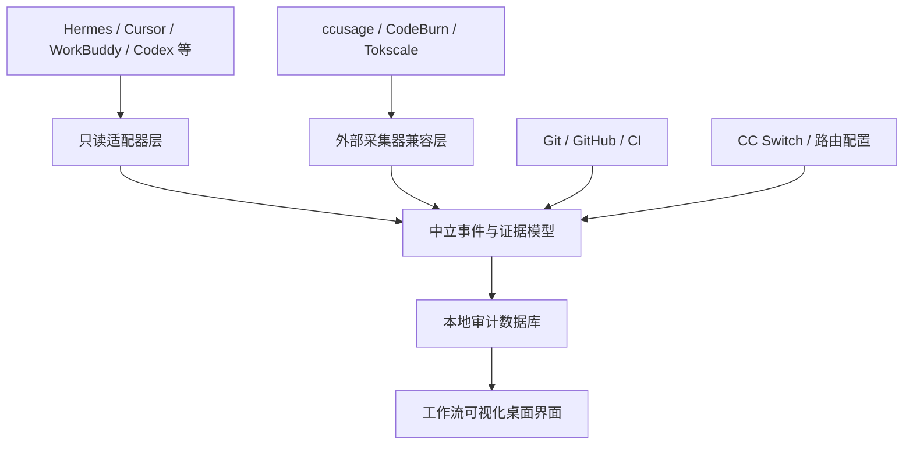
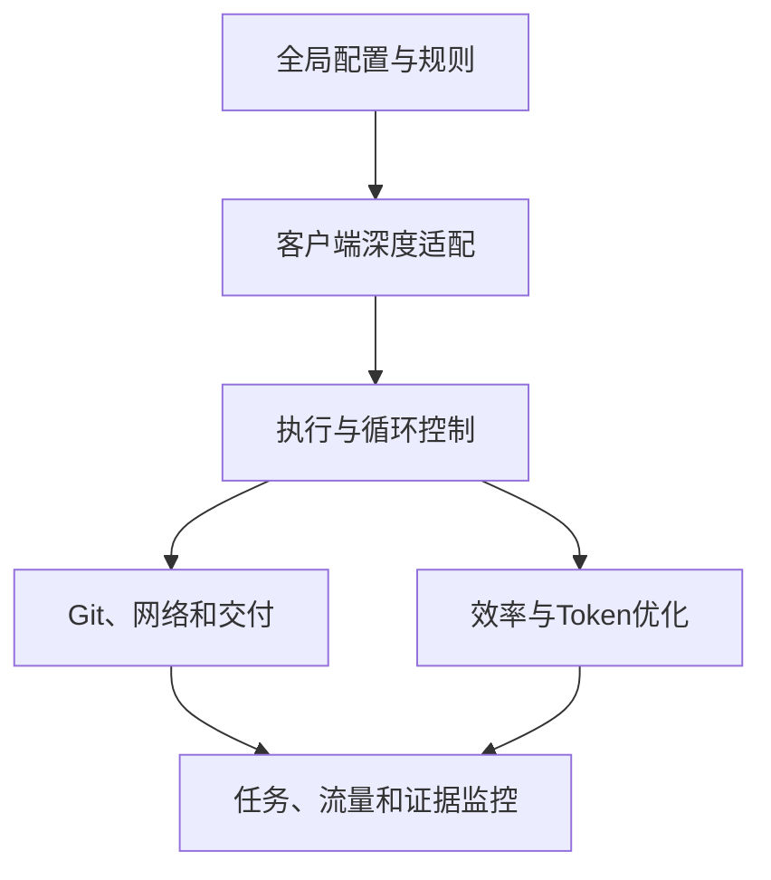
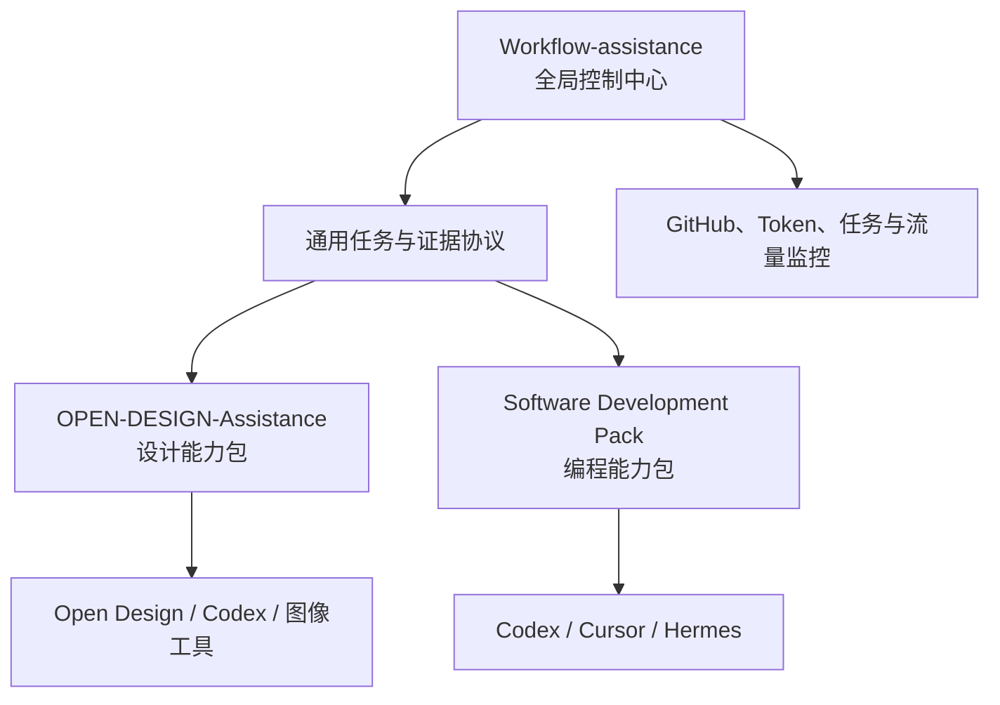
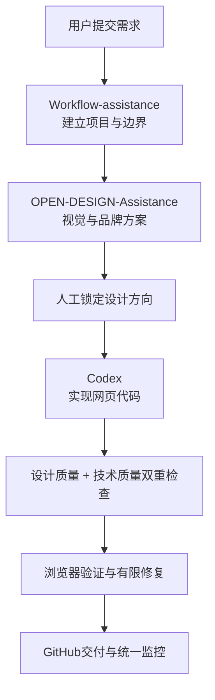
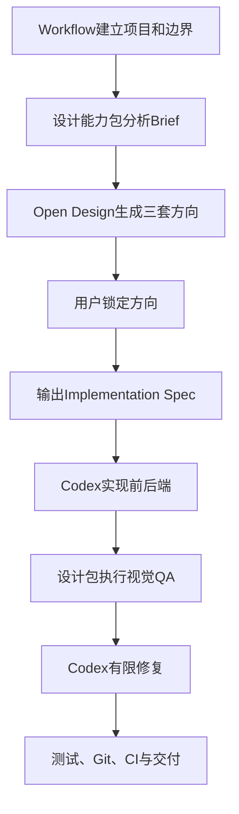
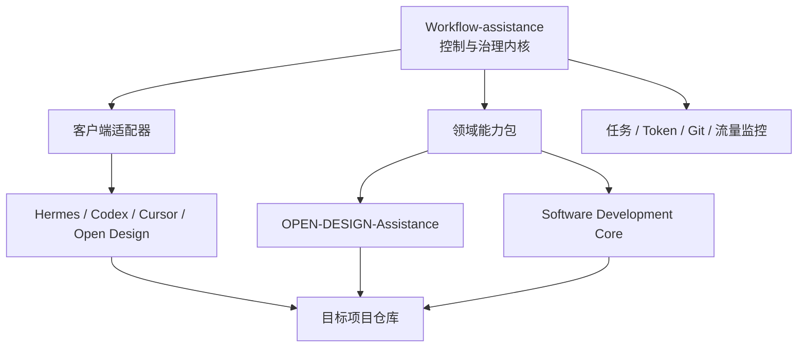
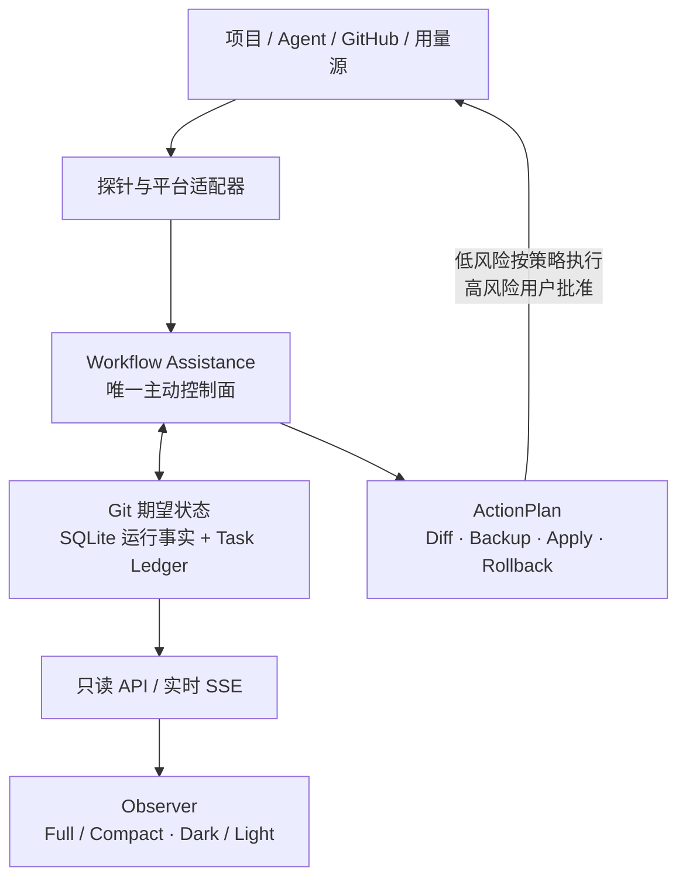

# WORK LAB

来源：conversations-000.json，记录序号 91，唯一键 000:091
归属：WORKLAB项目
依据：标题与正文上下文复核

以下保留导出中的全部消息节点（含分支），按节点时间排列；完整结构见同名 JSON。

## user · abd5501a-25e9-42a9-bda8-a2f9da120e48

父节点：client-created-root；时间戳：1785895937.815

DTALEX66
Workflow-assistance   审计，github.com/jeongwookie/WhereMyTokens
  看看这个项目，能不能把工作流增强变成可视化界面

## assistant · b77e5725-107f-4282-9f2b-693cfa3e5066

父节点：abd5501a-25e9-42a9-bda8-a2f9da120e48；时间戳：1785895952.4741

{
  "content_type": "thoughts",
  "source_analysis_msg_id": "b77e5725-107f-4282-9f2b-693cfa3e5066",
  "thoughts": []
}

## assistant · 1eb60af9-d27b-5066-af14-7fc0064917e7

父节点：b77e5725-107f-4282-9f2b-693cfa3e5066；时间戳：1785895959.70409

我会结合你现有的 DTALEX66 / Cognitive-Loop-OS 工作流定位，先审计 `WhereMyTokens` 的架构、交互和可复用能力，再判断它是否适合升级成“可视化工作流增强界面”，最后给出一套可落地的融合方案。先读取相关上下文规则并同步检查项目资料。

## assistant · 44f41e2f-a4d4-509d-824d-a008d49eaaf7

父节点：1eb60af9-d27b-5066-af14-7fc0064917e7；时间戳：1785895973.152357

{
  "content_type": "thoughts",
  "source_analysis_msg_id": "44f41e2f-a4d4-509d-824d-a008d49eaaf7",
  "thoughts": [
    {
      "chunks": [],
      "content": "**Planning GitHub repo inspection strategy**",
      "finished": true,
      "summary": "Planning GitHub repo inspection strategy"
    },
    {
      "chunks": [],
      "content": "",
      "finished": true,
      "summary": "规划 GitHub 仓库检查策略"
    }
  ]
}

## assistant · 2e03ef1d-9890-4d63-aade-67c3499d752f

父节点：44f41e2f-a4d4-509d-824d-a008d49eaaf7；时间戳：1785895977.83233

{
  "content_type": "thoughts",
  "source_analysis_msg_id": "c6d1f57b-8ce1-467f-a972-4dabe59b0e0d",
  "thoughts": [
    {
      "chunks": [],
      "content": "",
      "finished": true,
      "summary": "读取个人上下文技能指南"
    }
  ]
}

## assistant · 86040d91-3d1b-4b94-803f-5193a8956e90

父节点：2e03ef1d-9890-4d63-aade-67c3499d752f；时间戳：1785895978.53232

{
  "content_type": "thoughts",
  "source_analysis_msg_id": "18d15787-c1ed-4a97-a52a-3cf537eeda89",
  "thoughts": [
    {
      "chunks": [],
      "content": "",
      "finished": true,
      "summary": "评估了 WhereMyTokens 工作流可视化集成方案"
    }
  ]
}

## assistant · 6fde0098-6c9a-42c1-9a14-64115aebd468

父节点：86040d91-3d1b-4b94-803f-5193a8956e90；时间戳：1785895990.650895

{
  "content_type": "thoughts",
  "source_analysis_msg_id": "41e316fb-c36f-433e-b395-8d390de1d778",
  "thoughts": [
    {
      "chunks": [],
      "content": "",
      "finished": true,
      "summary": "读取 GitHub 技能说明"
    }
  ]
}

## assistant · 9a1581ba-61d5-528a-8ea8-ae130d58494e

父节点：6fde0098-6c9a-42c1-9a14-64115aebd468；时间戳：1785895990.653938

我已进入项目审计阶段：会把这个仓库拆成“它实际解决什么问题、哪些能力能直接复用、哪些只能借鉴、怎样接入 DTALEX66 Workflow-assistance”四层来判断。重点会核对它是否只是 token 统计面板，还是具备可扩展为任务编排与状态可视化的基础。

## assistant · 1973a4a1-895d-5a9a-a4b2-53fd1f8bf83e

父节点：9a1581ba-61d5-528a-8ea8-ae130d58494e；时间戳：1785896014.970733

{
  "content_type": "thoughts",
  "source_analysis_msg_id": "1973a4a1-895d-5a9a-a4b2-53fd1f8bf83e",
  "thoughts": [
    {
      "chunks": [],
      "content": "**Planning parallel file fetching from GitHub**",
      "finished": true,
      "summary": "Planning parallel file fetching from GitHub"
    },
    {
      "chunks": [],
      "content": "",
      "finished": true,
      "summary": "规划从GitHub并行获取文件"
    }
  ]
}

## assistant · f889a109-adf7-4179-8ecd-cedfd86c0e16

父节点：1973a4a1-895d-5a9a-a4b2-53fd1f8bf83e；时间戳：1785896075.037839

{
  "content_type": "thoughts",
  "source_analysis_msg_id": "8f0ff8af-9fce-48f9-9e31-b20bb09cbcdc",
  "thoughts": [
    {
      "chunks": [],
      "content": "",
      "finished": true,
      "summary": "分析 WhereMyTokens 架构、依赖、IPC及代币追踪实现"
    }
  ]
}

## assistant · 62da78f8-aaad-590a-a022-b249d204a65e

父节点：f889a109-adf7-4179-8ecd-cedfd86c0e16；时间戳：1785896075.040852

初步审计结论已经很清楚：`WhereMyTokens` 不是简单的“Token 计数器”，而是一个成熟的本地可观测桌面壳——Electron 主进程负责采集与状态真相，React 负责呈现，preload IPC 负责隔离；它已经具备 Provider Adapter、持久化 SQLite 索引、会话分组、实时状态、趋势/热力图、悬浮小部件和任务栏摘要等能力。下一步我在核对源码级边界，判断哪些能进入 Workflow-assistance，哪些必须重写为工作流语义。

## assistant · 57289cb7-ae95-4e83-9692-2007dc8b9d17

父节点：62da78f8-aaad-590a-a022-b249d204a65e；时间戳：1785896084.324596

{
  "content_type": "thoughts",
  "source_analysis_msg_id": "f5ad8819-a3e0-4e82-a6f3-02e5be557823",
  "thoughts": [
    {
      "chunks": [],
      "content": "",
      "finished": true,
      "summary": "已搜索 1 个网站"
    }
  ]
}

## assistant · 7a799993-e12b-536e-9747-dfe8df0fabef

父节点：57289cb7-ae95-4e83-9692-2007dc8b9d17；时间戳：1785896091.79301

{
  "content_type": "thoughts",
  "source_analysis_msg_id": "7a799993-e12b-536e-9747-dfe8df0fabef",
  "thoughts": [
    {
      "chunks": [],
      "content": "**Planning UI inspection and comparison**",
      "finished": true,
      "summary": "Planning UI inspection and comparison"
    },
    {
      "chunks": [],
      "content": "",
      "finished": true,
      "summary": "规划界面检查与对比"
    }
  ]
}

## assistant · fd7a7d93-8c7c-4e3a-9d1c-5146eeba123e

父节点：7a799993-e12b-536e-9747-dfe8df0fabef；时间戳：1785896092.197896

{
  "content_type": "thoughts",
  "source_analysis_msg_id": "c85f4d67-3c8e-44f9-ae77-4b2d81910f18",
  "thoughts": [
    {
      "chunks": [],
      "content": "",
      "finished": true,
      "summary": "检查项目文件并查看Git状态"
    }
  ]
}

## assistant · b96567c8-e8d3-5ae2-ae30-5e7303145a90

父节点：fd7a7d93-8c7c-4e3a-9d1c-5146eeba123e；时间戳：1785896092.200883

源码级边界核对完成：它的可视化层已经有“主视图、设置、通知、帮助、紧凑小部件、任务栏 mini”这些成熟入口；核心数据层则是 Provider Adapter → UsageIndex/SQLite → StateManager → typed IPC → React。这个结构非常适合作为 Workflow-assistance 的“可观测桌面壳”参考，但不能把 Token/Quota 数据模型直接当成任务/路由/证据模型。

## assistant · caea7bc8-af87-5b0c-9a8e-26a8e3c4e0a6

父节点：b96567c8-e8d3-5ae2-ae30-5e7303145a90；时间戳：1785896105.92247

{
  "content_type": "thoughts",
  "source_analysis_msg_id": "caea7bc8-af87-5b0c-9a8e-26a8e3c4e0a6",
  "thoughts": [
    {
      "chunks": [],
      "content": "**Planning detailed UI and architecture inspection**",
      "finished": true,
      "summary": "Planning detailed UI and architecture inspection"
    },
    {
      "chunks": [],
      "content": "**Summarizing WhereMyTokens architecture and components**",
      "finished": true,
      "summary": "Summarizing WhereMyTokens architecture and components"
    },
    {
      "chunks": [],
      "content": "",
      "finished": true,
      "summary": "规划并总结WhereMyTokens界面架构与组件"
    }
  ]
}

## assistant · cffcc1eb-ee67-571d-8ad5-bcbb0b54af58

父节点：caea7bc8-af87-5b0c-9a8e-26a8e3c4e0a6；时间戳：1785896117.547669

{
  "content_type": "thoughts",
  "source_analysis_msg_id": "cffcc1eb-ee67-571d-8ad5-bcbb0b54af58",
  "thoughts": [
    {
      "chunks": [],
      "content": "**Planning detailed UI and architecture inspection**",
      "finished": true,
      "summary": "Planning detailed UI and architecture inspection"
    },
    {
      "chunks": [],
      "content": "**Summarizing WhereMyTokens architecture and components**",
      "finished": true,
      "summary": "Summarizing WhereMyTokens architecture and components"
    },
    {
      "chunks": [],
      "content": "",
      "finished": true,
      "summary": "总结WhereMyTokens架构与组件并规划UI检查"
    }
  ]
}

## assistant · da5fe755-41fe-5319-80c0-4a9f75ef54da

父节点：cffcc1eb-ee67-571d-8ad5-bcbb0b54af58；时间戳：1785896118.051964

{
  "content_type": "thoughts",
  "source_analysis_msg_id": "da5fe755-41fe-5319-80c0-4a9f75ef54da",
  "thoughts": [
    {
      "chunks": [],
      "content": "**Planning detailed UI and architecture inspection**",
      "finished": true,
      "summary": "Planning detailed UI and architecture inspection"
    },
    {
      "chunks": [],
      "content": "**Summarizing WhereMyTokens architecture and components**",
      "finished": true,
      "summary": "Summarizing WhereMyTokens architecture and components"
    },
    {
      "chunks": [],
      "content": "**Analyzing architectural differences for integration strategy**",
      "finished": true,
      "summary": "Analyzing architectural differences for integration strategy"
    },
    {
      "chunks": [],
      "content": "",
      "finished": true,
      "summary": "分析WhereMyTokens架构并规划集成策略"
    }
  ]
}

## assistant · fcce6daf-1756-5c2f-82a3-44429e1b17e3

父节点：da5fe755-41fe-5319-80c0-4a9f75ef54da；时间戳：1785896130.126965

{
  "content_type": "thoughts",
  "source_analysis_msg_id": "fcce6daf-1756-5c2f-82a3-44429e1b17e3",
  "thoughts": [
    {
      "chunks": [],
      "content": "**Planning detailed UI and architecture inspection**",
      "finished": true,
      "summary": "Planning detailed UI and architecture inspection"
    },
    {
      "chunks": [],
      "content": "**Summarizing WhereMyTokens architecture and components**",
      "finished": true,
      "summary": "Summarizing WhereMyTokens architecture and components"
    },
    {
      "chunks": [],
      "content": "**Analyzing architectural differences for integration strategy**",
      "finished": true,
      "summary": "Analyzing architectural differences for integration strategy"
    },
    {
      "chunks": [],
      "content": "",
      "finished": true,
      "summary": "分析WhereMyTokens架构并制定集成策略"
    }
  ]
}

## assistant · eff12a8a-edfa-5f1b-b7b0-f43f78a1c004

父节点：fcce6daf-1756-5c2f-82a3-44429e1b17e3；时间戳：1785896146.337203

{
  "content_type": "thoughts",
  "source_analysis_msg_id": "eff12a8a-edfa-5f1b-b7b0-f43f78a1c004",
  "thoughts": [
    {
      "chunks": [],
      "content": "**Planning structured comprehensive audit summary**",
      "finished": true,
      "summary": "Planning structured comprehensive audit summary"
    },
    {
      "chunks": [],
      "content": "**Defining architecture and UI integration strategy**",
      "finished": true,
      "summary": "Defining architecture and UI integration strategy"
    },
    {
      "chunks": [],
      "content": "",
      "finished": true,
      "summary": "规划结构化综合审计总结与架构界面集成策略"
    }
  ]
}

## assistant · 6bab4912-1c1c-5b79-9c3b-981ae5a86015

父节点：eff12a8a-edfa-5f1b-b7b0-f43f78a1c004；时间戳：1785896153.778575

{
  "content_type": "thoughts",
  "source_analysis_msg_id": "6bab4912-1c1c-5b79-9c3b-981ae5a86015",
  "thoughts": [
    {
      "chunks": [],
      "content": "**Planning structured comprehensive audit summary**",
      "finished": true,
      "summary": "Planning structured comprehensive audit summary"
    },
    {
      "chunks": [],
      "content": "**Defining architecture and UI integration strategy**",
      "finished": true,
      "summary": "Defining architecture and UI integration strategy"
    },
    {
      "chunks": [],
      "content": "",
      "finished": true,
      "summary": "规划结构化全面审计总结与架构界面集成方案"
    }
  ]
}

## assistant · 5145b575-7186-49b2-82ca-aa454f225a2a

父节点：6bab4912-1c1c-5b79-9c3b-981ae5a86015；时间戳：1785896154.127253

{
  "content_type": "thoughts",
  "source_analysis_msg_id": "f1746e87-1d6d-4b25-baf2-49d6feed35e1",
  "thoughts": [
    {
      "chunks": [],
      "content": "",
      "finished": true,
      "summary": "查看了 WhereMyTokens 项目许可证"
    }
  ]
}

## assistant · f36dc35a-efd3-4984-ad6e-2d8ca55b75ae

父节点：5145b575-7186-49b2-82ca-aa454f225a2a；时间戳：1785896154.163261

{
  "content": "思考了 3m 22s",
  "content_type": "reasoning_recap"
}

## assistant · eb2d57ef-0093-5dd5-a6d5-6ec3fd7142f9

父节点：f36dc35a-efd3-4984-ad6e-2d8ca55b75ae；时间戳：1785896154.166724

结论：可以，而且适合吸收。但建议把它作为“可视化工作流观测层”的参考与组件来源，不要直接把 `WhereMyTokens` 改造成 Workflow-assistance 的核心引擎。

综合评分：

| 维度 | 评分 |
|---|---:|
| 可视化界面基础 | 9/10 |
| 本地数据采集与状态展示 | 8.5/10 |
| Provider 适配器设计 | 8/10 |
| 直接改造成工作流系统 | 4/10 |
| 对 DTALEX66 Workflow-assistance 的吸收价值 | 8.5/10 |

## 一、WhereMyTokens 实际是什么

它已经不是简单的 Token 统计工具，而是一个成熟的本地 AI 编程工作台监控器：

- Electron 主进程负责本地文件、Provider API、托盘和设置；
- React Renderer 负责仪表盘、设置页、通知、趋势图和小部件；
- preload bridge 负责隔离主进程与前端；
- 支持 Claude Code、Codex、Antigravity；
- 支持会话、项目、Git 分支、模型、Token、费用、Quota、缓存、工具调用和 Git 产出统计；
- 使用 SQLite 做增量索引和历史聚合；
- 支持托盘、悬浮窗口、任务栏 mini 状态显示；
- 有真实状态、数据覆盖范围、失败状态和恢复状态，而不是简单显示假进度。

这些能力都已经在其[官方 README](https://github.com/jeongwookie/WhereMyTokens)、[架构文档](https://github.com/jeongwookie/WhereMyTokens/blob/main/docs/development.md)和[功能文档](https://github.com/jeongwookie/WhereMyTokens/blob/main/docs/features.md)中落地。

## 二、最值得吸收的部分

### 1. Provider Adapter + Registry

它把 Claude、Codex、Antigravity 都抽象成统一 Provider：

```text
ProviderAdapter
├── sessions
├── usage
├── quota
└── artifacts
```

Workflow-assistance 可以改造成：

```text
WorkflowAdapter
├── HermesAdapter
├── CCSwitchAdapter
├── CodexReviewAdapter
├── GitHubDeliveryAdapter
└── LocalRuntimeAdapter
```

对应你的现有链路：

```text
HERMES 总控
   ↓
CC Switch 路由
   ↓
模型 / Provider 执行
   ↓
Codex 只读复审
   ↓
GitHub 分支、PR、CI、交付证据
```

重点是：UI 只观察和呈现这条链路，不能变成第二个 HERMES。

### 2. UsageIndex 思路

它的 `UsageIndex + SQLite + Projection` 很适合改造成：

```text
WorkflowEventLog
        ↓
WorkflowIndex.sqlite
        ↓
TaskPack / Run / Route / Evidence Projection
        ↓
可视化界面
```

可以记录：

- TaskPack 当前阶段；
- 当前执行器；
- 当前模型和路由；
- 任务开始、暂停、失败、恢复时间；
- Codex 审核结果；
- GitHub PR、Commit、CI 状态；
- exact SHA；
- 证据文件；
- 错误与重试次数；
- Token、费用和耗时。

WhereMyTokens 已经采用增量索引、后台同步、历史覆盖范围和恢复状态设计，这比单纯把日志直接塞进前端可靠得多。

### 3. 真实状态与数据覆盖状态

这是它最适合你的地方。

它会区分：

- `empty`
- `restored`
- `fresh`
- `incomplete`
- `recovered`
- `unavailable`

而不是把没有数据的地方伪装成“运行中”。

这与 Workflow-assistance 的硬约束完全一致：

- 没有真实 API 就显示“尚未接入”；
- 不伪造模型、Token、费用、进度和内部 ID；
- 明确显示部分数据、缓存数据和实时数据；
- 前端状态必须来自真实 HERMES / CC Switch / Codex / GitHub 数据。

### 4. 桌面界面形态

它已经验证了几种适合 Workflow-assistance 的界面：

- 主仪表盘；
- 可隐藏、排序的功能卡片；
- 右侧详情区；
- 设置页；
- 通知中心；
- 始终置顶悬浮小部件；
- 系统托盘；
- 任务栏摘要状态。

其中“主界面 + 状态卡片 + 悬浮小部件 + 活动记录”的组合，非常适合改造成你要的 Human + Agent + Cognitive Governance Desktop。

## 三、不能直接照搬的部分

### 1. Token/Quota 数据模型不能直接当工作流模型

WhereMyTokens 的核心对象是：

```text
Provider
Session
Usage
Quota
Model
Git Output
```

Workflow-assistance 的核心对象应该是：

```text
TaskPack
WorkflowRun
ExecutionNode
RouteDecision
Evidence
Review
Delivery
```

两者可以共用“状态投影、适配器、历史索引、趋势图”的技术模式，但业务实体必须重建。

### 2. Electron 不应该替换你现有的真相链

WhereMyTokens 是 Electron + React + SQLite。

而你的既定方向是：

```text
Python / FastAPI / SQLite
        ↓
Tauri 桌面壳
        ↓
可视化前端
```

因此推荐：

- 吸收 WhereMyTokens 的界面与数据投影思想；
- 将界面能力迁移到 Workflow-assistance 当前 Tauri 前端；
- 保留 Python/FastAPI/SQLite 作为真相链；
- 不直接把 Workflow-assistance 改成 Electron。

直接 Fork 后整体重写，会破坏现有 HERMES、CC Switch、Codex、GitHub 边界，性价比不高。

### 3. Provider 凭据读取逻辑不能直接复用

WhereMyTokens 会读取：

- `~/.claude/.credentials.json`
- `~/.codex/auth.json`
- Claude、Codex 本地日志；
- Anthropic/OpenAI 使用量接口。

这些逻辑适合它自己的 Token 监控场景，但不应该进入 Workflow-assistance 的 UI 层。

你的界面只能读取经过 HERMES 或后端适配器整理后的脱敏状态，不能让 Renderer 直接接触凭据。

## 四、Workflow-assistance 应该升级成什么界面

建议定位为：

# Workflow Observatory  
## 可观测的 AI 工作流增强桌面

核心界面可以分成六个模块：

### 1. Overview 总览

展示：

- 当前 TaskPack；
- 当前执行阶段；
- HERMES 状态；
- CC Switch 当前路由；
- 当前 Provider / 模型；
- 队列数量；
- 进度；
- 验证状态；
- Codex 审核状态；
- GitHub CI 状态；
- 当前 exact SHA。

### 2. Live Runs 实时运行

按项目、分支、TaskPack 分组：

```text
项目
└── 分支
    └── TaskPack
        ├── HERMES：运行中
        ├── CC Switch：DeepSeek
        ├── Codex：待复审
        └── GitHub：CI 等待
```

这部分可以直接借鉴 WhereMyTokens 的 Session Grouping 和状态卡片。

### 3. Workflow Canvas 工作流画布

展示真实执行链：

```text
任务输入 → HERMES 分解 → CC Switch 路由 → Provider 执行
       → Codex 复审 → GitHub 验证 → 交付
```

每个节点需要显示：

- 状态；
- 开始时间；
- 当前模型；
- Token / 费用；
- 输入输出；
- 错误；
- 证据；
- 是否允许下一步。

### 4. Route Inspector 路由检查器

展示：

- 当前 Provider；
- 模型；
- 路由原因；
- 本地模型/API 模型；
- 失败回退；
- 网络状态；
- Token 消耗；
- 是否经过 CC Switch；
- 是否存在降级。

这能把原本隐藏在 HERMES/CC Switch 后面的路由过程变成可理解的界面。

### 5. Evidence & Delivery 证据交付

展示：

- TaskPack；
- 计划；
- 执行日志；
- Codex 审核记录；
- GitHub PR；
- required checks；
- exact SHA；
- 最终交付文件；
- 未解决风险。

这部分是 WhereMyTokens 没有的，需要 Workflow-assistance 自己建设。

### 6. Activity Dock 活动底栏

类似 WhereMyTokens 的活动和通知体系，记录：

```text
10:31 HERMES 创建 TaskPack
10:32 CC Switch 路由至 DeepSeek
10:35 Provider 执行完成
10:36 Codex 开始复审
10:39 发现 2 个问题
10:42 GitHub CI 通过
```

## 五、建议的融合架构

```text
HERMES：唯一控制面
        ↓
Workflow Event API
        ↓
Workflow Index / SQLite Projection
        ↓
FastAPI / Tauri State API
        ↓
Workflow Observatory UI
```

WhereMyTokens 可以吸收为四个参考模块：

| WhereMyTokens 能力 | Workflow-assistance 对应 |
|---|---|
| Provider Adapter | HERMES / CC Switch / Codex / GitHub Adapter |
| UsageIndex | Workflow Event Index |
| Session View | TaskPack / Run / Branch View |
| Quota Widget | 队列 / 路由 / 健康 / 进度 Widget |
| Activity Chart | 执行事件时间线 |
| Error / Coverage State | 证据完整度与运行健康度 |
| Tray / Floating Widget | 桌面状态 Dock |
| Settings | 模型、路由、缓存、存储、日志、权限设置 |

## 六、最终判断

最优方案是：

> 不直接把 WhereMyTokens 改成 Workflow-assistance，而是吸收它的“可观测桌面架构”，在 Workflow-assistance 内建立一个 `Workflow Observatory` 可视化层。

可以直接吸收：

- Electron/React 界面组织方式；
- Provider Adapter 设计；
- Registry 机制；
- SQLite 增量索引；
- 状态投影；
- 数据覆盖率；
- 悬浮小部件；
- 任务栏状态；
- 设置与通知体系；
- 测试和稳定性思路。

必须重新设计：

- TaskPack 数据模型；
- HERMES 事件模型；
- CC Switch 路由状态；
- Codex 复审状态；
- GitHub 证据与交付模型；
- 权限和控制动作；
- Workflow Canvas；
- 任务重试、暂停和恢复机制。

一句话结论：

**WhereMyTokens 可以成为 Workflow-assistance 可视化增强的优秀“桌面观测层参考”，但不能直接作为工作流核心。最适合的方向是：保留 HERMES 为唯一总控，把 WhereMyTokens 的 Adapter、Index、Projection、Widget 和 Dashboard 思路迁移进你的 Workflow-assistance。**

仓库采用 [MIT License](https://github.com/jeongwookie/WhereMyTokens/blob/main/LICENSE)，技术上允许修改和吸收，但发布时仍需保留版权与许可证声明。

## user · e10bc98e-acf3-4d1e-b925-dff770eac8a1

父节点：eb2d57ef-0093-5dd5-a6d5-6ec3fd7142f9；时间戳：1785896518.451

架构无所谓，我只要结果，工作流项目本身定位是帮助HERMES+CC SWTICH + CODEX + Github + 数据监控（流量监控，工作监控）

## assistant · 51320de6-f99e-43cf-9e74-9ebce99f4d58

父节点：e10bc98e-acf3-4d1e-b925-dff770eac8a1；时间戳：1785896532.938602

{
  "content_type": "thoughts",
  "source_analysis_msg_id": "51320de6-f99e-43cf-9e74-9ebce99f4d58",
  "thoughts": []
}

## assistant · 51741c91-df52-4427-869f-048b1b8aa54d

父节点：51320de6-f99e-43cf-9e74-9ebce99f4d58；时间戳：1785896542.416665

{
  "content": "已停止思考",
  "content_type": "reasoning_recap"
}

## user · 32d99e65-bb7a-432f-b409-bca4017f3499

父节点：51741c91-df52-4427-869f-048b1b8aa54d；时间戳：1785896563.84

架构无所谓，我只要结果，工作流项目本身定位是帮助增强HERMES+CC SWTICH + CODEX + Github + 数据监控（流量监控，工作监控）

## assistant · 98e9852d-bd01-4494-abce-b13d0a120bac

父节点：32d99e65-bb7a-432f-b409-bca4017f3499；时间戳：1785896578.992925

{
  "content_type": "thoughts",
  "source_analysis_msg_id": "98e9852d-bd01-4494-abce-b13d0a120bac",
  "thoughts": []
}

## assistant · a9808420-7f97-5506-a797-0211f27b20d4

父节点：98e9852d-bd01-4494-abce-b13d0a120bac；时间戳：1785896595.756482

{
  "content_type": "thoughts",
  "source_analysis_msg_id": "a9808420-7f97-5506-a797-0211f27b20d4",
  "thoughts": [
    {
      "chunks": [],
      "content": "**Deciding WMT for UI and workflow monitoring**",
      "finished": true,
      "summary": "Deciding WMT for UI and workflow monitoring"
    },
    {
      "chunks": [],
      "content": "**Defining WMT extension for Workflow Control Center**",
      "finished": true,
      "summary": "Defining WMT extension for Workflow Control Center"
    },
    {
      "chunks": [],
      "content": "",
      "finished": true,
      "summary": "Defined WMT UI monitoring and Workflow Control Center extension"
    }
  ]
}

## assistant · a2a8acaa-243f-47ee-ad0c-9e8a6122351c

父节点：a9808420-7f97-5506-a797-0211f27b20d4；时间戳：1785896596.103449

{
  "content": "思考了 17s",
  "content_type": "reasoning_recap"
}

## assistant · e43cbe9e-ee69-59a2-ba0f-b7df18674faa

父节点：a2a8acaa-243f-47ee-ad0c-9e8a6122351c；时间戳：1785896596.138952

明白。按你的最终目标，结论直接改为：

# Workflow-assistance 可以直接升级为可视化工作流监控中心

它的定位不是 Token 工具，而是：

> **统一增强、监控和呈现 HERMES + CC SWITCH + CODEX + GitHub 全链路工作的 AI 工作流控制台。**

`WhereMyTokens` 最适合直接作为“可视化监控界面基座”深改，不需要纠结原有架构。

## 最终产品应该监控五类内容

| 监控对象 | 可视化内容 |
|---|---|
| HERMES | 当前任务、任务拆解、执行阶段、队列、错误、重试、完成度 |
| CC SWITCH | 当前路由、Provider、模型、切换记录、失败回退、延迟 |
| CODEX | 审查状态、审查结果、问题数量、修复进度、复审次数 |
| GitHub | 分支、Commit、PR、CI、Checks、合并状态、交付证据 |
| 数据监控 | Token、费用、请求量、流量、耗时、失败率、CPU/RAM/GPU、项目产出 |

## 目标界面

### 1. 总控首页

直接看到：

```text
HERMES：运行中
当前任务：Cognitive-Loop-OS UI 修复
CC SWITCH：DeepSeek → GPT
CODEX：等待复审
GitHub：PR #18 / CI 运行中
整体进度：68%
今日 Token：1.8M
今日费用：$12.40
异常：2
```

### 2. 工作流实时面板

把完整链路可视化：

```text
任务输入
  ↓
HERMES 分析与拆解
  ↓
CC SWITCH 路由
  ↓
模型执行
  ↓
CODEX 审查
  ↓
GitHub 提交 / CI
  ↓
交付完成
```

每一步显示：

- 当前状态；
- 使用的模型；
- 执行时间；
- Token 与费用；
- 输入输出；
- 错误信息；
- 是否需要人工介入。

### 3. 流量监控

需要新增专门的 Traffic 页面：

- 每分钟 / 每小时请求量；
- Token 输入、输出、缓存；
- Provider 流量占比；
- 模型流量占比；
- API 响应耗时；
- 错误率；
- 超时、限流、重试；
- 网络上传 / 下载；
- 单任务、单项目、单模型消耗；
- 流量异常预警。

WhereMyTokens 已经有 Token、费用、模型、缓存和请求统计能力，可以直接吸收其统计和图表逻辑。[功能说明](https://github.com/jeongwookie/WhereMyTokens/blob/main/docs/features.md)

### 4. 工作监控

新增 Work Monitor：

- 当前运行中的 HERMES 任务；
- 活跃项目和 Git 分支；
- 当前调用的 Provider；
- 当前模型；
- 已修改文件；
- Commit 数；
- 新增 / 删除代码行；
- 任务耗时；
- 阻塞原因；
- 失败次数；
- Codex 发现的问题；
- GitHub CI 状态；
- 最后一次成功节点。

WhereMyTokens 已有会话、项目、分支、Git 产出和模型监控，可以直接改造成工作监控界面。[仓库 README](https://github.com/jeongwookie/WhereMyTokens)

### 5. 项目与 GitHub 面板

按项目展示：

```text
Cognitive-Loop-OS
├── 当前分支：main
├── 当前 TaskPack：Desktop UI v2
├── HERMES：执行中
├── CC SWITCH：DeepSeek
├── CODEX：已发现 3 个问题
├── GitHub PR：#18
├── CI：7/8 通过
└── 交付状态：阻塞
```

### 6. 活动日志与告警

底部 Activity Dock 实时显示：

```text
10:31 HERMES 创建任务包
10:32 CC SWITCH 切换到 GPT
10:35 模型执行完成
10:36 CODEX 发现 2 个问题
10:39 自动回退 DeepSeek
10:42 GitHub CI 失败
```

告警包括：

- Provider 失联；
- CC SWITCH 路由失败；
- Token 使用异常；
- 流量突增；
- 模型频繁切换；
- HERMES 长时间无响应；
- CODEX 审查阻塞；
- GitHub CI 失败；
- 任务超时；
- 工作目录异常。

## WhereMyTokens 可以直接提供的能力

- Electron 桌面窗口；
- 系统托盘；
- 悬浮监控窗口；
- 实时状态卡片；
- Provider 选择和适配；
- Token / 费用 / 缓存统计；
- 会话与项目分组；
- 模型使用统计；
- Git 产出统计；
- 趋势图、热力图；
- 通知和告警；
- 本地 SQLite 历史数据；
- 设置页和主题系统；
- 本地优先、无云同步的数据模式。

## 需要新增的核心能力

- HERMES TaskPack 监控；
- CC SWITCH 路由监控；
- CODEX 审查结果监控；
- GitHub PR / CI / Checks 监控；
- 网络流量监控；
- 工作耗时与阶段监控；
- 多项目工作台；
- 任务时间线；
- 失败节点定位；
- 异常告警；
- 任务暂停、重试、继续；
- 交付证据汇总。

最终不要把它叫作 `WhereMyTokens` 的改版，而应当形成：

# DTALEX66 Workflow-assistance

副定位：

> **HERMES + CC SWITCH + CODEX + GitHub 全链路 AI 工作流增强与数据监控中心**

最终首页可以命名为：

- Workflow Command Center
- AI Workbench
- Workflow Observatory
- Agent Operations Center
- HERMES Control Desk

最适合你的中文定位是：

> **AI 工作流增强与智能工作监控中心**

所以答案是：**能，而且 WhereMyTokens 的可视化基础非常适合直接拿来改。它负责界面、监控、数据展示和桌面交互；Workflow-assistance 再补上 HERMES、CC SWITCH、CODEX、GitHub 和流量/工作监控，就能形成完整产品。**

## user · 04962f95-52b4-43e5-b5ab-19b8343c515f

父节点：e43cbe9e-ee69-59a2-ba0f-b7df18674faa；时间戳：1785896821.079

审计一下 这么做有没有价值，全网有这么做的吗？有同类开源项目吗？

## assistant · e05d3c79-cdf0-4c41-ad21-7320d47a020e

父节点：04962f95-52b4-43e5-b5ab-19b8343c515f；时间戳：1785896835.10167

{
  "content_type": "thoughts",
  "source_analysis_msg_id": "e05d3c79-cdf0-4c41-ad21-7320d47a020e",
  "thoughts": []
}

## assistant · 66ce4129-32ae-53a7-b1c8-46a9618290d8

父节点：e05d3c79-cdf0-4c41-ad21-7320d47a020e；时间戳：1785896845.255236

{
  "content_type": "thoughts",
  "source_analysis_msg_id": "66ce4129-32ae-53a7-b1c8-46a9618290d8",
  "thoughts": [
    {
      "chunks": [],
      "content": "**Preparing personal context retrieval**",
      "finished": true,
      "summary": "Preparing personal context retrieval"
    },
    {
      "chunks": [],
      "content": "**Listing comparable open-source observability projects**",
      "finished": true,
      "summary": "Listing comparable open-source observability projects"
    },
    {
      "chunks": [],
      "content": "",
      "finished": true,
      "summary": "准备个人背景检索并列出开源可观测性项目"
    }
  ]
}

## assistant · a49a6284-3c41-5926-857f-e6982107b61b

父节点：66ce4129-32ae-53a7-b1c8-46a9618290d8；时间戳：1785896851.812018

我会按“有没有真实需求、市场上是否已有成熟替代、哪些开源项目能复用、你的方案到底差异在哪里”四个问题做全网核查。重点会区分“单一模型可观测性”与“跨 HERMES + CC SWITCH + CODEX + GitHub 的工作流工作监控”，避免把看起来相似但实际不是同类的项目混在一起。

## assistant · 05a05635-a4d4-4a1f-b382-73a629e1ad14

父节点：a49a6284-3c41-5926-857f-e6982107b61b；时间戳：1785896874.36688

{
  "content_type": "thoughts",
  "source_analysis_msg_id": "35aba423-472b-44c2-8891-e37b3acac830",
  "thoughts": [
    {
      "chunks": [],
      "content": "",
      "finished": true,
      "summary": "评估统一工作流与数据监控中心升级方案"
    }
  ]
}

## assistant · 95f34689-7730-5ef4-97db-efc6550a502a

父节点：05a05635-a4d4-4a1f-b382-73a629e1ad14；时间戳：1785896942.184601

{
  "content_type": "thoughts",
  "source_analysis_msg_id": "95f34689-7730-5ef4-97db-efc6550a502a",
  "thoughts": [
    {
      "chunks": [],
      "content": "**Comparing competitor feature sets**",
      "finished": true,
      "summary": "Comparing competitor feature sets"
    },
    {
      "chunks": [],
      "content": "",
      "finished": true,
      "summary": "比较了竞争对手功能集"
    }
  ]
}

## assistant · ea7591ab-8dd5-52cf-86a5-49c6d653b741

父节点：95f34689-7730-5ef4-97db-efc6550a502a；时间戳：1785896942.690097

{
  "content_type": "thoughts",
  "source_analysis_msg_id": "ea7591ab-8dd5-52cf-86a5-49c6d653b741",
  "thoughts": [
    {
      "chunks": [],
      "content": "**Comparing competitor feature sets**",
      "finished": true,
      "summary": "Comparing competitor feature sets"
    },
    {
      "chunks": [],
      "content": "**Assessing market fit and value**",
      "finished": true,
      "summary": "Assessing market fit and value"
    },
    {
      "chunks": [],
      "content": "",
      "finished": true,
      "summary": "比较竞品功能并评估市场适配度与价值"
    }
  ]
}

## assistant · 1c1bbf53-4569-5a4a-9b13-f1b79a962f5a

父节点：ea7591ab-8dd5-52cf-86a5-49c6d653b741；时间戳：1785896950.236744

{
  "content_type": "thoughts",
  "source_analysis_msg_id": "1c1bbf53-4569-5a4a-9b13-f1b79a962f5a",
  "thoughts": [
    {
      "chunks": [],
      "content": "**Comparing competitor feature sets**",
      "finished": true,
      "summary": "Comparing competitor feature sets"
    },
    {
      "chunks": [],
      "content": "**Assessing market fit and value**",
      "finished": true,
      "summary": "Assessing market fit and value"
    },
    {
      "chunks": [],
      "content": "",
      "finished": true,
      "summary": "比较竞品功能并评估市场契合度与价值"
    }
  ]
}

## assistant · 9c9b6aa3-a5c0-512a-b6c9-ba63142ea770

父节点：1c1bbf53-4569-5a4a-9b13-f1b79a962f5a；时间戳：1785896964.043322

{
  "content_type": "thoughts",
  "source_analysis_msg_id": "9c9b6aa3-a5c0-512a-b6c9-ba63142ea770",
  "thoughts": [
    {
      "chunks": [],
      "content": "**Integrating market validation examples**",
      "finished": true,
      "summary": "Integrating market validation examples"
    },
    {
      "chunks": [],
      "content": "**Classifying competitors and defining novelty gap**",
      "finished": true,
      "summary": "Classifying competitors and defining novelty gap"
    },
    {
      "chunks": [],
      "content": "",
      "finished": true,
      "summary": "整合市场验证案例并分类竞争者明确创新差距"
    }
  ]
}

## assistant · faea5c30-cead-5d6c-92b4-e4fab420e050

父节点：9c9b6aa3-a5c0-512a-b6c9-ba63142ea770；时间戳：1785896977.521376

{
  "content_type": "thoughts",
  "source_analysis_msg_id": "faea5c30-cead-5d6c-92b4-e4fab420e050",
  "thoughts": [
    {
      "chunks": [],
      "content": "**Integrating market validation examples**",
      "finished": true,
      "summary": "Integrating market validation examples"
    },
    {
      "chunks": [],
      "content": "**Classifying competitors and defining novelty gap**",
      "finished": true,
      "summary": "Classifying competitors and defining novelty gap"
    },
    {
      "chunks": [],
      "content": "",
      "finished": true,
      "summary": "整合市场验证案例并分类竞争对手定义创新差距"
    }
  ]
}

## assistant · e2645a4e-c175-5e3e-a74c-1f46c7c13642

父节点：faea5c30-cead-5d6c-92b4-e4fab420e050；时间戳：1785896978.226453

{
  "content_type": "thoughts",
  "source_analysis_msg_id": "e2645a4e-c175-5e3e-a74c-1f46c7c13642",
  "thoughts": [
    {
      "chunks": [],
      "content": "**Integrating market validation examples**",
      "finished": true,
      "summary": "Integrating market validation examples"
    },
    {
      "chunks": [],
      "content": "**Classifying competitors and defining novelty gap**",
      "finished": true,
      "summary": "Classifying competitors and defining novelty gap"
    },
    {
      "chunks": [],
      "content": "**Drafting value assessment and competitor comparison table**",
      "finished": true,
      "summary": "Drafting value assessment and competitor comparison table"
    },
    {
      "chunks": [],
      "content": "",
      "finished": true,
      "summary": "整合市场验证并起草竞品差异化评估"
    }
  ]
}

## assistant · cbef8f0d-4599-428c-ab3e-1b6e18a0693e

父节点：e2645a4e-c175-5e3e-a74c-1f46c7c13642；时间戳：1785896979.780587

{
  "content_type": "thoughts",
  "source_analysis_msg_id": "8baefc2d-28c1-47b8-a039-55ee52021b12",
  "thoughts": [
    {
      "chunks": [],
      "content": "",
      "finished": true,
      "summary": "已搜索 26 个网站"
    }
  ]
}

## assistant · 545349c3-5edf-49bf-b230-46ec4b0d4a18

父节点：cbef8f0d-4599-428c-ab3e-1b6e18a0693e；时间戳：1785896979.785389

{
  "content": "思考了 2m 24s",
  "content_type": "reasoning_recap"
}

## assistant · c0a302f3-7c10-54e5-b2cf-15c119403ab5

父节点：545349c3-5edf-49bf-b230-46ec4b0d4a18；时间戳：1785896979.787807

结论：有价值，建议继续做，但不能只做“Token/流量仪表盘”。真正有价值的是：

> **跨 HERMES、CC SWITCH、CODEX、GitHub 的 AI 编程工作流控制与监控中心。**

本次检索公开 GitHub 及官方资料后，没有发现一个完整覆盖：

```text
HERMES 总控
+ CC SWITCH 路由
+ CODEX 独立复审
+ GitHub PR / CI / exact SHA
+ Token / 流量 / 成本
+ 项目 / 分支 / 工作进度
```

的成熟开源项目。

## 市场上已经存在的同类项目

| 项目 | 主要能力 | 与你的项目重合度 |
|---|---|---:|
| [Mission Control](https://github.com/builderz-labs/mission-control) | 任务派发、运行监控、失败复盘、成本统计，支持 Claude Code、Codex 等 | 最高，约 80% |
| [Optio](https://github.com/jonwiggins/optio) | 从任务到 PR、CI、代码审查、自动修复、合并 | 工作交付链很接近 |
| [Maestro](https://github.com/RunMaestro/Maestro) | 多 Agent 桌面、并行项目、Worktree、任务队列、PR | 桌面控制体验接近 |
| [Claude Code Agent Monitor](https://github.com/hoangsonww/Claude-Code-Agent-Monitor) | Claude Code/Codex 会话、工具调用、子 Agent、实时 Dashboard | 工作监控接近 |
| [Multi-Agent Observability](https://github.com/disler/claude-code-hooks-multi-agent-observability) | Hook 事件、Agent 生命周期、实时事件流、SQLite、WebSocket | 事件监控接近 |
| [WhereMyTokens](https://github.com/jeongwookie/WhereMyTokens) | Token、费用、Quota、模型、会话、Git 产出、桌面小部件 | 数据监控接近 |
| [Langfuse](https://github.com/langfuse/langfuse) | LLM Trace、成本、评估、Prompt、Agent 行为 | LLM 可观测接近 |
| [Phoenix](https://github.com/Arize-ai/phoenix) | OpenTelemetry Trace、评估、质量、Prompt、Agent 调试 | 技术观测接近 |
| [AgentOps](https://github.com/AgentOps-AI/agentops) | Agent 运行图、成本、会话回放、工具调用、失败监控 | Agent 观测接近 |
| [OpenObserve](https://github.com/openobserve/openobserve) | 日志、指标、Trace、告警、LLM 成本、Token、延迟、Agent 图 | 数据平台接近 |
| [LiteLLM](https://github.com/BerriAI/litellm) | 多模型网关、路由、Fallback、预算、限流、成本统计 | 路由和流量接近 |

GitHub 自己也已经推出 Agent HQ，让 Claude、Codex、Copilot 等多个 Agent 在 GitHub 中异步运行、生成 PR 并查看进度，说明“多 Agent 工作流控制与监控”确实是正在形成的需求。[GitHub Agent HQ](https://github.blog/news-insights/company-news/pick-your-agent-use-claude-and-codex-on-agent-hq/)

## 最接近你的项目是谁

### 第一名：Mission Control

它的定位已经是：

> AI Agent 自托管控制台：派发任务、检查运行、复盘失败、追踪成本、操作 Claude Code、Codex 等运行时。

这与 Workflow-assistance 最接近。

但它目前并不等同于你的方案，至少没有明确覆盖：

- HERMES 作为唯一总控；
- CC SWITCH 路由链路；
- Codex exact SHA 独立复审；
- GO / NO-GO 审核结果；
- GitHub required checks 证据闭环；
- 本地 CLI 订阅状态；
- 网络流量与工作效率的统一分析。

所以它是直接竞品和重要参考，但不是你的方案终点。

### 第二名：Optio

Optio 更偏“自动化交付流水线”，能够把任务推进到 PR、CI、审查和合并。[Optio](https://github.com/jonwiggins/optio)

它比你的项目更偏自动执行，而你的项目更适合做：

> **多工具协同、状态透明、过程审计、流量监控和工作效率分析。**

### 第三名：WhereMyTokens

WhereMyTokens 适合提供：

- Token / Cost；
- Provider；
- 模型；
- 会话；
- Git 分支；
- Git 产出；
- 历史趋势；
- 桌面监控；
- 本地数据索引；
- 告警和小部件。

但它本身不负责：

- HERMES 任务编排；
- CC SWITCH 路由过程；
- CODEX 审核结论；
- GitHub PR / CI 交付流程。

因此它更适合成为 Workflow-assistance 的“数据监控子系统”和“可视化界面参考”。

## 这个项目真正的差异化

如果只是：

```text
Token + Cost + Session + Model + Dashboard
```

价值一般，因为 WhereMyTokens、AgentOps、Langfuse、Phoenix 等都能做。

如果升级为：

```text
任务状态
+ Agent 工作状态
+ 路由状态
+ 模型流量
+ Token / 成本
+ 代码产出
+ CODEX 审核
+ GitHub PR / CI
+ 失败定位
+ exact SHA 证据
```

价值就明显提高。

你的真正差异化不是“有一个漂亮界面”，而是：

> **把目前分散在 HERMES、CC SWITCH、CODEX、终端、Git、GitHub 和各类模型监控中的状态，统一成一个可视化工作闭环。**

## 价值评分

| 方向 | 价值 |
|---|---:|
| 你个人使用 | 9/10 |
| 解决多工具切换问题 | 9/10 |
| 流量和成本监控 | 8/10 |
| 工作状态监控 | 8.5/10 |
| GitHub 交付和证据 | 9/10 |
| 仅做 Token Dashboard | 4/10 |
| 做成完整 AI 工作流控制台 | 8.5/10 |
| 与现有开源项目的差异化 | 当前 6/10，完成整合后 8.5/10 |

## 最终审计结论

### 值得做，结论为 GO。

但产品必须明确定位为：

# DTALEX66 Workflow-assistance

## AI 工作流增强、工作监控与数据观测中心

核心竞争力：

1. HERMES 任务总控可视化；
2. CC SWITCH 路由与模型状态可视化；
3. CODEX 审核过程和结论可视化；
4. GitHub PR、CI、exact SHA、交付证据可视化；
5. Token、费用、流量、延迟、失败率监控；
6. 项目、分支、任务、文件、Commit、产出监控；
7. 失败节点定位和恢复提示；
8. 本地优先、个人工作流、跨工具统一观察。

最重要的判断是：

> **市场上已经有“Agent 监控工具”“LLM 观测工具”“多 Agent 桌面”“AI 交付流水线”，但还缺一个真正面向个人开发者、把 HERMES + 路由 + Codex 复审 + GitHub 证据 + 流量/工作监控统一起来的产品。**

因此，Workflow-assistance 不是没有价值，而是需要避开“又一个 Token Dashboard”，直接做成：

> **AI Coding Workflow Command Center / Agent Operations Desktop**

## user · b2712489-eda4-4c72-b01d-2c1564489281

父节点：c0a302f3-7c10-54e5-b2cf-15c119403ab5；时间戳：1785897017.817

注意 我不是要再做一个智能体软件

## assistant · a06b91bc-ecfa-4ec6-aa60-0e7176e7db5f

父节点：b2712489-eda4-4c72-b01d-2c1564489281；时间戳：1785897032.452463

{
  "content_type": "thoughts",
  "source_analysis_msg_id": "a06b91bc-ecfa-4ec6-aa60-0e7176e7db5f",
  "thoughts": []
}

## assistant · 05929a77-6f11-5e52-8d3b-ad00b0d316fb

父节点：a06b91bc-ecfa-4ec6-aa60-0e7176e7db5f；时间戳：1785897043.640771

{
  "content_type": "thoughts",
  "source_analysis_msg_id": "05929a77-6f11-5e52-8d3b-ad00b0d316fb",
  "thoughts": [
    {
      "chunks": [],
      "content": "**Clarifying product positioning and differentiation**",
      "finished": true,
      "summary": "Clarifying product positioning and differentiation"
    },
    {
      "chunks": [],
      "content": "**Defining final product positioning and scope**",
      "finished": true,
      "summary": "Defining final product positioning and scope"
    },
    {
      "chunks": [],
      "content": "",
      "finished": true,
      "summary": "明确产品定位与范围"
    }
  ]
}

## assistant · 7101e8c7-afd2-4dcc-94ff-59b221ce88f7

父节点：05929a77-6f11-5e52-8d3b-ad00b0d316fb；时间戳：1785897045.934315

{
  "content": "思考了 13s",
  "content_type": "reasoning_recap"
}

## assistant · 17365751-9e7c-5c76-95f7-6944037ac602

父节点：7101e8c7-afd2-4dcc-94ff-59b221ce88f7；时间戳：1785897045.938969

明白。你的项目不是智能体软件，也不是 Agent 编排器。

我前面把它说成“控制中心 / Agent Operations”偏重了，应该纠正为：

# DTALEX66 Workflow-assistance

> **面向 HERMES + CC SWITCH + CODEX + GitHub 的可视化工作流增强、状态监控、流量监控和工作审计工具。**

它不创建智能体、不替代任何现有工具、不负责自主执行任务。

## 它真正做什么

| 现有系统 | Workflow-assistance 的作用 |
|---|---|
| HERMES | 读取任务、阶段、状态、日志和执行结果 |
| CC SWITCH | 展示当前路由、Provider、模型、切换、失败和延迟 |
| CODEX | 展示复审过程、结果、问题和结论 |
| GitHub | 展示分支、Commit、PR、CI、Checks 和交付证据 |
| 系统与模型 | 统计 Token、费用、请求、流量、耗时和异常 |
| 用户 | 通过一个界面理解整个工作流到底发生了什么 |

## 明确不做什么

- 不创建新的 Agent；
- 不替代 HERMES；
- 不负责任务规划；
- 不负责模型路由；
- 不自主修改代码；
- 不替代 Codex 审查；
- 不替代 GitHub；
- 不运行新的智能体团队；
- 不做多 Agent 编排平台。

它的本质是：

```text
现有工具运行
      ↓
Workflow-assistance 采集与关联
      ↓
可视化展示 / 监控 / 告警 / 审计 / 报告
```

## 这样做有没有价值

有，而且定位会更准确。

市场上已有的：

- [WhereMyTokens](https://github.com/jeongwookie/WhereMyTokens)：偏 Token、费用、Quota 和会话监控；
- [Claude Code Agent Monitor](https://github.com/hoangsonww/Claude-Code-Agent-Monitor)：偏 Claude Code / Codex 实时会话监控；
- [Langfuse](https://github.com/langfuse/langfuse)、[Phoenix](https://github.com/Arize-ai/phoenix)、[AgentOps](https://github.com/AgentOps-AI/agentops)：偏 LLM / Agent Trace、成本和质量观测；
- [OpenObserve](https://github.com/openobserve/openobserve)：偏日志、指标、Trace 和基础设施监控；
- [LiteLLM](https://github.com/BerriAI/litellm)：偏模型网关、路由和成本监控。

但它们通常只覆盖某一层。

你的项目的价值在于把这些信息统一关联起来：

```text
一次 HERMES 任务
→ 使用了什么 CC SWITCH 路由
→ 调用了什么模型
→ 消耗多少 Token / 流量
→ 执行了多长时间
→ Codex 是否复审
→ GitHub 哪个 Commit / PR
→ CI 是否通过
→ 最终是否完成
```

这不是 Agent 软件，而是：

> **AI 工作流的可观测性和工作数据分析层。**

## 与智能体软件的区别

| 智能体软件 | Workflow-assistance |
|---|---|
| 负责执行任务 | 负责观察任务 |
| 负责规划和决策 | 负责展示规划和决策结果 |
| 负责调用工具 | 负责记录工具调用 |
| 负责修改代码 | 负责展示代码变更 |
| 负责自主运行 | 负责监控运行状态 |
| 追求自动化 | 追求透明、可控、可审计 |

所以，`Mission Control`、`Optio`、`Maestro` 这类项目只能作为邻近参考，不能作为你的产品定位。它们偏 Agent 管理和编排，而你的项目应该定位为：

# AI Workflow Observability Layer

中文可以叫：

> **AI 工作流可视化增强与监控系统**

最终审计结论：

**值得做。它不是在重复造一个智能体，而是在补现有 HERMES + CC SWITCH + CODEX + GitHub 工作流缺失的“统一可视化、流量分析、工作监控和证据审计层”。**

## user · 05dbeda7-3d43-49ab-acf4-35cd2d44ff81

父节点：17365751-9e7c-5c76-95f7-6944037ac602；时间戳：1785897122.511

全面整合优化下

## assistant · 2caa04d8-e824-4716-af81-99eafa9198ad

父节点：05dbeda7-3d43-49ab-acf4-35cd2d44ff81；时间戳：1785897136.552566

{
  "content_type": "thoughts",
  "source_analysis_msg_id": "2caa04d8-e824-4716-af81-99eafa9198ad",
  "thoughts": []
}

## assistant · 0c67924a-3d08-55b3-a6d2-0fcbba3607cb

父节点：2caa04d8-e824-4716-af81-99eafa9198ad；时间戳：1785897146.197059

{
  "content_type": "thoughts",
  "source_analysis_msg_id": "0c67924a-3d08-55b3-a6d2-0fcbba3607cb",
  "thoughts": [
    {
      "chunks": [],
      "content": "**Preparing to apply personal-context skill**",
      "finished": true,
      "summary": "Preparing to apply personal-context skill"
    },
    {
      "chunks": [],
      "content": "",
      "finished": true,
      "summary": "准备应用个人上下文技能"
    }
  ]
}

## assistant · b209d491-cf45-5453-8c6f-31e980a3710f

父节点：0c67924a-3d08-55b3-a6d2-0fcbba3607cb；时间戳：1785897146.603897

我会把前面的项目审计、全网同类对比和你刚刚明确的边界统一收敛：不再按“智能体软件/编排平台”设计，而是形成一套完整的“现有 AI 工具链增强、可视化、监控与审计系统”定位。为避免丢掉你之前已经确定的 Workflow-assistance 约束，我会先核对既有项目定义。

## assistant · 1bfbc1de-db2c-4a23-8608-da2bf49cf3b5

父节点：b209d491-cf45-5453-8c6f-31e980a3710f；时间戳：1785897159.255204

{
  "content_type": "thoughts",
  "source_analysis_msg_id": "2f8d3395-d8b8-40ea-97c7-67020461eaea",
  "thoughts": [
    {
      "chunks": [],
      "content": "",
      "finished": true,
      "summary": "读取个人上下文技能说明"
    }
  ]
}

## assistant · 3288a35d-82c0-5fed-814d-c28f91163c2b

父节点：1bfbc1de-db2c-4a23-8608-da2bf49cf3b5；时间戳：1785897182.836808

{
  "content_type": "thoughts",
  "source_analysis_msg_id": "3288a35d-82c0-5fed-814d-c28f91163c2b",
  "thoughts": [
    {
      "chunks": [],
      "content": "**Defining comprehensive integrated optimization scope**",
      "finished": true,
      "summary": "Defining comprehensive integrated optimization scope"
    },
    {
      "chunks": [],
      "content": "**Defining product identity and core pillars**",
      "finished": true,
      "summary": "Defining product identity and core pillars"
    },
    {
      "chunks": [],
      "content": "",
      "finished": true,
      "summary": "定义综合优化范围与产品定位核心支柱"
    }
  ]
}

## assistant · 275b98b6-520a-5455-aa8d-3aea34bddf77

父节点：3288a35d-82c0-5fed-814d-c28f91163c2b；时间戳：1785897197.726567

{
  "content_type": "thoughts",
  "source_analysis_msg_id": "275b98b6-520a-5455-aa8d-3aea34bddf77",
  "thoughts": [
    {
      "chunks": [],
      "content": "**Defining comprehensive integrated optimization scope**",
      "finished": true,
      "summary": "Defining comprehensive integrated optimization scope"
    },
    {
      "chunks": [],
      "content": "**Defining product identity and core pillars**",
      "finished": true,
      "summary": "Defining product identity and core pillars"
    },
    {
      "chunks": [],
      "content": "",
      "finished": true,
      "summary": "定义综合优化范围与产品定位核心支柱"
    }
  ]
}

## assistant · 082335f6-e3cc-5a10-97bf-746d8979d93d

父节点：275b98b6-520a-5455-aa8d-3aea34bddf77；时间戳：1785897201.051719

{
  "content_type": "thoughts",
  "source_analysis_msg_id": "082335f6-e3cc-5a10-97bf-746d8979d93d",
  "thoughts": [
    {
      "chunks": [],
      "content": "**Defining comprehensive integrated optimization scope**",
      "finished": true,
      "summary": "Defining comprehensive integrated optimization scope"
    },
    {
      "chunks": [],
      "content": "**Defining product identity and core pillars**",
      "finished": true,
      "summary": "Defining product identity and core pillars"
    },
    {
      "chunks": [],
      "content": "**Mapping components and defining product boundaries**",
      "finished": true,
      "summary": "Mapping components and defining product boundaries"
    },
    {
      "chunks": [],
      "content": "",
      "finished": true,
      "summary": "定义综合优化范围、产品定位及组件边界"
    }
  ]
}

## assistant · 52a74729-99cf-45f9-8a1c-b71971cea46f

父节点：082335f6-e3cc-5a10-97bf-746d8979d93d；时间戳：1785897211.802624

{
  "content_type": "thoughts",
  "source_analysis_msg_id": "658868ba-1418-4a76-aa86-46b98cb2f9b6",
  "thoughts": [
    {
      "chunks": [],
      "content": "",
      "finished": true,
      "summary": "优化了Workflow-assistance产品定义"
    }
  ]
}

## assistant · ffbfe99b-6069-4913-8a23-eeae2817bb6f

父节点：52a74729-99cf-45f9-8a1c-b71971cea46f；时间戳：1785897211.850114

{
  "content": "思考了 1m 15s",
  "content_type": "reasoning_recap"
}

## assistant · d2cd9070-d352-501a-996c-4bc716292757

父节点：ffbfe99b-6069-4913-8a23-eeae2817bb6f；时间戳：1785897211.853569

# DTALEX66 Workflow-assistance 最终整合定位

结论：项目值得继续做，综合价值约 **8.5/10**。

但必须彻底锁定边界：

> **Workflow-assistance 不是新的智能体、不是多 Agent 编排平台、不是模型网关，也不是另一个 AI IDE。它是现有 HERMES + CC SWITCH + CODEX + GitHub 工作链路的增强、可视化、监控、诊断、审计和数据分析系统。**

## 一、最终产品定义

### 中文定位

**AI 工作流增强、运行监测与证据审计系统**

### 英文定位

**AI Workflow Assistance & Observability**

### 一句话介绍

> 为 HERMES、CC SWITCH、CODEX 和 GitHub 提供统一的运行状态、工作过程、模型流量、成本消耗、复审结果、交付证据和异常诊断界面。

核心关系是：

```text
用户 → HERMES → CC SWITCH → 模型/CODEX → Git/GitHub
                         ↓
            Workflow-assistance
        采集、关联、监控、分析、告警、审计
```

Workflow-assistance 不抢占任何工具的职责，只让整个工作过程从“散落在终端和日志里”变成“可见、可查、可解释、可复验”。

---

## 二、职责边界彻底锁定

| Workflow-assistance 做 | Workflow-assistance 不做 |
|---|---|
| 读取并展示工具状态 | 不创建新的 Agent |
| 关联任务、模型、代码和交付证据 | 不替代 HERMES |
| 统计 Token、费用、流量和耗时 | 不自行规划任务 |
| 监控工作进度和异常 | 不自行选择 Writer |
| 展示 CC SWITCH 路由结果 | 不取代 CC SWITCH 路由 |
| 展示 CODEX 审核结果 | 不冒充 CODEX 执行审查 |
| 展示 GitHub PR、CI、Checks | 不成为新的 Git 平台 |
| 提供诊断、告警和恢复建议 | 不擅自 Commit、Push、Merge |
| 生成审计报告 | 不读取或托管凭据 |
| 通过 HERMES 转交现有动作 | UI 不成为第二个控制核心 |

所有实际工作仍由原系统承担：

- **HERMES**：唯一用户入口、任务理解、TaskPack、流程总控、状态与证据汇总；
- **CC SWITCH**：Provider、模型和网络路由诊断及显式切换；
- **CODEX**：代码执行或 exact-tree 独立复审；
- **GitHub**：分支、PR、required checks、exact-SHA CI、Review 和交付证据；
- **Workflow-assistance**：统一观察、分析、诊断、告警、报告和可视化。

---

## 三、项目的真实市场价值

全网已经有很多“局部同类”，但功能是割裂的：

| 类别 | 代表项目 | 已解决的问题 |
|---|---|---|
| Token/费用监控 | [WhereMyTokens](https://github.com/jeongwookie/WhereMyTokens)、[CodexBar](https://github.com/steipete/CodexBar) | Token、Quota、成本、模型、会话 |
| CLI 工作监控 | [Claude Code Agent Monitor](https://github.com/hoangsonww/Claude-Code-Agent-Monitor) | Claude/Codex 会话、工具调用、实时事件 |
| LLM 可观测 | [Langfuse](https://github.com/langfuse/langfuse)、[Phoenix](https://github.com/Arize-ai/phoenix) | Trace、Token、延迟、成本、评估 |
| Agent 运行监控 | [AgentOps](https://github.com/AgentOps-AI/agentops) | 会话回放、执行图、错误和成本 |
| 全栈日志监控 | [OpenObserve](https://github.com/openobserve/openobserve) | 日志、指标、Trace、告警、事故 |
| 模型路由监控 | [LiteLLM](https://github.com/BerriAI/litellm) | Provider、路由、Fallback、限流、成本 |
| AI 工程交付 | [Optio](https://github.com/jonwiggins/optio) | 任务、PR、CI、审查和合并 |

本次检索没有发现一个成熟开源项目完整关联：

```text
HERMES TaskPack
+ CC SWITCH 路由
+ CODEX 独立复审
+ GitHub exact SHA / CI
+ Token / 流量 / 费用
+ 工作状态 / 项目产出
+ E0–E4 证据等级
```

所以项目的价值不在于单项能力新颖，而在于：

> **第一次把现有个人 AI 开发工具链的运行、流量、工作、质量和交付证据放进同一条事实链。**

---

## 四、六个核心能力中心

### 1. 工具链状态中心

统一显示：

- HERMES 是否运行；
- 当前 TaskPack；
- 当前任务阶段；
- 唯一 Writer；
- CC SWITCH 当前 Provider、模型和线路；
- CODEX 当前模式：执行、等待、复审、完成；
- GitHub 仓库、分支、PR、CI；
- 本地工具版本与连接健康度；
- 数据更新时间和来源。

### 2. 工作监控中心

回答“现在到底在干什么”：

- 当前活跃项目；
- 当前任务；
- 当前执行阶段；
- 已运行时间；
- 最近活动时间；
- 当前工作目录；
- Git 分支；
- 修改文件；
- 新增/删除代码行；
- 测试运行状态；
- 阻塞原因；
- 是否等待用户输入；
- 是否存在失败重试；
- 最后一个成功节点。

进度必须来自真实任务节点，不能根据时间估算或伪造百分比。

标准状态统一使用：

```text
NOT_RUN
PASS
FAIL
BLOCKED
UNVERIFIED
SKIPPED_OPTIONAL
```

运行态可以额外显示：

```text
RUNNING
WAITING
REVIEWING
RECOVERING
```

### 3. 流量与使用监控中心

不只看 Token，还要看完整调用质量：

- 输入 Token；
- 输出 Token；
-缓存 Token；
- 请求次数；
- 每分钟/小时吞吐；
- Provider 占比；
- 模型占比；
- 项目消耗；
- TaskPack 消耗；
- 请求延迟；
- 首 Token 延迟；
- 超时率；
- 错误率；
- 429/限流；
- 重试次数；
- 路由切换次数；
- 费用估算；
- 网络上传/下载；
- CPU、RAM、GPU、磁盘和进程资源。

费用必须标注“API 等价估算”或“真实账单来源”，不能混为一体。

### 4. 路由诊断中心

专门增强 CC SWITCH，但不取代它：

- 当前路由链；
- HERMES 使用的 Provider；
- CODEX 使用的连接方式；
- 当前模型；
- 请求是否成功；
- 线路延迟；
- 最近切换；
- 失败回退；
- 端口状态；
- 网络可达性；
- 配置冲突；
- “端口开放但模型调用失败”的区别；
- 当前结果的数据来源和可信度。

不显示 API Key、OAuth、Cookie、Token、SSH 私钥或 Session DB。

### 5. 审核与交付证据中心

把 CODEX 和 GitHub 串成真实证据链：

- TaskPack；
- Writer；
- 写入前基线；
- Git tree；
- exact SHA；
- CODEX 审核模式；
- GO / NO-GO；
- Findings 严重度；
- 修复状态；
- 测试结果；
- PR；
- required checks；
- Review；
- CI；
- 最终交付文件；
- 回滚点；
- 复验结果；
- E0–E4 证据等级。

要能明确区分：

```text
“工具说完成了”
和
“已经通过证据验证”
```

### 6. 异常诊断与恢复中心

监测并提示：

- HERMES 长时间无活动；
- CC SWITCH 路由异常；
- Provider 不可用；
- CODEX 执行失败；
- Token 突增；
- 延迟突增；
- 重试循环；
- 上下文接近上限；
- 工作目录不一致；
- 分支不一致；
- Dirty Worktree；
- CODEX 审核树与 Writer 输出不一致；
- GitHub CI 失败；
- 本地与远端 SHA 不一致；
- Repo 与 Live 状态漂移；
- 证据不完整。

恢复动作只提供：

- 原因定位；
- 推荐检查项；
- 可复制命令；
- 回滚建议；
- 重新验证入口；
- 转交 HERMES 执行。

---

## 五、最终界面结构

| 页面 | 核心内容 |
|---|---|
| 总览 | HERMES、CC SWITCH、CODEX、GitHub、当前任务、告警 |
| 实时工作 | 项目、TaskPack、阶段、活动、文件、测试、阻塞 |
| 工作流时间线 | 从任务输入到 GitHub 交付的真实事件 |
| 流量与成本 | Token、请求、延迟、错误、费用、资源 |
| 路由诊断 | Provider、模型、线路、切换、Fallback |
| 审核与交付 | CODEX Findings、GO/NO-GO、PR、CI、exact SHA |
| 证据中心 | E0–E4、日志、报告、命令证据、回滚与复验 |
| 健康与告警 | 工具状态、异常、事故、诊断和恢复建议 |
| 设置 | 数据源、显示、告警阈值、日志、权限、隐私 |

### 桌面悬浮窗

可以吸收 WhereMyTokens 的 Widget 设计，但内容改为：

```text
HERMES   RUNNING
TaskPack UI-042
Route    DeepSeek
CODEX    WAITING REVIEW
GitHub   CI 7/8
Tokens   218K
Alerts   1
```

---

## 六、开源项目吸收策略

### WhereMyTokens

优先吸收：

- 桌面托盘；
- 浮动 Widget；
- Provider 状态卡；
- Token/Quota/费用统计；
- 会话和项目分组；
- SQLite 历史索引；
- 趋势、热力图和通知；
- 数据完整度与恢复状态。

不直接照搬其 Token/Quota 业务模型。

### Claude Code Agent Monitor

吸收：

- Hook 事件采集；
- 实时事件流；
- WebSocket 更新；
- 会话时间线；
- 工具调用统计；
- CODEX/Claude 运行监测。

### OpenLLMetry / OpenTelemetry

吸收统一事件语义：

- Trace；
- Span；
- Provider；
- Model；
- Tool call；
- Token；
- Latency；
- Error；
- Retry。

### Langfuse / Phoenix / AgentOps

吸收：

- Trace 瀑布；
- 单次任务详情；
- 成本拆分；
- 错误定位；
- 会话回放；
- 质量与评估展示。

### OpenObserve

吸收：

- 日志、指标和 Trace 关联；
- 告警；
- 事故生命周期；
- 查询和筛选；
- 异常趋势。

### GitHub / Optio

只吸收任务到 PR、CI、Review、Merge 的状态表达，不吸收其 Agent 编排定位。

---

## 七、开发优先级

### P0：最小有效闭环

先实现真正有用的结果：

1. HERMES、CC SWITCH、CODEX、GitHub 状态；
2. 当前项目、分支、任务和执行阶段；
3. Token、请求量、费用、延迟、错误；
4. 实时工作时间线；
5. GitHub Commit、PR、CI、exact SHA；
6. 告警和数据来源标识；
7. Windows 托盘与总览界面。

### P1：审计和诊断

1. CODEX Findings 与 GO/NO-GO；
2. E0–E4 证据中心；
3. Worktree、分支、SHA 一致性；
4. 路由失败诊断；
5. 异常聚合；
6. 回滚和复验记录；
7. Markdown/JSON 报告。

### P2：历史分析与效率优化

1. 项目消耗趋势；
2. 模型效率对比；
3. 单任务成本；
4. 成功率和失败率；
5. 路由质量；
6. Token 与代码产出关系；
7. 时间与任务完成关系；
8. 重复失败模式；
9. 长期工作报告。

---

## 八、关键风险与控制

| 风险 | 控制方式 |
|---|---|
| 又变成智能体平台 | 锁死“观察、分析、诊断、报告”边界 |
| UI 显示假状态 | 所有状态必须绑定真实数据源 |
| Token 数据不准确 | 明确真实值、估算值和不可用 |
| 读取敏感凭据 | 只读脱敏状态，禁止输出凭据 |
| 多套数据互相冲突 | 每项数据标注来源、时间和可信度 |
| 监控自身消耗过高 | 增量采集、后台索引、分级保留 |
| 界面过于复杂 | 总览只显示当前任务和异常，细节下钻 |
| 取代 HERMES | 所有实际动作仍由 HERMES 承担 |
| 变成普通日志软件 | 必须关联 TaskPack、Route、Review、SHA 和交付 |

---

## 九、最终价值判断

| 维度 | 评分 |
|---|---:|
| 个人实际使用价值 | 9/10 |
| 解决工具链割裂 | 9/10 |
| 工作状态透明度 | 9/10 |
| 流量与成本管理 | 8/10 |
| 质量与证据闭环 | 9/10 |
| 开源差异化 | 8/10 |
| 若只做 Token 面板 | 4/10 |
| 综合价值 | **8.5/10** |

最终应当把项目定义为：

> **DTALEX66 Workflow-assistance 是一个 Windows 本地优先的 AI 工作流增强与可观测系统。它围绕 HERMES、CC SWITCH、CODEX 和 GitHub，对任务、路由、模型调用、Token/流量、代码工作、独立复审、CI 和交付证据进行统一采集、关联、可视化、诊断、告警与审计；它不创建新的智能体，也不替代任何现有执行工具。**

## user · 22a19ad6-8ef1-44cb-a5f4-968024371fda

父节点：d2cd9070-d352-501a-996c-4bc716292757；时间戳：1785897451.564

这套工作流 不代表永远都是HERMES为入口的工作流 也有可能换成CUSOR或者WORKBUDDY等类似 软件，后续要加入适配兼容大部分智能体软件的，国外国内的都可以，如果不麻烦现在就可以加入，要是非常麻烦就后续加入   

## assistant · 0f4de74b-975f-45ec-bd2e-7128037bf957

父节点：22a19ad6-8ef1-44cb-a5f4-968024371fda；时间戳：1785897466.187542

{
  "content_type": "thoughts",
  "source_analysis_msg_id": "0f4de74b-975f-45ec-bd2e-7128037bf957",
  "thoughts": []
}

## assistant · 08d51a19-7dfb-5f53-9ba5-b2b2c51404cc

父节点：0f4de74b-975f-45ec-bd2e-7128037bf957；时间戳：1785897486.715993

{
  "content_type": "thoughts",
  "source_analysis_msg_id": "08d51a19-7dfb-5f53-9ba5-b2b2c51404cc",
  "thoughts": [
    {
      "chunks": [],
      "content": "**Planning host-agnostic architecture refinement**",
      "finished": true,
      "summary": "Planning host-agnostic architecture refinement"
    },
    {
      "chunks": [],
      "content": "**Defining compatibility framework and adapters**",
      "finished": true,
      "summary": "Defining compatibility framework and adapters"
    },
    {
      "chunks": [],
      "content": "",
      "finished": true,
      "summary": "规划主机无关架构并定义兼容性适配器框架"
    }
  ]
}

## assistant · 18e13e1b-e2bc-5bdb-bfcc-cd223805cc1d

父节点：08d51a19-7dfb-5f53-9ba5-b2b2c51404cc；时间戳：1785897494.48502

{
  "content_type": "thoughts",
  "source_analysis_msg_id": "18e13e1b-e2bc-5bdb-bfcc-cd223805cc1d",
  "thoughts": [
    {
      "chunks": [],
      "content": "**Planning host-agnostic architecture refinement**",
      "finished": true,
      "summary": "Planning host-agnostic architecture refinement"
    },
    {
      "chunks": [],
      "content": "**Defining compatibility framework and adapters**",
      "finished": true,
      "summary": "Defining compatibility framework and adapters"
    },
    {
      "chunks": [],
      "content": "",
      "finished": true,
      "summary": "规划主机无关架构并定义兼容适配框架"
    }
  ]
}

## assistant · d53839ef-4e7a-5edc-89f2-652f8567b769

父节点：18e13e1b-e2bc-5bdb-bfcc-cd223805cc1d；时间戳：1785897495.143005

这个补充会改变产品的核心定位：Workflow-assistance 应当从“HERMES 专用辅助层”升级为“入口可替换、工具可插拔的通用 AI 工作流增强与监测层”。我会核对 Cursor、WorkBuddy 以及国内外主流工具目前开放的日志、Hook、MCP、CLI 或遥测能力，再划分哪些适配可以现在加入、哪些应只预留接口后置。

## assistant · 299d8b36-38a4-4899-9ffa-e2420f99f4fa

父节点：d53839ef-4e7a-5edc-89f2-652f8567b769；时间戳：1785897504.665773

{
  "content_type": "thoughts",
  "source_analysis_msg_id": "5ffb8985-1df6-454a-afcb-c43a0b9b83b4",
  "thoughts": [
    {
      "chunks": [],
      "content": "",
      "finished": true,
      "summary": "读取个人上下文技能说明"
    }
  ]
}

## assistant · 3be3455b-60a1-4b6b-95a6-46ba4ffbc624

父节点：299d8b36-38a4-4899-9ffa-e2420f99f4fa；时间戳：1785897519.70067

{
  "content_type": "thoughts",
  "source_analysis_msg_id": "0e222b81-e81f-49df-9127-5b5eea573059",
  "thoughts": [
    {
      "chunks": [],
      "content": "",
      "finished": true,
      "summary": "检索 Workflow-assistance 的边界与适配要求"
    }
  ]
}

## assistant · 837ad98b-e9ca-4e2e-b0da-017c04d4f557

父节点：3be3455b-60a1-4b6b-95a6-46ba4ffbc624；时间戳：1785897552.869429

{
  "content_type": "thoughts",
  "source_analysis_msg_id": "c41ace8d-d876-4b45-96e0-0b4fae3db9fa",
  "thoughts": [
    {
      "chunks": [],
      "content": "",
      "finished": true,
      "summary": "已搜索 34 个网站"
    }
  ]
}

## assistant · 417c2bf4-fd5c-503d-9865-e2ea65c1b601

父节点：837ad98b-e9ca-4e2e-b0da-017c04d4f557；时间戳：1785897552.872982

初步核对显示，通用化并不需要后置：Cursor 已提供 Hooks/API/MCP，WorkBuddy/CodeBuddy 已提供插件、Hooks、MCP、HTTP API 和 ACP；Gemini CLI、Qwen Code、OpenCode、Kiro 也有 Hooks、插件或 OpenTelemetry。也就是说，现在就能加入“通用适配框架 + 首批适配器”，真正困难的是为所有软件做深度专属适配，这部分适合分批推进。接下来我补核对 Codex 的官方接入面，避免把兼容能力写错。

## assistant · 11c4b26f-550c-5207-81d8-0e9e59614bea

父节点：417c2bf4-fd5c-503d-9865-e2ea65c1b601；时间戳：1785897626.544534

{
  "content_type": "thoughts",
  "source_analysis_msg_id": "11c4b26f-550c-5207-81d8-0e9e59614bea",
  "thoughts": [
    {
      "chunks": [],
      "content": "**Planning official OpenAI source search**",
      "finished": true,
      "summary": "Planning official OpenAI source search"
    },
    {
      "chunks": [],
      "content": "",
      "finished": true,
      "summary": "规划官方OpenAI来源搜索"
    }
  ]
}

## assistant · 61f98332-429f-4fa1-a230-1e7d29b8b4dc

父节点：11c4b26f-550c-5207-81d8-0e9e59614bea；时间戳：1785897627.382376

{
  "content_type": "thoughts",
  "source_analysis_msg_id": "6ceee8af-104e-43bb-963a-9544d0bc01a2",
  "thoughts": [
    {
      "chunks": [],
      "content": "",
      "finished": true,
      "summary": "读取文档技能说明"
    }
  ]
}

## assistant · e50928a4-8ac6-53f6-819e-28942682c5de

父节点：61f98332-429f-4fa1-a230-1e7d29b8b4dc；时间戳：1785897627.402257

我会把“入口可替换、厂商中立”直接定成核心产品原则：现在先加入通用适配层和第一批成熟适配器，不等以后再改底座；各软件专属的深层指标则按公开接口成熟度分批接入。顺便核实 Codex 的官方可观测接口，避免把支持能力说过头。

## assistant · c56f7e18-29d6-5b25-ab56-2205deeadc52

父节点：e50928a4-8ac6-53f6-819e-28942682c5de；时间戳：1785897654.559019

{
  "content_type": "thoughts",
  "source_analysis_msg_id": "c56f7e18-29d6-5b25-ab56-2205deeadc52",
  "thoughts": [
    {
      "chunks": [],
      "content": "**Finalizing comprehensive integration plan**",
      "finished": true,
      "summary": "Finalizing comprehensive integration plan"
    },
    {
      "chunks": [],
      "content": "",
      "finished": true,
      "summary": "制定了全面的集成计划"
    }
  ]
}

## assistant · b9545669-2963-456a-b04c-b99a9491db51

父节点：c56f7e18-29d6-5b25-ab56-2205deeadc52；时间戳：1785897654.987165

{
  "content_type": "thoughts",
  "source_analysis_msg_id": "a38271d2-241a-4ab8-bb2a-f52be0d23852",
  "thoughts": [
    {
      "chunks": [],
      "content": "",
      "finished": true,
      "summary": "已搜索 8 个网站"
    }
  ]
}

## assistant · ae1a73d8-8b3c-5955-b539-7e09d1e1457a

父节点：b9545669-2963-456a-b04c-b99a9491db51；时间戳：1785897654.991522

适配策略已经收敛：先做“通用观测兜底 + 少量深度适配”，并在界面上明确显示每个软件的数据覆盖等级。这样换 Cursor、WorkBuddy 或其他入口时，工作流本身不需要重做，也不会把拿不到的 token/成本数据伪装成完整监控。

## assistant · 70075dc8-9dbf-595a-855f-cf63f40ed26b

父节点：ae1a73d8-8b3c-5955-b539-7e09d1e1457a；时间戳：1785897680.219726

{
  "content_type": "thoughts",
  "source_analysis_msg_id": "70075dc8-9dbf-595a-855f-cf63f40ed26b",
  "thoughts": [
    {
      "chunks": [],
      "content": "**Structuring final product inclusion summary**",
      "finished": true,
      "summary": "Structuring final product inclusion summary"
    },
    {
      "chunks": [],
      "content": "**Defining adapter schema and integration levels**",
      "finished": true,
      "summary": "Defining adapter schema and integration levels"
    },
    {
      "chunks": [],
      "content": "",
      "finished": true,
      "summary": "定义适配器架构并整理产品纳入总结"
    }
  ]
}

## assistant · 846daa0d-a07d-4bd2-916f-3c0b30ed9f82

父节点：70075dc8-9dbf-595a-855f-cf63f40ed26b；时间戳：1785897680.971556

{
  "content_type": "thoughts",
  "source_analysis_msg_id": "347d35b3-edfc-428b-aaaa-93b1ecd93d17",
  "thoughts": [
    {
      "chunks": [],
      "content": "",
      "finished": true,
      "summary": "已搜索 10 个网站"
    }
  ]
}

## assistant · 9846c91e-45bb-4ae8-83bb-35665749b16e

父节点：846daa0d-a07d-4bd2-916f-3c0b30ed9f82；时间戳：1785897681.030033

{
  "content": "思考了 3m 34s",
  "content_type": "reasoning_recap"
}

## assistant · f4b28cb7-ea8d-5cd3-9608-ec93881f06f7

父节点：9846c91e-45bb-4ae8-83bb-35665749b16e；时间戳：1785897681.035212

结论：这个兼容方向应该现在就加入，而且是底层原则，不应等以后补。真正麻烦的是“所有软件都做到完整 token/成本/工具调用级监控”，这部分可以分期。

## 重新确定产品定位

> Workflow-assistance 是“供应商中立、入口可替换的 AI 工作流增强与可观测系统”。

它不是智能体，不负责自主思考、拆任务或替用户执行，而是统一完成：

- 工作流可视化
- 多软件状态监控
- 流量、Token、成本、延迟监控
- 工具调用与文件修改追踪
- Git/GitHub 交付证据
- 故障定位、审计和报告
- 不同智能体软件之间的工作上下文关联

HERMES 只是当前默认入口，不再作为系统前提。

## 立即调整的核心概念

| 现在的叫法 | 调整后 |
|---|---|
| HERMES 入口 | Workflow Host / 当前工作入口 |
| Codex | Executor / Reviewer / Assistant 的一种实现 |
| CC Switch | Router / Provider Bridge |
| GitHub | Delivery / Evidence Provider |
| HERMES 工作流 | Vendor-neutral Workflow |
| 固定工具链 | 动态检测的 Tool Chain |

因此以下组合都成立：

- Hermes → Codex → GitHub
- Cursor → Codex → GitHub
- WorkBuddy → Claude Code → GitHub
- OpenCode → CC Switch → GitHub
- Qwen Code → Gitee
- Codex 独立运行 → GitHub
- 多个工具并行参与同一个项目

## 兼容等级

界面必须如实显示每个软件的数据覆盖能力。

| 等级 | 能看到什么 |
|---|---|
| L0 检测 | 软件、进程、版本、运行状态 |
| L1 观测 | 项目路径、Git 分支、文件变化、工作时长、CPU/内存/网络 |
| L2 深度接入 | Session、模型、Token、成本、延迟、工具调用、错误事件 |
| L3 工作流关联 | 任务 → 智能体活动 → 文件修改 → Review → Commit/PR |
| 不提供 L4 | 不把 Workflow-assistance 做成自主智能体或任务编排器 |

拿不到的数据明确显示“当前软件未提供”，不能估算成假精确数据。

## 现在就加入的适配范围

### 第一批深度适配

| 软件 | 当前建议 | 原因 |
|---|---|---|
| HERMES | L2/L3 | 当前主要入口 |
| WorkBuddy / CodeBuddy | L2/L3 | 官方提供插件 Hooks、MCP、HTTP API、Worker 日志和会话接口。[HTTP API](https://www.workbuddy.ai/docs/cli/http-api)、[插件参考](https://www.workbuddy.ai/docs/zh/cli/plugins-reference) |
| Cursor | L1/L2 | 可利用 Hooks、MCP 和 API；无法稳定取得的成本指标保持未知。[Hooks](https://cursor.com/docs/hooks)、[MCP](https://cursor.com/docs/mcp)、[API](https://cursor.com/docs/api) |
| Codex | L2/L3 | 官方支持 Session、工具调用等生命周期 Hooks，并有用户级 telemetry 配置。[Hooks](https://learn.chatgpt.com/docs/hooks)、[高级配置](https://learn.chatgpt.com/docs/config-file/config-advanced) |
| Claude Code | L2/L3 | 官方可通过 OpenTelemetry 导出用量、成本、工具活动和追踪数据。[监控文档](https://docs.anthropic.com/en/docs/claude-code/monitoring-usage) |
| Gemini CLI | L2/L3 | 官方支持 OpenTelemetry、Hooks、MCP。[Telemetry](https://geminicli.com/docs/cli/telemetry) |
| Qwen Code | L2/L3 | OTel 指标非常完整，包括 Token、工具、API、文件修改、系统资源和工作流事件。[Telemetry](https://qwenlm.github.io/qwen-code-docs/en/developers/development/telemetry) |
| OpenCode | L2/L3 | 有插件事件、SDK 和 Server API。[Plugins](https://opencode.ai/docs/plugins)、[SDK](https://opencode.ai/docs/sdk) |

### 先做通用兼容，随后深度适配

国内：

- Trae
- Qoder
- 通义灵码
- Kimi CLI
- 智谱/GLM 编程工具
- CodeBuddy IDE 系列
- 其他国产 AI 工作台

国外：

- Windsurf
- Kiro
- GitHub Copilot CLI
- Cline
- Roo Code
- Aider
- Continue
- 其他 IDE/CLI 智能体

这些软件即使没有公开接口，也能先达到 L0/L1：检测进程、项目、Git、文件变化、网络流量、运行时长和资源占用。

## 可视化界面应当这样调整

首页不再出现固定的“HERMES 主控”，而是：

1. 当前入口  
   自动显示 Hermes、Cursor、WorkBuddy、Codex 等。

2. 工具链时间线  
   显示哪个软件在什么时候参与、调用了什么工具、修改了哪些文件。

3. 数据覆盖标识  
   每个工具显示 L0–L3、连接状态、数据来源和缺失指标。

4. 工作监控  
   Session、任务阶段、活动/等待/阻塞、错误、文件变化、Git 状态。

5. 流量监控  
   请求量、Token、成本、延迟、模型、Provider、失败与重试；没有接口时仅显示系统网络数据。

6. 交付证据  
   Commit、PR、Review、CI、Issue、检查结果以及对应任务。

入口切换后，界面结构不变，只替换当前 Host Adapter。

## 实施边界

现在加入：

- 厂商中立命名
- 通用适配协议
- 自动检测和通用 L0/L1 Adapter
- Hermes、Cursor、WorkBuddy、Codex 等第一批 Adapter
- 兼容等级及缺失数据提示
- GitHub 继续作为当前交付证据中心

后续加入：

- 第二批软件专属解析器
- GitLab、Gitee
- 团队级横向统计
- 更深入的成本归因和跨软件 Session 关联

最终判断：这项调整价值很高。它可以避免项目沦为“HERMES 专属面板”，也能明显区别于普通智能体软件和单一 Token 看板。最重要的是，现在做通用接口成本不高；等页面、数据库和事件模型都绑定 HERMES 后再改，代价会大很多。

## user · c6cf5106-eb04-4299-8c93-a5dc90fa903a

父节点：f4b28cb7-ea8d-5cd3-9608-ec93881f06f7；时间戳：1785897908.919

继续深化思考，看看还缺什么？

## assistant · f43c65a1-be19-4073-8868-417557df3fd3

父节点：c6cf5106-eb04-4299-8c93-a5dc90fa903a；时间戳：1785897923.820008

{
  "content_type": "thoughts",
  "source_analysis_msg_id": "f43c65a1-be19-4073-8868-417557df3fd3",
  "thoughts": []
}

## assistant · af12640b-2ec8-5edd-824d-064ef1999b04

父节点：f43c65a1-be19-4073-8868-417557df3fd3；时间戳：1785897938.054383

{
  "content_type": "thoughts",
  "source_analysis_msg_id": "af12640b-2ec8-5edd-824d-064ef1999b04",
  "thoughts": [
    {
      "chunks": [],
      "content": "**Planning audit of observability standards**",
      "finished": true,
      "summary": "Planning audit of observability standards"
    },
    {
      "chunks": [],
      "content": "",
      "finished": true,
      "summary": "规划可观测性标准审计"
    }
  ]
}

## assistant · 6076a7ec-a916-57ec-a561-6129412072d7

父节点：af12640b-2ec8-5edd-824d-064ef1999b04；时间戳：1785897938.559735

我继续按“这不是智能体，而是跨智能体软件的工作流增强与可观测层”来做缺口审计。这一轮我会结合之前的决策、实际仓库结构和最新的通用可观测标准，重点找那些现在不补、后面会返工的底层缺口。为此我会使用个人上下文、GitHub 仓库审计和 OpenAI 官方文档规则。

## assistant · 601cc0d1-369c-476a-a80f-acd0985db068

父节点：6076a7ec-a916-57ec-a561-6129412072d7；时间戳：1785897954.914572

{
  "content_type": "thoughts",
  "source_analysis_msg_id": "d1254e19-b52f-4253-9a21-dfa3b3c912df",
  "thoughts": [
    {
      "chunks": [],
      "content": "",
      "finished": true,
      "summary": "读取文档、GitHub及个人上下文技能说明"
    }
  ]
}

## assistant · 5fc2360a-2572-4639-acc5-d9f90f635ea7

父节点：601cc0d1-369c-476a-a80f-acd0985db068；时间戳：1785897974.591658

{
  "content_type": "thoughts",
  "source_analysis_msg_id": "11cbd71a-35bd-42ab-8372-b4ff99ebd888",
  "thoughts": [
    {
      "chunks": [],
      "content": "",
      "finished": true,
      "summary": "审计Workflow-assistance项目待补齐事项"
    }
  ]
}

## assistant · 159805a4-2b2d-4697-af0d-fcb56692da04

父节点：5fc2360a-2572-4639-acc5-d9f90f635ea7；时间戳：1785897991.897432

{
  "content_type": "thoughts",
  "source_analysis_msg_id": "997ca541-c251-44e4-8f22-c246ccb80961",
  "thoughts": [
    {
      "chunks": [],
      "content": "",
      "finished": true,
      "summary": "已搜索 1 个网站"
    }
  ]
}

## assistant · a2dd01b6-16e8-4df6-b434-935229b2f175

父节点：159805a4-2b2d-4697-af0d-fcb56692da04；时间戳：1785897995.226132

{
  "content_type": "thoughts",
  "source_analysis_msg_id": "cb42f633-01ad-4cbb-9738-595bfe4d3dd7",
  "thoughts": [
    {
      "chunks": [],
      "content": "",
      "finished": true,
      "summary": "搜索了DTALEX66工作流辅助项目"
    }
  ]
}

## assistant · 15c7006c-ec46-52b2-bdf1-053d6d34629f

父节点：a2dd01b6-16e8-4df6-b434-935229b2f175；时间戳：1785897995.22916

GitHub 连接器当前没有返回这个仓库，我改用公开仓库页面做只读核对，不会写入、推送或修改任何规则。接下来会重点核查现有实现是否已经有统一事件模型、适配器接口、真实数据采集和安全边界，而不是只看 README 的设想。

## assistant · c65c7dff-62f9-5795-b9cf-26eea296bf80

父节点：15c7006c-ec46-52b2-bdf1-053d6d34629f；时间戳：1785898084.974087

{
  "content_type": "thoughts",
  "source_analysis_msg_id": "c65c7dff-62f9-5795-b9cf-26eea296bf80",
  "thoughts": [
    {
      "chunks": [],
      "content": "**Identifying critical gaps in repo maturity**",
      "finished": true,
      "summary": "Identifying critical gaps in repo maturity"
    },
    {
      "chunks": [],
      "content": "**Designing event normalization and provenance model**",
      "finished": true,
      "summary": "Designing event normalization and provenance model"
    },
    {
      "chunks": [],
      "content": "",
      "finished": true,
      "summary": "识别仓库成熟度差距并设计事件标准化溯源模型"
    }
  ]
}

## assistant · b63a59e9-b911-5b7c-a9d7-2055a54364a7

父节点：c65c7dff-62f9-5795-b9cf-26eea296bf80；时间戳：1785898100.624275

{
  "content_type": "thoughts",
  "source_analysis_msg_id": "b63a59e9-b911-5b7c-a9d7-2055a54364a7",
  "thoughts": [
    {
      "chunks": [],
      "content": "**Identifying critical gaps in repo maturity**",
      "finished": true,
      "summary": "Identifying critical gaps in repo maturity"
    },
    {
      "chunks": [],
      "content": "**Designing event normalization and provenance model**",
      "finished": true,
      "summary": "Designing event normalization and provenance model"
    },
    {
      "chunks": [],
      "content": "",
      "finished": true,
      "summary": "识别仓库成熟度差距并设计事件规范化溯源模型"
    }
  ]
}

## assistant · 85e7f547-2a80-59ba-9e79-6af97a3bc1a1

父节点：b63a59e9-b911-5b7c-a9d7-2055a54364a7；时间戳：1785898102.137152

{
  "content_type": "thoughts",
  "source_analysis_msg_id": "85e7f547-2a80-59ba-9e79-6af97a3bc1a1",
  "thoughts": [
    {
      "chunks": [],
      "content": "**Identifying critical gaps in repo maturity**",
      "finished": true,
      "summary": "Identifying critical gaps in repo maturity"
    },
    {
      "chunks": [],
      "content": "**Designing event normalization and provenance model**",
      "finished": true,
      "summary": "Designing event normalization and provenance model"
    },
    {
      "chunks": [],
      "content": "**Outlining prioritized roadmap and feature scope**",
      "finished": true,
      "summary": "Outlining prioritized roadmap and feature scope"
    },
    {
      "chunks": [],
      "content": "",
      "finished": true,
      "summary": "规划仓库成熟度提升路线与事件溯源模型"
    }
  ]
}

## assistant · 3aeb7d47-47af-50e9-ba2a-1c750a7c941f

父节点：85e7f547-2a80-59ba-9e79-6af97a3bc1a1；时间戳：1785898116.725031

{
  "content_type": "thoughts",
  "source_analysis_msg_id": "3aeb7d47-47af-50e9-ba2a-1c750a7c941f",
  "thoughts": [
    {
      "chunks": [],
      "content": "**Identifying critical gaps in repo maturity**",
      "finished": true,
      "summary": "Identifying critical gaps in repo maturity"
    },
    {
      "chunks": [],
      "content": "**Designing event normalization and provenance model**",
      "finished": true,
      "summary": "Designing event normalization and provenance model"
    },
    {
      "chunks": [],
      "content": "**Outlining prioritized roadmap and feature scope**",
      "finished": true,
      "summary": "Outlining prioritized roadmap and feature scope"
    },
    {
      "chunks": [],
      "content": "**Scoring repo maturity and documenting gaps**",
      "finished": true,
      "summary": "Scoring repo maturity and documenting gaps"
    },
    {
      "chunks": [],
      "content": "",
      "finished": true,
      "summary": "评估仓库成熟度并规划事件模型与路线图"
    }
  ]
}

## assistant · 899d2eb4-6ba3-4b40-83c9-df9beef20fb0

父节点：3aeb7d47-47af-50e9-ba2a-1c750a7c941f；时间戳：1785898129.682877

{
  "content_type": "thoughts",
  "source_analysis_msg_id": "e02654fb-4cab-4414-82e6-241924cb8f36",
  "thoughts": [
    {
      "chunks": [],
      "content": "",
      "finished": true,
      "summary": "已搜索 42 个网站"
    }
  ]
}

## assistant · 92bb9c15-bbed-4475-bcd2-6c0aedf12dfd

父节点：899d2eb4-6ba3-4b40-83c9-df9beef20fb0；时间戳：1785898129.75818

{
  "content": "思考了 3m 26s",
  "content_type": "reasoning_recap"
}

## assistant · 4a34248a-fff3-50b0-bc2e-8acad780032d

父节点：92bb9c15-bbed-4475-bcd2-6c0aedf12dfd；时间戳：1785898129.762643

继续审计后，核心判断是：

> 现在项目“治理能力很强”，但“厂商中立的可视化工作流产品”还没有真正成立。

目前公开仓库仍然是一个成熟的 Hermes 工作流治理包：安全同步、单写者、TaskPack、exact-tree Review、GitHub exact-SHA、项目数据边界都做得很深；但入口、路径、诊断、部署、Token Monitor 和文档仍大量绑定 Hermes。[README](https://github.com/DTALEX66/Workflow-assistance/blob/main/README.md)、[项目定义](https://github.com/DTALEX66/Workflow-assistance/blob/main/docs/workflow/project-definition.md)

## 当前评分

| 维度 | 当前 | 完善后 |
|---|---:|---:|
| 工作流安全治理 | 8.8 | 9.2 |
| Windows 实用性 | 8.2 | 9.0 |
| GitHub 交付证据 | 8.7 | 9.2 |
| Hermes 工作流增强 | 8.8 | 9.3 |
| 厂商中立兼容 | 3.8 | 8.8 |
| 完整工作流可视化 | 4.2 | 9.0 |
| 流量与成本可观测 | 5.5 | 8.7 |
| 产品化完成度 | 5.8 | 8.8 |

缺口不在“功能数量”，而在统一底座。

# 一、最严重的结构性缺口

## 1. 名义中立了，实际仍然 Hermes 中心化

当前存在大量硬绑定：

- `Hermes Agent runtime usage`
- live 落点是 `%LOCALAPPDATA%\hermes`
- 项目运行数据是 `.hermes/`
- Doctor 是 `hermes_workflow_doctor.py`
- 同步目标是 Hermes Home
- Skills 默认部署到 Hermes
- Provider 切换依赖 Hermes 官方配置入口
- Token Monitor 当前重点解析 GPT/Codex、DeepSeek、Kimi
- 项目定义仍明确写“Hermes 是运行与编排入口”

这与“Cursor、WorkBuddy 或其他软件都可作为入口”矛盾。

### 必须立即修正

保留 Hermes 兼容，但增加真正的中立层：

```text
Workflow-assistance
├─ Workspace
├─ Workflow Host
├─ Agent Tool
├─ Model Provider
├─ Router
├─ Delivery Provider
└─ Observability Source
```

Hermes 只是 `Workflow Host Adapter: hermes`。

## 2. `.hermes/` 不能继续作为永久公共命名空间

现在所有项目数据、任务运行时、证据、缓存都进入 `.hermes/`。如果入口换成 Cursor 或 WorkBuddy，这个路径会显得错误，也容易造成用户误解。

建议新的公共目录：

```text
.workflow-assistance/
├─ runtime/
├─ artifacts/
├─ traces/
├─ cache/
├─ adapters/
├─ state/
└─ reports/
```

兼容策略：

- 旧项目继续读取 `.hermes/`
- 新项目默认使用 `.workflow-assistance/`
- 不自动移动旧数据
- 提供只读检测和显式迁移命令
- Hermes Adapter 可继续映射旧 `.hermes/`
- 仍然要求整个目录被 Git ignore

这是必须现在改的，否则以后所有 Adapter 都会被 Hermes 路径污染。

# 二、缺少真正的统一事件模型

当前 Token Monitor 更接近“扫描不同软件的本地 JSON/JSONL”，但跨软件工作流不能只靠分别解析日志。

应建立统一事件链：

```text
Task
└─ Run
   ├─ Session
   ├─ Model Call
   ├─ Tool Call
   ├─ File Change
   ├─ Review
   ├─ Git Event
   ├─ CI Event
   └─ Delivery Evidence
```

每条事件至少包含：

- `workspace_id`
- `project_id`
- `task_id`
- `trace_id`
- `run_id`
- `span_id`
- `host_id`
- `adapter_id`
- `source_type`
- `timestamp`
- `status`
- `evidence_level`
- `data_quality`
- `privacy_class`

建议以 OpenTelemetry 为主要接入标准，而不是自创一套封闭协议。Codex 已能通过 OTel 输出 API、Token、工具调用、审批和延迟数据，[OpenAI 官方文档](https://learn.chatgpt.com/docs/config-file/config-advanced)；Claude Code、Gemini CLI、Qwen Code 也支持 OTel。

AI 事件字段可以参考 [OpenInference Semantic Conventions](https://arize-ai.github.io/openinference/spec/semantic_conventions.html)，跨软件链路关联参考 [W3C Trace Context](https://www.w3.org/TR/trace-context/)。

## 必须新增数据来源标记

任何指标都应显示来源：

| 标记 | 含义 |
|---|---|
| Official | 软件官方直接输出 |
| Hook | 生命周期 Hook |
| OTLP | OpenTelemetry |
| API | 官方 API |
| Log | 本地日志解析 |
| OS | 进程、端口、网络、资源监控 |
| Inferred | 根据活动推断 |
| User | 用户手工标记 |

这样不会把“CPU 活跃”冒充“Agent 正在工作”，也不会把订阅用量换算成虚假的美元成本。

# 三、缺少 Adapter SDK 和兼容性契约

现在需要的不只是适配器列表，而是一套任何人都能增加适配器的固定协议。

每个 Adapter 应回答：

- 如何发现软件
- 如何识别版本
- 如何识别当前项目
- 如何发现 Session
- 能否读取 Token
- 能否读取成本
- 能否读取工具调用
- 能否读取文件修改
- 是否支持 Hook
- 是否支持 OTel
- 是否支持 MCP
- 是否需要用户授权
- 是否会访问敏感数据
- 是否支持 Windows
- Adapter 失效时如何降级

建议能力声明：

```yaml
id: cursor
capabilities:
  detection: true
  project: true
  sessions: partial
  model_calls: partial
  token_usage: unknown
  tool_calls: true
  file_changes: true
  otel: false
  hooks: true
  mcp: true
compatibility_level: L2
```

还必须有：

- Adapter 版本
- 支持的软件版本范围
- 最后验证时间
- 数据覆盖率
- 已知限制
- 自动降级策略
- 固定测试样本
- Adapter 健康状态

否则软件一升级，界面仍显示“已连接”，实际数据可能已经悄悄失效。

# 四、当前“可视化”还不完整

仓库已有 Tauri 2 Token Monitor，但其余 UI 主要还是 Skin、主题 Token 和界面模式模板，并不等于完整工作流界面。[现有功能说明](https://github.com/DTALEX66/Workflow-assistance/blob/main/README.md)

真正需要的是一个无聊天框、无自主执行的 Workflow Console。

## 最终界面建议

### 1. 总览

- 当前项目
- 当前入口软件
- 当前工具链
- 正在运行/等待/阻塞任务
- 今日 Token、请求、成本
- Git 状态
- CI 状态
- 异常提醒

### 2. 实时工作流

显示：

```text
Cursor
  → Codex Review
  → 文件修改
  → 测试
  → Commit
  → GitHub CI
```

每个节点可查看事件、时间、证据和数据来源，但不替智能体执行任务。

### 3. 工作监控

统一状态：

- 未开始
- 活跃
- 等待用户
- 等待工具
- 等待网络
- 阻塞
- 失败
- 已完成
- 结果未经验证
- 已由 exact-SHA 验证

### 4. 流量与成本

必须拆开：

- 系统网络流量
- API 请求量
- Token 用量
- Provider 账单成本
- 根据公开价格计算的参考成本
- 订阅额度/限制
- 缓存 Token
- Reasoning Token
- 重试浪费

订阅 Codex、Cursor 套餐和 API 计费不能混在同一个“成本”数字里。

### 5. 诊断中心

- 软件发现
- Adapter 健康
- Provider 连通
- Router/代理状态
- Hook/OTel 状态
- 日志解析错误
- 数据丢失率
- 时间漂移
- 版本不兼容
- CI 和 GitHub 状态

### 6. 证据中心

关联：

```text
任务 → Session → 文件 → Tree → Review → Commit → CI → Release
```

这会成为项目相对普通 Token 看板最大的优势。

# 五、还缺少工作效果评价

现有项目非常重视“是否安全完成”，但还缺少“工作流到底有没有帮助用户”。

建议增加不依赖 LLM Judge 的真实指标：

- 从任务开始到首次有效修改的时间
- 从修改到测试通过的时间
- 从任务开始到 CI 绿色的时间
- 首次 Review 通过率
- 返工次数
- 同一文件重复修改次数
- 无效模型请求/重试次数
- Token/有效 Commit
- Token/已完成任务
- 每个软件的任务完成率
- 阻塞原因排行
- 回滚率
- PR 被接受率
- 不同入口软件的效率对比

这些指标比“Agent 质量 93%”更可信，也更符合“不做智能体”的定位。

# 六、安全与隐私还需要补一层

当前秘密扫描、数据边界、凭据保护已经比较强，但可观测系统会新增新的隐私风险。

必须增加：

- 默认不记录 Prompt 正文
- 默认不记录模型完整输出
- 默认不保存工具输出正文
- 文件内容只存哈希、路径和修改统计
- Token/成本记录与身份信息分离
- 原始事件和聚合指标分别设置保留期
- 导出前二次脱敏
- UI 中敏感数据即时遮罩
- Adapter 权限逐项授权
- 禁止通过 TLS 中间人拦截模型请求
- 禁止读取 OAuth、Cookie、SSH 私钥和 Session DB
- OTel Collector 只监听本机环回地址
- 数据库异常退出后可恢复、可去重

OpenAI 官方也建议 Prompt 默认保持脱敏，并把工具参数和输出视为敏感数据。[安全与遥测说明](https://learn.chatgpt.com/docs/agent-approvals-security)

# 七、还有几个具体工程问题

## Windows 安装入口存在语义不一致

`setup.sh` 在 Windows Git Bash 下仍强制检查 `python3`，但排错文档明确写 Windows 实际应使用 `python`。这需要统一成 Python 解释器探测，否则仍可能重复出现已记录故障。[setup.sh](https://github.com/DTALEX66/Workflow-assistance/blob/main/setup.sh)、[排错文档](https://github.com/DTALEX66/Workflow-assistance/blob/main/TROUBLESHOOTING.md)

## Doctor 需要拆分

当前 `hermes_workflow_doctor.py` 应保留为 Hermes Adapter Doctor，同时新增：

- `workflow_doctor.py`
- `adapter_doctor.py`
- `delivery_doctor.py`
- `telemetry_doctor.py`

总 Doctor 只负责聚合结果，不再假定 Hermes 存在。

## GitHub 不能作为永久唯一交付端

现在 GitHub exact-SHA 体系可以保留，但应抽象成：

- Local Git：现在就支持
- GitHub：深度支持
- GitLab：后续
- Gitee：后续
- 本地无远端项目：允许使用 tree hash + test evidence

## 数据可靠性尚缺

还要补：

- 事件去重
- Adapter 重连
- 崩溃恢复
- 日志轮转
- 数据库迁移
- 时间戳统一
- 本地时区显示
- Collector 丢包计数
- Parser 错误隔离
- 软件升级后的 Fixture 回归
- 脱机工作后补传
- 同一任务跨软件接力的合并规则

# 八、不要继续自研的部分

Langfuse、Phoenix、OpenLIT 已经覆盖了大量 LLM Trace、成本、评估和实验能力。[Langfuse](https://langfuse.com/docs/observability/overview)、[Phoenix](https://arize.com/docs/phoenix)、[OpenLIT](https://docs.openlit.io/latest/openlit/quickstart-ai-observability)

Workflow-assistance 不应继续膨胀成它们的替代品。

不要做：

- 自己的 Agent Runtime
- Prompt 管理平台
- 自主多 Agent 编排
- 模型 Gateway
- LLM Playground
- 模型训练平台
- LLM-as-a-Judge 主系统
- 聊天软件
- 云端凭据中心
- 网络请求中间人

可以做：

- 接收和规范化 OTel
- 将数据可选导出到 Phoenix、Langfuse、Grafana
- 聚焦本地桌面智能体软件、Windows 工作流和 Git/GitHub 证据关联

# 最终优先级

## P0：现在必须补

1. 厂商中立项目定义  
2. `.workflow-assistance/` 新命名空间  
3. 统一事件模型  
4. Adapter SDK 与 Capability Manifest  
5. 数据来源和可信等级  
6. 跨工具 `task_id/trace_id/run_id`  
7. 通用 Windows L0/L1 Adapter  
8. 隐私和保留策略  
9. Host-neutral Doctor  
10. Hermes 旧结构兼容层  

## P1：形成真正可用产品

1. 完整 Workflow Console  
2. SQLite 本地事件库与聚合层  
3. Hermes、Cursor、WorkBuddy、Codex、Claude Code、Gemini、Qwen、OpenCode Adapter  
4. Git/File/CI 关联  
5. 工作状态与阻塞诊断  
6. 流量、Token、成本分层  
7. Adapter 健康和版本漂移  
8. 事件回放与测试 Fixture  

## P2：扩大生态

- Windsurf、Trae、Qoder、Kiro、通义灵码、Kimi CLI、GLM、Cline、Roo、Aider
- GitLab、Gitee
- OTLP 导出
- 多电脑聚合
- 团队看板
- Adapter 社区目录

最终判断：项目现在最缺的不是更多 Skill，也不是更多治理规则，而是“统一事件底座 + Adapter 体系 + 真正的 Workflow Console”。这三项完成后，它才会从“Hermes 工作流增强仓库”升级为真正有独立价值的跨智能体软件工作流可视化产品。

## user · 252a1636-aa24-4e17-ab4f-9adc22c6a65a

父节点：4a34248a-fff3-50b0-bc2e-8acad780032d；时间戳：1785898248.483

继续深化，先去找同类，在分析细化优化

## assistant · f40d4363-94f6-490e-85ad-7c142d68fb09

父节点：252a1636-aa24-4e17-ab4f-9adc22c6a65a；时间戳：1785898263.355797

{
  "content_type": "thoughts",
  "source_analysis_msg_id": "f40d4363-94f6-490e-85ad-7c142d68fb09",
  "thoughts": []
}

## assistant · 35dd1355-6861-5c4c-aec3-125725dc66e4

父节点：f40d4363-94f6-490e-85ad-7c142d68fb09；时间戳：1785898278.763831

{
  "content_type": "thoughts",
  "source_analysis_msg_id": "35dd1355-6861-5c4c-aec3-125725dc66e4",
  "thoughts": [
    {
      "chunks": [],
      "content": "**Planning comprehensive competitor research**",
      "finished": true,
      "summary": "Planning comprehensive competitor research"
    },
    {
      "chunks": [],
      "content": "",
      "finished": true,
      "summary": "规划了全面的竞争对手研究"
    }
  ]
}

## assistant · 5f6406b9-a567-5ccf-a2b8-0c52066b00b4

父节点：35dd1355-6861-5c4c-aec3-125725dc66e4；时间戳：1785898279.183532

我先不继续堆自己的设想，而是把同类按“Token/成本监控、Agent 可观测、编码工作流监控、跨工具协议、Git 交付证据”五类重新扫一遍，再反推 Workflow-assistance 应该吸收什么、明确不做什么。因为这是延续上轮审计，我会调用个人上下文保持既定边界，并用 GitHub/官方资料核对开源项目的真实能力。

## assistant · 86a3e37c-1ddc-472f-afb9-6288e7baee7f

父节点：5f6406b9-a567-5ccf-a2b8-0c52066b00b4；时间戳：1785898296.041398

{
  "content_type": "thoughts",
  "source_analysis_msg_id": "509c4c11-ce4a-4b77-ae9e-a47b58d242f9",
  "thoughts": [
    {
      "chunks": [],
      "content": "",
      "finished": true,
      "summary": "读取个人上下文和 GitHub 技能指南"
    }
  ]
}

## assistant · 7d0b3ae6-f694-415d-83a1-64d3f953b18f

父节点：86a3e37c-1ddc-472f-afb9-6288e7baee7f；时间戳：1785898319.204327

{
  "content_type": "thoughts",
  "source_analysis_msg_id": "4b8d8444-4fc5-4b11-87ff-78a751aa3aa9",
  "thoughts": [
    {
      "chunks": [],
      "content": "",
      "finished": true,
      "summary": "梳理竞品研究与项目边界"
    }
  ]
}

## assistant · 89ab22a6-c777-41ec-9b3d-699bc49d56d9

父节点：7d0b3ae6-f694-415d-83a1-64d3f953b18f；时间戳：1785898352.514292

{
  "content_type": "thoughts",
  "source_analysis_msg_id": "40a921cd-1003-47fb-8ae8-1cd7f16e0cc2",
  "thoughts": [
    {
      "chunks": [],
      "content": "",
      "finished": true,
      "summary": "已搜索 17 个网站"
    }
  ]
}

## assistant · 576a8042-1078-52fd-9e0f-0974eca52da2

父节点：89ab22a6-c777-41ec-9b3d-699bc49d56d9；时间戳：1785898352.517526

第一轮已经找到一个关键变化：现在同类不止 WhereMyTokens。`ccusage` 已支持 Hermes、Codex、Claude、Qwen、Kimi、Gemini 等十多种来源；`Tokscale` 甚至已经列出 Cursor、Trae、CodeBuddy、WorkBuddy、Kiro、Roo、Cline 等大量客户端；`agentsview` 已做到本地 Session 搜索、成本、Git 结果和桌面端。说明“多软件采集”本身已不是稀缺点，Workflow-assistance 必须把差异放在跨工具工作流关联、证据链、诊断和安全治理上。

## assistant · abb9035f-acb3-505b-950a-b1ab35614b77

父节点：576a8042-1078-52fd-9e0f-0974eca52da2；时间戳：1785898501.919277

{
  "content_type": "thoughts",
  "source_analysis_msg_id": "abb9035f-acb3-505b-950a-b1ab35614b77",
  "thoughts": [
    {
      "chunks": [],
      "content": "**Planning GitHub skill integration**",
      "finished": true,
      "summary": "Planning GitHub skill integration"
    },
    {
      "chunks": [],
      "content": "",
      "finished": true,
      "summary": "规划GitHub技能集成"
    }
  ]
}

## assistant · 9c2116fa-f365-4c36-aec4-9c4b7b37e73d

父节点：abb9035f-acb3-505b-950a-b1ab35614b77；时间戳：1785898502.325619

{
  "content_type": "thoughts",
  "source_analysis_msg_id": "019d6977-7f82-43f6-86d1-265946b1819f",
  "thoughts": [
    {
      "chunks": [],
      "content": "",
      "finished": true,
      "summary": "已搜索 34 个网站"
    }
  ]
}

## assistant · cba40dac-f6f0-59bd-84b1-36139b5da1a5

父节点：9c2116fa-f365-4c36-aec4-9c4b7b37e73d；时间戳：1785898502.329115

第一轮已经确认：多客户端用量看板本身已被 CodeBurn、agentsview、Tokscale、WhereMyTokens 等项目覆盖，单做“token 仪表盘”价值不够。现在我继续补齐国内工具适配、开放标准和证据链类项目，随后把功能边界收敛成一套不会滑向“再造智能体”的方案。

## user · d20e350d-7dd3-4b56-926f-cc0acbd53a92

父节点：752e1147-f63c-44ec-a98d-f8af4e6d632a；时间戳：1785898517.804

到底是直接选择使用你查到的项目还是自己复刻吸收？哪个合适？

## assistant · a481d359-fa24-43c8-8d37-24c26b0cee39

父节点：cba40dac-f6f0-59bd-84b1-36139b5da1a5；时间戳：1785898531.390208

{
  "content_type": "thoughts",
  "source_analysis_msg_id": "c575397d-d1c9-4d48-8c1b-522ff2323cf6",
  "thoughts": [
    {
      "chunks": [],
      "content": "",
      "finished": true,
      "summary": "搜索并总结编程代理令牌监控项目功能"
    }
  ]
}

## assistant · 752e1147-f63c-44ec-a98d-f8af4e6d632a

父节点：a481d359-fa24-43c8-8d37-24c26b0cee39；时间戳：1785898531.393508

{
  "content": "思考了 4m 28s",
  "content_type": "reasoning_recap"
}

## assistant · 0294afbf-6f2f-590a-b9f7-3f3a491746f7

父节点：d20e350d-7dd3-4b56-926f-cc0acbd53a92；时间戳：1785898550.45387

{
  "content_type": "thoughts",
  "source_analysis_msg_id": "0294afbf-6f2f-590a-b9f7-3f3a491746f7",
  "thoughts": [
    {
      "chunks": [],
      "content": "**Recommending selective hybrid adoption approach**",
      "finished": true,
      "summary": "Recommending selective hybrid adoption approach"
    },
    {
      "chunks": [],
      "content": "**Planning clean-room core with adapter plugins**",
      "finished": true,
      "summary": "Planning clean-room core with adapter plugins"
    },
    {
      "chunks": [],
      "content": "",
      "finished": true,
      "summary": "规划混合采用方案与适配器插件架构"
    }
  ]
}

## assistant · 9112ad53-41fd-4026-aec9-4150a1bdeb3f

父节点：0294afbf-6f2f-590a-b9f7-3f3a491746f7；时间戳：1785898552.267581

{
  "content_type": "thoughts",
  "source_analysis_msg_id": "ea5626b2-7bf5-42cd-8c01-335ee7e855ca",
  "thoughts": [
    {
      "chunks": [],
      "content": "",
      "finished": true,
      "summary": "已搜索 3 个网站"
    }
  ]
}

## assistant · 6d2bbacf-563c-4937-bbbe-19585ba725e8

父节点：9112ad53-41fd-4026-aec9-4150a1bdeb3f；时间戳：1785898552.356048

{
  "content": "思考了 20s",
  "content_type": "reasoning_recap"
}

## assistant · 8307a61f-bcc8-5ef9-a594-d47129631cd0

父节点：6d2bbacf-563c-4937-bbbe-19585ba725e8；时间戳：1785898552.360923

结论很明确：不要直接选一个项目整体改造，也不要从零复刻。最合适的是“保留 Workflow-assistance 主体，自建中立核心，选择性吸收成熟项目，并支持外部采集器接入”。

直接 Fork 某个同类项目会很快得到漂亮界面，但会丢掉你现有项目真正有价值的部分：安全同步、TaskPack、Git 精确树、CI/PR 证据链、工作流审计和 Windows 治理。反过来全部自己写，多客户端解析、Token 去重、模型价格、会话兼容会消耗大量时间，而且很容易重复造轮子。

### 三种路线比较

| 路线 | 上手速度 | 长期适配 | 安全边界 | 差异化 | 建议 |
|---|---:|---:|---:|---:|---|
| 直接 Fork CodeBurn/TokenTracker | 快 | 中 | 较差 | 低 | 不选 |
| 全部自己复刻 | 慢 | 高 | 高 | 高 | 成本过大 |
| 自建核心＋兼容外部采集器＋吸收成熟实现 | 中 | 最高 | 最高 | 最高 | **推荐** |

## 哪些项目值得吸收

### 第一参考：Agent Usage Stats

[Agent Usage Stats](https://github.com/gega-dkv/agent-usage-stats)最适合参考底层结构：

- Provider Registry 是单一事实源。
- 每种数据明确标记 `exact`、`estimated`、`metadata-only`、`unavailable`。
- Tauri 桌面端，Windows 路线清晰。
- 默认不保存提示词内容。
- SQLite 来源采用只读检查。
- 部分适配器失败不会拖垮整个系统。
- MIT 许可。

但不建议直接 Fork，因为它仍然主要是“使用量分析器”，缺少你的 Git/GitHub/CI/工作成果证据链。

### 第二参考：CodeBurn

[CodeBurn](https://github.com/getagentseal/codeburn)适合吸收指标和审计方法：

- 每个指标记录来源和计算方法。
- 无法计算就返回 `null`，不伪造结果。
- 会话与 Git 提交关联。
- 区分 productive、reverted、abandoned、ambiguous。
- Provider 文档、测试、路径和兼容问题管理得较好。

不吸收：

- 自动修改智能体配置。
- 默认安装 Hook。
- 自动优化和预算强制中止。
- 把时间窗口推测当作确定工作成果。
- 将其 MCP 控制能力作为产品中心。

### 第三参考：TokenTracker / Tokscale / ccusage

这些项目最有价值的是“适配器资料库”：

- [TokenTracker](https://github.com/mm7894215/TokenTracker)：Windows 托盘、CodeBuddy、Hermes、Cursor、Kimi 等适配经验。
- [Tokscale](https://github.com/junhoyeo/tokscale)：覆盖 Cursor、WorkBuddy、CodeBuddy、Trae、Kimi、Qwen 等大量工具。
- [ccusage](https://github.com/ccusage/ccusage)：成熟的命令行统计和 JSON 输出模式。

但是不能照搬它们读取认证文件、浏览器 Cookie、私有数据库或自动安装 Hook 的做法。

## 最终产品应该怎么组合



核心原则是：

- 智能体软件只是“数据来源”，不是系统入口。
- Hermes、Cursor、WorkBuddy 都可以随时替换。
- Workflow-assistance 不负责思考、规划、执行任务。
- 它负责观察、关联、验证、解释和展示。
- 默认只读；修改配置、安装 Hook、切换账号、推送 GitHub 都必须单独授权。

## 建议直接复用与自建的边界

| 模块 | 策略 |
|---|---|
| Tauri 桌面壳 | 保留现有实现并增强 |
| SQLite 本地存储 | 自建中立数据模型 |
| Token/会话解析 | 首选外部采集器兼容，关键来源再自建适配器 |
| OpenTelemetry | 直接采用标准和官方 SDK |
| Git/GitHub/CI 证据 | 使用现有 Workflow-assistance 能力继续自建 |
| 工作状态判断 | 自建明确状态机 |
| 图表和时间线 | 自建产品界面 |
| 模型价格 | 使用固定版本价格快照，可选择更新 |
| 第三方代码 | MIT/Apache 审计后隔离复用，保留许可证 |
| 凭据/API Key/Cookie | 禁止采集和保存 |
| Prompt/回复全文 | 默认不采集，可选、单独授权 |
| 自动安装 Hook | 默认关闭，必须预览、备份、可撤销 |

## 产品差异化必须放在哪里

Token 监控已经非常拥挤。真正应该做的是“工作证据可视化”：

1. 这个任务由哪个软件、哪个会话、哪个模型参与。
2. 消耗了多少 Token、时间和请求。
3. 修改了哪些文件。
4. 生成了哪些提交。
5. 对应哪个分支、PR、CI 和最终 SHA。
6. 测试是否通过。
7. 修改后来是否被撤销。
8. 结论是精确事实、可信关联还是推测。
9. 哪一步正在等待用户、失败、空闲或被阻塞。
10. 数据从哪里获得、为什么得出这个结论。

每条结论都应有类似标记：

- `verified`：Git SHA、CI、Hook 或工具原生 ID 精确关联。
- `high`：项目、分支、时间及文件集合均匹配。
- `medium`：主要依靠时间窗口和工作目录。
- `low`：弱推测，仅供参考。
- `unknown`：宁可缺失，不伪造。

## 建议的实施决策

不 Fork 单一项目。以现有 Workflow-assistance 为主仓库，采用下面的组合：

- 借鉴 Agent Usage Stats 的 Provider Registry、置信度和隐私模型。
- 借鉴 CodeBurn 的数据来源审计、工作产出分类和 `null` 语义。
- 兼容 ccusage、Tokscale、CodeBurn 的 JSON/CLI 输出，把它们作为可选采集器。
- 借鉴 TokenTracker 的 Windows 托盘和国内外客户端适配资料。
- 使用 OpenTelemetry GenAI 语义约定作为导入导出协议，但内部增加 Git、CI、TaskPack、证据等级字段。
- Workflow-assistance 自己掌握唯一核心：跨工具任务关联、GitHub 证据链、安全边界和可视化。

如果必须用一句话决定：

> **不是选一个同类项目改名，而是把同类项目降级为数据来源和设计参考，让 Workflow-assistance 成为它们都没有的“跨智能体工作证据与治理界面”。**

## user · a12a9dcf-bf7c-4658-8bc5-8fea8a7bb230

父节点：8307a61f-bcc8-5ef9-a594-d47129631cd0；时间戳：1785898776.153

没有能直接复制过来的吗？

## assistant · c2ac092c-5dca-45ef-a63b-9449c3c8674d

父节点：a12a9dcf-bf7c-4658-8bc5-8fea8a7bb230；时间戳：1785898790.840968

{
  "content_type": "thoughts",
  "source_analysis_msg_id": "c2ac092c-5dca-45ef-a63b-9449c3c8674d",
  "thoughts": []
}

## assistant · 8abd8d3b-1ea6-55db-8d4f-24921b2ec670

父节点：c2ac092c-5dca-45ef-a63b-9449c3c8674d；时间戳：1785898810.171715

{
  "content_type": "thoughts",
  "source_analysis_msg_id": "8abd8d3b-1ea6-55db-8d4f-24921b2ec670",
  "thoughts": [
    {
      "chunks": [],
      "content": "**Identifying MIT-licensed transferable modules**",
      "finished": true,
      "summary": "Identifying MIT-licensed transferable modules"
    },
    {
      "chunks": [],
      "content": "**Mapping reusable code by language stack**",
      "finished": true,
      "summary": "Mapping reusable code by language stack"
    },
    {
      "chunks": [],
      "content": "",
      "finished": true,
      "summary": "识别MIT许可模块并按语言栈映射可复用代码"
    }
  ]
}

## assistant · 8022ee10-5a25-5cce-9465-63a391611f91

父节点：8abd8d3b-1ea6-55db-8d4f-24921b2ec670；时间戳：1785898812.190745

有，能直接复用的代码不少；关键是按模块移植，而不是把某个项目整仓 Fork 后硬改。我现在把“可直接搬、需要改造、禁止搬”的边界说清楚。

## assistant · e39aa6ed-1ad0-56aa-a47b-d68134fc2644

父节点：8022ee10-5a25-5cce-9465-63a391611f91；时间戳：1785898817.422407

{
  "content_type": "thoughts",
  "source_analysis_msg_id": "e39aa6ed-1ad0-56aa-a47b-d68134fc2644",
  "thoughts": [
    {
      "chunks": [],
      "content": "**Planning GitHub code search**",
      "finished": true,
      "summary": "Planning GitHub code search"
    },
    {
      "chunks": [],
      "content": "",
      "finished": true,
      "summary": "规划GitHub代码搜索"
    }
  ]
}

## assistant · ade70fa0-4111-5ee2-b8b5-eea30cff5de3

父节点：e39aa6ed-1ad0-56aa-a47b-d68134fc2644；时间戳：1785898848.729441

{
  "content_type": "thoughts",
  "source_analysis_msg_id": "ade70fa0-4111-5ee2-b8b5-eea30cff5de3",
  "thoughts": [
    {
      "chunks": [],
      "content": "**Planning selective code reuse with license check**",
      "finished": true,
      "summary": "Planning selective code reuse with license check"
    },
    {
      "chunks": [],
      "content": "**Proposing phased code reuse with vendoring**",
      "finished": true,
      "summary": "Proposing phased code reuse with vendoring"
    },
    {
      "chunks": [],
      "content": "",
      "finished": true,
      "summary": "规划许可证核查下的分阶段代码复用与供应商引入"
    }
  ]
}

## assistant · 7343e031-e1de-4736-a1d8-ab80a0a21074

父节点：ade70fa0-4111-5ee2-b8b5-eea30cff5de3；时间戳：1785898851.065081

{
  "content_type": "thoughts",
  "source_analysis_msg_id": "e123510d-730e-40e2-ba5f-37b409c67c5d",
  "thoughts": [
    {
      "chunks": [],
      "content": "",
      "finished": true,
      "summary": "搜索并评估提供商、解析器及 TokenTracker 实现"
    }
  ]
}

## assistant · c790ac16-0213-4694-8d5c-1b4ab96e1c32

父节点：7343e031-e1de-4736-a1d8-ab80a0a21074；时间戳：1785898851.144574

{
  "content": "思考了 1m 0s",
  "content_type": "reasoning_recap"
}

## assistant · 9deb733d-f6f1-580f-8bb5-c5578dfb35e8

父节点：c790ac16-0213-4694-8d5c-1b4ab96e1c32；时间戳：1785898851.156779

有，而且可以直接搬一部分。最合适的“代码供体”是 Tokscale，但只能搬它的采集核心，不能把整个产品复制过来。

## 直接执行建议

### 1. 直接引入 Tokscale 的 Rust 采集核心

Workflow-assistance 已经使用 Tauri，Tokscale 的核心也是 Rust，技术兼容度最高。

可以直接引入：

- [`crates/tokscale-core`](https://github.com/junhoyeo/tokscale/tree/main/crates/tokscale-core)
- [`parser.rs`](https://github.com/junhoyeo/tokscale/blob/main/crates/tokscale-core/src/parser.rs)
- [`sessions/`](https://github.com/junhoyeo/tokscale/tree/main/crates/tokscale-core/src/sessions)
- [`provider_identity.rs`](https://github.com/junhoyeo/tokscale/blob/main/crates/tokscale-core/src/provider_identity.rs)

这部分已经覆盖很多客户端：

- Hermes
- Codex
- Claude Code
- Cursor
- WorkBuddy
- CodeBuddy
- Trae
- Kimi
- Qwen
- Gemini
- OpenCode
- Copilot
- Goose
- Roo Code
- Kilo Code
- Cline
- Zed
- 其他编码智能体

建议采用固定版本 Vendor：

```text
Workflow-assistance/
├─ third_party/
│  └─ tokscale-core/          # 保留上游源码、LICENSE、NOTICE
├─ src-tauri/crates/
│  ├─ wa-collector-tokscale/  # 安全包装层
│  ├─ wa-events/              # 中立事件模型
│  ├─ wa-evidence/            # Git/GitHub/CI 证据
│  └─ wa-storage/             # 本地数据库
```

不要立即修改 Tokscale 原始代码，而是在外面加包装层。以后上游更新时比较容易同步。

## 2. 直接复制 Agent Usage Stats 的数据设计

[Agent Usage Stats](https://github.com/gega-dkv/agent-usage-stats)采用 MIT，可以直接吸收：

- Provider Registry 结构。
- `exact / estimated / unavailable` 置信度模型。
- 隐私模式。
- Provider 检测状态。
- SQLite 只读检查逻辑。
- JSON 机器输出格式。
- 数据库迁移和 Provider 健康检查思路。

但它是 TypeScript 项目，不适合整块塞进 Rust 后端。建议复制数据结构、测试样例和规则，再转换成 Rust 类型。

例如：

```rust
enum EvidenceQuality {
    Verified,
    Exact,
    ProviderReported,
    Estimated,
    MetadataOnly,
    Unavailable,
}
```

## 3. CodeBurn 可以复制指标算法

[CodeBurn](https://github.com/getagentseal/codeburn)也是 MIT，可直接吸收：

- [`src/providers/types.ts`](https://github.com/getagentseal/codeburn/blob/main/src/providers/types.ts)
- Provider 文档及兼容说明。
- 用量审计和来源追踪逻辑。
- 无法计算就返回 `null` 的处理。
- 会话与 Git 提交关联算法。
- productive、reverted、abandoned、ambiguous 分类。
- 对应单元测试和测试样本。

但是 CodeBurn 是 TypeScript，适合“按算法改写”，不适合做 Workflow-assistance 的底座。

## 4. TokenTracker 只搬 Windows 界面经验

[TokenTracker](https://github.com/mm7894215/TokenTracker)可以吸收：

- Windows 系统托盘。
- 自动启动。
- 桌面小组件。
- Provider 状态面板。
- 用量热力图。
- 配额倒计时。
- CodeBuddy、Kimi、Hermes 等路径检测资料。

不建议直接复制：

- 自动安装 Hook。
- 修改其他软件配置。
- Cursor 认证令牌读取。
- 账号切换。
- 在线排行榜。
- Skills 安装管理。

这些功能会破坏 Workflow-assistance 的只读、安全、非智能体定位。

## 推荐的复用比例

| 部分 | 处理方式 | 预计复用程度 |
|---|---|---:|
| 多客户端用量解析 | Vendor Tokscale Core | 60%–80% |
| Provider 注册表 | Agent Usage Stats + Tokscale | 50%–70% |
| 成本计算 | Tokscale/CodeBurn | 50%–70% |
| Windows 托盘 | 现有 Tauri + TokenTracker参考 | 30%–50% |
| 图表组件 | 可复用通用开源图表库 | 50%–70% |
| Git/GitHub/CI 证据 | 使用现有项目能力 | 已具备基础 |
| 跨软件任务关联 | 自建 | 主要差异化 |
| 工作流可视化 | 自建设计 | 主要产品界面 |
| 安全与权限治理 | 使用现有项目能力 | 必须自己控制 |

整体预计可以少写约40%的基础代码，但核心产品逻辑仍需自己掌握。

## 必须加一道安全包装层

第三方采集器不得直接获得任意文件访问权。每个 Provider 都要声明能力：

```yaml
provider: cursor
capabilities:
  detect: true
  usage: partial
  activity: true
  transcript: false
  credentials: forbidden
  config_write: forbidden
  hooks: opt_in
```

默认规则：

- 允许读取公开的使用量日志。
- SQLite 必须只读打开。
- 禁止读取认证文件、Cookie、API Key。
- 禁止自动刷新认证。
- 禁止默认修改 Cursor、Hermes、Codex 等配置。
- 禁止上传提示词、回复和文件内容。
- 新增路径必须由用户确认。
- 所有 Hook 都要支持预览、备份和一键撤销。

## 最终选择

直接搬，但按这个优先级：

1. **Tokscale Core：直接 Vendor，作为多客户端采集引擎。**
2. **Agent Usage Stats：复制数据模型、置信度和隐私设计。**
3. **CodeBurn：复制指标溯源、Git 关联算法和测试。**
4. **TokenTracker：参考 Windows 托盘和国内客户端适配。**
5. **Workflow-assistance：保留自己的 GitHub 证据链、安全治理和工作流界面。**

所以不是“完全自己复刻”，也不是“整仓复制”。最省时间且最稳的方案是：

> **把 Tokscale 的采集核心直接搬进来，另外三个项目按模块吸收，Workflow-assistance 只开发别人没有的工作流证据与可视化核心。**

## user · 4d5c4774-e5d5-4e22-adcc-0e609eacc650

父节点：9deb733d-f6f1-580f-8bb5-c5578dfb35e8；时间戳：1785898896.632

整理对话打包发我

## assistant · 0fce012e-a018-46bc-8778-9ce7dc7538f7

父节点：4d5c4774-e5d5-4e22-adcc-0e609eacc650；时间戳：1785898910.913983

{
  "content_type": "thoughts",
  "source_analysis_msg_id": "0fce012e-a018-46bc-8778-9ce7dc7538f7",
  "thoughts": []
}

## assistant · d08bae90-c892-547e-aec9-6bf34fce3552

父节点：0fce012e-a018-46bc-8778-9ce7dc7538f7；时间戳：1785898920.722966

{
  "content_type": "thoughts",
  "source_analysis_msg_id": "d08bae90-c892-547e-aec9-6bf34fce3552",
  "thoughts": [
    {
      "chunks": [],
      "content": "**Planning comprehensive conversation packaging**",
      "finished": true,
      "summary": "Planning comprehensive conversation packaging"
    },
    {
      "chunks": [],
      "content": "",
      "finished": true,
      "summary": "规划全面的对话整理方案"
    }
  ]
}

## assistant · e95e7a63-7ce3-566e-b329-62e37545048e

父节点：d08bae90-c892-547e-aec9-6bf34fce3552；时间戳：1785898921.228623

我会把这轮审计、同类项目对比、复用决策、安全边界、目标架构和实施任务整理成一个可直接交给 Hermes/Codex 执行的完整任务包，并附一份总览文档。现在使用个人上下文核对既定约束，并将最终压缩包作为可下载文件保存。

## assistant · b69ec0e7-d47e-50dd-9c12-0541ceef5441

父节点：e95e7a63-7ce3-566e-b329-62e37545048e；时间戳：1785898932.424631

{
  "content_type": "thoughts",
  "source_analysis_msg_id": "b69ec0e7-d47e-50dd-9c12-0541ceef5441",
  "thoughts": [
    {
      "chunks": [],
      "content": "**Planning multi-file ZIP creation**",
      "finished": true,
      "summary": "Planning multi-file ZIP creation"
    },
    {
      "chunks": [],
      "content": "",
      "finished": true,
      "summary": "规划多文件ZIP创建"
    }
  ]
}

## assistant · b8ac5f4b-58ac-4d93-85a7-4b5c12bcb0c5

父节点：b69ec0e7-d47e-50dd-9c12-0541ceef5441；时间戳：1785898935.24576

{
  "content_type": "thoughts",
  "source_analysis_msg_id": "2c64e43d-1af8-40a4-b4ca-991ef18fa0e9",
  "thoughts": [
    {
      "chunks": [],
      "content": "",
      "finished": true,
      "summary": "阅读库技能说明"
    }
  ]
}

## assistant · f41148b9-d063-57ff-8427-4bdd2c99191c

父节点：b8ac5f4b-58ac-4d93-85a7-4b5c12bcb0c5；时间戳：1785898949.917543

{
  "content_type": "thoughts",
  "source_analysis_msg_id": "f41148b9-d063-57ff-8427-4bdd2c99191c",
  "thoughts": [
    {
      "chunks": [],
      "content": "**Planning precise file retrieval**",
      "finished": true,
      "summary": "Planning precise file retrieval"
    },
    {
      "chunks": [],
      "content": "",
      "finished": true,
      "summary": "规划精确文件检索"
    }
  ]
}

## assistant · ef8a918b-3a05-46cc-9092-9e77fd792c5f

父节点：f41148b9-d063-57ff-8427-4bdd2c99191c；时间戳：1785898956.280729

{
  "content_type": "thoughts",
  "source_analysis_msg_id": "ccca20f4-5780-40b4-96f2-c1e368e81ed9",
  "thoughts": [
    {
      "chunks": [],
      "content": "",
      "finished": true,
      "summary": "整理了Workflow-assistance项目交接方案"
    }
  ]
}

## assistant · 1a81afce-0728-517d-aec0-c3f81c27a7fe

父节点：ef8a918b-3a05-46cc-9092-9e77fd792c5f；时间戳：1785898985.252311

{
  "content_type": "thoughts",
  "source_analysis_msg_id": "1a81afce-0728-517d-aec0-c3f81c27a7fe",
  "thoughts": [
    {
      "chunks": [],
      "content": "**Planning documentation package structure**",
      "finished": true,
      "summary": "Planning documentation package structure"
    },
    {
      "chunks": [],
      "content": "",
      "finished": true,
      "summary": "规划文档包结构"
    }
  ]
}

## assistant · 35bf03cb-235a-5f0c-9314-1a61009488f7

父节点：1a81afce-0728-517d-aec0-c3f81c27a7fe；时间戳：1785898986.061302

{
  "content_type": "thoughts",
  "source_analysis_msg_id": "35bf03cb-235a-5f0c-9314-1a61009488f7",
  "thoughts": [
    {
      "chunks": [],
      "content": "**Planning documentation package structure**",
      "finished": true,
      "summary": "Planning documentation package structure"
    },
    {
      "chunks": [],
      "content": "**Detailing package version pins and licenses**",
      "finished": true,
      "summary": "Detailing package version pins and licenses"
    },
    {
      "chunks": [],
      "content": "",
      "finished": true,
      "summary": "规划文档包结构并明确版本锁定与许可证"
    }
  ]
}

## assistant · dcebd778-c844-4414-922b-002b9b23f5e8

父节点：35bf03cb-235a-5f0c-9314-1a61009488f7；时间戳：1785898987.274249

{
  "content_type": "thoughts",
  "source_analysis_msg_id": "e6f79847-8ce1-4d61-acee-836d51d85050",
  "thoughts": [
    {
      "chunks": [],
      "content": "",
      "finished": true,
      "summary": "搜索并读取01_MASTER_HERMES_TASKPACK及隐式链接库内容"
    }
  ]
}

## assistant · 7dbdab3b-c657-55b4-b987-98aeaf585fa9

父节点：dcebd778-c844-4414-922b-002b9b23f5e8；时间戳：1785898987.276937

资料已经对齐：旧版任务包的治理、证据等级和安全约束会完整保留；新版将新增中立适配层、同类项目吸收清单、Windows 可视化、Cursor/WorkBuddy 等兼容矩阵，以及“不是智能体软件”的明确边界。接下来生成压缩包和可机器执行的任务卡。

## assistant · fef08540-2707-5a1c-aea2-59d1e0bb798e

父节点：7dbdab3b-c657-55b4-b987-98aeaf585fa9；时间戳：1785899404.553098

{
  "content_type": "thoughts",
  "source_analysis_msg_id": "fef08540-2707-5a1c-aea2-59d1e0bb798e",
  "thoughts": [
    {
      "chunks": [],
      "content": "**Planning JSON/YAML validation approach**",
      "finished": true,
      "summary": "Planning JSON/YAML validation approach"
    },
    {
      "chunks": [],
      "content": "",
      "finished": true,
      "summary": "规划了JSON/YAML验证方案"
    }
  ]
}

## assistant · 5600b9a0-ffdd-4e0b-aa44-6daca5e5fbfd

父节点：fef08540-2707-5a1c-aea2-59d1e0bb798e；时间戳：1785899405.160854

{
  "content_type": "thoughts",
  "source_analysis_msg_id": "8d5d3e08-b2bb-46dd-965e-487283648760",
  "thoughts": [
    {
      "chunks": [],
      "content": "",
      "finished": true,
      "summary": "创建审计任务包目录并应用代码补丁"
    }
  ]
}

## assistant · 9c3b282b-129d-5d1f-95c1-6cce5863c9ae

父节点：5600b9a0-ffdd-4e0b-aa44-6daca5e5fbfd；时间戳：1785899405.163385

任务包主体已整理完成，包含24张实施任务卡。现在做格式校验和压缩检查，重点确认 JSON/YAML 可解析、包内文件齐全，并确保没有把凭据读取或自动写配置列为默认能力。

## assistant · 725f6f11-95fc-47d1-800b-9df7eed056dc

父节点：9c3b282b-129d-5d1f-95c1-6cce5863c9ae；时间戳：1785899431.36815

{
  "content_type": "thoughts",
  "source_analysis_msg_id": "dee7b93c-bc50-46cb-ac94-884715d4718d",
  "thoughts": [
    {
      "chunks": [],
      "content": "",
      "finished": true,
      "summary": "验证并打包工作流审计任务包"
    }
  ]
}

## assistant · 442a91a7-bc15-584d-a138-88a3d7c909d8

父节点：725f6f11-95fc-47d1-800b-9df7eed056dc；时间戳：1785899431.370692

压缩包已通过完整性检查，正在保存最终下载文件。

## assistant · bb7a7e1f-d067-4491-b1d6-6d47df44ea4c

父节点：442a91a7-bc15-584d-a138-88a3d7c909d8；时间戳：1785899448.045954

{
  "content_type": "thoughts",
  "source_analysis_msg_id": "1b8bca67-1455-4ac4-9970-010d5a49ec4f",
  "thoughts": [
    {
      "chunks": [],
      "content": "",
      "finished": true,
      "summary": "创建了工作流可视化审计任务包"
    }
  ]
}

## assistant · 506d7e94-2e89-4829-b191-7db72227d5fe

父节点：bb7a7e1f-d067-4491-b1d6-6d47df44ea4c；时间戳：1785899461.575689

{
  "content_type": "thoughts",
  "source_analysis_msg_id": "2d6c1012-475f-4bbb-abea-624419aa21b1",
  "thoughts": [
    {
      "chunks": [],
      "content": "",
      "finished": true,
      "summary": "已应用库文件扩展属性"
    }
  ]
}

## assistant · 174cec07-0fa4-41d0-aaab-950a30aeed44

父节点：506d7e94-2e89-4829-b191-7db72227d5fe；时间戳：1785899461.578845

{
  "content": "思考了 9m 10s",
  "content_type": "reasoning_recap"
}

## assistant · 398be6f2-e6ea-570e-a0cf-f123b1356930

父节点：174cec07-0fa4-41d0-aaab-950a30aeed44；时间戳：1785899461.646203

已整理完成，包含：

- 完整对话与决策总结
- 同类开源项目审计
- 产品定位与可视化方案
- Tokscale 等项目的直接复用计划
- 中立适配器与数据架构
- Cursor、WorkBuddy、CodeBuddy、Trae 等兼容矩阵
- 分阶段实施路线
- 完整 Hermes/Codex 执行任务包
- 24 张机器可读任务卡
- 安全策略、事件 Schema 和验收清单

下载：[Workflow-assistance_Visualization_Audit_TaskPack_v2.0.zip](sandbox:/workspace/scratch/14c73876f648/Workflow-assistance_Visualization_Audit_TaskPack_v2.0.zip)

## user · d13b3e0f-28df-460f-80ae-92992e46b72c

父节点：398be6f2-e6ea-570e-a0cf-f123b1356930；时间戳：1785899700.594

重新审计下，项目会不会过大，臃肿

## assistant · 372de0c8-8260-48b5-9cad-85b65a570d47

父节点：d13b3e0f-28df-460f-80ae-92992e46b72c；时间戳：1785899714.943544

{
  "content_type": "thoughts",
  "source_analysis_msg_id": "372de0c8-8260-48b5-9cad-85b65a570d47",
  "thoughts": []
}

## assistant · 2c4970ac-6948-52cd-96a7-1b2e09891657

父节点：372de0c8-8260-48b5-9cad-85b65a570d47；时间戳：1785899720.204621

我会按“是否超出核心定位”重新做一次减法审计，不沿用上次默认结论。重点检查当前仓库真实体量、现有模块与新版规划的重叠度、运行时依赖、维护面和哪些功能应该拆成可选插件；同时保留你已经明确的“不是智能体软件、Windows 原生、入口可替换”约束。现在使用项目连续性信息和 GitHub 仓库事实进行核对。

## assistant · 6ccac6d5-72ae-44d2-a9e1-8bc3d954b9f1

父节点：2c4970ac-6948-52cd-96a7-1b2e09891657；时间戳：1785899748.393409

{
  "content_type": "thoughts",
  "source_analysis_msg_id": "4148f726-c6cf-4fa5-91fa-e7b0b466703f",
  "thoughts": [
    {
      "chunks": [],
      "content": "",
      "finished": true,
      "summary": "重新审计项目范围与功能边界"
    }
  ]
}

## assistant · 8f0d1559-3ca4-558d-88dd-944281240ba8

父节点：6ccac6d5-72ae-44d2-a9e1-8bc3d954b9f1；时间戳：1785899762.628162

{
  "content_type": "thoughts",
  "source_analysis_msg_id": "8f0d1559-3ca4-558d-88dd-944281240ba8",
  "thoughts": [
    {
      "chunks": [],
      "content": "**Evaluating GitHub access limitations**",
      "finished": true,
      "summary": "Evaluating GitHub access limitations"
    },
    {
      "chunks": [],
      "content": "",
      "finished": true,
      "summary": "评估了 GitHub 访问限制"
    }
  ]
}

## assistant · e545ca64-79bc-4121-91b9-bd46bbc73e50

父节点：8f0d1559-3ca4-558d-88dd-944281240ba8；时间戳：1785899763.036576

{
  "content_type": "thoughts",
  "source_analysis_msg_id": "e4750297-9acb-4708-a93c-1f36795bc97e",
  "thoughts": [
    {
      "chunks": [],
      "content": "",
      "finished": true,
      "summary": "分析项目工作流、令牌监控及依赖配置"
    }
  ]
}

## assistant · 57bb1b00-4bea-5ae9-b02a-c8c33f7eec21

父节点：e545ca64-79bc-4121-91b9-bd46bbc73e50；时间戳：1785899763.03915

初步事实已经暴露出一个关键问题：仓库只有约14.6 MB，物理体量暂时不大，但功能面已经明显过宽——README 同时覆盖配置分发、模型切换、Doctor、Codex 执行、GitHub 治理、睡眠队列、数据边界、Token 桌面应用、MCP、Context Pack、行为评估、UI Skin 和模板库。真正的风险不是文件大小，而是“一个仓库承担太多产品角色”。我继续核对桌面端依赖与测试维护面。

## assistant · 1cef6d40-840a-5ce1-9605-d268ffa641c5

父节点：57bb1b00-4bea-5ae9-b02a-c8c33f7eec21；时间戳：1785899792.292325

{
  "content_type": "thoughts",
  "source_analysis_msg_id": "1cef6d40-840a-5ce1-9605-d268ffa641c5",
  "thoughts": [
    {
      "chunks": [],
      "content": "**Assessing repository branch discrepancies**",
      "finished": true,
      "summary": "Assessing repository branch discrepancies"
    },
    {
      "chunks": [],
      "content": "",
      "finished": true,
      "summary": "评估了代码库分支差异"
    }
  ]
}

## assistant · 346a3b4a-3422-4df1-b953-5daa1b31d2db

父节点：1cef6d40-840a-5ce1-9605-d268ffa641c5；时间戳：1785899794.808699

{
  "content_type": "thoughts",
  "source_analysis_msg_id": "6f3064dc-c63e-4aa3-b1ed-4ff53cd07a41",
  "thoughts": [
    {
      "chunks": [],
      "content": "",
      "finished": true,
      "summary": "检查并分析桌面令牌监控及治理配置"
    }
  ]
}

## assistant · d506752b-e99c-4e92-b487-d447ba997bd6

父节点：346a3b4a-3422-4df1-b953-5daa1b31d2db；时间戳：1785899802.409301

{
  "content_type": "thoughts",
  "source_analysis_msg_id": "c54b4fea-61f9-4615-acbd-e65d1fc2456a",
  "thoughts": [
    {
      "chunks": [],
      "content": "",
      "finished": true,
      "summary": "正在搜索 https://api.github.com/repos/DTALEX66/Workflow-assistance/git/trees/main?recursive=1"
    }
  ]
}

## assistant · 0ae50e61-d8a7-5d44-b202-660dcaf66152

父节点：d506752b-e99c-4e92-b487-d447ba997bd6；时间戳：1785899825.417799

{
  "content_type": "thoughts",
  "source_analysis_msg_id": "0ae50e61-d8a7-5d44-b202-660dcaf66152",
  "thoughts": [
    {
      "chunks": [],
      "content": "**Planning repository metrics gathering**",
      "finished": true,
      "summary": "Planning repository metrics gathering"
    },
    {
      "chunks": [],
      "content": "",
      "finished": true,
      "summary": "规划仓库指标收集方案"
    }
  ]
}

## assistant · bd396521-fc34-5215-821c-ca68b8fdc888

父节点：0ae50e61-d8a7-5d44-b202-660dcaf66152；时间戳：1785899887.398976

{
  "content_type": "thoughts",
  "source_analysis_msg_id": "bd396521-fc34-5215-821c-ca68b8fdc888",
  "thoughts": [
    {
      "chunks": [],
      "content": "**Assessing code duplication and bloat**",
      "finished": true,
      "summary": "Assessing code duplication and bloat"
    },
    {
      "chunks": [],
      "content": "",
      "finished": true,
      "summary": "评估代码重复与冗余"
    }
  ]
}

## assistant · c7deba1c-1fc7-55e5-a5ec-6e7078739a30

父节点：bd396521-fc34-5215-821c-ca68b8fdc888；时间戳：1785899905.266054

{
  "content_type": "thoughts",
  "source_analysis_msg_id": "c7deba1c-1fc7-55e5-a5ec-6e7078739a30",
  "thoughts": [
    {
      "chunks": [],
      "content": "**Assessing project size and test coverage**",
      "finished": true,
      "summary": "Assessing project size and test coverage"
    },
    {
      "chunks": [],
      "content": "**Designing lean platform architecture**",
      "finished": true,
      "summary": "Designing lean platform architecture"
    },
    {
      "chunks": [],
      "content": "",
      "finished": true,
      "summary": "评估项目规模并设计精简平台架构"
    }
  ]
}

## assistant · 729a9e90-f9bc-5f61-bc64-cd4f96c555a1

父节点：c7deba1c-1fc7-55e5-a5ec-6e7078739a30；时间戳：1785899926.095754

{
  "content_type": "thoughts",
  "source_analysis_msg_id": "729a9e90-f9bc-5f61-bc64-cd4f96c555a1",
  "thoughts": [
    {
      "chunks": [],
      "content": "**Assessing project size and test coverage**",
      "finished": true,
      "summary": "Assessing project size and test coverage"
    },
    {
      "chunks": [],
      "content": "**Designing lean platform architecture**",
      "finished": true,
      "summary": "Designing lean platform architecture"
    },
    {
      "chunks": [],
      "content": "",
      "finished": true,
      "summary": "评估项目规模并设计精简平台架构"
    }
  ]
}

## assistant · 8a3b4ebf-3543-5ead-907f-6db2dd5ec55c

父节点：729a9e90-f9bc-5f61-bc64-cd4f96c555a1；时间戳：1785899927.305183

{
  "content_type": "thoughts",
  "source_analysis_msg_id": "8a3b4ebf-3543-5ead-907f-6db2dd5ec55c",
  "thoughts": [
    {
      "chunks": [],
      "content": "**Assessing project size and test coverage**",
      "finished": true,
      "summary": "Assessing project size and test coverage"
    },
    {
      "chunks": [],
      "content": "**Designing lean platform architecture**",
      "finished": true,
      "summary": "Designing lean platform architecture"
    },
    {
      "chunks": [],
      "content": "**Planning monorepo split with modular tiers**",
      "finished": true,
      "summary": "Planning monorepo split with modular tiers"
    },
    {
      "chunks": [],
      "content": "",
      "finished": true,
      "summary": "评估项目规模并规划分层模块化平台架构"
    }
  ]
}

## assistant · 4ab08e01-7fb5-52d3-994a-8a49f00dba39

父节点：8a3b4ebf-3543-5ead-907f-6db2dd5ec55c；时间戳：1785899947.226902

{
  "content_type": "thoughts",
  "source_analysis_msg_id": "4ab08e01-7fb5-52d3-994a-8a49f00dba39",
  "thoughts": [
    {
      "chunks": [],
      "content": "**Assessing project size and test coverage**",
      "finished": true,
      "summary": "Assessing project size and test coverage"
    },
    {
      "chunks": [],
      "content": "**Designing lean platform architecture**",
      "finished": true,
      "summary": "Designing lean platform architecture"
    },
    {
      "chunks": [],
      "content": "**Planning monorepo split with modular tiers**",
      "finished": true,
      "summary": "Planning monorepo split with modular tiers"
    },
    {
      "chunks": [],
      "content": "**Defining streamlined MVP scope and budgets**",
      "finished": true,
      "summary": "Defining streamlined MVP scope and budgets"
    },
    {
      "chunks": [],
      "content": "",
      "finished": true,
      "summary": "规划平台架构、代码库拆分及精简MVP预算"
    }
  ]
}

## assistant · b0ecd099-c3d4-4881-9a48-7fa23342c610

父节点：4ab08e01-7fb5-52d3-994a-8a49f00dba39；时间戳：1785899953.272571

{
  "content_type": "thoughts",
  "source_analysis_msg_id": "74496f88-b978-46b1-a5b6-88c736dc60fa",
  "thoughts": [
    {
      "chunks": [],
      "content": "",
      "finished": true,
      "summary": "完成代码仓库克隆、规模统计及认证监控逻辑审查"
    }
  ]
}

## assistant · 163c579d-26ec-581c-91ca-c432ff09f027

父节点：b0ecd099-c3d4-4881-9a48-7fa23342c610；时间戳：1785899953.275463

结论已经比较明确：当前仓库本身还不算大，但上一版“全部实施”的方案会把它从一个工作流治理项目，膨胀成“治理包＋桌面观测平台＋适配器平台＋遥测 SDK”四合一产品。尤其完整 Vendor Tokscale Core 会一次引入约85个文件、7.9万行和一批网络/异步/SQLite/压缩依赖，比当前仓库全部2.43万行还大三倍以上。这条路线必须收缩。

## assistant · 6f8d9461-d0a1-5d36-b9b3-0e1a3eb5b3ac

父节点：163c579d-26ec-581c-91ca-c432ff09f027；时间戳：1785899974.468353

{
  "content_type": "thoughts",
  "source_analysis_msg_id": "6f8d9461-d0a1-5d36-b9b3-0e1a3eb5b3ac",
  "thoughts": [
    {
      "chunks": [],
      "content": "**Finalizing audit summary and trimming plan**",
      "finished": true,
      "summary": "Finalizing audit summary and trimming plan"
    },
    {
      "chunks": [],
      "content": "",
      "finished": true,
      "summary": "完成审计总结并制定精简计划"
    }
  ]
}

## assistant · 98fd6c62-c1b0-5542-bbae-2b6b49655b59

父节点：6f8d9461-d0a1-5d36-b9b3-0e1a3eb5b3ac；时间戳：1785899974.873365

{
  "content_type": "thoughts",
  "source_analysis_msg_id": "98fd6c62-c1b0-5542-bbae-2b6b49655b59",
  "thoughts": [
    {
      "chunks": [],
      "content": "**Finalizing audit summary and trimming plan**",
      "finished": true,
      "summary": "Finalizing audit summary and trimming plan"
    },
    {
      "chunks": [],
      "content": "**Defining data sources and repository structure**",
      "finished": true,
      "summary": "Defining data sources and repository structure"
    },
    {
      "chunks": [],
      "content": "",
      "finished": true,
      "summary": "完成审计总结并确定数据源与仓库结构"
    }
  ]
}

## assistant · 7662a228-d223-476a-b194-7a9d86f9d6b7

父节点：98fd6c62-c1b0-5542-bbae-2b6b49655b59；时间戳：1785899978.534675

{
  "content": "思考了 4m 23s",
  "content_type": "reasoning_recap"
}

## assistant · 7d36e54b-11a4-5fb1-bd22-be1389147291

父节点：7662a228-d223-476a-b194-7a9d86f9d6b7；时间戳：1785899978.537198

会。重新审计后，我认为上一版完整方案确实过大，需要明显收缩。

纠正上一版建议：不再建议把 Tokscale Core 整块复制进来，也不建议同时建设治理平台、桌面观测平台、适配器 SDK 和遥测平台。

## 当前项目还不算臃肿

本次核对基线为 [`main@aee5d72`](https://github.com/DTALEX66/Workflow-assistance/tree/aee5d72c47d05eb88c77c41fdb69c485f6c192ee)：

| 指标 | 当前情况 |
|---|---:|
| Git 跟踪文件 | 119 |
| 总行数 | 约24,280 |
| Python | 约9,578行 |
| Rust | 约655行 |
| 测试 | 约3,983行 |
| 文档 Markdown | 约6,694行 |
| 当前检出体积 | 约2 MB |
| GitHub 仓库历史体积 | 约14.6 MB |

所以当前不是“文件太大”，而是“职责太多”。[README](https://github.com/DTALEX66/Workflow-assistance/blob/main/README.md)已经同时包含：

- Hermes 配置分发
- CC Switch 路由
- Codex 执行与复审
- GitHub 治理
- repo→live 同步
- 睡眠任务
- 项目数据边界
- Token 桌面监控
- MCP 审计
- Context Pack
- Agent 行为评估
- UI Skin
- Skills 和模板库

这已经接近多个产品集合。

## 上一版方案为什么会失控

### 1. 整体引入 Tokscale 太重

实测 Tokscale Core：

| 项目 | 数量 |
|---|---:|
| Core 文件 | 85 |
| Core 总行数 | 约79,000 |
| Session Parser | 48个文件、约36,620行 |
| 依赖 | Tokio、Reqwest、Rusqlite、Rayon、Zstd、simd-json、Chrono 等 |

仅 Tokscale Core 就是当前 Workflow-assistance 总行数的约3.25倍。[Tokscale Core](https://github.com/junhoyeo/tokscale/tree/main/crates/tokscale-core)

如果整体 Vendor，项目会立即从轻量治理包变成大型多客户端解析平台。

### 2. 已经出现重复实现

当前 Token Monitor 有两套：

- Python + Tkinter：`scripts/workflow/token_monitor.py`
- Rust + Tauri：[`apps/token-monitor-desktop`](https://github.com/DTALEX66/Workflow-assistance/tree/main/apps/token-monitor-desktop)

两边都在实现：

- JSON/JSONL 解析
- Token 字段识别
- Provider 推断
- 去重
- 聚合
- GUI

继续增加适配器时，两套逻辑会同步膨胀。应该只保留 Rust/Tauri 为产品实现；Python版本最终只保留测试转换工具，或者废弃。

### 3. 上一版实际上包含四个产品

| 产品 | 是否应该存在 |
|---|---|
| 工作流治理包 | 保留 |
| Windows 工作证据桌面 | 保留 |
| 多客户端解析平台 | 外置 |
| 通用遥测/Adapter SDK | 延后 |

如果四个一起做，完整方案膨胀风险约为9/10。

## 精简后的正确定位

> Workflow-assistance 只做“工作流事实聚合与证据界面”，不负责全面解析所有智能体内部数据。

核心只回答四件事：

1. 当前哪个软件正在工作。
2. 用了多少明确可获得的 Token/时间。
3. 修改了什么 Git 内容。
4. 是否形成 commit、PR、CI 和复审证据。

## 应当保留、合并和外置的功能

| 功能 | 决策 |
|---|---|
| Hermes/CC Switch/Codex/GitHub 治理 | 保留 |
| 单 writer、exact-tree review | 保留 |
| repo→live 预览与回滚 | 保留 |
| Windows Tauri 桌面端 | 保留 |
| Token/工作状态/Git 证据 | 保留 |
| Python与Rust双Token实现 | 合并为Rust单实现 |
| Tokscale全量源码 | 不引入 |
| CodeBurn/ccusage/Tokscale | 作为可选外部采集器 |
| Provider Registry | 做一个很小的内部表 |
| 通用Adapter SDK | 延后 |
| OTLP/ATIF | 延后 |
| 本地HTTP API/SSE | MVP不做，先用Tauri内部事件 |
| Prompt全文搜索 | 不做 |
| LLM自动任务归因 | 不做 |
| 云同步、排行榜、团队空间 | 不做 |
| 自动安装Hook | 不做，最多生成操作预览 |
| 多Agent编排 | 永久不做 |
| 六个复杂页面 | 压缩为三个页面 |

## 精简版界面只需要三个页面

### 1. 总览

- 当前客户端
- 工作状态
- Token/时间
- Git工作区
- PR/CI
- 错误和等待提醒

### 2. 任务时间线

```text
客户端会话
→ 文件变化
→ Git tree/commit
→ Codex复审
→ PR/CI
```

### 3. 集成与安全

- Hermes、Codex、CC Switch、GitHub状态
- Cursor、WorkBuddy等检测状态
- 数据来源和支持等级
- 权限、同步预览和回滚

不需要分别建设用量页、证据页、安全页、Adapter页等六套导航。

## 首批内置来源最多四类

### 深度内置

1. Generic JSON/JSONL Usage  
   继续使用当前安全解析方式。

2. Codex  
   读取允许的本地usage/session字段，不读取`auth.json`。

3. Git/GitHub  
   提供tree、commit、PR和CI证据。

4. Hermes/CC Switch  
   只提供进程、路由、任务票据和明确输出状态，不读取凭据或私有session数据库。

### 只做浅适配

- Cursor
- WorkBuddy
- CodeBuddy
- Trae
- Kimi
- Qwen
- Claude Code
- OpenCode

初期只提供：

- 是否安装
- 是否运行
- 是否存在安全可读的数据出口
- 当前支持等级
- 外部采集器接入方式

不追求所有客户端都原生深度解析。

## Tokscale怎么使用才不臃肿

三种方式按优先顺序：

1. 用户已安装Tokscale时，读取其JSON导出。
2. 将Tokscale作为独立可选Sidecar，不打进主安装包。
3. 只有某个关键Provider长期稳定且确实需要时，再移植单个Parser。

不能整块Vendor 7.9万行Core。

即使只搬常用Parser，体量也不小：

| Parser | 大约行数 |
|---|---:|
| Claude Code | 3,368 |
| Codex | 2,912 |
| OpenCode | 2,115 |
| Copilot | 1,953 |
| Gemini | 1,398 |
| Kimi | 931 |

这说明“支持更多软件”必须靠外部协议，而不是全部复制进主仓库。

## 当前仓库还需要做的减法

### README减肥

当前README约40 KB，已经同时承担产品介绍、规范、操作手册、变更记录和审计报告。

建议首页只保留：

- 定位
- 三个核心能力
- 安装
- 快速启动
- 安全边界
- 文档索引

错误记录、架构细节、历史发布状态全部移入docs。

### 测试拆分

`tests/test_workflow_governance.py`约140 KB，已经是维护风险。应拆为：

- sync
- security
- provider
- taskpack
- desktop
- GitHub evidence

这是结构优化，不是增加功能。

### CI分层

不要每次提交同时运行全部Hermes Runtime、Python治理、Rust构建、Tauri打包和全部Provider fixtures。

建议：

- Fast PR Gate：单元测试、Schema、安全检查。
- Changed-path Gate：只构建改动相关模块。
- Full Governance：手动或定期运行。
- Release Gate：Windows安装包、exact-SHA和完整复审。

## 最终规模控制线

精简版必须遵守：

- 一个桌面进程。
- 三个主页面。
- 最多四类深度内置来源。
- 一个Rust数据事实源。
- 一个本地数据库。
- 不内置大型第三方采集核心。
- 不建设通用遥测后台。
- 不建设Agent能力。
- 新适配器不得修改核心业务逻辑。
- 新增一个能力域时，必须说明它替代或合并了什么旧功能。

## 最终判断

| 版本 | 臃肿程度 | 判断 |
|---|---:|---|
| 当前仓库 | 5/10 | 功能面较散，但仍可控制 |
| 上一版完整任务包 | 9/10 | 明显过度设计 |
| 本次精简方案 | 5.5/10 | 可落地、可维护 |
| 整体引入Tokscale后 | 9/10 | 不建议 |

最合适的方向不是继续增加模块，而是：

> 保留现有治理能力，把Token Monitor升级成一个三页式工作证据桌面；多数客户端通过外部采集协议兼容，只对当前真实工作链路做深度适配。

因此，上一版24张任务卡也应该压缩到约10—12张；Tokscale整体Vendor、SDK、OTLP、ATIF、六页后台和大规模Provider内置均应从MVP移除。

## user · 7e99671f-669d-46db-b61b-b24ec63712dc

父节点：7d36e54b-11a4-5fb1-bd22-be1389147291；时间戳：1785900150.451

继续优化，深化，你自己进行多轮对比分析后，给我一个完整任务包

## assistant · 9f24a74a-20a6-44f8-bad9-fc3c5bc588aa

父节点：7e99671f-669d-46db-b61b-b24ec63712dc；时间戳：1785900164.71987

{
  "content_type": "thoughts",
  "source_analysis_msg_id": "9f24a74a-20a6-44f8-bad9-fc3c5bc588aa",
  "thoughts": []
}

## assistant · 3e0d8497-f41b-5fa4-ba48-d47d7f589632

父节点：9f24a74a-20a6-44f8-bad9-fc3c5bc588aa；时间戳：1785900197.828308

{
  "content_type": "thoughts",
  "source_analysis_msg_id": "3e0d8497-f41b-5fa4-ba48-d47d7f589632",
  "thoughts": [
    {
      "chunks": [],
      "content": "**Planning multi-round repo analysis**",
      "finished": true,
      "summary": "Planning multi-round repo analysis"
    },
    {
      "chunks": [],
      "content": "",
      "finished": true,
      "summary": "规划多轮代码库分析流程"
    }
  ]
}

## assistant · 7d07a896-4923-5e2a-8f9c-9e09027c7c7b

父节点：3e0d8497-f41b-5fa4-ba48-d47d7f589632；时间戳：1785900198.233855

我会把上一版重新推倒做减法，不只是压缩文字，而是做四轮内部对比：当前仓库事实、四种产品路线、失败/维护成本预演、最终MVP边界。随后输出一套新的精简版完整任务包，明确哪些旧任务作废、哪些合并、哪些外置，并把任务卡从24张收敛到约12张。这里会继续使用项目上下文和当前GitHub代码事实，同时将最终压缩包保存为可下载文件。

## assistant · fa30f934-c8c8-4486-8e73-d0965e09d81b

父节点：7d07a896-4923-5e2a-8f9c-9e09027c7c7b；时间戳：1785900225.441207

{
  "content_type": "thoughts",
  "source_analysis_msg_id": "e5234769-62f3-4a4f-9f97-61da5fd87906",
  "thoughts": [
    {
      "chunks": [],
      "content": "",
      "finished": true,
      "summary": "制定精简版工作流重构任务包"
    }
  ]
}

## assistant · 7810fc60-00be-514b-a8e9-ca0576360c9f

父节点：fa30f934-c8c8-4486-8e73-d0965e09d81b；时间戳：1785900246.093854

{
  "content_type": "thoughts",
  "source_analysis_msg_id": "7810fc60-00be-514b-a8e9-ca0576360c9f",
  "thoughts": [
    {
      "chunks": [],
      "content": "**Comparing architecture options with scoring**",
      "finished": true,
      "summary": "Comparing architecture options with scoring"
    },
    {
      "chunks": [],
      "content": "",
      "finished": true,
      "summary": "比较架构方案并评分"
    }
  ]
}

## assistant · 8e80586e-5345-50ff-86c5-cf4c7e7fd320

父节点：7810fc60-00be-514b-a8e9-ca0576360c9f；时间戳：1785900248.966729

{
  "content_type": "thoughts",
  "source_analysis_msg_id": "8e80586e-5345-50ff-86c5-cf4c7e7fd320",
  "thoughts": [
    {
      "chunks": [],
      "content": "**Comparing architecture options with scoring**",
      "finished": true,
      "summary": "Comparing architecture options with scoring"
    },
    {
      "chunks": [],
      "content": "**Finalizing weighted scores and planning phases**",
      "finished": true,
      "summary": "Finalizing weighted scores and planning phases"
    },
    {
      "chunks": [],
      "content": "",
      "finished": true,
      "summary": "比较架构方案并确定加权评分与实施阶段"
    }
  ]
}

## assistant · b4db1186-ebd7-5c70-b733-966dfa817e0a

父节点：8e80586e-5345-50ff-86c5-cf4c7e7fd320；时间戳：1785900260.904394

{
  "content_type": "thoughts",
  "source_analysis_msg_id": "b4db1186-ebd7-5c70-b733-966dfa817e0a",
  "thoughts": [
    {
      "chunks": [],
      "content": "**Comparing architecture options with scoring**",
      "finished": true,
      "summary": "Comparing architecture options with scoring"
    },
    {
      "chunks": [],
      "content": "**Finalizing weighted scores and planning phases**",
      "finished": true,
      "summary": "Finalizing weighted scores and planning phases"
    },
    {
      "chunks": [],
      "content": "",
      "finished": true,
      "summary": "比较架构方案评分并规划实施阶段"
    }
  ]
}

## assistant · 131c278b-276e-498a-8ffa-7cafd943456f

父节点：b4db1186-ebd7-5c70-b733-966dfa817e0a；时间戳：1785900261.675813

{
  "content_type": "thoughts",
  "source_analysis_msg_id": "6b33a628-1fbf-4d3c-8736-4c5580e76d6f",
  "thoughts": [
    {
      "chunks": [],
      "content": "",
      "finished": true,
      "summary": "统计了项目代码规模与功能引用"
    }
  ]
}

## assistant · 2fea69f4-6c2d-58bc-948a-7bba92aa43a7

父节点：131c278b-276e-498a-8ffa-7cafd943456f；时间戳：1785900261.682702

第二轮代码审计进一步确认了膨胀点：当前桌面端本身只有约926行，依赖非常轻；真正的复杂度集中在Python治理脚本、2994行的单体治理测试、Python/Rust双Token解析，以及计划中的全量Provider平台。最终方案会保留现有治理核心，但只扩展一个轻量Rust桌面事实层，不再建设通用遥测平台。

## assistant · 12b85dfb-746f-432e-8791-25615c287eef

父节点：2fea69f4-6c2d-58bc-948a-7bba92aa43a7；时间戳：1785900642.589316

{
  "content_type": "thoughts",
  "source_analysis_msg_id": "36445108-f8ca-48e8-b23a-8f4982e0d6a8",
  "thoughts": [
    {
      "chunks": [],
      "content": "",
      "finished": true,
      "summary": "创建任务包结构并多次应用代码补丁"
    }
  ]
}

## assistant · 6f1e52e9-4eda-5ee0-8082-3d02bdce9454

父节点：12b85dfb-746f-432e-8791-25615c287eef；时间戳：1785900642.592539

四轮对比已经收敛成新版：任务卡从24张降到12张，完整Tokscale引入、六页后台、OTLP/ATIF和公共SDK均退出MVP；现有`.hermes/`安全边界暂不迁移，避免为了“中立命名”再制造双运行目录。现在进行机器格式、依赖关系、预算和相互矛盾检查。

## assistant · 06aac66f-5565-41a0-9f36-6b77be02d3b8

父节点：6f1e52e9-4eda-5ee0-8082-3d02bdce9454；时间戳：1785900707.514508

{
  "content_type": "thoughts",
  "source_analysis_msg_id": "780a32e2-c7aa-4dff-85f3-b01368b2f982",
  "thoughts": [
    {
      "chunks": [],
      "content": "",
      "finished": true,
      "summary": "验证并打包任务包及其依赖配置"
    }
  ]
}

## assistant · 764e96c2-61ca-5a1f-96cb-00a8f624910c

父节点：06aac66f-5565-41a0-9f36-6b77be02d3b8；时间戳：1785900707.518181

新版任务包已完成并通过压缩完整性、JSON/YAML解析、12张任务依赖无环和默认安全值检查。正在保存最终下载文件。

## assistant · 0e3abaa8-0d53-4881-bf79-13b589b9ac7d

父节点：764e96c2-61ca-5a1f-96cb-00a8f624910c；时间戳：1785900720.000668

{
  "content_type": "thoughts",
  "source_analysis_msg_id": "763cedf4-6def-4cd8-acbc-c499e1347eb4",
  "thoughts": [
    {
      "chunks": [],
      "content": "",
      "finished": true,
      "summary": "创建了工作流辅助任务包"
    }
  ]
}

## assistant · 3b4c3649-58eb-42e4-9646-3f0cee5aaddc

父节点：0e3abaa8-0d53-4881-bf79-13b589b9ac7d；时间戳：1785900733.719168

{
  "content_type": "thoughts",
  "source_analysis_msg_id": "533c0434-315d-4995-9383-5f3c3c6c32b5",
  "thoughts": [
    {
      "chunks": [],
      "content": "",
      "finished": true,
      "summary": "应用库文件扩展属性"
    }
  ]
}

## assistant · d5c30e1f-c81c-470c-bc2a-c2dcbc0c71e7

父节点：3b4c3649-58eb-42e4-9646-3f0cee5aaddc；时间戳：1785900733.722657

{
  "content": "思考了 9m 29s",
  "content_type": "reasoning_recap"
}

## assistant · 8a9585c4-223c-5bd4-850c-f8912ad89e45

父节点：d5c30e1f-c81c-470c-bc2a-c2dcbc0c71e7；时间戳：1785900733.815674

已完成多轮对比、减法重构并生成新版完整任务包。v3.0正式取代上一版v2.0。

核心变化：

- 24张任务卡压缩为12张。
- 6个页面压缩为3个。
- 取消完整Vendor Tokscale Core。
- 取消MVP阶段的OTLP、ATIF、公共SDK、本地HTTP/SSE。
- Rust/Tauri成为唯一Token产品实现。
- 只保留4类深度来源，其余通过外部NDJSON兼容。
- 增加明确复杂度预算和Architecture Exception机制。
- 暂不迁移`.hermes/`目录，避免双运行目录。
- 保留单writer、exact-tree复审、Windows原生和全部安全边界。
- 包含完整HERMES启动命令、12张机器任务卡、Schema、验收及废止清单。

下载：

[Workflow-assistance_Lean_Evidence_Console_TaskPack_v3.0.zip](sandbox:/workspace/scratch/14c73876f648/Workflow-assistance_Lean_Evidence_Console_TaskPack_v3.0.zip)

## user · 53c9a2ad-b78b-4841-a3d4-d69264d68ad0

父节点：8a9585c4-223c-5bd4-850c-f8912ad89e45；时间戳：1785900849.671

现在能实现什么功能，我的要求是否达到

## assistant · 5660969b-85ac-4c8b-9afd-2620233b8892

父节点：53c9a2ad-b78b-4841-a3d4-d69264d68ad0；时间戳：1785900864.127441

{
  "content_type": "thoughts",
  "source_analysis_msg_id": "5660969b-85ac-4c8b-9afd-2620233b8892",
  "thoughts": []
}

## assistant · 3bb0cf28-c30b-52b2-a4e2-46677706599e

父节点：5660969b-85ac-4c8b-9afd-2620233b8892；时间戳：1785900875.650397

{
  "content_type": "thoughts",
  "source_analysis_msg_id": "3bb0cf28-c30b-52b2-a4e2-46677706599e",
  "thoughts": [
    {
      "chunks": [],
      "content": "**Inspecting PR #10 latest status**",
      "finished": true,
      "summary": "Inspecting PR #10 latest status"
    },
    {
      "chunks": [],
      "content": "",
      "finished": true,
      "summary": "检查PR #10最新状态"
    }
  ]
}

## assistant · e26fa5e8-1a43-55d8-bfc0-ba4ad83f8da3

父节点：3bb0cf28-c30b-52b2-a4e2-46677706599e；时间戳：1785900875.969381

我会把“当前仓库已经能做的”与“v3任务包计划实现的”严格分开，避免把任务书当成完成品。重点核对当前main、Token桌面分支/PR、实际验证证据，再逐条对照你的原始要求。

## assistant · c3f0b588-335e-46fd-a37e-18a129c163c7

父节点：e26fa5e8-1a43-55d8-bfc0-ba4ad83f8da3；时间戳：1785900901.055322

{
  "content_type": "thoughts",
  "source_analysis_msg_id": "a2813b79-3d30-4d3d-a328-24e0aa6fcf4a",
  "thoughts": [
    {
      "chunks": [],
      "content": "",
      "finished": true,
      "summary": "搜索与“10”相关的拉取请求"
    }
  ]
}

## assistant · 868ed88a-252a-4d36-a4af-53c6f4a3b717

父节点：c3f0b588-335e-46fd-a37e-18a129c163c7；时间戳：1785900901.472442

{
  "content_type": "thoughts",
  "source_analysis_msg_id": "134ea949-a1be-482c-a8cf-9a895144e167",
  "thoughts": [
    {
      "chunks": [],
      "content": "",
      "finished": true,
      "summary": "评估DTALEX66工作流与需求匹配度"
    }
  ]
}

## assistant · c25b30d5-ccfd-4d73-bf6a-156964119675

父节点：868ed88a-252a-4d36-a4af-53c6f4a3b717；时间戳：1785900923.451948

{
  "content_type": "thoughts",
  "source_analysis_msg_id": "4662032f-c8a7-4fd7-9645-670d8798a629",
  "thoughts": [
    {
      "chunks": [],
      "content": "",
      "finished": true,
      "summary": "获取提交的工作流运行记录与状态"
    }
  ]
}

## assistant · 3726d12e-2c50-4568-b9dc-75349bb44056

父节点：c25b30d5-ccfd-4d73-bf6a-156964119675；时间戳：1785900931.585011

{
  "content_type": "thoughts",
  "source_analysis_msg_id": "916e6f06-b89f-4b28-b615-81b8a3854377",
  "thoughts": [
    {
      "chunks": [],
      "content": "",
      "finished": true,
      "summary": "正在搜索 https://github.com/DTALEX66/Workflow-assistance/pull/10"
    }
  ]
}

## assistant · ba465ff3-e654-5a91-a5a1-50cfba40c119

父节点：3726d12e-2c50-4568-b9dc-75349bb44056；时间戳：1785900949.282923

{
  "content_type": "thoughts",
  "source_analysis_msg_id": "ba465ff3-e654-5a91-a5a1-50cfba40c119",
  "thoughts": [
    {
      "chunks": [],
      "content": "**Planning git fetch to update local clone**",
      "finished": true,
      "summary": "Planning git fetch to update local clone"
    },
    {
      "chunks": [],
      "content": "",
      "finished": true,
      "summary": "规划执行git fetch更新本地克隆"
    }
  ]
}

## assistant · c9d40d2a-7ed3-4cb1-ae82-390917ce3fe1

父节点：ba465ff3-e654-5a91-a5a1-50cfba40c119；时间戳：1785900950.493616

{
  "content_type": "thoughts",
  "source_analysis_msg_id": "cd556e10-c9ba-4221-9bc9-59d3212208b8",
  "thoughts": [
    {
      "chunks": [],
      "content": "",
      "finished": true,
      "summary": "检查了拉取请求状态"
    }
  ]
}

## assistant · 0e9ea5c0-7252-5fa3-82f6-95a602b195f6

父节点：c9d40d2a-7ed3-4cb1-ae82-390917ce3fe1；时间戳：1785900969.224738

{
  "content_type": "thoughts",
  "source_analysis_msg_id": "0e9ea5c0-7252-5fa3-82f6-95a602b195f6",
  "thoughts": [
    {
      "chunks": [],
      "content": "**Assessing requirement compliance matrix**",
      "finished": true,
      "summary": "Assessing requirement compliance matrix"
    },
    {
      "chunks": [],
      "content": "**Evaluating additional requirement gaps**",
      "finished": true,
      "summary": "Evaluating additional requirement gaps"
    },
    {
      "chunks": [],
      "content": "",
      "finished": true,
      "summary": "评估需求符合性并识别额外差距"
    }
  ]
}

## assistant · 43acf57d-198e-5f39-a801-9b304656d340

父节点：0e9ea5c0-7252-5fa3-82f6-95a602b195f6；时间戳：1785900983.423827

{
  "content_type": "thoughts",
  "source_analysis_msg_id": "43acf57d-198e-5f39-a801-9b304656d340",
  "thoughts": [
    {
      "chunks": [],
      "content": "**Assessing requirement compliance matrix**",
      "finished": true,
      "summary": "Assessing requirement compliance matrix"
    },
    {
      "chunks": [],
      "content": "**Evaluating additional requirement gaps**",
      "finished": true,
      "summary": "Evaluating additional requirement gaps"
    },
    {
      "chunks": [],
      "content": "",
      "finished": true,
      "summary": "评估需求合规矩阵并识别额外缺口"
    }
  ]
}

## assistant · 81557d53-6c59-56c8-a498-d4b2cac4fb21

父节点：43acf57d-198e-5f39-a801-9b304656d340；时间戳：1785900984.029079

{
  "content_type": "thoughts",
  "source_analysis_msg_id": "81557d53-6c59-56c8-a498-d4b2cac4fb21",
  "thoughts": [
    {
      "chunks": [],
      "content": "**Assessing requirement compliance matrix**",
      "finished": true,
      "summary": "Assessing requirement compliance matrix"
    },
    {
      "chunks": [],
      "content": "**Evaluating additional requirement gaps**",
      "finished": true,
      "summary": "Evaluating additional requirement gaps"
    },
    {
      "chunks": [],
      "content": "**Summarizing overall compliance and coverage**",
      "finished": true,
      "summary": "Summarizing overall compliance and coverage"
    },
    {
      "chunks": [],
      "content": "",
      "finished": true,
      "summary": "评估需求符合性并总结覆盖情况"
    }
  ]
}

## assistant · 04014cb2-1968-4c9b-8ae0-21ab3c5a1636

父节点：81557d53-6c59-56c8-a498-d4b2cac4fb21；时间戳：1785900989.978715

{
  "content_type": "thoughts",
  "source_analysis_msg_id": "0f44928c-755b-4f72-b52c-56ab4986f2c4",
  "thoughts": [
    {
      "chunks": [],
      "content": "",
      "finished": true,
      "summary": "获取了提交的工作流运行记录"
    }
  ]
}

## assistant · 5a18e988-551a-43e9-b2f1-d3831dd80c25

父节点：04014cb2-1968-4c9b-8ae0-21ab3c5a1636；时间戳：1785900990.076192

{
  "content": "思考了 2m 5s",
  "content_type": "reasoning_recap"
}

## assistant · 8039ea88-ea61-5573-81d9-7d0f539c1792

父节点：5a18e988-551a-43e9-b2f1-d3831dd80c25；时间戳：1785900990.084325

结论：目前没有完全达到你的最终要求。现在是“治理底座较成熟＋Token可视化原型可用”，还不是你要的“跨智能体工作流可视化证据台”。

整体完成度按最终目标估算约40%—45%；如果只评价原来的 Hermes 工作流治理，完成度约70%。

## 现在已经能实现什么

### 1. Hermes工作流配置与安全同步

当前仓库已经能：

- 保存无密钥Hermes配置基线。
- 管理13个portable skills。
- 预览repo→live同步。
- 备份、保留本机Provider和用户配置。
- 隔离验证portable安装。
- 防止凭据、session、日志反向进入仓库。
- 将任务缓存、日志、临时文件约束在项目`.hermes/`。

这部分已经是比较成熟的工作流治理能力。[项目README](https://github.com/DTALEX66/Workflow-assistance/blob/main/README.md)

### 2. Hermes、CC Switch、Codex链路诊断

现在可以：

- 检查Hermes版本、配置、认证库存和MCP状态。
- 检测CC Switch相关进程、端口和网络路线。
- 区分端口可达、HTTP可达和真实模型调用。
- 显式执行GPT、DeepSeek、Codex live marker。
- 安全切换Hermes Provider。
- 不读取CC Switch数据库或Codex OAuth文件。

但这些能力主要是命令行工具，还没有统一进入桌面界面。

### 3. Codex任务执行和复审治理

已经具备：

- Codex launcher。
- 单writer约束。
- TaskPack执行。
- staged tree冻结。
- 全新、只读Codex reviewer。
- exact-tree复审规则。
- 默认不commit、不push。
- 高风险失败关闭。

这部分能辅助Hermes＋Codex协作，但还不是用户可视化工作监控。

### 4. GitHub交付证据

当前已有：

- Linux/Windows治理CI。
- workflow action固定SHA。
- PR和exact-SHA验证规则。
- required check不能用旧run代替。
- 项目数据边界、安全扫描和portable验证。

PR #10已经合并；其最终head `4ffc6b2`对应的`workflow-governance`执行成功。[PR #10](https://github.com/DTALEX66/Workflow-assistance/pull/10)

但目前这些结果主要存在于GitHub、脚本和审计文档中，桌面端还没有显示完整的tree→commit→PR→CI链路。

### 5. Windows Token Monitor

当前已经存在Tauri 2 Windows桌面端，可以：

- 用户手动选择JSON/JSONL文件或目录。
- 统计明确存在的input/output/cache/reasoning/total token。
- 区分“本次新增”和“历史累计”。
- 按GPT/Codex、DeepSeek、Kimi、Other分类。
- 显示14日趋势和模型排行。
- 关闭到Windows托盘。
- 不读取凭据。
- 不上传日志。
- 不根据文字长度伪造Token。

[Tauri桌面端](https://github.com/DTALEX66/Workflow-assistance/tree/main/apps/token-monitor-desktop)

但它目前仍是Token Dashboard，不是完整工作流界面。

## 与你的要求逐项对照

| 你的要求 | 当前状态 | 判断 |
|---|---|---|
| 不是另一个智能体软件 | 已达到 | ✅ |
| Windows原生可视化 | 有Tauri Token界面 | 🟡 部分达到 |
| Hermes＋CC Switch＋Codex＋GitHub增强 | 命令行和治理层已有 | 🟡 基本具备 |
| Token/流量监控 | 只有明确usage Token | 🟡 部分达到 |
| 请求、额度、延迟、网络流量监控 | 尚未实现 | ❌ |
| 工作状态监控 | 没有统一running/waiting/failed状态 | ❌ |
| 任务时间线 | 尚未实现 | ❌ |
| 文件→tree→commit→PR→CI可视化 | 后端有部分证据，UI没有 | 🟡 |
| Hermes可替换 | 当前项目仍深度Hermes命名和目录绑定 | ❌ |
| Cursor兼容 | 没有正式Adapter | ❌ |
| WorkBuddy兼容 | 没有正式Adapter | ❌ |
| CodeBuddy/Trae/Qwen等兼容 | 只有通用JSON可能偶然识别usage | ❌ |
| 多客户端Provider Registry | 尚未实现 | ❌ |
| 数据质量和归因置信度 | 任务包已定义，代码尚未实现 | ❌ |
| Windows安装包 | 有源码和构建能力，无正式安装发布 | 🟡 |
| 安全、单writer、exact-tree复审 | 已有较强基础 | ✅ |
| 本地优先、不读取凭据 | 基本达到 | ✅ |

## 当前真正可以直接使用的闭环

现在可以形成：

```text
Hermes发布任务
→ Codex执行或复审
→ Git冻结tree
→ GitHub PR/CI验证
→ 脚本和审计文档记录证据
```

以及：

```text
选择本地JSON/JSONL
→ Tauri读取明确usage
→ 显示Token、Provider、模型和趋势
```

但是这两个闭环目前还是分开的。

你最终要求的是：

```text
Hermes / Cursor / WorkBuddy / Codex
→ 统一工作状态
→ Token和流量
→ 文件和Git变化
→ Review
→ PR/CI
→ 一个桌面界面展示完整证据
```

这一条还没有实现。

## 目前最缺的五项

1. Rust Event Lite统一事件模型。
2. Codex、Git/GitHub、Hermes/CC Switch四类安全Adapter。
3. 会话→任务→Git→PR/CI关联。
4. 总览、时间线、集成与安全三个页面。
5. Windows安装和真实机器验收。

## 最终判断

你的核心理念已经达到：

- 不是智能体。
- 本地优先。
- 强调证据。
- 安全边界明确。
- Hermes、Codex、GitHub治理基础存在。

你的最终产品要求尚未达到：

- 没有跨客户端统一可视化。
- 没有工作状态监控。
- 没有完整任务证据时间线。
- 没有Cursor/WorkBuddy等正式兼容。
- Hermes仍然是当前仓库的中心命名和工作流前提。
- 没有正式Windows安装交付。

此外，刚才给你的v3.0任务包只是实施任务书，不是已经写入仓库的功能。完成`WA-LITE-001`至`WA-LITE-010`后，才会基本达到你要求的可视化MVP；`WA-LITE-011`和`012`完成后，才达到可验证交付状态。

## user · debb4b65-8a6e-494a-80b8-5b5355b1d4c7

父节点：8039ea88-ea61-5573-81d9-7d0f539c1792；时间戳：1785901296.082

我的原先要求是该工作流主要管理工作流软件的全局配置插件规范规则等（因为有时候CODEX或者HERMES在执行变成或者调用的时候总有错误，经常犯错，所以做了很多约束），进行深度适配，同时可以全面增强工作流软件的执行效率，执行边界，上传拉取下载等流畅，整体执行流畅丝滑，省TOKEN，高效率，懂边界，可自动循环执行，虽然有时候能勉强达到要求，但还是不好用，现在我又希望可以加上监控任务监控流量TOKEN等，这么解释你明白了（我现在的解释和我远端仓库的项目定位并不冲突）

## assistant · 26087875-eccc-4247-af88-05a1561ccea2

父节点：debb4b65-8a6e-494a-80b8-5b5355b1d4c7；时间戳：1785901310.558224

{
  "content_type": "thoughts",
  "source_analysis_msg_id": "26087875-eccc-4247-af88-05a1561ccea2",
  "thoughts": []
}

## assistant · d4f111e4-b041-5344-b412-4e1027f8519d

父节点：26087875-eccc-4247-af88-05a1561ccea2；时间戳：1785901329.268651

{
  "content_type": "thoughts",
  "source_analysis_msg_id": "d4f111e4-b041-5344-b412-4e1027f8519d",
  "thoughts": [
    {
      "chunks": [],
      "content": "**Clarifying project core and correcting v3 scope**",
      "finished": true,
      "summary": "Clarifying project core and correcting v3 scope"
    },
    {
      "chunks": [],
      "content": "",
      "finished": true,
      "summary": "澄清项目核心并修正第三版范围"
    }
  ]
}

## assistant · 9635b226-7883-5b99-8460-01f01da7bba9

父节点：d4f111e4-b041-5344-b412-4e1027f8519d；时间戳：1785901329.674842

{
  "content_type": "thoughts",
  "source_analysis_msg_id": "9635b226-7883-5b99-8460-01f01da7bba9",
  "thoughts": [
    {
      "chunks": [],
      "content": "**Clarifying project core and correcting v3 scope**",
      "finished": true,
      "summary": "Clarifying project core and correcting v3 scope"
    },
    {
      "chunks": [],
      "content": "**Detailing project core components and roles**",
      "finished": true,
      "summary": "Detailing project core components and roles"
    },
    {
      "chunks": [],
      "content": "",
      "finished": true,
      "summary": "明确项目核心并细化组件与角色"
    }
  ]
}

## assistant · 44470cc4-3616-5f7c-a7db-bcaa656f75b9

父节点：9635b226-7883-5b99-8460-01f01da7bba9；时间戳：1785901345.502698

{
  "content_type": "thoughts",
  "source_analysis_msg_id": "44470cc4-3616-5f7c-a7db-bcaa656f75b9",
  "thoughts": [
    {
      "chunks": [],
      "content": "**Clarifying project core and correcting v3 scope**",
      "finished": true,
      "summary": "Clarifying project core and correcting v3 scope"
    },
    {
      "chunks": [],
      "content": "**Detailing project core components and roles**",
      "finished": true,
      "summary": "Detailing project core components and roles"
    },
    {
      "chunks": [],
      "content": "**Clarifying deep adaptation and layered architecture**",
      "finished": true,
      "summary": "Clarifying deep adaptation and layered architecture"
    },
    {
      "chunks": [],
      "content": "",
      "finished": true,
      "summary": "明确项目核心、v3范围及分层架构"
    }
  ]
}

## assistant · fca76796-221d-4214-9bb9-2a156da6602f

父节点：44470cc4-3616-5f7c-a7db-bcaa656f75b9；时间戳：1785901351.206286

{
  "content": "思考了 40s",
  "content_type": "reasoning_recap"
}

## assistant · a826a8ba-9806-5ce7-9ee1-da0b2d88f317

父节点：fca76796-221d-4214-9bb9-2a156da6602f；时间戳：1785901351.292407

明白了，而且你这次解释纠正了我上一轮的一个偏差：我把“监控与可视化”提成了主产品，但它实际上只是新增的观测层，不是项目核心。

你的项目核心仍然是：

> 管理和增强 Hermes、Codex、CC Switch、GitHub，以及未来 Cursor、WorkBuddy 等工作流软件的全局配置、插件、Skills、规则、执行约束、调用链路和交付流程，让这些软件少犯错、少浪费Token、执行更稳定、更流畅、更懂边界。

这与你远端仓库“可迁移控制与治理层”的定位完全不冲突，反而解释得更完整。

## 正确的产品主次

### 第一核心：全局配置与规范管理

管理不同工作流软件的：

- 全局配置。
- Plugins、Skills、MCP。
- AGENTS、RULES、SOUL、TaskPack。
- 模型和Provider路线。
- 权限与路径边界。
- Git/GitHub规范。
- Windows环境规范。
- 配置版本、迁移、备份和回滚。

目的不是“备份配置”，而是让不同软件持续遵守同一套可靠规则。

### 第二核心：执行增强与纠错

解决Hermes、Codex经常出现的：

- 重复执行。
- 忘记上下文。
- 修改错误文件。
- 越界写入。
- 跳过测试。
- 把计划当完成。
- 使用旧CI证明新提交。
- 多个writer互相覆盖。
- 中途失败后无法恢复。
- 无限重试、死循环。
- 上传、拉取、下载中断。
- Provider或网络切换后状态混乱。
- 消耗大量Token却没有真实产出。

系统需要提供：

```text
任务解析
→ 执行前检查
→ 选择执行软件
→ 注入规则和Context Pack
→ 单writer执行
→ 自动验证
→ 有界重试
→ 断点恢复
→ 独立复审
→ Git/GitHub交付
→ 结果与证据
```

这里的“自动循环”不是再做一个智能体，而是确定性的执行状态机：

```text
执行 → 验证 → 分类失败 → 有界修复 → 再验证
```

它不能自主扩展任务范围，也不能无限循环。

### 第三核心：效率与Token优化

省Token不能只靠Token看板，而要从执行链路减少浪费：

- 增量Context Pack，不重复发送整个仓库。
- 只向模型提供任务相关文件。
- 缓存稳定规则和项目摘要。
- 新会话复用结构化handoff。
- 避免Hermes和Codex重复做同一项检查。
- 错误分类后定向重试，不重新跑完整流程。
- 失败达到上限后停止，不继续烧Token。
- 大文件只传摘要、哈希和相关片段。
- Git diff增量复审，不重复审查无变化部分。
- 根据任务类型选择适合的模型路线。
- 记录“每个成功任务的Token成本”，而不是只统计总Token。

真正有用的指标应是：

```text
Token / 成功任务
重试浪费Token
无产出调用比例
首次成功率
平均恢复次数
Context复用率
验证失败率
任务完成时间
```

### 第四核心：Git、网络和文件传输流畅性

管理：

- Clone、fetch、pull、push。
- 分支、worktree和冲突。
- 上传、下载和大文件传输。
- 网络、VPN、代理和CC Switch路线。
- GitHub认证状态，但不读取Token。
- 下载中断恢复、校验和和重试。
- exact-SHA CI。
- PR、review和release证据。
- 网络故障、权限故障、远端分叉的分类恢复。

自动化可以做诊断、重试和恢复，但commit、push、PR、release仍然应受任务授权控制。

### 第五层：新增监控与可视化

监控是上述核心能力的“仪表盘和黑匣子”：

- 当前任务。
- 谁在执行。
- 当前循环轮次。
- running、waiting、blocked、failed。
- Token和请求流量。
- Provider和模型。
- 重试及失败原因。
- 文件和Git变化。
- 上传、下载、pull、push状态。
- Codex复审。
- PR和CI。
- 边界阻断事件。
- 每个任务的效率数据。

监控的意义不是“看图表”，而是帮助系统发现并减少执行浪费。

## 工作流软件不是单纯的数据源

我上一版把Hermes、Cursor、WorkBuddy描述成“可替换数据来源”，这个表达不完整。

更准确地说，它们是：

> 可替换、可管理、可调用、可监控的外部执行客户端。

Workflow-assistance需要对它们进行深度适配，但不取代它们。

每个客户端Adapter应包含：

| 能力 | 说明 |
|---|---|
| Detect | 安装、版本、进程和能力检测 |
| Configure | 配置、插件、Skills和规则的plan/apply/rollback |
| Invoke | 使用官方CLI、Hook或接口执行 |
| Constrain | 工作目录、权限、单writer和任务边界 |
| Observe | 状态、Token、错误和产出 |
| Recover | 超时、重试、恢复和中断接续 |
| Verify | 测试、tree、review和CI证据 |

这比单纯做Token Parser更符合你的要求。

## 正确的整体结构



## 对当前项目状态的重新判断

按你真正的要求，当前实现程度大致是：

| 能力域 | 当前完成度 |
|---|---:|
| 全局配置、Skills、规则和治理 | 70% |
| Hermes/Codex/CC Switch深度适配 | 55% |
| 执行边界和单writer | 70% |
| 自动循环、重试和恢复 | 40% |
| Git/GitHub交付闭环 | 60% |
| 上传、拉取、下载流畅性 | 35% |
| Token和上下文效率优化 | 30% |
| 任务/流量/Token监控 | 25% |
| Cursor/WorkBuddy等扩展兼容 | 10% |
| 统一可视化 | 20% |

所以项目不是方向错了，而是已经有很多约束和工具，但缺少统一的执行内核、客户端Adapter合同、状态机和监控反馈闭环，导致“勉强能用，但不丝滑”。

## 对v3任务包的修正

上一版v3中的这些内容仍然正确：

- 防止项目臃肿。
- 不完整Vendor Tokscale。
- 监控界面保持三页。
- 外部采集器优先。
- Rust统一Token解析。
- 单writer、exact-tree和安全边界。
- 不建设Agent Runtime。

但需要补回并提升为主线：

1. 全局配置、Plugins、Skills、Rules管理。
2. Hermes/Codex/CC Switch/GitHub深度Adapter。
3. 执行状态机和有界自动循环。
4. 错误分类、重试、恢复和断点接续。
5. Context与Token效率优化。
6. Git、上传、下载、网络链路优化。
7. 监控作为执行反馈层，而不是项目本体。

最终准确定位应该是：

> **Workflow-assistance 是面向多种AI工作流软件的全局配置、规则治理、执行增强、效率优化、边界控制、交付协同与可观测性平台；它管理和增强智能体软件，但本身不是智能体。**

## user · d9f95f90-3843-496d-98b5-137ceaf56246

父节点：a826a8ba-9806-5ce7-9ee1-da0b2d88f317；时间戳：1785901554.587

继续

## assistant · 1c7eb638-daf8-4430-945f-ec6263b3200a

父节点：d9f95f90-3843-496d-98b5-137ceaf56246；时间戳：1785901568.919262

{
  "content_type": "thoughts",
  "source_analysis_msg_id": "1c7eb638-daf8-4430-945f-ec6263b3200a",
  "thoughts": []
}

## assistant · c70995c6-90f5-550d-a7d0-78df649a72ae

父节点：1c7eb638-daf8-4430-945f-ec6263b3200a；时间戳：1785901585.022335

{
  "content_type": "thoughts",
  "source_analysis_msg_id": "c70995c6-90f5-550d-a7d0-78df649a72ae",
  "thoughts": [
    {
      "chunks": [],
      "content": "**Planning v3.1 package revision**",
      "finished": true,
      "summary": "Planning v3.1 package revision"
    },
    {
      "chunks": [],
      "content": "**Designing layered architecture for v3.1**",
      "finished": true,
      "summary": "Designing layered architecture for v3.1"
    },
    {
      "chunks": [],
      "content": "",
      "finished": true,
      "summary": "规划v3.1版本修订及分层架构设计"
    }
  ]
}

## assistant · bef3e4c8-d0ed-56cf-b022-54edbeef3f13

父节点：c70995c6-90f5-550d-a7d0-78df649a72ae；时间戳：1785901597.602713

{
  "content_type": "thoughts",
  "source_analysis_msg_id": "bef3e4c8-d0ed-56cf-b022-54edbeef3f13",
  "thoughts": [
    {
      "chunks": [],
      "content": "**Planning v3.1 package revision**",
      "finished": true,
      "summary": "Planning v3.1 package revision"
    },
    {
      "chunks": [],
      "content": "**Designing layered architecture for v3.1**",
      "finished": true,
      "summary": "Designing layered architecture for v3.1"
    },
    {
      "chunks": [],
      "content": "",
      "finished": true,
      "summary": "规划v3.1版本修订及分层架构设计"
    }
  ]
}

## assistant · 757ff798-dce0-515a-9030-5ab445e6d7e1

父节点：bef3e4c8-d0ed-56cf-b022-54edbeef3f13；时间戳：1785901598.107309

我继续按你刚刚纠正后的真实定位推进：重新把“全局配置/插件/规则治理、深度客户端适配、执行与自动循环、效率与Token优化、Git网络传输、监控可视化”排成主次，并把上一版偏向监控的任务包升级为v3.1。这里会保留减法预算，但不再削弱原项目的控制与执行增强核心。

## assistant · d0da27a5-0769-4082-8c23-67b753ff1c56

父节点：757ff798-dce0-515a-9030-5ab445e6d7e1；时间戳：1785901631.903798

{
  "content_type": "thoughts",
  "source_analysis_msg_id": "2e5b13d9-1b6e-4a28-81db-30ade78bd829",
  "thoughts": [
    {
      "chunks": [],
      "content": "",
      "finished": true,
      "summary": "整理 DTALEX66 v3.1 工作流配置包"
    }
  ]
}

## assistant · 055d4658-f4a1-43d0-b712-3efa48c4792b

父节点：d0da27a5-0769-4082-8c23-67b753ff1c56；时间戳：1785901634.547931

{
  "content_type": "thoughts",
  "source_analysis_msg_id": "7726b164-a534-4428-94f5-2812a3cd6329",
  "thoughts": [
    {
      "chunks": [],
      "content": "",
      "finished": true,
      "summary": "检索工作流状态与缓存机制"
    }
  ]
}

## assistant · 4e069233-0b3b-534a-b961-b4eab01c9dd0

父节点：055d4658-f4a1-43d0-b712-3efa48c4792b；时间戳：1785901634.551474

现有代码说明不需要推翻重写：TaskPack runner已经有单writer、session resume、最多3轮复审修复、exact-tree和CI等待；Context Pack已有预算、截断和脱敏。真正缺的是把这些分散能力统一成可恢复状态机、客户端Adapter合同、增量上下文/重复调用控制、传输恢复和监控反馈。因此v3.1会以“整合现有能力”为主，不另造一套运行时。

## assistant · 18849ae8-2acf-476d-b411-59019671eefe

父节点：4e069233-0b3b-534a-b961-b4eab01c9dd0；时间戳：1785901774.70062

{
  "content_type": "thoughts",
  "source_analysis_msg_id": "222d19c3-9642-493f-bb8f-d954e030e634",
  "thoughts": [
    {
      "chunks": [],
      "content": "",
      "finished": true,
      "summary": "应用补丁修改文件"
    }
  ]
}

## assistant · 7e0c4d0b-8cff-56e9-b040-eb08149cd1d0

父节点：18849ae8-2acf-476d-b411-59019671eefe；时间戳：1785901774.702973

已按你最后的定位完成纠偏：核心不是监控面板，而是“全局配置与规则治理 + 深度适配 + 确定性执行增强”，监控只负责反馈和追责。现在我继续把这套定位落成可直接交给 Hermes 执行的 v3.1 完整任务包，并补齐适配器、状态机、恢复、传输和验收契约。

## assistant · 6211394f-27fb-486a-a692-b794a05c4acf

父节点：7e0c4d0b-8cff-56e9-b040-eb08149cd1d0；时间戳：1785902051.238803

{
  "content_type": "thoughts",
  "source_analysis_msg_id": "f3797b65-6082-4710-b23e-c9eb62c81cbf",
  "thoughts": [
    {
      "chunks": [],
      "content": "",
      "finished": true,
      "summary": "列出任务包文件并应用代码补丁"
    }
  ]
}

## assistant · 477c0d0c-71ba-54d1-bf3c-69c037c84a8b

父节点：6211394f-27fb-486a-a692-b794a05c4acf；时间戳：1785902051.241594

核心方案已经收束：首版只做一个模块化单体、一个桌面端、三页 UI，深度适配不超过四个客户端；Cursor、WorkBuddy 先走公开能力桥接。这样能保留“增强全局工作流”的价值，又避免演变成大而全的智能体平台。接下来正在固化成机器可校验的配置、Schema 和 15 张依赖有序的任务卡。

## assistant · e138f0d0-7173-41ac-b96c-f039acb6f449

父节点：477c0d0c-71ba-54d1-bf3c-69c037c84a8b；时间戳：1785902232.470674

{
  "content_type": "thoughts",
  "source_analysis_msg_id": "e954c9f8-94b8-4a05-9332-19f63acdc046",
  "thoughts": [
    {
      "chunks": [],
      "content": "",
      "finished": true,
      "summary": "应用了代码补丁"
    }
  ]
}

## assistant · 7d0ee4a0-ed59-4f8c-beea-7d4c8d95352a

父节点：e138f0d0-7173-41ac-b96c-f039acb6f449；时间戳：1785902355.941549

{
  "content_type": "thoughts",
  "source_analysis_msg_id": "386ad118-5eb5-4051-86aa-e6b7402c1886",
  "thoughts": [
    {
      "chunks": [],
      "content": "",
      "finished": true,
      "summary": "已搜索 16 个网站"
    }
  ]
}

## assistant · be93cd4d-7547-56fe-899e-f43e72038fe5

父节点：7d0ee4a0-ed59-4f8c-beea-7d4c8d95352a；时间戳：1785902383.838252

{
  "content_type": "thoughts",
  "source_analysis_msg_id": "be93cd4d-7547-56fe-899e-f43e72038fe5",
  "thoughts": [
    {
      "chunks": [],
      "content": "**Planning schema validation and reporting**",
      "finished": true,
      "summary": "Planning schema validation and reporting"
    },
    {
      "chunks": [],
      "content": "",
      "finished": true,
      "summary": "规划模式验证与报告方案"
    }
  ]
}

## assistant · 0f7a118d-81b5-59dd-8ba6-02eb9bb8f6c5

父节点：be93cd4d-7547-56fe-899e-f43e72038fe5；时间戳：1785902401.611417

{
  "content_type": "thoughts",
  "source_analysis_msg_id": "0f7a118d-81b5-59dd-8ba6-02eb9bb8f6c5",
  "thoughts": [
    {
      "chunks": [],
      "content": "**Correcting target repo references**",
      "finished": true,
      "summary": "Correcting target repo references"
    },
    {
      "chunks": [],
      "content": "",
      "finished": true,
      "summary": "更正目标仓库引用"
    }
  ]
}

## assistant · 435d8d06-dfde-4278-aa75-f505a82b7b6d

父节点：0f7a118d-81b5-59dd-8ba6-02eb9bb8f6c5；时间戳：1785902445.94241

{
  "content_type": "thoughts",
  "source_analysis_msg_id": "55c56925-ffd0-468f-91a5-28737fdfd090",
  "thoughts": [
    {
      "chunks": [],
      "content": "",
      "finished": true,
      "summary": "应用补丁并验证任务卡架构与仓库配置"
    }
  ]
}

## assistant · f10be584-aa21-531e-88af-850693cb3e0a

父节点：435d8d06-dfde-4278-aa75-f505a82b7b6d；时间戳：1785902445.945826

任务包正文已完成，并且把“当前已经能做什么”和“目标还没达到什么”严格分开：现有能力保留复用，15 项新增工作全部保持 `NOT_RUN`，避免把设计文档冒充实现。机器任务源已通过 JSON、YAML、依赖无环和 Draft 2020 Schema 校验；我现在做最后压缩完整性检查与持久化交付。

## assistant · b4b7623d-4b00-4345-9d00-8b58356cdedd

父节点：f10be584-aa21-531e-88af-850693cb3e0a；时间戳：1785902457.713798

{
  "content_type": "thoughts",
  "source_analysis_msg_id": "d71efe7d-6dd4-481b-8e7d-86845ae59ddc",
  "thoughts": [
    {
      "chunks": [],
      "content": "",
      "finished": true,
      "summary": "打包并校验了工作流任务包"
    }
  ]
}

## assistant · d37fb047-7cb5-46f6-9f67-99ab5e7efd55

父节点：b4b7623d-4b00-4345-9d00-8b58356cdedd；时间戳：1785902469.757095

{
  "content_type": "thoughts",
  "source_analysis_msg_id": "57252550-0f8e-4a25-ad03-9a7d19b794c8",
  "thoughts": [
    {
      "chunks": [],
      "content": "",
      "finished": true,
      "summary": "创建了工作流执行可观测性任务包"
    }
  ]
}

## assistant · 23d39e51-9304-57a1-bf72-28363129698b

父节点：d37fb047-7cb5-46f6-9f67-99ab5e7efd55；时间戳：1785902492.453017

{
  "content_type": "thoughts",
  "source_analysis_msg_id": "23d39e51-9304-57a1-bf72-28363129698b",
  "thoughts": [
    {
      "chunks": [],
      "content": "**Summarizing partial task package status**",
      "finished": true,
      "summary": "Summarizing partial task package status"
    },
    {
      "chunks": [],
      "content": "",
      "finished": true,
      "summary": "总结了部分任务包状态"
    }
  ]
}

## assistant · d9796b4a-c23d-4366-a8ae-ee62b80086f4

父节点：23d39e51-9304-57a1-bf72-28363129698b；时间戳：1785902492.796912

{
  "content_type": "thoughts",
  "source_analysis_msg_id": "015d2491-8ec6-484a-8db3-568dab097972",
  "thoughts": [
    {
      "chunks": [],
      "content": "",
      "finished": true,
      "summary": "查看并应用文件传输元数据扩展属性"
    }
  ]
}

## assistant · 9aa24e6a-cf45-47fc-ad8d-cad556bc17da

父节点：d9796b4a-c23d-4366-a8ae-ee62b80086f4；时间戳：1785902492.900603

{
  "content": "思考了 15m 23s",
  "content_type": "reasoning_recap"
}

## assistant · b4d0aa6d-a79c-5596-bea4-7afb8fed382b

父节点：9aa24e6a-cf45-47fc-ad8d-cad556bc17da；时间戳：1785902492.90376

已完成重新定位与深化，v3.1 完整任务包已经打包：

[下载 Workflow-assistance v3.1 完整任务包](sandbox:/workspace/scratch/14c73876f648/Workflow-assistance_Global_Control_Execution_Observability_TaskPack_v3.1.zip)

SHA-256：`cb61199715483c3b3e8b6c27f87bb799bfa84142dd40d9511d8d5125b959adf5`

核心结论：

- 项目有价值，但核心必须是“全局配置/插件/Skills/规则治理 + 多客户端适配 + 确定性执行增强”，监控只是反馈层。
- 目前仓库已具备安全同步、TaskPack、Codex 复审、Context Pack、GitHub exact-SHA、Token Monitor 等基础，但统一资产注册、事务配置、持久状态机、错误恢复、调用去重、传输管理和统一 UI 尚未完成。
- 当前要求是“部分达到”，不能把已有 Token Monitor 或本任务包算作完整实现。
- 不适合复制某一个整仓：[ai-rulez](https://github.com/Goldziher/ai-rulez)偏跨客户端规则生成，[chezmoi](https://github.com/twpayne/chezmoi)偏配置文件治理，[ccusage](https://github.com/ccusage/ccusage)和[AgentTrace](https://github.com/luoyuctl/agenttrace)偏用量与会话监控，[Langfuse](https://github.com/langfuse/langfuse)和[Phoenix](https://github.com/Arize-ai/phoenix)则是较重的 LLM 可观测平台。最合适的是保留本项目核心、选择性吸收其协议和窄组件。
- Hermes 只是首批入口之一，核心架构不会依赖 Hermes；Cursor、WorkBuddy 等先通过 external adapter 接入，接口稳定后再升级为深度适配。
- 严格限制为一个模块化单体、一个桌面端、三个一级页面、最多四个首批深度适配器，防止项目臃肿。

任务包包含：

- 15 张机器可读任务卡及依赖关系
- 全局资产与 Adapter Contract
- 持久执行状态机、checkpoint 和错误分类
- 有限自动循环、无进展停止与独立只读复审
- Context/Token/重复调用效率方案
- Git、上传、拉取、下载、代理和断点恢复规范
- 三页任务/流量/Token 可视化设计
- Windows 原生与 Scoop 验收要求
- 完整 Hermes 主任务书和第一条启动指令
- 安全边界、复杂度预算、验收清单和同类项目结论

包内 `13_HERMES_START_COMMAND.md` 可以直接交给 Hermes。首轮只执行 `WA-CORE-001`，权限限定为 Observe + Prepare，完成基线后再逐卡授权。

## user · 4d82a03f-8c30-4225-8e01-2855146089da

父节点：b4d0aa6d-a79c-5596-bea4-7afb8fed382b；时间戳：1785903250.048794

OPEN-DESIGN-Assistance 看看这个项目定位

## assistant · 94248a6b-d09b-4e7d-904a-1d63ab41ffe9

父节点：4d82a03f-8c30-4225-8e01-2855146089da；时间戳：1785903255.919999

{
  "content_type": "thoughts",
  "source_analysis_msg_id": "94248a6b-d09b-4e7d-904a-1d63ab41ffe9",
  "thoughts": []
}

## assistant · ebe38daf-0888-5f5f-abe3-53792cbd666c

父节点：94248a6b-d09b-4e7d-904a-1d63ab41ffe9；时间戳：1785903260.464152

我会直接审计 `DTALEX66/OPEN-DESIGN-Assistance` 的 README、目录、现有能力与边界，再判断它现在的实际定位和你期望的“全面增强 AI 商业设计能力”是否一致。先使用 GitHub 仓库审计能力获取当前版本事实。

## assistant · 84dc504b-4922-4db5-a16d-cf196dc00010

父节点：ebe38daf-0888-5f5f-abe3-53792cbd666c；时间戳：1785903280.202841

{
  "content_type": "thoughts",
  "source_analysis_msg_id": "894f6cb2-8689-412c-a4d2-42f5c8f248db",
  "thoughts": [
    {
      "chunks": [],
      "content": "",
      "finished": true,
      "summary": "读取 GitHub 技能指南"
    }
  ]
}

## assistant · 5afde096-a0a3-402a-b1fb-5d940043ab9b

父节点：84dc504b-4922-4db5-a16d-cf196dc00010；时间戳：1785903307.280357

{
  "content_type": "thoughts",
  "source_analysis_msg_id": "17c7e790-7f43-4b2a-aac8-cc45f0de2d87",
  "thoughts": [
    {
      "chunks": [],
      "content": "",
      "finished": true,
      "summary": "分析并评估OPEN-DESIGN助手项目及其路线图"
    }
  ]
}

## assistant · d862930a-8ba2-4880-ae52-1661b4c94416

父节点：5afde096-a0a3-402a-b1fb-5d940043ab9b；时间戳：1785903307.284146

{
  "content": "思考了 52s",
  "content_type": "reasoning_recap"
}

## assistant · 7a16587e-9586-50bf-9743-59bbbfb0666c

父节点：d862930a-8ba2-4880-ae52-1661b4c94416；时间戳：1785903307.391604

我重新看了当前仓库的 README、V3 项目定义、架构、产品 Manifest、能力状态和路线图。现在的定位总体正确，但“过度绑定 Open Design 软件”，还可以再提升一个层级。

## 当前实际定位

[OPEN-DESIGN-Assistance](https://github.com/DTALEX66/OPEN-DESIGN-Assistance) 目前被定义为：

> 以 Open Design 为主要运行入口，面向商业设计的专业判断、视觉质量、生产预检与可编辑交付增强层。

它不是：

- 新的设计软件；
- 新的智能体；
- Open Design 的替代品；
- 单纯的提示词仓库；
- 单纯的 Design System；
- 只负责生成漂亮图片的工具。

它真正负责的是：

```text
设计输入与 Brief
→ 来源、版权和商业边界
→ 设计需求标准化
→ 竞品与参考分析
→ 风格谱系与设计方法研究
→ 多方向设计提案
→ 设计系统与资产规范
→ 视觉生成
→ 视觉质量审查
→ 有限精修循环
→ 印刷/包装/网页/空间/3D 等生产预检
→ 可编辑文件、BOM、来源和版本交付
→ 人工与商业验收
```

这个定位与你原来提出的“全面帮助 AI 提升平面、品牌、视觉、艺术、空间等设计质量，最终能够商业落地”基本一致。

## 当前定位的优点

### 1. 没有变成另一个设计智能体

仓库明确把职责分开：

| 层级 | 职责 |
|---|---|
| Open Design | 画布、设计界面、AI 调用、预览与导出 |
| Hermes/Codex | 执行、文件处理、验证和审查 |
| OPEN-DESIGN-Assistance | 设计知识、协议、质量标准、生产约束和交付证据 |
| MINIGAME/Design-system | 参考样板和回归对象 |

这个边界是正确的。

### 2. 不再停留于“提示词增强”

当前已经覆盖：

- 商业 Brief；
- Reference DNA；
- 风格谱系；
- 大师方法的匿名转译；
- 品牌、UI、平面、空间展陈、动效、3D；
- 反 AI 味审查；
- 视觉评分；
- 印刷和生产预检；
- 可编辑交付；
- 来源、版权与 Provenance；
- E0—E5 能力证据。

因此它已经具备“设计能力治理系统”的雏形。

### 3. 证据分级设计得很好

仓库没有把“文件存在”冒充“能力可用”：

- E0：只有设计意图；
- E1：结构和 Schema 通过；
- E2：隔离运行通过；
- E3：Open Design 实际注册并运行；
- E4：精确 SHA 发布验证；
- E5：真实商业项目验收。

这一点非常重要，能够防止项目看起来内容很多、实际却不好用。

---

## 当前定位存在的问题

### 1. 过度绑定 Open Design

现在反复强调：

> Open Design 是唯一主入口，本仓库只服务 Open Design。

这在当前阶段可以，但不应该成为永久产品定义。

因为仓库真正有价值的部分——设计知识、视觉质量、版权治理、生产预检、可编辑交付——理论上也能服务：

- Open Design；
- Codex；
- Hermes；
- Cursor；
- Figma；
- Photoshop/Illustrator 插件；
- Canva；
- ComfyUI；
- 其他国内外设计智能体和设计软件。

如果永久绑定 Open Design，会把一个有通用价值的“AI 设计能力层”缩小成 Open Design 的附属资料库。

### 2. 一句话定位装入了太多概念

现在的英文定位同时包含：

- commercial design intelligence；
- visual quality；
- production preflight；
- editable delivery；
- enhancement layer。

技术上准确，但用户不容易立即理解它解决什么问题。

最直白的核心价值应该是：

> 让 AI 从“会生成设计图”，升级为“懂专业设计、能持续精修、能生产落地、能交付源文件”。

### 3. 历史内容仍然影响产品感

仓库约 310MB，仍包含：

- `design-system/`
- `minigame-runtime/`
- 大量模板、样板和历史迁移材料

虽然 README 已经把它们降级为参考对象，但从仓库结构看，仍容易让人误以为这是：

- 小游戏项目；
- Design System 项目；
- Open Design 插件合集；
- 设计知识资料库。

需要进一步明确“核心产品目录”和“参考样板目录”，避免主线被历史资产稀释。

### 4. 目前设计能力仍偏结构化，真实视觉能力不足

仓库已有大量：

- Schema；
- Rubric；
- Prompt；
- Template；
- Knowledge；
- Scenario；
- 评分规则。

但“视觉质感提升”最终必须通过真实设计任务证明，例如：

- 同一 Brief 的三种视觉方向是否真的不同；
- 是否能识别排版、构图、材质、光影和空间透视问题；
- 是否能针对用户反馈持续精修；
- 是否能降低 AI 味；
- 是否能输出真正可编辑的 AI/PSD/PPTX/Figma/HTML；
- 印刷、包装、展陈、动效和 3D 是否能实际落地。

当前这部分多数还处在 E1/E2，距离稳定 E3 和商业 E5 仍有明显距离。

---

## 建议的最终定位

我建议把项目从“Open Design 附属增强仓”提升为：

> 面向 Open Design 及兼容设计软件和智能体的商业设计能力、视觉质量与专业交付增强层。

更直接的中文版本：

> OPEN-DESIGN-Assistance 是 AI 专业设计增强与质量治理层，让 AI 从会生成画面，升级为懂设计方法、懂视觉质感、懂商业约束、能持续精修并能生产交付。

层级关系调整为：

```text
核心能力层
OPEN-DESIGN-Assistance
├─ 商业设计理解
├─ 视觉质量与审美判断
├─ 风格与设计方法
├─ 多方向创意
├─ 反 AI 味与精修
├─ 生产预检
├─ 可编辑交付
└─ 来源、版权与证据

运行适配层
├─ Open Design：当前首要深度适配
├─ Hermes/Codex：执行与审查
├─ Figma/Adobe：后续生产适配
└─ 其他设计智能体：后续兼容
```

Open Design 仍然是当前最重要的运行入口，但不再是项目永久存在的唯一前提。

## 最终判断

| 维度 | 评价 |
|---|---:|
| 定位方向 | 8.5/10 |
| 与原始需求一致度 | 8/10 |
| 非智能体边界 | 9/10 |
| 商业设计覆盖度 | 8/10 |
| 真实运行成熟度 | 5.5/10 |
| 视觉质量实证 | 5.5/10 |
| 可编辑生产交付 | 5/10 |
| 项目轻量度 | 5/10 |

结论是：

> 定位已经基本正确，问题不在“做错了”，而在“绑 Open Design 过紧、历史资产偏重、设计协议多于真实运行证据”。

下一步不应该继续堆模板和研究文档，而应集中完成三个真实闭环：

1. 一个品牌视觉项目；
2. 一个商业网页/UI 项目；
3. 一个空间展陈或平面 Campaign 项目。

全部走完“Brief→多方向→精修→反 AI 味→生产预检→可编辑交付→人工评分”，才能证明这个项目真正具备商业设计增强能力。

## user · 0fa0390a-5a78-4862-aff4-019447684b44

父节点：7a16587e-9586-50bf-9743-59bbbfb0666c；时间戳：1785904500.990456

那能不能跟我的这个工作流增强项目合并,还是说两个分开?也就是说相当于一个负责前端项目,一个负责后端编程项目。

## assistant · d453176f-4cda-4fb5-b552-0817156d596e

父节点：0fa0390a-5a78-4862-aff4-019447684b44；时间戳：1785904504.268925

{
  "content_type": "thoughts",
  "source_analysis_msg_id": "d453176f-4cda-4fb5-b552-0817156d596e",
  "thoughts": []
}

## assistant · 77ca74e9-e329-4313-aa47-3515e044b635

父节点：d453176f-4cda-4fb5-b552-0817156d596e；时间戳：1785904520.524834

{
  "content": "思考了 16s",
  "content_type": "reasoning_recap"
}

## assistant · d050e105-f6d7-51ac-8bb1-37fb96716c31

父节点：77ca74e9-e329-4313-aa47-3515e044b635；时间戳：1785904520.590351

可以整合，但不建议直接合并成一个大仓库。

最合适的方式是：

> 产品层整合、执行层打通、代码仓库分开。

它们也不完全是“一个前端、一个后端”，更准确的关系是：

| 项目 | 定位 | 类似角色 |
|---|---|---|
| Workflow-assistance | 全局配置、规则、插件、智能体适配、任务执行、边界、Git、Token与监控 | 工作流内核 / 控制中心 |
| OPEN-DESIGN-Assistance | 视觉、品牌、UI、平面、空间、动效、3D、生产交付等专业设计能力 | 设计领域能力包 |
| Codex/Hermes/Open Design | 实际执行任务的软件 | 执行器 |
| GitHub | 版本、交付与证据 | 远端事实源 |

## 推荐架构



Workflow-assistance 不负责专业设计本身，也不负责替代 Codex 编程；它负责：

- 选择使用哪个软件和能力包；
- 加载对应规则、Skills、插件和配置；
- 生成 TaskPack；
- 控制目录、权限和执行轮次；
- 处理失败、恢复、Git 和交付；
- 统计任务、流量和 Token；
- 判断任务是否真正完成。

OPEN-DESIGN-Assistance 只负责设计领域：

- 商业 Brief；
- 品牌与视觉方向；
- 平面、UI、网页视觉、空间展陈；
- 风格和设计方法；
- 构图、排版、配色、材质、光影；
- 反 AI 味；
- 视觉评审；
- 印刷、包装、动效、3D 生产预检；
- 可编辑设计文件交付。

## 不要直接合并仓库的原因

OPEN-DESIGN-Assistance 当前仓库体量已经较大，还包含设计资料、视觉资产和 MINIGAME 回归样板。如果直接塞进 Workflow-assistance，会出现：

- 工作流内核被设计资产拖大；
- 编程用户被迫下载设计资料；
- 设计规则与通用执行规则混在一起；
- 测试、发布和版本节奏互相影响；
- 以后增加视频、知识处理、办公文档等领域时继续膨胀；
- Workflow-assistance 最终变成难以维护的大杂烩。

所以不能把所有专业能力都堆进工作流核心。

## 应该怎样整合

让 OPEN-DESIGN-Assistance 成为 Workflow-assistance 可安装、可识别的“领域能力包”。

例如它提供一个统一 Manifest：

```yaml
id: open-design-assistance
type: domain-pack
domain: commercial-design
version: 3.0.0

capabilities:
  - brand-design
  - graphic-design
  - ui-visual-design
  - spatial-exhibition
  - motion-design
  - 3d-art-direction
  - visual-quality-review
  - production-preflight
  - editable-handoff

preferred_runtimes:
  - open-design
  - codex
  - hermes

entrypoints:
  taskpack: integration/workflow-assistance/taskpack.yaml
  rules: integration/workflow-assistance/rules/
  skills: integration/workflow-assistance/skills/
  events: integration/workflow-assistance/events.schema.json
```

Workflow-assistance 读取这个 Manifest 后可以：

1. 识别它已经安装；
2. 注册设计能力；
3. 将设计任务路由给 Open Design；
4. 将代码实现交给 Codex；
5. 给两个执行器注入统一边界；
6. 收集执行、Token、文件和评审事件；
7. 在同一个控制界面显示进度；
8. 最终统一交给 GitHub 或本地交付。

## 一个真实任务如何运行

例如“设计并实现一个高端酒饮产品页面”：



任务职责可以拆成：

| 阶段 | 负责方 |
|---|---|
| 需求整理、目录和权限 | Workflow-assistance |
| 品牌风格、构图、排版、配色 | OPEN-DESIGN-Assistance |
| 视觉稿和设计系统 | Open Design |
| HTML/CSS/React 实现 | Codex/Cursor |
| 视觉还原度检查 | OPEN-DESIGN-Assistance |
| 测试、修复、Git | Workflow-assistance + Codex |
| Token、任务、流量监控 | Workflow-assistance |

这样才是真正的“设计与编程协同”，而不是简单理解成前端仓库和后端仓库。

## 最终建议

保持两个仓库：

```text
DTALEX66/Workflow-assistance
DTALEX66/OPEN-DESIGN-Assistance
```

建立双向但有边界的连接：

```text
Workflow-assistance
└─ integrations/open-design-assistance/
   ├─ adapter
   ├─ capability mapping
   ├─ task routing
   └─ event collector

OPEN-DESIGN-Assistance
└─ integration/workflow-assistance/
   ├─ manifest
   ├─ taskpacks
   ├─ skills
   ├─ rules
   └─ evidence schema
```

最终结论：

> 两个项目不要物理合并；Workflow-assistance 做通用工作流内核，OPEN-DESIGN-Assistance 做设计领域能力包。用户界面和执行体验可以完全整合，看起来像一个系统，但底层仍保持两个独立、可升级、可替换的仓库。

而且 Workflow-assistance 未来不只接设计能力包，还可以继续接：

- Software Development Pack；
- Knowledge Transformation Pack；
- Obsidian Assistance；
- Video/Media Pack；
- Cognitive-Loop-OS。

这样你的工作流项目才会成为真正的“全局能力控制中心”，而不会越来越臃肿。

## user · 369ccb18-62fe-4a5a-88fd-950c9953aba1

父节点：d050e105-f6d7-51ac-8bb1-37fb96716c31；时间戳：1785911128.975

那这两个项目我该怎么做？

## assistant · bc18d482-e54d-4f81-8266-a3b0d2dd6eeb

父节点：369ccb18-62fe-4a5a-88fd-950c9953aba1；时间戳：1785911131.424972

{
  "content_type": "thoughts",
  "source_analysis_msg_id": "bc18d482-e54d-4f81-8266-a3b0d2dd6eeb",
  "thoughts": []
}

## assistant · 58f01323-bad3-5b96-9aa0-c2a469161837

父节点：bc18d482-e54d-4f81-8266-a3b0d2dd6eeb；时间戳：1785911140.786754

{
  "content_type": "thoughts",
  "source_analysis_msg_id": "58f01323-bad3-5b96-9aa0-c2a469161837",
  "thoughts": [
    {
      "chunks": [],
      "content": "**Planning phased dual-repo integration**",
      "finished": true,
      "summary": "Planning phased dual-repo integration"
    },
    {
      "chunks": [],
      "content": "**Defining phased dual-repo task breakdown**",
      "finished": true,
      "summary": "Defining phased dual-repo task breakdown"
    },
    {
      "chunks": [],
      "content": "**Prioritizing Workflow core tasks before integration**",
      "finished": true,
      "summary": "Prioritizing Workflow core tasks before integration"
    },
    {
      "chunks": [],
      "content": "",
      "finished": true,
      "summary": "规划分阶段双仓库集成并优先处理Workflow核心任务"
    }
  ]
}

## assistant · 2c76eff6-9298-5b75-aa84-631b0a1b33e0

父节点：58f01323-bad3-5b96-9aa0-c2a469161837；时间戳：1785911157.137274

{
  "content_type": "thoughts",
  "source_analysis_msg_id": "2c76eff6-9298-5b75-aa84-631b0a1b33e0",
  "thoughts": [
    {
      "chunks": [],
      "content": "**Identifying missing domain pack abstraction**",
      "finished": true,
      "summary": "Identifying missing domain pack abstraction"
    },
    {
      "chunks": [],
      "content": "**Planning v3.2 integration and taskpack creation**",
      "finished": true,
      "summary": "Planning v3.2 integration and taskpack creation"
    },
    {
      "chunks": [],
      "content": "**Preparing concise Hermes command instruction**",
      "finished": true,
      "summary": "Preparing concise Hermes command instruction"
    },
    {
      "chunks": [],
      "content": "",
      "finished": true,
      "summary": "规划v3.2集成、任务包创建及Hermes指令"
    }
  ]
}

## assistant · bb053c31-c3c2-4b23-8b9d-68e1bd163f69

父节点：2c76eff6-9298-5b75-aa84-631b0a1b33e0；时间戳：1785911170.249069

{
  "content": "思考了 38s",
  "content_type": "reasoning_recap"
}

## assistant · ffdc9fed-6371-575f-8299-a4a7cfa7cf3c

父节点：bb053c31-c3c2-4b23-8b9d-68e1bd163f69；时间戳：1785911170.3655

最正确的做法是：

> 两个仓库独立开发，通过统一协议连接；先完成 Workflow-assistance 的控制内核，再把 OPEN-DESIGN-Assistance 接成第一个“专业领域能力包”。

这次讨论也暴露了 Workflow-assistance v3.1 还缺一个重要抽象：`Domain Pack（领域能力包）`。

## 一、先把三种概念分开

| 类型 | 解决什么问题 | 示例 |
|---|---|---|
| Client Adapter | 连接工作流软件 | Hermes、Codex、Cursor、Open Design、WorkBuddy |
| Domain Pack | 给 AI 提供专业能力 | 商业设计、软件开发、知识转化 |
| Workflow Core | 统一配置、执行、边界、恢复、Git、监控 | Workflow-assistance |

因此：

- Open Design 是一个客户端；
- OPEN-DESIGN-Assistance 是设计领域能力包；
- Codex 是执行客户端；
- 编程规范属于 Software Development Domain Pack；
- Workflow-assistance 负责把它们连接起来。

这比“一个前端项目、一个后端项目”更准确。

---

# 二、两个仓库分别怎么改

## 1. Workflow-assistance：升级为全局控制内核

在现有 v3.1 任务包上增加 `Domain Pack` 系统。

建议增加：

```text
Workflow-assistance/
├─ core/
│  ├─ execution/
│  ├─ permissions/
│  ├─ recovery/
│  ├─ evidence/
│  └─ observability/
├─ adapters/
│  ├─ hermes/
│  ├─ codex/
│  ├─ open-design/
│  ├─ cursor/
│  └─ github/
├─ domain-packs/
│  ├─ registry/
│  └─ software-development-core/
├─ integrations/
│  └─ open-design-assistance/
└─ schemas/
   ├─ domain-pack.schema.json
   ├─ capability.schema.json
   ├─ handoff.schema.json
   └─ evidence.schema.json
```

Workflow-assistance 要新增以下功能：

1. 安装、发现、启用、禁用领域能力包；
2. 检查能力包版本和兼容性；
3. 根据任务类型自动选择领域包；
4. 把领域规则注入 Hermes/Codex/Open Design；
5. 管理跨软件任务状态；
6. 接收设计稿、代码、验证和交付证据；
7. 显示统一任务、Token、流量、Git 和质量状态；
8. 支持能力包回滚，不把能力包源码复制进核心。

### Domain Pack 最小合同

```json
{
  "schemaVersion": "workflow-assistance/domain-pack/v1",
  "id": "open-design-assistance",
  "version": "3.1.0",
  "domain": "commercial-design",
  "capabilities": [
    "brand-design",
    "graphic-design",
    "ui-visual-design",
    "spatial-design",
    "visual-quality-review",
    "production-preflight"
  ],
  "compatibleClients": [
    "open-design",
    "codex",
    "hermes"
  ],
  "entrypoints": {
    "taskpacks": "integration/workflow-assistance/taskpacks/",
    "rules": "integration/workflow-assistance/rules/",
    "schemas": "integration/workflow-assistance/schemas/"
  }
}
```

---

## 2. OPEN-DESIGN-Assistance：收束为设计领域能力包

这个仓库不要再承担通用工作流控制。

保留：

- 商业设计方法；
- 品牌、UI、平面、空间、动效、3D 能力；
- 风格谱系和大师方法；
- 反 AI 味；
- 视觉质量评分；
- 设计生产预检；
- 可编辑交付；
- Open Design 深度适配。

增加一个专门的集成目录：

```text
OPEN-DESIGN-Assistance/
└─ integration/
   └─ workflow-assistance/
      ├─ domain-pack.json
      ├─ capability-map.json
      ├─ taskpacks/
      │  ├─ brand-design.yaml
      │  ├─ ui-product-design.yaml
      │  ├─ graphic-campaign.yaml
      │  └─ spatial-exhibition.yaml
      ├─ rules/
      ├─ schemas/
      ├─ handoff/
      └─ tests/
```

它需要向 Workflow-assistance 输出七种标准产物：

| 产物 | 用途 |
|---|---|
| `DesignBrief` | 标准化设计需求 |
| `DesignDirections` | 三套结构不同的设计方向 |
| `DesignSystem` | 字体、颜色、布局、组件和 Tokens |
| `VisualAssetManifest` | 图片、图标、字体和版权来源 |
| `ImplementationSpec` | 交给 Codex 的精确实现说明 |
| `VisualQAReport` | 视觉还原、AI 味、排版、细节评分 |
| `DeliveryManifest` | 可编辑文件、导出文件、版本和证据 |

特别重要的是 `ImplementationSpec`。

Codex 不能只看一张截图猜测开发，而应收到：

```text
页面结构
组件清单
尺寸与响应式规则
字体与字重
颜色与 Tokens
间距和网格
图片裁切规则
动效参数
交互状态
禁止变化的视觉元素
验收截图和评分标准
```

---

# 三、软件开发能力怎么处理

目前不要再创建第三个大仓库。

先在 Workflow-assistance 内置一个轻量能力包：

```text
domain-packs/software-development-core/
├─ domain-pack.json
├─ coding-rules/
├─ taskpacks/
├─ testing/
├─ security/
├─ review/
└─ delivery/
```

它负责：

- 前端实现；
- 后端实现；
- API；
- 数据库；
- 测试；
- 安全检查；
- 性能检查；
- Git 和 CI 交付。

以后如果代码知识和模板体量非常大，再单独拆成：

```text
DTALEX66/OPEN-DEV-Assistance
```

现在不要急着建第三个项目，否则很容易再次膨胀。

---

# 四、实际任务怎么跑

以“设计并开发醇净产品官网”为例：



职责分配：

| 阶段 | 负责 |
|---|---|
| 项目初始化、权限和预算 | Workflow-assistance |
| Brief、品牌、风格、设计方向 | OPEN-DESIGN-Assistance |
| 画布与视觉稿 | Open Design |
| 网页、接口、数据库实现 | Codex/Cursor |
| 视觉还原与反 AI 味检查 | OPEN-DESIGN-Assistance |
| 自动循环、失败恢复 | Workflow-assistance |
| GitHub、CI、发布 | Workflow-assistance |
| Token、任务、流量监控 | Workflow-assistance |

---

# 五、实施顺序

不要让 Hermes 同时全面重构两个仓库。按以下顺序做：

## 第一阶段：Workflow-assistance 内核

先完成原 v3.1 的：

1. `WA-CORE-001` 基线审计；
2. 统一 CLI/JSON 合同；
3. 全局资产 Registry；
4. Adapter Contract；
5. 持久任务状态机；
6. 有限循环和错误恢复。

这部分稳定前，不做大型 UI。

## 第二阶段：增加 Domain Pack

给 Workflow-assistance 增加：

1. `domain-pack.schema.json`；
2. Domain Pack Registry；
3. 安装/发现/启停/版本锁定；
4. Capability Router；
5. 标准 Handoff；
6. 统一事件和证据接入。

## 第三阶段：改造 OPEN-DESIGN-Assistance

1. 增加 `domain-pack.json`；
2. 输出能力矩阵；
3. 把现有 Scenario 映射成 TaskPack；
4. 建立七种标准交付物；
5. 连接 Open Design Adapter；
6. 完成最小实时 E3 验证。

## 第四阶段：跑一个完整项目

只选择一个闭环：

> 品牌产品落地页：Brief → 三个方向 → 用户选择 → Open Design 视觉稿 → Codex 实现 → 视觉 QA → 修复 → GitHub。

不要一开始同时测试品牌、空间、包装、小游戏、动效和3D。

## 第五阶段：统一可视化

最后才在 Workflow-assistance 的控制台显示：

- 当前项目；
- 使用的领域能力包；
- Open Design/Codex/Hermes 状态；
- 设计阶段与编程阶段；
- Token 和调用情况；
- 视觉评分；
- 测试状态；
- Git、CI 和交付状态。

---

# 六、需要修正上一版任务包的地方

之前的 Workflow-assistance v3.1 已经有 `Client Adapter`，但没有把“专业知识能力”和“客户端软件”彻底分开。

因此下一版应该升级为 v3.2，新增：

```text
Client Adapter = 连接软件
Domain Pack    = 提供专业能力
Workflow Core  = 控制执行
```

OPEN-DESIGN-Assistance 则升级为 v3.1 Integration：

```text
Open Design-first
但核心设计能力不永久绑定单一客户端
```

最终结构就是：

```text
Workflow-assistance
= 全局控制、执行与监控内核

OPEN-DESIGN-Assistance
= 商业设计专业能力包

software-development-core
= 编程专业能力包

Open Design / Hermes / Codex / Cursor
= 可替换执行客户端
```

这条路线既能真正整合两个项目，又不会合成一个臃肿的大仓库。下一步应当制作一套“Workflow-assistance v3.2 + OPEN-DESIGN-Assistance v3.1 双仓联动任务包”，分别交给两个仓库执行，最后通过一个真实项目做联合验收。

## user · 3345c864-fc43-4d91-9e7f-c86d25766fe7

父节点：ffdc9fed-6371-575f-8299-a4a7cfa7cf3c；时间戳：1785911445.845

继续深化、

## assistant · 306aa0b7-e4db-4baa-9243-859a7ea1d9e1

父节点：3345c864-fc43-4d91-9e7f-c86d25766fe7；时间戳：1785911448.459966

{
  "content_type": "thoughts",
  "source_analysis_msg_id": "306aa0b7-e4db-4baa-9243-859a7ea1d9e1",
  "thoughts": []
}

## assistant · 1ef8f7f4-b02d-5580-a842-c8d8a2f264b5

父节点：306aa0b7-e4db-4baa-9243-859a7ea1d9e1；时间戳：1785911457.830848

{
  "content_type": "thoughts",
  "source_analysis_msg_id": "1ef8f7f4-b02d-5580-a842-c8d8a2f264b5",
  "thoughts": [
    {
      "chunks": [],
      "content": "**Planning deeper architecture research**",
      "finished": true,
      "summary": "Planning deeper architecture research"
    },
    {
      "chunks": [],
      "content": "**Identifying key specifications to review**",
      "finished": true,
      "summary": "Identifying key specifications to review"
    },
    {
      "chunks": [],
      "content": "",
      "finished": true,
      "summary": "规划深入架构研究并确定关键规格"
    }
  ]
}

## assistant · 5ca8a0c9-da5d-5220-a4a8-fb141388553e

父节点：1ef8f7f4-b02d-5580-a842-c8d8a2f264b5；时间戳：1785911461.9353

我继续把它深化为“两个仓库如何长期协作”的产品模型，重点检查四件事：能力包与软件适配器是否混淆、设计到代码的交接是否足够精确、跨仓版本/证据怎样锁定，以及怎样避免最后形成第三个臃肿平台。这里会参考当前通用标准，但只吸收协议，不引入重型基础设施。

## assistant · f702a2ce-3ec9-5c96-822c-afdbbad11645

父节点：5ca8a0c9-da5d-5220-a4a8-fb141388553e；时间戳：1785911473.208874

{
  "content_type": "thoughts",
  "source_analysis_msg_id": "f702a2ce-3ec9-5c96-822c-afdbbad11645",
  "thoughts": [
    {
      "chunks": [],
      "content": "**Planning official docs search**",
      "finished": true,
      "summary": "Planning official docs search"
    },
    {
      "chunks": [],
      "content": "",
      "finished": true,
      "summary": "规划官方文档搜索"
    }
  ]
}

## assistant · 40426f04-80a4-582d-9f0c-458d93d9fd50

父节点：f702a2ce-3ec9-5c96-822c-afdbbad11645；时间戳：1785911482.643923

{
  "content_type": "thoughts",
  "source_analysis_msg_id": "40426f04-80a4-582d-9f0c-458d93d9fd50",
  "thoughts": [
    {
      "chunks": [],
      "content": "**Refining domain pack and design standards**",
      "finished": true,
      "summary": "Refining domain pack and design standards"
    },
    {
      "chunks": [],
      "content": "**Defining workspace planes and repo ownership**",
      "finished": true,
      "summary": "Defining workspace planes and repo ownership"
    },
    {
      "chunks": [],
      "content": "**Organizing design output artifacts and lanes**",
      "finished": true,
      "summary": "Organizing design output artifacts and lanes"
    },
    {
      "chunks": [],
      "content": "",
      "finished": true,
      "summary": "完善了领域规范、工作区架构与设计产物组织"
    }
  ]
}

## assistant · c79ea269-4c96-506e-ae59-755f3162bc54

父节点：40426f04-80a4-582d-9f0c-458d93d9fd50；时间戳：1785911501.183634

{
  "content_type": "thoughts",
  "source_analysis_msg_id": "c79ea269-4c96-506e-ae59-755f3162bc54",
  "thoughts": [
    {
      "chunks": [],
      "content": "**Planning version compatibility and metrics**",
      "finished": true,
      "summary": "Planning version compatibility and metrics"
    },
    {
      "chunks": [],
      "content": "**Assessing task package updates and repo impact**",
      "finished": true,
      "summary": "Assessing task package updates and repo impact"
    },
    {
      "chunks": [],
      "content": "**Preparing architecture visualization with Mermaid**",
      "finished": true,
      "summary": "Preparing architecture visualization with Mermaid"
    },
    {
      "chunks": [],
      "content": "",
      "finished": true,
      "summary": "规划版本兼容性、任务包更新影响及架构可视化"
    }
  ]
}

## assistant · d165ef89-6ebe-4ca7-8f9e-c39c7f294de1

父节点：c79ea269-4c96-506e-ae59-755f3162bc54；时间戳：1785911509.552882

{
  "content_type": "thoughts",
  "source_analysis_msg_id": "de606990-1503-4bba-9dec-db7331d5b331",
  "thoughts": [
    {
      "chunks": [],
      "content": "",
      "finished": true,
      "summary": "已搜索 10 个网站"
    }
  ]
}

## assistant · 63349777-6e6d-4581-abaa-2edc27ccf9fa

父节点：d165ef89-6ebe-4ca7-8f9e-c39c7f294de1；时间戳：1785911509.68285

{
  "content": "思考了 1m 1s",
  "content_type": "reasoning_recap"
}

## assistant · 7fecee59-0cea-5d44-a578-2bd2ce384885

父节点：63349777-6e6d-4581-abaa-2edc27ccf9fa；时间戳：1785911509.705038

继续深化后，我认为两个项目还需要再明确一层：它们都不是最终交付项目，而是共同服务于“目标项目”的工具链。

例如你开发一个品牌官网时，应存在：

```text
Workflow-assistance          全局控制工具
OPEN-DESIGN-Assistance       设计专业能力
brand-website                真正的产品项目
```

设计稿、网页代码、接口和最终交付物，应该进入 `brand-website`，而不是写回两个 Assistance 仓库。

# 一、最终产品结构



## 四种东西必须分清

| 类型 | 例子 | 负责什么 |
|---|---|---|
| Workflow Core | Workflow-assistance | 状态、权限、循环、恢复、Git、监控 |
| Client Adapter | Codex/Open Design/Hermes | 连接具体软件 |
| Domain Pack | OPEN-DESIGN-Assistance | 提供专业设计能力 |
| Target Project | 官网、APP、展厅、品牌项目 | 保存实际成果 |

这能避免两个 Assistance 仓库不断混入实际项目文件，最终失控。

# 二、Workflow-assistance 应该成为“控制平面”

它不负责设计，也不负责直接编程，而是负责以下六个控制面。

## 1. 全局资产管理

统一管理：

- Config；
- Rules；
- Skills；
- Plugins；
- MCP；
- Domain Packs；
- Client Adapters；
- TaskPacks；
- Templates；
- Hooks。

需要增加两套独立 Registry：

```text
Client Adapter Registry
Domain Pack Registry
```

不能再把 Open Design 软件适配器和 OPEN-DESIGN-Assistance 设计能力包混成一种东西。

## 2. 任务路由

收到需求后先判断：

```text
这是设计任务？
这是编程任务？
还是设计 + 编程联合任务？
```

例如：

| 任务 | 能力包 | 执行软件 |
|---|---|---|
| 设计企业 Logo | OPEN-DESIGN-Assistance | Open Design |
| 实现登录接口 | software-development-core | Codex |
| 设计并开发官网 | 两个能力包 | Open Design + Codex |
| 审查网页视觉 | OPEN-DESIGN-Assistance | Open Design/VLM/人工 |
| 修复网页代码 | software-development-core | Codex |

路由结果必须记录“为什么选择”，不能只凭模型临时决定。

## 3. 父任务与子任务

一个联合项目使用一个父任务，下面建立不同专业子任务：

```text
PROJECT-001
├─ DESIGN-001  Brief与参考研究
├─ DESIGN-002  三个设计方向
├─ HUMAN-001   用户锁定方向
├─ DESIGN-003  Design System与实现说明
├─ DEV-001     前端实现
├─ DEV-002     后端与接口实现
├─ QA-001      视觉还原检查
├─ QA-002      工程测试
└─ RELEASE-001 GitHub交付
```

所有子任务共享 `project_id`，但拥有独立：

- `run_id`；
- 执行客户端；
- Token 预算；
- 允许路径；
- 重试次数；
- 验收标准；
- 证据。

## 4. 有界自动循环

设计和代码不能使用完全一样的循环。

### 设计循环

```text
生成方向
→ 视觉评审
→ 找出具体问题
→ 有针对性精修
→ 比较前后变化
→ 人工锁定
```

限制：

- 最多三轮自动精修；
- 视觉评分没有改善则停止；
- 方向选择必须由用户确认；
- 不允许模型自己选择自己的“最佳设计”。

### 编程循环

```text
实现
→ 编译/测试
→ 定位错误
→ 修复
→ 重测
→ 代码审查
```

限制：

- 相同错误连续出现两次停止；
- 目录越界、认证、破坏性操作立即停止；
- 发布、push、PR 单独授权。

## 5. 统一证据

Workflow-assistance 只保存统一索引，不复制所有设计资产：

```json
{
  "projectId": "brand-website-001",
  "domainPack": {
    "id": "open-design-assistance",
    "version": "3.1.0",
    "commit": "exact-sha"
  },
  "adapter": {
    "id": "open-design",
    "version": "detected-version"
  },
  "artifacts": [
    {
      "type": "implementation-spec",
      "path": "design/implementation-spec.json",
      "sha256": "..."
    }
  ]
}
```

## 6. 统一监控

控制台增加领域信息：

- 当前使用哪个 Domain Pack；
- 设计处于哪个阶段；
- 是否等待用户选择方向；
- Codex 是否已开始实现；
- 视觉 QA 是否通过；
- Token 分别消耗在设计、编程还是重试；
- Git 和交付状态；
- 当前使用的能力包版本和精确 SHA。

但不要给每个领域重新做一套 UI。

# 三、OPEN-DESIGN-Assistance 应该成为“设计能力平面”

它不能只是一批 Prompt 和模板，而应提供可被机器调用的完整设计合同。

## 1. 能力分层

建议收束成六个核心 Bundle：

```text
commercial-design-foundation
visual-art-direction
brand-and-graphic
ui-and-product-visual
spatial-motion-3d
production-and-handoff
```

现有大量插件、Scenario、Atom 都归入这六个 Bundle，避免目录数量不断增长。

## 2. 使用标准 Agent Skill

每个可执行设计能力优先采用标准 `SKILL.md + scripts + references + assets` 结构，并使用渐进加载，避免一次把所有设计知识塞给模型。Agent Skills 官方规范建议主 `SKILL.md` 保持精简，把详细资料按需加载，这正适合减少设计任务的 Context 和 Token。[Agent Skills Specification](https://agentskills.io/specification)

例如：

```text
skills/brand-art-direction/
├─ SKILL.md
├─ references/
│  ├─ composition.md
│  ├─ typography.md
│  ├─ color.md
│  └─ anti-ai-slop.md
├─ scripts/
│  └─ validate-delivery.py
└─ assets/
   └─ brief-template.json
```

## 3. Design Token 使用稳定标准

设计到代码的核心桥梁不要使用自定义 Tokens 格式，应优先采用 DTCG 2025.10。

该格式已经形成稳定版本，支持颜色、字体、间距、主题、别名和跨平台转换，适合作为 Open Design、网页、APP 和后续 Figma/Adobe 适配的共同语言。[DTCG 官方说明](https://www.designtokens.org/)、[2025.10 规范](https://www.designtokens.org/tr/2025.10/)

输出：

```text
design/tokens.dtcg.json
design/components.json
design/layout-rules.json
design/asset-manifest.json
```

## 4. 不要只交付图片

OPEN-DESIGN-Assistance 给 Codex 的交接至少包含：

```text
DesignBrief
DesignDirection
ReferenceDNA
DesignTokens
ComponentMap
LayoutRules
AssetManifest
InteractionSpec
ResponsiveSpec
ImplementationSpec
VisualAcceptance
```

其中 `ImplementationSpec` 是设计和开发之间的主合同。

## 5. 视觉质量不能只靠模型自评

最终视觉判断分成三种证据：

| 类型 | 检查内容 |
|---|---|
| Deterministic | 尺寸、对齐、对比度、缺图、字体、导出格式 |
| Visual Model | 构图、视觉焦点、风格一致性、明显瑕疵 |
| Human | 审美、品牌感觉、商业适用性、最终方向 |

模型评分只能辅助，不能单独把能力升级为 E3/E5。当前仓库自己的 E0—E5 规则已经正确，应继续保留。

# 四、两个项目之间只共享协议

不要直接通过相对路径互相读取内部目录。

应建立稳定的 Bridge Contract：

```text
Workflow → Design Pack
├─ project-context.json
├─ design-brief.json
├─ constraints.json
└─ action-plan.json

Design Pack → Workflow
├─ design-state.json
├─ directions.json
├─ tokens.dtcg.json
├─ implementation-spec.json
├─ visual-qa.json
└─ delivery-manifest.json
```

所有合同都必须包含：

```text
schemaVersion
projectId
taskId
domainPackId
domainPackVersion
sourceCommit
createdAt
artifactDigest
evidenceLevel
```

# 五、跨仓版本锁定

目标项目中增加：

```text
.workflow/
├─ workflow.json
├─ domain-packs.lock.json
├─ adapters.lock.json
└─ evidence/
```

示例：

```json
{
  "schemaVersion": 1,
  "packs": [
    {
      "id": "open-design-assistance",
      "repository": "DTALEX66/OPEN-DESIGN-Assistance",
      "ref": "main",
      "commit": "精确SHA",
      "version": "3.1.0",
      "digest": "sha256:..."
    }
  ]
}
```

必须锁定精确 commit，不能只写 `main` 或 `latest`。

升级能力包时：

```text
发现新版本
→ 查看变更
→ 生成升级计划
→ 在目标项目隔离验证
→ 用户确认
→ 更新 lock
→ 失败则回滚旧版本
```

首版不需要 OCI Registry 或插件市场。OCI 确实支持非容器 Artifact 和 digest 校验，但目前 Git 仓库 + 精确 SHA + lockfile 已经足够；等能力包数量多起来再考虑 OCI 分发。[OCI Artifact 规范](https://github.com/opencontainers/image-spec/blob/main/manifest.md)

# 六、运行状态必须以目标项目为中心

建议目标项目内部保存：

```text
.hermes/task-runtime/<project-id>/
├─ parent-state.json
├─ child-runs/
├─ events.jsonl
├─ checkpoints.jsonl
└─ evidence/
```

两个 Assistance 仓库默认只读。

实际写入路径只有：

```text
目标产品项目
目标项目的 .hermes
用户明确批准的导出目录
```

这样即使 Open Design、Hermes、Codex 同时工作，也不会互相修改工具链源码。

# 七、统一事件，但不建设重型遥测平台

事件名称可以借鉴 OpenTelemetry：

```text
workflow.task.created
workflow.task.started
domain.pack.loaded
design.direction.generated
design.direction.locked
design.tokens.exported
implementation.started
visual.qa.completed
engineering.test.completed
delivery.verified
```

OpenTelemetry 已经定义 GenAI Token、工具调用、CLI 和 Agent 操作的一些语义，但部分 Agent 约定仍处于 Development，所以首版只借鉴命名，不部署完整 OTLP 后端。[OpenTelemetry GenAI 属性](https://opentelemetry.io/docs/specs/semconv/registry/attributes/gen-ai/)、[Agent spans 状态](https://github.com/open-telemetry/semantic-conventions-genai/blob/main/docs/gen-ai/gen-ai-agent-spans.md)

而且按照 OpenTelemetry 自己的警告，输入消息、工具参数和结果都可能包含敏感内容，所以默认不记录完整 Prompt、请求正文或设计原文件内容。

# 八、联合项目的五道门禁

## G0：需求与来源门禁

- Brief 是否完整；
- 参考图有没有来源；
- 商业使用权限是否明确；
- 是否存在品牌、字体、图片版权风险。

## G1：设计方向锁定

- 三个方向结构上是否真的不同；
- 用户是否明确选择；
- 未选中的方向不得继续投入 Token。

## G2：设计系统冻结

- Tokens；
- 组件；
- 布局；
- 素材；
- 响应式规则；
- 动效规范。

冻结后 Codex 才开始全面实现。

## G3：双重质量验收

必须同时通过：

```text
Visual QA
Engineering QA
```

Visual QA 通过但代码不可用，不算完成；代码测试通过但视觉严重跑偏，也不算完成。

## G4：交付门禁

- 可编辑源文件；
- 构建产物；
- 字体和素材来源；
- Git exact SHA；
- 测试结果；
- 回滚方法；
- 用户验收。

# 九、首个联合 MVP 应严格缩小

只做一个场景：

> 高端品牌产品落地页。

只使用：

- 一个设计能力包：OPEN-DESIGN-Assistance；
- 一个设计客户端：Open Design；
- 一个编程客户端：Codex；
- 一个交付平台：GitHub；
- 一个目标项目仓库；
- 一个视觉方向锁定点；
- 最多三轮视觉修复；
- 三页以内的 Workflow 控制台。

验收必须包含：

1. Brief 标准化；
2. 三个真实不同的方向；
3. 用户选择；
4. DTCG Tokens；
5. Implementation Spec；
6. Codex 实现；
7. 浏览器截图与设计目标比较；
8. 视觉 QA；
9. 工程测试；
10. Git exact-SHA 交付。

跑通后再扩展品牌全案、移动 APP、文化墙、展厅、包装、PPT、动效和3D。

# 十、需要增加的双仓任务

## Workflow-assistance v3.2

| ID | 任务 |
|---|---|
| WA-DP-016 | Domain Pack Schema |
| WA-DP-017 | Domain Pack Registry 与 Lockfile |
| WA-DP-018 | Capability Router |
| WA-DP-019 | 父子任务和跨领域状态 |
| WA-DP-020 | 标准 Handoff 与 Artifact Digest |
| WA-DP-021 | Open Design Assistance Bridge |
| WA-DP-022 | 联合监控与端到端验收 |

## OPEN-DESIGN-Assistance v3.1

| ID | 任务 |
|---|---|
| OD-INT-001 | Domain Pack Manifest |
| OD-INT-002 | 六大 Bundle 收束 |
| OD-INT-003 | Agent Skills 标准化 |
| OD-INT-004 | DTCG Token 与 Implementation Spec |
| OD-INT-005 | Visual QA 和人工锁定合同 |
| OD-INT-006 | Open Design 实时运行 E3 |
| OD-INT-007 | 品牌落地页联合验收 |

## 最终判断

进一步深化后的最佳关系是：

> Workflow-assistance 是横向控制内核，OPEN-DESIGN-Assistance 是纵向设计能力包，目标项目是实际成果载体。

两个仓库不合并、状态不混用、源码不互写；但任务入口、进度、权限、Token、Git 和交付在 Workflow-assistance 中统一呈现。

下一步应当把原 Workflow v3.1 任务包正式升级为“双仓联动 v3.2”，而不是继续给两个仓库分别堆功能。

## user · 83d2b748-e02e-4af8-a5ce-1d1cfd09e793

父节点：d050e105-f6d7-51ac-8bb1-37fb96716c31；时间戳：1785912037.249

用最高标准，最高要求，将两个项目重新审计一下，还能怎么推进

## assistant · 2c3d9ed2-6817-4816-bd5a-138ccaf41603

父节点：83d2b748-e02e-4af8-a5ce-1d1cfd09e793；时间戳：1785912040.623244

{
  "content_type": "thoughts",
  "source_analysis_msg_id": "2c3d9ed2-6817-4816-bd5a-138ccaf41603",
  "thoughts": []
}

## assistant · 26e4c671-0342-5f52-af32-4eb2d22f4cb1

父节点：2c3d9ed2-6817-4816-bd5a-138ccaf41603；时间戳：1785912053.37186

{
  "content_type": "thoughts",
  "source_analysis_msg_id": "26e4c671-0342-5f52-af32-4eb2d22f4cb1",
  "thoughts": [
    {
      "chunks": [],
      "content": "**Planning comprehensive dual-repo audit**",
      "finished": true,
      "summary": "Planning comprehensive dual-repo audit"
    },
    {
      "chunks": [],
      "content": "**Preparing dual-repo cloning for audit**",
      "finished": true,
      "summary": "Preparing dual-repo cloning for audit"
    },
    {
      "chunks": [],
      "content": "",
      "finished": true,
      "summary": "规划并准备双仓库全面审计"
    }
  ]
}

## assistant · 3ad6980d-788a-5fdf-a680-2e5aa48c5453

父节点：26e4c671-0342-5f52-af32-4eb2d22f4cb1；时间戳：1785912061.067399

这次我会按“最高标准审计”处理，不再只看 README 和定位声明，而是同时审计两个仓库的真实代码、目录体量、测试、CI、运行证据、边界、重复建设、跨仓接口和商业闭环。我会先用历史上下文确认你已经确定的边界，再以当前 GitHub 精确版本为基线，最后给出保留、删除/降级、重构、联动和分阶段推进结论。

## assistant · ef639db8-d69a-5a3f-ad10-88c7fddd45df

父节点：3ad6980d-788a-5fdf-a680-2e5aa48c5453；时间戳：1785912071.58198

{
  "content_type": "thoughts",
  "source_analysis_msg_id": "ef639db8-d69a-5a3f-ad10-88c7fddd45df",
  "thoughts": [
    {
      "chunks": [],
      "content": "**Searching for discovery tools**",
      "finished": true,
      "summary": "Searching for discovery tools"
    },
    {
      "chunks": [],
      "content": "",
      "finished": true,
      "summary": "搜索了发现工具"
    }
  ]
}

## assistant · eb1c1796-c95c-4ccf-8803-67a07fc87232

父节点：ef639db8-d69a-5a3f-ad10-88c7fddd45df；时间戳：1785912079.562548

{
  "content_type": "thoughts",
  "source_analysis_msg_id": "e263d1fd-0561-4cfd-ab10-37a5632b1aa8",
  "thoughts": [
    {
      "chunks": [],
      "content": "",
      "finished": true,
      "summary": "读取个人上下文技能说明"
    }
  ]
}

## assistant · e366742d-8d7b-5446-ad0b-aec0fe9bd34e

父节点：eb1c1796-c95c-4ccf-8803-67a07fc87232；时间戳：1785912093.677901

{
  "content_type": "thoughts",
  "source_analysis_msg_id": "e366742d-8d7b-5446-ad0b-aec0fe9bd34e",
  "thoughts": [
    {
      "chunks": [],
      "content": "**Planning full GitHub project read**",
      "finished": true,
      "summary": "Planning full GitHub project read"
    },
    {
      "chunks": [],
      "content": "",
      "finished": true,
      "summary": "规划完整的GitHub项目阅读"
    }
  ]
}

## assistant · beb12e47-9b14-478b-a4e2-65f0f5175ccf

父节点：e366742d-8d7b-5446-ad0b-aec0fe9bd34e；时间戳：1785912095.046555

{
  "content_type": "thoughts",
  "source_analysis_msg_id": "a140635e-5a8b-4f77-b64f-46ea314271ca",
  "thoughts": [
    {
      "chunks": [],
      "content": "",
      "finished": true,
      "summary": "审计两项目并制定推进方案"
    }
  ]
}

## assistant · 048317b1-32d7-5375-a273-98f99e5986e6

父节点：beb12e47-9b14-478b-a4e2-65f0f5175ccf；时间戳：1785912098.51026

{
  "content_type": "thoughts",
  "source_analysis_msg_id": "048317b1-32d7-5375-a273-98f99e5986e6",
  "thoughts": [
    {
      "chunks": [],
      "content": "**Updating multi-tool integration plan**",
      "finished": true,
      "summary": "Updating multi-tool integration plan"
    },
    {
      "chunks": [],
      "content": "",
      "finished": true,
      "summary": "更新多工具集成计划"
    }
  ]
}

## assistant · 3e57fb5c-a291-5075-855b-eaa2e39c7869

父节点：048317b1-32d7-5375-a273-98f99e5986e6；时间戳：1785912112.280576

{
  "content_type": "thoughts",
  "source_analysis_msg_id": "3e57fb5c-a291-5075-855b-eaa2e39c7869",
  "thoughts": [
    {
      "chunks": [],
      "content": "**Planning repo metadata and commit retrieval**",
      "finished": true,
      "summary": "Planning repo metadata and commit retrieval"
    },
    {
      "chunks": [],
      "content": "",
      "finished": true,
      "summary": "规划仓库元数据与提交记录获取"
    }
  ]
}

## assistant · ca4ff89d-775e-4920-8e4f-54200ae6d216

父节点：3e57fb5c-a291-5075-855b-eaa2e39c7869；时间戳：1785912114.575035

{
  "content_type": "thoughts",
  "source_analysis_msg_id": "4c146c09-391d-4f2d-972e-ba1014268519",
  "thoughts": [
    {
      "chunks": [],
      "content": "",
      "finished": true,
      "summary": "读取 GitHub 技能说明"
    }
  ]
}

## assistant · e0f249f6-14ba-5d72-8344-343b42d33118

父节点：ca4ff89d-775e-4920-8e4f-54200ae6d216；时间戳：1785912129.985856

{
  "content_type": "thoughts",
  "source_analysis_msg_id": "e0f249f6-14ba-5d72-8344-343b42d33118",
  "thoughts": [
    {
      "chunks": [],
      "content": "**Planning sparse git clone with selective checkout**",
      "finished": true,
      "summary": "Planning sparse git clone with selective checkout"
    },
    {
      "chunks": [],
      "content": "**Designing non-destructive fetch and detached checkout**",
      "finished": true,
      "summary": "Designing non-destructive fetch and detached checkout"
    },
    {
      "chunks": [],
      "content": "",
      "finished": true,
      "summary": "规划稀疏克隆与非破坏性分离检出方案"
    }
  ]
}

## assistant · 24c7ca04-f793-46cb-b61b-dc7d5c926186

父节点：e0f249f6-14ba-5d72-8344-343b42d33118；时间戳：1785912131.827131

{
  "content_type": "thoughts",
  "source_analysis_msg_id": "1c9ffc5b-353b-4357-a5a0-1a5499d9a412",
  "thoughts": [
    {
      "chunks": [],
      "content": "",
      "finished": true,
      "summary": "获取并分析OPEN-DESIGN-Assistance工作流辅助仓库信息"
    }
  ]
}

## assistant · dd02e5de-500f-5f37-8d6d-4681f73a7dd2

父节点：24c7ca04-f793-46cb-b61b-dc7d5c926186；时间戳：1785912131.82961

当前 GitHub 元数据显示，Workflow-assistance 约 14.6MB，而 OPEN-DESIGN-Assistance 已约 310MB；后者的体量已经达到必须重点审查“历史样板、资产与主产品是否分层”的程度。我现在锁定两个仓库的最新 `main`，并只拉取设计仓的核心代码/协议/测试，避免把大体积视觉样板误当成核心能力。

## assistant · 3107c5cb-5656-54c3-a493-ff962612faf6

父节点：dd02e5de-500f-5f37-8d6d-4681f73a7dd2；时间戳：1785912148.844094

{
  "content_type": "thoughts",
  "source_analysis_msg_id": "3107c5cb-5656-54c3-a493-ff962612faf6",
  "thoughts": [
    {
      "chunks": [],
      "content": "**Adding wait after script execution**",
      "finished": true,
      "summary": "Adding wait after script execution"
    },
    {
      "chunks": [],
      "content": "",
      "finished": true,
      "summary": "Added wait after script execution"
    }
  ]
}

## assistant · e70b572d-e74c-5e84-b497-b48659edf7a7

父节点：3107c5cb-5656-54c3-a493-ff962612faf6；时间戳：1785912159.641838

{
  "content_type": "thoughts",
  "source_analysis_msg_id": "e70b572d-e74c-5e84-b497-b48659edf7a7",
  "thoughts": [
    {
      "chunks": [],
      "content": "**Adjusting sparse checkout patterns for README inclusion**",
      "finished": true,
      "summary": "Adjusting sparse checkout patterns for README inclusion"
    },
    {
      "chunks": [],
      "content": "",
      "finished": true,
      "summary": "调整稀疏检出规则以包含README"
    }
  ]
}

## assistant · a1c3cfb8-dcbc-57ea-a7e1-b51c22885ae6

父节点：e70b572d-e74c-5e84-b497-b48659edf7a7；时间戳：1785912175.654142

{
  "content_type": "thoughts",
  "source_analysis_msg_id": "a1c3cfb8-dcbc-57ea-a7e1-b51c22885ae6",
  "thoughts": [
    {
      "chunks": [],
      "content": "**Analyzing repository file and size stats**",
      "finished": true,
      "summary": "Analyzing repository file and size stats"
    },
    {
      "chunks": [],
      "content": "**Planning comprehensive repo metrics collection**",
      "finished": true,
      "summary": "Planning comprehensive repo metrics collection"
    },
    {
      "chunks": [],
      "content": "",
      "finished": true,
      "summary": "分析并规划仓库文件与大小指标收集"
    }
  ]
}

## assistant · 913a3a56-fcc0-58cb-b958-11c875ee1bdc

父节点：a1c3cfb8-dcbc-57ea-a7e1-b51c22885ae6；时间戳：1785912224.087903

{
  "content_type": "thoughts",
  "source_analysis_msg_id": "913a3a56-fcc0-58cb-b958-11c875ee1bdc",
  "thoughts": [
    {
      "chunks": [],
      "content": "**Investigating missing blob_bytes output**",
      "finished": true,
      "summary": "Investigating missing blob_bytes output"
    },
    {
      "chunks": [],
      "content": "",
      "finished": true,
      "summary": "调查缺失的blob_bytes输出"
    }
  ]
}

## assistant · cca9210b-2e94-5ab9-b877-c65bb6302917

父节点：913a3a56-fcc0-58cb-b958-11c875ee1bdc；时间戳：1785912262.631279

{
  "content_type": "thoughts",
  "source_analysis_msg_id": "cca9210b-2e94-5ab9-b877-c65bb6302917",
  "thoughts": [
    {
      "chunks": [],
      "content": "**Testing git ls-tree command behavior**",
      "finished": true,
      "summary": "Testing git ls-tree command behavior"
    },
    {
      "chunks": [],
      "content": "",
      "finished": true,
      "summary": "测试 git ls-tree 命令行为"
    }
  ]
}

## assistant · debd5e59-d820-53f0-821c-b2c30f5ed471

父节点：cca9210b-2e94-5ab9-b877-c65bb6302917；时间戳：1785912267.095997

{
  "content_type": "thoughts",
  "source_analysis_msg_id": "debd5e59-d820-53f0-821c-b2c30f5ed471",
  "thoughts": [
    {
      "chunks": [],
      "content": "**Testing git ls-tree output on file**",
      "finished": true,
      "summary": "Testing git ls-tree output on file"
    },
    {
      "chunks": [],
      "content": "",
      "finished": true,
      "summary": "测试了 git ls-tree 文件输出"
    }
  ]
}

## assistant · 91989912-44f7-53c0-88d3-7509212aa25a

父节点：debd5e59-d820-53f0-821c-b2c30f5ed471；时间戳：1785912273.743137

{
  "content_type": "thoughts",
  "source_analysis_msg_id": "91989912-44f7-53c0-88d3-7509212aa25a",
  "thoughts": [
    {
      "chunks": [],
      "content": "**Planning large file identification without fetch**",
      "finished": true,
      "summary": "Planning large file identification without fetch"
    },
    {
      "chunks": [],
      "content": "**Deciding to use file names only**",
      "finished": true,
      "summary": "Deciding to use file names only"
    },
    {
      "chunks": [],
      "content": "",
      "finished": true,
      "summary": "规划仅凭文件名识别大文件"
    }
  ]
}

## assistant · 9d799c7b-419d-58a7-a1ad-02576cd39558

父节点：91989912-44f7-53c0-88d3-7509212aa25a；时间戳：1785912284.742659

{
  "content_type": "thoughts",
  "source_analysis_msg_id": "9d799c7b-419d-58a7-a1ad-02576cd39558",
  "thoughts": [
    {
      "chunks": [],
      "content": "**Querying individual GIF sizes in repository**",
      "finished": true,
      "summary": "Querying individual GIF sizes in repository"
    },
    {
      "chunks": [],
      "content": "",
      "finished": true,
      "summary": "查询仓库中各个GIF文件大小"
    }
  ]
}

## assistant · 95058bf4-ac43-54a7-afaf-3ee8d10b51b5

父节点：9d799c7b-419d-58a7-a1ad-02576cd39558；时间戳：1785912321.408087

{
  "content_type": "thoughts",
  "source_analysis_msg_id": "95058bf4-ac43-54a7-afaf-3ee8d10b51b5",
  "thoughts": [
    {
      "chunks": [],
      "content": "**Planning selective repo checkout for tests**",
      "finished": true,
      "summary": "Planning selective repo checkout for tests"
    },
    {
      "chunks": [],
      "content": "**Configuring sparse checkout with exclusions**",
      "finished": true,
      "summary": "Configuring sparse checkout with exclusions"
    },
    {
      "chunks": [],
      "content": "",
      "finished": true,
      "summary": "配置稀疏检出以选择性获取测试文件"
    }
  ]
}

## assistant · c8c5cb3b-aa2c-5359-860a-337cae29a37a

父节点：95058bf4-ac43-54a7-afaf-3ee8d10b51b5；时间戳：1785912338.532036

{
  "content_type": "thoughts",
  "source_analysis_msg_id": "c8c5cb3b-aa2c-5359-860a-337cae29a37a",
  "thoughts": [
    {
      "chunks": [],
      "content": "**Identifying CI running only V2 and V2.1 scripts**",
      "finished": true,
      "summary": "Identifying CI running only V2 and V2.1 scripts"
    },
    {
      "chunks": [],
      "content": "",
      "finished": true,
      "summary": "确认CI仅运行V2和V2.1脚本"
    }
  ]
}

## assistant · c103031f-7f96-59b2-bf1d-8adff7bd666e

父节点：c8c5cb3b-aa2c-5359-860a-337cae29a37a；时间戳：1785912356.436507

{
  "content_type": "thoughts",
  "source_analysis_msg_id": "c103031f-7f96-59b2-bf1d-8adff7bd666e",
  "thoughts": [
    {
      "chunks": [],
      "content": "**Designing and planning quality gate scripts**",
      "finished": true,
      "summary": "Designing and planning quality gate scripts"
    },
    {
      "chunks": [],
      "content": "",
      "finished": true,
      "summary": "设计并规划质量门禁脚本"
    }
  ]
}

## assistant · bc6276c8-9775-43a6-ac36-c417841a6867

父节点：c103031f-7f96-59b2-bf1d-8adff7bd666e；时间戳：1785912356.95908

{
  "content_type": "thoughts",
  "source_analysis_msg_id": "124c141d-8e84-404f-a6cf-efdce9a0a3e6",
  "thoughts": [
    {
      "chunks": [],
      "content": "",
      "finished": true,
      "summary": "审计 Open Design 仓库并检查结构与质量门禁"
    }
  ]
}

## assistant · 05d7c0ab-aea9-57a3-a87d-150b5a9a4be5

父节点：bc6276c8-9775-43a6-ac36-c417841a6867；时间戳：1785912356.961505

已经发现一个关键证据缺口：OPEN-DESIGN-Assistance 的 README 宣称 V3 主线与多项 V3 验证已就绪，但当前 GitHub Actions 只执行 V2/V2.1 校验，V3 Manifest、Runtime Contract、Visual Scoring 和总验证器没有进入 CI；因此“本地脚本通过”和“远端精确 SHA 已持续验证”目前不是同一件事。下面继续跑两个仓库的真实门禁，并区分静态、隔离运行、实时运行与发布证据。

## assistant · 93802dc9-1546-52e9-a7a0-ae5a388640c4

父节点：05d7c0ab-aea9-57a3-a87d-150b5a9a4be5；时间戳：1785912371.138502

{
  "content_type": "thoughts",
  "source_analysis_msg_id": "93802dc9-1546-52e9-a7a0-ae5a388640c4",
  "thoughts": [
    {
      "chunks": [],
      "content": "**Planning sparse git inclusion and output verification**",
      "finished": true,
      "summary": "Planning sparse git inclusion and output verification"
    },
    {
      "chunks": [],
      "content": "**Adapting output capture with piping**",
      "finished": true,
      "summary": "Adapting output capture with piping"
    },
    {
      "chunks": [],
      "content": "",
      "finished": true,
      "summary": "规划稀疏 Git 纳入并调整管道输出验证"
    }
  ]
}

## assistant · ac8f4ded-480b-5444-ac7b-120dd18ee968

父节点：93802dc9-1546-52e9-a7a0-ae5a388640c4；时间戳：1785912386.748147

{
  "content_type": "thoughts",
  "source_analysis_msg_id": "ac8f4ded-480b-5444-ac7b-120dd18ee968",
  "thoughts": [
    {
      "chunks": [],
      "content": "**Inspecting workflow run status by SHA**",
      "finished": true,
      "summary": "Inspecting workflow run status by SHA"
    },
    {
      "chunks": [],
      "content": "",
      "finished": true,
      "summary": "检查了指定 SHA 的工作流运行状态"
    }
  ]
}

## assistant · 5966941d-44ec-5784-bb90-77e5620869e9

父节点：ac8f4ded-480b-5444-ac7b-120dd18ee968；时间戳：1785912393.023541

{
  "content_type": "thoughts",
  "source_analysis_msg_id": "5966941d-44ec-5784-bb90-77e5620869e9",
  "thoughts": [
    {
      "chunks": [],
      "content": "**Planning parallel calls**",
      "finished": true,
      "summary": "Planning parallel calls"
    },
    {
      "chunks": [],
      "content": "",
      "finished": true,
      "summary": "规划并行调用方案"
    }
  ]
}

## assistant · cd2b4085-e70e-4864-9743-9ea166f39314

父节点：5966941d-44ec-5784-bb90-77e5620869e9；时间戳：1785912395.670692

{
  "content_type": "thoughts",
  "source_analysis_msg_id": "1b6fb05c-e8e5-489b-899e-4a71d5f1d9bf",
  "thoughts": [
    {
      "chunks": [],
      "content": "",
      "finished": true,
      "summary": "完成质量门禁及全部验证脚本运行"
    }
  ]
}

## assistant · 4a90e29d-6aa6-5cf9-895f-779f48ea3374

父节点：cd2b4085-e70e-4864-9743-9ea166f39314；时间戳：1785912402.171234

{
  "content_type": "thoughts",
  "source_analysis_msg_id": "4a90e29d-6aa6-5cf9-895f-779f48ea3374",
  "thoughts": [
    {
      "chunks": [],
      "content": "**Checking GitHub Actions run logs**",
      "finished": true,
      "summary": "Checking GitHub Actions run logs"
    },
    {
      "chunks": [],
      "content": "",
      "finished": true,
      "summary": "检查了 GitHub Actions 运行日志"
    }
  ]
}

## assistant · c263abbb-324a-4c8e-9f08-04ed1526cde4

父节点：4a90e29d-6aa6-5cf9-895f-779f48ea3374；时间戳：1785912406.734499

{
  "content_type": "thoughts",
  "source_analysis_msg_id": "67e2e925-8636-437d-93c2-c67ed2105f53",
  "thoughts": [
    {
      "chunks": [],
      "content": "",
      "finished": true,
      "summary": "检查并获取提交的GitHub工作流运行状态"
    }
  ]
}

## assistant · e8d0d3c7-f981-58a7-b6f1-f54d1dfbe726

父节点：c263abbb-324a-4c8e-9f08-04ed1526cde4；时间戳：1785912411.577073

{
  "content_type": "thoughts",
  "source_analysis_msg_id": "e8d0d3c7-f981-58a7-b6f1-f54d1dfbe726",
  "thoughts": [
    {
      "chunks": [],
      "content": "**Opening Actions page for inspection**",
      "finished": true,
      "summary": "Opening Actions page for inspection"
    },
    {
      "chunks": [],
      "content": "",
      "finished": true,
      "summary": "Opened Actions page for inspection"
    }
  ]
}

## assistant · 927ac91b-f273-4430-a110-02dbcfd16063

父节点：e8d0d3c7-f981-58a7-b6f1-f54d1dfbe726；时间戳：1785912417.56917

{
  "content_type": "thoughts",
  "source_analysis_msg_id": "44e2c4c4-6c03-47ec-9022-3e1103cf953d",
  "thoughts": [
    {
      "chunks": [],
      "content": "",
      "finished": true,
      "summary": "查询提交关联的GitHub Actions工作流运行记录"
    }
  ]
}

## assistant · ff0159c3-2e2f-5ce8-89f9-6299c6e6a6ac

父节点：927ac91b-f273-4430-a110-02dbcfd16063；时间戳：1785912421.977007

{
  "content_type": "thoughts",
  "source_analysis_msg_id": "ff0159c3-2e2f-5ce8-89f9-6299c6e6a6ac",
  "thoughts": [
    {
      "chunks": [],
      "content": "**Planning GitHub API curl query**",
      "finished": true,
      "summary": "Planning GitHub API curl query"
    },
    {
      "chunks": [],
      "content": "",
      "finished": true,
      "summary": "规划 GitHub API curl 查询"
    }
  ]
}

## assistant · 2ac9d8e2-eb4c-47cd-ac0d-83aea42fd28e

父节点：ff0159c3-2e2f-5ce8-89f9-6299c6e6a6ac；时间戳：1785912427.756739

{
  "content_type": "thoughts",
  "source_analysis_msg_id": "1bb7e089-b7ec-442b-acb6-dffa15357c69",
  "thoughts": [
    {
      "chunks": [],
      "content": "",
      "finished": true,
      "summary": "正在搜索 https://github.com/DTALEX66/Workflow-assistance/actions"
    }
  ]
}

## assistant · 1c69097e-e09b-5a87-ac74-751546bf1030

父节点：2ac9d8e2-eb4c-47cd-ac0d-83aea42fd28e；时间戳：1785912442.112561

{
  "content_type": "thoughts",
  "source_analysis_msg_id": "1c69097e-e09b-5a87-ac74-751546bf1030",
  "thoughts": [
    {
      "chunks": [],
      "content": "**Inspecting branch commit histories and license presence**",
      "finished": true,
      "summary": "Inspecting branch commit histories and license presence"
    },
    {
      "chunks": [],
      "content": "",
      "finished": true,
      "summary": "检查分支提交历史及许可证情况"
    }
  ]
}

## assistant · aad15e11-3d17-51bd-9899-b0406f9745f7

父节点：1c69097e-e09b-5a87-ac74-751546bf1030；时间戳：1785912454.791357

{
  "content_type": "thoughts",
  "source_analysis_msg_id": "aad15e11-3d17-51bd-9899-b0406f9745f7",
  "thoughts": [
    {
      "chunks": [],
      "content": "**Inspecting test quality and runtime verification**",
      "finished": true,
      "summary": "Inspecting test quality and runtime verification"
    },
    {
      "chunks": [],
      "content": "**Analyzing runtime verifier and subprocess usage**",
      "finished": true,
      "summary": "Analyzing runtime verifier and subprocess usage"
    },
    {
      "chunks": [],
      "content": "",
      "finished": true,
      "summary": "检查测试质量与运行时验证及子进程调用"
    }
  ]
}

## assistant · 56aa2e5f-b900-5cd4-9bab-496ad9b515f6

父节点：aad15e11-3d17-51bd-9899-b0406f9745f7；时间戳：1785912473.875113

{
  "content_type": "thoughts",
  "source_analysis_msg_id": "56aa2e5f-b900-5cd4-9bab-496ad9b515f6",
  "thoughts": [
    {
      "chunks": [],
      "content": "**Planning line count and schema validation**",
      "finished": true,
      "summary": "Planning line count and schema validation"
    },
    {
      "chunks": [],
      "content": "**Assessing completeness of custom verifier**",
      "finished": true,
      "summary": "Assessing completeness of custom verifier"
    },
    {
      "chunks": [],
      "content": "",
      "finished": true,
      "summary": "评估自定义验证器完整性并规划行数校验"
    }
  ]
}

## assistant · d55411e1-dea6-5fe3-9733-85af4efe3c0a

父节点：56aa2e5f-b900-5cd4-9bab-496ad9b515f6；时间戳：1785912482.986918

{
  "content_type": "thoughts",
  "source_analysis_msg_id": "d55411e1-dea6-5fe3-9733-85af4efe3c0a",
  "thoughts": [
    {
      "chunks": [],
      "content": "**Planning schema validation with AJV**",
      "finished": true,
      "summary": "Planning schema validation with AJV"
    },
    {
      "chunks": [],
      "content": "**Inspecting header details**",
      "finished": true,
      "summary": "Inspecting header details"
    },
    {
      "chunks": [],
      "content": "",
      "finished": true,
      "summary": "规划AJV架构校验并检查请求头细节"
    }
  ]
}

## assistant · 39c9851a-92c8-53f8-a411-61c472008517

父节点：d55411e1-dea6-5fe3-9733-85af4efe3c0a；时间戳：1785912487.348483

{
  "content_type": "thoughts",
  "source_analysis_msg_id": "39c9851a-92c8-53f8-a411-61c472008517",
  "thoughts": [
    {
      "chunks": [],
      "content": "**Running AJV validator**",
      "finished": true,
      "summary": "Running AJV validator"
    },
    {
      "chunks": [],
      "content": "",
      "finished": true,
      "summary": "运行AJV验证器"
    }
  ]
}

## assistant · 34411ef5-000d-52c5-8a43-eeb0cc203a2b

父节点：39c9851a-92c8-53f8-a411-61c472008517；时间戳：1785912512.01746

{
  "content_type": "thoughts",
  "source_analysis_msg_id": "34411ef5-000d-52c5-8a43-eeb0cc203a2b",
  "thoughts": [
    {
      "chunks": [],
      "content": "**Planning JSON schema compilation loop**",
      "finished": true,
      "summary": "Planning JSON schema compilation loop"
    },
    {
      "chunks": [],
      "content": "",
      "finished": true,
      "summary": "规划JSON模式编译循环"
    }
  ]
}

## assistant · ab763b03-252a-555c-890d-684cff4848b7

父节点：34411ef5-000d-52c5-8a43-eeb0cc203a2b；时间戳：1785912531.916784

{
  "content_type": "thoughts",
  "source_analysis_msg_id": "ab763b03-252a-555c-890d-684cff4848b7",
  "thoughts": [
    {
      "chunks": [],
      "content": "**Planning npm run timeout reduction**",
      "finished": true,
      "summary": "Planning npm run timeout reduction"
    },
    {
      "chunks": [],
      "content": "",
      "finished": true,
      "summary": "Planned npm运行超时缩短方案"
    }
  ]
}

## assistant · 4c697d51-03ba-53d0-8033-859ef4fe9079

父节点：ab763b03-252a-555c-890d-684cff4848b7；时间戳：1785912553.744046

{
  "content_type": "thoughts",
  "source_analysis_msg_id": "4c697d51-03ba-53d0-8033-859ef4fe9079",
  "thoughts": [
    {
      "chunks": [],
      "content": "**Investigating script failure cause**",
      "finished": true,
      "summary": "Investigating script failure cause"
    },
    {
      "chunks": [],
      "content": "",
      "finished": true,
      "summary": "调查脚本失败原因"
    }
  ]
}

## assistant · cd06473d-ae48-5b6c-9288-249ff63c1614

父节点：4c697d51-03ba-53d0-8033-859ef4fe9079；时间戳：1785912565.03469

{
  "content_type": "thoughts",
  "source_analysis_msg_id": "cd06473d-ae48-5b6c-9288-249ff63c1614",
  "thoughts": [
    {
      "chunks": [],
      "content": "**Evaluating AJV format plugin integration**",
      "finished": true,
      "summary": "Evaluating AJV format plugin integration"
    },
    {
      "chunks": [],
      "content": "",
      "finished": true,
      "summary": "评估了 AJV 格式插件集成方案"
    }
  ]
}

## assistant · 4de668de-19d3-58dc-8c9d-4b8c604a5300

父节点：cd06473d-ae48-5b6c-9288-249ff63c1614；时间戳：1785912574.715348

{
  "content_type": "thoughts",
  "source_analysis_msg_id": "4de668de-19d3-58dc-8c9d-4b8c604a5300",
  "thoughts": [
    {
      "chunks": [],
      "content": "**Optimizing plugin compilation with shell loop**",
      "finished": true,
      "summary": "Optimizing plugin compilation with shell loop"
    },
    {
      "chunks": [],
      "content": "",
      "finished": true,
      "summary": "优化了插件编译的Shell循环流程"
    }
  ]
}

## assistant · 112209e0-9681-5fde-9583-cd41fa85ded3

父节点：4de668de-19d3-58dc-8c9d-4b8c604a5300；时间戳：1785912614.058024

{
  "content_type": "thoughts",
  "source_analysis_msg_id": "112209e0-9681-5fde-9583-cd41fa85ded3",
  "thoughts": [
    {
      "chunks": [],
      "content": "**Checking license and supply chain risks**",
      "finished": true,
      "summary": "Checking license and supply chain risks"
    },
    {
      "chunks": [],
      "content": "**Analyzing CI testing coverage gaps**",
      "finished": true,
      "summary": "Analyzing CI testing coverage gaps"
    },
    {
      "chunks": [],
      "content": "",
      "finished": true,
      "summary": "检查许可证、供应链风险及CI测试覆盖缺口"
    }
  ]
}

## assistant · cb90afcf-7d9d-5d8a-a404-c38705817457

父节点：112209e0-9681-5fde-9583-cd41fa85ded3；时间戳：1785912623.022478

{
  "content_type": "thoughts",
  "source_analysis_msg_id": "cb90afcf-7d9d-5d8a-a404-c38705817457",
  "thoughts": [
    {
      "chunks": [],
      "content": "**Planning parallel local build and test runs**",
      "finished": true,
      "summary": "Planning parallel local build and test runs"
    },
    {
      "chunks": [],
      "content": "",
      "finished": true,
      "summary": "规划并行本地构建与测试运行"
    }
  ]
}

## assistant · 93812010-5e2e-4634-92fc-0fa416af0005

父节点：cb90afcf-7d9d-5d8a-a404-c38705817457；时间戳：1785912623.528942

{
  "content_type": "thoughts",
  "source_analysis_msg_id": "62f8cb83-c709-4ecd-b136-c55fbed5821a",
  "thoughts": [
    {
      "chunks": [],
      "content": "",
      "finished": true,
      "summary": "检查项目配置、自动化流程、文档及架构验证状态"
    }
  ]
}

## assistant · cde07a48-f7da-5961-bf9f-62cd30e3b9a9

父节点：93812010-5e2e-4634-92fc-0fa416af0005；时间戳：1785912623.533796

Workflow-assistance 的安全与边界测试明显强于设计仓：152 项测试通过，当前精确 SHA 的 Linux/Windows GitHub Actions 也成功。但它的 CI 没有编译前端、没有运行 Rust Token Monitor 测试，因此“治理层通过”不能等同于“桌面监控产品通过”。我现在补做桌面端真实构建与 Rust 测试，同时继续检查两个仓库的依赖、许可证和发布门禁。

## assistant · e836b1ff-8d2d-5ee3-aafe-e5870a57804e

父节点：cde07a48-f7da-5961-bf9f-62cd30e3b9a9；时间戳：1785912653.785716

{
  "content_type": "thoughts",
  "source_analysis_msg_id": "e836b1ff-8d2d-5ee3-aafe-e5870a57804e",
  "thoughts": [
    {
      "chunks": [],
      "content": "**Configuring npm with cache for build**",
      "finished": true,
      "summary": "Configuring npm with cache for build"
    },
    {
      "chunks": [],
      "content": "",
      "finished": true,
      "summary": "配置npm构建缓存"
    }
  ]
}

## assistant · 8f686650-b729-52f9-b9df-5270413b0184

父节点：e836b1ff-8d2d-5ee3-aafe-e5870a57804e；时间戳：1785912681.129658

{
  "content_type": "thoughts",
  "source_analysis_msg_id": "8f686650-b729-52f9-b9df-5270413b0184",
  "thoughts": [
    {
      "chunks": [],
      "content": "**Investigating npmmirror registry usage**",
      "finished": true,
      "summary": "Investigating npmmirror registry usage"
    },
    {
      "chunks": [],
      "content": "",
      "finished": true,
      "summary": "调查了 npmmirror 注册表的使用情况"
    }
  ]
}

## assistant · 931d1290-db02-5894-b62a-95202607c3c5

父节点：8f686650-b729-52f9-b9df-5270413b0184；时间戳：1785912690.737256

{
  "content_type": "thoughts",
  "source_analysis_msg_id": "931d1290-db02-5894-b62a-95202607c3c5",
  "thoughts": [
    {
      "chunks": [],
      "content": "**Planning npm registry configuration fix**",
      "finished": true,
      "summary": "Planning npm registry configuration fix"
    },
    {
      "chunks": [],
      "content": "**Preparing to run npm audit**",
      "finished": true,
      "summary": "Preparing to run npm audit"
    },
    {
      "chunks": [],
      "content": "",
      "finished": true,
      "summary": "规划npm仓库配置修复并准备运行审计"
    }
  ]
}

## assistant · 16e96005-234d-57fa-8ddd-917543b5140a

父节点：931d1290-db02-5894-b62a-95202607c3c5；时间戳：1785912701.259754

{
  "content_type": "thoughts",
  "source_analysis_msg_id": "16e96005-234d-57fa-8ddd-917543b5140a",
  "thoughts": [
    {
      "chunks": [],
      "content": "**Inspecting Workflow CLI configs and security**",
      "finished": true,
      "summary": "Inspecting Workflow CLI configs and security"
    },
    {
      "chunks": [],
      "content": "**Confirming missing packaging and state persistence**",
      "finished": true,
      "summary": "Confirming missing packaging and state persistence"
    },
    {
      "chunks": [],
      "content": "",
      "finished": true,
      "summary": "检查工作流配置安全性及打包与状态持久化缺失"
    }
  ]
}

## assistant · 35ad5a8c-f943-52bf-9ff1-dd17cb1a0877

父节点：16e96005-234d-57fa-8ddd-917543b5140a；时间戳：1785912710.34493

{
  "content_type": "thoughts",
  "source_analysis_msg_id": "35ad5a8c-f943-52bf-9ff1-dd17cb1a0877",
  "thoughts": [
    {
      "chunks": [],
      "content": "**Auditing source_registry entry counts**",
      "finished": true,
      "summary": "Auditing source_registry entry counts"
    },
    {
      "chunks": [],
      "content": "",
      "finished": true,
      "summary": "审计了源注册表条目数量"
    }
  ]
}

## assistant · 0649354e-295c-5aaa-a7ad-172eb91f894b

父节点：35ad5a8c-f943-52bf-9ff1-dd17cb1a0877；时间戳：1785912716.443981

{
  "content_type": "thoughts",
  "source_analysis_msg_id": "0649354e-295c-5aaa-a7ad-172eb91f894b",
  "thoughts": [
    {
      "chunks": [],
      "content": "**Inspecting study_status keys**",
      "finished": true,
      "summary": "Inspecting study_status keys"
    },
    {
      "chunks": [],
      "content": "",
      "finished": true,
      "summary": "检查了学习状态键值"
    }
  ]
}

## assistant · bf1678c4-93bb-5230-a256-f452128e59e2

父节点：0649354e-295c-5aaa-a7ad-172eb91f894b；时间戳：1785912726.083911

{
  "content_type": "thoughts",
  "source_analysis_msg_id": "bf1678c4-93bb-5230-a256-f452128e59e2",
  "thoughts": [
    {
      "chunks": [],
      "content": "**Assessing master registry bloat**",
      "finished": true,
      "summary": "Assessing master registry bloat"
    },
    {
      "chunks": [],
      "content": "",
      "finished": true,
      "summary": "评估主注册表膨胀情况"
    }
  ]
}

## assistant · 787219f6-68d0-5291-a843-11741423b87e

父节点：bf1678c4-93bb-5230-a256-f452128e59e2；时间戳：1785912734.295518

{
  "content_type": "thoughts",
  "source_analysis_msg_id": "787219f6-68d0-5291-a843-11741423b87e",
  "thoughts": [
    {
      "chunks": [],
      "content": "**Inspecting ANCHOR_METHOD_CARDS and sources**",
      "finished": true,
      "summary": "Inspecting ANCHOR_METHOD_CARDS and sources"
    },
    {
      "chunks": [],
      "content": "",
      "finished": true,
      "summary": "检查了ANCHOR_METHOD_CARDS及其来源"
    }
  ]
}

## assistant · edab7138-10b1-5dab-9bb9-275df01a9fc1

父节点：787219f6-68d0-5291-a843-11741423b87e；时间戳：1785912741.314248

{
  "content_type": "thoughts",
  "source_analysis_msg_id": "edab7138-10b1-5dab-9bb9-275df01a9fc1",
  "thoughts": [
    {
      "chunks": [],
      "content": "**Inspecting Open Design integration scripts**",
      "finished": true,
      "summary": "Inspecting Open Design integration scripts"
    },
    {
      "chunks": [],
      "content": "",
      "finished": true,
      "summary": "检查了 Open Design 集成脚本"
    }
  ]
}

## assistant · d1c702d4-99e4-56a0-984b-1d84e225856a

父节点：edab7138-10b1-5dab-9bb9-275df01a9fc1；时间戳：1785912749.512066

{
  "content_type": "thoughts",
  "source_analysis_msg_id": "d1c702d4-99e4-56a0-984b-1d84e225856a",
  "thoughts": [
    {
      "chunks": [],
      "content": "**Identifying unauthorized file accesses**",
      "finished": true,
      "summary": "Identifying unauthorized file accesses"
    },
    {
      "chunks": [],
      "content": "**Highlighting critical permission violations**",
      "finished": true,
      "summary": "Highlighting critical permission violations"
    },
    {
      "chunks": [],
      "content": "",
      "finished": true,
      "summary": "识别未授权文件访问并突出关键权限违规"
    }
  ]
}

## assistant · c4f80b5f-481a-4a94-9402-a4c78a421d77

父节点：d1c702d4-99e4-56a0-984b-1d84e225856a；时间戳：1785912758.542223

{
  "content_type": "thoughts",
  "source_analysis_msg_id": "b38ea3d5-61eb-420c-a221-0d66ad05130f",
  "thoughts": [
    {
      "chunks": [],
      "content": "",
      "finished": true,
      "summary": "完成项目构建、安全审计及研究数据配置检查"
    }
  ]
}

## assistant · 522f6c05-c811-52b1-8025-0ab1eb5e726b

父节点：c4f80b5f-481a-4a94-9402-a4c78a421d77；时间戳：1785912762.550416

{
  "content_type": "thoughts",
  "source_analysis_msg_id": "522f6c05-c811-52b1-8025-0ab1eb5e726b",
  "thoughts": [
    {
      "chunks": [],
      "content": "**Exploring OpenDesign repo architecture**",
      "finished": true,
      "summary": "Exploring OpenDesign repo architecture"
    },
    {
      "chunks": [],
      "content": "",
      "finished": true,
      "summary": "探索了OpenDesign仓库架构"
    }
  ]
}

## assistant · 44f8a0e4-367f-5ba7-a204-5bd494121eef

父节点：522f6c05-c811-52b1-8025-0ab1eb5e726b；时间戳：1785912847.947568

{
  "content_type": "thoughts",
  "source_analysis_msg_id": "44f8a0e4-367f-5ba7-a204-5bd494121eef",
  "thoughts": [
    {
      "chunks": [],
      "content": "**Planning commentary update and plan revision**",
      "finished": true,
      "summary": "Planning commentary update and plan revision"
    },
    {
      "chunks": [],
      "content": "",
      "finished": true,
      "summary": "修订了评论更新计划"
    }
  ]
}

## assistant · be634cf1-4977-4175-84af-c58076cd4627

父节点：44f8a0e4-367f-5ba7-a204-5bd494121eef；时间戳：1785912848.502725

{
  "content_type": "thoughts",
  "source_analysis_msg_id": "d34c83e0-5d60-4a65-acc2-3245b2a0ff14",
  "thoughts": [
    {
      "chunks": [],
      "content": "",
      "finished": true,
      "summary": "已搜索 2 个网站"
    }
  ]
}

## assistant · d43d465d-3b93-58ff-88dd-34e4fa6280ce

父节点：be634cf1-4977-4175-84af-c58076cd4627；时间戳：1785912848.511483

两库的重新审计已进入收口阶段。现在最关键的结论已经浮现：方向本身有价值，但 `OPEN-DESIGN-Assistance` 存在一个必须先停下处理的安全矛盾；同时两个项目都把“静态协议通过”高估成了“真实运行已完成”。我再补齐仓库治理、最新提交和跨库职责冲突，然后给你可直接执行的最高标准推进方案。

## assistant · 8d7884fb-a4c5-5e51-a8f9-5a05863ea49a

父节点：d43d465d-3b93-58ff-88dd-34e4fa6280ce；时间戳：1785912854.216924

{
  "content_type": "thoughts",
  "source_analysis_msg_id": "8d7884fb-a4c5-5e51-a8f9-5a05863ea49a",
  "thoughts": [
    {
      "chunks": [],
      "content": "**Planning concurrent repo inspections**",
      "finished": true,
      "summary": "Planning concurrent repo inspections"
    },
    {
      "chunks": [],
      "content": "",
      "finished": true,
      "summary": "规划并发仓库检查流程"
    }
  ]
}

## assistant · 8106c164-c381-52f3-a623-78c1c7278d12

父节点：8d7884fb-a4c5-5e51-a8f9-5a05863ea49a；时间戳：1785912875.165052

{
  "content_type": "thoughts",
  "source_analysis_msg_id": "8106c164-c381-52f3-a623-78c1c7278d12",
  "thoughts": [
    {
      "chunks": [],
      "content": "**Inspecting scripts location and content**",
      "finished": true,
      "summary": "Inspecting scripts location and content"
    },
    {
      "chunks": [],
      "content": "",
      "finished": true,
      "summary": "检查脚本位置及内容"
    }
  ]
}

## assistant · 66644b86-e96b-525b-b547-6af313789988

父节点：8106c164-c381-52f3-a623-78c1c7278d12；时间戳：1785912882.401973

{
  "content_type": "thoughts",
  "source_analysis_msg_id": "66644b86-e96b-525b-b547-6af313789988",
  "thoughts": [
    {
      "chunks": [],
      "content": "**Seeking exact auth function lines**",
      "finished": true,
      "summary": "Seeking exact auth function lines"
    },
    {
      "chunks": [],
      "content": "",
      "finished": true,
      "summary": "查找精确身份验证函数代码行"
    }
  ]
}

## assistant · 4283f66b-674c-5d0f-bd1a-7586c8912a72

父节点：66644b86-e96b-525b-b547-6af313789988；时间戳：1785912902.077233

{
  "content_type": "thoughts",
  "source_analysis_msg_id": "4283f66b-674c-5d0f-bd1a-7586c8912a72",
  "thoughts": [
    {
      "chunks": [],
      "content": "**Planning official source browsing**",
      "finished": true,
      "summary": "Planning official source browsing"
    },
    {
      "chunks": [],
      "content": "**Starting official domain searches**",
      "finished": true,
      "summary": "Starting official domain searches"
    },
    {
      "chunks": [],
      "content": "",
      "finished": true,
      "summary": "规划并开始官方来源搜索"
    }
  ]
}

## assistant · 7f2fa218-57e4-46ba-ab55-e9b42f150fd5

父节点：4283f66b-674c-5d0f-bd1a-7586c8912a72；时间戳：1785912902.818321

{
  "content_type": "thoughts",
  "source_analysis_msg_id": "163bb9c5-3689-42ce-9bf0-8956e6200b53",
  "thoughts": [
    {
      "chunks": [],
      "content": "",
      "finished": true,
      "summary": "检查项目配置、凭证引用及自动化工作流"
    }
  ]
}

## assistant · 3b130747-2b2d-5ded-9354-1ee3cdae66e9

父节点：7f2fa218-57e4-46ba-ab55-e9b42f150fd5；时间戳：1785912902.820989

补充核验后，安全问题不是“文档措辞风险”，而是实码行为：配置器和 doctor 都会解析 `CODEX_HOME/auth.json` 并检查访问令牌，还会修改用户级 `config.toml`、默认信任 `D:\All projects`。这与既定的“不得读取凭据、不得擅自改项目外配置、最小权限”三条硬边界直接冲突，必须列为 P0 阻断项。

## assistant · 31cc9076-186a-559e-9060-45dd079b1994

父节点：3b130747-2b2d-5ded-9354-1ee3cdae66e9；时间戳：1785912911.357138

{
  "content_type": "thoughts",
  "source_analysis_msg_id": "31cc9076-186a-559e-9060-45dd079b1994",
  "thoughts": [
    {
      "chunks": [],
      "content": "**Planning targeted URL calls**",
      "finished": true,
      "summary": "Planning targeted URL calls"
    },
    {
      "chunks": [],
      "content": "",
      "finished": true,
      "summary": "规划定向网址调用"
    }
  ]
}

## assistant · 0d49c206-d075-5dd0-9cbd-2c97588c682c

父节点：31cc9076-186a-559e-9060-45dd079b1994；时间戳：1785912917.664842

{
  "content_type": "thoughts",
  "source_analysis_msg_id": "0d49c206-d075-5dd0-9cbd-2c97588c682c",
  "thoughts": [
    {
      "chunks": [],
      "content": "**Checking Development status lines**",
      "finished": true,
      "summary": "Checking Development status lines"
    },
    {
      "chunks": [],
      "content": "",
      "finished": true,
      "summary": "Checked Development status lines"
    }
  ]
}

## assistant · ee7c1029-5dd9-5b35-abe2-6e0651e1be83

父节点：0d49c206-d075-5dd0-9cbd-2c97588c682c；时间戳：1785912926.905878

{
  "content_type": "thoughts",
  "source_analysis_msg_id": "ee7c1029-5dd9-5b35-abe2-6e0651e1be83",
  "thoughts": [
    {
      "chunks": [],
      "content": "**Identifying similar open-source projects**",
      "finished": true,
      "summary": "Identifying similar open-source projects"
    },
    {
      "chunks": [],
      "content": "**Comparing workflow and observability tools**",
      "finished": true,
      "summary": "Comparing workflow and observability tools"
    },
    {
      "chunks": [],
      "content": "",
      "finished": true,
      "summary": "比较了类似开源项目及工作流可观测性工具"
    }
  ]
}

## assistant · 390e80b7-f06b-53cc-8dd2-3042532c0251

父节点：ee7c1029-5dd9-5b35-abe2-6e0651e1be83；时间戳：1785912936.054935

{
  "content_type": "thoughts",
  "source_analysis_msg_id": "390e80b7-f06b-53cc-8dd2-3042532c0251",
  "thoughts": [
    {
      "chunks": [],
      "content": "**Checking official OPA resources**",
      "finished": true,
      "summary": "Checking official OPA resources"
    },
    {
      "chunks": [],
      "content": "",
      "finished": true,
      "summary": "Checked official OPA resources"
    }
  ]
}

## assistant · bf7359b3-b4de-538a-a74b-a956ba0af00d

父节点：390e80b7-f06b-53cc-8dd2-3042532c0251；时间戳：1785912943.159724

{
  "content_type": "thoughts",
  "source_analysis_msg_id": "bf7359b3-b4de-538a-a74b-a956ba0af00d",
  "thoughts": [
    {
      "chunks": [],
      "content": "**Planning GitHub API inspection for audit citations**",
      "finished": true,
      "summary": "Planning GitHub API inspection for audit citations"
    },
    {
      "chunks": [],
      "content": "**Reviewing recent commits and README updates**",
      "finished": true,
      "summary": "Reviewing recent commits and README updates"
    },
    {
      "chunks": [],
      "content": "",
      "finished": true,
      "summary": "检查GitHub近期提交与README更新并规划审计引用"
    }
  ]
}

## assistant · 7577c806-a8b3-45f5-829a-b1c53c2dc40e

父节点：bf7359b3-b4de-538a-a74b-a956ba0af00d；时间戳：1785912951.558841

{
  "content_type": "thoughts",
  "source_analysis_msg_id": "e9003406-75c8-45ea-90c7-7b7498d7d219",
  "thoughts": [
    {
      "chunks": [],
      "content": "",
      "finished": true,
      "summary": "已搜索 9 个网站"
    }
  ]
}

## assistant · 019bd0d8-b66d-5a61-90e8-fd150726753e

父节点：7577c806-a8b3-45f5-829a-b1c53c2dc40e；时间戳：1785912956.466652

{
  "content_type": "thoughts",
  "source_analysis_msg_id": "019bd0d8-b66d-5a61-90e8-fd150726753e",
  "thoughts": [
    {
      "chunks": [],
      "content": "**Planning to measure full git blob sizes**",
      "finished": true,
      "summary": "Planning to measure full git blob sizes"
    },
    {
      "chunks": [],
      "content": "",
      "finished": true,
      "summary": "计划测量完整 Git blob 大小"
    }
  ]
}

## assistant · 68a36b02-308e-5d44-9328-6e28dd1ef079

父节点：019bd0d8-b66d-5a61-90e8-fd150726753e；时间戳：1785912961.691928

{
  "content_type": "thoughts",
  "source_analysis_msg_id": "68a36b02-308e-5d44-9328-6e28dd1ef079",
  "thoughts": [
    {
      "chunks": [],
      "content": "**Calculating exact OpenDesign blob size**",
      "finished": true,
      "summary": "Calculating exact OpenDesign blob size"
    },
    {
      "chunks": [],
      "content": "",
      "finished": true,
      "summary": "计算了OpenDesign Blob的精确大小"
    }
  ]
}

## assistant · cad29b13-ef21-5fd6-a459-f50535d5d073

父节点：68a36b02-308e-5d44-9328-6e28dd1ef079；时间戳：1785912969.395279

{
  "content_type": "thoughts",
  "source_analysis_msg_id": "cad29b13-ef21-5fd6-a459-f50535d5d073",
  "thoughts": [
    {
      "chunks": [],
      "content": "**Auditing test commands in OpenDesign synthetic**",
      "finished": true,
      "summary": "Auditing test commands in OpenDesign synthetic"
    },
    {
      "chunks": [],
      "content": "",
      "finished": true,
      "summary": "审查了OpenDesign综合测试命令"
    }
  ]
}

## assistant · fb0d831a-1e3e-55de-a656-a0133fae1b75

父节点：cad29b13-ef21-5fd6-a459-f50535d5d073；时间戳：1785912978.16467

{
  "content_type": "thoughts",
  "source_analysis_msg_id": "fb0d831a-1e3e-55de-a656-a0133fae1b75",
  "thoughts": [
    {
      "chunks": [],
      "content": "**Planning license registry inspection using jq**",
      "finished": true,
      "summary": "Planning license registry inspection using jq"
    },
    {
      "chunks": [],
      "content": "",
      "finished": true,
      "summary": "规划使用jq检查许可证注册表"
    }
  ]
}

## assistant · a9a216bd-89e4-5fa1-b635-4c7d8f8d6735

父节点：fb0d831a-1e3e-55de-a656-a0133fae1b75；时间戳：1785912985.79968

{
  "content_type": "thoughts",
  "source_analysis_msg_id": "a9a216bd-89e4-5fa1-b635-4c7d8f8d6735",
  "thoughts": [
    {
      "chunks": [],
      "content": "**Inspecting object keys**",
      "finished": true,
      "summary": "Inspecting object keys"
    },
    {
      "chunks": [],
      "content": "",
      "finished": true,
      "summary": "检查对象键名"
    }
  ]
}

## assistant · ab22e381-08fd-5520-bd6e-e7eaeaa40f1d

父节点：a9a216bd-89e4-5fa1-b635-4c7d8f8d6735；时间戳：1785912989.973598

{
  "content_type": "thoughts",
  "source_analysis_msg_id": "ab22e381-08fd-5520-bd6e-e7eaeaa40f1d",
  "thoughts": [
    {
      "chunks": [],
      "content": "**Starting JSON processing with jq**",
      "finished": true,
      "summary": "Starting JSON processing with jq"
    },
    {
      "chunks": [],
      "content": "",
      "finished": true,
      "summary": "开始使用 jq 处理 JSON"
    }
  ]
}

## assistant · fd2f1966-0f56-5b61-ba4e-62efadbd99f5

父节点：ab22e381-08fd-5520-bd6e-e7eaeaa40f1d；时间戳：1785913000.596437

{
  "content_type": "thoughts",
  "source_analysis_msg_id": "fd2f1966-0f56-5b61-ba4e-62efadbd99f5",
  "thoughts": [
    {
      "chunks": [],
      "content": "**Inspecting master status field naming**",
      "finished": true,
      "summary": "Inspecting master status field naming"
    },
    {
      "chunks": [],
      "content": "",
      "finished": true,
      "summary": "检查主状态字段命名"
    }
  ]
}

## assistant · e941cd6b-03a7-5b85-a401-786404b01088

父节点：fd2f1966-0f56-5b61-ba4e-62efadbd99f5；时间戳：1785913013.842141

{
  "content_type": "thoughts",
  "source_analysis_msg_id": "e941cd6b-03a7-5b85-a401-786404b01088",
  "thoughts": [
    {
      "chunks": [],
      "content": "**Inspecting license information**",
      "finished": true,
      "summary": "Inspecting license information"
    },
    {
      "chunks": [],
      "content": "",
      "finished": true,
      "summary": "检查许可证信息"
    }
  ]
}

## assistant · 955c2492-0b73-5e04-b33a-abf541bf992a

父节点：e941cd6b-03a7-5b85-a401-786404b01088；时间戳：1785913021.69682

{
  "content_type": "thoughts",
  "source_analysis_msg_id": "955c2492-0b73-5e04-b33a-abf541bf992a",
  "thoughts": [
    {
      "chunks": [],
      "content": "**Attempting public GitHub ruleset retrieval**",
      "finished": true,
      "summary": "Attempting public GitHub ruleset retrieval"
    },
    {
      "chunks": [],
      "content": "",
      "finished": true,
      "summary": "尝试获取公开 GitHub 规则集"
    }
  ]
}

## assistant · 4c356cf8-0c7c-5197-8f35-55c8c637a02c

父节点：955c2492-0b73-5e04-b33a-abf541bf992a；时间戳：1785913039.243895

{
  "content_type": "thoughts",
  "source_analysis_msg_id": "4c356cf8-0c7c-5197-8f35-55c8c637a02c",
  "thoughts": [
    {
      "chunks": [],
      "content": "**Implementing wait after exec confirmation**",
      "finished": true,
      "summary": "Implementing wait after exec confirmation"
    },
    {
      "chunks": [],
      "content": "",
      "finished": true,
      "summary": "已实现执行确认后的等待"
    }
  ]
}

## assistant · a5bafc6b-86f9-5e43-b263-60a8d47547cb

父节点：4c356cf8-0c7c-5197-8f35-55c8c637a02c；时间戳：1785913047.675092

{
  "content_type": "thoughts",
  "source_analysis_msg_id": "a5bafc6b-86f9-5e43-b263-60a8d47547cb",
  "thoughts": [
    {
      "chunks": [],
      "content": "**Inspecting ruleset conditions via API**",
      "finished": true,
      "summary": "Inspecting ruleset conditions via API"
    },
    {
      "chunks": [],
      "content": "",
      "finished": true,
      "summary": "检查规则集条件"
    }
  ]
}

## assistant · f25f30c0-4341-575f-b0bc-a29d600d3ba0

父节点：a5bafc6b-86f9-5e43-b263-60a8d47547cb；时间戳：1785913061.55885

{
  "content_type": "thoughts",
  "source_analysis_msg_id": "f25f30c0-4341-575f-b0bc-a29d600d3ba0",
  "thoughts": [
    {
      "chunks": [],
      "content": "**Inspecting source adapters for hardcoded values**",
      "finished": true,
      "summary": "Inspecting source adapters for hardcoded values"
    },
    {
      "chunks": [],
      "content": "",
      "finished": true,
      "summary": "检查源适配器中的硬编码值"
    }
  ]
}

## assistant · 71a95b93-7261-51d8-9c0f-1c2aafe58467

父节点：f25f30c0-4341-575f-b0bc-a29d600d3ba0；时间戳：1785913068.017455

{
  "content_type": "thoughts",
  "source_analysis_msg_id": "71a95b93-7261-51d8-9c0f-1c2aafe58467",
  "thoughts": [
    {
      "chunks": [],
      "content": "**Clarifying Codex adapter support**",
      "finished": true,
      "summary": "Clarifying Codex adapter support"
    },
    {
      "chunks": [],
      "content": "",
      "finished": true,
      "summary": "澄清Codex适配器支持情况"
    }
  ]
}

## assistant · 2bb5af5b-a06b-53ed-9773-797f4fcc8f05

父节点：71a95b93-7261-51d8-9c0f-1c2aafe58467；时间戳：1785913074.645852

{
  "content_type": "thoughts",
  "source_analysis_msg_id": "2bb5af5b-a06b-53ed-9773-797f4fcc8f05",
  "thoughts": [
    {
      "chunks": [],
      "content": "**Auditing Hermes-first adapter occurrences**",
      "finished": true,
      "summary": "Auditing Hermes-first adapter occurrences"
    },
    {
      "chunks": [],
      "content": "",
      "finished": true,
      "summary": "审计Hermes优先适配器出现情况"
    }
  ]
}

## user · 6d36e788-044a-4797-b5a2-c905a76acce0

父节点：7fecee59-0cea-5d44-a578-2bd2ce384885；时间戳：1785913079.79

继续

## assistant · 40760e90-e333-47d7-96a8-ba5e3f81b45b

父节点：6d36e788-044a-4797-b5a2-c905a76acce0；时间戳：1785913082.387521

{
  "content_type": "thoughts",
  "source_analysis_msg_id": "40760e90-e333-47d7-96a8-ba5e3f81b45b",
  "thoughts": []
}

## assistant · b45d0154-2974-53b8-94fa-6d67a4c2e727

父节点：2bb5af5b-a06b-53ed-9773-797f4fcc8f05；时间戳：1785913083.296567

{
  "content_type": "thoughts",
  "source_analysis_msg_id": "b45d0154-2974-53b8-94fa-6d67a4c2e727",
  "thoughts": [
    {
      "chunks": [],
      "content": "**Planning manifest refactor and renaming**",
      "finished": true,
      "summary": "Planning manifest refactor and renaming"
    },
    {
      "chunks": [],
      "content": "**Defining project modularization and size budgets**",
      "finished": true,
      "summary": "Defining project modularization and size budgets"
    },
    {
      "chunks": [],
      "content": "",
      "finished": true,
      "summary": "规划清单重构命名及项目模块化与大小预算"
    }
  ]
}

## assistant · 07386174-6bd8-5f42-90a3-1aa432003de9

父节点：b45d0154-2974-53b8-94fa-6d67a4c2e727；时间戳：1785913097.269082

{
  "content_type": "thoughts",
  "source_analysis_msg_id": "07386174-6bd8-5f42-90a3-1aa432003de9",
  "thoughts": [
    {
      "chunks": [],
      "content": "**Formulating audit scoring and roadmap**",
      "finished": true,
      "summary": "Formulating audit scoring and roadmap"
    },
    {
      "chunks": [],
      "content": "**Developing nuanced scoring with evidence details**",
      "finished": true,
      "summary": "Developing nuanced scoring with evidence details"
    },
    {
      "chunks": [],
      "content": "",
      "finished": true,
      "summary": "制定审计评分与证据化路线图"
    }
  ]
}

## assistant · ffb0fdee-251b-4849-b7b3-d33ef57e17c1

父节点：07386174-6bd8-5f42-90a3-1aa432003de9；时间戳：1785913107.176836

{
  "content_type": "thoughts",
  "source_analysis_msg_id": "c6717975-debe-4107-b731-f158f934c6a3",
  "thoughts": [
    {
      "chunks": [],
      "content": "",
      "finished": true,
      "summary": "检查仓库结构、工作流、注册表、统计信息与监控配置"
    }
  ]
}

## assistant · 23e931f5-e7c0-5f84-9022-90b5e1754ffd

父节点：07386174-6bd8-5f42-90a3-1aa432003de9；时间戳：1785913113.485221

{
  "content_type": "thoughts",
  "source_analysis_msg_id": "23e931f5-e7c0-5f84-9022-90b5e1754ffd",
  "thoughts": [
    {
      "chunks": [],
      "content": "**Planning schema and manifest inspection**",
      "finished": true,
      "summary": "Planning schema and manifest inspection"
    },
    {
      "chunks": [],
      "content": "",
      "finished": true,
      "summary": "规划架构与清单检查"
    }
  ]
}

## assistant · 2181ad45-f64d-4131-b15b-e8adb130303d

父节点：23e931f5-e7c0-5f84-9022-90b5e1754ffd；时间戳：1785913114.096159

{
  "content_type": "thoughts",
  "source_analysis_msg_id": "53fffba8-ab90-4d79-9eed-cb7139c71a33",
  "thoughts": [
    {
      "chunks": [],
      "content": "",
      "finished": true,
      "summary": "已搜索 1 个网站"
    }
  ]
}

## assistant · 61aa529a-4c35-55f4-9bb3-8d12efa15507

父节点：2181ad45-f64d-4131-b15b-e8adb130303d；时间戳：1785913114.099471

继续。下一步我会把“问题很多”压缩成真正能执行的决策：哪些保留、哪些删除、哪些直接复用官方能力、两个仓库之间只保留哪一条接口，以及每一阶段用什么证据才算完成。重点是防止项目继续靠增加目录、规则和 Prompt 假装进度。

## assistant · 870e2664-a8eb-45d2-902d-4aba1d729ab8

父节点：23e931f5-e7c0-5f84-9022-90b5e1754ffd；时间戳：1785913114.140999

{
  "content_type": "thoughts",
  "source_analysis_msg_id": "bdce1a07-12e5-43a3-8f43-40c8af5c8d39",
  "thoughts": [
    {
      "chunks": [],
      "content": "",
      "finished": true,
      "summary": "已搜索 1 个网站"
    }
  ]
}

## assistant · cf36d8a9-6725-5121-84f7-c1af89841a19

父节点：61aa529a-4c35-55f4-9bb3-8d12efa15507；时间戳：1785913114.603341

{
  "content_type": "thoughts",
  "source_analysis_msg_id": "cf36d8a9-6725-5121-84f7-c1af89841a19",
  "thoughts": [
    {
      "chunks": [],
      "content": "**Comparing open-design plugin manifests**",
      "finished": true,
      "summary": "Comparing open-design plugin manifests"
    },
    {
      "chunks": [],
      "content": "",
      "finished": true,
      "summary": "比较开放式设计插件清单"
    }
  ]
}

## assistant · bcea115b-7905-553a-a26f-4daaf9d9c5fb

父节点：cf36d8a9-6725-5121-84f7-c1af89841a19；时间戳：1785913124.225978

{
  "content_type": "thoughts",
  "source_analysis_msg_id": "bcea115b-7905-553a-a26f-4daaf9d9c5fb",
  "thoughts": [
    {
      "chunks": [],
      "content": "**Verifying atom specVersion usage**",
      "finished": true,
      "summary": "Verifying atom specVersion usage"
    },
    {
      "chunks": [],
      "content": "",
      "finished": true,
      "summary": "验证了Atom规范版本用法"
    }
  ]
}

## assistant · 091292d5-1d13-5933-855e-57d9daf1639a

父节点：bcea115b-7905-553a-a26f-4daaf9d9c5fb；时间戳：1785913131.630691

{
  "content_type": "thoughts",
  "source_analysis_msg_id": "091292d5-1d13-5933-855e-57d9daf1639a",
  "thoughts": [
    {
      "chunks": [],
      "content": "**Verifying od.mode specification discrepancies**",
      "finished": true,
      "summary": "Verifying od.mode specification discrepancies"
    },
    {
      "chunks": [],
      "content": "",
      "finished": true,
      "summary": "核实了od.mode规格差异"
    }
  ]
}

## assistant · ac5965fb-d123-4e4f-83ec-2cc45578ce8c

父节点：091292d5-1d13-5933-855e-57d9daf1639a；时间戳：1785913133.891589

{
  "content_type": "thoughts",
  "source_analysis_msg_id": "34dc85f6-c081-4841-ba6b-6cd17fafe65e",
  "thoughts": [
    {
      "chunks": [],
      "content": "",
      "finished": true,
      "summary": "汇总开放设计配置与插件元数据"
    }
  ]
}

## assistant · 2d46e848-57c3-4c22-b8d0-139c94e2a7e0

父节点：091292d5-1d13-5933-855e-57d9daf1639a；时间戳：1785913133.935899

{
  "content_type": "thoughts",
  "source_analysis_msg_id": "1286f7bd-4df7-457f-bfbe-89a51b827f96",
  "thoughts": [
    {
      "chunks": [],
      "content": "",
      "finished": true,
      "summary": "检索并检查开放设计配置及文件元数据"
    }
  ]
}

## assistant · 21ddba09-a827-527b-a7e8-39449dcb4bed

父节点：ac5965fb-d123-4e4f-83ec-2cc45578ce8c；时间戳：1785913139.895548

{
  "content_type": "thoughts",
  "source_analysis_msg_id": "21ddba09-a827-527b-a7e8-39449dcb4bed",
  "thoughts": [
    {
      "chunks": [],
      "content": "**Identifying compatibility mismatch with official spec**",
      "finished": true,
      "summary": "Identifying compatibility mismatch with official spec"
    },
    {
      "chunks": [],
      "content": "",
      "finished": true,
      "summary": "确认与官方规格的兼容性不匹配"
    }
  ]
}

## assistant · cb6e2433-35fd-4a22-8f8e-8e2a646cb993

父节点：21ddba09-a827-527b-a7e8-39449dcb4bed；时间戳：1785913140.883375

{
  "content_type": "thoughts",
  "source_analysis_msg_id": "6eced809-30fd-4640-a497-2aea1169e3bd",
  "thoughts": [
    {
      "chunks": [],
      "content": "",
      "finished": true,
      "summary": "已搜索 1 个网站"
    }
  ]
}

## assistant · 7d9d245f-d9a4-400e-9858-84510a8ecbce

父节点：21ddba09-a827-527b-a7e8-39449dcb4bed；时间戳：1785913140.903927

{
  "content_type": "thoughts",
  "source_analysis_msg_id": "29c50345-b9ed-4f2f-b2e5-191022c0a3c4",
  "thoughts": [
    {
      "chunks": [],
      "content": "",
      "finished": true,
      "summary": "已搜索 1 个网站"
    }
  ]
}

## assistant · 6653e566-22d8-530f-b231-1e1c9640798e

父节点：7d9d245f-d9a4-400e-9858-84510a8ecbce；时间戳：1785913145.04499

{
  "content_type": "thoughts",
  "source_analysis_msg_id": "6653e566-22d8-530f-b231-1e1c9640798e",
  "thoughts": [
    {
      "chunks": [],
      "content": "**Clarifying od command purpose**",
      "finished": true,
      "summary": "Clarifying od command purpose"
    },
    {
      "chunks": [],
      "content": "",
      "finished": true,
      "summary": "澄清了 od 命令的用途"
    }
  ]
}

## assistant · 32053e5b-1df8-534e-98c2-a2b41054a490

父节点：6653e566-22d8-530f-b231-1e1c9640798e；时间戳：1785913153.123604

{
  "content_type": "thoughts",
  "source_analysis_msg_id": "32053e5b-1df8-534e-98c2-a2b41054a490",
  "thoughts": [
    {
      "chunks": [],
      "content": "**Fetching and inspecting official schema**",
      "finished": true,
      "summary": "Fetching and inspecting official schema"
    },
    {
      "chunks": [],
      "content": "",
      "finished": true,
      "summary": "检查了官方架构定义"
    }
  ]
}

## assistant · 9ad24b4e-a8f0-474f-b1c8-e6d57639bb71

父节点：32053e5b-1df8-534e-98c2-a2b41054a490；时间戳：1785913155.207945

{
  "content_type": "thoughts",
  "source_analysis_msg_id": "9558daaf-a7dc-4124-a02e-8d2f575dea38",
  "thoughts": [
    {
      "chunks": [],
      "content": "",
      "finished": true,
      "summary": "检查系统命令与 Node.js 版本并验证 UIUX 布局导演插件"
    }
  ]
}

## assistant · d90d75df-670b-4439-a6e0-b7a1c4ee1474

父节点：32053e5b-1df8-534e-98c2-a2b41054a490；时间戳：1785913155.230268

{
  "content_type": "thoughts",
  "source_analysis_msg_id": "b4a5f0cb-47da-4a51-a1df-8517230913b7",
  "thoughts": [
    {
      "chunks": [],
      "content": "",
      "finished": true,
      "summary": "检查系统命令并验证 UIUX 布局插件"
    }
  ]
}

## assistant · 8c8a744d-b104-53e0-b027-af385d7813a1

父节点：d90d75df-670b-4439-a6e0-b7a1c4ee1474；时间戳：1785913157.853628

{
  "content_type": "thoughts",
  "source_analysis_msg_id": "8c8a744d-b104-53e0-b027-af385d7813a1",
  "thoughts": [
    {
      "chunks": [],
      "content": "**Testing curl execution for network access**",
      "finished": true,
      "summary": "Testing curl execution for network access"
    },
    {
      "chunks": [],
      "content": "",
      "finished": true,
      "summary": "测试了curl网络访问功能"
    }
  ]
}

## assistant · 17f59741-0d03-47cb-ad24-297f223c0c7c

父节点：8c8a744d-b104-53e0-b027-af385d7813a1；时间戳：1785913159.51263

{
  "content_type": "thoughts",
  "source_analysis_msg_id": "a45e50cb-651e-4768-b9c3-d056fbea25dc",
  "thoughts": [
    {
      "chunks": [],
      "content": "",
      "finished": true,
      "summary": "正在搜索 https://open-design.ai/schemas/plugin.v1.json"
    }
  ]
}

## assistant · 60acff86-9996-41d5-85ef-c8bd1228cb45

父节点：8c8a744d-b104-53e0-b027-af385d7813a1；时间戳：1785913160.529103

{
  "content_type": "thoughts",
  "source_analysis_msg_id": "92fc6feb-f71a-46df-9115-2b1a173d21ec",
  "thoughts": [
    {
      "chunks": [],
      "content": "",
      "finished": true,
      "summary": "正在搜索 https://open-design.ai/schemas/plugin.v1.json"
    }
  ]
}

## assistant · 24bb453c-4a5c-52d2-b6df-530c31134e26

父节点：17f59741-0d03-47cb-ad24-297f223c0c7c；时间戳：1785913174.954021

{
  "content_type": "thoughts",
  "source_analysis_msg_id": "24bb453c-4a5c-52d2-b6df-530c31134e26",
  "thoughts": [
    {
      "chunks": [],
      "content": "**Investigating missing schema endpoint**",
      "finished": true,
      "summary": "Investigating missing schema endpoint"
    },
    {
      "chunks": [],
      "content": "",
      "finished": true,
      "summary": "调查缺失的架构端点"
    }
  ]
}

## assistant · 66f5f642-8b1b-575c-b236-170f5e973bf5

父节点：24bb453c-4a5c-52d2-b6df-530c31134e26；时间戳：1785913192.188911

{
  "content_type": "thoughts",
  "source_analysis_msg_id": "66f5f642-8b1b-575c-b236-170f5e973bf5",
  "thoughts": [
    {
      "chunks": [],
      "content": "**Planning schema validation via streaming**",
      "finished": true,
      "summary": "Planning schema validation via streaming"
    },
    {
      "chunks": [],
      "content": "**Fetching exact schema enums and requirements**",
      "finished": true,
      "summary": "Fetching exact schema enums and requirements"
    },
    {
      "chunks": [],
      "content": "",
      "finished": true,
      "summary": "规划流式模式校验并获取精确枚举要求"
    }
  ]
}

## assistant · af623cba-c865-51ce-bbee-e57d95ea331e

父节点：66f5f642-8b1b-575c-b236-170f5e973bf5；时间戳：1785913206.806197

{
  "content_type": "thoughts",
  "source_analysis_msg_id": "af623cba-c865-51ce-bbee-e57d95ea331e",
  "thoughts": [
    {
      "chunks": [],
      "content": "**Planning manifest schema validation approach**",
      "finished": true,
      "summary": "Planning manifest schema validation approach"
    },
    {
      "chunks": [],
      "content": "**Exploring schema validation without file edits**",
      "finished": true,
      "summary": "Exploring schema validation without file edits"
    },
    {
      "chunks": [],
      "content": "**Designing core adapter strategy**",
      "finished": true,
      "summary": "Designing core adapter strategy"
    },
    {
      "chunks": [],
      "content": "",
      "finished": true,
      "summary": "规划清单架构验证与核心适配器策略"
    }
  ]
}

## assistant · 89e73a81-a197-5430-84aa-22ca4a24ad61

父节点：af623cba-c865-51ce-bbee-e57d95ea331e；时间戳：1785913219.20661

{
  "content_type": "thoughts",
  "source_analysis_msg_id": "89e73a81-a197-5430-84aa-22ca4a24ad61",
  "thoughts": [
    {
      "chunks": [],
      "content": "**Planning phased adapter integration**",
      "finished": true,
      "summary": "Planning phased adapter integration"
    },
    {
      "chunks": [],
      "content": "**Auditing OpenDesign version inconsistencies**",
      "finished": true,
      "summary": "Auditing OpenDesign version inconsistencies"
    },
    {
      "chunks": [],
      "content": "**Recommending semver and compatibility matrix**",
      "finished": true,
      "summary": "Recommending semver and compatibility matrix"
    },
    {
      "chunks": [],
      "content": "",
      "finished": true,
      "summary": "规划分阶段适配器集成并制定版本兼容矩阵"
    }
  ]
}

## assistant · 6be1b761-bca2-5a9b-8647-2eee36d46c86

父节点：89e73a81-a197-5430-84aa-22ca4a24ad61；时间戳：1785913232.627059

{
  "content_type": "thoughts",
  "source_analysis_msg_id": "6be1b761-bca2-5a9b-8647-2eee36d46c86",
  "thoughts": [
    {
      "chunks": [],
      "content": "**Inspecting licensing decision file**",
      "finished": true,
      "summary": "Inspecting licensing decision file"
    },
    {
      "chunks": [],
      "content": "",
      "finished": true,
      "summary": "审查许可决定文件"
    }
  ]
}

## assistant · 6c7846d3-d3a3-5f06-92c5-ae6aff1200ff

父节点：6be1b761-bca2-5a9b-8647-2eee36d46c86；时间戳：1785913238.227133

{
  "content_type": "thoughts",
  "source_analysis_msg_id": "6c7846d3-d3a3-5f06-92c5-ae6aff1200ff",
  "thoughts": [
    {
      "chunks": [],
      "content": "**Inspecting product manifest and capability statuses**",
      "finished": true,
      "summary": "Inspecting product manifest and capability statuses"
    },
    {
      "chunks": [],
      "content": "",
      "finished": true,
      "summary": "检查产品清单及能力状态"
    }
  ]
}

## assistant · 8ce749fe-1089-517e-a3b0-57bc20c0560b

父节点：6c7846d3-d3a3-5f06-92c5-ae6aff1200ff；时间戳：1785913255.82167

{
  "content_type": "thoughts",
  "source_analysis_msg_id": "8ce749fe-1089-517e-a3b0-57bc20c0560b",
  "thoughts": [
    {
      "chunks": [],
      "content": "**Identifying gap in capability status tracking**",
      "finished": true,
      "summary": "Identifying gap in capability status tracking"
    },
    {
      "chunks": [],
      "content": "**Proposing cross-repo common contract and phased roadmap**",
      "finished": true,
      "summary": "Proposing cross-repo common contract and phased roadmap"
    },
    {
      "chunks": [],
      "content": "**Outlining mid-late project phases**",
      "finished": true,
      "summary": "Outlining mid-late project phases"
    },
    {
      "chunks": [],
      "content": "",
      "finished": true,
      "summary": "制定跨仓库能力状态契约与分阶段路线图"
    }
  ]
}

## assistant · d67fc14f-b985-529c-82b2-0553257d88eb

父节点：8ce749fe-1089-517e-a3b0-57bc20c0560b；时间戳：1785913265.421441

{
  "content_type": "thoughts",
  "source_analysis_msg_id": "d67fc14f-b985-529c-82b2-0553257d88eb",
  "thoughts": [
    {
      "chunks": [],
      "content": "**Defining golden path workflow slice**",
      "finished": true,
      "summary": "Defining golden path workflow slice"
    },
    {
      "chunks": [],
      "content": "**Outlining dashboard UI function scope**",
      "finished": true,
      "summary": "Outlining dashboard UI function scope"
    },
    {
      "chunks": [],
      "content": "**Prioritizing direct CLI and skill validation**",
      "finished": true,
      "summary": "Prioritizing direct CLI and skill validation"
    },
    {
      "chunks": [],
      "content": "",
      "finished": true,
      "summary": "定义黄金路径、仪表盘范围及CLI验证优先级"
    }
  ]
}

## assistant · 29b86a01-4725-5a16-85cf-d51895ccc0c4

父节点：d67fc14f-b985-529c-82b2-0553257d88eb；时间戳：1785913277.114678

{
  "content_type": "thoughts",
  "source_analysis_msg_id": "29b86a01-4725-5a16-85cf-d51895ccc0c4",
  "thoughts": [
    {
      "chunks": [],
      "content": "**Defining plugin validation and adapter boundaries**",
      "finished": true,
      "summary": "Defining plugin validation and adapter boundaries"
    },
    {
      "chunks": [],
      "content": "**Auditing token monitor session file access**",
      "finished": true,
      "summary": "Auditing token monitor session file access"
    },
    {
      "chunks": [],
      "content": "**Planning usage-only adapter for token monitoring**",
      "finished": true,
      "summary": "Planning usage-only adapter for token monitoring"
    },
    {
      "chunks": [],
      "content": "",
      "finished": true,
      "summary": "规划令牌监控适配器并审计插件边界"
    }
  ]
}

## assistant · 8bb23330-8696-5ab1-b048-8443a37824a2

父节点：29b86a01-4725-5a16-85cf-d51895ccc0c4；时间戳：1785913287.077318

{
  "content_type": "thoughts",
  "source_analysis_msg_id": "8bb23330-8696-5ab1-b048-8443a37824a2",
  "thoughts": [
    {
      "chunks": [],
      "content": "**Defining conservative session data handling**",
      "finished": true,
      "summary": "Defining conservative session data handling"
    },
    {
      "chunks": [],
      "content": "**Designing secure task monitoring and ledger system**",
      "finished": true,
      "summary": "Designing secure task monitoring and ledger system"
    },
    {
      "chunks": [],
      "content": "**Verifying test suite quality and CI status**",
      "finished": true,
      "summary": "Verifying test suite quality and CI status"
    },
    {
      "chunks": [],
      "content": "",
      "finished": true,
      "summary": "设计保守会话处理与安全监控账本并验证测试流水线"
    }
  ]
}

## assistant · 70b08ede-3300-5864-8368-bf4475496066

父节点：8bb23330-8696-5ab1-b048-8443a37824a2；时间戳：1785913297.845281

{
  "content_type": "thoughts",
  "source_analysis_msg_id": "70b08ede-3300-5864-8368-bf4475496066",
  "thoughts": [
    {
      "chunks": [],
      "content": "**Verifying CI test consistency and environment differences**",
      "finished": true,
      "summary": "Verifying CI test consistency and environment differences"
    },
    {
      "chunks": [],
      "content": "**Planning comprehensive task package creation**",
      "finished": true,
      "summary": "Planning comprehensive task package creation"
    },
    {
      "chunks": [],
      "content": "",
      "finished": true,
      "summary": "验证CI测试一致性并规划任务包创建"
    }
  ]
}

## assistant · c4c3c04f-160e-5a62-b7cc-b92e09d867c8

父节点：70b08ede-3300-5864-8368-bf4475496066；时间戳：1785913305.409161

{
  "content_type": "thoughts",
  "source_analysis_msg_id": "c4c3c04f-160e-5a62-b7cc-b92e09d867c8",
  "thoughts": [
    {
      "chunks": [],
      "content": "**Planning report without file creation**",
      "finished": true,
      "summary": "Planning report without file creation"
    },
    {
      "chunks": [],
      "content": "**Summarizing repo size and validation status**",
      "finished": true,
      "summary": "Summarizing repo size and validation status"
    },
    {
      "chunks": [],
      "content": "**Assessing license status and security impact**",
      "finished": true,
      "summary": "Assessing license status and security impact"
    },
    {
      "chunks": [],
      "content": "",
      "finished": true,
      "summary": "总结仓库规模、验证状态及许可证安全影响"
    }
  ]
}

## assistant · 63b5858b-39ce-5c74-a1cc-f862751974b9

父节点：c4c3c04f-160e-5a62-b7cc-b92e09d867c8；时间戳：1785913316.694957

{
  "content_type": "thoughts",
  "source_analysis_msg_id": "63b5858b-39ce-5c74-a1cc-f862751974b9",
  "thoughts": [
    {
      "chunks": [],
      "content": "**Assessing policy-blocking safety defect**",
      "finished": true,
      "summary": "Assessing policy-blocking safety defect"
    },
    {
      "chunks": [],
      "content": "**Summarizing feature attainment and dependencies**",
      "finished": true,
      "summary": "Summarizing feature attainment and dependencies"
    },
    {
      "chunks": [],
      "content": "**Clarifying Workflow and OpenDesign integration**",
      "finished": true,
      "summary": "Clarifying Workflow and OpenDesign integration"
    },
    {
      "chunks": [],
      "content": "",
      "finished": true,
      "summary": "评估安全缺陷并总结功能依赖与集成关系"
    }
  ]
}

## assistant · 1810b57f-987b-5253-905a-13021fab66e1

父节点：63b5858b-39ce-5c74-a1cc-f862751974b9；时间戳：1785913328.146017

{
  "content_type": "thoughts",
  "source_analysis_msg_id": "1810b57f-987b-5253-905a-13021fab66e1",
  "thoughts": [
    {
      "chunks": [],
      "content": "**Defining adapter contract structure**",
      "finished": true,
      "summary": "Defining adapter contract structure"
    },
    {
      "chunks": [],
      "content": "**Planning repository cleanup and plugin consolidation**",
      "finished": true,
      "summary": "Planning repository cleanup and plugin consolidation"
    },
    {
      "chunks": [],
      "content": "",
      "finished": true,
      "summary": "规划适配器契约与插件整合清理"
    }
  ]
}

## assistant · 7334dc37-0d58-580f-b3c0-ce3bc1da1a65

父节点：1810b57f-987b-5253-905a-13021fab66e1；时间戳：1785913339.57991

{
  "content_type": "thoughts",
  "source_analysis_msg_id": "7334dc37-0d58-580f-b3c0-ce3bc1da1a65",
  "thoughts": [
    {
      "chunks": [],
      "content": "**Planning benchmark suite metrics**",
      "finished": true,
      "summary": "Planning benchmark suite metrics"
    },
    {
      "chunks": [],
      "content": "**Designing task monitor UI tabs**",
      "finished": true,
      "summary": "Designing task monitor UI tabs"
    },
    {
      "chunks": [],
      "content": "**Planning license compliance checks**",
      "finished": true,
      "summary": "Planning license compliance checks"
    },
    {
      "chunks": [],
      "content": "",
      "finished": true,
      "summary": "规划基准指标、任务监控界面与许可证合规检查"
    }
  ]
}

## assistant · 2ac40403-69f9-5677-8713-5829a641b4dc

父节点：7334dc37-0d58-580f-b3c0-ce3bc1da1a65；时间戳：1785913349.822756

{
  "content_type": "thoughts",
  "source_analysis_msg_id": "2ac40403-69f9-5677-8713-5829a641b4dc",
  "thoughts": [
    {
      "chunks": [],
      "content": "**Adding gates and pinning SHAs**",
      "finished": true,
      "summary": "Adding gates and pinning SHAs"
    },
    {
      "chunks": [],
      "content": "**Defining phased completion gates**",
      "finished": true,
      "summary": "Defining phased completion gates"
    },
    {
      "chunks": [],
      "content": "",
      "finished": true,
      "summary": "定义分阶段完成门槛并固定提交哈希"
    }
  ]
}

## assistant · 08fd3309-049d-5bbc-9ada-3489df4fc75d

父节点：2ac40403-69f9-5677-8713-5829a641b4dc；时间戳：1785913366.654665

{
  "content_type": "thoughts",
  "source_analysis_msg_id": "08fd3309-049d-5bbc-9ada-3489df4fc75d",
  "thoughts": [
    {
      "chunks": [],
      "content": "**Formulating detailed Chinese conclusion with citations**",
      "finished": true,
      "summary": "Formulating detailed Chinese conclusion with citations"
    },
    {
      "chunks": [],
      "content": "**Compiling detailed audit scores and evidence matrix**",
      "finished": true,
      "summary": "Compiling detailed audit scores and evidence matrix"
    },
    {
      "chunks": [],
      "content": "",
      "finished": true,
      "summary": "汇总审计评分证据并撰写中文结论"
    }
  ]
}

## assistant · 4435b26f-d872-553e-ae1a-e4dbf4a46053

父节点：08fd3309-049d-5bbc-9ada-3489df4fc75d；时间戳：1785913377.36085

{
  "content_type": "thoughts",
  "source_analysis_msg_id": "4435b26f-d872-553e-ae1a-e4dbf4a46053",
  "thoughts": [
    {
      "chunks": [],
      "content": "**Mapping ownership and dependencies**",
      "finished": true,
      "summary": "Mapping ownership and dependencies"
    },
    {
      "chunks": [],
      "content": "**Defining roadmap and codebase cleanup**",
      "finished": true,
      "summary": "Defining roadmap and codebase cleanup"
    },
    {
      "chunks": [],
      "content": "**Planning P4 compatibility phase**",
      "finished": true,
      "summary": "Planning P4 compatibility phase"
    },
    {
      "chunks": [],
      "content": "",
      "finished": true,
      "summary": "规划所有权依赖、代码清理及P4兼容路线图"
    }
  ]
}

## assistant · 3d2a615a-bd00-5daa-9d2c-2d693a07ec3c

父节点：4435b26f-d872-553e-ae1a-e4dbf4a46053；时间戳：1785913392.419182

{
  "content_type": "thoughts",
  "source_analysis_msg_id": "3d2a615a-bd00-5daa-9d2c-2d693a07ec3c",
  "thoughts": [
    {
      "chunks": [],
      "content": "**Planning Tier 2 adapter integration**",
      "finished": true,
      "summary": "Planning Tier 2 adapter integration"
    },
    {
      "chunks": [],
      "content": "**Defining strict baseline and release criteria**",
      "finished": true,
      "summary": "Defining strict baseline and release criteria"
    },
    {
      "chunks": [],
      "content": "",
      "finished": true,
      "summary": "规划Tier 2适配器集成并定义严格基线标准"
    }
  ]
}

## assistant · 550fcc4b-13ed-518e-8230-e3a1263c00ba

父节点：3d2a615a-bd00-5daa-9d2c-2d693a07ec3c；时间戳：1785913407.473191

{
  "content_type": "thoughts",
  "source_analysis_msg_id": "550fcc4b-13ed-518e-8230-e3a1263c00ba",
  "thoughts": [
    {
      "chunks": [],
      "content": "**Planning monorepo strategy with citations**",
      "finished": true,
      "summary": "Planning monorepo strategy with citations"
    },
    {
      "chunks": [],
      "content": "**Summarizing test results and audit details**",
      "finished": true,
      "summary": "Summarizing test results and audit details"
    },
    {
      "chunks": [],
      "content": "**Noting latest commit as docs-only**",
      "finished": true,
      "summary": "Noting latest commit as docs-only"
    },
    {
      "chunks": [],
      "content": "",
      "finished": true,
      "summary": "规划带引用的单仓库策略并总结审计结果"
    }
  ]
}

## assistant · 97e9a8ed-5420-5fb4-a898-764a037f0150

父节点：550fcc4b-13ed-518e-8230-e3a1263c00ba；时间戳：1785913418.434398

{
  "content_type": "thoughts",
  "source_analysis_msg_id": "97e9a8ed-5420-5fb4-a898-764a037f0150",
  "thoughts": [
    {
      "chunks": [],
      "content": "**Planning structured comprehensive report**",
      "finished": true,
      "summary": "Planning structured comprehensive report"
    },
    {
      "chunks": [],
      "content": "**Drafting detailed audit scoring and roadmap**",
      "finished": true,
      "summary": "Drafting detailed audit scoring and roadmap"
    },
    {
      "chunks": [],
      "content": "",
      "finished": true,
      "summary": "规划结构化综合报告并起草审计评分路线图"
    }
  ]
}

## assistant · db9e4148-278f-5483-90b6-c678a0afd66b

父节点：97e9a8ed-5420-5fb4-a898-764a037f0150；时间戳：1785913428.627568

{
  "content_type": "thoughts",
  "source_analysis_msg_id": "db9e4148-278f-5483-90b6-c678a0afd66b",
  "thoughts": [
    {
      "chunks": [],
      "content": "**Refactoring token monitor and workflow console**",
      "finished": true,
      "summary": "Refactoring token monitor and workflow console"
    },
    {
      "chunks": [],
      "content": "**Defining benchmark threshold and evaluation criteria**",
      "finished": true,
      "summary": "Defining benchmark threshold and evaluation criteria"
    },
    {
      "chunks": [],
      "content": "**Compiling citations and planning next steps**",
      "finished": true,
      "summary": "Compiling citations and planning next steps"
    },
    {
      "chunks": [],
      "content": "",
      "finished": true,
      "summary": "重构令牌监控台并制定评估计划"
    }
  ]
}

## assistant · 9fcbb542-910b-5013-b24f-a2c5009dd5cb

父节点：db9e4148-278f-5483-90b6-c678a0afd66b；时间戳：1785913436.590375

{
  "content_type": "thoughts",
  "source_analysis_msg_id": "9fcbb542-910b-5013-b24f-a2c5009dd5cb",
  "thoughts": [
    {
      "chunks": [],
      "content": "**Confirming audit-only scope**",
      "finished": true,
      "summary": "Confirming audit-only scope"
    },
    {
      "chunks": [],
      "content": "",
      "finished": true,
      "summary": "确认审计范围仅限查看"
    }
  ]
}

## assistant · c9260339-c13d-4e36-85d2-0d5e0fbc91a2

父节点：9fcbb542-910b-5013-b24f-a2c5009dd5cb；时间戳：1785913436.837172

{
  "content_type": "thoughts",
  "source_analysis_msg_id": "b933c7bb-bd60-489b-b5be-054f93259884",
  "thoughts": [
    {
      "chunks": [],
      "content": "",
      "finished": true,
      "summary": "获取并解析插件架构及项目配置信息"
    }
  ]
}

## assistant · 3cab5b6a-52c4-4054-a8fe-50d0358db6da

父节点：c9260339-c13d-4e36-85d2-0d5e0fbc91a2；时间戳：1785913436.841992

{
  "content": "思考了 5m 54s",
  "content_type": "reasoning_recap"
}

## assistant · 3e98b40c-45b2-50d2-8e0f-54e037e2aa95

父节点：3cab5b6a-52c4-4054-a8fe-50d0358db6da；时间戳：1785913436.844408


## assistant · 9790edc6-532d-4ccd-b258-b92083c5ffa4

父节点：9fcbb542-910b-5013-b24f-a2c5009dd5cb；时间戳：1785913436.854854

{
  "content_type": "thoughts",
  "source_analysis_msg_id": "d4bff0b3-62dc-4d51-9338-f084b13047d0",
  "thoughts": [
    {
      "chunks": [],
      "content": "",
      "finished": true,
      "summary": "获取并解析插件架构及项目规划配置"
    }
  ]
}

## assistant · 6e86b7be-fd7c-4ce3-b642-2c447f3774af

父节点：9790edc6-532d-4ccd-b258-b92083c5ffa4；时间戳：1785913436.860107

{
  "content": "思考了 23m 16s",
  "content_type": "reasoning_recap"
}

## assistant · c32209e1-88d4-584f-9fbc-6c103a9c2b44

父节点：3e98b40c-45b2-50d2-8e0f-54e037e2aa95；时间戳：1785913505.931341

## 最终结论

两个项目都值得继续，但必须立刻从“堆能力、堆规则、堆目录”切换到“真实运行、严格边界、量化效果”。

最合理的关系是：

- `Workflow-assistance`：跨软件的工作流控制、配置治理、执行约束、任务状态、GitHub 交付和监控中心。
- `OPEN-DESIGN-Assistance`：专业设计领域能力包，增强 Open Design，不管理 Codex/Hermes/Cursor 的用户级配置。
- Hermes、Codex、Cursor、WorkBuddy、Open Design 等继续作为执行软件，本项目不成为新的智能体软件。
- 两个仓库保持独立，通过稳定的 Domain Pack 接口连接，不合并成一个大仓库，也不是传统“前端/后端”关系。

按最高发布标准评估：

| 项目 | 方向价值 | 当前工程成熟度 | 当前生产可用性 |
|---|---:|---:|---:|
| Workflow-assistance | 9/10 | 7/10 | 6/10 |
| OPEN-DESIGN-Assistance | 8/10 | 5/10 | 3/10 |
| 两库协同能力 | 9/10 | 3/10 | 2/10 |

你的总体要求目前大约实现了一半：基础治理已经相当扎实，但“跨客户端、统一监控、持久任务、真实 Open Design 运行闭环”尚未完成。

## 重新审计结果

### Workflow-assistance

审计基线：[aee5d72](https://github.com/DTALEX66/Workflow-assistance/commit/aee5d72c47d05eb88c77c41fdb69c485f6c192ee)

优点：

- 当前树仅 119 个文件、约 0.92 MiB，不属于文件体积臃肿。
- 152 项测试通过，6 项平台相关跳过。
- 当前精确 SHA 的 Linux、Windows CI 均成功：[Actions 证据](https://github.com/DTALEX66/Workflow-assistance/actions/runs/30968777708)。
- 配置同步具备 staging、备份、原子替换和回滚意识。
- 项目数据边界、路径逃逸、竞态、Git exact-tree、exact-SHA CI 等测试质量较高。
- Token Monitor 前端构建通过，npm audit 为 0 漏洞。
- `main` 已有有效 ruleset，要求 Linux、Windows 检查。

主要缺口：

- 产品描述仍然是 Hermes-first；代码文件覆盖统计中 Hermes 76 个、Codex 39 个，而 Cursor 仅 3 个、WorkBuddy 0 个。
- `workflow-manifest.yaml` 直接要求 `hermes-agent==0.19.0`，还不是客户端中立产品清单。
- 没有正式的 Client Adapter、Domain Pack、统一错误码和兼容性锁定协议。
- TaskPack 有最多三轮修复，但不是跨客户端、可重启恢复的通用任务状态机。
- Token Monitor 只有 usage 扫描，没有完整任务时间线、网络元数据、GitHub 交付状态和执行效率指标。
- 当前 CI 不构建 Vite/Tauri，也不运行 Cargo 测试；桌面端没有被当前精确 SHA 的 CI 完整证明。
- `package-lock.json` 的 77 个下载地址固定为 `registry.npmmirror.com`，影响国际环境可移植性。
- 缺少根级 `LICENSE`、`SECURITY.md`、贡献规范、Dependabot/CodeQL。
- 近 3,000 行的单一测试文件和大量历史故障文档形成了维护性臃肿，而不是体积臃肿。

判断：它已经是一个有效的 Hermes/Codex 工作流治理包，但还不是你要求的“多数工作流软件通用增强平台”。

### OPEN-DESIGN-Assistance

审计基线：[c821240](https://github.com/DTALEX66/OPEN-DESIGN-Assistance/commit/c8212401e891e7c3f0e4a6f36cdb11dbcca24e27)

优点：

- 产品定位已经明确：增强 Open Design，不替代 Open Design，也不做新智能体。
- E0–E5 证据等级设计合理，明确区分静态结构、隔离运行、实时运行、发布和商业验收。
- 112 个来源有许可和吸收方式登记。
- 21 个 Atom、6 个 Scenario、2 个 Bundle、7 个插件已经形成较完整的结构。
- V3 Manifest、Runtime Contract、Visual Scoring 三组本地验证分别通过 203、223、10 项检查。
- 当前精确 SHA 的 V2、V2.1 Actions 成功：[V2](https://github.com/DTALEX66/OPEN-DESIGN-Assistance/actions/runs/30974096035)、[V2.1](https://github.com/DTALEX66/OPEN-DESIGN-Assistance/actions/runs/30974096042)。

严重问题：

1. 安全边界存在实码违背。

   [配置器](https://github.com/DTALEX66/OPEN-DESIGN-Assistance/blob/c8212401e891e7c3f0e4a6f36cdb11dbcca24e27/opendesign-assistance/scripts/configure_open_design_windows.py)和 [doctor](https://github.com/DTALEX66/OPEN-DESIGN-Assistance/blob/c8212401e891e7c3f0e4a6f36cdb11dbcca24e27/opendesign-assistance/scripts/doctor_open_design_windows.py)会：

   - 读取并解析 `CODEX_HOME/auth.json`；
   - 检查 `access_token`；
   - 读取或修改用户级 `config.toml`；
   - 默认把整个 `D:\All projects` 加为可信、可写根；
   - 递归扫描该根下的 `.od-skills`；
   - 直接修改 Open Design 私有 `app-config.json`；
   - 写入项目外启动器。

   即使没有打印 Token，这仍直接违反“不得读取凭据、不得擅自写项目外配置、最小权限”三条硬规则。这是 P0 阻断问题。

2. V3 “运行验证”实际是合成验证。

   `verify_runtime_contracts_v3.py` 明确生成 synthetic brief 和样例 artifact；视觉评分也是 synthetic evidence。没有调用真实 Open Design daemon、`od plugin apply`、运行时注册、产物读回或故障恢复。

   因此当前真实等级应是：

   - 大部分协议：E1；
   - 部分隔离逻辑：E2；
   - 实时 Open Design 能力：尚未达到 E3；
   - 当前 CI 没有运行 V3，因此 V3 也没有达到 E4。

3. CI 与文档声明脱节。

   当前 Actions 只执行 V2/V2.1，不运行三个 V3 验证器；Actions 使用可变版本标签，且没有 Windows CI、超时和并发控制。

4. 仓库明显臃肿。

   - 461 个文件；
   - 当前 HEAD 文件合计约 68.75 MiB；
   - GitHub 报告仓库约 310 MiB；
   - 6 个 GIF 合计约 61 MiB；
   - `minigame-runtime`、历史 `design-system` 和产品核心混在一起。

5. 研究数量远超可验证质量。

   497 个大师记录中：

   - 420 个是 `research-seed-unverified`；
   - 77 个只是 `curated-method-card-draft`；
   - 77 张方法卡全部要求补充来源后才能作权威声明。

   这些记录不应进入默认运行上下文，否则既浪费 Token，也容易产生虚假权威。

6. 许可仍未完成。

   两个公开仓库都没有根级许可证。GitHub 官方说明，没有许可证时默认版权规则适用，别人通常无权复制、修改和再分发；公开并不等于开源。[GitHub 许可说明](https://docs.github.com/en/repositories/managing-your-repositorys-settings-and-features/customizing-your-repository/licensing-a-repository)

## 正确的两库边界

| 能力 | Workflow-assistance | OPEN-DESIGN-Assistance |
|---|---|---|
| 客户端适配 | 负责 Hermes、Codex、Cursor、WorkBuddy 等 | 不负责 |
| 全局配置/规则/Skills | 负责差异、计划、应用、回滚 | 只声明自身需求 |
| 任务状态和有界循环 | 负责 | 提供设计阶段定义 |
| Token/流量/工作监控 | 负责 | 只发送领域事件 |
| GitHub 拉取、提交、CI、发布 | 负责 | 只请求交付 |
| 设计知识、Rubric、预检 | 不内置 | 负责 |
| Open Design 插件 | 只通过官方适配器调用 | 负责插件内容 |
| Agent Runtime/UI/画布 | 不负责 | 也不负责，由现有软件负责 |

Open Design 官方目前已经提供 `od` CLI、MCP、多客户端安装以及插件 `list/install/apply/validate`，并明确支持 Codex、Cursor、Hermes 等客户端。因此不要再逆向修改其私有 `app-config.json` 或 Codex OAuth 配置，直接调用官方接口即可。[Open Design 官方仓库](https://github.com/nexu-io/open-design)、[插件规范](https://github.com/nexu-io/open-design/blob/main/plugins/spec/SPEC.md)

## 完整推进任务包

### P0：先恢复安全可信基线

在此完成前停止扩展新功能。

- 下线两个读取 `auth.json` 的 Windows 脚本。
- 用“只输出 ActionPlan”的配置计划器替代，默认零写入。
- 任何应用操作都要求明确 `--apply`、精确目标路径和用户批准。
- 默认权限只能是当前项目，禁止 `D:\All projects`。
- 使用官方 `od plugin`、`od mcp` 和只读状态命令。
- 为禁止凭据读取、禁止宽根权限、禁止项目外写入增加自动化测试。
- 两库补齐许可证决策、根级安全政策和第三方通知。
- 给 OPEN-DESIGN 仓库增加 ruleset。

验收：静态扫描和运行测试均证明没有 auth、token、cookie、私钥、认证数据库读取。

### P1：把 Workflow 真正改成客户端中立

建立四个最小稳定合同：

- Client Adapter：`detect / capabilities / plan / apply / invoke / observe / rollback`
- Domain Pack：声明能力、版本、权限、入口、兼容性和证据。
- Run Event：统一任务、工具、Token、文件、Git、网络元数据事件。
- ActionPlan：所有外部修改、上传、推送和安装的预览及批准合同。

Hermes 相关内容移入 `adapters/hermes`；Codex、CC Switch、GitHub、Open Design分别成为适配器。核心不再依赖 Hermes。

Agent Skills 使用正式 `SKILL.md` 规范和渐进加载，避免一次性加载全部规则。[Agent Skills 规范](https://agentskills.io/specification)

### P2：给 OPEN-DESIGN 做减法

- 对外只发布 2–3 个插件入口：
  - Commercial Design Core
  - Visual Quality Core
  - Production Handoff
- 21 个 Atom 保留为内部 Pipeline 组件，不全部显示在插件市场。
- 497 个大师记录默认全部排除出运行包，只先人工完成 12–20 个来源充分的锚点方法。
- 生成两个索引：`research-only` 与 `runtime-eligible`；运行时引用前者必须直接失败。
- 将大型 GIF 移至 Git LFS、Release 资产或独立 fixture 包。
- `minigame-runtime` 和旧 `design-system` 不进入默认安装及上下文。
- 合并 V1/V2/V3 重复定义，只保留一个现行规范、一个 Roadmap、ADR 历史。
- 用官方 `od plugin validate` 替代重复的自定义插件规范判断。
- DTCG 2025.10 可作为 Token 交换格式，`DESIGN.md` 作为 Open Design 运行格式，二者由单一事实源生成。[DTCG 2025.10](https://www.designtokens.org/tr/2025.10/)

### P3：只打通一条真实黄金链路

先不要同时支持十几个软件，先完成：

```text
Hermes 或 Codex
→ Workflow 规则和权限预检
→ 加载 OPEN-DESIGN Domain Pack
→ 官方 od plugin apply --json
→ 真实产物和 Provenance 读回
→ 最多三轮有界精修
→ 质量门禁
→ 项目内状态与证据
→ 用户批准后才进入 GitHub
```

必须测试：

- 成功路径；
- Open Design 未启动；
- 插件未安装；
- 中途进程退出；
- 重启后恢复；
- Token/时间预算耗尽；
- 产物缺失；
- GitHub CI 失败；
- 回滚。

这条链路完成才算首次达到 E3。

### P4：扩展现有 Token Monitor 成 Workflow Console

不新建聊天界面，不放 Prompt 输入框，不执行模型。现有 Tauri 应用扩展为纯治理和监控界面：

- Overview：总体健康、失败和阻塞；
- Clients：客户端版本、能力和兼容性；
- Config：有效配置、差异、计划、备份和回滚；
- Packs：Skills、插件、规则、来源和版本；
- Runs：任务阶段、循环、暂停、恢复；
- Usage：Token、缓存、耗时、成本和效率；
- Delivery：Git、GitHub、CI、上传下载；
- Evidence：精确 SHA、产物哈希、验证记录。

监控只采集元数据：

- 不保存 Prompt 和回复正文；
- 不读取认证数据库；
- 不做流量内容代理或 TLS 中间人；
- Token 有客户端真实 usage 才记录，否则显示 `UNKNOWN`；
- 网络只记录请求结果、字节数、耗时和目标类别。

字段可向 OpenTelemetry GenAI 语义靠拢，但要在本项目中版本锁定，因为 Agent/Workflow span 目前仍处于 Development 状态。[OpenTelemetry GenAI](https://opentelemetry.io/docs/specs/semconv/registry/attributes/gen-ai/)、[Agent spans 状态](https://github.com/open-telemetry/semantic-conventions-genai/blob/main/docs/gen-ai/gen-ai-agent-spans.md)

### P5：再增加客户端兼容

建议分级：

- 深度支持：Hermes、Codex、GitHub、CC Switch、Open Design。
- 下一批：Cursor、Claude Code、WorkBuddy。
- 后续：OpenCode、Cline、Kimi、Qwen、Trae 等。

现在可以加入 Cursor/WorkBuddy 的“能力声明和只读检测”，但不要在 Client Adapter 合同完成前写深度配置逻辑。WorkBuddy 若没有稳定公开 CLI/配置协议，应保持 `detected/unsupported`，不要伪装兼容。

## 同类项目该怎么吸收

没有一个现成项目能直接替代你的整体定位：

- [chezmoi](https://www.chezmoi.io/)：可吸收配置 diff/apply、跨机器模板和单一事实源思想，不宜直接替代语义化客户端适配。
- [Open Policy Agent](https://www.openpolicyagent.org/docs)：适合未来复杂策略；当前先用简单声明式规则，避免过早增加重依赖。
- [Langfuse](https://langfuse.com/docs/observability/features/token-and-cost-tracking)：可作为可选遥测输出端，但它不管理客户端配置、文件边界和 GitHub 交付。
- Open Design 官方运行时、CLI、MCP、插件规范：直接使用，不复刻。

原则是：直接使用成熟运行时，吸收通用方法，只自研你真正独有的“跨客户端治理合同和项目边界”。

## 最高标准验收线

正式称为 V1 前至少满足：

- 0 次凭据读取和宽根权限违规；
- Python、Node、Rust、Windows、Linux 均由同一精确 SHA CI 证明；
- 三个客户端通过同一 Adapter Conformance Suite；
- 任务中断恢复 10/10；
- 30 次成对任务测试中，成功率不降低，Token 中位数下降至少 15%；
- 边界测试中项目外误写为 0；
- Open Design 至少一个真实插件完成注册、执行、产物、Provenance 和恢复读回；
- 视觉能力通过盲评和确定性检查，不使用模型自评分冒充质量证明；
- 两库都有明确许可证、第三方来源隔离和发布记录。

如果由我决定下一轮，只开三个工作批次：先修 OPEN-DESIGN 安全阻断，再做 Workflow 客户端中立合同，最后打通一条真实黄金链路。三者完成前，不再增加大师、Prompt、模板、客户端或新界面。本轮仅完成审计，没有修改或推送两个仓库。

## user · 0040a703-c5b0-465e-954f-d659f127dfcf

父节点：c32209e1-88d4-584f-9fbc-6c103a9c2b44；时间戳：1785913619.1

继续

## assistant · f0d178e4-b021-4bfe-a80f-bd764facbfa7

父节点：0040a703-c5b0-465e-954f-d659f127dfcf；时间戳：1785913621.75673

{
  "content_type": "thoughts",
  "source_analysis_msg_id": "f0d178e4-b021-4bfe-a80f-bd764facbfa7",
  "thoughts": []
}

## assistant · 8ccd3783-02a4-5ec4-aa68-0b8e1dbe8384

父节点：f0d178e4-b021-4bfe-a80f-bd764facbfa7；时间戳：1785913629.361412

{
  "content_type": "thoughts",
  "source_analysis_msg_id": "8ccd3783-02a4-5ec4-aa68-0b8e1dbe8384",
  "thoughts": [
    {
      "chunks": [],
      "content": "**Preparing personal-context skill usage**",
      "finished": true,
      "summary": "Preparing personal-context skill usage"
    },
    {
      "chunks": [],
      "content": "",
      "finished": true,
      "summary": "准备使用个人上下文技能"
    }
  ]
}

## assistant · de13119e-ea76-5a3d-b1d6-389302be0157

父节点：8ccd3783-02a4-5ec4-aa68-0b8e1dbe8384；时间戳：1785913629.867001

我继续把审计结论下沉成“可以直接交给 Codex/Hermes 执行的任务单”，并补上文件级改造范围、PR 顺序、依赖关系和每一关的验收命令。这里我会先读取连续性上下文规则，确保不偏离你已经确定的定位和安全边界。

## assistant · d72861d7-4c51-56ba-9115-9ca093c46113

父节点：de13119e-ea76-5a3d-b1d6-389302be0157；时间戳：1785913632.09739

{
  "content_type": "thoughts",
  "source_analysis_msg_id": "d72861d7-4c51-56ba-9115-9ca093c46113",
  "thoughts": [
    {
      "chunks": [],
      "content": "**Reading skill file**",
      "finished": true,
      "summary": "Reading skill file"
    },
    {
      "chunks": [],
      "content": "",
      "finished": true,
      "summary": "读取技能文件"
    }
  ]
}

## assistant · a85d602e-df5b-5af7-a7a0-6e005309ecf0

父节点：d72861d7-4c51-56ba-9115-9ca093c46113；时间戳：1785913638.206737

{
  "content_type": "thoughts",
  "source_analysis_msg_id": "a85d602e-df5b-5af7-a7a0-6e005309ecf0",
  "thoughts": [
    {
      "chunks": [],
      "content": "**Searching for personal_context tool**",
      "finished": true,
      "summary": "Searching for personal_context tool"
    },
    {
      "chunks": [],
      "content": "",
      "finished": true,
      "summary": "搜索个人上下文工具"
    }
  ]
}

## assistant · 459eb1c4-4e71-5499-a49e-169d6226d8af

父节点：a85d602e-df5b-5af7-a7a0-6e005309ecf0；时间戳：1785913644.261222

{
  "content_type": "thoughts",
  "source_analysis_msg_id": "459eb1c4-4e71-5499-a49e-169d6226d8af",
  "thoughts": [
    {
      "chunks": [],
      "content": "**Deciding on personal context search**",
      "finished": true,
      "summary": "Deciding on personal context search"
    },
    {
      "chunks": [],
      "content": "**Planning self-contained personal context call**",
      "finished": true,
      "summary": "Planning self-contained personal context call"
    },
    {
      "chunks": [],
      "content": "",
      "finished": true,
      "summary": "规划个人上下文搜索与调用"
    }
  ]
}

## assistant · 869c3e42-46c0-424e-a2f7-48a7ba8f93d0

父节点：459eb1c4-4e71-5499-a49e-169d6226d8af；时间戳：1785913648.085146

{
  "content_type": "thoughts",
  "source_analysis_msg_id": "29889f06-3647-4201-bc8a-72a8a6cecdf1",
  "thoughts": [
    {
      "chunks": [],
      "content": "",
      "finished": true,
      "summary": "读取个人上下文技能说明"
    }
  ]
}

## assistant · 541a22a4-5457-5bc8-bf16-13e39f997e6d

父节点：869c3e42-46c0-424e-a2f7-48a7ba8f93d0；时间戳：1785913666.388651

{
  "content_type": "thoughts",
  "source_analysis_msg_id": "541a22a4-5457-5bc8-bf16-13e39f997e6d",
  "thoughts": [
    {
      "chunks": [],
      "content": "**Planning detailed issue breakdown**",
      "finished": true,
      "summary": "Planning detailed issue breakdown"
    },
    {
      "chunks": [],
      "content": "**Defining repo contracts and changes**",
      "finished": true,
      "summary": "Defining repo contracts and changes"
    },
    {
      "chunks": [],
      "content": "",
      "finished": true,
      "summary": "规划问题拆解并定义仓库变更契约"
    }
  ]
}

## assistant · 952d22ce-2bbc-5e19-a916-55682ba4f03d

父节点：541a22a4-5457-5bc8-bf16-13e39f997e6d；时间戳：1785913674.003069

{
  "content_type": "thoughts",
  "source_analysis_msg_id": "952d22ce-2bbc-5e19-a916-55682ba4f03d",
  "thoughts": [
    {
      "chunks": [],
      "content": "**Mapping relevant workflow files**",
      "finished": true,
      "summary": "Mapping relevant workflow files"
    },
    {
      "chunks": [],
      "content": "",
      "finished": true,
      "summary": "映射相关工作流文件"
    }
  ]
}

## assistant · 98d6949d-e894-4480-baea-683f61d51446

父节点：952d22ce-2bbc-5e19-a916-55682ba4f03d；时间戳：1785913679.064849

{
  "content_type": "thoughts",
  "source_analysis_msg_id": "82dfcf2a-73a7-4460-8c5c-6d3b21848f9d",
  "thoughts": [
    {
      "chunks": [],
      "content": "",
      "finished": true,
      "summary": "梳理完成双仓库审计与实施路线"
    }
  ]
}

## assistant · 85e4f6cd-5253-5441-8232-c2487114ac3d

父节点：98d6949d-e894-4480-baea-683f61d51446；时间戳：1785913687.116985

{
  "content_type": "thoughts",
  "source_analysis_msg_id": "85e4f6cd-5253-5441-8232-c2487114ac3d",
  "thoughts": [
    {
      "chunks": [],
      "content": "**Verifying tracked __pycache__ files**",
      "finished": true,
      "summary": "Verifying tracked __pycache__ files"
    },
    {
      "chunks": [],
      "content": "",
      "finished": true,
      "summary": "已核查被跟踪的__pycache__文件"
    }
  ]
}

## assistant · 1abc3707-00fd-5771-84ef-596238ad29ae

父节点：85e4f6cd-5253-5441-8232-c2487114ac3d；时间戳：1785913697.58834

{
  "content_type": "thoughts",
  "source_analysis_msg_id": "1abc3707-00fd-5771-84ef-596238ad29ae",
  "thoughts": [
    {
      "chunks": [],
      "content": "**Planning detailed PR-level task package**",
      "finished": true,
      "summary": "Planning detailed PR-level task package"
    },
    {
      "chunks": [],
      "content": "**Designing detailed workflow task IDs**",
      "finished": true,
      "summary": "Designing detailed workflow task IDs"
    },
    {
      "chunks": [],
      "content": "**Deciding on .workflow directory usage**",
      "finished": true,
      "summary": "Deciding on .workflow directory usage"
    },
    {
      "chunks": [],
      "content": "",
      "finished": true,
      "summary": "规划PR任务包、工作流任务ID及.workflow目录方案"
    }
  ]
}

## assistant · 53e1be72-011c-54b2-9a8c-ca3ba64a1c15

父节点：1abc3707-00fd-5771-84ef-596238ad29ae；时间戳：1785913707.352493

{
  "content_type": "thoughts",
  "source_analysis_msg_id": "53e1be72-011c-54b2-9a8c-ca3ba64a1c15",
  "thoughts": [
    {
      "chunks": [],
      "content": "**Designing migration and state machine strategy**",
      "finished": true,
      "summary": "Designing migration and state machine strategy"
    },
    {
      "chunks": [],
      "content": "**Planning package renaming and CI integration**",
      "finished": true,
      "summary": "Planning package renaming and CI integration"
    },
    {
      "chunks": [],
      "content": "",
      "finished": true,
      "summary": "设计迁移状态机并规划包重命名与CI集成"
    }
  ]
}

## assistant · 3fa312db-3010-5b78-a2ee-f950f46ab3f4

父节点：53e1be72-011c-54b2-9a8c-ca3ba64a1c15；时间戳：1785913718.754926

{
  "content_type": "thoughts",
  "source_analysis_msg_id": "3fa312db-3010-5b78-a2ee-f950f46ab3f4",
  "thoughts": [
    {
      "chunks": [],
      "content": "**Designing pack artifact and adapter workflows**",
      "finished": true,
      "summary": "Designing pack artifact and adapter workflows"
    },
    {
      "chunks": [],
      "content": "**Outlining PR sequence and size constraints**",
      "finished": true,
      "summary": "Outlining PR sequence and size constraints"
    },
    {
      "chunks": [],
      "content": "**Defining OpenDesign pack completion criteria**",
      "finished": true,
      "summary": "Defining OpenDesign pack completion criteria"
    },
    {
      "chunks": [],
      "content": "",
      "finished": true,
      "summary": "设计OpenDesign包产物、适配器流程及PR完成标准"
    }
  ]
}

## assistant · 771c9c6c-98d5-5aa3-83ac-e3e28e85e640

父节点：3fa312db-3010-5b78-a2ee-f950f46ab3f4；时间戳：1785913733.562298

{
  "content_type": "thoughts",
  "source_analysis_msg_id": "771c9c6c-98d5-5aa3-83ac-e3e28e85e640",
  "thoughts": [
    {
      "chunks": [],
      "content": "**Designing dependency graph visualization**",
      "finished": true,
      "summary": "Designing dependency graph visualization"
    },
    {
      "chunks": [],
      "content": "**Finalizing internal citation approach**",
      "finished": true,
      "summary": "Finalizing internal citation approach"
    },
    {
      "chunks": [],
      "content": "",
      "finished": true,
      "summary": "设计依赖图可视化并确定内部引用方案"
    }
  ]
}

## assistant · 1abdcccb-8e3a-406d-955f-97bdafb6228a

父节点：771c9c6c-98d5-5aa3-83ac-e3e28e85e640；时间戳：1785913734.757699

{
  "content_type": "thoughts",
  "source_analysis_msg_id": "8452feab-6501-4ba1-9f6b-74e7474c3eba",
  "thoughts": [
    {
      "chunks": [],
      "content": "",
      "finished": true,
      "summary": "检查工作流文件、关键项目文件及 Git 状态"
    }
  ]
}

## assistant · 93d70c0d-7bfe-518d-b2ea-47a631cac195

父节点：1abdcccb-8e3a-406d-955f-97bdafb6228a；时间戳：1785913734.764786

文件级拆分已经明确：两库可以并行做安全收缩和中立合同，但真正的 UI、Cursor/WorkBuddy 深度适配、更多设计知识都必须排在“官方 Open Design 真实调用链”之后。否则只会继续扩大静态资产规模，无法提高实际成功率。

## assistant · 59ca388f-a986-55bf-8bf7-731c327ae60c

父节点：93d70c0d-7bfe-518d-b2ea-47a631cac195；时间戳：1785913747.282721

{
  "content_type": "thoughts",
  "source_analysis_msg_id": "59ca388f-a986-55bf-8bf7-731c327ae60c",
  "thoughts": [
    {
      "chunks": [],
      "content": "**Defining dependency flow and architecture**",
      "finished": true,
      "summary": "Defining dependency flow and architecture"
    },
    {
      "chunks": [],
      "content": "**Organizing task list and PR sequence**",
      "finished": true,
      "summary": "Organizing task list and PR sequence"
    },
    {
      "chunks": [],
      "content": "",
      "finished": true,
      "summary": "规划依赖架构并组织任务与PR顺序"
    }
  ]
}

## assistant · 26c48c03-1e25-55c0-9eb3-accd630956a9

父节点：59ca388f-a986-55bf-8bf7-731c327ae60c；时间戳：1785913756.327312

{
  "content_type": "thoughts",
  "source_analysis_msg_id": "26c48c03-1e25-55c0-9eb3-accd630956a9",
  "thoughts": [
    {
      "chunks": [],
      "content": "**Defining target CLI commands**",
      "finished": true,
      "summary": "Defining target CLI commands"
    },
    {
      "chunks": [],
      "content": "**Establishing workflow adapter limits**",
      "finished": true,
      "summary": "Establishing workflow adapter limits"
    },
    {
      "chunks": [],
      "content": "",
      "finished": true,
      "summary": "定义目标命令并明确工作流适配器限制"
    }
  ]
}

## assistant · 6c4bbb90-e13e-4fb9-a95d-c6eb67581f70

父节点：26c48c03-1e25-55c0-9eb3-accd630956a9；时间戳：1785913759.325818

{
  "content": "思考了 2m 17s",
  "content_type": "reasoning_recap"
}

## assistant · 9649dd18-4152-5c07-bbfc-5b4fc0a5b3ba

父节点：6c4bbb90-e13e-4fb9-a95d-c6eb67581f70；时间戳：1785913759.499458

继续深化后，建议直接按下面任务包推进。核心原则只有一句：

> 先完成安全收缩、客户端中立和一条真实链路，再做 UI、更多客户端和更多设计能力。

## 最终产品形态

```text
Hermes / Codex / Cursor / WorkBuddy / 其他软件
                    │
             Client Adapters
                    │
        Workflow-assistance Core
     配置·规则·任务·边界·交付·监控
          │                    │
   Workflow Console       Domain Pack Contract
                               │
                  OPEN-DESIGN-Assistance
                 设计能力·质量·预检·交付
                               │
                  Open Design 官方 CLI/MCP
```

依赖必须是单向的：

- `OPEN-DESIGN-Assistance` 遵守 Workflow 的 Domain Pack 合同。
- Workflow 核心不依赖 Open Design，只提供一个可选 Open Design Adapter。
- Open Design 官方已经支持 Codex、Cursor、Hermes 等客户端，设计侧直接使用官方 CLI/MCP，不重复开发其客户端接入能力。[Open Design](https://github.com/nexu-io/open-design)
- Console 只管理和展示，不提供聊天、模型运行或自主决策功能。

## A 库：Workflow-assistance 任务包

### WA-01：产品定义中立化

修改：

- `workflow-manifest.yaml`
- `README.md`
- `docs/workflow/project-definition.md`

要求：

- 从“Hermes + CC Switch + Codex 工作流中枢”改为“客户端中立的工作流治理和可观测层”。
- Hermes 仍是当前一级适配器，但不再是核心依赖。
- `hermes-agent==0.19.0` 移入 Hermes Adapter 兼容声明。
- 明确非目标：
  - 不运行模型；
  - 不提供聊天；
  - 不成为智能体；
  - 不代理 Prompt；
  - 不保存凭据或会话内容。

验收：

- 核心 Manifest 中不存在必选 Hermes runtime。
- 卸载 Hermes 后仍可验证合同、GitHub、Domain Pack 和静态配置。

### WA-02：建立六个稳定合同

建议新增：

```text
schemas/workflow/
├─ client-adapter.schema.json
├─ domain-pack.schema.json
├─ action-plan.schema.json
├─ run-event.schema.json
├─ evidence-envelope.schema.json
└─ error.schema.json
```

关键含义：

- Client Adapter：发现、能力、计划、应用、调用、监控、回滚。
- Domain Pack：能力、入口、权限、版本、兼容性和证据。
- ActionPlan：任何外部写入前的精确变更计划。
- Run Event：任务、工具、Token、文件、Git、网络元数据。
- Evidence Envelope：commit、命令、退出码、产物哈希、环境和时间。
- Error：统一错误类别及可否重试。

统一错误类别至少包括：

```text
CONFIG_INVALID
CLIENT_UNAVAILABLE
CAPABILITY_UNSUPPORTED
PERMISSION_DENIED
BOUNDARY_VIOLATION
RUNTIME_OFFLINE
AUTH_REQUIRED
NETWORK_UNAVAILABLE
RATE_LIMITED
ARTIFACT_MISSING
CI_FAILED
BUDGET_EXCEEDED
MANUAL_APPROVAL_REQUIRED
```

`AUTH_REQUIRED` 只能表示客户端返回“需要登录”，不得通过读取 `auth.json` 判断。

### WA-03：适配器注册表

首批深度适配：

```text
adapters/
├─ hermes/
├─ codex/
├─ cc-switch/
├─ github/
└─ open-design/
```

第二批只读检测：

```text
adapters/
├─ cursor/
├─ claude-code/
└─ workbuddy/
```

每个适配器必须通过同一套 Conformance Tests：

- 未安装；
- 已安装但未登录；
- 版本不兼容；
- 配置只读；
- 计划模式；
- 用户批准后应用；
- 应用失败回滚；
- 不读取凭据；
- 不越出批准目录；
- 输出统一事件。

Cursor、WorkBuddy 现在可以加入 Manifest 和只读探测，但状态只能是：

```text
detect-only
planned
blocked-no-stable-interface
supported
```

不能因为发现了可执行文件就宣称深度兼容。

### WA-04：通用任务状态机

重构：

- `scripts/workflow/run_taskpack_agent.py`
- `scripts/workflow/bootstrap_project.py`
- 项目数据边界执行器

目标状态：

```text
QUEUED
PLANNING
WAITING_APPROVAL
RUNNING
RETRYING
PAUSED
BLOCKED
REVIEWING
COMPLETED
FAILED
CANCELLED
```

项目级状态建议写入：

```text
<project>/.workflow/
├─ manifest.json
├─ packs.lock
├─ runs/<run-id>/state.json
├─ runs/<run-id>/events.jsonl
├─ runs/<run-id>/artifacts/
└─ runs/<run-id>/evidence/
```

现有 `.hermes/` 不立即删除：

- Hermes Adapter 继续兼容；
- 可显式迁移；
- 禁止静默移动或复制历史状态。

自动循环必须同时受到以下限制：

- 最大迭代次数；
- 最大 Token；
- 最大运行时间；
- 最大连续失败次数；
- 只重试声明为可重试的错误；
- 外部写入操作不得自动重复；
- 每轮输入树、输出树和原因必须记录。

### WA-05：统一监控事件

扩展 Token Monitor，但不读取会话正文或认证数据库。

监控四类数据：

- 工作：任务状态、阶段、重试、阻塞和恢复。
- Token：输入、输出、缓存、reasoning、模型和 Provider。
- 流量：请求结果、耗时、字节量、目标类别；不读取网络内容。
- 交付：Git 状态、commit、push、PR、CI 和 artifact。

准确性规则：

- 客户端提供真实 usage：`EXACT`。
- 从官方响应结构标准化：`NORMALIZED`。
- 无真实数据：`UNKNOWN`。
- 永远不按字符估算 Token。
- Provider 只有真实 marker 后才能从 `UNVERIFIED` 升为 `LIVE_OK`。

### WA-06：Workflow Console

沿用现有 Tauri，不建立第二套 UI。

页面限定为：

- Overview
- Clients
- Config
- Packs
- Runs
- Usage
- Delivery
- Evidence

明确禁止加入：

- 聊天窗口；
- Prompt 编辑器；
- 模型回复区；
- Agent 人格；
- 自主规划入口；
- 模型网关。

这能保证它始终是“工作流管理软件”，不是智能体软件。

### WA-07：CI 和工程治理

当前 CI 增加：

```text
Python tests
Python compile/lint/type checks
Agent Skills validation
npm ci
npm run build
cargo fmt --check
cargo test --locked
cargo check --locked
Windows Tauri build
security boundary tests
```

同时处理：

- 将 npm lockfile 下载源恢复到标准 registry；
- 增加根级 `LICENSE`、`SECURITY.md`、贡献规范；
- 将 3,000 行测试文件按 contracts、adapters、runner、sync、security 拆分；
- touched tests 随功能逐步迁移，不做一次性无行为变化的大重写。

## B 库：OPEN-DESIGN-Assistance 任务包

### OD-01：P0 安全修复

立即下线：

- `configure_open_design_windows.py`
- `doctor_open_design_windows.py` 中的 OAuth、Token、Codex 用户配置读取逻辑。

替代为：

```text
plan_open_design_integration.py
verify_open_design_runtime.py
```

允许做的事：

- `od --version`
- `od plugin validate`
- `od plugin list --json`
- `od mcp install ... --print`
- 只输出 ActionPlan

禁止做的事：

- 读取 `auth.json`；
- 读取 Token；
- 修改 Codex `config.toml`；
- 修改 Open Design 私有 `app-config.json`；
- 默认信任 `D:\All projects`；
- 扫描整个项目盘；
- 写入 Open Design 安装目录。

### OD-02：纠正证据等级

当前 `capability-status.json` 只是证据等级定义，不是实际能力状态表。

增加真正的证据索引：

```text
evidence/
├─ index.json
├─ runs/
└─ schemas/
```

每项能力必须记录：

```text
capability_id
evidence_level
state
commit_sha
runtime_name
runtime_version
command
exit_code
artifact_hash
provenance_hash
reviewer
created_at
```

同时重命名现有验证器，避免误导：

- synthetic contract test → `verify_contract_structure`
- synthetic visual score → `verify_scoring_logic`
- 真实运行验证单独叫 `verify_live_runtime`

没有调用真实 `od plugin apply` 的测试，不得标为 runtime test。

### OD-03：大幅缩减默认产品包

建议对外只保留三个入口：

- `commercial-design-core`
- `visual-quality-core`
- `production-handoff`

现有 21 个 Atom 保留为内部 Pipeline 能力，不全部暴露成市场插件。

现有 7 个插件改为 Profile：

```text
profiles/
├─ uiux.json
├─ brand.json
├─ graphic.json
├─ spatial.json
├─ minigame.json
├─ hud.json
└─ design-qa.json
```

这样不会在 Open Design 里出现几十个用户难以选择的入口。

### OD-04：研究数据隔离

497 个大师记录分成：

```text
research-only
curated-draft
runtime-eligible
```

V1 发布预算：

- `runtime-eligible` 不超过 20 个；
- 每项至少两个来源；
- 至少一个主要或机构来源；
- 生成 Prompt 不包含姓名；
- 无许可、权利或来源证明时构建直接失败。

112 个来源也要生成两个独立索引：

- `source-registry-full.json`
- `runtime-eligible-sources.json`

运行时包只允许引用后者。

### OD-05：仓库瘦身

建议硬性预算：

- 默认可安装 Domain Pack 小于 5 MiB；
- Git 主线不新增大于 1 MiB 的二进制；
- GIF、视频和高分辨率示例放 LFS 或 Release；
- `minigame-runtime` 不进入默认安装；
- 历史 `design-system` 不进入默认上下文；
- 只保留一个当前 Project Definition、一个 Architecture、一个 Roadmap；
- V1/V2/V3 历史进入 `docs/archive/`，默认不加载。

### OD-06：真实 Open Design E3

选择一个最小场景：

> 使用 `commercial-design-core` 生成一个带 DESIGN.md、HTML artifact、质量报告和交付清单的单页产品展示。

必须取得：

- Open Design runtime 版本；
- 插件验证成功；
- 插件安装/发现成功；
- `od plugin apply --json` 返回 task/run ID；
- 真实文件产物；
- artifact hash；
- Provenance；
- 一次失败与恢复证据；
- 所有数据位于目标项目目录。

完成前不能宣称全部插件可用。

## 跨库桥接任务

### BR-01：Domain Pack Manifest

在 OPEN-DESIGN 中提供：

```text
workflow-domain-pack.json
```

最少字段：

```json
{
  "id": "open-design-assistance",
  "version": "1.0.0",
  "capabilities": [],
  "entrypoints": [],
  "permissions": [],
  "supportedClients": [],
  "requiredTools": [],
  "evidence": {},
  "assets": [],
  "compatibility": {}
}
```

目标项目使用精确锁定：

```text
.workflow/packs.lock
```

不得自动跟随 `main` 或 latest。

### BR-02：黄金链路

首个跨库验收流程固定为：

```text
Codex 或 Hermes
→ Workflow 创建 run
→ 权限和来源预检
→ 加载精确版本 Open Design Pack
→ 调用官方 Open Design
→ 产物读回
→ 质量门禁
→ 最多三轮修复
→ 独立复审
→ 用户批准
→ GitHub exact-SHA CI
```

GitHub commit、push、PR、merge、ruleset 和 release 始终需要用户明确授权。

## 推荐 PR 顺序

| 顺序 | PR | 依赖 |
|---:|---|---|
| 1 | OD-SECURITY：删除凭据读取和宽权限配置 | 无 |
| 2 | WA-PRODUCT-V2：客户端中立产品定义 | 无，可与 1 并行 |
| 3 | WA-CONTRACTS：六个核心合同和测试 | 2 |
| 4 | OD-CI-EVIDENCE：V3 CI、实际证据索引 | 1 |
| 5 | OD-SLIM-PACK：三个公开入口和瘦身 | 4 |
| 6 | WA-ADAPTERS：Hermes/Codex/GitHub/Open Design | 3 |
| 7 | BR-LIVE-E3：真实黄金链路 | 5、6 |
| 8 | WA-RUN-LEDGER：恢复、预算和有界循环 | 7 |
| 9 | WA-CONSOLE：任务、Token、流量和交付 UI | 8 |
| 10 | CLIENT-WAVE-2：Cursor、Claude Code、WorkBuddy | 9 |
| 11 | BENCHMARK-E5：真实项目和商业验收 | 10 |

## 阻断规则

出现以下任一情况立即停止推进：

- 任何代码读取凭据或认证数据库；
- 默认写项目外目录；
- 需要整个盘的可信权限；
- 用合成数据冒充实时运行；
- 用模型自评分冒充视觉质量；
- 无 exact SHA 的 CI 成功；
- 运行时引用 `research-only` 来源；
- 自动 commit/push/PR；
- 新功能只能通过增加全局 Prompt 实现；
- 新客户端没有稳定接口却被标记为 supported。

下一轮最合适的实际执行范围是 PR 1–4。完成后项目才具备继续开发黄金链路的安全基础；现在不应先做 UI，也不应先批量加入 Cursor、WorkBuddy 或更多设计资料。

## user · c35111be-616c-45bb-b4bc-e5e5f5ab1f2e

父节点：9649dd18-4152-5c07-bbfc-5b4fc0a5b3ba；时间戳：1785913857.872

梳理所有内容，给我完整任务包，你来拆解下，是打包一个项目任务包交给HERMES直接跑，还是分成两个两项目给HERMES跑？

## assistant · b2a313d4-1df7-47d3-9316-2e859b769948

父节点：c35111be-616c-45bb-b4bc-e5e5f5ab1f2e；时间戳：1785913860.462487

{
  "content_type": "thoughts",
  "source_analysis_msg_id": "b2a313d4-1df7-47d3-9316-2e859b769948",
  "thoughts": []
}

## assistant · aea7e505-3ebf-5783-9ceb-fed4d71883f9

父节点：b2a313d4-1df7-47d3-9316-2e859b769948；时间戳：1785913870.135369

{
  "content_type": "thoughts",
  "source_analysis_msg_id": "aea7e505-3ebf-5783-9ceb-fed4d71883f9",
  "thoughts": [
    {
      "chunks": [],
      "content": "**Planning complete project task package**",
      "finished": true,
      "summary": "Planning complete project task package"
    },
    {
      "chunks": [],
      "content": "**Designing multi-package task structure**",
      "finished": true,
      "summary": "Designing multi-package task structure"
    },
    {
      "chunks": [],
      "content": "",
      "finished": true,
      "summary": "规划完整项目任务与多包结构"
    }
  ]
}

## assistant · f7f920b4-5139-5801-8c0a-e56872ece837

父节点：aea7e505-3ebf-5783-9ceb-fed4d71883f9；时间戳：1785913875.683063

这次我会按“1 个总控包 + 2 个仓库执行包 + 1 个跨库集成包”整理，而不是让 Hermes 一次在两个仓库里混合写入。这样 Hermes 只接收一个入口，但每个仓库独立分支、独立验证、独立提交，最后再运行桥接验收，能避免跨仓误改和证据混乱。

我会使用连续性上下文规则保留既定边界，并用 Library 交付规范把任务包整理成可复用文件。

## assistant · 0f6291ee-4aa2-56b8-9790-1005ceb57a6d

父节点：f7f920b4-5139-5801-8c0a-e56872ece837；时间戳：1785913877.807539

{
  "content_type": "thoughts",
  "source_analysis_msg_id": "0f6291ee-4aa2-56b8-9790-1005ceb57a6d",
  "thoughts": [
    {
      "chunks": [],
      "content": "**Planning full skill files reading**",
      "finished": true,
      "summary": "Planning full skill files reading"
    },
    {
      "chunks": [],
      "content": "",
      "finished": true,
      "summary": "规划完整技能文件读取方案"
    }
  ]
}

## assistant · 385ba7be-405c-53af-a3bb-fffb5ec05b40

父节点：0f6291ee-4aa2-56b8-9790-1005ceb57a6d；时间戳：1785913885.213513

{
  "content_type": "thoughts",
  "source_analysis_msg_id": "385ba7be-405c-53af-a3bb-fffb5ec05b40",
  "thoughts": [
    {
      "chunks": [],
      "content": "**Planning tool discovery with context retention**",
      "finished": true,
      "summary": "Planning tool discovery with context retention"
    },
    {
      "chunks": [],
      "content": "",
      "finished": true,
      "summary": "规划保留上下文的工具发现方案"
    }
  ]
}

## assistant · 324bb5f3-991f-4a1f-8564-85ce9663f755

父节点：385ba7be-405c-53af-a3bb-fffb5ec05b40；时间戳：1785913892.750226

{
  "content_type": "thoughts",
  "source_analysis_msg_id": "545ce043-91ac-4b92-a9c5-d4018a7b2e5f",
  "thoughts": [
    {
      "chunks": [],
      "content": "",
      "finished": true,
      "summary": "读取个人上下文和库技能指南"
    }
  ]
}

## assistant · 6e778eea-89e5-5ed3-bcbe-e977fbb39cc9

父节点：324bb5f3-991f-4a1f-8564-85ce9663f755；时间戳：1785913905.247943

{
  "content_type": "thoughts",
  "source_analysis_msg_id": "6e778eea-89e5-5ed3-bcbe-e977fbb39cc9",
  "thoughts": [
    {
      "chunks": [],
      "content": "**Searching for existing taskpack files**",
      "finished": true,
      "summary": "Searching for existing taskpack files"
    },
    {
      "chunks": [],
      "content": "**Preparing to consolidate existing taskpack files**",
      "finished": true,
      "summary": "Preparing to consolidate existing taskpack files"
    },
    {
      "chunks": [],
      "content": "",
      "finished": true,
      "summary": "查找并准备整合现有任务包文件"
    }
  ]
}

## assistant · 32a73256-d6fd-4c3d-9a1b-28a50cedbf2a

父节点：6e778eea-89e5-5ed3-bcbe-e977fbb39cc9；时间戳：1785913906.829301

{
  "content_type": "thoughts",
  "source_analysis_msg_id": "54920564-1efb-4967-9ae2-28e0ac931580",
  "thoughts": [
    {
      "chunks": [],
      "content": "",
      "finished": true,
      "summary": "整合Hermes任务包与审计约束"
    }
  ]
}

## assistant · ea297f03-b103-5fd5-8d35-6fa5ae7ba2bd

父节点：32a73256-d6fd-4c3d-9a1b-28a50cedbf2a；时间戳：1785913906.834482

连续性资料显示你之前已经有一套 Hermes 主任务包框架，所以我不会再生成一套互相冲突的“第二版本”。我先解析现有主入口、启动命令和安全默认值，再把本轮双仓审计整合进去，形成新的完整版本。

## user · 48eaf1a0-e44b-46b7-b878-1f314102d6f3

父节点：3ae6a4f7-50d7-4145-bd90-468044ad5f87；时间戳：1785913909.758

那我现在的两个本地仓库和云端仓库怎么运行

## assistant · c9d08717-1e62-429b-9f70-700cfe41974d

父节点：ea297f03-b103-5fd5-8d35-6fa5ae7ba2bd；时间戳：1785913914.834764

{
  "content_type": "thoughts",
  "source_analysis_msg_id": "1dbfcdef-dbe5-498d-affb-0c75a6925c16",
  "thoughts": [
    {
      "chunks": [],
      "content": "",
      "finished": true,
      "summary": "搜索了Hermes项目任务文档"
    }
  ]
}

## assistant · 3ae6a4f7-50d7-4145-bd90-468044ad5f87

父节点：c9d08717-1e62-429b-9f70-700cfe41974d；时间戳：1785913914.838421

{
  "content": "思考了 54s",
  "content_type": "reasoning_recap"
}

## assistant · 7905b37b-e686-5c2c-817c-7e8927bb9e8e

父节点：48eaf1a0-e44b-46b7-b878-1f314102d6f3；时间戳：1785913914.876803

{
  "content_type": "thoughts",
  "source_analysis_msg_id": "7905b37b-e686-5c2c-817c-7e8927bb9e8e",
  "thoughts": [
    {
      "chunks": [],
      "content": "**Comparing duplicate master files**",
      "finished": true,
      "summary": "Comparing duplicate master files"
    },
    {
      "chunks": [],
      "content": "",
      "finished": true,
      "summary": "比较重复主文件"
    }
  ]
}

## assistant · 5bfd1a09-52c7-5441-bec8-1e3ae8705048

父节点：7905b37b-e686-5c2c-817c-7e8927bb9e8e；时间戳：1785913927.534327

{
  "content_type": "thoughts",
  "source_analysis_msg_id": "5bfd1a09-52c7-5441-bec8-1e3ae8705048",
  "thoughts": [
    {
      "chunks": [],
      "content": "**Explaining local and cloud repo usage**",
      "finished": true,
      "summary": "Explaining local and cloud repo usage"
    },
    {
      "chunks": [],
      "content": "**Detailing repo run commands and cautions**",
      "finished": true,
      "summary": "Detailing repo run commands and cautions"
    },
    {
      "chunks": [],
      "content": "**Clarifying current static verification usage**",
      "finished": true,
      "summary": "Clarifying current static verification usage"
    },
    {
      "chunks": [],
      "content": "",
      "finished": true,
      "summary": "解释本地云端仓库使用及验证命令注意事项"
    }
  ]
}

## assistant · fc903617-89b9-5fe5-849a-ee74c4ab5a63

父节点：5bfd1a09-52c7-5441-bec8-1e3ae8705048；时间戳：1785913938.77213

{
  "content_type": "thoughts",
  "source_analysis_msg_id": "fc903617-89b9-5fe5-849a-ee74c4ab5a63",
  "thoughts": [
    {
      "chunks": [],
      "content": "**Planning workflow synchronization and workspace structure**",
      "finished": true,
      "summary": "Planning workflow synchronization and workspace structure"
    },
    {
      "chunks": [],
      "content": "**Clarifying taskpack location and run model**",
      "finished": true,
      "summary": "Clarifying taskpack location and run model"
    },
    {
      "chunks": [],
      "content": "**Continuing taskpack file creation and library search**",
      "finished": true,
      "summary": "Continuing taskpack file creation and library search"
    },
    {
      "chunks": [],
      "content": "",
      "finished": true,
      "summary": "规划工作流同步、任务包结构及库搜索流程"
    }
  ]
}

## assistant · 83c9107a-6dea-5386-8fc6-1206b54a1bf7

父节点：fc903617-89b9-5fe5-849a-ee74c4ab5a63；时间戳：1785913945.697348

{
  "content_type": "thoughts",
  "source_analysis_msg_id": "83c9107a-6dea-5386-8fc6-1206b54a1bf7",
  "thoughts": [
    {
      "chunks": [],
      "content": "**Planning task consolidation**",
      "finished": true,
      "summary": "Planning task consolidation"
    },
    {
      "chunks": [],
      "content": "",
      "finished": true,
      "summary": "规划任务整合方案"
    }
  ]
}

## assistant · c6c831ea-40d3-459a-a3ed-227df901410b

父节点：83c9107a-6dea-5386-8fc6-1206b54a1bf7；时间戳：1785913945.9011

{
  "content_type": "thoughts",
  "source_analysis_msg_id": "dab9e4e9-ca9e-462d-ab13-a24a908a1718",
  "thoughts": [
    {
      "chunks": [],
      "content": "",
      "finished": true,
      "summary": "读取并整合隐式链接资源"
    }
  ]
}

## assistant · 356acbec-296c-51d7-b16c-d44d61404d17

父节点：c6c831ea-40d3-459a-a3ed-227df901410b；时间戳：1785913945.903761

你现在的四个仓库实例不是“四套同时运行的软件”。正确运行方式是：

- 两个本地仓库负责修改、验证和调用本机运行时；
- 两个 GitHub 仓库负责远端事实源、CI 和交付证据；
- Hermes 每次只在一个本地仓库中安排一个 writer；
- 跨库功能必须等两个本地仓库各自通过后，单独执行桥接验收。

我会把“当前怎么运行”和“改造完成后怎么运行”都写进总任务包，避免把未来命令误当成现在已经可用。

## assistant · 8721d417-4a69-5e16-b7d7-9c99a65085ed

父节点：356acbec-296c-51d7-b16c-d44d61404d17；时间戳：1785913955.234842

{
  "content_type": "thoughts",
  "source_analysis_msg_id": "8721d417-4a69-5e16-b7d7-9c99a65085ed",
  "thoughts": [
    {
      "chunks": [],
      "content": "**Planning multi-file creation flow**",
      "finished": true,
      "summary": "Planning multi-file creation flow"
    },
    {
      "chunks": [],
      "content": "",
      "finished": true,
      "summary": "规划多文件创建流程"
    }
  ]
}

## assistant · 27bd7ffb-ea53-4581-b1ba-644e0a880947

父节点：8721d417-4a69-5e16-b7d7-9c99a65085ed；时间戳：1785913956.854053

{
  "content_type": "thoughts",
  "source_analysis_msg_id": "9b20c6aa-e67c-4f8a-9512-deb59c243111",
  "thoughts": [
    {
      "chunks": [],
      "content": "",
      "finished": true,
      "summary": "读取并分析库文件内容"
    }
  ]
}

## assistant · 7213eed3-495a-5021-aa80-a6d68364c72a

父节点：27bd7ffb-ea53-4581-b1ba-644e0a880947；时间戳：1785913964.245974

{
  "content_type": "thoughts",
  "source_analysis_msg_id": "7213eed3-495a-5021-aa80-a6d68364c72a",
  "thoughts": [
    {
      "chunks": [],
      "content": "**Planning taskpack file creation**",
      "finished": true,
      "summary": "Planning taskpack file creation"
    },
    {
      "chunks": [],
      "content": "**Adding task index and audit baseline**",
      "finished": true,
      "summary": "Adding task index and audit baseline"
    },
    {
      "chunks": [],
      "content": "",
      "finished": true,
      "summary": "创建任务包文件并添加索引审计基线"
    }
  ]
}

## assistant · dd6d3a8a-cd78-571b-b192-e24289fd5846

父节点：7213eed3-495a-5021-aa80-a6d68364c72a；时间戳：1785913973.971914

{
  "content_type": "thoughts",
  "source_analysis_msg_id": "dd6d3a8a-cd78-571b-b192-e24289fd5846",
  "thoughts": [
    {
      "chunks": [],
      "content": "**Outlining OpenDesign runtime verification steps**",
      "finished": true,
      "summary": "Outlining OpenDesign runtime verification steps"
    },
    {
      "chunks": [],
      "content": "**Defining global single-writer policy for Hermes**",
      "finished": true,
      "summary": "Defining global single-writer policy for Hermes"
    },
    {
      "chunks": [],
      "content": "",
      "finished": true,
      "summary": "制定OpenDesign验证步骤并定义Hermes单写者策略"
    }
  ]
}

## assistant · c72fe342-c73f-41d1-8972-0c935fd76bf4

父节点：dd6d3a8a-cd78-571b-b192-e24289fd5846；时间戳：1785913981.183909

{
  "content_type": "thoughts",
  "source_analysis_msg_id": "64495fa0-8206-4ee5-a440-a48d3767ed2b",
  "thoughts": [
    {
      "chunks": [],
      "content": "",
      "finished": true,
      "summary": "阅读了预上传参考文档"
    }
  ]
}

## assistant · a2d9b8fc-e547-5dc0-80ea-518187f9584e

父节点：c72fe342-c73f-41d1-8972-0c935fd76bf4；时间戳：1785913981.186607

现有两套旧任务包分别偏向 Workflow 和 Open Design，且文件名冲突。新的交付会把它们收束为一个明确版本：

- 一个中立总控入口交给 Hermes；
- 两个仓库执行包分别运行；
- 一个桥接包最后运行；
- 一个本地/GitHub 操作手册回答你刚才的“现在怎么运行”。

不会把两个仓库整合成同一 checkout，也不会要求 Hermes 同时修改两边。

## assistant · 8799997e-5c23-557e-a2bc-6be0770f6af1

父节点：a2d9b8fc-e547-5dc0-80ea-518187f9584e；时间戳：1785914225.369091

{
  "content_type": "thoughts",
  "source_analysis_msg_id": "8799997e-5c23-557e-a2bc-6be0770f6af1",
  "thoughts": [
    {
      "chunks": [],
      "content": "**Planning YAML verification and packaging**",
      "finished": true,
      "summary": "Planning YAML verification and packaging"
    },
    {
      "chunks": [],
      "content": "",
      "finished": true,
      "summary": "规划YAML验证与打包流程"
    }
  ]
}

## assistant · c4214cdb-4fa8-5f77-b95b-90d9bf987ead

父节点：8799997e-5c23-557e-a2bc-6be0770f6af1；时间戳：1785914231.314123

{
  "content_type": "thoughts",
  "source_analysis_msg_id": "c4214cdb-4fa8-5f77-b95b-90d9bf987ead",
  "thoughts": [
    {
      "chunks": [],
      "content": "**Verifying task count accuracy**",
      "finished": true,
      "summary": "Verifying task count accuracy"
    },
    {
      "chunks": [],
      "content": "",
      "finished": true,
      "summary": "验证任务数量准确性"
    }
  ]
}

## assistant · 1bd0650c-32c2-5c82-ae30-56741ecdeeb1

父节点：c4214cdb-4fa8-5f77-b95b-90d9bf987ead；时间戳：1785914236.477419

{
  "content_type": "thoughts",
  "source_analysis_msg_id": "1bd0650c-32c2-5c82-ae30-56741ecdeeb1",
  "thoughts": [
    {
      "chunks": [],
      "content": "**Verifying requirement 28**",
      "finished": true,
      "summary": "Verifying requirement 28"
    },
    {
      "chunks": [],
      "content": "",
      "finished": true,
      "summary": "验证了第28项要求"
    }
  ]
}

## assistant · 431f2207-68e2-5560-a81f-8c4e9925224e

父节点：1bd0650c-32c2-5c82-ae30-56741ecdeeb1；时间戳：1785914244.91294

{
  "content_type": "thoughts",
  "source_analysis_msg_id": "431f2207-68e2-5560-a81f-8c4e9925224e",
  "thoughts": [
    {
      "chunks": [],
      "content": "**Planning recursive zip usage**",
      "finished": true,
      "summary": "Planning recursive zip usage"
    },
    {
      "chunks": [],
      "content": "",
      "finished": true,
      "summary": "规划递归使用zip的方法"
    }
  ]
}

## assistant · e0fd522a-3f5c-53f8-8794-b7e4ec2f4118

父节点：431f2207-68e2-5560-a81f-8c4e9925224e；时间戳：1785914254.918203

{
  "content_type": "thoughts",
  "source_analysis_msg_id": "e0fd522a-3f5c-53f8-8794-b7e4ec2f4118",
  "thoughts": [
    {
      "chunks": [],
      "content": "**Deciding single zip upload for Library**",
      "finished": true,
      "summary": "Deciding single zip upload for Library"
    },
    {
      "chunks": [],
      "content": "**Implementing batch upload with helper**",
      "finished": true,
      "summary": "Implementing batch upload with helper"
    },
    {
      "chunks": [],
      "content": "",
      "finished": true,
      "summary": "实现Library单压缩包上传及批量上传助手"
    }
  ]
}

## assistant · 7e0c0af6-cc7e-45f2-8a90-45f971671fcc

父节点：e0fd522a-3f5c-53f8-8794-b7e4ec2f4118；时间戳：1785914258.392282

{
  "content_type": "thoughts",
  "source_analysis_msg_id": "ab215c50-fe82-43aa-85d8-4c5ddea3a8d1",
  "thoughts": [
    {
      "chunks": [],
      "content": "",
      "finished": true,
      "summary": "应用补丁并验证、打包任务压缩包"
    }
  ]
}

## assistant · 77ebf143-babb-54ec-af5c-f61acd82c2ab

父节点：7e0c0af6-cc7e-45f2-8a90-45f971671fcc；时间戳：1785914258.39474

任务包已经生成并通过结构校验：共 28 个有依赖关系的任务、9 个源文件，并已打成 ZIP。现在把完整文件集保存到 Library，方便你下载后直接放到 `D:\All projects\` 交给 Hermes。

## assistant · c95bd77c-9c8c-5eca-9dfa-4f6b6f2403bf

父节点：77ebf143-babb-54ec-af5c-f61acd82c2ab；时间戳：1785914285.372003

{
  "content_type": "thoughts",
  "source_analysis_msg_id": "c95bd77c-9c8c-5eca-9dfa-4f6b6f2403bf",
  "thoughts": [
    {
      "chunks": [],
      "content": "**Planning library folder organization**",
      "finished": true,
      "summary": "Planning library folder organization"
    },
    {
      "chunks": [],
      "content": "**Finalizing local and cloud run instructions**",
      "finished": true,
      "summary": "Finalizing local and cloud run instructions"
    },
    {
      "chunks": [],
      "content": "**Clarifying Hermes package execution method**",
      "finished": true,
      "summary": "Clarifying Hermes package execution method"
    },
    {
      "chunks": [],
      "content": "",
      "finished": true,
      "summary": "规划库文件夹组织并明确本地云端运行及Hermes执行方式"
    }
  ]
}

## assistant · 03bc08ef-da0d-4590-89b9-a714d6923f01

父节点：c95bd77c-9c8c-5eca-9dfa-4f6b6f2403bf；时间戳：1785914290.295118

{
  "content_type": "thoughts",
  "source_analysis_msg_id": "f6a64090-506c-4b27-9ba0-2f051688fe68",
  "thoughts": [
    {
      "chunks": [],
      "content": "",
      "finished": true,
      "summary": "上传双仓库Hermes任务包文件完成"
    }
  ]
}

## assistant · 14fe0982-5a7b-4948-8a2b-5594045008b5

父节点：03bc08ef-da0d-4590-89b9-a714d6923f01；时间戳：1785914290.449807

{
  "content": "思考了 6m 15s",
  "content_type": "reasoning_recap"
}

## assistant · dc73003d-d257-5d0e-b66d-c137eb15e9ac

父节点：14fe0982-5a7b-4948-8a2b-5594045008b5；时间戳：1785914290.45483

结论：不要把两个仓库塞进一个混合任务，也不要完全拆成两套互不关联的任务。采用 **1+2+1**：

- 1 个 Hermes 总控包；
- 2 个独立仓库执行包；
- 1 个跨仓集成验收包。

Hermes 只接收一个入口，但默认全局单 writer，依次处理两个仓库，最后做桥接。

## 完整任务包

已生成并保存到 Library：

- [下载完整 ZIP](sandbox:/workspace/scratch/14c73876f648/Dual-Repository-Hermes-TaskPack-v4.0.zip)
- [开始说明](sandbox:/workspace/scratch/14c73876f648/Dual-Repository-Hermes-TaskPack-v4.0/00_START_HERE.md)
- [本地与 GitHub 运行手册](sandbox:/workspace/scratch/14c73876f648/Dual-Repository-Hermes-TaskPack-v4.0/05_LOCAL_AND_GITHUB_RUNBOOK.md)
- [交给 Hermes 的启动命令](sandbox:/workspace/scratch/14c73876f648/Dual-Repository-Hermes-TaskPack-v4.0/07_HERMES_START_COMMAND.md)

任务包包含 28 个有依赖关系的任务、9 个源文件。ZIP 已通过完整性检查，SHA-256：

```text
aeec855a19f705ec3cfcdf7bd0f68e22baa94817cd962a02b311a0f74788d753
```

## 你现在的四个仓库实例怎么运行

它们不是四个同时启动的软件：

```text
本地 Workflow 仓库
→ 修改、验证、任务治理、监控源码

本地 OPEN-DESIGN 仓库
→ 设计 Domain Pack、插件、设计质量验证

GitHub Workflow 仓库
→ 远端事实源、Linux/Windows CI

GitHub OPEN-DESIGN 仓库
→ 远端事实源、Open Design 验证 CI
```

真正运行的是 Hermes、Codex、CC Switch、Open Design 和 GitHub Actions。

### 当前 Workflow 本地仓库

```powershell
Set-Location 'D:\All projects\Workflow-assistance'

git status --short --branch
git rev-parse HEAD
python scripts\workflow\run_quality_gate.py verify
python scripts\workflow\hermes_workflow_doctor.py
python scripts\workflow\sync_hermes_workflow_assets.py
```

同步脚本当前只运行默认预览。没有单独授权，不加 `--apply`。

### 当前 OPEN-DESIGN 本地仓库

```powershell
Set-Location 'D:\All projects\OPEN-DESIGN-Assistance'

git status --short --branch
git rev-parse HEAD

python opendesign-assistance\scripts\verify_product_manifest_v3.py
python opendesign-assistance\scripts\verify_runtime_contracts_v3.py
python opendesign-assistance\scripts\verify_visual_scoring_v3.py
python opendesign-assistance\scripts\verify_source_registry_v2.py
python opendesign-assistance\scripts\verify_v2_protocols.py
python opendesign-assistance\scripts\verify_visual_quality_v21.py
```

当前禁止运行：

```text
configure_open_design_windows.py
doctor_open_design_windows.py
```

因为现版本会读取 Codex auth/config，并可能扩大用户级写权限。

### GitHub 云端仓库

每个仓库分别更新，不能一次同时更新两个：

```powershell
git status --short --branch
git fetch --prune origin
git log --oneline --decorate --max-count=10 --all
git pull --ff-only
```

只有工作树干净、分支明确时才能 `pull --ff-only`。

本地向云端交付的默认流程：

```text
本地修改
→ 本地测试
→ 冻结 exact tree
→ Codex 独立复审
→ READY_FOR_USER_APPROVAL
→ 用户授权 commit/push
→ Draft PR
→ exact-SHA CI
→ 再决定 merge/release
```

## 你接下来只需要做什么

1. 把 ZIP 解压到：

```text
D:\All projects\Dual-Repository-Hermes-TaskPack-v4.0
```

2. 打开 `07_HERMES_START_COMMAND.md`，把整段指令交给 Hermes。

3. Hermes 应按顺序执行：

```text
双仓只读 baseline
→ OPEN-DESIGN 安全修复
→ Workflow 客户端中立合同
→ OPEN-DESIGN 证据/CI/瘦身
→ Workflow Adapter/任务/监控
→ 跨仓黄金链路
→ Console
→ Cursor/WorkBuddy
→ 最终验收
```

4. 默认在 `READY_FOR_USER_APPROVAL` 停止，不自动应用 live 配置，也不自动 commit、push 或创建 PR。

本轮没有修改两个仓库，也没有执行任何 GitHub 写操作。

## user · 5492d02a-7997-45f8-843b-88b20ad41e51

父节点：dc73003d-d257-5d0e-b66d-c137eb15e9ac；时间戳：1785914639.633

DTALEX66
MINIGAME  这个项目有并入的可能吗？

## assistant · b2e2e206-9bd2-4cf7-9aae-67a541c1916c

父节点：5492d02a-7997-45f8-843b-88b20ad41e51；时间戳：1785914642.708526

{
  "content_type": "thoughts",
  "source_analysis_msg_id": "b2e2e206-9bd2-4cf7-9aae-67a541c1916c",
  "thoughts": []
}

## assistant · 962b3f57-3ec8-508d-a51c-634c408ef15a

父节点：b2e2e206-9bd2-4cf7-9aae-67a541c1916c；时间戳：1785914648.304492

{
  "content_type": "thoughts",
  "source_analysis_msg_id": "962b3f57-3ec8-508d-a51c-634c408ef15a",
  "thoughts": [
    {
      "chunks": [],
      "content": "**Planning repository audit and inspection**",
      "finished": true,
      "summary": "Planning repository audit and inspection"
    },
    {
      "chunks": [],
      "content": "",
      "finished": true,
      "summary": "规划仓库审计与检查"
    }
  ]
}

## assistant · 8fb1ebd0-7d1f-5f5a-9ee7-6a04c410b907

父节点：962b3f57-3ec8-508d-a51c-634c408ef15a；时间戳：1785914648.710632

可以评估，但关键不是“能不能把代码放进去”，而是 MINIGAME 应成为 Open Design 的领域能力包、回归样板，还是继续保持独立产品。我要先核对它当前仓库的真实规模、运行时、许可证、与现有 `minigame-runtime` 的重复度，再给出并入/吸收/独立三种方案的明确结论。这里会按 GitHub 仓库审计流程，并延续前面确定的双仓边界。

## assistant · e86024c9-d710-545f-b3a1-4695dd2f3703

父节点：8fb1ebd0-7d1f-5f5a-9ee7-6a04c410b907；时间戳：1785914659.252799

{
  "content_type": "thoughts",
  "source_analysis_msg_id": "e86024c9-d710-545f-b3a1-4695dd2f3703",
  "thoughts": [
    {
      "chunks": [],
      "content": "**Filtering GitHub tools repository**",
      "finished": true,
      "summary": "Filtering GitHub tools repository"
    },
    {
      "chunks": [],
      "content": "",
      "finished": true,
      "summary": "筛选GitHub工具仓库"
    }
  ]
}

## assistant · 01951228-77a1-568d-abaf-c5c8c51acfe3

父节点：e86024c9-d710-545f-b3a1-4695dd2f3703；时间戳：1785914704.417118

{
  "content_type": "thoughts",
  "source_analysis_msg_id": "01951228-77a1-568d-abaf-c5c8c51acfe3",
  "thoughts": [
    {
      "chunks": [],
      "content": "**Planning tool usage and personal search**",
      "finished": true,
      "summary": "Planning tool usage and personal search"
    },
    {
      "chunks": [],
      "content": "",
      "finished": true,
      "summary": "规划工具使用与个人搜索"
    }
  ]
}

## assistant · 7542b4bd-0568-45e5-8c18-5895ad3e1eb7

父节点：01951228-77a1-568d-abaf-c5c8c51acfe3；时间戳：1785914705.007146

{
  "content_type": "thoughts",
  "source_analysis_msg_id": "f560294a-1001-4f54-913f-33028031a27e",
  "thoughts": [
    {
      "chunks": [],
      "content": "",
      "finished": true,
      "summary": "读取 GitHub 和个人上下文技能说明"
    }
  ]
}

## assistant · ae02eaa1-08ae-53f1-bd90-8cf2bb35cc70

父节点：7542b4bd-0568-45e5-8c18-5895ad3e1eb7；时间戳：1785914705.010144

我会先确认 MINIGAME 的实际代码、活跃度，以及它与 `OPEN-DESIGN-Assistance/minigame-runtime` 的重合度。关键不是“能不能塞进去”，而是判断它应该成为被治理的真实项目、设计域能力来源，还是重复资产。

## assistant · 53b5b49c-db33-5941-96af-8083709a6cd4

父节点：ae02eaa1-08ae-53f1-bd90-8cf2bb35cc70；时间戳：1785914708.95475

{
  "content_type": "thoughts",
  "source_analysis_msg_id": "53b5b49c-db33-5941-96af-8083709a6cd4",
  "thoughts": [
    {
      "chunks": [],
      "content": "**Coordinating sequential and parallel searches**",
      "finished": true,
      "summary": "Coordinating sequential and parallel searches"
    },
    {
      "chunks": [],
      "content": "",
      "finished": true,
      "summary": "协调了顺序与并行搜索"
    }
  ]
}

## assistant · bd219c13-fd8a-5359-ad85-14cf627158f3

父节点：53b5b49c-db33-5941-96af-8083709a6cd4；时间戳：1785914726.703125

{
  "content_type": "thoughts",
  "source_analysis_msg_id": "bd219c13-fd8a-5359-ad85-14cf627158f3",
  "thoughts": [
    {
      "chunks": [],
      "content": "**Planning repo inspection approach**",
      "finished": true,
      "summary": "Planning repo inspection approach"
    },
    {
      "chunks": [],
      "content": "",
      "finished": true,
      "summary": "制定仓库检查方案"
    }
  ]
}

## assistant · bda71d9b-4371-4f72-9bcf-7871d6ac98e9

父节点：bd219c13-fd8a-5359-ad85-14cf627158f3；时间戳：1785914727.862442

{
  "content_type": "thoughts",
  "source_analysis_msg_id": "b5c08a50-eaab-4a69-89fb-358d4711702a",
  "thoughts": [
    {
      "chunks": [],
      "content": "",
      "finished": true,
      "summary": "评估了MINIGAME仓库整合边界与方案"
    }
  ]
}

## assistant · 6dd485f2-9340-4a4b-8dfe-28660cc86814

父节点：bda71d9b-4371-4f72-9bcf-7871d6ac98e9；时间戳：1785914730.999681

{
  "content_type": "thoughts",
  "source_analysis_msg_id": "5abdd64f-de2b-41a4-b0a2-c2a4ccb835b3",
  "thoughts": [
    {
      "chunks": [],
      "content": "",
      "finished": true,
      "summary": "搜索已安装仓库 DTALEX66/MINIGAME"
    }
  ]
}

## assistant · c4caa0d1-7372-5274-bbb3-dff8fd50f476

父节点：6dd485f2-9340-4a4b-8dfe-28660cc86814；时间戳：1785914731.002936

GitHub 连接器当前没有返回这个仓库，可能是未安装授权或仓库不在连接器索引中。我会改用 GitHub 的公开只读信息审计，不会修改、提交或推送任何仓库。

## assistant · a1626c24-6876-5813-bbf7-767beb324018

父节点：c4caa0d1-7372-5274-bbb3-dff8fd50f476；时间戳：1785914749.149623

{
  "content_type": "thoughts",
  "source_analysis_msg_id": "a1626c24-6876-5813-bbf7-767beb324018",
  "thoughts": [
    {
      "chunks": [],
      "content": "**Planning repository access methods**",
      "finished": true,
      "summary": "Planning repository access methods"
    },
    {
      "chunks": [],
      "content": "",
      "finished": true,
      "summary": "规划了仓库访问方法"
    }
  ]
}

## assistant · 58d53651-7548-499b-85dd-28b78a42e60d

父节点：a1626c24-6876-5813-bbf7-767beb324018；时间戳：1785914750.447483

{
  "content_type": "thoughts",
  "source_analysis_msg_id": "99ab7a55-e327-4c9f-aae4-d344697c7557",
  "thoughts": [
    {
      "chunks": [],
      "content": "",
      "finished": true,
      "summary": "已搜索 2 个网站"
    }
  ]
}

## assistant · aea0b789-e03c-52b3-ba92-fc988576b5d1

父节点：58d53651-7548-499b-85dd-28b78a42e60d；时间戳：1785914763.686544

{
  "content_type": "thoughts",
  "source_analysis_msg_id": "aea0b789-e03c-52b3-ba92-fc988576b5d1",
  "thoughts": [
    {
      "chunks": [],
      "content": "**Planning repository cloning**",
      "finished": true,
      "summary": "Planning repository cloning"
    },
    {
      "chunks": [],
      "content": "",
      "finished": true,
      "summary": "规划仓库克隆方案"
    }
  ]
}

## assistant · 1c0854a5-6a9c-5363-9222-c9db3ccad9b7

父节点：aea0b789-e03c-52b3-ba92-fc988576b5d1；时间戳：1785914768.483942

{
  "content_type": "thoughts",
  "source_analysis_msg_id": "1c0854a5-6a9c-5363-9222-c9db3ccad9b7",
  "thoughts": [
    {
      "chunks": [],
      "content": "**Cloning repository with shallow depth**",
      "finished": true,
      "summary": "Cloning repository with shallow depth"
    },
    {
      "chunks": [],
      "content": "",
      "finished": true,
      "summary": "克隆仓库并限制历史深度"
    }
  ]
}

## assistant · 0804bbca-49db-49d6-9edb-60abe1cf4808

父节点：1c0854a5-6a9c-5363-9222-c9db3ccad9b7；时间戳：1785914769.090729

{
  "content_type": "thoughts",
  "source_analysis_msg_id": "8f2365a2-66c4-4479-8b7f-2687feeb976d",
  "thoughts": [
    {
      "chunks": [],
      "content": "",
      "finished": true,
      "summary": "检查远程主分支并查找两级目录结构"
    }
  ]
}

## assistant · 03cfdcee-fb08-5efa-81f6-dd2687b93273

父节点：0804bbca-49db-49d6-9edb-60abe1cf4808；时间戳：1785914769.093991

公开仓库已确认存在，当前 `main` 精确 HEAD 是 `d4bf0b3d33d0d97c469dbfedd969f4ec4801bfa2`。从 README 看，它已不是示例，而是跨 H5、微信、抖音和 Android 的独立小游戏产品/生产平台；下一步重点核对它与 Open Design 中旧 `minigame-runtime` 是否同源、是否已经分叉。

## assistant · 0a7a4ee9-511c-5ea3-98cf-5373973b8149

父节点：03cfdcee-fb08-5efa-81f6-dd2687b93273；时间戳：1785914799.269336

{
  "content_type": "thoughts",
  "source_analysis_msg_id": "0a7a4ee9-511c-5ea3-98cf-5373973b8149",
  "thoughts": [
    {
      "chunks": [],
      "content": "**Planning parallel repo inspections**",
      "finished": true,
      "summary": "Planning parallel repo inspections"
    },
    {
      "chunks": [],
      "content": "**Designing parallel repo comparison commands**",
      "finished": true,
      "summary": "Designing parallel repo comparison commands"
    },
    {
      "chunks": [],
      "content": "**Implementing shared path hashing comparison**",
      "finished": true,
      "summary": "Implementing shared path hashing comparison"
    },
    {
      "chunks": [],
      "content": "",
      "finished": true,
      "summary": "设计并实现并行仓库路径哈希对比方案"
    }
  ]
}

## assistant · 944b928c-2dab-546e-aa67-0adfb487930a

父节点：0a7a4ee9-511c-5ea3-98cf-5373973b8149；时间戳：1785914806.837384

{
  "content_type": "thoughts",
  "source_analysis_msg_id": "944b928c-2dab-546e-aa67-0adfb487930a",
  "thoughts": [
    {
      "chunks": [],
      "content": "**Counting exact duplicates using git hashes**",
      "finished": true,
      "summary": "Counting exact duplicates using git hashes"
    },
    {
      "chunks": [],
      "content": "",
      "finished": true,
      "summary": "已用Git哈希统计完全重复项"
    }
  ]
}

## assistant · b76a49df-5ce5-5476-be37-b7d253d009f6

父节点：944b928c-2dab-546e-aa67-0adfb487930a；时间戳：1785914829.319264

{
  "content_type": "thoughts",
  "source_analysis_msg_id": "b76a49df-5ce5-5476-be37-b7d253d009f6",
  "thoughts": [
    {
      "chunks": [],
      "content": "**Planning git history comparison for provenance**",
      "finished": true,
      "summary": "Planning git history comparison for provenance"
    },
    {
      "chunks": [],
      "content": "**Mapping file blob hashes across histories**",
      "finished": true,
      "summary": "Mapping file blob hashes across histories"
    },
    {
      "chunks": [],
      "content": "**Planning commit scoring for lineage matching**",
      "finished": true,
      "summary": "Planning commit scoring for lineage matching"
    },
    {
      "chunks": [],
      "content": "",
      "finished": true,
      "summary": "规划Git历史溯源比对及提交谱系匹配评分"
    }
  ]
}

## assistant · 17b49ed2-e656-5d93-86e8-2d85412f5458

父节点：b76a49df-5ce5-5476-be37-b7d253d009f6；时间戳：1785914837.238415

{
  "content_type": "thoughts",
  "source_analysis_msg_id": "17b49ed2-e656-5d93-86e8-2d85412f5458",
  "thoughts": [
    {
      "chunks": [],
      "content": "**Planning parallel logging after fetch**",
      "finished": true,
      "summary": "Planning parallel logging after fetch"
    },
    {
      "chunks": [],
      "content": "",
      "finished": true,
      "summary": "规划获取后的并行日志记录"
    }
  ]
}

## assistant · 75b2a6a6-77d0-52e6-b655-4f84ee38e2a6

父节点：17b49ed2-e656-5d93-86e8-2d85412f5458；时间戳：1785914861.770801

{
  "content_type": "thoughts",
  "source_analysis_msg_id": "75b2a6a6-77d0-52e6-b655-4f84ee38e2a6",
  "thoughts": [
    {
      "chunks": [],
      "content": "**Planning commit file hash comparison**",
      "finished": true,
      "summary": "Planning commit file hash comparison"
    },
    {
      "chunks": [],
      "content": "**Planning test runs and license inspection**",
      "finished": true,
      "summary": "Planning test runs and license inspection"
    },
    {
      "chunks": [],
      "content": "",
      "finished": true,
      "summary": "规划提交文件哈希比较及测试许可证检查"
    }
  ]
}

## assistant · 558c6fcb-9aef-46cd-96a2-d40951cbd263

父节点：75b2a6a6-77d0-52e6-b655-4f84ee38e2a6；时间戳：1785914865.77663

{
  "content_type": "thoughts",
  "source_analysis_msg_id": "e7c1d229-6b73-412b-b1ea-7c753fe23030",
  "thoughts": [
    {
      "chunks": [],
      "content": "",
      "finished": true,
      "summary": "检查迷你游戏仓库状态、配置、文件差异及历史"
    }
  ]
}

## assistant · cf6e62de-4622-5fe7-ada2-eaa955343ad7

父节点：558c6fcb-9aef-46cd-96a2-d40951cbd263；时间戳：1785914865.779344

重合关系已经很明确：Open Design 内的 `minigame-runtime` 有 108 个文件，其中 99 个路径在 MINIGAME 仍存在；48 个内容完全相同、51 个已继续演进。MINIGAME 另外新增 322 个文件，而 Open Design 副本仍背着约 63 MiB 旧运行时资产。这说明两者不是“两个独立的新项目”，而是旧快照与已独立发展的产品仓库。

## assistant · 1b8a3441-9011-5dd8-a0c3-4f1ef5b440fb

父节点：cf6e62de-4622-5fe7-ada2-eaa955343ad7；时间戳：1785914898.21162

{
  "content_type": "thoughts",
  "source_analysis_msg_id": "1b8a3441-9011-5dd8-a0c3-4f1ef5b440fb",
  "thoughts": [
    {
      "chunks": [],
      "content": "**Verifying root commit retrieval method**",
      "finished": true,
      "summary": "Verifying root commit retrieval method"
    },
    {
      "chunks": [],
      "content": "**Analyzing repository size and duplicate blobs**",
      "finished": true,
      "summary": "Analyzing repository size and duplicate blobs"
    },
    {
      "chunks": [],
      "content": "**Fetching repository metadata via GitHub API**",
      "finished": true,
      "summary": "Fetching repository metadata via GitHub API"
    },
    {
      "chunks": [],
      "content": "",
      "finished": true,
      "summary": "核实根提交并通过GitHub API分析仓库元数据"
    }
  ]
}

## assistant · 61af679f-228f-52bd-9d9f-1763ab7d4891

父节点：1b8a3441-9011-5dd8-a0c3-4f1ef5b440fb；时间戳：1785914924.437361

{
  "content_type": "thoughts",
  "source_analysis_msg_id": "61af679f-228f-52bd-9d9f-1763ab7d4891",
  "thoughts": [
    {
      "chunks": [],
      "content": "**Planning source citation strategy**",
      "finished": true,
      "summary": "Planning source citation strategy"
    },
    {
      "chunks": [],
      "content": "**Collecting relevant repository URLs**",
      "finished": true,
      "summary": "Collecting relevant repository URLs"
    },
    {
      "chunks": [],
      "content": "",
      "finished": true,
      "summary": "规划来源引用策略并收集相关仓库链接"
    }
  ]
}

## assistant · 0cda443d-5d86-46c0-b7da-1bf629f24c56

父节点：61af679f-228f-52bd-9d9f-1763ab7d4891；时间戳：1785914929.887392

{
  "content_type": "thoughts",
  "source_analysis_msg_id": "4c7c6667-04f4-4c15-bb57-f0602dd2f556",
  "thoughts": [
    {
      "chunks": [],
      "content": "",
      "finished": true,
      "summary": "检查仓库历史、提交匹配、测试及工作流信息"
    }
  ]
}

## assistant · d4b61aeb-6ecf-59ee-909e-9df620ff62b7

父节点：0cda443d-5d86-46c0-b7da-1bf629f24c56；时间戳：1785914933.243106

{
  "content_type": "thoughts",
  "source_analysis_msg_id": "d4b61aeb-6ecf-59ee-909e-9df620ff62b7",
  "thoughts": [
    {
      "chunks": [],
      "content": "**Planning to verify web click action**",
      "finished": true,
      "summary": "Planning to verify web click action"
    },
    {
      "chunks": [],
      "content": "",
      "finished": true,
      "summary": "计划验证网页点击操作"
    }
  ]
}

## assistant · cc1ab970-1fd2-56d6-84a9-63b0ea2bf7c7

父节点：d4b61aeb-6ecf-59ee-909e-9df620ff62b7；时间戳：1785914942.349866

{
  "content_type": "thoughts",
  "source_analysis_msg_id": "cc1ab970-1fd2-56d6-84a9-63b0ea2bf7c7",
  "thoughts": [
    {
      "chunks": [],
      "content": "**Planning GitHub Actions API check using curl**",
      "finished": true,
      "summary": "Planning GitHub Actions API check using curl"
    },
    {
      "chunks": [],
      "content": "",
      "finished": true,
      "summary": "规划使用curl检查GitHub Actions API"
    }
  ]
}

## assistant · ffc510e0-3732-4b8d-a2c1-744b8dfce0db

父节点：cc1ab970-1fd2-56d6-84a9-63b0ea2bf7c7；时间戳：1785914944.486504

{
  "content_type": "thoughts",
  "source_analysis_msg_id": "e84f0b85-f81a-4478-abd9-577fabb2f835",
  "thoughts": [
    {
      "chunks": [],
      "content": "",
      "finished": true,
      "summary": "已搜索 1 个网站"
    }
  ]
}

## assistant · 72b9bec5-1fe7-52ad-9941-fd52ddc518ea

父节点：ffc510e0-3732-4b8d-a2c1-744b8dfce0db；时间戳：1785914952.268507

{
  "content_type": "thoughts",
  "source_analysis_msg_id": "72b9bec5-1fe7-52ad-9941-fd52ddc518ea",
  "thoughts": [
    {
      "chunks": [],
      "content": "**Requesting metadata and license information**",
      "finished": true,
      "summary": "Requesting metadata and license information"
    },
    {
      "chunks": [],
      "content": "",
      "finished": true,
      "summary": "请求元数据及许可证信息"
    }
  ]
}

## assistant · 43b89bef-8fd7-567d-9a2e-a0fd323d1824

父节点：72b9bec5-1fe7-52ad-9941-fd52ddc518ea；时间戳：1785914966.244962

{
  "content_type": "thoughts",
  "source_analysis_msg_id": "43b89bef-8fd7-567d-9a2e-a0fd323d1824",
  "thoughts": [
    {
      "chunks": [],
      "content": "**Formulating MINIGAME integration approach**",
      "finished": true,
      "summary": "Formulating MINIGAME integration approach"
    },
    {
      "chunks": [],
      "content": "**Assessing MINIGAME repository status and tests**",
      "finished": true,
      "summary": "Assessing MINIGAME repository status and tests"
    },
    {
      "chunks": [],
      "content": "**Defining modular architecture responsibilities**",
      "finished": true,
      "summary": "Defining modular architecture responsibilities"
    },
    {
      "chunks": [],
      "content": "",
      "finished": true,
      "summary": "制定MINIGAME集成方案与模块架构职责"
    }
  ]
}

## assistant · 0ea6fd65-76f4-5fcf-b9f3-aa1427b2acf6

父节点：43b89bef-8fd7-567d-9a2e-a0fd323d1824；时间戳：1785914974.479538

{
  "content_type": "thoughts",
  "source_analysis_msg_id": "0ea6fd65-76f4-5fcf-b9f3-aa1427b2acf6",
  "thoughts": [
    {
      "chunks": [],
      "content": "**Recommending task package upgrade approach**",
      "finished": true,
      "summary": "Recommending task package upgrade approach"
    },
    {
      "chunks": [],
      "content": "**Planning MINIGAME integration with workflow adapter**",
      "finished": true,
      "summary": "Planning MINIGAME integration with workflow adapter"
    },
    {
      "chunks": [],
      "content": "**Evaluating monorepo feasibility and size impact**",
      "finished": true,
      "summary": "Evaluating monorepo feasibility and size impact"
    },
    {
      "chunks": [],
      "content": "",
      "finished": true,
      "summary": "评估单仓库影响并规划任务包升级与集成方案"
    }
  ]
}

## assistant · 167735c0-ada0-5dba-a930-ffe43709ebb1

父节点：0ea6fd65-76f4-5fcf-b9f3-aa1427b2acf6；时间戳：1785914984.555841

{
  "content_type": "thoughts",
  "source_analysis_msg_id": "167735c0-ada0-5dba-a930-ffe43709ebb1",
  "thoughts": [
    {
      "chunks": [],
      "content": "**Planning citations and audit disclaimer**",
      "finished": true,
      "summary": "Planning citations and audit disclaimer"
    },
    {
      "chunks": [],
      "content": "**Drafting detailed repo comparison table**",
      "finished": true,
      "summary": "Drafting detailed repo comparison table"
    },
    {
      "chunks": [],
      "content": "**Assessing integration feasibility and licensing**",
      "finished": true,
      "summary": "Assessing integration feasibility and licensing"
    },
    {
      "chunks": [],
      "content": "",
      "finished": true,
      "summary": "评估仓库差异、集成可行性与许可并规划引用"
    }
  ]
}

## assistant · 448d5121-7e4f-4246-8598-9aa223fd7920

父节点：167735c0-ada0-5dba-a930-ffe43709ebb1；时间戳：1785914992.64176

{
  "content_type": "thoughts",
  "source_analysis_msg_id": "80d60f88-1e28-471d-b802-3d1c7bda639c",
  "thoughts": [
    {
      "chunks": [],
      "content": "",
      "finished": true,
      "summary": "查看 GitHub Actions 运行记录和仓库信息"
    }
  ]
}

## assistant · 22b7e4f1-77e6-4c93-9a04-95829e37d957

父节点：448d5121-7e4f-4246-8598-9aa223fd7920；时间戳：1785914992.832248

{
  "content": "思考了 5m 49s",
  "content_type": "reasoning_recap"
}

## assistant · fd92ebba-dd03-5fca-8a95-c39c0a92c9b8

父节点：22b7e4f1-77e6-4c93-9a04-95829e37d957；时间戳：1785914992.859136

可以并入，但不应整仓合并。最合适的方式是：

> 能力接入，产品独立；删除重复副本，建立三仓联动。

### 审计结论

`MINIGAME` 已经是独立产品仓库，不是简单示例：

- 面向 H5、微信、抖音、Android WebView。
- 421 个受控文件，当前内容约 97 MiB。
- 130 次提交。
- 精确 HEAD：`d4bf0b3d33d0d97c469dbfedd969f4ec4801bfa2`。
- 本地实测 318 项测试全部通过。
- 当前 HEAD 的 [GitHub Actions 验证成功](https://github.com/DTALEX66/MINIGAME/actions/runs/30286119009)。
- 项目定位已经明确为“小游戏合集平台与 AI 生产系统”。[查看 MINIGAME](https://github.com/DTALEX66/MINIGAME)

更关键的是：`OPEN-DESIGN-Assistance/minigame-runtime` 已经是 MINIGAME 的旧快照。

- Open Design 在 2026-07-04 执行过一次 “[Absorb MINIGAME](https://github.com/DTALEX66/OPEN-DESIGN-Assistance/commit/c433825b9a5fa0bf1af929a250f997cdf4d73c6e)”。
- Open Design 中旧运行时有 108 个文件、约 62.9 MiB。
- 其中 99 个路径与当前 MINIGAME 重合：
  - 48 个仍完全一致；
  - 51 个已经分叉；
  - MINIGAME 又新增了 322 个文件。
- MINIGAME 在 7 月 28 日已经发展到 V5，Open Design 里的副本明显过期。

所以再次整仓并入，会制造第二次代码分叉。

### 推荐三仓定位

| 仓库 | 正确职责 |
|---|---|
| `Workflow-assistance` | 管理配置、规则、插件、任务、边界、循环执行、GitHub、Token/流量/工作监控 |
| `OPEN-DESIGN-Assistance` | 提供设计规范、UI 审计、视觉质量、设计插件、生产预检 |
| `MINIGAME` | 独立小游戏产品、真实业务代码、构建发布和商业化 |

联动关系应当是：

```text
Hermes / Codex / Cursor / WorkBuddy
              ↓
Workflow-assistance
  任务治理、权限边界、监控、Evidence
              ↓
OPEN-DESIGN Domain Pack
  游戏 UI 规范、视觉审计、交付预检
              ↓
MINIGAME
  实际开发、测试、构建、发布
```

这不会把 Workflow 变成智能体软件。MINIGAME 只是被它治理和监控的真实项目。

### 应该“并入”的内容

从 MINIGAME 提取到 Open Design：

- `minigame-ui-director` 设计能力。
- 竖屏小游戏、CCTV HUD、触控区域、可读性等质量规则。
- UI 验收 Schema。
- 最小截图和 Golden Case。
- MINIGAME 仓库地址、固定 commit SHA、验证命令和产物哈希。

接入 Workflow：

- 项目注册清单。
- 任务开始、结束、失败、重试事件。
- 命令耗时、测试数量、构建结果。
- Token、调用量、任务循环次数。
- Git commit、CI、APK/小游戏包 Evidence。
- 写入边界、发布边界和凭据禁读规则。

不应并入：

- 完整游戏源码。
- Android/微信/抖音构建产物。
- 大型 GIF、PNG 和重复音频。
- 私有 AppID、广告位或者其他发布配置。
- 第二份 `minigame-runtime`。

### 当前还要修的地方

MINIGAME 自身也有一定膨胀：

- 约 34.3 MiB 是相同 Blob 被多个平台目录重复提交。
- `games`、`assets`、`wechat-minigame`、`douyin-minigame` 同时保存大量生成内容。
- GitHub CI 当前只覆盖 Node 测试、微信构建、皮肤校验和配置失败关闭，没有完整执行 README 所说的抖音合规和 Android 验收。
- 公共仓库没有 LICENSE。

### 最终决定

不采用：

```text
Workflow + OpenDesign + MINIGAME → 一个巨型仓库
```

采用：

```text
三个独立仓库
+ 一个版本化协议
+ 一个统一任务包
+ 一套跨仓验收
```

任务包可从原来的 `1 + 2 + 1` 升级为：

```text
1 个 HERMES 总控包
3 个独立仓库执行包
1 个跨仓集成验收包
```

其中 MINIGAME 应成为 Workflow 和 Open Design 的第一个真实生产级验收项目。Open Design 中现有 `minigame-runtime` 在完成来源固定、资产归档和迁移验收后，再移出默认包；本轮只进行了只读审计，没有修改任何仓库。

## user · 52207119-2f0c-4a1f-9a66-e447bf61fa34

父节点：fd92ebba-dd03-5fca-8a95-c39c0a92c9b8；时间戳：1785915341.981

原先的定位是Workflow（HERMES+CC SWTCIH + CODEX + GITHUB 后面计划加入实施TOKEN流量监控和管理）负责增强各个项目全局的工作流程，Open Design负责我现有设计职业的辅助出图出灵感（平面设计品牌设计文化展厅等，也是出不好，不好看没质感，没感觉，同时帮助MINIGAME生成一部分UI界面，还设计的不好）MINIGANME是做副业时想做点小游戏，挣点额外收入，但是一直效果图不好，基于上述基本信息

## assistant · 6a4cab2b-1106-41ff-b9dc-db7d36aa316c

父节点：52207119-2f0c-4a1f-9a66-e447bf61fa34；时间戳：1785915345.357606

{
  "content_type": "thoughts",
  "source_analysis_msg_id": "6a4cab2b-1106-41ff-b9dc-db7d36aa316c",
  "thoughts": []
}

## assistant · 0da70012-1501-590b-b5d3-c433e0a3b610

父节点：6a4cab2b-1106-41ff-b9dc-db7d36aa316c；时间戳：1785915352.981342

{
  "content_type": "thoughts",
  "source_analysis_msg_id": "0da70012-1501-590b-b5d3-c433e0a3b610",
  "thoughts": [
    {
      "chunks": [],
      "content": "**Clarifying distinct roles and scope**",
      "finished": true,
      "summary": "Clarifying distinct roles and scope"
    },
    {
      "chunks": [],
      "content": "**Defining architecture and integration boundaries**",
      "finished": true,
      "summary": "Defining architecture and integration boundaries"
    },
    {
      "chunks": [],
      "content": "**Planning staged Workflow growth**",
      "finished": true,
      "summary": "Planning staged Workflow growth"
    },
    {
      "chunks": [],
      "content": "",
      "finished": true,
      "summary": "明确角色边界、架构集成与工作流演进计划"
    }
  ]
}

## assistant · 6ef33abb-3291-4de3-829a-b1a51867dcf2

父节点：0da70012-1501-590b-b5d3-c433e0a3b610；时间戳：1785915360.339342

{
  "content": "思考了 15s",
  "content_type": "reasoning_recap"
}

## assistant · 7c984d5b-034e-5e11-b494-8d107566abe4

父节点：6ef33abb-3291-4de3-829a-b1a51867dcf2；时间戳：1785915360.342307

明白了。基于这些真实目标，三个项目的定位应该重新校正，之前把 Open Design 简单理解成“前端项目”、Workflow 理解成“后端项目”是不准确的。

最合适的关系是：两个通用增强系统，服务多个真实业务项目；MINIGAME 是其中一个业务项目。

```text
Workflow-assistance
├─ 管理 Open Design 的执行流程
├─ 管理 MINIGAME 的开发流程
├─ 管理 Cognitive-Loop-OS 等其他项目
└─ 统一规则、边界、GitHub、任务、Token 和运行监控

OPEN-DESIGN-Assistance
├─ 服务你的平面设计工作
├─ 服务品牌设计、文化墙、展厅、网页视觉
├─ 提供灵感、参考、风格分析、质量审查
└─ 为 MINIGAME 提供 UI、视觉资产和设计规范

MINIGAME
├─ 独立副业产品
├─ 开发小游戏并验证市场
├─ 接入广告、平台发布和经营数据
└─ 同时使用 Workflow 和 Open Design
```

## 三个项目的准确定位

### 1. Workflow-assistance：全局项目工作流增强层

它不是智能体，也不是具体项目后端。

它要解决的是你现在最现实的问题：

- Hermes、Codex 执行时经常犯错、越界、遗漏。
- CC SWITCH、Hermes、Codex、GitHub 之间衔接不稳定。
- 任务执行到哪里不清楚。
- 自动循环经常失控或者中断。
- 提示词、规则、插件、Skills 分散。
- 上传、下载、提交、拉取、CI 过程不顺畅。
- Token 消耗、模型调用、失败重试无法统一统计。

最终它应该成为你的“AI 项目控制台”：

```text
项目选择
→ 生成任务包
→ 选择 Hermes/Codex/Cursor 等执行入口
→ 权限与边界检查
→ 自动执行与循环
→ GitHub 验证
→ Codex 独立复审
→ Token/耗时/失败监控
→ 生成交付证据
```

### 2. OPEN-DESIGN-Assistance：个人专业设计增强系统

它不是普通的前端 UI 项目，也不应该主要围绕 MINIGAME 建设。

它的第一服务对象是你的设计职业：

- 平面设计
- 品牌设计
- 文化墙
- 企业展厅
- 广告视觉
- 网页视觉
- 版式设计
- 商业提案
- 效果图与灵感辅助

它现在最核心的问题不是“功能不够多”，而是：

- 输出不好看。
- 风格分析流于表面。
- AI 味重。
- 构图、比例、透视、材质、光影不稳定。
- 只会生成，不会判断。
- 没有真实商业设计质量门槛。
- 没有把你的反复修改和“不好看原因”沉淀成可复用规则。

因此 Open Design 接下来不应优先继续增加大量插件，而要重点建设：

```text
参考检索
→ 风格拆解
→ 商业目标分析
→ 多方向概念方案
→ 出图
→ 设计批评
→ 问题定位
→ 定向修正
→ 真实场景验证
→ 可编辑交付
```

MINIGAME UI 只是 Open Design 的一个应用场景，不是它的主体。

### 3. MINIGAME：独立副业产品

MINIGAME 的目的不是展示技术，也不是给 Open Design 做示例，而是：

> 做出可以上线、有人玩、能接广告、可能产生额外收入的小游戏产品。

它的核心指标应该是：

- 游戏是否好玩。
- 前十秒是否能理解玩法。
- 画面是否吸引人。
- 是否有留存。
- 是否愿意复活、解锁、继续玩。
- 微信/抖音/H5 是否可以顺利发布。
- 广告收入能否覆盖制作成本。
- 是否可以快速复制第二款游戏。

所以 MINIGAME 必须保持独立仓库。它可以同时消费：

- Workflow 的任务、边界、监控和 GitHub 能力。
- Open Design 的游戏 UI、视觉质量和资产生产能力。

## MINIGAME 与 Open Design 的正确关系

不是：

```text
把 MINIGAME 整仓塞进 Open Design
```

而是：

```text
MINIGAME 提交设计需求
          ↓
Open Design 生成视觉方向、UI、资产和质量报告
          ↓
Workflow 管理任务、版本、边界和验收
          ↓
Codex 把设计实现到 MINIGAME
          ↓
真实设备截图与测试结果回传
          ↓
Open Design 再审查和修正
```

Open Design 中现有的 `minigame-runtime` 属于错误的整仓吸收方式。它已经形成过期副本和六十多 MiB 的重复资产。后续应：

- MINIGAME 源码回归 MINIGAME 仓库唯一管理。
- Open Design 只保留小游戏设计插件、规范、模板和小型验收样例。
- 大图、GIF、游戏运行时不进入 Open Design 默认包。
- 通过固定仓库地址和 commit SHA 调用真实 MINIGAME。
- 不使用 Git Submodule，不继续复制整个目录。

## 真正需要打通的四个协议

三个项目不需要合并代码，只需要建立四个标准接口：

1. `project-profile.json`

声明项目类型、入口、允许操作、禁止路径、验证命令和交付要求。

2. `task-contract.json`

声明谁执行、允许修改什么、什么时候停止、失败后如何恢复。

3. `design-brief.json`

MINIGAME 或其他项目向 Open Design 提交设计目标、尺寸、风格、平台和商业要求。

4. `evidence-pack.json`

统一记录截图、测试、Git SHA、构建产物、质量评分、Token、耗时和失败原因。

## 目前最重要的优先级

不要同时把三个项目无限扩张。正确顺序是：

1. 先让 Workflow 实现最小可用的任务控制、边界、GitHub Evidence 和运行监控。
2. 集中提升 Open Design 的视觉质量闭环，而不是继续堆知识和插件。
3. MINIGAME 只集中做好《异常电梯》这一款，完成真实设备视觉验收、发布和小规模市场测试。
4. 用 MINIGAME 作为 Workflow 与 Open Design 的第一个真实联合验收项目。
5. 跑通后再复制到第二款游戏以及其他设计、OS 项目。

最终三个项目不合并仓库，但形成一套完整体系：

> Workflow 管“怎么稳定执行”，Open Design 管“怎么设计得更好”，MINIGAME 管“怎么做成能上线赚钱的产品”。

## user · 306b26f3-3ecc-40d9-bd9b-e13f600c73c8

父节点：7c984d5b-034e-5e11-b494-8d107566abe4；时间戳：1785915449.969

整理所有对话内容，根据我最后的基本信息，重新深度优化，给我一个开发包

## assistant · 301f0d28-a2eb-4eb1-b69f-f96a57fec870

父节点：306b26f3-3ecc-40d9-bd9b-e13f600c73c8；时间戳：1785915452.545232

{
  "content_type": "thoughts",
  "source_analysis_msg_id": "301f0d28-a2eb-4eb1-b69f-f96a57fec870",
  "thoughts": []
}

## assistant · aa818342-e687-5615-a928-9657acf92151

父节点：301f0d28-a2eb-4eb1-b69f-f96a57fec870；时间戳：1785915461.016164

{
  "content_type": "thoughts",
  "source_analysis_msg_id": "aa818342-e687-5615-a928-9657acf92151",
  "thoughts": [
    {
      "chunks": [],
      "content": "**Planning artifact packaging with personal context**",
      "finished": true,
      "summary": "Planning artifact packaging with personal context"
    },
    {
      "chunks": [],
      "content": "**Confirming GitHub and library skill usage**",
      "finished": true,
      "summary": "Confirming GitHub and library skill usage"
    },
    {
      "chunks": [],
      "content": "",
      "finished": true,
      "summary": "规划结合个人背景的成果打包并确认工具使用"
    }
  ]
}

## assistant · 34d118dd-a847-54e6-aebf-114bf0bcc7a1

父节点：aa818342-e687-5615-a928-9657acf92151；时间戳：1785915464.440058

我会把它重做成一份可直接交给 HERMES 执行的“三仓开发包”，而不是简单整理聊天记录。会同时使用：

- Personal Context：核对此前已经确定的定位、安全边界和任务结构；
- GitHub 审计流程：冻结三个远端仓库的精确 SHA；
- Library：保存最终 ZIP 开发包，方便你下载和后续迭代。

开发包会以你最后确认的现实目标为最高依据：Workflow 管稳定执行，Open Design 管设计质量，MINIGAME 管副业产品与收入验证。

## assistant · 0cd662df-a5f0-5fa3-bb3f-446ef99ef90c

父节点：34d118dd-a847-54e6-aebf-114bf0bcc7a1；时间戳：1785915473.631463

{
  "content_type": "thoughts",
  "source_analysis_msg_id": "0cd662df-a5f0-5fa3-bb3f-446ef99ef90c",
  "thoughts": [
    {
      "chunks": [],
      "content": "**Planning personal search sequence**",
      "finished": true,
      "summary": "Planning personal search sequence"
    },
    {
      "chunks": [],
      "content": "",
      "finished": true,
      "summary": "规划个人搜索流程"
    }
  ]
}

## assistant · 9baf3108-e970-4ccb-b8c9-0e93af7f22c1

父节点：0cd662df-a5f0-5fa3-bb3f-446ef99ef90c；时间戳：1785915478.162172

{
  "content_type": "thoughts",
  "source_analysis_msg_id": "5fa7d92c-107a-4bc5-a3b1-9402bdb90bf6",
  "thoughts": [
    {
      "chunks": [],
      "content": "",
      "finished": true,
      "summary": "读取个人上下文并了解GitHub库技能"
    }
  ]
}

## assistant · 76cc49c3-10c0-5a95-a9e2-2d69f1912e63

父节点：9baf3108-e970-4ccb-b8c9-0e93af7f22c1；时间戳：1785915489.410054

{
  "content_type": "thoughts",
  "source_analysis_msg_id": "76cc49c3-10c0-5a95-a9e2-2d69f1912e63",
  "thoughts": [
    {
      "chunks": [],
      "content": "**Planning package inspection and verification**",
      "finished": true,
      "summary": "Planning package inspection and verification"
    },
    {
      "chunks": [],
      "content": "**Deciding on remote SHA retrieval method**",
      "finished": true,
      "summary": "Deciding on remote SHA retrieval method"
    },
    {
      "chunks": [],
      "content": "",
      "finished": true,
      "summary": "规划软件包检查并确定远程 SHA 获取方法"
    }
  ]
}

## user · 89a29ca3-9f87-4c25-9de5-7c91c78fc2ed

父节点：5cd812c5-6400-4d62-ac3b-106ee74bbfdb；时间戳：1785915490.316

按最高标准整理，审计，优化

## assistant · 59d49c51-d347-4c10-ba82-55cc8502ac5f

父节点：76cc49c3-10c0-5a95-a9e2-2d69f1912e63；时间戳：1785915493.629955

{
  "content_type": "thoughts",
  "source_analysis_msg_id": "c49864f0-1059-4ded-b62e-811f8ef36d7a",
  "thoughts": [
    {
      "chunks": [],
      "content": "",
      "finished": true,
      "summary": "整理并优化三大项目开发交付包"
    }
  ]
}

## assistant · 5cd812c5-6400-4d62-ac3b-106ee74bbfdb

父节点：59d49c51-d347-4c10-ba82-55cc8502ac5f；时间戳：1785915493.633615

{
  "content": "思考了 41s",
  "content_type": "reasoning_recap"
}

## assistant · 9fcc14a8-0cd4-5c39-ba78-2138a8e7ad4b

父节点：89a29ca3-9f87-4c25-9de5-7c91c78fc2ed；时间戳：1785915500.364351

{
  "content_type": "thoughts",
  "source_analysis_msg_id": "9fcc14a8-0cd4-5c39-ba78-2138a8e7ad4b",
  "thoughts": [
    {
      "chunks": [],
      "content": "**Planning inspection of existing files**",
      "finished": true,
      "summary": "Planning inspection of existing files"
    },
    {
      "chunks": [],
      "content": "",
      "finished": true,
      "summary": "计划检查现有文件"
    }
  ]
}

## assistant · 2a0758cb-110f-52c4-b80e-c37f971c7a1c

父节点：9fcc14a8-0cd4-5c39-ba78-2138a8e7ad4b；时间戳：1785915500.912292

会按“可执行、可验证、可回滚、不过度建设”的最高标准处理。我会额外加入两轮审计：

- 架构红队：检查是否变成新智能体、是否职责重叠、是否再次复制运行时、是否过度臃肿；
- 交付红队：检查任务能否被 HERMES 真正执行，验收是否依赖真实证据，失败后能否安全恢复。

不会只给规划文档；开发包里会包含机器可读任务清单、依赖图、停止条件、Windows 运行手册和可直接复制给 HERMES 的启动命令。

## assistant · eba2e248-cfa5-5e1d-8a53-45aa83e212dd

父节点：2a0758cb-110f-52c4-b80e-c37f971c7a1c；时间戳：1785915513.669478

{
  "content_type": "thoughts",
  "source_analysis_msg_id": "eba2e248-cfa5-5e1d-8a53-45aa83e212dd",
  "thoughts": [
    {
      "chunks": [],
      "content": "**Inspecting workspace packages and remote repo status**",
      "finished": true,
      "summary": "Inspecting workspace packages and remote repo status"
    },
    {
      "chunks": [],
      "content": "",
      "finished": true,
      "summary": "检查工作区包配置与远程仓库状态"
    }
  ]
}

## assistant · 5b195a8e-4e63-4b4f-b9c5-28f8053e8b2c

父节点：eba2e248-cfa5-5e1d-8a53-45aa83e212dd；时间戳：1785915519.994106

{
  "content_type": "thoughts",
  "source_analysis_msg_id": "c2947c34-ef60-4e3d-9ce2-5fd595c946c7",
  "thoughts": [
    {
      "chunks": [],
      "content": "",
      "finished": true,
      "summary": "查找并搜索已安装的相关仓库"
    }
  ]
}

## assistant · 9f70edbd-ff99-502e-87ab-54414d4ed133

父节点：5b195a8e-4e63-4b4f-b9c5-28f8053e8b2c；时间戳：1785915538.838017

{
  "content_type": "thoughts",
  "source_analysis_msg_id": "9f70edbd-ff99-502e-87ab-54414d4ed133",
  "thoughts": [
    {
      "chunks": [],
      "content": "**Deciding on restoring test-modified files**",
      "finished": true,
      "summary": "Deciding on restoring test-modified files"
    },
    {
      "chunks": [],
      "content": "**Planning package content inspection**",
      "finished": true,
      "summary": "Planning package content inspection"
    },
    {
      "chunks": [],
      "content": "",
      "finished": true,
      "summary": "决定恢复测试修改文件并检查包内容"
    }
  ]
}

## assistant · 0d2fdf3e-bba7-5781-85c0-c848dd51b491

父节点：9f70edbd-ff99-502e-87ab-54414d4ed133；时间戳：1785915551.371537

{
  "content_type": "thoughts",
  "source_analysis_msg_id": "0d2fdf3e-bba7-5781-85c0-c848dd51b491",
  "thoughts": [
    {
      "chunks": [],
      "content": "**Planning high-standard package design**",
      "finished": true,
      "summary": "Planning high-standard package design"
    },
    {
      "chunks": [],
      "content": "**Defining detailed package structure and contents**",
      "finished": true,
      "summary": "Defining detailed package structure and contents"
    },
    {
      "chunks": [],
      "content": "",
      "finished": true,
      "summary": "规划高标准包装设计及详细结构内容"
    }
  ]
}

## assistant · d0b65989-ed49-53d1-9c8e-44903027a3a2

父节点：0d2fdf3e-bba7-5781-85c0-c848dd51b491；时间戳：1785915559.744105

{
  "content_type": "thoughts",
  "source_analysis_msg_id": "d0b65989-ed49-53d1-9c8e-44903027a3a2",
  "thoughts": [
    {
      "chunks": [],
      "content": "**Defining project scope and guardrails**",
      "finished": true,
      "summary": "Defining project scope and guardrails"
    },
    {
      "chunks": [],
      "content": "**Designing local workflow architecture**",
      "finished": true,
      "summary": "Designing local workflow architecture"
    },
    {
      "chunks": [],
      "content": "**Planning adapter integration and access**",
      "finished": true,
      "summary": "Planning adapter integration and access"
    },
    {
      "chunks": [],
      "content": "",
      "finished": true,
      "summary": "Defined project scope, workflow architecture, and adapter integration plan"
    }
  ]
}

## assistant · 31299a1b-2e10-5f4a-bcb0-140cf89dc537

父节点：d0b65989-ed49-53d1-9c8e-44903027a3a2；时间戳：1785915571.05678

{
  "content_type": "thoughts",
  "source_analysis_msg_id": "31299a1b-2e10-5f4a-bcb0-140cf89dc537",
  "thoughts": [
    {
      "chunks": [],
      "content": "**Identifying specific user domains**",
      "finished": true,
      "summary": "Identifying specific user domains"
    },
    {
      "chunks": [],
      "content": "**Defining design profiles and deliverables**",
      "finished": true,
      "summary": "Defining design profiles and deliverables"
    },
    {
      "chunks": [],
      "content": "**Defining project stages and acceptance criteria**",
      "finished": true,
      "summary": "Defining project stages and acceptance criteria"
    },
    {
      "chunks": [],
      "content": "",
      "finished": true,
      "summary": "确定用户领域、设计画像及项目阶段验收标准"
    }
  ]
}

## assistant · c5793fd1-b18c-50ea-91b0-94600fb44e6d

父节点：31299a1b-2e10-5f4a-bcb0-140cf89dc537；时间戳：1785915581.615096

{
  "content_type": "thoughts",
  "source_analysis_msg_id": "c5793fd1-b18c-50ea-91b0-94600fb44e6d",
  "thoughts": [
    {
      "chunks": [],
      "content": "**Defining pilot metrics thresholds**",
      "finished": true,
      "summary": "Defining pilot metrics thresholds"
    },
    {
      "chunks": [],
      "content": "**Establishing provisional viability gates**",
      "finished": true,
      "summary": "Establishing provisional viability gates"
    },
    {
      "chunks": [],
      "content": "**Planning file edits using apply_patch**",
      "finished": true,
      "summary": "Planning file edits using apply_patch"
    },
    {
      "chunks": [],
      "content": "",
      "finished": true,
      "summary": "制定试点指标阈值并规划文件编辑"
    }
  ]
}

## assistant · 3df03fac-a4af-5983-b0b6-7a49c4654db6

父节点：c5793fd1-b18c-50ea-91b0-94600fb44e6d；时间戳：1785915588.16172

{
  "content_type": "thoughts",
  "source_analysis_msg_id": "3df03fac-a4af-5983-b0b6-7a49c4654db6",
  "thoughts": [
    {
      "chunks": [],
      "content": "**Planning audit baseline creation**",
      "finished": true,
      "summary": "Planning audit baseline creation"
    },
    {
      "chunks": [],
      "content": "**Planning remote CI status retrieval**",
      "finished": true,
      "summary": "Planning remote CI status retrieval"
    },
    {
      "chunks": [],
      "content": "",
      "finished": true,
      "summary": "规划审计基线创建与远程CI状态获取"
    }
  ]
}

## assistant · 2bd4dc63-4d8f-5172-b08c-cc7dfebefb93

父节点：3df03fac-a4af-5983-b0b6-7a49c4654db6；时间戳：1785915622.701727

{
  "content_type": "thoughts",
  "source_analysis_msg_id": "2bd4dc63-4d8f-5172-b08c-cc7dfebefb93",
  "thoughts": [
    {
      "chunks": [],
      "content": "**Planning package contents and version**",
      "finished": true,
      "summary": "Planning package contents and version"
    },
    {
      "chunks": [],
      "content": "**Listing workflow and OpenDesign tasks**",
      "finished": true,
      "summary": "Listing workflow and OpenDesign tasks"
    },
    {
      "chunks": [],
      "content": "",
      "finished": true,
      "summary": "规划软件包内容与OpenDesign工作流任务"
    }
  ]
}

## assistant · cf083c8d-a42e-5085-af0d-585027774567

父节点：2bd4dc63-4d8f-5172-b08c-cc7dfebefb93；时间戳：1785915629.650086

{
  "content_type": "thoughts",
  "source_analysis_msg_id": "cf083c8d-a42e-5085-af0d-585027774567",
  "thoughts": [
    {
      "chunks": [],
      "content": "**Summarizing project task structure**",
      "finished": true,
      "summary": "Summarizing project task structure"
    },
    {
      "chunks": [],
      "content": "**Defining dependency and workflow constraints**",
      "finished": true,
      "summary": "Defining dependency and workflow constraints"
    },
    {
      "chunks": [],
      "content": "**Investigating npm test modifying tracked config**",
      "finished": true,
      "summary": "Investigating npm test modifying tracked config"
    },
    {
      "chunks": [],
      "content": "",
      "finished": true,
      "summary": "总结项目任务结构并调查npm测试修改配置原因"
    }
  ]
}

## assistant · f390718f-82d2-4634-87d6-43105b7c2e1e

父节点：cf083c8d-a42e-5085-af0d-585027774567；时间戳：1785915641.738188

{
  "content_type": "thoughts",
  "source_analysis_msg_id": "bbd125ba-be2e-4a8f-a77e-10b91be874a0",
  "thoughts": [
    {
      "chunks": [],
      "content": "",
      "finished": true,
      "summary": "检查任务包文档及 GitHub 仓库工作流状态"
    }
  ]
}

## assistant · 8352722c-8a95-5861-b343-174e717dc21c

父节点：f390718f-82d2-4634-87d6-43105b7c2e1e；时间戳：1785915641.740434

最高标准审计里发现了一个新的实际问题：在 MINIGAME 精确 HEAD 上运行 `npm test` 后，受控文件 `douyin-minigame/project.config.json` 被改动。这意味着当前测试并非完全无副作用；新开发包会把“测试必须保持工作树不变”设为硬门禁，并要求构建输出迁移到临时目录或显式产物目录。

## assistant · e93d2179-5d67-5c1d-b601-b347045b6e62

父节点：8352722c-8a95-5861-b343-174e717dc21c；时间戳：1785915652.14843

{
  "content_type": "thoughts",
  "source_analysis_msg_id": "e93d2179-5d67-5c1d-b601-b347045b6e62",
  "thoughts": [
    {
      "chunks": [],
      "content": "**Identifying sensitive public config leakage**",
      "finished": true,
      "summary": "Identifying sensitive public config leakage"
    },
    {
      "chunks": [],
      "content": "**Planning config identifier audit**",
      "finished": true,
      "summary": "Planning config identifier audit"
    },
    {
      "chunks": [],
      "content": "",
      "finished": true,
      "summary": "识别敏感公开配置泄露并规划标识符审计"
    }
  ]
}

## assistant · 8dc4c1d7-11eb-5867-a9ee-23369a446df2

父节点：e93d2179-5d67-5c1d-b601-b347045b6e62；时间戳：1785915661.346716

{
  "content_type": "thoughts",
  "source_analysis_msg_id": "8dc4c1d7-11eb-5867-a9ee-23369a446df2",
  "thoughts": [
    {
      "chunks": [],
      "content": "**Creating package directory and preparing patch**",
      "finished": true,
      "summary": "Creating package directory and preparing patch"
    },
    {
      "chunks": [],
      "content": "",
      "finished": true,
      "summary": "创建包目录并准备补丁"
    }
  ]
}

## assistant · 0c93abb6-9980-55e2-80e6-9f848f3f196a

父节点：8dc4c1d7-11eb-5867-a9ee-23369a446df2；时间戳：1785915667.235582

{
  "content_type": "thoughts",
  "source_analysis_msg_id": "0c93abb6-9980-55e2-80e6-9f848f3f196a",
  "thoughts": [
    {
      "chunks": [],
      "content": "**Planning high-quality documentation batch**",
      "finished": true,
      "summary": "Planning high-quality documentation batch"
    },
    {
      "chunks": [],
      "content": "**Integrating verified audit and workflow details**",
      "finished": true,
      "summary": "Integrating verified audit and workflow details"
    },
    {
      "chunks": [],
      "content": "",
      "finished": true,
      "summary": "规划高质量文档并整合审计与流程详情"
    }
  ]
}

## assistant · 12c1ad55-7e0e-5e93-b8b2-b4c01f9db702

父节点：0c93abb6-9980-55e2-80e6-9f848f3f196a；时间戳：1785915758.804646

{
  "content_type": "thoughts",
  "source_analysis_msg_id": "12c1ad55-7e0e-5e93-b8b2-b4c01f9db702",
  "thoughts": [
    {
      "chunks": [],
      "content": "**Planning tasks for patches 03-04**",
      "finished": true,
      "summary": "Planning tasks for patches 03-04"
    },
    {
      "chunks": [],
      "content": "",
      "finished": true,
      "summary": "规划补丁03-04的任务"
    }
  ]
}

## assistant · f35ab8e2-c579-5744-87bb-af1a08f7539f

父节点：12c1ad55-7e0e-5e93-b8b2-b4c01f9db702；时间戳：1785915839.442207

{
  "content_type": "thoughts",
  "source_analysis_msg_id": "f35ab8e2-c579-5744-87bb-af1a08f7539f",
  "thoughts": [
    {
      "chunks": [],
      "content": "**Reviewing OpenDesign and Minigame standards**",
      "finished": true,
      "summary": "Reviewing OpenDesign and Minigame standards"
    },
    {
      "chunks": [],
      "content": "",
      "finished": true,
      "summary": "Reviewed OpenDesign and Minigame standards"
    }
  ]
}

## assistant · 7ee2e9d4-d2fd-5807-9716-68ac8918f5e6

父节点：f35ab8e2-c579-5744-87bb-af1a08f7539f；时间戳：1785915920.075204

{
  "content_type": "thoughts",
  "source_analysis_msg_id": "7ee2e9d4-d2fd-5807-9716-68ac8918f5e6",
  "thoughts": [
    {
      "chunks": [],
      "content": "**Planning document sections**",
      "finished": true,
      "summary": "Planning document sections"
    },
    {
      "chunks": [],
      "content": "",
      "finished": true,
      "summary": "规划文档章节结构"
    }
  ]
}

## assistant · 3dcfdbcd-3b8a-58f4-b859-9d0ed543af8e

父节点：7ee2e9d4-d2fd-5807-9716-68ac8918f5e6；时间戳：1785915992.650244

{
  "content_type": "thoughts",
  "source_analysis_msg_id": "3dcfdbcd-3b8a-58f4-b859-9d0ed543af8e",
  "thoughts": [
    {
      "chunks": [],
      "content": "**Planning safe test isolation strategy**",
      "finished": true,
      "summary": "Planning safe test isolation strategy"
    },
    {
      "chunks": [],
      "content": "**Designing archive-based test execution workflow**",
      "finished": true,
      "summary": "Designing archive-based test execution workflow"
    },
    {
      "chunks": [],
      "content": "",
      "finished": true,
      "summary": "规划安全的归档测试执行隔离方案"
    }
  ]
}

## assistant · b1553f58-dccb-5f50-94d7-abb413bed453

父节点：3dcfdbcd-3b8a-58f4-b859-9d0ed543af8e；时间戳：1785916069.434

{
  "content_type": "thoughts",
  "source_analysis_msg_id": "b1553f58-dccb-5f50-94d7-abb413bed453",
  "thoughts": [
    {
      "chunks": [],
      "content": "**Planning detailed taskpack manifest**",
      "finished": true,
      "summary": "Planning detailed taskpack manifest"
    },
    {
      "chunks": [],
      "content": "**Designing comprehensive task manifest structure**",
      "finished": true,
      "summary": "Designing comprehensive task manifest structure"
    },
    {
      "chunks": [],
      "content": "**Considering apply_patch for manifest updates**",
      "finished": true,
      "summary": "Considering apply_patch for manifest updates"
    },
    {
      "chunks": [],
      "content": "",
      "finished": true,
      "summary": "规划详细任务清单结构并考虑应用补丁更新"
    }
  ]
}

## assistant · 25d4e4c3-fd8e-58af-a3fa-b113c47c47cc

父节点：b1553f58-dccb-5f50-94d7-abb413bed453；时间戳：1785916079.563924

{
  "content_type": "thoughts",
  "source_analysis_msg_id": "25d4e4c3-fd8e-58af-a3fa-b113c47c47cc",
  "thoughts": [
    {
      "chunks": [],
      "content": "**Planning manifest and schema creation**",
      "finished": true,
      "summary": "Planning manifest and schema creation"
    },
    {
      "chunks": [],
      "content": "",
      "finished": true,
      "summary": "规划清单与架构创建"
    }
  ]
}

## assistant · 9d67f826-1fab-43ae-89e1-065434b29e19

父节点：25d4e4c3-fd8e-58af-a3fa-b113c47c47cc；时间戳：1785916080.170362

{
  "content_type": "thoughts",
  "source_analysis_msg_id": "3ad08bd8-7210-47ce-9b3f-d219467cdabe",
  "thoughts": [
    {
      "chunks": [],
      "content": "",
      "finished": true,
      "summary": "检查配置状态并创建目录应用代码补丁"
    }
  ]
}

## assistant · cc7b7a84-b659-5de8-a68c-93682c085deb

父节点：9d67f826-1fab-43ae-89e1-065434b29e19；时间戳：1785916080.173463

核心文档已经完成第一版重构。与旧双仓包相比，本版新增了两个最高优先级门禁：

- MINIGAME 当前测试会污染受控文件，并且公开发布配置与 README 声明不一致，列为 Phase 0；
- Open Design 的成功标准改为“真实设计是否更好并获用户批准”，不再以插件数量、资料数量或自动评分为主。

现在正在补齐机器可读合同、48 张任务卡和验证样例，确保 HERMES 不是只读一堆规划文字。

## assistant · a5e89bae-425a-5da2-a9f2-f5a350be6b45

父节点：cc7b7a84-b659-5de8-a68c-93682c085deb；时间戳：1785916157.50857

{
  "content_type": "thoughts",
  "source_analysis_msg_id": "a5e89bae-425a-5da2-a9f2-f5a350be6b45",
  "thoughts": [
    {
      "chunks": [],
      "content": "**Identifying missing schemas**",
      "finished": true,
      "summary": "Identifying missing schemas"
    },
    {
      "chunks": [],
      "content": "",
      "finished": true,
      "summary": "识别缺失的架构.schemas"
    }
  ]
}

## assistant · bec1164e-ea2d-5e53-a9ce-220db06d3845

父节点：a5e89bae-425a-5da2-a9f2-f5a350be6b45；时间戳：1785916189.53673

{
  "content_type": "thoughts",
  "source_analysis_msg_id": "bec1164e-ea2d-5e53-a9ce-220db06d3845",
  "thoughts": [
    {
      "chunks": [],
      "content": "**Designing brief schema and validating examples**",
      "finished": true,
      "summary": "Designing brief schema and validating examples"
    },
    {
      "chunks": [],
      "content": "",
      "finished": true,
      "summary": "设计并验证简要模式示例"
    }
  ]
}

## assistant · 8601f6ee-6932-5057-9eef-1193832ab43c

父节点：bec1164e-ea2d-5e53-a9ce-220db06d3845；时间戳：1785916243.051167

{
  "content_type": "thoughts",
  "source_analysis_msg_id": "8601f6ee-6932-5057-9eef-1193832ab43c",
  "thoughts": [
    {
      "chunks": [],
      "content": "**Planning task-cards JSON generation**",
      "finished": true,
      "summary": "Planning task-cards JSON generation"
    },
    {
      "chunks": [],
      "content": "**Finalizing task dependencies and phases**",
      "finished": true,
      "summary": "Finalizing task dependencies and phases"
    },
    {
      "chunks": [],
      "content": "**Refining allowed paths for OD004 task**",
      "finished": true,
      "summary": "Refining allowed paths for OD004 task"
    },
    {
      "chunks": [],
      "content": "",
      "finished": true,
      "summary": "规划OD004任务卡片及依赖阶段"
    }
  ]
}

## assistant · 95cacbea-e9de-5f42-8efc-9338fc88529b

父节点：8601f6ee-6932-5057-9eef-1193832ab43c；时间戳：1785916254.384971

{
  "content_type": "thoughts",
  "source_analysis_msg_id": "95cacbea-e9de-5f42-8efc-9338fc88529b",
  "thoughts": [
    {
      "chunks": [],
      "content": "**Applying user approval before asset migration**",
      "finished": true,
      "summary": "Applying user approval before asset migration"
    },
    {
      "chunks": [],
      "content": "",
      "finished": true,
      "summary": "已获用户批准后执行资产迁移"
    }
  ]
}

## assistant · 72df9aeb-8eec-5025-8b74-0c56a19d7d77

父节点：95cacbea-e9de-5f42-8efc-9338fc88529b；时间戳：1785916436.287175

{
  "content_type": "thoughts",
  "source_analysis_msg_id": "72df9aeb-8eec-5025-8b74-0c56a19d7d77",
  "thoughts": [
    {
      "chunks": [],
      "content": "**Designing JSON/YAML validation script**",
      "finished": true,
      "summary": "Designing JSON/YAML validation script"
    },
    {
      "chunks": [],
      "content": "**Planning comprehensive package validation script**",
      "finished": true,
      "summary": "Planning comprehensive package validation script"
    },
    {
      "chunks": [],
      "content": "",
      "finished": true,
      "summary": "设计了全面的JSON/YAML包验证脚本"
    }
  ]
}

## assistant · 0c16a11b-7c22-5188-8607-f1fc3be33766

父节点：72df9aeb-8eec-5025-8b74-0c56a19d7d77；时间戳：1785916446.091589

{
  "content_type": "thoughts",
  "source_analysis_msg_id": "0c16a11b-7c22-5188-8607-f1fc3be33766",
  "thoughts": [
    {
      "chunks": [],
      "content": "**Considering ajv for schema validation**",
      "finished": true,
      "summary": "Considering ajv for schema validation"
    },
    {
      "chunks": [],
      "content": "",
      "finished": true,
      "summary": "考虑使用 ajv 进行架构验证"
    }
  ]
}

## assistant · 5d1410bf-badd-59f6-8982-96d05fe7bb1d

父节点：0c16a11b-7c22-5188-8607-f1fc3be33766；时间戳：1785916456.355254

{
  "content_type": "thoughts",
  "source_analysis_msg_id": "5d1410bf-badd-59f6-8982-96d05fe7bb1d",
  "thoughts": [
    {
      "chunks": [],
      "content": "**Confirming YAML and JSON schema handling**",
      "finished": true,
      "summary": "Confirming YAML and JSON schema handling"
    },
    {
      "chunks": [],
      "content": "**Designing optional validation script**",
      "finished": true,
      "summary": "Designing optional validation script"
    },
    {
      "chunks": [],
      "content": "",
      "finished": true,
      "summary": "设计并规划可选的YAML与JSON校验脚本"
    }
  ]
}

## assistant · ecd6b6ad-7c78-53e5-95d5-60bfb390f4d4

父节点：5d1410bf-badd-59f6-8982-96d05fe7bb1d；时间戳：1785916496.272143

{
  "content_type": "thoughts",
  "source_analysis_msg_id": "ecd6b6ad-7c78-53e5-95d5-60bfb390f4d4",
  "thoughts": [
    {
      "chunks": [],
      "content": "**Validating checksum generation approach**",
      "finished": true,
      "summary": "Validating checksum generation approach"
    },
    {
      "chunks": [],
      "content": "",
      "finished": true,
      "summary": "验证了校验和生成方法"
    }
  ]
}

## assistant · 65efe7da-e805-559e-897a-84bc34d8d734

父节点：ecd6b6ad-7c78-53e5-95d5-60bfb390f4d4；时间戳：1785916503.570774

{
  "content_type": "thoughts",
  "source_analysis_msg_id": "65efe7da-e805-559e-897a-84bc34d8d734",
  "thoughts": [
    {
      "chunks": [],
      "content": "**Planning schema validation with ajv-cli**",
      "finished": true,
      "summary": "Planning schema validation with ajv-cli"
    },
    {
      "chunks": [],
      "content": "**Setting up ajv-cli for validation**",
      "finished": true,
      "summary": "Setting up ajv-cli for validation"
    },
    {
      "chunks": [],
      "content": "",
      "finished": true,
      "summary": "配置 ajv-cli 并规划架构验证"
    }
  ]
}

## assistant · a3ec2df1-1901-4fdc-8d65-13ccf9b3512d

父节点：65efe7da-e805-559e-897a-84bc34d8d734；时间戳：1785916505.183216

{
  "content_type": "thoughts",
  "source_analysis_msg_id": "bee5a928-132a-417b-9fc8-ce8af046a505",
  "thoughts": [
    {
      "chunks": [],
      "content": "",
      "finished": true,
      "summary": "应用补丁并检查依赖后运行验证脚本"
    }
  ]
}

## assistant · 783f59bd-dd48-5dca-a8c1-9d9005f01520

父节点：a3ec2df1-1901-4fdc-8d65-13ccf9b3512d；时间戳：1785916505.185726

机器任务图已通过：48 张任务卡、依赖完整、无循环；所有 JSON/YAML 语法通过。当前环境没有 Python 的 JSON Schema 验证库，我会使用一次性验证工具对全部 Schema/样例做 Draft 2020-12 实际校验，不会把依赖写入开发包或三个仓库。

## assistant · dcbf7bd5-472e-5e68-9550-5f44362bdcb6

父节点：783f59bd-dd48-5dca-a8c1-9d9005f01520；时间戳：1785916526.571488

{
  "content_type": "thoughts",
  "source_analysis_msg_id": "dcbf7bd5-472e-5e68-9550-5f44362bdcb6",
  "thoughts": [
    {
      "chunks": [],
      "content": "**Testing npm cache configuration override**",
      "finished": true,
      "summary": "Testing npm cache configuration override"
    },
    {
      "chunks": [],
      "content": "",
      "finished": true,
      "summary": "测试 npm 缓存配置覆盖效果"
    }
  ]
}

## assistant · e87d2842-6f81-586b-bd39-f8caa0ec20b0

父节点：dcbf7bd5-472e-5e68-9550-5f44362bdcb6；时间戳：1785916534.482324

{
  "content_type": "thoughts",
  "source_analysis_msg_id": "e87d2842-6f81-586b-bd39-f8caa0ec20b0",
  "thoughts": [
    {
      "chunks": [],
      "content": "**Running cache validation**",
      "finished": true,
      "summary": "Running cache validation"
    },
    {
      "chunks": [],
      "content": "",
      "finished": true,
      "summary": "完成缓存验证"
    }
  ]
}

## assistant · 9ba5ed51-930f-57f6-94a3-7b4abd0614c4

父节点：e87d2842-6f81-586b-bd39-f8caa0ec20b0；时间戳：1785916554.417201

{
  "content_type": "thoughts",
  "source_analysis_msg_id": "9ba5ed51-930f-57f6-94a3-7b4abd0614c4",
  "thoughts": [
    {
      "chunks": [],
      "content": "**Planning ajv-formats validation**",
      "finished": true,
      "summary": "Planning ajv-formats validation"
    },
    {
      "chunks": [],
      "content": "",
      "finished": true,
      "summary": "规划 ajv-formats 验证"
    }
  ]
}

## assistant · 7e56d986-cf70-5644-9b5d-8e2563838fa0

父节点：9ba5ed51-930f-57f6-94a3-7b4abd0614c4；时间戳：1785916563.769321

{
  "content_type": "thoughts",
  "source_analysis_msg_id": "7e56d986-cf70-5644-9b5d-8e2563838fa0",
  "thoughts": [
    {
      "chunks": [],
      "content": "**Planning validation report update**",
      "finished": true,
      "summary": "Planning validation report update"
    },
    {
      "chunks": [],
      "content": "**Identifying dependency design flaws**",
      "finished": true,
      "summary": "Identifying dependency design flaws"
    },
    {
      "chunks": [],
      "content": "**Planning migration dependency adjustments**",
      "finished": true,
      "summary": "Planning migration dependency adjustments"
    },
    {
      "chunks": [],
      "content": "",
      "finished": true,
      "summary": "规划验证报告并调整迁移依赖设计"
    }
  ]
}

## assistant · 55b4d10c-1a9e-5cf1-b8c2-b31d5e3ff9be

父节点：7e56d986-cf70-5644-9b5d-8e2563838fa0；时间戳：1785916574.308288

{
  "content_type": "thoughts",
  "source_analysis_msg_id": "55b4d10c-1a9e-5cf1-b8c2-b31d5e3ff9be",
  "thoughts": [
    {
      "chunks": [],
      "content": "**Adding MG10 dependency to Final001**",
      "finished": true,
      "summary": "Adding MG10 dependency to Final001"
    },
    {
      "chunks": [],
      "content": "",
      "finished": true,
      "summary": "Added MG10 dependency to Final001"
    }
  ]
}

## assistant · 17be5132-9c99-5f1a-ae2e-b201113c0f82

父节点：55b4d10c-1a9e-5cf1-b8c2-b31d5e3ff9be；时间戳：1785916585.657924

{
  "content_type": "thoughts",
  "source_analysis_msg_id": "17be5132-9c99-5f1a-ae2e-b201113c0f82",
  "thoughts": [
    {
      "chunks": [],
      "content": "**Planning external reference adoption strategy**",
      "finished": true,
      "summary": "Planning external reference adoption strategy"
    },
    {
      "chunks": [],
      "content": "**Organizing external reference adoption categories**",
      "finished": true,
      "summary": "Organizing external reference adoption categories"
    },
    {
      "chunks": [],
      "content": "**Planning targeted GitHub web research**",
      "finished": true,
      "summary": "Planning targeted GitHub web research"
    },
    {
      "chunks": [],
      "content": "",
      "finished": true,
      "summary": "规划外部参考采纳策略并开展定向GitHub调研"
    }
  ]
}

## assistant · 2ccbd93a-2bd2-5b57-a6a1-e61cc56d1842

父节点：17be5132-9c99-5f1a-ae2e-b201113c0f82；时间戳：1785916593.622943

{
  "content_type": "thoughts",
  "source_analysis_msg_id": "2ccbd93a-2bd2-5b57-a6a1-e61cc56d1842",
  "thoughts": [
    {
      "chunks": [],
      "content": "**Planning GitHub repository searches**",
      "finished": true,
      "summary": "Planning GitHub repository searches"
    },
    {
      "chunks": [],
      "content": "",
      "finished": true,
      "summary": "规划GitHub仓库搜索"
    }
  ]
}

## assistant · 15c931cb-5037-4819-9341-8ebba20db85f

父节点：2ccbd93a-2bd2-5b57-a6a1-e61cc56d1842；时间戳：1785916594.128278

{
  "content_type": "thoughts",
  "source_analysis_msg_id": "d2391104-6325-4aac-a18d-e56b31454596",
  "thoughts": [
    {
      "chunks": [],
      "content": "",
      "finished": true,
      "summary": "验证任务卡模板与多个 JSON Schema 并应用补丁"
    }
  ]
}

## assistant · abdb6a55-d54a-58a5-bec1-b80fbcc0139d

父节点：15c931cb-5037-4819-9341-8ebba20db85f；时间戳：1785916594.131231

为了把“之前查到的同类项目到底怎么吸收”也收进开发包，我会补一份外部项目采用矩阵：明确哪些只借鉴界面，哪些采用协议，哪些因为会把系统变成新 Agent/代理网关而排除。不会整仓复制第三方项目。

## assistant · d0fcbcdf-063b-5d58-8a41-35bb0044fcf3

父节点：abdb6a55-d54a-58a5-bec1-b80fbcc0139d；时间戳：1785916603.84165

{
  "content_type": "thoughts",
  "source_analysis_msg_id": "d0fcbcdf-063b-5d58-8a41-35bb0044fcf3",
  "thoughts": [
    {
      "chunks": [],
      "content": "**Opening direct access due to failed search**",
      "finished": true,
      "summary": "Opening direct access due to failed search"
    },
    {
      "chunks": [],
      "content": "",
      "finished": true,
      "summary": "打开直接访问页面以绕过搜索失败"
    }
  ]
}

## assistant · 02bdfd86-c98b-53b6-9499-5d3d8b8f61b1

父节点：d0fcbcdf-063b-5d58-8a41-35bb0044fcf3；时间戳：1785916612.424515

{
  "content_type": "thoughts",
  "source_analysis_msg_id": "02bdfd86-c98b-53b6-9499-5d3d8b8f61b1",
  "thoughts": [
    {
      "chunks": [],
      "content": "**Planning adoption matrix for auth handling**",
      "finished": true,
      "summary": "Planning adoption matrix for auth handling"
    },
    {
      "chunks": [],
      "content": "**Defining selective package adoption criteria**",
      "finished": true,
      "summary": "Defining selective package adoption criteria"
    },
    {
      "chunks": [],
      "content": "",
      "finished": true,
      "summary": "制定认证处理与选择性包采用标准矩阵"
    }
  ]
}

## assistant · 69e38628-3960-4d95-9041-7c5fc57e60b5

父节点：02bdfd86-c98b-53b6-9499-5d3d8b8f61b1；时间戳：1785916642.478247

{
  "content_type": "thoughts",
  "source_analysis_msg_id": "869f5413-d260-4a3c-adbd-6f06518e91d2",
  "thoughts": [
    {
      "chunks": [],
      "content": "",
      "finished": true,
      "summary": "已搜索 1 个网站"
    }
  ]
}

## assistant · db96ab06-452a-5b89-b717-7f8a4cd709c6

父节点：69e38628-3960-4d95-9041-7c5fc57e60b5；时间戳：1785916651.909842

{
  "content_type": "thoughts",
  "source_analysis_msg_id": "db96ab06-452a-5b89-b717-7f8a4cd709c6",
  "thoughts": [
    {
      "chunks": [],
      "content": "**Planning sequential validation and inspection tasks**",
      "finished": true,
      "summary": "Planning sequential validation and inspection tasks"
    },
    {
      "chunks": [],
      "content": "",
      "finished": true,
      "summary": "规划连续验证与检查任务"
    }
  ]
}

## assistant · 621c9ba8-5712-5fb2-93f1-274d3f2d49e9

父节点：db96ab06-452a-5b89-b717-7f8a4cd709c6；时间戳：1785916663.53314

{
  "content_type": "thoughts",
  "source_analysis_msg_id": "621c9ba8-5712-5fb2-93f1-274d3f2d49e9",
  "thoughts": [
    {
      "chunks": [],
      "content": "**Refining secret key pattern and validating schema**",
      "finished": true,
      "summary": "Refining secret key pattern and validating schema"
    },
    {
      "chunks": [],
      "content": "**Planning task subset and phase execution**",
      "finished": true,
      "summary": "Planning task subset and phase execution"
    },
    {
      "chunks": [],
      "content": "**Considering master package with subpacks**",
      "finished": true,
      "summary": "Considering master package with subpacks"
    },
    {
      "chunks": [],
      "content": "",
      "finished": true,
      "summary": "规划任务子集与主包子包执行方案"
    }
  ]
}

## assistant · c2e3fead-757e-58b5-98ec-ed71306f532b

父节点：621c9ba8-5712-5fb2-93f1-274d3f2d49e9；时间戳：1785916677.027897

{
  "content_type": "thoughts",
  "source_analysis_msg_id": "c2e3fead-757e-58b5-98ec-ed71306f532b",
  "thoughts": [
    {
      "chunks": [],
      "content": "**Planning audit markdown patches with run links**",
      "finished": true,
      "summary": "Planning audit markdown patches with run links"
    },
    {
      "chunks": [],
      "content": "",
      "finished": true,
      "summary": "规划带运行链接的审计Markdown补丁"
    }
  ]
}

## assistant · 21f3782b-b761-5903-af6d-62319ba5821b

父节点：c2e3fead-757e-58b5-98ec-ed71306f532b；时间戳：1785916686.661261

{
  "content_type": "thoughts",
  "source_analysis_msg_id": "21f3782b-b761-5903-af6d-62319ba5821b",
  "thoughts": [
    {
      "chunks": [],
      "content": "**Planning validation report creation**",
      "finished": true,
      "summary": "Planning validation report creation"
    },
    {
      "chunks": [],
      "content": "",
      "finished": true,
      "summary": "规划创建验证报告"
    }
  ]
}

## assistant · cb113ce7-4758-57fb-89e4-cc0259e8ad86

父节点：21f3782b-b761-5903-af6d-62319ba5821b；时间戳：1785916705.951486

{
  "content_type": "thoughts",
  "source_analysis_msg_id": "cb113ce7-4758-57fb-89e4-cc0259e8ad86",
  "thoughts": [
    {
      "chunks": [],
      "content": "**Creating validation report with audit results**",
      "finished": true,
      "summary": "Creating validation report with audit results"
    },
    {
      "chunks": [],
      "content": "",
      "finished": true,
      "summary": "创建验证报告并汇总审计结果"
    }
  ]
}

## assistant · 3f075f5c-8090-580d-80f9-20d651d12cf7

父节点：cb113ce7-4758-57fb-89e4-cc0259e8ad86；时间戳：1785916723.447346

{
  "content_type": "thoughts",
  "source_analysis_msg_id": "3f075f5c-8090-580d-80f9-20d651d12cf7",
  "thoughts": [
    {
      "chunks": [],
      "content": "**Updating validator checksum and plan**",
      "finished": true,
      "summary": "Updating validator checksum and plan"
    },
    {
      "chunks": [],
      "content": "",
      "finished": true,
      "summary": "更新验证器校验和计划"
    }
  ]
}

## assistant · d2cec0f7-ccf9-5254-bfb1-927a407c287c

父节点：3f075f5c-8090-580d-80f9-20d651d12cf7；时间戳：1785916732.589333

{
  "content_type": "thoughts",
  "source_analysis_msg_id": "d2cec0f7-ccf9-5254-bfb1-927a407c287c",
  "thoughts": [
    {
      "chunks": [],
      "content": "**Planning ZIP validation and packaging**",
      "finished": true,
      "summary": "Planning ZIP validation and packaging"
    },
    {
      "chunks": [],
      "content": "",
      "finished": true,
      "summary": "规划ZIP验证与打包"
    }
  ]
}

## assistant · 2de4f31b-3649-5886-970a-6a01ce9b1d91

父节点：d2cec0f7-ccf9-5254-bfb1-927a407c287c；时间戳：1785916737.928684

{
  "content_type": "thoughts",
  "source_analysis_msg_id": "2de4f31b-3649-5886-970a-6a01ce9b1d91",
  "thoughts": [
    {
      "chunks": [],
      "content": "**Planning deterministic zip creation with checksum validation**",
      "finished": true,
      "summary": "Planning deterministic zip creation with checksum validation"
    },
    {
      "chunks": [],
      "content": "**Designing versioned zip filename check**",
      "finished": true,
      "summary": "Designing versioned zip filename check"
    },
    {
      "chunks": [],
      "content": "",
      "finished": true,
      "summary": "规划确定性压缩包创建并校验版本文件名"
    }
  ]
}

## assistant · 6644f111-ff14-5557-a18e-0ba7b0096689

父节点：2de4f31b-3649-5886-970a-6a01ce9b1d91；时间戳：1785916748.332152

{
  "content_type": "thoughts",
  "source_analysis_msg_id": "6644f111-ff14-5557-a18e-0ba7b0096689",
  "thoughts": [
    {
      "chunks": [],
      "content": "**Planning library upload with xattrs**",
      "finished": true,
      "summary": "Planning library upload with xattrs"
    },
    {
      "chunks": [],
      "content": "",
      "finished": true,
      "summary": "规划带扩展属性的图库上传方案"
    }
  ]
}

## assistant · f68c1f0d-c9bc-4f67-9854-0de574d46c38

父节点：6644f111-ff14-5557-a18e-0ba7b0096689；时间戳：1785916748.734066

{
  "content_type": "thoughts",
  "source_analysis_msg_id": "ea3a30e4-958b-4097-852a-21bad2a570df",
  "thoughts": [
    {
      "chunks": [],
      "content": "",
      "finished": true,
      "summary": "应用补丁并验证项目完整性后打包开发套件"
    }
  ]
}

## assistant · 34967b00-e9f1-5b83-a998-da4bb6b36a3d

父节点：f68c1f0d-c9bc-4f67-9854-0de574d46c38；时间戳：1785916748.736941

开发包已完成并通过 ZIP 完整性校验。正在保存到 Library，随后给你下载文件、SHA-256 和最短使用方式。

## assistant · 3543b51f-a7d6-5f6a-be21-7ed8b7ea0501

父节点：34967b00-e9f1-5b83-a998-da4bb6b36a3d；时间戳：1785916757.778432

{
  "content_type": "thoughts",
  "source_analysis_msg_id": "3543b51f-a7d6-5f6a-be21-7ed8b7ea0501",
  "thoughts": [
    {
      "chunks": [],
      "content": "**Applying xattrs helper per skill**",
      "finished": true,
      "summary": "Applying xattrs helper per skill"
    },
    {
      "chunks": [],
      "content": "",
      "finished": true,
      "summary": "已按技能应用扩展属性助手"
    }
  ]
}

## assistant · 43c4057a-fd5c-40d5-98c4-b56c5fc90cc1

父节点：3543b51f-a7d6-5f6a-be21-7ed8b7ea0501；时间戳：1785916763.355132

{
  "content_type": "thoughts",
  "source_analysis_msg_id": "3c308472-cb72-4458-a814-21bc8a76759b",
  "thoughts": [
    {
      "chunks": [],
      "content": "",
      "finished": true,
      "summary": "创建三项目开发包文件"
    }
  ]
}

## assistant · e4b8bf00-97b5-571f-b71a-f34deac7db5a

父节点：43c4057a-fd5c-40d5-98c4-b56c5fc90cc1；时间戳：1785916768.577393

{
  "content_type": "thoughts",
  "source_analysis_msg_id": "e4b8bf00-97b5-571f-b71a-f34deac7db5a",
  "thoughts": [
    {
      "chunks": [],
      "content": "**Correcting script import path**",
      "finished": true,
      "summary": "Correcting script import path"
    },
    {
      "chunks": [],
      "content": "",
      "finished": true,
      "summary": "已修正脚本导入路径"
    }
  ]
}

## assistant · dca16cc1-eac4-52a5-ac64-5f1c35212821

父节点：e4b8bf00-97b5-571f-b71a-f34deac7db5a；时间戳：1785916780.947623

{
  "content_type": "thoughts",
  "source_analysis_msg_id": "dca16cc1-eac4-52a5-ac64-5f1c35212821",
  "thoughts": [
    {
      "chunks": [],
      "content": "**Summarizing package validation and file details**",
      "finished": true,
      "summary": "Summarizing package validation and file details"
    },
    {
      "chunks": [],
      "content": "**Highlighting minigame test issue and download instructions**",
      "finished": true,
      "summary": "Highlighting minigame test issue and download instructions"
    },
    {
      "chunks": [],
      "content": "",
      "finished": true,
      "summary": "总结包验证、文件详情及小游戏测试问题"
    }
  ]
}

## assistant · b636b3f7-5e3d-4110-bb54-96353ede2327

父节点：dca16cc1-eac4-52a5-ac64-5f1c35212821；时间戳：1785916783.817786

{
  "content_type": "thoughts",
  "source_analysis_msg_id": "0b286ce8-343b-49f2-8b77-36ea836f47de",
  "thoughts": [
    {
      "chunks": [],
      "content": "",
      "finished": true,
      "summary": "应用项目文件元数据及库文件扩展属性"
    }
  ]
}

## assistant · a772f1f1-97bb-477f-9579-3392b3032949

父节点：b636b3f7-5e3d-4110-bb54-96353ede2327；时间戳：1785916783.821621

{
  "content": "思考了 21m 30s",
  "content_type": "reasoning_recap"
}

## assistant · c19ac85d-9ed1-5fe2-8a04-814b33fe33f4

父节点：a772f1f1-97bb-477f-9579-3392b3032949；时间戳：1785916783.823453

已按最高标准完成三仓开发包，并保存到 Library。

[下载 DTALEX66 三项目开发包 v5.0](sandbox:/workspace/scratch/14c73876f648/DTALEX66-Three-Project-Development-Pack-v5.0.zip)

核心内容：

- `1 + 3 + 1`：HERMES 总控包、三个独立仓库执行包、跨仓集成验收包。
- 48 张机器可读任务卡，依赖无缺失、无循环。
- 7 套版本化 Schema 与完整样例。
- Workflow、Open Design、MINIGAME 分阶段路线图。
- Windows 本地与 GitHub 运行手册。
- 可直接复制给 HERMES 的启动命令。
- 安全、臃肿、架构红队和停止规则。
- WhereMyTokens、OpenTelemetry、Langfuse、Penpot 的选择性吸收矩阵。
- 设计质量、Token 效率、MINIGAME 商业验证标准。

重要优化：

- Workflow 明确为全局工作流治理与监控层，不发展成新智能体。
- Open Design 优先解决“不好看、没质感、没感觉、AI 味重”，而不是继续堆插件和大师资料。
- MINIGAME 保持独立副业产品，只集中做好《异常电梯》。
- Open Design 中过期的 `minigame-runtime` 制定可回滚迁移方案，不再双向维护。
- 新增 MINIGAME Phase 0：修复测试污染受控文件、公开发布配置与 README 不一致问题。
- 默认只执行 Phase 0，完成报告后再进入开发，避免 HERMES 一次运行全部任务失控。

验证结果：

- ZIP 完整性：通过
- JSON/YAML：通过
- Draft 2020-12 Schema 与样例：通过
- 任务数量：48
- 未知依赖：0
- 依赖循环：0
- 文件数量：38
- SHA-256：`22a2d2bf8c37abb58adbc1a77500b06f12e2cb4e89cc95f2b860161f691f7eea`

使用时解压到 `D:\All projects\`，然后把包内 `12_HERMES_START_COMMAND.md` 整段发送给 HERMES。三个原始仓库均未被修改、提交或推送。

## user · 01abe9c8-b20d-48a3-a0ec-db8613461076

父节点：c19ac85d-9ed1-5fe2-8a04-814b33fe33f4；时间戳：1785916907.55

能不能原先的仓库保留（或者归档），在D:\All projects  总目录下，帮我重新规划（项目名称）建立目录，在（项目名称）里面分别建立对应项目子目录，多库是不是有点太乱了。临时任务：注意所有软件和版本都不要写死锁死，要有兼容性，方便后期更换。引用：“Open Design 优先解决“不好看、没质感、没感觉、AI 味重”，而不是继续堆插件和大师资料。”  这里面的大师资料还是需要的，插件可以延后，如果没有大师资料 你前面去AI味，怎么升级质感。

## assistant · 27ec3c3e-5c23-41f2-a9d3-9e63f104b1c5

父节点：01abe9c8-b20d-48a3-a0ec-db8613461076；时间戳：1785916912.649739

{
  "content_type": "thoughts",
  "source_analysis_msg_id": "27ec3c3e-5c23-41f2-a9d3-9e63f104b1c5",
  "thoughts": []
}

## assistant · 3537758d-18f5-59f2-8628-a3452e44f2e3

父节点：27ec3c3e-5c23-41f2-a9d3-9e63f104b1c5；时间戳：1785916923.509526

{
  "content_type": "thoughts",
  "source_analysis_msg_id": "3537758d-18f5-59f2-8628-a3452e44f2e3",
  "thoughts": [
    {
      "chunks": [],
      "content": "**Planning directory restructuring and package update**",
      "finished": true,
      "summary": "Planning directory restructuring and package update"
    },
    {
      "chunks": [],
      "content": "**Proposing consolidated workspace naming conventions**",
      "finished": true,
      "summary": "Proposing consolidated workspace naming conventions"
    },
    {
      "chunks": [],
      "content": "",
      "finished": true,
      "summary": "规划目录重构并统一工作区命名规范"
    }
  ]
}

## assistant · 05622763-6758-52f0-8e4a-c9a7bc64718b

父节点：3537758d-18f5-59f2-8628-a3452e44f2e3；时间戳：1785916935.874924

{
  "content_type": "thoughts",
  "source_analysis_msg_id": "05622763-6758-52f0-8e4a-c9a7bc64718b",
  "thoughts": [
    {
      "chunks": [],
      "content": "**Evaluating repository relocation strategies**",
      "finished": true,
      "summary": "Evaluating repository relocation strategies"
    },
    {
      "chunks": [],
      "content": "**Planning phased workspace reorganization**",
      "finished": true,
      "summary": "Planning phased workspace reorganization"
    },
    {
      "chunks": [],
      "content": "**Outlining safe archive and clone approach**",
      "finished": true,
      "summary": "Outlining safe archive and clone approach"
    },
    {
      "chunks": [],
      "content": "",
      "finished": true,
      "summary": "规划分阶段仓库迁移与安全归档方案"
    }
  ]
}

## assistant · 2f6e7985-6dfe-59a0-9a13-3873b0ba8c2d

父节点：05622763-6758-52f0-8e4a-c9a7bc64718b；时间戳：1785916944.921701

{
  "content_type": "thoughts",
  "source_analysis_msg_id": "2f6e7985-6dfe-59a0-9a13-3873b0ba8c2d",
  "thoughts": [
    {
      "chunks": [],
      "content": "**Evaluating repository moving versus cloning options**",
      "finished": true,
      "summary": "Evaluating repository moving versus cloning options"
    },
    {
      "chunks": [],
      "content": "**Designing multi-repo folder hierarchy**",
      "finished": true,
      "summary": "Designing multi-repo folder hierarchy"
    },
    {
      "chunks": [],
      "content": "",
      "finished": true,
      "summary": "评估仓库迁移克隆方案并设计多仓库目录层级"
    }
  ]
}

## assistant · a1a69451-5831-58cd-be89-21f0f367aad1

父节点：2f6e7985-6dfe-59a0-9a13-3873b0ba8c2d；时间戳：1785916954.596628

{
  "content_type": "thoughts",
  "source_analysis_msg_id": "a1a69451-5831-58cd-be89-21f0f367aad1",
  "thoughts": [
    {
      "chunks": [],
      "content": "**Planning zero-risk repo consolidation**",
      "finished": true,
      "summary": "Planning zero-risk repo consolidation"
    },
    {
      "chunks": [],
      "content": "**Designing safe repo migration plan**",
      "finished": true,
      "summary": "Designing safe repo migration plan"
    },
    {
      "chunks": [],
      "content": "",
      "finished": true,
      "summary": "制定零风险代码仓库迁移方案"
    }
  ]
}

## assistant · d9db4bfe-5afe-5d4f-abbb-09134a62cac0

父节点：a1a69451-5831-58cd-be89-21f0f367aad1；时间戳：1785916962.548717

{
  "content_type": "thoughts",
  "source_analysis_msg_id": "d9db4bfe-5afe-5d4f-abbb-09134a62cac0",
  "thoughts": [
    {
      "chunks": [],
      "content": "**Planning artifact version update**",
      "finished": true,
      "summary": "Planning artifact version update"
    },
    {
      "chunks": [],
      "content": "**Defining parent project naming and versioning policy**",
      "finished": true,
      "summary": "Defining parent project naming and versioning policy"
    },
    {
      "chunks": [],
      "content": "**Clarifying layered version locking strategy**",
      "finished": true,
      "summary": "Clarifying layered version locking strategy"
    },
    {
      "chunks": [],
      "content": "",
      "finished": true,
      "summary": "制定项目版本更新与分层锁定策略"
    }
  ]
}

## assistant · 926377d3-089d-519c-aa48-ac554df2072d

父节点：d9db4bfe-5afe-5d4f-abbb-09134a62cac0；时间戳：1785916976.02939

{
  "content_type": "thoughts",
  "source_analysis_msg_id": "926377d3-089d-519c-aa48-ac554df2072d",
  "thoughts": [
    {
      "chunks": [],
      "content": "**Designing flexible package version locking**",
      "finished": true,
      "summary": "Designing flexible package version locking"
    },
    {
      "chunks": [],
      "content": "**Balancing pinned actions with update automation**",
      "finished": true,
      "summary": "Balancing pinned actions with update automation"
    },
    {
      "chunks": [],
      "content": "**Optimizing method retrieval with taste memory**",
      "finished": true,
      "summary": "Optimizing method retrieval with taste memory"
    },
    {
      "chunks": [],
      "content": "",
      "finished": true,
      "summary": "设计灵活版本锁定并优化方法检索策略"
    }
  ]
}

## assistant · 78dc5269-48c9-572e-b679-709881df876d

父节点：926377d3-089d-519c-aa48-ac554df2072d；时间戳：1785916985.967477

{
  "content_type": "thoughts",
  "source_analysis_msg_id": "78dc5269-48c9-572e-b679-709881df876d",
  "thoughts": [
    {
      "chunks": [],
      "content": "**Clarifying master data handling and plugin prioritization**",
      "finished": true,
      "summary": "Clarifying master data handling and plugin prioritization"
    },
    {
      "chunks": [],
      "content": "**Planning v5.1 package updates and dynamic retrieval policy**",
      "finished": true,
      "summary": "Planning v5.1 package updates and dynamic retrieval policy"
    },
    {
      "chunks": [],
      "content": "**Confirming copy-then-patch update strategy**",
      "finished": true,
      "summary": "Confirming copy-then-patch update strategy"
    },
    {
      "chunks": [],
      "content": "",
      "finished": true,
      "summary": "明确主数据与插件优先级并规划复制补丁更新策略"
    }
  ]
}

## assistant · 5e310789-476d-58ea-b520-5f93f7dfe883

父节点：78dc5269-48c9-572e-b679-709881df876d；时间戳：1785916991.591564

{
  "content_type": "thoughts",
  "source_analysis_msg_id": "5e310789-476d-58ea-b520-5f93f7dfe883",
  "thoughts": [
    {
      "chunks": [],
      "content": "**Planning v5.1 creation with context calls**",
      "finished": true,
      "summary": "Planning v5.1 creation with context calls"
    },
    {
      "chunks": [],
      "content": "",
      "finished": true,
      "summary": "规划了结合上下文调用的v5.1创建方案"
    }
  ]
}

## assistant · 00cc5eab-d492-5a81-906b-7f24d75649ad

父节点：5e310789-476d-58ea-b520-5f93f7dfe883；时间戳：1785916991.902944

可以，而且你的两个修正都对。

- 多仓本身不乱，乱的是三个仓库平铺在总目录、缺少统一工作区。最佳方案是建立一个“非 Git 的总工作区”，三个仓库仍各自独立，但在资源管理器、编辑器和 HERMES 中表现为一个项目中心。
- 我前面那句关于大师资料说得过度了。应修正为：**停止无差别堆积和低质量大师条目，但大师研究必须作为 Open Design 的核心知识资产继续建设；插件延后。** 去 AI 味、提升质感，确实需要大师案例、设计史、构图、字体、色彩、材质和商业语境的系统研究。

我会把开发包升级为 v5.1，新增安全迁移目录方案和“能力优先、版本可替换”的兼容策略，同时修正大师资料的定位。不会在你的 D 盘直接移动或删除任何仓库；包里会提供先规划、后审批、可回滚的 Windows 迁移任务。

## assistant · 494bf2d8-f525-5b39-bc40-796016da6ca4

父节点：00cc5eab-d492-5a81-906b-7f24d75649ad；时间戳：1785917001.206003

{
  "content_type": "thoughts",
  "source_analysis_msg_id": "494bf2d8-f525-5b39-bc40-796016da6ca4",
  "thoughts": [
    {
      "chunks": [],
      "content": "**Prioritizing personal context**",
      "finished": true,
      "summary": "Prioritizing personal context"
    },
    {
      "chunks": [],
      "content": "",
      "finished": true,
      "summary": "优先整理个人背景信息"
    }
  ]
}

## assistant · 56e1df05-fe00-4645-9a6f-884211cd0213

父节点：494bf2d8-f525-5b39-bc40-796016da6ca4；时间戳：1785917005.825885

{
  "content_type": "thoughts",
  "source_analysis_msg_id": "f902ba20-353d-4772-b86f-01b951004d9e",
  "thoughts": [
    {
      "chunks": [],
      "content": "",
      "finished": true,
      "summary": "读取个人上下文与库技能"
    }
  ]
}

## assistant · 85b58a6f-e9ac-5b10-bb85-4471848ba2e2

父节点：56e1df05-fe00-4645-9a6f-884211cd0213；时间戳：1785917017.437198

{
  "content_type": "thoughts",
  "source_analysis_msg_id": "85b58a6f-e9ac-5b10-bb85-4471848ba2e2",
  "thoughts": [
    {
      "chunks": [],
      "content": "**Planning package version update**",
      "finished": true,
      "summary": "Planning package version update"
    },
    {
      "chunks": [],
      "content": "",
      "finished": true,
      "summary": "规划了软件包版本更新"
    }
  ]
}

## assistant · ddc2b3d1-5c7e-5acf-b13b-54f3b2fec855

父节点：85b58a6f-e9ac-5b10-bb85-4471848ba2e2；时间戳：1785917031.509227

{
  "content_type": "thoughts",
  "source_analysis_msg_id": "ddc2b3d1-5c7e-5acf-b13b-54f3b2fec855",
  "thoughts": [
    {
      "chunks": [],
      "content": "**Planning directory copying and archiving**",
      "finished": true,
      "summary": "Planning directory copying and archiving"
    },
    {
      "chunks": [],
      "content": "**Defining safe repository migration modes**",
      "finished": true,
      "summary": "Defining safe repository migration modes"
    },
    {
      "chunks": [],
      "content": "",
      "finished": true,
      "summary": "规划目录复制归档与安全仓库迁移模式"
    }
  ]
}

## assistant · c990fc3c-9b02-517e-92fd-c21f557216f2

父节点：ddc2b3d1-5c7e-5acf-b13b-54f3b2fec855；时间戳：1785917039.060257

{
  "content_type": "thoughts",
  "source_analysis_msg_id": "c990fc3c-9b02-517e-92fd-c21f557216f2",
  "thoughts": [
    {
      "chunks": [],
      "content": "**Recommending move-in-place consolidation**",
      "finished": true,
      "summary": "Recommending move-in-place consolidation"
    },
    {
      "chunks": [],
      "content": "**Designing safe migration planning script**",
      "finished": true,
      "summary": "Designing safe migration planning script"
    },
    {
      "chunks": [],
      "content": "**Separating init and migration scripts**",
      "finished": true,
      "summary": "Separating init and migration scripts"
    },
    {
      "chunks": [],
      "content": "",
      "finished": true,
      "summary": "设计原地整合与安全迁移脚本方案"
    }
  ]
}

## assistant · b9576b09-b7ad-5472-8823-c92155243be7

父节点：c990fc3c-9b02-517e-92fd-c21f557216f2；时间戳：1785917049.628109

{
  "content_type": "thoughts",
  "source_analysis_msg_id": "b9576b09-b7ad-5472-8823-c92155243be7",
  "thoughts": [
    {
      "chunks": [],
      "content": "**Planning workspace template files**",
      "finished": true,
      "summary": "Planning workspace template files"
    },
    {
      "chunks": [],
      "content": "**Designing flexible root resolution schema**",
      "finished": true,
      "summary": "Designing flexible root resolution schema"
    },
    {
      "chunks": [],
      "content": "",
      "finished": true,
      "summary": "规划工作区模板文件与灵活根路径解析方案"
    }
  ]
}

## assistant · 457cdc9e-2c0d-57f6-9cdb-257d78b5e717

父节点：b9576b09-b7ad-5472-8823-c92155243be7；时间戳：1785917057.944231

{
  "content_type": "thoughts",
  "source_analysis_msg_id": "457cdc9e-2c0d-57f6-9cdb-257d78b5e717",
  "thoughts": [
    {
      "chunks": [],
      "content": "**Renaming and expanding master knowledge engine task**",
      "finished": true,
      "summary": "Renaming and expanding master knowledge engine task"
    },
    {
      "chunks": [],
      "content": "**Revising task dependencies and plugin packaging**",
      "finished": true,
      "summary": "Revising task dependencies and plugin packaging"
    },
    {
      "chunks": [],
      "content": "",
      "finished": true,
      "summary": "重命名并扩展知识引擎任务及插件依赖打包"
    }
  ]
}

## assistant · 67b80acb-6411-5d0e-a359-c88d5b088be2

父节点：457cdc9e-2c0d-57f6-9cdb-257d78b5e717；时间戳：1785917069.328301

{
  "content_type": "thoughts",
  "source_analysis_msg_id": "67b80acb-6411-5d0e-a359-c88d5b088be2",
  "thoughts": [
    {
      "chunks": [],
      "content": "**Designing runtime-lock schema separate from domain pack**",
      "finished": true,
      "summary": "Designing runtime-lock schema separate from domain pack"
    },
    {
      "chunks": [],
      "content": "**Drafting compatibility manifest schema and updating taskpack**",
      "finished": true,
      "summary": "Drafting compatibility manifest schema and updating taskpack"
    },
    {
      "chunks": [],
      "content": "",
      "finished": true,
      "summary": "设计运行时锁定与兼容性清单架构"
    }
  ]
}

## assistant · 56ea06f0-73bf-47cd-9837-281e1c9aa687

父节点：67b80acb-6411-5d0e-a359-c88d5b088be2；时间戳：1785917073.741652

{
  "content_type": "thoughts",
  "source_analysis_msg_id": "14238d2f-150d-491b-998c-def9c2171349",
  "thoughts": [
    {
      "chunks": [],
      "content": "",
      "finished": true,
      "summary": "规划 DTALEX66 五合一开发包架构升级"
    }
  ]
}

## assistant · 3f37f57e-b9f3-5ffc-a470-7ad78d93ddb9

父节点：56ea06f0-73bf-47cd-9837-281e1c9aa687；时间戳：1785917078.765153

{
  "content_type": "thoughts",
  "source_analysis_msg_id": "3f37f57e-b9f3-5ffc-a470-7ad78d93ddb9",
  "thoughts": [
    {
      "chunks": [],
      "content": "**Preparing patch documentation and applying version update**",
      "finished": true,
      "summary": "Preparing patch documentation and applying version update"
    },
    {
      "chunks": [],
      "content": "",
      "finished": true,
      "summary": "准备补丁文档并应用版本更新"
    }
  ]
}

## assistant · 01be7adc-ee4b-53d9-90ed-b9becddb373e

父节点：3f37f57e-b9f3-5ffc-a470-7ad78d93ddb9；时间戳：1785917118.815

{
  "content_type": "thoughts",
  "source_analysis_msg_id": "01be7adc-ee4b-53d9-90ed-b9becddb373e",
  "thoughts": [
    {
      "chunks": [],
      "content": "**Adding global tasks and version policy**",
      "finished": true,
      "summary": "Adding global tasks and version policy"
    },
    {
      "chunks": [],
      "content": "",
      "finished": true,
      "summary": "Added global tasks and version policy"
    }
  ]
}

## assistant · 13e85595-0abc-5046-8561-e42c2a78eece

父节点：01be7adc-ee4b-53d9-90ed-b9becddb373e；时间戳：1785917135.97346

{
  "content_type": "thoughts",
  "source_analysis_msg_id": "13e85595-0abc-5046-8561-e42c2a78eece",
  "thoughts": [
    {
      "chunks": [],
      "content": "**Planning workflow compatibility updates**",
      "finished": true,
      "summary": "Planning workflow compatibility updates"
    },
    {
      "chunks": [],
      "content": "",
      "finished": true,
      "summary": "Planned workflow compatibility updates"
    }
  ]
}

## assistant · 1cb0ba30-1cf5-5ca8-8ead-405063a6a2b1

父节点：13e85595-0abc-5046-8561-e42c2a78eece；时间戳：1785917156.252067

{
  "content_type": "thoughts",
  "source_analysis_msg_id": "1cb0ba30-1cf5-5ca8-8ead-405063a6a2b1",
  "thoughts": [
    {
      "chunks": [],
      "content": "**Planning major OpenDesign revisions**",
      "finished": true,
      "summary": "Planning major OpenDesign revisions"
    },
    {
      "chunks": [],
      "content": "**Outlining OpenDesign updates and new modules**",
      "finished": true,
      "summary": "Outlining OpenDesign updates and new modules"
    },
    {
      "chunks": [],
      "content": "",
      "finished": true,
      "summary": "规划OpenDesign重大修订及新增模块"
    }
  ]
}

## assistant · 1390caba-70b2-5593-b6d9-353f7d91f214

父节点：1cb0ba30-1cf5-5ca8-8ead-405063a6a2b1；时间戳：1785917184.802854

{
  "content_type": "thoughts",
  "source_analysis_msg_id": "1390caba-70b2-5593-b6d9-353f7d91f214",
  "thoughts": [
    {
      "chunks": [],
      "content": "**Planning roadmap and version updates**",
      "finished": true,
      "summary": "Planning roadmap and version updates"
    },
    {
      "chunks": [],
      "content": "**Updating run snapshot handling and docs**",
      "finished": true,
      "summary": "Updating run snapshot handling and docs"
    },
    {
      "chunks": [],
      "content": "",
      "finished": true,
      "summary": "规划路线图与版本更新并完善运行快照文档"
    }
  ]
}

## assistant · 6dfd7bee-854d-523b-bb85-4d146ee4a449

父节点：1390caba-70b2-5593-b6d9-353f7d91f214；时间戳：1785917214.953821

{
  "content_type": "thoughts",
  "source_analysis_msg_id": "6dfd7bee-854d-523b-bb85-4d146ee4a449",
  "thoughts": [
    {
      "chunks": [],
      "content": "**Documenting workspace migration strategy**",
      "finished": true,
      "summary": "Documenting workspace migration strategy"
    },
    {
      "chunks": [],
      "content": "**Detailing compatibility and master strategy docs**",
      "finished": true,
      "summary": "Detailing compatibility and master strategy docs"
    },
    {
      "chunks": [],
      "content": "",
      "finished": true,
      "summary": "制定工作区迁移及兼容性主策略文档"
    }
  ]
}

## assistant · 6e7e0950-e2cb-5899-bf81-2278dd8015e1

父节点：6dfd7bee-854d-523b-bb85-4d146ee4a449；时间戳：1785917300.462892

{
  "content_type": "thoughts",
  "source_analysis_msg_id": "6e7e0950-e2cb-5899-bf81-2278dd8015e1",
  "thoughts": [
    {
      "chunks": [],
      "content": "**Creating workspace directories with mkdir**",
      "finished": true,
      "summary": "Creating workspace directories with mkdir"
    },
    {
      "chunks": [],
      "content": "",
      "finished": true,
      "summary": "创建工作区目录"
    }
  ]
}

## assistant · 610dce20-c4f6-5c69-9ed7-2c9c4a933300

父节点：6e7e0950-e2cb-5899-bf81-2278dd8015e1；时间戳：1785917309.005904

{
  "content_type": "thoughts",
  "source_analysis_msg_id": "610dce20-c4f6-5c69-9ed7-2c9c4a933300",
  "thoughts": [
    {
      "chunks": [],
      "content": "**Designing safe PowerShell script parameters**",
      "finished": true,
      "summary": "Designing safe PowerShell script parameters"
    },
    {
      "chunks": [],
      "content": "**Planning multi-mode migration workflow**",
      "finished": true,
      "summary": "Planning multi-mode migration workflow"
    },
    {
      "chunks": [],
      "content": "",
      "finished": true,
      "summary": "设计安全的PowerShell参数与多模式迁移流程"
    }
  ]
}

## assistant · 65fb389d-b063-5f9b-90f0-8c02e70dd76b

父节点：610dce20-c4f6-5c69-9ed7-2c9c4a933300；时间戳：1785917315.328815

{
  "content_type": "thoughts",
  "source_analysis_msg_id": "65fb389d-b063-5f9b-90f0-8c02e70dd76b",
  "thoughts": [
    {
      "chunks": [],
      "content": "**Planning projects.json path patching**",
      "finished": true,
      "summary": "Planning projects.json path patching"
    },
    {
      "chunks": [],
      "content": "",
      "finished": true,
      "summary": "规划projects.json路径补丁方案"
    }
  ]
}

## assistant · de3c4397-f813-5617-98d0-93ba733fc9b0

父节点：65fb389d-b063-5f9b-90f0-8c02e70dd76b；时间戳：1785917441.366743

{
  "content_type": "thoughts",
  "source_analysis_msg_id": "de3c4397-f813-5617-98d0-93ba733fc9b0",
  "thoughts": [
    {
      "chunks": [],
      "content": "**Planning file inspection and commentary update**",
      "finished": true,
      "summary": "Planning file inspection and commentary update"
    },
    {
      "chunks": [],
      "content": "",
      "finished": true,
      "summary": "规划文件检查与评论更新"
    }
  ]
}

## assistant · df33ddc2-4afd-4f40-baf6-3fb222491faa

父节点：de3c4397-f813-5617-98d0-93ba733fc9b0；时间戳：1785917441.952247

{
  "content_type": "thoughts",
  "source_analysis_msg_id": "fdcf71e4-3340-43fd-9e6b-9f695762cb32",
  "thoughts": [
    {
      "chunks": [],
      "content": "",
      "finished": true,
      "summary": "创建新版本并应用代码补丁更改工作区"
    }
  ]
}

## assistant · 46200769-95f5-5a5e-a9e5-0bd8210b08c1

父节点：df33ddc2-4afd-4f40-baf6-3fb222491faa；时间戳：1785917441.9553

我继续把 v5.1 收口：重点补齐目录迁移、能力优先兼容、运行时可复现锁，以及“大师资料库 → 方法提炼 → 动态检索 → 审美记忆”的完整链路。原仓库不会删除，也不会在未经确认时改动 `D:\All projects`。

## assistant · 6d5db484-cfef-5b2e-9fa6-421091353877

父节点：46200769-95f5-5a5e-a9e5-0bd8210b08c1；时间戳：1785917450.445938

{
  "content_type": "thoughts",
  "source_analysis_msg_id": "6d5db484-cfef-5b2e-9fa6-421091353877",
  "thoughts": [
    {
      "chunks": [],
      "content": "**Preparing file inspection with sed**",
      "finished": true,
      "summary": "Preparing file inspection with sed"
    },
    {
      "chunks": [],
      "content": "",
      "finished": true,
      "summary": "准备使用sed检查文件内容"
    }
  ]
}

## assistant · 7b17b62e-2412-53c7-b1f2-beb2d0051a87

父节点：6d5db484-cfef-5b2e-9fa6-421091353877；时间戳：1785917461.319095

{
  "content_type": "thoughts",
  "source_analysis_msg_id": "7b17b62e-2412-53c7-b1f2-beb2d0051a87",
  "thoughts": [
    {
      "chunks": [],
      "content": "**Planning validation and task inspection**",
      "finished": true,
      "summary": "Planning validation and task inspection"
    },
    {
      "chunks": [],
      "content": "",
      "finished": true,
      "summary": "Planned validation and task inspection"
    }
  ]
}

## assistant · 0954d030-0da7-5abf-898c-0b3a3c2516b2

父节点：7b17b62e-2412-53c7-b1f2-beb2d0051a87；时间戳：1785917474.927014

{
  "content_type": "thoughts",
  "source_analysis_msg_id": "0954d030-0da7-5abf-898c-0b3a3c2516b2",
  "thoughts": [
    {
      "chunks": [],
      "content": "**Planning patch application with jq and apply_patch**",
      "finished": true,
      "summary": "Planning patch application with jq and apply_patch"
    },
    {
      "chunks": [],
      "content": "",
      "finished": true,
      "summary": "规划使用jq和apply_patch应用补丁"
    }
  ]
}

## assistant · b4c00c31-e7f9-479c-9202-3c2e5195d23a

父节点：0954d030-0da7-5abf-898c-0b3a3c2516b2；时间戳：1785917475.546417

{
  "content_type": "thoughts",
  "source_analysis_msg_id": "def48461-28f2-4e69-a3d8-663f30f03745",
  "thoughts": [
    {
      "chunks": [],
      "content": "",
      "finished": true,
      "summary": "检索项目配置文档并筛选任务卡片摘要"
    }
  ]
}

## assistant · dbd5a0a1-d365-53cb-ba9d-793e7c43a57f

父节点：b4c00c31-e7f9-479c-9202-3c2e5195d23a；时间戳：1785917475.548776

目录方案已定为“一个非 Git 总工作区 + 三个独立 Git 子仓”。这样日常只打开一个 `DTALEX-Production-Hub`，但 Workflow、Open Design、MINIGAME 的历史、权限、CI 和发布仍不互相污染；这比强行合成单库更稳，也不显得散乱。

## assistant · f5eb6d61-5e95-5b2f-87b3-fd929a7db542

父节点：dbd5a0a1-d365-53cb-ba9d-793e7c43a57f；时间戳：1785917485.75676

{
  "content_type": "thoughts",
  "source_analysis_msg_id": "f5eb6d61-5e95-5b2f-87b3-fd929a7db542",
  "thoughts": [
    {
      "chunks": [],
      "content": "**Planning task dependencies and migration phases**",
      "finished": true,
      "summary": "Planning task dependencies and migration phases"
    },
    {
      "chunks": [],
      "content": "**Defining optional workspace migration with user approval**",
      "finished": true,
      "summary": "Defining optional workspace migration with user approval"
    },
    {
      "chunks": [],
      "content": "**Separating mandatory and optional migration tasks**",
      "finished": true,
      "summary": "Separating mandatory and optional migration tasks"
    },
    {
      "chunks": [],
      "content": "",
      "finished": true,
      "summary": "规划迁移阶段及必选可选任务依赖"
    }
  ]
}

## assistant · 814bb359-d931-5a07-889f-a1739fac587f

父节点：f5eb6d61-5e95-5b2f-87b3-fd929a7db542；时间戳：1785917495.754417

{
  "content_type": "thoughts",
  "source_analysis_msg_id": "814bb359-d931-5a07-889f-a1739fac587f",
  "thoughts": [
    {
      "chunks": [],
      "content": "**Reconciling migration dependencies and order**",
      "finished": true,
      "summary": "Reconciling migration dependencies and order"
    },
    {
      "chunks": [],
      "content": "**Planning compatibility manifest and schema update**",
      "finished": true,
      "summary": "Planning compatibility manifest and schema update"
    },
    {
      "chunks": [],
      "content": "",
      "finished": true,
      "summary": "规划迁移依赖顺序并更新兼容性清单架构"
    }
  ]
}

## assistant · 4fb21ca7-5967-5d0b-ab27-69f49e81f9a8

父节点：814bb359-d931-5a07-889f-a1739fac587f；时间戳：1785917506.251397

{
  "content_type": "thoughts",
  "source_analysis_msg_id": "4fb21ca7-5967-5d0b-ab27-69f49e81f9a8",
  "thoughts": [
    {
      "chunks": [],
      "content": "**Planning artifact root versioning for v5.1**",
      "finished": true,
      "summary": "Planning artifact root versioning for v5.1"
    },
    {
      "chunks": [],
      "content": "**Deciding on artifact root rewrite approach**",
      "finished": true,
      "summary": "Deciding on artifact root rewrite approach"
    },
    {
      "chunks": [],
      "content": "",
      "finished": true,
      "summary": "规划 v5.1 构件根版本与重写方案"
    }
  ]
}

## assistant · da4d7ab2-118e-50b0-89ea-6ba6e9720def

父节点：4fb21ca7-5967-5d0b-ab27-69f49e81f9a8；时间戳：1785917516.116107

{
  "content_type": "thoughts",
  "source_analysis_msg_id": "da4d7ab2-118e-50b0-89ea-6ba6e9720def",
  "thoughts": [
    {
      "chunks": [],
      "content": "**Patching task card schema and cards**",
      "finished": true,
      "summary": "Patching task card schema and cards"
    },
    {
      "chunks": [],
      "content": "",
      "finished": true,
      "summary": "修补任务卡片架构及卡片内容"
    }
  ]
}

## assistant · 1ada8c16-d49d-52ff-9d94-37b303efa8a9

父节点：da4d7ab2-118e-50b0-89ea-6ba6e9720def；时间戳：1785917554.256429

{
  "content_type": "thoughts",
  "source_analysis_msg_id": "1ada8c16-d49d-52ff-9d94-37b303efa8a9",
  "thoughts": [
    {
      "chunks": [],
      "content": "**Verifying task ordering and dependencies**",
      "finished": true,
      "summary": "Verifying task ordering and dependencies"
    },
    {
      "chunks": [],
      "content": "",
      "finished": true,
      "summary": "验证任务顺序与依赖关系"
    }
  ]
}

## assistant · 18c09a4c-aeaa-58ed-881e-54d30a997952

父节点：1ada8c16-d49d-52ff-9d94-37b303efa8a9；时间戳：1785917560.237272

{
  "content_type": "thoughts",
  "source_analysis_msg_id": "18c09a4c-aeaa-58ed-881e-54d30a997952",
  "thoughts": [
    {
      "chunks": [],
      "content": "**Fixing jq expression precedence**",
      "finished": true,
      "summary": "Fixing jq expression precedence"
    },
    {
      "chunks": [],
      "content": "",
      "finished": true,
      "summary": "修正了 jq 表达式优先级"
    }
  ]
}

## assistant · 89058b99-41b9-5867-9d5e-b313b2074949

父节点：18c09a4c-aeaa-58ed-881e-54d30a997952；时间戳：1785917569.103416

{
  "content_type": "thoughts",
  "source_analysis_msg_id": "89058b99-41b9-5867-9d5e-b313b2074949",
  "thoughts": [
    {
      "chunks": [],
      "content": "**Designing project profile schema v2**",
      "finished": true,
      "summary": "Designing project profile schema v2"
    },
    {
      "chunks": [],
      "content": "**Refining schema with forbidden roots and versioning**",
      "finished": true,
      "summary": "Refining schema with forbidden roots and versioning"
    },
    {
      "chunks": [],
      "content": "",
      "finished": true,
      "summary": "设计并完善项目配置文件架构及版本约束"
    }
  ]
}

## assistant · 092c742a-9bb4-5dcb-9ef3-39c58256ef40

父节点：89058b99-41b9-5867-9d5e-b313b2074949；时间戳：1785917579.777731

{
  "content_type": "thoughts",
  "source_analysis_msg_id": "092c742a-9bb4-5dcb-9ef3-39c58256ef40",
  "thoughts": [
    {
      "chunks": [],
      "content": "**Redesigning manifest capabilities structure**",
      "finished": true,
      "summary": "Redesigning manifest capabilities structure"
    },
    {
      "chunks": [],
      "content": "**Drafting compatibility and runtime-lock schemas**",
      "finished": true,
      "summary": "Drafting compatibility and runtime-lock schemas"
    },
    {
      "chunks": [],
      "content": "",
      "finished": true,
      "summary": "重新设计清单能力结构并起草兼容性与运行时锁定方案"
    }
  ]
}

## assistant · 44e7f588-3c7c-5972-9d36-c12589b28267

父节点：092c742a-9bb4-5dcb-9ef3-39c58256ef40；时间戳：1785917586.612805

{
  "content_type": "thoughts",
  "source_analysis_msg_id": "44e7f588-3c7c-5972-9d36-c12589b28267",
  "thoughts": [
    {
      "chunks": [],
      "content": "**Planning schema update with apply_patch**",
      "finished": true,
      "summary": "Planning schema update with apply_patch"
    },
    {
      "chunks": [],
      "content": "",
      "finished": true,
      "summary": "规划通过补丁更新架构方案"
    }
  ]
}

## assistant · f92c19a8-4b56-48ae-aed3-fb901c3be96e

父节点：44e7f588-3c7c-5972-9d36-c12589b28267；时间戳：1785917587.117749

{
  "content_type": "thoughts",
  "source_analysis_msg_id": "20b4dbc9-825e-47d7-abc7-1dc46c92fba1",
  "thoughts": [
    {
      "chunks": [],
      "content": "",
      "finished": true,
      "summary": "审阅任务卡与项目文档并应用补丁验证依赖结构"
    }
  ]
}

## assistant · 782b2052-6fec-599b-b316-6221b6a09bc1

父节点：f92c19a8-4b56-48ae-aed3-fb901c3be96e；时间戳：1785917587.120071

兼容策略也已明确：长期不把 HERMES、Codex、Cursor、WorkBuddy、Node/Python/Rust 或安装路径当永久前提；但每一次实际运行仍必须生成精确快照。否则出了问题既无法恢复，也无法证明某个结果来自哪套版本——这不是“锁死”，而是当次执行的证据。

## assistant · 5136508c-2cfa-56dc-8321-ce55e0b24227

父节点：782b2052-6fec-599b-b316-6221b6a09bc1；时间戳：1785917670.455103

{
  "content_type": "thoughts",
  "source_analysis_msg_id": "5136508c-2cfa-56dc-8321-ce55e0b24227",
  "thoughts": [
    {
      "chunks": [],
      "content": "**Designing placeholder hashes for templates**",
      "finished": true,
      "summary": "Designing placeholder hashes for templates"
    },
    {
      "chunks": [],
      "content": "**Finalizing unverified example templates**",
      "finished": true,
      "summary": "Finalizing unverified example templates"
    },
    {
      "chunks": [],
      "content": "",
      "finished": true,
      "summary": "设计占位哈希并定稿未经验证的示例模板"
    }
  ]
}

## assistant · 3aa27645-3cf0-53af-8189-c1d61c4f1d70

父节点：5136508c-2cfa-56dc-8321-ce55e0b24227；时间戳：1785917712.560381

{
  "content_type": "thoughts",
  "source_analysis_msg_id": "3aa27645-3cf0-53af-8189-c1d61c4f1d70",
  "thoughts": [
    {
      "chunks": [],
      "content": "**Reviewing JSON structure**",
      "finished": true,
      "summary": "Reviewing JSON structure"
    },
    {
      "chunks": [],
      "content": "",
      "finished": true,
      "summary": "Reviewed JSON structure"
    }
  ]
}

## assistant · 47b5558a-ceb7-51b8-b7ae-81635a168d1e

父节点：3aa27645-3cf0-53af-8189-c1d61c4f1d70；时间戳：1785917724.347289

{
  "content_type": "thoughts",
  "source_analysis_msg_id": "47b5558a-ceb7-51b8-b7ae-81635a168d1e",
  "thoughts": [
    {
      "chunks": [],
      "content": "**Planning taskpack manifest update**",
      "finished": true,
      "summary": "Planning taskpack manifest update"
    },
    {
      "chunks": [],
      "content": "**Defining manifest schema and migration details**",
      "finished": true,
      "summary": "Defining manifest schema and migration details"
    },
    {
      "chunks": [],
      "content": "",
      "finished": true,
      "summary": "规划任务包清单更新及架构迁移细节"
    }
  ]
}

## assistant · fa6fb85a-bc17-5371-ae06-606dedc7965a

父节点：47b5558a-ceb7-51b8-b7ae-81635a168d1e；时间戳：1785917755.249142

{
  "content_type": "thoughts",
  "source_analysis_msg_id": "fa6fb85a-bc17-5371-ae06-606dedc7965a",
  "thoughts": [
    {
      "chunks": [],
      "content": "**Verifying YAML backslash escaping**",
      "finished": true,
      "summary": "Verifying YAML backslash escaping"
    },
    {
      "chunks": [],
      "content": "",
      "finished": true,
      "summary": "验证了YAML反斜杠转义"
    }
  ]
}

## assistant · 8063658a-db34-5484-b950-f72b477a739f

父节点：fa6fb85a-bc17-5371-ae06-606dedc7965a；时间戳：1785917766.044381

{
  "content_type": "thoughts",
  "source_analysis_msg_id": "8063658a-db34-5484-b950-f72b477a739f",
  "thoughts": [
    {
      "chunks": [],
      "content": "**Planning workspace migration runbook update**",
      "finished": true,
      "summary": "Planning workspace migration runbook update"
    },
    {
      "chunks": [],
      "content": "**Assessing script behavior with WhatIf mode**",
      "finished": true,
      "summary": "Assessing script behavior with WhatIf mode"
    },
    {
      "chunks": [],
      "content": "",
      "finished": true,
      "summary": "规划工作区迁移运行手册并评估WhatIf模式脚本行为"
    }
  ]
}

## assistant · c4592e45-61ce-5f69-9094-4069c6c623bf

父节点：8063658a-db34-5484-b950-f72b477a739f；时间戳：1785917774.898242

{
  "content_type": "thoughts",
  "source_analysis_msg_id": "c4592e45-61ce-5f69-9094-4069c6c623bf",
  "thoughts": [
    {
      "chunks": [],
      "content": "**Refining safe file copying for initialization**",
      "finished": true,
      "summary": "Refining safe file copying for initialization"
    },
    {
      "chunks": [],
      "content": "**Adding flexible source path parameters**",
      "finished": true,
      "summary": "Adding flexible source path parameters"
    },
    {
      "chunks": [],
      "content": "**Confirming repository cleanliness requirement**",
      "finished": true,
      "summary": "Confirming repository cleanliness requirement"
    },
    {
      "chunks": [],
      "content": "",
      "finished": true,
      "summary": "完善初始化文件复制并确认仓库清洁要求"
    }
  ]
}

## assistant · 2df85779-af48-5d1f-8cd0-89300fcaa41a

父节点：c4592e45-61ce-5f69-9094-4069c6c623bf；时间戳：1785917786.163331

{
  "content_type": "thoughts",
  "source_analysis_msg_id": "2df85779-af48-5d1f-8cd0-89300fcaa41a",
  "thoughts": [
    {
      "chunks": [],
      "content": "**Determining workflow and taskpack roots**",
      "finished": true,
      "summary": "Determining workflow and taskpack roots"
    },
    {
      "chunks": [],
      "content": "",
      "finished": true,
      "summary": "确定了工作流和任务包根目录"
    }
  ]
}

## assistant · a2918328-722e-5485-9ef2-8f8a31c64e5d

父节点：2df85779-af48-5d1f-8cd0-89300fcaa41a；时间戳：1785917851.919647

{
  "content_type": "thoughts",
  "source_analysis_msg_id": "a2918328-722e-5485-9ef2-8f8a31c64e5d",
  "thoughts": [
    {
      "chunks": [],
      "content": "**Verifying script correctness and environment setup**",
      "finished": true,
      "summary": "Verifying script correctness and environment setup"
    },
    {
      "chunks": [],
      "content": "**Implementing root discovery with legacy support**",
      "finished": true,
      "summary": "Implementing root discovery with legacy support"
    },
    {
      "chunks": [],
      "content": "",
      "finished": true,
      "summary": "验证脚本环境并实现兼容旧版的根目录发现"
    }
  ]
}

## assistant · 2ea88770-3c39-5f5c-a98a-1b248b7258f6

父节点：a2918328-722e-5485-9ef2-8f8a31c64e5d；时间戳：1785917888.540391

{
  "content_type": "thoughts",
  "source_analysis_msg_id": "2ea88770-3c39-5f5c-a98a-1b248b7258f6",
  "thoughts": [
    {
      "chunks": [],
      "content": "**Updating risk row and patching docs**",
      "finished": true,
      "summary": "Updating risk row and patching docs"
    },
    {
      "chunks": [],
      "content": "",
      "finished": true,
      "summary": "Updated risk row and patched documentation"
    }
  ]
}

## assistant · 10055123-fe27-5ec1-bcf6-6cc7e30e080a

父节点：2ea88770-3c39-5f5c-a98a-1b248b7258f6；时间戳：1785917900.572163

{
  "content_type": "thoughts",
  "source_analysis_msg_id": "10055123-fe27-5ec1-bcf6-6cc7e30e080a",
  "thoughts": [
    {
      "chunks": [],
      "content": "**Planning validator updates and schema checks**",
      "finished": true,
      "summary": "Planning validator updates and schema checks"
    },
    {
      "chunks": [],
      "content": "**Inspecting and enhancing validator functionality**",
      "finished": true,
      "summary": "Inspecting and enhancing validator functionality"
    },
    {
      "chunks": [],
      "content": "",
      "finished": true,
      "summary": "规划并增强验证器功能及模式检查"
    }
  ]
}

## assistant · 0c04f043-ee65-53cb-97ba-9b21d9fa987f

父节点：10055123-fe27-5ec1-bcf6-6cc7e30e080a；时间戳：1785917931.418531

{
  "content_type": "thoughts",
  "source_analysis_msg_id": "0c04f043-ee65-53cb-97ba-9b21d9fa987f",
  "thoughts": [
    {
      "chunks": [],
      "content": "**Calculating phase and repository distributions**",
      "finished": true,
      "summary": "Calculating phase and repository distributions"
    },
    {
      "chunks": [],
      "content": "",
      "finished": true,
      "summary": "计算了阶段与仓库分布"
    }
  ]
}

## assistant · d1045404-579d-527a-a7a0-5b652a292414

父节点：0c04f043-ee65-53cb-97ba-9b21d9fa987f；时间戳：1785917938.972709

{
  "content_type": "thoughts",
  "source_analysis_msg_id": "d1045404-579d-527a-a7a0-5b652a292414",
  "thoughts": [
    {
      "chunks": [],
      "content": "**Planning schema validation before report**",
      "finished": true,
      "summary": "Planning schema validation before report"
    },
    {
      "chunks": [],
      "content": "",
      "finished": true,
      "summary": "规划报告前的模式验证"
    }
  ]
}

## assistant · e23c3662-307d-400b-bd5f-15d8090a5149

父节点：d1045404-579d-527a-a7a0-5b652a292414；时间戳：1785917939.277132

{
  "content_type": "thoughts",
  "source_analysis_msg_id": "cba76825-3cec-4563-81be-80b6fc471cb7",
  "thoughts": [
    {
      "chunks": [],
      "content": "",
      "finished": true,
      "summary": "应用补丁修改代码并验证任务清单 JSON"
    }
  ]
}

## assistant · e96d8814-5c1c-525c-b382-c3e8e97499b5

父节点：e23c3662-307d-400b-bd5f-15d8090a5149；时间戳：1785917939.279663

“大师资料”的定位已经纠正：它不是可有可无的附件，而是 Open Design 的核心知识资产。现在任务链明确要求保留并持续建设资料库，同时把资料加工成案例拆解和可迁移方法；插件只是后续封装，不再和大师研究一起被延后。

## assistant · 1d9e489f-33f0-5442-a759-3f65aaef886c

父节点：e96d8814-5c1c-525c-b382-c3e8e97499b5；时间戳：1785917945.88648

{
  "content_type": "thoughts",
  "source_analysis_msg_id": "1d9e489f-33f0-5442-a759-3f65aaef886c",
  "thoughts": [
    {
      "chunks": [],
      "content": "**Updating report and patch for Draft 2020 validation**",
      "finished": true,
      "summary": "Updating report and patch for Draft 2020 validation"
    },
    {
      "chunks": [],
      "content": "",
      "finished": true,
      "summary": "更新报告并提交Draft 2020验证补丁"
    }
  ]
}

## assistant · 23b82083-c73c-54ed-84c8-bfd86f395159

父节点：1d9e489f-33f0-5442-a759-3f65aaef886c；时间戳：1785917953.800663

{
  "content_type": "thoughts",
  "source_analysis_msg_id": "23b82083-c73c-54ed-84c8-bfd86f395159",
  "thoughts": [
    {
      "chunks": [],
      "content": "**Planning migration report update**",
      "finished": true,
      "summary": "Planning migration report update"
    },
    {
      "chunks": [],
      "content": "",
      "finished": true,
      "summary": "Planned migration report update"
    }
  ]
}

## assistant · fb482f42-f2db-5d85-850b-ed58183a6213

父节点：23b82083-c73c-54ed-84c8-bfd86f395159；时间戳：1785917960.677024

{
  "content_type": "thoughts",
  "source_analysis_msg_id": "fb482f42-f2db-5d85-850b-ed58183a6213",
  "thoughts": [
    {
      "chunks": [],
      "content": "**Evaluating PowerShell parsing options via npm**",
      "finished": true,
      "summary": "Evaluating PowerShell parsing options via npm"
    },
    {
      "chunks": [],
      "content": "**Confirming PowerShell test restrictions on Linux**",
      "finished": true,
      "summary": "Confirming PowerShell test restrictions on Linux"
    },
    {
      "chunks": [],
      "content": "",
      "finished": true,
      "summary": "评估npm中的PowerShell解析并确认Linux测试限制"
    }
  ]
}

## assistant · 86abbd48-6945-5d50-81dd-29930b57c5eb

父节点：fb482f42-f2db-5d85-850b-ed58183a6213；时间戳：1785917988.314777

{
  "content_type": "thoughts",
  "source_analysis_msg_id": "86abbd48-6945-5d50-81dd-29930b57c5eb",
  "thoughts": [
    {
      "chunks": [],
      "content": "**Planning AJV execution and audit**",
      "finished": true,
      "summary": "Planning AJV execution and audit"
    },
    {
      "chunks": [],
      "content": "",
      "finished": true,
      "summary": "规划AJV执行与审计方案"
    }
  ]
}

## assistant · e1886d18-5f2b-531c-b1cf-891e554b69bc

父节点：86abbd48-6945-5d50-81dd-29930b57c5eb；时间戳：1785917995.178113

{
  "content_type": "thoughts",
  "source_analysis_msg_id": "e1886d18-5f2b-531c-b1cf-891e554b69bc",
  "thoughts": [
    {
      "chunks": [],
      "content": "**Planning removal of fixed client counts**",
      "finished": true,
      "summary": "Planning removal of fixed client counts"
    },
    {
      "chunks": [],
      "content": "",
      "finished": true,
      "summary": "规划移除固定客户端数量配置"
    }
  ]
}

## assistant · b4183919-24aa-580d-a40e-36da60eab8ad

父节点：e1886d18-5f2b-531c-b1cf-891e554b69bc；时间戳：1785918002.839076

{
  "content_type": "thoughts",
  "source_analysis_msg_id": "b4183919-24aa-580d-a40e-36da60eab8ad",
  "thoughts": [
    {
      "chunks": [],
      "content": "**Modifying adapter goal and docs**",
      "finished": true,
      "summary": "Modifying adapter goal and docs"
    },
    {
      "chunks": [],
      "content": "",
      "finished": true,
      "summary": "修改适配器目标并更新文档"
    }
  ]
}

## assistant · 456aac48-5492-5c74-b0c1-8e793616e4e1

父节点：b4183919-24aa-580d-a40e-36da60eab8ad；时间戳：1785918009.457241

{
  "content_type": "thoughts",
  "source_analysis_msg_id": "456aac48-5492-5c74-b0c1-8e793616e4e1",
  "thoughts": [
    {
      "chunks": [],
      "content": "**Evaluating adapter compatibility scope**",
      "finished": true,
      "summary": "Evaluating adapter compatibility scope"
    },
    {
      "chunks": [],
      "content": "",
      "finished": true,
      "summary": "评估适配器兼容范围"
    }
  ]
}

## assistant · 170f802c-e33e-549b-ab5b-3ddd457294d1

父节点：456aac48-5492-5c74-b0c1-8e793616e4e1；时间戳：1785918014.622066

{
  "content_type": "thoughts",
  "source_analysis_msg_id": "170f802c-e33e-549b-ab5b-3ddd457294d1",
  "thoughts": [
    {
      "chunks": [],
      "content": "**Reviewing version detection and script design**",
      "finished": true,
      "summary": "Reviewing version detection and script design"
    },
    {
      "chunks": [],
      "content": "",
      "finished": true,
      "summary": "审查版本检测与脚本设计"
    }
  ]
}

## assistant · ece9dab0-fedc-5ed7-8d06-0182bf0ab942

父节点：170f802c-e33e-549b-ab5b-3ddd457294d1；时间戳：1785918026.032053

{
  "content_type": "thoughts",
  "source_analysis_msg_id": "ece9dab0-fedc-5ed7-8d06-0182bf0ab942",
  "thoughts": [
    {
      "chunks": [],
      "content": "**Fixing roadmap phase task inconsistencies**",
      "finished": true,
      "summary": "Fixing roadmap phase task inconsistencies"
    },
    {
      "chunks": [],
      "content": "**Validating phase2 task counts and final naming**",
      "finished": true,
      "summary": "Validating phase2 task counts and final naming"
    },
    {
      "chunks": [],
      "content": "",
      "finished": true,
      "summary": "修正路线图阶段任务并核验第二阶段计数命名"
    }
  ]
}

## assistant · 278293ef-08f4-52b1-9060-3c8f4b0c3d90

父节点：ece9dab0-fedc-5ed7-8d06-0182bf0ab942；时间戳：1785918037.251161

{
  "content_type": "thoughts",
  "source_analysis_msg_id": "278293ef-08f4-52b1-9060-3c8f4b0c3d90",
  "thoughts": [
    {
      "chunks": [],
      "content": "**Inspecting start path and instructions**",
      "finished": true,
      "summary": "Inspecting start path and instructions"
    },
    {
      "chunks": [],
      "content": "",
      "finished": true,
      "summary": "检查启动路径及相关指令"
    }
  ]
}

## assistant · 0a5da5ba-cdcd-5efa-a073-ac170f7b00d1

父节点：278293ef-08f4-52b1-9060-3c8f4b0c3d90；时间戳：1785918046.565107

{
  "content_type": "thoughts",
  "source_analysis_msg_id": "0a5da5ba-cdcd-5efa-a073-ac170f7b00d1",
  "thoughts": [
    {
      "chunks": [],
      "content": "**Planning legacy workspace support**",
      "finished": true,
      "summary": "Planning legacy workspace support"
    },
    {
      "chunks": [],
      "content": "**Designing explicit legacy resolution order**",
      "finished": true,
      "summary": "Designing explicit legacy resolution order"
    },
    {
      "chunks": [],
      "content": "**Implementing legacy workspace file copying**",
      "finished": true,
      "summary": "Implementing legacy workspace file copying"
    },
    {
      "chunks": [],
      "content": "",
      "finished": true,
      "summary": "规划旧版工作区支持及文件复制解析顺序"
    }
  ]
}

## assistant · 99574ac5-441c-5b8f-8edb-90f80428c09b

父节点：0a5da5ba-cdcd-5efa-a073-ac170f7b00d1；时间戳：1785918058.246924

{
  "content_type": "thoughts",
  "source_analysis_msg_id": "99574ac5-441c-5b8f-8edb-90f80428c09b",
  "thoughts": [
    {
      "chunks": [],
      "content": "**Planning legacy file addition**",
      "finished": true,
      "summary": "Planning legacy file addition"
    },
    {
      "chunks": [],
      "content": "",
      "finished": true,
      "summary": "Planned legacy file addition"
    }
  ]
}

## assistant · 8faeb8d9-b7f5-5f8b-bbb6-655cc771aca0

父节点：99574ac5-441c-5b8f-8edb-90f80428c09b；时间戳：1785918076.358709

{
  "content_type": "thoughts",
  "source_analysis_msg_id": "8faeb8d9-b7f5-5f8b-bbb6-655cc771aca0",
  "thoughts": [
    {
      "chunks": [],
      "content": "**Extending JSON parsing to code-workspace files**",
      "finished": true,
      "summary": "Extending JSON parsing to code-workspace files"
    },
    {
      "chunks": [],
      "content": "",
      "finished": true,
      "summary": "扩展JSON解析以支持code-workspace文件"
    }
  ]
}

## assistant · a1c0876d-0da6-5f8f-aeb1-163491ed63ce

父节点：8faeb8d9-b7f5-5f8b-bbb6-655cc771aca0；时间戳：1785918083.79116

{
  "content_type": "thoughts",
  "source_analysis_msg_id": "a1c0876d-0da6-5f8f-aeb1-163491ed63ce",
  "thoughts": [
    {
      "chunks": [],
      "content": "**Updating schema with runtimeLock field**",
      "finished": true,
      "summary": "Updating schema with runtimeLock field"
    },
    {
      "chunks": [],
      "content": "**Defining schemaVersion and runtimeLock**",
      "finished": true,
      "summary": "Defining schemaVersion and runtimeLock"
    },
    {
      "chunks": [],
      "content": "",
      "finished": true,
      "summary": "更新架构并定义版本与运行时锁字段"
    }
  ]
}

## assistant · b03628e6-b90c-5c33-84d4-6176f68ef7be

父节点：a1c0876d-0da6-5f8f-aeb1-163491ed63ce；时间戳：1785918094.777247

{
  "content_type": "thoughts",
  "source_analysis_msg_id": "b03628e6-b90c-5c33-84d4-6176f68ef7be",
  "thoughts": [
    {
      "chunks": [],
      "content": "**Refining project root path handling**",
      "finished": true,
      "summary": "Refining project root path handling"
    },
    {
      "chunks": [],
      "content": "**Confirming runtime lock sufficiency**",
      "finished": true,
      "summary": "Confirming runtime lock sufficiency"
    },
    {
      "chunks": [],
      "content": "",
      "finished": true,
      "summary": "优化项目根路径处理并确认运行时锁定充分性"
    }
  ]
}

## assistant · 15b6960a-c8e1-586e-8b33-18118bc56fba

父节点：b03628e6-b90c-5c33-84d4-6176f68ef7be；时间戳：1785918107.402297

{
  "content_type": "thoughts",
  "source_analysis_msg_id": "15b6960a-c8e1-586e-8b33-18118bc56fba",
  "thoughts": [
    {
      "chunks": [],
      "content": "**Designing master knowledge schema**",
      "finished": true,
      "summary": "Designing master knowledge schema"
    },
    {
      "chunks": [],
      "content": "**Planning detailed knowledge bundle schemas**",
      "finished": true,
      "summary": "Planning detailed knowledge bundle schemas"
    },
    {
      "chunks": [],
      "content": "",
      "finished": true,
      "summary": "设计主知识架构并规划详细知识包模式"
    }
  ]
}

## assistant · e68f58cb-5347-5d54-8d7d-a99837013256

父节点：15b6960a-c8e1-586e-8b33-18118bc56fba；时间戳：1785918118.990702

{
  "content_type": "thoughts",
  "source_analysis_msg_id": "e68f58cb-5347-5d54-8d7d-a99837013256",
  "thoughts": [
    {
      "chunks": [],
      "content": "**Planning schema and template creation**",
      "finished": true,
      "summary": "Planning schema and template creation"
    },
    {
      "chunks": [],
      "content": "**Defining detailed schema fields and conditions**",
      "finished": true,
      "summary": "Defining detailed schema fields and conditions"
    },
    {
      "chunks": [],
      "content": "**Setting prompt name injection restriction**",
      "finished": true,
      "summary": "Setting prompt name injection restriction"
    },
    {
      "chunks": [],
      "content": "",
      "finished": true,
      "summary": "规划并定义架构字段及提示词名称注入限制"
    }
  ]
}

## assistant · ef333b69-96ed-59ca-85cd-dce1c43770b3

父节点：e68f58cb-5347-5d54-8d7d-a99837013256；时间戳：1785918127.662188

{
  "content_type": "thoughts",
  "source_analysis_msg_id": "ef333b69-96ed-59ca-85cd-dce1c43770b3",
  "thoughts": [
    {
      "chunks": [],
      "content": "**Defining diagnosisTags schema and attributes**",
      "finished": true,
      "summary": "Defining diagnosisTags schema and attributes"
    },
    {
      "chunks": [],
      "content": "",
      "finished": true,
      "summary": "定义了diagnosisTags模式及其属性"
    }
  ]
}

## assistant · 79c05f8e-fef2-532e-b452-6e414df1ba95

父节点：ef333b69-96ed-59ca-85cd-dce1c43770b3；时间戳：1785918202.04381

{
  "content_type": "thoughts",
  "source_analysis_msg_id": "79c05f8e-fef2-532e-b452-6e414df1ba95",
  "thoughts": [
    {
      "chunks": [],
      "content": "**Updating validator pairs and report schemas**",
      "finished": true,
      "summary": "Updating validator pairs and report schemas"
    },
    {
      "chunks": [],
      "content": "",
      "finished": true,
      "summary": "更新验证器配对及报告架构"
    }
  ]
}

## assistant · 29db470c-c113-536e-bf70-6308b974fb96

父节点：79c05f8e-fef2-532e-b452-6e414df1ba95；时间戳：1785918217.54256

{
  "content_type": "thoughts",
  "source_analysis_msg_id": "29db470c-c113-536e-bf70-6308b974fb96",
  "thoughts": [
    {
      "chunks": [],
      "content": "**Clarifying schema and example counts**",
      "finished": true,
      "summary": "Clarifying schema and example counts"
    },
    {
      "chunks": [],
      "content": "**Planning AJV schema validation commands**",
      "finished": true,
      "summary": "Planning AJV schema validation commands"
    },
    {
      "chunks": [],
      "content": "",
      "finished": true,
      "summary": "澄清架构示例数量并规划AJV校验命令"
    }
  ]
}

## assistant · 2d255fa3-faad-5b05-8f83-5c96062f3dd3

父节点：29db470c-c113-536e-bf70-6308b974fb96；时间戳：1785918244.65339

{
  "content_type": "thoughts",
  "source_analysis_msg_id": "2d255fa3-faad-5b05-8f83-5c96062f3dd3",
  "thoughts": [
    {
      "chunks": [],
      "content": "**Implementing exec wait sequence**",
      "finished": true,
      "summary": "Implementing exec wait sequence"
    },
    {
      "chunks": [],
      "content": "",
      "finished": true,
      "summary": "Implemented exec wait sequence"
    }
  ]
}

## assistant · e40a59c1-aaa7-4229-87a2-e9dfa5b1e65a

父节点：2d255fa3-faad-5b05-8f83-5c96062f3dd3；时间戳：1785918245.169079

{
  "content_type": "thoughts",
  "source_analysis_msg_id": "c498988c-7cab-40fd-9c22-041d46483e8e",
  "thoughts": [
    {
      "chunks": [],
      "content": "",
      "finished": true,
      "summary": "验证软件包与项目约束、更新代码并检查文档配置及JSON Schema"
    }
  ]
}

## assistant · 357d02c4-c830-55da-b683-de833eaef469

父节点：e40a59c1-aaa7-4229-87a2-e9dfa5b1e65a；时间戳：1785918245.171953

机器合同已扩展到可执行层：除了目录和兼容清单，还新增了大师/案例研究记录、方法卡、审美记忆三类 Schema 与样例。现在正在做 Draft 2020-12 严格验证，确保任务包不是只有文字说明。

## assistant · 4e97506e-aae0-5ce4-af0a-9371813dafac

父节点：357d02c4-c830-55da-b683-de833eaef469；时间戳：1785918251.342866

{
  "content_type": "thoughts",
  "source_analysis_msg_id": "4e97506e-aae0-5ce4-af0a-9371813dafac",
  "thoughts": [
    {
      "chunks": [],
      "content": "**Fixing AJV schema type warnings**",
      "finished": true,
      "summary": "Fixing AJV schema type warnings"
    },
    {
      "chunks": [],
      "content": "",
      "finished": true,
      "summary": "修复AJV架构类型警告"
    }
  ]
}

## assistant · d49e0804-4329-5728-8cb4-a15c922a94ca

父节点：4e97506e-aae0-5ce4-af0a-9371813dafac；时间戳：1785918257.818015

{
  "content_type": "thoughts",
  "source_analysis_msg_id": "d49e0804-4329-5728-8cb4-a15c922a94ca",
  "thoughts": [
    {
      "chunks": [],
      "content": "**Planning schema strict rerun**",
      "finished": true,
      "summary": "Planning schema strict rerun"
    },
    {
      "chunks": [],
      "content": "",
      "finished": true,
      "summary": "Planned strict schema rerun"
    }
  ]
}

## assistant · f7f16a5f-ecbb-5d03-ae92-07c21355f41d

父节点：d49e0804-4329-5728-8cb4-a15c922a94ca；时间戳：1785918266.564725

{
  "content_type": "thoughts",
  "source_analysis_msg_id": "f7f16a5f-ecbb-5d03-ae92-07c21355f41d",
  "thoughts": [
    {
      "chunks": [],
      "content": "**Planning negative fixture validation**",
      "finished": true,
      "summary": "Planning negative fixture validation"
    },
    {
      "chunks": [],
      "content": "**Refining archive strategy and error handling**",
      "finished": true,
      "summary": "Refining archive strategy and error handling"
    },
    {
      "chunks": [],
      "content": "**Enhancing migration eligibility checks**",
      "finished": true,
      "summary": "Enhancing migration eligibility checks"
    },
    {
      "chunks": [],
      "content": "",
      "finished": true,
      "summary": "完善迁移资格检查并规划归档错误验证"
    }
  ]
}

## assistant · 1673278e-bfa4-5e2d-acb2-8b142230d30c

父节点：f7f16a5f-ecbb-5d03-ae92-07c21355f41d；时间戳：1785918278.212951

{
  "content_type": "thoughts",
  "source_analysis_msg_id": "1673278e-bfa4-5e2d-acb2-8b142230d30c",
  "thoughts": [
    {
      "chunks": [],
      "content": "**Reordering Git directory check before changes**",
      "finished": true,
      "summary": "Reordering Git directory check before changes"
    },
    {
      "chunks": [],
      "content": "**Adding path containment validation before move**",
      "finished": true,
      "summary": "Adding path containment validation before move"
    },
    {
      "chunks": [],
      "content": "**Ensuring WhatIf mode supports safe pre-checks**",
      "finished": true,
      "summary": "Ensuring WhatIf mode supports safe pre-checks"
    },
    {
      "chunks": [],
      "content": "",
      "finished": true,
      "summary": "优化Git目录移动前的安全检查"
    }
  ]
}

## assistant · 277ebdec-9a55-5660-85bf-de8716acf9c7

父节点：1673278e-bfa4-5e2d-acb2-8b142230d30c；时间戳：1785918300.173377

{
  "content_type": "thoughts",
  "source_analysis_msg_id": "277ebdec-9a55-5660-85bf-de8716acf9c7",
  "thoughts": [
    {
      "chunks": [],
      "content": "**Assessing validation tools and schema handling**",
      "finished": true,
      "summary": "Assessing validation tools and schema handling"
    },
    {
      "chunks": [],
      "content": "**Planning task graph validation rerun**",
      "finished": true,
      "summary": "Planning task graph validation rerun"
    },
    {
      "chunks": [],
      "content": "",
      "finished": true,
      "summary": "评估验证工具并规划任务图重跑"
    }
  ]
}

## assistant · 08ce86f3-d230-55de-9fc7-5832bded7f25

父节点：277ebdec-9a55-5660-85bf-de8716acf9c7；时间戳：1785918306.049381

{
  "content_type": "thoughts",
  "source_analysis_msg_id": "08ce86f3-d230-55de-9fc7-5832bded7f25",
  "thoughts": [
    {
      "chunks": [],
      "content": "**Planning enhanced static scan criteria**",
      "finished": true,
      "summary": "Planning enhanced static scan criteria"
    },
    {
      "chunks": [],
      "content": "",
      "finished": true,
      "summary": "制定增强静态扫描标准"
    }
  ]
}

## assistant · 07635d8d-f029-51fd-a045-0460585283ab

父节点：08ce86f3-d230-55de-9fc7-5832bded7f25；时间戳：1785918316.051622

{
  "content_type": "thoughts",
  "source_analysis_msg_id": "07635d8d-f029-51fd-a045-0460585283ab",
  "thoughts": [
    {
      "chunks": [],
      "content": "**Correcting ripgrep command syntax**",
      "finished": true,
      "summary": "Correcting ripgrep command syntax"
    },
    {
      "chunks": [],
      "content": "",
      "finished": true,
      "summary": "Corrected ripgrep command syntax"
    }
  ]
}

## assistant · f7589872-b2dd-5dbe-a855-dbdbf81c5a97

父节点：07635d8d-f029-51fd-a045-0460585283ab；时间戳：1785918330.863663

{
  "content_type": "thoughts",
  "source_analysis_msg_id": "f7589872-b2dd-5dbe-a855-dbdbf81c5a97",
  "thoughts": [
    {
      "chunks": [],
      "content": "**Designing secret scan integration**",
      "finished": true,
      "summary": "Designing secret scan integration"
    },
    {
      "chunks": [],
      "content": "**Updating workspace schema notes**",
      "finished": true,
      "summary": "Updating workspace schema notes"
    },
    {
      "chunks": [],
      "content": "",
      "finished": true,
      "summary": "设计密钥扫描集成并更新工作区架构说明"
    }
  ]
}

## assistant · 27d69118-d977-56cd-9162-f1251f57e50d

父节点：f7589872-b2dd-5dbe-a855-dbdbf81c5a97；时间戳：1785918345.156669

{
  "content_type": "thoughts",
  "source_analysis_msg_id": "27d69118-d977-56cd-9162-f1251f57e50d",
  "thoughts": [
    {
      "chunks": [],
      "content": "**Updating migration script for project paths**",
      "finished": true,
      "summary": "Updating migration script for project paths"
    },
    {
      "chunks": [],
      "content": "**Designing legacy projects manifest support**",
      "finished": true,
      "summary": "Designing legacy projects manifest support"
    },
    {
      "chunks": [],
      "content": "",
      "finished": true,
      "summary": "更新迁移脚本并设计旧项目清单支持"
    }
  ]
}

## assistant · 807e7f3d-5365-590b-b2a9-28ede9efb6f0

父节点：27d69118-d977-56cd-9162-f1251f57e50d；时间戳：1785918376.042816

{
  "content_type": "thoughts",
  "source_analysis_msg_id": "807e7f3d-5365-590b-b2a9-28ede9efb6f0",
  "thoughts": [
    {
      "chunks": [],
      "content": "**Adding projects_manifest_legacy to workspace**",
      "finished": true,
      "summary": "Adding projects_manifest_legacy to workspace"
    },
    {
      "chunks": [],
      "content": "",
      "finished": true,
      "summary": "已将projects_manifest_legacy添加到工作区"
    }
  ]
}

## assistant · 577ac388-60e6-5792-8634-47077ea3ee27

父节点：807e7f3d-5365-590b-b2a9-28ede9efb6f0；时间戳：1785918386.078211

{
  "content_type": "thoughts",
  "source_analysis_msg_id": "577ac388-60e6-5792-8634-47077ea3ee27",
  "thoughts": [
    {
      "chunks": [],
      "content": "**Clarifying repository move and archiving policy**",
      "finished": true,
      "summary": "Clarifying repository move and archiving policy"
    },
    {
      "chunks": [],
      "content": "**Running manifest validator**",
      "finished": true,
      "summary": "Running manifest validator"
    },
    {
      "chunks": [],
      "content": "",
      "finished": true,
      "summary": "澄清仓库迁移归档政策并运行清单验证器"
    }
  ]
}

## assistant · b03aa5ce-2985-5da6-95ff-b98750d2efd2

父节点：577ac388-60e6-5792-8634-47077ea3ee27；时间戳：1785918392.284361

{
  "content_type": "thoughts",
  "source_analysis_msg_id": "b03aa5ce-2985-5da6-95ff-b98750d2efd2",
  "thoughts": [
    {
      "chunks": [],
      "content": "**Running full AJV validation including legacy**",
      "finished": true,
      "summary": "Running full AJV validation including legacy"
    },
    {
      "chunks": [],
      "content": "",
      "finished": true,
      "summary": "完成包含旧版规则的完整AJV验证"
    }
  ]
}

## assistant · 6061c548-ff42-5b04-8df8-7256c7514ac5

父节点：b03aa5ce-2985-5da6-95ff-b98750d2efd2；时间戳：1785918421.602916

{
  "content_type": "thoughts",
  "source_analysis_msg_id": "6061c548-ff42-5b04-8df8-7256c7514ac5",
  "thoughts": [
    {
      "chunks": [],
      "content": "**Planning validation target reporting**",
      "finished": true,
      "summary": "Planning validation target reporting"
    },
    {
      "chunks": [],
      "content": "",
      "finished": true,
      "summary": "规划验证目标报告"
    }
  ]
}

## assistant · e8fb4441-1bee-5cac-b1c1-494000962a88

父节点：6061c548-ff42-5b04-8df8-7256c7514ac5；时间戳：1785918431.821979

{
  "content_type": "thoughts",
  "source_analysis_msg_id": "e8fb4441-1bee-5cac-b1c1-494000962a88",
  "thoughts": [
    {
      "chunks": [],
      "content": "**Planning step status updates**",
      "finished": true,
      "summary": "Planning step status updates"
    },
    {
      "chunks": [],
      "content": "",
      "finished": true,
      "summary": "Planned step status updates"
    }
  ]
}

## assistant · 993d3774-b8a4-5732-808a-c851e5867489

父节点：e8fb4441-1bee-5cac-b1c1-494000962a88；时间戳：1785918440.999976

{
  "content_type": "thoughts",
  "source_analysis_msg_id": "993d3774-b8a4-5732-808a-c851e5867489",
  "thoughts": [
    {
      "chunks": [],
      "content": "**Auditing project documentation for contradictions**",
      "finished": true,
      "summary": "Auditing project documentation for contradictions"
    },
    {
      "chunks": [],
      "content": "**Clarifying GLOBAL005 optional status and execution flow**",
      "finished": true,
      "summary": "Clarifying GLOBAL005 optional status and execution flow"
    },
    {
      "chunks": [],
      "content": "",
      "finished": true,
      "summary": "审查项目文档并澄清GLOBAL005执行流程"
    }
  ]
}

## assistant · e1edc823-392f-5d19-99ca-617d7cdc5212

父节点：993d3774-b8a4-5732-808a-c851e5867489；时间戳：1785918454.778134

{
  "content_type": "thoughts",
  "source_analysis_msg_id": "e1edc823-392f-5d19-99ca-617d7cdc5212",
  "thoughts": [
    {
      "chunks": [],
      "content": "**Validating schema dependencies and constraints**",
      "finished": true,
      "summary": "Validating schema dependencies and constraints"
    },
    {
      "chunks": [],
      "content": "**Planning master data acquisition strategy**",
      "finished": true,
      "summary": "Planning master data acquisition strategy"
    },
    {
      "chunks": [],
      "content": "**Refining defect-targeted case methods**",
      "finished": true,
      "summary": "Refining defect-targeted case methods"
    },
    {
      "chunks": [],
      "content": "",
      "finished": true,
      "summary": "Validated schema constraints, planned data acquisition, refined defect case methods"
    }
  ]
}

## assistant · 3ddd846d-e665-538e-a981-b4aadf30a554

父节点：e1edc823-392f-5d19-99ca-617d7cdc5212；时间戳：1785918487.395118

{
  "content_type": "thoughts",
  "source_analysis_msg_id": "3ddd846d-e665-538e-a981-b4aadf30a554",
  "thoughts": [
    {
      "chunks": [],
      "content": "**Planning checksum updates and auditing**",
      "finished": true,
      "summary": "Planning checksum updates and auditing"
    },
    {
      "chunks": [],
      "content": "**Considering migration record schema addition**",
      "finished": true,
      "summary": "Considering migration record schema addition"
    },
    {
      "chunks": [],
      "content": "**Verifying PowerShell script encoding and execution**",
      "finished": true,
      "summary": "Verifying PowerShell script encoding and execution"
    },
    {
      "chunks": [],
      "content": "",
      "finished": true,
      "summary": "规划校验和更新、迁移记录及脚本执行验证"
    }
  ]
}

## assistant · d78905e3-69cf-5aa9-b517-0f994925f7a0

父节点：3ddd846d-e665-538e-a981-b4aadf30a554；时间戳：1785918497.001245

{
  "content_type": "thoughts",
  "source_analysis_msg_id": "d78905e3-69cf-5aa9-b517-0f994925f7a0",
  "thoughts": [
    {
      "chunks": [],
      "content": "**Reviewing project and hub path handling**",
      "finished": true,
      "summary": "Reviewing project and hub path handling"
    },
    {
      "chunks": [],
      "content": "**Enforcing same-volume move restriction**",
      "finished": true,
      "summary": "Enforcing same-volume move restriction"
    },
    {
      "chunks": [],
      "content": "",
      "finished": true,
      "summary": "检查项目与Hub路径并限制同卷移动"
    }
  ]
}

## assistant · ab7325e3-ed0c-5e9d-bd1d-124f97f451f2

父节点：d78905e3-69cf-5aa9-b517-0f994925f7a0；时间戳：1785918516.926528

{
  "content_type": "thoughts",
  "source_analysis_msg_id": "ab7325e3-ed0c-5e9d-bd1d-124f97f451f2",
  "thoughts": [
    {
      "chunks": [],
      "content": "**Planning migration script and path validation**",
      "finished": true,
      "summary": "Planning migration script and path validation"
    },
    {
      "chunks": [],
      "content": "**Planning PowerShell syntax validation approach**",
      "finished": true,
      "summary": "Planning PowerShell syntax validation approach"
    },
    {
      "chunks": [],
      "content": "",
      "finished": true,
      "summary": "规划迁移脚本与PowerShell语法验证方法"
    }
  ]
}

## assistant · f4ef593a-d194-5a16-a65e-d34ba57af559

父节点：ab7325e3-ed0c-5e9d-bd1d-124f97f451f2；时间戳：1785918528.838195

{
  "content_type": "thoughts",
  "source_analysis_msg_id": "f4ef593a-d194-5a16-a65e-d34ba57af559",
  "thoughts": [
    {
      "chunks": [],
      "content": "**Deciding against Docker usage**",
      "finished": true,
      "summary": "Deciding against Docker usage"
    },
    {
      "chunks": [],
      "content": "",
      "finished": true,
      "summary": "决定不使用Docker"
    }
  ]
}

## assistant · 4aabcb37-1f56-5421-8944-3cc29cf600f5

父节点：f4ef593a-d194-5a16-a65e-d34ba57af559；时间戳：1785918540.146866

{
  "content_type": "thoughts",
  "source_analysis_msg_id": "4aabcb37-1f56-5421-8944-3cc29cf600f5",
  "thoughts": [
    {
      "chunks": [],
      "content": "**Assessing path handling and move-item behavior**",
      "finished": true,
      "summary": "Assessing path handling and move-item behavior"
    },
    {
      "chunks": [],
      "content": "**Planning taskpack initialization and validation steps**",
      "finished": true,
      "summary": "Planning taskpack initialization and validation steps"
    },
    {
      "chunks": [],
      "content": "",
      "finished": true,
      "summary": "评估路径移动行为并规划任务包初始化验证"
    }
  ]
}

## assistant · b6d41477-a559-59f6-9eb3-8b0c1d654730

父节点：4aabcb37-1f56-5421-8944-3cc29cf600f5；时间戳：1785918560.518033

{
  "content_type": "thoughts",
  "source_analysis_msg_id": "b6d41477-a559-59f6-9eb3-8b0c1d654730",
  "thoughts": [
    {
      "chunks": [],
      "content": "**Inspecting translation context for warnings**",
      "finished": true,
      "summary": "Inspecting translation context for warnings"
    },
    {
      "chunks": [],
      "content": "",
      "finished": true,
      "summary": "检查翻译上下文中的警告"
    }
  ]
}

## assistant · 15733e78-ec7e-5136-8721-a28c6c2713f2

父节点：b6d41477-a559-59f6-9eb3-8b0c1d654730；时间戳：1785918569.525847

{
  "content_type": "thoughts",
  "source_analysis_msg_id": "15733e78-ec7e-5136-8721-a28c6c2713f2",
  "thoughts": [
    {
      "chunks": [],
      "content": "**Planning final validator and checksum verification**",
      "finished": true,
      "summary": "Planning final validator and checksum verification"
    },
    {
      "chunks": [],
      "content": "**Preparing zip packaging with updated files**",
      "finished": true,
      "summary": "Preparing zip packaging with updated files"
    },
    {
      "chunks": [],
      "content": "",
      "finished": true,
      "summary": "完成最终校验并打包更新文件"
    }
  ]
}

## assistant · fa13a084-6030-539a-9182-f3be33c2cd33

父节点：15733e78-ec7e-5136-8721-a28c6c2713f2；时间戳：1785918575.297377

{
  "content_type": "thoughts",
  "source_analysis_msg_id": "fa13a084-6030-539a-9182-f3be33c2cd33",
  "thoughts": [
    {
      "chunks": [],
      "content": "**Checking read-only git status**",
      "finished": true,
      "summary": "Checking read-only git status"
    },
    {
      "chunks": [],
      "content": "",
      "finished": true,
      "summary": "检查了只读 Git 状态"
    }
  ]
}

## assistant · 9de569f2-4b9c-54dd-9094-2904f221fb24

父节点：fa13a084-6030-539a-9182-f3be33c2cd33；时间戳：1785918581.780796

{
  "content_type": "thoughts",
  "source_analysis_msg_id": "9de569f2-4b9c-54dd-9094-2904f221fb24",
  "thoughts": [
    {
      "chunks": [],
      "content": "**Planning package directory and validation steps**",
      "finished": true,
      "summary": "Planning package directory and validation steps"
    },
    {
      "chunks": [],
      "content": "**Outlining final package validation sequence**",
      "finished": true,
      "summary": "Outlining final package validation sequence"
    },
    {
      "chunks": [],
      "content": "",
      "finished": true,
      "summary": "规划软件包目录并完成最终验证流程"
    }
  ]
}

## assistant · 1f6766ee-e094-4f67-9e97-851e8522a242

父节点：9de569f2-4b9c-54dd-9094-2904f221fb24；时间戳：1785918585.1207

{
  "content_type": "thoughts",
  "source_analysis_msg_id": "76b37e7b-d6bb-41c6-9129-6e09413e8df6",
  "thoughts": [
    {
      "chunks": [],
      "content": "",
      "finished": true,
      "summary": "应用补丁并验证软件包及敏感信息 സുരക്ഷ"
    }
  ]
}

## assistant · 8359e47e-06dc-509d-b2e3-a772df25769a

父节点：1f6766ee-e094-4f67-9e97-851e8522a242；时间戳：1785918585.123627

内容层已经收口。现在做最后三类验收：任务依赖与 Schema、一致性与敏感信息扫描、ZIP 解压后校验。通过后我会给你 v5.1 完整开发包；旧 v5.0 会保留，不覆盖。

## assistant · 0b46d4f7-bf01-5ad5-b24a-7d05c235abb9

父节点：8359e47e-06dc-509d-b2e3-a772df25769a；时间戳：1785918600.207736

{
  "content_type": "thoughts",
  "source_analysis_msg_id": "0b46d4f7-bf01-5ad5-b24a-7d05c235abb9",
  "thoughts": [
    {
      "chunks": [],
      "content": "**Clarifying stale scan pattern behavior**",
      "finished": true,
      "summary": "Clarifying stale scan pattern behavior"
    },
    {
      "chunks": [],
      "content": "**Planning reproducible zip archive creation**",
      "finished": true,
      "summary": "Planning reproducible zip archive creation"
    },
    {
      "chunks": [],
      "content": "",
      "finished": true,
      "summary": "澄清扫描模式并规划可复现压缩包创建"
    }
  ]
}

## assistant · 4266fce6-bdc2-56f3-a836-ad8c4b7aa6f0

父节点：0b46d4f7-bf01-5ad5-b24a-7d05c235abb9；时间戳：1785918617.325128

{
  "content_type": "thoughts",
  "source_analysis_msg_id": "4266fce6-bdc2-56f3-a836-ad8c4b7aa6f0",
  "thoughts": [
    {
      "chunks": [],
      "content": "**Implementing file extraction and verification**",
      "finished": true,
      "summary": "Implementing file extraction and verification"
    },
    {
      "chunks": [],
      "content": "",
      "finished": true,
      "summary": "Implemented file extraction and verification"
    }
  ]
}

## assistant · 6c855156-b2e2-53b2-ab7a-3e028941a49c

父节点：4266fce6-bdc2-56f3-a836-ad8c4b7aa6f0；时间戳：1785918627.407892

{
  "content_type": "thoughts",
  "source_analysis_msg_id": "6c855156-b2e2-53b2-ab7a-3e028941a49c",
  "thoughts": [
    {
      "chunks": [],
      "content": "**Discovering tool names for library saving**",
      "finished": true,
      "summary": "Discovering tool names for library saving"
    },
    {
      "chunks": [],
      "content": "",
      "finished": true,
      "summary": "发现了用于保存库的工具名称"
    }
  ]
}

## assistant · f8b09a53-0d66-4c60-adca-9199d0e11ff6

父节点：6c855156-b2e2-53b2-ab7a-3e028941a49c；时间戳：1785918627.919667

{
  "content_type": "thoughts",
  "source_analysis_msg_id": "d7e41b1e-14b4-4ae7-834e-45dca2c5b62f",
  "thoughts": [
    {
      "chunks": [],
      "content": "",
      "finished": true,
      "summary": "完成静态验证并打包验证项目档案完整性"
    }
  ]
}

## assistant · 320ba71b-fd1c-585e-9a44-22b491566ff3

父节点：f8b09a53-0d66-4c60-adca-9199d0e11ff6；时间戳：1785918627.948873

ZIP 已通过解压复验，内部 52 张任务卡无循环、13 个 Schema 的 16 个目标均通过 Draft 2020-12 验证。下一步只做交付保存，不会覆盖旧 v5.0。

## assistant · 770166eb-9962-5e56-ab04-3349f7b5c72e

父节点：320ba71b-fd1c-585e-9a44-22b491566ff3；时间戳：1785918631.912826

{
  "content_type": "thoughts",
  "source_analysis_msg_id": "770166eb-9962-5e56-ab04-3349f7b5c72e",
  "thoughts": [
    {
      "chunks": [],
      "content": "**Creating new library file with parsing**",
      "finished": true,
      "summary": "Creating new library file with parsing"
    },
    {
      "chunks": [],
      "content": "",
      "finished": true,
      "summary": "创建带解析功能的新库文件"
    }
  ]
}

## assistant · caa77758-d824-53d1-a93f-093c2f8e9ad7

父节点：770166eb-9962-5e56-ab04-3349f7b5c72e；时间戳：1785918645.257777

{
  "content_type": "thoughts",
  "source_analysis_msg_id": "caa77758-d824-53d1-a93f-093c2f8e9ad7",
  "thoughts": [
    {
      "chunks": [],
      "content": "**Applying xattrs using helper**",
      "finished": true,
      "summary": "Applying xattrs using helper"
    },
    {
      "chunks": [],
      "content": "",
      "finished": true,
      "summary": "应用辅助工具设置扩展属性"
    }
  ]
}

## assistant · 691f49cd-cdd2-501b-8cfa-f82b91ab42e3

父节点：caa77758-d824-53d1-a93f-093c2f8e9ad7；时间戳：1785918650.49413

{
  "content_type": "thoughts",
  "source_analysis_msg_id": "691f49cd-cdd2-501b-8cfa-f82b91ab42e3",
  "thoughts": [
    {
      "chunks": [],
      "content": "**Switching to Python helper script**",
      "finished": true,
      "summary": "Switching to Python helper script"
    },
    {
      "chunks": [],
      "content": "",
      "finished": true,
      "summary": "切换至Python辅助脚本"
    }
  ]
}

## assistant · bc87d61d-1829-455b-8cf9-ec6a83ae8e2b

父节点：691f49cd-cdd2-501b-8cfa-f82b91ab42e3；时间戳：1785918654.82042

{
  "content_type": "thoughts",
  "source_analysis_msg_id": "21e89424-5457-42bb-935b-d165ee16bdc3",
  "thoughts": [
    {
      "chunks": [],
      "content": "",
      "finished": true,
      "summary": "创建三项目开发包文件"
    }
  ]
}

## assistant · b9eef337-65a8-5628-a71e-80216271f81a

父节点：bc87d61d-1829-455b-8cf9-ec6a83ae8e2b；时间戳：1785918657.972951

{
  "content_type": "thoughts",
  "source_analysis_msg_id": "b9eef337-65a8-5628-a71e-80216271f81a",
  "thoughts": [
    {
      "chunks": [],
      "content": "**Inspecting skill helper command usage**",
      "finished": true,
      "summary": "Inspecting skill helper command usage"
    },
    {
      "chunks": [],
      "content": "",
      "finished": true,
      "summary": "检查技能辅助命令用法"
    }
  ]
}

## assistant · 3e0911f1-1ed2-51c4-8b96-a12136dd8bc7

父节点：b9eef337-65a8-5628-a71e-80216271f81a；时间戳：1785918663.269628

{
  "content_type": "thoughts",
  "source_analysis_msg_id": "3e0911f1-1ed2-51c4-8b96-a12136dd8bc7",
  "thoughts": [
    {
      "chunks": [],
      "content": "**Planning JSON stdin piping for Python**",
      "finished": true,
      "summary": "Planning JSON stdin piping for Python"
    },
    {
      "chunks": [],
      "content": "",
      "finished": true,
      "summary": "规划Python的JSON标准输入管道"
    }
  ]
}

## assistant · 7f7b522e-1115-5f29-9229-8c9ea1018db4

父节点：3e0911f1-1ed2-51c4-8b96-a12136dd8bc7；时间戳：1785918672.224221

{
  "content_type": "thoughts",
  "source_analysis_msg_id": "7f7b522e-1115-5f29-9229-8c9ea1018db4",
  "thoughts": [
    {
      "chunks": [],
      "content": "**Planning xattr and SHA verification**",
      "finished": true,
      "summary": "Planning xattr and SHA verification"
    },
    {
      "chunks": [],
      "content": "",
      "finished": true,
      "summary": "规划扩展属性与SHA校验"
    }
  ]
}

## assistant · 17ffac79-eb53-5ae9-a429-fde00869d5ba

父节点：7f7b522e-1115-5f29-9229-8c9ea1018db4；时间戳：1785918678.19103

{
  "content_type": "thoughts",
  "source_analysis_msg_id": "17ffac79-eb53-5ae9-a429-fde00869d5ba",
  "thoughts": [
    {
      "chunks": [],
      "content": "**Confirming xattr handling and packaging plan**",
      "finished": true,
      "summary": "Confirming xattr handling and packaging plan"
    },
    {
      "chunks": [],
      "content": "",
      "finished": true,
      "summary": "确认xattr处理方式及打包方案"
    }
  ]
}

## assistant · 5c074ad8-aba5-504a-9cba-18126421a2df

父节点：17ffac79-eb53-5ae9-a429-fde00869d5ba；时间戳：1785918689.225968

{
  "content_type": "thoughts",
  "source_analysis_msg_id": "5c074ad8-aba5-504a-9cba-18126421a2df",
  "thoughts": [
    {
      "chunks": [],
      "content": "**Confirming project archiving and workspace structure**",
      "finished": true,
      "summary": "Confirming project archiving and workspace structure"
    },
    {
      "chunks": [],
      "content": "**Outlining extraction and planning procedure with package details**",
      "finished": true,
      "summary": "Outlining extraction and planning procedure with package details"
    },
    {
      "chunks": [],
      "content": "**Finalizing bilingual response with version and library notes**",
      "finished": true,
      "summary": "Finalizing bilingual response with version and library notes"
    },
    {
      "chunks": [],
      "content": "",
      "finished": true,
      "summary": "确认项目归档并完成双语提取规划"
    }
  ]
}

## assistant · 3ef65b2c-40ed-48a9-b325-35bd14582bdf

父节点：5c074ad8-aba5-504a-9cba-18126421a2df；时间戳：1785918695.790099

{
  "content_type": "thoughts",
  "source_analysis_msg_id": "e1c47f1b-16bc-4aab-9661-66318e2860ed",
  "thoughts": [
    {
      "chunks": [],
      "content": "",
      "finished": true,
      "summary": "应用并校验压缩包及库文件扩展属性"
    }
  ]
}

## assistant · 0617710e-1b52-4397-a2e0-3c86c9c80f6e

父节点：3ef65b2c-40ed-48a9-b325-35bd14582bdf；时间戳：1785918695.987596

{
  "content": "思考了 29m 43s",
  "content_type": "reasoning_recap"
}

## assistant · 4e95834b-f65e-5a1d-b392-971290e6a842

父节点：0617710e-1b52-4397-a2e0-3c86c9c80f6e；时间戳：1785918695.991886

已按最高标准整理为 v5.1，旧 v5.0 和原仓库均未覆盖、未删除。

[下载完整开发包 v5.1](sandbox:/workspace/scratch/14c73876f648/DTALEX66-Three-Project-Development-Pack-v5.1.zip)

SHA-256：`585f19d8759f1416b8b0015fa6aa5af68db9ef8e21543d70f1f033c7868c1637`

推荐目录：

```text
D:\All projects\DTALEX-Production-Hub\
├─ 00-workspace\
├─ 10-workflow\Workflow-assistance\
├─ 20-design\OPEN-DESIGN-Assistance\
├─ 30-products\MINIGAME\
├─ 40-taskpacks\
├─ 80-exported-evidence\
└─ 90-archive\
```

结论：

- 不建议合成 Monorepo。
- 采用“一个非 Git 总工作区 + 三个独立 Git 仓库”。
- 日常只打开一个 Workspace，不会显得多库混乱。
- 推荐模式 B：逐个移动原仓库，完整保留 `.git`、分支、历史和远端。
- 脏仓、复杂未推送内容才选择模式 C：旧仓归档后重新 clone。
- 模式 A 支持零移动，包内提供专用旧路径 Workspace。

兼容性已经改成：

```text
长期：capability-first，不永久锁死软件、客户端、路径和版本
单次运行：记录实际版本、能力、SHA、依赖和资产 hash
```

因此以后更换 Hermes、Codex、Cursor、WorkBuddy、CC SWITCH、Node、Python 等不需要重写核心；但每次运行仍能恢复和复审。

Open Design 也已正式修正：

- 大师、工作室、设计史、经典案例是核心资产，不能停止或删除。
- 新增 Research Library、案例拆解、Method Cards、动态检索和 Taste Memory。
- 不限制大师资料数量，限制的是无来源、重复、低质量资料。
- 插件可以延后，大师研究不能延后。
- 已加入“AI 塑料感、假光影、卡片化、字体普通、比例失衡”等问题与知识方法的对应合同。

包内包含 52 张任务卡、13 个 Schema、安全迁移脚本及两个 Workspace。ZIP 已通过解压、校验和、任务依赖和 Draft 2020-12 验证；也已作为新文件保存到 Library。

当前环境没有访问你的 `D:\`，所以未实际移动目录。第一步只运行只读计划：

```powershell
powershell -ExecutionPolicy Bypass -File .\scripts\Plan-DTALEXWorkspaceMigration.ps1 -Mode Plan
```

审阅结果并选择 A/B/C 后，才能执行目录建立或逐仓移动。可直接把包内的 [HERMES 启动命令](sandbox:/workspace/scratch/14c73876f648/DTALEX66-Three-Project-Development-Pack-v5.1/12_HERMES_START_COMMAND.md) 发给 HERMES。

## user · 8eed3923-2a70-4ff7-bf80-4732d79f2969

父节点：4e95834b-f65e-5a1d-b392-971290e6a842；时间戳：1785918967.107

还有更好的总项目名称吗

## assistant · 80c13d79-a613-499f-b1cd-b3c334de4a05

父节点：8eed3923-2a70-4ff7-bf80-4732d79f2969；时间戳：1785918971.187818

{
  "content_type": "thoughts",
  "source_analysis_msg_id": "80c13d79-a613-499f-b1cd-b3c334de4a05",
  "thoughts": []
}

## assistant · 5a88da62-e832-5df2-ba54-3d985fc82f1b

父节点：80c13d79-a613-499f-b1cd-b3c334de4a05；时间戳：1785918977.95384

{
  "content_type": "thoughts",
  "source_analysis_msg_id": "5a88da62-e832-5df2-ba54-3d985fc82f1b",
  "thoughts": [
    {
      "chunks": [],
      "content": "**Clarifying naming preferences**",
      "finished": true,
      "summary": "Clarifying naming preferences"
    },
    {
      "chunks": [],
      "content": "**Recommending DTALEX Forge as brand**",
      "finished": true,
      "summary": "Recommending DTALEX Forge as brand"
    },
    {
      "chunks": [],
      "content": "**Considering DTALEX Works as alternative**",
      "finished": true,
      "summary": "Considering DTALEX Works as alternative"
    },
    {
      "chunks": [],
      "content": "",
      "finished": true,
      "summary": "推荐DTALEX Forge品牌名并考虑DTALEX Works备选"
    }
  ]
}

## assistant · 2f25d02f-83ad-5ff1-af3f-b40342bc9597

父节点：5a88da62-e832-5df2-ba54-3d985fc82f1b；时间戳：1785918990.489028

{
  "content_type": "thoughts",
  "source_analysis_msg_id": "2f25d02f-83ad-5ff1-af3f-b40342bc9597",
  "thoughts": [
    {
      "chunks": [],
      "content": "**Recommending DTALEX Works naming**",
      "finished": true,
      "summary": "Recommending DTALEX Works naming"
    },
    {
      "chunks": [],
      "content": "**Ranking and refining name options**",
      "finished": true,
      "summary": "Ranking and refining name options"
    },
    {
      "chunks": [],
      "content": "",
      "finished": true,
      "summary": "推荐并优化DTALEX Works命名方案"
    }
  ]
}

## assistant · 2bc54be6-41dd-568c-bc25-0404905e3f65

父节点：2f25d02f-83ad-5ff1-af3f-b40342bc9597；时间戳：1785919003.928908

{
  "content_type": "thoughts",
  "source_analysis_msg_id": "2bc54be6-41dd-568c-bc25-0404905e3f65",
  "thoughts": [
    {
      "chunks": [],
      "content": "**Finalizing project naming options**",
      "finished": true,
      "summary": "Finalizing project naming options"
    },
    {
      "chunks": [],
      "content": "**Listing and evaluating name candidates**",
      "finished": true,
      "summary": "Listing and evaluating name candidates"
    },
    {
      "chunks": [],
      "content": "",
      "finished": true,
      "summary": "评估并确定项目命名方案"
    }
  ]
}

## assistant · 41062867-8237-4f66-b466-c8ba6762bca9

父节点：2bc54be6-41dd-568c-bc25-0404905e3f65；时间戳：1785919007.552713

{
  "content": "思考了 36s",
  "content_type": "reasoning_recap"
}

## assistant · 62675612-d090-5ca1-97ff-9018e75a2390

父节点：41062867-8237-4f66-b466-c8ba6762bca9；时间戳：1785919007.761612

有。`DTALEX-Production-Hub` 准确，但偏“后台管理中心”，稍普通，也缺少设计与创造气质。

我最推荐：`DTALEX Works`

```text
D:\All projects\DTALEX-Works
```

中文定位：

> DTALEX 创作、工程与数字产品体系

它可以自然覆盖 Workflow、Open Design、MINIGAME、Cognitive OS 以及未来新项目，不绑定 AI、Agent、某个软件或技术架构。

| 名称 | 气质 | 适用判断 |
|---|---|---|
| `DTALEX Works` | 克制、专业、兼顾设计与工程 | 最推荐，适合长期总品牌 |
| `DTALEX Forge` | 强执行、构建、产品化 | 更偏软件工程和生产 |
| `DTALEX Foundry` | 体系化、工业感、造物 | 有质感，但略偏重 |
| `DTALEX Nexus` | 连接、协调、工作流 | 偏 Workflow，设计气质弱 |
| `DTALEX Atelier` | 高级、设计工作室 | 很有设计感，但覆盖不了工程系统 |
| `DTALEX Creative Systems` | 定位准确 | 专业但名称稍长 |
| `DTALEX Lab` | 实验、探索 | 不够体现成熟交付与商业化 |

建议最终采用：

```text
总体系名称：DTALEX Works
目录名称：DTALEX-Works
工作区名称：DTALEX Works Workspace
中文说明：DTALEX 创作、工程与数字产品体系
```

目录可以调整为：

```text
D:\All projects\DTALEX-Works\
├─ 00-workspace\
├─ 10-workflow\
├─ 20-design\
├─ 30-products\
├─ 40-knowledge\
├─ 50-taskpacks\
├─ 80-evidence\
└─ 90-archive\
```

不建议使用 `AI Hub`、`Agent OS`、`Creative Studio` 或 `Ecosystem`：分别会锁定 AI、误解成智能体软件、过度偏向设计，或者显得大而空。

如果由我直接定案，我会选择：**DTALEX Works**。

## user · 47576ddb-2474-4349-9ecf-a909aaa9e455

父节点：62675612-d090-5ca1-97ff-9018e75a2390；时间戳：1785919145.44

D:\All projects\WORK-LAB  本地总目录  DTALEX66
WORK-LAB  云端总目录

## assistant · 536d61af-37b1-4567-a6c2-d6f96165415c

父节点：47576ddb-2474-4349-9ecf-a909aaa9e455；时间戳：1785919150.09906

{
  "content_type": "thoughts",
  "source_analysis_msg_id": "536d61af-37b1-4567-a6c2-d6f96165415c",
  "thoughts": []
}

## assistant · 0da99a1d-a6df-52f3-a6e5-77deafcfc27f

父节点：536d61af-37b1-4567-a6c2-d6f96165415c；时间戳：1785919155.994841

{
  "content_type": "thoughts",
  "source_analysis_msg_id": "0da99a1d-a6df-52f3-a6e5-77deafcfc27f",
  "thoughts": [
    {
      "chunks": [],
      "content": "**Clarifying local and cloud repo architecture**",
      "finished": true,
      "summary": "Clarifying local and cloud repo architecture"
    },
    {
      "chunks": [],
      "content": "**Designing cloud repo as control plane**",
      "finished": true,
      "summary": "Designing cloud repo as control plane"
    },
    {
      "chunks": [],
      "content": "",
      "finished": true,
      "summary": "规划本地与云端仓库架构并设计云端控制平面"
    }
  ]
}

## assistant · 424dbd7c-76be-5d43-b6eb-b414c545ed39

父节点：0da99a1d-a6df-52f3-a6e5-77deafcfc27f；时间戳：1785919166.760295

{
  "content_type": "thoughts",
  "source_analysis_msg_id": "424dbd7c-76be-5d43-b6eb-b414c545ed39",
  "thoughts": [
    {
      "chunks": [],
      "content": "**Updating package version and cloud directory plans**",
      "finished": true,
      "summary": "Updating package version and cloud directory plans"
    },
    {
      "chunks": [],
      "content": "**Planning v5.2 package update with naming clarification**",
      "finished": true,
      "summary": "Planning v5.2 package update with naming clarification"
    },
    {
      "chunks": [],
      "content": "**Evaluating naming impact on package maturity**",
      "finished": true,
      "summary": "Evaluating naming impact on package maturity"
    },
    {
      "chunks": [],
      "content": "",
      "finished": true,
      "summary": "更新包版本与云目录命名并评估成熟度影响"
    }
  ]
}

## assistant · ddad7777-c4dc-5d14-abd6-ee485f53892b

父节点：424dbd7c-76be-5d43-b6eb-b414c545ed39；时间戳：1785919175.696132

{
  "content_type": "thoughts",
  "source_analysis_msg_id": "ddad7777-c4dc-5d14-abd6-ee485f53892b",
  "thoughts": [
    {
      "chunks": [],
      "content": "**Clarifying cloud hub repo structure**",
      "finished": true,
      "summary": "Clarifying cloud hub repo structure"
    },
    {
      "chunks": [],
      "content": "**Designing local workspace Git layout**",
      "finished": true,
      "summary": "Designing local workspace Git layout"
    },
    {
      "chunks": [],
      "content": "",
      "finished": true,
      "summary": "规划云枢纽仓库结构与本地工作区 Git 布局"
    }
  ]
}

## assistant · c155f0f1-cd83-5576-b7c9-356e8ec37818

父节点：ddad7777-c4dc-5d14-abd6-ee485f53892b；时间戳：1785919184.259782

{
  "content_type": "thoughts",
  "source_analysis_msg_id": "c155f0f1-cd83-5576-b7c9-356e8ec37818",
  "thoughts": [
    {
      "chunks": [],
      "content": "**Clarifying multirepo structure and naming**",
      "finished": true,
      "summary": "Clarifying multirepo structure and naming"
    },
    {
      "chunks": [],
      "content": "**Planning package path updates for v5.2**",
      "finished": true,
      "summary": "Planning package path updates for v5.2"
    },
    {
      "chunks": [],
      "content": "**Designing migration script for package paths**",
      "finished": true,
      "summary": "Designing migration script for package paths"
    },
    {
      "chunks": [],
      "content": "",
      "finished": true,
      "summary": "规划v5.2包路径迁移方案"
    }
  ]
}

## assistant · dd7b7fbe-d25f-5026-87a5-c2e5bb4c4d38

父节点：c155f0f1-cd83-5576-b7c9-356e8ec37818；时间戳：1785919194.942162

{
  "content_type": "thoughts",
  "source_analysis_msg_id": "dd7b7fbe-d25f-5026-87a5-c2e5bb4c4d38",
  "thoughts": [
    {
      "chunks": [],
      "content": "**Planning workspace control repo integration**",
      "finished": true,
      "summary": "Planning workspace control repo integration"
    },
    {
      "chunks": [],
      "content": "**Confirming workspace control repo as hub index**",
      "finished": true,
      "summary": "Confirming workspace control repo as hub index"
    },
    {
      "chunks": [],
      "content": "**Verifying local clone naming conventions**",
      "finished": true,
      "summary": "Verifying local clone naming conventions"
    },
    {
      "chunks": [],
      "content": "",
      "finished": true,
      "summary": "确认工作区控制仓库索引及本地克隆命名规范"
    }
  ]
}

## assistant · 11847f57-dc81-5193-ac27-f87767269b97

父节点：dd7b7fbe-d25f-5026-87a5-c2e5bb4c4d38；时间戳：1785919210.089675

{
  "content_type": "thoughts",
  "source_analysis_msg_id": "11847f57-dc81-5193-ac27-f87767269b97",
  "thoughts": [
    {
      "chunks": [],
      "content": "**Choosing workspace clone structure**",
      "finished": true,
      "summary": "Choosing workspace clone structure"
    },
    {
      "chunks": [],
      "content": "**Finalizing versioning and naming strategy**",
      "finished": true,
      "summary": "Finalizing versioning and naming strategy"
    },
    {
      "chunks": [],
      "content": "",
      "finished": true,
      "summary": "确定工作区克隆结构与版本命名策略"
    }
  ]
}

## assistant · e1586686-0dbf-4bd1-906e-c18eabf4b443

父节点：11847f57-dc81-5193-ac27-f87767269b97；时间戳：1785919212.738721

{
  "content": "思考了 1m 2s",
  "content_type": "reasoning_recap"
}

## assistant · d595d156-3227-57fa-ac66-ddc083833f6e

父节点：e1586686-0dbf-4bd1-906e-c18eabf4b443；时间戳：1785919212.958087

明白，正式定名为：

```text
本地总目录：D:\All projects\WORK-LAB
云端总仓库：https://github.com/DTALEX66/WORK-LAB
```

推荐最终结构：

```text
D:\All projects\WORK-LAB\                 # 本身不初始化 Git
├─ 00-workspace\                          # clone：DTALEX66/WORK-LAB
│  ├─ WORK-LAB.code-workspace
│  ├─ projects.json
│  ├─ compatibility-policy.yaml
│  ├─ contracts\
│  └─ docs\
├─ 10-workflow\
│  └─ Workflow-assistance\                # 独立 Git 仓库
├─ 20-design\
│  └─ OPEN-DESIGN-Assistance\             # 独立 Git 仓库
├─ 30-products\
│  └─ MINIGAME\                           # 独立 Git 仓库
├─ 40-knowledge\
├─ 50-taskpacks\
├─ 80-evidence\
└─ 90-archive\
```

云端对应关系：

```text
DTALEX66/WORK-LAB                  总索引、Workspace、规范和跨项目合同
DTALEX66/Workflow-assistance       工作流增强
DTALEX66/OPEN-DESIGN-Assistance    专业设计增强
DTALEX66/MINIGAME                  独立游戏产品
```

需要注意：GitHub 的 `WORK-LAB` 不能像普通文件夹一样真正嵌套另外三个 Git 仓库。它应当是轻量级“总控与索引仓”，只保存项目清单、合同、规范、路线图和状态链接，不复制三个仓库源码，也不使用 submodule 强耦合。

后续全部统一使用：

- 总项目名称：`WORK-LAB`
- Workspace ID：`work-lab`
- 本地根变量：`WORK_LAB_ROOT`
- 云端总控仓：`DTALEX66/WORK-LAB`

现有 v5.1 保留为历史版本；下一版任务包应升级为 v5.2，统一替换原来的 `DTALEX-Production-Hub`，不覆盖旧包。

## user · f331c0ab-3045-4788-9fe8-2f71b92e654c

父节点：d595d156-3227-57fa-ac66-ddc083833f6e；时间戳：1785919276.4

云端仓库不能和本地一样吗？都放到统一总目录下？

## assistant · baaf36d1-8d6b-40eb-b4b0-aea0eb088096

父节点：f331c0ab-3045-4788-9fe8-2f71b92e654c；时间戳：1785919282.283173

{
  "content_type": "thoughts",
  "source_analysis_msg_id": "baaf36d1-8d6b-40eb-b4b0-aea0eb088096",
  "thoughts": []
}

## assistant · c5b6f251-dd30-5276-8c3b-2843814a6405

父节点：baaf36d1-8d6b-40eb-b4b0-aea0eb088096；时间戳：1785919292.964232

{
  "content_type": "thoughts",
  "source_analysis_msg_id": "c5b6f251-dd30-5276-8c3b-2843814a6405",
  "thoughts": [
    {
      "chunks": [],
      "content": "**Explaining GitHub nested repo limitations**",
      "finished": true,
      "summary": "Explaining GitHub nested repo limitations"
    },
    {
      "chunks": [],
      "content": "**Outlining GitHub repo structuring options**",
      "finished": true,
      "summary": "Outlining GitHub repo structuring options"
    },
    {
      "chunks": [],
      "content": "",
      "finished": true,
      "summary": "解释GitHub嵌套仓库限制并概述结构方案"
    }
  ]
}

## assistant · a02f9bf6-b55c-5991-8c1f-125266f32229

父节点：c5b6f251-dd30-5276-8c3b-2843814a6405；时间戳：1785919301.901002

{
  "content_type": "thoughts",
  "source_analysis_msg_id": "a02f9bf6-b55c-5991-8c1f-125266f32229",
  "thoughts": [
    {
      "chunks": [],
      "content": "**Advising against Git submodules**",
      "finished": true,
      "summary": "Advising against Git submodules"
    },
    {
      "chunks": [],
      "content": "**Planning GitHub docs research**",
      "finished": true,
      "summary": "Planning GitHub docs research"
    },
    {
      "chunks": [],
      "content": "",
      "finished": true,
      "summary": "建议避免使用Git子模块并规划GitHub文档研究"
    }
  ]
}

## assistant · 7138ea35-c33a-524c-a6a7-d741de756e3b

父节点：a02f9bf6-b55c-5991-8c1f-125266f32229；时间戳：1785919305.72806

我先核对 GitHub 目前对“仓库嵌套、子模块和组织层级”的官方规则，再给你一个既接近本地目录、又不破坏三个项目独立性的方案。

## assistant · 49c5aa22-239c-59d2-bfb9-6ce477868e1f

父节点：7138ea35-c33a-524c-a6a7-d741de756e3b；时间戳：1785919319.312476

{
  "content_type": "thoughts",
  "source_analysis_msg_id": "49c5aa22-239c-59d2-bfb9-6ce477868e1f",
  "thoughts": [
    {
      "chunks": [],
      "content": "**Researching official Git and GitHub documentation**",
      "finished": true,
      "summary": "Researching official Git and GitHub documentation"
    },
    {
      "chunks": [],
      "content": "",
      "finished": true,
      "summary": "研究了官方 Git 和 GitHub 文档"
    }
  ]
}

## assistant · af65d6a9-d4d4-5a97-b7d6-dbe6e8fc6fe0

父节点：49c5aa22-239c-59d2-bfb9-6ce477868e1f；时间戳：1785919329.42189

{
  "content_type": "thoughts",
  "source_analysis_msg_id": "af65d6a9-d4d4-5a97-b7d6-dbe6e8fc6fe0",
  "thoughts": [
    {
      "chunks": [],
      "content": "**Confirming official Git and GitHub citations**",
      "finished": true,
      "summary": "Confirming official Git and GitHub citations"
    },
    {
      "chunks": [],
      "content": "",
      "finished": true,
      "summary": "确认权威 Git 与 GitHub 引用"
    }
  ]
}

## assistant · 63d90eca-78c4-55fa-97a2-7468d21b9e60

父节点：af65d6a9-d4d4-5a97-b7d6-dbe6e8fc6fe0；时间戳：1785919340.415799

{
  "content_type": "thoughts",
  "source_analysis_msg_id": "63d90eca-78c4-55fa-97a2-7468d21b9e60",
  "thoughts": [
    {
      "chunks": [],
      "content": "**Reevaluating monorepo recommendation**",
      "finished": true,
      "summary": "Reevaluating monorepo recommendation"
    },
    {
      "chunks": [],
      "content": "**Analyzing monorepo benefits and trade-offs**",
      "finished": true,
      "summary": "Analyzing monorepo benefits and trade-offs"
    },
    {
      "chunks": [],
      "content": "**Confirming monorepo as smoothest option**",
      "finished": true,
      "summary": "Confirming monorepo as smoothest option"
    },
    {
      "chunks": [],
      "content": "",
      "finished": true,
      "summary": "确认单仓库方案及其利弊"
    }
  ]
}

## assistant · ae1ce8ab-d84c-5dc5-946a-38c544ae83c6

父节点：63d90eca-78c4-55fa-97a2-7468d21b9e60；时间戳：1785919351.214063

{
  "content_type": "thoughts",
  "source_analysis_msg_id": "ae1ce8ab-d84c-5dc5-946a-38c544ae83c6",
  "thoughts": [
    {
      "chunks": [],
      "content": "**Recommending controlled monorepo setup**",
      "finished": true,
      "summary": "Recommending controlled monorepo setup"
    },
    {
      "chunks": [],
      "content": "**Planning unified monorepo architecture**",
      "finished": true,
      "summary": "Planning unified monorepo architecture"
    },
    {
      "chunks": [],
      "content": "**Confirming monorepo as preferred solution**",
      "finished": true,
      "summary": "Confirming monorepo as preferred solution"
    },
    {
      "chunks": [],
      "content": "",
      "finished": true,
      "summary": "确定统一受控单体仓库架构方案"
    }
  ]
}

## assistant · 66b5f36c-bde1-50cc-b68e-7bd6fa479e10

父节点：ae1ce8ab-d84c-5dc5-946a-38c544ae83c6；时间戳：1785919359.639354

{
  "content_type": "thoughts",
  "source_analysis_msg_id": "66b5f36c-bde1-50cc-b68e-7bd6fa479e10",
  "thoughts": [
    {
      "chunks": [],
      "content": "**Evaluating monorepo structure options**",
      "finished": true,
      "summary": "Evaluating monorepo structure options"
    },
    {
      "chunks": [],
      "content": "**Recommending controlled monorepo migration**",
      "finished": true,
      "summary": "Recommending controlled monorepo migration"
    },
    {
      "chunks": [],
      "content": "**Gathering git and GitHub citations**",
      "finished": true,
      "summary": "Gathering git and GitHub citations"
    },
    {
      "chunks": [],
      "content": "",
      "finished": true,
      "summary": "评估单仓库方案并收集迁移依据"
    }
  ]
}

## assistant · f4d98bbb-9c90-5e6b-bc9b-2dceddc0c6f3

父节点：66b5f36c-bde1-50cc-b68e-7bd6fa479e10；时间戳：1785919368.59759

{
  "content_type": "thoughts",
  "source_analysis_msg_id": "f4d98bbb-9c90-5e6b-bc9b-2dceddc0c6f3",
  "thoughts": [
    {
      "chunks": [],
      "content": "**Clarifying GitHub repository model inference**",
      "finished": true,
      "summary": "Clarifying GitHub repository model inference"
    },
    {
      "chunks": [],
      "content": "**Planning monorepo migration with history preservation**",
      "finished": true,
      "summary": "Planning monorepo migration with history preservation"
    },
    {
      "chunks": [],
      "content": "**Defining monorepo folder structure and archiving**",
      "finished": true,
      "summary": "Defining monorepo folder structure and archiving"
    },
    {
      "chunks": [],
      "content": "",
      "finished": true,
      "summary": "规划保留历史的单仓库迁移与归档结构"
    }
  ]
}

## assistant · 01f288f2-daee-57a4-b645-de15c7cfd197

父节点：f4d98bbb-9c90-5e6b-bc9b-2dceddc0c6f3；时间戳：1785919378.554263

{
  "content_type": "thoughts",
  "source_analysis_msg_id": "01f288f2-daee-57a4-b645-de15c7cfd197",
  "thoughts": [
    {
      "chunks": [],
      "content": "**Reorganizing workspace structure**",
      "finished": true,
      "summary": "Reorganizing workspace structure"
    },
    {
      "chunks": [],
      "content": "**Recommending monorepo transition**",
      "finished": true,
      "summary": "Recommending monorepo transition"
    },
    {
      "chunks": [],
      "content": "**Comparing monorepo and submodule setups**",
      "finished": true,
      "summary": "Comparing monorepo and submodule setups"
    },
    {
      "chunks": [],
      "content": "",
      "finished": true,
      "summary": "重组工作区并比较单体仓库与子模块方案"
    }
  ]
}

## assistant · b4bee6ce-2b6d-4f7f-bd5a-4b627f4de023

父节点：01f288f2-daee-57a4-b645-de15c7cfd197；时间戳：1785919386.110181

{
  "content_type": "thoughts",
  "source_analysis_msg_id": "b5c04f74-4e5c-424b-aaba-a065adf10cd7",
  "thoughts": [
    {
      "chunks": [],
      "content": "",
      "finished": true,
      "summary": "已搜索 2 个网站"
    }
  ]
}

## assistant · 5749c109-3a5e-4ceb-9498-549121bba75c

父节点：b4bee6ce-2b6d-4f7f-bd5a-4b627f4de023；时间戳：1785919386.375539

{
  "content": "思考了 1m 43s",
  "content_type": "reasoning_recap"
}

## assistant · e7f46aee-f57c-5f45-8a86-151a5e6b3cde

父节点：5749c109-3a5e-4ceb-9498-549121bba75c；时间戳：1785919386.381959

可以。但要实现“本地和云端目录完全一致”，`WORK-LAB` 必须改成真正的 Monorepo（单一总仓库）。

GitHub 的仓库是 `所有者/仓库` 两级模型，因此不能把 `DTALEX66/WORK-LAB/Workflow-assistance` 再作为一个独立 GitHub 仓库。这是根据 GitHub 的仓库与仓库列表模型得出的结论。[GitHub 仓库说明](https://docs.github.com/en/repositories/creating-and-managing-repositories/viewing-all-your-repositories)

## 推荐改为受控 Monorepo

```text
云端：
github.com/DTALEX66/WORK-LAB

本地：
D:\All projects\WORK-LAB
```

本地和云端完全采用同一结构：

```text
WORK-LAB\
├─ .github\
│  └─ workflows\
├─ 00-governance\
│  ├─ projects.json
│  ├─ compatibility-policy.yaml
│  ├─ contracts\
│  └─ rules\
├─ 10-workflow\
│  └─ Workflow-assistance\
├─ 20-design\
│  └─ OPEN-DESIGN-Assistance\
├─ 30-products\
│  └─ MINIGAME\
├─ 40-knowledge\
├─ 50-taskpacks\
├─ 80-evidence\                 # 本地生成，Git ignore
├─ 90-archive-manifests\
├─ WORK-LAB.code-workspace
└─ README.md
```

这样只需要：

```powershell
git clone https://github.com/DTALEX66/WORK-LAB.git 'D:\All projects\WORK-LAB'
```

三个项目会成为 WORK-LAB 内的三个独立模块，不再各自拥有嵌套 `.git`。

## 原仓库如何保留

不删除原仓库：

1. 冻结三个原仓库的 HEAD、tree、分支、Tag、Release 和未推送内容；
2. 不压缩历史地导入 WORK-LAB 对应子目录；
3. 验证历史、代码、CI 和构建结果；
4. WORK-LAB 成为唯一活动事实源；
5. 原 GitHub 仓库改为 Archive，并在 README 指向 WORK-LAB；
6. 原本地仓库移入独立归档目录，暂不删除。

不要同时让旧仓和 Monorepo 双向开发，否则一定会出现分叉。

## 为什么不推荐 Submodule

Submodule 确实可以让独立仓库显示成总仓库的子目录，并保持各自提交历史。[Git 官方 Submodule 说明](https://git-scm.com/book/en/v2/Git-Tools-Submodules)

但它会增加：

- detached HEAD；
- 父仓和子仓两次提交；
- clone/pull 必须递归；
- 子仓提交未推送导致父仓失效；
- HERMES/Codex 更容易写错仓库或漏更新引用。

这和你要求的“流畅丝滑、少犯错、自动循环执行”相冲突。

## 最终建议

根据你“架构无所谓，只要结果、本地云端统一、多库不要乱”的要求，我建议正式推翻此前的三独立活动仓方案，改成：

> `DTALEX66/WORK-LAB` 受控 Monorepo，三个旧仓完整归档保留。

这属于架构主版本调整，下一份任务包应直接升级为 `WORK-LAB-Migration-and-Development-Pack-v6.0`，不只是把 v5.1 改个目录名。

## user · 5e158fd2-4d7b-48b8-a77d-98fddaceb34c

父节点：e7f46aee-f57c-5f45-8a86-151a5e6b3cde；时间戳：1785919408.287

也就是说 原有云端仓库 和 本地仓库 都封存或者归档  重新启用的新的仓库新的命名

## assistant · 83e478af-524e-4263-8ede-25a7fe5f6946

父节点：5e158fd2-4d7b-48b8-a77d-98fddaceb34c；时间戳：1785919411.837822

{
  "content_type": "thoughts",
  "source_analysis_msg_id": "83e478af-524e-4263-8ede-25a7fe5f6946",
  "thoughts": []
}

## assistant · e89d4672-0c8b-5792-b5b5-a71945d8d2fd

父节点：83e478af-524e-4263-8ede-25a7fe5f6946；时间戳：1785919420.437157

{
  "content_type": "thoughts",
  "source_analysis_msg_id": "e89d4672-0c8b-5792-b5b5-a71945d8d2fd",
  "thoughts": [
    {
      "chunks": [],
      "content": "**Clarifying repo migration and archiving plan**",
      "finished": true,
      "summary": "Clarifying repo migration and archiving plan"
    },
    {
      "chunks": [],
      "content": "**Confirming archive location and module naming**",
      "finished": true,
      "summary": "Confirming archive location and module naming"
    },
    {
      "chunks": [],
      "content": "",
      "finished": true,
      "summary": "确认仓库迁移归档计划及模块命名"
    }
  ]
}

## assistant · 4bb1f462-2e98-548b-9eef-3221622e601f

父节点：e89d4672-0c8b-5792-b5b5-a71945d8d2fd；时间戳：1785919429.429083

{
  "content_type": "thoughts",
  "source_analysis_msg_id": "4bb1f462-2e98-548b-9eef-3221622e601f",
  "thoughts": [
    {
      "chunks": [],
      "content": "**Confirming single new active repo and module naming**",
      "finished": true,
      "summary": "Confirming single new active repo and module naming"
    },
    {
      "chunks": [],
      "content": "**Detailing migration steps and preserving repo history**",
      "finished": true,
      "summary": "Detailing migration steps and preserving repo history"
    },
    {
      "chunks": [],
      "content": "**Planning issue and PR migration with manifest links**",
      "finished": true,
      "summary": "Planning issue and PR migration with manifest links"
    },
    {
      "chunks": [],
      "content": "",
      "finished": true,
      "summary": "确认新仓库命名并规划历史、议题及PR迁移"
    }
  ]
}

## assistant · ed2ecedc-360b-5649-a2af-97d9249e6969

父节点：4bb1f462-2e98-548b-9eef-3221622e601f；时间戳：1785919439.81831

{
  "content_type": "thoughts",
  "source_analysis_msg_id": "ed2ecedc-360b-5649-a2af-97d9249e6969",
  "thoughts": [
    {
      "chunks": [],
      "content": "**Planning repo archiving and renaming**",
      "finished": true,
      "summary": "Planning repo archiving and renaming"
    },
    {
      "chunks": [],
      "content": "**Outlining safe repo migration steps**",
      "finished": true,
      "summary": "Outlining safe repo migration steps"
    },
    {
      "chunks": [],
      "content": "",
      "finished": true,
      "summary": "规划仓库归档重命名及安全迁移步骤"
    }
  ]
}

## assistant · 71712c8a-10cb-4020-b8a2-8d011300a57f

父节点：ed2ecedc-360b-5649-a2af-97d9249e6969；时间戳：1785919444.207186

{
  "content": "思考了 32s",
  "content_type": "reasoning_recap"
}

## assistant · e9a07c23-e034-5da4-a144-1dceeb07e70c

父节点：71712c8a-10cb-4020-b8a2-8d011300a57f；时间戳：1785919444.45998

对，但顺序要修正：不是先封存旧仓再重新开始，而是先建立并验证新总仓，最后才归档旧仓。

## 最终状态

| 类型 | 新的活动事实源 |
|---|---|
| 云端 | `github.com/DTALEX66/WORK-LAB` |
| 本地 | `D:\All projects\WORK-LAB` |
| Git 结构 | 一个 WORK-LAB Monorepo |
| 原三个项目 | 变成总仓内的三个模块 |

```text
WORK-LAB\
├─ 10-workflow\
│  └─ workflow-assistance\
├─ 20-design\
│  └─ open-design\
└─ 30-products\
   └─ minigame\
```

建议只统一目录命名，不重新更换三个产品的品牌名称。

## 原仓库的处理

云端原仓库保留并设为 Archive：

```text
DTALEX66/Workflow-assistance
DTALEX66/OPEN-DESIGN-Assistance
DTALEX66/MINIGAME
```

本地原仓库移动到活动仓外：

```text
D:\All projects\WORK-LAB-ARCHIVE\2026-08-05\
├─ Workflow-assistance\
├─ OPEN-DESIGN-Assistance\
└─ MINIGAME\
```

不要放进活动 `WORK-LAB\90-archive`，否则嵌套 `.git` 会干扰 HERMES、Codex、Git 搜索和状态判断。

## 正确迁移顺序

1. 只读冻结三个原仓的 HEAD、tree、status、分支、Tag、remote。
2. 单独保存未提交、未跟踪和未推送内容。
3. 创建新的 `DTALEX66/WORK-LAB`。
4. 将三个仓库的 Git 历史完整导入对应子目录，不是简单复制最新版文件。
5. 重建按路径触发的 CI、规则、Workspace 和跨模块合同。
6. 在新本地目录完整 clone、测试和对比文件/hash。
7. 明确切换 WORK-LAB 为唯一活动事实源。
8. 用户批准后，才归档原云端仓库和本地仓库。

需要注意：Git 历史可以导入，但旧仓库的 Issues、PR、Actions 历史、Release 页面和仓库设置不会自动变成新总仓记录。因此旧云端仓库必须保留为可查询档案，并在新仓建立迁移索引。

这不是“从零重做”，而是：

> 保留全部旧历史和回滚入口，将三个活动仓正式迁入一个新的 WORK-LAB 总仓。

下一步应重新制作 `WORK-LAB Monorepo Migration Pack v6.0`；在验证通过前，不执行归档、删除、远端创建或仓库切换。

## user · 1257a4f1-301b-4ed8-8087-7e7134d63aec

父节点：e9a07c23-e034-5da4-a144-1dceeb07e70c；时间戳：1785919541.835

继续，整理 审核 优化 ，给我一个任务包发给HERMES

## assistant · 6785ec6f-652f-4212-bb05-27b0a4054f94

父节点：1257a4f1-301b-4ed8-8087-7e7134d63aec；时间戳：1785919545.387497

{
  "content_type": "thoughts",
  "source_analysis_msg_id": "6785ec6f-652f-4212-bb05-27b0a4054f94",
  "thoughts": []
}

## assistant · c58f0985-5bc4-5b54-9cf7-5d09969ea9e6

父节点：6785ec6f-652f-4212-bb05-27b0a4054f94；时间戳：1785919557.069519

{
  "content_type": "thoughts",
  "source_analysis_msg_id": "c58f0985-5bc4-5b54-9cf7-5d09969ea9e6",
  "thoughts": [
    {
      "chunks": [],
      "content": "**Planning monorepo task package v6.0**",
      "finished": true,
      "summary": "Planning monorepo task package v6.0"
    },
    {
      "chunks": [],
      "content": "**Deciding to use GitHub skill for repo verification**",
      "finished": true,
      "summary": "Deciding to use GitHub skill for repo verification"
    },
    {
      "chunks": [],
      "content": "**Coordinating personal-context, GitHub, and library skills**",
      "finished": true,
      "summary": "Coordinating personal-context, GitHub, and library skills"
    },
    {
      "chunks": [],
      "content": "",
      "finished": true,
      "summary": "规划monorepo任务包并协调仓库验证技能"
    }
  ]
}

## assistant · 211a37d9-61a2-5826-8270-8ac7a48df05c

父节点：c58f0985-5bc4-5b54-9cf7-5d09969ea9e6；时间戳：1785919564.401048

我会把这次变更按“主版本迁移”处理：使用上下文连续性核对既有约束，重新核验 GitHub 四个仓库现状，再生成独立的 `WORK-LAB Monorepo Migration Pack v6.0`。旧 v5.1 和三个原仓都只作为基线保留，不会在任务包生成阶段创建、归档、移动或修改远端。

## assistant · 0b320577-8d8e-5fe7-99df-edba7566a2fb

父节点：211a37d9-61a2-5826-8270-8ac7a48df05c；时间戳：1785919577.147993

{
  "content_type": "thoughts",
  "source_analysis_msg_id": "0b320577-8d8e-5fe7-99df-edba7566a2fb",
  "thoughts": [
    {
      "chunks": [],
      "content": "**Planning tool discovery methods**",
      "finished": true,
      "summary": "Planning tool discovery methods"
    },
    {
      "chunks": [],
      "content": "",
      "finished": true,
      "summary": "规划工具发现方法"
    }
  ]
}

## assistant · cdad9df1-b10e-57d5-91f5-2a78bc2fb8e0

父节点：0b320577-8d8e-5fe7-99df-edba7566a2fb；时间戳：1785919580.178134

{
  "content_type": "thoughts",
  "source_analysis_msg_id": "cdad9df1-b10e-57d5-91f5-2a78bc2fb8e0",
  "thoughts": [
    {
      "chunks": [],
      "content": "**Filtering tool metadata for repository and branch**",
      "finished": true,
      "summary": "Filtering tool metadata for repository and branch"
    },
    {
      "chunks": [],
      "content": "",
      "finished": true,
      "summary": "筛选仓库和分支工具元数据"
    }
  ]
}

## assistant · d588596a-a7fa-5adc-85aa-9aff22299b4b

父节点：cdad9df1-b10e-57d5-91f5-2a78bc2fb8e0；时间戳：1785919584.398548

{
  "content_type": "thoughts",
  "source_analysis_msg_id": "d588596a-a7fa-5adc-85aa-9aff22299b4b",
  "thoughts": [
    {
      "chunks": [],
      "content": "**Planning sequential exec calls for queries**",
      "finished": true,
      "summary": "Planning sequential exec calls for queries"
    },
    {
      "chunks": [],
      "content": "",
      "finished": true,
      "summary": "规划查询的顺序执行调用"
    }
  ]
}

## assistant · 9d9e3cbf-4a06-4471-b8f9-796746edca15

父节点：d588596a-a7fa-5adc-85aa-9aff22299b4b；时间戳：1785919587.717715

{
  "content_type": "thoughts",
  "source_analysis_msg_id": "8a4c5e91-298b-4855-a29b-df6da9c8a878",
  "thoughts": [
    {
      "chunks": [],
      "content": "",
      "finished": true,
      "summary": "读取个人上下文、GitHub及库技能指南"
    }
  ]
}

## assistant · 0582a2b5-9375-5eb9-a672-b6c3cf1c3daa

父节点：9d9e3cbf-4a06-4471-b8f9-796746edca15；时间戳：1785919601.832577

{
  "content_type": "thoughts",
  "source_analysis_msg_id": "0582a2b5-9375-5eb9-a672-b6c3cf1c3daa",
  "thoughts": [
    {
      "chunks": [],
      "content": "**Planning parallel GitHub repository searches**",
      "finished": true,
      "summary": "Planning parallel GitHub repository searches"
    },
    {
      "chunks": [],
      "content": "",
      "finished": true,
      "summary": "规划并行GitHub仓库搜索"
    }
  ]
}

## assistant · 5e17bf1a-14e5-4e37-884a-cde64364d1a7

父节点：0582a2b5-9375-5eb9-a672-b6c3cf1c3daa；时间戳：1785919602.347372

{
  "content_type": "thoughts",
  "source_analysis_msg_id": "25240bf6-072e-42a7-a519-2a665a31134b",
  "thoughts": [
    {
      "chunks": [],
      "content": "",
      "finished": true,
      "summary": "构建了WORK-LAB历史保留迁移任务包"
    }
  ]
}

## assistant · 59a49c0b-8659-5f9a-8fc5-9cbfe5ab9f2d

父节点：5e17bf1a-14e5-4e37-884a-cde64364d1a7；时间戳：1785919602.35894

上下文检索发现一份更早的旧包仍写着“大师运行方法最多 20 条”，这已被你后来的明确要求推翻；v6.0 将继续采用“不设资料数量上限、按来源/权利/相关性动态检索”的新版规则，不会把旧限制带回来。

## assistant · f054ef14-913f-543a-8428-4ac5c2d87514

父节点：59a49c0b-8659-5f9a-8fc5-9cbfe5ab9f2d；时间戳：1785919616.766862

{
  "content_type": "thoughts",
  "source_analysis_msg_id": "f054ef14-913f-543a-8428-4ac5c2d87514",
  "thoughts": [
    {
      "chunks": [],
      "content": "**Planning local git audits for repos**",
      "finished": true,
      "summary": "Planning local git audits for repos"
    },
    {
      "chunks": [],
      "content": "",
      "finished": true,
      "summary": "规划本地 Git 仓库审计"
    }
  ]
}

## assistant · ea5f3bde-17dd-45a2-b570-4fd118b8230c

父节点：f054ef14-913f-543a-8428-4ac5c2d87514；时间戳：1785919622.756725

{
  "content_type": "thoughts",
  "source_analysis_msg_id": "b654f8c9-12e4-48b0-b25f-a9ae5dc593a3",
  "thoughts": [
    {
      "chunks": [],
      "content": "",
      "finished": true,
      "summary": "搜索 WORK-LAB、Workflow-assistance、OPEN-DESIGN-Assistance 及 MINIGAME 仓库"
    }
  ]
}

## assistant · e0e9e79b-720c-565e-bc7a-e28f6329a7c4

父节点：ea5f3bde-17dd-45a2-b570-4fd118b8230c；时间戳：1785919627.861701

{
  "content_type": "thoughts",
  "source_analysis_msg_id": "e0e9e79b-720c-565e-bc7a-e28f6329a7c4",
  "thoughts": [
    {
      "chunks": [],
      "content": "**Searching internal error cache**",
      "finished": true,
      "summary": "Searching internal error cache"
    },
    {
      "chunks": [],
      "content": "",
      "finished": true,
      "summary": "已搜索内部错误缓存"
    }
  ]
}

## assistant · 065c0d1f-212f-525b-a38b-59d176631622

父节点：e0e9e79b-720c-565e-bc7a-e28f6329a7c4；时间戳：1785919727.287417

{
  "content_type": "thoughts",
  "source_analysis_msg_id": "065c0d1f-212f-525b-a38b-59d176631622",
  "thoughts": [
    {
      "chunks": [],
      "content": "**Updating commentary plan**",
      "finished": true,
      "summary": "Updating commentary plan"
    },
    {
      "chunks": [],
      "content": "",
      "finished": true,
      "summary": "更新了评论计划"
    }
  ]
}

## assistant · 1370f464-b98d-48dc-a054-f7ab49290713

父节点：065c0d1f-212f-525b-a38b-59d176631622；时间戳：1785919727.735842

{
  "content_type": "thoughts",
  "source_analysis_msg_id": "6b067807-cbdd-4ea9-8930-267f41b7898d",
  "thoughts": [
    {
      "chunks": [],
      "content": "",
      "finished": true,
      "summary": "已搜索 1 个网站"
    }
  ]
}

## assistant · 5a5e44d2-2c1a-528b-a2eb-3ba6b6056a73

父节点：1370f464-b98d-48dc-a054-f7ab49290713；时间戳：1785919727.739309

我会把这次架构变化按“大版本迁移”处理：交付的是 `WORK-LAB Monorepo Migration Pack v6.0`，不是把旧任务包简单改名。先冻结迁移不变量，再生成可直接交给 HERMES 的阶段化任务、验收门禁、回滚与归档方案；所有外部写入仍停在审批点。

## assistant · 4784e975-f896-5e3a-98b5-7e36da315b6c

父节点：5a5e44d2-2c1a-528b-a2eb-3ba6b6056a73；时间戳：1785919734.574868

{
  "content_type": "thoughts",
  "source_analysis_msg_id": "4784e975-f896-5e3a-98b5-7e36da315b6c",
  "thoughts": [
    {
      "chunks": [],
      "content": "**Listing root and v5 directories**",
      "finished": true,
      "summary": "Listing root and v5 directories"
    },
    {
      "chunks": [],
      "content": "",
      "finished": true,
      "summary": "列出了根目录和v5目录"
    }
  ]
}

## assistant · 72c3d385-c8f1-52c5-a537-7d84488aac80

父节点：4784e975-f896-5e3a-98b5-7e36da315b6c；时间戳：1785919740.618488

{
  "content_type": "thoughts",
  "source_analysis_msg_id": "72c3d385-c8f1-52c5-a537-7d84488aac80",
  "thoughts": [
    {
      "chunks": [],
      "content": "**Planning parallel repo audits**",
      "finished": true,
      "summary": "Planning parallel repo audits"
    },
    {
      "chunks": [],
      "content": "",
      "finished": true,
      "summary": "规划并行仓库审计"
    }
  ]
}

## assistant · 0c6a8925-b7ba-572d-9047-c0f9cb147917

父节点：72c3d385-c8f1-52c5-a537-7d84488aac80；时间戳：1785919749.006768

{
  "content_type": "thoughts",
  "source_analysis_msg_id": "0c6a8925-b7ba-572d-9047-c0f9cb147917",
  "thoughts": [
    {
      "chunks": [],
      "content": "**Inspecting v5 docs and schema structure**",
      "finished": true,
      "summary": "Inspecting v5 docs and schema structure"
    },
    {
      "chunks": [],
      "content": "",
      "finished": true,
      "summary": "检查了v5文档和架构结构"
    }
  ]
}

## assistant · cc245dde-f9ac-4549-b342-db4ac1c669c3

父节点：0c6a8925-b7ba-572d-9047-c0f9cb147917；时间戳：1785919749.411224

{
  "content_type": "thoughts",
  "source_analysis_msg_id": "f4a6c473-b0db-4fee-96a5-7193e01e8049",
  "thoughts": [
    {
      "chunks": [],
      "content": "",
      "finished": true,
      "summary": "列出项目文件并检查Git仓库状态"
    }
  ]
}

## assistant · 03ea32d9-4c30-5dc5-8f5a-ea37d7100f2e

父节点：cc245dde-f9ac-4549-b342-db4ac1c669c3；时间戳：1785919749.413806

基线复核发现一个必须写进任务包的风险：现有审计副本不能直接当迁移源。Workflow 审计副本只有 1 个可见提交且处于 detached HEAD；MINIGAME 还有未提交改动；三个副本都可能是部分克隆。v6.0 会强制 HERMES 先从真实本地仓库与远端做完整历史、工作区脏状态、LFS/大文件和引用完整性盘点，未通过不得导入或归档。

## assistant · f05c93b0-e0b5-5f69-9bb2-b00580722a82

父节点：03ea32d9-4c30-5dc5-8f5a-ea37d7100f2e；时间戳：1785919761.796385

{
  "content_type": "thoughts",
  "source_analysis_msg_id": "f05c93b0-e0b5-5f69-9bb2-b00580722a82",
  "thoughts": [
    {
      "chunks": [],
      "content": "**Planning comprehensive task package structure**",
      "finished": true,
      "summary": "Planning comprehensive task package structure"
    },
    {
      "chunks": [],
      "content": "**Designing file generation and patching strategy**",
      "finished": true,
      "summary": "Designing file generation and patching strategy"
    },
    {
      "chunks": [],
      "content": "",
      "finished": true,
      "summary": "规划任务包结构与文件生成修补策略"
    }
  ]
}

## assistant · 96360186-0746-5216-8036-d0d09d456c42

父节点：f05c93b0-e0b5-5f69-9bb2-b00580722a82；时间戳：1785919771.084799

{
  "content_type": "thoughts",
  "source_analysis_msg_id": "96360186-0746-5216-8036-d0d09d456c42",
  "thoughts": [
    {
      "chunks": [],
      "content": "**Balancing migration and product scope**",
      "finished": true,
      "summary": "Balancing migration and product scope"
    },
    {
      "chunks": [],
      "content": "**Cataloging detailed task breakdown**",
      "finished": true,
      "summary": "Cataloging detailed task breakdown"
    },
    {
      "chunks": [],
      "content": "",
      "finished": true,
      "summary": "平衡迁移与产品范围并整理任务明细"
    }
  ]
}

## assistant · 3e076bba-138e-5404-8bcd-7a0a2787d69d

父节点：96360186-0746-5216-8036-d0d09d456c42；时间戳：1785919779.989261

{
  "content_type": "thoughts",
  "source_analysis_msg_id": "3e076bba-138e-5404-8bcd-7a0a2787d69d",
  "thoughts": [
    {
      "chunks": [],
      "content": "**Defining task cards schema fields**",
      "finished": true,
      "summary": "Defining task cards schema fields"
    },
    {
      "chunks": [],
      "content": "**Planning task package schema versioning**",
      "finished": true,
      "summary": "Planning task package schema versioning"
    },
    {
      "chunks": [],
      "content": "",
      "finished": true,
      "summary": "定义任务卡字段并规划任务包版本模式"
    }
  ]
}

## assistant · 043db559-a45c-500e-9cab-f6fce589dfac

父节点：3e076bba-138e-5404-8bcd-7a0a2787d69d；时间戳：1785919790.249138

{
  "content_type": "thoughts",
  "source_analysis_msg_id": "043db559-a45c-500e-9cab-f6fce589dfac",
  "thoughts": [
    {
      "chunks": [],
      "content": "**Inspecting repository field for monorepo support**",
      "finished": true,
      "summary": "Inspecting repository field for monorepo support"
    },
    {
      "chunks": [],
      "content": "",
      "finished": true,
      "summary": "检查代码仓库字段以支持单体仓库"
    }
  ]
}

## assistant · bed3d765-c419-5864-9218-03c36000b029

父节点：043db559-a45c-500e-9cab-f6fce589dfac；时间戳：1785919795.946227

{
  "content_type": "thoughts",
  "source_analysis_msg_id": "bed3d765-c419-5864-9218-03c36000b029",
  "thoughts": [
    {
      "chunks": [],
      "content": "**Starting documentation setup**",
      "finished": true,
      "summary": "Starting documentation setup"
    },
    {
      "chunks": [],
      "content": "",
      "finished": true,
      "summary": "开始设置文档"
    }
  ]
}

## assistant · 5ea2d411-c6ec-5512-a891-7ba271a4507c

父节点：bed3d765-c419-5864-9218-03c36000b029；时间戳：1785919809.25874

{
  "content_type": "thoughts",
  "source_analysis_msg_id": "5ea2d411-c6ec-5512-a891-7ba271a4507c",
  "thoughts": [
    {
      "chunks": [],
      "content": "**Planning manifest and schema creation**",
      "finished": true,
      "summary": "Planning manifest and schema creation"
    },
    {
      "chunks": [],
      "content": "**Defining detailed schema structures**",
      "finished": true,
      "summary": "Defining detailed schema structures"
    },
    {
      "chunks": [],
      "content": "",
      "finished": true,
      "summary": "规划清单并定义详细架构结构"
    }
  ]
}

## assistant · f08df6fe-eaf7-52be-be1a-c42e0c5acbc1

父节点：5ea2d411-c6ec-5512-a891-7ba271a4507c；时间戳：1785919895.710599

{
  "content_type": "thoughts",
  "source_analysis_msg_id": "f08df6fe-eaf7-52be-be1a-c42e0c5acbc1",
  "thoughts": [
    {
      "chunks": [],
      "content": "**Verifying patch application effects**",
      "finished": true,
      "summary": "Verifying patch application effects"
    },
    {
      "chunks": [],
      "content": "",
      "finished": true,
      "summary": "验证补丁应用效果"
    }
  ]
}

## assistant · 4db5e9fd-de32-500d-b9d3-d83547660f37

父节点：f08df6fe-eaf7-52be-be1a-c42e0c5acbc1；时间戳：1785919903.40515

{
  "content_type": "thoughts",
  "source_analysis_msg_id": "4db5e9fd-de32-500d-b9d3-d83547660f37",
  "thoughts": [
    {
      "chunks": [],
      "content": "**Designing monorepo manifest and example migrations**",
      "finished": true,
      "summary": "Designing monorepo manifest and example migrations"
    },
    {
      "chunks": [],
      "content": "**Adjusting example sources to monorepo root**",
      "finished": true,
      "summary": "Adjusting example sources to monorepo root"
    },
    {
      "chunks": [],
      "content": "",
      "finished": true,
      "summary": "设计单仓库清单并调整示例源码路径"
    }
  ]
}

## assistant · 1551ff2b-49ca-57b6-a469-c1c171256502

父节点：4db5e9fd-de32-500d-b9d3-d83547660f37；时间戳：1785919908.601555

{
  "content_type": "thoughts",
  "source_analysis_msg_id": "1551ff2b-49ca-57b6-a469-c1c171256502",
  "thoughts": [
    {
      "chunks": [],
      "content": "**Planning evidence schema and templates**",
      "finished": true,
      "summary": "Planning evidence schema and templates"
    },
    {
      "chunks": [],
      "content": "",
      "finished": true,
      "summary": "规划证据模式与模板"
    }
  ]
}

## assistant · 445a3b8d-ddd3-53f2-9730-b59deb6e9e7f

父节点：1551ff2b-49ca-57b6-a469-c1c171256502；时间戳：1785919970.410268

{
  "content_type": "thoughts",
  "source_analysis_msg_id": "445a3b8d-ddd3-53f2-9730-b59deb6e9e7f",
  "thoughts": [
    {
      "chunks": [],
      "content": "**Updating runtime schema enum for compatibility**",
      "finished": true,
      "summary": "Updating runtime schema enum for compatibility"
    },
    {
      "chunks": [],
      "content": "**Planning monorepo template copying and patching**",
      "finished": true,
      "summary": "Planning monorepo template copying and patching"
    },
    {
      "chunks": [],
      "content": "",
      "finished": true,
      "summary": "更新运行时架构枚举并规划单仓库模板复制修补"
    }
  ]
}

## assistant · 915fd029-1411-4ae4-a6dd-e752214a7823

父节点：445a3b8d-ddd3-53f2-9730-b59deb6e9e7f；时间戳：1785919972.081565

{
  "content_type": "thoughts",
  "source_analysis_msg_id": "6a504bcb-64ea-44b4-b88a-039fe6e55d1d",
  "thoughts": [
    {
      "chunks": [],
      "content": "",
      "finished": true,
      "summary": "检查架构模板并应用代码补丁更改"
    }
  ]
}

## assistant · 03023886-1cbe-57d9-bebc-ea067cb18108

父节点：915fd029-1411-4ae4-a6dd-e752214a7823；时间戳：1785919972.0848

架构已经收敛为“一个 Git 仓库、三个有独立职责和发布前缀的模块”。我正在把它固化成机器可校验契约：源仓完整性、历史映射、切换决定、归档记录都必须有结构化证据，不能靠口头说明或“看起来复制成功”。

## assistant · 52ef978d-df85-57a8-8068-53d789e01d41

父节点：03023886-1cbe-57d9-bebc-ea067cb18108；时间戳：1785919999.975235

{
  "content_type": "thoughts",
  "source_analysis_msg_id": "52ef978d-df85-57a8-8068-53d789e01d41",
  "thoughts": [
    {
      "chunks": [],
      "content": "**Inspecting failed patch lines**",
      "finished": true,
      "summary": "Inspecting failed patch lines"
    },
    {
      "chunks": [],
      "content": "",
      "finished": true,
      "summary": "检查失败的补丁行"
    }
  ]
}

## assistant · 2d94e578-2408-5f68-86fc-a8ef46c45446

父节点：52ef978d-df85-57a8-8068-53d789e01d41；时间戳：1785920003.595066

{
  "content_type": "thoughts",
  "source_analysis_msg_id": "2d94e578-2408-5f68-86fc-a8ef46c45446",
  "thoughts": [
    {
      "chunks": [],
      "content": "**Planning separate file patching**",
      "finished": true,
      "summary": "Planning separate file patching"
    },
    {
      "chunks": [],
      "content": "",
      "finished": true,
      "summary": "规划分步文件补丁流程"
    }
  ]
}

## assistant · f7e7896d-db32-5042-a097-2edca37f90c7

父节点：2d94e578-2408-5f68-86fc-a8ef46c45446；时间戳：1785920031.510474

{
  "content_type": "thoughts",
  "source_analysis_msg_id": "f7e7896d-db32-5042-a097-2edca37f90c7",
  "thoughts": [
    {
      "chunks": [],
      "content": "**Identifying monorepo template target**",
      "finished": true,
      "summary": "Identifying monorepo template target"
    },
    {
      "chunks": [],
      "content": "",
      "finished": true,
      "summary": "确定单仓库模板目标"
    }
  ]
}

## assistant · 7382eaac-f4ed-55a6-b66a-bed69a80fc2b

父节点：f7e7896d-db32-5042-a097-2edca37f90c7；时间戳：1785920038.797184

{
  "content_type": "thoughts",
  "source_analysis_msg_id": "7382eaac-f4ed-55a6-b66a-bed69a80fc2b",
  "thoughts": [
    {
      "chunks": [],
      "content": "**Designing task card generation strategy**",
      "finished": true,
      "summary": "Designing task card generation strategy"
    },
    {
      "chunks": [],
      "content": "**Defining task dependencies and global constraints**",
      "finished": true,
      "summary": "Defining task dependencies and global constraints"
    },
    {
      "chunks": [],
      "content": "**Confirming HERMES run cutoff at CUT003**",
      "finished": true,
      "summary": "Confirming HERMES run cutoff at CUT003"
    },
    {
      "chunks": [],
      "content": "",
      "finished": true,
      "summary": "设计任务卡生成策略并确认HERMES截止于CUT003"
    }
  ]
}

## assistant · c715e4f2-62bd-518d-ba9e-a77f0e7a5986

父节点：7382eaac-f4ed-55a6-b66a-bed69a80fc2b；时间戳：1785920049.14296

{
  "content_type": "thoughts",
  "source_analysis_msg_id": "c715e4f2-62bd-518d-ba9e-a77f0e7a5986",
  "thoughts": [
    {
      "chunks": [],
      "content": "**Mapping dependency relationships**",
      "finished": true,
      "summary": "Mapping dependency relationships"
    },
    {
      "chunks": [],
      "content": "**Planning staged migration with approval controls**",
      "finished": true,
      "summary": "Planning staged migration with approval controls"
    },
    {
      "chunks": [],
      "content": "",
      "finished": true,
      "summary": "规划依赖关系并制定带审批控制的分阶段迁移方案"
    }
  ]
}

## assistant · 5ca573e3-0d6a-59a5-ac2a-c83395002319

父节点：c715e4f2-62bd-518d-ba9e-a77f0e7a5986；时间戳：1785920057.985419

{
  "content_type": "thoughts",
  "source_analysis_msg_id": "5ca573e3-0d6a-59a5-ac2a-c83395002319",
  "thoughts": [
    {
      "chunks": [],
      "content": "**Defining user-before-protected-local-write approval**",
      "finished": true,
      "summary": "Defining user-before-protected-local-write approval"
    },
    {
      "chunks": [],
      "content": "**Setting approval for disposable candidate creation**",
      "finished": true,
      "summary": "Setting approval for disposable candidate creation"
    },
    {
      "chunks": [],
      "content": "",
      "finished": true,
      "summary": "定义本地写入与候选创建审批流程"
    }
  ]
}

## assistant · 1148b442-de4c-500c-b646-2cd66ee0f613

父节点：5ca573e3-0d6a-59a5-ac2a-c83395002319；时间戳：1785920066.640122

{
  "content_type": "thoughts",
  "source_analysis_msg_id": "1148b442-de4c-500c-b646-2cd66ee0f613",
  "thoughts": [
    {
      "chunks": [],
      "content": "**Generating data patch with JSON mapping**",
      "finished": true,
      "summary": "Generating data patch with JSON mapping"
    },
    {
      "chunks": [],
      "content": "",
      "finished": true,
      "summary": "生成JSON映射数据补丁"
    }
  ]
}

## assistant · b6c3afb6-9e1e-5153-8ad7-f8d186949d97

父节点：1148b442-de4c-500c-b646-2cd66ee0f613；时间戳：1785920236.062692

{
  "content_type": "thoughts",
  "source_analysis_msg_id": "b6c3afb6-9e1e-5153-8ad7-f8d186949d97",
  "thoughts": [
    {
      "chunks": [],
      "content": "**Planning manifest and task requirements**",
      "finished": true,
      "summary": "Planning manifest and task requirements"
    },
    {
      "chunks": [],
      "content": "",
      "finished": true,
      "summary": "规划清单与任务要求"
    }
  ]
}

## assistant · 68fbec5f-06db-5000-8aba-c557c4547a78

父节点：b6c3afb6-9e1e-5153-8ad7-f8d186949d97；时间戳：1785920271.82752

{
  "content_type": "thoughts",
  "source_analysis_msg_id": "68fbec5f-06db-5000-8aba-c557c4547a78",
  "thoughts": [
    {
      "chunks": [],
      "content": "**Planning comprehensive documentation creation**",
      "finished": true,
      "summary": "Planning comprehensive documentation creation"
    },
    {
      "chunks": [],
      "content": "**Documenting architecture and migration strategy**",
      "finished": true,
      "summary": "Documenting architecture and migration strategy"
    },
    {
      "chunks": [],
      "content": "**Verifying git merge and workflow plans**",
      "finished": true,
      "summary": "Verifying git merge and workflow plans"
    },
    {
      "chunks": [],
      "content": "",
      "finished": true,
      "summary": "规划文档编写、架构迁移及Git合并流程"
    }
  ]
}

## assistant · 2db18560-057d-5c5b-89ad-7c05554939f8

父节点：68fbec5f-06db-5000-8aba-c557c4547a78；时间戳：1785920281.450958

{
  "content_type": "thoughts",
  "source_analysis_msg_id": "2db18560-057d-5c5b-89ad-7c05554939f8",
  "thoughts": [
    {
      "chunks": [],
      "content": "**Planning multi-patch creation and application**",
      "finished": true,
      "summary": "Planning multi-patch creation and application"
    },
    {
      "chunks": [],
      "content": "",
      "finished": true,
      "summary": "规划多补丁创建与应用流程"
    }
  ]
}

## assistant · 361b5d11-c745-4cd9-bb98-245433ac7cf1

父节点：2db18560-057d-5c5b-89ad-7c05554939f8；时间戳：1785920281.854934

{
  "content_type": "thoughts",
  "source_analysis_msg_id": "e6fb0cf0-a6e3-448d-a93f-537db7494bf2",
  "thoughts": [
    {
      "chunks": [],
      "content": "",
      "finished": true,
      "summary": "完成运行时锁定检索并应用多项代码补丁"
    }
  ]
}

## assistant · 2c2e62f4-7f5e-57b9-8dcc-c881fcc2f813

父节点：361b5d11-c745-4cd9-bb98-245433ac7cf1；时间戳：1785920281.857822

59 张任务卡已经生成，分成五个阶段。关键执行节奏是：先只读审计；再经一次本地演练审批建立临时候选库；通过历史与内容校验后停在切换审批；建云端、推送、合并、本地切换、旧仓归档分别设门禁。产品增强任务被保留，但在迁移切换完成前不会与迁移混跑。

## assistant · 9f4dcf57-7f8b-58b5-9bbf-7797f813bd1e

父节点：2c2e62f4-7f5e-57b9-8dcc-c881fcc2f813；时间戳：1785920436.261224

{
  "content_type": "thoughts",
  "source_analysis_msg_id": "9f4dcf57-7f8b-58b5-9bbf-7797f813bd1e",
  "thoughts": [
    {
      "chunks": [],
      "content": "**Planning taskpack scripting and constraints**",
      "finished": true,
      "summary": "Planning taskpack scripting and constraints"
    },
    {
      "chunks": [],
      "content": "**Patching task matrix for cloud/local**",
      "finished": true,
      "summary": "Patching task matrix for cloud/local"
    },
    {
      "chunks": [],
      "content": "",
      "finished": true,
      "summary": "规划任务包脚本并修补云端本地任务矩阵"
    }
  ]
}

## assistant · 54dc49a3-fe43-5ce3-a1da-b30e41c86ffd

父节点：9f4dcf57-7f8b-58b5-9bbf-7797f813bd1e；时间戳：1785920562.281334

{
  "content_type": "thoughts",
  "source_analysis_msg_id": "54dc49a3-fe43-5ce3-a1da-b30e41c86ffd",
  "thoughts": [
    {
      "chunks": [],
      "content": "**Designing robust migration script parameters**",
      "finished": true,
      "summary": "Designing robust migration script parameters"
    },
    {
      "chunks": [],
      "content": "**Implementing secure git repository checks**",
      "finished": true,
      "summary": "Implementing secure git repository checks"
    },
    {
      "chunks": [],
      "content": "",
      "finished": true,
      "summary": "设计迁移脚本参数并实现安全仓库检查"
    }
  ]
}

## assistant · b194cad6-51e0-5298-97b1-da659ae93795

父节点：54dc49a3-fe43-5ce3-a1da-b30e41c86ffd；时间戳：1785920576.135908

{
  "content_type": "thoughts",
  "source_analysis_msg_id": "b194cad6-51e0-5298-97b1-da659ae93795",
  "thoughts": [
    {
      "chunks": [],
      "content": "**Planning static validation scripts**",
      "finished": true,
      "summary": "Planning static validation scripts"
    },
    {
      "chunks": [],
      "content": "**Deciding checksum validation approach**",
      "finished": true,
      "summary": "Deciding checksum validation approach"
    },
    {
      "chunks": [],
      "content": "**Defining validation and approval order**",
      "finished": true,
      "summary": "Defining validation and approval order"
    },
    {
      "chunks": [],
      "content": "",
      "finished": true,
      "summary": "规划静态校验脚本及校验审批流程"
    }
  ]
}

## assistant · 81fa16c7-ed59-5bd0-ac71-0703838bc2ee

父节点：b194cad6-51e0-5298-97b1-da659ae93795；时间戳：1785920582.130571

{
  "content_type": "thoughts",
  "source_analysis_msg_id": "81fa16c7-ed59-5bd0-ac71-0703838bc2ee",
  "thoughts": [
    {
      "chunks": [],
      "content": "**Planning patch scripts for governance projects**",
      "finished": true,
      "summary": "Planning patch scripts for governance projects"
    },
    {
      "chunks": [],
      "content": "",
      "finished": true,
      "summary": "规划治理项目补丁脚本"
    }
  ]
}

## assistant · 1ce1f44d-2420-4fc1-bc72-e5e9f217a254

父节点：81fa16c7-ed59-5bd0-ac71-0703838bc2ee；时间戳：1785920582.334749

{
  "content_type": "thoughts",
  "source_analysis_msg_id": "b2c528c9-4a65-4a67-a7e7-945c760f7db3",
  "thoughts": [
    {
      "chunks": [],
      "content": "",
      "finished": true,
      "summary": "应用代码补丁并完成修改"
    }
  ]
}

## assistant · 925d5ee1-8587-5ec9-85b8-c11d94f9ada7

父节点：1ce1f44d-2420-4fc1-bc72-e5e9f217a254；时间戳：1785920582.337411

文档部分已经覆盖了迁移、治理、三个产品、兼容、知识策略、臃肿控制和回滚。接下来我在补两个“防误执行”组件：一个只读 PowerShell 计划器（不会移动/建仓/推送），一个包级验证器，专门检查 59 张任务卡依赖、审批门禁、Schema 和目标布局。

## user · 69aaaf69-28c4-4bb0-bfab-641a68431edd

父节点：3dbd0e51-edb1-40d6-9a8e-3360700a487e；时间戳：1785920585.179

快点

## assistant · 3dbd0e51-edb1-40d6-9a8e-3360700a487e

父节点：925d5ee1-8587-5ec9-85b8-c11d94f9ada7；时间戳：1785920684.175624

{
  "content": "思考了 18m 58s",
  "content_type": "reasoning_recap"
}

## assistant · e7ada622-afd8-50e1-a0c2-6a1b1caae509

父节点：69aaaf69-28c4-4bb0-bfab-641a68431edd；时间戳：1785920689.325294

{
  "content_type": "thoughts",
  "source_analysis_msg_id": "e7ada622-afd8-50e1-a0c2-6a1b1caae509",
  "thoughts": [
    {
      "chunks": [],
      "content": "**Running validation process**",
      "finished": true,
      "summary": "Running validation process"
    },
    {
      "chunks": [],
      "content": "",
      "finished": true,
      "summary": "完成验证流程"
    }
  ]
}

## assistant · 6361a647-2ba5-4567-8701-7a4ef82338c1

父节点：e7ada622-afd8-50e1-a0c2-6a1b1caae509；时间戳：1785920689.835026

{
  "content_type": "thoughts",
  "source_analysis_msg_id": "299d8d4e-e83a-4483-9af4-ad493fc94127",
  "thoughts": [
    {
      "chunks": [],
      "content": "",
      "finished": true,
      "summary": "应用了代码补丁"
    }
  ]
}

## assistant · da2d1a6e-6adb-5bc3-b8c8-a268e5e54517

父节点：6361a647-2ba5-4567-8701-7a4ef82338c1；时间戳：1785920689.837974

核心任务包已完成，正在做最后校验和压缩；我会直接给你 ZIP 与 HERMES 启动文件，不再扩展内容。

## assistant · 6829a42e-dea9-5c9c-bed1-1031f7a1064d

父节点：da2d1a6e-6adb-5bc3-b8c8-a268e5e54517；时间戳：1785920696.572677

{
  "content_type": "thoughts",
  "source_analysis_msg_id": "6829a42e-dea9-5c9c-bed1-1031f7a1064d",
  "thoughts": [
    {
      "chunks": [],
      "content": "**Evaluating jsonschema alternatives**",
      "finished": true,
      "summary": "Evaluating jsonschema alternatives"
    },
    {
      "chunks": [],
      "content": "",
      "finished": true,
      "summary": "评估了 jsonschema 替代方案"
    }
  ]
}

## assistant · 88871e05-efeb-5bbb-9103-ca91587a7267

父节点：6829a42e-dea9-5c9c-bed1-1031f7a1064d；时间戳：1785920700.49933

{
  "content_type": "thoughts",
  "source_analysis_msg_id": "88871e05-efeb-5bbb-9103-ca91587a7267",
  "thoughts": [
    {
      "chunks": [],
      "content": "**Testing jsonschema installation in temp directory**",
      "finished": true,
      "summary": "Testing jsonschema installation in temp directory"
    },
    {
      "chunks": [],
      "content": "",
      "finished": true,
      "summary": "测试临时目录中的jsonschema安装"
    }
  ]
}

## assistant · d592e55e-ce16-53d6-8f31-ddf8a4c2afdc

父节点：88871e05-efeb-5bbb-9103-ca91587a7267；时间戳：1785920719.926774

{
  "content_type": "thoughts",
  "source_analysis_msg_id": "d592e55e-ce16-53d6-8f31-ddf8a4c2afdc",
  "thoughts": [
    {
      "chunks": [],
      "content": "**Implementing wait for script cell execution**",
      "finished": true,
      "summary": "Implementing wait for script cell execution"
    },
    {
      "chunks": [],
      "content": "",
      "finished": true,
      "summary": "实现脚本单元执行等待功能"
    }
  ]
}

## assistant · 5b29f52a-9c75-5f85-a742-ec79d93c0fc4

父节点：d592e55e-ce16-53d6-8f31-ddf8a4c2afdc；时间戳：1785920724.061843

{
  "content_type": "thoughts",
  "source_analysis_msg_id": "5b29f52a-9c75-5f85-a742-ec79d93c0fc4",
  "thoughts": [
    {
      "chunks": [],
      "content": "**Setting PYTHONPATH for execution**",
      "finished": true,
      "summary": "Setting PYTHONPATH for execution"
    },
    {
      "chunks": [],
      "content": "",
      "finished": true,
      "summary": "设置 PYTHONPATH 以执行程序"
    }
  ]
}

## assistant · 8bbf0304-78b4-5744-a11f-a5c4bea6a31f

父节点：5b29f52a-9c75-5f85-a742-ec79d93c0fc4；时间戳：1785920732.258176

{
  "content_type": "thoughts",
  "source_analysis_msg_id": "8bbf0304-78b4-5744-a11f-a5c4bea6a31f",
  "thoughts": [
    {
      "chunks": [],
      "content": "**Validating update with patch and checksums**",
      "finished": true,
      "summary": "Validating update with patch and checksums"
    },
    {
      "chunks": [],
      "content": "",
      "finished": true,
      "summary": "验证更新补丁及校验和"
    }
  ]
}

## assistant · ad6d852b-7bef-583e-8ae6-962fb8bbf0d8

父节点：8bbf0304-78b4-5744-a11f-a5c4bea6a31f；时间戳：1785920743.306896

{
  "content_type": "thoughts",
  "source_analysis_msg_id": "ad6d852b-7bef-583e-8ae6-962fb8bbf0d8",
  "thoughts": [
    {
      "chunks": [],
      "content": "**Implementing checksum generation with sha256sum**",
      "finished": true,
      "summary": "Implementing checksum generation with sha256sum"
    },
    {
      "chunks": [],
      "content": "",
      "finished": true,
      "summary": "实现了使用sha256sum生成校验和"
    }
  ]
}

## assistant · 6421d271-ed62-5405-9c9c-f570e6559083

父节点：ad6d852b-7bef-583e-8ae6-962fb8bbf0d8；时间戳：1785920753.886701

{
  "content_type": "thoughts",
  "source_analysis_msg_id": "6421d271-ed62-5405-9c9c-f570e6559083",
  "thoughts": [
    {
      "chunks": [],
      "content": "**Validating checksums and preparing zip archive**",
      "finished": true,
      "summary": "Validating checksums and preparing zip archive"
    },
    {
      "chunks": [],
      "content": "",
      "finished": true,
      "summary": "验证校验和并准备压缩归档"
    }
  ]
}

## assistant · bcc31970-409d-5eb9-b559-94d2e5b41997

父节点：6421d271-ed62-5405-9c9c-f570e6559083；时间戳：1785920763.571143

{
  "content_type": "thoughts",
  "source_analysis_msg_id": "bcc31970-409d-5eb9-b559-94d2e5b41997",
  "thoughts": [
    {
      "chunks": [],
      "content": "**Implementing roundtrip unzip and hashing**",
      "finished": true,
      "summary": "Implementing roundtrip unzip and hashing"
    },
    {
      "chunks": [],
      "content": "",
      "finished": true,
      "summary": "实现往返解压与哈希校验"
    }
  ]
}

## assistant · 121cac02-8584-5fb1-b8a7-99840a2da8f5

父节点：bcc31970-409d-5eb9-b559-94d2e5b41997；时间戳：1785920770.531184

{
  "content_type": "thoughts",
  "source_analysis_msg_id": "121cac02-8584-5fb1-b8a7-99840a2da8f5",
  "thoughts": [
    {
      "chunks": [],
      "content": "**Planning tool discovery for saving**",
      "finished": true,
      "summary": "Planning tool discovery for saving"
    },
    {
      "chunks": [],
      "content": "",
      "finished": true,
      "summary": "规划保存功能的工具发现"
    }
  ]
}

## assistant · 06fe7694-befe-56af-b44a-7335518c9606

父节点：121cac02-8584-5fb1-b8a7-99840a2da8f5；时间戳：1785920774.625782

{
  "content_type": "thoughts",
  "source_analysis_msg_id": "06fe7694-befe-56af-b44a-7335518c9606",
  "thoughts": [
    {
      "chunks": [],
      "content": "**Planning function creation**",
      "finished": true,
      "summary": "Planning function creation"
    },
    {
      "chunks": [],
      "content": "",
      "finished": true,
      "summary": "规划函数创建方案"
    }
  ]
}

## assistant · 4d9ca628-3f6d-4eb6-acbb-b1d5fd7c45e0

父节点：06fe7694-befe-56af-b44a-7335518c9606；时间戳：1785920776.135393

{
  "content_type": "thoughts",
  "source_analysis_msg_id": "6746613b-bcf3-467c-8e8d-000807d2d57c",
  "thoughts": [
    {
      "chunks": [],
      "content": "",
      "finished": true,
      "summary": "验证软件包规范并校验迁移压缩包完整性"
    }
  ]
}

## assistant · f182d069-85bd-59e3-b7a7-40cea85ce1ac

父节点：4d9ca628-3f6d-4eb6-acbb-b1d5fd7c45e0；时间戳：1785920788.087813

{
  "content_type": "thoughts",
  "source_analysis_msg_id": "f182d069-85bd-59e3-b7a7-40cea85ce1ac",
  "thoughts": [
    {
      "chunks": [],
      "content": "**Locating file_transfer.py for xattr application**",
      "finished": true,
      "summary": "Locating file_transfer.py for xattr application"
    },
    {
      "chunks": [],
      "content": "",
      "finished": true,
      "summary": "定位用于应用扩展属性的 file_transfer.py"
    }
  ]
}

## assistant · 204b27a9-3e15-4692-a7b6-c6542a32293f

父节点：f182d069-85bd-59e3-b7a7-40cea85ce1ac；时间戳：1785920789.2866

{
  "content_type": "thoughts",
  "source_analysis_msg_id": "06a8a6de-b013-4c37-9ff5-c946871aa800",
  "thoughts": [
    {
      "chunks": [],
      "content": "",
      "finished": true,
      "summary": "创建了工作区迁移包"
    }
  ]
}

## assistant · 26a6fd11-a244-5a0c-96fc-f161f63cb42b

父节点：204b27a9-3e15-4692-a7b6-c6542a32293f；时间戳：1785920792.449735

{
  "content_type": "thoughts",
  "source_analysis_msg_id": "26a6fd11-a244-5a0c-96fc-f161f63cb42b",
  "thoughts": [
    {
      "chunks": [],
      "content": "**Inspecting CLI help for JSON input**",
      "finished": true,
      "summary": "Inspecting CLI help for JSON input"
    },
    {
      "chunks": [],
      "content": "",
      "finished": true,
      "summary": "检查CLI帮助以确认JSON输入"
    }
  ]
}

## assistant · ca156c92-37c0-5f6d-8f25-2a167970e8de

父节点：26a6fd11-a244-5a0c-96fc-f161f63cb42b；时间戳：1785920797.944618

{
  "content_type": "thoughts",
  "source_analysis_msg_id": "ca156c92-37c0-5f6d-8f25-2a167970e8de",
  "thoughts": [
    {
      "chunks": [],
      "content": "**Inspecting JSON input format**",
      "finished": true,
      "summary": "Inspecting JSON input format"
    },
    {
      "chunks": [],
      "content": "",
      "finished": true,
      "summary": "检查JSON输入格式"
    }
  ]
}

## assistant · ed99bdfa-fb03-5038-9815-fa99071a1f0a

父节点：ca156c92-37c0-5f6d-8f25-2a167970e8de；时间戳：1785920806.509308

{
  "content_type": "thoughts",
  "source_analysis_msg_id": "ed99bdfa-fb03-5038-9815-fa99071a1f0a",
  "thoughts": [
    {
      "chunks": [],
      "content": "**Implementing JSON array output**",
      "finished": true,
      "summary": "Implementing JSON array output"
    },
    {
      "chunks": [],
      "content": "",
      "finished": true,
      "summary": "实现JSON数组输出"
    }
  ]
}

## assistant · 433aa1f1-1f56-5e91-a51e-4cb522c1279d

父节点：ed99bdfa-fb03-5038-9815-fa99071a1f0a；时间戳：1785920817.432011

{
  "content_type": "thoughts",
  "source_analysis_msg_id": "433aa1f1-1f56-5e91-a51e-4cb522c1279d",
  "thoughts": [
    {
      "chunks": [],
      "content": "**Completing update plan**",
      "finished": true,
      "summary": "Completing update plan"
    },
    {
      "chunks": [],
      "content": "",
      "finished": true,
      "summary": "完成更新计划"
    }
  ]
}

## assistant · 3afded06-f622-5d2b-bd90-ee40c002fbf8

父节点：433aa1f1-1f56-5e91-a51e-4cb522c1279d；时间戳：1785920826.635367

{
  "content_type": "thoughts",
  "source_analysis_msg_id": "3afded06-f622-5d2b-bd90-ee40c002fbf8",
  "thoughts": [
    {
      "chunks": [],
      "content": "**Compiling final Chinese package summary**",
      "finished": true,
      "summary": "Compiling final Chinese package summary"
    },
    {
      "chunks": [],
      "content": "",
      "finished": true,
      "summary": "整理了中文软件包最终摘要"
    }
  ]
}

## assistant · 1ec294d4-1de3-4603-93be-545e1b3f0a86

父节点：3afded06-f622-5d2b-bd90-ee40c002fbf8；时间戳：1785920826.962526

{
  "content_type": "thoughts",
  "source_analysis_msg_id": "88107ebe-f00d-4416-9ffa-091d1c8d0ea7",
  "thoughts": [
    {
      "chunks": [],
      "content": "",
      "finished": true,
      "summary": "查找并应用文件传输脚本扩展属性"
    }
  ]
}

## assistant · 40475ada-7381-41ef-b69e-a6b9ad214127

父节点：1ec294d4-1de3-4603-93be-545e1b3f0a86；时间戳：1785920827.246131

{
  "content": "思考了 2m 22s",
  "content_type": "reasoning_recap"
}

## assistant · 7445d13b-f41f-596b-b303-321e38e012af

父节点：40475ada-7381-41ef-b69e-a6b9ad214127；时间戳：1785920827.257225

任务包已完成：

[下载 WORK-LAB Monorepo Migration Pack v6.0](sandbox:/workspace/scratch/14c73876f648/WORK-LAB-Monorepo-Migration-Pack-v6.0.zip)

直接发给 HERMES，并让它读取：

[HERMES 启动命令](sandbox:/workspace/scratch/14c73876f648/WORK-LAB-Monorepo-Migration-Pack-v6.0/12_HERMES_START_COMMAND.md)

包内包含：

- 59 张完整任务卡
- 三仓历史保留迁移方案
- WORK-LAB 单仓目录规范
- Workflow、Open Design、MINIGAME 后续开发路线
- 审批、切换、归档与回滚机制
- 17 个 Schema、20 项 Schema 验证
- Windows 只读检查脚本
- CI、兼容、Token/流量/任务监控规范
- 大师资料、案例分析、动态检索与审美优化策略

验证全部通过：任务图无循环、文件校验通过、ZIP 解压回环通过。

SHA-256：

`283e520812c875a123636810936e6412eae6c6d37ba5e9cf247338c5c401748b`

已另存到 Library：`libfile_8f69c5b79ff88191ab7afde11443475c`

首轮 HERMES 只会执行只读审计并停下来申请批准，不会直接移动仓库、建云端仓库或归档旧项目。

## user · aa3f35c1-71fe-4631-9cda-d1949cdf895b

父节点：7445d13b-f41f-596b-b303-321e38e012af；时间戳：1785923550.009

你能看到GITHUB我的点赞STAR项目吗？

## assistant · 6bfa4802-0c91-4336-97f0-8f550acd9e7b

父节点：aa3f35c1-71fe-4631-9cda-d1949cdf895b；时间戳：1785923555.899315

{
  "content_type": "thoughts",
  "source_analysis_msg_id": "6bfa4802-0c91-4336-97f0-8f550acd9e7b",
  "thoughts": []
}

## assistant · 7406b8ee-8958-5117-86f4-33ee5cd3ea5f

父节点：6bfa4802-0c91-4336-97f0-8f550acd9e7b；时间戳：1785923565.625369

{
  "content_type": "thoughts",
  "source_analysis_msg_id": "7406b8ee-8958-5117-86f4-33ee5cd3ea5f",
  "thoughts": [
    {
      "chunks": [],
      "content": "**Reviewing GitHub skill for starred projects**",
      "finished": true,
      "summary": "Reviewing GitHub skill for starred projects"
    },
    {
      "chunks": [],
      "content": "",
      "finished": true,
      "summary": "Reviewed GitHub skill for starred projects"
    }
  ]
}

## assistant · e663d120-f758-5af4-a137-646a1949f265

父节点：7406b8ee-8958-5117-86f4-33ee5cd3ea5f；时间戳：1785923566.151692

我会用已连接的 GitHub 能力检查当前授权范围，确认是否能读取你账号的 Star 列表；只做读取，不会修改任何仓库。

## assistant · 5df49d51-b444-5f8d-98dc-0cae4ac7fd59

父节点：e663d120-f758-5af4-a137-646a1949f265；时间戳：1785923570.799016

{
  "content_type": "thoughts",
  "source_analysis_msg_id": "5df49d51-b444-5f8d-98dc-0cae4ac7fd59",
  "thoughts": [
    {
      "chunks": [],
      "content": "**Inspecting available GitHub tools**",
      "finished": true,
      "summary": "Inspecting available GitHub tools"
    },
    {
      "chunks": [],
      "content": "",
      "finished": true,
      "summary": "检查可用的 GitHub 工具"
    }
  ]
}

## assistant · d5959716-d84d-5894-8cba-180a35415baa

父节点：5df49d51-b444-5f8d-98dc-0cae4ac7fd59；时间戳：1785923576.547996

{
  "content_type": "thoughts",
  "source_analysis_msg_id": "d5959716-d84d-5894-8cba-180a35415baa",
  "thoughts": [
    {
      "chunks": [],
      "content": "**Planning GitHub CLI star inspection**",
      "finished": true,
      "summary": "Planning GitHub CLI star inspection"
    },
    {
      "chunks": [],
      "content": "",
      "finished": true,
      "summary": "规划 GitHub CLI 星标检查"
    }
  ]
}

## assistant · 74ca7591-a54d-5dee-8426-a9f9a80f9e1e

父节点：d5959716-d84d-5894-8cba-180a35415baa；时间戳：1785923581.909178

{
  "content_type": "thoughts",
  "source_analysis_msg_id": "74ca7591-a54d-5dee-8426-a9f9a80f9e1e",
  "thoughts": [
    {
      "chunks": [],
      "content": "**Planning GitHub star list browsing**",
      "finished": true,
      "summary": "Planning GitHub star list browsing"
    },
    {
      "chunks": [],
      "content": "",
      "finished": true,
      "summary": "规划浏览 GitHub Star 列表"
    }
  ]
}

## assistant · 83ab2026-3c06-4cf3-8037-55106ae88016

父节点：74ca7591-a54d-5dee-8426-a9f9a80f9e1e；时间戳：1785923585.410072

{
  "content_type": "thoughts",
  "source_analysis_msg_id": "418c4f9f-666d-49d0-b18e-9a7fbf26645f",
  "thoughts": [
    {
      "chunks": [],
      "content": "",
      "finished": true,
      "summary": "读取 GitHub 技能说明并检查身份验证状态"
    }
  ]
}

## assistant · 68331767-e32b-566a-9fcc-594a271c124f

父节点：83ab2026-3c06-4cf3-8037-55106ae88016；时间戳：1785923588.80981

{
  "content_type": "thoughts",
  "source_analysis_msg_id": "68331767-e32b-566a-9fcc-594a271c124f",
  "thoughts": [
    {
      "chunks": [],
      "content": "**Debugging web tool output formatting**",
      "finished": true,
      "summary": "Debugging web tool output formatting"
    },
    {
      "chunks": [],
      "content": "",
      "finished": true,
      "summary": "调试网页工具输出格式"
    }
  ]
}

## assistant · ad3e8637-9303-59f1-a5e6-f2d4f3bcdf4a

父节点：68331767-e32b-566a-9fcc-594a271c124f；时间戳：1785923594.441432

{
  "content_type": "thoughts",
  "source_analysis_msg_id": "ad3e8637-9303-59f1-a5e6-f2d4f3bcdf4a",
  "thoughts": [
    {
      "chunks": [],
      "content": "**Assessing GitHub profile search options**",
      "finished": true,
      "summary": "Assessing GitHub profile search options"
    },
    {
      "chunks": [],
      "content": "",
      "finished": true,
      "summary": "评估GitHub个人资料搜索选项"
    }
  ]
}

## assistant · 82332a1f-0aa7-5c32-8012-5caa2698f318

父节点：ad3e8637-9303-59f1-a5e6-f2d4f3bcdf4a；时间戳：1785923602.052607

{
  "content_type": "thoughts",
  "source_analysis_msg_id": "82332a1f-0aa7-5c32-8012-5caa2698f318",
  "thoughts": [
    {
      "chunks": [],
      "content": "**Clarifying GitHub star access limitations**",
      "finished": true,
      "summary": "Clarifying GitHub star access limitations"
    },
    {
      "chunks": [],
      "content": "**Listing available GitHub star-related tools**",
      "finished": true,
      "summary": "Listing available GitHub star-related tools"
    },
    {
      "chunks": [],
      "content": "",
      "finished": true,
      "summary": "澄清GitHub星标访问限制并列出可用工具"
    }
  ]
}

## assistant · 9c46b61e-5d98-5866-a4fb-7ff30881d745

父节点：82332a1f-0aa7-5c32-8012-5caa2698f318；时间戳：1785923607.933121

{
  "content_type": "thoughts",
  "source_analysis_msg_id": "9c46b61e-5d98-5866-a4fb-7ff30881d745",
  "thoughts": [
    {
      "chunks": [],
      "content": "**Exploring GitHub connector fetch capability**",
      "finished": true,
      "summary": "Exploring GitHub connector fetch capability"
    },
    {
      "chunks": [],
      "content": "",
      "finished": true,
      "summary": "探索GitHub连接器获取能力"
    }
  ]
}

## assistant · f006f27e-fb3a-503b-8e7c-651cc5cb0dda

父节点：9c46b61e-5d98-5866-a4fb-7ff30881d745；时间戳：1785923611.266025

{
  "content_type": "thoughts",
  "source_analysis_msg_id": "f006f27e-fb3a-503b-8e7c-651cc5cb0dda",
  "thoughts": [
    {
      "chunks": [],
      "content": "**Inspecting github_fetch schema and description**",
      "finished": true,
      "summary": "Inspecting github_fetch schema and description"
    },
    {
      "chunks": [],
      "content": "",
      "finished": true,
      "summary": "检查了github_fetch工具的架构和描述"
    }
  ]
}

## assistant · a49f87df-6b17-5995-8318-6010b4f486a7

父节点：f006f27e-fb3a-503b-8e7c-651cc5cb0dda；时间戳：1785923616.295349

{
  "content_type": "thoughts",
  "source_analysis_msg_id": "a49f87df-6b17-5995-8318-6010b4f486a7",
  "thoughts": [
    {
      "chunks": [],
      "content": "**Assessing GitHub Star API limitations**",
      "finished": true,
      "summary": "Assessing GitHub Star API limitations"
    },
    {
      "chunks": [],
      "content": "**Considering browser-based star list access**",
      "finished": true,
      "summary": "Considering browser-based star list access"
    },
    {
      "chunks": [],
      "content": "",
      "finished": true,
      "summary": "评估GitHub Star API限制并考虑浏览器访问方案"
    }
  ]
}

## assistant · 1363ad99-53d5-5781-a45c-1a712f8c220b

父节点：a49f87df-6b17-5995-8318-6010b4f486a7；时间戳：1785923627.094133

{
  "content_type": "thoughts",
  "source_analysis_msg_id": "1363ad99-53d5-5781-a45c-1a712f8c220b",
  "thoughts": [
    {
      "chunks": [],
      "content": "**Planning alternate GitHub stars URL access**",
      "finished": true,
      "summary": "Planning alternate GitHub stars URL access"
    },
    {
      "chunks": [],
      "content": "",
      "finished": true,
      "summary": "规划备用 GitHub Stars 网址访问方案"
    }
  ]
}

## assistant · d9144bc8-33a6-5906-aadf-72f6e0496404

父节点：1363ad99-53d5-5781-a45c-1a712f8c220b；时间戳：1785923634.380483

{
  "content_type": "thoughts",
  "source_analysis_msg_id": "d9144bc8-33a6-5906-aadf-72f6e0496404",
  "thoughts": [
    {
      "chunks": [],
      "content": "**Explaining GitHub star access limitations**",
      "finished": true,
      "summary": "Explaining GitHub star access limitations"
    },
    {
      "chunks": [],
      "content": "**Advising manual GitHub star access for auditing**",
      "finished": true,
      "summary": "Advising manual GitHub star access for auditing"
    },
    {
      "chunks": [],
      "content": "",
      "finished": true,
      "summary": "解释GitHub星标访问限制并建议手动审计"
    }
  ]
}

## assistant · a542bf64-c1ff-43cb-93a6-bc5a4738c42c

父节点：d9144bc8-33a6-5906-aadf-72f6e0496404；时间戳：1785923636.516282

{
  "content_type": "thoughts",
  "source_analysis_msg_id": "80318b92-c4cc-41c4-a3ff-f7eee122bb57",
  "thoughts": [
    {
      "chunks": [],
      "content": "",
      "finished": true,
      "summary": "已搜索 16 个网站"
    }
  ]
}

## assistant · e67dc2ef-0c03-4b3f-92a5-d4e3cd4b4b59

父节点：a542bf64-c1ff-43cb-93a6-bc5a4738c42c；时间戳：1785923636.851411

{
  "content": "思考了 1m 21s",
  "content_type": "reasoning_recap"
}

## assistant · 6420d565-7e6d-53e2-abf2-4f0c9ac07bf0

父节点：e67dc2ef-0c03-4b3f-92a5-d4e3cd4b4b59；时间戳：1785923636.870931

可以读取你公开 Star 的项目；私有仓库只有在 GitHub 授权包含相应访问权限时才能看到。GitHub 官方也提供用户 Star 列表和 API。[GitHub Stars 说明](https://docs.github.com/en/get-started/exploring-projects-on-github/saving-repositories-with-stars)

但当前会话的 GitHub 连接器没有开放“Star 列表”接口，且环境没有 `gh`，所以我现在不能可靠拉取你的完整列表。

你的公开 Stars 页面是：

`https://github.com/DTALEX66?tab=stars`

你可以让我下一步通过浏览器读取这个页面，或者导出 Star 列表给我。我可以进一步：

- 分类全部 Star 项目
- 去重、淘汰过时项目
- 筛选可吸收到 WORK-LAB 的项目
- 分配到 Workflow / Open Design / MINIGAME
- 生成“直接采用、吸收部分、仅参考、放弃”审计表

## user · b532d304-06d9-4355-a675-3331de83d9cf

父节点：6420d565-7e6d-53e2-abf2-4f0c9ac07bf0；时间戳：1785923717.378

fathah
hermes-desktop  看看这个

## assistant · 74dd001a-3885-4456-9f70-c371e1fc4d62

父节点：b532d304-06d9-4355-a675-3331de83d9cf；时间戳：1785923724.756152

{
  "content_type": "thoughts",
  "source_analysis_msg_id": "74dd001a-3885-4456-9f70-c371e1fc4d62",
  "thoughts": []
}

## assistant · 23f3fcdf-7f25-5569-b04c-eb28001decd0

父节点：74dd001a-3885-4456-9f70-c371e1fc4d62；时间戳：1785923732.075207

{
  "content_type": "thoughts",
  "source_analysis_msg_id": "23f3fcdf-7f25-5569-b04c-eb28001decd0",
  "thoughts": [
    {
      "chunks": [],
      "content": "**Starting GitHub repo inspection**",
      "finished": true,
      "summary": "Starting GitHub repo inspection"
    },
    {
      "chunks": [],
      "content": "**Preparing to inspect GitHub repo tools**",
      "finished": true,
      "summary": "Preparing to inspect GitHub repo tools"
    },
    {
      "chunks": [],
      "content": "",
      "finished": true,
      "summary": "开始检查 GitHub 仓库工具"
    }
  ]
}

## assistant · 3efda9e1-8210-5adb-a8ee-d95153700f9c

父节点：23f3fcdf-7f25-5569-b04c-eb28001decd0；时间戳：1785923732.791618

我会审计 `fathah/hermes-desktop` 的实际代码与近期状态，重点判断它是不是 Hermes 的可视化桌面壳、与 WORK-LAB 是否重合，以及应当直接采用、局部吸收还是仅作参考。只做读取。

## assistant · 70f63378-a8b0-5398-a7cc-0c98ee62820a

父节点：3efda9e1-8210-5adb-a8ee-d95153700f9c；时间戳：1785923737.363557

{
  "content_type": "thoughts",
  "source_analysis_msg_id": "70f63378-a8b0-5398-a7cc-0c98ee62820a",
  "thoughts": [
    {
      "chunks": [],
      "content": "**Planning repository metadata retrieval**",
      "finished": true,
      "summary": "Planning repository metadata retrieval"
    },
    {
      "chunks": [],
      "content": "",
      "finished": true,
      "summary": "规划仓库元数据检索"
    }
  ]
}

## assistant · cc359750-b075-5f15-b28d-c14bf85b724c

父节点：70f63378-a8b0-5398-a7cc-0c98ee62820a；时间戳：1785923743.421066

{
  "content_type": "thoughts",
  "source_analysis_msg_id": "cc359750-b075-5f15-b28d-c14bf85b724c",
  "thoughts": [
    {
      "chunks": [],
      "content": "**Planning parallel GitHub metadata fetching**",
      "finished": true,
      "summary": "Planning parallel GitHub metadata fetching"
    },
    {
      "chunks": [],
      "content": "**Confirming citation approach for connector**",
      "finished": true,
      "summary": "Confirming citation approach for connector"
    },
    {
      "chunks": [],
      "content": "",
      "finished": true,
      "summary": "规划并确认并行获取GitHub元数据及引用方案"
    }
  ]
}

## assistant · 1bdf37ab-4765-4ea8-bb19-4dbe211981a6

父节点：cc359750-b075-5f15-b28d-c14bf85b724c；时间戳：1785923749.351765

{
  "content_type": "thoughts",
  "source_analysis_msg_id": "ba6897b2-e288-408f-a489-4043b21a7f13",
  "thoughts": [
    {
      "chunks": [],
      "content": "",
      "finished": true,
      "summary": "读取 GitHub 技能说明"
    }
  ]
}

## assistant · 98dc5ae8-bb08-5555-9776-87bb21ceda20

父节点：1bdf37ab-4765-4ea8-bb19-4dbe211981a6；时间戳：1785923773.057981

{
  "content_type": "thoughts",
  "source_analysis_msg_id": "98dc5ae8-bb08-5555-9776-87bb21ceda20",
  "thoughts": [
    {
      "chunks": [],
      "content": "**Planning deeper repo inspection**",
      "finished": true,
      "summary": "Planning deeper repo inspection"
    },
    {
      "chunks": [],
      "content": "**Planning targeted code and config searches**",
      "finished": true,
      "summary": "Planning targeted code and config searches"
    },
    {
      "chunks": [],
      "content": "",
      "finished": true,
      "summary": "规划深入检查仓库并搜索代码配置"
    }
  ]
}

## assistant · d8d304d0-7520-4e95-b0ad-a30aeb77bd14

父节点：98dc5ae8-bb08-5555-9776-87bb21ceda20；时间戳：1785923778.020403

{
  "content_type": "thoughts",
  "source_analysis_msg_id": "571aa73a-a10a-43e5-97fd-9aa4be9ee831",
  "thoughts": [
    {
      "chunks": [],
      "content": "",
      "finished": true,
      "summary": "分析 Hermes Desktop 项目、配置、提交及仓库动态"
    }
  ]
}

## assistant · 1cdeab66-0913-5efc-952f-812ec0d20cc5

父节点：d8d304d0-7520-4e95-b0ad-a30aeb77bd14；时间戳：1785923778.023693

初步确认：它不是工作流治理项目，而是一个功能很全的 Hermes Agent Electron 桌面客户端（安装、聊天、会话、模型、Skills、定时任务、网关、Token 用量、看板/Office）。这与 WORK-LAB 的“可视化入口”有价值，但与“不要再做一个智能体软件”的边界也存在明显冲突；我继续核查安全、资源占用和可拆分程度。

## assistant · f64201f7-cbd8-5200-9ee2-dba2b77ccf8b

父节点：1cdeab66-0913-5efc-952f-812ec0d20cc5；时间戳：1785923794.382372

{
  "content_type": "thoughts",
  "source_analysis_msg_id": "f64201f7-cbd8-5200-9ee2-dba2b77ccf8b",
  "thoughts": [
    {
      "chunks": [],
      "content": "**Planning critical file retrieval**",
      "finished": true,
      "summary": "Planning critical file retrieval"
    },
    {
      "chunks": [],
      "content": "",
      "finished": true,
      "summary": "规划关键文件检索"
    }
  ]
}

## assistant · 53c2d2fd-575f-50e1-99cb-4ddcd3d0966e

父节点：f64201f7-cbd8-5200-9ee2-dba2b77ccf8b；时间戳：1785923815.59618

{
  "content_type": "thoughts",
  "source_analysis_msg_id": "53c2d2fd-575f-50e1-99cb-4ddcd3d0966e",
  "thoughts": [
    {
      "chunks": [],
      "content": "**Planning targeted file inspections**",
      "finished": true,
      "summary": "Planning targeted file inspections"
    },
    {
      "chunks": [],
      "content": "",
      "finished": true,
      "summary": "规划了针对性文件检查"
    }
  ]
}

## assistant · 73d7f778-b0a6-5403-83d1-9f4ef849e347

父节点：53c2d2fd-575f-50e1-99cb-4ddcd3d0966e；时间戳：1785923837.941803

{
  "content_type": "thoughts",
  "source_analysis_msg_id": "73d7f778-b0a6-5403-83d1-9f4ef849e347",
  "thoughts": [
    {
      "chunks": [],
      "content": "**Planning repository data enrichment**",
      "finished": true,
      "summary": "Planning repository data enrichment"
    },
    {
      "chunks": [],
      "content": "",
      "finished": true,
      "summary": "规划仓库数据 enriquecimiento"
    }
  ]
}

## assistant · 4db3e281-05dd-403f-b3df-4e70d219ceb2

父节点：73d7f778-b0a6-5403-83d1-9f4ef849e347；时间戳：1785923841.547549

{
  "content_type": "thoughts",
  "source_analysis_msg_id": "d2ba6760-6786-4857-aa69-d6fd2f3b8084",
  "thoughts": [
    {
      "chunks": [],
      "content": "",
      "finished": true,
      "summary": "审查 Hermes Desktop 安全配置与核心功能实现"
    }
  ]
}

## assistant · 0449d3ce-627d-502b-aa91-9118d4a4d649

父节点：4db3e281-05dd-403f-b3df-4e70d219ceb2；时间戳：1785923845.835777

{
  "content_type": "thoughts",
  "source_analysis_msg_id": "0449d3ce-627d-502b-aa91-9118d4a4d649",
  "thoughts": [
    {
      "chunks": [],
      "content": "**Assessing repository update status**",
      "finished": true,
      "summary": "Assessing repository update status"
    },
    {
      "chunks": [],
      "content": "",
      "finished": true,
      "summary": "评估仓库更新状态"
    }
  ]
}

## assistant · f6bf8dd4-5702-5949-857f-569b4250d9e3

父节点：0449d3ce-627d-502b-aa91-9118d4a4d649；时间戳：1785923854.988217

{
  "content_type": "thoughts",
  "source_analysis_msg_id": "f6bf8dd4-5702-5949-857f-569b4250d9e3",
  "thoughts": [
    {
      "chunks": [],
      "content": "**Planning repository inspection for development metrics and workflow gaps**",
      "finished": true,
      "summary": "Planning repository inspection for development metrics and workflow gaps"
    },
    {
      "chunks": [],
      "content": "",
      "finished": true,
      "summary": "规划仓库检查以评估开发指标与工作流缺口"
    }
  ]
}

## assistant · bfd0a5e1-df4a-4726-8c08-d9abe26a899b

父节点：f6bf8dd4-5702-5949-857f-569b4250d9e3；时间戳：1785923859.381002

{
  "content_type": "thoughts",
  "source_analysis_msg_id": "074f2181-8891-4de8-9126-f91c342cfc82",
  "thoughts": [
    {
      "chunks": [],
      "content": "",
      "finished": true,
      "summary": "已搜索 1 个网站"
    }
  ]
}

## assistant · efdc152e-b249-503c-97b6-d8eeeb9fed4a

父节点：bfd0a5e1-df4a-4726-8c08-d9abe26a899b；时间戳：1785923867.614118

{
  "content_type": "thoughts",
  "source_analysis_msg_id": "efdc152e-b249-503c-97b6-d8eeeb9fed4a",
  "thoughts": [
    {
      "chunks": [],
      "content": "**Evaluating Hermes client adoption options**",
      "finished": true,
      "summary": "Evaluating Hermes client adoption options"
    },
    {
      "chunks": [],
      "content": "**Recommending external adapter integration**",
      "finished": true,
      "summary": "Recommending external adapter integration"
    },
    {
      "chunks": [],
      "content": "**Planning Hermes cockpit adapter integration**",
      "finished": true,
      "summary": "Planning Hermes cockpit adapter integration"
    },
    {
      "chunks": [],
      "content": "",
      "finished": true,
      "summary": "评估Hermes采用方案并规划外部适配器集成"
    }
  ]
}

## assistant · 150cea4f-586d-5937-810e-03038173cc0d

父节点：efdc152e-b249-503c-97b6-d8eeeb9fed4a；时间戳：1785923878.71103

{
  "content_type": "thoughts",
  "source_analysis_msg_id": "150cea4f-586d-5937-810e-03038173cc0d",
  "thoughts": [
    {
      "chunks": [],
      "content": "**Planning Hermes One frontend integration**",
      "finished": true,
      "summary": "Planning Hermes One frontend integration"
    },
    {
      "chunks": [],
      "content": "**Evaluating Hermes One integration feasibility**",
      "finished": true,
      "summary": "Evaluating Hermes One integration feasibility"
    },
    {
      "chunks": [],
      "content": "**Identifying base URL conflict on Windows**",
      "finished": true,
      "summary": "Identifying base URL conflict on Windows"
    },
    {
      "chunks": [],
      "content": "",
      "finished": true,
      "summary": "评估Hermes One前端集成并识别Windows基础URL冲突"
    }
  ]
}

## assistant · f8197ff0-c32d-5208-b37d-1ca64607d947

父节点：150cea4f-586d-5937-810e-03038173cc0d；时间戳：1785923890.016076

{
  "content_type": "thoughts",
  "source_analysis_msg_id": "f8197ff0-c32d-5208-b37d-1ca64607d947",
  "thoughts": [
    {
      "chunks": [],
      "content": "**Identifying API key storage risks**",
      "finished": true,
      "summary": "Identifying API key storage risks"
    },
    {
      "chunks": [],
      "content": "**Planning v6.1 Hermes Desktop update proposal**",
      "finished": true,
      "summary": "Planning v6.1 Hermes Desktop update proposal"
    },
    {
      "chunks": [],
      "content": "**Exploring release listing tools**",
      "finished": true,
      "summary": "Exploring release listing tools"
    },
    {
      "chunks": [],
      "content": "",
      "finished": true,
      "summary": "评估API密钥风险并规划Hermes更新及发布工具探索"
    }
  ]
}

## assistant · 17fab4db-f9ba-5d28-853d-2380ce96c241

父节点：f8197ff0-c32d-5208-b37d-1ca64607d947；时间戳：1785923900.962596

{
  "content_type": "thoughts",
  "source_analysis_msg_id": "17fab4db-f9ba-5d28-853d-2380ce96c241",
  "thoughts": [
    {
      "chunks": [],
      "content": "**Assessing project maturity and UI design**",
      "finished": true,
      "summary": "Assessing project maturity and UI design"
    },
    {
      "chunks": [],
      "content": "**Formulating Workflow adapter integration plan**",
      "finished": true,
      "summary": "Formulating Workflow adapter integration plan"
    },
    {
      "chunks": [],
      "content": "**Proposing version update to v6.1**",
      "finished": true,
      "summary": "Proposing version update to v6.1"
    },
    {
      "chunks": [],
      "content": "",
      "finished": true,
      "summary": "评估项目成熟度并规划Workflow适配器及版本升级"
    }
  ]
}

## assistant · b7d17e93-cca2-4776-9f36-ee4cadd6d728

父节点：17fab4db-f9ba-5d28-853d-2380ce96c241；时间戳：1785923908.501906

{
  "content_type": "thoughts",
  "source_analysis_msg_id": "99a837fd-d536-465a-94b4-a9c9672065f4",
  "thoughts": [
    {
      "chunks": [],
      "content": "",
      "finished": true,
      "summary": "概述Hermes桌面项目功能与开发缺口"
    }
  ]
}

## assistant · f7f481e4-d73b-43b0-bdf5-2fe3669adf6b

父节点：b7d17e93-cca2-4776-9f36-ee4cadd6d728；时间戳：1785923908.776501

{
  "content": "思考了 3m 4s",
  "content_type": "reasoning_recap"
}

## assistant · ffaa2e2a-6c52-5352-85ad-bd5b67537dc4

父节点：f7f481e4-d73b-43b0-bdf5-2fe3669adf6b；时间戳：1785923908.785678

结论：`fathah/hermes-desktop` 很有价值，但不要把完整源码直接并入 WORK-LAB。最合适的定位是“首个 Hermes 可视化客户端适配器 + 界面参考实现”。

## 它是什么

[hermes-desktop（Hermes One）](https://github.com/fathah/hermes-desktop) 是社区维护的 Hermes Agent 桌面客户端，不是 Nous Research 官方产品。当前主分支约 1,275 次提交，仍处于高速开发阶段。

技术栈是 Electron 39、React 19、TypeScript、SQLite、Vite；采用 MIT 许可证，可以合法参考和复用，但需保留版权与许可证。[package.json](https://github.com/fathah/hermes-desktop/blob/main/package.json) · [MIT License](https://github.com/fathah/hermes-desktop/blob/main/LICENSE)

它已经实现：

- Hermes 安装、更新与 Doctor
- 本地、远程、SSH 后端
- 模型与 Provider 管理
- Profile 隔离
- Skills、Tools、Memory、Persona
- 定时任务和消息网关
- SQLite 会话搜索
- Token 与费用显示
- Kanban 持久任务看板
- 日志、备份、导入和诊断
- 3D Office
- Windows/macOS/Linux 打包

## 与 WORK-LAB 的关系

它能直接补足你一直缺少的“可视化 Hermes 操作入口”，但不能替代 Workflow Assistance。

| 能力 | Hermes Desktop | WORK-LAB Workflow |
|---|---|---|
| Hermes 可视化使用 | 很强 | 不必重复开发 |
| 模型/Profile/Skills 配置 | 已有 | 负责规则与审批 |
| Hermes Kanban | 已有 | 可接入统一任务账本 |
| 单次对话 Token | 已有 | 需要汇总到跨客户端监控 |
| Codex/Cursor/WorkBuddy 管理 | 基本没有 | 必须由 Workflow 负责 |
| GitHub exact-SHA 交付证据 | 不完整 | Workflow 核心能力 |
| 跨项目执行边界 | 不完整 | Workflow 核心能力 |
| 全局审批、预览、回滚 | 不完整 | Workflow 核心能力 |
| 多客户端统一监控 | 没有 | Workflow 核心能力 |

所以它大约能解决 Workflow 可视化层的 50%—60%，但只能解决完整 Workflow 项目的约 25%—35%。

## 主要风险

1. **严重绑定 Hermes**

聊天、配置、Profile、Memory、Soul、Kanban 都围绕 `~/.hermes` 和 Hermes API 设计，不具备 Cursor、Codex、WorkBuddy 通用架构。

2. **Windows 凭证问题**

默认 API Key 存在 `~/.hermes/.env`；远程 API Key 还可能保存在 `desktop.json`。它的 command secrets provider 目前是 POSIX 路径，Windows 仍主要依赖明文环境文件。[配置实现](https://github.com/fathah/hermes-desktop/blob/main/src/main/config.ts)

3. **多模型配置仍有错误**

已有 Windows 用户报告，多 Provider 切换会生成错误的 `provider: custom` 记录，把 DeepSeek 请求发到其他 Provider 地址。这与你的 GPT、DeepSeek、Kimi、多中转配置高度相关。[Issue #857](https://github.com/fathah/hermes-desktop/issues/857)

4. **资源占用和功能膨胀**

3D Office、Three.js、Wallet、Token、16 个消息网关等并非你的核心需求；还有空闲状态 GPU/CPU 占用问题报告。[Issue #852](https://github.com/fathah/hermes-desktop/issues/852)

5. **Windows 安装包未签名**

官方 README 明确提示 Windows SmartScreen 会警告。不能让 HERMES 自动绕过安全提示或直接执行安装。[项目说明](https://github.com/fathah/hermes-desktop#install)

安全方面也有优点：Electron 使用 `nodeIntegration: false`、`contextIsolation: true`、sandbox、导航限制和 webview 加固，基础 Electron 安全意识不错。[窗口安全实现](https://github.com/fathah/hermes-desktop/blob/main/src/main/app/start.ts)

## 最佳整合方案

不要复制整个仓库，不作为 Git Submodule，也不要 fork 后塞进 WORK-LAB。

在 WORK-LAB 中只建立薄适配层：

```text
WORK-LAB/
└─ 10-workflow/workflow-assistance/
   └─ adapters/
      └─ hermes-one/
         ├─ capability-manifest
         ├─ installation-discovery
         ├─ profile-discovery
         ├─ config-actionplan
         ├─ kanban-bridge
         ├─ usage-adapter
         ├─ log-evidence-adapter
         └─ conformance-tests
```

运行关系：

```text
WORK-LAB Workflow Console
        ↓ 统一规则、审批、证据
Hermes One Adapter
        ↓
外部安装的 Hermes Desktop
        ↓
Hermes Agent
```

应吸收：

- Profile/Provider/Model 管理交互
- Kanban 任务模型
- SSE 工具进度和真实 usage 解析
- 安装检测、Doctor、配置健康检查
- 日志、备份、导入、诊断界面
- Electron IPC 和窗口安全模式

不吸收：

- 聊天主界面
- Memory/Soul/Agent 运行时
- 3D Office
- Wallet、Token、加密资产功能
- 全部消息网关
- 自动修改 `.env` 的现有逻辑
- Hermes 专属字段作为 WORK-LAB 公共契约

最终判定：

- 直接安装使用：推荐
- 作为 Hermes 可视化入口：强烈推荐
- 作为 WORK-LAB 外部适配器：强烈推荐
- 完整源码并入 WORK-LAB：不推荐
- 直接 fork 深改：暂不推荐
- 替代 Workflow Assistance：不可以

它应该加入 v6.0 后续任务，作为 `Hermes One Adapter`，而不是改变 WORK-LAB 的单仓架构或“非智能体治理层”定位。

## user · 7c9791a5-9146-4a22-831b-b58f864fcb01

父节点：ffaa2e2a-6c52-5352-85ad-bd5b67537dc4；时间戳：1785923967.409

NousResearch
hermes-agent   与这个项目的关系  

## assistant · 743cdd9f-780a-4c31-87c3-5018a68d971c

父节点：7c9791a5-9146-4a22-831b-b58f864fcb01；时间戳：1785923971.418196

{
  "content_type": "thoughts",
  "source_analysis_msg_id": "743cdd9f-780a-4c31-87c3-5018a68d971c",
  "thoughts": []
}

## assistant · 3dc7c620-be23-56b4-a5ae-7b0e38ac1710

父节点：743cdd9f-780a-4c31-87c3-5018a68d971c；时间戳：1785923979.405177

{
  "content_type": "thoughts",
  "source_analysis_msg_id": "3dc7c620-be23-56b4-a5ae-7b0e38ac1710",
  "thoughts": [
    {
      "chunks": [],
      "content": "**Inspecting official upstream repository**",
      "finished": true,
      "summary": "Inspecting official upstream repository"
    },
    {
      "chunks": [],
      "content": "",
      "finished": true,
      "summary": "检查官方上游代码仓库"
    }
  ]
}

## assistant · db2c77ff-0402-50d7-a3a1-516c990a2a40

父节点：3dc7c620-be23-56b4-a5ae-7b0e38ac1710；时间戳：1785923979.91209

我会把两个仓库按“所有权、运行依赖、代码关系、功能边界、更新兼容和是否官方”逐项核对，避免把社区桌面端误认为 Hermes Agent 本体。只读审计。

## assistant · 15e27787-b88e-5475-8ad8-c5fd5c38a4e8

父节点：db2c77ff-0402-50d7-a3a1-516c990a2a40；时间戳：1785923985.323458

{
  "content_type": "thoughts",
  "source_analysis_msg_id": "15e27787-b88e-5475-8ad8-c5fd5c38a4e8",
  "thoughts": [
    {
      "chunks": [],
      "content": "**Fetching repo metadata and configs**",
      "finished": true,
      "summary": "Fetching repo metadata and configs"
    },
    {
      "chunks": [],
      "content": "",
      "finished": true,
      "summary": "获取仓库元数据和配置"
    }
  ]
}

## assistant · 14d6e30c-f38c-4d66-9415-a449719ad259

父节点：15e27787-b88e-5475-8ad8-c5fd5c38a4e8；时间戳：1785923991.541158

{
  "content_type": "thoughts",
  "source_analysis_msg_id": "b288e148-8c9b-419a-8492-6de57eb8da4e",
  "thoughts": [
    {
      "chunks": [],
      "content": "",
      "finished": true,
      "summary": "读取 GitHub 技能说明"
    }
  ]
}

## assistant · bd4ed572-9f5a-5c69-be4a-5426e0e785b9

父节点：14d6e30c-f38c-4d66-9415-a449719ad259；时间戳：1785924016.536485

{
  "content_type": "thoughts",
  "source_analysis_msg_id": "bd4ed572-9f5a-5c69-be4a-5426e0e785b9",
  "thoughts": [
    {
      "chunks": [],
      "content": "**Investigating official desktop app inclusion**",
      "finished": true,
      "summary": "Investigating official desktop app inclusion"
    },
    {
      "chunks": [],
      "content": "",
      "finished": true,
      "summary": "调查官方桌面应用是否包含其中"
    }
  ]
}

## assistant · a71c8fbd-95c5-4270-a7c5-4613e0360cba

父节点：bd4ed572-9f5a-5c69-be4a-5426e0e785b9；时间戳：1785924017.145393

{
  "content_type": "thoughts",
  "source_analysis_msg_id": "56e528b8-e33b-470b-a1fa-f09dda18e335",
  "thoughts": [
    {
      "chunks": [],
      "content": "",
      "finished": true,
      "summary": "总结Hermes Agent项目功能、配置、安装及最新提交"
    }
  ]
}

## assistant · 53d082b2-198f-5ec8-b96e-ceb08d6bf5f2

父节点：a71c8fbd-95c5-4270-a7c5-4613e0360cba；时间戳：1785924017.148987

关键区别已经明确：`NousResearch/hermes-agent` 是官方“发动机/后端/智能体本体”；`fathah/hermes-desktop` 是独立社区维护的 Electron 图形客户端。它调用并管理官方 Hermes，而不是官方仓库的子目录或同一发布物。现在我再核实官方仓库自己是否已有 Desktop/Web UI，避免误判重复建设。

## assistant · 69637ccb-a865-5eeb-a42c-6d693ee7cf14

父节点：53d082b2-198f-5ec8-b96e-ceb08d6bf5f2；时间戳：1785924071.526526

{
  "content_type": "thoughts",
  "source_analysis_msg_id": "69637ccb-a865-5eeb-a42c-6d693ee7cf14",
  "thoughts": [
    {
      "chunks": [],
      "content": "**Preparing commentary update**",
      "finished": true,
      "summary": "Preparing commentary update"
    },
    {
      "chunks": [],
      "content": "",
      "finished": true,
      "summary": "Prepared commentary update"
    }
  ]
}

## assistant · 06d05ba1-f8a2-4421-b3f6-3cf466624714

父节点：69637ccb-a865-5eeb-a42c-6d693ee7cf14；时间戳：1785924072.160185

{
  "content_type": "thoughts",
  "source_analysis_msg_id": "e00b7ebd-ffe4-440c-8298-42fbfdd1b981",
  "thoughts": [
    {
      "chunks": [],
      "content": "",
      "finished": true,
      "summary": "搜索并梳理 Hermes 桌面应用相关代码实现"
    }
  ]
}

## assistant · 74ccfa76-1078-5ca2-ab86-4ffb28efc895

父节点：06d05ba1-f8a2-4421-b3f6-3cf466624714；时间戳：1785924072.163638

我会把官方仓库里新加入的 Desktop 与 `fathah/hermes-desktop` 再核对一次。关键不是名字相似，而是确认谁是运行内核、谁是客户端，以及 WORK-LAB 应该依赖哪一层。

## assistant · 8ced097a-5461-52c1-9a71-b989c767e0ed

父节点：74ccfa76-1078-5ca2-ab86-4ffb28efc895；时间戳：1785924076.873915

{
  "content_type": "thoughts",
  "source_analysis_msg_id": "8ced097a-5461-52c1-9a71-b989c767e0ed",
  "thoughts": [
    {
      "chunks": [],
      "content": "**Planning parallel fetching with Promise.all**",
      "finished": true,
      "summary": "Planning parallel fetching with Promise.all"
    },
    {
      "chunks": [],
      "content": "",
      "finished": true,
      "summary": "规划使用Promise.all并行获取"
    }
  ]
}

## assistant · 76cda0e4-c832-5a3a-9154-8b619b57946a

父节点：8ced097a-5461-52c1-9a71-b989c767e0ed；时间戳：1785924091.551829

{
  "content_type": "thoughts",
  "source_analysis_msg_id": "76cda0e4-c832-5a3a-9154-8b619b57946a",
  "thoughts": [
    {
      "chunks": [],
      "content": "**Planning structured data inspection**",
      "finished": true,
      "summary": "Planning structured data inspection"
    },
    {
      "chunks": [],
      "content": "",
      "finished": true,
      "summary": "规划结构化数据检查方案"
    }
  ]
}

## assistant · 16343fc9-06c0-5c2d-b760-c4d5dc3139b5

父节点：76cda0e4-c832-5a3a-9154-8b619b57946a；时间戳：1785924096.701569

{
  "content_type": "thoughts",
  "source_analysis_msg_id": "16343fc9-06c0-5c2d-b760-c4d5dc3139b5",
  "thoughts": [
    {
      "chunks": [],
      "content": "**Planning design inspection with extracts**",
      "finished": true,
      "summary": "Planning design inspection with extracts"
    },
    {
      "chunks": [],
      "content": "",
      "finished": true,
      "summary": "规划结合摘录的设计检查"
    }
  ]
}

## assistant · ccc6d775-fbe4-5870-9615-0ae5ec150a6d

父节点：16343fc9-06c0-5c2d-b760-c4d5dc3139b5；时间戳：1785924108.259706

{
  "content_type": "thoughts",
  "source_analysis_msg_id": "ccc6d775-fbe4-5870-9615-0ae5ec150a6d",
  "thoughts": [
    {
      "chunks": [],
      "content": "**Verifying relationship between hermes-agent and hermes-desktop**",
      "finished": true,
      "summary": "Verifying relationship between hermes-agent and hermes-desktop"
    },
    {
      "chunks": [],
      "content": "**Distinguishing community client and official desktop SDK**",
      "finished": true,
      "summary": "Distinguishing community client and official desktop SDK"
    },
    {
      "chunks": [],
      "content": "**Recommending thin Hermes plugin adapter approach**",
      "finished": true,
      "summary": "Recommending thin Hermes plugin adapter approach"
    },
    {
      "chunks": [],
      "content": "",
      "finished": true,
      "summary": "验证Hermes项目关系并推荐插件适配方案"
    }
  ]
}

## assistant · 4ee1a7a1-65d5-5ecd-afc1-fbed63970612

父节点：ccc6d775-fbe4-5870-9615-0ae5ec150a6d；时间戳：1785924118.246316

{
  "content_type": "thoughts",
  "source_analysis_msg_id": "4ee1a7a1-65d5-5ecd-afc1-fbed63970612",
  "thoughts": [
    {
      "chunks": [],
      "content": "**Comparing official and community desktop apps**",
      "finished": true,
      "summary": "Comparing official and community desktop apps"
    },
    {
      "chunks": [],
      "content": "**Clarifying official and community desktop distinctions**",
      "finished": true,
      "summary": "Clarifying official and community desktop distinctions"
    },
    {
      "chunks": [],
      "content": "",
      "finished": true,
      "summary": "比较官方与社区桌面应用区别"
    }
  ]
}

## assistant · 1e2ce0d3-8ddb-4d40-a197-6030378cdf82

父节点：4ee1a7a1-65d5-5ecd-afc1-fbed63970612；时间戳：1785924124.556366

{
  "content_type": "thoughts",
  "source_analysis_msg_id": "72c56111-a912-41be-b0b3-397c5c1731d7",
  "thoughts": [
    {
      "chunks": [],
      "content": "",
      "finished": true,
      "summary": "梳理桌面应用功能、配置、设计与插件开发指南"
    }
  ]
}

## assistant · 98cfe02e-2854-4652-9077-787eb0916ee0

父节点：1e2ce0d3-8ddb-4d40-a197-6030378cdf82；时间戳：1785924124.83532

{
  "content": "思考了 2m 33s",
  "content_type": "reasoning_recap"
}

## assistant · 97bdb55b-eb14-58b6-bd85-d5c980f4d6b5

父节点：98cfe02e-2854-4652-9077-787eb0916ee0；时间戳：1785924124.850633

准确结论：`NousResearch/hermes-agent` 是官方运行内核；`fathah/hermes-desktop`（Hermes One）是独立社区桌面客户端。两者不是同一个项目，也不是官方前后端拆分仓库。

```text
NousResearch/hermes-agent（官方、上游、能力源）
├─ Agent 执行循环 / 工具调用 / Skills / Memory
├─ CLI / TUI / Gateway / API / Web Dashboard
├─ Cron / Delegation / Projects / 配置
└─ apps/desktop：官方 Hermes Desktop
          ↑
          │ 同一核心、配置、会话、技能
          │
fathah/hermes-desktop（Hermes One）
└─ 独立社区 Electron 客户端
   安装、配置、连接、调用 Hermes Agent
```

关键区别：

| 项目 | 准确定位 | 官方性 | 是否负责智能体执行 |
|---|---|---:|---:|
| `NousResearch/hermes-agent` | Hermes 的核心运行时及能力源 | Nous Research 官方 | 是 |
| `NousResearch/hermes-agent/apps/desktop` | 与核心同仓库的官方桌面端 | 官方 | 否，调用同一 Agent |
| `fathah/hermes-desktop` | Hermes One，独立社区桌面管理客户端 | 非官方 | 否，依赖 Hermes Agent |

社区项目 README 也明确说明它“由社区维护”且“不隶属于 Nous Research”；它通过本地 Hermes、远程 API、CLI 等方式管理和调用官方 Agent。[Hermes One 仓库](https://github.com/fathah/hermes-desktop) · [README](https://github.com/fathah/hermes-desktop/blob/main/README.md)

更重要的新情况是：官方仓库现在已经包含完整的原生桌面端，不再只有命令行。官方 Desktop 通过 `hermes serve` 启动 Agent 后端，并使用 JSON-RPC/WebSocket 通信，共享配置、密钥、会话、Skills 和 Memory。[官方 Agent 仓库](https://github.com/NousResearch/hermes-agent) · [官方 Desktop README](https://github.com/NousResearch/hermes-agent/blob/main/apps/desktop/README.md) · [Desktop 用户文档](https://github.com/NousResearch/hermes-agent/blob/main/website/docs/user-guide/desktop.md)

对 WORK-LAB 的正确选择：

1. 把 `NousResearch/hermes-agent` 定义为 Hermes 的一级适配目标和事实来源。
2. 优先适配官方 Gateway、JSON-RPC/WebSocket、CLI 和能力探测，不能依赖某个桌面端的内部界面或 IPC。
3. 官方 Desktop 和 Hermes One 都只作为可选操作界面：
   - 官方 Desktop：一级支持，兼容风险最低。
   - Hermes One：二级增强界面，保留其优秀功能，但必须通过兼容测试。
4. 不要复制或合并任何一个完整桌面仓库到 WORK-LAB。
5. WORK-LAB 继续作为上层治理、约束、编排、监控系统，不变成 Hermes 分支，也不变成另一个智能体。

最值得利用的是官方仓库新增的 Desktop Plugin SDK。它允许增加页面、侧边栏、面板、状态栏、命令和监控视图。因此可以为官方 Desktop 做一个很薄的 `WORK-LAB Hermes Adapter`：

```text
WORK-LAB Core
├─ 全局规则与边界
├─ 工作流编排
├─ GitHub 操作治理
├─ Token / 流量 / 任务监控
└─ 通用适配协议
      ├─ Hermes Adapter
      ├─ Codex Adapter
      ├─ Claude Code Adapter
      ├─ Cursor Adapter
      └─ WorkBuddy Adapter

Hermes Desktop Plugin
└─ 只展示 WORK-LAB 状态和发送控制命令
```

官方插件可以加载页面、面板、状态栏和 Gateway 请求，无需修改官方 Desktop 源码。[官方 Desktop Plugin SDK](https://github.com/NousResearch/hermes-agent/blob/main/website/docs/developer-guide/desktop-plugin-sdk.md)

最终判断：以官方 `hermes-agent` 为底层能力依赖；官方 Desktop 作为首选 Hermes 界面；Hermes One 作为可选增强客户端。WORK-LAB 位于它们之上，通过适配器接入，绝不能绑定 Hermes One。这样以后入口换成 Cursor、WorkBuddy 或其他国内外智能体软件，核心架构不用推倒重来。

## user · 3d85fc85-75fb-4bb0-b210-844d42fec694

父节点：97bdb55b-eb14-58b6-bd85-d5c980f4d6b5；时间戳：1785924184.101

这两个项目只是问询  不加入 现有项目

## assistant · c86a26ea-dd17-4166-9898-09a53b5d5c27

父节点：3d85fc85-75fb-4bb0-b210-844d42fec694；时间戳：1785924188.523196

{
  "content_type": "thoughts",
  "source_analysis_msg_id": "c86a26ea-dd17-4166-9898-09a53b5d5c27",
  "thoughts": []
}

## assistant · f05d1f43-9425-59e3-b1fc-75dd5453a74f

父节点：c86a26ea-dd17-4166-9898-09a53b5d5c27；时间戳：1785924199.967956

{
  "content_type": "thoughts",
  "source_analysis_msg_id": "f05d1f43-9425-59e3-b1fc-75dd5453a74f",
  "thoughts": [
    {
      "chunks": [],
      "content": "**Clarifying project scope exclusion**",
      "finished": true,
      "summary": "Clarifying project scope exclusion"
    },
    {
      "chunks": [],
      "content": "**Confirming no project changes allowed**",
      "finished": true,
      "summary": "Confirming no project changes allowed"
    },
    {
      "chunks": [],
      "content": "",
      "finished": true,
      "summary": "确认项目范围排除及禁止变更"
    }
  ]
}

## assistant · f3d1b671-9300-41f8-9c18-7d40099f8f45

父节点：f05d1f43-9425-59e3-b1fc-75dd5453a74f；时间戳：1785924200.948383

{
  "content": "思考了 12s",
  "content_type": "reasoning_recap"
}

## assistant · 7bc2d4b1-857d-565b-9028-efdf40badea8

父节点：f3d1b671-9300-41f8-9c18-7d40099f8f45；时间戳：1785924200.951455

明白，修正范围：

- `NousResearch/hermes-agent`：仅了解、分析。
- `fathah/hermes-desktop`：仅了解、分析。
- 两者都不并入、不复刻、不建立适配器、不加入依赖。
- 不写入 WORK-LAB 当前开发任务包、目录结构和实施路线。
- 我上一条关于为 WORK-LAB 开发 Hermes 插件/适配器的建议作废。

后续除非你明确要求，这两个项目只作为外部参考，不影响现有项目规划。

## user · 1c2b9b07-296e-4dae-bfd0-66b69e4649f5

父节点：7bc2d4b1-857d-565b-9028-efdf40badea8；时间戳：1785924338.913

那我要的TOKEN 和任务管理器可视化怎么做

## assistant · c778ca09-fbc8-4953-acc0-e4b3a815c2ba

父节点：1c2b9b07-296e-4dae-bfd0-66b69e4649f5；时间戳：1785924343.033819

{
  "content_type": "thoughts",
  "source_analysis_msg_id": "c778ca09-fbc8-4953-acc0-e4b3a815c2ba",
  "thoughts": []
}

## assistant · ea7c5852-cd72-5197-9229-4b918a44ab89

父节点：c778ca09-fbc8-4953-acc0-e4b3a815c2ba；时间戳：1785924351.845827

{
  "content_type": "thoughts",
  "source_analysis_msg_id": "ea7c5852-cd72-5197-9229-4b918a44ab89",
  "thoughts": [
    {
      "chunks": [],
      "content": "**Planning token and task visualization approach**",
      "finished": true,
      "summary": "Planning token and task visualization approach"
    },
    {
      "chunks": [],
      "content": "**Designing independent control plane architecture**",
      "finished": true,
      "summary": "Designing independent control plane architecture"
    },
    {
      "chunks": [],
      "content": "**Specifying multi-source token data collection methods**",
      "finished": true,
      "summary": "Specifying multi-source token data collection methods"
    },
    {
      "chunks": [],
      "content": "",
      "finished": true,
      "summary": "规划令牌任务可视化与独立控制架构方案"
    }
  ]
}

## assistant · a34270d7-601a-5932-961d-ced7228172e8

父节点：ea7c5852-cd72-5197-9229-4b918a44ab89；时间戳：1785924363.470587

{
  "content_type": "thoughts",
  "source_analysis_msg_id": "a34270d7-601a-5932-961d-ced7228172e8",
  "thoughts": [
    {
      "chunks": [],
      "content": "**Designing task manager and proxy architecture**",
      "finished": true,
      "summary": "Designing task manager and proxy architecture"
    },
    {
      "chunks": [],
      "content": "**Planning UI and local service architecture**",
      "finished": true,
      "summary": "Planning UI and local service architecture"
    },
    {
      "chunks": [],
      "content": "**Evaluating tech stack options**",
      "finished": true,
      "summary": "Evaluating tech stack options"
    },
    {
      "chunks": [],
      "content": "",
      "finished": true,
      "summary": "设计任务管理器代理架构并评估技术栈"
    }
  ]
}

## assistant · a2668dc3-3bf7-5faf-90e5-cf813a2910a0

父节点：a34270d7-601a-5932-961d-ced7228172e8；时间戳：1785924374.684151

{
  "content_type": "thoughts",
  "source_analysis_msg_id": "a2668dc3-3bf7-5faf-90e5-cf813a2910a0",
  "thoughts": [
    {
      "chunks": [],
      "content": "**Planning cross-platform Python core with telemetry**",
      "finished": true,
      "summary": "Planning cross-platform Python core with telemetry"
    },
    {
      "chunks": [],
      "content": "**Designing AI Task Manager with telemetry panels**",
      "finished": true,
      "summary": "Designing AI Task Manager with telemetry panels"
    },
    {
      "chunks": [],
      "content": "**Researching Codex CLI telemetry capabilities**",
      "finished": true,
      "summary": "Researching Codex CLI telemetry capabilities"
    },
    {
      "chunks": [],
      "content": "",
      "finished": true,
      "summary": "规划跨平台Python核心与AI任务管理器遥测方案"
    }
  ]
}

## assistant · 95591203-1ec1-5e6f-9a23-731d26e76557

父节点：a2668dc3-3bf7-5faf-90e5-cf813a2910a0；时间戳：1785924384.764739

{
  "content_type": "thoughts",
  "source_analysis_msg_id": "95591203-1ec1-5e6f-9a23-731d26e76557",
  "thoughts": [
    {
      "chunks": [],
      "content": "**Planning repository inspection**",
      "finished": true,
      "summary": "Planning repository inspection"
    },
    {
      "chunks": [],
      "content": "**Announcing GitHub and docs usage**",
      "finished": true,
      "summary": "Announcing GitHub and docs usage"
    },
    {
      "chunks": [],
      "content": "",
      "finished": true,
      "summary": "计划检查仓库并使用GitHub文档"
    }
  ]
}

## assistant · 168171aa-01ac-5b35-8fba-a790e9de50f9

父节点：95591203-1ec1-5e6f-9a23-731d26e76557；时间戳：1785924388.447839

这部分应当直接做成 WORK-LAB 自己的“AI 工作监控与控制台”，不依赖也不并入刚才两个 Hermes 项目。我会先核对你当前 `WORK-LAB` 仓库状态，并依据官方遥测能力划定哪些 Token 能精确统计、哪些只能估算，随后给出可直接开发的界面和模块方案。这里会使用 GitHub 审计能力与 OpenAI/Codex 官方资料能力。

## assistant · aaf651aa-3913-52c1-b9b3-305e69a2c254

父节点：168171aa-01ac-5b35-8fba-a790e9de50f9；时间戳：1785924396.414189

{
  "content_type": "thoughts",
  "source_analysis_msg_id": "aaf651aa-3913-52c1-b9b3-305e69a2c254",
  "thoughts": [
    {
      "chunks": [],
      "content": "**Planning repository inspection and official search**",
      "finished": true,
      "summary": "Planning repository inspection and official search"
    },
    {
      "chunks": [],
      "content": "**Searching official OpenAI telemetry docs**",
      "finished": true,
      "summary": "Searching official OpenAI telemetry docs"
    },
    {
      "chunks": [],
      "content": "",
      "finished": true,
      "summary": "规划仓库检查并搜索官方OpenAI遥测文档"
    }
  ]
}

## assistant · 03ed925a-bdab-4e3f-b3a3-e6ea62381daa

父节点：aaf651aa-3913-52c1-b9b3-305e69a2c254；时间戳：1785924400.228769

{
  "content_type": "thoughts",
  "source_analysis_msg_id": "584dc7bc-04ae-4441-ab28-08509ffc3908",
  "thoughts": [
    {
      "chunks": [],
      "content": "",
      "finished": true,
      "summary": "读取 GitHub 技能说明并列出项目文件路径"
    }
  ]
}

## assistant · 565fe039-13c4-5fbf-8f37-cc719e7b6e04

父节点：03ed925a-bdab-4e3f-b3a3-e6ea62381daa；时间戳：1785924404.680755

{
  "content_type": "thoughts",
  "source_analysis_msg_id": "565fe039-13c4-5fbf-8f37-cc719e7b6e04",
  "thoughts": [
    {
      "chunks": [],
      "content": "**Refining search with official docs URL**",
      "finished": true,
      "summary": "Refining search with official docs URL"
    },
    {
      "chunks": [],
      "content": "",
      "finished": true,
      "summary": "优化搜索以定位官方文档 URL"
    }
  ]
}

## assistant · 802dbde8-dab6-5bb0-a74a-e2cdd92148f8

父节点：565fe039-13c4-5fbf-8f37-cc719e7b6e04；时间戳：1785924410.927107

{
  "content_type": "thoughts",
  "source_analysis_msg_id": "802dbde8-dab6-5bb0-a74a-e2cdd92148f8",
  "thoughts": [
    {
      "chunks": [],
      "content": "**Opening OpenAI Codex observability docs**",
      "finished": true,
      "summary": "Opening OpenAI Codex observability docs"
    },
    {
      "chunks": [],
      "content": "",
      "finished": true,
      "summary": "打开了 OpenAI Codex 可观测性文档"
    }
  ]
}

## assistant · 0f7a03d8-63aa-5c31-b4b4-d85148bd6391

父节点：802dbde8-dab6-5bb0-a74a-e2cdd92148f8；时间戳：1785924416.61231

{
  "content_type": "thoughts",
  "source_analysis_msg_id": "0f7a03d8-63aa-5c31-b4b4-d85148bd6391",
  "thoughts": [
    {
      "chunks": [],
      "content": "**Searching for OpenTelemetry mentions**",
      "finished": true,
      "summary": "Searching for OpenTelemetry mentions"
    },
    {
      "chunks": [],
      "content": "",
      "finished": true,
      "summary": "搜索了OpenTelemetry相关提及"
    }
  ]
}

## assistant · ae795904-66da-5e54-b280-aa52a21a1a07

父节点：0f7a03d8-63aa-5c31-b4b4-d85148bd6391；时间戳：1785924426.17384

{
  "content_type": "thoughts",
  "source_analysis_msg_id": "ae795904-66da-5e54-b280-aa52a21a1a07",
  "thoughts": [
    {
      "chunks": [],
      "content": "**Searching token usage fields in config**",
      "finished": true,
      "summary": "Searching token usage fields in config"
    },
    {
      "chunks": [],
      "content": "",
      "finished": true,
      "summary": "搜索配置中的令牌使用字段"
    }
  ]
}

## assistant · e0439bbc-b22b-5fec-8a43-7587324e6364

父节点：ae795904-66da-5e54-b280-aa52a21a1a07；时间戳：1785924433.758912

{
  "content_type": "thoughts",
  "source_analysis_msg_id": "e0439bbc-b22b-5fec-8a43-7587324e6364",
  "thoughts": [
    {
      "chunks": [],
      "content": "**Planning local taskpack file inspection**",
      "finished": true,
      "summary": "Planning local taskpack file inspection"
    },
    {
      "chunks": [],
      "content": "",
      "finished": true,
      "summary": "规划本地任务包文件检查"
    }
  ]
}

## assistant · fd228341-7b68-43b5-88dc-8645a0b75276

父节点：e0439bbc-b22b-5fec-8a43-7587324e6364；时间戳：1785924434.164321

{
  "content_type": "thoughts",
  "source_analysis_msg_id": "24d1f90c-d374-4683-a1f9-96dc3d657e8a",
  "thoughts": [
    {
      "chunks": [],
      "content": "",
      "finished": true,
      "summary": "已搜索 1 个网站"
    }
  ]
}

## assistant · 063d72a0-2465-5843-a4a3-d7e509faa866

父节点：fd228341-7b68-43b5-88dc-8645a0b75276；时间戳：1785924434.167176

已经确认一个关键点：你要的并不是“给某个智能体加一个面板”，而是一个类似 Windows 任务管理器的独立 AI 工作控制台。Codex 本身已有可选 OTel 事件和 Token 计数字段，因此 Codex 可以精确接入；其他软件则按各自能力接入，并在界面上明确标注“精确 / 估算 / 不可得”，不能伪造精度。现在我在核对现有任务包是否已经把这部分真正拆成可开发任务。

## assistant · 67bd92ce-f138-5434-94b8-37dac097ecd8

父节点：063d72a0-2465-5843-a4a3-d7e509faa866；时间戳：1785924439.046749

{
  "content_type": "thoughts",
  "source_analysis_msg_id": "67bd92ce-f138-5434-94b8-37dac097ecd8",
  "thoughts": [
    {
      "chunks": [],
      "content": "**Planning exact repository searches**",
      "finished": true,
      "summary": "Planning exact repository searches"
    },
    {
      "chunks": [],
      "content": "",
      "finished": true,
      "summary": "规划了精确的代码库搜索"
    }
  ]
}

## assistant · a40d4483-e6e9-5634-90b5-1212791279b9

父节点：67bd92ce-f138-5434-94b8-37dac097ecd8；时间戳：1785924444.374471

{
  "content_type": "thoughts",
  "source_analysis_msg_id": "a40d4483-e6e9-5634-90b5-1212791279b9",
  "thoughts": [
    {
      "chunks": [],
      "content": "**Planning local file inspection**",
      "finished": true,
      "summary": "Planning local file inspection"
    },
    {
      "chunks": [],
      "content": "",
      "finished": true,
      "summary": "规划本地文件检查"
    }
  ]
}

## assistant · ee5e42c6-efc9-4fac-85aa-45b3e97c4609

父节点：a40d4483-e6e9-5634-90b5-1212791279b9；时间戳：1785924449.665959

{
  "content_type": "thoughts",
  "source_analysis_msg_id": "8912c1c6-46f5-49c3-831a-7009a060a40a",
  "thoughts": [
    {
      "chunks": [],
      "content": "",
      "finished": true,
      "summary": "搜索 WORK-LAB 相关代码库"
    }
  ]
}

## assistant · 46b8dd38-88d5-5ceb-8d55-71072353589e

父节点：ee5e42c6-efc9-4fac-85aa-45b3e97c4609；时间戳：1785924456.069552

{
  "content_type": "thoughts",
  "source_analysis_msg_id": "46b8dd38-88d5-5ceb-8d55-71072353589e",
  "thoughts": [
    {
      "chunks": [],
      "content": "**Inspecting migration roadmap and naming reconciliation**",
      "finished": true,
      "summary": "Inspecting migration roadmap and naming reconciliation"
    },
    {
      "chunks": [],
      "content": "**Confirming Hermes exclusion and planning OpenTelemetry review**",
      "finished": true,
      "summary": "Confirming Hermes exclusion and planning OpenTelemetry review"
    },
    {
      "chunks": [],
      "content": "",
      "finished": true,
      "summary": "确认迁移路线图、命名调整及Hermes排除并规划OpenTelemetry审查"
    }
  ]
}

## assistant · 6cdb450e-0d2d-4f3f-89f7-ed81cbd3ff74

父节点：46b8dd38-88d5-5ceb-8d55-71072353589e；时间戳：1785924462.295413

{
  "content_type": "thoughts",
  "source_analysis_msg_id": "b74bdd94-dc37-4112-9ccd-2cc65e19a0c1",
  "thoughts": [
    {
      "chunks": [],
      "content": "",
      "finished": true,
      "summary": "读取能力、架构、工作流及验证文档配置"
    }
  ]
}

## assistant · 3d1c82d6-e070-59d5-b7f0-c6e146ae416a

父节点：6cdb450e-0d2d-4f3f-89f7-ed81cbd3ff74；时间戳：1785924469.462056

{
  "content_type": "thoughts",
  "source_analysis_msg_id": "3d1c82d6-e070-59d5-b7f0-c6e146ae416a",
  "thoughts": [
    {
      "chunks": [],
      "content": "**Locating token-monitor code**",
      "finished": true,
      "summary": "Locating token-monitor code"
    },
    {
      "chunks": [],
      "content": "",
      "finished": true,
      "summary": "定位令牌监控代码"
    }
  ]
}

## assistant · 76d0a46b-b088-41dc-9fba-40c4ab2f1028

父节点：3d1c82d6-e070-59d5-b7f0-c6e146ae416a；时间戳：1785924471.245626

{
  "content_type": "thoughts",
  "source_analysis_msg_id": "dd05392f-76fe-494f-ad5d-694601f93878",
  "thoughts": [
    {
      "chunks": [],
      "content": "",
      "finished": true,
      "summary": "已搜索 1 个网站"
    }
  ]
}

## assistant · 712878db-4a1e-5ad8-b0d9-9dcead14c9c6

父节点：76d0a46b-b088-41dc-9fba-40c4ab2f1028；时间戳：1785924477.099495

{
  "content_type": "thoughts",
  "source_analysis_msg_id": "712878db-4a1e-5ad8-b0d9-9dcead14c9c6",
  "thoughts": [
    {
      "chunks": [],
      "content": "**Inspecting repository status and remotes**",
      "finished": true,
      "summary": "Inspecting repository status and remotes"
    },
    {
      "chunks": [],
      "content": "",
      "finished": true,
      "summary": "检查了仓库状态和远程配置"
    }
  ]
}

## assistant · 2cb430db-f99f-5fc0-88bc-ce06649feef4

父节点：712878db-4a1e-5ad8-b0d9-9dcead14c9c6；时间戳：1785924489.342587

{
  "content_type": "thoughts",
  "source_analysis_msg_id": "2cb430db-f99f-5fc0-88bc-ce06649feef4",
  "thoughts": [
    {
      "chunks": [],
      "content": "**Verifying detached HEAD state and commit content**",
      "finished": true,
      "summary": "Verifying detached HEAD state and commit content"
    },
    {
      "chunks": [],
      "content": "",
      "finished": true,
      "summary": "验证了游离HEAD状态及提交内容"
    }
  ]
}

## assistant · 5564fb4d-f28b-58b6-ab47-344e072c0444

父节点：2cb430db-f99f-5fc0-88bc-ce06649feef4；时间戳：1785924495.728693

{
  "content_type": "thoughts",
  "source_analysis_msg_id": "5564fb4d-f28b-58b6-ab47-344e072c0444",
  "thoughts": [
    {
      "chunks": [],
      "content": "**Confirming token monitor status**",
      "finished": true,
      "summary": "Confirming token monitor status"
    },
    {
      "chunks": [],
      "content": "**Planning control center expansion**",
      "finished": true,
      "summary": "Planning control center expansion"
    },
    {
      "chunks": [],
      "content": "**Revising UI routes for clarity**",
      "finished": true,
      "summary": "Revising UI routes for clarity"
    },
    {
      "chunks": [],
      "content": "",
      "finished": true,
      "summary": "确认令牌监控状态并规划控制中心路由优化"
    }
  ]
}

## assistant · 6da532f6-327e-5c39-aee3-8f57f747563e

父节点：5564fb4d-f28b-58b6-ab47-344e072c0444；时间戳：1785924505.662943

{
  "content_type": "thoughts",
  "source_analysis_msg_id": "6da532f6-327e-5c39-aee3-8f57f747563e",
  "thoughts": [
    {
      "chunks": [],
      "content": "**Proposing revised page structure**",
      "finished": true,
      "summary": "Proposing revised page structure"
    },
    {
      "chunks": [],
      "content": "**Designing backend state management**",
      "finished": true,
      "summary": "Designing backend state management"
    },
    {
      "chunks": [],
      "content": "",
      "finished": true,
      "summary": "设计了新版页面结构与后端状态管理方案"
    }
  ]
}

## assistant · bd75f5e9-3710-58d1-9d55-5920b14eab1b

父节点：6da532f6-327e-5c39-aee3-8f57f747563e；时间戳：1785924517.427536

{
  "content_type": "thoughts",
  "source_analysis_msg_id": "bd75f5e9-3710-58d1-9d55-5920b14eab1b",
  "thoughts": [
    {
      "chunks": [],
      "content": "**Clarifying token usage and authorization steps**",
      "finished": true,
      "summary": "Clarifying token usage and authorization steps"
    },
    {
      "chunks": [],
      "content": "**Defining task lifecycle and acceptance criteria**",
      "finished": true,
      "summary": "Defining task lifecycle and acceptance criteria"
    },
    {
      "chunks": [],
      "content": "**Emphasizing no dependency on Hermes**",
      "finished": true,
      "summary": "Emphasizing no dependency on Hermes"
    },
    {
      "chunks": [],
      "content": "",
      "finished": true,
      "summary": "明确令牌授权、任务验收及无Hermes依赖流程"
    }
  ]
}

## assistant · 343d8523-5cff-5e14-9006-636f738fd49e

父节点：bd75f5e9-3710-58d1-9d55-5920b14eab1b；时间戳：1785924528.404204

{
  "content_type": "thoughts",
  "source_analysis_msg_id": "343d8523-5cff-5e14-9006-636f738fd49e",
  "thoughts": [
    {
      "chunks": [],
      "content": "**Planning citations for local files and docs**",
      "finished": true,
      "summary": "Planning citations for local files and docs"
    },
    {
      "chunks": [],
      "content": "**Considering running tests to verify build**",
      "finished": true,
      "summary": "Considering running tests to verify build"
    },
    {
      "chunks": [],
      "content": "**Preparing concise ASCII UI visualization**",
      "finished": true,
      "summary": "Preparing concise ASCII UI visualization"
    },
    {
      "chunks": [],
      "content": "",
      "finished": true,
      "summary": "规划本地文件引用、构建测试及ASCII界面展示"
    }
  ]
}

## assistant · 14762439-dd25-5015-88d8-c527d702793c

父节点：343d8523-5cff-5e14-9006-636f738fd49e；时间戳：1785924537.453923

{
  "content_type": "thoughts",
  "source_analysis_msg_id": "14762439-dd25-5015-88d8-c527d702793c",
  "thoughts": [
    {
      "chunks": [],
      "content": "**Reordering task execution flow**",
      "finished": true,
      "summary": "Reordering task execution flow"
    },
    {
      "chunks": [],
      "content": "**Clarifying Hermes support and telemetry sources**",
      "finished": true,
      "summary": "Clarifying Hermes support and telemetry sources"
    },
    {
      "chunks": [],
      "content": "**Planning WORK-LAB migration layout**",
      "finished": true,
      "summary": "Planning WORK-LAB migration layout"
    },
    {
      "chunks": [],
      "content": "",
      "finished": true,
      "summary": "重新规划任务流程并明确Hermes遥测及WORK-LAB迁移布局"
    }
  ]
}

## assistant · 1474bcbc-d480-55e5-8de6-07b5347c6e74

父节点：14762439-dd25-5015-88d8-c527d702793c；时间戳：1785924550.893039

{
  "content_type": "thoughts",
  "source_analysis_msg_id": "1474bcbc-d480-55e5-8de6-07b5347c6e74",
  "thoughts": [
    {
      "chunks": [],
      "content": "**Planning path migration and reassurance**",
      "finished": true,
      "summary": "Planning path migration and reassurance"
    },
    {
      "chunks": [],
      "content": "**Defining task manager control levels**",
      "finished": true,
      "summary": "Defining task manager control levels"
    },
    {
      "chunks": [],
      "content": "**Mapping data flow and telemetry scope**",
      "finished": true,
      "summary": "Mapping data flow and telemetry scope"
    },
    {
      "chunks": [],
      "content": "",
      "finished": true,
      "summary": "规划路径迁移、任务管理控制级别与数据流遥测范围"
    }
  ]
}

## assistant · d82c200b-2d87-5bcf-9f16-2c641f311f72

父节点：1474bcbc-d480-55e5-8de6-07b5347c6e74；时间戳：1785924561.468936

{
  "content_type": "thoughts",
  "source_analysis_msg_id": "d82c200b-2d87-5bcf-9f16-2c641f311f72",
  "thoughts": [
    {
      "chunks": [],
      "content": "**Summarizing current capability status**",
      "finished": true,
      "summary": "Summarizing current capability status"
    },
    {
      "chunks": [],
      "content": "**Planning task execution order and renaming**",
      "finished": true,
      "summary": "Planning task execution order and renaming"
    },
    {
      "chunks": [],
      "content": "",
      "finished": true,
      "summary": "总结当前能力并规划任务执行顺序"
    }
  ]
}

## assistant · 940ddad2-c6a1-5015-bbd8-5fad11341cc6

父节点：d82c200b-2d87-5bcf-9f16-2c641f311f72；时间戳：1785924570.505254

{
  "content_type": "thoughts",
  "source_analysis_msg_id": "940ddad2-c6a1-5015-bbd8-5fad11341cc6",
  "thoughts": [
    {
      "chunks": [],
      "content": "**Documenting contract flexibility and pricing updates**",
      "finished": true,
      "summary": "Documenting contract flexibility and pricing updates"
    },
    {
      "chunks": [],
      "content": "**Planning Chinese response structure and citations**",
      "finished": true,
      "summary": "Planning Chinese response structure and citations"
    },
    {
      "chunks": [],
      "content": "**Adding GitHub commit link to status table**",
      "finished": true,
      "summary": "Adding GitHub commit link to status table"
    },
    {
      "chunks": [],
      "content": "",
      "finished": true,
      "summary": "整理合同灵活性定价更新及GitHub提交链接"
    }
  ]
}

## assistant · 469cc4d0-47ae-56f1-8190-2ff1427b5bc9

父节点：940ddad2-c6a1-5015-bbd8-5fad11341cc6；时间戳：1785924580.752507

{
  "content_type": "thoughts",
  "source_analysis_msg_id": "469cc4d0-47ae-56f1-8190-2ff1427b5bc9",
  "thoughts": [
    {
      "chunks": [],
      "content": "**Clarifying repo migration and implementation timing**",
      "finished": true,
      "summary": "Clarifying repo migration and implementation timing"
    },
    {
      "chunks": [],
      "content": "**Outlining minimal milestones and UI overview**",
      "finished": true,
      "summary": "Outlining minimal milestones and UI overview"
    },
    {
      "chunks": [],
      "content": "",
      "finished": true,
      "summary": "规划仓库迁移与实现里程碑及界面概览"
    }
  ]
}

## assistant · 84341d62-a375-5484-a33c-2ce410ea7fb2

父节点：469cc4d0-47ae-56f1-8190-2ff1427b5bc9；时间戳：1785924590.199054

{
  "content_type": "thoughts",
  "source_analysis_msg_id": "84341d62-a375-5484-a33c-2ce410ea7fb2",
  "thoughts": [
    {
      "chunks": [],
      "content": "**Planning app migration and logging**",
      "finished": true,
      "summary": "Planning app migration and logging"
    },
    {
      "chunks": [],
      "content": "**Designing task state machine and logging**",
      "finished": true,
      "summary": "Designing task state machine and logging"
    },
    {
      "chunks": [],
      "content": "",
      "finished": true,
      "summary": "规划应用迁移、任务状态机与日志方案"
    }
  ]
}

## assistant · a71a19d5-f5c6-4946-8518-228777992429

父节点：84341d62-a375-5484-a33c-2ce410ea7fb2；时间戳：1785924596.597649

{
  "content_type": "thoughts",
  "source_analysis_msg_id": "6d8cb08f-4ed9-4044-ae1a-fdba2499c486",
  "thoughts": [
    {
      "chunks": [],
      "content": "",
      "finished": true,
      "summary": "检查令牌监控项目配置、代码、仓库状态及迁移文档"
    }
  ]
}

## assistant · 0baed67b-e716-44b6-821c-f79794956e80

父节点：a71a19d5-f5c6-4946-8518-228777992429；时间戳：1785924596.894063

{
  "content": "思考了 4m 13s",
  "content_type": "reasoning_recap"
}

## assistant · 17f41a1a-307c-5d13-842e-010ec368c2cb

父节点：0baed67b-e716-44b6-821c-f79794956e80；时间戳：1785924596.899993

不需要刚才两个项目。正确做法是：把你已经存在的 Token Monitor 原地升级为 `WORK-LAB Control Center`，归入：

`D:\All projects\WORK-LAB\10-workflow\workflow-assistance\apps\control-center`

只保留一个桌面程序，不再建新仓库。

## 当前真实完成度

| 功能 | 当前状态 |
|---|---|
| 本地 Token 可视化 | 已有基础实现 |
| GPT/Codex、DeepSeek、Kimi 分类 | 已实现 |
| 输入/输出/缓存/推理 Token | 已实现 |
| 14 日趋势、托盘运行 | 已实现 |
| 统一任务列表 | 未实现 |
| 任务状态机与恢复 | 仅有部分脚本基础 |
| Token 与具体任务关联 | 未实现 |
| 请求流量、延迟、重试监控 | 未实现 |
| 暂停、继续、取消、重试 | 未形成统一界面 |
| Git、文件、PR、CI 时间线 | 未实现 |

所以你的要求目前只达到“Token 看板基础版”，任务管理器和统一流量监控还没真正完成。现有实现见：[Token Monitor README](sandbox:/workspace/scratch/14c73876f648/repo-audit/apps/token-monitor-desktop/README.md)。

## 最终界面只做三个一级页面

### 1. AI 任务管理器

默认首页，类似 Windows 任务管理器：

| 状态 | 执行软件 | 当前任务 | 项目 | 模型 | 耗时 | Token | CPU/内存 | 重试 | 操作 |
|---|---|---|---|---|---:|---:|---:|---:|---|
| 运行中 | Codex | 修复登录错误 | WORK-LAB | 当前模型 | 08:32 | 34K | 8% / 1.2GB | 1/3 | 暂停 |
| 等待授权 | Hermes | 推送 GitHub | MINIGAME | DeepSeek | 03:14 | 12K | — | 0/2 | 审批 |
| 验证中 | Codex | UI 测试 | Open Design | 当前模型 | 01:45 | 7K | 3% / 620MB | 0/3 | 查看 |

点击任务后打开详情抽屉：

- 当前执行步骤和完成比例。
- 创建、预检、运行、验证、修复、交付完整时间线。
- 调用了哪些工具、成功或失败。
- 修改了哪些文件。
- Git 分支、提交、PR、CI 状态。
- Token 预算和剩余轮次。
- 错误原因、恢复点和证据。
- 暂停、继续、取消、重试、重新验证。

### 2. Token 与流量

显示：

- 今日、本次任务、本月 Token。
- 输入、输出、缓存、推理 Token。
- 按任务、项目、软件、模型、Provider 分组。
- 每分钟 Token 消耗速度。
- 请求数、成功率、平均延迟、超时、限流、重试。
- 无效重试消耗。
- 每个已验证任务的 Token。
- 上下文复用率和缓存命中率。
- 预算告警和异常突增提醒。
- API 费用估算与订阅用量分开显示。

每个数字必须带精度标识：

- `精确`：官方 usage 或遥测字段。
- `估算`：本地 tokenizer 推算。
- `不可获得`：软件没有公开数据。
- 绝不能把不可获得显示成 `0`。

Codex 可以通过官方可选 OTel 遥测接入任务、API 请求、工具审批、工具结果以及 `response.completed` 中的 Token 数；默认关闭，也可以保持 Prompt 内容不记录。[OpenAI Codex 官方遥测文档](https://learn.chatgpt.com/docs/config-file/config-advanced#observability-and-telemetry)

### 3. 全局配置与边界

保留项目原来的核心定位：

- 全局配置、规则、Skills、Plugins、MCP 状态。
- 配置漂移、版本兼容和差异预览。
- Observe / Prepare / Apply / Publish 权限。
- 路径越界、并发写入、危险命令阻断。
- 客户端能力检测。
- GitHub 上传、下载、推送、PR 权限。
- 备份、应用、验证、回滚。

## 数据怎么进入界面

```text
Codex OTel / CLI JSON
Provider usage 返回
CC Switch 安全统计
WORK-LAB 启动器事件
Git / GitHub / CI 状态
Windows 进程 CPU、内存、网络
            ↓
      Adapter 标准化
            ↓
 events.jsonl（原始脱敏证据）
 + SQLite（查询与聚合缓存）
            ↓
   WORK-LAB Control Center
```

流量监控只记录任务相关的元数据：请求数、字节、延迟、错误和重试。不抓全机数据包，不解密 TLS，不保存请求正文、Prompt、Cookie、认证头和密钥。

## 一个必须明确的边界

如果任务由 WORK-LAB 启动或客户端提供官方 Hook/OTel，才能做到完整的：

- 暂停。
- 恢复。
- 取消。
- 重试。
- Checkpoint。
- Token 与任务准确关联。

如果用户直接在外部软件里手动启动任务，而软件又没有公开事件接口，WORK-LAB 最多只能识别进程、资源占用和部分日志，不能假装能够完整控制。界面要显示“仅观察”。

## 实施顺序

直接执行现有任务包中的这几项：

1. `WA-RUNTIME-009`：建立任务状态账本和 Checkpoint。
2. `WA-RUNTIME-010`：暂停、恢复、有限重试、无进展停止。
3. `WA-ADAPTER-007`：接入 Codex OTel/JSON 事件和精确 Token。
4. `WA-EFF-011`：任务预算、重复调用和无效 Token 识别。
5. `WA-OBS-013`：统一事件、流量、Token、Git、CI 数据。
6. `WA-UI-014`：把现有 Token Monitor 升级成上述三页控制台。
7. `WA-REL-015`：Windows 原生验收和打包。

现有任务定义在：[任务卡](sandbox:/workspace/scratch/14c73876f648/Workflow-assistance_Global_Control_Execution_Observability_TaskPack_v3.1/tasks/task-cards.json)。

最终结论：不需要复制 Hermes Agent 或任何第三方桌面项目，也不需要再开发一个智能体。保留现有 Tauri Token Monitor，扩展成 WORK-LAB 自己的“AI 任务管理器 + Token/流量控制台”即可。

## user · 73f08fb6-abbe-4789-a2bc-1c01c130af75

父节点：17f41a1a-307c-5d13-842e-010ec368c2cb；时间戳：1785924946.427

可视化界面就只读就行了，不负责操作执行，只要看状态，能记录，具体操作最终还要落实到软件和智能体上

## assistant · 06609e00-6274-480e-9988-f175dbcb191c

父节点：73f08fb6-abbe-4789-a2bc-1c01c130af75；时间戳：1785924949.638972

{
  "content_type": "thoughts",
  "source_analysis_msg_id": "06609e00-6274-480e-9988-f175dbcb191c",
  "thoughts": []
}

## assistant · 42af8bcc-eaf2-5623-99ff-059160fa0a39

父节点：06609e00-6274-480e-9988-f175dbcb191c；时间戳：1785924959.895835

{
  "content_type": "thoughts",
  "source_analysis_msg_id": "42af8bcc-eaf2-5623-99ff-059160fa0a39",
  "thoughts": [
    {
      "chunks": [],
      "content": "**Refining read-only observability scope**",
      "finished": true,
      "summary": "Refining read-only observability scope"
    },
    {
      "chunks": [],
      "content": "**Defining read-only console features**",
      "finished": true,
      "summary": "Defining read-only console features"
    },
    {
      "chunks": [],
      "content": "",
      "finished": true,
      "summary": "明确只读可观测性范围与控制台功能"
    }
  ]
}

## assistant · 401cf1de-9815-5af2-bd64-6ba1556bbb49

父节点：42af8bcc-eaf2-5623-99ff-059160fa0a39；时间戳：1785924966.589645

{
  "content_type": "thoughts",
  "source_analysis_msg_id": "401cf1de-9815-5af2-bd64-6ba1556bbb49",
  "thoughts": [
    {
      "chunks": [],
      "content": "**Refining task monitoring approach**",
      "finished": true,
      "summary": "Refining task monitoring approach"
    },
    {
      "chunks": [],
      "content": "**Clarifying UI read-only and core execution roles**",
      "finished": true,
      "summary": "Clarifying UI read-only and core execution roles"
    },
    {
      "chunks": [],
      "content": "**Noting read-only monitoring limitations**",
      "finished": true,
      "summary": "Noting read-only monitoring limitations"
    },
    {
      "chunks": [],
      "content": "",
      "finished": true,
      "summary": "明确监控方法及界面与执行职责限制"
    }
  ]
}

## assistant · 414789ad-3a58-5a95-9715-6175389ae43e

父节点：401cf1de-9815-5af2-bd64-6ba1556bbb49；时间戳：1785924974.869591

{
  "content_type": "thoughts",
  "source_analysis_msg_id": "414789ad-3a58-5a95-9715-6175389ae43e",
  "thoughts": [
    {
      "chunks": [],
      "content": "**Clarifying UI naming and functionality**",
      "finished": true,
      "summary": "Clarifying UI naming and functionality"
    },
    {
      "chunks": [],
      "content": "",
      "finished": true,
      "summary": "明确了界面命名与功能"
    }
  ]
}

## assistant · 1310c3ab-2cb7-485a-9b66-20d3a43f0f23

父节点：414789ad-3a58-5a95-9715-6175389ae43e；时间戳：1785924975.197348

{
  "content": "思考了 25s",
  "content_type": "reasoning_recap"
}

## assistant · b51ca7ef-0ab5-5556-bc62-acea62ae6f39

父节点：1310c3ab-2cb7-485a-9b66-20d3a43f0f23；时间戳：1785924975.226547

明白。可视化界面应定位为：

> 只读的 AI 工作流状态监控与记录台，不是控制台，不负责执行任务。

因此需要取消之前方案中的：

- 暂停、继续、取消、重试按钮。
- Apply、Rollback、Push、PR、发布操作。
- 直接修改配置、规则、插件。
- 直接控制或终止软件进程。
- ActionPlan 操作链。

保留三类功能：

### 1. 任务状态监控

像 Windows 任务管理器一样显示：

- 当前使用的软件：Hermes、Codex、CC Switch、Cursor 等。
- 任务名称、项目、工作目录、分支。
- 运行中、等待中、验证中、完成、失败、未知。
- 开始时间、持续时间、最近活动。
- 当前模型和 Provider。
- 重试次数、错误信息。
- CPU、内存、网络元数据。
- 文件变化、Git 状态、PR/CI 状态。

### 2. Token 与流量统计

- 输入、输出、缓存、推理 Token。
- 按软件、任务、项目、模型、Provider 分类。
- 请求次数、延迟、失败、限流、重试。
- Token 消耗趋势。
- 任务 Token 成本。
- 精确、估算、不可获得三种数据标识。
- 不记录 Prompt、密钥、Cookie、认证头。

### 3. 历史记录与审计

- 任务时间线。
- 软件启动和退出记录。
- 配置、插件、规则状态快照。
- 错误、重试、恢复和验证记录。
- Git、上传、下载、PR、CI 结果。
- 原始证据文件位置和摘要。
- 支持按项目、软件、任务和时间检索。

```text
软件 / 智能体 / GitHub
          ↓ 只读采集
日志、JSON、OTel、Git状态、进程状态
          ↓
WORK-LAB 事件标准化与记录
          ↓
只读可视化界面
```

实际暂停、继续、重试、修改配置、提交 GitHub 等操作，仍然回到对应的软件或智能体中完成。WORK-LAB 只负责观察并记录结果。

因此，现有 `Token Monitor` 不需要发展成“Control Center”，应改成：

`WORK-LAB Workflow Observability Console`

中文可叫：

`WORK-LAB 工作流观测台`

现有执行脚本和适配器可以继续产生任务状态与事件，但可视化界面本身必须没有写权限。这样项目更轻、更安全，也更符合你“不再做一个智能体软件”的定位。

## user · c5aeb5b6-f428-480a-9177-f31fc64870f2

父节点：b51ca7ef-0ab5-5556-bc62-acea62ae6f39；时间戳：1785925031.146

你重新整理下项目定位，总感觉你又漂移了

## assistant · 46a9b0bc-9611-4d61-89ee-4fab2e231a64

父节点：c5aeb5b6-f428-480a-9177-f31fc64870f2；时间戳：1785925034.428385

{
  "content_type": "thoughts",
  "source_analysis_msg_id": "46a9b0bc-9611-4d61-89ee-4fab2e231a64",
  "thoughts": []
}

## assistant · ea720ee3-30c8-5216-b77d-2b9d36f22960

父节点：46a9b0bc-9611-4d61-89ee-4fab2e231a64；时间戳：1785925039.039094

{
  "content_type": "thoughts",
  "source_analysis_msg_id": "ea720ee3-30c8-5216-b77d-2b9d36f22960",
  "thoughts": [
    {
      "chunks": [],
      "content": "**Clarifying project positioning context**",
      "finished": true,
      "summary": "Clarifying project positioning context"
    },
    {
      "chunks": [],
      "content": "**Defining clean product model and scope**",
      "finished": true,
      "summary": "Defining clean product model and scope"
    },
    {
      "chunks": [],
      "content": "**Clarifying workflow core execution roles**",
      "finished": true,
      "summary": "Clarifying workflow core execution roles"
    },
    {
      "chunks": [],
      "content": "",
      "finished": true,
      "summary": "明确项目定位、产品模型与执行角色"
    }
  ]
}

## assistant · 9710b340-27b7-53ea-b8fc-fab11b510290

父节点：ea720ee3-30c8-5216-b77d-2b9d36f22960；时间戳：1785925048.858465

{
  "content_type": "thoughts",
  "source_analysis_msg_id": "9710b340-27b7-53ea-b8fc-fab11b510290",
  "thoughts": [
    {
      "chunks": [],
      "content": "**Defining core layer responsibilities**",
      "finished": true,
      "summary": "Defining core layer responsibilities"
    },
    {
      "chunks": [],
      "content": "**Clarifying WORK-LAB responsibility matrix**",
      "finished": true,
      "summary": "Clarifying WORK-LAB responsibility matrix"
    },
    {
      "chunks": [],
      "content": "",
      "finished": true,
      "summary": "明确核心层职责与WORK-LAB责任矩阵"
    }
  ]
}

## assistant · afea7b25-aebf-5559-8900-eda22ff84f73

父节点：9710b340-27b7-53ea-b8fc-fab11b510290；时间戳：1785925057.78615

{
  "content_type": "thoughts",
  "source_analysis_msg_id": "afea7b25-aebf-5559-8900-eda22ff84f73",
  "thoughts": [
    {
      "chunks": [],
      "content": "**Clarifying config management scope**",
      "finished": true,
      "summary": "Clarifying config management scope"
    },
    {
      "chunks": [],
      "content": "**Defining WORK-LAB project hierarchy**",
      "finished": true,
      "summary": "Defining WORK-LAB project hierarchy"
    },
    {
      "chunks": [],
      "content": "**Separating workflow governance from monitoring**",
      "finished": true,
      "summary": "Separating workflow governance from monitoring"
    },
    {
      "chunks": [],
      "content": "",
      "finished": true,
      "summary": "明确配置管理范围并划分项目层级流程治理与监控"
    }
  ]
}

## assistant · b47c2c8f-120c-560c-8666-468e9e5b61f5

父节点：afea7b25-aebf-5559-8900-eda22ff84f73；时间戳：1785925067.746694

{
  "content_type": "thoughts",
  "source_analysis_msg_id": "b47c2c8f-120c-560c-8666-468e9e5b61f5",
  "thoughts": [
    {
      "chunks": [],
      "content": "**Planning UI role revision and renaming**",
      "finished": true,
      "summary": "Planning UI role revision and renaming"
    },
    {
      "chunks": [],
      "content": "**Preparing to use personal-context skill for reorganization**",
      "finished": true,
      "summary": "Preparing to use personal-context skill for reorganization"
    },
    {
      "chunks": [],
      "content": "",
      "finished": true,
      "summary": "规划UI角色重命名与个人上下文重组"
    }
  ]
}

## assistant · 0410271f-187d-5e6e-9a6d-21ea3e26e42d

父节点：b47c2c8f-120c-560c-8666-468e9e5b61f5；时间戳：1785925072.217545

你说得对，刚才确实把“工作流增强核心”和“只读可视化界面”混成了一个控制平台，导致定位漂移。我会按你最初要求重新收束：先把核心职责、执行软件职责、可视化界面职责和明确排除项分开，再给出定稿定位。由于这涉及前面多轮项目决策，我会先读取连续性上下文规则，避免漏掉你已经确定的边界。

## assistant · c58cdff9-6334-5207-b916-0c100e04ec98

父节点：0410271f-187d-5e6e-9a6d-21ea3e26e42d；时间戳：1785925076.769954

{
  "content_type": "thoughts",
  "source_analysis_msg_id": "c58cdff9-6334-5207-b916-0c100e04ec98",
  "thoughts": [
    {
      "chunks": [],
      "content": "**Searching for personal_context tool**",
      "finished": true,
      "summary": "Searching for personal_context tool"
    },
    {
      "chunks": [],
      "content": "",
      "finished": true,
      "summary": "搜索个人上下文工具"
    }
  ]
}

## assistant · 585b6391-5014-416d-87dc-9e1e1d25adc1

父节点：c58cdff9-6334-5207-b916-0c100e04ec98；时间戳：1785925082.048794

{
  "content_type": "thoughts",
  "source_analysis_msg_id": "d8a7a98f-486b-45c3-9814-22e443d964d7",
  "thoughts": [
    {
      "chunks": [],
      "content": "",
      "finished": true,
      "summary": "读取个人上下文技能说明"
    }
  ]
}

## assistant · 289fe364-ef72-5872-91b1-9bbe12cb56ee

父节点：585b6391-5014-416d-87dc-9e1e1d25adc1；时间戳：1785925093.113273

{
  "content_type": "thoughts",
  "source_analysis_msg_id": "289fe364-ef72-5872-91b1-9bbe12cb56ee",
  "thoughts": [
    {
      "chunks": [],
      "content": "**Clarifying Open Design project role**",
      "finished": true,
      "summary": "Clarifying Open Design project role"
    },
    {
      "chunks": [],
      "content": "**Defining Workflow Assistance core scope**",
      "finished": true,
      "summary": "Defining Workflow Assistance core scope"
    },
    {
      "chunks": [],
      "content": "**Clarifying client-owned execution semantics**",
      "finished": true,
      "summary": "Clarifying client-owned execution semantics"
    },
    {
      "chunks": [],
      "content": "",
      "finished": true,
      "summary": "明确开放设计项目角色与工作流协助范围"
    }
  ]
}

## assistant · 160a8c18-ce9d-5b7b-992a-5ec08e56fac9

父节点：289fe364-ef72-5872-91b1-9bbe12cb56ee；时间戳：1785925102.360083

{
  "content_type": "thoughts",
  "source_analysis_msg_id": "160a8c18-ce9d-5b7b-992a-5ec08e56fac9",
  "thoughts": [
    {
      "chunks": [],
      "content": "**Revising execution controller terminology**",
      "finished": true,
      "summary": "Revising execution controller terminology"
    },
    {
      "chunks": [],
      "content": "**Outlining layered system architecture**",
      "finished": true,
      "summary": "Outlining layered system architecture"
    },
    {
      "chunks": [],
      "content": "",
      "finished": true,
      "summary": "修订执行控制器术语并概述分层系统架构"
    }
  ]
}

## assistant · 3bab4ae4-b305-5d8d-a88e-49f25e7845bd

父节点：160a8c18-ce9d-5b7b-992a-5ec08e56fac9；时间戳：1785925111.627512

{
  "content_type": "thoughts",
  "source_analysis_msg_id": "3bab4ae4-b305-5d8d-a88e-49f25e7845bd",
  "thoughts": [
    {
      "chunks": [],
      "content": "**Defining project and UI naming conventions**",
      "finished": true,
      "summary": "Defining project and UI naming conventions"
    },
    {
      "chunks": [],
      "content": "**Clarifying UI action scope and documentation updates**",
      "finished": true,
      "summary": "Clarifying UI action scope and documentation updates"
    },
    {
      "chunks": [],
      "content": "**Distinguishing observation from execution roles**",
      "finished": true,
      "summary": "Distinguishing observation from execution roles"
    },
    {
      "chunks": [],
      "content": "",
      "finished": true,
      "summary": "明确项目命名、UI操作范围及观察执行职责"
    }
  ]
}

## assistant · c84a9eb2-26e3-50bb-a6a2-d002f4d6dd44

父节点：3bab4ae4-b305-5d8d-a88e-49f25e7845bd；时间戳：1785925121.237225

{
  "content_type": "thoughts",
  "source_analysis_msg_id": "c84a9eb2-26e3-50bb-a6a2-d002f4d6dd44",
  "thoughts": [
    {
      "chunks": [],
      "content": "**Planning concise final summary**",
      "finished": true,
      "summary": "Planning concise final summary"
    },
    {
      "chunks": [],
      "content": "**Defining responsibility table and UI positioning**",
      "finished": true,
      "summary": "Defining responsibility table and UI positioning"
    },
    {
      "chunks": [],
      "content": "**Clarifying adapter roles and UI limitations**",
      "finished": true,
      "summary": "Clarifying adapter roles and UI limitations"
    },
    {
      "chunks": [],
      "content": "",
      "finished": true,
      "summary": "明确责任分工、界面定位及适配器限制"
    }
  ]
}

## assistant · 4df0f231-3c51-4e06-9c27-944674750cf1

父节点：c84a9eb2-26e3-50bb-a6a2-d002f4d6dd44；时间戳：1785925128.155959

{
  "content_type": "thoughts",
  "source_analysis_msg_id": "c1e6878a-657c-40c9-b79a-4e84712abf40",
  "thoughts": [
    {
      "chunks": [],
      "content": "",
      "finished": true,
      "summary": "重整并纠正Workflow Assistance项目定位"
    }
  ]
}

## assistant · 9e4a6486-d7bf-4ff6-8dce-8c52e22ffdc9

父节点：4df0f231-3c51-4e06-9c27-944674750cf1；时间戳：1785925128.460971

{
  "content": "思考了 1m 33s",
  "content_type": "reasoning_recap"
}

## assistant · 61d81cb9-10e8-56d9-a435-888c95665386

父节点：9e4a6486-d7bf-4ff6-8dce-8c52e22ffdc9；时间戳：1785925128.465629

你说得对，之前的漂移点是把“Workflow Assistance 核心”和“可视化界面”混成了一个控制平台。现在重新定稿。

## 最终项目定位

`Workflow Assistance` 是一个：

> 面向各类 AI 工作流软件的全局治理、执行增强、边界约束、效率优化和只读观测系统。

它服务于 Hermes、Codex、CC Switch、GitHub，以及未来的 Cursor、WorkBuddy、Claude Code 等，但不绑定任何一个软件，也不复制任何第三方项目。

它不是：

- 智能体软件。
- 聊天软件。
- 模型网关。
- 新的 IDE。
- Hermes Desktop。
- Token 单独统计软件。
- 可操作的任务调度控制台。

## 三层职责必须分开

```text
WORK-LAB Workflow Assistance
        │
        │ 配置、规则、TaskPack、边界、Context、适配规范
        ↓
AI 工作流软件 / 智能体
        │
        │ 实际推理、工具调用、改文件、上传下载、Git 操作
        ↓
WORK-LAB 只读观测台
        │
        └─ 记录状态、Token、流量、任务、错误、Git、证据
```

### 1. Workflow Assistance 核心

负责：

- 统一管理全局配置。
- 管理 Plugins、Skills、MCP、Rules、AGENTS、TaskPack。
- 做兼容性检查、配置差异、规则一致性和版本能力检测。
- 提供边界约束、路径限制、权限规则和执行规范。
- 编译 Context Pack，减少重复上下文和无效 Token。
- 规定自动循环的最大轮次、停止条件和验证条件。
- 提供上传、下载、Git、GitHub、CI 的可靠性规范。
- 为不同软件提供适配器和结构化任务包。
- 记录执行证据和结果。

它可以准备任务、生成规则、输出 TaskPack、做预检和验证，但不自己变成 Agent，也不负责模型推理。

### 2. 外部软件和智能体

实际负责：

- 理解任务。
- 进行模型推理。
- 调用工具。
- 修改文件。
- 执行代码。
- 上传、下载、提交 Git。
- 执行暂停、继续、重试、发布等具体动作。

具体操作最终回到对应的软件或智能体完成。

### 3. 可视化界面

可视化界面只是：

> WORK-LAB 的只读工作流观测台。

负责：

- 查看当前任务状态。
- 查看哪个软件正在运行。
- 查看 Token、流量和耗时。
- 查看错误、重试和阻塞原因。
- 查看 Git、PR、CI、文件和交付状态。
- 保存历史事件和证据。
- 进行搜索、筛选、排序和统计。

不负责：

- 暂停任务。
- 继续任务。
- 取消进程。
- 重试任务。
- 修改配置。
- 应用规则。
- 上传、下载、Push、PR、Merge。
- 直接控制任何智能体。

界面可以像“任务管理器”，但功能上是“观察器”，不是控制器。

## 监控数据怎么分级

所有数据都要标记来源：

- `Authoritative`：软件或 Provider 明确提供的真实数据。
- `Derived`：WORK-LAB 根据真实事件计算出的统计。
- `Declared`：配置或用户声明但尚未验证的数据。

Token 还要标记：

- `exact`：明确 usage 字段。
- `estimated`：估算值。
- `unavailable`：软件没有提供。

没有数据时显示“不可获得”，不能显示成零，也不能伪造精确结果。

## 项目名称也应纠正

不要再叫：

- `Hermes Token Monitor`
- `Control Center`
- `Agent Desktop`
- `AI Task Manager`

建议统一为：

- 项目：`Workflow Assistance`
- 可视化模块：`WORK-LAB Workflow Observability`
- 中文：`WORK-LAB 工作流观测台`

Token、任务、流量只是观测台里的功能，不是整个项目定位。

## 对现有任务包的修正

现有任务包需要做四个定位调整：

1. 把“全局配置、插件、Skills、规则、边界治理”恢复为第一核心。
2. 把“执行增强、Context、Token 效率、传输可靠性”列为第二核心。
3. 把“任务、Token、流量、Git、CI 监控”列为只读反馈层。
4. 删除可视化界面的所有执行、授权和控制动作。

`apps/token-monitor-desktop` 可以继续作为现有实现基础，但它应升级为观测台，而不是扩展成新的 Agent 控制器。

`NousResearch/hermes-agent` 和 `fathah/hermes-desktop` 仍然只是外部问询对象，不进入 WORK-LAB，不作为依赖，不复制源码，也不改变项目定位。

最终定稿可以直接写成：

> Workflow Assistance 是 WORK-LAB 中面向多种 AI 工作流软件的客户端中立治理与增强模块，统一管理全局配置、插件、技能、规则、任务规范和执行边界，通过 Context、适配器、验证和可靠传输提升工作效率并降低无效 Token；同时以只读观测台记录任务、Token、流量、错误、Git、CI 和交付证据。它不替代任何智能体，不承担聊天和模型执行，所有实际操作最终由对应的软件和智能体完成。

## user · 3e994493-6bd0-4fb8-8f21-7855429f32f2

父节点：61d81cb9-10e8-56d9-a435-888c95665386；时间戳：1785925786.284

给我补充任务包

## assistant · dc5308b6-647d-48bd-8550-d9cb2aa31b1d

父节点：3e994493-6bd0-4fb8-8f21-7855429f32f2；时间戳：1785925790.212531

{
  "content_type": "thoughts",
  "source_analysis_msg_id": "dc5308b6-647d-48bd-8550-d9cb2aa31b1d",
  "thoughts": []
}

## assistant · 3a7fa2d2-dfc9-586b-a07f-c6e977a873c5

父节点：dc5308b6-647d-48bd-8550-d9cb2aa31b1d；时间戳：1785925795.374603

{
  "content_type": "thoughts",
  "source_analysis_msg_id": "3a7fa2d2-dfc9-586b-a07f-c6e977a873c5",
  "thoughts": [
    {
      "chunks": [],
      "content": "**Planning task pack supplementation**",
      "finished": true,
      "summary": "Planning task pack supplementation"
    },
    {
      "chunks": [],
      "content": "**Drafting comprehensive task pack addendum**",
      "finished": true,
      "summary": "Drafting comprehensive task pack addendum"
    },
    {
      "chunks": [],
      "content": "",
      "finished": true,
      "summary": "起草任务包补充附录"
    }
  ]
}

## assistant · 9acfc876-ee15-591e-9243-066d69703533

父节点：3a7fa2d2-dfc9-586b-a07f-c6e977a873c5；时间戳：1785925805.397152

{
  "content_type": "thoughts",
  "source_analysis_msg_id": "9acfc876-ee15-591e-9243-066d69703533",
  "thoughts": [
    {
      "chunks": [],
      "content": "**Planning observability manifest updates**",
      "finished": true,
      "summary": "Planning observability manifest updates"
    },
    {
      "chunks": [],
      "content": "**Planning directory creation and patch application**",
      "finished": true,
      "summary": "Planning directory creation and patch application"
    },
    {
      "chunks": [],
      "content": "**Deciding on JSON validation method**",
      "finished": true,
      "summary": "Deciding on JSON validation method"
    },
    {
      "chunks": [],
      "content": "",
      "finished": true,
      "summary": "规划可观测性清单更新及JSON验证方案"
    }
  ]
}

## assistant · c5682e5d-bd32-55d8-927c-aeae53eb647d

父节点：9acfc876-ee15-591e-9243-066d69703533；时间戳：1785925814.769111

{
  "content_type": "thoughts",
  "source_analysis_msg_id": "c5682e5d-bd32-55d8-927c-aeae53eb647d",
  "thoughts": [
    {
      "chunks": [],
      "content": "**Planning supplementary addendum package**",
      "finished": true,
      "summary": "Planning supplementary addendum package"
    },
    {
      "chunks": [],
      "content": "",
      "finished": true,
      "summary": "Planned supplementary addendum package"
    }
  ]
}

## assistant · 93e4c00e-4db9-539a-b5d2-8766266d15ce

父节点：c5682e5d-bd32-55d8-927c-aeae53eb647d；时间戳：1785925815.175362

我会把这次修正做成一个“补充/覆盖任务包”，不破坏原来的 v3.1，也不重复复制整套文件。它会明确覆盖可视化界面的控制职责，把界面改成只读观测与记录，同时保留 Workflow Assistance 核心的配置治理、规则约束、效率增强和适配能力。整理后我会做 JSON/YAML/任务依赖校验，并打成可直接交给 HERMES 的压缩包。

## assistant · 1c4f2213-56ee-5240-ab29-53fd656fcadd

父节点：93e4c00e-4db9-539a-b5d2-8766266d15ce；时间戳：1785925820.552081

{
  "content_type": "thoughts",
  "source_analysis_msg_id": "1c4f2213-56ee-5240-ab29-53fd656fcadd",
  "thoughts": [
    {
      "chunks": [],
      "content": "**Creating directory and inspecting manifest**",
      "finished": true,
      "summary": "Creating directory and inspecting manifest"
    },
    {
      "chunks": [],
      "content": "",
      "finished": true,
      "summary": "创建目录并检查清单"
    }
  ]
}

## assistant · 4ad20160-a691-5fdf-afd3-be41e5d563ac

父节点：1c4f2213-56ee-5240-ab29-53fd656fcadd；时间戳：1785925829.32064

{
  "content_type": "thoughts",
  "source_analysis_msg_id": "4ad20160-a691-5fdf-afd3-be41e5d563ac",
  "thoughts": [
    {
      "chunks": [],
      "content": "**Planning addendum file structure**",
      "finished": true,
      "summary": "Planning addendum file structure"
    },
    {
      "chunks": [],
      "content": "**Extending addendum with UI and validation files**",
      "finished": true,
      "summary": "Extending addendum with UI and validation files"
    },
    {
      "chunks": [],
      "content": "",
      "finished": true,
      "summary": "规划附录文件结构并扩展界面与验证文件"
    }
  ]
}

## assistant · 081ad7c1-13fa-5d4a-8503-76531bc385b9

父节点：4ad20160-a691-5fdf-afd3-be41e5d563ac；时间戳：1785925837.634847

{
  "content_type": "thoughts",
  "source_analysis_msg_id": "081ad7c1-13fa-5d4a-8503-76531bc385b9",
  "thoughts": [
    {
      "chunks": [],
      "content": "**Clarifying observer app read-only scope**",
      "finished": true,
      "summary": "Clarifying observer app read-only scope"
    },
    {
      "chunks": [],
      "content": "**Defining readonly observability policy schema**",
      "finished": true,
      "summary": "Defining readonly observability policy schema"
    },
    {
      "chunks": [],
      "content": "",
      "finished": true,
      "summary": "明确观察者应用只读范围与可观测性策略模式"
    }
  ]
}

## assistant · 9842afe1-b3c1-5c19-8e53-e040efc069a4

父节点：081ad7c1-13fa-5d4a-8503-76531bc385b9；时间戳：1785925846.265328

{
  "content_type": "thoughts",
  "source_analysis_msg_id": "9842afe1-b3c1-5c19-8e53-e040efc069a4",
  "thoughts": [
    {
      "chunks": [],
      "content": "**Planning minimal route structure**",
      "finished": true,
      "summary": "Planning minimal route structure"
    },
    {
      "chunks": [],
      "content": "**Defining read-only UI and scope budget**",
      "finished": true,
      "summary": "Defining read-only UI and scope budget"
    },
    {
      "chunks": [],
      "content": "",
      "finished": true,
      "summary": "规划最小路由结构并定义只读界面范围"
    }
  ]
}

## assistant · 66bd6169-0e33-5090-8cff-c61c68b5a688

父节点：9842afe1-b3c1-5c19-8e53-e040efc069a4；时间戳：1785925855.258951

{
  "content_type": "thoughts",
  "source_analysis_msg_id": "66bd6169-0e33-5090-8cff-c61c68b5a688",
  "thoughts": [
    {
      "chunks": [],
      "content": "**Planning validation report generation**",
      "finished": true,
      "summary": "Planning validation report generation"
    },
    {
      "chunks": [],
      "content": "",
      "finished": true,
      "summary": "规划验证报告生成方案"
    }
  ]
}

## assistant · 937c468e-4e5e-5db5-b033-4613a913a898

父节点：66bd6169-0e33-5090-8cff-c61c68b5a688；时间戳：1785925858.694701

{
  "content_type": "thoughts",
  "source_analysis_msg_id": "937c468e-4e5e-5db5-b033-4613a913a898",
  "thoughts": [
    {
      "chunks": [],
      "content": "**Applying moderate-sized patch with 10 files**",
      "finished": true,
      "summary": "Applying moderate-sized patch with 10 files"
    },
    {
      "chunks": [],
      "content": "",
      "finished": true,
      "summary": "应用中等规模补丁修改10个文件"
    }
  ]
}

## assistant · 65b96269-bb04-5a8d-8401-00c437b2c9e3

父节点：937c468e-4e5e-5db5-b033-4613a913a898；时间戳：1785926025.803828

{
  "content_type": "thoughts",
  "source_analysis_msg_id": "65b96269-bb04-5a8d-8401-00c437b2c9e3",
  "thoughts": [
    {
      "chunks": [],
      "content": "**Planning file validation and test artifacts**",
      "finished": true,
      "summary": "Planning file validation and test artifacts"
    },
    {
      "chunks": [],
      "content": "**Adding manifest via patch**",
      "finished": true,
      "summary": "Adding manifest via patch"
    },
    {
      "chunks": [],
      "content": "",
      "finished": true,
      "summary": "规划文件校验并通过补丁添加清单"
    }
  ]
}

## assistant · 59dc4238-559e-5d96-b605-f6e73e2e5a3c

父节点：65b96269-bb04-5a8d-8401-00c437b2c9e3；时间戳：1785926036.528752

{
  "content_type": "thoughts",
  "source_analysis_msg_id": "59dc4238-559e-5d96-b605-f6e73e2e5a3c",
  "thoughts": [
    {
      "chunks": [],
      "content": "**Validating created parent directory and schemas**",
      "finished": true,
      "summary": "Validating created parent directory and schemas"
    },
    {
      "chunks": [],
      "content": "",
      "finished": true,
      "summary": "验证已创建父目录及其架构"
    }
  ]
}

## assistant · 3d3f5ba0-e383-43e0-9133-365d3df992ea

父节点：59dc4238-559e-5d96-b605-f6e73e2e5a3c；时间戳：1785926037.033946

{
  "content_type": "thoughts",
  "source_analysis_msg_id": "20f57076-eb11-4fee-990e-aa18f51c11c4",
  "thoughts": [
    {
      "chunks": [],
      "content": "",
      "finished": true,
      "summary": "创建只读可观测性附录并应用代码补丁"
    }
  ]
}

## assistant · 16c000f5-1d3e-593a-a40c-79d407db7232

父节点：3d3f5ba0-e383-43e0-9133-365d3df992ea；时间戳：1785926037.037314

补充包主体已经写好，核心变化是把“控制台”彻底改成“只读观测台”，并把旧版相互冲突的任务卡逐项覆盖。现在进行结构、依赖、Schema 和边界验证；如果发现任务包自身有矛盾，我会先修正再打包。

## assistant · cda83f17-535f-5137-ac16-7e1fe5c8397c

父节点：16c000f5-1d3e-593a-a40c-79d407db7232；时间戳：1785926050.800068

{
  "content_type": "thoughts",
  "source_analysis_msg_id": "cda83f17-535f-5137-ac16-7e1fe5c8397c",
  "thoughts": [
    {
      "chunks": [],
      "content": "**Validating YAML with PyYAML**",
      "finished": true,
      "summary": "Validating YAML with PyYAML"
    },
    {
      "chunks": [],
      "content": "",
      "finished": true,
      "summary": "验证 YAML 文件格式有效性"
    }
  ]
}

## assistant · dcc5bab3-18ce-5646-85f6-d01e00972922

父节点：cda83f17-535f-5137-ac16-7e1fe5c8397c；时间戳：1785926060.703822

{
  "content_type": "thoughts",
  "source_analysis_msg_id": "dcc5bab3-18ce-5646-85f6-d01e00972922",
  "thoughts": [
    {
      "chunks": [],
      "content": "**Evaluating schema validation options**",
      "finished": true,
      "summary": "Evaluating schema validation options"
    },
    {
      "chunks": [],
      "content": "**Planning schema inclusion and validation report**",
      "finished": true,
      "summary": "Planning schema inclusion and validation report"
    },
    {
      "chunks": [],
      "content": "",
      "finished": true,
      "summary": "评估并规划模式校验及报告方案"
    }
  ]
}

## assistant · 4a2ea2b7-f329-5b61-bc2e-4fa1d64847fb

父节点：dcc5bab3-18ce-5646-85f6-d01e00972922；时间戳：1785926076.445051

{
  "content_type": "thoughts",
  "source_analysis_msg_id": "4a2ea2b7-f329-5b61-bc2e-4fa1d64847fb",
  "thoughts": [
    {
      "chunks": [],
      "content": "**Correcting total file count to 16**",
      "finished": true,
      "summary": "Correcting total file count to 16"
    },
    {
      "chunks": [],
      "content": "",
      "finished": true,
      "summary": "更正文件总数为16个"
    }
  ]
}

## assistant · 4609ffd1-1d13-52bc-9b2a-f103f14be410

父节点：4a2ea2b7-f329-5b61-bc2e-4fa1d64847fb；时间戳：1785926082.770093

{
  "content_type": "thoughts",
  "source_analysis_msg_id": "4609ffd1-1d13-52bc-9b2a-f103f14be410",
  "thoughts": [
    {
      "chunks": [],
      "content": "**Planning package creation and validation**",
      "finished": true,
      "summary": "Planning package creation and validation"
    },
    {
      "chunks": [],
      "content": "**Adding start command file to package**",
      "finished": true,
      "summary": "Adding start command file to package"
    },
    {
      "chunks": [],
      "content": "",
      "finished": true,
      "summary": "完成软件包创建验证并添加启动命令文件"
    }
  ]
}

## assistant · adc046de-e9e7-49a9-baa9-d69288fe4902

父节点：4609ffd1-1d13-52bc-9b2a-f103f14be410；时间戳：1785926083.578133

{
  "content_type": "thoughts",
  "source_analysis_msg_id": "0fbd6906-405e-43b7-afd9-5003eee76d33",
  "thoughts": [
    {
      "chunks": [],
      "content": "",
      "finished": true,
      "summary": "验证工作流依赖并修改代码文件"
    }
  ]
}

## assistant · 76802acf-b2a2-5cc4-8a94-a9bc22899e4a

父节点：adc046de-e9e7-49a9-baa9-d69288fe4902；时间戳：1785926083.581362

校验结果通过：任务卡 8 张、依赖无环、只读合同和 YAML/JSON 均可解析。补充包不修改原 v3.1，HERMES 需要先读取 v3.2，再继续使用 v3.1 中未被覆盖的部分；这样旧包可回退，新边界也不会丢失。现在打包并做最终归档校验。

## assistant · e9ed4eee-ddb2-58c8-8b3c-61ac7a169bbf

父节点：76802acf-b2a2-5cc4-8a94-a9bc22899e4a；时间戳：1785926092.00642

{
  "content_type": "thoughts",
  "source_analysis_msg_id": "e9ed4eee-ddb2-58c8-8b3c-61ac7a169bbf",
  "thoughts": [
    {
      "chunks": [],
      "content": "**Planning safe file compression with existence check**",
      "finished": true,
      "summary": "Planning safe file compression with existence check"
    },
    {
      "chunks": [],
      "content": "",
      "finished": true,
      "summary": "规划安全文件压缩并检查文件是否存在"
    }
  ]
}

## assistant · f7203324-5e2c-5fa5-8532-08fd260d4e70

父节点：e9ed4eee-ddb2-58c8-8b3c-61ac7a169bbf；时间戳：1785926095.89317

{
  "content_type": "thoughts",
  "source_analysis_msg_id": "f7203324-5e2c-5fa5-8532-08fd260d4e70",
  "thoughts": [
    {
      "chunks": [],
      "content": "**Finalizing archive without removal**",
      "finished": true,
      "summary": "Finalizing archive without removal"
    },
    {
      "chunks": [],
      "content": "",
      "finished": true,
      "summary": "完成归档且未删除内容"
    }
  ]
}

## assistant · a8544d69-a437-5ac4-a192-e2fb85545dc8

父节点：f7203324-5e2c-5fa5-8532-08fd260d4e70；时间戳：1785926103.03621

{
  "content_type": "thoughts",
  "source_analysis_msg_id": "a8544d69-a437-5ac4-a192-e2fb85545dc8",
  "thoughts": [
    {
      "chunks": [],
      "content": "**Verifying zip package contents**",
      "finished": true,
      "summary": "Verifying zip package contents"
    },
    {
      "chunks": [],
      "content": "",
      "finished": true,
      "summary": "验证了压缩包内容"
    }
  ]
}

## assistant · 7b84cff0-fbcd-580e-a16a-92a038a1607b

父节点：a8544d69-a437-5ac4-a192-e2fb85545dc8；时间戳：1785926109.161215

{
  "content_type": "thoughts",
  "source_analysis_msg_id": "7b84cff0-fbcd-580e-a16a-92a038a1607b",
  "thoughts": [
    {
      "chunks": [],
      "content": "**Preparing final summary with links and corrections**",
      "finished": true,
      "summary": "Preparing final summary with links and corrections"
    },
    {
      "chunks": [],
      "content": "**Finalizing sandbox links and package details**",
      "finished": true,
      "summary": "Finalizing sandbox links and package details"
    },
    {
      "chunks": [],
      "content": "",
      "finished": true,
      "summary": "完成最终摘要并核对沙盒链接与包裹详情"
    }
  ]
}

## assistant · 7f7ec219-f52b-4bfb-af51-97ce5532ec34

父节点：7b84cff0-fbcd-580e-a16a-92a038a1607b；时间戳：1785926113.841458

{
  "content_type": "thoughts",
  "source_analysis_msg_id": "e77da4be-bc72-4be0-be27-158ab76ffb0c",
  "thoughts": [
    {
      "chunks": [],
      "content": "",
      "finished": true,
      "summary": "检查归档校验和并压缩验证文件完整性"
    }
  ]
}

## assistant · 3f7cfc37-5e00-4202-a45f-6f41fa4254ff

父节点：7f7ec219-f52b-4bfb-af51-97ce5532ec34；时间戳：1785926114.16663

{
  "content": "思考了 5m 23s",
  "content_type": "reasoning_recap"
}

## assistant · 04b0c5b5-4eb7-5c15-87ac-0a0bcfa93ede

父节点：3f7cfc37-5e00-4202-a45f-6f41fa4254ff；时间戳：1785926114.180541

已完成补充任务包 v3.2。

[下载只读观测边界补充任务包](sandbox:/workspace/scratch/14c73876f648/Workflow-assistance_Readonly_Observability_Addendum_v3.2.zip)

[SHA-256 校验文件](sandbox:/workspace/scratch/14c73876f648/Workflow-assistance_Readonly_Observability_Addendum_v3.2.zip.sha256)

本包内容：

- 重新锁定 Workflow Assistance 最终定位。
- 明确核心、外部智能体、可视化界面的职责边界。
- 将可视化界面改为只读观测与记录。
- 删除 UI 的暂停、取消、重试、Apply、Push、PR 等执行职责。
- 增加 Token、流量、任务、Git、CI、错误和证据记录规范。
- 增加客户端只读适配合同。
- 新增 8 张补充任务卡：`WA-SCOPE-016` 至 `WA-REL-023`。
- 明确 `NousResearch/hermes-agent` 和 `fathah/hermes-desktop` 仅为参考，不纳入项目。
- 保留原 v3.1，可回退，不覆盖原包。

交给 HERMES 后，必须先读取：

[HERMES 主执行说明](sandbox:/workspace/scratch/14c73876f648/Workflow-assistance_Readonly_Observability_Addendum_v3.2/08_MASTER_HERMES_TASKPACK.md)

第一张任务卡是 `WA-SCOPE-016`，完成后先停止并报告。

## user · e2495301-ff53-4db6-a255-a4c5e06274bb

父节点：04b0c5b5-4eb7-5c15-87ac-0a0bcfa93ede；时间戳：1785934967.487

整理对话，给我一份放到GITHUB的全面一点描述内容

## assistant · 0932239f-bd0b-40ba-b676-d97944c2b8a5

父节点：e2495301-ff53-4db6-a255-a4c5e06274bb；时间戳：1785934970.071626

{
  "content_type": "thoughts",
  "source_analysis_msg_id": "0932239f-bd0b-40ba-b676-d97944c2b8a5",
  "thoughts": []
}

## assistant · 3460cbd0-abc9-55f8-af5e-f0e5128f8596

父节点：0932239f-bd0b-40ba-b676-d97944c2b8a5；时间戳：1785934980.368651

{
  "content_type": "thoughts",
  "source_analysis_msg_id": "3460cbd0-abc9-55f8-af5e-f0e5128f8596",
  "thoughts": [
    {
      "chunks": [],
      "content": "**Planning comprehensive GitHub README content**",
      "finished": true,
      "summary": "Planning comprehensive GitHub README content"
    },
    {
      "chunks": [],
      "content": "**Preparing bilingual GitHub README with context**",
      "finished": true,
      "summary": "Preparing bilingual GitHub README with context"
    },
    {
      "chunks": [],
      "content": "",
      "finished": true,
      "summary": "准备双语GitHub README及项目背景内容"
    }
  ]
}

## assistant · b4d86742-991b-539e-9611-d53938de91a7

父节点：3460cbd0-abc9-55f8-af5e-f0e5128f8596；时间戳：1785934983.406352

我会把前面所有已确定内容收束成一份可直接放进 GitHub 的项目说明，重点固定：项目不是智能体、核心是工作流治理与增强、可视化只读观测、软件和智能体负责实际执行。这里会使用文案成稿规范，并结合前面已经确定的项目边界，避免再次漂移。

## assistant · 91bd11eb-9831-5d28-9640-908a1c2c0f61

父节点：b4d86742-991b-539e-9611-d53938de91a7；时间戳：1785934989.417839

{
  "content_type": "thoughts",
  "source_analysis_msg_id": "91bd11eb-9831-5d28-9640-908a1c2c0f61",
  "thoughts": [
    {
      "chunks": [],
      "content": "**Planning personal context search**",
      "finished": true,
      "summary": "Planning personal context search"
    },
    {
      "chunks": [],
      "content": "",
      "finished": true,
      "summary": "规划个人背景信息搜索"
    }
  ]
}

## assistant · a7eb315c-e863-4feb-ae48-527c2be59c07

父节点：91bd11eb-9831-5d28-9640-908a1c2c0f61；时间戳：1785934993.964404

{
  "content_type": "thoughts",
  "source_analysis_msg_id": "486e2573-883f-42dc-bb62-7a653170c29e",
  "thoughts": [
    {
      "chunks": [],
      "content": "",
      "finished": true,
      "summary": "读取并整理个人上下文与写作模块技能说明"
    }
  ]
}

## assistant · 1bfd5cf5-9752-5041-a780-6b99da8539da

父节点：a7eb315c-e863-4feb-ae48-527c2be59c07；时间戳：1785935005.95123

{
  "content_type": "thoughts",
  "source_analysis_msg_id": "1bfd5cf5-9752-5041-a780-6b99da8539da",
  "thoughts": [
    {
      "chunks": [],
      "content": "**Planning comprehensive README creation**",
      "finished": true,
      "summary": "Planning comprehensive README creation"
    },
    {
      "chunks": [],
      "content": "**Outlining comprehensive README sections**",
      "finished": true,
      "summary": "Outlining comprehensive README sections"
    },
    {
      "chunks": [],
      "content": "**Clarifying external project references**",
      "finished": true,
      "summary": "Clarifying external project references"
    },
    {
      "chunks": [],
      "content": "",
      "finished": true,
      "summary": "规划并梳理项目README及外部引用"
    }
  ]
}

## assistant · e08aac8c-a7ca-58cd-b03b-996e74d4df9a

父节点：1bfd5cf5-9752-5041-a780-6b99da8539da；时间戳：1785935015.095456

{
  "content_type": "thoughts",
  "source_analysis_msg_id": "e08aac8c-a7ca-58cd-b03b-996e74d4df9a",
  "thoughts": [
    {
      "chunks": [],
      "content": "**Planning README creation**",
      "finished": true,
      "summary": "Planning README creation"
    },
    {
      "chunks": [],
      "content": "**Drafting comprehensive README content**",
      "finished": true,
      "summary": "Drafting comprehensive README content"
    },
    {
      "chunks": [],
      "content": "**Outlining README feature sections**",
      "finished": true,
      "summary": "Outlining README feature sections"
    },
    {
      "chunks": [],
      "content": "",
      "finished": true,
      "summary": "编写并完善项目README及功能章节"
    }
  ]
}

## assistant · 4bd3ea85-e868-55cc-a2ce-b7c917455f7a

父节点：e08aac8c-a7ca-58cd-b03b-996e74d4df9a；时间戳：1785935025.753218

{
  "content_type": "thoughts",
  "source_analysis_msg_id": "4bd3ea85-e868-55cc-a2ce-b7c917455f7a",
  "thoughts": [
    {
      "chunks": [],
      "content": "**Assessing token accounting and feature scope**",
      "finished": true,
      "summary": "Assessing token accounting and feature scope"
    },
    {
      "chunks": [],
      "content": "**Documenting plugin versioning and data handling**",
      "finished": true,
      "summary": "Documenting plugin versioning and data handling"
    },
    {
      "chunks": [],
      "content": "",
      "finished": true,
      "summary": "评估令牌核算并记录插件版本与数据处理流程"
    }
  ]
}

## assistant · 39397d79-be88-4407-a4ae-4a430ffacfe1

父节点：4bd3ea85-e868-55cc-a2ce-b7c917455f7a；时间戳：1785935028.052547

{
  "content_type": "thoughts",
  "source_analysis_msg_id": "1567349a-b786-453a-83cc-724ee6172c98",
  "thoughts": [
    {
      "chunks": [],
      "content": "",
      "finished": true,
      "summary": "整理完成 WORK-LAB 项目定位与范围"
    }
  ]
}

## assistant · 3b8f432a-2e73-5f06-be2f-39a52830a0b5

父节点：39397d79-be88-4407-a4ae-4a430ffacfe1；时间戳：1785935028.05497

我会同时生成一份本地 Markdown 成稿，方便你直接复制到 `DTALEX66/WORK-LAB` 的 Workflow Assistance 模块 README。内容会以“项目说明”为主，不把尚未实现的功能写成已完成，避免 GitHub 文档过度承诺。

## assistant · 10e09887-25a8-5c2b-b9cb-e11fa58c68f6

父节点：3b8f432a-2e73-5f06-be2f-39a52830a0b5；时间戳：1785935089.309006

{
  "content_type": "thoughts",
  "source_analysis_msg_id": "10e09887-25a8-5c2b-b9cb-e11fa58c68f6",
  "thoughts": [
    {
      "chunks": [],
      "content": "**Preparing GitHub description and topics**",
      "finished": true,
      "summary": "Preparing GitHub description and topics"
    },
    {
      "chunks": [],
      "content": "**Clarifying README delivery approach**",
      "finished": true,
      "summary": "Clarifying README delivery approach"
    },
    {
      "chunks": [],
      "content": "**Deciding to deliver README via file only**",
      "finished": true,
      "summary": "Deciding to deliver README via file only"
    },
    {
      "chunks": [],
      "content": "",
      "finished": true,
      "summary": "决定仅通过文件交付README描述与主题 uitle"
    }
  ]
}

## assistant · 2995832c-ca37-5f17-9903-b6656dc78cf8

父节点：10e09887-25a8-5c2b-b9cb-e11fa58c68f6；时间戳：1785935097.505296

{
  "content_type": "thoughts",
  "source_analysis_msg_id": "2995832c-ca37-5f17-9903-b6656dc78cf8",
  "thoughts": [
    {
      "chunks": [],
      "content": "**Planning README inclusion strategy**",
      "finished": true,
      "summary": "Planning README inclusion strategy"
    },
    {
      "chunks": [],
      "content": "**Validating README file contents**",
      "finished": true,
      "summary": "Validating README file contents"
    },
    {
      "chunks": [],
      "content": "",
      "finished": true,
      "summary": "规划并验证README文件内容"
    }
  ]
}

## assistant · 930f527a-05bf-5adf-bc6f-b929bf6b8fbd

父节点：2995832c-ca37-5f17-9903-b6656dc78cf8；时间戳：1785935106.122751

{
  "content_type": "thoughts",
  "source_analysis_msg_id": "930f527a-05bf-5adf-bc6f-b929bf6b8fbd",
  "thoughts": [
    {
      "chunks": [],
      "content": "**Preparing optional GitHub README description**",
      "finished": true,
      "summary": "Preparing optional GitHub README description"
    },
    {
      "chunks": [],
      "content": "**Composing concise GitHub repo summary and topics**",
      "finished": true,
      "summary": "Composing concise GitHub repo summary and topics"
    },
    {
      "chunks": [],
      "content": "",
      "finished": true,
      "summary": "撰写GitHub仓库简介与主题标签"
    }
  ]
}

## assistant · 409d2cb8-2e60-4e38-a378-3817c3cb208f

父节点：930f527a-05bf-5adf-bc6f-b929bf6b8fbd；时间戳：1785935111.752765

{
  "content_type": "thoughts",
  "source_analysis_msg_id": "74b0bcc9-5550-4a00-84d3-f819cc242197",
  "thoughts": [
    {
      "chunks": [],
      "content": "",
      "finished": true,
      "summary": "应用补丁并检查工作流项目说明文档"
    }
  ]
}

## assistant · 05868905-cf7f-4770-8e5f-32c67fea9537

父节点：409d2cb8-2e60-4e38-a378-3817c3cb208f；时间戳：1785935112.058508

{
  "content": "思考了 2m 21s",
  "content_type": "reasoning_recap"
}

## assistant · a6f0b8a8-571f-529b-aec0-0caaf1f1a159

父节点：05868905-cf7f-4770-8e5f-32c67fea9537；时间戳：1785935112.081955

已整理成一份完整的 GitHub README 成稿：

[下载 GitHub README](sandbox:/workspace/scratch/14c73876f648/WORK-LAB-Workflow-Assistance-GitHub-README.md)

建议放到：

```text
WORK-LAB/10-workflow/workflow-assistance/README.md
```

GitHub 仓库简介可使用：

> Client-neutral governance, execution enhancement, and read-only observability for AI-assisted workflows.

建议 Topics：

```text
ai-workflow
workflow-governance
agent-observability
token-monitoring
context-optimization
developer-tools
github-workflow
windows
```

README 已包含：

- 最终项目定位。
- 不是智能体、聊天软件、IDE 或模型网关的明确说明。
- 全局配置、Plugins、Skills、MCP、Rules、TaskPack 管理。
- Hermes、Codex、CC Switch、GitHub 及未来客户端适配。
- Token、流量、任务、Git、CI 和证据监控。
- 可视化界面只读、不负责执行。
- 数据精度、隐私和安全边界。
- WORK-LAB、Open Design、MINIGAME 的模块关系。
- `hermes-agent` 和 `hermes-desktop` 仅参考、不纳入项目。
- 当前状态、路线和非目标范围。

## user · 4f814bec-357c-4eb4-9382-9c589a215607

父节点：a6f0b8a8-571f-529b-aec0-0caaf1f1a159；时间戳：1785976924.896

你现在审计下云端仓库，WORK-LAB

## assistant · 79aeef5b-e00d-4fe7-91ee-f6e3a68693e7

父节点：4f814bec-357c-4eb4-9382-9c589a215607；时间戳：1785976929.926737

{
  "content_type": "thoughts",
  "source_analysis_msg_id": "79aeef5b-e00d-4fe7-91ee-f6e3a68693e7",
  "thoughts": []
}

## assistant · d6b2f7bf-d269-50d2-a14b-3d668860764b

父节点：79aeef5b-e00d-4fe7-91ee-f6e3a68693e7；时间戳：1785976939.960633

{
  "content_type": "thoughts",
  "source_analysis_msg_id": "d6b2f7bf-d269-50d2-a14b-3d668860764b",
  "thoughts": [
    {
      "chunks": [],
      "content": "**Planning audit of WORK-LAB repo**",
      "finished": true,
      "summary": "Planning audit of WORK-LAB repo"
    },
    {
      "chunks": [],
      "content": "**Identifying GitHub API tools for audit**",
      "finished": true,
      "summary": "Identifying GitHub API tools for audit"
    },
    {
      "chunks": [],
      "content": "",
      "finished": true,
      "summary": "规划 WORK-LAB 仓库审计并识别 GitHub API 工具"
    }
  ]
}

## assistant · 644fa86b-a434-5316-8d46-44b07b4fafd8

父节点：d6b2f7bf-d269-50d2-a14b-3d668860764b；时间戳：1785976940.975238

我会对云端 `DTALEX66/WORK-LAB` 做一次只读审计，重点核对：仓库是否已经建立、三模块目录是否正确、旧仓库是否误混入、Workflow Assistance 定位是否仍然漂移、README/任务包/代码/CI 是否一致，以及有没有把 Hermes Desktop 或其他外部项目错误纳入。不会修改仓库。先使用 GitHub 审计能力读取仓库事实。

## assistant · 53ad42ea-a10f-599f-a811-37be61680e16

父节点：644fa86b-a434-5316-8d46-44b07b4fafd8；时间戳：1785976947.562849

{
  "content_type": "thoughts",
  "source_analysis_msg_id": "53ad42ea-a10f-599f-a811-37be61680e16",
  "thoughts": [
    {
      "chunks": [],
      "content": "**Incorporating personal context retrieval**",
      "finished": true,
      "summary": "Incorporating personal context retrieval"
    },
    {
      "chunks": [],
      "content": "",
      "finished": true,
      "summary": "整合个人背景信息"
    }
  ]
}

## assistant · be9bc7c5-bb69-46dc-a955-675a4937acce

父节点：53ad42ea-a10f-599f-a811-37be61680e16；时间戳：1785976951.521443

{
  "content_type": "thoughts",
  "source_analysis_msg_id": "562b8fa9-cfa6-44fe-9901-cfd6a0b0fc4d",
  "thoughts": [
    {
      "chunks": [],
      "content": "",
      "finished": true,
      "summary": "读取 GitHub 技能说明文档"
    }
  ]
}

## assistant · a9f3a78e-be1b-55ac-a573-e97fc7e41839

父节点：be9bc7c5-bb69-46dc-a955-675a4937acce；时间戳：1785976960.85467

{
  "content_type": "thoughts",
  "source_analysis_msg_id": "a9f3a78e-be1b-55ac-a573-e97fc7e41839",
  "thoughts": [
    {
      "chunks": [],
      "content": "**Filtering GitHub tools names**",
      "finished": true,
      "summary": "Filtering GitHub tools names"
    },
    {
      "chunks": [],
      "content": "",
      "finished": true,
      "summary": "筛选GitHub工具名称"
    }
  ]
}

## assistant · 8bae04ec-dc39-5b52-9bc9-c56b70b9c61d

父节点：a9f3a78e-be1b-55ac-a573-e97fc7e41839；时间戳：1785976966.731828

{
  "content_type": "thoughts",
  "source_analysis_msg_id": "8bae04ec-dc39-5b52-9bc9-c56b70b9c61d",
  "thoughts": [
    {
      "chunks": [],
      "content": "**Planning repo and tree fetching**",
      "finished": true,
      "summary": "Planning repo and tree fetching"
    },
    {
      "chunks": [],
      "content": "**Sequencing repo fetch before tree fetch**",
      "finished": true,
      "summary": "Sequencing repo fetch before tree fetch"
    },
    {
      "chunks": [],
      "content": "",
      "finished": true,
      "summary": "规划仓库与目录树获取顺序"
    }
  ]
}

## assistant · 176227b2-8c2e-43a4-ae00-887c006d51c5

父节点：8bae04ec-dc39-5b52-9bc9-c56b70b9c61d；时间戳：1785976967.853111

{
  "content_type": "thoughts",
  "source_analysis_msg_id": "af79ffbe-41d8-4dde-8b5a-c5cb6f17920f",
  "thoughts": [
    {
      "chunks": [],
      "content": "",
      "finished": true,
      "summary": "制定 WORK-LAB 云端仓库审计边界"
    }
  ]
}

## assistant · 321c36d7-e350-53ad-82f7-958d569ea250

父节点：176227b2-8c2e-43a4-ae00-887c006d51c5；时间戳：1785976972.018583

{
  "content_type": "thoughts",
  "source_analysis_msg_id": "321c36d7-e350-53ad-82f7-958d569ea250",
  "thoughts": [
    {
      "chunks": [],
      "content": "**Planning concurrent repository fetch**",
      "finished": true,
      "summary": "Planning concurrent repository fetch"
    },
    {
      "chunks": [],
      "content": "",
      "finished": true,
      "summary": "规划并发仓库获取方案"
    }
  ]
}

## assistant · 1151b495-93e8-5a50-8c2e-a66fd421671d

父节点：321c36d7-e350-53ad-82f7-958d569ea250；时间戳：1785976985.124307

{
  "content_type": "thoughts",
  "source_analysis_msg_id": "1151b495-93e8-5a50-8c2e-a66fd421671d",
  "thoughts": [
    {
      "chunks": [],
      "content": "**Planning recursive GitHub contents fetch**",
      "finished": true,
      "summary": "Planning recursive GitHub contents fetch"
    },
    {
      "chunks": [],
      "content": "",
      "finished": true,
      "summary": "规划递归获取 GitHub 内容"
    }
  ]
}

## assistant · 1e9bfafd-36b8-5473-aa80-ac953e218c6a

父节点：1151b495-93e8-5a50-8c2e-a66fd421671d；时间戳：1785976990.622832

{
  "content_type": "thoughts",
  "source_analysis_msg_id": "1e9bfafd-36b8-5473-aa80-ac953e218c6a",
  "thoughts": [
    {
      "chunks": [],
      "content": "**Evaluating repository fetch methods**",
      "finished": true,
      "summary": "Evaluating repository fetch methods"
    },
    {
      "chunks": [],
      "content": "**Planning full repository inventory**",
      "finished": true,
      "summary": "Planning full repository inventory"
    },
    {
      "chunks": [],
      "content": "",
      "finished": true,
      "summary": "评估仓库获取方法并规划完整库存 veluent"
    }
  ]
}

## assistant · 3f532ed2-be83-571f-8ee5-1b0c6b26693c

父节点：1e9bfafd-36b8-5473-aa80-ac953e218c6a；时间戳：1785976998.636252

{
  "content_type": "thoughts",
  "source_analysis_msg_id": "3f532ed2-be83-571f-8ee5-1b0c6b26693c",
  "thoughts": [
    {
      "chunks": [],
      "content": "**Planning GitHub API tree fetch**",
      "finished": true,
      "summary": "Planning GitHub API tree fetch"
    },
    {
      "chunks": [],
      "content": "",
      "finished": true,
      "summary": "规划 GitHub API 树获取方案"
    }
  ]
}

## assistant · 4e8318f4-eb5a-4234-8d71-6424e7b2bc01

父节点：3f532ed2-be83-571f-8ee5-1b0c6b26693c；时间戳：1785977000.08613

{
  "content_type": "thoughts",
  "source_analysis_msg_id": "b14d2ce5-895b-4124-afd7-681a1514ac6c",
  "thoughts": [
    {
      "chunks": [],
      "content": "",
      "finished": true,
      "summary": "获取并总结 WORK-LAB 仓库结构、内容及治理配置"
    }
  ]
}

## assistant · 7db4d111-9ce2-5e09-83b4-14b0f2c6f50c

父节点：4e8318f4-eb5a-4234-8d71-6424e7b2bc01；时间戳：1785977006.41878

{
  "content_type": "thoughts",
  "source_analysis_msg_id": "7db4d111-9ce2-5e09-83b4-14b0f2c6f50c",
  "thoughts": [
    {
      "chunks": [],
      "content": "**Planning targeted GitHub file retrieval**",
      "finished": true,
      "summary": "Planning targeted GitHub file retrieval"
    },
    {
      "chunks": [],
      "content": "**Executing parallel GitHub file searches**",
      "finished": true,
      "summary": "Executing parallel GitHub file searches"
    },
    {
      "chunks": [],
      "content": "",
      "finished": true,
      "summary": "规划并执行 GitHub 文件定向检索"
    }
  ]
}

## assistant · c1321625-57b3-48f5-a63c-cb898d9f455e

父节点：7db4d111-9ce2-5e09-83b4-14b0f2c6f50c；时间戳：1785977009.589976

{
  "content_type": "thoughts",
  "source_analysis_msg_id": "a154c978-fce7-4426-b707-e768192b6b1c",
  "thoughts": [
    {
      "chunks": [],
      "content": "",
      "finished": true,
      "summary": "正在搜索 https://api.github.com/repos/DTALEX66/WORK-LAB/git/trees/main?recursive=1"
    }
  ]
}

## assistant · b4026499-2503-5318-97e5-171ed806e673

父节点：c1321625-57b3-48f5-a63c-cb898d9f455e；时间戳：1785977022.584177

{
  "content_type": "thoughts",
  "source_analysis_msg_id": "b4026499-2503-5318-97e5-171ed806e673",
  "thoughts": [
    {
      "chunks": [],
      "content": "**Fetching multiple known repository files**",
      "finished": true,
      "summary": "Fetching multiple known repository files"
    },
    {
      "chunks": [],
      "content": "",
      "finished": true,
      "summary": "获取多个已知仓库文件内容"
    }
  ]
}

## assistant · 39b8e5ee-5c51-470d-a74e-5409e1171b73

父节点：b4026499-2503-5318-97e5-171ed806e673；时间戳：1785977023.369932

{
  "content_type": "thoughts",
  "source_analysis_msg_id": "740b9bb8-8be9-432e-bd62-36dcc034c9b0",
  "thoughts": [
    {
      "chunks": [],
      "content": "",
      "finished": true,
      "summary": "搜索并评估 WORK-LAB 仓库及相关代理代码"
    }
  ]
}

## assistant · 83fedabb-149e-50d1-975b-7e3f544aba38

父节点：39b8e5ee-5c51-470d-a74e-5409e1171b73；时间戳：1785977023.374261

云端仓库已经存在，且根 README 和 `00-governance/projects.json` 初步显示单仓迁移框架已落地。现在继续做内容级审计：我会核对三个模块、治理契约、任务包、迁移记录、Workflow Assistance README/代码和 CI；重点检查根仓库自称的能力是否真的有文件和实现支撑。

## assistant · efea3a46-086a-52a9-a141-c11d9b6698b0

父节点：83fedabb-149e-50d1-975b-7e3f544aba38；时间戳：1785977042.979179

{
  "content_type": "thoughts",
  "source_analysis_msg_id": "efea3a46-086a-52a9-a141-c11d9b6698b0",
  "thoughts": [
    {
      "chunks": [],
      "content": "**Waiting for function completion**",
      "finished": true,
      "summary": "Waiting for function completion"
    },
    {
      "chunks": [],
      "content": "",
      "finished": true,
      "summary": "等待函数完成"
    }
  ]
}

## assistant · 48102711-1db9-5b05-8be1-fde513615462

父节点：efea3a46-086a-52a9-a141-c11d9b6698b0；时间戳：1785977053.023158

{
  "content_type": "thoughts",
  "source_analysis_msg_id": "48102711-1db9-5b05-8be1-fde513615462",
  "thoughts": [
    {
      "chunks": [],
      "content": "**Planning further README audit and workflow path fetching**",
      "finished": true,
      "summary": "Planning further README audit and workflow path fetching"
    },
    {
      "chunks": [],
      "content": "**Planning commit and PR retrieval strategies**",
      "finished": true,
      "summary": "Planning commit and PR retrieval strategies"
    },
    {
      "chunks": [],
      "content": "",
      "finished": true,
      "summary": "规划README审计及提交与PR检索策略"
    }
  ]
}

## assistant · d0730e30-5bfe-5e4b-b713-e6ac3aa34e5c

父节点：48102711-1db9-5b05-8be1-fde513615462；时间戳：1785977062.608589

{
  "content_type": "thoughts",
  "source_analysis_msg_id": "d0730e30-5bfe-5e4b-b713-e6ac3aa34e5c",
  "thoughts": [
    {
      "chunks": [],
      "content": "**Inspecting likely workflow README files**",
      "finished": true,
      "summary": "Inspecting likely workflow README files"
    },
    {
      "chunks": [],
      "content": "",
      "finished": true,
      "summary": "检查了可能相关的工作流README文件"
    }
  ]
}

## assistant · 48cef391-5646-5f43-84e5-eaa65ccfe9c9

父节点：d0730e30-5bfe-5e4b-b713-e6ac3aa34e5c；时间戳：1785977184.223733

{
  "content_type": "thoughts",
  "source_analysis_msg_id": "48cef391-5646-5f43-84e5-eaa65ccfe9c9",
  "thoughts": [
    {
      "chunks": [],
      "content": "**Preparing to update commentary with tools**",
      "finished": true,
      "summary": "Preparing to update commentary with tools"
    },
    {
      "chunks": [],
      "content": "",
      "finished": true,
      "summary": "准备使用工具更新评论"
    }
  ]
}

## assistant · 53b771e5-cc75-44e8-9c0e-625a34ba4c2c

父节点：48cef391-5646-5f43-84e5-eaa65ccfe9c9；时间戳：1785977184.966521

{
  "content_type": "thoughts",
  "source_analysis_msg_id": "40bca55e-ce58-46f6-973e-d98fd641428b",
  "thoughts": [
    {
      "chunks": [],
      "content": "",
      "finished": true,
      "summary": "审阅治理文档并分析工作流及迁移配置"
    }
  ]
}

## assistant · ac846547-2092-5a73-9b49-84d4e6cb0447

父节点：53b771e5-cc75-44e8-9c0e-625a34ba4c2c；时间戳：1785977184.969865

我已经发现几处关键偏差：仓库结构和总定位基本成形，但迁移台账仍把它写成“候选/临时仓库”，而 README 又把它宣称为正式主仓库；另外只读观测边界的补充任务包尚未进入云端，Workflow 模块里还残留旧仓库路径和 Hermes 专属表述。现在继续核对提交历史、分支、PR 与 CI，确认这些是文档漂移还是实际切换未完成。

## assistant · 12cf28a8-d84c-5942-b437-c09a3556c112

父节点：ac846547-2092-5a73-9b49-84d4e6cb0447；时间戳：1785977190.397027

{
  "content_type": "thoughts",
  "source_analysis_msg_id": "12cf28a8-d84c-5942-b437-c09a3556c112",
  "thoughts": [
    {
      "chunks": [],
      "content": "**Planning parallel MCP tool calls**",
      "finished": true,
      "summary": "Planning parallel MCP tool calls"
    },
    {
      "chunks": [],
      "content": "",
      "finished": true,
      "summary": "规划并行MCP工具调用"
    }
  ]
}

## assistant · b25afc64-46a5-5cd7-8e56-1bbbf36b7de7

父节点：12cf28a8-d84c-5942-b437-c09a3556c112；时间戳：1785977220.645739

{
  "content_type": "thoughts",
  "source_analysis_msg_id": "b25afc64-46a5-5cd7-8e56-1bbbf36b7de7",
  "thoughts": [
    {
      "chunks": [],
      "content": "**Investigating commit drift and head discrepancy**",
      "finished": true,
      "summary": "Investigating commit drift and head discrepancy"
    },
    {
      "chunks": [],
      "content": "**Auditing workflow scripts and file locations**",
      "finished": true,
      "summary": "Auditing workflow scripts and file locations"
    },
    {
      "chunks": [],
      "content": "",
      "finished": true,
      "summary": "调查提交偏移并审计工作流脚本位置"
    }
  ]
}

## assistant · 0a977715-1a46-546a-8b43-a90f8d73e706

父节点：b25afc64-46a5-5cd7-8e56-1bbbf36b7de7；时间戳：1785977228.101437

{
  "content_type": "thoughts",
  "source_analysis_msg_id": "0a977715-1a46-546a-8b43-a90f8d73e706",
  "thoughts": [
    {
      "chunks": [],
      "content": "**Querying all tools in taskpacks directory**",
      "finished": true,
      "summary": "Querying all tools in taskpacks directory"
    },
    {
      "chunks": [],
      "content": "",
      "finished": true,
      "summary": "查询taskpacks目录中的所有工具"
    }
  ]
}

## assistant · 088dafc2-d44a-5296-9f21-530370f27bf4

父节点：0a977715-1a46-546a-8b43-a90f8d73e706；时间戳：1785977230.040565

{
  "content_type": "thoughts",
  "source_analysis_msg_id": "088dafc2-d44a-5296-9f21-530370f27bf4",
  "thoughts": [
    {
      "chunks": [],
      "content": "**Investigating github_fetch tree fetching capability**",
      "finished": true,
      "summary": "Investigating github_fetch tree fetching capability"
    },
    {
      "chunks": [],
      "content": "",
      "finished": true,
      "summary": "调查 GitHub Fetch 树获取能力"
    }
  ]
}

## assistant · 769bfe05-90bf-52df-bbd6-abfc74ada84e

父节点：088dafc2-d44a-5296-9f21-530370f27bf4；时间戳：1785977232.448314

{
  "content_type": "thoughts",
  "source_analysis_msg_id": "769bfe05-90bf-52df-bbd6-abfc74ada84e",
  "thoughts": [
    {
      "chunks": [],
      "content": "**Planning codebase search strategy**",
      "finished": true,
      "summary": "Planning codebase search strategy"
    },
    {
      "chunks": [],
      "content": "",
      "finished": true,
      "summary": "制定代码库搜索策略"
    }
  ]
}

## assistant · 692fc039-c486-5234-8ef6-98452b7d1f67

父节点：769bfe05-90bf-52df-bbd6-abfc74ada84e；时间戳：1785977234.290383

{
  "content_type": "thoughts",
  "source_analysis_msg_id": "692fc039-c486-5234-8ef6-98452b7d1f67",
  "thoughts": [
    {
      "chunks": [],
      "content": "**Planning workflow and file access**",
      "finished": true,
      "summary": "Planning workflow and file access"
    },
    {
      "chunks": [],
      "content": "",
      "finished": true,
      "summary": "规划工作流程并访问文件"
    }
  ]
}

## assistant · e7ff81b9-475c-50d8-8f1b-a498f96bbd4f

父节点：692fc039-c486-5234-8ef6-98452b7d1f67；时间戳：1785977255.46936

{
  "content_type": "thoughts",
  "source_analysis_msg_id": "e7ff81b9-475c-50d8-8f1b-a498f96bbd4f",
  "thoughts": [
    {
      "chunks": [],
      "content": "**Fetching recent CI workflow runs**",
      "finished": true,
      "summary": "Fetching recent CI workflow runs"
    },
    {
      "chunks": [],
      "content": "",
      "finished": true,
      "summary": "获取最近的CI工作流运行记录"
    }
  ]
}

## assistant · 911985f6-5fb2-575a-99f7-aef87b1a191f

父节点：e7ff81b9-475c-50d8-8f1b-a498f96bbd4f；时间戳：1785977264.518596

{
  "content_type": "thoughts",
  "source_analysis_msg_id": "911985f6-5fb2-575a-99f7-aef87b1a191f",
  "thoughts": [
    {
      "chunks": [],
      "content": "**Inspecting schema for combined status**",
      "finished": true,
      "summary": "Inspecting schema for combined status"
    },
    {
      "chunks": [],
      "content": "",
      "finished": true,
      "summary": "检查联合状态字段结构"
    }
  ]
}

## assistant · c2cd43ed-ea46-578a-827c-38f5628f3bf3

父节点：911985f6-5fb2-575a-99f7-aef87b1a191f；时间戳：1785977274.009728

{
  "content_type": "thoughts",
  "source_analysis_msg_id": "c2cd43ed-ea46-578a-827c-38f5628f3bf3",
  "thoughts": [
    {
      "chunks": [],
      "content": "**Investigating missing GitHub Actions workflow runs**",
      "finished": true,
      "summary": "Investigating missing GitHub Actions workflow runs"
    },
    {
      "chunks": [],
      "content": "**Inspecting secondary branch and README for CI status**",
      "finished": true,
      "summary": "Inspecting secondary branch and README for CI status"
    },
    {
      "chunks": [],
      "content": "**Fetching specific README lines for inspection**",
      "finished": true,
      "summary": "Fetching specific README lines for inspection"
    },
    {
      "chunks": [],
      "content": "",
      "finished": true,
      "summary": "调查 GitHub Actions 运行记录及 README 状态"
    }
  ]
}

## assistant · b269f07b-88d9-4072-b737-c2abdf19481d

父节点：c2cd43ed-ea46-578a-827c-38f5628f3bf3；时间戳：1785977280.42966

{
  "content_type": "thoughts",
  "source_analysis_msg_id": "62232767-3b24-4417-9453-03346b3b7086",
  "thoughts": [
    {
      "chunks": [],
      "content": "",
      "finished": true,
      "summary": "审查WORK-LAB仓库提交、工作流及迁移状态"
    }
  ]
}

## assistant · d2e1f66b-c316-585b-950f-d16051c91bf3

父节点：b269f07b-88d9-4072-b737-c2abdf19481d；时间戳：1785977280.432816

提交历史确认了一件重要的事：三大旧仓库的历史确实已经导入到三个模块，不能简单判定为“没有迁移”；但当前主分支又继续追加了迁移交接、归档和错误说明。下一步我在核对“主分支是否已经从迁移态进入产品态”，尤其是 CI 实际是否挂在 monorepo 根上，以及 README/脚本是否会让执行代理跑错目录。

## assistant · 7b027eea-4a4f-513d-8b89-7671b18e5599

父节点：d2e1f66b-c316-585b-950f-d16051c91bf3；时间戳：1785977301.273993

{
  "content_type": "thoughts",
  "source_analysis_msg_id": "7b027eea-4a4f-513d-8b89-7671b18e5599",
  "thoughts": [
    {
      "chunks": [],
      "content": "**Planning repository structure and workflow audit**",
      "finished": true,
      "summary": "Planning repository structure and workflow audit"
    },
    {
      "chunks": [],
      "content": "**Refining GitHub search strategy**",
      "finished": true,
      "summary": "Refining GitHub search strategy"
    },
    {
      "chunks": [],
      "content": "",
      "finished": true,
      "summary": "规划仓库结构并优化GitHub搜索策略"
    }
  ]
}

## assistant · 7b6a4eac-d420-548a-a999-d3b9f1b048d0

父节点：7b027eea-4a4f-513d-8b89-7671b18e5599；时间戳：1785977313.842022

{
  "content_type": "thoughts",
  "source_analysis_msg_id": "7b6a4eac-d420-548a-a999-d3b9f1b048d0",
  "thoughts": [
    {
      "chunks": [],
      "content": "**Evaluating GitHub API limitations**",
      "finished": true,
      "summary": "Evaluating GitHub API limitations"
    },
    {
      "chunks": [],
      "content": "**Identifying inactive GitHub Actions due to misplaced workflows**",
      "finished": true,
      "summary": "Identifying inactive GitHub Actions due to misplaced workflows"
    },
    {
      "chunks": [],
      "content": "",
      "finished": true,
      "summary": "评估GitHub API限制并定位工作流路径错误"
    }
  ]
}

## assistant · f38177c5-2aa6-536a-b8a3-1ec5851d6b5b

父节点：7b6a4eac-d420-548a-a999-d3b9f1b048d0；时间戳：1785977320.008134

{
  "content_type": "thoughts",
  "source_analysis_msg_id": "f38177c5-2aa6-536a-b8a3-1ec5851d6b5b",
  "thoughts": [
    {
      "chunks": [],
      "content": "**Assessing workflow version lock and client dependency**",
      "finished": true,
      "summary": "Assessing workflow version lock and client dependency"
    },
    {
      "chunks": [],
      "content": "**Planning workflow manifest inspection**",
      "finished": true,
      "summary": "Planning workflow manifest inspection"
    },
    {
      "chunks": [],
      "content": "",
      "finished": true,
      "summary": "评估工作流版本锁定并规划清单检查"
    }
  ]
}

## assistant · 8368c12a-d6dc-5019-a13a-99fea9ad1b68

父节点：f38177c5-2aa6-536a-b8a3-1ec5851d6b5b；时间戳：1785977337.988692

{
  "content_type": "thoughts",
  "source_analysis_msg_id": "8368c12a-d6dc-5019-a13a-99fea9ad1b68",
  "thoughts": [
    {
      "chunks": [],
      "content": "**Checking stale handoff documentation**",
      "finished": true,
      "summary": "Checking stale handoff documentation"
    },
    {
      "chunks": [],
      "content": "**Assessing migration status and audit freshness**",
      "finished": true,
      "summary": "Assessing migration status and audit freshness"
    },
    {
      "chunks": [],
      "content": "**Inspecting module tests and PR relevance**",
      "finished": true,
      "summary": "Inspecting module tests and PR relevance"
    },
    {
      "chunks": [],
      "content": "",
      "finished": true,
      "summary": "检查交接文档、迁移审计及模块测试状态"
    }
  ]
}

## assistant · 267e3e11-b0dc-5d56-a544-4232701085a8

父节点：8368c12a-d6dc-5019-a13a-99fea9ad1b68；时间戳：1785977348.770899

{
  "content_type": "thoughts",
  "source_analysis_msg_id": "267e3e11-b0dc-5d56-a544-4232701085a8",
  "thoughts": [
    {
      "chunks": [],
      "content": "**Inspecting local recovery branch status**",
      "finished": true,
      "summary": "Inspecting local recovery branch status"
    },
    {
      "chunks": [],
      "content": "**Testing GitHub branch API access**",
      "finished": true,
      "summary": "Testing GitHub branch API access"
    },
    {
      "chunks": [],
      "content": "",
      "finished": true,
      "summary": "检查本地恢复分支状态并测试 GitHub 分支 API 访问"
    }
  ]
}

## assistant · e97fbbb4-f597-53aa-9783-f2052dc9ec03

父节点：267e3e11-b0dc-5d56-a544-4232701085a8；时间戳：1785977356.133647

{
  "content_type": "thoughts",
  "source_analysis_msg_id": "e97fbbb4-f597-53aa-9783-f2052dc9ec03",
  "thoughts": [
    {
      "chunks": [],
      "content": "**Planning GitHub issue search**",
      "finished": true,
      "summary": "Planning GitHub issue search"
    },
    {
      "chunks": [],
      "content": "",
      "finished": true,
      "summary": "规划 GitHub issue 搜索"
    }
  ]
}

## assistant · 49b13ce5-2c0b-537d-9a32-23767f99480f

父节点：e97fbbb4-f597-53aa-9783-f2052dc9ec03；时间戳：1785977364.652626

{
  "content_type": "thoughts",
  "source_analysis_msg_id": "49b13ce5-2c0b-537d-9a32-23767f99480f",
  "thoughts": [
    {
      "chunks": [],
      "content": "**Planning public repo secret scanning approach**",
      "finished": true,
      "summary": "Planning public repo secret scanning approach"
    },
    {
      "chunks": [],
      "content": "**Summarizing audit severity and status categories**",
      "finished": true,
      "summary": "Summarizing audit severity and status categories"
    },
    {
      "chunks": [],
      "content": "**Noting partial fulfillment of monitoring requirements**",
      "finished": true,
      "summary": "Noting partial fulfillment of monitoring requirements"
    },
    {
      "chunks": [],
      "content": "",
      "finished": true,
      "summary": "规划公开仓库密钥扫描与审计监控评估"
    }
  ]
}

## assistant · 0719b8c1-0ae2-5bcf-957e-71f8dfbb7ae0

父节点：49b13ce5-2c0b-537d-9a32-23767f99480f；时间戳：1785977375.270596

{
  "content_type": "thoughts",
  "source_analysis_msg_id": "0719b8c1-0ae2-5bcf-957e-71f8dfbb7ae0",
  "thoughts": [
    {
      "chunks": [],
      "content": "**Identifying client neutrality and version lock issues**",
      "finished": true,
      "summary": "Identifying client neutrality and version lock issues"
    },
    {
      "chunks": [],
      "content": "**Planning migration audit and archival cleanup**",
      "finished": true,
      "summary": "Planning migration audit and archival cleanup"
    },
    {
      "chunks": [],
      "content": "",
      "finished": true,
      "summary": "识别客户端中立性与版本锁定问题并规划迁移审计清理"
    }
  ]
}

## assistant · 758a434e-6a6d-577a-a139-8b155b7a6e69

父节点：0719b8c1-0ae2-5bcf-957e-71f8dfbb7ae0；时间戳：1785977383.27616

{
  "content_type": "thoughts",
  "source_analysis_msg_id": "758a434e-6a6d-577a-a139-8b155b7a6e69",
  "thoughts": [
    {
      "chunks": [],
      "content": "**Deciding concise audit report format**",
      "finished": true,
      "summary": "Deciding concise audit report format"
    },
    {
      "chunks": [],
      "content": "**Summarizing GitHub Actions limitations and repo audit**",
      "finished": true,
      "summary": "Summarizing GitHub Actions limitations and repo audit"
    },
    {
      "chunks": [],
      "content": "**Assessing repository size and growth risks**",
      "finished": true,
      "summary": "Assessing repository size and growth risks"
    },
    {
      "chunks": [],
      "content": "",
      "finished": true,
      "summary": "总结GitHub Actions限制与仓库规模风险"
    }
  ]
}

## assistant · cb418664-0a97-58ee-bbe6-141db68afe15

父节点：758a434e-6a6d-577a-a139-8b155b7a6e69；时间戳：1785977393.470904

{
  "content_type": "thoughts",
  "source_analysis_msg_id": "cb418664-0a97-58ee-bbe6-141db68afe15",
  "thoughts": [
    {
      "chunks": [],
      "content": "**Assessing repository size and binary handling**",
      "finished": true,
      "summary": "Assessing repository size and binary handling"
    },
    {
      "chunks": [],
      "content": "**Evaluating token monitor and module dependencies**",
      "finished": true,
      "summary": "Evaluating token monitor and module dependencies"
    },
    {
      "chunks": [],
      "content": "",
      "finished": true,
      "summary": "评估仓库规模、二进制处理及模块依赖"
    }
  ]
}

## assistant · 77084951-e5cd-58ee-b4b5-45943b97e953

父节点：cb418664-0a97-58ee-bbe6-141db68afe15；时间戳：1785977403.456289

{
  "content_type": "thoughts",
  "source_analysis_msg_id": "77084951-e5cd-58ee-b4b5-45943b97e953",
  "thoughts": [
    {
      "chunks": [],
      "content": "**Assembling Chinese audit summary with direct links**",
      "finished": true,
      "summary": "Assembling Chinese audit summary with direct links"
    },
    {
      "chunks": [],
      "content": "**Identifying CI workflow and documentation inconsistencies**",
      "finished": true,
      "summary": "Identifying CI workflow and documentation inconsistencies"
    },
    {
      "chunks": [],
      "content": "",
      "finished": true,
      "summary": "整理中文审计摘要并标注链接及文档不一致性"
    }
  ]
}

## assistant · e7463b3d-cc9d-5764-8995-8dfcce9fc8fe

父节点：77084951-e5cd-58ee-b4b5-45943b97e953；时间戳：1785977414.529027

{
  "content_type": "thoughts",
  "source_analysis_msg_id": "e7463b3d-cc9d-5764-8995-8dfcce9fc8fe",
  "thoughts": [
    {
      "chunks": [],
      "content": "**Updating migration audit status**",
      "finished": true,
      "summary": "Updating migration audit status"
    },
    {
      "chunks": [],
      "content": "**Planning monorepo CI and documentation updates**",
      "finished": true,
      "summary": "Planning monorepo CI and documentation updates"
    },
    {
      "chunks": [],
      "content": "**Citing nested workflow and manifest**",
      "finished": true,
      "summary": "Citing nested workflow and manifest"
    },
    {
      "chunks": [],
      "content": "",
      "finished": true,
      "summary": "更新迁移审计状态并规划单仓库 CI 文档 Cite nested workflow manifest updates?"
    }
  ]
}

## assistant · 2bb3f799-fb45-578f-a08b-67cf32989f2d

父节点：e7463b3d-cc9d-5764-8995-8dfcce9fc8fe；时间戳：1785977420.256552

{
  "content_type": "thoughts",
  "source_analysis_msg_id": "2bb3f799-fb45-578f-a08b-67cf32989f2d",
  "thoughts": [
    {
      "chunks": [],
      "content": "**Planning citation approach for commit and workflow runs**",
      "finished": true,
      "summary": "Planning citation approach for commit and workflow runs"
    },
    {
      "chunks": [],
      "content": "",
      "finished": true,
      "summary": "规划提交与工作流运行的引用方案"
    }
  ]
}

## assistant · 893acbc4-2860-4b85-8f12-1ad5aa8ffd30

父节点：2bb3f799-fb45-578f-a08b-67cf32989f2d；时间戳：1785977421.439745

{
  "content_type": "thoughts",
  "source_analysis_msg_id": "73ccaeea-cb68-4f22-a6dd-a78b6d415470",
  "thoughts": [
    {
      "chunks": [],
      "content": "",
      "finished": true,
      "summary": "审阅工作流治理配置并检查令牌监控及仓库状态"
    }
  ]
}

## assistant · 48b54f64-aed4-4c16-b978-ade8553c2f11

父节点：893acbc4-2860-4b85-8f12-1ad5aa8ffd30；时间戳：1785977421.446831

{
  "content": "思考了 8m 11s",
  "content_type": "reasoning_recap"
}

## assistant · 542a583c-071a-578c-bb0d-ac413d33fa40

父节点：48b54f64-aed4-4c16-b978-ade8553c2f11；时间戳：1785977421.449833

# WORK-LAB 云端仓库审计结论

审计对象：[`DTALEX66/WORK-LAB`](https://github.com/DTALEX66/WORK-LAB)  
审计分支：`main`  
当前最新提交：[`f89b2ac`](https://github.com/DTALEX66/WORK-LAB/commit/f89b2acbe5de2b6aade12861d9e6036de3a5b858)  
审计方式：只读检查，未对云端进行任何写入。

结论：WORK-LAB 可以继续作为唯一总仓库，不需要重建，也不需要重新拆成多个云端仓库。但目前属于“迁移完成、产品化未完成、文档和 CI 尚未收口”的状态，不能直接视为稳定生产版。

## 已确认做对的部分

- 三个旧仓库历史已经导入对应模块：
  - `10-workflow/workflow-assistance`
  - `20-design/open-design`
  - `30-products/minigame`
- 根目录职责清晰，是治理、任务包、证据、边界和跨模块交付控制面。
- `compatibility-policy.yaml` 已采用能力探测、运行时快照、未知版本先验证的方向，符合“不写死软件版本”的要求。
- 根级 `AGENTS.md`、数据边界、凭据禁止进入仓库、单写者规则基本完整。
- Token Monitor 已实现只读统计、只统计真实 usage、不估算、不上传、不读取凭据，这部分方向正确。
- `productionRelease` 仍标记为 `NOT_CLAIMED`，没有把本地构建冒充正式发布，这一点是对的。

## 最高优先级问题

### 1. 云端根 CI 实际没有形成有效门禁

当前 GitHub Actions 文件位于：

[`10-workflow/workflow-assistance/.github/workflows/governance.yml`](https://github.com/DTALEX66/WORK-LAB/blob/main/10-workflow/workflow-assistance/.github/workflows/governance.yml)

但 GitHub 只识别仓库根目录下的 `.github/workflows/`，不会自动执行模块内部的 `.github/workflows/`。

同时，该工作流执行的是：

```text
python scripts/workflow/run_quality_gate.py verify
```

实际脚本位于：

```text
10-workflow/workflow-assistance/scripts/workflow/run_quality_gate.py
```

即使工作流被移动到根目录，当前路径也仍然会跑错。

目前最新提交和此前 `80400da` 的云端状态均没有可回读的有效 workflow run/status。仓库交接文档中写的 Run ID 属于历史记录，不能作为当前 `main` 的有效 CI 证明。

这是当前最严重的问题。没有根 CI，整个 monorepo 的“自动门禁”实际上是不可信的。

### 2. README 仍然混入旧仓库操作指令

新的 WORK-LAB 定位已经写入，但 Workflow Assistance README 后半段仍保留大量旧内容，例如：

- `git clone git@github.com:DTALEX66/Workflow-assistance.git`
- 进入旧目录 `Workflow-assistance`
- 使用旧仓库根路径
- 直接描述 Hermes Token Monitor 为当前主产品
- 旧的 2026-07-28 发布状态

见：

[`10-workflow/workflow-assistance/README.md`](https://github.com/DTALEX66/WORK-LAB/blob/main/10-workflow/workflow-assistance/README.md)

这会直接导致 HERMES、Codex 或其他执行软件：

- 克隆错误仓库；
- 在错误目录运行命令；
- 把历史分支当成当前主线；
- 误判功能已经完成。

### 3. 只读界限没有在所有权威规则中统一

根 README 已经明确“可视化界面只读”，但以下文件仍使用：

```text
execution control
```

例如：

[`00-governance/projects.json`](https://github.com/DTALEX66/WORK-LAB/blob/main/00-governance/projects.json)

[`10-workflow/workflow-assistance/AGENTS.md`](https://github.com/DTALEX66/WORK-LAB/blob/main/10-workflow/workflow-assistance/AGENTS.md)

这容易被解释成“界面可以控制、暂停、重试或执行任务”。

应统一改成：

```text
workflow governance, execution enhancement and read-only observability
```

并明确禁止：

- 暂停、恢复、取消、重试任务；
- 修改配置；
- 执行上传、下载、Git、PR、合并、发布；
- 代替外部 Agent 或 IDE 执行操作。

### 4. 当前仍是 Hermes 优先，不是真正的客户端中立运行时

兼容策略写得比较先进，但实现仍然明显绑定 Hermes：

- [`workflow-manifest.yaml`](https://github.com/DTALEX66/WORK-LAB/blob/main/10-workflow/workflow-assistance/workflow-manifest.yaml) 固定要求 `hermes-agent==0.19.0`；
- `managed-config-schema.yaml` 使用 `hermes-codex-github-user-overlay`；
- Token Monitor 默认路径仍是 `%LOCALAPPDATA%\hermes\logs\agent.log`；
- 桌面应用产品名仍是 `Hermes Token Monitor`；
- [`token-monitor-handoff.md`](https://github.com/DTALEX66/WORK-LAB/blob/main/10-workflow/workflow-assistance/docs/workflow/token-monitor-handoff.md) 仍引用旧仓库、旧分支和旧 PR。

所以当前准确描述应该是：

> 已具备客户端中立的治理方向和 Hermes/Codex 优先实现，但尚未完成真正的多客户端适配层。

Cursor、WorkBuddy、Claude Code、CC Switch 等后续适配还没有形成统一的运行时适配合同。

## 当前功能完成度

| 功能 | 当前状态 |
|---|---|
| 全局规则、配置、Skills、MCP、AGENTS 管理 | 基础结构已具备 |
| 任务包和边界治理 | 已具备 |
| Token 统计 | 已有可运行原型 |
| 只读 Token 可视化 | 已部分具备 |
| 任务状态可视化 | 尚未形成统一实现 |
| 工作流状态监控 | 尚未完整实现 |
| 流量监控 | 尚未实现为完整能力 |
| 上传/下载过程监控 | 尚未形成统一事件模型 |
| GitHub/CI 状态观测 | 设计方向有，根 CI 当前失效 |
| 多客户端适配 | 仍以 Hermes 为主 |
| 真正客户端无关 | 尚未完成 |
| UI 只读边界 | README 有定义，规则文件未完全统一 |

因此，你原先要求目前是“方向和骨架达到，功能整体没有完全达到”。

## 其他风险

- 仓库体积约 400 MiB，已经偏大。后续不要继续放入日志、构建产物、安装包、缓存、大型素材或模型文件。
- [`migration-status.json`](https://github.com/DTALEX66/WORK-LAB/blob/main/00-governance/migration-status.json) 记录的发布提交仍是较早的 `3df92cb`，当前主分支已经继续前进到 `f89b2ac`，审计状态没有跟随最新 HEAD 更新。
- 仍存在 `migration/minigame-local-head` 分支，应明确标注为恢复分支、保护或归档。
- Open Design 和 MINIGAME 的依赖关系需要明确是“任务编排依赖”，还是“代码依赖”，避免以后发生模块互相嵌套。

## 建议修复顺序

1. 把 CI 移到根目录 `.github/workflows/`，并修正三个模块的工作目录。
2. 建立根级 aggregate gate，统一检查 Workflow、Open Design、MINIGAME。
3. 清理 Workflow README 和 Token Monitor handoff 中的旧仓库、旧路径、旧 PR。
4. 全部将 `execution control` 改成“执行增强 + 只读观测”。
5. 将 Hermes 适配改成可选 adapter，不让核心治理包强制依赖固定 Hermes 版本。
6. 建立统一只读事件合同：任务、状态、Token、流量、错误、Git、CI、上传下载、来源和时间。
7. 将 Token Monitor 更名为 WORK-LAB Workflow Observability，并后续增加 Codex、Claude Code、Cursor、WorkBuddy、CC Switch 等 adapter。
8. 用当前 `f89b2ac` 重新生成迁移状态和 CI 证据。

最终判断：结构不用推倒重来，方向也没有错；现在最需要做的是“根 CI 修复、文档去旧、只读边界统一、Hermes 解耦”。完成这四项后，WORK-LAB 才真正适合作为长期总仓库交给 HERMES 持续开发。

## user · e4803adb-0eba-4489-ae3f-52bc82b408d4

父节点：542a583c-071a-578c-bb0d-ac413d33fa40；时间戳：1785977710.653

审计下项目里增强模块的全局规则和技能插件等

## assistant · 98f12147-16f6-4006-a6bf-b2432acc08b5

父节点：e4803adb-0eba-4489-ae3f-52bc82b408d4；时间戳：1785977716.074233

{
  "content_type": "thoughts",
  "source_analysis_msg_id": "98f12147-16f6-4006-a6bf-b2432acc08b5",
  "thoughts": []
}

## assistant · fde7959e-8d91-5f42-9b12-5a8e1bd6f15f

父节点：98f12147-16f6-4006-a6bf-b2432acc08b5；时间戳：1785977721.403712

{
  "content_type": "thoughts",
  "source_analysis_msg_id": "fde7959e-8d91-5f42-9b12-5a8e1bd6f15f",
  "thoughts": [
    {
      "chunks": [],
      "content": "**Preparing to use GitHub skill for audit**",
      "finished": true,
      "summary": "Preparing to use GitHub skill for audit"
    },
    {
      "chunks": [],
      "content": "**Planning to read SKILL.md locally**",
      "finished": true,
      "summary": "Planning to read SKILL.md locally"
    },
    {
      "chunks": [],
      "content": "",
      "finished": true,
      "summary": "准备读取本地SKILL.md以进行GitHub审计"
    }
  ]
}

## assistant · 72db2d84-ee81-5da4-9bea-9974fee5eef8

父节点：fde7959e-8d91-5f42-9b12-5a8e1bd6f15f；时间戳：1785977723.125667

我会针对 WORK-LAB 云端仓库里的“增强模块”做专项审计：全局规则、AGENTS、Skills、插件/MCP、配置所有权、版本兼容、同步边界、敏感数据和实际可执行入口。重点检查它们是否真的能约束 HERMES/Codex 等软件，而不是只停留在文档层；本轮只读，不修改云端。

## assistant · a4b9b05e-5305-57ab-aad5-29dae46d1922

父节点：72db2d84-ee81-5da4-9bea-9974fee5eef8；时间戳：1785977732.122517

{
  "content_type": "thoughts",
  "source_analysis_msg_id": "a4b9b05e-5305-57ab-aad5-29dae46d1922",
  "thoughts": [
    {
      "chunks": [],
      "content": "**Searching for personal context tool**",
      "finished": true,
      "summary": "Searching for personal context tool"
    },
    {
      "chunks": [],
      "content": "",
      "finished": true,
      "summary": "搜索个人上下文工具"
    }
  ]
}

## assistant · 1ebf0240-0829-4e0d-8d20-535587bd1a98

父节点：a4b9b05e-5305-57ab-aad5-29dae46d1922；时间戳：1785977735.414571

{
  "content_type": "thoughts",
  "source_analysis_msg_id": "3e5f0886-26ea-4c5e-bdac-024066e1152a",
  "thoughts": [
    {
      "chunks": [],
      "content": "",
      "finished": true,
      "summary": "读取 GitHub 与个人上下文技能"
    }
  ]
}

## assistant · c6cd8618-ca48-5a37-9b88-7956020679b7

父节点：1ebf0240-0829-4e0d-8d20-535587bd1a98；时间戳：1785977752.905419

{
  "content_type": "thoughts",
  "source_analysis_msg_id": "c6cd8618-ca48-5a37-9b88-7956020679b7",
  "thoughts": [
    {
      "chunks": [],
      "content": "**Planning cloud files audit and GitHub search**",
      "finished": true,
      "summary": "Planning cloud files audit and GitHub search"
    },
    {
      "chunks": [],
      "content": "**Fetching and inspecting workflow skill directories**",
      "finished": true,
      "summary": "Fetching and inspecting workflow skill directories"
    },
    {
      "chunks": [],
      "content": "",
      "finished": true,
      "summary": "规划云文件审计并检查工作流技能目录"
    }
  ]
}

## assistant · 4060239a-a4bc-4555-8e16-a76ad36e823b

父节点：c6cd8618-ca48-5a37-9b88-7956020679b7；时间戳：1785977757.276131

{
  "content_type": "thoughts",
  "source_analysis_msg_id": "dd1a15a2-a97d-4167-ae68-d25cab070aba",
  "thoughts": [
    {
      "chunks": [],
      "content": "",
      "finished": true,
      "summary": "审查审计工作流助手边界与兼容性"
    }
  ]
}

## assistant · 5e1b307c-d78d-59a3-b156-e60758c7f598

父节点：4060239a-a4bc-4555-8e16-a76ad36e823b；时间戳：1785977757.27864

历史任务包补充确认了本轮审计的严格基线：默认只读、`apply` 必须经过批准的 ActionPlan，HERMES 负责编排，Codex 负责写入或隔离审查，CC Switch 只做路由诊断，GitHub 负责远端证据；Cursor/WorkBuddy 目前应先做清单和只读探测。我会用这些边界逐项对照云端实际文件。

## assistant · 563eb32a-a235-516a-80fb-61a025f5fc34

父节点：5e1b307c-d78d-59a3-b156-e60758c7f598；时间戳：1785977769.811781

{
  "content_type": "thoughts",
  "source_analysis_msg_id": "563eb32a-a235-516a-80fb-61a025f5fc34",
  "thoughts": [
    {
      "chunks": [],
      "content": "**Planning parallel skill file fetching**",
      "finished": true,
      "summary": "Planning parallel skill file fetching"
    },
    {
      "chunks": [],
      "content": "**Listing key config and docs for audit**",
      "finished": true,
      "summary": "Listing key config and docs for audit"
    },
    {
      "chunks": [],
      "content": "",
      "finished": true,
      "summary": "规划并列出技能文件及关键配置文档以供审计"
    }
  ]
}

## assistant · 9ef6641b-8ba4-566d-bd73-ccc92737ab81

父节点：563eb32a-a235-516a-80fb-61a025f5fc34；时间戳：1785977784.149559

{
  "content_type": "thoughts",
  "source_analysis_msg_id": "9ef6641b-8ba4-566d-bd73-ccc92737ab81",
  "thoughts": [
    {
      "chunks": [],
      "content": "**Deciding to fetch first 120 lines of each skill in parallel**",
      "finished": true,
      "summary": "Deciding to fetch first 120 lines of each skill in parallel"
    },
    {
      "chunks": [],
      "content": "",
      "finished": true,
      "summary": "并行读取各技能前120行内容"
    }
  ]
}

## assistant · 80c3e6ae-e5f0-5fb0-9225-997addc1dec6

父节点：9ef6641b-8ba4-566d-bd73-ccc92737ab81；时间戳：1785977811.047027

{
  "content_type": "thoughts",
  "source_analysis_msg_id": "80c3e6ae-e5f0-5fb0-9225-997addc1dec6",
  "thoughts": [
    {
      "chunks": [],
      "content": "**Auditing github-auth skill for risks**",
      "finished": true,
      "summary": "Auditing github-auth skill for risks"
    },
    {
      "chunks": [],
      "content": "**Planning audits for key skills**",
      "finished": true,
      "summary": "Planning audits for key skills"
    },
    {
      "chunks": [],
      "content": "",
      "finished": true,
      "summary": "审计了github-auth技能并规划关键技能审查"
    }
  ]
}

## assistant · 224c3d4f-7577-50f2-bac9-06f9128aec4b

父节点：80c3e6ae-e5f0-5fb0-9225-997addc1dec6；时间戳：1785977817.194829

{
  "content_type": "thoughts",
  "source_analysis_msg_id": "224c3d4f-7577-50f2-bac9-06f9128aec4b",
  "thoughts": [
    {
      "chunks": [],
      "content": "**Handling transient 502 error**",
      "finished": true,
      "summary": "Handling transient 502 error"
    },
    {
      "chunks": [],
      "content": "",
      "finished": true,
      "summary": "处理了临时502错误"
    }
  ]
}

## assistant · 905d0f22-92fc-483d-9558-09fa5f24fbf4

父节点：224c3d4f-7577-50f2-bac9-06f9128aec4b；时间戳：1785977817.603633

{
  "content_type": "thoughts",
  "source_analysis_msg_id": "e99de764-a4e2-455c-b73a-e78c273ba936",
  "thoughts": [
    {
      "chunks": [],
      "content": "",
      "finished": true,
      "summary": "检索并总结工作流技能、配置及开发指南"
    }
  ]
}

## assistant · 53c51f33-ef7d-5882-8019-47dcdb67f598

父节点：905d0f22-92fc-483d-9558-09fa5f24fbf4；时间戳：1785977817.606399

首轮读取已经发现一个需要单独分级的问题：Skill 规则总体很强，尤其是 Codex 隔离、单写者、精确树复审、项目数据边界和 fail-closed；但 GitHub 认证 Skill 仍包含“申请较宽 PAT 权限”等过度授权示例，和你要求的最小权限原则不完全一致。另有几份文件因 GitHub 接口临时 502，我会重试并把“已核实”和“暂未核实”严格分开。

## assistant · 70fd1d37-c5f4-540d-b963-8b19dcffc7fc

父节点：53c51f33-ef7d-5882-8019-47dcdb67f598；时间戳：1785977824.144928

{
  "content_type": "thoughts",
  "source_analysis_msg_id": "70fd1d37-c5f4-540d-b963-8b19dcffc7fc",
  "thoughts": [
    {
      "chunks": [],
      "content": "**Testing github_fetch with raw URL**",
      "finished": true,
      "summary": "Testing github_fetch with raw URL"
    },
    {
      "chunks": [],
      "content": "",
      "finished": true,
      "summary": "测试通过原始网址获取GitHub内容"
    }
  ]
}

## assistant · 37ebc3fa-5339-502e-b9db-5a3a7185bf75

父节点：70fd1d37-c5f4-540d-b963-8b19dcffc7fc；时间戳：1785977830.085541

{
  "content_type": "thoughts",
  "source_analysis_msg_id": "37ebc3fa-5339-502e-b9db-5a3a7185bf75",
  "thoughts": [
    {
      "chunks": [],
      "content": "**Planning fallback GitHub raw access**",
      "finished": true,
      "summary": "Planning fallback GitHub raw access"
    },
    {
      "chunks": [],
      "content": "**Designing sequential web URL fetching**",
      "finished": true,
      "summary": "Designing sequential web URL fetching"
    },
    {
      "chunks": [],
      "content": "",
      "finished": true,
      "summary": "规划GitHub原始访问回退与顺序网页抓取"
    }
  ]
}

## assistant · 305c00ba-a50a-47db-9c5a-e8e08df7eebf

父节点：37ebc3fa-5339-502e-b9db-5a3a7185bf75；时间戳：1785977837.574459

{
  "content_type": "thoughts",
  "source_analysis_msg_id": "c4b89535-1aa5-431d-a886-0ea77c5ef1dc",
  "thoughts": [
    {
      "chunks": [],
      "content": "",
      "finished": true,
      "summary": "获取并总结 GitHub、模型切换与 Python 测试技能指南"
    }
  ]
}

## assistant · fa3960b2-11e8-5d64-b64e-a5536a65beea

父节点：305c00ba-a50a-47db-9c5a-e8e08df7eebf；时间戳：1785977842.965783

{
  "content_type": "thoughts",
  "source_analysis_msg_id": "fa3960b2-11e8-5d64-b64e-a5536a65beea",
  "thoughts": [
    {
      "chunks": [],
      "content": "**Testing direct file fetch via GitHub API**",
      "finished": true,
      "summary": "Testing direct file fetch via GitHub API"
    },
    {
      "chunks": [],
      "content": "",
      "finished": true,
      "summary": "测试通过 GitHub API 直接获取文件"
    }
  ]
}

## assistant · 83cee23d-33ff-4374-b3aa-d9a01aa9fe3b

父节点：fa3960b2-11e8-5d64-b64e-a5536a65beea；时间戳：1785977844.438925

{
  "content_type": "thoughts",
  "source_analysis_msg_id": "c19148d8-3c1c-4468-b4c4-aca472f37921",
  "thoughts": [
    {
      "chunks": [],
      "content": "",
      "finished": true,
      "summary": "正在搜索 https://github.com/DTALEX66/WORK-LAB/blob/main/10-workflow/workflow-assistance/skills/github/github-repo-management/SKILL.md"
    }
  ]
}

## assistant · af8c97f8-07f2-5769-ae44-0b3c3a66ba37

父节点：83cee23d-33ff-4374-b3aa-d9a01aa9fe3b；时间戳：1785977846.471018

{
  "content_type": "thoughts",
  "source_analysis_msg_id": "af8c97f8-07f2-5769-ae44-0b3c3a66ba37",
  "thoughts": [
    {
      "chunks": [],
      "content": "**Planning config and docs fetching**",
      "finished": true,
      "summary": "Planning config and docs fetching"
    },
    {
      "chunks": [],
      "content": "",
      "finished": true,
      "summary": "规划配置与文档获取方案"
    }
  ]
}

## assistant · 05347c0e-4b59-5235-a772-35ce7fb146ef

父节点：af8c97f8-07f2-5769-ae44-0b3c3a66ba37；时间戳：1785977853.831613

{
  "content_type": "thoughts",
  "source_analysis_msg_id": "05347c0e-4b59-5235-a772-35ce7fb146ef",
  "thoughts": [
    {
      "chunks": [],
      "content": "**Assessing local workspace for reports**",
      "finished": true,
      "summary": "Assessing local workspace for reports"
    },
    {
      "chunks": [],
      "content": "",
      "finished": true,
      "summary": "评估本地工作区报告"
    }
  ]
}

## assistant · 90bfc70b-1ae6-4fcd-b512-79d1cd1ad811

父节点：05347c0e-4b59-5235-a772-35ce7fb146ef；时间戳：1785977855.235126

{
  "content_type": "thoughts",
  "source_analysis_msg_id": "9e542532-0f2d-418c-b22b-ec52d413f329",
  "thoughts": [
    {
      "chunks": [],
      "content": "",
      "finished": true,
      "summary": "审查智能体评估工作流及其MCP治理配置"
    }
  ]
}

## assistant · 9a780d86-8365-56e4-ba21-cd149d375cd2

父节点：90bfc70b-1ae6-4fcd-b512-79d1cd1ad811；时间戳：1785977859.607486

{
  "content_type": "thoughts",
  "source_analysis_msg_id": "9a780d86-8365-56e4-ba21-cd149d375cd2",
  "thoughts": [
    {
      "chunks": [],
      "content": "**Verifying local repo-audit clone status**",
      "finished": true,
      "summary": "Verifying local repo-audit clone status"
    },
    {
      "chunks": [],
      "content": "",
      "finished": true,
      "summary": "验证本地仓库审计克隆状态"
    }
  ]
}

## assistant · 5741dc7c-21ea-4481-ac99-8ab59cde17b2

父节点：9a780d86-8365-56e4-ba21-cd149d375cd2；时间戳：1785977859.954235

{
  "content_type": "thoughts",
  "source_analysis_msg_id": "b2ccf347-40ae-4291-bc77-56523560681b",
  "thoughts": [
    {
      "chunks": [],
      "content": "",
      "finished": true,
      "summary": "查找项目配置和技能文件"
    }
  ]
}

## assistant · 97e7e055-2223-5fec-9c0e-dfdcbc6b0e60

父节点：5741dc7c-21ea-4481-ac99-8ab59cde17b2；时间戳：1785977859.956503

GitHub 接口对部分大/特定文件持续返回 502，但当前工作区里有与 WORK-LAB 增强模块对应的只读审计副本 `repo-audit`。我会先核对它的远端、提交和状态，确认没有把旧副本误当云端；若与云端主分支一致，就继续用它补齐 Skills/MCP/配置层面的内容审计。

## assistant · 6cab2bd9-c41c-56bb-a6e0-d09340d98580

父节点：97e7e055-2223-5fec-9c0e-dfdcbc6b0e60；时间戳：1785977866.580028

{
  "content_type": "thoughts",
  "source_analysis_msg_id": "6cab2bd9-c41c-56bb-a6e0-d09340d98580",
  "thoughts": [
    {
      "chunks": [],
      "content": "**Assessing snapshot relevance for skills**",
      "finished": true,
      "summary": "Assessing snapshot relevance for skills"
    },
    {
      "chunks": [],
      "content": "**Comparing local and cloud skill snapshots**",
      "finished": true,
      "summary": "Comparing local and cloud skill snapshots"
    },
    {
      "chunks": [],
      "content": "**Planning git hash comparison for skills**",
      "finished": true,
      "summary": "Planning git hash comparison for skills"
    },
    {
      "chunks": [],
      "content": "",
      "finished": true,
      "summary": "评估并比较技能快照及其Git哈希一致性"
    }
  ]
}

## assistant · 997f1f85-db4c-572c-beae-29cc6aadb27b

父节点：6cab2bd9-c41c-56bb-a6e0-d09340d98580；时间戳：1785977879.341346

{
  "content_type": "thoughts",
  "source_analysis_msg_id": "997f1f85-db4c-572c-beae-29cc6aadb27b",
  "thoughts": [
    {
      "chunks": [],
      "content": "**Planning blob fetch optimization**",
      "finished": true,
      "summary": "Planning blob fetch optimization"
    },
    {
      "chunks": [],
      "content": "",
      "finished": true,
      "summary": "优化了Blob获取方案"
    }
  ]
}

## assistant · cb0416ce-01dd-52b3-bdbc-fbe8e9a1fe3f

父节点：997f1f85-db4c-572c-beae-29cc6aadb27b；时间戳：1785977883.818477

{
  "content_type": "thoughts",
  "source_analysis_msg_id": "cb0416ce-01dd-52b3-bdbc-fbe8e9a1fe3f",
  "thoughts": [
    {
      "chunks": [],
      "content": "**Planning file content inspection with local tools**",
      "finished": true,
      "summary": "Planning file content inspection with local tools"
    },
    {
      "chunks": [],
      "content": "",
      "finished": true,
      "summary": "计划使用本地工具检查文件内容"
    }
  ]
}

## assistant · 559c461a-904d-569a-a92d-24f7a3e4bbe5

父节点：cb0416ce-01dd-52b3-bdbc-fbe8e9a1fe3f；时间戳：1785977893.997317

{
  "content_type": "thoughts",
  "source_analysis_msg_id": "559c461a-904d-569a-a92d-24f7a3e4bbe5",
  "thoughts": [
    {
      "chunks": [],
      "content": "**Fixing shell for-loop syntax**",
      "finished": true,
      "summary": "Fixing shell for-loop syntax"
    },
    {
      "chunks": [],
      "content": "",
      "finished": true,
      "summary": "修正Shell for循环语法"
    }
  ]
}

## assistant · a0591119-538d-53d0-a3a7-7229c8766f01

父节点：559c461a-904d-569a-a92d-24f7a3e4bbe5；时间戳：1785977900.11161

{
  "content_type": "thoughts",
  "source_analysis_msg_id": "a0591119-538d-53d0-a3a7-7229c8766f01",
  "thoughts": [
    {
      "chunks": [],
      "content": "**Inspecting model-switch implementation**",
      "finished": true,
      "summary": "Inspecting model-switch implementation"
    },
    {
      "chunks": [],
      "content": "",
      "finished": true,
      "summary": "检查模型切换实现"
    }
  ]
}

## assistant · d770e967-6832-5f54-aa67-eb50923791f4

父节点：a0591119-538d-53d0-a3a7-7229c8766f01；时间戳：1785977905.453212

{
  "content_type": "thoughts",
  "source_analysis_msg_id": "d770e967-6832-5f54-aa67-eb50923791f4",
  "thoughts": [
    {
      "chunks": [],
      "content": "**Inspecting current cloud config**",
      "finished": true,
      "summary": "Inspecting current cloud config"
    },
    {
      "chunks": [],
      "content": "",
      "finished": true,
      "summary": "检查当前云配置"
    }
  ]
}

## assistant · e2f76865-849e-46d5-a289-c719c1977adc

父节点：d770e967-6832-5f54-aa67-eb50923791f4；时间戳：1785977906.525918

{
  "content_type": "thoughts",
  "source_analysis_msg_id": "2327e025-5b19-4081-b9ed-7f1d20fe2e3a",
  "thoughts": [
    {
      "chunks": [],
      "content": "",
      "finished": true,
      "summary": "检查仓库状态、审计文件及测试规范"
    }
  ]
}

## assistant · 985ddb3c-1c2e-56df-9665-6ff13f637dfc

父节点：e2f76865-849e-46d5-a289-c719c1977adc；时间戳：1785977910.655438

{
  "content_type": "thoughts",
  "source_analysis_msg_id": "985ddb3c-1c2e-56df-9665-6ff13f637dfc",
  "thoughts": [
    {
      "chunks": [],
      "content": "**Inspecting global skill rules**",
      "finished": true,
      "summary": "Inspecting global skill rules"
    },
    {
      "chunks": [],
      "content": "",
      "finished": true,
      "summary": "检查全局技能规则"
    }
  ]
}

## assistant · ff7a9abb-c92a-409f-a4ce-7e169951a22d

父节点：985ddb3c-1c2e-56df-9665-6ff13f637dfc；时间戳：1785977914.594104

{
  "content_type": "thoughts",
  "source_analysis_msg_id": "d8d96d21-91c3-4515-a599-bd7bfa66ae61",
  "thoughts": [
    {
      "chunks": [],
      "content": "",
      "finished": true,
      "summary": "检查了工作流助手配置文件"
    }
  ]
}

## assistant · 3bfb7ef3-4d9a-52fb-a223-c7bc02b99de7

父节点：ff7a9abb-c92a-409f-a4ce-7e169951a22d；时间戳：1785977919.527524

{
  "content_type": "thoughts",
  "source_analysis_msg_id": "3bfb7ef3-4d9a-52fb-a223-c7bc02b99de7",
  "thoughts": [
    {
      "chunks": [],
      "content": "**Planning cloud file citation strategy**",
      "finished": true,
      "summary": "Planning cloud file citation strategy"
    },
    {
      "chunks": [],
      "content": "**Assessing global rules and skill plugin status**",
      "finished": true,
      "summary": "Assessing global rules and skill plugin status"
    },
    {
      "chunks": [],
      "content": "**Identifying evidence path ambiguities**",
      "finished": true,
      "summary": "Identifying evidence path ambiguities"
    },
    {
      "chunks": [],
      "content": "",
      "finished": true,
      "summary": "规划云文件引用策略并评估证据路径歧义"
    }
  ]
}

## assistant · 910113f8-70b8-51f1-8d11-bcba43c1f644

父节点：3bfb7ef3-4d9a-52fb-a223-c7bc02b99de7；时间戳：1785977929.404767

{
  "content_type": "thoughts",
  "source_analysis_msg_id": "910113f8-70b8-51f1-8d11-bcba43c1f644",
  "thoughts": [
    {
      "chunks": [],
      "content": "**Assessing CC Switch ownership scope**",
      "finished": true,
      "summary": "Assessing CC Switch ownership scope"
    },
    {
      "chunks": [],
      "content": "**Identifying incomplete CC Switch adapter and security risks**",
      "finished": true,
      "summary": "Identifying incomplete CC Switch adapter and security risks"
    },
    {
      "chunks": [],
      "content": "**Reviewing PR workflow and repo management controls**",
      "finished": true,
      "summary": "Reviewing PR workflow and repo management controls"
    },
    {
      "chunks": [],
      "content": "",
      "finished": true,
      "summary": "评估CC Switch所有权范围及适配器安全与仓库管理风险"
    }
  ]
}

## assistant · 4d8873b5-270e-5649-b78a-db7355f6a691

父节点：910113f8-70b8-51f1-8d11-bcba43c1f644；时间戳：1785977939.064286

{
  "content_type": "thoughts",
  "source_analysis_msg_id": "4d8873b5-270e-5649-b78a-db7355f6a691",
  "thoughts": [
    {
      "chunks": [],
      "content": "**Identifying outdated hardcoded paths**",
      "finished": true,
      "summary": "Identifying outdated hardcoded paths"
    },
    {
      "chunks": [],
      "content": "**Flagging project path conflicts and provenance gaps**",
      "finished": true,
      "summary": "Flagging project path conflicts and provenance gaps"
    },
    {
      "chunks": [],
      "content": "",
      "finished": true,
      "summary": "识别过时硬编码路径并标记项目冲突及来源缺口"
    }
  ]
}

## assistant · 9807bb1d-2c5e-5290-be71-9301f2ecb1d8

父节点：4d8873b5-270e-5649-b78a-db7355f6a691；时间戳：1785977948.361588

{
  "content_type": "thoughts",
  "source_analysis_msg_id": "9807bb1d-2c5e-5290-be71-9301f2ecb1d8",
  "thoughts": [
    {
      "chunks": [],
      "content": "**Auditing plugin provenance and configuration**",
      "finished": true,
      "summary": "Auditing plugin provenance and configuration"
    },
    {
      "chunks": [],
      "content": "**Evaluating plugin scope and version policies**",
      "finished": true,
      "summary": "Evaluating plugin scope and version policies"
    },
    {
      "chunks": [],
      "content": "**Confirming unmodified audit repository**",
      "finished": true,
      "summary": "Confirming unmodified audit repository"
    },
    {
      "chunks": [],
      "content": "",
      "finished": true,
      "summary": "审计插件来源配置及版本范围并确认仓库未修改"
    }
  ]
}

## assistant · c83f2c61-ef8c-5f16-82f4-d0e987ed7d69

父节点：9807bb1d-2c5e-5290-be71-9301f2ecb1d8；时间戳：1785977957.419539

{
  "content_type": "thoughts",
  "source_analysis_msg_id": "c83f2c61-ef8c-5f16-82f4-d0e987ed7d69",
  "thoughts": [
    {
      "chunks": [],
      "content": "**Verifying cloud and local manifest consistency**",
      "finished": true,
      "summary": "Verifying cloud and local manifest consistency"
    },
    {
      "chunks": [],
      "content": "**Planning detailed audit report and scoring**",
      "finished": true,
      "summary": "Planning detailed audit report and scoring"
    },
    {
      "chunks": [],
      "content": "**Identifying missing cloud taskpack files**",
      "finished": true,
      "summary": "Identifying missing cloud taskpack files"
    },
    {
      "chunks": [],
      "content": "",
      "finished": true,
      "summary": "核验清单一致性并识别云端缺失文件"
    }
  ]
}

## assistant · c82f048c-d38d-5506-9f2a-fdce891b4602

父节点：c83f2c61-ef8c-5f16-82f4-d0e987ed7d69；时间戳：1785977966.647147

{
  "content_type": "thoughts",
  "source_analysis_msg_id": "c82f048c-d38d-5506-9f2a-fdce891b4602",
  "thoughts": [
    {
      "chunks": [],
      "content": "**Identifying missing ActionPlan schema**",
      "finished": true,
      "summary": "Identifying missing ActionPlan schema"
    },
    {
      "chunks": [],
      "content": "**Reviewing skill inventory and plugin gaps**",
      "finished": true,
      "summary": "Reviewing skill inventory and plugin gaps"
    },
    {
      "chunks": [],
      "content": "",
      "finished": true,
      "summary": "识别缺失的ActionPlan架构并审查技能插件缺口"
    }
  ]
}

## assistant · a0124d71-1e72-5865-b8a2-cc7fd74ee614

父节点：c82f048c-d38d-5506-9f2a-fdce891b4602；时间戳：1785977976.271504

{
  "content_type": "thoughts",
  "source_analysis_msg_id": "a0124d71-1e72-5865-b8a2-cc7fd74ee614",
  "thoughts": [
    {
      "chunks": [],
      "content": "**Identifying missing adapter capabilities and version conflicts**",
      "finished": true,
      "summary": "Identifying missing adapter capabilities and version conflicts"
    },
    {
      "chunks": [],
      "content": "**Assessing enforcement gaps and defining schemas**",
      "finished": true,
      "summary": "Assessing enforcement gaps and defining schemas"
    },
    {
      "chunks": [],
      "content": "",
      "finished": true,
      "summary": "识别适配器能力缺失并评估版本与模式约束"
    }
  ]
}

## assistant · e05d9ef9-7153-5e4e-bf87-c34ca9bc5b25

父节点：a0124d71-1e72-5865-b8a2-cc7fd74ee614；时间戳：1785977985.287849

{
  "content_type": "thoughts",
  "source_analysis_msg_id": "e05d9ef9-7153-5e4e-bf87-c34ca9bc5b25",
  "thoughts": [
    {
      "chunks": [],
      "content": "**Implementing audit and provenance checks**",
      "finished": true,
      "summary": "Implementing audit and provenance checks"
    },
    {
      "chunks": [],
      "content": "**Planning GitHub link citations**",
      "finished": true,
      "summary": "Planning GitHub link citations"
    },
    {
      "chunks": [],
      "content": "**Preparing audit summary with file counts**",
      "finished": true,
      "summary": "Preparing audit summary with file counts"
    },
    {
      "chunks": [],
      "content": "",
      "finished": true,
      "summary": "完成审计溯源检查并整理GitHub引用文件统计"
    }
  ]
}

## assistant · 0ee3da06-e6e4-5bd9-9a02-60b76f0644fe

父节点：e05d9ef9-7153-5e4e-bf87-c34ca9bc5b25；时间戳：1785977994.644105

{
  "content_type": "thoughts",
  "source_analysis_msg_id": "0ee3da06-e6e4-5bd9-9a02-60b76f0644fe",
  "thoughts": [
    {
      "chunks": [],
      "content": "**Evaluating plugin configuration consistency**",
      "finished": true,
      "summary": "Evaluating plugin configuration consistency"
    },
    {
      "chunks": [],
      "content": "**Clarifying package naming and adapter limitations**",
      "finished": true,
      "summary": "Clarifying package naming and adapter limitations"
    },
    {
      "chunks": [],
      "content": "",
      "finished": true,
      "summary": "评估插件配置并澄清包命名与适配器限制"
    }
  ]
}

## assistant · f49e97b5-c6c1-4aae-bcff-57a8900eefe7

父节点：0ee3da06-e6e4-5bd9-9a02-60b76f0644fe；时间戳：1785977998.699005

{
  "content_type": "thoughts",
  "source_analysis_msg_id": "147200bc-8505-4cd6-bcef-3d6bfdf26355",
  "thoughts": [
    {
      "chunks": [],
      "content": "",
      "finished": true,
      "summary": "审查旧路径与认证风险"
    }
  ]
}

## assistant · fbf03896-79b1-4618-86fb-b182eec6b1f7

父节点：f49e97b5-c6c1-4aae-bcff-57a8900eefe7；时间戳：1785977999.044477

{
  "content": "思考了 4m 43s",
  "content_type": "reasoning_recap"
}

## assistant · 70f13a5c-2ed6-5aeb-8c49-411af9b067a8

父节点：fbf03896-79b1-4618-86fb-b182eec6b1f7；时间戳：1785977999.081021

# WORK-LAB 增强模块专项审计

审计对象：`DTALEX66/WORK-LAB` 的 `10-workflow/workflow-assistance`  
审计范围：全局规则、AGENTS、Skills、插件、MCP、配置所有权、版本兼容、同步与实际执行边界。

结论：增强模块不是空壳，治理规则质量较高；但目前仍是“较完整的 Hermes-first 工作流增强包”，还不是完成态的客户端中立全局增强平台。

综合评分约：6.8/10。

## 一、全局规则：基础很好，但没有完全固化

### 已做好的部分

根规则整体比较成熟：

- 单根 monorepo；
- 单 writer；
- Codex 使用隔离 worktree；
- 只读审查不能自动提交；
- 需要 exact-tree / exact-SHA 证据；
- 禁止读取凭据、`.env`、OAuth、Cookie、私钥、Prompt/Response；
- 禁止访问 `E:\`；
- 结构检查、真实运行、发布证据分层；
- 失败、取消、跳过的必要门禁不能被判定为通过。

见：

- [`AGENTS.md`](https://github.com/DTALEX66/WORK-LAB/blob/main/AGENTS.md)
- [`00-governance/rules/README.md`](https://github.com/DTALEX66/WORK-LAB/blob/main/00-governance/rules/README.md)
- [`00-governance/contracts/README.md`](https://github.com/DTALEX66/WORK-LAB/blob/main/00-governance/contracts/README.md)

### 主要问题

1. `execution control` 表述仍然存在。

[`projects.json`](https://github.com/DTALEX66/WORK-LAB/blob/main/00-governance/projects.json) 和模块 `AGENTS.md` 仍写着：

```text
execution control
```

这容易让 HERMES 或其他软件误以为可视化界面可以控制、暂停、取消、重试任务。

应统一改成：

```text
execution enhancement and read-only observability
```

并增加机器可读禁止项：

```text
ui_mutation: false
allow_pause: false
allow_cancel: false
allow_retry: false
allow_apply: false
allow_git_write: false
allow_release: false
```

2. ActionPlan 目前更像文档约定，还不是稳定机器合同。

目前有“apply 必须批准”的原则，但本次回读没有发现完整的：

- `action-plan.schema.json`
- `approval-record.schema.json`
- `rollback-handle.schema.json`
- `read-only-observation.schema.json`

这意味着规则主要靠 Agent 阅读理解，缺少程序化阻断。

3. 模块依赖关系还不够清晰。

`projects.json` 中：

- Open Design 依赖 Workflow Assistance；
- MINIGAME 依赖 Workflow Assistance 和 Open Design。

需要明确这是：

```text
orchestration_dependency
```

还是：

```text
runtime/code_dependency
```

建议明确为“任务编排依赖，不允许自动形成源码依赖”。

## 二、Skills：核心治理强，但存在路径漂移和权限风险

当前 Skill provenance 中登记了 13 个全局 Skill：

[`config/skill-provenance.yaml`](https://github.com/DTALEX66/WORK-LAB/blob/main/10-workflow/workflow-assistance/config/skill-provenance.yaml)

### 表现最好的 Skills

- `agent-workflow-fortress`
- `codex`
- `project-data-boundary`
- `sleep-mode`
- `requesting-code-review`

这些已经覆盖：

- 单写者；
- 隔离 worktree；
- 精确树审查；
- RED → GREEN；
- 失败熔断；
- 任务循环；
- 项目临时数据隔离；
- 不自动 commit/push/merge；
- 不把开源项目直接复制成运行时依赖；
- MCP 候选先审计、后启用。

其中 [`agent-workflow-fortress`](https://github.com/DTALEX66/WORK-LAB/blob/main/10-workflow/workflow-assistance/skills/software-development/agent-workflow-fortress/SKILL.md) 是目前整个增强模块的核心资产。

[`codex`](https://github.com/DTALEX66/WORK-LAB/blob/main/10-workflow/workflow-assistance/skills/autonomous-ai-agents/codex/SKILL.md) 的运行时版本探测、CLI help 探测、隔离 worktree、只读 review 规则也比较成熟。

### 主要问题

#### 1. `live_sha256` 全部还是 `pending-live-sync`

provenance 只证明仓库源文件有 hash：

```yaml
source_sha256: ...
live_sha256: pending-live-sync
```

这不能证明：

- 当前 HERMES Home 已同步；
- live Skill 与仓库 Skill 一致；
- 当前会话实际加载了新 Skill；
- Skill 没有被用户配置覆盖。

所以当前只能说：

> 仓库 Skill 源是可审计的，但 live 工作流是否真正生效，尚未形成闭环证据。

#### 2. 多处仍写死旧仓库路径

例如 `model-switch` 和部分参考文档仍指向：

```text
D:/All projects/Workflow-assistance
```

而现在正确的模块路径应为：

```text
D:/All projects/WORK-LAB/10-workflow/workflow-assistance
```

这会导致 HERMES 在执行切换、诊断或同步时进入旧目录。

#### 3. GitHub Auth Skill 权限偏宽

[`github-auth/SKILL.md`](https://github.com/DTALEX66/WORK-LAB/blob/main/10-workflow/workflow-assistance/skills/github/github-auth/SKILL.md) 中仍建议申请 Classic PAT，并包含：

- `repo`
- `workflow`
- `read:org`

这与最小权限原则不完全一致。

建议改为：

- 优先 `gh auth login`；
- 优先 Fine-grained PAT；
- 按具体仓库限定；
- 只申请当前动作需要的权限；
- 普通只读审计不需要 `repo` 全权限；
- 不把 `workflow` 权限作为默认权限。

#### 4. 代码审查 Skill 存在潜在敏感输出风险

审查示例中直接把 diff 管道到关键词搜索：

```bash
git diff ... | grep -in "password\|secret\|api_key\|token..."
```

如果 diff 中真的存在密钥，命令可能直接把敏感内容打印出来。

应改成：

```text
只输出文件、行号、匹配类型和脱敏摘要，不输出匹配值。
```

#### 5. 部分 Skill 仍是 Hermes 专属命名

例如：

- `hermes-project-data.py`
- `HERMES_HOME`
- `hermes mcp test`
- `Hermes Provider 路由切换`

这些作为 Hermes adapter 没问题，但不应继续承担整个全局核心规范。

建议拆成：

```text
core/
adapters/hermes/
adapters/codex/
adapters/cc-switch/
adapters/github/
adapters/cursor/
adapters/workbuddy/
```

## 三、插件与 MCP：治理思路正确，但缺少完整插件账本

### MCP 做得较好的地方

当前默认 MCP 只有 Context7，且：

- 版本固定；
- 不默认启用大量重复 MCP；
- 明确禁止重复 Hermes 原生能力；
- 候选 MCP 必须记录来源、许可证、权限、外发数据、smoke、Prompt schema 增量；
- `default_enable: true` 会被候选审计阻断。

相关文件：

- [`workflow-mcp-stack.md`](https://github.com/DTALEX66/WORK-LAB/blob/main/10-workflow/workflow-assistance/docs/mcp/workflow-mcp-stack.md)
- [`mcp-catalog-governance.md`](https://github.com/DTALEX66/WORK-LAB/blob/main/10-workflow/workflow-assistance/docs/mcp/mcp-catalog-governance.md)

这一套是正确方向。

### 插件层主要缺口

当前配置启用了：

```yaml
plugins:
  enabled:
    - security-guidance
    - web/ddgs
```

但没有看到同等完整的插件治理信息：

- 插件来源；
- 插件版本；
- 插件许可证；
- 插件能力；
- 插件权限；
- 外发数据；
- 与 Hermes 原生工具的重叠；
- smoke test；
- 失败后的降级策略；
- live 插件 hash；
- 是否为 Hermes 内置插件还是仓库管理插件。

也就是说：

> MCP 已经有候选审计机制，插件还没有达到同等治理水平。

建议补充：

```text
plugin-provenance.yaml
plugin-capabilities.yaml
plugin-runtime-snapshot.json
plugin-smoke-results/
```

并把插件分成：

```text
built-in
repo-managed
user-managed
optional-candidate
blocked
```

## 四、全局配置：所有权设计不错，但仍是 Hermes-first

[`managed-config-schema.yaml`](https://github.com/DTALEX66/WORK-LAB/blob/main/10-workflow/workflow-assistance/config/managed-config-schema.yaml) 的优点是已经区分：

- 仓库管理字段；
- 用户 live 配置；
- Provider；
- 模型；
- API Key；
- OAuth；
- 用户 MCP；
- Session；
- Memory；
- Plugin。

并且明确不覆盖混合所有权的 live `config.yaml`，这是正确的。

### 主要问题

[`workflow-manifest.yaml`](https://github.com/DTALEX66/WORK-LAB/blob/main/10-workflow/workflow-assistance/workflow-manifest.yaml) 仍然要求：

```yaml
hermes: hermes-agent==0.19.0
```

这导致核心增强包仍然无法脱离固定 Hermes 版本运行。

应改成：

```text
core governance: 不强制依赖 Hermes
Hermes adapter: 可选
Hermes runtime integration: 单独验证
```

另外，当前配置作用域仍然是：

```text
hermes-codex-github-user-overlay
```

没有形成正式的：

- CC Switch adapter；
- Cursor adapter；
- WorkBuddy adapter；
- Claude Code adapter；
- 通用 Agent Client capability schema。

目前只是“兼容策略写好了”，实现还没有完全跟上。

## 五、实际完成度

| 领域 | 完成度 |
|---|---:|
| 全局安全规则 | 85% |
| Codex 执行与复审规范 | 85% |
| 项目数据边界 | 85% |
| TaskPack/睡眠模式 | 70% |
| GitHub 工作流 Skills | 70% |
| MCP 治理 | 75% |
| 插件治理 | 50% |
| Live Skill 同步证明 | 40% |
| Hermes 解耦 | 35% |
| Cursor/WorkBuddy 等适配 | 20% |
| 只读可视化监控合同 | 35% |

## 最终审计结论

当前增强模块的核心价值已经成立：

> 它不是智能体，也不是模型网关，而是一套工作流治理、边界约束、任务编排、验证和可观测增强层。

但还存在五个必须修复的高优先级问题：

1. 清理所有 `Workflow-assistance` 旧路径和旧仓库指令；
2. 把 `execution control` 统一改成“执行增强 + 只读观测”；
3. 为 Skills、Plugins、MCP 增加统一 provenance 和 live hash 证据；
4. 取消核心包对 `hermes-agent==0.19.0` 的硬依赖，改成可选 Hermes adapter；
5. 建立 ActionPlan、Client Adapter、Observation Event 三个机器可读合同。

一句话判断：

> 规则和 Skills 已经有较高质量，但插件、live 同步、跨客户端适配和实际可执行证据还没有达到“全局工作流基础设施”的标准。

## user · 6031b638-043f-47f8-a965-95295835a469

父节点：70f13a5c-2ed6-5aeb-8c49-411af9b067a8；时间戳：1785978166.276

根据项目定位，先去找类似同源项目与规划，看看别人是怎么部署设置相关软件的，你来规划一下，增强模块，给出执行任务包

## assistant · 23f9a029-c824-49e2-b872-3e116d4a868d

父节点：6031b638-043f-47f8-a965-95295835a469；时间戳：1785978171.013295

{
  "content_type": "thoughts",
  "source_analysis_msg_id": "23f9a029-c824-49e2-b872-3e116d4a868d",
  "thoughts": []
}

## assistant · 2db313bf-d573-501d-9c32-602c1a8739f5

父节点：23f9a029-c824-49e2-b872-3e116d4a868d；时间戳：1785978176.206462

{
  "content_type": "thoughts",
  "source_analysis_msg_id": "2db313bf-d573-501d-9c32-602c1a8739f5",
  "thoughts": [
    {
      "chunks": [],
      "content": "**Planning GitHub research on similar projects**",
      "finished": true,
      "summary": "Planning GitHub research on similar projects"
    },
    {
      "chunks": [],
      "content": "**Clarifying scope of similar projects and configs**",
      "finished": true,
      "summary": "Clarifying scope of similar projects and configs"
    },
    {
      "chunks": [],
      "content": "**Identifying deployment and config management tools**",
      "finished": true,
      "summary": "Identifying deployment and config management tools"
    },
    {
      "chunks": [],
      "content": "",
      "finished": true,
      "summary": "规划相似项目及部署配置工具的GitHub调研"
    }
  ]
}

## assistant · 2e10eaf0-c9ce-5565-ae85-0418622a6293

父节点：2db313bf-d573-501d-9c32-602c1a8739f5；时间戳：1785978185.985096

{
  "content_type": "thoughts",
  "source_analysis_msg_id": "2e10eaf0-c9ce-5565-ae85-0418622a6293",
  "thoughts": [
    {
      "chunks": [],
      "content": "**Planning targeted documentation search**",
      "finished": true,
      "summary": "Planning targeted documentation search"
    },
    {
      "chunks": [],
      "content": "**Identifying relevant GitHub docs and projects**",
      "finished": true,
      "summary": "Identifying relevant GitHub docs and projects"
    },
    {
      "chunks": [],
      "content": "",
      "finished": true,
      "summary": "规划定向文档搜索并识别相关GitHub项目"
    }
  ]
}

## assistant · fbedac80-c84a-5827-be89-b4b20c44b3a2

父节点：2e10eaf0-c9ce-5565-ae85-0418622a6293；时间戳：1785978191.363781

这次我会先做“同源项目和部署方式”研究，再把结果转成 WORK-LAB 的执行任务包。研究重点不是找一个智能体来替代 WORK-LAB，而是拆解别人如何管理：

- 全局规则与项目级规则；
- Skills / Plugins / MCP；
- 多客户端配置与能力探测；
- 安装、同步、回滚和版本兼容；
- 任务状态、Token、流量和 CI 的只读观测。

最后会给出哪些可以吸收、哪些只能参考、哪些不能引入，以及一份可直接交给 HERMES 执行的任务包。

## assistant · f4aef3f8-252c-44a0-8f0d-3abf36fbb6dd

父节点：fbedac80-c84a-5827-be89-b4b20c44b3a2；时间戳：1785978200.31646

{
  "content_type": "thoughts",
  "source_analysis_msg_id": "2357fddf-38f7-4ee7-a659-8202f009fe91",
  "thoughts": [
    {
      "chunks": [],
      "content": "",
      "finished": true,
      "summary": "读取 GitHub 与个人上下文技能"
    }
  ]
}

## assistant · 9f7faa6f-0d04-5ace-b548-ce873ac19a3d

父节点：f4aef3f8-252c-44a0-8f0d-3abf36fbb6dd；时间戳：1785978211.819704

{
  "content_type": "thoughts",
  "source_analysis_msg_id": "9f7faa6f-0d04-5ace-b548-ce873ac19a3d",
  "thoughts": [
    {
      "chunks": [],
      "content": "**Planning controlled web searches**",
      "finished": true,
      "summary": "Planning controlled web searches"
    },
    {
      "chunks": [],
      "content": "**Organizing prioritized web and GitHub search queries**",
      "finished": true,
      "summary": "Organizing prioritized web and GitHub search queries"
    },
    {
      "chunks": [],
      "content": "",
      "finished": true,
      "summary": "规划并组织优先级网络与GitHub搜索查询"
    }
  ]
}

## assistant · 55672089-164a-4968-bc0b-6d00a5afef90

父节点：9f7faa6f-0d04-5ace-b548-ce873ac19a3d；时间戳：1785978218.560565

{
  "content_type": "thoughts",
  "source_analysis_msg_id": "a15bbf70-da17-4158-a695-be41f9c930a8",
  "thoughts": [
    {
      "chunks": [],
      "content": "",
      "finished": true,
      "summary": "制定了WORK-LAB工作流增强规划"
    }
  ]
}

## assistant · abe81e6b-89bb-5bd8-b025-d3ec200a50e4

父节点：55672089-164a-4968-bc0b-6d00a5afef90；时间戳：1785978222.367526

{
  "content_type": "thoughts",
  "source_analysis_msg_id": "abe81e6b-89bb-5bd8-b025-d3ec200a50e4",
  "thoughts": [
    {
      "chunks": [],
      "content": "**Planning search for official OpenAI Codex agent instructions**",
      "finished": true,
      "summary": "Planning search for official OpenAI Codex agent instructions"
    },
    {
      "chunks": [],
      "content": "",
      "finished": true,
      "summary": "规划搜索官方OpenAI Codex代理指令"
    }
  ]
}

## assistant · 3abea817-171e-5c50-bc53-47fed41f0d5c

父节点：abe81e6b-89bb-5bd8-b025-d3ec200a50e4；时间戳：1785978229.212452

{
  "content_type": "thoughts",
  "source_analysis_msg_id": "3abea817-171e-5c50-bc53-47fed41f0d5c",
  "thoughts": [
    {
      "chunks": [],
      "content": "**Planning deployment projects search**",
      "finished": true,
      "summary": "Planning deployment projects search"
    },
    {
      "chunks": [],
      "content": "",
      "finished": true,
      "summary": "规划部署项目搜索"
    }
  ]
}

## assistant · 90f41f1f-291f-5901-81c6-6f749c6064fa

父节点：3abea817-171e-5c50-bc53-47fed41f0d5c；时间戳：1785978234.122468

{
  "content_type": "thoughts",
  "source_analysis_msg_id": "90f41f1f-291f-5901-81c6-6f749c6064fa",
  "thoughts": [
    {
      "chunks": [],
      "content": "**Planning deployment and observability setup**",
      "finished": true,
      "summary": "Planning deployment and observability setup"
    },
    {
      "chunks": [],
      "content": "",
      "finished": true,
      "summary": "规划部署与可观测性设置"
    }
  ]
}

## assistant · e3faa812-7eda-5601-a751-97bee622bdfb

父节点：90f41f1f-291f-5901-81c6-6f749c6064fa；时间戳：1785978243.391266

{
  "content_type": "thoughts",
  "source_analysis_msg_id": "e3faa812-7eda-5601-a751-97bee622bdfb",
  "thoughts": [
    {
      "chunks": [],
      "content": "**Searching Hermes and CC Switch configs**",
      "finished": true,
      "summary": "Searching Hermes and CC Switch configs"
    },
    {
      "chunks": [],
      "content": "**Verifying official configs for tools**",
      "finished": true,
      "summary": "Verifying official configs for tools"
    },
    {
      "chunks": [],
      "content": "",
      "finished": true,
      "summary": "搜寻并核实Hermes与CC Switch官方配置"
    }
  ]
}

## assistant · 29a2a91f-28fb-5a24-9317-c58c821ba325

父节点：e3faa812-7eda-5601-a751-97bee622bdfb；时间戳：1785978253.301554

{
  "content_type": "thoughts",
  "source_analysis_msg_id": "29a2a91f-28fb-5a24-9317-c58c821ba325",
  "thoughts": [
    {
      "chunks": [],
      "content": "**Planning integration with CC Switch and agent skills standards**",
      "finished": true,
      "summary": "Planning integration with CC Switch and agent skills standards"
    },
    {
      "chunks": [],
      "content": "",
      "finished": true,
      "summary": "规划 CC Switch 与代理技能标准集成方案"
    }
  ]
}

## assistant · bce61459-cdff-50bc-b4ee-42fa07b3b8a7

父节点：29a2a91f-28fb-5a24-9317-c58c821ba325；时间戳：1785978258.873332

{
  "content_type": "thoughts",
  "source_analysis_msg_id": "bce61459-cdff-50bc-b4ee-42fa07b3b8a7",
  "thoughts": [
    {
      "chunks": [],
      "content": "**Planning official Cline details retrieval**",
      "finished": true,
      "summary": "Planning official Cline details retrieval"
    },
    {
      "chunks": [],
      "content": "",
      "finished": true,
      "summary": "规划获取官方Cline详细信息"
    }
  ]
}

## assistant · 2ef3cdb6-a148-56cb-9afb-550d34e20e96

父节点：bce61459-cdff-50bc-b4ee-42fa07b3b8a7；时间戳：1785978267.996077

{
  "content_type": "thoughts",
  "source_analysis_msg_id": "2ef3cdb6-a148-56cb-9afb-550d34e20e96",
  "thoughts": [
    {
      "chunks": [],
      "content": "**Planning official AGENTS doc search**",
      "finished": true,
      "summary": "Planning official AGENTS doc search"
    },
    {
      "chunks": [],
      "content": "",
      "finished": true,
      "summary": "规划官方 AGENTS 文档搜索"
    }
  ]
}

## assistant · 1c778931-0f3a-58a4-9b51-7f0e44ff4da8

父节点：2ef3cdb6-a148-56cb-9afb-550d34e20e96；时间戳：1785978276.566252

{
  "content_type": "thoughts",
  "source_analysis_msg_id": "1c778931-0f3a-58a4-9b51-7f0e44ff4da8",
  "thoughts": [
    {
      "chunks": [],
      "content": "**Planning dotfiles management with chezmoi**",
      "finished": true,
      "summary": "Planning dotfiles management with chezmoi"
    },
    {
      "chunks": [],
      "content": "",
      "finished": true,
      "summary": "规划使用 chezmoi 管理配置文件"
    }
  ]
}

## assistant · a5e17f13-b7c8-59cb-a802-d94a71bea9bb

父节点：1c778931-0f3a-58a4-9b51-7f0e44ff4da8；时间戳：1785978444.010635

{
  "content_type": "thoughts",
  "source_analysis_msg_id": "a5e17f13-b7c8-59cb-a802-d94a71bea9bb",
  "thoughts": [
    {
      "chunks": [],
      "content": "**Deciding on response citing strategy**",
      "finished": true,
      "summary": "Deciding on response citing strategy"
    },
    {
      "chunks": [],
      "content": "**Preparing commentary mentioning skill use**",
      "finished": true,
      "summary": "Preparing commentary mentioning skill use"
    },
    {
      "chunks": [],
      "content": "",
      "finished": true,
      "summary": "तैयार了引用策略并准备了技能使用说明"
    }
  ]
}

## assistant · 4e2d8007-381c-487d-ae8d-5341c700fbf1

父节点：a5e17f13-b7c8-59cb-a802-d94a71bea9bb；时间戳：1785978446.560434

{
  "content_type": "thoughts",
  "source_analysis_msg_id": "f5ff1e22-7344-49c3-b107-5ebd0c8fe4e6",
  "thoughts": [
    {
      "chunks": [],
      "content": "",
      "finished": true,
      "summary": "已搜索 52 个网站"
    }
  ]
}

## assistant · 2847b39e-0284-5958-98fd-76258d5f613b

父节点：4e2d8007-381c-487d-ae8d-5341c700fbf1；时间戳：1785978446.586364

我已经按 WORK-LAB 现有定位，结合当前云端仓库与同类项目的官方做法完成对照。结论会聚焦“吸收标准与机制、保留外部软件运行权、不复制整套智能体”，并整理成可直接交给 HERMES 执行的任务包。

## assistant · d7436b1c-14dc-5dd6-85c7-13ef439eb07a

父节点：2847b39e-0284-5958-98fd-76258d5f613b；时间戳：1785978450.25677

{
  "content_type": "thoughts",
  "source_analysis_msg_id": "d7436b1c-14dc-5dd6-85c7-13ef439eb07a",
  "thoughts": [
    {
      "chunks": [],
      "content": "**Designing deployment overview package**",
      "finished": true,
      "summary": "Designing deployment overview package"
    },
    {
      "chunks": [],
      "content": "**Planning audit fixes and compatibility updates**",
      "finished": true,
      "summary": "Planning audit fixes and compatibility updates"
    },
    {
      "chunks": [],
      "content": "",
      "finished": true,
      "summary": "设计部署概览包并规划审计修复兼容更新"
    }
  ]
}

## assistant · afed44b5-413c-53b0-a0b9-d80d770ae639

父节点：d7436b1c-14dc-5dd6-85c7-13ef439eb07a；时间戳：1785978460.332138

{
  "content_type": "thoughts",
  "source_analysis_msg_id": "afed44b5-413c-53b0-a0b9-d80d770ae639",
  "thoughts": [
    {
      "chunks": [],
      "content": "**Ensuring proper citation formatting**",
      "finished": true,
      "summary": "Ensuring proper citation formatting"
    },
    {
      "chunks": [],
      "content": "",
      "finished": true,
      "summary": "确保引用格式规范"
    }
  ]
}

## assistant · f3299194-7f94-4874-9936-a790d684e31a

父节点：afed44b5-413c-53b0-a0b9-d80d770ae639；时间戳：1785978460.647339

{
  "content": "思考了 4m 49s",
  "content_type": "reasoning_recap"
}

## assistant · a1f22e99-181c-5718-aff2-f424bb66de1f

父节点：f3299194-7f94-4874-9936-a790d684e31a；时间戳：1785978460.649735

# WORK-LAB 增强模块：同类审计与执行任务包

## 一、结论

最合适的方案不是复制某一个项目，而是：

> 吸收成熟项目的“规则分层、配置作用域、技能规范、插件治理、状态回读、计划—校验—回滚”机制，建立 WORK-LAB 自己的兼容层。

WORK-LAB 不应该变成：

- 新的智能体；
- 新的模型网关；
- 新的 CC Switch；
- 新的 IDE；
- 新的 Langfuse/OpenTelemetry 平台；
- 新的自动执行中心。

它应该成为：

> 面向 HERMES、Codex、CC Switch、GitHub，以及未来 Cursor、Claude Code、WorkBuddy 等工具的工作流治理、配置增强、规则规范、技能插件管理、任务证据和只读监控层。

实际执行仍然交给对应软件和智能体完成。

---

## 二、同类项目对照

| 项目/标准 | 别人解决的问题 | WORK-LAB 应吸收 | 不应复制 |
|---|---|---|---|
| Agent Skills 标准 | 统一技能目录、`SKILL.md`、渐进式加载 | 采用标准化 Skill 格式、元数据、验证器、引用资源 | 不绑定某一个智能体 |
| Cursor Rules | 全局规则、项目规则、自动附加规则、请求加载规则 | 建立统一规则源，并按客户端生成适配文件 | 不模拟 Cursor 内部执行逻辑 |
| Claude Code | Managed、Project、Local、User 多级配置和优先级 | 建立规则/配置作用域、优先级和有效配置回读 | 不接管 Claude Code 配置数据库 |
| Cline | 全局 `.cline` 与项目 `.cline` 分离，支持命令权限 | 采用“全局资产 + 项目覆盖 + 私有配置”的布局 | 不复制 Cline 执行器 |
| Roo Code | 全局规则、工作区规则、模式规则 | 增加客户端模式、角色、项目域适配 | 不绑定 Roo 目录 |
| Hermes Agent | Skill 动态加载、渐进式上下文、MCP、官方部署 | 吸收 Skill 加载、低 Token 上下文和官方安装检测 | 不把 Hermes 源码并入 WORK-LAB |
| Codex | AGENTS 规则、上下文边界、集成测试、沙箱/审批 | 建立 AGENTS 体积检查、上下文预算、运行时探测 | 不复制 Codex CLI |
| CC Switch | Provider、MCP、Skill、Prompt 切换和备份 | 只做状态检测、兼容检查、变更计划和证据记录 | 不再做一个 Provider/MCP 切换器 |
| chezmoi | 声明式配置、diff、dry-run、apply、备份和回滚 | 吸收“计划—差异—应用—回滚”思想 | 不引入完整 chezmoi 作为核心依赖 |
| OpenTelemetry/Langfuse | Token、延迟、工具调用、模型、任务链路观测 | 吸收事件字段设计和观测维度 | 不引入遥测服务器、Prompt 收集或网关 |

Cursor 的规则系统明确区分用户规则、项目规则和不同加载方式；Claude Code 也采用 Managed、Project、Local、User 的配置层级，并支持查看最终生效来源。这说明成熟方案的共同方向是“分层配置 + 明确优先级 + 可回读”，而不是把所有配置强行合并成一份文件。[Cursor Rules](https://docs.cursor.com/context/rules)、[Claude Code Configuration](https://code.claude.com/docs/en/configuration)

Agent Skills 已经形成相对通用的 `SKILL.md` 规范，支持渐进式披露、脚本、参考资料和资源目录，WORK-LAB 可以直接吸收这个标准。[Agent Skills Specification](https://agentskills.io/specification)、[Anthropic Skills](https://github.com/anthropics/skills)

CC Switch 已经覆盖 Provider、MCP、Skills、Prompt 切换、备份等职责，因此 WORK-LAB 不应重复建设这些功能，而应负责合规、验证、规划和观测。[CC Switch](https://cc-switch.cc/en)

---

## 三、最终职责边界

```text
WORK-LAB
  ├─ 规则源
  ├─ Skill / Plugin / MCP 资产治理
  ├─ 客户端兼容检测
  ├─ 配置作用域与优先级
  ├─ 变更计划与差异审计
  ├─ 任务包生成
  ├─ Token / 任务 / 流量 / GitHub 只读观测
  └─ 证据、回滚和审计记录

外部软件
  ├─ HERMES：当前主入口
  ├─ Codex：代码执行与审查
  ├─ CC Switch：Provider/MCP/Skill 切换
  ├─ GitHub：仓库、Issues、PR、Actions
  ├─ Cursor / Claude Code / WorkBuddy：未来适配
  └─ 其他智能体软件：按能力接入
```

核心原则：

1. WORK-LAB 管理“应该怎样工作”。
2. 外部软件负责“真正执行”。
3. UI 只读展示，不负责执行。
4. HERMES 可以执行经授权的 TaskPack，但不是唯一入口。
5. 客户端版本不写死，运行时检测版本和能力。
6. Provider、API Key、OAuth、Cookie、Session、数据库等仍由原软件负责。
7. 第三方项目默认只作为参考，不自动复制进仓库。

---

## 四、增强模块的正确部署模型

借鉴 chezmoi 的 desired state、diff、dry-run、apply、backup 思路，但实现 WORK-LAB 自己的轻量机制。[chezmoi Quick Start](https://www.chezmoi.io/quick-start/)

### 标准流程

```text
1. Detect
   检测客户端、版本、目录、能力

2. Snapshot
   记录非敏感配置摘要、文件哈希、来源和时间

3. Resolve
   计算全局、项目、本地、运行时覆盖关系

4. Plan
   生成 ActionPlan，只描述将要发生的变化

5. Stage
   在项目内 .hermes/task-artifacts 中生成临时结果

6. Verify
   结构校验、规则校验、Skill 校验、兼容校验

7. Apply
   只有获得明确授权后，才由外部软件或 HERMES 执行

8. Readback
   再次读取有效状态，确认实际生效

9. Observe
   记录任务、Token、流量、GitHub、CI 等只读数据

10. Rollback
   使用备份或上一个有效版本恢复
```

UI 只能看到 `Detect / Snapshot / Plan / Verify / Readback / Observe` 的结果，不能提供执行按钮。

---

## 五、增强模块规划

建议在：

```text
10-workflow/workflow-assistance/
```

内增加以下逻辑模块：

```text
contracts/
  action-plan.schema.json
  client-adapter.schema.json
  rule-pack.schema.json
  skill-manifest.schema.json
  plugin-manifest.schema.json
  observation-event.schema.json

adapters/
  hermes/
  codex/
  cc-switch/
  github/
  cursor/
  claude-code/
  workbuddy/

packs/
  global-rules/
  skills/
  plugins/
  mcp/
  project-profiles/

engines/
  detect/
  snapshot/
  resolve/
  plan/
  stage/
  verify/
  readback/
  rollback/

observers/
  task/
  token/
  traffic/
  transfer/
  git/
  github/
  ci/
  artifact/

ui/
  read-only-dashboard/

tests/
  contracts/
  adapters/
  policies/
  fixtures/
```

这只是逻辑分层，不要求现在拆成多个程序。

---

## 六、客户端适配策略

### 第一批正式适配

#### HERMES

负责：

- 安装状态检测；
- Skill 目录检测；
- MCP 配置摘要检测；
- 规则和工作流状态检测；
- 运行日志中的任务、Token、错误摘要读取；
- 兼容性和 Skill 生效验证。

Hermes 官方本身支持 Skill 动态加载、渐进式上下文和 MCP 配置，因此 WORK-LAB 应围绕这些原生能力进行验证，而不是替代它。[Hermes Skills](https://hermes-agent.nousresearch.com/docs/guides/work-with-skills/)、[Hermes Agent](https://github.com/NousResearch/hermes-agent)

#### Codex

负责：

- AGENTS 文件检测；
- 规则层级检测；
- 当前 CLI 版本和能力检测；
- 上下文预算检查；
- 代码任务状态、审查状态和验证证据记录。

Codex 官方仓库强调上下文边界、限制无界输入和重要逻辑的集成测试，WORK-LAB 应吸收这些约束。[Codex AGENTS.md](https://github.com/openai/codex/blob/main/AGENTS.md)

#### CC Switch

只负责：

- 读取当前 Provider/MCP/Skill 状态；
- 记录当前切换结果；
- 验证配置是否与 WORK-LAB 规则冲突；
- 生成建议和差异报告。

不重复实现：

- Provider 切换器；
- API Key 管理；
- 代理网关；
- 失败转发；
- MCP 数据库；
- 全局配置写入。

### 第二批适配

Cursor、Claude Code、Cline、Roo Code。

第一阶段只实现：

- 是否安装；
- 当前版本；
- 规则目录；
- Skill 目录；
- Plugin 目录；
- MCP 配置是否存在；
- 能力和生效状态；
- 只读报告。

不直接修改它们的运行时配置。

### 第三批适配

WorkBuddy、国内其他智能体软件、企业内部工具。

只要求实现统一 Adapter 接口，不要求每个软件具备完整能力。

---

## 七、核心数据契约

### 1. Client Adapter

每个客户端适配器只需要输出：

```yaml
client: hermes
detected: true
version: runtime-detected
install_root: redacted-or-safe-path
config_scopes:
  - global
  - project
capabilities:
  rules: true
  skills: true
  plugins: true
  mcp: true
  token_usage: partial
  task_events: partial
  traffic_events: unknown
status:
  readable: true
  writable: unknown
  verified: false
evidence:
  - command: "hermes skills list"
    result: summarized
    timestamp: runtime
```

不能输出：

- API Key；
- OAuth Token；
- Cookie；
- Prompt；
- Response；
- Session 内容；
- Provider 密钥；
- 完整认证配置。

### 2. Rule Pack

统一规则源至少包含：

```yaml
id: workflow-boundary
scope: global
priority: 100
applies_to:
  - hermes
  - codex
  - cursor
  - claude-code
mode: generated-adapter
rules:
  - no-secret-read
  - no-unguarded-destructive-operation
  - one-writer
  - bounded-loop
  - evidence-before-completion
  - read-only-observability
```

规则必须支持：

- 全局规则；
- 项目规则；
- 私有本地覆盖；
- 客户端适配；
- 冲突检测；
- 生效结果回读。

### 3. Skill Manifest

采用 Agent Skills 兼容格式：

```yaml
name: project-data-boundary
description: Enforce project data and credential boundaries.
compatibility: windows-first
allowed-tools: optional
source:
  type: work-lab
  revision: runtime
trust: reviewed
```

Skill 本身继续使用：

```text
SKILL.md
references/
scripts/
assets/
```

必须加入：

- frontmatter 校验；
- 名称规范校验；
- 描述长度校验；
- 引用路径校验；
- 脚本静态检查；
- Token 预算检查；
- 是否含危险命令检查；
- 来源、版本、哈希和审计记录。

---

## 八、监控模块不要做成“大平台”

只实现本地、只读、可扩展的观测事件：

```yaml
event_type: token_usage
run_id: redacted
client: hermes
project: workflow-assistance
model: redacted-or-safe-name
input_tokens: 1200
output_tokens: 800
cached_tokens: unknown
reasoning_tokens: unknown
billing_tokens: unknown
confidence: exact
source: local-log
content_captured: false
timestamp: runtime
```

事件类型：

- `task_run`
- `task_step`
- `tool_call_metadata`
- `token_usage`
- `transfer`
- `artifact`
- `git_change`
- `github_ci`
- `error`
- `config_readback`
- `skill_validation`

如果软件没有提供真实 Token 用量，就标记为：

```yaml
value: unknown
confidence: unavailable
```

禁止伪造估算值。

OpenTelemetry 的 GenAI 规范可以作为字段参考，例如 Token 用量、Token 类型、耗时和模型信息，但 Prompt/Response 内容应默认不采集。[OpenTelemetry GenAI Metrics](https://github.com/open-telemetry/semantic-conventions/blob/main/docs/gen-ai/gen-ai-metrics.md)

Langfuse 可以作为观测维度参考，但当前不应部署 Langfuse 服务或引入完整遥测链路。[Langfuse Observability](https://langfuse.com/docs/observability/overview)

---

## 九、当前仓库必须先修的关键问题

### P0：修复 GitHub Actions 位置

当前 Workflow 的 CI 在：

```text
10-workflow/workflow-assistance/.github/workflows/
```

但 GitHub Actions 要从仓库根目录：

```text
.github/workflows/
```

加载工作流。[GitHub Actions Workflows](https://docs.github.com/en/actions/tutorials/create-an-example-workflow)

需要移动或重新建立根目录工作流，并使用正确的模块工作目录。

### P0：取消 Hermes 固定版本依赖

当前 [`workflow-manifest.yaml`](https://github.com/DTALEX66/WORK-LAB/blob/main/10-workflow/workflow-assistance/workflow-manifest.yaml) 仍然存在 Hermes 精确版本依赖。

改为：

```yaml
client: hermes
version_policy: capability-first
version: runtime-detected
minimum_capabilities:
  - skill_listing
  - config_readback
  - task_event_or_log_source
```

不能再把 `hermes-agent==0.19.0` 作为核心启动条件。

### P0：统一项目定位用词

将：

```text
execution control
```

统一改为：

```text
execution enhancement
read-only observability
governance
compatibility
```

避免把项目误解成执行引擎或智能体平台。

### P1：修复文档中的旧仓库和旧路径

清理：

```text
Workflow-assistance
D:\All projects\Workflow-assistance
旧分支
旧 PR
旧任务状态
```

统一使用：

```text
D:\All projects\WORK-LAB
DTALEX66/WORK-LAB
10-workflow/workflow-assistance
```

重点处理：

- [`10-workflow/workflow-assistance/README.md`](https://github.com/DTALEX66/WORK-LAB/blob/main/10-workflow/workflow-assistance/README.md)
- [`docs/workflow/token-monitor-handoff.md`](https://github.com/DTALEX66/WORK-LAB/blob/main/10-workflow/workflow-assistance/docs/workflow/token-monitor-handoff.md)
- 各 Skill 中的旧路径；
- 旧 Hermes-first 表述。

### P1：完善 Skill 真实生效证明

当前 [`skill-provenance.yaml`](https://github.com/DTALEX66/WORK-LAB/blob/main/10-workflow/workflow-assistance/config/skill-provenance.yaml) 中存在 `pending-live-sync`。

需要记录：

```yaml
repo_sha256: ...
live_sha256: ...
effective_client: hermes
effective_scope: global
verified_at: ...
verification_method: ...
```

如果无法读取真实生效状态，就明确标记 `unknown`，不能假设已生效。

---

# 十、可直接交给 HERMES 的执行任务包

下面这部分可以直接复制给 HERMES。

```text
TASKPACK_ID:
  WORK-LAB-WORKFLOW-ASSISTANCE-ENHANCEMENT-V1

OBJECTIVE:
  在 D:\All projects\WORK-LAB / DTALEX66/WORK-LAB 中，
  将 10-workflow/workflow-assistance 建设为客户端中立的
  工作流治理、配置增强、规则/Skill/Plugin/MCP 管理、
  任务证据和只读监控模块。

POSITIONING:
  本项目不是智能体、模型网关、代理网关、IDE、CC Switch 替代品、
  Langfuse 替代品或新的自动执行平台。

  HERMES、Codex、CC Switch、GitHub、Cursor、Claude Code、
  WorkBuddy 等外部软件仍然负责实际执行。
  WORK-LAB 负责规则、配置契约、兼容适配、计划、校验、
  状态回读、证据记录和只读可视化。

EXECUTION_MODE:
  先审计，再修改。
  只允许一个写入者。
  所有变更先生成 ActionPlan。
  未经明确授权不得修改外部软件配置、提交、推送、创建 PR、
  合并、发布或执行破坏性操作。

ALLOWED_SCOPE:
  - 00-governance
  - 10-workflow/workflow-assistance
  - 根目录 .github/workflows
  - 与上述内容直接相关的 README、规范、测试和任务包

FORBIDDEN:
  - 读取、打印、复制 API Key、Token、Cookie、OAuth、私钥
  - 读取 Prompt、Response、完整 Session、认证数据库
  - 访问 E:\ 及其子目录
  - 引入新的智能体运行时
  - 引入模型网关或代理网关
  - 复制 Hermes/Codex/CC Switch 源码
  - 自动安装第三方 Plugin/MCP
  - 默认读取或上传用户内容
  - 把 Hermes 固定版本作为核心启动条件
  - 自动 commit、push、PR、merge、release

PHASE_0_AUDIT_AND_ALIGNMENT:
  1. 审计当前 WORK-LAB HEAD、分支、工作流、文档和旧路径。
  2. 记录当前基线，不覆盖用户已有修改。
  3. 修复项目定位中 execution control、Hermes-first、
     旧仓库名和旧本地路径问题。
  4. 将 workflow-manifest.yaml 改为 capability-first，
     版本运行时检测。
  5. 输出 00-audit-report.md。

PHASE_1_FIX_CI:
  1. 将 GitHub Actions 放到仓库根目录 .github/workflows。
  2. 修正模块脚本路径和工作目录。
  3. 增加根目录聚合检查。
  4. 验证 YAML、Python、文档链接、目录边界。
  5. CI 失败必须 fail closed。
  6. 输出 CI 验证证据。

PHASE_2_DEFINE_CONTRACTS:
  创建并验证：
  - contracts/action-plan.schema.json
  - contracts/client-adapter.schema.json
  - contracts/rule-pack.schema.json
  - contracts/skill-manifest.schema.json
  - contracts/plugin-manifest.schema.json
  - contracts/observation-event.schema.json

  ActionPlan 至少包含：
  - plan_id
  - target_client
  - target_scope
  - detected_state
  - proposed_changes
  - forbidden_changes
  - verification_steps
  - rollback_reference
  - approval_required
  - evidence_paths

PHASE_3_BUILD_CLIENT_ADAPTERS:
  第一批：
  - hermes
  - codex
  - cc-switch
  - github

  第二批只做只读探测和 manifest：
  - cursor
  - claude-code
  - cline
  - roo-code
  - workbuddy

  每个 Adapter 必须返回：
  - detected
  - runtime version
  - capability snapshot
  - config scopes
  - safe paths
  - readable status
  - evidence
  - unknown fields

  不得返回敏感配置内容。

PHASE_4_BUILD_RULE_AND_SKILL_GOVERNANCE:
  1. 使用 Agent Skills 兼容格式。
  2. 校验 SKILL.md frontmatter。
  3. 校验名称、描述、引用、脚本、资源路径。
  4. 记录来源、版本、哈希、信任级别。
  5. 增加全局、项目、本地、运行时作用域。
  6. 增加优先级和冲突检测。
  7. 增加 Token 预算和渐进式加载检查。
  8. 第三方来源默认 quarantine。
  9. 未审计的 Skill、Plugin、MCP 不得进入默认启用集合。

PHASE_5_BUILD_PLAN_STAGE_VERIFY_READBACK:
  实现最小闭环：
  - detect
  - snapshot
  - resolve
  - plan
  - stage
  - verify
  - readback
  - rollback

  UI 不得调用 apply。
  apply 只能接受已批准的 ActionPlan。
  apply 必须通过对应外部客户端的官方入口或已批准执行路径完成。
  不得直接修改未知格式的外部配置数据库。

PHASE_6_BUILD_READ_ONLY_OBSERVABILITY:
  支持以下事件：
  - task_run
  - task_step
  - tool_call_metadata
  - token_usage
  - transfer
  - artifact
  - git_change
  - github_ci
  - error
  - config_readback
  - skill_validation

  默认只记录：
  - 时间
  - 项目
  - 客户端
  - 任务 ID
  - 模型安全标识
  - Token 数量
  - 耗时
  - 文件数量和大小
  - Git/GitHub 状态
  - 错误类型
  - 证据路径

  不记录 Prompt、Response、密钥、Cookie、Session 正文。
  无真实 Token 数据时必须标记 unknown，不得估算成精确值。

PHASE_7_READ_ONLY_UI:
  页面只允许：
  - 总览
  - 任务运行记录
  - Token 记录
  - 文件上传/下载和流量摘要
  - Git/GitHub/CI 状态
  - 配置有效性
  - Skill/Plugin/MCP 健康度
  - 证据和错误

  UI 禁止：
  - 执行
  - 暂停
  - 取消
  - 重试
  - 应用配置
  - 回滚
  - 推送
  - 创建 PR
  - 合并
  - 发布
  - 自动批准

PHASE_8_TEST_AND_REVIEW:
  1. 单元测试：契约、作用域、优先级、哈希、脱敏。
  2. 适配器测试：安装、未安装、未知版本、权限不足。
  3. 安全测试：敏感字段不出现在输出和 artifact。
  4. 边界测试：冲突规则、缺失日志、损坏配置、失败回读。
  5. 只读 UI 测试：不存在执行类按钮和 API。
  6. Windows 路径和 PowerShell 测试。
  7. 使用 Codex 进行全新 exact-tree review。
  8. reviewer 不得修改工作树。

ACCEPTANCE:
  - WORK-LAB 不再依赖 Hermes 固定版本。
  - 根 CI 能被 GitHub 正确发现并执行。
  - 至少 HERMES、Codex、CC Switch、GitHub 有 Adapter 契约。
  - Cursor、Claude Code、Cline、Roo Code、WorkBuddy 有兼容扩展点。
  - Skill 有标准格式、来源、哈希和验证结果。
  - Plugin/MCP 默认不自动安装、不自动启用。
  - 能生成 ActionPlan、差异、验证和回读证据。
  - UI 全程只读。
  - Token/任务/流量/CI 监控只使用安全元数据。
  - 不读取或泄露凭证和用户内容。
  - 所有失败状态明确为 failed、blocked 或 unknown。
  - 能在 Windows 本地路径 D:\All projects\WORK-LAB 下运行。
  - 文档中不再出现旧仓库名和旧路径。
  - 最终输出：
      1. 变更清单
      2. 测试结果
      3. 安全检查结果
      4. 兼容性矩阵
      5. 当前未完成项
      6. 下一步 ActionPlan
```

---

## 十一、第一阶段不要做的事情

为了避免项目重新臃肿，暂时不做：

- 多智能体编排；
- 自研模型调用层；
- Provider 代理和故障转移；
- 在线 Prompt/Response 追踪；
- 云端遥测；
- 复杂数据库；
- 自动安装所有插件；
- 自动修改所有客户端；
- 全量支持几十个软件；
- 全自动循环执行；
- UI 中直接操作外部软件。

第一阶段只需要把这条链路跑通：

```text
识别客户端
→ 识别规则和 Skill
→ 生成差异计划
→ 校验兼容性
→ 记录安全证据
→ 读取实际生效状态
→ 只读展示
```

这已经能直接解决你目前最核心的问题：软件和智能体经常违反规则、配置不一致、Skill 不生效、Token 和任务状态不可见、执行过程没有证据、出了问题无法定位。

## user · 327d6968-9e6e-4d7f-9a34-c8b62d066c11

父节点：a1f22e99-181c-5718-aff2-f424bb66de1f；时间戳：1785978615.544

整理对话内容和你的审计，给我完整任务包

## assistant · 1cdf5d92-0a33-4a13-8843-e925b9483f27

父节点：327d6968-9e6e-4d7f-9a34-c8b62d066c11；时间戳：1785978621.354049

{
  "content_type": "thoughts",
  "source_analysis_msg_id": "1cdf5d92-0a33-4a13-8843-e925b9483f27",
  "thoughts": []
}

## assistant · aef31a60-584e-5b22-882c-3cf97020b1fb

父节点：1cdf5d92-0a33-4a13-8843-e925b9483f27；时间戳：1785978626.928904

{
  "content_type": "thoughts",
  "source_analysis_msg_id": "aef31a60-584e-5b22-882c-3cf97020b1fb",
  "thoughts": [
    {
      "chunks": [],
      "content": "**Planning personal-context skill usage**",
      "finished": true,
      "summary": "Planning personal-context skill usage"
    },
    {
      "chunks": [],
      "content": "**Considering GitHub skill for audit**",
      "finished": true,
      "summary": "Considering GitHub skill for audit"
    },
    {
      "chunks": [],
      "content": "",
      "finished": true,
      "summary": "规划个人上下文技能使用并考虑GitHub审计"
    }
  ]
}

## assistant · af5cfe01-92e1-53d5-b8ec-b9a935d5490d

父节点：aef31a60-584e-5b22-882c-3cf97020b1fb；时间戳：1785978628.761402

我会把前面关于 WORK-LAB、Workflow Assistance、HERMES/Codex/CC Switch/GitHub、规则与监控的讨论，和已完成的云端仓库审计合并成一份“可直接交给 HERMES 执行”的总任务包。先按连续性要求核对项目记忆和当前边界，再给最终版本。

## assistant · 3a1e0e22-a1a2-5cfa-b07d-d4133feb52ea

父节点：af5cfe01-92e1-53d5-b8ec-b9a935d5490d；时间戳：1785978632.117463

{
  "content_type": "thoughts",
  "source_analysis_msg_id": "3a1e0e22-a1a2-5cfa-b07d-d4133feb52ea",
  "thoughts": [
    {
      "chunks": [],
      "content": "**Identifying ALL_TOOLS filter**",
      "finished": true,
      "summary": "Identifying ALL_TOOLS filter"
    },
    {
      "chunks": [],
      "content": "",
      "finished": true,
      "summary": "识别ALL_TOOLS筛选器"
    }
  ]
}

## assistant · c0840fa6-78b1-5a07-aa7e-502fd9a91d16

父节点：3a1e0e22-a1a2-5cfa-b07d-d4133feb52ea；时间戳：1785978636.822311

{
  "content_type": "thoughts",
  "source_analysis_msg_id": "c0840fa6-78b1-5a07-aa7e-502fd9a91d16",
  "thoughts": [
    {
      "chunks": [],
      "content": "**Designing self-contained call**",
      "finished": true,
      "summary": "Designing self-contained call"
    },
    {
      "chunks": [],
      "content": "",
      "finished": true,
      "summary": "设计了自包含调用方案"
    }
  ]
}

## assistant · 8352da6c-8a7e-42bf-b3d6-ccb9e4a718c8

父节点：c0840fa6-78b1-5a07-aa7e-502fd9a91d16；时间戳：1785978637.631788

{
  "content_type": "thoughts",
  "source_analysis_msg_id": "0ea825d1-3393-495d-b12f-b0adf268cf9e",
  "thoughts": [
    {
      "chunks": [],
      "content": "",
      "finished": true,
      "summary": "读取个人上下文技能说明"
    }
  ]
}

## assistant · 67128e1a-b03e-57d2-bfc7-f529036947b8

父节点：8352da6c-8a7e-42bf-b3d6-ccb9e4a718c8；时间戳：1785978649.589203

{
  "content_type": "thoughts",
  "source_analysis_msg_id": "67128e1a-b03e-57d2-bfc7-f529036947b8",
  "thoughts": [
    {
      "chunks": [],
      "content": "**Reconciling audit target discrepancies**",
      "finished": true,
      "summary": "Reconciling audit target discrepancies"
    },
    {
      "chunks": [],
      "content": "**Consolidating comprehensive WORK-LAB task package**",
      "finished": true,
      "summary": "Consolidating comprehensive WORK-LAB task package"
    },
    {
      "chunks": [],
      "content": "**Outlining final task package sections**",
      "finished": true,
      "summary": "Outlining final task package sections"
    },
    {
      "chunks": [],
      "content": "",
      "finished": true,
      "summary": "整合审计差异并规划完整工作任务包層"
    }
  ]
}

## assistant · a8629819-b741-583c-967e-3f671c933249

父节点：67128e1a-b03e-57d2-bfc7-f529036947b8；时间戳：1785978659.292478

{
  "content_type": "thoughts",
  "source_analysis_msg_id": "a8629819-b741-583c-967e-3f671c933249",
  "thoughts": [
    {
      "chunks": [],
      "content": "**Defining deliverables and audit linkage**",
      "finished": true,
      "summary": "Defining deliverables and audit linkage"
    },
    {
      "chunks": [],
      "content": "**Finalizing full task pack structure**",
      "finished": true,
      "summary": "Finalizing full task pack structure"
    },
    {
      "chunks": [],
      "content": "**Defining orchestrator roles and directory structure**",
      "finished": true,
      "summary": "Defining orchestrator roles and directory structure"
    },
    {
      "chunks": [],
      "content": "",
      "finished": true,
      "summary": "定义交付物、任务包结构及编排器目录"
    }
  ]
}

## assistant · 936badfe-3a47-538d-ace2-b2f8c6948653

父节点：a8629819-b741-583c-967e-3f671c933249；时间戳：1785978668.562568

{
  "content_type": "thoughts",
  "source_analysis_msg_id": "936badfe-3a47-538d-ace2-b2f8c6948653",
  "thoughts": [
    {
      "chunks": [],
      "content": "**Planning repository archival and compatibility handling**",
      "finished": true,
      "summary": "Planning repository archival and compatibility handling"
    },
    {
      "chunks": [],
      "content": "**Summarizing audit issues and integration strategy**",
      "finished": true,
      "summary": "Summarizing audit issues and integration strategy"
    },
    {
      "chunks": [],
      "content": "**Preparing final frozen task package draft**",
      "finished": true,
      "summary": "Preparing final frozen task package draft"
    },
    {
      "chunks": [],
      "content": "",
      "finished": true,
      "summary": "制定仓库归档、兼容性及任务冻结方案"
    }
  ]
}

## assistant · eb2408aa-041c-5c05-a5ac-30b9bde02f61

父节点：936badfe-3a47-538d-ace2-b2f8c6948653；时间戳：1785978678.019309

{
  "content_type": "thoughts",
  "source_analysis_msg_id": "eb2408aa-041c-5c05-a5ac-30b9bde02f61",
  "thoughts": [
    {
      "chunks": [],
      "content": "**Summarizing audit table structure**",
      "finished": true,
      "summary": "Summarizing audit table structure"
    },
    {
      "chunks": [],
      "content": "**Defining source-of-truth tiers and task priorities**",
      "finished": true,
      "summary": "Defining source-of-truth tiers and task priorities"
    },
    {
      "chunks": [],
      "content": "**Specifying HERMES run protocol steps**",
      "finished": true,
      "summary": "Specifying HERMES run protocol steps"
    },
    {
      "chunks": [],
      "content": "",
      "finished": true,
      "summary": "制定审计表结构、真相层级与HERMES流程"
    }
  ]
}

## assistant · cb490c96-d16e-5e0f-bef0-70b65f0d07da

父节点：eb2408aa-041c-5c05-a5ac-30b9bde02f61；时间戳：1785978687.513112

{
  "content_type": "thoughts",
  "source_analysis_msg_id": "cb490c96-d16e-5e0f-bef0-70b65f0d07da",
  "thoughts": [
    {
      "chunks": [],
      "content": "**Defining deployment phases and workflows**",
      "finished": true,
      "summary": "Defining deployment phases and workflows"
    },
    {
      "chunks": [],
      "content": "**Planning documentation citations and source linking**",
      "finished": true,
      "summary": "Planning documentation citations and source linking"
    },
    {
      "chunks": [],
      "content": "",
      "finished": true,
      "summary": "规划部署阶段与工作流并设计文档引用链接"
    }
  ]
}

## assistant · e925b277-f2cc-48d9-9ee3-4881f55e18ab

父节点：cb490c96-d16e-5e0f-bef0-70b65f0d07da；时间戳：1785978689.453772

{
  "content_type": "thoughts",
  "source_analysis_msg_id": "904db796-3752-4319-9bbd-1f4d345138ef",
  "thoughts": [
    {
      "chunks": [],
      "content": "",
      "finished": true,
      "summary": "整理完成 DTALEX66/WORK-LAB 任务包"
    }
  ]
}

## assistant · 0c822d23-7d22-4a41-9195-e640b26fe1a3

父节点：e925b277-f2cc-48d9-9ee3-4881f55e18ab；时间戳：1785978689.460942

{
  "content": "思考了 1m 8s",
  "content_type": "reasoning_recap"
}

## assistant · a5052667-b334-50d6-9f03-701e85b11d87

父节点：0c822d23-7d22-4a41-9195-e640b26fe1a3；时间戳：1785978689.465082

# WORK-LAB 全量审计与执行任务包 v1.0

以下内容作为后续统一执行基线，覆盖此前关于 WORK-LAB、Workflow Assistance、HERMES、CC Switch、Codex、GitHub、Open Design、MiniGame、规则、Skills、插件、MCP、Token 与任务监控的全部核心结论。

---

# 一、项目最终定位

## 1. WORK-LAB 总定位

```text
WORK-LAB
= AI 工作流增强与项目生产工作台
```

它不是新的智能体，也不是新的模型平台，而是负责：

- 全局规则；
- 工作流规范；
- 配置治理；
- Skills / Plugins / MCP 管理；
- 客户端兼容；
- TaskPack 任务包；
- 执行边界；
- 上下文和 Token 控制；
- 任务、流量、文件传输、GitHub、CI 只读监控；
- 证据、状态、错误和恢复记录。

实际执行仍由外部软件完成：

```text
HERMES       当前主要任务编排入口
CC Switch    Provider / 模型 / MCP 路由切换
Codex        代码编写、测试、审查
GitHub       远端仓库、CI、PR、交付事实源
Open Design  设计领域能力
MiniGame     游戏产品开发能力
```

HERMES 是当前首选入口，但不能写死为永久入口。未来可以替换为 Cursor、Claude Code、WorkBuddy 或其他智能体软件。

---

# 二、三个项目模块的关系

```text
WORK-LAB
├─ 00-governance
│  └─ 总治理、项目注册、兼容策略、边界
│
├─ 10-workflow/workflow-assistance
│  └─ 横向工作流增强与只读监控
│
├─ 20-design/open-design
│  └─ 平面、品牌、视觉、艺术设计 Domain Pack
│
├─ 30-products/minigame
│  └─ 小游戏产品开发与商业化验证
│
├─ 50-taskpacks
│  └─ 可交给 HERMES / Codex 的任务包
│
└─ 90-archive-manifests
   └─ 旧仓库、迁移、归档、审计记录
```

## Workflow Assistance

负责所有项目共用的：

- 工作流；
- 规则；
- 任务；
- 约束；
- 客户端适配；
- 配置检查；
- Token 与任务观测；
- GitHub 交付；
- 文件边界；
- 失败恢复。

## Open Design

负责：

- 设计知识；
- 设计风格；
- 大师案例；
- 视觉质感；
- 品牌设计；
- 平面设计；
- 展厅、文化墙；
- AI 去味；
- 商业化交付标准。

它是 Workflow Assistance 的一个领域包，不负责重新实现工作流引擎。

## MiniGame

负责：

- 小游戏创意；
- UI；
- 玩法；
- 素材；
- 开发；
- 测试；
- 发布；
- 收益验证。

它同样使用 Workflow Assistance 的规则、任务、GitHub 和监控能力，但产品逻辑独立。

---

# 三、核心边界必须冻结

## WORK-LAB 可以做

- 管理项目级和全局规则；
- 管理已审核的 Skills；
- 记录 Plugins / MCP 来源；
- 生成客户端适配配置；
- 检查 Hermes、Codex、CC Switch 是否符合规范；
- 生成差异报告；
- 生成 ActionPlan；
- 生成回滚方案；
- 记录任务执行过程；
- 记录真实 Token；
- 记录文件传输和 GitHub 状态；
- 提供只读可视化界面；
- 由 HERMES 根据授权任务包执行外部操作。

## WORK-LAB 不可以做

- 变成新的智能体；
- 重新做聊天界面；
- 重新做模型网关；
- 重新做 CC Switch；
- 直接托管 API Key；
- 直接托管 OAuth、Cookie、Session；
- 读取 Prompt 和 Response 正文；
- 自动安装所有插件；
- 自动开启所有 MCP；
- 自动修改外部软件；
- 在可视化界面直接执行、暂停、取消、重试；
- 自动提交、推送、创建 PR、合并、发布；
- 引入大型遥测平台；
- 固定某个软件的版本。

---

# 四、同类项目审计后的最终取舍

## 直接采用的标准

### Agent Skills 标准

直接采用：

- `SKILL.md`；
- frontmatter；
- `name`；
- `description`；
- `compatibility`；
- `references/`；
- `scripts/`；
- `assets/`；
- 渐进式加载；
- 来源和版本记录。

Agent Skills 已经形成轻量、可迁移的技能包规范，适合成为 WORK-LAB 的 Skill 基础格式。[Agent Skills Specification](https://agentskills.io/specification)

### GitHub Actions 目录规范

GitHub Actions 必须放在仓库根目录：

```text
.github/workflows/
```

不能只放在：

```text
10-workflow/workflow-assistance/.github/workflows/
```

GitHub 官方工作流发现路径就是仓库根目录 `.github/workflows`。[GitHub Actions Workflows](https://docs.github.com/en/actions/tutorials/create-an-example-workflow)

---

## 吸收机制，不复制项目

### Cursor

吸收：

- 全局规则；
- 项目规则；
- 自动附加；
- 按需加载；
- 版本控制规则。

Cursor 的规则系统采用项目级和用户级分层，适合参考其作用域设计。[Cursor Rules](https://docs.cursor.com/context/rules)

### Claude Code

吸收：

- Managed；
- User；
- Project；
- Local；
- 优先级；
- 有效配置回读；
- Plugin manifest；
- 权限 deny 机制。

Claude Code 官方配置体系已经明确区分多级作用域，适合参考配置优先级和状态确认方式。[Claude Code Configuration](https://code.claude.com/docs/en/configuration)

### Cline / Roo Code

吸收：

- 全局目录；
- 项目目录；
- 模式目录；
- 本地覆盖；
- 命令允许和拒绝；
- 权限边界。

不复制其运行时和扩展系统。[Cline Configuration](https://docs.cline.bot/getting-started/config)

### Hermes

吸收：

- Skill 动态加载；
- 渐进式上下文；
- MCP 配置；
- 官方安装和诊断；
- 运行时能力检测。

不把 Hermes 源码、运行时或桌面程序并入 WORK-LAB。[Hermes Skills](https://hermes-agent.nousresearch.com/docs/guides/work-with-skills/)

### Codex

吸收：

- AGENTS 规则；
- 上下文边界；
- 运行时版本探测；
- 测试证据；
- exact-tree 只读审查。

不复制 Codex CLI。[Codex AGENTS.md](https://github.com/openai/codex/blob/main/AGENTS.md)

### chezmoi

只吸收：

```text
desired state
→ diff
→ dry-run
→ apply
→ backup
→ rollback
```

不引入完整 chezmoi 作为 WORK-LAB 核心依赖。[chezmoi Quick Start](https://www.chezmoi.io/quick-start/)

### OpenTelemetry / Langfuse

只吸收：

- Token 字段；
- 延迟；
- 工具调用元数据；
- 模型标识；
- 任务链路；
- 错误；
- 成本字段。

不部署完整遥测服务器，不收集 Prompt 和 Response。OpenTelemetry 的 GenAI 规范已经定义了 Token 使用和模型观测字段，可作为内部事件格式参考。[OpenTelemetry GenAI Metrics](https://github.com/open-telemetry/semantic-conventions/blob/main/docs/gen-ai/gen-ai-metrics.md)

---

# 五、当前云端仓库审计结论

审计对象：

```text
DTALEX66/WORK-LAB
```

重点目录：

```text
10-workflow/workflow-assistance
```

## 已经具备的部分

- 总仓库已经建立；
- 三个项目模块已经归并；
- 全局边界已有基础；
- 兼容策略已有初稿；
- Skill provenance 已存在；
- Token Monitor 已存在雏形；
- Workflow README 已经有客户端中立定位；
- `.hermes/` 项目数据边界已有基础；
- Open Design 和 MiniGame 已经具备独立模块方向。

相关文件：

- [`00-governance/compatibility-policy.yaml`](https://github.com/DTALEX66/WORK-LAB/blob/main/00-governance/compatibility-policy.yaml)
- [`10-workflow/workflow-assistance/workflow-manifest.yaml`](https://github.com/DTALEX66/WORK-LAB/blob/main/10-workflow/workflow-assistance/workflow-manifest.yaml)
- [`config/managed-config-schema.yaml`](https://github.com/DTALEX66/WORK-LAB/blob/main/10-workflow/workflow-assistance/config/managed-config-schema.yaml)
- [`config/skill-provenance.yaml`](https://github.com/DTALEX66/WORK-LAB/blob/main/10-workflow/workflow-assistance/config/skill-provenance.yaml)

## 必须修复的问题

### P0：CI 位置错误

当前模块内部存在：

```text
10-workflow/workflow-assistance/.github/workflows/
```

需要建立根目录 CI：

```text
.github/workflows/
```

并在工作流中正确指定：

```text
working-directory: 10-workflow/workflow-assistance
```

### P0：仍然硬编码 Hermes 版本

当前 `workflow-manifest.yaml` 仍然依赖：

```text
hermes-agent==0.19.0
```

必须改为：

```yaml
version_policy: capability-first
version: runtime-detected
```

只检查能力，不锁死版本。

### P0：Workflow Assistance 仍有 Hermes-first 残留

需要统一改为：

```text
HERMES-first today
client-neutral by contract
```

不能让未来 Cursor、Claude Code、WorkBuddy 无法接入。

### P1：Token Monitor 范围过窄

目前主要是 Hermes 日志 Token 监控，还不是完整的：

- 任务监控；
- Token 监控；
- 流量监控；
- 上传下载监控；
- Git 状态；
- GitHub 状态；
- CI 状态；
- 产物状态；
- 错误恢复监控。

### P1：Skill 生效状态不完整

当前存在：

```text
live_sha256: pending-live-sync
```

不能只证明仓库里有 Skill，还要区分：

```text
仓库存在
→ 已部署
→ 客户端已识别
→ 当前会话已加载
→ 实际验证通过
```

### P1：缺少统一 Client Adapter 契约

目前 HERMES 相关内容较多，但 Cursor、Claude Code、WorkBuddy 等还没有统一接口。

### P1：TaskPack 不是完整可恢复状态机

需要加入：

```text
queued
→ running
→ blocked
→ failed
→ awaiting-review
→ repaired
→ verified
→ completed
```

支持：

- 断点恢复；
- 最大修复轮数；
- 失败停止；
- 证据关联；
- 人工授权；
- 回滚。

### P1：CI 尚未覆盖完整构建链

需要增加：

- Python 测试；
- TypeScript/npm 构建；
- Tauri 检查；
- Cargo test/check；
- 适配器测试；
- 安全扫描；
- 文档链接检查。

### P2：仓库存在臃肿风险

需要控制：

- 不复制外部智能体源码；
- 不把所有插件打包进来；
- 不建立复杂数据库；
- 不引入完整 Langfuse；
- 不引入完整 LiteLLM；
- 不把所有客户端都做成独立运行时；
- 不把 Open Design 和 MiniGame 的领域内容塞进 Workflow 核心。

---

# 六、增强模块最终结构

```text
10-workflow/workflow-assistance/
├─ contracts/
│  ├─ action-plan.schema.json
│  ├─ client-adapter.schema.json
│  ├─ rule-pack.schema.json
│  ├─ skill-manifest.schema.json
│  ├─ plugin-manifest.schema.json
│  └─ observation-event.schema.json
│
├─ adapters/
│  ├─ hermes/
│  ├─ codex/
│  ├─ cc-switch/
│  ├─ github/
│  ├─ cursor/
│  ├─ claude-code/
│  └─ workbuddy/
│
├─ packs/
│  ├─ global-rules/
│  ├─ skills/
│  ├─ plugins/
│  ├─ mcp/
│  └─ project-profiles/
│
├─ engines/
│  ├─ detect/
│  ├─ snapshot/
│  ├─ resolve/
│  ├─ plan/
│  ├─ stage/
│  ├─ verify/
│  ├─ readback/
│  └─ rollback/
│
├─ observers/
│  ├─ task/
│  ├─ token/
│  ├─ traffic/
│  ├─ transfer/
│  ├─ git/
│  ├─ github/
│  ├─ ci/
│  └─ artifact/
│
├─ apps/
│  └─ read-only-console/
│
├─ tests/
│  ├─ contracts/
│  ├─ adapters/
│  ├─ policies/
│  ├─ security/
│  └─ fixtures/
│
└─ docs/
   ├─ architecture/
   ├─ deployment/
   ├─ compatibility/
   ├─ observability/
   └─ recovery/
```

---

# 七、配置和规则作用域

统一采用以下优先级：

```text
Managed Policy
  >
WORK-LAB Global
  >
Project Pack
  >
Client Local
  >
Runtime Snapshot
```

规则冲突时：

```text
禁止自动覆盖
禁止静默降级
禁止猜测
必须标记 conflict / blocked
```

WORK-LAB 管理：

- 规则；
- Skill；
- Plugin manifest；
- MCP 审计信息；
- TaskPack；
- 客户端适配器；
- 项目配置契约；
- 观测事件。

外部软件管理：

- Provider；
- API Key；
- OAuth；
- Cookie；
- Session；
- 登录状态；
- 本地数据库；
- 用户自定义模型；
- 私有 MCP 凭证；
- 软件自己的插件启用状态。

CC Switch 已经覆盖 Provider、MCP、Skill 和 Prompt 切换，因此 WORK-LAB 只做治理、验证和只读观察，不再做第二个切换器。[CC Switch](https://cc-switch.cc/en)

---

# 八、执行和部署闭环

```text
Detect
  ↓
Snapshot
  ↓
Resolve
  ↓
Plan
  ↓
Stage
  ↓
Verify
  ↓
Approved Apply
  ↓
Readback
  ↓
Observe
  ↓
Rollback if needed
```

## Detect

检测：

- 软件是否存在；
- 版本；
- 安装路径；
- 配置作用域；
- 是否支持规则；
- 是否支持 Skill；
- 是否支持 Plugin；
- 是否支持 MCP；
- 是否能提供 Token；
- 是否能提供任务日志。

## Snapshot

只记录：

- 路径摘要；
- 文件哈希；
- 客户端版本；
- 能力；
- 配置来源；
- 时间；
- 是否可读取；
- 是否已验证。

不保存凭证和用户内容。

## Plan

每次变更必须生成：

```yaml
plan_id:
target_client:
target_scope:
current_state:
proposed_changes:
forbidden_changes:
verification_steps:
rollback_reference:
approval_required: true
```

## Apply

UI 不允许 Apply。

只有：

- HERMES；
- 已授权 TaskPack；
- 对应客户端官方入口；
- 明确 ActionPlan；

才允许执行。

## Readback

执行后必须重新读取：

- 文件哈希；
- 当前有效配置；
- Skill 是否识别；
- 规则是否生效；
- 客户端是否报错；
- 运行时是否使用新状态。

---

# 九、只读监控设计

## 需要监控的内容

- 任务状态；
- 当前步骤；
- 修复次数；
- Token；
- 模型；
- 耗时；
- 工具调用数量；
- 上传文件数量；
- 下载文件数量；
- 文件大小；
- Git 变更；
- GitHub Actions；
- PR 状态；
- CI 失败；
- 生成产物；
- 错误；
- 配置回读；
- Skill 验证；
- 网络状态摘要。

## 监控事件

```text
task_run
task_step
tool_call_metadata
token_usage
transfer
artifact
git_change
github_ci
error
config_readback
skill_validation
```

## Token 规则

真实数据优先：

```yaml
input_tokens:
output_tokens:
cached_tokens:
reasoning_tokens:
billing_tokens:
confidence: exact
```

不可获取时：

```yaml
value: unknown
confidence: unavailable
```

禁止把估算值伪装成真实 Token。

## 数据禁止项

不得采集：

- Prompt；
- Response；
- API Key；
- OAuth Token；
- Cookie；
- Session 正文；
- 用户隐私；
- 完整 MCP 参数；
- 完整命令参数；
- 密钥文件内容。

---

# 十、可视化界面范围

## 页面

```text
Overview
Clients
Effective Config
Rules
Skills
Plugins
MCP
Task Runs
Token Usage
Traffic / Transfer
Git / GitHub
CI
Artifacts
Errors
Evidence
```

## 只允许查看

- 当前状态；
- 历史记录；
- 差异；
- 错误；
- 证据；
- 兼容性；
- 生效情况；
- 未知项；
- 风险项。

## 禁止出现

- 执行；
- 暂停；
- 取消；
- 重试；
- 应用配置；
- 回滚；
- 推送；
- 创建 PR；
- 合并；
- 发布；
- 自动批准；
- Chat；
- Prompt 输入框；
- 模型调用按钮。

---

# 十一、完整执行阶段

## 阶段 0：基线和文档收敛

目标：

- 统一 WORK-LAB 路径；
- 清理旧仓库名；
- 清理旧分支和旧 PR 描述；
- 修复项目定位；
- 记录当前 HEAD；
- 生成审计基线。

交付：

```text
00-audit-report.md
current-tree.json
current-capability-snapshot.json
legacy-path-report.md
```

## 阶段 1：CI 和基础质量

目标：

- 修复根目录 GitHub Actions；
- 加入 Python、npm、Cargo、Tauri 检查；
- 增加安全扫描；
- 增加文档链接检查；
- 增加模块边界检查。

## 阶段 2：契约体系

创建：

```text
action-plan.schema.json
client-adapter.schema.json
rule-pack.schema.json
skill-manifest.schema.json
plugin-manifest.schema.json
observation-event.schema.json
```

## 阶段 3：客户端适配

正式实现：

```text
HERMES
Codex
CC Switch
GitHub
```

只读探测：

```text
Cursor
Claude Code
Cline
Roo Code
WorkBuddy
```

## 阶段 4：规则和 Skill 治理

实现：

- 规则分层；
- 优先级；
- 冲突检测；
- Skill 校验；
- 来源记录；
- 哈希记录；
- 版本策略；
- 安全扫描；
- Token 预算；
- 生效回读。

## 阶段 5：任务状态机

实现：

```text
queued
running
blocked
failed
awaiting-review
repairing
verified
completed
rolled-back
```

要求：

- 最多三轮自动修复；
- 三轮后必须停止；
- 失败必须保留证据；
- 被阻塞不能伪装完成；
- 缺少验证不能标记完成。

## 阶段 6：Token、任务和流量监控

先实现本地 JSON/JSONL：

```text
.hermes/task-artifacts/
.hermes/observations/
.hermes/run-ledger/
```

不引入服务器，不上传云端，不收集 Prompt。

## 阶段 7：只读控制台

先做本地只读界面，读取：

- 任务记录；
- Token 事件；
- 配置状态；
- Skill 状态；
- GitHub CI；
- 文件传输；
- 错误；
- 证据。

## 阶段 8：Windows 真实验证

必须在：

```text
D:\All projects\WORK-LAB
```

验证：

- PowerShell；
- Windows 路径；
- Hermes；
- Codex；
- CC Switch；
- Git；
- GitHub CLI/API 状态；
- 本地日志；
- 只读 UI；
- 失败恢复。

---

# 十二、可直接交给 HERMES 的主任务包

```text
TASKPACK_ID:
  WORK-LAB-FULL-ENHANCEMENT-V1

TASK_NAME:
  WORK-LAB 工作流增强、兼容适配、配置治理与只读监控完整实施

TARGET_LOCAL:
  D:\All projects\WORK-LAB

TARGET_REMOTE:
  DTALEX66/WORK-LAB

CURRENT_PRIMARY_ENTRY:
  HERMES

FUTURE_COMPATIBLE_ENTRIES:
  Codex
  Cursor
  Claude Code
  Cline
  Roo Code
  WorkBuddy
  Other compatible agent clients

CORE_POSITION:
  WORK-LAB 是工作流治理和增强层，不是新的智能体。
  外部软件负责真正执行。
  UI 只能只读展示。
  HERMES 当前负责任务编排，但不能把核心设计写死为 Hermes-only。

ROLE_BOUNDARY:
  HERMES:
    - 任务编排
    - 现场事实发现
    - TaskPack 执行
    - 状态维护
    - 证据汇总

  CC_SWITCH:
    - Provider 路由
    - 模型切换
    - MCP / Skill 路由
    - 不托管 WORK-LAB 的凭证

  CODEX:
    - 代码 writer
    - 测试
    - 全新 exact-tree 只读 reviewer

  GITHUB:
    - 云端事实源
    - CI
    - PR
    - 交付证据

  WORK-LAB:
    - 规则
    - Skill
    - Plugin/MCP provenance
    - Adapter
    - Plan
    - Verify
    - Readback
    - Observability

WRITING_POLICY:
  任意 checkout 同一时间只能有一个 writer。
  HERMES 不得与其他 writer 并行修改同一工作树。
  Codex reviewer 必须使用全新、只读、exact-tree 环境。

INITIAL_MODE:
  audit-only + local-staging

DEFAULT_FORBIDDEN:
  - 读取或输出 API Key
  - 读取 OAuth、Cookie、Session
  - 读取 Prompt、Response 正文
  - 读取完整认证数据库
  - 访问 E:\
  - 复制外部智能体源码
  - 引入模型网关
  - 引入新的 Agent Runtime
  - 自动安装 Plugin/MCP
  - 自动 apply 外部配置
  - 自动 commit
  - 自动 push
  - 自动创建 PR
  - 自动 merge
  - 自动 release
  - 自动批准高风险操作

PHASE_0:
  1. 重新读取现场 HEAD、分支、工作树和仓库状态。
  2. 不信任旧 SHA、旧报告和旧运行记录。
  3. 审计当前目录、README、AGENTS、manifest、CI、Skill、MCP、Token Monitor。
  4. 生成安全审计报告。
  5. 找出旧仓库名、旧路径、旧 Hermes-first 描述。

PHASE_1:
  1. 修复根目录 .github/workflows。
  2. 修正模块工作目录。
  3. 增加根级质量检查。
  4. 不改变外部软件配置。
  5. 保留失败证据。

PHASE_2:
  创建并验证：
  - action-plan.schema.json
  - client-adapter.schema.json
  - rule-pack.schema.json
  - skill-manifest.schema.json
  - plugin-manifest.schema.json
  - observation-event.schema.json

PHASE_3:
  建立 Adapter：
  - hermes
  - codex
  - cc-switch
  - github

  建立只读探测 Adapter：
  - cursor
  - claude-code
  - cline
  - roo-code
  - workbuddy

  每个 Adapter 必须返回：
  - detected
  - runtime version
  - capabilities
  - scopes
  - safe paths
  - read status
  - verification status
  - evidence
  - unknown fields

PHASE_4:
  建立规则和 Skill 管理：
  - global scope
  - project scope
  - local/private scope
  - runtime snapshot
  - precedence
  - conflict detection
  - source provenance
  - sha256
  - compatibility
  - token budget
  - security validation
  - live readback

PHASE_5:
  建立 Task Ledger：
  - queued
  - running
  - blocked
  - failed
  - awaiting-review
  - repairing
  - verified
  - completed
  - rolled-back

  自动修复最多三轮。
  失败、阻塞、未知状态不得伪装完成。

PHASE_6:
  建立只读观测：
  - task_run
  - task_step
  - token_usage
  - tool_call_metadata
  - transfer
  - artifact
  - git_change
  - github_ci
  - error
  - config_readback
  - skill_validation

  没有真实 Token 时标记 UNKNOWN。
  不保存 Prompt、Response 和凭证。

PHASE_7:
  建立只读界面：
  - Overview
  - Clients
  - Effective Config
  - Rules
  - Skills
  - Plugins
  - MCP
  - Task Runs
  - Token Usage
  - Traffic
  - GitHub
  - CI
  - Artifacts
  - Errors
  - Evidence

  界面不得包含执行、暂停、取消、重试、应用、回滚、
  推送、PR、合并、发布和聊天功能。

PHASE_8:
  使用 Codex 进行全新 exact-tree 只读复审。
  检查：
  - 是否读取敏感数据
  - 是否存在版本锁死
  - 是否存在隐式执行
  - 是否存在跨模块污染
  - 是否有未验证完成状态
  - 是否有旧路径
  - 是否有 UI 操作入口
  - 是否有无限循环
  - 是否有 Token 估算冒充真实值

DELIVERABLES:
  - audit-report.md
  - compatibility-matrix.yaml
  - action-plan.schema.json
  - client-adapter.schema.json
  - rule-pack.schema.json
  - skill-manifest.schema.json
  - plugin-manifest.schema.json
  - observation-event.schema.json
  - task-ledger.schema.json
  - read-only-console specification
  - deployment-runbook.md
  - rollback-runbook.md
  - security-report.md
  - test-report.md
  - exact-tree-review.md
  - remaining-risks.md

COMPLETION_RULE:
  只有满足以下条件才允许标记完成：
  - 根 CI 能被 GitHub 发现并运行；
  - 不再依赖 Hermes 固定版本；
  - HERMES、Codex、CC Switch、GitHub 有正式 Adapter；
  - Cursor、Claude Code、WorkBuddy 有扩展接口；
  - Skill 有来源、哈希和验证状态；
  - Token、任务、流量、GitHub 事件可只读记录；
  - UI 没有任何执行入口；
  - 凭证和用户内容未被读取或写入；
  - Windows 本地路径验证通过；
  - 所有未完成项目被明确标记为 blocked、failed 或 unknown；
  - Codex 独立只读复审通过。
```

---

# 十三、最终验收标准

达到以下标准，才算第一版真正完成：

- 不再是 Hermes 专属项目；
- 不再硬编码软件版本；
- 不再重复建设 CC Switch；
- 不再复制任何智能体源码；
- 可以识别多个客户端；
- 可以管理规则、Skill、Plugin、MCP 的来源和状态；
- 可以生成变更计划；
- 可以验证配置是否实际生效；
- 可以记录任务、Token、流量和 GitHub 状态；
- 可视化界面完全只读；
- 失败有证据；
- 配置能回滚；
- 缺少真实数据时不会伪造；
- Open Design、MiniGame 使用 Workflow Assistance，但不被其吞并；
- 项目规模保持轻量，不发展成新的 Agent 平台。

这份任务包之后应作为 `50-taskpacks/WORK-LAB-FULL-ENHANCEMENT-V1.md` 保存，并作为 HERMES 后续执行的唯一总入口。

## user · 54c1ac66-1e1a-4ed5-8963-4d6fd7c4de69

父节点：a5052667-b334-50d6-9f03-701e85b11d87；时间戳：1785978840.728

任务包里要包含先把原有的规则技能配置先部署上（你先根据云端规则技能配置等先审计优化下，覆盖或者合并迁移等）

## assistant · 37595705-078d-43fd-acf3-f60cd56f5c9f

父节点：54c1ac66-1e1a-4ed5-8963-4d6fd7c4de69；时间戳：1785978846.958921

{
  "content_type": "thoughts",
  "source_analysis_msg_id": "37595705-078d-43fd-acf3-f60cd56f5c9f",
  "thoughts": []
}

## assistant · 6b997d7e-a48a-563a-9bbe-191aa735551e

父节点：37595705-078d-43fd-acf3-f60cd56f5c9f；时间戳：1785978851.522513

{
  "content_type": "thoughts",
  "source_analysis_msg_id": "6b997d7e-a48a-563a-9bbe-191aa735551e",
  "thoughts": [
    {
      "chunks": [],
      "content": "**Planning cloud repo audit**",
      "finished": true,
      "summary": "Planning cloud repo audit"
    },
    {
      "chunks": [],
      "content": "**Inspecting GitHub skill files**",
      "finished": true,
      "summary": "Inspecting GitHub skill files"
    },
    {
      "chunks": [],
      "content": "",
      "finished": true,
      "summary": "规划云端仓库审计并检查GitHub技能文件"
    }
  ]
}

## assistant · 7707c7de-e83c-5593-a155-e9c1434dd510

父节点：6b997d7e-a48a-563a-9bbe-191aa735551e；时间戳：1785978852.529887

明白。任务包不能一上来就开发新增强模块，必须先把 WORK-LAB 云端已有的规则、Skills、配置、MCP 和插件资产作为迁移基线，先审计、清洗、合并、部署，再进入兼容适配和监控开发。我先按这个顺序重新核对云端资产与现有治理边界。

## assistant · ed5cc424-db71-557d-8438-2a7a5c45c58c

父节点：7707c7de-e83c-5593-a155-e9c1434dd510；时间戳：1785978857.488629

{
  "content_type": "thoughts",
  "source_analysis_msg_id": "ed5cc424-db71-557d-8438-2a7a5c45c58c",
  "thoughts": [
    {
      "chunks": [],
      "content": "**Inspecting GitHub cloud tools**",
      "finished": true,
      "summary": "Inspecting GitHub cloud tools"
    },
    {
      "chunks": [],
      "content": "",
      "finished": true,
      "summary": "检查 GitHub 云工具"
    }
  ]
}

## assistant · 67128a89-8b9d-5cd2-b969-cd1de868615e

父节点：ed5cc424-db71-557d-8438-2a7a5c45c58c；时间戳：1785978859.63293

{
  "content_type": "thoughts",
  "source_analysis_msg_id": "67128a89-8b9d-5cd2-b969-cd1de868615e",
  "thoughts": [
    {
      "chunks": [],
      "content": "**Searching for file fetch tool**",
      "finished": true,
      "summary": "Searching for file fetch tool"
    },
    {
      "chunks": [],
      "content": "",
      "finished": true,
      "summary": "搜索文件获取工具"
    }
  ]
}

## assistant · d69a2c26-8c82-58d1-9890-6e17e9c71dfe

父节点：67128a89-8b9d-5cd2-b969-cd1de868615e；时间戳：1785978862.154039

{
  "content_type": "thoughts",
  "source_analysis_msg_id": "d69a2c26-8c82-58d1-9890-6e17e9c71dfe",
  "thoughts": [
    {
      "chunks": [],
      "content": "**Refining name filtering with exact regex**",
      "finished": true,
      "summary": "Refining name filtering with exact regex"
    },
    {
      "chunks": [],
      "content": "",
      "finished": true,
      "summary": "优化姓名精确正则筛选"
    }
  ]
}

## assistant · 48252a56-8d33-573e-9f77-5ee0a3698031

父节点：d69a2c26-8c82-58d1-9890-6e17e9c71dfe；时间戳：1785978864.132167

{
  "content_type": "thoughts",
  "source_analysis_msg_id": "48252a56-8d33-573e-9f77-5ee0a3698031",
  "thoughts": [
    {
      "chunks": [],
      "content": "**Planning to retrieve three descriptions**",
      "finished": true,
      "summary": "Planning to retrieve three descriptions"
    },
    {
      "chunks": [],
      "content": "",
      "finished": true,
      "summary": "计划检索三项描述内容"
    }
  ]
}

## assistant · e4dbc97e-ec39-5547-9f5c-b078cd47b893

父节点：48252a56-8d33-573e-9f77-5ee0a3698031；时间戳：1785978869.05148

{
  "content_type": "thoughts",
  "source_analysis_msg_id": "e4dbc97e-ec39-5547-9f5c-b078cd47b893",
  "thoughts": [
    {
      "chunks": [],
      "content": "**Planning parallel fetching of cloud repo files**",
      "finished": true,
      "summary": "Planning parallel fetching of cloud repo files"
    },
    {
      "chunks": [],
      "content": "**Selecting key repo files for parallel fetching**",
      "finished": true,
      "summary": "Selecting key repo files for parallel fetching"
    },
    {
      "chunks": [],
      "content": "",
      "finished": true,
      "summary": "规划并行获取云端仓库关键文件"
    }
  ]
}

## assistant · 7e81e820-d9a2-4e64-bc46-7940f527d47a

父节点：e4dbc97e-ec39-5547-9f5c-b078cd47b893；时间戳：1785978877.333096

{
  "content_type": "thoughts",
  "source_analysis_msg_id": "09546b43-66e4-464a-b6f3-e02decef3449",
  "thoughts": [
    {
      "chunks": [],
      "content": "",
      "finished": true,
      "summary": "读取 GitHub 技能说明"
    }
  ]
}

## assistant · 66d7bc32-be8e-53c4-a925-942ae9052547

父节点：7e81e820-d9a2-4e64-bc46-7940f527d47a；时间戳：1785978893.350352

{
  "content_type": "thoughts",
  "source_analysis_msg_id": "66d7bc32-be8e-53c4-a925-942ae9052547",
  "thoughts": [
    {
      "chunks": [],
      "content": "**Planning audit rules and skills search**",
      "finished": true,
      "summary": "Planning audit rules and skills search"
    },
    {
      "chunks": [],
      "content": "",
      "finished": true,
      "summary": "规划审计规则并搜索相关技能"
    }
  ]
}

## assistant · 770f02f6-b70b-5d85-a230-25ef76f0ac9a

父节点：66d7bc32-be8e-53c4-a925-942ae9052547；时间戳：1785978906.049067

{
  "content_type": "thoughts",
  "source_analysis_msg_id": "770f02f6-b70b-5d85-a230-25ef76f0ac9a",
  "thoughts": [
    {
      "chunks": [],
      "content": "**Testing GitHub API directory fetch**",
      "finished": true,
      "summary": "Testing GitHub API directory fetch"
    },
    {
      "chunks": [],
      "content": "",
      "finished": true,
      "summary": "测试 GitHub API 目录获取功能"
    }
  ]
}

## assistant · 334033de-fecb-5b5b-8338-7e7f627f19b3

父节点：770f02f6-b70b-5d85-a230-25ef76f0ac9a；时间戳：1785978937.166656

{
  "content_type": "thoughts",
  "source_analysis_msg_id": "334033de-fecb-5b5b-8338-7e7f627f19b3",
  "thoughts": [
    {
      "chunks": [],
      "content": "**Planning targeted file fetching**",
      "finished": true,
      "summary": "Planning targeted file fetching"
    },
    {
      "chunks": [],
      "content": "",
      "finished": true,
      "summary": "规划定向文件获取方案"
    }
  ]
}

## assistant · 98057413-72c3-5068-b4ee-0047f87899d3

父节点：334033de-fecb-5b5b-8338-7e7f627f19b3；时间戳：1785978953.722119

{
  "content_type": "thoughts",
  "source_analysis_msg_id": "98057413-72c3-5068-b4ee-0047f87899d3",
  "thoughts": [
    {
      "chunks": [],
      "content": "**Planning deployment audit and categorization**",
      "finished": true,
      "summary": "Planning deployment audit and categorization"
    },
    {
      "chunks": [],
      "content": "**Identifying configuration and script risks**",
      "finished": true,
      "summary": "Identifying configuration and script risks"
    },
    {
      "chunks": [],
      "content": "",
      "finished": true,
      "summary": "规划部署审计并识别配置脚本风险"
    }
  ]
}

## assistant · aa8f1642-5f86-546f-96e3-78438e9d32a2

父节点：98057413-72c3-5068-b4ee-0047f87899d3；时间戳：1785978968.958776

{
  "content_type": "thoughts",
  "source_analysis_msg_id": "aa8f1642-5f86-546f-96e3-78438e9d32a2",
  "thoughts": [
    {
      "chunks": [],
      "content": "**Planning skill config audit and deployment**",
      "finished": true,
      "summary": "Planning skill config audit and deployment"
    },
    {
      "chunks": [],
      "content": "**Preparing to fetch deployment script sections**",
      "finished": true,
      "summary": "Preparing to fetch deployment script sections"
    },
    {
      "chunks": [],
      "content": "",
      "finished": true,
      "summary": "规划技能配置审计并准备获取部署脚本"
    }
  ]
}

## assistant · a99b039e-5f9b-5342-95e2-74e074718bc1

父节点：aa8f1642-5f86-546f-96e3-78438e9d32a2；时间戳：1785978976.453415

{
  "content_type": "thoughts",
  "source_analysis_msg_id": "a99b039e-5f9b-5342-95e2-74e074718bc1",
  "thoughts": [
    {
      "chunks": [],
      "content": "**Investigating config merge omission**",
      "finished": true,
      "summary": "Investigating config merge omission"
    },
    {
      "chunks": [],
      "content": "",
      "finished": true,
      "summary": "调查配置合并遗漏"
    }
  ]
}

## assistant · f0000e93-eb52-528e-9698-d7e3c05eba19

父节点：a99b039e-5f9b-5342-95e2-74e074718bc1；时间戳：1785978983.499979

{
  "content_type": "thoughts",
  "source_analysis_msg_id": "f0000e93-eb52-528e-9698-d7e3c05eba19",
  "thoughts": [
    {
      "chunks": [],
      "content": "**Identifying config merge bug in deploy_portable**",
      "finished": true,
      "summary": "Identifying config merge bug in deploy_portable"
    },
    {
      "chunks": [],
      "content": "**Planning config.yaml merge and plugin audit**",
      "finished": true,
      "summary": "Planning config.yaml merge and plugin audit"
    },
    {
      "chunks": [],
      "content": "",
      "finished": true,
      "summary": "发现deploy_portable配置合并漏洞并规划插件审计"
    }
  ]
}

## assistant · a5ebd8e2-16f1-57df-81c8-87d2cacfa117

父节点：f0000e93-eb52-528e-9698-d7e3c05eba19；时间戳：1785978991.930747

{
  "content_type": "thoughts",
  "source_analysis_msg_id": "a5ebd8e2-16f1-57df-81c8-87d2cacfa117",
  "thoughts": [
    {
      "chunks": [],
      "content": "**Auditing context7 deployment and merge policy**",
      "finished": true,
      "summary": "Auditing context7 deployment and merge policy"
    },
    {
      "chunks": [],
      "content": "**Defining migration approval and hook deployment rules**",
      "finished": true,
      "summary": "Defining migration approval and hook deployment rules"
    },
    {
      "chunks": [],
      "content": "**Defining config and plugin deployment scope**",
      "finished": true,
      "summary": "Defining config and plugin deployment scope"
    },
    {
      "chunks": [],
      "content": "",
      "finished": true,
      "summary": "审查Context7部署并制定迁移与配置插件发布规则"
    }
  ]
}

## assistant · f2d442ad-f242-5688-b982-71197168301e

父节点：a5ebd8e2-16f1-57df-81c8-87d2cacfa117；时间戳：1785979002.062151

{
  "content_type": "thoughts",
  "source_analysis_msg_id": "f2d442ad-f242-5688-b982-71197168301e",
  "thoughts": [
    {
      "chunks": [],
      "content": "**Planning schema status field updates**",
      "finished": true,
      "summary": "Planning schema status field updates"
    },
    {
      "chunks": [],
      "content": "**Revising security scopes and path handling**",
      "finished": true,
      "summary": "Revising security scopes and path handling"
    },
    {
      "chunks": [],
      "content": "**Verifying model-switch script presence**",
      "finished": true,
      "summary": "Verifying model-switch script presence"
    },
    {
      "chunks": [],
      "content": "",
      "finished": true,
      "summary": "检查模式状态更新、安全范围及模型切换脚本"
    }
  ]
}

## assistant · e4c11aad-a77d-5ee1-b20d-6699e99f4fc4

父节点：f2d442ad-f242-5688-b982-71197168301e；时间戳：1785979010.505998

{
  "content_type": "thoughts",
  "source_analysis_msg_id": "e4c11aad-a77d-5ee1-b20d-6699e99f4fc4",
  "thoughts": [
    {
      "chunks": [],
      "content": "**Evaluating data-boundary rules and sleep-mode behavior**",
      "finished": true,
      "summary": "Evaluating data-boundary rules and sleep-mode behavior"
    },
    {
      "chunks": [],
      "content": "**Planning skill migration and deployment policies**",
      "finished": true,
      "summary": "Planning skill migration and deployment policies"
    },
    {
      "chunks": [],
      "content": "**Defining asset overwrite and merge rules**",
      "finished": true,
      "summary": "Defining asset overwrite and merge rules"
    },
    {
      "chunks": [],
      "content": "",
      "finished": true,
      "summary": "评估数据边界并规划技能迁移与资产合并策略"
    }
  ]
}

## assistant · 46f5a7d7-47c5-5086-9ac4-c07c67da8e20

父节点：e4c11aad-a77d-5ee1-b20d-6699e99f4fc4；时间戳：1785979020.472927

{
  "content_type": "thoughts",
  "source_analysis_msg_id": "46f5a7d7-47c5-5086-9ac4-c07c67da8e20",
  "thoughts": [
    {
      "chunks": [],
      "content": "**Planning isolated staging environment**",
      "finished": true,
      "summary": "Planning isolated staging environment"
    },
    {
      "chunks": [],
      "content": "**Designing deployment with approval checkpoint**",
      "finished": true,
      "summary": "Designing deployment with approval checkpoint"
    },
    {
      "chunks": [],
      "content": "**Confirming audit-only task package update**",
      "finished": true,
      "summary": "Confirming audit-only task package update"
    },
    {
      "chunks": [],
      "content": "",
      "finished": true,
      "summary": "规划隔离暂存环境及审批部署并确认审计任务包更新"
    }
  ]
}

## assistant · 9138fb02-ed00-5a37-807c-55cd738a3026

父节点：46f5a7d7-47c5-5086-9ac4-c07c67da8e20；时间戳：1785979029.315928

{
  "content_type": "thoughts",
  "source_analysis_msg_id": "9138fb02-ed00-5a37-807c-55cd738a3026",
  "thoughts": [
    {
      "chunks": [],
      "content": "**Preparing full revised task package**",
      "finished": true,
      "summary": "Preparing full revised task package"
    },
    {
      "chunks": [],
      "content": "**Auditing cloud skill configurations**",
      "finished": true,
      "summary": "Auditing cloud skill configurations"
    },
    {
      "chunks": [],
      "content": "",
      "finished": true,
      "summary": "准备完整修订任务包并审计云端技能配置"
    }
  ]
}

## assistant · 8ec941cb-e955-5d31-8bed-02a68cff7d16

父节点：9138fb02-ed00-5a37-807c-55cd738a3026；时间戳：1785979040.975411

{
  "content_type": "thoughts",
  "source_analysis_msg_id": "8ec941cb-e955-5d31-8bed-02a68cff7d16",
  "thoughts": [
    {
      "chunks": [],
      "content": "**Resolving package version pinning conflict**",
      "finished": true,
      "summary": "Resolving package version pinning conflict"
    },
    {
      "chunks": [],
      "content": "**Planning upgradeable lockfile and plugin handling**",
      "finished": true,
      "summary": "Planning upgradeable lockfile and plugin handling"
    },
    {
      "chunks": [],
      "content": "**Designing deployment and migration manifests**",
      "finished": true,
      "summary": "Designing deployment and migration manifests"
    },
    {
      "chunks": [],
      "content": "",
      "finished": true,
      "summary": "解决依赖版本冲突并设计可升级部署迁移清单"
    }
  ]
}

## assistant · 6a65373a-30f7-5a89-bdef-bfd5cbcb63b4

父节点：8ec941cb-e955-5d31-8bed-02a68cff7d16；时间戳：1785979048.351863

{
  "content_type": "thoughts",
  "source_analysis_msg_id": "6a65373a-30f7-5a89-bdef-bfd5cbcb63b4",
  "thoughts": [
    {
      "chunks": [],
      "content": "**Planning config sync command updates**",
      "finished": true,
      "summary": "Planning config sync command updates"
    },
    {
      "chunks": [],
      "content": "**Outlining baseline deployment and audit report**",
      "finished": true,
      "summary": "Outlining baseline deployment and audit report"
    },
    {
      "chunks": [],
      "content": "",
      "finished": true,
      "summary": "规划配置同步更新及基线部署审计报告"
    }
  ]
}

## assistant · ef4be29a-969b-53d4-99e5-b20d4b3b55dc

父节点：6a65373a-30f7-5a89-bdef-bfd5cbcb63b4；时间戳：1785979057.417141

{
  "content_type": "thoughts",
  "source_analysis_msg_id": "ef4be29a-969b-53d4-99e5-b20d4b3b55dc",
  "thoughts": [
    {
      "chunks": [],
      "content": "**Clarifying audit scope and summary wording**",
      "finished": true,
      "summary": "Clarifying audit scope and summary wording"
    },
    {
      "chunks": [],
      "content": "**Documenting config preservation rules and deployment order**",
      "finished": true,
      "summary": "Documenting config preservation rules and deployment order"
    },
    {
      "chunks": [],
      "content": "**Identifying stale token-monitor-handoff cleanup**",
      "finished": true,
      "summary": "Identifying stale token-monitor-handoff cleanup"
    },
    {
      "chunks": [],
      "content": "",
      "finished": true,
      "summary": "明确审计范围、配置保留规则及令牌监控交接清理"
    }
  ]
}

## assistant · 55c78b28-3284-4bff-aab5-cf7afcee33f4

父节点：ef4be29a-969b-53d4-99e5-b20d4b3b55dc；时间戳：1785979063.503616

{
  "content_type": "thoughts",
  "source_analysis_msg_id": "dda7711a-9cf1-4bba-a33b-fb87039124ad",
  "thoughts": [
    {
      "chunks": [],
      "content": "",
      "finished": true,
      "summary": "审阅工作流治理配置、技能文档与资产同步实现"
    }
  ]
}

## assistant · 7370fffc-34dd-437b-ac00-ff8537681779

父节点：55c78b28-3284-4bff-aab5-cf7afcee33f4；时间戳：1785979063.967158

{
  "content": "思考了 3m 36s",
  "content_type": "reasoning_recap"
}

## assistant · 7664d408-e23c-55ba-bbc9-8213b314db4b

父节点：7370fffc-34dd-437b-ac00-ff8537681779；时间戳：1785979063.980867

对，这一步必须放在新增功能之前。

之前的任务包顺序不够严谨，正确顺序应该是：

```text
云端现有资产审计
→ 规则/Skill/配置优化
→ 备份与迁移计划
→ 先部署原有有效资产
→ 读取实际生效状态
→ 再开发兼容适配、任务监控和只读界面
```

本轮我已对云端 `DTALEX66/WORK-LAB` 的现有规则、13 个托管 Skill、配置合同、同步脚本、MCP、插件和 Token Monitor 文档进行了只读审计，未执行云端写入或本地 live 覆盖。

---

# 一、云端现有资产审计结论

## 1. 当前已有 13 个托管 Skill

当前 [`skill-provenance.yaml`](https://github.com/DTALEX66/WORK-LAB/blob/main/10-workflow/workflow-assistance/config/skill-provenance.yaml) 中登记了 13 个 Skill：

```text
agent-workflow-fortress
codex
github-auth
github-code-review
github-issues
github-pr-workflow
github-repo-management
model-switch
project-data-boundary
python-testing
requesting-code-review
sleep-mode
windows-development-environment
```

这些 Skill 的源代码和哈希已经在仓库中，但目前普遍存在：

```yaml
live_sha256: pending-live-sync
```

所以只能证明：

```text
仓库中存在
```

不能证明：

```text
已经部署到 Hermes
已经被 Hermes 识别
已经被当前会话加载
已经实际生效
```

这必须作为第一阶段解决。

---

## 2. 当前配置是“覆盖 + 合并”混合模式

当前 [`config/config.yaml`](https://github.com/DTALEX66/WORK-LAB/blob/main/10-workflow/workflow-assistance/config/config.yaml) 包含：

### 应部署的工作流配置

- terminal pre-tool guard；
- Context7 MCP；
- 中文界面；
- `purple-gemstone` skin；
- busy input queue；
- `sessions.auto_prune: false`；
- memory 配置；
- CLI toolsets；
- `security-guidance`；
- `web/ddgs`。

### 必须保留、不能覆盖的用户配置

当前 [`managed-config-schema.yaml`](https://github.com/DTALEX66/WORK-LAB/blob/main/10-workflow/workflow-assistance/config/managed-config-schema.yaml) 已经列出需要保护的内容：

- `model.provider`；
- `model.default`；
- `model.base_url`；
- `model.api_key`；
- `credentials`；
- `auth.json`；
- 用户自定义 MCP；
- 用户快捷命令；
- 用户模型选择器；
- 用户已启用插件；
- 用户 Session；
- 用户 Memory；
- Provider 路线；
- OAuth；
- Cookie；
- `.env`；
- refresh token。

这部分原则是正确的：不能把仓库配置整体覆盖到 Hermes Home。

---

## 3. 发现一个关键部署问题

当前 [`sync_hermes_workflow_assets.py`](https://github.com/DTALEX66/WORK-LAB/blob/main/10-workflow/workflow-assistance/scripts/workflow/sync_hermes_workflow_assets.py) 已经具备：

- Skill 精确目录替换；
- 二进制文件备份；
- 原子替换；
- 回滚；
- 旧资产清理；
- 配置合并函数；
- 用户配置保护检查。

但是当前 `deploy_portable()` 实际调用的是：

```python
prepare_staging(..., include_config=False)
```

而且没有真正执行：

```python
merge_live_config(...)
```

结果就是：

```text
Skill、bin、SOUL.md 等资产可以进入部署流程
config.yaml 实际不会完整合并部署
```

这是当前最大的 P0 问题。

必须先修复部署器，再执行真正迁移。

---

# 二、规则、Skill、配置的迁移策略

不能简单执行：

```text
复制整个 skills/
复制整个 config.yaml
覆盖整个 Hermes Home
```

必须按照五种动作分类：

| 类型 | 处理方式 |
|---|---|
| `REPLACE_OWNED` | 仅覆盖 WORK-LAB 明确拥有的目录或文件 |
| `MERGE_MANAGED` | 只合并声明允许管理的配置字段 |
| `PRESERVE_USER` | 用户配置原样保留 |
| `QUARANTINE_UNKNOWN` | 来源、所有权、用途不明确的内容隔离 |
| `RETIRE_WITH_BACKUP` | 已废弃资产先备份、记录、验证后再移除 |

---

## 1. AGENTS / Rules

### 保留在项目仓库，不复制到 Hermes 全局

以下内容属于项目规则，不应全部复制到 Hermes Home：

```text
/AGENTS.md
10-workflow/workflow-assistance/AGENTS.md
20-design/open-design/AGENTS.md
30-products/minigame/AGENTS.md
```

它们应该继续由：

- Codex；
- HERMES；
- 项目工作区；
- 未来 Cursor / Claude Code / WorkBuddy Adapter；

按照项目作用域读取。

否则会产生全局规则和项目规则重复、冲突、优先级不明的问题。

### 可以部署到 Hermes 全局的内容

```text
config/SOUL.md → Hermes Home/SOUL.md
```

这是当前配置合同中明确声明的托管映射，但必须：

- 先备份；
- 生成差异；
- 检查现有文件是否为用户自定义；
- 发生冲突时停止；
- 不得静默覆盖。

---

## 2. 13 个 Skill

处理方式：

```text
只替换 13 个明确声明的 Skill 子目录
不覆盖整个 Hermes skills/
不删除其他用户 Skill
不自动安装第三方 Skill
```

每个 Skill 都要生成部署记录：

```yaml
name: agent-workflow-fortress
source: skills/software-development/agent-workflow-fortress
source_sha256: ...
target: hermes/skills/software-development/agent-workflow-fortress
target_before_sha256: ...
action: replace_owned
backup: ...
post_sha256: ...
effective_state: unknown
verified_at: null
```

### 需要保留并先部署的 Skill

```text
agent-workflow-fortress
codex
github-issues
github-pr-workflow
github-repo-management
project-data-boundary
python-testing
requesting-code-review
sleep-mode
windows-development-environment
```

### 修复后再部署的 Skill

#### `github-auth`

问题：

- 仍然建议 classic PAT；
- `repo`、`workflow`、`read:org` 权限过宽；
- 不符合最小权限原则。

处理：

- 默认优先 `gh auth login`；
- 用户自行操作认证；
- 不给出宽权限 PAT 模板；
- 不读取认证文件；
- 不提取 Token；
- 不允许把 Token 放进 URL、命令参数或文件。

#### `github-code-review`

问题：

```bash
git diff | grep -in "password..."
```

这类做法可能把敏感值直接打印到输出。

处理：

- 改为只输出文件、行号、风险类型；
- 不输出命中内容；
- 使用脱敏扫描器；
- 任何扫描输出都必须经过 redaction。

#### `model-switch`

问题：

仍然存在旧路径：

```text
D:/All projects/Workflow-assistance
```

必须改成：

```text
显式参数
→ manifest-relative-path
→ 环境变量
→ 当前 Git 根目录
```

并且：

- 不读取 CC Switch 数据库；
- 不读取 Provider 密钥；
- 不托管模型路由；
- 不把 Hermes 固定为唯一入口；
- 只做诊断、计划和状态回读。

---

## 3. `config.yaml`

### 必须使用语义合并

允许 WORK-LAB 管理：

```yaml
display.busy_input_mode
display.language
display.skin

sessions.auto_prune

memory.memory_enabled
memory.user_profile_enabled
memory.memory_char_limit
memory.user_char_limit

platform_toolsets.cli

hooks.pre_tool_call:
  owned matcher: terminal

plugins.enabled:
  strategy: merge_additive

mcp_servers:
  owned baseline: context7
```

### 必须保留

```yaml
model:
  provider:
  default:
  base_url:
  api_key:
  other:

credentials:
auth:
mcp_servers.user_defined:
quick_commands.user_defined:
model_picker.user_defined:
plugins.user_enabled:
sessions.other_fields:
memories:
```

规则是：

> 只替换明确声明的字段，保留同一配置根下未声明的用户字段。

---

## 4. Plugins

当前默认 Plugin：

```yaml
security-guidance
web/ddgs
```

处理方式：

```text
配置中可以声明目标状态
但不自动安装
不自动启用不存在的 Plugin
不覆盖用户已启用 Plugin
```

执行时必须区分：

```text
declared
installed
enabled
loaded
verified
```

不能因为配置文件里出现了 Plugin 名称，就说它已经启用。

---

## 5. MCP

当前唯一仓库基线是：

```text
Context7
@upstash/context7-mcp@3.2.2
```

这可以保留为当前可复现快照，但不应变成永久版本锁死。

正确表达：

```yaml
package: "@upstash/context7-mcp"
snapshot_version: "3.2.2"
version_policy: updateable
smoke_required: true
default_enable: reviewed-baseline
```

迁移规则：

- 如果 live 没有 Context7：生成新增计划；
- 如果 live 已有 Context7 且完全一致：记录已满足；
- 如果 live 已有 Context7 但配置不同：标记冲突；
- 未经授权不得覆盖；
- 用户自定义 MCP 全部保留；
- 不新增其他 MCP；
- 不默认启用 filesystem、browser、memory、Playwright 等重复能力。

---

# 三、第一阶段正确部署顺序

```text
1. 读取云端当前 HEAD
2. 读取仓库 Skill / Rule / Config 清单
3. 审计本地 Hermes Home
4. 建立非敏感 live snapshot
5. 修复高风险 Skill 和旧路径
6. 修复同步器配置合并逻辑
7. 创建 isolated staging Home
8. 在 staging Home 完成完整部署
9. 验证 staging
10. 生成 MigrationPlan
11. 备份 live Hermes Home
12. 只部署明确拥有的 Skill、bin、SOUL.md
13. 语义合并 config.yaml
14. 合并 Plugin / MCP 状态
15. 执行 Hermes config check
16. 执行 hooks doctor
17. 执行 skills list
18. 执行 Context7 smoke
19. 重启或 reset 当前会话
20. 回读实际生效状态
21. 写回 live_sha256 和验证证据
22. 最后才进入兼容适配和监控开发
```

---

# 四、修订后的完整 HERMES 任务包

下面这份替换此前任务包，部署迁移被放到了最前面。

```text
TASKPACK_ID:
  WORK-LAB-BASELINE-MIGRATION-AND-ENHANCEMENT-V1

TASK_NAME:
  WORK-LAB 原有规则、Skills、配置、Plugins、MCP 审计优化、
  安全迁移部署，以及后续客户端兼容和只读监控增强

TARGET_LOCAL:
  D:\All projects\WORK-LAB

TARGET_REMOTE:
  DTALEX66/WORK-LAB

CURRENT_PRIMARY_EXECUTOR:
  HERMES

FUTURE_COMPATIBLE_CLIENTS:
  Codex
  Cursor
  Claude Code
  Cline
  Roo Code
  WorkBuddy
  Other compatible agent software

CORE_POSITION:
  WORK-LAB 不是新的智能体，不是聊天软件，不是模型网关，
  不是 CC Switch 替代品，也不是完整遥测平台。

  WORK-LAB 负责规则、配置、Skills、Plugins、MCP、
  TaskPack、边界、客户端适配、状态回读、证据和只读监控。

  实际推理、工具调用、文件修改、Git、上传下载、PR 和发布，
  仍由对应外部软件完成。

WRITING_BOUNDARY:
  同一 checkout 同一时间只能有一个 writer。
  HERMES 负责编排。
  Codex 可以作为 writer 或全新 exact-tree 只读 reviewer。
  reviewer 不得修改工作树。

FORBIDDEN:
  - 读取、打印、复制 API Key、Token、Cookie、OAuth、私钥
  - 读取 Prompt、Response、Session 正文
  - 读取认证数据库和浏览器数据
  - 访问 E:\
  - 覆盖整个 Hermes Home
  - 覆盖整个 live skills 目录
  - 覆盖整个 config.yaml
  - 自动安装第三方 Plugin/MCP
  - 自动修改用户 Provider、模型、路由和凭证
  - 自动 commit、push、PR、merge、release

==================================================
PHASE_0_CLOUD_ASSET_AUDIT
==================================================

目标：
  以 DTALEX66/WORK-LAB main 当前现场为唯一仓库事实源，
  审计已有规则、Skills、配置、Plugin、MCP、部署脚本和监控文档。

必须检查：
  - workflow-manifest.yaml
  - managed-config-schema.yaml
  - skill-provenance.yaml
  - config/config.yaml
  - scripts/workflow/sync_hermes_workflow_assets.py
  - scripts/workflow/mcp_candidate_audit.py
  - docs/mcp/*
  - docs/workflow/*
  - 根 AGENTS.md
  - workflow-assistance/AGENTS.md
  - 全部 13 个 SKILL.md

输出：
  .hermes/task-artifacts/<run-id>/cloud-asset-inventory.yaml
  .hermes/task-artifacts/<run-id>/cloud-asset-audit.md
  .hermes/task-artifacts/<run-id>/skill-risk-matrix.yaml
  .hermes/task-artifacts/<run-id>/config-ownership-review.yaml

==================================================
PHASE_1_RULE_AND_SKILL_OPTIMIZATION
==================================================

必须先优化，再部署：

1. 修复 workflow-assistance/AGENTS.md：
   将 execution control 改为 execution enhancement、
   governance 和 read-only observability。

2. 修复 00-governance/projects.json：
   - workflow-assistance 角色改为 client-neutral workflow governance,
     execution enhancement and observability
   - dependsOn 只能表示编排依赖，不得表示运行时强耦合

3. 修复 github-auth：
   - 删除宽权限 PAT 默认建议
   - 优先 gh auth login
   - 最小权限
   - 不读取或复制凭证

4. 修复 github-code-review：
   - 禁止 grep 直接打印 diff 命中的秘密内容
   - 改为脱敏风险扫描
   - 只输出文件、行号、风险类别

5. 修复 model-switch：
   - 删除 D:/All projects/Workflow-assistance
   - 使用动态项目根解析
   - 不读取 CC Switch 数据库和凭证
   - 不把 Hermes 固定为永久入口

6. 修复 agent-evaluation.md：
   - 删除旧的用户临时目录示例
   - 所有产物落入项目 .hermes/task-artifacts/

7. 检查所有 Skill：
   - frontmatter
   - name
   - description
   - version
   - references
   - scripts
   - 旧仓库名
   - 硬编码路径
   - 危险命令
   - 敏感信息输出风险

8. Skill 版本只表示 Skill 内容版本，
   不得作为 Hermes、Codex 或其他客户端的运行时锁定版本。

输出：
  skill-optimization-report.md
  skill-fixes.patch-summary.md
  updated-skill-provenance.yaml

==================================================
PHASE_2_FIX_DEPLOYMENT_ENGINE
==================================================

修复 scripts/workflow/sync_hermes_workflow_assets.py：

必须支持：

  plan
  stage
  verify
  apply
  readback
  rollback

当前 deploy_portable() 没有真正调用 config merge，
必须补齐以下流程：

  1. 读取 live config
  2. 生成非敏感 preserved snapshot
  3. 合并 WORK-LAB 声明管理的字段
  4. 保留所有用户字段
  5. 生成 config diff
  6. 写入 staging
  7. 验证 preserved snapshot 未改变
  8. 经批准后 atomic replace
  9. 执行 config check
  10. 失败自动恢复备份

必须禁止：
  - 直接 cp 整个 config.yaml
  - 直接 cp 整个 skills/
  - 未知路径自动覆盖
  - 未知插件自动删除
  - 未知 MCP 自动删除
  - 用户 Provider / model / auth 被修改

==================================================
PHASE_3_BASELINE_MIGRATION
==================================================

迁移策略：

  AGENTS.md:
    action: preserve-in-repository
    不复制到 Hermes Home

  config/SOUL.md:
    action: replace-owned-with-backup
    发生自定义冲突时 blocked

  13 个托管 Skill:
    action: replace-owned-subtree
    只替换明确声明的 Skill 目录
    保留其他 Hermes / 用户 Skill

  bin/*:
    action: replace-owned-with-backup

  config.yaml:
    action: semantic-merge-managed-fields
    保留用户 Provider、模型、凭证、MCP、Session、Memory

  plugins:
    action: additive-merge
    不自动安装不存在的 Plugin

  Context7:
    action: reviewed-baseline
    不存在则生成新增计划
    已存在且不同则 blocked
    用户 MCP 全部保留

  retired assets:
    action: quarantine-first
    先备份、登记、验证
    未经授权不得删除

必须生成：
  migration-plan.yaml
  deployment-manifest.yaml
  backup-manifest.yaml
  config-diff.yaml
  skill-deployment-manifest.yaml

==================================================
PHASE_4_ISOLATED_STAGING_VERIFICATION
==================================================

在项目忽略目录创建隔离 Hermes Home：

  .hermes/task-runtime/portable-home/

只允许使用脱敏测试数据。

验证：

  - 13 个 Skill 可被识别
  - SKILL.md 格式正确
  - Skill 引用路径正确
  - bin 脚本可解析
  - SOUL.md 映射正确
  - config.yaml 语义合并正确
  - 用户字段 preservation 检查通过
  - terminal hook 路径正确
  - Plugin 状态可区分 declared / installed / enabled
  - Context7 配置可验证
  - 备份和 rollback 可执行
  - 不读取任何真实凭证

==================================================
PHASE_5_APPROVED_LIVE_DEPLOYMENT
==================================================

只有 migration-plan、backup-manifest、config-diff、
staging verification 全部通过后，才允许进行 live apply。

部署顺序：

  1. 记录 live Hermes Home 非敏感 snapshot
  2. 创建 workflow-assistance-sync backup
  3. atomic replace 托管 Skill 子树
  4. atomic replace 托管 bin
  5. 部署 SOUL.md
  6. 语义合并 config.yaml
  7. 保留用户 Plugin、MCP、Provider、模型和凭证
  8. 运行 hermes config check
  9. 运行 hermes hooks doctor
  10. 运行 hermes skills list
  11. 按要求运行 hermes mcp test context7
  12. 重新启动或 reset Hermes 会话
  13. 读取真实生效状态
  14. 计算 live_sha256
  15. 更新 provenance 状态

任何一步失败：
  - 停止后续部署
  - 保留备份
  - 标记 failed 或 blocked
  - 不伪造完成
  - 不继续开发增强模块

==================================================
PHASE_6_READBACK_AND_EFFECTIVE_STATE
==================================================

skill-provenance.yaml 必须增加：

  desired_state:
  deployment_state:
  target_path:
  target_before_sha256:
  live_sha256:
  effective_state:
  verification_method:
  verified_at:
  evidence:

状态只能使用：

  declared
  staged
  deployed
  detected
  loaded
  verified
  unknown
  blocked
  failed

仓库中 enabled: true 不得再被解释为 Hermes 当前已加载。

==================================================
PHASE_7_CLIENT_ADAPTERS
==================================================

只有 baseline migration 完成后，才开始新增适配器。

正式适配：
  hermes
  codex
  cc-switch
  github

只读探测：
  cursor
  claude-code
  cline
  roo-code
  workbuddy

每个 Adapter 输出：

  detected
  runtime_version
  capabilities
  config_scopes
  safe_paths
  read_status
  effective_status
  evidence
  unknown_fields

版本采用：
  runtime-detected
  capability-first
  no permanent exact version lock

==================================================
PHASE_8_TASK_LEDGER_AND_OBSERVABILITY
==================================================

建立：

  queued
  running
  blocked
  failed
  awaiting-review
  repairing
  verified
  completed
  rolled-back

最多自动修复三轮。
无真实证据不得 completed。

只读记录：

  task_run
  task_step
  token_usage
  tool_call_metadata
  transfer
  artifact
  git_change
  github_ci
  error
  config_readback
  skill_validation

没有真实 Token 时记录 UNKNOWN。
不得估算为精确值。
不得记录 Prompt、Response 和凭证。

==================================================
PHASE_9_READ_ONLY_UI
==================================================

界面只允许查看：

  Overview
  Clients
  Effective Config
  Rules
  Skills
  Plugins
  MCP
  Task Runs
  Token Usage
  Traffic
  Transfer
  GitHub
  CI
  Artifacts
  Errors
  Evidence

禁止：
  执行
  暂停
  取消
  重试
  Apply
  Rollback
  Push
  PR
  Merge
  Release
  Chat
  Prompt 输入
  自动批准

==================================================
ACCEPTANCE
==================================================

第一阶段完成必须满足：

  - 云端 13 个 Skill 已完成审计
  - 高风险 Skill 已修复
  - 所有旧路径已清理
  - root CI 问题已修复
  - Hermes 固定版本依赖已移除
  - Skill 已先进入 staging 验证
  - live 部署只覆盖明确拥有的目录和文件
  - config.yaml 使用语义合并
  - Provider、模型、凭证和用户 MCP 未被覆盖
  - 备份和 rollback 验证通过
  - live_sha256 已回读
  - effective_state 真实记录
  - UI 全程只读
  - Codex exact-tree 只读复审通过
  - 所有未知、失败、阻塞状态被明确保留
```

---

# 五、第一阶段的最终交付物

必须先得到这些文件，才进入新增开发：

```text
cloud-asset-inventory.yaml
cloud-asset-audit.md
skill-risk-matrix.yaml
skill-optimization-report.md
config-ownership-review.yaml
migration-plan.yaml
deployment-manifest.yaml
backup-manifest.yaml
config-diff.yaml
skill-deployment-manifest.yaml
staging-verification.md
live-readback-report.md
rollback-verification.md
```

最关键的一条是：

> 先把现有 WORK-LAB 规则、Skill、配置和边界安全地部署并证明生效，再开发新的兼容适配、Token 监控和可视化功能。

否则会出现“增强模块已经写了，但基础规则根本没有加载”的假完成状态。

## user · cae149ff-c0b8-452f-bc2f-6e103dc662c4

父节点：7664d408-e23c-55ba-bbc9-8213b314db4b；时间戳：1785979294.972

用最高标准重新审计优化，而且我记得规则和技能插件等原有内容不止这些，你是不是看少了，还是优化掉了？给我一个最终完整任务包

## assistant · ebee1f3d-6bfc-4f93-946d-4e39c8e8b269

父节点：cae149ff-c0b8-452f-bc2f-6e103dc662c4；时间戳：1785979301.168464

{
  "content_type": "thoughts",
  "source_analysis_msg_id": "ebee1f3d-6bfc-4f93-946d-4e39c8e8b269",
  "thoughts": []
}

## assistant · 75238c61-64c6-5058-a346-1bcab4cb1188

父节点：ebee1f3d-6bfc-4f93-946d-4e39c8e8b269；时间戳：1785979314.077823

{
  "content_type": "thoughts",
  "source_analysis_msg_id": "75238c61-64c6-5058-a346-1bcab4cb1188",
  "thoughts": [
    {
      "chunks": [],
      "content": "**Planning cloud repo audit approach**",
      "finished": true,
      "summary": "Planning cloud repo audit approach"
    },
    {
      "chunks": [],
      "content": "**Listing repository tree tools**",
      "finished": true,
      "summary": "Listing repository tree tools"
    },
    {
      "chunks": [],
      "content": "",
      "finished": true,
      "summary": "规划云端仓库审计并列出目录工具"
    }
  ]
}

## assistant · a54e52e6-f5d9-5904-8cfa-79a8645c356f

父节点：75238c61-64c6-5058-a346-1bcab4cb1188；时间戳：1785979314.887983

你记得没错。上一次我是按 `managed-config-schema.yaml` 中“当前声明托管的 13 个 Skill”审计的，这不等于仓库里全部规则、技能、插件、MCP、模板、Hooks、脚本和历史迁移资产，范围确实偏窄。现在我会按 Git 树全量盘点，区分“仍存在但未纳入托管、已退休、兼容别名、候选、重复、过期路径、部署遗漏”，再重做最终任务包。为避免丢掉此前决定，我会先用项目连续性记录核对既定边界，再用 GitHub 云端事实逐项审计。

## assistant · 209732dc-bd3f-5cf6-968d-cdcbecc56871

父节点：a54e52e6-f5d9-5904-8cfa-79a8645c356f；时间戳：1785979318.475069

{
  "content_type": "thoughts",
  "source_analysis_msg_id": "209732dc-bd3f-5cf6-968d-cdcbecc56871",
  "thoughts": [
    {
      "chunks": [],
      "content": "**Planning to reread personal-context and github skills**",
      "finished": true,
      "summary": "Planning to reread personal-context and github skills"
    },
    {
      "chunks": [],
      "content": "",
      "finished": true,
      "summary": "重读个人上下文与GitHub技能指南"
    }
  ]
}

## assistant · 71f78980-3253-532a-83f2-60a420b8c4d7

父节点：209732dc-bd3f-5cf6-968d-cdcbecc56871；时间戳：1785979323.260494

{
  "content_type": "thoughts",
  "source_analysis_msg_id": "71f78980-3253-532a-83f2-60a420b8c4d7",
  "thoughts": [
    {
      "chunks": [],
      "content": "**Planning personal context search**",
      "finished": true,
      "summary": "Planning personal context search"
    },
    {
      "chunks": [],
      "content": "",
      "finished": true,
      "summary": "规划个人背景信息搜索"
    }
  ]
}

## assistant · e50dcdf6-1b82-4ab8-b2b6-ba4018fafa66

父节点：71f78980-3253-532a-83f2-60a420b8c4d7；时间戳：1785979333.884341

{
  "content_type": "thoughts",
  "source_analysis_msg_id": "1c053cb6-73ce-4441-8898-5ad5a3ccb1a7",
  "thoughts": [
    {
      "chunks": [],
      "content": "",
      "finished": true,
      "summary": "读取个人上下文与 GitHub 技能指南"
    }
  ]
}

## assistant · 95e4207e-f367-5db6-8e5e-46be409221cd

父节点：e50dcdf6-1b82-4ab8-b2b6-ba4018fafa66；时间戳：1785979356.633395

{
  "content_type": "thoughts",
  "source_analysis_msg_id": "95e4207e-f367-5db6-8e5e-46be409221cd",
  "thoughts": [
    {
      "chunks": [],
      "content": "**Filtering tools for Git tree discovery**",
      "finished": true,
      "summary": "Filtering tools for Git tree discovery"
    },
    {
      "chunks": [],
      "content": "",
      "finished": true,
      "summary": "筛选Git树发现工具"
    }
  ]
}

## assistant · b759255f-e875-5676-ac6b-af3f549b697c

父节点：95e4207e-f367-5db6-8e5e-46be409221cd；时间戳：1785979361.213205

{
  "content_type": "thoughts",
  "source_analysis_msg_id": "b759255f-e875-5676-ac6b-af3f549b697c",
  "thoughts": [
    {
      "chunks": [],
      "content": "**Inspecting fetch commit details**",
      "finished": true,
      "summary": "Inspecting fetch commit details"
    },
    {
      "chunks": [],
      "content": "",
      "finished": true,
      "summary": "检查了提交详情"
    }
  ]
}

## assistant · bad06af5-12b4-51e0-a019-e603f30c7863

父节点：b759255f-e875-5676-ac6b-af3f549b697c；时间戳：1785979367.662836

{
  "content_type": "thoughts",
  "source_analysis_msg_id": "bad06af5-12b4-51e0-a019-e603f30c7863",
  "thoughts": [
    {
      "chunks": [],
      "content": "**Testing git clone via proxy**",
      "finished": true,
      "summary": "Testing git clone via proxy"
    },
    {
      "chunks": [],
      "content": "",
      "finished": true,
      "summary": "测试通过代理克隆Git仓库"
    }
  ]
}

## assistant · e5bd6613-5431-4755-9f04-e3f557434b9a

父节点：bad06af5-12b4-51e0-a019-e603f30c7863；时间戳：1785979368.376406

{
  "content_type": "thoughts",
  "source_analysis_msg_id": "462b8d7b-699c-449e-abcf-321873ccde76",
  "thoughts": [
    {
      "chunks": [],
      "content": "",
      "finished": true,
      "summary": "完成Workflow资产审计并整合HERMES任务包"
    }
  ]
}

## assistant · e9978ac5-b3e2-51a4-9b98-e87cb00b96e9

父节点：e5bd6613-5431-4755-9f04-e3f557434b9a；时间戳：1785979368.379924

当前已经确认：13 个只是“同步器当前声明拥有的 Skill 根”，不是完整资产清单。下一步我正在拉取完整云端 Git 树，重点找三类遗漏：未登记 Skill、已退休但仍有迁移逻辑的 Skill/参考资料、以及不在 `skills/` 下但实际参与全局规则和部署的 Hooks、模板、脚本、插件配置与兼容资产。

## assistant · b65d3f7e-29ff-58aa-b47a-371edcaa133f

父节点：e9978ac5-b3e2-51a4-9b98-e87cb00b96e9；时间戳：1785979387.025161

{
  "content_type": "thoughts",
  "source_analysis_msg_id": "b65d3f7e-29ff-58aa-b47a-371edcaa133f",
  "thoughts": [
    {
      "chunks": [],
      "content": "**Planning sparse checkout for audit workflow**",
      "finished": true,
      "summary": "Planning sparse checkout for audit workflow"
    },
    {
      "chunks": [],
      "content": "",
      "finished": true,
      "summary": "规划审计工作流的稀疏检出方案"
    }
  ]
}

## assistant · 2926438a-dd46-52da-8a65-4c40cb1ca168

父节点：b65d3f7e-29ff-58aa-b47a-371edcaa133f；时间戳：1785979391.510765

{
  "content_type": "thoughts",
  "source_analysis_msg_id": "2926438a-dd46-52da-8a65-4c40cb1ca168",
  "thoughts": [
    {
      "chunks": [],
      "content": "**Planning sparse cloning approach**",
      "finished": true,
      "summary": "Planning sparse cloning approach"
    },
    {
      "chunks": [],
      "content": "",
      "finished": true,
      "summary": "规划稀疏克隆方案"
    }
  ]
}

## assistant · b8d4d9e8-b6cc-53a3-b0ed-98eb8d59a1b7

父节点：2926438a-dd46-52da-8a65-4c40cb1ca168；时间戳：1785979404.663614

{
  "content_type": "thoughts",
  "source_analysis_msg_id": "b8d4d9e8-b6cc-53a3-b0ed-98eb8d59a1b7",
  "thoughts": [
    {
      "chunks": [],
      "content": "**Configuring sparse checkout paths**",
      "finished": true,
      "summary": "Configuring sparse checkout paths"
    },
    {
      "chunks": [],
      "content": "",
      "finished": true,
      "summary": "配置稀疏检出路径"
    }
  ]
}

## assistant · 81988754-cc11-50a4-a2e7-c9b11226dcd4

父节点：b8d4d9e8-b6cc-53a3-b0ed-98eb8d59a1b7；时间戳：1785979414.732144

{
  "content_type": "thoughts",
  "source_analysis_msg_id": "81988754-cc11-50a4-a2e7-c9b11226dcd4",
  "thoughts": [
    {
      "chunks": [],
      "content": "**Switching to main branch**",
      "finished": true,
      "summary": "Switching to main branch"
    },
    {
      "chunks": [],
      "content": "",
      "finished": true,
      "summary": "已切换到主分支"
    }
  ]
}

## assistant · ff0b5ee6-d554-53bf-8403-a99762488777

父节点：81988754-cc11-50a4-a2e7-c9b11226dcd4；时间戳：1785979428.014255

{
  "content_type": "thoughts",
  "source_analysis_msg_id": "ff0b5ee6-d554-53bf-8403-a99762488777",
  "thoughts": [
    {
      "chunks": [],
      "content": "**Capturing workflow asset file list**",
      "finished": true,
      "summary": "Capturing workflow asset file list"
    },
    {
      "chunks": [],
      "content": "",
      "finished": true,
      "summary": "已获取工作流资产文件列表"
    }
  ]
}

## assistant · ea980a82-1684-5093-b691-ce1ccabd6b01

父节点：ff0b5ee6-d554-53bf-8403-a99762488777；时间戳：1785979436.731196

{
  "content_type": "thoughts",
  "source_analysis_msg_id": "ea980a82-1684-5093-b691-ce1ccabd6b01",
  "thoughts": [
    {
      "chunks": [],
      "content": "**Inspecting git history for deleted assets**",
      "finished": true,
      "summary": "Inspecting git history for deleted assets"
    },
    {
      "chunks": [],
      "content": "**Planning full repo SKILL.md history search**",
      "finished": true,
      "summary": "Planning full repo SKILL.md history search"
    },
    {
      "chunks": [],
      "content": "",
      "finished": true,
      "summary": "检查Git历史并规划SKILL.md搜索"
    }
  ]
}

## assistant · 051225a9-d972-5e8b-8bc6-c633fc9319fb

父节点：ea980a82-1684-5093-b691-ce1ccabd6b01；时间戳：1785979475.683779

{
  "content_type": "thoughts",
  "source_analysis_msg_id": "051225a9-d972-5e8b-8bc6-c633fc9319fb",
  "thoughts": [
    {
      "chunks": [],
      "content": "**Identifying session polling requirement**",
      "finished": true,
      "summary": "Identifying session polling requirement"
    },
    {
      "chunks": [],
      "content": "",
      "finished": true,
      "summary": "确定会话轮询需求"
    }
  ]
}

## assistant · e2df8c33-8cd3-5c9c-a01b-f2a86fef87b5

父节点：051225a9-d972-5e8b-8bc6-c633fc9319fb；时间戳：1785979532.940959

{
  "content_type": "thoughts",
  "source_analysis_msg_id": "e2df8c33-8cd3-5c9c-a01b-f2a86fef87b5",
  "thoughts": [
    {
      "chunks": [],
      "content": "**Investigating incomplete git history paths**",
      "finished": true,
      "summary": "Investigating incomplete git history paths"
    },
    {
      "chunks": [],
      "content": "**Planning full historical file listing**",
      "finished": true,
      "summary": "Planning full historical file listing"
    },
    {
      "chunks": [],
      "content": "",
      "finished": true,
      "summary": "调查不完整Git历史并规划完整文件列表"
    }
  ]
}

## assistant · c797de54-d667-57be-a45e-c32e9ce3b075

父节点：e2df8c33-8cd3-5c9c-a01b-f2a86fef87b5；时间戳：1785979662.586193

{
  "content_type": "thoughts",
  "source_analysis_msg_id": "c797de54-d667-57be-a45e-c32e9ce3b075",
  "thoughts": [
    {
      "chunks": [],
      "content": "**Adding fetch timeout and progress updates**",
      "finished": true,
      "summary": "Adding fetch timeout and progress updates"
    },
    {
      "chunks": [],
      "content": "",
      "finished": true,
      "summary": "Added fetch timeout and progress updates"
    }
  ]
}

## assistant · ad20aa9a-9cb6-400f-9911-4d17004b8d36

父节点：c797de54-d667-57be-a45e-c32e9ce3b075；时间戳：1785979663.535114

{
  "content_type": "thoughts",
  "source_analysis_msg_id": "589c8f98-4175-47f8-aae1-f9f810093c63",
  "thoughts": [
    {
      "chunks": [],
      "content": "",
      "finished": true,
      "summary": "检查主分支、云审计目标及仓库配置文件"
    }
  ]
}

## assistant · ed33da89-2b02-5a53-be4a-8b435232b817

父节点：ad20aa9a-9cb6-400f-9911-4d17004b8d36；时间戳：1785979663.538674

已经找到你记忆里“多出来”的一部分：历史中至少还有 `screenlingua` Skill，以及 `hermes-provider-routing`、`cognitive-loop-os` 等已退休 Skill/资产；当前同步器内部还保留了它们的精确退休清单。与此同时，仓库实际还有整套规则模板、任务票据、评估模板、Hooks、启动器、上下文预算、医生脚本、模型切换脚本、部署脚本等，它们之前没有被算入那 13 个 Skill。正在继续对历史树和当前树做差集，确认哪些应该恢复、归档或永久不再部署。

## assistant · 47c816b3-42e5-5bff-b5a1-a064e4fff98f

父节点：ed33da89-2b02-5a53-be4a-8b435232b817；时间戳：1785979668.514701

{
  "content_type": "thoughts",
  "source_analysis_msg_id": "47c816b3-42e5-5bff-b5a1-a064e4fff98f",
  "thoughts": [
    {
      "chunks": [],
      "content": "**Planning command polling approach**",
      "finished": true,
      "summary": "Planning command polling approach"
    },
    {
      "chunks": [],
      "content": "",
      "finished": true,
      "summary": "规划命令轮询方案"
    }
  ]
}

## assistant · 06c610fc-45d5-5fcf-ba36-8bd7521e6ac5

父节点：47c816b3-42e5-5bff-b5a1-a064e4fff98f；时间戳：1785979706.654195

{
  "content_type": "thoughts",
  "source_analysis_msg_id": "06c610fc-45d5-5fcf-ba36-8bd7521e6ac5",
  "thoughts": [
    {
      "chunks": [],
      "content": "**Terminating stalled history download**",
      "finished": true,
      "summary": "Terminating stalled history download"
    },
    {
      "chunks": [],
      "content": "",
      "finished": true,
      "summary": "终止停滞的历史下载"
    }
  ]
}

## assistant · 1676b52b-9425-5f32-9e7e-492b99773d7f

父节点：06c610fc-45d5-5fcf-ba36-8bd7521e6ac5；时间戳：1785979714.905396

{
  "content_type": "thoughts",
  "source_analysis_msg_id": "1676b52b-9425-5f32-9e7e-492b99773d7f",
  "thoughts": [
    {
      "chunks": [],
      "content": "**Planning efficient commit inspection**",
      "finished": true,
      "summary": "Planning efficient commit inspection"
    },
    {
      "chunks": [],
      "content": "",
      "finished": true,
      "summary": "规划高效的提交检查方式"
    }
  ]
}

## assistant · 5a9d8155-35ba-4038-95fa-cf3f3d877ab6

父节点：1676b52b-9425-5f32-9e7e-492b99773d7f；时间戳：1785979715.409905

{
  "content_type": "thoughts",
  "source_analysis_msg_id": "9db2a54e-6c77-452d-8090-a3f6d066a9b7",
  "thoughts": [
    {
      "chunks": [],
      "content": "",
      "finished": true,
      "summary": "自动审核已停止"
    }
  ]
}

## assistant · 4ddd2bb8-0912-5850-aa81-ea1faa139782

父节点：5a9d8155-35ba-4038-95fa-cf3f3d877ab6；时间戳：1785979721.874046

{
  "content_type": "thoughts",
  "source_analysis_msg_id": "4ddd2bb8-0912-5850-aa81-ea1faa139782",
  "thoughts": [
    {
      "chunks": [],
      "content": "**Tracing screenlingua deletion commit**",
      "finished": true,
      "summary": "Tracing screenlingua deletion commit"
    },
    {
      "chunks": [],
      "content": "",
      "finished": true,
      "summary": "追踪Screenlingua删除提交"
    }
  ]
}

## assistant · 4bcaaf72-3cd5-53fe-8240-2ce47b26e1bf

父节点：4ddd2bb8-0912-5850-aa81-ea1faa139782；时间戳：1785979732.904061

{
  "content_type": "thoughts",
  "source_analysis_msg_id": "4bcaaf72-3cd5-53fe-8240-2ce47b26e1bf",
  "thoughts": [
    {
      "chunks": [],
      "content": "**Investigating git log path inconsistencies**",
      "finished": true,
      "summary": "Investigating git log path inconsistencies"
    },
    {
      "chunks": [],
      "content": "",
      "finished": true,
      "summary": "调查 git 日志路径不一致问题"
    }
  ]
}

## assistant · e29dc879-adaf-50b1-8ad4-e571403b25d5

父节点：4bcaaf72-3cd5-53fe-8240-2ce47b26e1bf；时间戳：1785979742.061103

{
  "content_type": "thoughts",
  "source_analysis_msg_id": "e29dc879-adaf-50b1-8ad4-e571403b25d5",
  "thoughts": [
    {
      "chunks": [],
      "content": "**Inspecting commit changes and files**",
      "finished": true,
      "summary": "Inspecting commit changes and files"
    },
    {
      "chunks": [],
      "content": "",
      "finished": true,
      "summary": "检查提交变更与文件内容"
    }
  ]
}

## assistant · ce47adcf-9d3f-5ba3-acb0-6a0263899f8d

父节点：e29dc879-adaf-50b1-8ad4-e571403b25d5；时间戳：1785979749.940528

{
  "content_type": "thoughts",
  "source_analysis_msg_id": "ce47adcf-9d3f-5ba3-acb0-6a0263899f8d",
  "thoughts": [
    {
      "chunks": [],
      "content": "**Inspecting Screenlingua retirement commit**",
      "finished": true,
      "summary": "Inspecting Screenlingua retirement commit"
    },
    {
      "chunks": [],
      "content": "",
      "finished": true,
      "summary": "检查了Screenlingua退役提交"
    }
  ]
}

## assistant · cfcf07ca-3dd2-5823-8c5d-64385bb7dc30

父节点：ce47adcf-9d3f-5ba3-acb0-6a0263899f8d；时间戳：1785979766.656251

{
  "content_type": "thoughts",
  "source_analysis_msg_id": "cfcf07ca-3dd2-5823-8c5d-64385bb7dc30",
  "thoughts": [
    {
      "chunks": [],
      "content": "**Listing historical skill directories**",
      "finished": true,
      "summary": "Listing historical skill directories"
    },
    {
      "chunks": [],
      "content": "",
      "finished": true,
      "summary": "列出历史技能目录"
    }
  ]
}

## assistant · 6de2ab02-5828-5046-b510-c9a14a2f7453

父节点：cfcf07ca-3dd2-5823-8c5d-64385bb7dc30；时间戳：1785979774.806255

{
  "content_type": "thoughts",
  "source_analysis_msg_id": "6de2ab02-5828-5046-b510-c9a14a2f7453",
  "thoughts": [
    {
      "chunks": [],
      "content": "**Searching retired entries with full git history**",
      "finished": true,
      "summary": "Searching retired entries with full git history"
    },
    {
      "chunks": [],
      "content": "",
      "finished": true,
      "summary": "查询完整 Git 历史中的已退休条目"
    }
  ]
}

## assistant · 75b9e012-684d-541d-9d8f-820b8fb0d680

父节点：6de2ab02-5828-5046-b510-c9a14a2f7453；时间戳：1785979786.258242

{
  "content_type": "thoughts",
  "source_analysis_msg_id": "75b9e012-684d-541d-9d8f-820b8fb0d680",
  "thoughts": [
    {
      "chunks": [],
      "content": "**Planning comprehensive repo scanning**",
      "finished": true,
      "summary": "Planning comprehensive repo scanning"
    },
    {
      "chunks": [],
      "content": "**Preparing targeted sensitive file audit**",
      "finished": true,
      "summary": "Preparing targeted sensitive file audit"
    },
    {
      "chunks": [],
      "content": "",
      "finished": true,
      "summary": "规划仓库扫描并审计敏感文件"
    }
  ]
}

## assistant · d43df341-7ecf-5ead-af0d-f9585a29bb6c

父节点：75b9e012-684d-541d-9d8f-820b8fb0d680；时间戳：1785979802.868117

{
  "content_type": "thoughts",
  "source_analysis_msg_id": "d43df341-7ecf-5ead-af0d-f9585a29bb6c",
  "thoughts": [
    {
      "chunks": [],
      "content": "**Planning governance and taskpack inspection**",
      "finished": true,
      "summary": "Planning governance and taskpack inspection"
    },
    {
      "chunks": [],
      "content": "**Planning file categorization with rg and awk**",
      "finished": true,
      "summary": "Planning file categorization with rg and awk"
    },
    {
      "chunks": [],
      "content": "",
      "finished": true,
      "summary": "规划治理与任务包文件分类检查"
    }
  ]
}

## assistant · 25c2c862-940e-504d-ada4-96c877db462b

父节点：d43df341-7ecf-5ead-af0d-f9585a29bb6c；时间戳：1785979815.830851

{
  "content_type": "thoughts",
  "source_analysis_msg_id": "25c2c862-940e-504d-ada4-96c877db462b",
  "thoughts": [
    {
      "chunks": [],
      "content": "**Inspecting governance files with sed**",
      "finished": true,
      "summary": "Inspecting governance files with sed"
    },
    {
      "chunks": [],
      "content": "",
      "finished": true,
      "summary": "检查治理文件内容"
    }
  ]
}

## assistant · c0e96204-d038-5b6b-ab15-47078e830a1b

父节点：25c2c862-940e-504d-ada4-96c877db462b；时间戳：1785979828.238092

{
  "content_type": "thoughts",
  "source_analysis_msg_id": "c0e96204-d038-5b6b-ab15-47078e830a1b",
  "thoughts": [
    {
      "chunks": [],
      "content": "**Expanding sparse checkout to include scripts and tests**",
      "finished": true,
      "summary": "Expanding sparse checkout to include scripts and tests"
    },
    {
      "chunks": [],
      "content": "",
      "finished": true,
      "summary": "扩展稀疏检出内容并加入脚本测试"
    }
  ]
}

## assistant · fef4bfa8-0b1d-5f10-8317-914e59168f74

父节点：c0e96204-d038-5b6b-ab15-47078e830a1b；时间戳：1785979843.521982

{
  "content_type": "thoughts",
  "source_analysis_msg_id": "fef4bfa8-0b1d-5f10-8317-914e59168f74",
  "thoughts": [
    {
      "chunks": [],
      "content": "**Inspecting root scripts**",
      "finished": true,
      "summary": "Inspecting root scripts"
    },
    {
      "chunks": [],
      "content": "",
      "finished": true,
      "summary": "检查根目录脚本配置"
    }
  ]
}

## assistant · d7d82498-4941-5761-b3a1-c9e17902cd2a

父节点：fef4bfa8-0b1d-5f10-8317-914e59168f74；时间戳：1785979847.790811

{
  "content_type": "thoughts",
  "source_analysis_msg_id": "d7d82498-4941-5761-b3a1-c9e17902cd2a",
  "thoughts": [
    {
      "chunks": [],
      "content": "**Inspecting aggregate data**",
      "finished": true,
      "summary": "Inspecting aggregate data"
    },
    {
      "chunks": [],
      "content": "",
      "finished": true,
      "summary": "检查了汇总数据"
    }
  ]
}

## assistant · c23b7413-1d5c-5761-8d32-846b33fd376d

父节点：d7d82498-4941-5761-b3a1-c9e17902cd2a；时间戳：1785979863.770728

{
  "content_type": "thoughts",
  "source_analysis_msg_id": "c23b7413-1d5c-5761-8d32-846b33fd376d",
  "thoughts": [
    {
      "chunks": [],
      "content": "**Mapping workflow files and plugins**",
      "finished": true,
      "summary": "Mapping workflow files and plugins"
    },
    {
      "chunks": [],
      "content": "**Auditing installation and workflow scripts**",
      "finished": true,
      "summary": "Auditing installation and workflow scripts"
    },
    {
      "chunks": [],
      "content": "",
      "finished": true,
      "summary": "审计了工作流文件、插件及安装脚本"
    }
  ]
}

## assistant · 6ff0c3a4-584c-515a-8559-efb62ce791f6

父节点：c23b7413-1d5c-5761-8d32-846b33fd376d；时间戳：1785979877.984076

{
  "content_type": "thoughts",
  "source_analysis_msg_id": "6ff0c3a4-584c-515a-8559-efb62ce791f6",
  "thoughts": [
    {
      "chunks": [],
      "content": "**Planning script inspection for security-sensitive operations**",
      "finished": true,
      "summary": "Planning script inspection for security-sensitive operations"
    },
    {
      "chunks": [],
      "content": "",
      "finished": true,
      "summary": "规划脚本检查安全敏感操作"
    }
  ]
}

## assistant · baa7d2f9-1e05-574a-8c8a-0ddcc0b4162f

父节点：6ff0c3a4-584c-515a-8559-efb62ce791f6；时间戳：1785979892.596348

{
  "content_type": "thoughts",
  "source_analysis_msg_id": "baa7d2f9-1e05-574a-8c8a-0ddcc0b4162f",
  "thoughts": [
    {
      "chunks": [],
      "content": "**Inspecting install_codex global guidance setup**",
      "finished": true,
      "summary": "Inspecting install_codex global guidance setup"
    },
    {
      "chunks": [],
      "content": "",
      "finished": true,
      "summary": "检查 install_codex 全局指导设置"
    }
  ]
}

## assistant · 581def7c-d66f-5079-a5f7-50fd46d3182e

父节点：baa7d2f9-1e05-574a-8c8a-0ddcc0b4162f；时间戳：1785979905.165698

{
  "content_type": "thoughts",
  "source_analysis_msg_id": "581def7c-d66f-5079-a5f7-50fd46d3182e",
  "thoughts": [
    {
      "chunks": [],
      "content": "**Planning modular audit templates**",
      "finished": true,
      "summary": "Planning modular audit templates"
    },
    {
      "chunks": [],
      "content": "**Refactoring Hermes-specific components**",
      "finished": true,
      "summary": "Refactoring Hermes-specific components"
    },
    {
      "chunks": [],
      "content": "",
      "finished": true,
      "summary": "规划模块化审计模板并重构Hermes组件"
    }
  ]
}

## assistant · 7504f0d8-d390-58eb-8775-dade80af424e

父节点：581def7c-d66f-5079-a5f7-50fd46d3182e；时间戳：1785979921.537463

{
  "content_type": "thoughts",
  "source_analysis_msg_id": "7504f0d8-d390-58eb-8775-dade80af424e",
  "thoughts": [
    {
      "chunks": [],
      "content": "**Planning audit of skill overlaps**",
      "finished": true,
      "summary": "Planning audit of skill overlaps"
    },
    {
      "chunks": [],
      "content": "",
      "finished": true,
      "summary": "规划技能重叠审计"
    }
  ]
}

## assistant · 2c227da9-7c3c-5e11-a137-f09fabbfba54

父节点：7504f0d8-d390-58eb-8775-dade80af424e；时间戳：1785979930.541545

{
  "content_type": "thoughts",
  "source_analysis_msg_id": "2c227da9-7c3c-5e11-a137-f09fabbfba54",
  "thoughts": [
    {
      "chunks": [],
      "content": "**Inspecting GitHub skill auth and tests**",
      "finished": true,
      "summary": "Inspecting GitHub skill auth and tests"
    },
    {
      "chunks": [],
      "content": "**Planning safe read-only test runs**",
      "finished": true,
      "summary": "Planning safe read-only test runs"
    },
    {
      "chunks": [],
      "content": "",
      "finished": true,
      "summary": "检查 GitHub 技能认证并规划只读测试运行"
    }
  ]
}

## assistant · de4469a7-4bdd-5cdf-97e8-965c7660ace5

父节点：2c227da9-7c3c-5e11-a137-f09fabbfba54；时间戳：1785979945.08896

{
  "content_type": "thoughts",
  "source_analysis_msg_id": "de4469a7-4bdd-5cdf-97e8-965c7660ace5",
  "thoughts": [
    {
      "chunks": [],
      "content": "**Revising deployment bug assessment**",
      "finished": true,
      "summary": "Revising deployment bug assessment"
    },
    {
      "chunks": [],
      "content": "**Identifying root CI test discovery issues**",
      "finished": true,
      "summary": "Identifying root CI test discovery issues"
    },
    {
      "chunks": [],
      "content": "",
      "finished": true,
      "summary": "修订部署问题评估并定位CI测试发现根因"
    }
  ]
}

## assistant · 5f8ff72c-f9fc-558b-927e-60b3a2364a39

父节点：de4469a7-4bdd-5cdf-97e8-965c7660ace5；时间戳：1785979954.277395

{
  "content_type": "thoughts",
  "source_analysis_msg_id": "5f8ff72c-f9fc-558b-927e-60b3a2364a39",
  "thoughts": [
    {
      "chunks": [],
      "content": "**Planning historical branch discovery**",
      "finished": true,
      "summary": "Planning historical branch discovery"
    },
    {
      "chunks": [],
      "content": "",
      "finished": true,
      "summary": "规划历史分支发现方案"
    }
  ]
}

## assistant · 2f7610a5-da9e-5abe-8be7-ce84358668ab

父节点：5f8ff72c-f9fc-558b-927e-60b3a2364a39；时间戳：1785979961.945389

{
  "content_type": "thoughts",
  "source_analysis_msg_id": "2f7610a5-da9e-5abe-8be7-ce84358668ab",
  "thoughts": [
    {
      "chunks": [],
      "content": "**Listing historical skills directory**",
      "finished": true,
      "summary": "Listing historical skills directory"
    },
    {
      "chunks": [],
      "content": "",
      "finished": true,
      "summary": "列出历史技能目录"
    }
  ]
}

## assistant · 469da3cc-7c89-54d3-9aa4-be598bf0e28f

父节点：2f7610a5-da9e-5abe-8be7-ce84358668ab；时间戳：1785979968.734305

{
  "content_type": "thoughts",
  "source_analysis_msg_id": "469da3cc-7c89-54d3-9aa4-be598bf0e28f",
  "thoughts": [
    {
      "chunks": [],
      "content": "**Tracing removed historical references**",
      "finished": true,
      "summary": "Tracing removed historical references"
    },
    {
      "chunks": [],
      "content": "",
      "finished": true,
      "summary": "追踪已删除的历史引用"
    }
  ]
}

## assistant · 64ae5516-ebb0-5f38-997b-fb91897aad02

父节点：469da3cc-7c89-54d3-9aa4-be598bf0e28f；时间戳：1785979974.591387

{
  "content_type": "thoughts",
  "source_analysis_msg_id": "64ae5516-ebb0-5f38-997b-fb91897aad02",
  "thoughts": [
    {
      "chunks": [],
      "content": "**Inspecting prune references in f8901c3**",
      "finished": true,
      "summary": "Inspecting prune references in f8901c3"
    },
    {
      "chunks": [],
      "content": "",
      "finished": true,
      "summary": "检查了f8901c3中的修剪引用"
    }
  ]
}

## assistant · 597c2468-fdab-5806-b015-823ee5cbe1a7

父节点：64ae5516-ebb0-5f38-997b-fb91897aad02；时间戳：1785979976.952952

{
  "content_type": "thoughts",
  "source_analysis_msg_id": "597c2468-fdab-5806-b015-823ee5cbe1a7",
  "thoughts": [
    {
      "chunks": [],
      "content": "**Inspecting commit message reasoning**",
      "finished": true,
      "summary": "Inspecting commit message reasoning"
    },
    {
      "chunks": [],
      "content": "",
      "finished": true,
      "summary": "检查了提交信息推理"
    }
  ]
}

## assistant · eb6d72df-1414-5022-93cb-927bf07689b2

父节点：597c2468-fdab-5806-b015-823ee5cbe1a7；时间戳：1785979995.933335

{
  "content_type": "thoughts",
  "source_analysis_msg_id": "eb6d72df-1414-5022-93cb-927bf07689b2",
  "thoughts": [
    {
      "chunks": [],
      "content": "**Confirming intentional skill pruning**",
      "finished": true,
      "summary": "Confirming intentional skill pruning"
    },
    {
      "chunks": [],
      "content": "**Identifying sensitive doc references**",
      "finished": true,
      "summary": "Identifying sensitive doc references"
    },
    {
      "chunks": [],
      "content": "",
      "finished": true,
      "summary": "确认技能删减意图并识别敏感文档引用"
    }
  ]
}

## assistant · 4db02f0b-10b4-52f2-9f63-c29352568e2b

父节点：eb6d72df-1414-5022-93cb-927bf07689b2；时间戳：1785980012.274692

{
  "content_type": "thoughts",
  "source_analysis_msg_id": "4db02f0b-10b4-52f2-9f63-c29352568e2b",
  "thoughts": [
    {
      "chunks": [],
      "content": "**Renaming and quarantining sensitive docs**",
      "finished": true,
      "summary": "Renaming and quarantining sensitive docs"
    },
    {
      "chunks": [],
      "content": "**Quarantining risky proxy config and separating operator tools**",
      "finished": true,
      "summary": "Quarantining risky proxy config and separating operator tools"
    },
    {
      "chunks": [],
      "content": "**Fixing broken model-switch script paths**",
      "finished": true,
      "summary": "Fixing broken model-switch script paths"
    },
    {
      "chunks": [],
      "content": "",
      "finished": true,
      "summary": "隔离敏感配置并修复模型切换脚本路径"
    }
  ]
}

## assistant · 33a58c08-9bf6-546f-b44a-bc1ca5262506

父节点：4db02f0b-10b4-52f2-9f63-c29352568e2b；时间戳：1785980026.196139

{
  "content_type": "thoughts",
  "source_analysis_msg_id": "33a58c08-9bf6-546f-b44a-bc1ca5262506",
  "thoughts": [
    {
      "chunks": [],
      "content": "**Auditing skill template path references**",
      "finished": true,
      "summary": "Auditing skill template path references"
    },
    {
      "chunks": [],
      "content": "",
      "finished": true,
      "summary": "审查了技能模板路径引用"
    }
  ]
}

## assistant · 624ff3cb-bde1-5b12-a80d-d7f0866326fb

父节点：33a58c08-9bf6-546f-b44a-bc1ca5262506；时间戳：1785980035.469165

{
  "content_type": "thoughts",
  "source_analysis_msg_id": "624ff3cb-bde1-5b12-a80d-d7f0866326fb",
  "thoughts": [
    {
      "chunks": [],
      "content": "**Assessing skill package dependency management**",
      "finished": true,
      "summary": "Assessing skill package dependency management"
    },
    {
      "chunks": [],
      "content": "**Designing portable skill bundle manifest**",
      "finished": true,
      "summary": "Designing portable skill bundle manifest"
    },
    {
      "chunks": [],
      "content": "**Planning root-relative script conversion**",
      "finished": true,
      "summary": "Planning root-relative script conversion"
    },
    {
      "chunks": [],
      "content": "",
      "finished": true,
      "summary": "设计技能包依赖管理与可移植清单转换方案"
    }
  ]
}

## assistant · 8c39d76f-9e42-54b8-b0ed-90d5fa7edef5

父节点：624ff3cb-bde1-5b12-a80d-d7f0866326fb；时间戳：1785980050.251001

{
  "content_type": "thoughts",
  "source_analysis_msg_id": "8c39d76f-9e42-54b8-b0ed-90d5fa7edef5",
  "thoughts": [
    {
      "chunks": [],
      "content": "**Planning comprehensive skill tree hashing**",
      "finished": true,
      "summary": "Planning comprehensive skill tree hashing"
    },
    {
      "chunks": [],
      "content": "",
      "finished": true,
      "summary": "规划了全面的技能树哈希方案"
    }
  ]
}

## assistant · 2e090f3e-7f68-5157-939f-bc5113d7e5bb

父节点：8c39d76f-9e42-54b8-b0ed-90d5fa7edef5；时间戳：1785980060.668411

{
  "content_type": "thoughts",
  "source_analysis_msg_id": "2e090f3e-7f68-5157-939f-bc5113d7e5bb",
  "thoughts": [
    {
      "chunks": [],
      "content": "**Identifying scanning gaps and setup inspection needs**",
      "finished": true,
      "summary": "Identifying scanning gaps and setup inspection needs"
    },
    {
      "chunks": [],
      "content": "",
      "finished": true,
      "summary": "识别扫描缺口并检查设置需求"
    }
  ]
}

## assistant · d826a8aa-fcce-5008-a436-3527b0cc8b9e

父节点：2e090f3e-7f68-5157-939f-bc5113d7e5bb；时间戳：1785980072.004441

{
  "content_type": "thoughts",
  "source_analysis_msg_id": "d826a8aa-fcce-5008-a436-3527b0cc8b9e",
  "thoughts": [
    {
      "chunks": [],
      "content": "**Correcting plugin enablement behavior**",
      "finished": true,
      "summary": "Correcting plugin enablement behavior"
    },
    {
      "chunks": [],
      "content": "**Identifying incomplete setup deployment issues**",
      "finished": true,
      "summary": "Identifying incomplete setup deployment issues"
    },
    {
      "chunks": [],
      "content": "**Designing safe deploy_profile process**",
      "finished": true,
      "summary": "Designing safe deploy_profile process"
    },
    {
      "chunks": [],
      "content": "",
      "finished": true,
      "summary": "改进插件启用并设计安全配置部署流程"
    }
  ]
}

## assistant · 11af73ba-b44c-5827-a698-0e2808f00f0a

父节点：d826a8aa-fcce-5008-a436-3527b0cc8b9e；时间戳：1785980087.565948

{
  "content_type": "thoughts",
  "source_analysis_msg_id": "11af73ba-b44c-5827-a698-0e2808f00f0a",
  "thoughts": [
    {
      "chunks": [],
      "content": "**Counting skill and template files**",
      "finished": true,
      "summary": "Counting skill and template files"
    },
    {
      "chunks": [],
      "content": "**Preparing precise file counts with find**",
      "finished": true,
      "summary": "Preparing precise file counts with find"
    },
    {
      "chunks": [],
      "content": "",
      "finished": true,
      "summary": "统计技能与模板文件数量"
    }
  ]
}

## assistant · 8d427226-6779-5747-bf17-6be4e3e39d40

父节点：11af73ba-b44c-5827-a698-0e2808f00f0a；时间戳：1785980096.23924

{
  "content_type": "thoughts",
  "source_analysis_msg_id": "8d427226-6779-5747-bf17-6be4e3e39d40",
  "thoughts": [
    {
      "chunks": [],
      "content": "**Investigating unexpected file count discrepancy**",
      "finished": true,
      "summary": "Investigating unexpected file count discrepancy"
    },
    {
      "chunks": [],
      "content": "",
      "finished": true,
      "summary": "调查文件数量异常差异"
    }
  ]
}

## assistant · 10b92630-d0b0-5556-8792-5785e439057d

父节点：8d427226-6779-5747-bf17-6be4e3e39d40；时间戳：1785980104.230835

{
  "content_type": "thoughts",
  "source_analysis_msg_id": "10b92630-d0b0-5556-8792-5785e439057d",
  "thoughts": [
    {
      "chunks": [],
      "content": "**Planning cleanup of local pycache files**",
      "finished": true,
      "summary": "Planning cleanup of local pycache files"
    },
    {
      "chunks": [],
      "content": "",
      "finished": true,
      "summary": "规划清理本地pycache文件"
    }
  ]
}

## assistant · cbb64ee0-bde2-5f27-8f3b-ff7ca1e6202d

父节点：10b92630-d0b0-5556-8792-5785e439057d；时间戳：1785980117.219119

{
  "content_type": "thoughts",
  "source_analysis_msg_id": "cbb64ee0-bde2-5f27-8f3b-ff7ca1e6202d",
  "thoughts": [
    {
      "chunks": [],
      "content": "**Reviewing historical skill references**",
      "finished": true,
      "summary": "Reviewing historical skill references"
    },
    {
      "chunks": [],
      "content": "**Classifying and consolidating skills**",
      "finished": true,
      "summary": "Classifying and consolidating skills"
    },
    {
      "chunks": [],
      "content": "**Determining skill archival and recovery candidates**",
      "finished": true,
      "summary": "Determining skill archival and recovery candidates"
    },
    {
      "chunks": [],
      "content": "",
      "finished": true,
      "summary": "审查历史技能并确定归档与恢复候选候选"
    }
  ]
}

## assistant · f4b605d4-e4f5-5ed5-bd69-808b05e8d396

父节点：cbb64ee0-bde2-5f27-8f3b-ff7ca1e6202d；时间戳：1785980128.306978

{
  "content_type": "thoughts",
  "source_analysis_msg_id": "f4b605d4-e4f5-5ed5-bd69-808b05e8d396",
  "thoughts": [
    {
      "chunks": [],
      "content": "**Inspecting key files with git show**",
      "finished": true,
      "summary": "Inspecting key files with git show"
    },
    {
      "chunks": [],
      "content": "",
      "finished": true,
      "summary": "检查了关键文件内容"
    }
  ]
}

## assistant · 1d06e273-8895-57f5-9959-5f9a3b9a9161

父节点：f4b605d4-e4f5-5ed5-bd69-808b05e8d396；时间戳：1785980148.124594

{
  "content_type": "thoughts",
  "source_analysis_msg_id": "1d06e273-8895-57f5-9959-5f9a3b9a9161",
  "thoughts": [
    {
      "chunks": [],
      "content": "**Inspecting git show failure cause**",
      "finished": true,
      "summary": "Inspecting git show failure cause"
    },
    {
      "chunks": [],
      "content": "",
      "finished": true,
      "summary": "检查了 git show 失败原因"
    }
  ]
}

## assistant · ca2c8803-c1a5-5008-99fe-9cda9c3ec8cf

父节点：1d06e273-8895-57f5-9959-5f9a3b9a9161；时间戳：1785980156.527388

{
  "content_type": "thoughts",
  "source_analysis_msg_id": "ca2c8803-c1a5-5008-99fe-9cda9c3ec8cf",
  "thoughts": [
    {
      "chunks": [],
      "content": "**Inspecting ecosystem update and portability**",
      "finished": true,
      "summary": "Inspecting ecosystem update and portability"
    },
    {
      "chunks": [],
      "content": "",
      "finished": true,
      "summary": "检查生态系统更新与可移植性"
    }
  ]
}

## assistant · c9ccb2a8-24a8-53f3-a82c-06b9d2a5e0fd

父节点：ca2c8803-c1a5-5008-99fe-9cda9c3ec8cf；时间戳：1785980168.369699

{
  "content_type": "thoughts",
  "source_analysis_msg_id": "c9ccb2a8-24a8-53f3-a82c-06b9d2a5e0fd",
  "thoughts": [
    {
      "chunks": [],
      "content": "**Inspecting earliest memories and tools history**",
      "finished": true,
      "summary": "Inspecting earliest memories and tools history"
    },
    {
      "chunks": [],
      "content": "**Comparing config and memory files across commits**",
      "finished": true,
      "summary": "Comparing config and memory files across commits"
    },
    {
      "chunks": [],
      "content": "",
      "finished": true,
      "summary": "检查早期记忆与工具历史并比较配置文件提交差异"
    }
  ]
}

## assistant · c0c1c024-95e5-5400-bfd1-1d8e32ea7e82

父节点：c9ccb2a8-24a8-53f3-a82c-06b9d2a5e0fd；时间戳：1785980181.702913

{
  "content_type": "thoughts",
  "source_analysis_msg_id": "c0c1c024-95e5-5400-bfd1-1d8e32ea7e82",
  "thoughts": [
    {
      "chunks": [],
      "content": "**Removing sensitive .env.template from deployment**",
      "finished": true,
      "summary": "Removing sensitive .env.template from deployment"
    },
    {
      "chunks": [],
      "content": "**Isolating Hermes-specific config from global settings**",
      "finished": true,
      "summary": "Isolating Hermes-specific config from global settings"
    },
    {
      "chunks": [],
      "content": "",
      "finished": true,
      "summary": "移除敏感模板并隔离 Hermes 配置"
    }
  ]
}

## assistant · 2142c634-36b1-5c7e-af15-25dfce695d69

父节点：c0c1c024-95e5-5400-bfd1-1d8e32ea7e82；时间戳：1785980302.820467

{
  "content_type": "thoughts",
  "source_analysis_msg_id": "2142c634-36b1-5c7e-af15-25dfce695d69",
  "thoughts": [
    {
      "chunks": [],
      "content": "**Updating plan and preparing execution**",
      "finished": true,
      "summary": "Updating plan and preparing execution"
    },
    {
      "chunks": [],
      "content": "",
      "finished": true,
      "summary": "更新计划并准备执行"
    }
  ]
}

## assistant · f1f9c972-2c22-4b76-8337-a30a46a847f7

父节点：2142c634-36b1-5c7e-af15-25dfce695d69；时间戳：1785980303.742743

{
  "content_type": "thoughts",
  "source_analysis_msg_id": "8002eca4-c6c1-4af2-992e-8f9d18696556",
  "thoughts": [
    {
      "chunks": [],
      "content": "",
      "finished": true,
      "summary": "审查项目历史、配置、治理规则、脚本与测试状态"
    }
  ]
}

## assistant · ef867122-3573-5b27-89cf-572c68e9d851

父节点：f1f9c972-2c22-4b76-8337-a30a46a847f7；时间戳：1785980303.746797

你记得没错。上一版把“当前启用的 13 个 Skill”误当成了整个增强模块；这次我会把现行规则、Skill 参考资料、配置、插件/MCP、钩子、脚本、模板、历史删改记录和真实部署链路全部纳入，最后明确哪些恢复、哪些吸收重写、哪些继续隔离。

## assistant · 6f9cfaa1-f5d6-5cc9-b27f-90c92935cd33

父节点：ef867122-3573-5b27-89cf-572c68e9d851；时间戳：1785980311.442176

{
  "content_type": "thoughts",
  "source_analysis_msg_id": "6f9cfaa1-f5d6-5cc9-b27f-90c92935cd33",
  "thoughts": [
    {
      "chunks": [],
      "content": "**Planning final task package creation**",
      "finished": true,
      "summary": "Planning final task package creation"
    },
    {
      "chunks": [],
      "content": "**Outlining comprehensive final task package contents**",
      "finished": true,
      "summary": "Outlining comprehensive final task package contents"
    },
    {
      "chunks": [],
      "content": "**Clarifying versioning approach for task package**",
      "finished": true,
      "summary": "Clarifying versioning approach for task package"
    },
    {
      "chunks": [],
      "content": "",
      "finished": true,
      "summary": "规划最终任务包内容并明确版本方案"
    }
  ]
}

## assistant · a61679cd-4005-59b4-949d-38519e5a1310

父节点：6f9cfaa1-f5d6-5cc9-b27f-90c92935cd33；时间戳：1785980324.984268

{
  "content_type": "thoughts",
  "source_analysis_msg_id": "a61679cd-4005-59b4-949d-38519e5a1310",
  "thoughts": [
    {
      "chunks": [],
      "content": "**Defining plugin distinctions and Hermes inventory limits**",
      "finished": true,
      "summary": "Defining plugin distinctions and Hermes inventory limits"
    },
    {
      "chunks": [],
      "content": "**Designing read-only local repo scanning with Hermes detection**",
      "finished": true,
      "summary": "Designing read-only local repo scanning with Hermes detection"
    },
    {
      "chunks": [],
      "content": "**Proposing on-demand activation for skills**",
      "finished": true,
      "summary": "Proposing on-demand activation for skills"
    },
    {
      "chunks": [],
      "content": "",
      "finished": true,
      "summary": "设计插件区分、Hermes扫描与按需技能激活方案"
    }
  ]
}

## assistant · 7b0df3f5-46cd-52b8-8637-8dd6bdc2fe8b

父节点：a61679cd-4005-59b4-949d-38519e5a1310；时间戳：1785980335.900575

{
  "content_type": "thoughts",
  "source_analysis_msg_id": "7b0df3f5-46cd-52b8-8637-8dd6bdc2fe8b",
  "thoughts": [
    {
      "chunks": [],
      "content": "**Defining phased deployment roadmap**",
      "finished": true,
      "summary": "Defining phased deployment roadmap"
    },
    {
      "chunks": [],
      "content": "**Planning controlled config deployment and verification**",
      "finished": true,
      "summary": "Planning controlled config deployment and verification"
    },
    {
      "chunks": [],
      "content": "",
      "finished": true,
      "summary": "制定分阶段配置部署与验证计划"
    }
  ]
}

## assistant · acdef78a-97b1-468c-8449-b707fab32495

父节点：7b0df3f5-46cd-52b8-8637-8dd6bdc2fe8b；时间戳：1785980347.469072

{
  "content_type": "thoughts",
  "source_analysis_msg_id": "13efb2eb-874d-4864-83fe-39ff2195f474",
  "thoughts": [
    {
      "chunks": [],
      "content": "",
      "finished": true,
      "summary": "完成治理、契约与依赖检查"
    }
  ]
}

## assistant · 88eb25bb-0523-5611-842c-0e4b167af77b

父节点：acdef78a-97b1-468c-8449-b707fab32495；时间戳：1785980347.474089

复核已确认两个关键事实：当前仓库确实只有 13 个 `SKILL.md`，但增强资产远不止 13 项；历史里还有被删除的 Skill、12 份 Windows/部署参考，以及未计入 Skill 的规则、配置、MCP、插件、钩子、模板和脚本。另发现根 CI 目前用“硬编码 success”冒充聚合检查，部署脚本也没有真正安全地应用混合配置，这两项必须列为最高优先级。

## assistant · a64f9d90-ba4f-5ba5-978a-de4d5b98f618

父节点：88eb25bb-0523-5611-842c-0e4b167af77b；时间戳：1785980551.054148

{
  "content_type": "thoughts",
  "source_analysis_msg_id": "a64f9d90-ba4f-5ba5-978a-de4d5b98f618",
  "thoughts": [
    {
      "chunks": [],
      "content": "**Planning file verification and inspection steps**",
      "finished": true,
      "summary": "Planning file verification and inspection steps"
    },
    {
      "chunks": [],
      "content": "",
      "finished": true,
      "summary": "规划文件验证与检查步骤"
    }
  ]
}

## assistant · ae7b3ff6-bf18-46db-9042-8a2d8c6b032f

父节点：a64f9d90-ba4f-5ba5-978a-de4d5b98f618；时间戳：1785980551.460053

{
  "content_type": "thoughts",
  "source_analysis_msg_id": "4b7f9282-f080-45da-a3a5-8ab46b39c2af",
  "thoughts": [
    {
      "chunks": [],
      "content": "",
      "finished": true,
      "summary": "应用代码补丁"
    }
  ]
}

## assistant · 68005fce-6466-5b88-b1b5-0a10b2bdcf9d

父节点：ae7b3ff6-bf18-46db-9042-8a2d8c6b032f；时间戳：1785980551.462905

最终任务包已经按“完整资产系统”重写，不再把恢复旧文件等同于优化：有价值的通用知识会吸收重写，项目专属知识会路由到对应模块，固定代理、全局注册表修改、旧模型事实和敏感探测继续隔离。现在我在做最后一遍一致性检查，确保 HERMES 能按门禁直接执行。

## assistant · 36d8a61d-774d-5967-a980-24c0abca4406

父节点：68005fce-6466-5b88-b1b5-0a10b2bdcf9d；时间戳：1785980563.385949

{
  "content_type": "thoughts",
  "source_analysis_msg_id": "36d8a61d-774d-5967-a980-24c0abca4406",
  "thoughts": [
    {
      "chunks": [],
      "content": "**Summarizing audit evidence and test results**",
      "finished": true,
      "summary": "Summarizing audit evidence and test results"
    },
    {
      "chunks": [],
      "content": "**Clarifying task package contents and cloud status**",
      "finished": true,
      "summary": "Clarifying task package contents and cloud status"
    },
    {
      "chunks": [],
      "content": "",
      "finished": true,
      "summary": "总结审计证据、测试结果及任务包云端状态"
    }
  ]
}

## assistant · df139700-4e0e-4b0f-9908-f3907f4bc101

父节点：36d8a61d-774d-5967-a980-24c0abca4406；时间戳：1785980572.619241

{
  "content_type": "thoughts",
  "source_analysis_msg_id": "fe2e6c44-0875-4cec-8aea-0e5d35cde5b8",
  "thoughts": [
    {
      "chunks": [],
      "content": "",
      "finished": true,
      "summary": "检查了任务文档结构"
    }
  ]
}

## assistant · 68ae53b5-f198-4837-9d79-8068dcead5ee

父节点：df139700-4e0e-4b0f-9908-f3907f4bc101；时间戳：1785980573.156379

{
  "content": "思考了 21m 11s",
  "content_type": "reasoning_recap"
}

## assistant · 89616b49-899e-5b9d-94de-07bcd3d1a887

父节点：68ae53b5-f198-4837-9d79-8068dcead5ee；时间戳：1785980573.187802

审计结论：你记得没错，上一版确实看少了。

- 当前云端仓库准确存在 13 个活动 `SKILL.md`，但这只是 Skill 根目录数量。
- 实际增强体系还包括 11 个 Skill references，以及规则、契约、配置、插件、MCP、Hooks、包装器、模板、TaskPack、部署脚本、Codex 指导和监控应用。
- Git 历史中还发现了 `screenlingua` Skill、12 份旧 Windows/部署参考，以及 `hermes-provider-routing`、`cognitive-loop-os` 等退役资产记录。
- 这些内容没有全部丢失，但部分确实曾被裁剪。最终方案不是全部恢复，而是分成“恢复吸收、迁移到领域模块、继续隔离、保留历史台账”四类。
- 我没有改动云端仓库，也没有删除现有内容。

本次还确认了几个严重问题：

1. 根 CI 当前通过硬编码 `success` 制造聚合成功，并没有真正运行三个模块。
2. setup 只同步部分 Skill/bin/SOUL，并未安全应用完整配置，却容易让人误以为已经全部生效。
3. 部分 Skill 部署后引用不到仓库外脚本，存在“源文件完整、真实部署不可用”的问题。
4. 仍有旧绝对路径、固定代理、Hermes 精确版本、npm 镜像锁定和宽 GitHub 权限。
5. 当前 Token Monitor 只能视为原型，尚未达到完整只读任务与 Token 观测标准。
6. 模块测试为 152 项通过、6 项跳过；根测试显式运行 4 项通过，但默认发现为 0，CI 也没有真实调用。

最终任务包已经包含：

- 完整资产和历史资产清单；
- 恢复、重写、迁移、隔离决策；
- 原有规则、Skills、插件/MCP、Hooks 和配置的优先部署方案；
- plan → backup → approved apply → readback → rollback 部署机制；
- Hermes、Codex、GitHub 适配方案；
- Cursor、Claude Code、WorkBuddy、Cline、Roo Code 后续兼容框架；
- CI、供应链、安全和版本兼容整改；
- 只读任务、Token、流量监控设计；
- Open Design、MiniGame 的职责和连接契约；
- 分阶段执行顺序、验收门及可直接交给 HERMES 的最终指令。

下载任务包：

[WORK-LAB-FINAL-HERMES-TASKPACK.md](sandbox:/workspace/scratch/14c73876f648/WORK-LAB-FINAL-HERMES-TASKPACK.md)

建议将其放入：

`D:\All projects\WORK-LAB\50-taskpacks\work-lab-migration-and-enhancement\TASKPACK.md`

然后让 HERMES 先执行任务包的 A–D 阶段。第一轮只审计和本地实现，不允许它直接修改全局配置、提交、推送或开 PR。由于我无法读取你 Windows 本机的实际 Hermes/Codex 配置，任务包已要求 HERMES 首先对本地旧仓库和真实活动配置做脱敏只读盘点，以找出云端历史之外可能仍存在的规则和插件。

## user · fc37e963-1333-4141-b5b5-2ee33ef003e2

父节点：89616b49-899e-5b9d-94de-07bcd3d1a887；时间戳：1785988782.099

思考分析下（1.因为HERMES有自动成长记忆/技能机制，增强模块该怎么配合和自动检测新成长的和新更新的技能，是否需要监控，后续如果换智能体平台又该怎么配合，或者说换HERMES，使用其他平台   2. 怎样能让一个项目能真正自动循环执行下去，总是失败或者停滞不前，怎么解决  3.怎么解决全局规则的更新和监控问题，比如在执行一个项目时，会有调整的规则和技能，这些该怎么实时吸收进增强模块 ）

## assistant · a2484a7b-91ad-4b80-a295-f7a1a6de49c7

父节点：fc37e963-1333-4141-b5b5-2ee33ef003e2；时间戳：1785988791.333377

{
  "content_type": "thoughts",
  "source_analysis_msg_id": "a2484a7b-91ad-4b80-a295-f7a1a6de49c7",
  "thoughts": []
}

## assistant · 9ce61b76-bad5-57b0-9834-d0b71e1147f9

父节点：a2484a7b-91ad-4b80-a295-f7a1a6de49c7；时间戳：1785988795.824349

{
  "content_type": "thoughts",
  "source_analysis_msg_id": "9ce61b76-bad5-57b0-9834-d0b71e1147f9",
  "thoughts": [
    {
      "chunks": [],
      "content": "**Planning current Hermes repo inspection**",
      "finished": true,
      "summary": "Planning current Hermes repo inspection"
    },
    {
      "chunks": [],
      "content": "**Preparing to read full local skill files**",
      "finished": true,
      "summary": "Preparing to read full local skill files"
    },
    {
      "chunks": [],
      "content": "",
      "finished": true,
      "summary": "规划检查Hermes仓库并读取本地技能文件"
    }
  ]
}

## assistant · 7b864352-c293-5b53-846b-1cd88392e44a

父节点：9ce61b76-bad5-57b0-9834-d0b71e1147f9；时间戳：1785988797.442572

我会把这三个问题当成同一条闭环来分析：资产发现与吸收、任务持续执行、规则回流。先核对 HERMES 当前真实的记忆/技能机制和 WORK-LAB 现状，再给出不绑定 HERMES、可迁移到其他平台的方案。这里会用个人上下文保持前面已确定的项目边界，并用 GitHub 审计当前源码。

## assistant · 7cc7b7be-3814-55ec-ae17-b47c1f55f487

父节点：7b864352-c293-5b53-846b-1cd88392e44a；时间戳：1785988807.321618

{
  "content_type": "thoughts",
  "source_analysis_msg_id": "7cc7b7be-3814-55ec-ae17-b47c1f55f487",
  "thoughts": [
    {
      "chunks": [],
      "content": "**Searching for personal_context tool instructions**",
      "finished": true,
      "summary": "Searching for personal_context tool instructions"
    },
    {
      "chunks": [],
      "content": "",
      "finished": true,
      "summary": "查找个人上下文工具使用说明"
    }
  ]
}

## assistant · 5ac4299f-d590-5767-a92c-d1b998ba5b58

父节点：7cc7b7be-3814-55ec-ae17-b47c1f55f487；时间戳：1785988809.44183

{
  "content_type": "thoughts",
  "source_analysis_msg_id": "5ac4299f-d590-5767-a92c-d1b998ba5b58",
  "thoughts": [
    {
      "chunks": [],
      "content": "**Planning personal context search**",
      "finished": true,
      "summary": "Planning personal context search"
    },
    {
      "chunks": [],
      "content": "",
      "finished": true,
      "summary": "规划个人背景信息搜索"
    }
  ]
}

## assistant · 174a7d5c-bb3c-4599-9a80-56d82dfa14c5

父节点：5ac4299f-d590-5767-a92c-d1b998ba5b58；时间戳：1785988812.216116

{
  "content_type": "thoughts",
  "source_analysis_msg_id": "4e3c7d30-2767-466d-976e-9a59116484fc",
  "thoughts": [
    {
      "chunks": [],
      "content": "",
      "finished": true,
      "summary": "读取个人上下文和 GitHub 技能"
    }
  ]
}

## assistant · 865b7c7f-bc6a-5921-b89f-b39fc9ca9b2f

父节点：174a7d5c-bb3c-4599-9a80-56d82dfa14c5；时间戳：1785988823.556811

{
  "content_type": "thoughts",
  "source_analysis_msg_id": "865b7c7f-bc6a-5921-b89f-b39fc9ca9b2f",
  "thoughts": [
    {
      "chunks": [],
      "content": "**Planning Hermes source retrieval**",
      "finished": true,
      "summary": "Planning Hermes source retrieval"
    },
    {
      "chunks": [],
      "content": "",
      "finished": true,
      "summary": "计划检索爱马仕资料"
    }
  ]
}

## assistant · f078df03-b4d0-5c27-abed-5c88d40eef17

父节点：865b7c7f-bc6a-5921-b89f-b39fc9ca9b2f；时间戳：1785988827.856135

{
  "content_type": "thoughts",
  "source_analysis_msg_id": "f078df03-b4d0-5c27-abed-5c88d40eef17",
  "thoughts": [
    {
      "chunks": [],
      "content": "**Planning parallel GitHub searches**",
      "finished": true,
      "summary": "Planning parallel GitHub searches"
    },
    {
      "chunks": [],
      "content": "",
      "finished": true,
      "summary": "规划并行 GitHub 搜索方案"
    }
  ]
}

## assistant · 51aa2c0f-acc6-492b-9927-31b3d4106a7d

父节点：f078df03-b4d0-5c27-abed-5c88d40eef17；时间戳：1785988829.883258

{
  "content_type": "thoughts",
  "source_analysis_msg_id": "7739a798-88ef-46ae-acc9-74382033cc60",
  "thoughts": [
    {
      "chunks": [],
      "content": "",
      "finished": true,
      "summary": "设计了工作流助手与智能体平台协作架构"
    }
  ]
}

## assistant · dd297502-c357-5c23-bc21-fc10d2040349

父节点：51aa2c0f-acc6-492b-9927-31b3d4106a7d；时间戳：1785988836.214866

{
  "content_type": "thoughts",
  "source_analysis_msg_id": "dd297502-c357-5c23-bc21-fc10d2040349",
  "thoughts": [
    {
      "chunks": [],
      "content": "**Planning parallel file fetching**",
      "finished": true,
      "summary": "Planning parallel file fetching"
    },
    {
      "chunks": [],
      "content": "",
      "finished": true,
      "summary": "规划并行文件获取方案"
    }
  ]
}

## assistant · ba3f25f5-b3b3-52f4-9d46-77a677fdf2b6

父节点：dd297502-c357-5c23-bc21-fc10d2040349；时间戳：1785988850.025442

{
  "content_type": "thoughts",
  "source_analysis_msg_id": "ba3f25f5-b3b3-52f4-9d46-77a677fdf2b6",
  "thoughts": [
    {
      "chunks": [],
      "content": "**Planning targeted document extraction**",
      "finished": true,
      "summary": "Planning targeted document extraction"
    },
    {
      "chunks": [],
      "content": "",
      "finished": true,
      "summary": "规划定向文档提取"
    }
  ]
}

## assistant · 602b08e8-c83d-5ae4-a149-ddf704b6399c

父节点：ba3f25f5-b3b3-52f4-9d46-77a677fdf2b6；时间戳：1785988865.164551

{
  "content_type": "thoughts",
  "source_analysis_msg_id": "602b08e8-c83d-5ae4-a149-ddf704b6399c",
  "thoughts": [
    {
      "chunks": [],
      "content": "**Planning targeted file fetching with line ranges**",
      "finished": true,
      "summary": "Planning targeted file fetching with line ranges"
    },
    {
      "chunks": [],
      "content": "",
      "finished": true,
      "summary": "规划按行范围定向获取文件内容"
    }
  ]
}

## assistant · a5ad3b90-0604-44c2-9a03-bf9ac72a8be7

父节点：602b08e8-c83d-5ae4-a149-ddf704b6399c；时间戳：1785988866.37627

{
  "content_type": "thoughts",
  "source_analysis_msg_id": "eed5730a-aaad-4a3a-8778-e44b3d94dffe",
  "thoughts": [
    {
      "chunks": [],
      "content": "",
      "finished": true,
      "summary": "检索并总结 Hermes Agent 技能记忆与后台机制"
    }
  ]
}

## assistant · 2a5015ac-f6b5-50ee-8e14-236bc588612a

父节点：a5ad3b90-0604-44c2-9a03-bf9ac72a8be7；时间戳：1785988866.379511

HERMES 现行机制已经比旧任务包假设得更强：它现在支持 `/learn` 自动产出 Skill、Skill Manager、Curator 生命周期、外部 Skill 目录、持久 Cron 和 Kanban。但这些能力默认允许 Agent 修改 Skill，不能直接把 HERMES 的目录当成 WORK-LAB 的可信主库；增强模块需要做“观察与治理”，不能跟它抢所有权。

## assistant · 0b724e49-25fe-53ec-b1a1-638a202a40d2

父节点：2a5015ac-f6b5-50ee-8e14-236bc588612a；时间戳：1785988872.995847

{
  "content_type": "thoughts",
  "source_analysis_msg_id": "0b724e49-25fe-53ec-b1a1-638a202a40d2",
  "thoughts": [
    {
      "chunks": [],
      "content": "**Planning segmented background review fetch**",
      "finished": true,
      "summary": "Planning segmented background review fetch"
    },
    {
      "chunks": [],
      "content": "",
      "finished": true,
      "summary": "规划分段背景审查获取"
    }
  ]
}

## assistant · d009bd9c-adb2-40eb-a276-2b6c668da345

父节点：0b724e49-25fe-53ec-b1a1-638a202a40d2；时间戳：1785988874.4138

{
  "content_type": "thoughts",
  "source_analysis_msg_id": "30b9cd7e-ecf9-4ffd-99b6-c154feb90487",
  "thoughts": [
    {
      "chunks": [],
      "content": "",
      "finished": true,
      "summary": "分析Hermes Agent技能、记忆、策展与审查功能"
    }
  ]
}

## assistant · 5c45752d-98cc-5a8d-9e98-bd8e8c73111f

父节点：d009bd9c-adb2-40eb-a276-2b6c668da345；时间戳：1785988878.321206

{
  "content_type": "thoughts",
  "source_analysis_msg_id": "5c45752d-98cc-5a8d-9e98-bd8e8c73111f",
  "thoughts": [
    {
      "chunks": [],
      "content": "**Planning repository file retrieval**",
      "finished": true,
      "summary": "Planning repository file retrieval"
    },
    {
      "chunks": [],
      "content": "",
      "finished": true,
      "summary": "规划仓库文件获取流程"
    }
  ]
}

## assistant · 47cdace4-c231-4edc-a4e8-4bc14747384f

父节点：5c45752d-98cc-5a8d-9e98-bd8e8c73111f；时间戳：1785988881.219791

{
  "content_type": "thoughts",
  "source_analysis_msg_id": "74e6cb89-e005-48b2-847e-f5851bf5df7e",
  "thoughts": [
    {
      "chunks": [],
      "content": "",
      "finished": true,
      "summary": "检查了项目目录与文件列表"
    }
  ]
}

## assistant · 72564b98-9d0f-54c5-976d-5b13e34b691b

父节点：47cdace4-c231-4edc-a4e8-4bc14747384f；时间戳：1785988889.306168

{
  "content_type": "thoughts",
  "source_analysis_msg_id": "72564b98-9d0f-54c5-976d-5b13e34b691b",
  "thoughts": [
    {
      "chunks": [],
      "content": "**Planning fetching WORK-LAB files**",
      "finished": true,
      "summary": "Planning fetching WORK-LAB files"
    },
    {
      "chunks": [],
      "content": "",
      "finished": true,
      "summary": "规划获取WORK-LAB文件"
    }
  ]
}

## assistant · 91c878c6-11de-5f06-b06c-94094930c1fb

父节点：72564b98-9d0f-54c5-976d-5b13e34b691b；时间戳：1785988901.910311

{
  "content_type": "thoughts",
  "source_analysis_msg_id": "91c878c6-11de-5f06-b06c-94094930c1fb",
  "thoughts": [
    {
      "chunks": [],
      "content": "**Fetching taskpack runner and memory docs**",
      "finished": true,
      "summary": "Fetching taskpack runner and memory docs"
    },
    {
      "chunks": [],
      "content": "",
      "finished": true,
      "summary": "获取任务包运行器与记忆文档"
    }
  ]
}

## assistant · 477d2205-50de-52e9-9c44-93fb99237dce

父节点：91c878c6-11de-5f06-b06c-94094930c1fb；时间戳：1785988917.315512

{
  "content_type": "thoughts",
  "source_analysis_msg_id": "477d2205-50de-52e9-9c44-93fb99237dce",
  "thoughts": [
    {
      "chunks": [],
      "content": "**Planning platform adapter research**",
      "finished": true,
      "summary": "Planning platform adapter research"
    },
    {
      "chunks": [],
      "content": "**Identifying official platform documentation**",
      "finished": true,
      "summary": "Identifying official platform documentation"
    },
    {
      "chunks": [],
      "content": "",
      "finished": true,
      "summary": "规划平台适配器研究并确定官方文档"
    }
  ]
}

## assistant · 1c96ceb3-47c0-49ec-b779-490bb48e7b09

父节点：477d2205-50de-52e9-9c44-93fb99237dce；时间戳：1785988921.83666

{
  "content_type": "thoughts",
  "source_analysis_msg_id": "bf2199a4-f927-4bd0-b433-ce66559dc4da",
  "thoughts": [
    {
      "chunks": [],
      "content": "",
      "finished": true,
      "summary": "审阅Agent Workflow Fortress技能及其配置执行流程"
    }
  ]
}

## assistant · 427d9ce7-408e-56e7-8502-b1091d81426e

父节点：1c96ceb3-47c0-49ec-b779-490bb48e7b09；时间戳：1785988926.283427

{
  "content_type": "thoughts",
  "source_analysis_msg_id": "427d9ce7-408e-56e7-8502-b1091d81426e",
  "thoughts": [
    {
      "chunks": [],
      "content": "**Locating official Claude and Roo documentation**",
      "finished": true,
      "summary": "Locating official Claude and Roo documentation"
    },
    {
      "chunks": [],
      "content": "",
      "finished": true,
      "summary": "查找Claude与Roo官方文档"
    }
  ]
}

## assistant · 92c808de-f780-5803-b612-d90c1d4343af

父节点：427d9ce7-408e-56e7-8502-b1091d81426e；时间戳：1785988931.993375

{
  "content_type": "thoughts",
  "source_analysis_msg_id": "92c808de-f780-5803-b612-d90c1d4343af",
  "thoughts": [
    {
      "chunks": [],
      "content": "**Accessing agent skills specification directly**",
      "finished": true,
      "summary": "Accessing agent skills specification directly"
    },
    {
      "chunks": [],
      "content": "",
      "finished": true,
      "summary": "读取代理技能规范"
    }
  ]
}

## assistant · 06d72da0-472f-5638-80a8-744689863456

父节点：92c808de-f780-5803-b612-d90c1d4343af；时间戳：1785988939.888198

{
  "content_type": "thoughts",
  "source_analysis_msg_id": "06d72da0-472f-5638-80a8-744689863456",
  "thoughts": [
    {
      "chunks": [],
      "content": "**Planning official Hermes docs citations**",
      "finished": true,
      "summary": "Planning official Hermes docs citations"
    },
    {
      "chunks": [],
      "content": "**Designing multi-layer memory and skill system**",
      "finished": true,
      "summary": "Designing multi-layer memory and skill system"
    },
    {
      "chunks": [],
      "content": "**Separating memory and skill content handling**",
      "finished": true,
      "summary": "Separating memory and skill content handling"
    },
    {
      "chunks": [],
      "content": "",
      "finished": true,
      "summary": "规划Hermes文档引用与记忆技能分层系统"
    }
  ]
}

## assistant · 579d1626-07f4-5c5a-9438-42ab4a617ae1

父节点：06d72da0-472f-5638-80a8-744689863456；时间戳：1785988955.577558

{
  "content_type": "thoughts",
  "source_analysis_msg_id": "579d1626-07f4-5c5a-9438-42ab4a617ae1",
  "thoughts": [
    {
      "chunks": [],
      "content": "**Defining skill directory handling strategy**",
      "finished": true,
      "summary": "Defining skill directory handling strategy"
    },
    {
      "chunks": [],
      "content": "**Outlining adapter contract and artifact conventions**",
      "finished": true,
      "summary": "Outlining adapter contract and artifact conventions"
    },
    {
      "chunks": [],
      "content": "**Proposing canonical runtime artifacts directory**",
      "finished": true,
      "summary": "Proposing canonical runtime artifacts directory"
    },
    {
      "chunks": [],
      "content": "",
      "finished": true,
      "summary": "定义技能目录、适配器契约与运行时产物规范"
    }
  ]
}

## assistant · be57cfa5-dc34-5f6c-b846-909bdeabd6a8

父节点：579d1626-07f4-5c5a-9438-42ab4a617ae1；时间戳：1785988967.617106

{
  "content_type": "thoughts",
  "source_analysis_msg_id": "be57cfa5-dc34-5f6c-b846-909bdeabd6a8",
  "thoughts": [
    {
      "chunks": [],
      "content": "**Defining canonical runtime directory**",
      "finished": true,
      "summary": "Defining canonical runtime directory"
    },
    {
      "chunks": [],
      "content": "**Designing durable task state machine**",
      "finished": true,
      "summary": "Designing durable task state machine"
    },
    {
      "chunks": [],
      "content": "",
      "finished": true,
      "summary": "定义规范运行目录并设计持久任务状态机"
    }
  ]
}

## assistant · ed5c4c29-bd82-5378-9b41-e4bc56272a41

父节点：be57cfa5-dc34-5f6c-b846-909bdeabd6a8；时间戳：1785988979.584566

{
  "content_type": "thoughts",
  "source_analysis_msg_id": "ed5c4c29-bd82-5378-9b41-e4bc56272a41",
  "thoughts": [
    {
      "chunks": [],
      "content": "**Evaluating HERMES Kanban integration**",
      "finished": true,
      "summary": "Evaluating HERMES Kanban integration"
    },
    {
      "chunks": [],
      "content": "**Defining automatic task loop and commit policy**",
      "finished": true,
      "summary": "Defining automatic task loop and commit policy"
    },
    {
      "chunks": [],
      "content": "**Clarifying global rule precedence hierarchy**",
      "finished": true,
      "summary": "Clarifying global rule precedence hierarchy"
    },
    {
      "chunks": [],
      "content": "",
      "finished": true,
      "summary": "评估HERMES集成并明确任务循环与规则优先级"
    }
  ]
}

## assistant · a5d60f54-6b27-550d-a7f1-0f2ed2f91e89

父节点：ed5c4c29-bd82-5378-9b41-e4bc56272a41；时间戳：1785988992.608372

{
  "content_type": "thoughts",
  "source_analysis_msg_id": "a5d60f54-6b27-550d-a7f1-0f2ed2f91e89",
  "thoughts": [
    {
      "chunks": [],
      "content": "**Defining two-speed rule update process**",
      "finished": true,
      "summary": "Defining two-speed rule update process"
    },
    {
      "chunks": [],
      "content": "**Designing versioning and drift detection system**",
      "finished": true,
      "summary": "Designing versioning and drift detection system"
    },
    {
      "chunks": [],
      "content": "**Evaluating task runner for artifact creation**",
      "finished": true,
      "summary": "Evaluating task runner for artifact creation"
    },
    {
      "chunks": [],
      "content": "",
      "finished": true,
      "summary": "设计双速规则更新与版本漂移检测及任务运行器评估"
    }
  ]
}

## assistant · a7ca80ee-238c-4e22-97aa-87c777c3cdb8

父节点：a5d60f54-6b27-550d-a7f1-0f2ed2f91e89；时间戳：1785989000.619528

{
  "content_type": "thoughts",
  "source_analysis_msg_id": "98852ab7-17ed-47e3-aa5c-d8753d064f54",
  "thoughts": [
    {
      "chunks": [],
      "content": "",
      "finished": true,
      "summary": "已搜索 6 个网站"
    }
  ]
}

## assistant · fe8d4743-af4b-51ac-babb-99eb588e73cf

父节点：a7ca80ee-238c-4e22-97aa-87c777c3cdb8；时间戳：1785989010.436116

{
  "content_type": "thoughts",
  "source_analysis_msg_id": "fe8d4743-af4b-51ac-babb-99eb588e73cf",
  "thoughts": [
    {
      "chunks": [],
      "content": "**Analyzing run_taskpack_agent state management**",
      "finished": true,
      "summary": "Analyzing run_taskpack_agent state management"
    },
    {
      "chunks": [],
      "content": "",
      "finished": true,
      "summary": "分析了run_taskpack_agent状态管理"
    }
  ]
}

## assistant · 6de03fb4-9a7c-5e1a-ac59-027b0d87b525

父节点：fe8d4743-af4b-51ac-babb-99eb588e73cf；时间戳：1785989017.810674

{
  "content_type": "thoughts",
  "source_analysis_msg_id": "6de03fb4-9a7c-5e1a-ac59-027b0d87b525",
  "thoughts": [
    {
      "chunks": [],
      "content": "**Planning partial line fetching**",
      "finished": true,
      "summary": "Planning partial line fetching"
    },
    {
      "chunks": [],
      "content": "",
      "finished": true,
      "summary": "规划部分线路获取方案"
    }
  ]
}

## assistant · 63da693d-82fb-5d65-889a-29aeaca33e02

父节点：6de03fb4-9a7c-5e1a-ac59-027b0d87b525；时间戳：1785989024.981462

{
  "content_type": "thoughts",
  "source_analysis_msg_id": "63da693d-82fb-5d65-889a-29aeaca33e02",
  "thoughts": [
    {
      "chunks": [],
      "content": "**Searching for HERMES trigger frequency**",
      "finished": true,
      "summary": "Searching for HERMES trigger frequency"
    },
    {
      "chunks": [],
      "content": "",
      "finished": true,
      "summary": "搜索了HERMES触发频率"
    }
  ]
}

## assistant · 65b718cd-e67e-5ca6-b3bf-c179db5e97d3

父节点：63da693d-82fb-5d65-889a-29aeaca33e02；时间戳：1785989031.968335

{
  "content_type": "thoughts",
  "source_analysis_msg_id": "65b718cd-e67e-5ca6-b3bf-c179db5e97d3",
  "thoughts": [
    {
      "chunks": [],
      "content": "**Clarifying skill update timing constraints**",
      "finished": true,
      "summary": "Clarifying skill update timing constraints"
    },
    {
      "chunks": [],
      "content": "**Designing staged rule application system**",
      "finished": true,
      "summary": "Designing staged rule application system"
    },
    {
      "chunks": [],
      "content": "**Planning metadata-only monitoring approach**",
      "finished": true,
      "summary": "Planning metadata-only monitoring approach"
    },
    {
      "chunks": [],
      "content": "",
      "finished": true,
      "summary": "设计分阶段规则应用与元数据监控方案"
    }
  ]
}

## assistant · 1cea9713-8b12-52a0-9296-adc234cd6eaf

父节点：65b718cd-e67e-5ca6-b3bf-c179db5e97d3；时间戳：1785989043.795498

{
  "content_type": "thoughts",
  "source_analysis_msg_id": "1cea9713-8b12-52a0-9296-adc234cd6eaf",
  "thoughts": [
    {
      "chunks": [],
      "content": "**Defining portable profile storage strategy**",
      "finished": true,
      "summary": "Defining portable profile storage strategy"
    },
    {
      "chunks": [],
      "content": "**Planning read-only skill directory setup**",
      "finished": true,
      "summary": "Planning read-only skill directory setup"
    },
    {
      "chunks": [],
      "content": "",
      "finished": true,
      "summary": "规划便携式配置存储与只读技能目录方案"
    }
  ]
}

## assistant · 6a2a08db-5692-5546-86fd-ba187d6d0b4e

父节点：1cea9713-8b12-52a0-9296-adc234cd6eaf；时间戳：1785989053.493452

{
  "content_type": "thoughts",
  "source_analysis_msg_id": "6a2a08db-5692-5546-86fd-ba187d6d0b4e",
  "thoughts": [
    {
      "chunks": [],
      "content": "**Planning to search official Hermes docs**",
      "finished": true,
      "summary": "Planning to search official Hermes docs"
    },
    {
      "chunks": [],
      "content": "",
      "finished": true,
      "summary": "规划搜索爱马仕官方资料"
    }
  ]
}

## assistant · 39d6a50e-2ec1-4b5b-b55e-f7efae0ba3e7

父节点：6a2a08db-5692-5546-86fd-ba187d6d0b4e；时间戳：1785989055.811755

{
  "content_type": "thoughts",
  "source_analysis_msg_id": "21127675-6368-465f-a0e4-ac739f369a0e",
  "thoughts": [
    {
      "chunks": [],
      "content": "",
      "finished": true,
      "summary": "审查任务包工作流代理及重试恢复实现"
    }
  ]
}

## assistant · 58c5f128-9ffc-57dc-a044-50e908a5c14c

父节点：39d6a50e-2ec1-4b5b-b55e-f7efae0ba3e7；时间戳：1785989060.604036

{
  "content_type": "thoughts",
  "source_analysis_msg_id": "58c5f128-9ffc-57dc-a044-50e908a5c14c",
  "thoughts": [
    {
      "chunks": [],
      "content": "**Discussing approval settings for auto growth**",
      "finished": true,
      "summary": "Discussing approval settings for auto growth"
    },
    {
      "chunks": [],
      "content": "**Designing dual-profile skill management**",
      "finished": true,
      "summary": "Designing dual-profile skill management"
    },
    {
      "chunks": [],
      "content": "**Configuring directory permissions for skill writes**",
      "finished": true,
      "summary": "Configuring directory permissions for skill writes"
    },
    {
      "chunks": [],
      "content": "",
      "finished": true,
      "summary": "设计自动增长审批、双配置技能管理及目录写入权限"
    }
  ]
}

## assistant · 961799f4-bb38-5767-99b9-d936c6d5c7a6

父节点：58c5f128-9ffc-57dc-a044-50e908a5c14c；时间戳：1785989070.251231

{
  "content_type": "thoughts",
  "source_analysis_msg_id": "961799f4-bb38-5767-99b9-d936c6d5c7a6",
  "thoughts": [
    {
      "chunks": [],
      "content": "**Designing skill collision detection and growth policies**",
      "finished": true,
      "summary": "Designing skill collision detection and growth policies"
    },
    {
      "chunks": [],
      "content": "**Defining growth modes and curator pruning defaults**",
      "finished": true,
      "summary": "Defining growth modes and curator pruning defaults"
    },
    {
      "chunks": [],
      "content": "**Planning canonical skill distribution structure**",
      "finished": true,
      "summary": "Planning canonical skill distribution structure"
    },
    {
      "chunks": [],
      "content": "",
      "finished": true,
      "summary": "设计技能冲突检测、成长策略与分发结构"
    }
  ]
}

## assistant · 4b0aa389-76f8-5f31-97f0-a031290ac40b

父节点：961799f4-bb38-5767-99b9-d936c6d5c7a6；时间戳：1785989080.739032

{
  "content_type": "thoughts",
  "source_analysis_msg_id": "4b0aa389-76f8-5f31-97f0-a031290ac40b",
  "thoughts": [
    {
      "chunks": [],
      "content": "**Reviewing Agent Skills support**",
      "finished": true,
      "summary": "Reviewing Agent Skills support"
    },
    {
      "chunks": [],
      "content": "**Identifying run_taskpack_agent.py shortcomings**",
      "finished": true,
      "summary": "Identifying run_taskpack_agent.py shortcomings"
    },
    {
      "chunks": [],
      "content": "**Defining multi-loop task execution framework**",
      "finished": true,
      "summary": "Defining multi-loop task execution framework"
    },
    {
      "chunks": [],
      "content": "",
      "finished": true,
      "summary": "评估Agent Skills并定义多轮任务执行框架"
    }
  ]
}

## assistant · 58bad3fb-b3fa-5b30-9275-746e68e64fa4

父节点：4b0aa389-76f8-5f31-97f0-a031290ac40b；时间戳：1785989092.684924

{
  "content_type": "thoughts",
  "source_analysis_msg_id": "58bad3fb-b3fa-5b30-9275-746e68e64fa4",
  "thoughts": [
    {
      "chunks": [],
      "content": "**Defining adaptive task thresholds**",
      "finished": true,
      "summary": "Defining adaptive task thresholds"
    },
    {
      "chunks": [],
      "content": "**Designing rule promotion and demotion system**",
      "finished": true,
      "summary": "Designing rule promotion and demotion system"
    },
    {
      "chunks": [],
      "content": "",
      "finished": true,
      "summary": "设计自适应任务阈值及规则升降级系统"
    }
  ]
}

## assistant · bd0e30eb-cfcc-4bba-8a9b-a7b3f0784b09

父节点：58bad3fb-b3fa-5b30-9275-746e68e64fa4；时间戳：1785989097.969733

{
  "content_type": "thoughts",
  "source_analysis_msg_id": "7adaec87-7712-404b-832d-d2d59561e5b2",
  "thoughts": [
    {
      "chunks": [],
      "content": "",
      "finished": true,
      "summary": "已搜索 1 个网站"
    }
  ]
}

## assistant · d30aa7d2-2945-5663-bc29-dca3670c1dc8

父节点：bd0e30eb-cfcc-4bba-8a9b-a7b3f0784b09；时间戳：1785989097.973164

现有 `run_taskpack_agent.py` 的定位也核清了：它是一个不错的“单个 TaskPack 执行—冻结—复核—发布”执行器，但还不是能跨进程恢复的项目循环系统。它缺少持久任务账本、心跳/停滞检测、失败分类、崩溃续跑和多任务依赖队列，所以一旦 HERMES 卡住或进程退出，整个循环仍会中断。

## assistant · dd3cfc01-849d-5a48-80d2-8b7e593b7a3c

父节点：d30aa7d2-2945-5663-bc29-dca3670c1dc8；时间戳：1785989107.891847

{
  "content_type": "thoughts",
  "source_analysis_msg_id": "dd3cfc01-849d-5a48-80d2-8b7e593b7a3c",
  "thoughts": [
    {
      "chunks": [],
      "content": "**Drafting final conclusion framework**",
      "finished": true,
      "summary": "Drafting final conclusion framework"
    },
    {
      "chunks": [],
      "content": "**Detailing HERMES growth and configuration**",
      "finished": true,
      "summary": "Detailing HERMES growth and configuration"
    },
    {
      "chunks": [],
      "content": "**Specifying event log and watchdog features**",
      "finished": true,
      "summary": "Specifying event log and watchdog features"
    },
    {
      "chunks": [],
      "content": "",
      "finished": true,
      "summary": "制定HERMES增长配置及事件日志看门狗结论框架"
    }
  ]
}

## assistant · 90d51b34-1cf1-5c42-b319-92d93736eee3

父节点：dd3cfc01-849d-5a48-80d2-8b7e593b7a3c；时间戳：1785989117.123446

{
  "content_type": "thoughts",
  "source_analysis_msg_id": "90d51b34-1cf1-5c42-b319-92d93736eee3",
  "thoughts": [
    {
      "chunks": [],
      "content": "**Clarifying UI read-only role**",
      "finished": true,
      "summary": "Clarifying UI read-only role"
    },
    {
      "chunks": [],
      "content": "**Designing cross-platform adapter migration**",
      "finished": true,
      "summary": "Designing cross-platform adapter migration"
    },
    {
      "chunks": [],
      "content": "**Proposing hermes runtime relocation**",
      "finished": true,
      "summary": "Proposing hermes runtime relocation"
    },
    {
      "chunks": [],
      "content": "",
      "finished": true,
      "summary": "澄清只读角色并设计跨平台适配器迁移方案"
    }
  ]
}

## assistant · 89a2bcec-d94e-5e1a-9b20-211468ebaddf

父节点：90d51b34-1cf1-5c42-b319-92d93736eee3；时间戳：1785989127.234875

{
  "content_type": "thoughts",
  "source_analysis_msg_id": "89a2bcec-d94e-5e1a-9b20-211468ebaddf",
  "thoughts": [
    {
      "chunks": [],
      "content": "**Planning Hermes adapter integration**",
      "finished": true,
      "summary": "Planning Hermes adapter integration"
    },
    {
      "chunks": [],
      "content": "**Defining Hermes acceptance criteria and documentation sources**",
      "finished": true,
      "summary": "Defining Hermes acceptance criteria and documentation sources"
    },
    {
      "chunks": [],
      "content": "**Confirming Hermes memory writing constraints**",
      "finished": true,
      "summary": "Confirming Hermes memory writing constraints"
    },
    {
      "chunks": [],
      "content": "",
      "finished": true,
      "summary": "规划Hermes适配器集成并确认验收标准与记忆写入约束"
    }
  ]
}

## assistant · 7ff2ab82-fe8a-4aa6-b42f-dbac3a2a1214

父节点：89a2bcec-d94e-5e1a-9b20-211468ebaddf；时间戳：1785989131.961235

{
  "content": "思考了 5m 42s",
  "content_type": "reasoning_recap"
}

## assistant · 9b4bb0ec-c067-523d-a0af-bbdae5a2e0ac

父节点：7ff2ab82-fe8a-4aa6-b42f-dbac3a2a1214；时间戳：1785989132.64432

结论先说：这三个问题必须合并成一套“三闭环系统”，而不是继续往 WORK-LAB 里堆规则和 Skill。

1. 成长闭环：发现 HERMES/其他平台新产生的记忆、规则、Skill。
2. 执行闭环：任务失败、卡死后能恢复、换执行器并继续。
3. 治理闭环：项目中验证有效的新规则，安全回流到增强模块。

核心原则是：

> 可以自动发现、自动测试、自动提出合并方案；不能未经验证自动污染全局规则库。

## 一、HERMES 自动成长该怎么配合

HERMES 当前确实已经具备比较完整的成长机制：

- `/learn` 可以把资料、目录、网页或一次工作流程转换成 Skill；
- `skill_manage` 可以创建、修改和删除 Skill；
- 后台 review 会从用户纠正和成功经验中更新记忆或 Skill；
- Curator 能统计 Skill 使用、补丁、闲置状态，进行归档和可选合并；
- 支持 `skills.write_approval`，把自动修改先放进待审批区；
- 支持外部 Skill 目录和上游更新检测；
- Memory、Skill、Cron、Kanban 已经形成了自己的运行体系。[HERMES Skills 文档](https://hermes-agent.nousresearch.com/docs/user-guide/features/skills/)、[Curator 文档](https://github.com/NousResearch/hermes-agent/blob/main/website/docs/user-guide/features/curator.md)

但不能把 `~/.hermes/skills` 直接当成 WORK-LAB 的全局主库，因为 HERMES 默认可以修改其中的 Skill；外部 Skill 目录如果有写权限，也可能被修改。

### 正确的四层所有权

| 层级 | 内容 | 所有者 | 自动修改 |
|---|---|---|---|
| 客户端记忆层 | HERMES MEMORY/USER、Cursor Memory、Claude Auto Memory | 对应客户端 | 可以，但不回传原文 |
| 客户端成长层 | HERMES 自动生成的新 Skill | HERMES 本地 Profile | 可以，仅限本地 |
| 项目层 | 项目 AGENTS、领域规则、项目 Skill | 项目仓库 | 受控修改 |
| 全局增强层 | 通用规则、跨项目 Skill、边界和契约 | WORK-LAB | 必须审核、测试、版本化 |

### HERMES 推荐配置方式

不让 HERMES 直接写 WORK-LAB 源码：

- WORK-LAB 保存规范化的 Skill 源。
- 构建一个只读的 HERMES Skill 导出目录。
- HERMES 通过 `external_dirs` 读取该目录。
- HERMES 自己成长的新 Skill 继续写入它自己的 `~/.hermes/skills`。
- 对只读导出目录设置文件系统只读权限。
- 检测同名 Skill 遮蔽：因为 HERMES 本地 Skill 会优先于 external Skill。
- `curator.prune_builtins` 建议关闭，避免未使用的内置 Skill 自动归档造成“Skill 又少了”的困惑。
- `curator.consolidate` 默认关闭，合并工作交给 WORK-LAB 候选审计链。
- 高风险 Profile 打开 `skills.write_approval: true`；普通成长 Profile 可以允许 HERMES 在自己的本地目录自动成长。

### 新 Skill 自动发现流程

增加 `Growth Bridge`：

```text
HERMES 创建/更新 Skill
        ↓
Adapter 检测目录、Curator 日志、usage 元数据和内容哈希
        ↓
生成 LearningEvent
        ↓
进入 Growth Inbox
        ↓
来源/许可证/秘密/危险命令/重复/冲突扫描
        ↓
候选 Skill
        ↓
隔离测试 + 项目回放 + 兼容性测试
        ↓
提出合并、重写、项目保留或拒绝方案
        ↓
经审批后进入 WORK-LAB 全局资产库
```

状态至少包括：

`observed → quarantined → candidate → evaluating → accepted/rejected → deployed → drifted/retired`

自动监控是有必要的，但监控范围必须限制为：

- Skill 名称、来源、版本、全树哈希；
- 新建、修改、删除事件；
- 使用次数、最后使用时间、补丁次数；
- Curator 状态和报告；
- 客户端版本与能力；
- 规则漂移和部署状态。

不监控：

- Prompt、Response、原始会话；
- MEMORY/USER 正文；
- Token、Cookie、认证文件；
- CC Switch 数据库和凭据。

Memory 和 Skill 必须分开：Memory 是平台私有、短小、自动注入的事实；Skill 才是可以跨平台治理的程序性知识。[HERMES Memory 文档](https://hermes-agent.nousresearch.com/docs/user-guide/features/memory/)

## 二、换掉 HERMES 后怎么办

不能让 WORK-LAB 的核心数据结构出现 Hermes 专属概念。

此前把所有运行数据统一放在 `.hermes/` 的决定需要微调：

- `.work-lab/runtime/`：客户端中立的任务账本、证据、状态和监控事件；
- `.hermes/`：仅保留 HERMES adapter 必须使用的运行产物；
- 未来 `.cursor/`、`.claude/`、`.cline/` 都只是适配输出，不是全局主库。

统一 Adapter Contract：

```text
detect
capabilities
plan
apply
invoke
observe
checkpoint
resume
rollback
```

统一核心格式：

- `AGENTS.md`：跨客户端基础规则；
- Agent Skills `SKILL.md`：跨平台程序性能力；
- `TaskPack`：任务定义；
- `Task Ledger`：执行状态；
- `Evidence Envelope`：证据；
- `LearningEvent`：成长事件；
- `RuleCandidate` / `SkillCandidate`：候选更新。

Agent Skills 已有正式开放规范，支持 `SKILL.md`、`scripts/`、`references/`、`assets/` 和渐进加载，可以作为共同底座。[Agent Skills 规范](https://agentskills.io/specification)

然后由 adapter 渲染：

- HERMES：external skills、Profile、Curator、Kanban；
- Cursor：`AGENTS.md`、`.cursor/rules`、Agent Skills；Cursor 也有项目规则、用户规则和自动 Memory。[Cursor Rules](https://docs.cursor.com/context/rules)
- Claude Code：`CLAUDE.md`、`.claude/rules`、Skills、Auto Memory；官方明确区分“人工规则”和“自动记忆”。[Claude Code Memory](https://code.claude.com/docs/en/memory)
- Cline：全局和项目级 rules、skills、hooks、plugins、cron。[Cline 配置](https://docs.cline.bot/getting-started/config)
- WorkBuddy、Roo Code 等通过 capability probe 适配，未验证能力标记 `unverified`。

更换平台时：

1. 冻结旧平台资产清单。
2. 导出通用规则和 Skill，不复制原始记忆与认证。
3. 新 adapter 渲染目标平台格式。
4. 运行兼容测试。
5. 从 WORK-LAB Task Ledger 恢复未完成任务。
6. 旧平台改为只读归档。
7. 新平台认证由用户通过官方流程重新完成。

这样换掉 HERMES，只是更换执行后端，不会丢掉项目状态和全局增强体系。

## 三、项目为什么总是失败或停滞

当前 `run_taskpack_agent.py` 已经具备一些很好的能力：

- 单写入者；
- 高低风险判断；
- 同一 HERMES session 修复；
- 精确 Git tree 复核；
- 最多三轮 review-repair；
- Codex 只读复核；
- exact-SHA CI 验证。

但它仍然只是“单个 TaskPack 执行器”，不是持久项目循环系统。[当前执行器](https://github.com/DTALEX66/WORK-LAB/blob/main/10-workflow/workflow-assistance/scripts/workflow/run_taskpack_agent.py)

目前缺少：

- 跨进程 Task Ledger；
- 心跳和停滞检测；
- HERMES 崩溃后的自动恢复；
- 多任务依赖队列；
- 失败分类和不同恢复策略；
- Token、时间、工具调用预算；
- 错误指纹和重复失败抑制；
- session ID、checkpoint 和当前 tree 的及时持久化；
- 执行器切换机制。

### 真正能循环的正确方式

不是让一个 HERMES 会话无限运行，而是：

> 项目可以长期循环，但每个任务、每次尝试和每个 Agent 会话都必须有限。

状态机：

```text
BACKLOG
   ↓
READY → CLAIMED → RUNNING → VERIFYING → REVIEWING → DONE
                      ↓
                    STALLED
                      ↓
              FAILURE_CLASSIFY
          ↙        ↓        ↓        ↘
       RETRY    REPAIR   SWITCH_AGENT   BLOCKED
```

每个任务必须声明：

- 输入和允许修改路径；
- 禁止路径；
- 验收命令；
- 风险级别；
- 最大尝试次数；
- 时间、Token 和工具预算；
- 依赖任务；
- checkpoint；
- 可恢复 session ID；
- 失败回滚方式；
- 是否预先授权 commit/push。

### 必须增加 Watchdog

Watchdog 不以“进程还活着”判断进度，而以证据变化判断：

- 文件树是否变化；
- 测试是否产生新结果；
- Task 状态是否前进；
- 工具是否有真实输出；
- Git tree 是否变化；
- 是否生成新的有效证据。

只有 PID、日志心跳、重复 `echo` 或重复执行同一命令，不算进度。

### 失败分类

- 网络、限流、early EOF：有限重试和退避。
- 测试失败：生成修复子任务，必须改变代码或假设。
- 环境缺失：生成环境修复任务，不能无限重跑原任务。
- 权限、认证、用户决策：立即进入 `BLOCKED_USER`。
- 上下文溢出：生成 Context Pack，开启新 session 续跑。
- Agent 崩溃：从 checkpoint、session ID 和 Task Ledger 恢复。
- 相同错误指纹、相同输入、相同命令：最多原样重试一次，之后必须改变策略。
- 没有真实任务：正常停止，不能制造假循环。

HERMES 当前已有持久 Kanban、任务 claim、失败上限、stale claim 回收和 Cron；可以把它们作为 Hermes adapter 的执行后端，但 WORK-LAB Task Ledger 必须继续是客户端中立主账本。Delegation 仍是进程内能力，不能作为项目持久性的基础。[HERMES 后台系统](https://github.com/NousResearch/hermes-agent/blob/main/skills/autonomous-ai-agents/hermes-agent/references/background-systems.md)

## 四、项目规则怎样实时回流到全局增强模块

这里不能“执行时改了规则，马上覆盖全局规则”。

正确方式是两速更新。

### 快速项目内吸收

当一个项目发现新规则：

1. 记录触发事件、失败证据和修复结果。
2. 写入项目级候选规则。
3. 运行该项目测试。
4. 在下一个 Task 或新 session 生效。
5. 当前正在执行的 Task 保持原来的规则快照。

每个 Task 必须记录：

```text
policy_snapshot_id
skill_snapshot_id
adapter_version
taskpack_version
runtime_capabilities
```

这样规则改变不会让正在复核的任务突然失去可重现性。

安全级规则如果必须立即生效：

- 暂停当前任务；
- 标记旧规则快照失效；
- 创建新 checkpoint；
- 新 session 加载新规则后重新执行。

不是在一个正在运行的上下文中静默替换。

### 慢速全局提升

项目规则只有满足以下条件之一才进入全局候选：

- 在多个项目中重复出现；
- 在同类任务中多次成功；
- 能通过回归测试；
- 不依赖项目名称、绝对路径、某个客户端或固定版本；
- 没有和现有规则冲突；
- 能证明减少错误、Token 或重复工作；
- 属于严重安全边界，可以由一次重大事件触发，但仍需人工审批。

分类结果：

- 用户偏好 → 本地用户层；
- 环境事实 → Adapter/Profile；
- 项目架构 → 项目 AGENTS；
- 设计方法 → Open Design；
- 游戏开发经验 → MiniGame；
- 客户端差异 → 对应 adapter；
- 跨项目通用执行方法 → Workflow 全局 Skill；
- 权限、数据、发布边界 → 全局治理规则。

## 五、可视化监控增加什么

仍然保持完全只读，新增：

- Growth：各客户端新成长的 Skill 和 Memory 变化计数；
- Candidates：候选规则/Skill、来源、风险、测试状态；
- Drift：源、部署副本和客户端实际状态差异；
- Rule Coverage：哪些项目使用哪些规则版本；
- Loop：当前任务、尝试次数、checkpoint、执行器和最后真实进度；
- Stalls：停滞时间、错误指纹、恢复动作；
- Learning：哪些失败最终形成了规则或 Skill；
- Compatibility：各平台支持、缺失和未验证能力。

界面可以显示 diff 和建议，但不提供“批准、应用、重试、终止、切换 Agent”按钮。操作仍在 HERMES、Codex、Cursor 等执行平台里完成。

## 最终应该补进 WORK-LAB 的三个核心模块

```text
10-workflow/workflow-assistance/
  growth/
    observers/
    learning-inbox/
    candidate-pipeline/
    promotion-policy/
  execution/
    task-ledger/
    state-machine/
    watchdog/
    failure-classifier/
    recovery/
  governance/
    rule-registry/
    policy-snapshots/
    drift-detector/
    client-renderers/
```

优先级应调整为：

1. 先做平台中立 Task Ledger。
2. 给现有 `run_taskpack_agent.py` 增加持久状态、timeout、heartbeat、resume 和 failure classification。
3. 建立 HERMES Growth Observer。
4. 建立规则/Skill 候选箱和提升管道。
5. 将 WORK-LAB Skill 输出改为只读客户端分发副本。
6. 再接 HERMES Kanban、Curator 和 Cron。
7. 最后做只读 Growth/Loop/Drift 可视化。

这套设计能同时解决三个问题：HERMES 可以继续成长，但不会污染全局；项目可以自动持续推进，但不会无限死循环；项目经验能实时被发现，但只有验证后的通用知识才进入 WORK-LAB。

## user · de43f429-1eea-4237-b81d-a71749fc0748

父节点：9b4bb0ec-c067-523d-a0af-bbdae5a2e0ac；时间戳：1785991926.733245

是不是可以并入只读观测层模块里

## assistant · a2aa8a38-c193-4f2d-b2b1-d8e2d54aa759

父节点：de43f429-1eea-4237-b81d-a71749fc0748；时间戳：1785991930.814985

{
  "content_type": "thoughts",
  "source_analysis_msg_id": "a2aa8a38-c193-4f2d-b2b1-d8e2d54aa759",
  "thoughts": []
}

## assistant · ece0bfd1-b99c-4921-8ccd-21f37376175d

父节点：a2aa8a38-c193-4f2d-b2b1-d8e2d54aa759；时间戳：1785991940.018246

{
  "content": "思考了 9s",
  "content_type": "reasoning_recap"
}

## assistant · e34f967f-479c-586e-a320-2162b8cd1e70

父节点：ece0bfd1-b99c-4921-8ccd-21f37376175d；时间戳：1785991940.022976

可以并入，但只能把“发现、监控、分析、记录、提出建议”并入只读观测层，不能把实际执行和规则应用也塞进去，否则只读观测层会逐渐变成控制台，项目定位又会漂移。

## 最合适的划分

### 只读观测层负责

- 监控 HERMES/Cursor/Claude Code/Cline 等客户端状态；
- 发现新增、修改、删除的 Skill；
- 监控 Curator 状态、使用次数、更新时间；
- 检测全局规则、项目规则和部署副本的漂移；
- 监控 Task Ledger、循环次数、卡死、失败、恢复状态；
- 记录 Token、时间、工具调用、任务吞吐量；
- 生成 `LearningEvent`；
- 识别候选规则和候选 Skill；
- 分析重复、冲突、过期、失效和兼容性；
- 展示候选变更 diff；
- 给出“建议合并、保留项目级、迁移领域包、拒绝”的判断；
- 生成只读报告和待执行 ActionPlan。

### 只读观测层不能负责

- 修改或批准 Skill；
- 修改全局规则；
- 直接触发重试、恢复或切换 Agent；
- 启停 HERMES/Codex；
- 提交、推送、PR、合并、发布；
- 修改 CC Switch；
- 应用配置；
- 执行 ActionPlan。

这些操作仍由 HERMES、Codex、Cursor 等实际客户端或 Workflow 执行器完成。

## 推荐合并后的结构

不需要再单独建立一个很大的 Growth 模块，可以把它作为观测层子系统：

```text
10-workflow/workflow-assistance/
  core/
    contracts/
    task-ledger/
    policy-snapshots/

  execution/
    taskpack-runner/
    recovery-engine/
    failure-classifier/
    client-adapters/

  governance/
    rule-registry/
    skill-registry/
    promotion-policy/
    compatibility-policy/

  observability/
    collectors/
      hermes/
      codex/
      github/
      cursor/
      claude-code/
      cline/

    detectors/
      skill-change/
      rule-drift/
      task-stall/
      client-capability/
      token-usage/

    learning/
      event-classifier/
      candidate-builder/
      conflict-analyzer/
      promotion-recommender/

    storage/
      event-log/
      metrics/
      snapshots/
      candidates/

    api/
      readonly/

    ui/
      overview/
      tasks/
      usage/
      growth/
      candidates/
      rules/
      drift/
      clients/
      evidence/
```

## 三者之间的关系

```text
客户端和项目
    ↓ 状态、事件、哈希、使用量
只读观测层
    ↓ 检测、分析、候选方案
治理层
    ↓ 生成经过验证的 ActionPlan
执行层
    ↓ 交给 HERMES/Codex/其他客户端实施
只读观测层
    ↓ 再次验证结果和漂移
```

这会形成闭环，但观测层始终不直接控制外部系统。

## “只读”需要重新定义清楚

只读不等于观测程序完全不能写文件。它必须能写自己的本地数据库和事件记录，否则无法保存历史。

准确边界应是：

> 观测层可以追加写入自己拥有的事件库、快照库、候选库和缓存，但不能修改项目源码、客户端配置、规则源、Skill 源、GitHub 状态或任务执行状态。

因此允许：

- 写入 `.work-lab/observability/events.jsonl`；
- 写入本地 SQLite；
- 保存脱敏快照；
- 保存候选建议；
- 保存监控统计。

禁止：

- 写 `AGENTS.md`；
- 写 `SKILL.md`；
- 写 HERMES/Cursor/Claude 配置；
- 改 Task Ledger 的执行状态；
- 调用外部执行操作。

Task Ledger 状态只能由执行器写入，观测层只能读取并生成派生视图。

## 可视化界面建议

原来的 Token Monitor 不应继续只叫 Token Monitor，可以升级为：

**WORK-LAB Observer**

界面包括：

- Overview：所有项目和客户端概况；
- Tasks：任务、阶段、循环、卡死和阻塞；
- Usage：Token、费用、缓存、工具调用；
- Traffic：客户端、模型、Provider 流量；
- Growth：各平台新成长的 Skill；
- Candidates：待吸收规则和 Skill；
- Rules：规则覆盖、来源和版本；
- Drift：源、部署、运行状态差异；
- Clients：HERMES、Codex、Cursor 等能力和健康状态；
- Evidence：测试、Git tree、CI 和恢复证据。

界面里可以显示：

- “建议重新执行”
- “建议切换客户端”
- “建议提升为全局规则”
- “建议隔离该 Skill”

但只能显示建议，不能提供执行按钮。

## 最终结论

可以并入，而且并入只读观测层是最合适的，可以避免项目继续增加大模块。

但要保持三条边界：

1. 观测层负责看见问题、成长和变化。
2. 治理层负责判断哪些内容值得吸收。
3. 执行层负责真正修改和继续任务。

这样 WORK-LAB Observer 就不仅是 Token 看板，而是：

> 面向多智能体工作流的只读任务、资源、成长、规则和执行质量观测中心。

这与原项目定位完全一致，也不会变成另一个智能体软件。

## user · 9c967175-cbd6-4f33-b759-020d16d1a04d

父节点：e34f967f-479c-586e-a320-2162b8cd1e70；时间戳：1785995282.369153

全量再重新审计深化一下,再思考嘛,思考嘛,还有没有问题。

## assistant · 27940917-678f-41e6-adcc-fa3ead23a493

父节点：9c967175-cbd6-4f33-b759-020d16d1a04d；时间戳：1785995288.844161

{
  "content_type": "thoughts",
  "source_analysis_msg_id": "27940917-678f-41e6-adcc-fa3ead23a493",
  "thoughts": []
}

## assistant · 4eb13afe-dd5c-54d5-bc11-62c7874db44e

父节点：27940917-678f-41e6-adcc-fa3ead23a493；时间戳：1785995296.270921

我会把上一轮结论推倒重审一次，不默认“并入观测层”就是最终答案。重点检查四件事：模块边界是否再次漂移、HERMES 成长机制会不会污染全局、自动循环是否真的可恢复、规则回流会不会把观测层做成隐形控制台。全程只读，不改仓库。这里继续使用个人上下文和 GitHub 审计，保证不丢失此前已经确定的边界。

## assistant · e6850730-ff6c-438a-a00e-e109a62d0ee3

父节点：4eb13afe-dd5c-54d5-bc11-62c7874db44e；时间戳：1785995309.320013

{
  "content_type": "thoughts",
  "source_analysis_msg_id": "d7adbdf1-2a29-4c7c-901e-b77dab9be0bf",
  "thoughts": [
    {
      "chunks": [],
      "content": "",
      "finished": true,
      "summary": "读取个人背景与 GitHub 技能"
    }
  ]
}

## assistant · ebf95923-f16d-489b-a0f2-389d94c37d18

父节点：e6850730-ff6c-438a-a00e-e109a62d0ee3；时间戳：1785995326.222654

{
  "content_type": "thoughts",
  "source_analysis_msg_id": "d3356d49-ab2c-4f7f-b687-960fb8f23218",
  "thoughts": [
    {
      "chunks": [],
      "content": "",
      "finished": true,
      "summary": "重新审计 DTALEX66/WORK-LAB 架构与安全边界"
    }
  ]
}

## assistant · ebb8910d-2b94-42a6-a56c-ffd443658ccd

父节点：ebf95923-f16d-489b-a0f2-389d94c37d18；时间戳：1785995367.290973

{
  "content_type": "thoughts",
  "source_analysis_msg_id": "c6609914-7dbe-4e4f-8a17-21725e1d00f1",
  "thoughts": [
    {
      "chunks": [],
      "content": "",
      "finished": true,
      "summary": "检查 WORK-LAB 仓库及工作流状态"
    }
  ]
}

## assistant · 2b7ccc49-9d75-59ea-9ee2-f6c69b1cdc4f

父节点：ebb8910d-2b94-42a6-a56c-ffd443658ccd；时间戳：1785995367.294023

当前云端 HEAD 仍是 `f89b2ac`，这说明前面讨论的 Growth Bridge、跨平台 Task Ledger、规则候选回流尚未进入仓库。现有 workflow 模块只有 119 个跟踪文件，所谓“自动成长监控”目前基本还是设计缺口，不是已实现功能。接下来我会验证现有监控与执行器到底能做到哪一步。

## assistant · c373d09e-1f68-4afe-9c57-09b0f84e691d

父节点：2b7ccc49-9d75-59ea-9ee2-f6c69b1cdc4f；时间戳：1785995460.381814

{
  "content_type": "thoughts",
  "source_analysis_msg_id": "0c574e7c-178a-4fd6-b688-571cbf377b7e",
  "thoughts": [
    {
      "chunks": [],
      "content": "",
      "finished": true,
      "summary": "检查项目工作流、治理配置并运行测试验证"
    }
  ]
}

## assistant · e6b56254-7714-58b6-8fca-56c9dec85784

父节点：c373d09e-1f68-4afe-9c57-09b0f84e691d；时间戳：1785995460.385383

重审发现一个比“是否并入观测层”更大的问题：当前仓库同时存在 Python/Tk Token Monitor 和 Tauri/Rust/JS Token Monitor，两套解析与界面正在重复生长；如果直接把成长、规则、任务监控继续塞进去，会迅速臃肿。应该先统一成一个事件模型和一个 Observer 产品，再让各客户端 adapter 只负责采集。

## assistant · 95d6eb30-0a29-4a09-ab68-e6f81d4e6b77

父节点：e6b56254-7714-58b6-8fca-56c9dec85784；时间戳：1785995471.883159

{
  "content_type": "thoughts",
  "source_analysis_msg_id": "4d6597df-da7c-433c-aa62-b247b70d9afe",
  "thoughts": [
    {
      "chunks": [],
      "content": "",
      "finished": true,
      "summary": "已搜索 3 个网站"
    }
  ]
}

## assistant · 2fa43f29-b307-41ec-a46c-f59a0dbdca25

父节点：95d6eb30-0a29-4a09-ab68-e6f81d4e6b77；时间戳：1785995486.856059

{
  "content_type": "thoughts",
  "source_analysis_msg_id": "8caa83b5-ed75-4b64-b40f-8f7668ac35e2",
  "thoughts": [
    {
      "chunks": [],
      "content": "",
      "finished": true,
      "summary": "分析了项目配置与依赖信息"
    }
  ]
}

## assistant · df3f42c8-726a-42ef-bb21-2e45e5d9380d

父节点：2fa43f29-b307-41ec-a46c-f59a0dbdca25；时间戳：1785995607.257995

{
  "content_type": "thoughts",
  "source_analysis_msg_id": "de19909d-5b80-4d3b-a0de-836d24849939",
  "thoughts": [
    {
      "chunks": [],
      "content": "",
      "finished": true,
      "summary": "扫描代码配置、令牌监控、依赖源及技能版本哈希"
    }
  ]
}

## assistant · 2d8a0825-af0f-5c2e-8b15-1e4f13ab3431

父节点：df3f42c8-726a-42ef-bb21-2e45e5d9380d；时间戳：1785995607.261031

我会把这次当作一次“边界与失败模式复审”，不只补功能清单：重点检查观测层是否偷偷变成控制层、自动成长是否形成污染闭环、自动循环是否真的可恢复，以及当前仓库哪些内容只是文档承诺、尚未落成实现。个人上下文和 GitHub 审计信息会一起用于这次结论。

## assistant · 2adab178-4a4a-40ac-9e42-9af89d81e1d2

父节点：2d8a0825-af0f-5c2e-8b15-1e4f13ab3431；时间戳：1785995617.419932

{
  "content_type": "thoughts",
  "source_analysis_msg_id": "35676900-1b1e-4c03-b1c7-09c0a7754229",
  "thoughts": [
    {
      "chunks": [],
      "content": "",
      "finished": true,
      "summary": "完成治理契约与安全检查"
    }
  ]
}

## assistant · 0efd1e41-9e1d-49dc-8957-b798ceee2ad9

父节点：2adab178-4a4a-40ac-9e42-9af89d81e1d2；时间戳：1785995617.429935

{
  "content": "思考了 5m 28s",
  "content_type": "reasoning_recap"
}

## assistant · 4d3d0280-cb24-5207-a214-b177ca1a5618

父节点：0efd1e41-9e1d-49dc-8957-b798ceee2ad9；时间戳：1785995617.437688

有，而且这次重新往深处审计后，发现真正的问题已经不是“还缺几个功能”，而是必须先把三条边界钉死，否则越开发越容易变成臃肿、危险、难维护的“半个智能体平台”。

## 最终定位校准

WORK-LAB 不是智能体，也不是新的执行入口。

它应当是：

> 面向多种智能体软件和工作项目的全局工作流治理、执行增强、连续运行保障与只读观测平台。

内部应划分为三个平面：

| 平面 | 负责 | 不负责 |
|---|---|---|
| 治理平面 | 规则、技能、配置、版本、候选升级、边界、审计 | 直接执行任务 |
| 执行连续性平面 | TaskPack、任务账本、检查点、租约、恢复、重试预算 | 自己成为智能体 |
| 观测平面 | Token、任务状态、规则漂移、技能成长、异常、证据可视化 | 操作外部软件 |

最重要的修正是：

- “成长监控”可以进入只读观测层。
- “成长审批、合并、部署”不能进入只读观测层。
- “任务状态监控”可以进入观测层。
- “任务重试、恢复、继续执行”不能由可视化界面触发。
- 自动循环可以存在于后台执行连续性模块，但执行者仍然是 HERMES、Codex、Claude Code、Cursor 等客户端。

所以，不需要单独再做一个“成长管理软件”，但也不能把所有后端职责塞进 Observer。

---

# 一、当前仓库真实成熟度

这次复审对应云端 `DTALEX66/WORK-LAB` 的当前 `main`，审计提交：

`f89b2acbe5de2b6aade12861d9e6036de3a5b858`

当前状态判断：

| 能力 | 状态 |
|---|---|
| 全局规则/技能资产 | 已有较多内容，但 HERMES 耦合明显 |
| HERMES 配置同步 | 已有实现，但部署前缺少完整计划、差异和回滚闭环 |
| 单 TaskPack 执行 | 已有基础实现 |
| 崩溃后自动恢复 | 尚未形成可靠机制 |
| 长期自动循环 | 尚未达到 |
| Token 只读监控 | 有 Tauri 原型 |
| 任务可视化 | 基本没有 |
| 技能成长监控 | 基本没有 |
| 规则实时吸收 | 基本没有 |
| Cursor/Claude Code 等适配 | 主要停留在规划层 |
| 多客户端统一适配契约 | 尚未正式落地 |
| 根级 CI | 不可信 |
| 跨模块契约 | 声明多于实际实现 |
| Open Design / MiniGame 隔离 | 方向正确，但依赖关系仍需明确 |

结论：

> 当前不是空壳，但距离你要求的“丝滑、稳定、省 Token、懂边界、可循环、可观测、可换客户端”还有明显距离。

---

# 二、这次发现的最高优先级问题

## P0：根级 CI 目前是假门禁

根工作流 `.github/workflows/work-lab-gate.yml` 没有真正执行三个模块的测试，而是把几个硬编码的 `"success"` 传给聚合脚本。

这意味着 GitHub 显示通过，不代表模块真的通过。

同时：

```bash
python -m unittest discover -s tests -p 'test_*.py'
```

结果是：

```text
Ran 0 tests
```

单独运行指定治理测试可以通过：

- 4 个根治理/契约测试通过
- 安全路径扫描通过
- 工作流模块已有约 152 个测试通过、6 个跳过

但测试没有被可靠地接入根级自动门禁。

这是第一修复项。没有真实 CI，后续所有“自动成长、自动循环、规则升级”都没有安全基础。

---

## P0：项目描述正在向“控制平台”漂移

仓库里出现了：

- `control plane`
- `execution control`
- “task execution control”

这些表达容易让项目重新滑向“另一个智能体平台”。

应统一为：

> execution governance、execution enhancement、continuity assurance、read-only observability

即：

- WORK-LAB 制定规范和连续运行协议。
- 客户端适配器调用实际智能体。
- HERMES/Codex/Cursor 才是执行者。
- Observer 只看、不操作外部系统。

---

## P0：声明了七类契约，实际只实现了一部分

契约目录声明存在：

- module-profile
- task-card
- runtime-lock
- design-brief
- domain-pack
- evidence-envelope
- release-manifest

但实际缺少若干正式 schema。

这会产生“文档认为系统已经有标准，代码实际上没有标准”的问题。

缺失契约必须补齐；否则多客户端适配、自动循环和三个项目协作都会依赖口头约定。

---

# 三、自动成长机制仍存在的深层风险

## 1. 成长内容可能被部署同步覆盖

目前 HERMES 的托管 Skill 与 WORK-LAB 同步机制存在冲突风险：

1. HERMES 自动生成或修改 Skill。
2. WORK-LAB 执行同步。
3. 同步脚本覆盖托管目录。
4. 新成长内容来不及被识别和保存。

正确模式应是：

```text
WORK-LAB 标准资产
       ↓ 只读导出
客户端托管资产

客户端本地成长区
       ↓ 只读采集
成长候选区
       ↓ 验证/审批
WORK-LAB 标准资产
```

不能让 HERMES 直接修改 WORK-LAB 的权威 Skill，也不能让同步程序直接覆盖成长区。

## 2. 会出现自我反馈死循环

例如：

1. WORK-LAB 部署 Skill。
2. Observer 检测到 Skill 变化。
3. 把它识别成 HERMES 新成长。
4. 再次提交为候选。
5. 又部署、又检测。

事件必须包含：

- `origin_id`
- `deployment_id`
- `causation_id`
- `source_digest`
- `client_id`
- `profile_id`

Observer 必须忽略 WORK-LAB 自己部署产生的变更。

## 3. “自动生成的 Skill”不能默认可信

自动成长内容本质上可能包含：

- 错误经验
- 项目临时规则
- 私密路径或业务信息
- 被提示词注入污染的指令
- 弱化安全边界的规则
- 不兼容其他客户端的 HERMES 专属写法

所以成长流程必须是：

```text
发现 → 隔离 → 分类 → 静态扫描 → 差异分析
→ 沙盒验证 → 候选建议 → 人工批准 → 正式发布
```

发现阶段绝不能执行候选 Skill。

## 4. 必须区分成长来源

不能只记录“Skill 变了”，至少要区分：

- HERMES 后台 Curator 生成
- 用户主动 `/learn` 生成
- Skill Hub 更新
- WORK-LAB 部署更新
- 用户手动修改
- 项目内部临时规则
- 客户端内置版本升级

不同来源的可信度和处理方式完全不同。

## 5. 全局规则不能自动被项目规则污染

某项目里的做法不一定适合全局。

建议分级：

```text
session 临时经验
→ project 项目规则
→ domain 领域规则
→ client 客户端适配规则
→ global 全局工作流规则
```

只有经过跨项目验证的内容才允许升级为 global。

安全边界类规则即使紧急，也只能生成高优先级候选，不能自动覆盖。

---

# 四、自动循环执行仍缺少的关键机制

当前执行器更接近“单次 TaskPack Runner”，不是可靠的持续执行系统。

真正自动循环至少需要：

## 1. 持久任务账本

不能只依赖聊天上下文或智能体 Session。

每个任务需要保存：

- Task ID
- 当前状态
- 当前步骤
- 输入摘要
- 输出证据
- 使用的规则和 Skill 快照
- 客户端和模型能力
- 重试次数
- 最后心跳
- 下一步动作
- 阻塞原因
- 人工批准状态

## 2. 租约、心跳和 fencing token

“规定同一时间只能有一个写入者”还不够。

进程崩溃后，旧进程可能恢复并与新进程同时写入。需要：

- OS 文件锁
- 持久租约
- 心跳
- 租约过期
- fencing token

旧执行者即使复活，也不能继续写。

## 3. 重试不能只是重复执行

遇到相同错误时，无限重试只会烧 Token。

应建立错误指纹：

```text
错误类型 + 工具 + 文件 + 命令 + 关键输出摘要
```

如果连续出现相同错误：

- 禁止原样重试
- 必须更换假设、输入、工具或策略
- 达到预算后进入 blocked
- 请求外部智能体或用户处理

## 4. 外部副作用不能保证 exactly-once

例如：

1. 智能体已经 push 成功。
2. 写任务账本前进程崩溃。
3. 恢复后再次 push。

因此需要：

- 幂等键
- 执行前检查
- 执行后 reconciliation
- 副作用操作分类
- 不可重试操作清单

## 5. 单个智能体会话不能无限运行

真正可靠的“自动循环”应该是：

> 一系列有界任务自动接力，而不是一个永不结束的智能体会话。

每个任务必须有：

- 时间预算
- Token 预算
- 工具调用预算
- 重试预算
- 输出验收条件
- 检查点
- 停止条件

## 6. 规则更新不能直接影响正在执行的任务

任务启动时冻结：

- Policy snapshot
- Skill snapshot
- Adapter capabilities
- Runtime manifest

普通规则更新从下一检查点或下一任务生效。

只有严重安全规则更新可以使当前任务失效并重新启动，不能在半途中静默更换规则。

---

# 五、只读 Observer 还缺什么

现有 Token Monitor 只覆盖了很小一部分。

最终一个 Observer 就够了，不要再做多个监控软件。

建议包含以下页面：

## 总览

- 活跃客户端
- 活跃项目
- 运行中/阻塞/失败任务
- Token 使用趋势
- 规则漂移
- Skill 成长候选
- 监控覆盖率
- 最近异常

## 任务

- TaskPack 状态
- 当前阶段
- 最近心跳
- 重试次数
- 阻塞原因
- 证据位置
- 使用的规则/Skill 快照

不提供继续、暂停、取消、重试按钮。

## Token

- 客户端/项目/任务/模型/供应商维度
- 输入、输出、缓存 Token
- 上下文压力
- 数据完整度
- 重复数据检测
- 来源覆盖状态

不能把“来源中的数值是精确的”误写成“全局总量绝对精确”。

建议显示：

- source-exact
- deduplicated
- partial
- unknown

## 规则与 Skill

- 当前正式版本
- 客户端部署版本
- 漂移差异
- 新成长候选
- 来源和可信度
- 验证结果
- 推荐 ActionPlan

Observer 只生成报告或 ActionPlan 文件，不能应用。

## 客户端

- HERMES
- Codex
- Claude Code
- Cursor
- Cline/Roo
- WorkBuddy 等

显示：

- 是否安装
- 版本
- 能力探测
- 配置是否兼容
- 规则/Skill 部署状态
- 最近一次观测
- 监控是否中断

不能读取认证信息、Cookie、私密 Session 数据库或完整提示词。

---

# 六、现有 Token Monitor 的隐藏问题

当前实现仍然叫 `Hermes Token Monitor`，这与客户端中立定位冲突。

还存在：

- Tauri 和 Python/Tk 两套监控界面重复。
- 每约三秒递归扫描配置路径。
- 缺少持久游标和增量扫描。
- 缺少文件大小、扫描深度、总字节数、记录数和超时预算。
- 日志轮转可能导致基线错误。
- 重叠目录可能导致重复统计。
- 缺少数据保留与数据库损坏恢复。
- 用户自由输入目录仍有隐私和性能风险。
- npm lock 中固定了特定镜像站地址。
- 没有正式前端测试入口。

建议：

- 保留 Tauri，作为唯一桌面 Observer。
- 淘汰 Python/Tk UI。
- Python 只保留必要的采集兼容层或迁移工具。
- 采用配置化数据源清单，不允许任意全盘扫描。
- 增加增量游标、去重、轮转识别和扫描预算。

---

# 七、多客户端适配不能直接堆适配器

目前先做十几个客户端适配器会迅速膨胀。

应先冻结统一契约：

```text
detect()
capabilities()
plan()
apply()
invoke()
observe()
rollback()
```

其中：

- `detect`：只检测存在性和能力，不读认证数据。
- `capabilities`：返回能力，不依赖固定版本号。
- `plan`：生成变更计划和差异。
- `apply`：默认关闭，需要批准的 ActionPlan。
- `invoke`：由执行连续性模块调用客户端。
- `observe`：只读读取允许的数据。
- `rollback`：恢复 WORK-LAB 自己部署的变更。

然后：

1. 完成 HERMES 参考适配器。
2. 建立适配器一致性测试。
3. 再增加 Codex 或 Claude Code。
4. 最后扩展 Cursor、Cline、Roo、WorkBuddy。

不能因为某个软件有类似功能，就把其内部机制复制到 WORK-LAB：

- HERMES Curator：利用和观测，不重做。
- HERMES Kanban/Cron：可作为适配能力，不设为唯一依赖。
- Cursor Rules：转换和映射，不把 Cursor 格式设为标准格式。
- Claude memory：不直接复制原始记忆。
- 各平台 Session：不设为 WORK-LAB 权威任务状态。

---

# 八、项目过大和臃肿风险

现在已经出现早期膨胀信号：

- 工作流模块单个测试文件接近 3,000 行。
- 多个脚本达到 400–900 行。
- 两套 Token UI。
- 13 个 Skill 默认全部启用。
- 根治理、工作流、设计、游戏的部分依赖语义不清。
- 文档、Schema 和代码实现不同步。
- HERMES 专属路径、版本、代理配置残留。

控制膨胀的原则：

- 一个 Observer，不做多个监控产品。
- 一个规范化事件模型，不为每个客户端建一套数据库。
- 一个任务账本，不依赖各客户端自己的任务板作为权威状态。
- 一个 Skill Registry，客户端目录只是导出物。
- Open Design 和 MiniGame 不进入工作流核心。
- 大师资料保留在 Open Design，不进入通用规则/Skill 核心。
- 插件延后，先解决设计评估和参考体系。
- 暂时只正式支持 HERMES，一个第二适配器用于验证中立性。
- 不自建模型网关、IDE、聊天界面、完整 APM 平台。

---

# 九、建议重新确定内部目录

建议将平台无关的运行数据统一到：

```text
.work-lab/
├── ledger/       # 权威任务账本
├── events/       # 规范化追加事件
├── observer/     # 只读投影与缓存
├── candidates/   # 规则/Skill 候选
├── snapshots/    # 规则、Skill、能力快照
└── evidence/     # 执行证据索引
```

`.hermes/` 只保存 HERMES 适配器确实需要的数据，不再作为全平台标准路径。

注意：

- `ledger` 是执行连续性模块的权威数据。
- `events` 是追加式事实记录。
- `observer` 是可重建投影，不是权威状态。
- `candidates` 是隔离区，不是正式 Skill。
- 这些目录默认不提交敏感运行数据。

---

# 十、最终执行优先级

## 第一阶段：先修地基

1. 修复真实根级 CI。
2. 补齐七类契约 Schema。
3. 统一项目定位措辞。
4. 统一运行目录和证据路径。
5. 拆分巨型测试与脚本。
6. 消除旧路径、固定代理、固定 HERMES 名称。
7. 把版本策略改成能力探测优先。

## 第二阶段：建立客户端中立内核

1. Adapter Contract。
2. HERMES Reference Adapter。
3. Capability Manifest。
4. 配置 plan/diff/apply/rollback。
5. 全量资产 provenance。
6. 部署前快照和部署后验证。
7. HERMES 成长区与托管资产隔离。

## 第三阶段：可靠自动循环

1. Task Ledger。
2. 租约、心跳、fencing。
3. 检查点和恢复。
4. 错误分类与错误指纹。
5. Token/时间/重试预算。
6. 幂等和副作用 reconciliation。
7. Policy/Skill 快照冻结。
8. 有界任务自动接力。

## 第四阶段：统一只读 Observer

1. Tauri 单一界面。
2. 规范化事件库。
3. Token 增量采集。
4. 任务状态投影。
5. Skill/规则漂移监控。
6. 成长候选监控。
7. 数据完整度和监控中断提示。
8. 只读接口安全测试。

## 第五阶段：第二客户端验证

优先增加 Codex 或 Claude Code 中的一个，用它证明：

- 核心没有 HERMES 绑定。
- Skill/Rules 可以转换。
- TaskPack 可以跨客户端执行。
- Observer 可以同时观测多个客户端。
- 替换入口不需要重写平台。

---

# 最终结论

你的方向没有错，三项新要求都值得做：

1. 自动检测 HERMES 成长和技能更新。
2. 让项目能够持续、可恢复地循环执行。
3. 实时吸收项目中产生的新规则和技能。

但正确做法不是把它们全部“并入只读观测层”。

准确划分应是：

```text
Observer：发现、记录、比较、报警、展示
Governance：分类、验证、审批、版本化、发布
Continuity：任务账本、恢复、重试、接力
Agent Client：实际执行、应用、提交、推送
```

当前最大风险不是功能不够，而是：

> 根 CI 不真实、权威状态边界不清、自动成长可能污染全局规则、自动循环缺少可靠账本与幂等保障、Observer 有变成隐藏控制层的倾向。

先解决这五项，再开发可视化和更多客户端。这样 WORK-LAB 才会成为真正稳定的工作流增强基础设施，而不是越来越大的脚本集合。

## user · ca5b3c52-30ac-4d8b-9898-d94d65239f84

父节点：4d3d0280-cb24-5207-a214-b177ca1a5618；时间戳：1785996484.332

你少了两个模块啊

## assistant · bc7fc7d9-7f64-4819-a40b-1db69cfdc8f7

父节点：ca5b3c52-30ac-4d8b-9898-d94d65239f84；时间戳：1785996492.14915

{
  "content_type": "thoughts",
  "source_analysis_msg_id": "bc7fc7d9-7f64-4819-a40b-1db69cfdc8f7",
  "thoughts": []
}

## assistant · 9eac25e1-24ae-5a0b-a0cd-9b809dec5e1c

父节点：bc7fc7d9-7f64-4819-a40b-1db69cfdc8f7；时间戳：1785996500.771292

{
  "content_type": "thoughts",
  "source_analysis_msg_id": "9eac25e1-24ae-5a0b-a0cd-9b809dec5e1c",
  "thoughts": [
    {
      "chunks": [],
      "content": "**Clarifying module count and names**",
      "finished": true,
      "summary": "Clarifying module count and names"
    },
    {
      "chunks": [],
      "content": "**Acknowledging missed module audits**",
      "finished": true,
      "summary": "Acknowledging missed module audits"
    },
    {
      "chunks": [],
      "content": "**Planning detailed audits for missing modules**",
      "finished": true,
      "summary": "Planning detailed audits for missing modules"
    },
    {
      "chunks": [],
      "content": "",
      "finished": true,
      "summary": "澄清模块数量名称并规划遗漏模块审计"
    }
  ]
}

## assistant · d190c693-af21-50a7-98a7-4b74357c44e4

父节点：9eac25e1-24ae-5a0b-a0cd-9b809dec5e1c；时间戳：1785996511.3437

对，漏掉的是 `20-design/open-design` 和 `30-products/minigame`。我刚才把 Workflow 内部的“三个平面”误写成了 WORK-LAB 的整体架构；它们只是 `10-workflow` 的内部组成，不能替代另外两个业务模块。我现在按完整总项目重新补齐。

## assistant · 5b32ec15-7696-5d64-8cd5-15a45fbd22d0

父节点：d190c693-af21-50a7-98a7-4b74357c44e4；时间戳：1785996512.459814

{
  "content_type": "thoughts",
  "source_analysis_msg_id": "5b32ec15-7696-5d64-8cd5-15a45fbd22d0",
  "thoughts": [
    {
      "chunks": [],
      "content": "**Listing documentation structure**",
      "finished": true,
      "summary": "Listing documentation structure"
    },
    {
      "chunks": [],
      "content": "",
      "finished": true,
      "summary": "列出文档结构"
    }
  ]
}

## assistant · 46dcb793-c45a-5b7c-9e22-04a7ebc6996c

父节点：5b32ec15-7696-5d64-8cd5-15a45fbd22d0；时间戳：1785996518.016274

{
  "content_type": "thoughts",
  "source_analysis_msg_id": "46dcb793-c45a-5b7c-9e22-04a7ebc6996c",
  "thoughts": [
    {
      "chunks": [],
      "content": "**Inspecting READMEs and package scripts**",
      "finished": true,
      "summary": "Inspecting READMEs and package scripts"
    },
    {
      "chunks": [],
      "content": "",
      "finished": true,
      "summary": "检查了README文件和包脚本"
    }
  ]
}

## assistant · 3862309f-c94c-5810-a3c2-cb439f7eb78d

父节点：46dcb793-c45a-5b7c-9e22-04a7ebc6996c；时间戳：1785996527.480645

{
  "content_type": "thoughts",
  "source_analysis_msg_id": "3862309f-c94c-5810-a3c2-cb439f7eb78d",
  "thoughts": [
    {
      "chunks": [],
      "content": "**Auditing duplication between minigame projects**",
      "finished": true,
      "summary": "Auditing duplication between minigame projects"
    },
    {
      "chunks": [],
      "content": "**Inspecting Open Design scripts and statuses**",
      "finished": true,
      "summary": "Inspecting Open Design scripts and statuses"
    },
    {
      "chunks": [],
      "content": "",
      "finished": true,
      "summary": "审查小游戏项目重复项及Open Design脚本状态"
    }
  ]
}

## assistant · fe6e62c4-689b-4a3f-977e-eec9ccff3242

父节点：3862309f-c94c-5810-a3c2-cb439f7eb78d；时间戳：1785996529.798878

{
  "content_type": "thoughts",
  "source_analysis_msg_id": "f7734c53-9d3d-4b44-87c0-2568fbd492aa",
  "thoughts": [
    {
      "chunks": [],
      "content": "",
      "finished": true,
      "summary": "读取设计与小游戏项目文档并检查配置清单"
    }
  ]
}

## assistant · 254bf485-7995-52fc-a828-306ac9e46197

父节点：fe6e62c4-689b-4a3f-977e-eec9ccff3242；时间戳：1785996529.801419

补审时又发现一个关键冲突：Open Design 里仍保留了一套 `minigame-runtime`，而 `30-products/minigame` 已经是独立产品。这个不是简单重复文档，而可能形成两套游戏运行时、两套测试和两种“谁是主仓”的事实源。我继续验证两边的测试、证据等级和重复范围。

## assistant · 67172817-b4c8-54b1-a849-29378949cabf

父节点：254bf485-7995-52fc-a828-306ac9e46197；时间戳：1785996546.861599

{
  "content_type": "thoughts",
  "source_analysis_msg_id": "67172817-b4c8-54b1-a849-29378949cabf",
  "thoughts": [
    {
      "chunks": [],
      "content": "**Resolving parallel test collision by cleaning generated test skin**",
      "finished": true,
      "summary": "Resolving parallel test collision by cleaning generated test skin"
    },
    {
      "chunks": [],
      "content": "**Planning sequential tests with explicit cleanup**",
      "finished": true,
      "summary": "Planning sequential tests with explicit cleanup"
    },
    {
      "chunks": [],
      "content": "",
      "finished": true,
      "summary": "解决并行测试冲突并规划顺序清理方案"
    }
  ]
}

## assistant · 084e04dd-910d-532f-bb4e-f0eec757ed5c

父节点：67172817-b4c8-54b1-a849-29378949cabf；时间戳：1785996548.92764

{
  "content_type": "thoughts",
  "source_analysis_msg_id": "084e04dd-910d-532f-bb4e-f0eec757ed5c",
  "thoughts": [
    {
      "chunks": [],
      "content": "**Identifying monorepo relocation issue**",
      "finished": true,
      "summary": "Identifying monorepo relocation issue"
    },
    {
      "chunks": [],
      "content": "",
      "finished": true,
      "summary": "识别单仓库迁移问题"
    }
  ]
}

## assistant · e21a2709-1c95-4e01-be44-78d9f1f50d66

父节点：084e04dd-910d-532f-bb4e-f0eec757ed5c；时间戳：1785996549.33351

{
  "content_type": "thoughts",
  "source_analysis_msg_id": "4ea6041e-bbf7-445c-8aaf-4b274ab48a75",
  "thoughts": [
    {
      "chunks": [],
      "content": "",
      "finished": true,
      "summary": "验证产品清单、运行时契约及测试结果"
    }
  ]
}

## assistant · 5ed7283b-b13d-5ace-b9dd-91349807bfe0

父节点：e21a2709-1c95-4e01-be44-78d9f1f50d66；时间戳：1785996549.33728

刚才并行跑两次 MINIGAME 测试时，它们争用了同一个自动生成皮肤目录，触发了单写者冲突；这次失败不能直接算成游戏代码缺陷，反而证明测试本身不支持同一工作区并发。Open Design 的四个官方验证入口则全部因为合并进 WORK-LAB 后找不到原仓库根目录而立即失败——这是确定的迁移缺陷。接下来我会清理本次测试临时物并按顺序复验 MINIGAME。

## assistant · 639ba8ee-e8c3-503c-aca8-7bf9952d01b3

父节点：5ed7283b-b13d-5ace-b9dd-91349807bfe0；时间戳：1785996556.39563

{
  "content_type": "thoughts",
  "source_analysis_msg_id": "639ba8ee-e8c3-503c-aca8-7bf9952d01b3",
  "thoughts": [
    {
      "chunks": [],
      "content": "**Running sequential npm tests**",
      "finished": true,
      "summary": "Running sequential npm tests"
    },
    {
      "chunks": [],
      "content": "",
      "finished": true,
      "summary": "运行了顺序 npm 测试"
    }
  ]
}

## assistant · 088d77c6-a31e-583d-8b22-5ba5fe468bc9

父节点：639ba8ee-e8c3-503c-aca8-7bf9952d01b3；时间戳：1785996566.89101

{
  "content_type": "thoughts",
  "source_analysis_msg_id": "088d77c6-a31e-583d-8b22-5ba5fe468bc9",
  "thoughts": [
    {
      "chunks": [],
      "content": "**Planning duplicate comparison and license inspection**",
      "finished": true,
      "summary": "Planning duplicate comparison and license inspection"
    },
    {
      "chunks": [],
      "content": "",
      "finished": true,
      "summary": "规划重复项比对与许可证检查"
    }
  ]
}

## assistant · 03b1dc99-c081-56a9-974a-fed0809f0e07

父节点：088d77c6-a31e-583d-8b22-5ba5fe468bc9；时间戳：1785996587.678772

{
  "content_type": "thoughts",
  "source_analysis_msg_id": "03b1dc99-c081-56a9-974a-fed0809f0e07",
  "thoughts": [
    {
      "chunks": [],
      "content": "**Comparing file hashes for duplicates**",
      "finished": true,
      "summary": "Comparing file hashes for duplicates"
    },
    {
      "chunks": [],
      "content": "",
      "finished": true,
      "summary": "比较文件哈希值以查找重复项"
    }
  ]
}

## assistant · 933b36a2-1beb-5d46-83eb-89dc86d68442

父节点：03b1dc99-c081-56a9-974a-fed0809f0e07；时间戳：1785996598.597444

{
  "content_type": "thoughts",
  "source_analysis_msg_id": "933b36a2-1beb-5d46-83eb-89dc86d68442",
  "thoughts": [
    {
      "chunks": [],
      "content": "**Planning git workaround for verification**",
      "finished": true,
      "summary": "Planning git workaround for verification"
    },
    {
      "chunks": [],
      "content": "**Evaluating temp symlink setup for tests**",
      "finished": true,
      "summary": "Evaluating temp symlink setup for tests"
    },
    {
      "chunks": [],
      "content": "",
      "finished": true,
      "summary": "规划Git验证变通方案并评估临时符号链接测试配置"
    }
  ]
}

## assistant · 21f501d0-bfbe-5245-95bd-b97dfb12feb1

父节点：933b36a2-1beb-5d46-83eb-89dc86d68442；时间戳：1785996611.969996

{
  "content_type": "thoughts",
  "source_analysis_msg_id": "21f501d0-bfbe-5245-95bd-b97dfb12feb1",
  "thoughts": [
    {
      "chunks": [],
      "content": "**Planning license and status counting**",
      "finished": true,
      "summary": "Planning license and status counting"
    },
    {
      "chunks": [],
      "content": "",
      "finished": true,
      "summary": "规划许可证及状态计数方式"
    }
  ]
}

## assistant · cf8fe1d4-762d-5f09-8d8a-67acb7e515c8

父节点：21f501d0-bfbe-5245-95bd-b97dfb12feb1；时间戳：1785996616.482804

{
  "content_type": "thoughts",
  "source_analysis_msg_id": "cf8fe1d4-762d-5f09-8d8a-67acb7e515c8",
  "thoughts": [
    {
      "chunks": [],
      "content": "**Assessing master registry data quality**",
      "finished": true,
      "summary": "Assessing master registry data quality"
    },
    {
      "chunks": [],
      "content": "",
      "finished": true,
      "summary": "评估主注册表数据质量"
    }
  ]
}

## assistant · a2a4c517-da9c-5819-962d-36735dd6772f

父节点：cf8fe1d4-762d-5f09-8d8a-67acb7e515c8；时间戳：1785996623.722374

{
  "content_type": "thoughts",
  "source_analysis_msg_id": "a2a4c517-da9c-5819-962d-36735dd6772f",
  "thoughts": [
    {
      "chunks": [],
      "content": "**Assessing method card quantity**",
      "finished": true,
      "summary": "Assessing method card quantity"
    },
    {
      "chunks": [],
      "content": "",
      "finished": true,
      "summary": "评估方法卡数量"
    }
  ]
}

## assistant · de633e13-7629-54f0-91cc-41290f8d3afb

父节点：a2a4c517-da9c-5819-962d-36735dd6772f；时间戳：1785996631.026437

{
  "content_type": "thoughts",
  "source_analysis_msg_id": "de633e13-7629-54f0-91cc-41290f8d3afb",
  "thoughts": [
    {
      "chunks": [],
      "content": "**Inspecting minigame assets for duplicates**",
      "finished": true,
      "summary": "Inspecting minigame assets for duplicates"
    },
    {
      "chunks": [],
      "content": "",
      "finished": true,
      "summary": "检查小游戏资源是否存在重复内容"
    }
  ]
}

## assistant · ea5ea00b-6b08-561e-964b-349beb831ab5

父节点：de633e13-7629-54f0-91cc-41290f8d3afb；时间戳：1785996640.761646

{
  "content_type": "thoughts",
  "source_analysis_msg_id": "ea5ea00b-6b08-561e-964b-349beb831ab5",
  "thoughts": [
    {
      "chunks": [],
      "content": "**Assessing Android asset duplication and master file quality**",
      "finished": true,
      "summary": "Assessing Android asset duplication and master file quality"
    },
    {
      "chunks": [],
      "content": "**Planning deep method card analysis**",
      "finished": true,
      "summary": "Planning deep method card analysis"
    },
    {
      "chunks": [],
      "content": "",
      "finished": true,
      "summary": "评估Android素材重复与主文件质量并规划方法卡分析"
    }
  ]
}

## assistant · 5c6ea1a1-52e9-5fb6-9bda-c5ee5eb7ec55

父节点：ea5ea00b-6b08-561e-964b-349beb831ab5；时间戳：1785996649.988788

{
  "content_type": "thoughts",
  "source_analysis_msg_id": "5c6ea1a1-52e9-5fb6-9bda-c5ee5eb7ec55",
  "thoughts": [
    {
      "chunks": [],
      "content": "**Recommending narrowing to validated game**",
      "finished": true,
      "summary": "Recommending narrowing to validated game"
    },
    {
      "chunks": [],
      "content": "",
      "finished": true,
      "summary": "建议聚焦已验证的游戏"
    }
  ]
}

## assistant · d23041ed-de86-544e-9ce5-9c24414807a1

父节点：5c6ea1a1-52e9-5fb6-9bda-c5ee5eb7ec55；时间戳：1785996661.990559

{
  "content_type": "thoughts",
  "source_analysis_msg_id": "d23041ed-de86-544e-9ce5-9c24414807a1",
  "thoughts": [
    {
      "chunks": [],
      "content": "**Planning game launch metrics and platform prioritization**",
      "finished": true,
      "summary": "Planning game launch metrics and platform prioritization"
    },
    {
      "chunks": [],
      "content": "**Defining analytics, design handoff, and runtime cleanup plans**",
      "finished": true,
      "summary": "Defining analytics, design handoff, and runtime cleanup plans"
    },
    {
      "chunks": [],
      "content": "**Revising Open Design architecture for portability**",
      "finished": true,
      "summary": "Revising Open Design architecture for portability"
    },
    {
      "chunks": [],
      "content": "",
      "finished": true,
      "summary": "规划游戏发布指标、分析交接及可移植架构"
    }
  ]
}

## assistant · 2bfa41b0-b432-5a2d-96ff-0aa8509715a7

父节点：d23041ed-de86-544e-9ce5-9c24414807a1；时间戳：1785996679.221706

{
  "content_type": "thoughts",
  "source_analysis_msg_id": "2bfa41b0-b432-5a2d-96ff-0aa8509715a7",
  "thoughts": [
    {
      "chunks": [],
      "content": "**Defining project module structure**",
      "finished": true,
      "summary": "Defining project module structure"
    },
    {
      "chunks": [],
      "content": "**Analyzing module dependencies and test results**",
      "finished": true,
      "summary": "Analyzing module dependencies and test results"
    },
    {
      "chunks": [],
      "content": "**Planning concise complete status summary**",
      "finished": true,
      "summary": "Planning concise complete status summary"
    },
    {
      "chunks": [],
      "content": "",
      "finished": true,
      "summary": "规划模块结构并分析依赖与测试结果"
    }
  ]
}

## assistant · 939ed62d-0098-44a4-9bc1-769ae3f00e94

父节点：2bfa41b0-b432-5a2d-96ff-0aa8509715a7；时间戳：1785996688.164512

{
  "content_type": "thoughts",
  "source_analysis_msg_id": "ebc9dab7-b585-42c7-8975-fca6011fea32",
  "thoughts": [
    {
      "chunks": [],
      "content": "",
      "finished": true,
      "summary": "检查仓库、测试、设计文档及项目资源状态"
    }
  ]
}

## assistant · 97c98a2f-890f-46cb-b2a9-db406593e4ba

父节点：939ed62d-0098-44a4-9bc1-769ae3f00e94；时间戳：1785996688.677183

{
  "content": "思考了 3m 16s",
  "content_type": "reasoning_recap"
}

## assistant · 4437bc3f-e431-5648-a71d-5438cf11f637

父节点：97c98a2f-890f-46cb-b2a9-db406593e4ba；时间戳：1785996688.683871

对，少的是：

- `20-design/open-design`
- `30-products/minigame`

我刚才写的“治理、执行连续性、观测”只是 `10-workflow/workflow-assistance` 的内部结构，不是 WORK-LAB 的三个总模块。前一版总审计因此不完整。

## 修正后的总架构

```text
WORK-LAB
├── 00-governance
│   └── 总项目契约、边界、证据、模块清单
│
├── 10-workflow/workflow-assistance
│   ├── 全局规则与 Skill 治理
│   ├── 多智能体客户端适配
│   ├── TaskPack 与执行连续性
│   └── Token/任务/成长/规则只读观测
│
├── 20-design/open-design
│   ├── 商业设计知识与大师研究
│   ├── 风格、质感、构图、字体、材质方法
│   ├── 去 AI 味和质量评审
│   ├── 设计生产预检与可编辑交付
│   └── 向 MINIGAME 输出设计规范和 UI 资产
│
└── 30-products/minigame
    ├── 独立小游戏产品
    ├── 首发“找异常：异常电梯控制台”
    ├── 游戏玩法、运行时、测试、发布
    └── 商业验证、广告变现与数据反馈
```

三个模块的关系应当是：

```text
Workflow Assistance
  ├─增强 Open Design 的开发与执行过程
  └─增强 MINIGAME 的开发、测试、构建和发布过程

Open Design
  └─向 MINIGAME 交付经过批准的设计规范、UI、资产和评审报告

MINIGAME
  └─独立决定是否采用，并负责真正代码实现、发布和商业结果
```

不是：

- Open Design 直接写 MINIGAME 生产代码。
- MINIGAME 成为 Open Design 的内置子项目。
- Workflow Assistance 成为两者的运行时依赖。
- 三个模块互相复制完整源码。

---

# 补审后发现的新问题

## P0：Open Design 合并进 WORK-LAB 后，验证系统已经失效

我实际运行了 Open Design README 指定的四个验证入口，全部立即失败：

```text
Could not locate repository root
```

原因是这些脚本仍然要求：

```text
open-design 模块目录本身存在 .git
```

但现在 `.git` 位于 WORK-LAB 总仓库根目录。

受影响的不只是一个脚本，包括：

- Product Manifest 验证
- Runtime Contract 验证
- Visual Scoring 验证
- Open Design 总验证
- 索引生成
- 插件脚手架

所以 Open Design 虽然已经迁进总仓库，验证工具仍按旧独立仓库结构运行。这是必须优先修复的真实迁移缺陷。

---

## P0：Open Design 和 MINIGAME 存在两套游戏源码

Open Design 中还有：

```text
20-design/open-design/minigame-runtime
```

独立产品又有：

```text
30-products/minigame
```

实测结果：

- Open Design 的 `minigame-runtime` 有 108 个文件，约 64MB。
- 其中 102 个路径也存在于独立 MINIGAME。
- 47 个内容完全相同。
- 55 个同名文件已经产生差异。
- 独立 MINIGAME 总体约 172MB。

这已经形成典型双事实源：

```text
Open Design minigame-runtime
            ↕ 不断分叉
30-products/minigame
```

继续保留会导致：

- 不知道修复应该改哪一份。
- Open Design 参考代码和游戏生产代码逐渐不一致。
- 两套测试、构建脚本和平台运行时重复维护。
- AI 很容易修改错目录。
- 未来自动同步可能覆盖较新的游戏代码。

### 正确处理

Open Design 不应保留完整 MINIGAME 副本。

应该缩减成：

```text
20-design/open-design/integration/minigame/
├── design-profile.schema.json
├── ui-handoff.schema.json
├── visual-review.schema.json
├── fixture/                 # 极小测试样板
├── golden-screenshots/      # 少量基准截图
└── README.md
```

完整游戏源码只保留在：

```text
30-products/minigame
```

Open Design 通过版本化交付包输出：

- Design Brief
- Design Profile
- UI Tokens
- Asset Manifest
- Golden Screenshot
- Visual QA Report
- Implementation Handoff

MINIGAME 选择性吸收，不允许直接同步整套运行时。

---

# Open Design 模块专项结论

## 优点

现有 Open Design 不是空资料库，已经形成了较完整的结构：

- 63 个能力 Atom
- 18 个 Scenario
- 6 个 Bundle
- 22 个 Plugin
- 28 个知识文件
- 20 个评估 Rubric
- 47 个风格谱系
- 497 位大师/工作室研究目录
- 112 个外部来源登记
- Brief、Provenance、视觉评分、生产预检等 Schema

方向基本正确：

> 大师资料不能删，而且必须保留和深化；但需要从“大师名字目录”升级成“能够指导设计判断的方法库”。

## 关键问题一：497 位大师不等于 497 份可用研究

实际状态：

- 420 位只是 `research-seed-unverified`
- 77 位是 `curated-method-card-draft`
- 77 份草稿仍标明需要补充来源
- 420 位当前仅允许研究，不适合直接进入商业生成
- 只有 77 位建立了独立方法卡，其余使用动态占位标识

所以大师资料没有被“优化掉”，但目前多数仍是索引，不是足以提高质感的深度知识。

### 大师资料正确升级方式

每位核心大师不只记录生平和风格标签，而应包括：

- 代表项目与年代
- 解决的设计问题
- 构图结构
- 网格与比例
- 字体策略
- 色彩逻辑
- 材质和工艺
- 留白与视觉节奏
- 情绪形成机制
- 可迁移方法
- 不适用场景
- 常见低质量模仿
- 商业化转换方式
- 可靠来源
- 对应真实案例图谱

建议不要继续盲目扩充 500→1000，而是先把 30–50 位核心大师做深，覆盖：

- 平面与字体
- 品牌与包装
- 编辑设计
- 数字 UI
- 展厅与空间
- 摄影与影像
- 3D、材质与灯光
- 中国、日本、欧洲、美国等设计语境

其他大师继续保留在研究种子区，不删除。

## 关键问题二：只有评分表，没有真实质量基准

当前 `evals` 主要是 Rubric：

- 去 AI 味
- 设计感觉
- 大师级精修
- 构图
- 字体
- 材质光影
- 商业摄影
- 品牌
- 包装
- 空间
- 3D
- UI/UX

但缺少完整的：

```text
同一 Brief
→ 未增强结果
→ Open Design 增强结果
→ 人工盲评
→ 具体失败分析
→ 第二轮改进
→ 商业验收结果
```

所以现在证明的是“知道应该评什么”，还没有充分证明“真的能稳定设计得更好”。

应建立至少 12 个 Benchmark Case：

- 品牌主视觉
- 企业详情页
- 商务电商页面
- 海报
- 包装
- 展厅文化墙
- 展厅空间效果
- Dashboard
- 小游戏 HUD
- 商业摄影合成
- PPT/提案
- 3D 材质与灯光

这些应直接纳入你实际工作中经常出现的“不好看、AI 味浓、菜品和人物违和、材质假、排版没感觉”等失败案例。

## 关键问题三：版权仍未完成决策

仓库明确存在：

```text
LICENSING_DECISION_REQUIRED.md
```

112 个外部来源中还包括：

- 6 个许可证未验证
- GPL/AGPL/LGPL 等需要隔离的来源
- 专有服务
- Reference-only
- 研究论文条款
- 多种图片、字体和规范许可证

在公开商业分发前必须完成：

- 根许可证
- 原创代码和文档权属
- 图片与二进制资产 sidecar
- 第三方来源 BOM
- Reference-only 隔离
- 未知权利素材隔离
- 生成素材来源与模型记录

## Open Design 最终定位还需再校准

当前仓库过于强调“Open Design 软件本体”。

建议调整为：

> Open Design-first，但设计知识、质量标准、交付协议和大师研究保持软件中立。

这样以后即使设计入口换成其他软件，核心研究和设计方法仍可使用，不会再次发生 HERMES 式的平台绑定。

---

# MINIGAME 模块专项结论

## 代码基础比预期好

按顺序重新运行：

```text
318 tests
318 passed
0 failed
```

说明它已经具备相当多的工程基础：

- H5
- 微信小游戏 Canvas
- 抖音小游戏
- Android WebView
- 皮肤系统
- 内容 Schema
- 异常事件
- 广告奖励防护
- 回滚
- 归档
- 视觉状态
- 发布检查
- 318 项回归测试

因此 MINIGAME 不能被当成 Open Design 里的参考素材吞掉，它必须保持独立产品地位。

## 但产品已经提前“平台化”

目前首发游戏还没有完成真实平台商业验证，却已经拥有：

- 四个平台
- 五套皮肤
- 小游戏合集定位
- AI 生产系统定位
- Android、微信、抖音多套发布链
- 大量换皮、内容包和平台文档

这对“做副业、尽快验证能不能挣到钱”的目标来说偏重了。

正确顺序应该是：

```text
先把一个游戏做得愿意玩
→ 选一个主平台真实上线
→ 得到真实留存和广告数据
→ 修改核心循环
→ 证明有复制价值
→ 再做合集与批量换皮平台
```

目前缺少的不是第六套皮肤，而是：

- 微信或抖音开发者工具真实运行证据
- 真机体验记录
- 真实广告 SDK 验证
- 数据上报后端
- 用户留存数据
- 单局完成率
- 广告主动观看率
- 广告失败率
- 次日回访
- 玩家反馈
- 实际收入验证

当前 `analytics.js` 只是把事件输出到 Console，并不是真正的生产数据监控。

## 游戏资源仍明显重复

独立 MINIGAME 中存在：

```text
assets/generated/*
android-webview/app/src/main/assets/assets/generated/*
```

大量图片内容重复。

音频还同时存在于：

- 原始资产
- 微信产物
- 抖音产物
- Android 产物

如果这些都能通过构建生成，就不应全部作为长期源码提交。应保留源资产和构建规则，发布产物交给 CI Artifact 或 Release。

## 文档已经明显过期

例如 `OPEN_DESIGN_UI_HANDOFF.md` 仍然写着：

- 旧本地独立仓库路径
- Open Design 的旧 UUID 预览目录
- 125 项测试

但现在真实测试已经是 318 项。

两模块范围内仍能检出大量旧绝对路径、旧仓库名称和 `.hermes/task-artifacts` 表述。需要做一次“文档有效期与路径迁移”专项治理。

---

# 三模块的正确边界

| 能力 | Workflow | Open Design | MINIGAME |
|---|---:|---:|---:|
| 全局规则/Skill | 权威管理 | 消费设计领域包 | 消费项目规则 |
| 任务循环与恢复 | 提供协议和增强 | 通过客户端执行 | 通过客户端执行 |
| Token/任务观测 | 负责 | 被观测 | 被观测 |
| 大师研究 | 不负责 | 权威管理 | 不复制 |
| 设计质量评估 | 不负责通用内容 | 权威管理 | 消费评审结果 |
| UI 设计 | 不直接产出 | 产出设计方案 | 决定并实现 |
| 游戏逻辑 | 不负责 | 不负责 | 唯一权威 |
| 游戏运行时 | 不负责 | 只保留最小 Fixture | 唯一权威 |
| 平台发布 | 只治理流程 | 不负责 | 唯一负责 |
| 商业数据 | 只读观测 | 接收设计反馈 | 权威来源 |

---

# 修正后的最高优先级任务

## P0：总仓恢复真实性

1. 修复根级真实 CI。
2. 让三个模块都真正进入根级门禁。
3. 修复 Open Design 的 monorepo 根目录发现。
4. 补齐总项目契约 Schema。
5. 清理旧仓库路径和过期交接文档。

## P0：消除双 MINIGAME

1. 冻结 `20-design/open-design/minigame-runtime`。
2. 对 55 个分叉文件逐项判断是否有独有价值。
3. 有价值内容合并回 `30-products/minigame`。
4. Open Design 仅保留最小 Fixture、设计规范和基准截图。
5. 删除完整运行时副本前保留迁移清单与校验哈希。

## P1：Open Design 真正提高视觉质量

1. 深化 30–50 位核心大师方法卡。
2. 建立 12 个真实设计 Benchmark。
3. 引入人工盲评和前后对比。
4. 建立风格选择、失败诊断和有界精修循环。
5. 补齐来源与版权。
6. 建立 Open Design 到 MINIGAME 的版本化设计交付合同。

## P1：MINIGAME 转向真实商业验证

1. 冻结新增皮肤和新增平台。
2. 选择一个主发布平台。
3. 完成真实开发者工具和真机验收。
4. 接入真实但隐私合规的统计后端。
5. 优化首局理解、核心乐趣和局后循环。
6. 小范围上线收集数据。
7. 有数据以后再决定是否扩展合集、换皮和第二游戏。

---

最终纠正：

> WORK-LAB 是一个总仓、三个正式模块；Workflow 内部再包含治理、连续执行、适配和只读观测。Open Design 与 MINIGAME 都是独立且不可省略的正式模块。

而这次补审暴露出的最大新增问题，是 Open Design 验证系统尚未适配总仓，以及 Open Design 内部复制了一套已经分叉的 MINIGAME。这两个问题应该与假 CI 一起列为当前最高优先级修复项。

## user · c8ad73b9-234e-49a2-8ed7-61228b3c22fc

父节点：4437bc3f-e431-5648-a71d-5438cf11f637；时间戳：1785997037.838

整理上下文，确认好没少模块，没少东西

## assistant · e1843d6b-2f5d-466d-a996-8fc761f092d2

父节点：c8ad73b9-234e-49a2-8ed7-61228b3c22fc；时间戳：1785997044.054725

{
  "content_type": "thoughts",
  "source_analysis_msg_id": "e1843d6b-2f5d-466d-a996-8fc761f092d2",
  "thoughts": []
}

## assistant · ef25adf2-65a9-5a0f-b78f-ba8333fcbdde

父节点：e1843d6b-2f5d-466d-a996-8fc761f092d2；时间戳：1785997050.46868

{
  "content_type": "thoughts",
  "source_analysis_msg_id": "ef25adf2-65a9-5a0f-b78f-ba8333fcbdde",
  "thoughts": [
    {
      "chunks": [],
      "content": "**Planning full repo inventory**",
      "finished": true,
      "summary": "Planning full repo inventory"
    },
    {
      "chunks": [],
      "content": "**Prioritizing personal context skill**",
      "finished": true,
      "summary": "Prioritizing personal context skill"
    },
    {
      "chunks": [],
      "content": "",
      "finished": true,
      "summary": "规划完整仓库清单并优先整理个人上下文技能"
    }
  ]
}

## assistant · ce9444db-79d3-562f-a722-fae1fb29a280

父节点：ef25adf2-65a9-5a0f-b78f-ba8333fcbdde；时间戳：1785997051.479867

我会做一次“总项目清单对账”，把对话目标、当前仓库目录、功能边界、被遗漏风险逐项对应起来。这里我会使用个人上下文核对你前面反复确认的定位，避免再次把 Workflow 的内部结构误当成整个 WORK-LAB。

## assistant · d06fe43f-588b-535c-9ba3-5cd18eafd2d3

父节点：ce9444db-79d3-562f-a722-fae1fb29a280；时间戳：1785997058.571893

{
  "content_type": "thoughts",
  "source_analysis_msg_id": "d06fe43f-588b-535c-9ba3-5cd18eafd2d3",
  "thoughts": [
    {
      "chunks": [],
      "content": "**Calling personal context search**",
      "finished": true,
      "summary": "Calling personal context search"
    },
    {
      "chunks": [],
      "content": "",
      "finished": true,
      "summary": "调用个人上下文搜索"
    }
  ]
}

## assistant · 6e6bef4b-c9ea-4175-a7d9-415450e7e629

父节点：d06fe43f-588b-535c-9ba3-5cd18eafd2d3；时间戳：1785997061.351131

{
  "content_type": "thoughts",
  "source_analysis_msg_id": "e0e441d6-572d-491f-a009-8f6f508d6dd3",
  "thoughts": [
    {
      "chunks": [],
      "content": "",
      "finished": true,
      "summary": "读取个人上下文技能说明"
    }
  ]
}

## assistant · 588cb8a9-1991-5373-863e-8d79d2fdd9f9

父节点：6e6bef4b-c9ea-4175-a7d9-415450e7e629；时间戳：1785997073.104876

{
  "content_type": "thoughts",
  "source_analysis_msg_id": "588cb8a9-1991-5373-863e-8d79d2fdd9f9",
  "thoughts": [
    {
      "chunks": [],
      "content": "**Verifying root directories for modules**",
      "finished": true,
      "summary": "Verifying root directories for modules"
    },
    {
      "chunks": [],
      "content": "",
      "finished": true,
      "summary": "已核查模块根目录"
    }
  ]
}

## assistant · 77ed3b4f-df98-42aa-b1f2-c688c1940e3c

父节点：588cb8a9-1991-5373-863e-8d79d2fdd9f9；时间戳：1785997075.598392

{
  "content_type": "thoughts",
  "source_analysis_msg_id": "b2029ae2-3f63-411a-8bfe-63ca0b2ca7f0",
  "thoughts": [
    {
      "chunks": [],
      "content": "",
      "finished": true,
      "summary": "审计并整理工作实验室项目全貌"
    }
  ]
}

## assistant · a52f2dc9-e9ee-567c-a99b-c3c658abeb7f

父节点：77ed3b4f-df98-42aa-b1f2-c688c1940e3c；时间戳：1785997083.018372

{
  "content_type": "thoughts",
  "source_analysis_msg_id": "a52f2dc9-e9ee-567c-a99b-c3c658abeb7f",
  "thoughts": [
    {
      "chunks": [],
      "content": "**Confirming context package module completeness**",
      "finished": true,
      "summary": "Confirming context package module completeness"
    },
    {
      "chunks": [],
      "content": "**Clarifying module structure and contradictions**",
      "finished": true,
      "summary": "Clarifying module structure and contradictions"
    },
    {
      "chunks": [],
      "content": "**Documenting updated architecture decisions**",
      "finished": true,
      "summary": "Documenting updated architecture decisions"
    },
    {
      "chunks": [],
      "content": "",
      "finished": true,
      "summary": "确认上下文模块完整性并记录架构决策"
    }
  ]
}

## assistant · 37dc830c-8008-5215-a4a9-053c99514a63

父节点：a52f2dc9-e9ee-567c-a99b-c3c658abeb7f；时间戳：1785997100.39966

{
  "content_type": "thoughts",
  "source_analysis_msg_id": "37dc830c-8008-5215-a4a9-053c99514a63",
  "thoughts": [
    {
      "chunks": [],
      "content": "**Confirming complete module inventory**",
      "finished": true,
      "summary": "Confirming complete module inventory"
    },
    {
      "chunks": [],
      "content": "**Auditing missing implementations and conflicts**",
      "finished": true,
      "summary": "Auditing missing implementations and conflicts"
    },
    {
      "chunks": [],
      "content": "**Structuring final module inventory and gaps**",
      "finished": true,
      "summary": "Structuring final module inventory and gaps"
    },
    {
      "chunks": [],
      "content": "",
      "finished": true,
      "summary": "审计模块清单并整理实现缺口"
    }
  ]
}

## assistant · 28b9adf6-08be-5cfe-8315-06a1621f538a

父节点：37dc830c-8008-5215-a4a9-053c99514a63；时间戳：1785997102.125324

{
  "content_type": "thoughts",
  "source_analysis_msg_id": "28b9adf6-08be-5cfe-8315-06a1621f538a",
  "thoughts": [
    {
      "chunks": [],
      "content": "**Confirming module scope and exclusions**",
      "finished": true,
      "summary": "Confirming module scope and exclusions"
    },
    {
      "chunks": [],
      "content": "**Clarifying module references and inventory completeness**",
      "finished": true,
      "summary": "Clarifying module references and inventory completeness"
    },
    {
      "chunks": [],
      "content": "",
      "finished": true,
      "summary": "确认模块范围、引用关系及清单完整性"
    }
  ]
}

## assistant · d80ea551-3b3d-4c86-bee6-5c22bd905428

父节点：28b9adf6-08be-5cfe-8315-06a1621f538a；时间戳：1785997111.764563

{
  "content_type": "thoughts",
  "source_analysis_msg_id": "0939637f-5f93-4719-8d3b-25f9278cdca3",
  "thoughts": [
    {
      "chunks": [],
      "content": "",
      "finished": true,
      "summary": "检查项目目录与治理文件"
    }
  ]
}

## assistant · a06981c5-5893-426a-8310-6b2e103665bc

父节点：d80ea551-3b3d-4c86-bee6-5c22bd905428；时间戳：1785997112.20749

{
  "content": "思考了 1m 7s",
  "content_type": "reasoning_recap"
}

## assistant · 4e97d17d-3e6e-59dc-bb8b-b55bd94013ce

父节点：a06981c5-5893-426a-8310-6b2e103665bc；时间戳：1785997112.223192

这次已经重新对齐。最终确认：

> WORK-LAB 是“一个总仓、三个正式模块、五个支撑区”。  
> 不是三个平面，也不是五个独立产品，更不是把 Observer、CC Switch、HERMES 分别建成模块。

之前漏掉的 Open Design 和 MINIGAME 已经补回；下面是完整、不重叠的总清单。

# 一、正式模块：只有三个

## 1. Workflow Assistance

目录：

```text
10-workflow/workflow-assistance
```

定位：

> 多智能体软件的全局工作流治理、执行增强、连续运行保障和只读观测模块。

内部必须包含六部分：

### A. 全局资产治理

- 全局规则
- Skills
- 插件声明与配置
- Prompt/指导文件
- 客户端配置模板
- 项目模板
- 安全边界
- Git/GitHub 规范
- 版本和来源追踪
- 部署、差异、回滚
- 规则/Skill 候选晋级

### B. 客户端适配层

当前第一参考适配器：

- HERMES

后续兼容：

- Codex
- Claude Code
- Cursor
- WorkBuddy
- Cline
- Roo Code
- 其他国内外智能体软件

统一接口：

```text
detect
capabilities
plan
apply
invoke
observe
rollback
```

最新决定必须覆盖旧任务包中的“HERMES 是唯一永久入口”：

> HERMES 当前可以是主要入口和参考适配器，但不是永久唯一入口。

### C. 执行连续性

- TaskPack
- Task Ledger
- 任务状态机
- 检查点
- 心跳与租约
- fencing token
- 崩溃恢复
- 重试预算
- Token/时间/工具预算
- 错误指纹
- 幂等检查
- 外部副作用 reconciliation
- 有界任务自动接力
- 人工批准边界

它增强智能体执行，但自己不是智能体。

### D. 只读 Observer

统一一个界面，包含：

- Token 监控
- 任务状态
- 工作进度
- 客户端状态
- 模型/Provider 状态
- 规则漂移
- Skill 漂移
- HERMES 自动成长
- 新规则候选
- Git/GitHub/CI 状态
- 网络流量与异常
- 证据完整度
- 监控中断
- 历史记录与趋势

界面不允许：

- 执行
- 暂停
- 继续
- 重试
- 取消
- 应用配置
- 修改规则
- 合并 Skill
- Git commit/push/merge
- 控制智能体

Observer 可以写自己的事件、缓存、候选和投影数据库，但不能修改外部系统。

### E. 自动成长与规则反馈

```text
发现
→ 隔离
→ 分类
→ 去重
→ 安全扫描
→ 差异分析
→ 沙盒验证
→ 候选
→ 人工批准
→ 发布
→ 客户端部署
```

覆盖：

- HERMES `/learn`
- Curator 自动生成
- 用户主动创建
- Skill Hub 更新
- 项目内新规则
- 客户端内置更新
- WORK-LAB 自身部署

必须防止自我部署被重复识别为新成长。

### F. Git/GitHub 工作流增强

- clone/pull/fetch
- 分支管理
- ActionPlan
- commit/push/PR
- CI 证据
- Release
- 精确 SHA 验证
- 上传/下载/Artifact
- 冲突与恢复
- 单写者约束

实际写操作仍由智能体客户端执行，不由 Observer 执行。

---

## 2. Open Design

目录：

```text
20-design/open-design
```

定位：

> 面向你实际设计职业的商业设计知识、灵感、视觉质量、专业判断和落地交付增强模块。

不是简单“前端项目”，也不能只服务 MINIGAME。

完整能力包括：

### A. 设计专业领域

- 平面设计
- 品牌设计
- 视觉设计
- 字体与版式
- 包装设计
- 网页与数字界面
- PPT/提案
- 商业摄影和合成
- 2D/3D
- 动效
- 展厅、文化墙、空间导视
- 小游戏 UI/HUD

### B. 大师与风格研究

大师资料必须保留，不能优化掉：

- 大师注册表
- 风格谱系
- 方法卡
- 代表项目
- 构图逻辑
- 字体方法
- 色彩方法
- 材质工艺
- 情绪形成
- 可迁移原则
- 不适用场景
- 低质量模仿特征
- 来源与版权

当前约 497 位大师中：

- 420 位还是未验证研究种子
- 77 位是方法卡草稿

下一步重点是做深核心大师，不是继续堆名字。

### C. 视觉质量增强

优先解决：

- 不好看
- 没质感
- 没感觉
- AI 味重
- 构图松散
- 字体普通
- 材质假
- 光影假
- 商业摄影违和
- 人物、产品和场景比例错误
- 视觉元素缺乏统一逻辑

### D. 设计生产链

```text
Brief
→ 来源/权利检查
→ 参考研究
→ Reference DNA
→ 风格和大师方法
→ 三个结构不同的方向
→ 人工选定
→ Tokens/Components/Assets
→ 生成
→ 设计评审
→ 有界精修
→ 生产预检
→ 可编辑交付
→ Provenance
```

### E. 真实质量证据

- Benchmark Case
- 前后对照
- 人工盲评
- 商业项目验收
- 失败案例
- 跨格式一致性
- 印刷/数字/空间/3D 生产检查

### F. 向 MINIGAME 交付

Open Design 只交付：

- Design Brief
- Design Profile
- UI Tokens
- Asset Manifest
- Golden Screenshots
- Visual QA Report
- Implementation Handoff

不直接拥有或覆盖 MINIGAME 生产代码。

---

## 3. MINIGAME

目录：

```text
30-products/minigame
```

定位：

> 独立的副业小游戏产品和收入验证项目。

不是 Open Design 的子模块，也不是 Workflow 的示例玩具。

完整职责：

- 游戏玩法
- 内容系统
- UI 实现
- 游戏运行时
- H5
- 微信小游戏
- 抖音小游戏
- Android WebView
- 广告接入
- 皮肤和内容包
- 测试
- 构建
- 发布
- 数据统计
- 留存和变现
- 玩家反馈

当前首发产品：

```text
找异常：异常电梯控制台
```

当前工程验证：

```text
318 tests
318 passed
```

但还缺真正商业验证：

- 真平台运行
- 真机测试
- 真实广告
- 正式数据上报
- 首局完成率
- 留存
- 广告观看率
- 用户反馈
- 实际收入

因此暂时不应继续盲目扩展更多平台和皮肤，应先验证一个游戏、一个主平台、一个收入闭环。

---

# 二、五个支撑区

这些不是独立产品模块，但一个都不能少。

## 00-governance

```text
00-governance
```

负责：

- 总项目注册表
- 模块边界
- 跨模块契约
- 安全规则
- 依赖类型
- 证据等级
- 发布规则
- 单写者规则

当前需要修正：

- `execution control` 改成执行治理/增强/连续性。
- `dependsOn` 必须区分运行依赖、治理依赖和设计交付依赖。
- 补齐尚未落地的 Schema。

## 40-knowledge

```text
40-knowledge
```

只保存跨模块公共知识索引和引用。

不应复制：

- Open Design 大师库
- MINIGAME 游戏内容
- Workflow Skills

当前只有 README，属于尚未充分建设的支撑区。

## 50-taskpacks

```text
50-taskpacks
```

负责：

- 总项目任务包
- 跨模块任务包
- HERMES/Codex 等客户端执行入口说明
- 阶段验收
- ActionPlan
- 依赖与证据

当前只有少量说明文档，还没有形成完整机器可读 TaskPack 体系。

## 80-evidence

```text
80-evidence
```

负责生成型证据：

- 测试结果
- 执行记录
- 截图
- Artifact 清单
- CI 结果
- 设计评审
- 发布验证

该目录默认不追踪敏感运行数据，因此当前工作树中没有实体目录不算“模块遗漏”。

后续应统一：

```text
.work-lab/
├── ledger/
├── events/
├── observer/
├── candidates/
├── snapshots/
└── evidence/
```

`80-evidence` 可以作为可导出的证据包位置。

## 90-archive-manifests

```text
90-archive-manifests
```

负责：

- 旧仓库归档记录
- 迁移清单
- 新电脑恢复
- 历史来源
- 原仓库与新模块映射

原本地仓库和云端仓库可以保留或归档，但不再作为主开发入口。

---

# 三、基础设施也没有漏

除三个模块和五个支撑区外，还有：

```text
.github/       根级 CI
scripts/       聚合、迁移、安全、CI 工具
tests/         根治理与契约测试
AGENTS.md      总仓智能体边界
SECURITY.md    安全要求
NOTICE.md      来源与通知
MIGRATION_LEDGER.json
WORK-LAB.code-workspace
```

它们属于基础设施，不另算模块。

---

# 四、外部软件和参考项目不算模块

这些都没有漏，但不能并入成为正式模块：

| 项目/软件 | 在 WORK-LAB 中的身份 |
|---|---|
| HERMES | 当前主要客户端与参考适配器 |
| Codex | 执行/评审客户端适配器 |
| CC Switch | 模型、Provider、MCP、Skill、Prompt 切换与路由工具 |
| GitHub | 远程源码、协作、CI、Release 平台 |
| Cursor | 后续客户端适配器 |
| Claude Code | 后续客户端适配器 |
| WorkBuddy | 后续客户端适配器 |
| Cline/Roo | 后续客户端适配器 |
| Open Design 软件 | Open Design 模块优先服务的设计运行入口 |
| WhereMyTokens | Token 观测参考项目 |
| `fathah/hermes-desktop` | 问询与参考，不并入 |
| `NousResearch/hermes-agent` | HERMES 适配上游，不复制进仓库 |

所以不需要再建：

- HERMES 模块
- Codex 模块
- CC Switch 模块
- GitHub 模块
- Cursor 模块
- Token Monitor 独立仓库
- Growth 独立仓库
- 新智能体模块

---

# 五、原始要求覆盖检查

| 你的要求 | 落点 | 是否保留 |
|---|---|---:|
| 管理全局配置、规则、Skill、插件 | Workflow 治理 | 是 |
| 减少智能体犯错 | 规则、门禁、检查点、评审 | 是 |
| 提高执行效率、减少 Token | TaskPack、预算、上下文策略 | 是 |
| 懂执行边界 | 治理规则与批准门 | 是 |
| 自动循环执行 | 执行连续性 | 是 |
| 崩溃恢复与卡住处理 | Ledger、租约、检查点、错误指纹 | 是 |
| Git 上传、拉取、下载流畅 | Git/GitHub 适配 | 是 |
| HERMES 自动成长监控 | Observer + Candidate Pipeline | 是 |
| 项目新规则实时吸收 | 规则候选与晋级 | 是 |
| 未来替换 HERMES | 客户端中立 Adapter Contract | 是 |
| Token、流量、任务监控 | 统一只读 Observer | 是 |
| 可视化只读 | 强制边界 | 是 |
| 不再做一个智能体 | 明确禁止 | 是 |
| Open Design 提升质感 | 独立设计模块 | 是 |
| 去 AI 味 | 视觉质量与真实 Benchmark | 是 |
| 大师资料保留 | 保留并深化 | 是 |
| 插件可以延后 | 保留为后续阶段 | 是 |
| 帮助 MINIGAME 做 UI | 设计交付合同 | 是 |
| MINIGAME 做副业挣钱 | 独立产品与商业验证 | 是 |
| 原仓库归档 | 90-archive-manifests | 是 |
| 一个总仓避免多库混乱 | WORK-LAB monorepo | 是 |
| 软件版本不写死 | 能力探测优先 | 是 |
| Windows 本地优先 | 保留 | 是 |
| 禁止碰 E 盘 | 保留 | 是 |
| 禁止敏感数据进入仓库/监控 | 保留 | 是 |

---

# 六、目前没有少模块，但实现仍有缺口

架构清单现在完整了，但不能说代码已经完整。当前明确未完成的仍有：

1. 根 CI 使用硬编码成功结果。
2. Open Design 验证脚本不兼容 monorepo。
3. Open Design 内复制了完整 `minigame-runtime`。
4. 七类总契约没有全部落地。
5. Task Ledger、租约和崩溃恢复尚未完成。
6. Skill/规则成长监控尚未实现。
7. Observer 目前基本只有 Token 原型。
8. Tauri 与 Python Token UI 重复。
9. HERMES 配置仍存在路径和版本耦合。
10. Cursor/Claude Code 等适配器还主要停留在规划。
11. Open Design 420 位大师仍是未验证种子。
12. Open Design 缺少真实设计 Benchmark 和商业验收。
13. Open Design 版权决策未完成。
14. MINIGAME 缺少真平台、真实广告、数据和收入验证。
15. 旧绝对路径、旧仓库定位、旧测试数量仍散落在文档中。
16. `40-knowledge`、`50-taskpacks` 仍接近占位状态。

## 最终确认

现在的完整模型是：

```text
一个总仓
+ 三个正式模块
+ 五个支撑区
+ 一套基础设施
+ 多个外部客户端适配器
```

没有遗漏 Open Design、MINIGAME、Observer、自动成长、规则反馈、自动循环、Token/任务监控、GitHub 增强、大师资料、商业验证和多客户端兼容。

但需要把“架构已经覆盖”与“功能已经实现”分开：现在模块和要求没有少，真正缺的是上述 16 项实现与迁移工作。

## user · eed12f95-33ff-4cf8-a1a7-f2b242ea2424

父节点：4e97d17d-3e6e-59dc-bb8b-b55bd94013ce；时间戳：1785997856.396

打包给我

## assistant · 09300c5a-c439-4ac0-9c59-2206ab8b14be

父节点：eed12f95-33ff-4cf8-a1a7-f2b242ea2424；时间戳：1785997862.976432

{
  "content_type": "thoughts",
  "source_analysis_msg_id": "09300c5a-c439-4ac0-9c59-2206ab8b14be",
  "thoughts": []
}

## user · f053bc47-f881-48a1-b49d-dbed0d4c2fbc

父节点：84a9b9c5-8046-44df-8b25-14b50727e22e；时间戳：1785997863.345

任务包

## assistant · 84a9b9c5-8046-44df-8b25-14b50727e22e

父节点：09300c5a-c439-4ac0-9c59-2206ab8b14be；时间戳：1785997871.766494

{
  "content": "思考了 8s",
  "content_type": "reasoning_recap"
}

## assistant · fc1bafef-03ca-5e50-9e6d-7c37017bc125

父节点：f053bc47-f881-48a1-b49d-dbed0d4c2fbc；时间戳：1785997871.797073

{
  "content_type": "thoughts",
  "source_analysis_msg_id": "fc1bafef-03ca-5e50-9e6d-7c37017bc125",
  "thoughts": [
    {
      "chunks": [],
      "content": "**Preparing zipped package artifact**",
      "finished": true,
      "summary": "Preparing zipped package artifact"
    },
    {
      "chunks": [],
      "content": "",
      "finished": true,
      "summary": "Prepared zipped package artifact"
    }
  ]
}

## assistant · 6b53e32d-6816-500b-93cb-20253845b53e

父节点：fc1bafef-03ca-5e50-9e6d-7c37017bc125；时间戳：1785997872.3033

我会把刚才确认后的完整内容做成一个可直接交给 HERMES 的开发包，同时附上总说明、模块任务包、执行顺序、验收门禁和机器可读清单。会先用个人上下文保持前后约束一致，再按文件交付规范生成并打包。

## assistant · 92d0c31e-132b-5d12-89a9-8a11a4f5a5b1

父节点：6b53e32d-6816-500b-93cb-20253845b53e；时间戳：1785997880.101901

{
  "content_type": "thoughts",
  "source_analysis_msg_id": "92d0c31e-132b-5d12-89a9-8a11a4f5a5b1",
  "thoughts": [
    {
      "chunks": [],
      "content": "**Searching tools for library creation**",
      "finished": true,
      "summary": "Searching tools for library creation"
    },
    {
      "chunks": [],
      "content": "",
      "finished": true,
      "summary": "搜索工具以创建库"
    }
  ]
}

## assistant · 7ad60f48-52ce-4a78-b0d1-f5c1d5406630

父节点：92d0c31e-132b-5d12-89a9-8a11a4f5a5b1；时间戳：1785997883.987587

{
  "content_type": "thoughts",
  "source_analysis_msg_id": "4d6e2848-366f-4c20-bb5f-f9163b6be98c",
  "thoughts": [
    {
      "chunks": [],
      "content": "",
      "finished": true,
      "summary": "读取个人与库技能说明"
    }
  ]
}

## assistant · 3ff755ed-92ac-57e4-a875-55d80fcc2e5d

父节点：7ad60f48-52ce-4a78-b0d1-f5c1d5406630；时间戳：1785997901.043228

{
  "content_type": "thoughts",
  "source_analysis_msg_id": "3ff755ed-92ac-57e4-a875-55d80fcc2e5d",
  "thoughts": [
    {
      "chunks": [],
      "content": "**Planning taskpack package creation**",
      "finished": true,
      "summary": "Planning taskpack package creation"
    },
    {
      "chunks": [],
      "content": "**Defining package phases and audit baseline**",
      "finished": true,
      "summary": "Defining package phases and audit baseline"
    },
    {
      "chunks": [],
      "content": "**Enforcing no external deletion rule**",
      "finished": true,
      "summary": "Enforcing no external deletion rule"
    },
    {
      "chunks": [],
      "content": "",
      "finished": true,
      "summary": "规划taskpack包创建并定义审计基线及禁止外部删除"
    }
  ]
}

## assistant · c048e82e-e703-5bf7-9c5a-113a0ab79490

父节点：3ff755ed-92ac-57e4-a875-55d80fcc2e5d；时间戳：1785997912.592452

{
  "content_type": "thoughts",
  "source_analysis_msg_id": "c048e82e-e703-5bf7-9c5a-113a0ab79490",
  "thoughts": [
    {
      "chunks": [],
      "content": "**Planning canonical evidence storage**",
      "finished": true,
      "summary": "Planning canonical evidence storage"
    },
    {
      "chunks": [],
      "content": "**Defining stop conditions and packaging approach**",
      "finished": true,
      "summary": "Defining stop conditions and packaging approach"
    },
    {
      "chunks": [],
      "content": "**Confirming directory creation method**",
      "finished": true,
      "summary": "Confirming directory creation method"
    },
    {
      "chunks": [],
      "content": "",
      "finished": true,
      "summary": "规划证据存储、停止条件及目录创建方案"
    }
  ]
}

## assistant · 22d0ea05-9372-478e-87ec-7da2f873a13e

父节点：c048e82e-e703-5bf7-9c5a-113a0ab79490；时间戳：1785997921.496195

{
  "content_type": "thoughts",
  "source_analysis_msg_id": "ac5ab769-3c88-4fd9-a2b9-29c25b679aa5",
  "thoughts": [
    {
      "chunks": [],
      "content": "",
      "finished": true,
      "summary": "构建了可执行的HERMES任务包"
    }
  ]
}

## assistant · 315e8141-ab0d-5bd0-903c-528ea8dedb1f

父节点：22d0ea05-9372-478e-87ec-7da2f873a13e；时间戳：1785997921.49921

任务包将采用一个 ZIP、十二个文件的结构：总入口、完整上下文、三模块任务、跨模块契约、执行批次、验收门禁、恢复规则、启动指令和机器可读 Manifest。它会授权 HERMES 在 WORK-LAB 仓内实施和测试，但默认停在提交/推送/发布之前。

## assistant · 27049a54-53b5-570f-bd1b-ad2d4472f373

父节点：315e8141-ab0d-5bd0-903c-528ea8dedb1f；时间戳：1785997924.031299

{
  "content_type": "thoughts",
  "source_analysis_msg_id": "27049a54-53b5-570f-bd1b-ad2d4472f373",
  "thoughts": [
    {
      "chunks": [],
      "content": "**Applying patch to multiple files**",
      "finished": true,
      "summary": "Applying patch to multiple files"
    },
    {
      "chunks": [],
      "content": "",
      "finished": true,
      "summary": "应用补丁修改多个文件"
    }
  ]
}

## assistant · d34fe458-747c-5fed-9e8d-ee6a63f25aa1

父节点：27049a54-53b5-570f-bd1b-ad2d4472f373；时间戳：1785998152.817151

{
  "content_type": "thoughts",
  "source_analysis_msg_id": "d34fe458-747c-5fed-9e8d-ee6a63f25aa1",
  "thoughts": [
    {
      "chunks": [],
      "content": "**Validating patch files and task manifest**",
      "finished": true,
      "summary": "Validating patch files and task manifest"
    },
    {
      "chunks": [],
      "content": "**Planning comprehensive task-cards.yaml addition**",
      "finished": true,
      "summary": "Planning comprehensive task-cards.yaml addition"
    },
    {
      "chunks": [],
      "content": "",
      "finished": true,
      "summary": "验证补丁文件并规划任务卡片配置新增"
    }
  ]
}

## assistant · 5fe06a7e-86be-4000-a816-6767a46febc9

父节点：d34fe458-747c-5fed-9e8d-ee6a63f25aa1；时间戳：1785998159.278155

{
  "content_type": "thoughts",
  "source_analysis_msg_id": "9ba556d1-4f84-4dc8-83ef-282f41360873",
  "thoughts": [
    {
      "chunks": [],
      "content": "",
      "finished": true,
      "summary": "创建工作目录并应用补丁修改文件"
    }
  ]
}

## assistant · f3f1fe9e-bfb7-5fcc-bd96-0d6495685cd9

父节点：5fe06a7e-86be-4000-a816-6767a46febc9；时间戳：1785998159.281097

主体文件已经生成。我在校验时发现，仅在 Manifest 中列 Task ID 还不够适合 HERMES 长时间执行，因此再补一份机器可读 Task Cards，把每个批次的输入、产出、批准门和验收条件明确化，然后再压缩。

## assistant · d554353f-672a-5a73-92fd-4b428355e51a

父节点：f3f1fe9e-bfb7-5fcc-bd96-0d6495685cd9；时间戳：1785998223.885217

{
  "content_type": "thoughts",
  "source_analysis_msg_id": "d554353f-672a-5a73-92fd-4b428355e51a",
  "thoughts": [
    {
      "chunks": [],
      "content": "**Validating manifest task IDs with YAML and Python**",
      "finished": true,
      "summary": "Validating manifest task IDs with YAML and Python"
    },
    {
      "chunks": [],
      "content": "",
      "finished": true,
      "summary": "验证清单任务ID与YAML及Python代码一致性"
    }
  ]
}

## assistant · c9dd1e90-ad55-55e3-96b5-826326af0764

父节点：d554353f-672a-5a73-92fd-4b428355e51a；时间戳：1785998234.06136

{
  "content_type": "thoughts",
  "source_analysis_msg_id": "c9dd1e90-ad55-55e3-96b5-826326af0764",
  "thoughts": [
    {
      "chunks": [],
      "content": "**Planning ZIP packaging with checksum verification**",
      "finished": true,
      "summary": "Planning ZIP packaging with checksum verification"
    },
    {
      "chunks": [],
      "content": "",
      "finished": true,
      "summary": "规划ZIP打包与校验和验证"
    }
  ]
}

## assistant · bb44374c-be8e-43bc-adab-7464f62736a8

父节点：c9dd1e90-ad55-55e3-96b5-826326af0764；时间戳：1785998235.331093

{
  "content_type": "thoughts",
  "source_analysis_msg_id": "3c43356a-be94-448e-abe1-a5be93638ab6",
  "thoughts": [
    {
      "chunks": [],
      "content": "",
      "finished": true,
      "summary": "应用代码补丁并验证任务包文件一致性"
    }
  ]
}

## assistant · aaa1d5de-1ca8-5478-818d-3bff186f88e7

父节点：bb44374c-be8e-43bc-adab-7464f62736a8；时间戳：1785998235.333239

完整性校验已通过：14 个文件、64 张任务卡，Manifest 与 Task Cards 一一对应，正式模块数量固定为 3。现在生成 ZIP 并做压缩包完整性测试。

## assistant · 6fda3d6f-eb5a-5711-bf3c-ee0b7bf42af0

父节点：aaa1d5de-1ca8-5478-818d-3bff186f88e7；时间戳：1785998239.37382

{
  "content_type": "thoughts",
  "source_analysis_msg_id": "6fda3d6f-eb5a-5711-bf3c-ee0b7bf42af0",
  "thoughts": [
    {
      "chunks": [],
      "content": "**Planning library file creation tool**",
      "finished": true,
      "summary": "Planning library file creation tool"
    },
    {
      "chunks": [],
      "content": "",
      "finished": true,
      "summary": "规划创建库文件工具"
    }
  ]
}

## assistant · 73a2fe3c-4ef2-5349-b4a9-b35d78105ff8

父节点：6fda3d6f-eb5a-5711-bf3c-ee0b7bf42af0；时间戳：1785998243.595136

{
  "content_type": "thoughts",
  "source_analysis_msg_id": "73a2fe3c-4ef2-5349-b4a9-b35d78105ff8",
  "thoughts": [
    {
      "chunks": [],
      "content": "**Preparing direct file upload to Library**",
      "finished": true,
      "summary": "Preparing direct file upload to Library"
    },
    {
      "chunks": [],
      "content": "",
      "finished": true,
      "summary": "准备直接上传文件至资料库"
    }
  ]
}

## assistant · 0434d4a0-5b5f-45d0-bf02-2f7958748a50

父节点：73a2fe3c-4ef2-5349-b4a9-b35d78105ff8；时间戳：1785998244.000946

{
  "content_type": "thoughts",
  "source_analysis_msg_id": "2ae38e86-dc64-427f-aaf0-efb57e04c5a4",
  "thoughts": [
    {
      "chunks": [],
      "content": "",
      "finished": true,
      "summary": "已打包并校验任务包压缩文件"
    }
  ]
}

## assistant · ceea55f4-66f6-5432-8916-72c495851f58

父节点：0434d4a0-5b5f-45d0-bf02-2f7958748a50；时间戳：1785998244.00447

正在保存任务包，便于你后续直接下载和复用。

## assistant · 92955d6b-ba5e-5b95-ba54-933e82a97808

父节点：ceea55f4-66f6-5432-8916-72c495851f58；时间戳：1785998252.397797

{
  "content_type": "thoughts",
  "source_analysis_msg_id": "92955d6b-ba5e-5b95-ba54-933e82a97808",
  "thoughts": [
    {
      "chunks": [],
      "content": "**Applying xattrs helper quietly**",
      "finished": true,
      "summary": "Applying xattrs helper quietly"
    },
    {
      "chunks": [],
      "content": "",
      "finished": true,
      "summary": "静默应用扩展属性助手"
    }
  ]
}

## assistant · 79b4b596-6091-4a8d-b110-285b6fdd08c5

父节点：92955d6b-ba5e-5b95-ba54-933e82a97808；时间戳：1785998255.216219

{
  "content_type": "thoughts",
  "source_analysis_msg_id": "a554f9f9-4345-4619-82a5-08a66c6eadf1",
  "thoughts": [
    {
      "chunks": [],
      "content": "",
      "finished": true,
      "summary": "创建了工作任务包文件"
    }
  ]
}

## assistant · 1e3db436-9c72-5431-9813-d188dc9f11be

父节点：79b4b596-6091-4a8d-b110-285b6fdd08c5；时间戳：1785998260.900038

{
  "content_type": "thoughts",
  "source_analysis_msg_id": "1e3db436-9c72-5431-9813-d188dc9f11be",
  "thoughts": [
    {
      "chunks": [],
      "content": "**Summarizing final report details**",
      "finished": true,
      "summary": "Summarizing final report details"
    },
    {
      "chunks": [],
      "content": "",
      "finished": true,
      "summary": "总结最终报告详情"
    }
  ]
}

## assistant · 491c00a9-a329-4f72-8529-8c6be5dbe920

父节点：1e3db436-9c72-5431-9813-d188dc9f11be；时间戳：1785998261.152909

{
  "content_type": "thoughts",
  "source_analysis_msg_id": "382c4efe-85ec-4a96-bf57-177e2058c6a3",
  "thoughts": [
    {
      "chunks": [],
      "content": "",
      "finished": true,
      "summary": "应用库文件扩展属性"
    }
  ]
}

## assistant · 06a8b72c-1052-4807-935b-f22daac6b314

父节点：491c00a9-a329-4f72-8529-8c6be5dbe920；时间戳：1785998261.159631

{
  "content": "思考了 6m 29s",
  "content_type": "reasoning_recap"
}

## assistant · 9d7ecd01-61ac-53ea-b931-e91a53a82f05

父节点：06a8b72c-1052-4807-935b-f22daac6b314；时间戳：1785998261.164015

任务包已完成并通过校验：

[下载 WORK-LAB-HERMES-TASKPACK-v1.0.0.zip](sandbox:/workspace/scratch/14c73876f648/WORK-LAB-HERMES-TASKPACK-v1.0.0.zip)

包含：

- 14 个任务包文件
- 3 个正式模块
- 8 个执行批次
- 64 张机器可读任务卡
- 完整边界、门禁、回滚和验收标准
- 可直接粘贴给 HERMES 的启动指令
- 已保存到 Library

ZIP 完整性测试通过。

SHA-256：

```text
e404fc15048be0eb583bbc35999b2be060949b32e1a5fa4493dd137dc496c610
```

解压后先打开 `00_START_HERE.md`，再把 `11_HERMES_START_COMMAND.md` 中的指令发给 HERMES。

## user · c6b01aa4-f20e-4082-8e24-47de2697d5a0

父节点：9d7ecd01-61ac-53ea-b931-e91a53a82f05；时间戳：1786006238.095

你重新思考三个模块大不大，MINIGAME 到底适不适合并入进来

## assistant · bf200783-89de-4d0d-88ef-d26901fe07c3

父节点：c6b01aa4-f20e-4082-8e24-47de2697d5a0；时间戳：1786006246.843653

{
  "content_type": "thoughts",
  "source_analysis_msg_id": "bf200783-89de-4d0d-88ef-d26901fe07c3",
  "thoughts": []
}

## assistant · a7a13f73-ce12-5386-a32d-754bced59344

父节点：bf200783-89de-4d0d-88ef-d26901fe07c3；时间戳：1786006253.265746

{
  "content_type": "thoughts",
  "source_analysis_msg_id": "a7a13f73-ce12-5386-a32d-754bced59344",
  "thoughts": [
    {
      "chunks": [],
      "content": "**Assessing monorepo suitability**",
      "finished": true,
      "summary": "Assessing monorepo suitability"
    },
    {
      "chunks": [],
      "content": "**Recommending minigame as separate repo**",
      "finished": true,
      "summary": "Recommending minigame as separate repo"
    },
    {
      "chunks": [],
      "content": "**Separating architecture by module purpose**",
      "finished": true,
      "summary": "Separating architecture by module purpose"
    },
    {
      "chunks": [],
      "content": "",
      "finished": true,
      "summary": "评估单仓库适用性并建议小游戏独立建库"
    }
  ]
}

## assistant · e782f80c-ee1e-5577-bbef-d2da5f980c95

父节点：a7a13f73-ce12-5386-a32d-754bced59344；时间戳：1786006266.7474

{
  "content_type": "thoughts",
  "source_analysis_msg_id": "e782f80c-ee1e-5577-bbef-d2da5f980c95",
  "thoughts": [
    {
      "chunks": [],
      "content": "**Planning modular repo restructuring**",
      "finished": true,
      "summary": "Planning modular repo restructuring"
    },
    {
      "chunks": [],
      "content": "**Evaluating monorepo versus multirepo strategies**",
      "finished": true,
      "summary": "Evaluating monorepo versus multirepo strategies"
    },
    {
      "chunks": [],
      "content": "",
      "finished": true,
      "summary": "规划模块化仓库重构并评估单仓库与多仓库策略"
    }
  ]
}

## assistant · a08f12e6-0943-56ec-abb3-f2740c85f9ff

父节点：e782f80c-ee1e-5577-bbef-d2da5f980c95；时间戳：1786006276.918504

{
  "content_type": "thoughts",
  "source_analysis_msg_id": "a08f12e6-0943-56ec-abb3-f2740c85f9ff",
  "thoughts": [
    {
      "chunks": [],
      "content": "**Evaluating MINIGAME's integration role**",
      "finished": true,
      "summary": "Evaluating MINIGAME's integration role"
    },
    {
      "chunks": [],
      "content": "**Planning monorepo structure for MINIGAME**",
      "finished": true,
      "summary": "Planning monorepo structure for MINIGAME"
    },
    {
      "chunks": [],
      "content": "**Optimizing CI by excluding Minigame builds**",
      "finished": true,
      "summary": "Optimizing CI by excluding Minigame builds"
    },
    {
      "chunks": [],
      "content": "",
      "finished": true,
      "summary": "规划MINIGAME集成、仓库结构与CI优化"
    }
  ]
}

## assistant · 43395623-46f5-5516-9778-e8867c4641ee

父节点：a08f12e6-0943-56ec-abb3-f2740c85f9ff；时间戳：1786006288.586084

{
  "content_type": "thoughts",
  "source_analysis_msg_id": "43395623-46f5-5516-9778-e8867c4641ee",
  "thoughts": [
    {
      "chunks": [],
      "content": "**Evaluating Git LFS usage for binaries**",
      "finished": true,
      "summary": "Evaluating Git LFS usage for binaries"
    },
    {
      "chunks": [],
      "content": "**Planning modular reorganization and release boundaries**",
      "finished": true,
      "summary": "Planning modular reorganization and release boundaries"
    },
    {
      "chunks": [],
      "content": "",
      "finished": true,
      "summary": "评估Git LFS并规划模块化重组与发布边界"
    }
  ]
}

## assistant · 5562289a-5487-5dfd-855f-94a372d77891

父节点：43395623-46f5-5516-9778-e8867c4641ee；时间戳：1786006294.921577

这次我不再把“放在同一个仓库”和“属于同一个核心系统”混为一件事。我会重新从三种关系判断：代码是否同仓、运行时是否依赖、产品定位是否同级；重点重新评估 MINIGAME 是核心模块、验证项目，还是应该独立。先用既有上下文核对你最初“一人维护、减少多库混乱、MINIGAME 目标是副业收入”的约束。

## assistant · e4b686d3-8e10-499c-9252-07ca436664ab

父节点：5562289a-5487-5dfd-855f-94a372d77891；时间戳：1786006303.042436

{
  "content_type": "thoughts",
  "source_analysis_msg_id": "66e60d84-9dd6-441a-88af-0eb762ce59a2",
  "thoughts": [
    {
      "chunks": [],
      "content": "",
      "finished": true,
      "summary": "读取个人上下文技能说明"
    }
  ]
}

## assistant · 4a812336-ccf6-504e-b05b-43f8c349b129

父节点：e4b686d3-8e10-499c-9252-07ca436664ab；时间戳：1786006314.870004

{
  "content_type": "thoughts",
  "source_analysis_msg_id": "4a812336-ccf6-504e-b05b-43f8c349b129",
  "thoughts": [
    {
      "chunks": [],
      "content": "**Quantifying module size impact**",
      "finished": true,
      "summary": "Quantifying module size impact"
    },
    {
      "chunks": [],
      "content": "**Recommending modular repo restructuring**",
      "finished": true,
      "summary": "Recommending modular repo restructuring"
    },
    {
      "chunks": [],
      "content": "**Defining detailed module structure**",
      "finished": true,
      "summary": "Defining detailed module structure"
    },
    {
      "chunks": [],
      "content": "",
      "finished": true,
      "summary": "规划模块化仓库重构并定义结构"
    }
  ]
}

## assistant · b8a87704-12ee-5542-a4c3-b5bfc8178c16

父节点：4a812336-ccf6-504e-b05b-43f8c349b129；时间戳：1786006325.402865

{
  "content_type": "thoughts",
  "source_analysis_msg_id": "b8a87704-12ee-5542-a4c3-b5bfc8178c16",
  "thoughts": [
    {
      "chunks": [],
      "content": "**Assessing module sizes and structure**",
      "finished": true,
      "summary": "Assessing module sizes and structure"
    },
    {
      "chunks": [],
      "content": "**Planning modular splitting and minigame isolation**",
      "finished": true,
      "summary": "Planning modular splitting and minigame isolation"
    },
    {
      "chunks": [],
      "content": "**Defining MINIGAME validation role and isolation**",
      "finished": true,
      "summary": "Defining MINIGAME validation role and isolation"
    },
    {
      "chunks": [],
      "content": "",
      "finished": true,
      "summary": "规划模块拆分并定义小游戏隔离验证"
    }
  ]
}

## assistant · 8998a754-35db-5fd9-b808-f991926cb290

父节点：b8a87704-12ee-5542-a4c3-b5bfc8178c16；时间戳：1786006339.474873

{
  "content_type": "thoughts",
  "source_analysis_msg_id": "8998a754-35db-5fd9-b808-f991926cb290",
  "thoughts": [
    {
      "chunks": [],
      "content": "**Clarifying module size classification**",
      "finished": true,
      "summary": "Clarifying module size classification"
    },
    {
      "chunks": [],
      "content": "**Planning package update and archiving**",
      "finished": true,
      "summary": "Planning package update and archiving"
    },
    {
      "chunks": [],
      "content": "",
      "finished": true,
      "summary": "明确模块尺寸分类并规划包更新归档"
    }
  ]
}

## assistant · d5e4927a-db20-4107-9d25-a44c8594752d

父节点：8998a754-35db-5fd9-b808-f991926cb290；时间戳：1786006342.340009

{
  "content_type": "thoughts",
  "source_analysis_msg_id": "d8cf1317-d0c8-4c55-9b8e-4cd9f6239c61",
  "thoughts": [
    {
      "chunks": [],
      "content": "",
      "finished": true,
      "summary": "评估 DTALEX66/WORK-LAB 与 MINIGAME 的架构归属"
    }
  ]
}

## assistant · ead080ef-cce9-4143-8d6e-ed4899226909

父节点：d5e4927a-db20-4107-9d25-a44c8594752d；时间戳：1786006342.929083

{
  "content": "思考了 1m 36s",
  "content_type": "reasoning_recap"
}

## assistant · 72436b13-8dcd-5b87-b8de-48575cb84074

父节点：ead080ef-cce9-4143-8d6e-ed4899226909；时间戳：1786006342.941881

重新从“项目定位、仓库规模、发布周期、依赖关系、一人维护成本”五个角度想了一遍，我要修正前面的说法：

> MINIGAME 可以暂时留在 WORK-LAB 物理仓库里，但不适合继续被定义为与 Workflow Assistance、Open Design 同级的核心模块。

三个项目可以同仓，但不能同级、不能互相绑死。

# 一、真正的问题不是仓库文件太多

当前大致规模：

| 部分 | 跟踪文件 | 体积特征 |
|---|---:|---|
| Workflow Assistance | 119 | 代码和规则为主 |
| Open Design | 462 | 约 71MB，其中约 64MB 是重复的 MINIGAME Runtime |
| MINIGAME | 422 | 约 172MB，图片、音频、平台产物占比较高 |
| WORK-LAB 总体 | 约 1041 | 尚未达到技术上的超大型仓库 |

从 Git 仓库规模看，现在不算特别大。

但从产品范围看，已经出现语义臃肿：

- Workflow 是基础设施。
- Open Design 是专业设计能力系统。
- MINIGAME 是面向玩家和收入的独立产品。
- 三者目标、用户、发布方式、测试方式完全不同。

所以：

> 现在是“技术体积尚可，产品边界已经过宽”。

---

# 二、三个项目不能再叫“三个同级正式模块”

更准确的分层应该是：

```text
WORK-LAB
├── Platform Core
│   └── Workflow Assistance
│
├── Professional Capability
│   └── Open Design
│
└── Satellite Product
    └── MINIGAME
```

对应中文：

| 层级 | 项目 | 身份 |
|---|---|---|
| 平台核心 | Workflow Assistance | 全局工作流治理与增强核心 |
| 专业能力 | Open Design | 设计职业与视觉质量增强能力 |
| 卫星产品 | MINIGAME | 独立商业产品与真实验证项目 |

这三个可以放在一个仓库里，但不能被理解为：

- 同一个软件的三个功能页面。
- 同时发布的三个组件。
- 互相强制依赖的运行模块。
- WORK-LAB 安装时必须全部加载的内容。

---

# 三、MINIGAME 到底适不适合并入

## 1. 从产品定位看：不适合并入核心

MINIGAME 的目标是：

- 面向玩家。
- 发布微信/抖音小游戏。
- 接广告。
- 验证留存和收入。
- 最终成为能够挣钱的独立产品。

而 WORK-LAB/Workflow 的目标是：

- 管理规则、Skill、配置。
- 增强智能体工作流。
- 自动恢复任务。
- 监控 Token、任务和客户端。

Open Design 的目标是：

- 提高设计质量。
- 减少 AI 味。
- 提供商业设计和生产交付能力。

MINIGAME 与前两者不是同一种产品，所以不应进入 WORK-LAB 核心发行版。

## 2. 从运行依赖看：绝对不能深度合并

MINIGAME 不应该：

- import Workflow 的内部实现。
- 依赖 Observer 才能运行。
- 依赖 Open Design 才能构建。
- 因 Workflow 升级而重新发布游戏。
- 因游戏测试失败而阻止 Workflow 核心发布。
- 把游戏代码复制给 Open Design。

三者只能通过契约协作：

```text
Workflow
→ 为 MINIGAME 提供开发治理、TaskPack、Git、监控

Open Design
→ 向 MINIGAME 发布设计 Profile、Tokens、Assets、QA

MINIGAME
→ 自主决定是否接收，并独立构建、测试和发布
```

## 3. 从物理仓库看：目前可以暂时保留

你是一个人维护，而且之前已经明确不想继续管理多个本地仓库和云端仓库。

现在立刻把 MINIGAME 再拆出去，会重新带来：

- 多仓库切换。
- 多套规则同步。
- 多套 GitHub Actions。
- 多套 TaskPack。
- Open Design 与游戏交付跨仓协调。
- 本地目录和云端仓库管理复杂化。

所以现阶段最合适的不是马上拆仓，而是：

> 物理同仓、逻辑独立、发布独立、随时可拆。

---

# 四、我的最终建议

## 推荐方案：两类核心 + 一个卫星产品

继续保留当前目录：

```text
D:\All projects\WORK-LAB
├── 10-workflow
│   └── workflow-assistance
├── 20-design
│   └── open-design
└── 30-products
    └── minigame
```

但修改项目定义：

```text
10-workflow   = core
20-design     = capability
30-products   = satellite-product
```

MINIGAME 不再叫 WORK-LAB 的“第三个核心模块”，而叫：

> WORK-LAB 首个内置卫星产品、商业验证项目、集成验证项目。

这样既保留一个总仓的便利，又不会让 WORK-LAB 被小游戏产品拖偏。

---

# 五、MINIGAME 留在总仓必须满足六个条件

## 1. 唯一源码

完整游戏代码只能存在于：

```text
30-products/minigame
```

必须退役：

```text
20-design/open-design/minigame-runtime
```

Open Design 只保留：

- 最小 Fixture
- 设计交付合同
- 少量基准截图
- UI Tokens
- Visual QA 示例

不能再保留 64MB 游戏副本。

## 2. 独立发布

MINIGAME 使用自己的：

- 版本
- Release Manifest
- Changelog
- 平台配置
- 发布门禁
- Artifact
- 商业数据

WORK-LAB 核心发布不包含游戏安装包。

## 3. 路径化 CI

CI 应分为：

```text
core-gate
open-design-gate
minigame-gate
integration-gate
```

修改 Workflow 时，不必构建 Android APK。

修改 MINIGAME 时，不必重新验证全部大师资料。

只有跨模块契约变化时，才运行 integration gate。

## 4. 默认不加载

WORK-LAB 的默认工作流环境不应加载：

- MINIGAME 图片
- 音频
- Android 工具链
- 微信/抖音构建产物
- 游戏内容包
- 游戏全部测试

只有进入 MINIGAME 项目时才加载。

## 5. 提取就绪

MINIGAME 目录必须具备未来独立仓库所需的一切：

- 自己的 README
- 自己的 AGENTS
- 自己的 package 配置
- 自己的 CI 模板
- 自己的发布合同
- 清晰的外部依赖
- 不依赖仓库上层相对路径

即使以后移动到新仓库，也不需要重写代码。

## 6. 不拖累核心定位

WORK-LAB 首页应该先介绍：

1. Workflow Assistance
2. Open Design
3. MINIGAME 作为卫星产品和真实验证案例

不能让外部用户误以为 WORK-LAB 是小游戏合集仓库。

---

# 六、三个部分各自如何控制体积

## Workflow Assistance

它最容易出现“功能臃肿”。

只保留四个核心：

```text
governance
adapters
continuity
observer
```

明确不做：

- 模型网关
- 聊天软件
- Agent Runtime
- IDE
- Provider 代理
- 完整 APM 平台
- Prompt 管理 SaaS

CC Switch、HERMES、Codex 都是外部适配目标。

## Open Design

它的风险不是代码大，而是知识范围无限扩张。

应改成：

```text
design-core/
domain-packs/
research-registry/
benchmarks/
adapters/
```

其中：

- 大师 Registry 全部保留。
- 核心 30–50 位优先做深。
- 其他大师按需加载。
- 大图片、视频和参考素材不进入默认安装。
- 品牌、空间、UI、小游戏等领域包按任务加载。
- 插件延后。

Open Design 不应默认加载 497 位大师全部详细上下文，否则会浪费 Token。

## MINIGAME

它已经出现提前平台化：

- 4 个平台
- 5 套皮肤
- 大量生成资产
- 172MB
- 合集平台定位
- 但还没有真实收入数据

现在应该冻结扩张：

```text
只做 Game001
只选一个首发平台
只验证一个商业循环
```

成功之后再扩展合集、换皮和第二款游戏。

---

# 七、什么时候把 MINIGAME 真正拆出去

现在不用拆。

出现以下任意两三项时，再迁移为独立仓库：

- 首次正式公开发布。
- 已有真实玩家和收入。
- 需要独立版本和高频热修。
- 二进制资产继续快速增长。
- 开始开发第二款游戏。
- 需要其他开发者或运营人员协作。
- 游戏平台 Secret 和发布权限需要独立管理。
- MINIGAME CI 明显拖慢 WORK-LAB。
- WORK-LAB 核心准备向其他人公开使用。

最自然的拆分时间点是：

> Game001 完成首个平台真实上线并得到第一轮数据之后。

届时可以从当前目录保留历史地提取成新的 `DTALEX66/MINIGAME`，WORK-LAB 只保留集成 Manifest 和案例链接。

---

# 八、对上一版任务包的影响

上一版任务包中的：

```text
一个总仓、三个正式模块
```

应修正为：

```text
一个总仓
+ 一个平台核心
+ 一个专业能力模块
+ 一个可提取卫星产品
```

任务内容大部分仍然有效，但以下内容必须更新：

- MINIGAME 从“正式同级模块”改成“卫星产品”。
- MINIGAME 完整门禁不阻塞 Workflow 核心发布。
- Open Design 的 `minigame-runtime` 必须退出。
- MINIGAME 不进入 WORK-LAB 默认安装和加载范围。
- 增加“未来独立提取契约”。
- 根级 CI 改成路径化门禁。
- 总项目依赖从 `dependsOn` 改成 typed relationship。
- MINIGAME 的商业发布仍需单独批准。

因此，刚才的 `v1.0.0` 任务包不建议直接完整执行，应先修订成这一版结构。

# 最终结论

一句话判断：

> MINIGAME 适合暂时放在 WORK-LAB 仓库里，但不适合并入 WORK-LAB 核心系统。

最终状态应是：

```text
物理上：同一个 Monorepo
逻辑上：独立卫星产品
运行上：零强依赖
发布上：完全独立
未来：满足条件后可无痛拆仓
```

这样最符合你当前一个人维护、避免多仓混乱的现实，也不会让 WORK-LAB 越做越大、最后变成什么都装但什么都不清晰的综合仓库。

## user · 8d6c349d-887f-42ec-9580-e0e5d02783ac

父节点：72436b13-8dcd-5b87-b8de-48575cb84074；时间戳：1786006729.812

MINIgame并入到OPEN DESIGN里呢？也就是这个整个项目里，不做产品平台的东西了，一个模块是项目规则技能插件全局管理（多功能后端）一个是项目设计层管理（多功能前端），加上观测层模块，我说的不完整但是是大概的意思，不修改原先的模块定位，

## assistant · 95047928-3e7c-4f59-880b-ddad11400ddf

父节点：8d6c349d-887f-42ec-9580-e0e5d02783ac；时间戳：1786006736.886142

{
  "content_type": "thoughts",
  "source_analysis_msg_id": "95047928-3e7c-4f59-880b-ddad11400ddf",
  "thoughts": []
}

## assistant · 5acc70e6-5ccb-5ab6-8888-cdf4bc2955b0

父节点：95047928-3e7c-4f59-880b-ddad11400ddf；时间戳：1786006742.735071

{
  "content_type": "thoughts",
  "source_analysis_msg_id": "5acc70e6-5ccb-5ab6-8888-cdf4bc2955b0",
  "thoughts": [
    {
      "chunks": [],
      "content": "**Planning MINIGAME integration into Open Design**",
      "finished": true,
      "summary": "Planning MINIGAME integration into Open Design"
    },
    {
      "chunks": [],
      "content": "**Defining module roles and MINIGAME scope**",
      "finished": true,
      "summary": "Defining module roles and MINIGAME scope"
    },
    {
      "chunks": [],
      "content": "**Clarifying MINIGAME's partial integration**",
      "finished": true,
      "summary": "Clarifying MINIGAME's partial integration"
    },
    {
      "chunks": [],
      "content": "",
      "finished": true,
      "summary": "规划MINIGAME接入Open Design及模块职责范围"
    }
  ]
}

## assistant · 44125c5d-9555-5bd0-8082-a8d61efbcd87

父节点：5acc70e6-5ccb-5ab6-8888-cdf4bc2955b0；时间戳：1786006752.713565

{
  "content_type": "thoughts",
  "source_analysis_msg_id": "44125c5d-9555-5bd0-8082-a8d61efbcd87",
  "thoughts": [
    {
      "chunks": [],
      "content": "**Reorganizing minigame as managed project**",
      "finished": true,
      "summary": "Reorganizing minigame as managed project"
    },
    {
      "chunks": [],
      "content": "**Defining WORK-LAB module structure**",
      "finished": true,
      "summary": "Defining WORK-LAB module structure"
    },
    {
      "chunks": [],
      "content": "",
      "finished": true,
      "summary": "重组小游戏项目并定义WORK-LAB模块结构"
    }
  ]
}

## assistant · 63a4d91a-b558-543d-8c34-f5908531f6fe

父节点：44125c5d-9555-5bd0-8082-a8d61efbcd87；时间戳：1786006761.465011

{
  "content_type": "thoughts",
  "source_analysis_msg_id": "63a4d91a-b558-543d-8c34-f5908531f6fe",
  "thoughts": [
    {
      "chunks": [],
      "content": "**Restructuring observer as top-level module**",
      "finished": true,
      "summary": "Restructuring observer as top-level module"
    },
    {
      "chunks": [],
      "content": "**Planning asset migration and archive strategy**",
      "finished": true,
      "summary": "Planning asset migration and archive strategy"
    },
    {
      "chunks": [],
      "content": "**Preserving minimal minigame runtime**",
      "finished": true,
      "summary": "Preserving minimal minigame runtime"
    },
    {
      "chunks": [],
      "content": "",
      "finished": true,
      "summary": "重构观察器并规划资源迁移以保留小游戏运行时"
    }
  ]
}

## assistant · 2cbb42d7-bdbb-5e98-b3e5-8ed958fdf54a

父节点：63a4d91a-b558-543d-8c34-f5908531f6fe；时间戳：1786006782.448075

{
  "content_type": "thoughts",
  "source_analysis_msg_id": "2cbb42d7-bdbb-5e98-b3e5-8ed958fdf54a",
  "thoughts": [
    {
      "chunks": [],
      "content": "**Clarifying mini game archiving consequences**",
      "finished": true,
      "summary": "Clarifying mini game archiving consequences"
    },
    {
      "chunks": [],
      "content": "",
      "finished": true,
      "summary": "澄清小游戏归档的后果"
    }
  ]
}

## assistant · d3360829-94b8-517a-8762-0576dc2bd92c

父节点：2cbb42d7-bdbb-5e98-b3e5-8ed958fdf54a；时间戳：1786006782.651635

我理解你的意思：不是把三套东西硬塞在一起，而是把 WORK-LAB 收缩成“后台治理核心 + 设计能力层 + 只读观测层”；MINIGAME 不再作为产品平台，只作为 Open Design 的设计案例、UI/HUD 样板和运行验证对象。原有 Workflow、Open Design、Observer 的定位不变，只调整 MINIGAME 的身份。我要再核对前面关于 MINIGAME 副业目标和 Open Design 交付边界，避免吸收时把有价值内容一起删掉。

## assistant · 4037e7e2-2368-49a6-aeaa-bd29f01ed66d

父节点：d3360829-94b8-517a-8762-0576dc2bd92c；时间戳：1786006787.567191

{
  "content_type": "thoughts",
  "source_analysis_msg_id": "18207289-3abe-4723-b3fe-c01c2e32d095",
  "thoughts": [
    {
      "chunks": [],
      "content": "",
      "finished": true,
      "summary": "读取个人上下文技能说明"
    }
  ]
}

## assistant · 890236be-9687-5576-9ccc-3dc06767dd81

父节点：4037e7e2-2368-49a6-aeaa-bd29f01ed66d；时间戳：1786006798.895999

{
  "content_type": "thoughts",
  "source_analysis_msg_id": "890236be-9687-5576-9ccc-3dc06767dd81",
  "thoughts": [
    {
      "chunks": [],
      "content": "**Finalizing module naming conventions**",
      "finished": true,
      "summary": "Finalizing module naming conventions"
    },
    {
      "chunks": [],
      "content": "**Defining MINIGAME preservation strategy**",
      "finished": true,
      "summary": "Defining MINIGAME preservation strategy"
    },
    {
      "chunks": [],
      "content": "**Separating active MINIGAME components from archives**",
      "finished": true,
      "summary": "Separating active MINIGAME components from archives"
    },
    {
      "chunks": [],
      "content": "",
      "finished": true,
      "summary": "确定模块命名并分离保留中的小游戏组件与归档"
    }
  ]
}

## assistant · 6e5b788a-c769-55f9-9d4e-5b71e58d83b8

父节点：890236be-9687-5576-9ccc-3dc06767dd81；时间戳：1786006807.454446

{
  "content_type": "thoughts",
  "source_analysis_msg_id": "6e5b788a-c769-55f9-9d4e-5b71e58d83b8",
  "thoughts": [
    {
      "chunks": [],
      "content": "**Reorganizing project architecture layers**",
      "finished": true,
      "summary": "Reorganizing project architecture layers"
    },
    {
      "chunks": [],
      "content": "**Defining module responsibilities and data flow**",
      "finished": true,
      "summary": "Defining module responsibilities and data flow"
    },
    {
      "chunks": [],
      "content": "**Mapping final project architecture tree**",
      "finished": true,
      "summary": "Mapping final project architecture tree"
    },
    {
      "chunks": [],
      "content": "",
      "finished": true,
      "summary": "Reorganized project architecture and mapped module data flow"
    }
  ]
}

## assistant · dba4cc71-6092-54a6-909a-c436e8867863

父节点：6e5b788a-c769-55f9-9d4e-5b71e58d83b8；时间戳：1786006817.846553

{
  "content_type": "thoughts",
  "source_analysis_msg_id": "dba4cc71-6092-54a6-909a-c436e8867863",
  "thoughts": [
    {
      "chunks": [],
      "content": "**Planning module restructuring without repositioning**",
      "finished": true,
      "summary": "Planning module restructuring without repositioning"
    },
    {
      "chunks": [],
      "content": "**Confirming user approximation with naming adjustment**",
      "finished": true,
      "summary": "Confirming user approximation with naming adjustment"
    },
    {
      "chunks": [],
      "content": "",
      "finished": true,
      "summary": "规划模块重构并调整命名"
    }
  ]
}

## assistant · ead06520-f7ed-451a-a93c-632a2efa4f07

父节点：dba4cc71-6092-54a6-909a-c436e8867863；时间戳：1786006818.593875

{
  "content_type": "thoughts",
  "source_analysis_msg_id": "0602456d-57e6-4447-8eba-155f27daf77a",
  "thoughts": [
    {
      "chunks": [],
      "content": "",
      "finished": true,
      "summary": "重构DTALEX66/WORK-LAB模块与产品边界"
    }
  ]
}

## assistant · ad7b06b4-cecc-4e55-8640-4948f8374c76

父节点：ead06520-f7ed-451a-a93c-632a2efa4f07；时间戳：1786006818.599569

{
  "content": "思考了 1m 21s",
  "content_type": "reasoning_recap"
}

## assistant · f23b79dc-7f28-598f-ba1c-5fa39df63fbb

父节点：ad7b06b4-cecc-4e55-8640-4948f8374c76；时间戳：1786006818.601746

这样调整反而更合理，而且比“三个同级项目模块”更贴近 WORK-LAB 的真实定位。

但需要校准一句：

> MINIGAME 可以并入 Open Design，但只能作为“设计案例、小游戏 UI 能力包和可运行验证样板”并入，不能把完整产品平台、广告变现、微信/抖音/Android 发布体系全部塞进 Open Design。

这样既保留有价值内容，又真正消除产品平台带来的臃肿。

# 一、修正后的三个正式模块

```text
WORK-LAB
├── 10-workflow/workflow-assistance
│   └── 工作流治理与执行增强层
│
├── 20-design/open-design
│   └── 专业设计能力与项目设计层
│
└── 30-observer/work-lab-observer
    └── 只读观测与证据界面
```

不再保留：

```text
30-products/minigame
```

作为正式模块。

MINIGAME 被吸收到 Open Design 内部，身份变为：

```text
Open Design 的小游戏设计 Domain Pack
+ UI/HUD Benchmark
+ 可运行交互 Fixture
+ 视觉质量验证案例
```

---

# 二、不要正式叫“后端、前端”

你的理解大体正确，但文档里不要直接写成传统“前端/后端”，否则以后容易再次漂移。

建议使用：

| 你的理解 | 正式名称 |
|---|---|
| 多功能后端 | Workflow Governance & Execution Layer |
| 多功能前端 | Design Intelligence & Production Layer |
| 监控界面 | Read-only Observation & Evidence Layer |

因为：

- Workflow 不只是后端代码，还负责规则、Skill、客户端适配和执行连续性。
- Open Design 不只是网页前端，还覆盖品牌、平面、空间、PPT、摄影、3D、小游戏 UI。
- 真正具有可视化界面的其实是 Observer。

所以最终三层名称建议统一为：

```text
工作流治理与执行增强层
专业设计智能与生产交付层
只读观测与证据层
```

---

# 三、三个模块的最终定位

## 1. Workflow Assistance

原定位完全保留。

负责：

- 全局规则管理
- Skills 管理
- 插件注册与部署管理
- 客户端配置
- HERMES/Codex/Cursor/Claude Code/WorkBuddy 等适配
- TaskPack
- Task Ledger
- 自动循环
- 检查点
- 崩溃恢复
- Token/时间/工具预算
- Git/GitHub 工作流
- 规则与 Skill 成长候选
- Open Design 领域能力的注册与部署

不负责：

- 设计内容本身
- 大师资料本身
- 视觉出图
- 新智能体软件
- 聊天界面
- 模型网关
- 监控界面操作外部系统

一句话：

> 管理一个项目应该怎样稳定、高效、有边界地执行。

---

## 2. Open Design

原定位也完全保留。

负责：

- 平面设计
- 品牌设计
- 视觉设计
- 包装设计
- 网页与数字界面
- PPT/提案
- 商业摄影
- 2D/3D
- 动效
- 展厅与空间设计
- 小游戏 UI/HUD
- 大师资料
- 风格谱系
- 视觉质量
- 去 AI 味
- 设计 Benchmark
- 生产预检
- 可编辑交付

新增的不是“小游戏产品平台”，而是：

> 小游戏设计领域包。

一句话：

> 管理一个项目应该怎样设计得更好、更专业、更有质感并能够落地。

---

## 3. WORK-LAB Observer

从 Workflow 内部提升为正式独立模块，但继续严格只读。

负责展示：

- 客户端状态
- 项目状态
- 任务状态
- Task Ledger 投影
- Token
- 流量
- 模型和 Provider
- 规则版本
- Skill 版本
- 成长候选
- 配置漂移
- Git/GitHub
- CI
- Open Design 任务和评分
- 设计 Benchmark 状态
- 证据完整度
- 异常和监控中断

不允许：

- 执行
- 暂停
- 继续
- 重试
- 取消
- 应用配置
- 修改规则
- 批准 Skill
- commit/push/merge
- 控制 HERMES/Codex
- 修改 Open Design 设计项目

一句话：

> 让你看清整个 WORK-LAB 在做什么、做到了什么、哪里失败、花了多少 Token，但不替你操作。

---

# 四、规则、Skill、插件到底归谁

这是新结构最容易混乱的地方。

正确边界：

## Workflow Assistance 拥有“治理权”

负责：

- 注册
- 版本
- 部署
- 差异
- 权限
- 兼容性
- 启用 Profile
- 回滚
- 成长监控
- 晋级和弃用

## Open Design 拥有“设计内容权”

负责：

- 设计领域 Rule
- 设计领域 Skill
- 设计 Plugin 内容
- 大师方法
- 风格体系
- 视觉 Rubric
- 设计模板
- 设计 Domain Pack

例如：

```text
Open Design 编写并维护：
brand-visual-director
spatial-exhibition-director
minigame-ui-director
design-qa-critic
```

Workflow Assistance 负责：

```text
发现这些能力
验证 Manifest
部署给 HERMES/Codex
记录版本
检测漂移
生成回滚计划
```

Observer 只展示：

```text
安装了什么
版本是什么
是否漂移
是否验证
是否有新候选
```

这样就不会出现三方重复管理。

---

# 五、MINIGAME 应该怎样并入 Open Design

建议整理为：

```text
20-design/open-design/
├── opendesign-assistance/
│
├── domain-packs/
│   └── minigame-design/
│       ├── manifest.json
│       ├── skills/
│       ├── prompts/
│       ├── schemas/
│       ├── design-rules/
│       └── ui-patterns/
│
├── benchmarks/
│   └── minigame/
│       ├── anomaly-elevator/
│       ├── briefs/
│       ├── baselines/
│       ├── golden-screenshots/
│       ├── visual-reviews/
│       └── acceptance/
│
├── fixtures/
│   └── minigame-runtime/
│       ├── h5/
│       ├── canvas/
│       ├── sample-content/
│       └── visual-tests/
│
└── archives/
    └── minigame-product-manifest/
```

## 保留在活动区的内容

### 设计能力

- `minigame-ui-director`
- 游戏 HUD 设计规范
- CCTV 视觉体系
- 移动端竖屏布局
- 触控区域设计
- 状态色
- 字体和可读性
- 玻璃、金属、扫描线、监控材质
- 去 AI 味规则
- UI Tokens
- Component Schema
- 视觉评分 Rubric

### Benchmark

- 异常电梯控制台
- 正常态/异常态/危险态
- 不同屏幕尺寸
- H5 与 Canvas 一致性
- Open Design 设计前后对照
- Golden Screenshot
- 人工评审结果

### 最小可运行样板

可以保留核心玩法，用来真实验证设计：

```text
读取规则
→ 观察 CCTV
→ 对比楼层/人物/门状态
→ 使用调查工具
→ 放行或封锁
→ 高风险处置
→ 查看因果复盘
```

同时保留必要的：

- Canvas 玩家版本
- Shared core logic
- 证据与调查工具
- Event chain
- Contamination
- High-risk resolution
- Causal debrief
- Anomaly archive
- Ending
- 视觉和交互测试

这让 Open Design 不是只生成一张静态效果图，而是能验证 UI 真正能不能运行。

---

# 六、不再保留在活动区的内容

既然整个 WORK-LAB 不再做产品平台，这些应该退出活动主线：

- 小游戏合集平台定位
- 多游戏分类平台
- 微信小游戏正式发布系统
- 抖音小游戏正式发布系统
- Android 产品发布
- 广告位和 IAA 变现
- 收入统计
- 玩家运营
- 商业留存实验
- 第六套皮肤规划
- 第二款游戏规划
- AppID/adUnitId 配置
- 平台审核和正式发布材料
- 产品级 Analytics
- 游戏 Release Pipeline

这些内容不立即删除，而是进入归档：

```text
90-archive-manifests/minigame-product/
```

并保留：

- 旧仓库地址
- 最后提交
- 分支
- Release
- 文件哈希
- 测试基线
- 构建说明
- 恢复说明
- 重新独立开发的方法

如果未来还想继续副业小游戏，可以从归档重新恢复为独立项目。

---

# 七、这次合并必须避免一个错误

不能把当前：

```text
30-products/minigame
```

整目录直接移动成：

```text
20-design/open-design/minigame
```

那只是换了位置，臃肿一点没解决。

正确做法是分类吸收：

| 当前 MINIGAME 内容 | 处理 |
|---|---|
| UI/HUD 规范 | 并入 Open Design Domain Pack |
| 设计资产 | 经过许可和使用检查后并入 |
| Golden Screenshot | 并入 Benchmark |
| 视觉测试 | 并入 Open Design Eval |
| 核心交互 | 精简进入 Fixture |
| 完整游戏逻辑 | 只保留验证设计所需部分 |
| 微信/抖音发布 | 归档 |
| Android 发布 | 归档 |
| 广告变现 | 归档 |
| 商业 Analytics | 归档 |
| 游戏合集平台 | 取消活动定位 |
| 重复生成资产 | 不并入 |
| Open Design 现有旧副本 | 与新 Fixture 合并，只留一个 |

最终目标不是：

```text
Open Design + 完整 MINIGAME
```

而是：

```text
Open Design
+ 小游戏设计能力
+ 一个真实可运行的小游戏设计验证案例
```

---

# 八、新结构的数据流

```text
Workflow Assistance
  │
  ├─管理规则、Skill、插件、客户端、任务和 Git
  │
  ├─向 Open Design 部署经过验证的工作流能力
  │
  └─输出规范化任务与运行事件
          │
          ▼
Open Design
  │
  ├─执行专业设计研究、生成、评审和交付
  ├─使用 MINIGAME Fixture 验证小游戏 UI
  └─输出设计产物、评分和证据事件
          │
          ▼
WORK-LAB Observer
  │
  └─只读展示所有状态、Token、任务、规则、Skill、设计质量与证据
```

Observer 没有反向控制箭头。

---

# 九、调整后的体积会更合理

完成正确吸收后：

- 删除 Open Design 内现有 64MB 重复 Runtime。
- 不再活动维护 MINIGAME 约 172MB 的完整产品平台。
- 只保留经过筛选的 UI、视觉资产、Fixture 和 Benchmark。
- Android、微信、抖音、广告和重复构建产物退出活动树。
- Open Design 默认加载仍按 Domain Pack 分层。

预期活跃仓库会明显缩小，而且职责更统一：

```text
治理
设计
观测
```

不再同时承担：

```text
治理
设计
观测
游戏产品
广告
平台发布
玩家运营
```

---

# 十、最终结论

你的这次调整是对的，比上一版更清晰。

最终应改成：

```text
一个总仓
三个正式模块

1. Workflow Assistance
   项目规则、Skill、插件、客户端、任务、Git 和执行增强

2. Open Design
   项目设计、视觉质量、大师知识、生产交付
   + MINIGAME 小游戏设计 Domain Pack 和运行 Fixture

3. WORK-LAB Observer
   Token、任务、规则、Skill、成长、Git、设计质量和证据的只读界面
```

MINIGAME 的新身份：

> 不再是正式产品平台，也不再是独立模块；它成为 Open Design 的小游戏设计能力包、真实 UI/HUD Benchmark 和可运行验证样板。

原来的副业游戏产品目标暂停并归档，不删除。如果以后重新做小游戏赚钱，再从归档恢复成独立仓库，不重新污染 WORK-LAB 核心。

因此，上一版 `v1.0.0` 任务包已经需要废止，下一版任务包必须按照这三个正式模块重新生成。

## user · 060b0297-7413-4ae7-a2d8-1054d5140a03

父节点：f23b79dc-7f28-598f-ba1c-5fa39df63fbb；时间戳：1786007103.192

继续

## assistant · c271fd35-b285-4b50-a5b0-b74a09856013

父节点：060b0297-7413-4ae7-a2d8-1054d5140a03；时间戳：1786007111.645759

{
  "content_type": "thoughts",
  "source_analysis_msg_id": "c271fd35-b285-4b50-a5b0-b74a09856013",
  "thoughts": []
}

## assistant · f330b3a9-0658-5866-b320-609570223349

父节点：c271fd35-b285-4b50-a5b0-b74a09856013；时间戳：1786007120.217499

{
  "content_type": "thoughts",
  "source_analysis_msg_id": "f330b3a9-0658-5866-b320-609570223349",
  "thoughts": [
    {
      "chunks": [],
      "content": "**Planning deeper architecture review**",
      "finished": true,
      "summary": "Planning deeper architecture review"
    },
    {
      "chunks": [],
      "content": "**Refining module interfaces and responsibilities**",
      "finished": true,
      "summary": "Refining module interfaces and responsibilities"
    },
    {
      "chunks": [],
      "content": "**Defining WORK-LAB as enhancement framework**",
      "finished": true,
      "summary": "Defining WORK-LAB as enhancement framework"
    },
    {
      "chunks": [],
      "content": "",
      "finished": true,
      "summary": "规划架构评审并定义WORK-LAB增强框架"
    }
  ]
}

## assistant · 20dcdf75-f3dd-5b49-bb71-41f6b1c9e3a6

父节点：f330b3a9-0658-5866-b320-609570223349；时间戳：1786007142.008226

{
  "content_type": "thoughts",
  "source_analysis_msg_id": "20dcdf75-f3dd-5b49-bb71-41f6b1c9e3a6",
  "thoughts": [
    {
      "chunks": [],
      "content": "**Planning MINIGAME external integration**",
      "finished": true,
      "summary": "Planning MINIGAME external integration"
    },
    {
      "chunks": [],
      "content": "**Defining updated WORK-LAB directory structure**",
      "finished": true,
      "summary": "Defining updated WORK-LAB directory structure"
    },
    {
      "chunks": [],
      "content": "**Confirming observer as read-only component**",
      "finished": true,
      "summary": "Confirming observer as read-only component"
    },
    {
      "chunks": [],
      "content": "",
      "finished": true,
      "summary": "规划MINIGAME集成及WORK-LAB结构并确认观察器只读"
    }
  ]
}

## assistant · b2e69631-eb42-57fb-828f-d86031986cc7

父节点：20dcdf75-f3dd-5b49-bb71-41f6b1c9e3a6；时间戳：1786007143.322928

{
  "content_type": "thoughts",
  "source_analysis_msg_id": "b2e69631-eb42-57fb-828f-d86031986cc7",
  "thoughts": [
    {
      "chunks": [],
      "content": "**Planning phased project refactor**",
      "finished": true,
      "summary": "Planning phased project refactor"
    },
    {
      "chunks": [],
      "content": "**Defining MINIGAME migration strategy**",
      "finished": true,
      "summary": "Defining MINIGAME migration strategy"
    },
    {
      "chunks": [],
      "content": "**Defining module interaction contracts**",
      "finished": true,
      "summary": "Defining module interaction contracts"
    },
    {
      "chunks": [],
      "content": "",
      "finished": true,
      "summary": "制定项目重构与MINIGAME迁移方案"
    }
  ]
}

## assistant · 8bb7cadd-be85-597d-8ad2-fcddd134671c

父节点：b2e69631-eb42-57fb-828f-d86031986cc7；时间戳：1786007155.975494

{
  "content_type": "thoughts",
  "source_analysis_msg_id": "8bb7cadd-be85-597d-8ad2-fcddd134671c",
  "thoughts": [
    {
      "chunks": [],
      "content": "**Planning modular architecture sizing**",
      "finished": true,
      "summary": "Planning modular architecture sizing"
    },
    {
      "chunks": [],
      "content": "",
      "finished": true,
      "summary": "规划模块化架构尺寸方案"
    }
  ]
}

## assistant · 269cb063-a5da-56f7-ac0e-04bf050ee425

父节点：8bb7cadd-be85-597d-8ad2-fcddd134671c；时间戳：1786007156.382666

我继续往“真正能落地迁移”的方向收紧：重点不是把目录改名，而是确定 MINIGAME 哪些保留为设计能力、哪些只归档，以及 Workflow、Open Design、Observer 三者的数据所有权和依赖方向，避免以后再次互相吞并。

## assistant · 2a3854ff-01b2-43a1-8d9b-698851b4a22f

父节点：269cb063-a5da-56f7-ac0e-04bf050ee425；时间戳：1786007161.310564

{
  "content_type": "thoughts",
  "source_analysis_msg_id": "c611ce49-6b19-4be7-91b1-e05e31418eba",
  "thoughts": [
    {
      "chunks": [],
      "content": "",
      "finished": true,
      "summary": "读取个人上下文技能说明"
    }
  ]
}

## assistant · fcd3d278-c7af-59e1-92fb-743180832a12

父节点：2a3854ff-01b2-43a1-8d9b-698851b4a22f；时间戳：1786007175.135028

{
  "content_type": "thoughts",
  "source_analysis_msg_id": "fcd3d278-c7af-59e1-92fb-743180832a12",
  "thoughts": [
    {
      "chunks": [],
      "content": "**Finalizing architecture and migration plan**",
      "finished": true,
      "summary": "Finalizing architecture and migration plan"
    },
    {
      "chunks": [],
      "content": "**Confirming original module preservation**",
      "finished": true,
      "summary": "Confirming original module preservation"
    },
    {
      "chunks": [],
      "content": "",
      "finished": true,
      "summary": "完成架构迁移规划并确认保留原模块"
    }
  ]
}

## assistant · 85e86ae3-71be-436d-b2df-85b7fa440ace

父节点：fcd3d278-c7af-59e1-92fb-743180832a12；时间戳：1786007176.304005

{
  "content_type": "thoughts",
  "source_analysis_msg_id": "b9721218-9f05-47ce-94a8-f7e901445382",
  "thoughts": [
    {
      "chunks": [],
      "content": "",
      "finished": true,
      "summary": "整理三模块架构与MINIGAME归档边界"
    }
  ]
}

## assistant · c6e13897-8011-4b1b-b472-7474eabe9610

父节点：85e86ae3-71be-436d-b2df-85b7fa440ace；时间戳：1786007176.927974

{
  "content": "思考了 1m 5s",
  "content_type": "reasoning_recap"
}

## assistant · 3d7c2f19-b4e7-561e-aebd-c5252f91f576

父节点：c6e13897-8011-4b1b-b472-7474eabe9610；时间戳：1786007178.191749

继续深化后，这个方向可以正式确定，而且比之前“三项目集合式 Monorepo”更准确：

> WORK-LAB 不再是收纳不同产品的总仓，而是一个面向所有外部项目的“工作治理 + 设计增强 + 只读观测”基础系统。

MINIGAME 不再作为产品模块，只作为 Open Design 的小游戏设计能力、真实交互样板和质量基准。

# 一、最终项目定位

```text
WORK-LAB
= Workflow Governance
+ Design Intelligence
+ Read-only Observation
```

对外统一描述：

> WORK-LAB 是一个客户端中立的项目工作流治理、专业设计增强和只读运行观测系统。它管理项目如何稳定执行、如何获得更高质量的设计，以及如何以只读方式观察任务、Token、规则、Skill、客户端和证据状态；它不承载具体商业产品，不是新的智能体、聊天软件、模型网关或产品平台。

这比原来更聚焦。

---

# 二、最终三个正式模块

## 1. Workflow Assistance

```text
10-workflow/workflow-assistance
```

正式名称：

> 工作流治理与执行增强层

内部四个核心：

```text
governance/
adapters/
continuity/
git-integration/
```

负责：

- 全局规则
- Skills
- 插件声明
- 配置模板
- 客户端适配
- TaskPack
- Task Ledger
- 自动循环
- 检查点
- 崩溃恢复
- Token/时间/工具预算
- Git/GitHub
- 规则和 Skill 成长候选
- Open Design 领域能力的部署治理

不再包含：

- Token 桌面 UI
- Python/Tk 监控界面
- 设计领域知识
- 产品代码
- MINIGAME 运行时
- 模型网关
- 聊天界面

---

## 2. Open Design

```text
20-design/open-design
```

正式名称：

> 专业设计智能与生产交付层

内部建议分为：

```text
design-core/
domain-packs/
knowledge/
research/
benchmarks/
fixtures/
production/
adapters/
```

负责：

- 设计 Brief
- 设计方向生成
- 大师研究
- 风格谱系
- 构图、字体、色彩、材质、光影
- 去 AI 味
- 品牌、平面、包装、网页、PPT、空间、3D、摄影
- 小游戏 UI/HUD
- 设计评审
- 有界精修
- 生产预检
- 可编辑交付
- Provenance
- 设计 Benchmark

MINIGAME 被吸收到这里，但不再以“产品”身份存在。

---

## 3. WORK-LAB Observer

```text
30-observer/work-lab-observer
```

正式名称：

> 只读观测与证据层

内部建议分为：

```text
collectors/
event-store/
projections/
desktop/
exports/
```

负责观察：

- 项目
- 客户端
- 任务
- Task Ledger
- Token
- 流量
- 模型/Provider
- Rule/Skill
- 自动成长
- 配置漂移
- Git/GitHub
- CI
- Open Design 任务
- 设计评分
- Benchmark
- 证据完整度

严格不负责控制。

---

# 三、三个模块的数据所有权

| 数据或能力 | 唯一权威模块 |
|---|---|
| 全局规则生命周期 | Workflow |
| Skill/插件注册、部署、回滚 | Workflow |
| 客户端配置与能力探测 | Workflow |
| Task Ledger | Workflow |
| 自动循环和崩溃恢复 | Workflow |
| Git/GitHub 执行规范 | Workflow |
| 设计领域 Rule/Skill 内容 | Open Design |
| 大师、风格、设计方法 | Open Design |
| 设计资产、Tokens、模板 | Open Design |
| 设计评分与 Benchmark | Open Design |
| 小游戏 UI/HUD 方法 | Open Design |
| MINIGAME 运行验证 Fixture | Open Design |
| Observer 事件索引和投影 | Observer |
| Token/任务/规则状态界面 | Observer |
| 成长候选展示 | Observer |
| 实际批准和应用 | 对应智能体客户端，不是 Observer |

核心原则：

```text
Workflow 管生命周期
Open Design 管设计内容
Observer 管可见性
```

---

# 四、MINIGAME 的最终处理方式

MINIGAME 当前内容不能简单整目录移动，必须分成四类。

## A 类：正式吸收到 Open Design

### 设计知识

- 小游戏 UI 设计规则
- HUD 设计
- 移动端竖屏结构
- 触控热区
- Safe Area
- 状态反馈
- CCTV 监控视觉
- 工业控制台视觉
- 异常态视觉
- 游戏字体和信息层级
- 低文本密度
- 去 AI 味规则
- 可读性与无障碍
- 响应式布局

目标位置：

```text
20-design/open-design/domain-packs/minigame-design/
```

### Open Design Plugin

保留并升级：

```text
minigame-ui-director
```

内容包括：

- Trigger
- Input Schema
- Brief
- Context
- Pipeline
- UI Pattern
- Preview
- QA
- Handoff
- Provenance

### Benchmark

保留“异常电梯控制台”作为真实设计验证案例：

```text
20-design/open-design/benchmarks/minigame/anomaly-elevator/
```

包括：

- 原始设计
- 问题清单
- Open Design 改进版本
- Golden Screenshot
- 正常态
- 异常态
- 高风险态
- 移动端尺寸
- 人工评审
- 视觉回归
- 交互验收

---

## B 类：精简为可运行 Fixture

目标位置：

```text
20-design/open-design/fixtures/minigame-runtime/
```

它不是产品，只负责证明：

> Open Design 设计出来的 UI 不只是静态效果图，真实运行时也能看、能点、能理解、能完成任务。

保留核心循环：

```text
读取规则
→ 观察 CCTV
→ 比较楼层/人物/门状态
→ 必要时调查
→ 放行或封锁
→ 处理高风险事件
→ 查看因果复盘
```

保留：

- Canvas 正式玩家界面
- H5 调试预览
- Protocol Engine
- Evidence Engine
- Investigation Tools
- Event Chain
- Contamination
- High-risk Resolution
- Causal Debrief
- Anomaly Archive
- Ending
- Visual State
- 响应式 UI
- 视觉截图测试
- 核心交互测试

保持视觉要求：

- 真实低清 CCTV
- 夜视色调
- 脏镜头
- 扫描线
- 工业控制台
- 应急灯光
- 文本、数值、按钮、日志和触控区域由代码渲染
- 不把文字烘焙进图片
- 不恢复旧七按钮控制台

---

## C 类：退出活动项目并归档

以下不再作为 WORK-LAB 活动能力：

- 小游戏合集平台
- 多游戏目录
- IAA 商业变现
- 广告复活
- 广告日志解锁
- 广告真相解锁
- 微信正式发布
- 抖音正式发布
- Android 产品发布
- AppID/adUnitId
- 产品 Analytics
- 玩家运营
- 商业留存
- 收入报表
- 第六套皮肤
- 第二款游戏
- 平台审核资料
- 游戏 Release Pipeline

归档位置只保存 Manifest 和恢复说明：

```text
90-archive-manifests/minigame-product/
```

完整历史由以下内容保障：

- Git 历史
- 旧归档仓库
- 最后提交 SHA
- 分支和 Tag
- 文件清单
- 测试基线
- 构建说明
- 恢复步骤

这部分不得未经批准直接删除。

---

## D 类：不迁移的生成物和重复资产

不迁移：

- Android WebView 生成资产副本
- 微信 Bundle 生成物
- 抖音 Bundle 生成物
- 重复音频
- 重复 CCTV 图片
- ZIP 发布包
- Build Cache
- 临时截图
- 测试生成皮肤
- 来源不明素材
- 未使用候选图
- 可通过脚本重新生成的目录

这些不是知识资产，也不是设计能力。

---

# 五、MINIGAME 合并后的唯一事实源

当前存在两套：

```text
20-design/open-design/minigame-runtime
30-products/minigame
```

不能选择其中一个直接保留。

正确迁移过程：

```text
两套逐文件比较
→ 确定最新有效实现
→ 提取设计知识
→ 提取最小运行 Fixture
→ 提取 Benchmark
→ 商业产品内容归档
→ 构建新 canonical minigame fixture
→ 运行验证
→ 冻结旧目录
→ 用户批准后再移除旧活动副本
```

迁移完成后，唯一活动位置是：

```text
20-design/open-design/
├── domain-packs/minigame-design/
├── benchmarks/minigame/
└── fixtures/minigame-runtime/
```

不再同时存在两个完整游戏副本。

---

# 六、Observer 独立以后如何工作

Observer 提升为正式模块是合理的，但需要避免它成为隐藏控制层。

## Workflow 输出

```text
task events
client capability events
rule/skill events
git/ci events
token usage events
```

## Open Design 输出

```text
design task events
benchmark events
visual score events
asset/provenance events
production preflight events
```

## Observer 接收

```text
append-only events
→ normalize
→ index
→ projection
→ read-only UI
```

Observer 可以写：

- 自己的 SQLite/事件数据库
- 缓存
- 投影
- 报告
- 候选展示状态

Observer 不可以写：

- Task Ledger
- Workflow Registry
- Open Design Registry
- 客户端配置
- GitHub
- 项目源码
- 正式 Rule/Skill
- 设计资产

---

# 七、推荐的最终目录

```text
WORK-LAB/
├── 00-governance/
│   ├── contracts/
│   ├── rules/
│   ├── modules.json
│   └── evidence-policy/
│
├── 10-workflow/
│   └── workflow-assistance/
│       ├── governance/
│       ├── adapters/
│       ├── continuity/
│       ├── git-integration/
│       ├── registries/
│       ├── schemas/
│       └── tests/
│
├── 20-design/
│   └── open-design/
│       ├── design-core/
│       ├── domain-packs/
│       │   └── minigame-design/
│       ├── knowledge/
│       ├── research/
│       ├── benchmarks/
│       │   └── minigame/
│       ├── fixtures/
│       │   └── minigame-runtime/
│       ├── production/
│       ├── adapters/
│       └── tests/
│
├── 30-observer/
│   └── work-lab-observer/
│       ├── collectors/
│       ├── event-store/
│       ├── projections/
│       ├── desktop/
│       ├── exports/
│       ├── schemas/
│       └── tests/
│
├── 40-knowledge/
├── 50-taskpacks/
├── 80-evidence/
├── 90-archive-manifests/
│   └── minigame-product/
├── scripts/
├── tests/
└── .github/
```

---

# 八、模块依赖方向

```text
00-governance
      │
      ├───────────────┐
      ▼               ▼
Workflow          Open Design
      │               │
      └──── events ───┘
              │
              ▼
           Observer
```

必须遵守：

- Workflow 不依赖 Open Design 才能运行。
- Open Design 不依赖 Observer 才能工作。
- Workflow 不依赖 Observer。
- Observer 可以读取二者公开事件。
- Observer 停止不影响任何任务。
- MINIGAME Fixture 只属于 Open Design。
- Workflow 只管理 Fixture 的任务和 Skill，不理解游戏逻辑。

---

# 九、模块体积控制线

## Workflow

允许：

- Schema
- Registry
- Adapter
- Ledger
- TaskPack
- Git 协议

禁止扩张：

- 模型代理
- Agent Runtime
- 聊天 UI
- 产品逻辑
- 设计知识
- 监控桌面 UI

## Open Design

允许：

- 大师和风格研究
- Domain Pack
- Benchmark
- 小型可运行 Fixture
- 设计资产

禁止扩张：

- 完整商业产品
- 大量发布产物
- 产品运营
- 广告系统
- 重复 Runtime
- 默认加载全部大师知识

## Observer

允许：

- Collector
- Event Store
- Projection
- Desktop UI
- 报表导出

禁止扩张：

- 任务执行
- 配置修改
- Agent 控制
- Git 操作
- Skill 批准
- 自动修复

---

# 十、迁移执行顺序

## Phase 0：冻结旧任务包

上一版：

```text
WORK-LAB-HERMES-TASKPACK-v1.0.0
```

标记为：

```text
SUPERSEDED — DO NOT EXECUTE
```

因为它仍将 MINIGAME 定义为正式产品模块。

## Phase 1：修改总项目契约

- 三模块 Registry 改成 Workflow、Open Design、Observer。
- 删除活动 `minigame` module 声明。
- 增加 Observer Contract。
- 更新依赖类型。
- 更新 README 和架构文档。

## Phase 2：创建 Observer 模块

- 将 Tauri Token Monitor 迁入。
- 改名为 WORK-LAB Observer。
- Python/Tk UI 退役。
- 建立统一事件和投影模型。
- 保持严格只读。

## Phase 3：分析 MINIGAME

- 对两套游戏源码生成差异清单。
- 分成吸收、Fixture、归档、不迁移四类。
- 不立即移动或删除。

## Phase 4：吸收到 Open Design

- 建立 `minigame-design` Domain Pack。
- 升级 `minigame-ui-director`。
- 建立异常电梯 Benchmark。
- 建立最小可运行 Fixture。
- 迁移视觉和核心交互测试。

## Phase 5：归档产品平台

- 保存产品 Manifest。
- 保存 SHA、分支、测试和恢复步骤。
- 用户批准后退出活动目录。
- 不删除 Git 历史和旧归档仓库。

## Phase 6：根 CI 重建

建立：

```text
workflow-gate
open-design-gate
observer-gate
integration-gate
```

不再存在：

```text
minigame-product-gate
```

## Phase 7：三模块总验收

验证：

- Workflow 可以独立工作。
- Open Design 可以独立完成设计任务。
- MINIGAME Fixture 可运行。
- Observer 可读取二者状态。
- Observer 停止不影响二者。
- 根 CI 没有硬编码成功。
- 没有完整商业产品平台残留在活动范围。

---

# 最终深化结论

现在 WORK-LAB 的定位终于统一了：

```text
Workflow Assistance
解决“怎么做得稳定、高效、有边界”

Open Design
解决“怎么设计得专业、好看、有质感、能落地”

WORK-LAB Observer
解决“现在做到了哪、出了什么问题、用了多少资源”
```

MINIGAME 只承担：

```text
证明 Open Design 确实可以设计和验证复杂小游戏 UI
```

它不再承担：

```text
证明 WORK-LAB 可以经营和发布小游戏产品
```

这个结构比前面所有版本都更聚焦，也更适合长期扩展。以后 Cognitive-Loop-OS、网站、品牌项目、展厅项目或其他软件都作为外部项目使用 WORK-LAB 的三层能力，不再被直接吞进 WORK-LAB 仓库。

## user · d81adebe-ccd3-45ce-b7d6-8555b3f5e63f

父节点：3d7c2f19-b4e7-561e-aebd-c5252f91f576；时间戳：1786007278.071

整理下内容，发我完整升级任务包

## assistant · 54010517-4f74-468a-bc15-534c6fc85686

父节点：d81adebe-ccd3-45ce-b7d6-8555b3f5e63f；时间戳：1786007285.332488

{
  "content_type": "thoughts",
  "source_analysis_msg_id": "54010517-4f74-468a-bc15-534c6fc85686",
  "thoughts": []
}

## assistant · a35ad69a-2c20-5027-8109-b695faaa803e

父节点：54010517-4f74-468a-bc15-534c6fc85686；时间戳：1786007313.721519

{
  "content_type": "thoughts",
  "source_analysis_msg_id": "a35ad69a-2c20-5027-8109-b695faaa803e",
  "thoughts": [
    {
      "chunks": [],
      "content": "**Planning upgraded task package v2 creation**",
      "finished": true,
      "summary": "Planning upgraded task package v2 creation"
    },
    {
      "chunks": [],
      "content": "**Detailing comprehensive package v2 contents and structure**",
      "finished": true,
      "summary": "Detailing comprehensive package v2 contents and structure"
    },
    {
      "chunks": [],
      "content": "",
      "finished": true,
      "summary": "规划并细化升级版任务包内容与结构"
    }
  ]
}

## assistant · 3b6f51cc-d070-50f6-8ff2-95c2e0292e0f

父节点：a35ad69a-2c20-5027-8109-b695faaa803e；时间戳：1786007316.235856

我会按最新定案重新生成 `v2.0.0`，完整替代上一版：正式模块改为 Workflow、Open Design、Observer；MINIGAME 按“设计能力 / Benchmark / 最小运行 Fixture / 产品归档”四类吸收，不再保留产品平台。任务包会继续保持 HERMES 可直接执行、默认不提交不推送、所有删除和外部写入需批准。

## assistant · c3b32381-a0c8-57f0-8faf-0f0a6c0d05a5

父节点：3b6f51cc-d070-50f6-8ff2-95c2e0292e0f；时间戳：1786007333.229612

{
  "content_type": "thoughts",
  "source_analysis_msg_id": "c3b32381-a0c8-57f0-8faf-0f0a6c0d05a5",
  "thoughts": [
    {
      "chunks": [],
      "content": "**Planning personal context search**",
      "finished": true,
      "summary": "Planning personal context search"
    },
    {
      "chunks": [],
      "content": "",
      "finished": true,
      "summary": "规划个人背景信息搜索"
    }
  ]
}

## assistant · d6c13ec6-c1c8-4466-b6fa-009e7033ed66

父节点：c3b32381-a0c8-57f0-8faf-0f0a6c0d05a5；时间戳：1786007334.303631

{
  "content_type": "thoughts",
  "source_analysis_msg_id": "4e8a0c7a-b844-4e7e-a530-cb4ae6175a2c",
  "thoughts": [
    {
      "chunks": [],
      "content": "",
      "finished": true,
      "summary": "读取个人与库技能说明"
    }
  ]
}

## assistant · c5cb630c-49c6-54ff-9a5e-1f7c02d04f22

父节点：d6c13ec6-c1c8-4466-b6fa-009e7033ed66；时间戳：1786007353.275647

{
  "content_type": "thoughts",
  "source_analysis_msg_id": "c5cb630c-49c6-54ff-9a5e-1f7c02d04f22",
  "thoughts": [
    {
      "chunks": [],
      "content": "**Inspecting token monitor and minigame paths**",
      "finished": true,
      "summary": "Inspecting token monitor and minigame paths"
    },
    {
      "chunks": [],
      "content": "",
      "finished": true,
      "summary": "检查令牌监控与小游戏路径"
    }
  ]
}

## assistant · eef8ec46-3bed-4f78-9719-a723f6cbb4a5

父节点：c5cb630c-49c6-54ff-9a5e-1f7c02d04f22；时间戳：1786007355.634012

{
  "content_type": "thoughts",
  "source_analysis_msg_id": "8bc68e7f-6104-4743-9090-ec1f46669a45",
  "thoughts": [
    {
      "chunks": [],
      "content": "",
      "finished": true,
      "summary": "升级了HERMES任务包"
    }
  ]
}

## assistant · dcca045e-ac33-5528-b24a-b2b739c05245

父节点：eef8ec46-3bed-4f78-9719-a723f6cbb4a5；时间戳：1786007362.192699

{
  "content_type": "thoughts",
  "source_analysis_msg_id": "dcca045e-ac33-5528-b24a-b2b739c05245",
  "thoughts": [
    {
      "chunks": [],
      "content": "**Planning v2 package batching**",
      "finished": true,
      "summary": "Planning v2 package batching"
    },
    {
      "chunks": [],
      "content": "**Detailing task card documents**",
      "finished": true,
      "summary": "Detailing task card documents"
    },
    {
      "chunks": [],
      "content": "",
      "finished": true,
      "summary": "规划v2包批处理并细化任务卡文档"
    }
  ]
}

## assistant · 6e375c91-febd-46dd-a813-84ce9c61ce8a

父节点：dcca045e-ac33-5528-b24a-b2b739c05245；时间戳：1786007365.685657

{
  "content_type": "thoughts",
  "source_analysis_msg_id": "4994bdb9-a029-4917-a8b6-651ff3f6e6ad",
  "thoughts": [
    {
      "chunks": [],
      "content": "",
      "finished": true,
      "summary": "查找令牌监控相关项目文件"
    }
  ]
}

## assistant · 1d3c04cb-bc85-55bf-aa97-e378f05f0857

父节点：6e375c91-febd-46dd-a813-84ce9c61ce8a；时间戳：1786007365.688519

我已经核对了当前实际路径：Tauri 监控原型位于 `10-workflow/workflow-assistance/apps/token-monitor-desktop`，新版任务包会把它迁为独立 Observer 的起点；两套 MINIGAME 不会整目录搬迁，而会先按文件分类和验证。现在开始生成 v2 完整包。

## assistant · 65356550-4558-52ff-aeb1-ec88a18f2041

父节点：1d3c04cb-bc85-55bf-aa97-e378f05f0857；时间戳：1786007370.58563

{
  "content_type": "thoughts",
  "source_analysis_msg_id": "65356550-4558-52ff-aeb1-ec88a18f2041",
  "thoughts": [
    {
      "chunks": [],
      "content": "**Applying patch documentation thoroughly**",
      "finished": true,
      "summary": "Applying patch documentation thoroughly"
    },
    {
      "chunks": [],
      "content": "",
      "finished": true,
      "summary": "完善了补丁文档"
    }
  ]
}

## assistant · becc46f6-ce01-5d42-af6f-1c1b432413ec

父节点：65356550-4558-52ff-aeb1-ec88a18f2041；时间戳：1786007589.675544

{
  "content_type": "thoughts",
  "source_analysis_msg_id": "becc46f6-ce01-5d42-af6f-1c1b432413ec",
  "thoughts": [
    {
      "chunks": [],
      "content": "**Creating task-card 64**",
      "finished": true,
      "summary": "Creating task-card 64"
    },
    {
      "chunks": [],
      "content": "",
      "finished": true,
      "summary": "创建任务卡64"
    }
  ]
}

## assistant · d2812ee3-01bb-4f51-9006-7c7f2a3aa11f

父节点：becc46f6-ce01-5d42-af6f-1c1b432413ec；时间戳：1786007590.281802

{
  "content_type": "thoughts",
  "source_analysis_msg_id": "70196ee6-d785-47b4-9b06-3b235e20ac80",
  "thoughts": [
    {
      "chunks": [],
      "content": "",
      "finished": true,
      "summary": "创建工作目录并应用代码补丁"
    }
  ]
}

## assistant · d5685170-8ed4-59ee-a47c-1986e992f7c2

父节点：d2812ee3-01bb-4f51-9006-7c7f2a3aa11f；时间戳：1786007590.284574

主文档已经生成。接下来补齐 64 张机器可读任务卡，确保 HERMES 不会只看宏观说明就自行扩大范围；每张任务都带明确产出、验收和批准边界。

## assistant · f781d2ba-0959-5e28-9af4-405af353314a

父节点：d5685170-8ed4-59ee-a47c-1986e992f7c2；时间戳：1786007664.656442

{
  "content_type": "thoughts",
  "source_analysis_msg_id": "f781d2ba-0959-5e28-9af4-405af353314a",
  "thoughts": [
    {
      "chunks": [],
      "content": "**Validating file count and YAML IDs**",
      "finished": true,
      "summary": "Validating file count and YAML IDs"
    },
    {
      "chunks": [],
      "content": "",
      "finished": true,
      "summary": "验证文件数量及 YAML ID"
    }
  ]
}

## assistant · c6c0adfa-8a0d-515c-b2de-a321a10616ad

父节点：f781d2ba-0959-5e28-9af4-405af353314a；时间戳：1786007676.120927

{
  "content_type": "thoughts",
  "source_analysis_msg_id": "c6c0adfa-8a0d-515c-b2de-a321a10616ad",
  "thoughts": [
    {
      "chunks": [],
      "content": "**Preparing package zip and test**",
      "finished": true,
      "summary": "Preparing package zip and test"
    },
    {
      "chunks": [],
      "content": "",
      "finished": true,
      "summary": "准备软件包压缩文件并完成测试"
    }
  ]
}

## assistant · 1c92f0ca-85fc-456d-9405-6649345c8c25

父节点：c6c0adfa-8a0d-515c-b2de-a321a10616ad；时间戳：1786007676.626161

{
  "content_type": "thoughts",
  "source_analysis_msg_id": "f679ca19-4b29-4052-a13b-82a3cd6ca358",
  "thoughts": [
    {
      "chunks": [],
      "content": "",
      "finished": true,
      "summary": "应用代码补丁并验证任务包结构配置一致性"
    }
  ]
}

## assistant · ca415a0b-5ec3-5324-a0e1-9b2bd7613c72

父节点：1c92f0ca-85fc-456d-9405-6649345c8c25；时间戳：1786007676.629134

校验通过：16 个文件、64 张任务卡，活动模块严格为 Workflow、Open Design、Observer；MINIGAME 只出现在“待吸收/待归档”的迁移记录中。现在压缩并验证 ZIP。

## assistant · 87050bb0-f940-52cc-a924-b4f2bd83ba64

父节点：ca415a0b-5ec3-5324-a0e1-9b2bd7613c72；时间戳：1786007685.641958

{
  "content_type": "thoughts",
  "source_analysis_msg_id": "87050bb0-f940-52cc-a924-b4f2bd83ba64",
  "thoughts": [
    {
      "chunks": [],
      "content": "**Creating new library file with xattr**",
      "finished": true,
      "summary": "Creating new library file with xattr"
    },
    {
      "chunks": [],
      "content": "",
      "finished": true,
      "summary": "Created new library file with xattr"
    }
  ]
}

## assistant · 8d38dba5-812c-4c39-ae25-9694bcab5ae6

父节点：87050bb0-f940-52cc-a924-b4f2bd83ba64；时间戳：1786007686.35007

{
  "content_type": "thoughts",
  "source_analysis_msg_id": "e0a31aa5-452e-491f-9468-9f172a195b3b",
  "thoughts": [
    {
      "chunks": [],
      "content": "",
      "finished": true,
      "summary": "完成校验任务压缩包打包"
    }
  ]
}

## assistant · 817267ad-c9cf-5b4b-8ca9-29133d5a7bcb

父节点：8d38dba5-812c-4c39-ae25-9694bcab5ae6；时间戳：1786007686.353384

正在保存升级任务包，旧 v1 会保留为历史文件，但新包已明确标记其为废止版本。

## assistant · c7c0558f-87fa-48e1-95c0-593fc3919f87

父节点：817267ad-c9cf-5b4b-8ca9-29133d5a7bcb；时间戳：1786007695.021167

{
  "content_type": "thoughts",
  "source_analysis_msg_id": "fb837d25-4a73-4e26-b5fe-8e6debc76651",
  "thoughts": [
    {
      "chunks": [],
      "content": "",
      "finished": true,
      "summary": "创建了工作实验室任务包"
    }
  ]
}

## assistant · 86982b28-0d50-54c4-a3b2-11b7314a6eb8

父节点：c7c0558f-87fa-48e1-95c0-593fc3919f87；时间戳：1786007697.146511

{
  "content_type": "thoughts",
  "source_analysis_msg_id": "86982b28-0d50-54c4-a3b2-11b7314a6eb8",
  "thoughts": [
    {
      "chunks": [],
      "content": "**Summarizing package contents with checksum and version note**",
      "finished": true,
      "summary": "Summarizing package contents with checksum and version note"
    },
    {
      "chunks": [],
      "content": "",
      "finished": true,
      "summary": "总结软件包内容、校验和及版本说明"
    }
  ]
}

## assistant · 0f2f52bb-cc17-4928-a587-dc33b8dfcee0

父节点：86982b28-0d50-54c4-a3b2-11b7314a6eb8；时间戳：1786007697.560677

{
  "content_type": "thoughts",
  "source_analysis_msg_id": "85bb15cb-430d-4559-a52b-ac17e6639080",
  "thoughts": [
    {
      "chunks": [],
      "content": "",
      "finished": true,
      "summary": "应用了库文件扩展属性"
    }
  ]
}

## assistant · 096acd3a-3e0f-4e4f-9dc5-f42d2e0cf393

父节点：0f2f52bb-cc17-4928-a587-dc33b8dfcee0；时间戳：1786007697.567804

{
  "content": "思考了 6m 52s",
  "content_type": "reasoning_recap"
}

## assistant · 5da0eb3e-eace-584d-8375-b85f6fac5ffa

父节点：096acd3a-3e0f-4e4f-9dc5-f42d2e0cf393；时间戳：1786007697.572439

完整升级任务包已经生成：

[下载 WORK-LAB-HERMES-TASKPACK-v2.0.0.zip](sandbox:/workspace/scratch/14c73876f648/WORK-LAB-HERMES-TASKPACK-v2.0.0.zip)

新版包含：

- 16 个完整文件
- 64 张机器可读任务卡
- 8 个串行执行批次
- Workflow Assistance 完整升级任务
- Open Design 与 MINIGAME 分类吸收方案
- 独立只读 Observer 模块任务
- 跨模块契约与数据所有权
- MINIGAME 四类迁移清单
- 安全、验收、回滚和恢复规则
- 可直接粘贴给 HERMES 的启动指令

最终活动模块固定为：

```text
10-workflow/workflow-assistance
20-design/open-design
30-observer/work-lab-observer
```

MINIGAME 调整为：

```text
小游戏设计 Domain Pack
+ 异常电梯 Benchmark
+ 最小 Canvas/H5 Fixture
+ 商业产品平台归档
```

旧版 `v1.0.0` 已在新包中明确标记为：

```text
SUPERSEDED — DO NOT EXECUTE
```

ZIP 完整性验证通过，SHA-256：

```text
e379fd191437b6eae3af30e729d1d20702ed1e813fb5fad794f1edcef8ea852f
```

解压后先阅读 `00_START_HERE.md`，然后把 `12_HERMES_START_COMMAND.md` 内的指令发给 HERMES。新包也已保存到 Library。

## user · ad62d358-cccf-438d-aa79-2e2b2092447f

父节点：5da0eb3e-eace-584d-8375-b85f6fac5ffa；时间戳：1786032214.041

还有一个问题  各个AGENT平台的记忆机制都不一样，但是又没有合理的遗忘机制，压缩上下文机制也不一样，来回压缩和无限制的记忆成长会造成种污染全局项目，造成各种麻烦，这种类似的问题，该怎么在本项目里解决它呢 增强模块不就是为了解决全局遇到的问题从而要时刻进行增强的吗？或者现在开源项目有更合理的解决方案吗？

## assistant · a6d8be56-61ac-41df-afe8-7d65d7f7d76c

父节点：ad62d358-cccf-438d-aa79-2e2b2092447f；时间戳：1786032219.301981

{
  "content_type": "thoughts",
  "source_analysis_msg_id": "a6d8be56-61ac-41df-afe8-7d65d7f7d76c",
  "thoughts": []
}

## assistant · c725f9e2-422e-56f1-8007-db217a2f5216

父节点：a6d8be56-61ac-41df-afe8-7d65d7f7d76c；时间戳：1786032228.378364

{
  "content_type": "thoughts",
  "source_analysis_msg_id": "c725f9e2-422e-56f1-8007-db217a2f5216",
  "thoughts": [
    {
      "chunks": [],
      "content": "**Planning architecture research strategy**",
      "finished": true,
      "summary": "Planning architecture research strategy"
    },
    {
      "chunks": [],
      "content": "**Listing relevant open-source memory projects**",
      "finished": true,
      "summary": "Listing relevant open-source memory projects"
    },
    {
      "chunks": [],
      "content": "",
      "finished": true,
      "summary": "规划架构研究策略并列出相关开源记忆项目"
    }
  ]
}

## assistant · 7a524f4f-3fb1-5358-b361-1a9d7c9bc752

父节点：c725f9e2-422e-56f1-8007-db217a2f5216；时间戳：1786032243.072703

{
  "content_type": "thoughts",
  "source_analysis_msg_id": "7a524f4f-3fb1-5358-b361-1a9d7c9bc752",
  "thoughts": [
    {
      "chunks": [],
      "content": "**Defining agent memory isolation and adapter contract**",
      "finished": true,
      "summary": "Defining agent memory isolation and adapter contract"
    },
    {
      "chunks": [],
      "content": "**Outlining memory forgetting and compression strategies**",
      "finished": true,
      "summary": "Outlining memory forgetting and compression strategies"
    },
    {
      "chunks": [],
      "content": "**Establishing Memory Governance subsystem**",
      "finished": true,
      "summary": "Establishing Memory Governance subsystem"
    },
    {
      "chunks": [],
      "content": "",
      "finished": true,
      "summary": "建立代理记忆治理与隔离压缩规范"
    }
  ]
}

## assistant · d8c3e987-f380-5cd1-989f-729f722755ff

父节点：7a524f4f-3fb1-5358-b361-1a9d7c9bc752；时间戳：1786032256.285263

{
  "content_type": "thoughts",
  "source_analysis_msg_id": "d8c3e987-f380-5cd1-989f-729f722755ff",
  "thoughts": [
    {
      "chunks": [],
      "content": "**Reviewing open-source memory management approaches**",
      "finished": true,
      "summary": "Reviewing open-source memory management approaches"
    },
    {
      "chunks": [],
      "content": "**Planning official memory documentation retrieval**",
      "finished": true,
      "summary": "Planning official memory documentation retrieval"
    },
    {
      "chunks": [],
      "content": "",
      "finished": true,
      "summary": "审查开源内存管理方案并规划官方文档检索"
    }
  ]
}

## assistant · 69f33b73-3576-51fb-81aa-e672e49ea09c

父节点：d8c3e987-f380-5cd1-989f-729f722755ff；时间戳：1786032262.492553

这个问题非常关键，而且正好属于 Workflow Assistance 的核心职责：不是“让所有 Agent 共享越来越多记忆”，而是建立统一的记忆治理、隔离、遗忘、压缩和晋级机制。我会结合当前 WORK-LAB 边界，检查 HERMES 以及 Letta、Mem0、Graphiti、LangGraph 等开源方案，判断哪些机制可以吸收、哪些不该照搬。这里会使用个人上下文保持项目定位一致，并使用 GitHub/官方技术资料核对当前实现。

## assistant · f4d525b7-0b66-4904-8071-ead2bcd79c08

父节点：69f33b73-3576-51fb-81aa-e672e49ea09c；时间戳：1786032271.369638

{
  "content_type": "thoughts",
  "source_analysis_msg_id": "79602874-677c-4491-9b22-c67301799be4",
  "thoughts": [
    {
      "chunks": [],
      "content": "",
      "finished": true,
      "summary": "阅读个人上下文与GitHub技能指南"
    }
  ]
}

## assistant · 5b081fee-56e9-5a23-9f17-c0ade20b1ed8

父节点：f4d525b7-0b66-4904-8071-ead2bcd79c08；时间戳：1786032280.732769

{
  "content_type": "thoughts",
  "source_analysis_msg_id": "5b081fee-56e9-5a23-9f17-c0ade20b1ed8",
  "thoughts": [
    {
      "chunks": [],
      "content": "**Planning targeted official doc searches**",
      "finished": true,
      "summary": "Planning targeted official doc searches"
    },
    {
      "chunks": [],
      "content": "",
      "finished": true,
      "summary": "规划了定向官方文档搜索方案"
    }
  ]
}

## assistant · 1f9b3fe7-2b88-4216-b22f-95d0974a1da0

父节点：5b081fee-56e9-5a23-9f17-c0ade20b1ed8；时间戳：1786032283.67547

{
  "content_type": "thoughts",
  "source_analysis_msg_id": "11bba7d4-7dc0-4f90-869c-3e09ff200903",
  "thoughts": [
    {
      "chunks": [],
      "content": "",
      "finished": true,
      "summary": "设计了统一的记忆治理与隔离架构"
    }
  ]
}

## assistant · 99789006-3193-5910-9a75-69cb7ce3452e

父节点：1f9b3fe7-2b88-4216-b22f-95d0974a1da0；时间戳：1786032286.319841

{
  "content_type": "thoughts",
  "source_analysis_msg_id": "99789006-3193-5910-9a75-69cb7ce3452e",
  "thoughts": [
    {
      "chunks": [],
      "content": "**Searching HERMES and Graphiti details**",
      "finished": true,
      "summary": "Searching HERMES and Graphiti details"
    },
    {
      "chunks": [],
      "content": "",
      "finished": true,
      "summary": "搜索 HERMES 和 Graphiti 详情"
    }
  ]
}

## assistant · d8dc79b2-661d-5cd3-a155-b61a86e66fe5

父节点：99789006-3193-5910-9a75-69cb7ce3452e；时间戳：1786032291.556082

{
  "content_type": "thoughts",
  "source_analysis_msg_id": "d8dc79b2-661d-5cd3-a155-b61a86e66fe5",
  "thoughts": [
    {
      "chunks": [],
      "content": "**Planning Mem0 docs exploration**",
      "finished": true,
      "summary": "Planning Mem0 docs exploration"
    },
    {
      "chunks": [],
      "content": "",
      "finished": true,
      "summary": "规划 Mem0 文档探索方案"
    }
  ]
}

## assistant · 8bfd4ca6-93bd-5a6b-8ead-73745b48d6e3

父节点：d8dc79b2-661d-5cd3-a155-b61a86e66fe5；时间戳：1786032299.246463

{
  "content_type": "thoughts",
  "source_analysis_msg_id": "8bfd4ca6-93bd-5a6b-8ead-73745b48d6e3",
  "thoughts": [
    {
      "chunks": [],
      "content": "**Investigating Mem0 algorithm implications**",
      "finished": true,
      "summary": "Investigating Mem0 algorithm implications"
    },
    {
      "chunks": [],
      "content": "",
      "finished": true,
      "summary": "分析了Mem0算法的影响"
    }
  ]
}

## assistant · 40406a3a-b316-54f4-bf9c-24eb5456cee1

父节点：8bfd4ca6-93bd-5a6b-8ead-73745b48d6e3；时间戳：1786032307.035726

{
  "content_type": "thoughts",
  "source_analysis_msg_id": "40406a3a-b316-54f4-bf9c-24eb5456cee1",
  "thoughts": [
    {
      "chunks": [],
      "content": "**Planning GitHub repo searches for memory agents**",
      "finished": true,
      "summary": "Planning GitHub repo searches for memory agents"
    },
    {
      "chunks": [],
      "content": "**Preparing parallel GitHub repo searches**",
      "finished": true,
      "summary": "Preparing parallel GitHub repo searches"
    },
    {
      "chunks": [],
      "content": "",
      "finished": true,
      "summary": "规划并准备并行搜索记忆代理GitHub仓库"
    }
  ]
}

## assistant · c3bac343-9faa-4224-8a14-f97ad35185a6

父节点：40406a3a-b316-54f4-bf9c-24eb5456cee1；时间戳：1786032307.845045

{
  "content_type": "thoughts",
  "source_analysis_msg_id": "1d20edc6-c980-4266-bee3-41cec2587614",
  "thoughts": [
    {
      "chunks": [],
      "content": "",
      "finished": true,
      "summary": "已搜索 6 个网站"
    }
  ]
}

## assistant · fdd860ce-b5cd-5c04-b1d9-539a5632f898

父节点：c3bac343-9faa-4224-8a14-f97ad35185a6；时间戳：1786032307.848665

初步结论已经很清楚：目前没有一个开源项目能直接解决“跨 Agent 平台、跨项目、带遗忘和晋级审批的统一记忆治理”。现有项目分别解决了分层记忆、时间有效性、TTL、压缩或检索，但都需要 WORK-LAB 在上层补上污染隔离和治理协议。我再核对几个核心仓库的实际定位，避免把某个记忆库误当成完整答案。

## assistant · d25f754d-314d-4285-a8aa-9d599858c527

父节点：fdd860ce-b5cd-5c04-b1d9-539a5632f898；时间戳：1786032394.769891

{
  "content_type": "thoughts",
  "source_analysis_msg_id": "88e2d368-2d3f-40ec-9f95-175ce6677630",
  "thoughts": [
    {
      "chunks": [],
      "content": "",
      "finished": true,
      "summary": "搜索并整理多个智能体记忆相关GitHub仓库"
    }
  ]
}

## assistant · 61f255a1-221a-4041-95bf-e48aa146ef2f

父节点：d25f754d-314d-4285-a8aa-9d599858c527；时间戳：1786032394.77846

{
  "content": "思考了 2m 56s",
  "content_type": "reasoning_recap"
}

## assistant · cbeff5da-ee28-5129-b5eb-f8f02db4c4b3

父节点：61f255a1-221a-4041-95bf-e48aa146ef2f；时间戳：1786032395.305589

是的，这正是 Workflow Assistance 增强模块应该解决的核心问题，而且优先级应当提升到 P0。

问题不是“记忆不够强”，而是各平台把记忆、规则、技能、上下文摘要混在一起：错误经验会被反复压缩、重复引用、跨项目传播，最终变成“越成长越混乱”。

## 一、需要增加“记忆治理子系统”

它属于 `10-workflow/workflow-assistance`，不是第四个模块，也不是再做一个记忆智能体。

```text
各 Agent 原生记忆
    ↓ 只读取变化
平台适配器
    ↓
隔离候选区
    ↓
分类 / 去重 / 冲突检测 / 有效期判断
    ↓
Canonical Memory Registry
    ↓
Context Compiler
    ↓
生成任务级 ContextPack
    ↓
投影给 Hermes / Codex / Cursor / Claude Code 等
```

关键原则：

> Agent 原生记忆只视为平台私有缓存，不作为 WORK-LAB 的全局事实来源。

绝不能让：

```text
Hermes 记忆 → 直接同步给 Codex
Codex 总结 → 自动写进全局规则
单项目经验 → 自动扩散到所有项目
摘要 → 再摘要 → 再摘要
```

正确循环应当是：

```text
发现 → 候选 → 隔离 → 验证 → 晋升 → 发布 → 观测
                               ↓
                    失效 / 降级 / 替代 / 归档
```

“时刻增强”应当是时刻发现和评估，不是时刻修改全局配置。

## 二、严格分开记忆、规则和技能

这是防止污染的第一道边界。

| 类型 | 用途 | 能否自动成为全局内容 |
|---|---|---:|
| Memory | 事实、偏好、决策、历史经验 | 否 |
| Rule | 必须遵守的约束和边界 | 否，必须审批 |
| Skill | 可重复执行的操作程序 | 否，必须验证 |
| Task State | 当前任务计划、进度、阻塞 | 仅限当前任务 |
| Summary | 可重新生成的压缩结果 | 永远不能作为原始事实 |
| Evidence | 文件、提交、测试、来源引用 | 只作为证明 |

Agent 发现的新经验首先只能进入 `LearningCandidate`，不能自动变成 Rule 或 Skill。

## 三、建立真正的遗忘机制

这里的“遗忘”主要不是物理删除，而是让内容退出活跃上下文。

建议状态：

```text
candidate
active
stale
superseded
archived
rejected
tombstoned
```

每条受治理记忆至少包含：

```yaml
id:
type:
namespace:
source_refs:
scope:
status:
confidence:
valid_from:
valid_to:
last_verified_at:
ttl:
supersedes:
conflicts_with:
content_digest:
created_by:
```

作用域必须隔离：

```text
user
workspace
project
domain
client
task
run
```

默认规则：项目记忆不得跨项目检索，除非经过显式晋升。

### 生命周期建议

- 临时推理、草稿：任务结束即失效。
- Task State：任务完成后保留短期审计记录，然后归档。
- 环境和版本事实：短 TTL，使用前重新检测。
- 用户偏好：长期保存，但必须支持重新确认和替代。
- 项目决策：使用有效期和 `superseded`，不能静默覆盖。
- 技能经验：根据使用频率、成功率和兼容性进入 stale/archived。
- 全局安全边界：禁止自动遗忘。
- 隐私或用户要求删除：执行硬删除或 tombstone。

不能只使用“最近是否访问”决定保留，因为一条错误记忆被频繁调用，反而可能永久存活。

## 四、解决反复压缩导致的上下文失真

必须禁止无限“摘要的摘要”。

每次压缩都要保留：

```yaml
source_refs:
source_digest:
parent_summary:
compressor:
model:
config_version:
input_tokens:
output_tokens:
coverage:
known_omissions:
created_at:
```

规则：

1. 原始证据保持不可变引用。
2. 摘要是派生缓存，可随时重建。
3. 重新压缩优先从原始证据生成，而不是继续压缩旧摘要。
4. 新旧摘要必须做关键信息保留测试。
5. 当前执行中的任务冻结 ContextPack 版本。
6. 规则或记忆变化只能在检查点或下一轮任务生效。
7. 任务目标、禁止事项、路径边界、已确认决策不得被普通摘要删除。

任务执行前由 `Context Compiler` 生成一次平台无关的 ContextPack，再根据 Hermes、Codex、Cursor 等平台限制进行投影。这样即使平台自身压缩上下文，核心锚点仍可恢复。

## 五、当前 Hermes 应立即收紧

Hermes 已有容量限制、记忆审批和技能审批，但默认配置仍允许 Agent 自由修改。官方文档说明，其内置长期记忆有字符限制，外部 Memory Provider 又是叠加运行，并会自动同步、预取和注入上下文，因此接入外部记忆服务并不会自动解决污染，反而可能制造双份记忆。[Hermes Memory](https://hermes-agent.nousresearch.com/docs/user-guide/features/memory/)、[Memory Providers](https://hermes-agent.nousresearch.com/docs/user-guide/features/memory-providers/)

建议 WORK-LAB 托管的 Hermes Profile：

```yaml
memory:
  write_approval: true

skills:
  write_approval: true
  guard_agent_created: true

curator:
  prune_builtins: false
```

同时：

- 每个工作区或重要项目使用独立 Profile。
- WORK-LAB 管理的规则和技能对 Agent 默认只读。
- Agent 新创建内容进入候选区。
- 外部 Memory Provider 暂时默认关闭。
- 不读取或导入完整提示词、响应和会话数据库。
- 只采集结构化事件、摘要指标和来源引用。

Hermes Curator 的“活跃—陈旧—归档”机制值得吸收，但它主要处理技能使用周期，不足以治理跨平台记忆。[Hermes Curator](https://hermes-agent.nousresearch.com/docs/user-guide/features/curator)

## 六、开源项目有没有现成方案？

没有一个项目能完整、直接解决 WORK-LAB 的跨平台记忆治理问题。最合适的是吸收不同项目的机制，而不是整体复制。

| 项目 | 值得吸收 | 不适合直接替代的原因 |
|---|---|---|
| [Graphiti](https://github.com/getzep/graphiti) | 时间有效性、来源、冲突事实、历史查询 | 图数据库和部署相对重 |
| [Letta](https://docs.letta.com/guides/core-concepts/memory/context-hierarchy) | 结构化记忆块、挂载/卸载、分层上下文 | 本身是 Agent 平台 |
| [LangGraph](https://docs.langchain.com/oss/python/concepts/memory) | namespace、checkpoint、短期/长期记忆区分 | 偏框架内部，不是跨平台治理层 |
| [ReMe](https://github.com/agentscope-ai/ReMe) | 文件化记忆、上下文压缩、日志与摘要分离 | 尚不能直接承担全局规则治理 |
| [agent-memory](https://github.com/axiomhq/agent-memory) | hot/warm/cold、合并重复、生成 AGENTS.md | 项目较小，更适合作为设计参考 |
| [Mem0](https://github.com/mem0ai/mem0) | 检索、作用域、更新删除接口 | 当前算法强调 ADD-only，容易继续积累，不宜当治理权威 |

最值得组合吸收的是：

- Graphiti：有效期、冲突和来源模型。
- ReMe：原始记录与压缩摘要分离。
- agent-memory：热、温、冷分层。
- LangGraph：TTL、namespace、checkpoint。
- Letta：显式挂载和上下文层级。
- Hermes Curator：技能陈旧与可恢复归档。

但第一阶段不应直接引入图数据库、向量数据库或大型记忆服务。

## 七、WORK-LAB 的轻量落地方案

第一版使用：

```text
SQLite
├── memory_records
├── memory_versions
├── conflicts
├── promotions
├── context_packs
├── compression_runs
└── adapter_snapshots

JSONL
└── 结构化 LearningEvent / TaskEvent
```

先使用 SQLite FTS5 做检索。等数据规模和时间关系确实复杂后，再增加 Graphiti 或向量检索适配器。

Observer 增加只读页面：

- 各 Agent 记忆增长速度
- active/stale/expired 数量
- 重复率与冲突队列
- 跨项目泄漏告警
- 摘要压缩率与信息损失
- 记忆来源覆盖率
- Agent 之间的记忆差异
- 待评估成长候选
- TTL 和归档趋势

Observer 仍然不能审批、删除、晋升或修改记忆。

## 八、需要补进任务包的工作项

现有任务包结构仍然成立，但缺少完整的记忆治理协议。建议升级为 `v2.1.0`，新增：

```text
MEM-001 记忆类型、状态和命名空间协议
MEM-002 跨 Agent Memory Adapter 合约
MEM-003 学习候选隔离区
MEM-004 TTL、衰减、替代和归档引擎
MEM-005 ContextPack 编译器
MEM-006 压缩来源链与信息损失评测
MEM-007 去重、冲突和版本管理
MEM-008 项目、Profile 和作用域隔离
MEM-009 Hermes 安全记忆配置
MEM-010 Observer 只读记忆投影
MEM-011 现有规则、技能、记忆安全迁移
MEM-012 跨平台一致性与污染回归测试
```

最终结论：增强模块确实应该持续发现全局问题，但它必须成为“治理和编译层”，不能成为无限增长的超级记忆库。最重要的不是让 Agent 记得更多，而是确保它只在正确的项目、正确的时间、基于正确来源，记住当前真正有效的内容。

## user · 105b7eca-f0e2-4035-9806-8604d2382445

父节点：cbeff5da-ee28-5129-b5eb-f8f02db4c4b3；时间戳：1786032634.238

那怎么执行方案呢，现在这个项目都是基于后端数据类型，不会自动部署抓取分析存储等动作，只有只读观测模块是有前端观测的，这个项目该怎么进行下去

## assistant · 0ab012d8-1e2c-484e-bbbf-3e142f699b9c

父节点：105b7eca-f0e2-4035-9806-8604d2382445；时间戳：1786032639.509902

{
  "content_type": "thoughts",
  "source_analysis_msg_id": "0ab012d8-1e2c-484e-bbbf-3e142f699b9c",
  "thoughts": []
}

## assistant · 13d9cd9b-af7e-5069-a961-d26e4cb64509

父节点：0ab012d8-1e2c-484e-bbbf-3e142f699b9c；时间戳：1786032645.379303

{
  "content_type": "thoughts",
  "source_analysis_msg_id": "13d9cd9b-af7e-5069-a961-d26e4cb64509",
  "thoughts": [
    {
      "chunks": [],
      "content": "**Clarifying backend workflow architecture**",
      "finished": true,
      "summary": "Clarifying backend workflow architecture"
    },
    {
      "chunks": [],
      "content": "**Preparing to inspect GitHub repository**",
      "finished": true,
      "summary": "Preparing to inspect GitHub repository"
    },
    {
      "chunks": [],
      "content": "",
      "finished": true,
      "summary": "澄清后端工作流架构并准备检查GitHub仓库"
    }
  ]
}

## assistant · b3088f45-200b-5fba-a2da-07b39e43973a

父节点：13d9cd9b-af7e-5069-a961-d26e4cb64509；时间戳：1786032649.222565

我先把问题校正清楚：只读应当只限制“观测界面不能发起执行”，不能把整个 WORK-LAB 后端也做成只读数据模型。我要结合前面确定的三模块边界和当前 WORK-LAB 仓库，重新给出一套能真正运行的执行架构与分阶段落地方案。这里会使用上下文连续性和 GitHub 仓库审查能力，避免再次把项目定位带偏。

## assistant · 0d46dd62-a5f7-594b-9e78-5117489aa56b

父节点：b3088f45-200b-5fba-a2da-07b39e43973a；时间戳：1786032653.6821

{
  "content_type": "thoughts",
  "source_analysis_msg_id": "0d46dd62-a5f7-594b-9e78-5117489aa56b",
  "thoughts": [
    {
      "chunks": [],
      "content": "**Refining name extraction method**",
      "finished": true,
      "summary": "Refining name extraction method"
    },
    {
      "chunks": [],
      "content": "",
      "finished": true,
      "summary": "改进了姓名提取方法"
    }
  ]
}

## assistant · 11ede50b-d5ff-53a4-9c33-ea48f1284280

父节点：0d46dd62-a5f7-594b-9e78-5117489aa56b；时间戳：1786032656.162332

{
  "content_type": "thoughts",
  "source_analysis_msg_id": "11ede50b-d5ff-53a4-9c33-ea48f1284280",
  "thoughts": [
    {
      "chunks": [],
      "content": "**Reading skills file contents**",
      "finished": true,
      "summary": "Reading skills file contents"
    },
    {
      "chunks": [],
      "content": "",
      "finished": true,
      "summary": "读取技能文件内容"
    }
  ]
}

## assistant · d0123933-51a9-5cc5-865a-39b2242c9ff5

父节点：11ede50b-d5ff-53a4-9c33-ea48f1284280；时间戳：1786032662.99725

{
  "content_type": "thoughts",
  "source_analysis_msg_id": "d0123933-51a9-5cc5-865a-39b2242c9ff5",
  "thoughts": [
    {
      "chunks": [],
      "content": "**Clarifying instruction extraction requirements**",
      "finished": true,
      "summary": "Clarifying instruction extraction requirements"
    },
    {
      "chunks": [],
      "content": "",
      "finished": true,
      "summary": "明确了指令提取要求"
    }
  ]
}

## assistant · de122669-69ca-54f1-888f-9fb19f2d3aeb

父节点：d0123933-51a9-5cc5-865a-39b2242c9ff5；时间戳：1786032667.824823

{
  "content_type": "thoughts",
  "source_analysis_msg_id": "de122669-69ca-54f1-888f-9fb19f2d3aeb",
  "thoughts": [
    {
      "chunks": [],
      "content": "**Planning repository analysis**",
      "finished": true,
      "summary": "Planning repository analysis"
    },
    {
      "chunks": [],
      "content": "",
      "finished": true,
      "summary": "规划了代码仓库分析方案"
    }
  ]
}

## assistant · f998cfe7-57d7-47b3-baa5-81ed84065e12

父节点：de122669-69ca-54f1-888f-9fb19f2d3aeb；时间戳：1786032670.623815

{
  "content_type": "thoughts",
  "source_analysis_msg_id": "f63d4188-0483-41f9-9a23-1bd452ae7817",
  "thoughts": [
    {
      "chunks": [],
      "content": "",
      "finished": true,
      "summary": "读取个人上下文和GitHub技能说明"
    }
  ]
}

## assistant · 64a0faad-c564-57fc-82ac-9416d2c37c34

父节点：f998cfe7-57d7-47b3-baa5-81ed84065e12；时间戳：1786032680.035865

{
  "content_type": "thoughts",
  "source_analysis_msg_id": "64a0faad-c564-57fc-82ac-9416d2c37c34",
  "thoughts": [
    {
      "chunks": [],
      "content": "**Inspecting repository state**",
      "finished": true,
      "summary": "Inspecting repository state"
    },
    {
      "chunks": [],
      "content": "",
      "finished": true,
      "summary": "检查了仓库状态"
    }
  ]
}

## assistant · 8c8fbf09-d599-40c8-aa19-d48e2d356064

父节点：64a0faad-c564-57fc-82ac-9416d2c37c34；时间戳：1786032684.428907

{
  "content_type": "thoughts",
  "source_analysis_msg_id": "09f20f72-6ad9-4d6f-ab47-92d1a00aad72",
  "thoughts": [
    {
      "chunks": [],
      "content": "",
      "finished": true,
      "summary": "设计了 WORK-LAB 执行架构"
    }
  ]
}

## assistant · cfcd4e87-7303-5436-b649-2d126dfe84a5

父节点：8c8fbf09-d599-40c8-aa19-d48e2d356064；时间戳：1786032687.779539

{
  "content_type": "thoughts",
  "source_analysis_msg_id": "cfcd4e87-7303-5436-b649-2d126dfe84a5",
  "thoughts": [
    {
      "chunks": [],
      "content": "**Inspecting object structure via text**",
      "finished": true,
      "summary": "Inspecting object structure via text"
    },
    {
      "chunks": [],
      "content": "",
      "finished": true,
      "summary": "检查对象结构文本"
    }
  ]
}

## assistant · 7613b4e0-cc00-5598-8caf-cb46ddea10d8

父节点：cfcd4e87-7303-5436-b649-2d126dfe84a5；时间戳：1786032690.898526

{
  "content_type": "thoughts",
  "source_analysis_msg_id": "7613b4e0-cc00-5598-8caf-cb46ddea10d8",
  "thoughts": [
    {
      "chunks": [],
      "content": "**Identifying GitHub app repo access**",
      "finished": true,
      "summary": "Identifying GitHub app repo access"
    },
    {
      "chunks": [],
      "content": "",
      "finished": true,
      "summary": "识别GitHub应用仓库访问权限"
    }
  ]
}

## assistant · 4ff6858b-bf40-537f-94dc-71892a67af3f

父节点：7613b4e0-cc00-5598-8caf-cb46ddea10d8；时间戳：1786032694.814854

{
  "content_type": "thoughts",
  "source_analysis_msg_id": "4ff6858b-bf40-537f-94dc-71892a67af3f",
  "thoughts": [
    {
      "chunks": [],
      "content": "**Planning repository file inspection**",
      "finished": true,
      "summary": "Planning repository file inspection"
    },
    {
      "chunks": [],
      "content": "",
      "finished": true,
      "summary": "规划仓库文件检查"
    }
  ]
}

## assistant · d8be7499-2ec9-4c93-9a50-d141b83e7bc9

父节点：4ff6858b-bf40-537f-94dc-71892a67af3f；时间戳：1786032695.232456

{
  "content_type": "thoughts",
  "source_analysis_msg_id": "939a5fd3-2fad-467c-82ec-213f61712231",
  "thoughts": [
    {
      "chunks": [],
      "content": "",
      "finished": true,
      "summary": "已搜索并获取 WORK-LAB 相关仓库信息"
    }
  ]
}

## assistant · f9187301-497a-5822-959b-ad85406769d0

父节点：d8be7499-2ec9-4c93-9a50-d141b83e7bc9；时间戳：1786032695.236082

仓库边界已经确认：Workflow Assistance 本来就拥有“配置计划/应用/校验/回滚、任务状态、重试恢复、Git/GitHub 交付、规则技能插件管理和证据存储”的职责。因此当前缺的不是再加一个可操作前端，而是把已有数据契约接成一个有权限边界的后台执行闭环；Observer 继续只读完全不冲突。现在我正在核对仓库里哪些部分仍停留在 Schema/文档层。

## assistant · 0214dc4a-6a30-56cc-9ba4-8093ce1bfb6c

父节点：f9187301-497a-5822-959b-ad85406769d0；时间戳：1786032704.31338

{
  "content_type": "thoughts",
  "source_analysis_msg_id": "0214dc4a-6a30-56cc-9ba4-8093ce1bfb6c",
  "thoughts": [
    {
      "chunks": [],
      "content": "**Planning repository discovery via web fetch**",
      "finished": true,
      "summary": "Planning repository discovery via web fetch"
    },
    {
      "chunks": [],
      "content": "",
      "finished": true,
      "summary": "规划通过网页抓取发现代码仓库"
    }
  ]
}

## assistant · fef8854a-ef32-43d3-b75e-06d0c4316e97

父节点：0214dc4a-6a30-56cc-9ba4-8093ce1bfb6c；时间戳：1786032705.425584

{
  "content_type": "thoughts",
  "source_analysis_msg_id": "75f05e5b-8526-412d-b4fd-f75f9861bf37",
  "thoughts": [
    {
      "chunks": [],
      "content": "",
      "finished": true,
      "summary": "搜索项目配置、工作流及任务账本实现"
    }
  ]
}

## assistant · 1ab3c076-0d90-54db-85c8-d7c9fa25bad4

父节点：fef8854a-ef32-43d3-b75e-06d0c4316e97；时间戳：1786032707.54927

{
  "content_type": "thoughts",
  "source_analysis_msg_id": "1ab3c076-0d90-54db-85c8-d7c9fa25bad4",
  "thoughts": [
    {
      "chunks": [],
      "content": "**Planning GitHub file fetching via README**",
      "finished": true,
      "summary": "Planning GitHub file fetching via README"
    },
    {
      "chunks": [],
      "content": "",
      "finished": true,
      "summary": "规划通过README获取GitHub文件"
    }
  ]
}

## assistant · 16879595-db43-4d17-a5d8-4349a25b0c76

父节点：1ab3c076-0d90-54db-85c8-d7c9fa25bad4；时间戳：1786032709.278946

{
  "content_type": "thoughts",
  "source_analysis_msg_id": "5e61d925-ee88-46a5-8e87-82a37e620996",
  "thoughts": [
    {
      "chunks": [],
      "content": "",
      "finished": true,
      "summary": "正在搜索 https://github.com/DTALEX66/WORK-LAB"
    }
  ]
}

## assistant · b143b49a-e9e0-5217-a83c-758fa6a8fab3

父节点：16879595-db43-4d17-a5d8-4349a25b0c76；时间戳：1786032715.779808

{
  "content_type": "thoughts",
  "source_analysis_msg_id": "b143b49a-e9e0-5217-a83c-758fa6a8fab3",
  "thoughts": [
    {
      "chunks": [],
      "content": "**Planning governance project inspection**",
      "finished": true,
      "summary": "Planning governance project inspection"
    },
    {
      "chunks": [],
      "content": "",
      "finished": true,
      "summary": "规划治理项目检查方案"
    }
  ]
}

## assistant · d699f3e2-cc3c-56e8-a66d-1071f1e1e180

父节点：b143b49a-e9e0-5217-a83c-758fa6a8fab3；时间戳：1786032733.633743

{
  "content_type": "thoughts",
  "source_analysis_msg_id": "d699f3e2-cc3c-56e8-a66d-1071f1e1e180",
  "thoughts": [
    {
      "chunks": [],
      "content": "**Planning file inspection strategy**",
      "finished": true,
      "summary": "Planning file inspection strategy"
    },
    {
      "chunks": [],
      "content": "",
      "finished": true,
      "summary": "规划文件检查策略"
    }
  ]
}

## assistant · 4fb3fa18-d453-582d-9f02-f9d60198c938

父节点：d699f3e2-cc3c-56e8-a66d-1071f1e1e180；时间戳：1786032746.966855

{
  "content_type": "thoughts",
  "source_analysis_msg_id": "4fb3fa18-d453-582d-9f02-f9d60198c938",
  "thoughts": [
    {
      "chunks": [],
      "content": "**Assessing module UI presence and execution path**",
      "finished": true,
      "summary": "Assessing module UI presence and execution path"
    },
    {
      "chunks": [],
      "content": "**Defining workflow daemon and local orchestration runtime**",
      "finished": true,
      "summary": "Defining workflow daemon and local orchestration runtime"
    },
    {
      "chunks": [],
      "content": "**Designing local workflowd architecture and components**",
      "finished": true,
      "summary": "Designing local workflowd architecture and components"
    },
    {
      "chunks": [],
      "content": "",
      "finished": true,
      "summary": "设计本地工作流守护进程架构与执行流程"
    }
  ]
}

## assistant · f67b23f8-8a02-532e-b893-3104d412e92b

父节点：4fb3fa18-d453-582d-9f02-f9d60198c938；时间戳：1786032759.836811

{
  "content_type": "thoughts",
  "source_analysis_msg_id": "f67b23f8-8a02-532e-b893-3104d412e92b",
  "thoughts": [
    {
      "chunks": [],
      "content": "**Defining action categories and deployment controls**",
      "finished": true,
      "summary": "Defining action categories and deployment controls"
    },
    {
      "chunks": [],
      "content": "**Planning staged task implementation and MVP workflow**",
      "finished": true,
      "summary": "Planning staged task implementation and MVP workflow"
    },
    {
      "chunks": [],
      "content": "**Deciding backend mutation policy and SQLite use**",
      "finished": true,
      "summary": "Deciding backend mutation policy and SQLite use"
    },
    {
      "chunks": [],
      "content": "",
      "finished": true,
      "summary": "规划分阶段任务实施与后端变更策略"
    }
  ]
}

## assistant · 3977f7b5-07a5-5ad0-8b9c-7cd5de50654d

父节点：f67b23f8-8a02-532e-b893-3104d412e92b；时间戳：1786032771.491891

{
  "content_type": "thoughts",
  "source_analysis_msg_id": "3977f7b5-07a5-5ad0-8b9c-7cd5de50654d",
  "thoughts": [
    {
      "chunks": [],
      "content": "**Identifying version lock conflict and proposing capability-based compatibility**",
      "finished": true,
      "summary": "Identifying version lock conflict and proposing capability-based compatibility"
    },
    {
      "chunks": [],
      "content": "**Defining version compatibility and deployment boundaries**",
      "finished": true,
      "summary": "Defining version compatibility and deployment boundaries"
    },
    {
      "chunks": [],
      "content": "**Planning secure metadata collection and CLI control**",
      "finished": true,
      "summary": "Planning secure metadata collection and CLI control"
    },
    {
      "chunks": [],
      "content": "",
      "finished": true,
      "summary": "规划版本兼容、部署边界及安全元数据控制"
    }
  ]
}

## assistant · 6839aac6-ac3d-55c7-9fce-01ab2d5fe969

父节点：3977f7b5-07a5-5ad0-8b9c-7cd5de50654d；时间戳：1786032783.0387

{
  "content_type": "thoughts",
  "source_analysis_msg_id": "6839aac6-ac3d-55c7-9fce-01ab2d5fe969",
  "thoughts": [
    {
      "chunks": [],
      "content": "**Outlining folder structure and planning milestones**",
      "finished": true,
      "summary": "Outlining folder structure and planning milestones"
    },
    {
      "chunks": [],
      "content": "**Defining task card versioning and runtime governance**",
      "finished": true,
      "summary": "Defining task card versioning and runtime governance"
    },
    {
      "chunks": [],
      "content": "**Standardizing runtime state directory naming**",
      "finished": true,
      "summary": "Standardizing runtime state directory naming"
    },
    {
      "chunks": [],
      "content": "",
      "finished": true,
      "summary": "规划文件夹结构、任务卡版本治理及运行时目录命名"
    }
  ]
}

## assistant · 109b19c0-0365-5a16-acf8-caf6eab5118c

父节点：6839aac6-ac3d-55c7-9fce-01ab2d5fe969；时间戳：1786032802.311404

{
  "content_type": "thoughts",
  "source_analysis_msg_id": "109b19c0-0365-5a16-acf8-caf6eab5118c",
  "thoughts": [
    {
      "chunks": [],
      "content": "**Planning client-neutral runtime migration**",
      "finished": true,
      "summary": "Planning client-neutral runtime migration"
    },
    {
      "chunks": [],
      "content": "**Defining worklabd runtime architecture**",
      "finished": true,
      "summary": "Defining worklabd runtime architecture"
    },
    {
      "chunks": [],
      "content": "**Evaluating Tauri Observer integration**",
      "finished": true,
      "summary": "Evaluating Tauri Observer integration"
    },
    {
      "chunks": [],
      "content": "",
      "finished": true,
      "summary": "规划客户端中立迁移与 worklabd 架构并评估 Tauri Observer 集成"
    }
  ]
}

## assistant · 30874cb5-5a16-50ea-9f52-a0acf3a0ad03

父节点：109b19c0-0365-5a16-acf8-caf6eab5118c；时间戳：1786032806.273198

{
  "content_type": "thoughts",
  "source_analysis_msg_id": "30874cb5-5a16-50ea-9f52-a0acf3a0ad03",
  "thoughts": [
    {
      "chunks": [],
      "content": "**Planning token monitor integration**",
      "finished": true,
      "summary": "Planning token monitor integration"
    },
    {
      "chunks": [],
      "content": "**Defining sync and deployment policies**",
      "finished": true,
      "summary": "Defining sync and deployment policies"
    },
    {
      "chunks": [],
      "content": "**Noting incomplete runtime and structure**",
      "finished": true,
      "summary": "Noting incomplete runtime and structure"
    },
    {
      "chunks": [],
      "content": "",
      "finished": true,
      "summary": "规划令牌监控集成及同步部署策略"
    }
  ]
}

## assistant · a1e36e7d-6bc1-52c0-8e39-59d44ffc25a8

父节点：30874cb5-5a16-50ea-9f52-a0acf3a0ad03；时间戳：1786032817.866572

{
  "content_type": "thoughts",
  "source_analysis_msg_id": "a1e36e7d-6bc1-52c0-8e39-59d44ffc25a8",
  "thoughts": [
    {
      "chunks": [],
      "content": "**Planning runtime glue construction**",
      "finished": true,
      "summary": "Planning runtime glue construction"
    },
    {
      "chunks": [],
      "content": "**Outlining MVP runtime components and workflow**",
      "finished": true,
      "summary": "Outlining MVP runtime components and workflow"
    },
    {
      "chunks": [],
      "content": "**Defining minimal adapter set**",
      "finished": true,
      "summary": "Defining minimal adapter set"
    },
    {
      "chunks": [],
      "content": "",
      "finished": true,
      "summary": "规划MVP运行时组件与最小适配器集成流程"
    }
  ]
}

## assistant · 64c3da97-55f1-5e41-8763-98e3d57335e2

父节点：a1e36e7d-6bc1-52c0-8e39-59d44ffc25a8；时间戳：1786032829.961213

{
  "content_type": "thoughts",
  "source_analysis_msg_id": "64c3da97-55f1-5e41-8763-98e3d57335e2",
  "thoughts": [
    {
      "chunks": [],
      "content": "**Designing memory governance and update scanning**",
      "finished": true,
      "summary": "Designing memory governance and update scanning"
    },
    {
      "chunks": [],
      "content": "**Defining upgrade candidate handling and version policies**",
      "finished": true,
      "summary": "Defining upgrade candidate handling and version policies"
    },
    {
      "chunks": [],
      "content": "",
      "finished": true,
      "summary": "制定记忆治理与升级候选版本策略"
    }
  ]
}

## assistant · a0a28b9f-45e9-4194-8649-a4b8a14b2c2a

父节点：64c3da97-55f1-5e41-8763-98e3d57335e2；时间戳：1786032832.938031

{
  "content_type": "thoughts",
  "source_analysis_msg_id": "8b989e19-aab7-41fc-8ee0-4e5664d12f7b",
  "thoughts": [
    {
      "chunks": [],
      "content": "",
      "finished": true,
      "summary": "总结 WORK-LAB 项目架构、治理配置与任务工作流"
    }
  ]
}

## assistant · 5535a6e6-cd0a-4605-ae91-30d61ad6b49a

父节点：a0a28b9f-45e9-4194-8649-a4b8a14b2c2a；时间戳：1786032833.58333

{
  "content": "思考了 3m 14s",
  "content_type": "reasoning_recap"
}

## assistant · 3a18be72-d36f-514f-99a5-3855c3fde630

父节点：5535a6e6-cd0a-4605-ae91-30d61ad6b49a；时间戳：1786032833.64491

结论很明确：WORK-LAB 下一阶段不能继续主要堆 Schema、规则、文档和验证脚本，必须进入“运行闭环建设阶段”。

当前仓库并非完全不能执行，已经有 Task Ledger、任务 Runner、Hermes 同步、成长候选、Token Monitor、Observer Store 等真实代码；但它们还是“分散脚本”，缺少一个长期运行的后台把收集、分析、存储、计划、执行、验证、恢复串起来。[Workflow README](https://github.com/DTALEX66/WORK-LAB/blob/main/10-workflow/workflow-assistance/README.md)

## 一、正确架构

只读限制只属于 Observer，不属于整个 WORK-LAB。

```text
Hermes / Codex / CC Switch / GitHub / Open Design
                     ↕
             Client Adapters
                     ↕
┌──────────────── Workflow Runtime ────────────────┐
│ Collector → Event Bus → Store → Analyzer         │
│                         ↓                        │
│                    ActionPlan                    │
│                         ↓                        │
│          Approval → Executor → Verify/Rollback   │
│                         ↓                        │
│              Task Ledger / Evidence              │
└──────────────────────────────────────────────────┘
                     ↓ 只读事件
              WORK-LAB Observer
```

新增的是 Workflow Assistance 内部的后台运行时，例如 `worklabd`，不是第四个模块，也不是新智能体。

它：

- 不自己与模型聊天。
- 不自己决定用户目标。
- 不保存完整 Prompt、Response、Session。
- 不替代 Hermes、Codex、Cursor。
- 只负责调度已授权任务、调用 Adapter、记录状态、检查边界和恢复失败任务。

## 二、哪些动作应当自动执行

| 动作 | 默认策略 |
|---|---|
| 软件、客户端、Git、CI、任务状态检测 | 自动 |
| Token、流量、任务事件采集 | 自动 |
| 规则、技能、记忆变化检测 | 自动 |
| 数据脱敏、标准化、存储、投影 | 自动 |
| 冲突、污染、失效、重复分析 | 自动 |
| ContextPack 构建 | 自动 |
| 本地质量门禁和只读诊断 | 自动 |
| Observer Projection 重建 | 自动 |
| 创建 ActionPlan | 自动 |
| 部署 WORK-LAB 管理的规则/技能 | 根据项目策略审批 |
| 修改 Agent 全局配置 | 必须审批 |
| 晋升新规则、新技能、新记忆 | 必须审批 |
| 启动 Agent 执行编程任务 | 必须有已批准 TaskPack |
| `git fetch` 和状态读取 | 可自动 |
| `pull/commit/push/PR/merge/release` | 分级审批 |
| 安装或升级 Hermes/Codex 等主体 | 不属于 WORK-LAB 自动职责 |

因此“Observer 只读”不影响后台运行。用户最终仍在 Hermes、CLI 或 GitHub 完成批准，Observer 只显示结果。

## 三、需要补齐的核心运行组件

建议在 `10-workflow/workflow-assistance` 增加：

```text
runtime/
├── daemon/                 # 常驻后台与生命周期
├── scheduler/              # 定时、事件触发、依赖调度
├── collectors/             # Hermes/Codex/Git/GitHub/Token/Open Design
├── analyzers/              # 规则、技能、记忆、兼容性、成本、健康度
├── planners/               # 生成 ActionPlan
├── executors/              # 经批准后调用 Adapter
├── recovery/               # checkpoint、重试、回滚、外部效果核对
├── storage/                # SQLite、JSONL、artifact
├── adapters/               # 平台差异隔离
├── api/                    # 只读查询接口
└── cli/                    # start/stop/scan/plan/approve/apply/status
```

### 存储层

第一阶段不需要 PostgreSQL、Kafka、图数据库等重型组件，使用：

- SQLite WAL：任务、计划、审批、Adapter 状态、记忆索引、锁。
- Append-only JSONL：脱敏事件、执行轨迹。
- 文件目录：ContextPack、报告、测试和回滚证据。
- Observer 自己的 Projection Store：可删除重建，不是权威数据。

## 四、必须修正 `.hermes` 绑定

当前根配置和 Observer Store 把运行数据固定在：

```text
.hermes/task-runtime/
```

这与“未来兼容 Cursor、WorkBuddy、Claude Code 等平台”的定位不完全一致。[项目注册表](https://github.com/DTALEX66/WORK-LAB/blob/main/00-governance/projects.json)、[Observer Store](https://github.com/DTALEX66/WORK-LAB/blob/main/30-observer/work-lab-observer/src/observer_store.py)

应逐步迁移为：

```text
<project>/.work-lab/
├── runtime/
├── state/
├── events/
├── artifacts/
├── snapshots/
├── locks/
└── observer/
```

处理方式：

1. 先支持 `.work-lab` 与旧 `.hermes` 双读。
2. 新项目默认写 `.work-lab`。
3. 老项目提供非破坏性迁移工具。
4. Hermes 私有数据仍留在自己的平台目录。
5. 不直接删除旧 `.hermes` 数据。

## 五、版本兼容也需要修正

当前 `workflow-manifest.yaml` 仍包含：

```yaml
hermes-agent: ">=0.19,<0.21"
config_version_range: ">=33,<35"
```

这会逐渐变成硬阻断。[Workflow Manifest](https://github.com/DTALEX66/WORK-LAB/blob/main/10-workflow/workflow-assistance/workflow-manifest.yaml)

应改成：

- Adapter 先执行能力探测。
- 根据功能是否存在决定支持级别。
- 版本只记录“已测试范围”，不作为唯一判断条件。
- 新版本未知时进入降级只读模式，不直接判定不可用。
- 只有缺少必要能力时才阻止写操作。
- 内部依赖仍可使用 lockfile 保证构建可重复，但不能把外部 Agent 版本写进业务逻辑。

## 六、最小可运行闭环

第一阶段只完成这一条链，不再扩展大量新功能：

```text
启动 worklabd
→ 自动发现本机 Hermes/Codex/CC Switch/Git/GitHub
→ 注册一个项目
→ 自动收集任务、Token、Git、规则技能变化
→ 脱敏并写入本地 Store
→ Analyzer 发现问题
→ 自动生成 ActionPlan
→ 用户在 CLI/Hermes 批准
→ Adapter 执行
→ 自动 readback 验证
→ 失败则回滚或从 checkpoint 恢复
→ Observer 自动显示全过程
```

验收条件：

- 后台重启后任务可以恢复。
- 同一 checkout 永远只有一个 Writer。
- 不批准就不能修改外部系统。
- 执行失败不会无限循环。
- Agent 新成长内容只能进入候选区。
- 不同项目之间不会共享私有记忆。
- Observer 不存在任何执行、审批或 Git 写入接口。
- Hermes 换成第二个 Agent 后，核心数据和任务流程仍能运行。

## 七、实际开发顺序

### P0：运行底座

- `worklabd` 常驻进程。
- 客户端中立 `.work-lab` 运行目录。
- SQLite Store、事件总线、Outbox。
- 进程锁、Lease、幂等和崩溃恢复。
- 统一 CLI。

### P1：真实采集

- Hermes 配置、技能、记忆元数据 Collector。
- Codex 状态和任务 Collector。
- CC Switch 路由状态 Collector。
- Git/GitHub/CI Collector。
- Token、网络和任务 Collector。
- Open Design Evidence Collector。
- 上游规则、技能、软件更新 Watcher。

### P2：分析与治理

- 规则冲突和漂移检测。
- 技能重复、失效和兼容性分析。
- 记忆污染、跨项目泄漏和压缩损失检测。
- Token 异常和任务停滞分析。
- Growth Candidate 和 Upgrade Candidate。

### P3：受控执行

- ActionPlan Queue。
- Approval Store。
- Config/Skill/Rule 部署 Executor。
- TaskPack Executor。
- Git Delivery Executor。
- Apply → Verify → Rollback 闭环。

### P4：Observer 接入

- Workflow 提供只读 localhost API/SSE。
- Observer 展示任务、Token、流量、记忆、规则、技能、CI、设计证据。
- 将现在独立的 Token Monitor 数据能力并入 Observer 展示层，避免两个监控界面和两套统计逻辑。

## 最终判断

现有项目结构底座有价值，不需要推倒重来；但现在只能算“结构闭环和零散工具可执行”，还不是“可持续运行的工作流增强系统”。仓库交接文件本身也承认 Growth、Git/GitHub 交付、Observer 实时 Projection 和完整 UI 尚未完成。[WORK-LAB V2 Handoff](https://github.com/DTALEX66/WORK-LAB/blob/main/50-taskpacks/WORK-LAB-V2-HANDOFF.md)

下一任务包应停止继续堆文档，直接定义为：

> `WORK-LAB Runtime Closure v2.1.0`  
> 目标：把现有 Schema、Ledger、Runner、Adapter、Monitor 和 Observer 接成第一个真实可运行闭环。

这样项目才会从“规定 Agent 应该怎么做”，升级为“真正持续检测、约束、调度、恢复和证明 Agent 做得怎么样”。

## user · 72199b99-f8ad-4f9c-a3c5-3f57b34dc616

父节点：3a18be72-d36f-514f-99a5-3855c3fde630；时间戳：1786032938.505

我的意思时怎么让它自动执行起来呢？我不可能每次在进行其他项目执行任务时遇到污染或者记忆混乱后等问题，在修复以后总结文档摘要等，再交给该项目进行存储和并入吧？

## assistant · 6438a799-0fc6-436d-b2e3-3a8edecb1874

父节点：72199b99-f8ad-4f9c-a3c5-3f57b34dc616；时间戳：1786032942.988087

{
  "content_type": "thoughts",
  "source_analysis_msg_id": "6438a799-0fc6-436d-b2e3-3a8edecb1874",
  "thoughts": []
}

## assistant · 51e5d446-59e2-55dd-83df-2516e44c0966

父节点：6438a799-0fc6-436d-b2e3-3a8edecb1874；时间戳：1786032949.208832

{
  "content_type": "thoughts",
  "source_analysis_msg_id": "51e5d446-59e2-55dd-83df-2516e44c0966",
  "thoughts": [
    {
      "chunks": [],
      "content": "**Designing event-driven agent architecture**",
      "finished": true,
      "summary": "Designing event-driven agent architecture"
    },
    {
      "chunks": [],
      "content": "**Planning documentation browsing for hooks**",
      "finished": true,
      "summary": "Planning documentation browsing for hooks"
    },
    {
      "chunks": [],
      "content": "**Reviewing Hermes and Codex hook capabilities**",
      "finished": true,
      "summary": "Reviewing Hermes and Codex hook capabilities"
    },
    {
      "chunks": [],
      "content": "",
      "finished": true,
      "summary": "设计事件驱动代理架构并评估Hermes与Codex钩子功能"
    }
  ]
}

## assistant · 15b17650-4d19-53f3-bb2d-cd107a4c0270

父节点：51e5d446-59e2-55dd-83df-2516e44c0966；时间戳：1786032957.716233

明白了。你的重点不是“后台具备执行接口”，而是：你在 Hermes、Codex 或其他项目里正常工作时，WORK-LAB 必须在旁边自动发现异常、自动形成结构化经验、自动隔离分析并按风险吸收，不能再让你手工写总结再喂回来。

我会按这个真实目标重新定义：采用“常驻守护进程 + 平台钩子/旁路采集 + 自动治理流水线”。我先核对 Codex/Hermes 当前可接入的事件机制；这里会使用项目上下文和官方产品资料，防止给你一个概念上能讲、实际接不起来的方案。

## assistant · 95a11b3c-e88a-5e66-b0dc-0ce79dfeb2f0

父节点：15b17650-4d19-53f3-bb2d-cd107a4c0270；时间戳：1786032969.438382

{
  "content_type": "thoughts",
  "source_analysis_msg_id": "95a11b3c-e88a-5e66-b0dc-0ce79dfeb2f0",
  "thoughts": [
    {
      "chunks": [],
      "content": "**Deciding initial tool usage sequence**",
      "finished": true,
      "summary": "Deciding initial tool usage sequence"
    },
    {
      "chunks": [],
      "content": "**Planning official docs search for Codex CLI**",
      "finished": true,
      "summary": "Planning official docs search for Codex CLI"
    },
    {
      "chunks": [],
      "content": "",
      "finished": true,
      "summary": "规划 Codex CLI 官方文档搜索流程"
    }
  ]
}

## assistant · 927a5266-33b3-4d79-8031-5b0b94f344da

父节点：95a11b3c-e88a-5e66-b0dc-0ce79dfeb2f0；时间戳：1786032972.156627

{
  "content_type": "thoughts",
  "source_analysis_msg_id": "a656d793-3ace-4a5f-bcdc-82ed43a7fd13",
  "thoughts": [
    {
      "chunks": [],
      "content": "",
      "finished": true,
      "summary": "读取文档与个人上下文技能指南"
    }
  ]
}

## assistant · 0d831bea-3204-5a04-867b-8717382df07f

父节点：927a5266-33b3-4d79-8031-5b0b94f344da；时间戳：1786032974.775476

{
  "content_type": "thoughts",
  "source_analysis_msg_id": "0d831bea-3204-5a04-867b-8717382df07f",
  "thoughts": [
    {
      "chunks": [],
      "content": "**Locating official documentation references**",
      "finished": true,
      "summary": "Locating official documentation references"
    },
    {
      "chunks": [],
      "content": "",
      "finished": true,
      "summary": "查找官方文档参考"
    }
  ]
}

## assistant · ff66b195-2e65-5560-99bb-6cb1ff61229a

父节点：0d831bea-3204-5a04-867b-8717382df07f；时间戳：1786032983.656433

{
  "content_type": "thoughts",
  "source_analysis_msg_id": "ff66b195-2e65-5560-99bb-6cb1ff61229a",
  "thoughts": [
    {
      "chunks": [],
      "content": "**Planning to explore OpenAI Codex docs**",
      "finished": true,
      "summary": "Planning to explore OpenAI Codex docs"
    },
    {
      "chunks": [],
      "content": "",
      "finished": true,
      "summary": "计划探索 OpenAI Codex 文档"
    }
  ]
}

## assistant · 74ad59a6-f51d-54fa-be0f-941d0733a661

父节点：ff66b195-2e65-5560-99bb-6cb1ff61229a；时间戳：1786032989.253028

{
  "content_type": "thoughts",
  "source_analysis_msg_id": "74ad59a6-f51d-54fa-be0f-941d0733a661",
  "thoughts": [
    {
      "chunks": [],
      "content": "**Searching config hooks for notify**",
      "finished": true,
      "summary": "Searching config hooks for notify"
    },
    {
      "chunks": [],
      "content": "",
      "finished": true,
      "summary": "搜索配置钩子中的通知设置"
    }
  ]
}

## assistant · adcb77bd-2111-59eb-9edb-7ee68de29844

父节点：74ad59a6-f51d-54fa-be0f-941d0733a661；时间戳：1786032995.249149

{
  "content_type": "thoughts",
  "source_analysis_msg_id": "adcb77bd-2111-59eb-9edb-7ee68de29844",
  "thoughts": [
    {
      "chunks": [],
      "content": "**Searching for hooks documentation**",
      "finished": true,
      "summary": "Searching for hooks documentation"
    },
    {
      "chunks": [],
      "content": "",
      "finished": true,
      "summary": "搜索了 hooks 文档"
    }
  ]
}

## assistant · b1634445-b8a8-519b-9961-a2a2f27c4b68

父节点：adcb77bd-2111-59eb-9edb-7ee68de29844；时间戳：1786032999.311666

{
  "content_type": "thoughts",
  "source_analysis_msg_id": "b1634445-b8a8-519b-9961-a2a2f27c4b68",
  "thoughts": [
    {
      "chunks": [],
      "content": "**Searching for HERMES hooks documentation**",
      "finished": true,
      "summary": "Searching for HERMES hooks documentation"
    },
    {
      "chunks": [],
      "content": "",
      "finished": true,
      "summary": "搜索了HERMES hooks文档"
    }
  ]
}

## assistant · ac2f4e60-a96b-5bf4-a4f6-6cb64efa924f

父节点：b1634445-b8a8-519b-9961-a2a2f27c4b68；时间戳：1786033008.902982

{
  "content_type": "thoughts",
  "source_analysis_msg_id": "ac2f4e60-a96b-5bf4-a4f6-6cb64efa924f",
  "thoughts": [
    {
      "chunks": [],
      "content": "**Planning automatic error detection signals**",
      "finished": true,
      "summary": "Planning automatic error detection signals"
    },
    {
      "chunks": [],
      "content": "**Designing ephemeral event classification**",
      "finished": true,
      "summary": "Designing ephemeral event classification"
    },
    {
      "chunks": [],
      "content": "**Defining local canonical memory storage**",
      "finished": true,
      "summary": "Defining local canonical memory storage"
    },
    {
      "chunks": [],
      "content": "",
      "finished": true,
      "summary": "规划自动错误检测、临时事件分类与本地规范记忆存储"
    }
  ]
}

## assistant · 2e945d92-3286-578c-9ed8-a466e8330da3

父节点：ac2f4e60-a96b-5bf4-a4f6-6cb64efa924f；时间戳：1786033023.021418

{
  "content_type": "thoughts",
  "source_analysis_msg_id": "2e945d92-3286-578c-9ed8-a466e8330da3",
  "thoughts": [
    {
      "chunks": [],
      "content": "**Designing tiered automatic promotion system**",
      "finished": true,
      "summary": "Designing tiered automatic promotion system"
    },
    {
      "chunks": [],
      "content": "**Planning multi-platform agent adapter with auto modes**",
      "finished": true,
      "summary": "Planning multi-platform agent adapter with auto modes"
    },
    {
      "chunks": [],
      "content": "**Implementing Windows agent service and IPC**",
      "finished": true,
      "summary": "Implementing Windows agent service and IPC"
    },
    {
      "chunks": [],
      "content": "",
      "finished": true,
      "summary": "设计分层自动晋升及多平台代理服务方案"
    }
  ]
}

## assistant · 13d0b312-2113-5219-abd9-045b55e641c7

父节点：2e945d92-3286-578c-9ed8-a466e8330da3；时间戳：1786033036.509031

{
  "content_type": "thoughts",
  "source_analysis_msg_id": "13d0b312-2113-5219-abd9-045b55e641c7",
  "thoughts": [
    {
      "chunks": [],
      "content": "**Designing cross-platform hook injection strategy**",
      "finished": true,
      "summary": "Designing cross-platform hook injection strategy"
    },
    {
      "chunks": [],
      "content": "**Planning event-driven candidate intake service**",
      "finished": true,
      "summary": "Planning event-driven candidate intake service"
    },
    {
      "chunks": [],
      "content": "**Preparing detailed conceptual answer with citations**",
      "finished": true,
      "summary": "Preparing detailed conceptual answer with citations"
    },
    {
      "chunks": [],
      "content": "",
      "finished": true,
      "summary": "设计跨平台钩子注入与事件驱动候选人服务方案"
    }
  ]
}

## assistant · 82456e50-2647-5aa9-adc2-fe8e582afd74

父节点：13d0b312-2113-5219-abd9-045b55e641c7；时间戳：1786033049.715142

{
  "content_type": "thoughts",
  "source_analysis_msg_id": "82456e50-2647-5aa9-adc2-fe8e582afd74",
  "thoughts": [
    {
      "chunks": [],
      "content": "**Designing configurable autopromotion safeguards**",
      "finished": true,
      "summary": "Designing configurable autopromotion safeguards"
    },
    {
      "chunks": [],
      "content": "**Planning automatic fact storage and routing**",
      "finished": true,
      "summary": "Planning automatic fact storage and routing"
    },
    {
      "chunks": [],
      "content": "**Confirming user-approved daemon self-maintenance**",
      "finished": true,
      "summary": "Confirming user-approved daemon self-maintenance"
    },
    {
      "chunks": [],
      "content": "",
      "finished": true,
      "summary": "设计自动晋升防护与事实存储路由并确认守护进程自维护"
    }
  ]
}

## assistant · 4f12b379-0758-5dfb-9335-bfe77edcb937

父节点：82456e50-2647-5aa9-adc2-fe8e582afd74；时间戳：1786033061.811755

{
  "content_type": "thoughts",
  "source_analysis_msg_id": "4f12b379-0758-5dfb-9335-bfe77edcb937",
  "thoughts": [
    {
      "chunks": [],
      "content": "**Designing isolated worktree for maintenance**",
      "finished": true,
      "summary": "Designing isolated worktree for maintenance"
    },
    {
      "chunks": [],
      "content": "**Planning autopilot policy with safe merges**",
      "finished": true,
      "summary": "Planning autopilot policy with safe merges"
    },
    {
      "chunks": [],
      "content": "**Summarizing available lifecycle hooks**",
      "finished": true,
      "summary": "Summarizing available lifecycle hooks"
    },
    {
      "chunks": [],
      "content": "",
      "finished": true,
      "summary": "设计隔离工作树并规划安全合并策略ેચ"
    }
  ]
}

## assistant · b02748d7-e5f0-4e84-a717-ca4d2c961d09

父节点：4f12b379-0758-5dfb-9335-bfe77edcb937；时间戳：1786033069.524844

{
  "content_type": "thoughts",
  "source_analysis_msg_id": "fb2f1336-bade-487a-b3cc-73dea881abde",
  "thoughts": [
    {
      "chunks": [],
      "content": "",
      "finished": true,
      "summary": "已搜索 3 个网站"
    }
  ]
}

## assistant · 587dd81c-337a-4c39-8675-3f5d62c5c8b8

父节点：b02748d7-e5f0-4e84-a717-ca4d2c961d09；时间戳：1786033070.094977

{
  "content": "思考了 2m 7s",
  "content_type": "reasoning_recap"
}

## assistant · e4eab088-3144-5c3a-bc78-7379d0407978

父节点：587dd81c-337a-4c39-8675-3f5d62c5c8b8；时间戳：1786033070.130948

对，你说得对。上一条仍然停留在“WORK-LAB 有后台执行能力”，但你真正要的是：

> 不管你正在 Cognitive-Loop-OS、Open Design 还是其他项目里使用 Hermes、Codex、Cursor，WORK-LAB 都应当自动旁路跟踪；发现失败、污染、规则冲突、记忆混乱、上下文压缩丢失后，自动提炼、验证、存储并按作用域并入，不需要你手工写总结文档。

这个完全可以实现，而且不是再造智能体。

## 一、真正的自动执行方式

WORK-LAB 需要安装一次“平台桥接器”，之后常驻运行：

```text
你正常使用任意 Agent
        ↓
Agent 原生 Hooks / JSONL / Wrapper / 文件监听
        ↓
WORK-LAB 自动采集事件
        ↓
自动识别：失败、纠正、恢复、规则变化、记忆变化、压缩丢失
        ↓
自动生成结构化 LearningEvent
        ↓
隔离、脱敏、去重、冲突分析
        ↓
沙箱回放和测试
        ↓
按作用域自动存储/晋升
        ↓
下一任务自动加载新版 ContextPack
        ↓
Observer 只读显示全过程
```

你不需要再整理摘要。摘要由系统自动生成，而且只是展示结果，不是权威来源。

## 二、现在已有真实接入条件

这不是只能靠“扫描日志猜测”。

Codex 当前提供生命周期 Hooks，包括：

- `PreCompact` / `PostCompact`
- `PreToolUse` / `PostToolUse`
- `UserPromptSubmit`
- `Stop`
- `SessionStart` / `SessionEnd`
- `SubagentStart` / `SubagentStop`

官方明确说明 Hooks 可以用于自动持久化记忆、验证任务结束状态、记录分析数据等。[Codex Hooks](https://learn.chatgpt.com/docs/hooks)

`codex exec --json` 还能输出完整 JSONL 事件流，包括任务开始、完成、失败、命令、文件变化、工具调用和 Token 使用量。[Codex 非交互模式](https://learn.chatgpt.com/docs/non-interactive-mode)

Hermes 同样已有：

- `pre_tool_call`
- `post_tool_call`
- `pre_llm_call`
- `post_llm_call`
- `on_session_start`
- `on_session_end`
- `on_session_finalize`
- `on_session_reset`
- `subagent_stop`

并且支持把事件以 JSON 传给外部脚本。[Hermes Event Hooks](https://hermes-agent.nousresearch.com/docs/user-guide/features/hooks/)

因此第一阶段就能深度接入 Hermes 和 Codex；Cursor、WorkBuddy 等以后按“原生 Hook → JSONL → Wrapper → 文件监听”的能力等级适配。

## 三、一次安装，以后自动工作

Windows 上安装一次：

```text
WORK-LAB Runtime
├── worklabd            常驻后台
├── Agent Bridges       各平台钩子
├── Event Spool         断线事件暂存
├── Learning Engine     自动分析学习
├── Memory Governor     记忆污染治理
├── Context Compiler    生成任务上下文
└── Observer API        只读投影
```

启动方式：

- Windows 登录后由任务计划程序启动，不要求管理员权限。
- 自动监控 `D:\All projects` 下登记过的 Git 项目。
- 新项目首次进入时自动建立 `.work-lab/project.yaml`。
- Agent 启动时自动关联项目、会话和 Task ID。
- 后台退出时 Hook 先写本地 Event Spool，重启后继续处理。

日常不需要你再启动 WORK-LAB 或提交总结。

## 四、它怎样知道“发生问题并且后来修好了”

系统不依赖 Agent 自己说“我学会了”，而是组合证据判断。

### 自动发现问题

- 相同工具连续失败。
- 相同命令多次重试。
- 测试由通过变失败。
- Agent 被用户纠正后改变执行路线。
- 配置、规则、技能或记忆文件发生变化。
- 上下文压缩前后的关键约束丢失。
- Agent 访问禁止路径或越过项目边界。
- 任务长时间没有状态推进。
- Token 突然异常增长。
- 会话重启后重复犯已经解决的问题。

### 自动确认“问题已解决”

系统关联：

```text
失败事件
+ 修复前后的 Git Diff
+ 规则/技能/配置变化
+ 后续成功命令
+ 测试由 FAIL → PASS
+ 一段时间内没有再次发生
= ResolvedIncident
```

然后自动形成：

```yaml
problem_pattern:
root_cause:
working_fix:
failed_attempts:
applicable_scope:
evidence_refs:
confidence:
expiry:
rollback:
```

不保存完整聊天内容，只在内存中临时处理，最后保留脱敏后的结构化结论、文件哈希、测试和提交引用。

## 五、自动存储和自动并入不是一回事

必须分层，否则自动化本身又会制造污染。

### 第一层：自动记录

所有脱敏事件和解决过程自动进入 Event Store，不需要审批。

### 第二层：自动形成候选

系统自动生成：

- Memory Candidate
- Rule Candidate
- Skill Candidate
- Compatibility Candidate
- Anti-pattern
- Context Compression Candidate

不需要人工写文档。

### 第三层：自动选择作用域

```text
只对当前运行有效        → Run Memory
只对当前任务有效        → Task Memory
只对当前项目有效        → Project Overlay
设计方法和视觉问题      → Open Design Domain Pack
跨项目重复出现          → Global Candidate
安全和权限边界          → Global Guardrail Candidate
```

例如 Cognitive-Loop-OS 的特殊构建错误不能直接污染全局；只有在多个独立项目中重复出现并验证有效，才能晋升成通用 Skill。

### 第四层：受保护的自动晋升

建议默认使用 `guarded-auto`：

| 内容 | 是否自动并入 |
|---|---:|
| 事件、指标、证据 | 自动 |
| 当前任务恢复信息 | 自动 |
| 项目级临时记忆 | 自动，带 TTL |
| 项目级规则 Overlay | 测试通过后自动 |
| 低风险技能修正 | 沙箱回放通过后自动 |
| 全局规则/技能 | 多项目验证后自动晋升 |
| 安全边界、删除、凭据、Git 发布 | 必须审批 |

阈值由策略配置，不写死在程序里。

## 六、怎样避免后台自动化干扰当前任务

WORK-LAB 不能在 Codex/Hermes 正在修改项目时抢着写文件。

采用三条循环：

### Capture Loop：持续运行

只采集和写自己的事件库，不修改项目源码。

### Learning Loop：会话结束或检查点运行

自动分析错误与修复，生成候选，不占用项目 Writer。

### Promotion Loop：空闲时运行

- 获取项目维护 Lease。
- 在隔离 Worktree 中修改规则或技能。
- 自动执行测试和回放。
- 通过后生成 Promotion。
- 再部署到下一个任务的 ContextPack。
- 不直接打断当前 Agent 会话。

这样满足“单 checkout 单 Writer”，同时保持持续自动成长。

## 七、记忆压缩污染的自动修复示例

例如 Codex 正在开发其他项目：

```text
1. PreCompact Hook 自动保存关键锚点
   - 当前目标
   - 禁止路径
   - 已确认决策
   - 当前 checkpoint
   - 适用规则和技能版本

2. Codex 完成压缩

3. PostCompact Hook 自动比较
   - 关键目标是否丢失
   - 规则是否被错误改写
   - 已完成事项是否重新变成待办
   - 项目记忆是否混入其他项目

4. 检测到污染
   - 生成 CompressionIncident
   - 隔离错误摘要
   - 从原始证据重新构建 ContextPack
   - 下一轮自动注入修复后的关键上下文
   - Observer 显示“已自动恢复”

5. 如果同类问题重复出现
   - 自动更新 Context Compiler
   - 回放历史任务
   - 测试通过后升级为全局修复
```

这才是真正的增强模块：不是等你发现问题后告诉它，而是它长期在旁边发现、修复和学习。

## 八、当前仓库具体要改什么

现有功能不用推倒，但要从“手工脚本”改成“事件驱动服务”：

1. 把 `growth_candidates.py` 从手工 intake 改为自动消费 Hook 事件。
2. 给 Hermes 安装 WORK-LAB Plugin/Hook Bridge。
3. 给 Codex 安装受信任的 WORK-LAB Hooks。
4. `codex exec` 任务统一读取 JSONL 事件流。
5. 将 Task Ledger、Context Pack、Token Monitor、Growth Candidate 接入同一 Event Bus。
6. 增加 Failure → Resolution 自动关联器。
7. 增加 Memory/Rule/Skill 自动分类和作用域判断器。
8. 增加 Shadow Eval、隔离 Worktree 和自动回放。
9. 增加下一任务自动 ContextPack 注入。
10. Observer 只读取这些结果。

## 最终执行目标

完成后，你的实际使用方式应该只是：

```text
打开电脑
→ WORK-LAB 后台自动启动
→ 正常使用 Hermes/Codex/Cursor 做任何项目
→ WORK-LAB 自动监控、分析、存储、恢复和成长
→ 只有真正高风险的全局变更才提醒你确认
→ Observer 随时查看任务、Token、污染、记忆、规则和成长状态
```

所以，下一任务包不能只叫“Runtime Closure”，应当整合成：

> `WORK-LAB Autonomous Governance Runtime v2.1`  
> 自动接入 Agent 生命周期，自动捕获问题与修复，自动治理记忆、规则、技能和上下文，在严格作用域与回滚边界内持续增强。

这才准确达到你原先“增强模块时刻发现全局问题并持续成长”的要求。

## user · 5d7423db-2fe4-4268-a508-df250161ff16

父节点：e4eab088-3144-5c3a-bc78-7379d0407978；时间戳：1786033292.112

那是不是可以和只读观测模块结合并入下，增强模块和设计模块相当于存储数据库

## assistant · 467e60fe-fe30-4c30-9ac9-24859b0d53e6

父节点：5d7423db-2fe4-4268-a508-df250161ff16；时间戳：1786033296.249761

{
  "content_type": "thoughts",
  "source_analysis_msg_id": "467e60fe-fe30-4c30-9ac9-24859b0d53e6",
  "thoughts": []
}

## assistant · 5fc9e8b1-2880-5234-bf46-55ac60c01585

父节点：467e60fe-fe30-4c30-9ac9-24859b0d53e6；时间戳：1786033302.981431

{
  "content_type": "thoughts",
  "source_analysis_msg_id": "5fc9e8b1-2880-5234-bf46-55ac60c01585",
  "thoughts": [
    {
      "chunks": [],
      "content": "**Assessing modular architecture and naming**",
      "finished": true,
      "summary": "Assessing modular architecture and naming"
    },
    {
      "chunks": [],
      "content": "**Defining simplified modular structure**",
      "finished": true,
      "summary": "Defining simplified modular structure"
    },
    {
      "chunks": [],
      "content": "**Separating runtime service from observer UI**",
      "finished": true,
      "summary": "Separating runtime service from observer UI"
    },
    {
      "chunks": [],
      "content": "",
      "finished": true,
      "summary": "设计模块化架构并分离运行服务与观察界面"
    }
  ]
}

## assistant · a0d3ea56-ac96-58ec-aca3-b47b0ae03ff0

父节点：5fc9e8b1-2880-5234-bf46-55ac60c01585；时间戳：1786033315.349052

{
  "content_type": "thoughts",
  "source_analysis_msg_id": "a0d3ea56-ac96-58ec-aca3-b47b0ae03ff0",
  "thoughts": [
    {
      "chunks": [],
      "content": "**Clarifying module integration and boundaries**",
      "finished": true,
      "summary": "Clarifying module integration and boundaries"
    },
    {
      "chunks": [],
      "content": "**Refining module consolidation and app structure**",
      "finished": true,
      "summary": "Refining module consolidation and app structure"
    },
    {
      "chunks": [],
      "content": "**Clarifying runtime engine role and module structure**",
      "finished": true,
      "summary": "Clarifying runtime engine role and module structure"
    },
    {
      "chunks": [],
      "content": "",
      "finished": true,
      "summary": "明确模块整合、应用结构与运行引擎职责"
    }
  ]
}

## assistant · ad5290c2-5b63-5b56-844a-54db3844a2c4

父节点：a0d3ea56-ac96-58ec-aca3-b47b0ae03ff0；时间戳：1786033327.732411

{
  "content_type": "thoughts",
  "source_analysis_msg_id": "ad5290c2-5b63-5b56-844a-54db3844a2c4",
  "thoughts": [
    {
      "chunks": [],
      "content": "**Confirming single executable design**",
      "finished": true,
      "summary": "Confirming single executable design"
    },
    {
      "chunks": [],
      "content": "**Defining authority boundaries and storage design**",
      "finished": true,
      "summary": "Defining authority boundaries and storage design"
    },
    {
      "chunks": [],
      "content": "**Detailing Work-Lab launch sequence**",
      "finished": true,
      "summary": "Detailing Work-Lab launch sequence"
    },
    {
      "chunks": [],
      "content": "",
      "finished": true,
      "summary": "确定单一可执行架构、权限边界与工作实验室启动流程"
    }
  ]
}

## assistant · 6dd794bb-2f5f-5eee-9c26-dee619f6e21e

父节点：ad5290c2-5b63-5b56-844a-54db3844a2c4；时间戳：1786033340.085013

{
  "content_type": "thoughts",
  "source_analysis_msg_id": "6dd794bb-2f5f-5eee-9c26-dee619f6e21e",
  "thoughts": [
    {
      "chunks": [],
      "content": "**Planning unified deployment with preserved source domains**",
      "finished": true,
      "summary": "Planning unified deployment with preserved source domains"
    },
    {
      "chunks": [],
      "content": "**Clarifying Git-backed domain registries**",
      "finished": true,
      "summary": "Clarifying Git-backed domain registries"
    },
    {
      "chunks": [],
      "content": "",
      "finished": true,
      "summary": "规划保留源域名的统一部署方案"
    }
  ]
}

## assistant · d2516037-4b21-4de6-8a2f-92dd67af62b4

父节点：6dd794bb-2f5f-5eee-9c26-dee619f6e21e；时间戳：1786033340.995951

{
  "content": "思考了 44s",
  "content_type": "reasoning_recap"
}

## assistant · d132b0ec-879e-52b3-a839-81058b88f549

父节点：d2516037-4b21-4de6-8a2f-92dd67af62b4；时间戳：1786033341.004981

可以结合，但要“部署合并、权限分离”，不能把所有代码直接塞进 Observer。

最合适的最终形态是：

> 一个 WORK-LAB 桌面程序 + 一个后台 Runtime + 两个 Git 管理的领域知识库。

## 最终结构

```text
WORK-LAB Desktop
├── Runtime Engine                 后台自动运行
│   ├── Agent Hooks/Collectors     自动采集
│   ├── Learning Engine            自动分析问题与修复
│   ├── Memory Governor            记忆治理
│   ├── Context Compiler           上下文生成
│   ├── Task Ledger                任务循环与恢复
│   └── Adapter Executor           调用 Hermes/Codex/Open Design
│
├── Observer UI                    严格只读前端
│   ├── 任务状态
│   ├── Token/流量
│   ├── Agent 状态
│   ├── 规则/技能/记忆变化
│   ├── 污染与冲突
│   └── 自动成长记录
│
├── Workflow Registry              工作流增强知识源
│   ├── 全局规则
│   ├── 技能
│   ├── 配置模板
│   ├── 平台适配器
│   ├── 记忆策略
│   └── 执行与安全规范
│
└── Open Design Registry           设计增强知识源
    ├── 大师研究
    ├── 风格谱系
    ├── 设计方法
    ├── 视觉评分
    ├── 模板/组件/资产
    └── MINIGAME 设计 Domain Pack
```

## 两个模块是不是数据库

可以理解成“两个专业知识库”，但不能真的只剩数据库。

### Workflow Assistance

它是工作流领域的权威知识源：

- 规则、技能、插件规范
- Agent 兼容与适配
- 记忆治理
- 上下文编译策略
- 执行边界和恢复方法

后台 Runtime 读取这些内容，编译成 Hermes、Codex、Cursor 等平台各自可使用的配置和 ContextPack。

### Open Design

它是设计领域的权威知识源：

- 大师资料
- 视觉风格
- 设计方法
- 商业设计规范
- 反 AI 味规则
- 模板和领域能力包

它不是直接替代 Open Design 软件，而是为 Open Design、Codex、图像模型等提供设计增强内容。

所以更准确的定义是：

> Git-backed Domain Registry：Git 管理的领域注册库，数据库只负责建立索引、搜索和运行时缓存。

权威内容仍保留在 Git 中，便于查看修改历史、回滚、审计和同步；SQLite 不能成为唯一来源。

## Observer 可以和后台一起安装

可以做成一个安装包，用户不需要分别运行三个东西：

```text
启动 WORK-LAB Desktop
       ↓
自动启动 worklabd 后台
       ↓
自动加载 Workflow Registry
       ↓
自动加载 Open Design Registry
       ↓
自动安装/检测 Agent Bridge
       ↓
持续采集、分析、治理
       ↓
Observer 显示结果
```

关闭窗口后，后台可以继续在系统托盘运行；Windows 登录时自动启动。

但内部权限必须保持：

```text
Observer UI → 只能 GET / SSE / 查询
Runtime     → 可以采集、分析、存储和执行已授权操作
Registry    → 保存权威规则和设计知识
Agent       → 执行实际编程或设计任务
```

Observer 中仍然不放：

- 执行任务按钮
- 删除记忆按钮
- 批准规则按钮
- Git Push/Merge 按钮
- 修改 Agent 配置按钮

这些最终操作仍然落实在 Hermes、Codex、Open Design、CLI 或 GitHub 中，符合你之前确定的定位。

## 数据应该分成四类

| 数据 | 存储位置 | 是否权威 |
|---|---|---:|
| 工作流规则、技能、配置策略 | Workflow Registry / Git | 是 |
| 大师资料、风格、模板、设计规范 | Open Design Registry / Git | 是 |
| 任务、Token、事件、候选、执行状态 | Runtime SQLite/JSONL | 是 |
| Observer 图表、索引、统计缓存 | Projection DB | 否，可重建 |

这样数据库损坏不会丢掉全局规则和设计知识，Observer 也不会反向污染权威内容。

## 仓库暂时不用大迁移

现有三个目录可以保留：

```text
10-workflow/workflow-assistance
20-design/open-design
30-observer/work-lab-observer
```

只需要调整职责：

- `10-workflow`：Workflow Registry + Runtime Engine。
- `20-design`：Open Design Registry。
- `30-observer`：统一桌面只读界面。

最终交付上是一个 WORK-LAB，源码内部仍保持三条权限边界。这样既不会显得多库混乱，也不会把自动执行能力误塞进只读 Observer。

最终定位可以统一为：

> WORK-LAB 是一个本地自动化工作流治理与只读观测系统。它通过后台 Runtime 持续连接不同 Agent 平台，自动采集、分析、恢复和增强；Workflow Registry 提供全局工作流知识，Open Design Registry 提供专业设计知识，Observer 负责统一只读呈现。它不替代 Agent，也不直接承担编程或设计生成。

## user · 690e90ea-6eac-4a0b-a785-c8a6dafc91c6

父节点：d132b0ec-879e-52b3-a839-81058b88f549；时间戳：1786033544.032

你不要完全按照我思路去分析，你重新整理对话上下文，确保没遗漏后，重新思考分析下，这样能不能行，我的宗旨是不管是工作流模块还是设计模块还是观测模块，最终能增强能辅助能真正帮助到其他项目，保持项目定位，最后落地能简单化，不要重复操作。

## assistant · 1b6ddbbd-e7e8-4d72-b88e-27d484666ac6

父节点：690e90ea-6eac-4a0b-a785-c8a6dafc91c6；时间戳：1786033547.576616

{
  "content_type": "thoughts",
  "source_analysis_msg_id": "1b6ddbbd-e7e8-4d72-b88e-27d484666ac6",
  "thoughts": []
}

## assistant · 2f1a156a-94dc-552d-a49f-21208d127dd4

父节点：1b6ddbbd-e7e8-4d72-b88e-27d484666ac6；时间戳：1786033552.542628

{
  "content_type": "thoughts",
  "source_analysis_msg_id": "2f1a156a-94dc-552d-a49f-21208d127dd4",
  "thoughts": [
    {
      "chunks": [],
      "content": "**Re-evaluating with personal context**",
      "finished": true,
      "summary": "Re-evaluating with personal context"
    },
    {
      "chunks": [],
      "content": "",
      "finished": true,
      "summary": "重新结合个人背景进行评估"
    }
  ]
}

## assistant · 10b9c507-89fe-554f-9433-4acf2d231f3d

父节点：2f1a156a-94dc-552d-a49f-21208d127dd4；时间戳：1786033553.047408

我会把这次当作“重新定架构”，不是沿着你刚才的合并设想继续顺推。我会先回收前面已经确认的定位、边界、遗漏点和仓库现状，再用“是否真的帮助其他项目、是否减少重复操作、是否能稳定落地”三个标准重新判断；如果你的合并思路存在问题，我会直接否掉。这里会使用上下文连续性能力核对既有决策。

## assistant · 79205770-d0c8-52e9-96f2-a37569e409cd

父节点：10b9c507-89fe-554f-9433-4acf2d231f3d；时间戳：1786033558.312105

{
  "content_type": "thoughts",
  "source_analysis_msg_id": "79205770-d0c8-52e9-96f2-a37569e409cd",
  "thoughts": [
    {
      "chunks": [],
      "content": "**Planning broad tool description search**",
      "finished": true,
      "summary": "Planning broad tool description search"
    },
    {
      "chunks": [],
      "content": "",
      "finished": true,
      "summary": "规划广泛工具描述搜索"
    }
  ]
}

## assistant · d792a1f9-5840-4606-aaeb-b8cee77c17dc

父节点：79205770-d0c8-52e9-96f2-a37569e409cd；时间戳：1786033564.114209

{
  "content_type": "thoughts",
  "source_analysis_msg_id": "d625c781-1f92-4748-8bad-96394c4b8b37",
  "thoughts": [
    {
      "chunks": [],
      "content": "",
      "finished": true,
      "summary": "读取个人上下文技能指南"
    }
  ]
}

## assistant · 8ef3e1ef-84fe-547c-9e1f-a522071d2b40

父节点：d792a1f9-5840-4606-aaeb-b8cee77c17dc；时间戳：1786033577.410004

{
  "content_type": "thoughts",
  "source_analysis_msg_id": "8ef3e1ef-84fe-547c-9e1f-a522071d2b40",
  "thoughts": [
    {
      "chunks": [],
      "content": "**Outlining streamlined product architecture**",
      "finished": true,
      "summary": "Outlining streamlined product architecture"
    },
    {
      "chunks": [],
      "content": "**Defining modular system roles and structure**",
      "finished": true,
      "summary": "Defining modular system roles and structure"
    },
    {
      "chunks": [],
      "content": "**Clarifying storage roles and state management**",
      "finished": true,
      "summary": "Clarifying storage roles and state management"
    },
    {
      "chunks": [],
      "content": "",
      "finished": true,
      "summary": "规划模块化产品架构与存储状态管理"
    }
  ]
}

## assistant · fa369413-c6d9-5830-9681-31a430e5c627

父节点：8ef3e1ef-84fe-547c-9e1f-a522071d2b40；时间戳：1786033591.87598

{
  "content_type": "thoughts",
  "source_analysis_msg_id": "fa369413-c6d9-5830-9681-31a430e5c627",
  "thoughts": [
    {
      "chunks": [],
      "content": "**Designing automatic project bootstrap flow**",
      "finished": true,
      "summary": "Designing automatic project bootstrap flow"
    },
    {
      "chunks": [],
      "content": "**Simplifying agent architecture and workflows**",
      "finished": true,
      "summary": "Simplifying agent architecture and workflows"
    },
    {
      "chunks": [],
      "content": "**Identifying system omissions and future needs**",
      "finished": true,
      "summary": "Identifying system omissions and future needs"
    },
    {
      "chunks": [],
      "content": "",
      "finished": true,
      "summary": "设计项目自动初始化流程并简化架构展望未来需求"
    }
  ]
}

## assistant · 3e9eb097-48df-5f61-9b98-98a26da691fc

父节点：fa369413-c6d9-5830-9681-31a430e5c627；时间戳：1786033602.548445

{
  "content_type": "thoughts",
  "source_analysis_msg_id": "3e9eb097-48df-5f61-9b98-98a26da691fc",
  "thoughts": [
    {
      "chunks": [],
      "content": "**Defining adapter support tiers**",
      "finished": true,
      "summary": "Defining adapter support tiers"
    },
    {
      "chunks": [],
      "content": "**Finalizing minimal closed-loop design**",
      "finished": true,
      "summary": "Finalizing minimal closed-loop design"
    },
    {
      "chunks": [],
      "content": "**Confirming unified repository and structure**",
      "finished": true,
      "summary": "Confirming unified repository and structure"
    },
    {
      "chunks": [],
      "content": "",
      "finished": true,
      "summary": "确定适配器支持层级及统一闭环仓库结构"
    }
  ]
}

## assistant · 98e3e87f-36a3-5e4d-9828-3d9ae0e96302

父节点：3e9eb097-48df-5f61-9b98-98a26da691fc；时间戳：1786033614.594492

{
  "content_type": "thoughts",
  "source_analysis_msg_id": "98e3e87f-36a3-5e4d-9828-3d9ae0e96302",
  "thoughts": [
    {
      "chunks": [],
      "content": "**Planning versioning strategy and folder structure**",
      "finished": true,
      "summary": "Planning versioning strategy and folder structure"
    },
    {
      "chunks": [],
      "content": "**Reevaluating architecture assumptions and clarifying design**",
      "finished": true,
      "summary": "Reevaluating architecture assumptions and clarifying design"
    },
    {
      "chunks": [],
      "content": "",
      "finished": true,
      "summary": "规划版本策略并澄清架构设计"
    }
  ]
}

## assistant · ff419551-6ec7-413b-9779-aba33d32ee4c

父节点：98e3e87f-36a3-5e4d-9828-3d9ae0e96302；时间戳：1786033618.939962

{
  "content_type": "thoughts",
  "source_analysis_msg_id": "03685a11-e242-40cf-a450-7a44abad8a7c",
  "thoughts": [
    {
      "chunks": [],
      "content": "",
      "finished": true,
      "summary": "重新评估了WORK-LAB整体架构"
    }
  ]
}

## assistant · 0f1a3827-7eac-4d54-8b15-a7984e2889e2

父节点：ff419551-6ec7-413b-9779-aba33d32ee4c；时间戳：1786033619.524834

{
  "content": "思考了 1m 11s",
  "content_type": "reasoning_recap"
}

## assistant · 7127c294-caeb-5295-bed4-dfc0d810f368

父节点：0f1a3827-7eac-4d54-8b15-a7984e2889e2；时间戳：1786033619.53227

重新整理全部定位后，我的结论是：

> 可以统一成一个 WORK-LAB 项目、一个安装入口、一个后台进程和一个只读界面；但不能把三个模块揉成一个模块，也不能把 Workflow Assistance 和 Open Design 降格成普通数据库。

你刚才的思路有一半正确：用户侧确实应该只感知到一个 WORK-LAB，不应该分别部署、启动、配置三个东西。但如果内部也完全合并，规则、设计知识、运行状态和观测缓存会重新混在一起，最后更容易污染和臃肿。

## 一、重新确定最终定位

WORK-LAB 应该是：

> 面向其他项目的本地 AI 工作增强底座。它不替代 Hermes、Codex、Cursor、Open Design，也不成为新的智能体软件；它负责自动准备上下文、部署适用规则和技能、治理记忆、监督任务、恢复失败、收集证据，并通过只读界面展示状态。

最终只有三种内部职责：

```text
1. Workflow Core      横向工作流增强与自动治理
2. Domain Packs       垂直领域增强，目前主要是 Open Design
3. Observer           只读呈现
```

不是三个独立产品，也不是“前端项目 + 后端项目 + 数据库项目”。

## 二、真正合理的结构

```text
WORK-LAB
│
├── Workflow Core
│   ├── 后台守护进程
│   ├── Agent 适配器
│   ├── 规则/技能/插件管理
│   ├── 记忆与上下文治理
│   ├── Task Ledger
│   ├── 重试、恢复、回滚
│   ├── Git/GitHub 交付
│   └── Token/流量/任务采集
│
├── Domain Packs
│   └── Open Design
│       ├── 大师研究
│       ├── 风格谱系
│       ├── 视觉质量规则
│       ├── 商业设计流程
│       ├── 模板与资产
│       ├── 生产交付规范
│       └── MINIGAME 设计 Profile
│
├── Observer
│   ├── 任务
│   ├── Token/流量
│   ├── Agent 状态
│   ├── 规则/技能/记忆
│   ├── 污染与冲突
│   ├── 设计质量证据
│   └── Git/CI 状态
│
└── Runtime Store
    ├── SQLite
    ├── JSONL Events
    ├── ContextPack
    ├── Evidence
    └── Observer Projection
```

最核心的关系是：

```text
Workflow Core = 发动机
Open Design   = 可按需加载的专业能力包
Observer      = 仪表盘
Runtime Store = 运行记录
Hermes/Codex/Open Design = 真正执行工作的软件
```

## 三、Workflow 和 Open Design 不是数据库

它们更准确地说是“Git 管理的能力源”。

### Workflow Assistance 保存

- 全局规则
- 技能和插件规范
- Agent Adapter
- 记忆治理策略
- Context Compiler
- 任务恢复逻辑
- 配置部署和兼容策略
- GitHub 工作流

这些内容不是静态资料。Workflow Core 要读取、编译、测试并投影到不同 Agent 平台。

### Open Design 保存

- 大师方法研究
- 风格和视觉语言
- 商业设计知识
- 反 AI 味规则
- 视觉评分与评审
- 模板、组件和资产
- 输出及生产规范

它也不是普通资料库，而是可执行的 Design Domain Pack。只有设计类任务才加载，普通编程项目不会携带大量大师资料和设计上下文。

数据库只负责：

- 索引
- 查询
- 缓存
- 运行记录
- Observer Projection

权威规则、技能和设计知识仍然放在 Git 中，才能审计、比较、回滚和同步。

## 四、用户最终只需要一次操作

你的实际使用体验应该简化为：

```text
第一次：
安装 WORK-LAB
→ 授权监控 D:\All projects
→ 检测 Hermes/Codex/CC Switch/GitHub/Open Design
→ 安装受信任的 Bridge/Hooks

以后：
正常使用原有 Agent 软件
→ WORK-LAB 自动运行
```

不需要：

- 每个项目手工复制规则。
- 每次手工加载技能。
- 发生错误后再写总结。
- 手工把经验交给 WORK-LAB。
- 分别打开 Token Monitor 和任务监控器。
- 分别启动 Workflow、Open Design、Observer 三个服务。
- 手工把大师资料塞进每次设计上下文。
- 每个平台维护一份重复配置。

## 五、帮助其他项目的真实工作流程

每次进入一个项目时，WORK-LAB 自动执行：

```text
识别项目
→ 识别当前 Agent 和能力
→ 判断任务类型
→ 加载通用 Workflow 基线
→ 按需加载 Open Design Domain Pack
→ 编译当前任务 ContextPack
→ 注入对应 Agent
→ 跟踪执行、Token、工具、错误和压缩
→ 自动关联“失败—修复—验证”
→ 自动沉淀项目经验或全局候选
→ 下一轮任务自动使用
```

### 普通编程项目

加载：

- 工作流规则
- 编码技能
- Git 规则
- 任务恢复
- 记忆治理

不加载设计大师资料。

### 品牌、平面、展厅等设计项目

在通用 Workflow 基础上增加：

- Open Design 商业设计核心
- 视觉质量核心
- 相关风格和大师方法
- 生产交付规范

### MINIGAME

它不重新成为独立模块，只在需要 UI、HUD、图标、视觉风格时加载 Open Design 的 MINIGAME Profile。

## 六、自动成长必须有范围控制

为了减少人工，又防止污染，采用“默认自动、危险例外”的机制。

| 内容 | 处理 |
|---|---|
| 任务事件、错误、Token、状态 | 自动记录 |
| 失败与修复关联 | 自动分析 |
| 项目级临时记忆 | 自动保存，带有效期 |
| 项目 ContextPack | 自动重建 |
| 项目级规则修正 | 测试通过后自动应用 |
| 设计经验 | 自动进入对应 Design Profile |
| 多项目重复成功经验 | 自动成为全局候选 |
| 低风险技能升级 | 隔离回放通过后自动晋升 |
| 安全、权限、删除、凭据、发布 | 例外审批 |

这意味着你不需要手工总结，只有少数真正高风险操作才需要确认。

## 七、Observer 可以整合，但不能获得执行权

Observer 可以成为 WORK-LAB 唯一桌面界面，并与后台一起安装、一起启动。

但内部仍必须隔离：

```text
Observer Renderer
→ 只能读取 API、事件和 Projection

Workflow Daemon
→ 负责采集、分析、编译和受控执行
```

因此“一个程序”不等于“一个权限层”。

界面没有操作按钮，但后台仍会自动工作。批准高风险操作时，可以在 Hermes、Codex、CLI 或 GitHub 完成。

## 八、最终最简落地原则

我建议锁定为：

- 一个 GitHub 仓库：`DTALEX66/WORK-LAB`
- 一个本地目录：`D:\All projects\WORK-LAB`
- 一个安装包。
- 一个后台进程。
- 一个只读桌面界面。
- 一个 Runtime Store。
- 一套 Agent Adapter 协议。
- 一份通用 Workflow 能力源。
- 一个按需加载的 Open Design Domain Pack。
- 不创建更多仓库。
- 不让每个 Agent 保存一套重复全局规则。
- 不让每个项目运行独立 WORK-LAB 服务。
- 不硬编码 Agent 软件版本，以能力检测为准。
- 不把设计知识默认注入所有项目。

## 九、当前应该停止什么、优先做什么

暂时停止：

- 继续增加大量 Schema。
- 继续扩展 Observer 页面数量。
- 继续收集没有运行入口的插件。
- 继续增加尚未被真实任务调用的设计资料目录。
- 再次调整模块名称和仓库结构。

现在只做第一个跨项目真实闭环：

1. 一个常驻后台。
2. Hermes 和 Codex 两个真实 Hook Adapter。
3. 自动发现 `D:\All projects` 下的项目。
4. 自动生成并注入 ContextPack。
5. 自动记录失败、修复、Token、任务和记忆变化。
6. 自动形成项目经验和全局候选。
7. Observer 显示完整过程。
8. 在一个编程项目上真实跑通。
9. 再在一个真实设计项目上接入 Open Design Domain Pack。
10. 换第二个 Agent 平台复测，证明不是 Hermes 专用。

最终判断：你的“合并并简化”目标是对的，但不能简化成“Observer + 两个数据库”。正确简化是：

> 一套系统、一个入口、一个后台、一个界面；内部保留 Workflow Core、Open Design Domain Pack、Observer 三种清晰职责。

这既保持了原项目定位，也能真正增强其他项目，并把日常重复操作压缩到接近零。

## user · 2b5b115b-ad51-4926-8830-fe4baba66213

父节点：7127c294-caeb-5295-bed4-dfc0d810f368；时间戳：1786033919.738

最后全面审计优化给我最终任务执行包

## assistant · c05de188-ec45-456c-92c8-09158248029b

父节点：2b5b115b-ad51-4926-8830-fe4baba66213；时间戳：1786033927.073582

{
  "content_type": "thoughts",
  "source_analysis_msg_id": "c05de188-ec45-456c-92c8-09158248029b",
  "thoughts": []
}

## assistant · 718cae8c-e907-50ea-b11d-a7de8aaced5c

父节点：c05de188-ec45-456c-92c8-09158248029b；时间戳：1786033932.833961

{
  "content_type": "thoughts",
  "source_analysis_msg_id": "718cae8c-e907-50ea-b11d-a7de8aaced5c",
  "thoughts": [
    {
      "chunks": [],
      "content": "**Planning final task execution package**",
      "finished": true,
      "summary": "Planning final task execution package"
    },
    {
      "chunks": [],
      "content": "**Evaluating GitHub repo access methods**",
      "finished": true,
      "summary": "Evaluating GitHub repo access methods"
    },
    {
      "chunks": [],
      "content": "**Defining final package contents and audit scope**",
      "finished": true,
      "summary": "Defining final package contents and audit scope"
    },
    {
      "chunks": [],
      "content": "",
      "finished": true,
      "summary": "规划最终执行包并评估仓库访问与审计范围"
    }
  ]
}

## assistant · 59f19f38-636f-5207-bae3-63a35d03714c

父节点：718cae8c-e907-50ea-b11d-a7de8aaced5c；时间戳：1786033939.27666

我现在开始做最终版，不再继续讨论架构分支。这个执行包会把前面所有决定统一收口：三种职责不丢、一个安装和运行入口、自动采集与成长、记忆治理、Open Design 按需加载、Observer 严格只读，并以“先跑通真实闭环、停止继续堆文档”为执行主线。

我会使用三项能力：上下文连续性用于核对历次决定，GitHub 用于复核 `DTALEX66/WORK-LAB` 当前主线事实，Library 用于生成并交付可下载的最终任务包。包内会包含总指令、审计结论、目标架构、任务图、逐卡验收、部署/回滚、HERMES 启动提示词和防跑偏规则。

## assistant · 73728fd4-02cf-5d46-8d1d-00e7e913ea3a

父节点：59f19f38-636f-5207-bae3-63a35d03714c；时间戳：1786033945.876283

{
  "content_type": "thoughts",
  "source_analysis_msg_id": "73728fd4-02cf-5d46-8d1d-00e7e913ea3a",
  "thoughts": [
    {
      "chunks": [],
      "content": "**Planning PCA search before GitHub query**",
      "finished": true,
      "summary": "Planning PCA search before GitHub query"
    },
    {
      "chunks": [],
      "content": "",
      "finished": true,
      "summary": "规划PCA搜索并准备GitHub查询"
    }
  ]
}

## assistant · 71d29cd9-9866-427d-b0aa-d3c86bb5b5b4

父节点：73728fd4-02cf-5d46-8d1d-00e7e913ea3a；时间戳：1786033954.065371

{
  "content_type": "thoughts",
  "source_analysis_msg_id": "64586f0c-bf52-42be-9eed-083c98835f54",
  "thoughts": [
    {
      "chunks": [],
      "content": "",
      "finished": true,
      "summary": "读取个人上下文、GitHub及库技能说明"
    }
  ]
}

## assistant · 9b86e80b-79dd-5625-8a6c-fbd72b2a983d

父节点：71d29cd9-9866-427d-b0aa-d3c86bb5b5b4；时间戳：1786033965.197948

{
  "content_type": "thoughts",
  "source_analysis_msg_id": "9b86e80b-79dd-5625-8a6c-fbd72b2a983d",
  "thoughts": [
    {
      "chunks": [],
      "content": "**Reconciling dual repo with monorepo**",
      "finished": true,
      "summary": "Reconciling dual repo with monorepo"
    },
    {
      "chunks": [],
      "content": "",
      "finished": true,
      "summary": "协调双仓库与单体仓库"
    }
  ]
}

## assistant · 49b7a333-4151-508c-a8df-e813054d2994

父节点：9b86e80b-79dd-5625-8a6c-fbd72b2a983d；时间戳：1786033967.936068

{
  "content_type": "thoughts",
  "source_analysis_msg_id": "49b7a333-4151-508c-a8df-e813054d2994",
  "thoughts": [
    {
      "chunks": [],
      "content": "**Assessing parallel calls for nested tools**",
      "finished": true,
      "summary": "Assessing parallel calls for nested tools"
    },
    {
      "chunks": [],
      "content": "",
      "finished": true,
      "summary": "评估嵌套工具的并行调用能力"
    }
  ]
}

## assistant · 7a249dc4-9369-4ccc-9c3b-77ca94fced02

父节点：49b7a333-4151-508c-a8df-e813054d2994；时间戳：1786033968.849575

{
  "content_type": "thoughts",
  "source_analysis_msg_id": "52a26a4f-f8a3-4015-b1bd-5c134f2481d5",
  "thoughts": [
    {
      "chunks": [],
      "content": "",
      "finished": true,
      "summary": "整合DTALEX66/WORK-LAB架构与执行约束"
    }
  ]
}

## assistant · 16c77b79-6454-5496-8378-0d81170c6461

父节点：7a249dc4-9369-4ccc-9c3b-77ca94fced02；时间戳：1786033972.529522

{
  "content_type": "thoughts",
  "source_analysis_msg_id": "16c77b79-6454-5496-8378-0d81170c6461",
  "thoughts": [
    {
      "chunks": [],
      "content": "**Inspecting latest key files**",
      "finished": true,
      "summary": "Inspecting latest key files"
    },
    {
      "chunks": [],
      "content": "",
      "finished": true,
      "summary": "检查最新关键文件"
    }
  ]
}

## assistant · 72cb7aaf-57e9-5f58-95ca-59c00bcee6ce

父节点：16c77b79-6454-5496-8378-0d81170c6461；时间戳：1786033986.01277

{
  "content_type": "thoughts",
  "source_analysis_msg_id": "72cb7aaf-57e9-5f58-95ca-59c00bcee6ce",
  "thoughts": [
    {
      "chunks": [],
      "content": "**Planning code change retrieval and status checks**",
      "finished": true,
      "summary": "Planning code change retrieval and status checks"
    },
    {
      "chunks": [],
      "content": "",
      "finished": true,
      "summary": "规划代码变更检索与状态检查"
    }
  ]
}

## assistant · 9e69ae0f-530f-5e3e-ac79-dea2bae5569f

父节点：72cb7aaf-57e9-5f58-95ca-59c00bcee6ce；时间戳：1786033988.357892

{
  "content_type": "thoughts",
  "source_analysis_msg_id": "9e69ae0f-530f-5e3e-ac79-dea2bae5569f",
  "thoughts": [
    {
      "chunks": [],
      "content": "**Fetching latest commit status**",
      "finished": true,
      "summary": "Fetching latest commit status"
    },
    {
      "chunks": [],
      "content": "",
      "finished": true,
      "summary": "获取最新提交状态"
    }
  ]
}

## assistant · d68495c7-4950-5b22-89c8-2a8793cc0592

父节点：9e69ae0f-530f-5e3e-ac79-dea2bae5569f；时间戳：1786033995.82945

{
  "content_type": "thoughts",
  "source_analysis_msg_id": "d68495c7-4950-5b22-89c8-2a8793cc0592",
  "thoughts": [
    {
      "chunks": [],
      "content": "**Planning versioning for runtime automation**",
      "finished": true,
      "summary": "Planning versioning for runtime automation"
    },
    {
      "chunks": [],
      "content": "**Defining v3 taskpack structure and scope**",
      "finished": true,
      "summary": "Defining v3 taskpack structure and scope"
    },
    {
      "chunks": [],
      "content": "",
      "finished": true,
      "summary": "规划运行时自动化版本及v3任务包结构"
    }
  ]
}

## assistant · fdb72b87-c8ff-51b4-b50a-247c85f680e6

父节点：d68495c7-4950-5b22-89c8-2a8793cc0592；时间戳：1786034005.600305

{
  "content_type": "thoughts",
  "source_analysis_msg_id": "fdb72b87-c8ff-51b4-b50a-247c85f680e6",
  "thoughts": [
    {
      "chunks": [],
      "content": "**Planning machine-readable TASKS.yaml format**",
      "finished": true,
      "summary": "Planning machine-readable TASKS.yaml format"
    },
    {
      "chunks": [],
      "content": "**Auditing capability status and inconsistencies**",
      "finished": true,
      "summary": "Auditing capability status and inconsistencies"
    },
    {
      "chunks": [],
      "content": "**Planning runtime DB addition and dependency review**",
      "finished": true,
      "summary": "Planning runtime DB addition and dependency review"
    },
    {
      "chunks": [],
      "content": "",
      "finished": true,
      "summary": "规划TASKS.yaml格式、能力审计与运行时数据库依赖"
    }
  ]
}

## assistant · ccb6112c-918c-52ce-b555-63a57dc09e9c

父节点：fdb72b87-c8ff-51b4-b50a-247c85f680e6；时间戳：1786034013.506259

{
  "content_type": "thoughts",
  "source_analysis_msg_id": "ccb6112c-918c-52ce-b555-63a57dc09e9c",
  "thoughts": [
    {
      "chunks": [],
      "content": "**Planning audit documentation and execution**",
      "finished": true,
      "summary": "Planning audit documentation and execution"
    },
    {
      "chunks": [],
      "content": "**Designing HERMES execution workflow**",
      "finished": true,
      "summary": "Designing HERMES execution workflow"
    },
    {
      "chunks": [],
      "content": "",
      "finished": true,
      "summary": "规划审计文档与HERMES执行工作流"
    }
  ]
}

## assistant · 00fc26ab-8a4b-557c-82b8-71f7e87fca49

父节点：ccb6112c-918c-52ce-b555-63a57dc09e9c；时间戳：1786034022.467009

{
  "content_type": "thoughts",
  "source_analysis_msg_id": "00fc26ab-8a4b-557c-82b8-71f7e87fca49",
  "thoughts": [
    {
      "chunks": [],
      "content": "**Reducing task list to concise slices**",
      "finished": true,
      "summary": "Reducing task list to concise slices"
    },
    {
      "chunks": [],
      "content": "**Defining detailed task breakdown for core modules**",
      "finished": true,
      "summary": "Defining detailed task breakdown for core modules"
    },
    {
      "chunks": [],
      "content": "",
      "finished": true,
      "summary": "细化核心模块任务并压缩任务清单"
    }
  ]
}

## assistant · 823ad89c-a805-5e21-a65a-db4957c3347f

父节点：00fc26ab-8a4b-557c-82b8-71f7e87fca49；时间戳：1786034029.788953

{
  "content_type": "thoughts",
  "source_analysis_msg_id": "823ad89c-a805-5e21-a65a-db4957c3347f",
  "thoughts": [
    {
      "chunks": [],
      "content": "**Organizing module deliverables and features**",
      "finished": true,
      "summary": "Organizing module deliverables and features"
    },
    {
      "chunks": [],
      "content": "**Defining deployment execution waves and verification steps**",
      "finished": true,
      "summary": "Defining deployment execution waves and verification steps"
    },
    {
      "chunks": [],
      "content": "",
      "finished": true,
      "summary": "规划模块交付与部署验证流程"
    }
  ]
}

## assistant · 86bc47be-0fd8-5441-a855-e34470e0bfd7

父节点：823ad89c-a805-5e21-a65a-db4957c3347f；时间戳：1786034037.144028

{
  "content_type": "thoughts",
  "source_analysis_msg_id": "86bc47be-0fd8-5441-a855-e34470e0bfd7",
  "thoughts": [
    {
      "chunks": [],
      "content": "**Planning performance budgets and recovery**",
      "finished": true,
      "summary": "Planning performance budgets and recovery"
    },
    {
      "chunks": [],
      "content": "**Specifying configurable performance and automation policies**",
      "finished": true,
      "summary": "Specifying configurable performance and automation policies"
    },
    {
      "chunks": [],
      "content": "**Designing aggregated auto-promotion and review bundling**",
      "finished": true,
      "summary": "Designing aggregated auto-promotion and review bundling"
    },
    {
      "chunks": [],
      "content": "",
      "finished": true,
      "summary": "制定性能预算、自动化策略及晋升审核方案"
    }
  ]
}

## assistant · e4972938-7594-54a6-8eac-dbc7f8a9ef92

父节点：86bc47be-0fd8-5441-a855-e34470e0bfd7；时间戳：1786034046.73433

{
  "content_type": "thoughts",
  "source_analysis_msg_id": "e4972938-7594-54a6-8eac-dbc7f8a9ef92",
  "thoughts": [
    {
      "chunks": [],
      "content": "**Finalizing architecture decisions and UI migration**",
      "finished": true,
      "summary": "Finalizing architecture decisions and UI migration"
    },
    {
      "chunks": [],
      "content": "**Planning patch-based file creation and packaging**",
      "finished": true,
      "summary": "Planning patch-based file creation and packaging"
    },
    {
      "chunks": [],
      "content": "",
      "finished": true,
      "summary": "完成架构决策与界面迁移并规划补丁打包"
    }
  ]
}

## assistant · b2319483-1ab9-5292-a82e-5f9f8386e4d8

父节点：e4972938-7594-54a6-8eac-dbc7f8a9ef92；时间戳：1786034054.348422

{
  "content_type": "thoughts",
  "source_analysis_msg_id": "b2319483-1ab9-5292-a82e-5f9f8386e4d8",
  "thoughts": [
    {
      "chunks": [],
      "content": "**Designing taskpack creation and validation**",
      "finished": true,
      "summary": "Designing taskpack creation and validation"
    },
    {
      "chunks": [],
      "content": "",
      "finished": true,
      "summary": "设计任务包创建与验证流程"
    }
  ]
}

## assistant · 070d74ff-c029-4c39-b74a-b871ee55a0db

父节点：b2319483-1ab9-5292-a82e-5f9f8386e4d8；时间戳：1786034055.055645

{
  "content_type": "thoughts",
  "source_analysis_msg_id": "c1b71759-f9a2-4fb0-a5fb-99d267e8b1ca",
  "thoughts": [
    {
      "chunks": [],
      "content": "",
      "finished": true,
      "summary": "审阅 WORK-LAB 项目治理配置及提交工作流状态"
    }
  ]
}

## assistant · 7a12f8f6-d9aa-5381-87df-b9b86971810c

父节点：070d74ff-c029-4c39-b74a-b871ee55a0db；时间戳：1786034055.058823

当前复核已经发现并收口了几个会影响执行的关键冲突：旧“双仓库 v4”资料已经过时，当前唯一主线是 `DTALEX66/WORK-LAB` 单体仓库；远端最新提交是 `5ce09f9`，但仓库内 v2 交接文档仍引用更早 HEAD；现有 Growth Candidate 已有来源摘要和 readback，却还不是 Hooks 驱动的自动学习；Observer 仍是骨架，Open Design 仍主要是结构验证，真正的一体化后台、单安装入口和真实运行闭环尚未完成。

最终包会直接把这些差距转成 44 张可验收任务卡，并明确废弃旧双仓库执行优先级，避免 HERMES 再按历史任务包重复迁移。

## assistant · 5a17efdb-6762-510c-a8eb-9a8ef4c24a00

父节点：7a12f8f6-d9aa-5381-87df-b9b86971810c；时间戳：1786034064.438116

{
  "content_type": "thoughts",
  "source_analysis_msg_id": "5a17efdb-6762-510c-a8eb-9a8ef4c24a00",
  "thoughts": [
    {
      "chunks": [],
      "content": "**Designing taskpack manifest versioning**",
      "finished": true,
      "summary": "Designing taskpack manifest versioning"
    },
    {
      "chunks": [],
      "content": "**Assessing final audit findings and priorities**",
      "finished": true,
      "summary": "Assessing final audit findings and priorities"
    },
    {
      "chunks": [],
      "content": "",
      "finished": true,
      "summary": "设计任务包清单版本并评估审计优先级"
    }
  ]
}

## assistant · 4e16e7cd-67ba-56b6-a6d9-e29baa816aff

父节点：5a17efdb-6762-510c-a8eb-9a8ef4c24a00；时间戳：1786034071.759904

{
  "content_type": "thoughts",
  "source_analysis_msg_id": "4e16e7cd-67ba-56b6-a6d9-e29baa816aff",
  "thoughts": [
    {
      "chunks": [],
      "content": "**Planning detailed task card fields**",
      "finished": true,
      "summary": "Planning detailed task card fields"
    },
    {
      "chunks": [],
      "content": "",
      "finished": true,
      "summary": "规划详细任务卡字段"
    }
  ]
}

## assistant · 675a7303-97fd-5cf2-827d-9ef3d83a81f8

父节点：4e16e7cd-67ba-56b6-a6d9-e29baa816aff；时间戳：1786034078.212726

{
  "content_type": "thoughts",
  "source_analysis_msg_id": "675a7303-97fd-5cf2-827d-9ef3d83a81f8",
  "thoughts": [
    {
      "chunks": [],
      "content": "**Planning observer integration options**",
      "finished": true,
      "summary": "Planning observer integration options"
    },
    {
      "chunks": [],
      "content": "**Defining canonical root command discovery**",
      "finished": true,
      "summary": "Defining canonical root command discovery"
    },
    {
      "chunks": [],
      "content": "",
      "finished": true,
      "summary": "规划观察器集成方案并定义规范根命令发现"
    }
  ]
}

## assistant · 27860d05-9f63-5437-b481-f7e40030031c

父节点：675a7303-97fd-5cf2-827d-9ef3d83a81f8；时间戳：1786034085.190936

{
  "content_type": "thoughts",
  "source_analysis_msg_id": "27860d05-9f63-5437-b481-f7e40030031c",
  "thoughts": [
    {
      "chunks": [],
      "content": "**Outlining deployment rollback runbook**",
      "finished": true,
      "summary": "Outlining deployment rollback runbook"
    },
    {
      "chunks": [],
      "content": "**Planning YAML validator and audit docs**",
      "finished": true,
      "summary": "Planning YAML validator and audit docs"
    },
    {
      "chunks": [],
      "content": "",
      "finished": true,
      "summary": "制定部署回滚手册并规划YAML验证审计文档"
    }
  ]
}

## assistant · 50c1c127-59e7-5209-8ec0-c0c53957b4e1

父节点：27860d05-9f63-5437-b481-f7e40030031c；时间戳：1786034090.80837

{
  "content_type": "thoughts",
  "source_analysis_msg_id": "50c1c127-59e7-5209-8ec0-c0c53957b4e1",
  "thoughts": [
    {
      "chunks": [],
      "content": "**Creating multiple files via apply_patch**",
      "finished": true,
      "summary": "Creating multiple files via apply_patch"
    },
    {
      "chunks": [],
      "content": "",
      "finished": true,
      "summary": "创建了多个文件"
    }
  ]
}

## assistant · 729b65d2-399b-5ff3-bacf-06fbb528c3bd

父节点：50c1c127-59e7-5209-8ec0-c0c53957b4e1；时间戳：1786034188.542029

{
  "content_type": "thoughts",
  "source_analysis_msg_id": "729b65d2-399b-5ff3-bacf-06fbb528c3bd",
  "thoughts": [
    {
      "chunks": [],
      "content": "**Verifying file changes**",
      "finished": true,
      "summary": "Verifying file changes"
    },
    {
      "chunks": [],
      "content": "",
      "finished": true,
      "summary": "验证了文件更改"
    }
  ]
}

## assistant · f9819f93-3a8c-5f3e-88d9-0ea4b5f0af87

父节点：729b65d2-399b-5ff3-bacf-06fbb528c3bd；时间戳：1786034191.32007

{
  "content_type": "thoughts",
  "source_analysis_msg_id": "f9819f93-3a8c-5f3e-88d9-0ea4b5f0af87",
  "thoughts": [
    {
      "chunks": [],
      "content": "**Creating master plan YAML**",
      "finished": true,
      "summary": "Creating master plan YAML"
    },
    {
      "chunks": [],
      "content": "",
      "finished": true,
      "summary": "创建主计划YAML"
    }
  ]
}

## assistant · afecfea1-b15f-5bc0-b81b-c77d7fb2f519

父节点：f9819f93-3a8c-5f3e-88d9-0ea4b5f0af87；时间戳：1786034226.917417

{
  "content_type": "thoughts",
  "source_analysis_msg_id": "afecfea1-b15f-5bc0-b81b-c77d7fb2f519",
  "thoughts": [
    {
      "chunks": [],
      "content": "**Drafting detailed task cards YAML**",
      "finished": true,
      "summary": "Drafting detailed task cards YAML"
    },
    {
      "chunks": [],
      "content": "",
      "finished": true,
      "summary": "起草了详细任务卡YAML"
    }
  ]
}

## assistant · e645a03f-e7d9-5336-b555-2956462fc737

父节点：afecfea1-b15f-5bc0-b81b-c77d7fb2f519；时间戳：1786034344.30328

{
  "content_type": "thoughts",
  "source_analysis_msg_id": "e645a03f-e7d9-5336-b555-2956462fc737",
  "thoughts": [
    {
      "chunks": [],
      "content": "**Reviewing memory governance and adapter runtime**",
      "finished": true,
      "summary": "Reviewing memory governance and adapter runtime"
    },
    {
      "chunks": [],
      "content": "",
      "finished": true,
      "summary": "Reviewed memory governance and adapter runtime"
    }
  ]
}

## assistant · 14cd786a-fba3-52d0-b510-498e172839be

父节点：e645a03f-e7d9-5336-b555-2956462fc737；时间戳：1786034414.163099

{
  "content_type": "thoughts",
  "source_analysis_msg_id": "14cd786a-fba3-52d0-b510-498e172839be",
  "thoughts": [
    {
      "chunks": [],
      "content": "**Planning design documents creation**",
      "finished": true,
      "summary": "Planning design documents creation"
    },
    {
      "chunks": [],
      "content": "",
      "finished": true,
      "summary": "规划设计文档创建方案"
    }
  ]
}

## assistant · fcc09bc9-7711-5036-bc2f-0f597aed6c38

父节点：14cd786a-fba3-52d0-b510-498e172839be；时间戳：1786034473.938753

{
  "content_type": "thoughts",
  "source_analysis_msg_id": "fcc09bc9-7711-5036-bc2f-0f597aed6c38",
  "thoughts": [
    {
      "chunks": [],
      "content": "**Creating runbook and validator**",
      "finished": true,
      "summary": "Creating runbook and validator"
    },
    {
      "chunks": [],
      "content": "",
      "finished": true,
      "summary": "创建运行手册及验证器"
    }
  ]
}

## assistant · 72a19d00-9284-5ca6-a0bd-627d8aebf5d3

父节点：fcc09bc9-7711-5036-bc2f-0f597aed6c38；时间戳：1786034541.527966

{
  "content_type": "thoughts",
  "source_analysis_msg_id": "72a19d00-9284-5ca6-a0bd-627d8aebf5d3",
  "thoughts": [
    {
      "chunks": [],
      "content": "**Designing comprehensive YAML validator**",
      "finished": true,
      "summary": "Designing comprehensive YAML validator"
    },
    {
      "chunks": [],
      "content": "",
      "finished": true,
      "summary": "设计了全面的 YAML 验证器"
    }
  ]
}

## assistant · 8bbf8d33-2a4a-5fca-96fb-9a2eaf450beb

父节点：72a19d00-9284-5ca6-a0bd-627d8aebf5d3；时间戳：1786034567.061067

{
  "content_type": "thoughts",
  "source_analysis_msg_id": "8bbf8d33-2a4a-5fca-96fb-9a2eaf450beb",
  "thoughts": [
    {
      "chunks": [],
      "content": "**Starting script validation and README planning**",
      "finished": true,
      "summary": "Starting script validation and README planning"
    },
    {
      "chunks": [],
      "content": "",
      "finished": true,
      "summary": "开始脚本验证并规划 README"
    }
  ]
}

## assistant · ae18e600-7459-4909-82fd-eb1af36a237b

父节点：8bbf8d33-2a4a-5fca-96fb-9a2eaf450beb；时间戳：1786034567.667404

{
  "content_type": "thoughts",
  "source_analysis_msg_id": "bcbe85f6-ff23-4b1d-81cf-10b856b58c8d",
  "thoughts": [
    {
      "chunks": [],
      "content": "",
      "finished": true,
      "summary": "创建执行包目录并应用多项代码补丁"
    }
  ]
}

## assistant · 5f9c4a43-a3f8-581a-b58e-83e3aecf4707

父节点：ae18e600-7459-4909-82fd-eb1af36a237b；时间戳：1786034567.670141

最终架构和 44 张任务卡已经编制完成。任务图刻意控制在 10 个批次，不再延续旧包“继续扩大量级”的路线：先重建事实基线，再接通后台、Adapter、自动学习和记忆治理，最后才做 Open Design 真运行、统一 Observer 和安装交付。现在进入机器校验，我会检查 YAML、依赖闭环、任务数量、审批门、文件完整性以及 ZIP 可重复性。

## assistant · b9782fcf-9ddf-585d-807a-0953a1d87746

父节点：5f9c4a43-a3f8-581a-b58e-83e3aecf4707；时间戳：1786034576.788643

{
  "content_type": "thoughts",
  "source_analysis_msg_id": "b9782fcf-9ddf-585d-807a-0953a1d87746",
  "thoughts": [
    {
      "chunks": [],
      "content": "**Planning comprehensive codebase validation**",
      "finished": true,
      "summary": "Planning comprehensive codebase validation"
    },
    {
      "chunks": [],
      "content": "**Clarifying approval gate handling and task gating**",
      "finished": true,
      "summary": "Clarifying approval gate handling and task gating"
    },
    {
      "chunks": [],
      "content": "**Setting isolated live pilot gate in workflow**",
      "finished": true,
      "summary": "Setting isolated live pilot gate in workflow"
    },
    {
      "chunks": [],
      "content": "",
      "finished": true,
      "summary": "规划代码库验证并设置隔离试点审批门控"
    }
  ]
}

## assistant · bf7829c0-56ee-5511-80ae-423ac73e2a83

父节点：b9782fcf-9ddf-585d-807a-0953a1d87746；时间戳：1786034586.154753

{
  "content_type": "thoughts",
  "source_analysis_msg_id": "bf7829c0-56ee-5511-80ae-423ac73e2a83",
  "thoughts": [
    {
      "chunks": [],
      "content": "**Implementing local bridge and collector tasks**",
      "finished": true,
      "summary": "Implementing local bridge and collector tasks"
    },
    {
      "chunks": [],
      "content": "**Adjusting approval gates for local implementation**",
      "finished": true,
      "summary": "Adjusting approval gates for local implementation"
    },
    {
      "chunks": [],
      "content": "**Separating DES-003 implementation from live VER-004**",
      "finished": true,
      "summary": "Separating DES-003 implementation from live VER-004"
    },
    {
      "chunks": [],
      "content": "",
      "finished": true,
      "summary": "实施本地桥接收集任务并分离DES-003与VER-004"
    }
  ]
}

## assistant · 95501899-9688-5f96-ad5b-fd707ec63e60

父节点：bf7829c0-56ee-5511-80ae-423ac73e2a83；时间戳：1786034596.332508

{
  "content_type": "thoughts",
  "source_analysis_msg_id": "95501899-9688-5f96-ad5b-fd707ec63e60",
  "thoughts": [
    {
      "chunks": [],
      "content": "**Refining task scope and acceptance criteria**",
      "finished": true,
      "summary": "Refining task scope and acceptance criteria"
    },
    {
      "chunks": [],
      "content": "**Updating task labels and patching manifests**",
      "finished": true,
      "summary": "Updating task labels and patching manifests"
    },
    {
      "chunks": [],
      "content": "",
      "finished": true,
      "summary": "完善任务范围并更新标签与清单"
    }
  ]
}

## assistant · 267477a8-0603-550f-a63c-5ba7d855b29c

父节点：95501899-9688-5f96-ad5b-fd707ec63e60；时间戳：1786034609.891509

{
  "content_type": "thoughts",
  "source_analysis_msg_id": "267477a8-0603-550f-a63c-5ba7d855b29c",
  "thoughts": [
    {
      "chunks": [],
      "content": "**Planning validation and automation checks**",
      "finished": true,
      "summary": "Planning validation and automation checks"
    },
    {
      "chunks": [],
      "content": "",
      "finished": true,
      "summary": "规划验证与自动化检查"
    }
  ]
}

## assistant · c19caa73-07d7-5a93-866e-e2f787b84017

父节点：267477a8-0603-550f-a63c-5ba7d855b29c；时间戳：1786034617.052317

{
  "content_type": "thoughts",
  "source_analysis_msg_id": "c19caa73-07d7-5a93-866e-e2f787b84017",
  "thoughts": [
    {
      "chunks": [],
      "content": "**Inspecting file line counts**",
      "finished": true,
      "summary": "Inspecting file line counts"
    },
    {
      "chunks": [],
      "content": "",
      "finished": true,
      "summary": "检查文件行数"
    }
  ]
}

## assistant · fd850686-f863-5092-8681-e93e934c5362

父节点：c19caa73-07d7-5a93-866e-e2f787b84017；时间戳：1786034622.603505

{
  "content_type": "thoughts",
  "source_analysis_msg_id": "fd850686-f863-5092-8681-e93e934c5362",
  "thoughts": [
    {
      "chunks": [],
      "content": "**Verifying package coverage and version consistency**",
      "finished": true,
      "summary": "Verifying package coverage and version consistency"
    },
    {
      "chunks": [],
      "content": "**Preparing task execution package and setting permissions**",
      "finished": true,
      "summary": "Preparing task execution package and setting permissions"
    },
    {
      "chunks": [],
      "content": "**Planning README and validation before zipping**",
      "finished": true,
      "summary": "Planning README and validation before zipping"
    },
    {
      "chunks": [],
      "content": "",
      "finished": true,
      "summary": "准备任务包并验证覆盖范围与版本一致性"
    }
  ]
}

## assistant · b3f373ac-edf6-568c-8a12-bfbbaca4628f

父节点：fd850686-f863-5092-8681-e93e934c5362；时间戳：1786034631.916555

{
  "content_type": "thoughts",
  "source_analysis_msg_id": "b3f373ac-edf6-568c-8a12-bfbbaca4628f",
  "thoughts": [
    {
      "chunks": [],
      "content": "**Deciding to use exec for zipping**",
      "finished": true,
      "summary": "Deciding to use exec for zipping"
    },
    {
      "chunks": [],
      "content": "",
      "finished": true,
      "summary": "决定使用exec压缩文件"
    }
  ]
}

## assistant · 7930e2bc-afe2-5f32-8344-01b037bfce44

父节点：b3f373ac-edf6-568c-8a12-bfbbaca4628f；时间戳：1786034639.839057

{
  "content_type": "thoughts",
  "source_analysis_msg_id": "7930e2bc-afe2-5f32-8344-01b037bfce44",
  "thoughts": [
    {
      "chunks": [],
      "content": "**Filtering library tool names**",
      "finished": true,
      "summary": "Filtering library tool names"
    },
    {
      "chunks": [],
      "content": "",
      "finished": true,
      "summary": "筛选库工具名称"
    }
  ]
}

## assistant · 5753d2c2-3683-4eb9-aa0b-2906b6e9ec8a

父节点：7930e2bc-afe2-5f32-8344-01b037bfce44；时间戳：1786034640.366858

{
  "content_type": "thoughts",
  "source_analysis_msg_id": "dce0e1bd-d3d4-40e4-9bcf-20849d28def0",
  "thoughts": [
    {
      "chunks": [],
      "content": "",
      "finished": true,
      "summary": "验证并打包任务包，应用补丁统计项目代码"
    }
  ]
}

## assistant · 690f6c15-9d76-5f3c-a356-4f4b54ac71f0

父节点：5753d2c2-3683-4eb9-aa0b-2906b6e9ec8a；时间戳：1786034640.370245

任务包已经完成并通过压缩包完整性校验：15 个文件、10 个批次、44 张任务卡，ZIP 约 56 KB。现在把最终 ZIP 保存到你的 Library，随后给你下载链接、SHA-256 和最简使用方式。

## assistant · acc6ac70-f7b2-5e0b-9a4a-6a0c057febb5

父节点：690f6c15-9d76-5f3c-a356-4f4b54ac71f0；时间戳：1786034640.766957

{
  "content_type": "thoughts",
  "source_analysis_msg_id": "acc6ac70-f7b2-5e0b-9a4a-6a0c057febb5",
  "thoughts": [
    {
      "chunks": [],
      "content": "**Planning tool schema for file creation**",
      "finished": true,
      "summary": "Planning tool schema for file creation"
    },
    {
      "chunks": [],
      "content": "",
      "finished": true,
      "summary": "规划文件创建工具架构"
    }
  ]
}

## assistant · 1f6e4c55-7741-5f00-a86b-3ef180d258f5

父节点：acc6ac70-f7b2-5e0b-9a4a-6a0c057febb5；时间戳：1786034642.481534

{
  "content_type": "thoughts",
  "source_analysis_msg_id": "1f6e4c55-7741-5f00-a86b-3ef180d258f5",
  "thoughts": [
    {
      "chunks": [],
      "content": "**Confirming sequential call execution**",
      "finished": true,
      "summary": "Confirming sequential call execution"
    },
    {
      "chunks": [],
      "content": "",
      "finished": true,
      "summary": "确认按顺序执行调用"
    }
  ]
}

## assistant · 4bc438db-d5db-5435-aca3-d90194735c3f

父节点：1f6e4c55-7741-5f00-a86b-3ef180d258f5；时间戳：1786034647.486077

{
  "content_type": "thoughts",
  "source_analysis_msg_id": "4bc438db-d5db-5435-aca3-d90194735c3f",
  "thoughts": [
    {
      "chunks": [],
      "content": "**Applying xattrs with exec command**",
      "finished": true,
      "summary": "Applying xattrs with exec command"
    },
    {
      "chunks": [],
      "content": "",
      "finished": true,
      "summary": "应用扩展属性命令行操作"
    }
  ]
}

## assistant · 94d5ea8e-d077-4aab-a5d1-b2fd094951f8

父节点：4bc438db-d5db-5435-aca3-d90194735c3f；时间戳：1786034649.000998

{
  "content_type": "thoughts",
  "source_analysis_msg_id": "c880e196-c7f2-4d98-b1bc-0955e93af362",
  "thoughts": [
    {
      "chunks": [],
      "content": "",
      "finished": true,
      "summary": "创建了工作实验室最终执行包"
    }
  ]
}

## assistant · 3709eb29-727a-5022-b6d3-20986f88f2d1

父节点：94d5ea8e-d077-4aab-a5d1-b2fd094951f8；时间戳：1786034651.857295

{
  "content_type": "thoughts",
  "source_analysis_msg_id": "3709eb29-727a-5022-b6d3-20986f88f2d1",
  "thoughts": [
    {
      "chunks": [],
      "content": "**Correcting skill script directory path**",
      "finished": true,
      "summary": "Correcting skill script directory path"
    },
    {
      "chunks": [],
      "content": "",
      "finished": true,
      "summary": "修正技能脚本目录路径"
    }
  ]
}

## assistant · c8440b89-546b-54a2-9a54-2941db51a1b1

父节点：3709eb29-727a-5022-b6d3-20986f88f2d1；时间戳：1786034662.762081

{
  "content_type": "thoughts",
  "source_analysis_msg_id": "c8440b89-546b-54a2-9a54-2941db51a1b1",
  "thoughts": [
    {
      "chunks": [],
      "content": "**Planning final audit summary with artifact link**",
      "finished": true,
      "summary": "Planning final audit summary with artifact link"
    },
    {
      "chunks": [],
      "content": "**Compiling final execution package summary**",
      "finished": true,
      "summary": "Compiling final execution package summary"
    },
    {
      "chunks": [],
      "content": "",
      "finished": true,
      "summary": "编制最终执行包摘要并规划审计报告链接"
    }
  ]
}

## assistant · 98105945-d119-4f4b-a34a-b7a05509971f

父节点：c8440b89-546b-54a2-9a54-2941db51a1b1；时间戳：1786034665.248899

{
  "content_type": "thoughts",
  "source_analysis_msg_id": "921b70c6-d91d-43d8-8317-23758c708e3b",
  "thoughts": [
    {
      "chunks": [],
      "content": "",
      "finished": true,
      "summary": "应用库文件扩展属性"
    }
  ]
}

## assistant · f019d9f7-8173-44d6-ae04-61e35a331665

父节点：98105945-d119-4f4b-a34a-b7a05509971f；时间戳：1786034665.916926

{
  "content": "思考了 12m 18s",
  "content_type": "reasoning_recap"
}

## assistant · 7e9174ba-039e-5bdf-9a76-23f5659323b7

父节点：f019d9f7-8173-44d6-ae04-61e35a331665；时间戳：1786034665.961395

最终全面审计、优化和任务执行包已完成：

[下载 WORK-LAB 最终任务执行包 v3.0.0](sandbox:/workspace/scratch/14c73876f648/WORK-LAB-FINAL-EXECUTION-PACK-v3.0.0.zip)

- SHA-256：`7e8b982d521bef0a4be11790cf52b056ece310e51c389e7440cfe053200f2ca7`
- 审计基线：`DTALEX66/WORK-LAB main@5ce09f9`
- 规模：15 个文件、10 个批次、44 张任务卡
- 校验：YAML、依赖关系、任务数量、审批门、压缩包完整性全部通过
- 已同步保存到 Library

最终包已经统一解决：

- 旧双仓库任务包降为历史证据，单仓库 WORK-LAB 成为唯一主线。
- 一个安装入口、一个后台 Controller、一个只读 Observer。
- Workflow、Open Design、Observer 定位完整保留，不再重复建设。
- Hermes/Codex Hooks 自动采集，用户不再手工整理错误摘要。
- 记忆污染、压缩失真、遗忘、冲突、跨项目泄漏治理。
- `.hermes` 向客户端中立 `.work-lab` 可逆迁移。
- Open Design 大师资料完整保留，但按需加载，避免上下文臃肿。
- MINIGAME 仅作为设计 Profile 和 Benchmark。
- Token、任务、流量、记忆、规则、技能、Git/CI、设计证据统一观测。
- 外部软件按能力探测，不被具体版本永久锁死。
- Live 配置、Git 发布、删除归档和许可证仍有明确审批门。

使用时把 ZIP 交给 HERMES，然后复制包内 `10_HERMES_START_COMMAND.md` 的完整指令。HERMES 会从 B0 自动持续执行，直到遇到第一个真正需要你批准的 live、外部或 Git 操作。

## user · 604187a4-052a-49bb-a42b-ed6b5eed4ede

父节点：7e9174ba-039e-5bdf-9a76-23f5659323b7；时间戳：1786060689.117

为什么任务总卡在 exact SHA CI GITHUB上？非常耗时间，还有什么办法吗？

## assistant · 0a55e03a-a4fc-44e9-a79b-441d77f8f465

父节点：604187a4-052a-49bb-a42b-ed6b5eed4ede；时间戳：1786060703.192404

{
  "content_type": "thoughts",
  "source_analysis_msg_id": "0a55e03a-a4fc-44e9-a79b-441d77f8f465",
  "thoughts": []
}

## assistant · a921d24b-0b5a-507f-bdd1-56432bc961fe

父节点：0a55e03a-a4fc-44e9-a79b-441d77f8f465；时间戳：1786060709.39942

{
  "content_type": "thoughts",
  "source_analysis_msg_id": "a921d24b-0b5a-507f-bdd1-56432bc961fe",
  "thoughts": [
    {
      "chunks": [],
      "content": "**Planning CI workflow diagnosis**",
      "finished": true,
      "summary": "Planning CI workflow diagnosis"
    },
    {
      "chunks": [],
      "content": "**Investigating CI workflow YAML and commit statuses**",
      "finished": true,
      "summary": "Investigating CI workflow YAML and commit statuses"
    },
    {
      "chunks": [],
      "content": "",
      "finished": true,
      "summary": "调查CI工作流配置与提交状态"
    }
  ]
}

## assistant · 401ad68b-131a-59a8-8649-0b32c36849e0

父节点：a921d24b-0b5a-507f-bdd1-56432bc961fe；时间戳：1786060715.152058

我先直接查当前 `WORK-LAB` 的 CI 配置和最新提交状态，判断到底是“流程设计过严”、Actions 本身慢，还是任务包把 exact-SHA 放在了错误的检查位置。这里我会区分：开发中每张任务卡的本地门禁、阶段性远端验证、最终发布证据——它们不应该每次都等待 GitHub。

## assistant · 0c071fff-b8d2-5e53-b4b8-cbb73bda0f45

父节点：401ad68b-131a-59a8-8649-0b32c36849e0；时间戳：1786060751.108187

{
  "content_type": "thoughts",
  "source_analysis_msg_id": "0c071fff-b8d2-5e53-b4b8-cbb73bda0f45",
  "thoughts": [
    {
      "chunks": [],
      "content": "**Planning tool discovery using exec**",
      "finished": true,
      "summary": "Planning tool discovery using exec"
    },
    {
      "chunks": [],
      "content": "",
      "finished": true,
      "summary": "规划使用exec进行工具发现"
    }
  ]
}

## assistant · 135b684b-36e9-4990-8d06-a95679ff9ae2

父节点：0c071fff-b8d2-5e53-b4b8-cbb73bda0f45；时间戳：1786060754.401281

{
  "content_type": "thoughts",
  "source_analysis_msg_id": "f09f2c1a-5489-4617-9efb-afbe0248c152",
  "thoughts": [
    {
      "chunks": [],
      "content": "",
      "finished": true,
      "summary": "读取个人上下文和 GitHub 技能说明"
    }
  ]
}

## user · ee4d2f86-4153-497d-9606-9e76402fca48

父节点：44484cc6-b236-4906-bf7a-ba5fb4f65d89；时间戳：1786060765.13

attempt 5 已排队约 4 小时仍没有 job，属于 GitHub Actions 调度卡住，不是可用 CI 证据。我先回读当前状态；若仍无 job，将对同一 SHA 重新触发一次 run，避免继续等待失活的排队实例。
   还有这种问题的

## assistant · a2faba98-5a55-59cc-9b95-e2f3c422eab2

父节点：135b684b-36e9-4990-8d06-a95679ff9ae2；时间戳：1786060766.157216

{
  "content_type": "thoughts",
  "source_analysis_msg_id": "a2faba98-5a55-59cc-9b95-e2f3c422eab2",
  "thoughts": [
    {
      "chunks": [],
      "content": "**Integrating GitHub file retrieval**",
      "finished": true,
      "summary": "Integrating GitHub file retrieval"
    },
    {
      "chunks": [],
      "content": "",
      "finished": true,
      "summary": "集成GitHub文件获取功能"
    }
  ]
}

## assistant · c3d38524-4080-48e1-96c3-188c8421019f

父节点：a2faba98-5a55-59cc-9b95-e2f3c422eab2；时间戳：1786060766.347732

{
  "content_type": "thoughts",
  "source_analysis_msg_id": "ffff0bfb-8faa-4551-ab3c-1816997d2a19",
  "thoughts": [
    {
      "chunks": [],
      "content": "",
      "finished": true,
      "summary": "诊断 WORK-LAB 的 CI 阻塞并制定替代方案"
    }
  ]
}

## assistant · 44484cc6-b236-4906-bf7a-ba5fb4f65d89

父节点：c3d38524-4080-48e1-96c3-188c8421019f；时间戳：1786060766.353124

{
  "content": "思考了 1m 4s",
  "content_type": "reasoning_recap"
}

## assistant · 7f10135f-7a24-56bb-a9bc-ea54f1210ed9

父节点：ee4d2f86-4153-497d-9606-9e76402fca48；时间戳：1786060766.473703

定位已经很明确：这不是 GitHub 必须慢，而是执行器把“发布证据”误当成了“每张任务卡的完成条件”。我再核对当前仓库的 workflow 触发范围和最新 SHA 状态，给你一套可以直接改进任务包的分层门禁。

## assistant · 99b31a3b-ce6c-5bf5-b6a8-581ff8f2447d

父节点：7f10135f-7a24-56bb-a9bc-ea54f1210ed9；时间戳：1786060767.484154

{
  "content_type": "thoughts",
  "source_analysis_msg_id": "99b31a3b-ce6c-5bf5-b6a8-581ff8f2447d",
  "thoughts": [
    {
      "chunks": [],
      "content": "**Expanding file retrieval method**",
      "finished": true,
      "summary": "Expanding file retrieval method"
    },
    {
      "chunks": [],
      "content": "",
      "finished": true,
      "summary": "扩展文件检索方法"
    }
  ]
}

## assistant · 4dc2af90-86f4-517d-8549-07f6a9ce4e0e

父节点：99b31a3b-ce6c-5bf5-b6a8-581ff8f2447d；时间戳：1786060774.523228

{
  "content_type": "thoughts",
  "source_analysis_msg_id": "4dc2af90-86f4-517d-8549-07f6a9ce4e0e",
  "thoughts": [
    {
      "chunks": [],
      "content": "**Investigating GitHub Actions run issues**",
      "finished": true,
      "summary": "Investigating GitHub Actions run issues"
    },
    {
      "chunks": [],
      "content": "",
      "finished": true,
      "summary": "调查 GitHub Actions 运行问题"
    }
  ]
}

## assistant · ea104944-38ff-5d4b-b21a-9a62558fe13b

父节点：4dc2af90-86f4-517d-8549-07f6a9ce4e0e；时间戳：1786060774.842268

{
  "content_type": "thoughts",
  "source_analysis_msg_id": "ea104944-38ff-5d4b-b21a-9a62558fe13b",
  "thoughts": [
    {
      "chunks": [],
      "content": "**Exploring GitHub workflow runs**",
      "finished": true,
      "summary": "Exploring GitHub workflow runs"
    },
    {
      "chunks": [],
      "content": "",
      "finished": true,
      "summary": "探索了 GitHub 工作流运行记录"
    }
  ]
}

## assistant · 078e3a92-1f9b-5a8e-af22-4bfd10ac1304

父节点：ea104944-38ff-5d4b-b21a-9a62558fe13b；时间戳：1786060775.323767

{
  "content_type": "thoughts",
  "source_analysis_msg_id": "078e3a92-1f9b-5a8e-af22-4bfd10ac1304",
  "thoughts": [
    {
      "chunks": [],
      "content": "**Checking GitHub Actions status and commits**",
      "finished": true,
      "summary": "Checking GitHub Actions status and commits"
    },
    {
      "chunks": [],
      "content": "",
      "finished": true,
      "summary": "Checked GitHub Actions status and commits"
    }
  ]
}

## assistant · 8aa46faf-ae81-5019-8d8c-be50b13189d9

父节点：078e3a92-1f9b-5a8e-af22-4bfd10ac1304；时间戳：1786060775.95249

这个补充说明了第二层问题：即使门禁放对位置，GitHub 托管 runner 也可能出现“run 已创建、但 4 小时没有任何 job”的失活队列。对此不能无限等待，也不能把“重新触发一次”当长期方案；必须加超时、熔断和替代证据规则。

## assistant · 33d4b580-36aa-56d8-89f4-1e7193f07cd8

父节点：8aa46faf-ae81-5019-8d8c-be50b13189d9；时间戳：1786060783.286723

{
  "content_type": "thoughts",
  "source_analysis_msg_id": "33d4b580-36aa-56d8-89f4-1e7193f07cd8",
  "thoughts": [
    {
      "chunks": [],
      "content": "**Searching fetch file tool**",
      "finished": true,
      "summary": "Searching fetch file tool"
    },
    {
      "chunks": [],
      "content": "",
      "finished": true,
      "summary": "搜索并获取文件工具的信息"
    }
  ]
}

## assistant · 1716213c-319b-5c1a-aa05-06b29d352c01

父节点：33d4b580-36aa-56d8-89f4-1e7193f07cd8；时间戳：1786060784.055898

{
  "content_type": "thoughts",
  "source_analysis_msg_id": "1716213c-319b-5c1a-aa05-06b29d352c01",
  "thoughts": [
    {
      "chunks": [],
      "content": "**Requesting database schema**",
      "finished": true,
      "summary": "Requesting database schema"
    },
    {
      "chunks": [],
      "content": "",
      "finished": true,
      "summary": "请求数据库架构"
    }
  ]
}

## assistant · 8f948ab2-68e5-50ec-8ff6-276dfa77b742

父节点：1716213c-319b-5c1a-aa05-06b29d352c01；时间戳：1786060784.995162

{
  "content_type": "thoughts",
  "source_analysis_msg_id": "8f948ab2-68e5-50ec-8ff6-276dfa77b742",
  "thoughts": [
    {
      "chunks": [],
      "content": "**Planning parallel workflow fetching**",
      "finished": true,
      "summary": "Planning parallel workflow fetching"
    },
    {
      "chunks": [],
      "content": "",
      "finished": true,
      "summary": "规划并行工作流获取方案"
    }
  ]
}

## assistant · b3b10658-f795-528a-94ae-3929c2041523

父节点：8f948ab2-68e5-50ec-8ff6-276dfa77b742；时间戳：1786060798.604568

{
  "content_type": "thoughts",
  "source_analysis_msg_id": "b3b10658-f795-528a-94ae-3929c2041523",
  "thoughts": [
    {
      "chunks": [],
      "content": "**Planning GitHub Actions exploration**",
      "finished": true,
      "summary": "Planning GitHub Actions exploration"
    },
    {
      "chunks": [],
      "content": "",
      "finished": true,
      "summary": "规划 GitHub Actions 探索"
    }
  ]
}

## assistant · 7de30af0-d509-451e-bbde-a77eb8d4da5a

父节点：b3b10658-f795-528a-94ae-3929c2041523；时间戳：1786060799.816927

{
  "content_type": "thoughts",
  "source_analysis_msg_id": "91215169-f2b9-4780-b1e5-4f38c336bd73",
  "thoughts": [
    {
      "chunks": [],
      "content": "",
      "finished": true,
      "summary": "审阅 WORK-LAB 仓库、文档及工作流状态"
    }
  ]
}

## assistant · 8b417c25-1d6c-5e44-a2da-891ae99ee438

父节点：7de30af0-d509-451e-bbde-a77eb8d4da5a；时间戳：1786060803.05403

{
  "content_type": "thoughts",
  "source_analysis_msg_id": "8b417c25-1d6c-5e44-a2da-891ae99ee438",
  "thoughts": [
    {
      "chunks": [],
      "content": "**Verifying current GitHub outage status**",
      "finished": true,
      "summary": "Verifying current GitHub outage status"
    },
    {
      "chunks": [],
      "content": "",
      "finished": true,
      "summary": "核实了GitHub当前服务中断状态"
    }
  ]
}

## assistant · 3f8098a3-2bda-5a67-a1c7-a8390deb84fa

父节点：8b417c25-1d6c-5e44-a2da-891ae99ee438；时间戳：1786060809.495925

{
  "content_type": "thoughts",
  "source_analysis_msg_id": "3f8098a3-2bda-5a67-a1c7-a8390deb84fa",
  "thoughts": [
    {
      "chunks": [],
      "content": "**Planning GitHub Actions concurrency and rerun research**",
      "finished": true,
      "summary": "Planning GitHub Actions concurrency and rerun research"
    },
    {
      "chunks": [],
      "content": "",
      "finished": true,
      "summary": "规划 GitHub Actions 并发与重运行研究"
    }
  ]
}

## assistant · 36ecf464-6315-50c9-9b13-28d6d9a852e9

父节点：3f8098a3-2bda-5a67-a1c7-a8390deb84fa；时间戳：1786060821.967657

{
  "content_type": "thoughts",
  "source_analysis_msg_id": "36ecf464-6315-50c9-9b13-28d6d9a852e9",
  "thoughts": [
    {
      "chunks": [],
      "content": "**Evaluating job scheduling and rerun behavior**",
      "finished": true,
      "summary": "Evaluating job scheduling and rerun behavior"
    },
    {
      "chunks": [],
      "content": "**Analyzing workflow rerun and SHA handling**",
      "finished": true,
      "summary": "Analyzing workflow rerun and SHA handling"
    },
    {
      "chunks": [],
      "content": "**Recommending concurrency cancellation to reduce backlog**",
      "finished": true,
      "summary": "Recommending concurrency cancellation to reduce backlog"
    },
    {
      "chunks": [],
      "content": "",
      "finished": true,
      "summary": "评估工作流重跑与SHA处理并建议取消并发"
    }
  ]
}

## assistant · 16c29ce8-370b-5ab2-a1e0-da417e3259c0

父节点：36ecf464-6315-50c9-9b13-28d6d9a852e9；时间戳：1786060833.706914

{
  "content_type": "thoughts",
  "source_analysis_msg_id": "16c29ce8-370b-5ab2-a1e0-da417e3259c0",
  "thoughts": [
    {
      "chunks": [],
      "content": "**Clarifying local runner resilience versus GitHub Actions**",
      "finished": true,
      "summary": "Clarifying local runner resilience versus GitHub Actions"
    },
    {
      "chunks": [],
      "content": "**Designing local CI fallback with attestations**",
      "finished": true,
      "summary": "Designing local CI fallback with attestations"
    },
    {
      "chunks": [],
      "content": "**Implementing CI retry limits during outages**",
      "finished": true,
      "summary": "Implementing CI retry limits during outages"
    },
    {
      "chunks": [],
      "content": "",
      "finished": true,
      "summary": "设计本地CI故障转移与停机重试证明机制"
    }
  ]
}

## assistant · 852ba4ff-a30c-59d3-af3a-968bc7e00d1e

父节点：16c29ce8-370b-5ab2-a1e0-da417e3259c0；时间戳：1786060842.261323

{
  "content_type": "thoughts",
  "source_analysis_msg_id": "852ba4ff-a30c-59d3-af3a-968bc7e00d1e",
  "thoughts": [
    {
      "chunks": [],
      "content": "**Adjusting exact-SHA policy for docs**",
      "finished": true,
      "summary": "Adjusting exact-SHA policy for docs"
    },
    {
      "chunks": [],
      "content": "**Planning nuanced CI path filtering and workflows**",
      "finished": true,
      "summary": "Planning nuanced CI path filtering and workflows"
    },
    {
      "chunks": [],
      "content": "**Clarifying job timeout versus queue wait**",
      "finished": true,
      "summary": "Clarifying job timeout versus queue wait"
    },
    {
      "chunks": [],
      "content": "",
      "finished": true,
      "summary": "调整文档SHA策略、CI路径过滤及作业超时说明"
    }
  ]
}

## assistant · c801f2bb-5e71-546b-8d96-a6b15f4a0035

父节点：852ba4ff-a30c-59d3-af3a-968bc7e00d1e；时间戳：1786060849.473959

{
  "content_type": "thoughts",
  "source_analysis_msg_id": "c801f2bb-5e71-546b-8d96-a6b15f4a0035",
  "thoughts": [
    {
      "chunks": [],
      "content": "**Defining observer read-only role and external rerun control**",
      "finished": true,
      "summary": "Defining observer read-only role and external rerun control"
    },
    {
      "chunks": [],
      "content": "**Clarifying CI outage impact and rerun retry effects**",
      "finished": true,
      "summary": "Clarifying CI outage impact and rerun retry effects"
    },
    {
      "chunks": [],
      "content": "**Attributing delay to scheduler outage, not repo size**",
      "finished": true,
      "summary": "Attributing delay to scheduler outage, not repo size"
    },
    {
      "chunks": [],
      "content": "",
      "finished": true,
      "summary": "明确只读观察权限及CI调度故障影响"
    }
  ]
}

## assistant · 4b22db5a-db9b-58df-bf34-584777cef5a7

父节点：c801f2bb-5e71-546b-8d96-a6b15f4a0035；时间戳：1786060859.405751

{
  "content_type": "thoughts",
  "source_analysis_msg_id": "4b22db5a-db9b-58df-bf34-584777cef5a7",
  "thoughts": [
    {
      "chunks": [],
      "content": "**Recommending pausing retries until status recovery**",
      "finished": true,
      "summary": "Recommending pausing retries until status recovery"
    },
    {
      "chunks": [],
      "content": "**Drafting CI policy and workflow configuration**",
      "finished": true,
      "summary": "Drafting CI policy and workflow configuration"
    },
    {
      "chunks": [],
      "content": "**Enhancing manual workflow dispatch with target SHA input**",
      "finished": true,
      "summary": "Enhancing manual workflow dispatch with target SHA input"
    },
    {
      "chunks": [],
      "content": "",
      "finished": true,
      "summary": "制定CI策略并完善手动工作流调度配置"
    }
  ]
}

## assistant · 73618bf9-4faf-5df0-9766-7ac3e9bd18d9

父节点：4b22db5a-db9b-58df-bf34-584777cef5a7；时间戳：1786060865.447569

{
  "content_type": "thoughts",
  "source_analysis_msg_id": "73618bf9-4faf-5df0-9766-7ac3e9bd18d9",
  "thoughts": [
    {
      "chunks": [],
      "content": "**Clarifying GitHub dispatch ref usage**",
      "finished": true,
      "summary": "Clarifying GitHub dispatch ref usage"
    },
    {
      "chunks": [],
      "content": "**Designing CI outage monitoring with token efficiency**",
      "finished": true,
      "summary": "Designing CI outage monitoring with token efficiency"
    },
    {
      "chunks": [],
      "content": "**Adding official GitHub status citations**",
      "finished": true,
      "summary": "Adding official GitHub status citations"
    },
    {
      "chunks": [],
      "content": "",
      "finished": true,
      "summary": "设计CI中断监控并补充GitHub状态引用"
    }
  ]
}

## assistant · 3350df34-c7f0-5836-b0bb-a51b02d38fc8

父节点：73618bf9-4faf-5df0-9766-7ac3e9bd18d9；时间戳：1786060876.211476

{
  "content_type": "thoughts",
  "source_analysis_msg_id": "3350df34-c7f0-5836-b0bb-a51b02d38fc8",
  "thoughts": [
    {
      "chunks": [],
      "content": "**Formulating provider outage policy response**",
      "finished": true,
      "summary": "Formulating provider outage policy response"
    },
    {
      "chunks": [],
      "content": "**Defining CI rerun and concurrency policy**",
      "finished": true,
      "summary": "Defining CI rerun and concurrency policy"
    },
    {
      "chunks": [],
      "content": "**Designing circuit breaker retry thresholds**",
      "finished": true,
      "summary": "Designing circuit breaker retry thresholds"
    },
    {
      "chunks": [],
      "content": "",
      "finished": true,
      "summary": "制定服务商故障、持续集成重跑及熔断重试策略"
    }
  ]
}

## assistant · f7e7d63a-eb9f-5339-bff2-86a29ec1ad32

父节点：3350df34-c7f0-5836-b0bb-a51b02d38fc8；时间戳：1786060882.791889

{
  "content_type": "thoughts",
  "source_analysis_msg_id": "f7e7d63a-eb9f-5339-bff2-86a29ec1ad32",
  "thoughts": [
    {
      "chunks": [],
      "content": "**Evaluating merge and release criteria**",
      "finished": true,
      "summary": "Evaluating merge and release criteria"
    },
    {
      "chunks": [],
      "content": "**Recommending local runner alternatives**",
      "finished": true,
      "summary": "Recommending local runner alternatives"
    },
    {
      "chunks": [],
      "content": "",
      "finished": true,
      "summary": "评估合并发布标准并推荐本地运行器替代方案"
    }
  ]
}

## assistant · bf0b0e0d-3c3c-4639-a3cc-fe48f664cfca

父节点：f7e7d63a-eb9f-5339-bff2-86a29ec1ad32；时间戳：1786060884.060006

{
  "content_type": "thoughts",
  "source_analysis_msg_id": "f17dbb06-f472-4a67-83be-880020dfcdaf",
  "thoughts": [
    {
      "chunks": [],
      "content": "",
      "finished": true,
      "summary": "已搜索 2 个网站"
    }
  ]
}

## assistant · 8992c41d-ea24-468c-8b5f-bbfaa66da805

父节点：bf0b0e0d-3c3c-4639-a3cc-fe48f664cfca；时间戳：1786060884.068274

{
  "content": "思考了 1m 57s",
  "content_type": "reasoning_recap"
}

## assistant · db13fe46-6f50-5a10-8bf7-61982301bece

父节点：8992c41d-ea24-468c-8b5f-bbfaa66da805；时间戳：1786060884.071214

有，而且这次可以确认：**不是 WORK-LAB 代码卡住，而是 GitHub Actions 全局调度故障。**

GitHub 官方在 2026-08-06 报告了 Actions Major Outage：Webhook 被限流、runner 被分配到失效任务、作业长时间排队，GitHub-hosted 和 self-hosted runner 都受影响。因此 attempt 5 排队 4 小时仍没有 job，确实不能算 CI 证据，也不应该继续等待。[GitHub 官方事件](https://www.githubstatus.com/incidents/qcvjkzcs7j74)

现在不要触发 attempt 6。等官方状态恢复后，对同一 SHA 只重新运行一次。

更关键的是修改 WORK-LAB 的 CI 策略。

### 当前设计的问题

[现有 workflow](https://github.com/DTALEX66/WORK-LAB/blob/5ce09f941d527f4282eb0b5c9c90cbab9b536ba4/.github/workflows/work-lab-gate.yml)：

- 每次 `push` 都触发。
- 没有分支和路径过滤。
- Workflow、Open Design、Observer、Integration 全部运行。
- 最后再运行 Aggregate。
- 没有旧任务自动取消机制。
- HERMES 又把 exact-SHA CI 当成任务完成阻塞条件。

所以短时间连续提交会不断产生完整 CI；GitHub 一旦故障，整个执行循环就被拖死。

### 应改成四级门禁

| 阶段 | 验证方式 | 是否等待 GitHub |
|---|---|---|
| 每张任务卡 | 本地定向测试 | 否 |
| 每个开发批次 | 受影响模块门禁＋本地 Aggregate | 否 |
| PR／阶段检查点 | 路径感知的远端快速 CI | 异步 |
| 最终发布候选 SHA | 完整 exact-SHA CI | 是，仅此阶段 |

exact-SHA 仍保留，但它只证明“最终远端候选提交已通过”，不能再控制日常开发循环。

### 增加 CI 熔断机制

建议写入 HERMES 任务规则：

```yaml
ci_queue_policy:
  warning_after: 10m
  stalled_after: 20m
  max_reruns: 1
  polling_backoff: [30s, 60s, 2m, 5m]
  provider_incident_action: defer
  block_non_release_work: false
```

状态应这样区分：

```text
LOCAL_VERIFIED
CI_PENDING
CI_PROVIDER_DEGRADED
CI_VERIFIED
RELEASE_VERIFIED
```

超过 20 分钟没有 job：

1. 自动读取 GitHub Status。
2. 有官方故障：标记 `CI_PROVIDER_DEGRADED`，停止重试，继续其他任务。
3. 无官方故障：取消失活 run，同一 SHA 仅重试一次。
4. 第二次仍无 job：记录基础设施阻塞，不再消耗 TOKEN 轮询。
5. 只有发布动作暂停，其他本地任务继续执行。

Observer 只负责读取和展示这些状态；取消、重跑仍由 HERMES 或人工执行，保持只读边界。

### Workflow 本身还要优化

至少加入：

```yaml
concurrency:
  group: work-lab-${{ github.workflow }}-${{ github.ref }}
  cancel-in-progress: true
```

并拆为：

- `ci-fast`：根据改动路径，只跑受影响模块。
- `ci-full`：发布候选、关键治理变更或手动触发。
- `ci-nightly`：定期跑全量回归，不阻塞开发。

纯说明文档只跑轻量检查；规则、技能、契约、安装器和安全配置跑治理检查；共享 Schema 或根配置变更才跑完整矩阵。

### GitHub 故障时的可靠替代证据

HERMES 可以在干净工作树上运行仓库已有的本地 canonical gate，并生成：

```text
commit SHA
git tree hash
验证命令
退出码
运行环境
时间
证据摘要哈希
```

Observer 显示为 `LOCAL_VERIFIED / REMOTE_CI_DEFERRED`。它允许开发继续，但不能冒充 `RELEASE_VERIFIED`。

自托管 Actions runner不是这次故障的完整解法，因为本次 GitHub 官方明确表示 self-hosted runner 的任务分配也受影响。真正独立的备份只有：

- 本地确定性门禁＋证据；
- 或以后增加第二套独立 CI 服务。

结论：**这次 attempt 5 是 GitHub 基础设施故障；以后必须禁止无限重试。WORK-LAB 应采用“本地优先、批次验证、远端异步、发布才 exact-SHA”的模式。**这样既保留最高验证标准，也不会再让一个外部 CI 队列冻结整个项目。

## user · 6fb14ab4-ed9f-4dc8-a080-819cbe424503

父节点：db13fe46-6f50-5a10-8bf7-61982301bece；时间戳：1786063820.409

整理你刚才发我的内容，想想怎么整体加强效率这块，在增强模块里全面全局的提高速度，尤其针对审核/后端RUN/CI/审计/门禁/阻塞/GITHUB审核/门禁/哈希值等等这种提升所有审核效率问题，因为我在推进OS系统项目时也没少碰见这种问题

## assistant · 53872bf3-e545-4b36-95c1-ca324020123b

父节点：6fb14ab4-ed9f-4dc8-a080-819cbe424503；时间戳：1786063831.768335

{
  "content_type": "thoughts",
  "source_analysis_msg_id": "53872bf3-e545-4b36-95c1-ca324020123b",
  "thoughts": []
}

## assistant · 87d86573-4cda-5cb1-bfac-93b32372e1ad

父节点：53872bf3-e545-4b36-95c1-ca324020123b；时间戳：1786063840.355644

{
  "content_type": "thoughts",
  "source_analysis_msg_id": "87d86573-4cda-5cb1-bfac-93b32372e1ad",
  "thoughts": [
    {
      "chunks": [],
      "content": "**Planning global enhancement architecture**",
      "finished": true,
      "summary": "Planning global enhancement architecture"
    },
    {
      "chunks": [],
      "content": "**Preparing GitHub repo inspections**",
      "finished": true,
      "summary": "Preparing GitHub repo inspections"
    },
    {
      "chunks": [],
      "content": "**Initiating GitHub repo code exploration**",
      "finished": true,
      "summary": "Initiating GitHub repo code exploration"
    },
    {
      "chunks": [],
      "content": "",
      "finished": true,
      "summary": "规划全球增强架构并开展GitHub仓库代码检查"
    }
  ]
}

## assistant · 6893d405-2977-5d3e-a4bb-7593c5eef58a

父节点：87d86573-4cda-5cb1-bfac-93b32372e1ad；时间戳：1786063852.518404

{
  "content_type": "thoughts",
  "source_analysis_msg_id": "6893d405-2977-5d3e-a4bb-7593c5eef58a",
  "thoughts": [
    {
      "chunks": [],
      "content": "**Designing execution acceleration control plane**",
      "finished": true,
      "summary": "Designing execution acceleration control plane"
    },
    {
      "chunks": [],
      "content": "**Planning efficient hashing strategy**",
      "finished": true,
      "summary": "Planning efficient hashing strategy"
    },
    {
      "chunks": [],
      "content": "",
      "finished": true,
      "summary": "设计执行加速控制平面并规划高效哈希策略"
    }
  ]
}

## assistant · b55251d0-bd60-5d4e-a324-46f063a210d9

父节点：6893d405-2977-5d3e-a4bb-7593c5eef58a；时间戳：1786063864.852661

{
  "content_type": "thoughts",
  "source_analysis_msg_id": "b55251d0-bd60-5d4e-a324-46f063a210d9",
  "thoughts": [
    {
      "chunks": [],
      "content": "**Evaluating CI job consolidation**",
      "finished": true,
      "summary": "Evaluating CI job consolidation"
    },
    {
      "chunks": [],
      "content": "**Proposing optimized CI and local runner design**",
      "finished": true,
      "summary": "Proposing optimized CI and local runner design"
    },
    {
      "chunks": [],
      "content": "**Designing deterministic local scheduler**",
      "finished": true,
      "summary": "Designing deterministic local scheduler"
    },
    {
      "chunks": [],
      "content": "",
      "finished": true,
      "summary": "优化CI任务与本地调度器设计方案"
    }
  ]
}

## assistant · a8eb91de-6f6b-5ec9-81d3-da219b87b80e

父节点：b55251d0-bd60-5d4e-a324-46f063a210d9；时间戳：1786063880.504643

{
  "content_type": "thoughts",
  "source_analysis_msg_id": "a8eb91de-6f6b-5ec9-81d3-da219b87b80e",
  "thoughts": [
    {
      "chunks": [],
      "content": "**Evaluating CI pipeline tools**",
      "finished": true,
      "summary": "Evaluating CI pipeline tools"
    },
    {
      "chunks": [],
      "content": "**Designing incremental audit gating system**",
      "finished": true,
      "summary": "Designing incremental audit gating system"
    },
    {
      "chunks": [],
      "content": "",
      "finished": true,
      "summary": "评估CI流水线工具并设计增量审计门禁系统"
    }
  ]
}

## assistant · 5bced355-7f56-504a-b331-8801d36c77a5

父节点：a8eb91de-6f6b-5ec9-81d3-da219b87b80e；时间戳：1786063892.647289

{
  "content_type": "thoughts",
  "source_analysis_msg_id": "5bced355-7f56-504a-b331-8801d36c77a5",
  "thoughts": [
    {
      "chunks": [],
      "content": "**Designing flaky test quarantine strategy**",
      "finished": true,
      "summary": "Designing flaky test quarantine strategy"
    },
    {
      "chunks": [],
      "content": "**Planning incremental code review and hashing**",
      "finished": true,
      "summary": "Planning incremental code review and hashing"
    },
    {
      "chunks": [],
      "content": "",
      "finished": true,
      "summary": "设计不稳定测试隔离与增量代码审查哈希方案"
    }
  ]
}

## assistant · 4b71b1ae-7f7d-54f3-9f31-6876b5186e21

父节点：5bced355-7f56-504a-b331-8801d36c77a5；时间戳：1786063908.494652

{
  "content_type": "thoughts",
  "source_analysis_msg_id": "4b71b1ae-7f7d-54f3-9f31-6876b5186e21",
  "thoughts": [
    {
      "chunks": [],
      "content": "**Planning lightweight Worklab integration**",
      "finished": true,
      "summary": "Planning lightweight Worklab integration"
    },
    {
      "chunks": [],
      "content": "**Defining OS profile and metrics targets**",
      "finished": true,
      "summary": "Defining OS profile and metrics targets"
    },
    {
      "chunks": [],
      "content": "**Outlining phased implementation and acceptance criteria**",
      "finished": true,
      "summary": "Outlining phased implementation and acceptance criteria"
    },
    {
      "chunks": [],
      "content": "",
      "finished": true,
      "summary": "规划轻量级Worklab集成及分阶段实施标准"
    }
  ]
}

## assistant · 3114469f-7494-5b44-b857-224f91d8a9a6

父节点：4b71b1ae-7f7d-54f3-9f31-6876b5186e21；时间戳：1786063920.498552

{
  "content_type": "thoughts",
  "source_analysis_msg_id": "3114469f-7494-5b44-b857-224f91d8a9a6",
  "thoughts": [
    {
      "chunks": [],
      "content": "**Planning multi-step repository inspection**",
      "finished": true,
      "summary": "Planning multi-step repository inspection"
    },
    {
      "chunks": [],
      "content": "",
      "finished": true,
      "summary": "规划多步骤代码库检查"
    }
  ]
}

## assistant · c18d7bd4-c13e-54fd-a4ae-100eb558a5af

父节点：3114469f-7494-5b44-b857-224f91d8a9a6；时间戳：1786063921.003962

我会把这次 GitHub 排队事故上升为“增强模块的全局执行效率治理”，不只修 WORK-LAB 的一条 CI。先用项目上下文和 GitHub 仓库审计两项能力，交叉检查 WORK-LAB 与 Cognitive-Loop-OS 的门禁配置、仓库体量和重复验证点，再给出可直接交给 HERMES 的效率专项方案；Observer 仍严格只读，不会变成执行器。

## assistant · ab5ba943-fcd7-5239-8abf-8d1a6ad594a9

父节点：c18d7bd4-c13e-54fd-a4ae-100eb558a5af；时间戳：1786063927.413981

{
  "content_type": "thoughts",
  "source_analysis_msg_id": "ab5ba943-fcd7-5239-8abf-8d1a6ad594a9",
  "thoughts": [
    {
      "chunks": [],
      "content": "**Planning personal context tool discovery**",
      "finished": true,
      "summary": "Planning personal context tool discovery"
    },
    {
      "chunks": [],
      "content": "",
      "finished": true,
      "summary": "规划个人上下文工具发现"
    }
  ]
}

## assistant · 8d466f23-b870-4601-ac78-fd8bc7f62d7d

父节点：ab5ba943-fcd7-5239-8abf-8d1a6ad594a9；时间戳：1786063935.150201

{
  "content_type": "thoughts",
  "source_analysis_msg_id": "e66d3fd6-bf9a-4ddf-b925-478d6d772b87",
  "thoughts": [
    {
      "chunks": [],
      "content": "",
      "finished": true,
      "summary": "读取个人上下文与GitHub技能"
    }
  ]
}

## assistant · e8f3313b-dcf9-591f-987a-5b8419b1c173

父节点：8d466f23-b870-4601-ac78-fd8bc7f62d7d；时间戳：1786063945.833702

{
  "content_type": "thoughts",
  "source_analysis_msg_id": "e8f3313b-dcf9-591f-987a-5b8419b1c173",
  "thoughts": [
    {
      "chunks": [],
      "content": "**Updating plan with key steps**",
      "finished": true,
      "summary": "Updating plan with key steps"
    },
    {
      "chunks": [],
      "content": "",
      "finished": true,
      "summary": "更新计划并整理关键步骤"
    }
  ]
}

## assistant · 116c9de5-bb58-5e35-94dc-b3b6ae11a241

父节点：e8f3313b-dcf9-591f-987a-5b8419b1c173；时间戳：1786063952.288425

{
  "content_type": "thoughts",
  "source_analysis_msg_id": "116c9de5-bb58-5e35-94dc-b3b6ae11a241",
  "thoughts": [
    {
      "chunks": [],
      "content": "**Inspecting Cognitive-Loop-OS repository metadata**",
      "finished": true,
      "summary": "Inspecting Cognitive-Loop-OS repository metadata"
    },
    {
      "chunks": [],
      "content": "",
      "finished": true,
      "summary": "检查了 Cognitive-Loop-OS 仓库元数据"
    }
  ]
}

## assistant · 513d0ecc-e4e4-56bd-b0e8-9944ee8cb74d

父节点：116c9de5-bb58-5e35-94dc-b3b6ae11a241；时间戳：1786063958.26598

{
  "content_type": "thoughts",
  "source_analysis_msg_id": "513d0ecc-e4e4-56bd-b0e8-9944ee8cb74d",
  "thoughts": [
    {
      "chunks": [],
      "content": "**Evaluating GitHub access methods**",
      "finished": true,
      "summary": "Evaluating GitHub access methods"
    },
    {
      "chunks": [],
      "content": "",
      "finished": true,
      "summary": "评估 GitHub 访问方式"
    }
  ]
}

## assistant · e93ec076-88e7-4d61-9e72-7a546e63d22c

父节点：513d0ecc-e4e4-56bd-b0e8-9944ee8cb74d；时间戳：1786063961.170359

{
  "content_type": "thoughts",
  "source_analysis_msg_id": "d967567c-77c9-401e-b8a9-451ece8485e4",
  "thoughts": [
    {
      "chunks": [],
      "content": "",
      "finished": true,
      "summary": "整合并优化全局Workflow执行效率"
    }
  ]
}

## assistant · 2468f9b0-4c9b-52ad-aaac-b73cbcf0e88a

父节点：e93ec076-88e7-4d61-9e72-7a546e63d22c；时间戳：1786063968.043511

{
  "content_type": "thoughts",
  "source_analysis_msg_id": "2468f9b0-4c9b-52ad-aaac-b73cbcf0e88a",
  "thoughts": [
    {
      "chunks": [],
      "content": "**Inspecting OS CI workflows**",
      "finished": true,
      "summary": "Inspecting OS CI workflows"
    },
    {
      "chunks": [],
      "content": "",
      "finished": true,
      "summary": "检查了操作系统 CI 工作流"
    }
  ]
}

## assistant · 30b96708-15a9-4593-b31a-965074be05c1

父节点：2468f9b0-4c9b-52ad-aaac-b73cbcf0e88a；时间戳：1786063970.164763

{
  "content_type": "thoughts",
  "source_analysis_msg_id": "c51a8a93-5fd2-40d3-ba71-72e7e4e61434",
  "thoughts": [
    {
      "chunks": [],
      "content": "",
      "finished": true,
      "summary": "获取并总结 Cognitive-Loop-OS 仓库及最新提交"
    }
  ]
}

## assistant · a5df460e-c8f3-520d-bc37-655d419d391b

父节点：30b96708-15a9-4593-b31a-965074be05c1；时间戳：1786063972.190111

{
  "content_type": "thoughts",
  "source_analysis_msg_id": "a5df460e-c8f3-520d-bc37-655d419d391b",
  "thoughts": [
    {
      "chunks": [],
      "content": "**Considering GitHub API access**",
      "finished": true,
      "summary": "Considering GitHub API access"
    },
    {
      "chunks": [],
      "content": "",
      "finished": true,
      "summary": "评估了 GitHub API 访问方式"
    }
  ]
}

## assistant · 90420cd8-b238-590f-8fd3-752727a25132

父节点：a5df460e-c8f3-520d-bc37-655d419d391b；时间戳：1786063980.688244

{
  "content_type": "thoughts",
  "source_analysis_msg_id": "90420cd8-b238-590f-8fd3-752727a25132",
  "thoughts": [
    {
      "chunks": [],
      "content": "**Testing GitHub API access with gh CLI**",
      "finished": true,
      "summary": "Testing GitHub API access with gh CLI"
    },
    {
      "chunks": [],
      "content": "",
      "finished": true,
      "summary": "测试 GitHub API 访问权限"
    }
  ]
}

## assistant · 4ebd40b7-aa11-4d0b-8d43-66e11d169ebf

父节点：90420cd8-b238-590f-8fd3-752727a25132；时间戳：1786063981.949324

{
  "content_type": "thoughts",
  "source_analysis_msg_id": "dffd50e9-2bcf-4172-9561-7edf4dfde681",
  "thoughts": [
    {
      "chunks": [],
      "content": "",
      "finished": true,
      "summary": "正在搜索 https://api.github.com/repos/DTALEX66/Cognitive-Loop-OS/contents/.github/workflows?ref=main"
    }
  ]
}

## assistant · e3669976-7cfe-596d-9013-41a5bcdf6499

父节点：4ebd40b7-aa11-4d0b-8d43-66e11d169ebf；时间戳：1786063997.590671

{
  "content_type": "thoughts",
  "source_analysis_msg_id": "e3669976-7cfe-596d-9013-41a5bcdf6499",
  "thoughts": [
    {
      "chunks": [],
      "content": "**Implementing parallel curl fetching**",
      "finished": true,
      "summary": "Implementing parallel curl fetching"
    },
    {
      "chunks": [],
      "content": "",
      "finished": true,
      "summary": "实现并行 curl 数据抓取"
    }
  ]
}

## assistant · 174d1ecf-4ddc-547d-b7f8-dbd2afc8cf24

父节点：e3669976-7cfe-596d-9013-41a5bcdf6499；时间戳：1786064013.227081

{
  "content_type": "thoughts",
  "source_analysis_msg_id": "174d1ecf-4ddc-547d-b7f8-dbd2afc8cf24",
  "thoughts": [
    {
      "chunks": [],
      "content": "**Extracting CI job details via curl and rg**",
      "finished": true,
      "summary": "Extracting CI job details via curl and rg"
    },
    {
      "chunks": [],
      "content": "",
      "finished": true,
      "summary": "提取CI作业详情"
    }
  ]
}

## assistant · 67c622d5-e34d-4905-8681-fb29ff5b241b

父节点：174d1ecf-4ddc-547d-b7f8-dbd2afc8cf24；时间戳：1786064014.459468

{
  "content_type": "thoughts",
  "source_analysis_msg_id": "df71ada0-0eaa-4cbe-b7aa-918f16874fe7",
  "thoughts": [
    {
      "chunks": [],
      "content": "",
      "finished": true,
      "summary": "检查仓库工作流及项目配置"
    }
  ]
}

## assistant · 4e04f263-a1a3-5d87-9720-1f32e97fdaf0

父节点：67c622d5-e34d-4905-8681-fb29ff5b241b；时间戳：1786064014.46282

初步对比已经发现一个共性：WORK-LAB 是“每次 push 全仓五个 job”，OS 则是“每个候选提交固定九个 job，并反复在提交说明中等待 exact-head 9/9”。两边都把高标准验证做成了高频全量验证；标准没有错，触发频率和证据复用方式错了。接下来重点找哪些 job 可以按变更影响缩减、哪些只能留在发布候选阶段。

## assistant · 98bb2152-4f06-53ce-ab09-055b7925affd

父节点：4e04f263-a1a3-5d87-9720-1f32e97fdaf0；时间戳：1786064026.017578

{
  "content_type": "thoughts",
  "source_analysis_msg_id": "98bb2152-4f06-53ce-ab09-055b7925affd",
  "thoughts": [
    {
      "chunks": [],
      "content": "**Assessing CI job overhead and dependencies**",
      "finished": true,
      "summary": "Assessing CI job overhead and dependencies"
    },
    {
      "chunks": [],
      "content": "",
      "finished": true,
      "summary": "评估CI任务开销及依赖关系"
    }
  ]
}

## assistant · 86e74d8a-cea1-5a49-924d-b673b141dbe8

父节点：98bb2152-4f06-53ce-ab09-055b7925affd；时间戳：1786064033.330921

{
  "content_type": "thoughts",
  "source_analysis_msg_id": "86e74d8a-cea1-5a49-924d-b673b141dbe8",
  "thoughts": [
    {
      "chunks": [],
      "content": "**Fetching verification policy file**",
      "finished": true,
      "summary": "Fetching verification policy file"
    },
    {
      "chunks": [],
      "content": "",
      "finished": true,
      "summary": "获取并核查验证策略文件"
    }
  ]
}

## assistant · 96dce556-f250-4578-ae3a-3a31bfb76bb1

父节点：86e74d8a-cea1-5a49-924d-b673b141dbe8；时间戳：1786064035.840842

{
  "content_type": "thoughts",
  "source_analysis_msg_id": "df979fca-71fa-40fa-a299-8e480b08bb0b",
  "thoughts": [
    {
      "chunks": [],
      "content": "",
      "finished": true,
      "summary": "提取并查看 CI 工作流配置摘要"
    }
  ]
}

## assistant · b8f61e6a-26f4-51d6-998f-8eee4d01f7c8

父节点：96dce556-f250-4578-ae3a-3a31bfb76bb1；时间戳：1786064047.966963

{
  "content_type": "thoughts",
  "source_analysis_msg_id": "b8f61e6a-26f4-51d6-998f-8eee4d01f7c8",
  "thoughts": [
    {
      "chunks": [],
      "content": "**Identifying CI enforcement mismatch with policy**",
      "finished": true,
      "summary": "Identifying CI enforcement mismatch with policy"
    },
    {
      "chunks": [],
      "content": "**Attempting branch protection read**",
      "finished": true,
      "summary": "Attempting branch protection read"
    },
    {
      "chunks": [],
      "content": "",
      "finished": true,
      "summary": "识别CI策略不一致并尝试读取分支保护配置"
    }
  ]
}

## assistant · e77b71d9-235c-4fd9-9315-1090a21c8502

父节点：b8f61e6a-26f4-51d6-998f-8eee4d01f7c8；时间戳：1786064049.550673

{
  "content_type": "thoughts",
  "source_analysis_msg_id": "851f4e08-85c5-4e38-9fbe-e705c449da91",
  "thoughts": [
    {
      "chunks": [],
      "content": "",
      "finished": true,
      "summary": "审查项目状态、配置与浏览器冒烟测试策略"
    }
  ]
}

## assistant · 421ef2ce-dbcd-551c-bfd9-a4e4c39e3274

父节点：e77b71d9-235c-4fd9-9315-1090a21c8502；时间戳：1786064061.202422

{
  "content_type": "thoughts",
  "source_analysis_msg_id": "421ef2ce-dbcd-551c-bfd9-a4e4c39e3274",
  "thoughts": [
    {
      "chunks": [],
      "content": "**Planning efficient GitHub Actions data analysis**",
      "finished": true,
      "summary": "Planning efficient GitHub Actions data analysis"
    },
    {
      "chunks": [],
      "content": "",
      "finished": true,
      "summary": "规划高效的GitHub Actions数据分析"
    }
  ]
}

## assistant · 7fbe7486-edf9-55e8-8e27-9368a3016932

父节点：421ef2ce-dbcd-551c-bfd9-a4e4c39e3274；时间戳：1786064078.929527

{
  "content_type": "thoughts",
  "source_analysis_msg_id": "7fbe7486-edf9-55e8-8e27-9368a3016932",
  "thoughts": [
    {
      "chunks": [],
      "content": "**Investigating desktop-shell PR failure**",
      "finished": true,
      "summary": "Investigating desktop-shell PR failure"
    },
    {
      "chunks": [],
      "content": "",
      "finished": true,
      "summary": "调查桌面外壳PR失败原因"
    }
  ]
}

## assistant · 751a14ab-4ef9-5e7c-9954-f19dd60cc457

父节点：7fbe7486-edf9-55e8-8e27-9368a3016932；时间戳：1786064089.011292

{
  "content_type": "thoughts",
  "source_analysis_msg_id": "751a14ab-4ef9-5e7c-9954-f19dd60cc457",
  "thoughts": [
    {
      "chunks": [],
      "content": "**Assessing CI verification policy duplication**",
      "finished": true,
      "summary": "Assessing CI verification policy duplication"
    },
    {
      "chunks": [],
      "content": "**Exploring reducing duplicate CI with tree verification**",
      "finished": true,
      "summary": "Exploring reducing duplicate CI with tree verification"
    },
    {
      "chunks": [],
      "content": "**Defining security standard for CI reuse**",
      "finished": true,
      "summary": "Defining security standard for CI reuse"
    },
    {
      "chunks": [],
      "content": "",
      "finished": true,
      "summary": "评估CI策略重复并定义复用安全标准"
    }
  ]
}

## assistant · 1d8dbff2-1214-55f4-98f6-6edb9fa30e23

父节点：751a14ab-4ef9-5e7c-9954-f19dd60cc457；时间戳：1786064104.58816

{
  "content_type": "thoughts",
  "source_analysis_msg_id": "1d8dbff2-1214-55f4-98f6-6edb9fa30e23",
  "thoughts": [
    {
      "chunks": [],
      "content": "**Designing selective attestation for builds**",
      "finished": true,
      "summary": "Designing selective attestation for builds"
    },
    {
      "chunks": [],
      "content": "**Researching GitHub merge queue and caching strategies**",
      "finished": true,
      "summary": "Researching GitHub merge queue and caching strategies"
    },
    {
      "chunks": [],
      "content": "",
      "finished": true,
      "summary": "设计构建选择性证明并研究合并队列缓存策略"
    }
  ]
}

## assistant · a50fe5cc-9480-4a25-9c13-bf2fb365089f

父节点：1d8dbff2-1214-55f4-98f6-6edb9fa30e23；时间戳：1786064111.95898

{
  "content_type": "thoughts",
  "source_analysis_msg_id": "52a51501-99b6-4930-9dba-b83011d24fa5",
  "thoughts": [
    {
      "chunks": [],
      "content": "",
      "finished": true,
      "summary": "检查 GitHub Actions 运行记录及主分支保护设置"
    }
  ]
}

## assistant · 14eb7ff3-b05e-5baa-b480-e1d2c0ca49bd

父节点：a50fe5cc-9480-4a25-9c13-bf2fb365089f；时间戳：1786064113.976345

{
  "content_type": "thoughts",
  "source_analysis_msg_id": "14eb7ff3-b05e-5baa-b480-e1d2c0ca49bd",
  "thoughts": [
    {
      "chunks": [],
      "content": "**Searching official Nx, Dagger, and Pants documentation**",
      "finished": true,
      "summary": "Searching official Nx, Dagger, and Pants documentation"
    },
    {
      "chunks": [],
      "content": "",
      "finished": true,
      "summary": "搜索官方 Nx、Dagger 和 Pants 文档"
    }
  ]
}

## assistant · ae1816d9-87cf-549e-aaa3-709dc5bc9c91

父节点：14eb7ff3-b05e-5baa-b480-e1d2c0ca49bd；时间戳：1786064124.346975

{
  "content_type": "thoughts",
  "source_analysis_msg_id": "ae1816d9-87cf-549e-aaa3-709dc5bc9c91",
  "thoughts": [
    {
      "chunks": [],
      "content": "**Deciding against heavy Nx or Dagger adoption**",
      "finished": true,
      "summary": "Deciding against heavy Nx or Dagger adoption"
    },
    {
      "chunks": [],
      "content": "**Planning version management optimization**",
      "finished": true,
      "summary": "Planning version management optimization"
    },
    {
      "chunks": [],
      "content": "",
      "finished": true,
      "summary": "规划版本管理优化并避免重型工具引入"
    }
  ]
}

## assistant · 73a30111-c119-458f-a9fa-47f83fa480b9

父节点：ae1816d9-87cf-549e-aaa3-709dc5bc9c91；时间戳：1786064131.315932

{
  "content_type": "thoughts",
  "source_analysis_msg_id": "81e7ee61-af3b-467d-8eef-c431aa5839fb",
  "thoughts": [
    {
      "chunks": [],
      "content": "",
      "finished": true,
      "summary": "已搜索 4 个网站"
    }
  ]
}

## assistant · 017cf45f-3705-5259-a67b-27980536ef54

父节点：73a30111-c119-458f-a9fa-47f83fa480b9；时间戳：1786064142.526471

{
  "content_type": "thoughts",
  "source_analysis_msg_id": "017cf45f-3705-5259-a67b-27980536ef54",
  "thoughts": [
    {
      "chunks": [],
      "content": "**Planning dynamic version handling**",
      "finished": true,
      "summary": "Planning dynamic version handling"
    },
    {
      "chunks": [],
      "content": "**Planning repository size investigation**",
      "finished": true,
      "summary": "Planning repository size investigation"
    },
    {
      "chunks": [],
      "content": "",
      "finished": true,
      "summary": "规划动态版本处理与仓库大小调查"
    }
  ]
}

## assistant · df32df4d-5902-5f34-846a-df846920c2f9

父节点：017cf45f-3705-5259-a67b-27980536ef54；时间戳：1786064158.999265

{
  "content_type": "thoughts",
  "source_analysis_msg_id": "df32df4d-5902-5f34-846a-df846920c2f9",
  "thoughts": [
    {
      "chunks": [],
      "content": "**Refining jq expression with variable assignment**",
      "finished": true,
      "summary": "Refining jq expression with variable assignment"
    },
    {
      "chunks": [],
      "content": "",
      "finished": true,
      "summary": "优化了带变量赋值的jq表达式"
    }
  ]
}

## assistant · ff6a84f8-e7e7-5709-903c-9f929a797885

父节点：df32df4d-5902-5f34-846a-df846920c2f9；时间戳：1786064179.151501

{
  "content_type": "thoughts",
  "source_analysis_msg_id": "ff6a84f8-e7e7-5709-903c-9f929a797885",
  "thoughts": [
    {
      "chunks": [],
      "content": "**Identifying sparse-checkout optimization opportunities**",
      "finished": true,
      "summary": "Identifying sparse-checkout optimization opportunities"
    },
    {
      "chunks": [],
      "content": "**Planning CI duration analysis with jq**",
      "finished": true,
      "summary": "Planning CI duration analysis with jq"
    },
    {
      "chunks": [],
      "content": "",
      "finished": true,
      "summary": "规划稀疏检出优化并分析CI耗时氏"
    }
  ]
}

## assistant · c5947865-f866-585d-a54c-8aef57025dc4

父节点：ff6a84f8-e7e7-5709-903c-9f929a797885；时间戳：1786064205.544104

{
  "content_type": "thoughts",
  "source_analysis_msg_id": "c5947865-f866-585d-a54c-8aef57025dc4",
  "thoughts": [
    {
      "chunks": [],
      "content": "**Analyzing job duration discrepancies**",
      "finished": true,
      "summary": "Analyzing job duration discrepancies"
    },
    {
      "chunks": [],
      "content": "**Estimating CI durations and locating runner script**",
      "finished": true,
      "summary": "Estimating CI durations and locating runner script"
    },
    {
      "chunks": [],
      "content": "",
      "finished": true,
      "summary": "分析作业时长差异并估算CI运行时间"
    }
  ]
}

## assistant · 62ee8f0b-a58d-51f2-a730-0d691a2552b0

父节点：c5947865-f866-585d-a54c-8aef57025dc4；时间戳：1786064224.730883

{
  "content_type": "thoughts",
  "source_analysis_msg_id": "62ee8f0b-a58d-51f2-a730-0d691a2552b0",
  "thoughts": [
    {
      "chunks": [],
      "content": "**Planning targeted file inspections**",
      "finished": true,
      "summary": "Planning targeted file inspections"
    },
    {
      "chunks": [],
      "content": "",
      "finished": true,
      "summary": "Planned targeted file inspections"
    }
  ]
}

## assistant · 12b6b0e4-0022-5736-92bd-f44f0f481e19

父节点：62ee8f0b-a58d-51f2-a730-0d691a2552b0；时间戳：1786064234.480492

{
  "content_type": "thoughts",
  "source_analysis_msg_id": "12b6b0e4-0022-5736-92bd-f44f0f481e19",
  "thoughts": [
    {
      "chunks": [],
      "content": "**Fetching small files and relevant greps**",
      "finished": true,
      "summary": "Fetching small files and relevant greps"
    },
    {
      "chunks": [],
      "content": "",
      "finished": true,
      "summary": "获取小文件并进行相关检索"
    }
  ]
}

## assistant · 9ba2e5fa-af85-5263-8188-84eed0760493

父节点：12b6b0e4-0022-5736-92bd-f44f0f481e19；时间戳：1786064254.661065

{
  "content_type": "thoughts",
  "source_analysis_msg_id": "9ba2e5fa-af85-5263-8188-84eed0760493",
  "thoughts": [
    {
      "chunks": [],
      "content": "**Inspecting argument defaults and CI paths**",
      "finished": true,
      "summary": "Inspecting argument defaults and CI paths"
    },
    {
      "chunks": [],
      "content": "",
      "finished": true,
      "summary": "检查参数默认值和 CI 路径"
    }
  ]
}

## assistant · 76e4c3c7-fcd3-59db-b6b4-393e512fd531

父节点：9ba2e5fa-af85-5263-8188-84eed0760493；时间戳：1786064270.735548

{
  "content_type": "thoughts",
  "source_analysis_msg_id": "76e4c3c7-fcd3-59db-b6b4-393e512fd531",
  "thoughts": [
    {
      "chunks": [],
      "content": "**Proposing enhanced risk classification tasks**",
      "finished": true,
      "summary": "Proposing enhanced risk classification tasks"
    },
    {
      "chunks": [],
      "content": "**Defining evidence levels and CI verification steps**",
      "finished": true,
      "summary": "Defining evidence levels and CI verification steps"
    },
    {
      "chunks": [],
      "content": "**Reevaluating risk detection impact on review workflow**",
      "finished": true,
      "summary": "Reevaluating risk detection impact on review workflow"
    },
    {
      "chunks": [],
      "content": "",
      "finished": true,
      "summary": "制定风险分类、证据验证及评审流程优化方案"
    }
  ]
}

## assistant · 922ee00b-9066-5db8-8452-63096eb6443e

父节点：76e4c3c7-fcd3-59db-b6b4-393e512fd531；时间戳：1786064284.759582

{
  "content_type": "thoughts",
  "source_analysis_msg_id": "922ee00b-9066-5db8-8452-63096eb6443e",
  "thoughts": [
    {
      "chunks": [],
      "content": "**Analyzing HIGH_RISK_PATTERN lines 30-52**",
      "finished": true,
      "summary": "Analyzing HIGH_RISK_PATTERN lines 30-52"
    },
    {
      "chunks": [],
      "content": "",
      "finished": true,
      "summary": "分析HIGH_RISK_PATTERN第30至52行"
    }
  ]
}

## assistant · 8637d6c6-aab8-515c-bb0e-2f0c0d44abee

父节点：922ee00b-9066-5db8-8452-63096eb6443e；时间戳：1786064297.519588

{
  "content_type": "thoughts",
  "source_analysis_msg_id": "8637d6c6-aab8-515c-bb0e-2f0c0d44abee",
  "thoughts": [
    {
      "chunks": [],
      "content": "**Redesigning risk assessment dimensions**",
      "finished": true,
      "summary": "Redesigning risk assessment dimensions"
    },
    {
      "chunks": [],
      "content": "**Refining gating logic and task states**",
      "finished": true,
      "summary": "Refining gating logic and task states"
    },
    {
      "chunks": [],
      "content": "",
      "finished": true,
      "summary": "重新设计风险评估维度并优化门控逻辑与任务状态"
    }
  ]
}

## assistant · 934af851-e02b-42b2-a6d1-731f6e4f77de

父节点：8637d6c6-aab8-515c-bb0e-2f0c0d44abee；时间戳：1786064308.476891

{
  "content_type": "thoughts",
  "source_analysis_msg_id": "fbb27672-d715-4c7b-97a3-46687919325b",
  "thoughts": [
    {
      "chunks": [],
      "content": "",
      "finished": true,
      "summary": "检查版本仓库结构及任务代理脚本质量门禁"
    }
  ]
}

## assistant · 59aac0bb-0868-54d3-9f59-498441f5cc8a

父节点：934af851-e02b-42b2-a6d1-731f6e4f77de；时间戳：1786064314.854217

{
  "content_type": "thoughts",
  "source_analysis_msg_id": "59aac0bb-0868-54d3-9f59-498441f5cc8a",
  "thoughts": [
    {
      "chunks": [],
      "content": "**Planning CI optimization and caching**",
      "finished": true,
      "summary": "Planning CI optimization and caching"
    },
    {
      "chunks": [],
      "content": "**Analyzing desktop build flakiness and merge failures**",
      "finished": true,
      "summary": "Analyzing desktop build flakiness and merge failures"
    },
    {
      "chunks": [],
      "content": "**Planning flaky gate classification and removal**",
      "finished": true,
      "summary": "Planning flaky gate classification and removal"
    },
    {
      "chunks": [],
      "content": "",
      "finished": true,
      "summary": "规划CI优化、缓存及桌面构建故障处理方案"
    }
  ]
}

## assistant · 66be62dc-3ac7-45c4-b9fe-fcc0b5ebcf56

父节点：59aac0bb-0868-54d3-9f59-498441f5cc8a；时间戳：1786064325.858314

{
  "content_type": "thoughts",
  "source_analysis_msg_id": "cc21268a-e8b3-4e5e-b00f-070bf07aa623",
  "thoughts": [
    {
      "chunks": [],
      "content": "",
      "finished": true,
      "summary": "查看验证性能测试实现"
    }
  ]
}

## assistant · 4a21ba7e-34c6-56df-994c-688726b71d1a

父节点：66be62dc-3ac7-45c4-b9fe-fcc0b5ebcf56；时间戳：1786064339.494935

{
  "content_type": "thoughts",
  "source_analysis_msg_id": "4a21ba7e-34c6-56df-994c-688726b71d1a",
  "thoughts": [
    {
      "chunks": [],
      "content": "**Inspecting empty run failure**",
      "finished": true,
      "summary": "Inspecting empty run failure"
    },
    {
      "chunks": [],
      "content": "",
      "finished": true,
      "summary": "检查空运行失败原因"
    }
  ]
}

## assistant · 7802ad31-5385-5c39-a1fa-1bbba80cdc0f

父节点：4a21ba7e-34c6-56df-994c-688726b71d1a；时间戳：1786064351.176332

{
  "content_type": "thoughts",
  "source_analysis_msg_id": "7802ad31-5385-5c39-a1fa-1bbba80cdc0f",
  "thoughts": [
    {
      "chunks": [],
      "content": "**Quantifying desktop failure rate**",
      "finished": true,
      "summary": "Quantifying desktop failure rate"
    },
    {
      "chunks": [],
      "content": "**Designing flaky failure quarantine policy**",
      "finished": true,
      "summary": "Designing flaky failure quarantine policy"
    },
    {
      "chunks": [],
      "content": "**Implementing signed gate plan with caching**",
      "finished": true,
      "summary": "Implementing signed gate plan with caching"
    },
    {
      "chunks": [],
      "content": "",
      "finished": true,
      "summary": "设计桌面故障率量化与签名门禁缓存隔离方案"
    }
  ]
}

## assistant · 8af5d41a-bad0-5576-b9fe-e3fce3165904

父节点：7802ad31-5385-5c39-a1fa-1bbba80cdc0f；时间戳：1786064366.050068

{
  "content_type": "thoughts",
  "source_analysis_msg_id": "8af5d41a-bad0-5576-b9fe-e3fce3165904",
  "thoughts": [
    {
      "chunks": [],
      "content": "**Designing scoped review and auditing strategy**",
      "finished": true,
      "summary": "Designing scoped review and auditing strategy"
    },
    {
      "chunks": [],
      "content": "**Planning incremental auditing with parallelism**",
      "finished": true,
      "summary": "Planning incremental auditing with parallelism"
    },
    {
      "chunks": [],
      "content": "**Implementing incremental context packaging**",
      "finished": true,
      "summary": "Implementing incremental context packaging"
    },
    {
      "chunks": [],
      "content": "",
      "finished": true,
      "summary": "设计并实施并行增量审计与上下文打包策略"
    }
  ]
}

## assistant · de04145a-fcf8-513f-9c84-a76e143de5dd

父节点：8af5d41a-bad0-5576-b9fe-e3fce3165904；时间戳：1786064379.771572

{
  "content_type": "thoughts",
  "source_analysis_msg_id": "de04145a-fcf8-513f-9c84-a76e143de5dd",
  "thoughts": [
    {
      "chunks": [],
      "content": "**Planning version compatibility and status monitoring**",
      "finished": true,
      "summary": "Planning version compatibility and status monitoring"
    },
    {
      "chunks": [],
      "content": "**Designing efficient hashing and polling strategies**",
      "finished": true,
      "summary": "Designing efficient hashing and polling strategies"
    },
    {
      "chunks": [],
      "content": "**Confirming partial update plan completion**",
      "finished": true,
      "summary": "Confirming partial update plan completion"
    },
    {
      "chunks": [],
      "content": "",
      "finished": true,
      "summary": "规划版本兼容性监控与高效更新策略"
    }
  ]
}

## assistant · 9e0834b0-4c7f-5387-acea-9d0684465c20

父节点：de04145a-fcf8-513f-9c84-a76e143de5dd；时间戳：1786064399.526712

{
  "content_type": "thoughts",
  "source_analysis_msg_id": "9e0834b0-4c7f-5387-acea-9d0684465c20",
  "thoughts": [
    {
      "chunks": [],
      "content": "**Designing detailed audit solution**",
      "finished": true,
      "summary": "Designing detailed audit solution"
    },
    {
      "chunks": [],
      "content": "**Proposing modular architecture refinement**",
      "finished": true,
      "summary": "Proposing modular architecture refinement"
    },
    {
      "chunks": [],
      "content": "",
      "finished": true,
      "summary": "设计详细审计方案并优化模块化架构"
    }
  ]
}

## assistant · 07ebc621-850c-53f5-b8d6-a8bc43c11e31

父节点：9e0834b0-4c7f-5387-acea-9d0684465c20；时间戳：1786064415.266279

{
  "content_type": "thoughts",
  "source_analysis_msg_id": "07ebc621-850c-53f5-b8d6-a8bc43c11e31",
  "thoughts": [
    {
      "chunks": [],
      "content": "**Extending gate plan with dependencies**",
      "finished": true,
      "summary": "Extending gate plan with dependencies"
    },
    {
      "chunks": [],
      "content": "**Planning source-controlled project profiles**",
      "finished": true,
      "summary": "Planning source-controlled project profiles"
    },
    {
      "chunks": [],
      "content": "",
      "finished": true,
      "summary": "扩展依赖关系并规划受版本控制的项目配置"
    }
  ]
}

## assistant · 52170842-4596-541c-9ed9-c5f08f5bba1b

父节点：07ebc621-850c-53f5-b8d6-a8bc43c11e31；时间戳：1786064429.896713

{
  "content_type": "thoughts",
  "source_analysis_msg_id": "52170842-4596-541c-9ed9-c5f08f5bba1b",
  "thoughts": [
    {
      "chunks": [],
      "content": "**Assessing cache reuse and security constraints**",
      "finished": true,
      "summary": "Assessing cache reuse and security constraints"
    },
    {
      "chunks": [],
      "content": "**Designing CI workflows and outage handling**",
      "finished": true,
      "summary": "Designing CI workflows and outage handling"
    },
    {
      "chunks": [],
      "content": "",
      "finished": true,
      "summary": "评估缓存安全约束并设计CI灾备流程"
    }
  ]
}

## assistant · 0f99a2f3-914d-5242-bbd2-2fb7d46ec69b

父节点：52170842-4596-541c-9ed9-c5f08f5bba1b；时间戳：1786064440.934002

{
  "content_type": "thoughts",
  "source_analysis_msg_id": "0f99a2f3-914d-5242-bbd2-2fb7d46ec69b",
  "thoughts": [
    {
      "chunks": [],
      "content": "**Clarifying release SHA strategy**",
      "finished": true,
      "summary": "Clarifying release SHA strategy"
    },
    {
      "chunks": [],
      "content": "**Designing backend run and blocking taxonomy**",
      "finished": true,
      "summary": "Designing backend run and blocking taxonomy"
    },
    {
      "chunks": [],
      "content": "",
      "finished": true,
      "summary": "设计发布SHA策略并制定后端运行阻塞分类"
    }
  ]
}

## assistant · fd1125ca-397e-579e-b78c-ce275766d6a4

父节点：0f99a2f3-914d-5242-bbd2-2fb7d46ec69b；时间戳：1786064452.82229

{
  "content_type": "thoughts",
  "source_analysis_msg_id": "fd1125ca-397e-579e-b78c-ce275766d6a4",
  "thoughts": [
    {
      "chunks": [],
      "content": "**Assessing PR test performance targets**",
      "finished": true,
      "summary": "Assessing PR test performance targets"
    },
    {
      "chunks": [],
      "content": "**Deciding against adding Dagger/Nx now**",
      "finished": true,
      "summary": "Deciding against adding Dagger/Nx now"
    },
    {
      "chunks": [],
      "content": "**Evaluating task package creation feasibility**",
      "finished": true,
      "summary": "Evaluating task package creation feasibility"
    },
    {
      "chunks": [],
      "content": "",
      "finished": true,
      "summary": "评估PR性能目标并决定暂不引入Dagger/Nx"
    }
  ]
}

## assistant · 69f93a24-9be8-5d68-8d71-5d5e2a6471b7

父节点：fd1125ca-397e-579e-b78c-ce275766d6a4；时间戳：1786064463.262447

{
  "content_type": "thoughts",
  "source_analysis_msg_id": "69f93a24-9be8-5d68-8d71-5d5e2a6471b7",
  "thoughts": [
    {
      "chunks": [],
      "content": "**Consolidating workflow and outage citations**",
      "finished": true,
      "summary": "Consolidating workflow and outage citations"
    },
    {
      "chunks": [],
      "content": "**Analyzing version mismatches and CI inefficiencies**",
      "finished": true,
      "summary": "Analyzing version mismatches and CI inefficiencies"
    },
    {
      "chunks": [],
      "content": "**Identifying schema limits and version hardcoding**",
      "finished": true,
      "summary": "Identifying schema limits and version hardcoding"
    },
    {
      "chunks": [],
      "content": "",
      "finished": true,
      "summary": "分析工作流、版本差异、CI低效与架构限制"
    }
  ]
}

## assistant · 01644d74-3fe9-5337-a6dc-7d6b401f3c06

父节点：69f93a24-9be8-5d68-8d71-5d5e2a6471b7；时间戳：1786064478.470957

{
  "content_type": "thoughts",
  "source_analysis_msg_id": "01644d74-3fe9-5337-a6dc-7d6b401f3c06",
  "thoughts": [
    {
      "chunks": [],
      "content": "**Defining HERMES task package scope**",
      "finished": true,
      "summary": "Defining HERMES task package scope"
    },
    {
      "chunks": [],
      "content": "**Listing files for global workflow enhancement**",
      "finished": true,
      "summary": "Listing files for global workflow enhancement"
    },
    {
      "chunks": [],
      "content": "**Outlining full workflow steps**",
      "finished": true,
      "summary": "Outlining full workflow steps"
    },
    {
      "chunks": [],
      "content": "",
      "finished": true,
      "summary": "定义HERMES任务包范围并规划全局工作流完善流程"
    }
  ]
}

## assistant · 8ab2c6de-5edf-5e3b-89a2-ae40cd26dd71

父节点：01644d74-3fe9-5337-a6dc-7d6b401f3c06；时间戳：1786064489.459063

{
  "content_type": "thoughts",
  "source_analysis_msg_id": "8ab2c6de-5edf-5e3b-89a2-ae40cd26dd71",
  "thoughts": [
    {
      "chunks": [],
      "content": "**Documenting CI states and acceptance tiers**",
      "finished": true,
      "summary": "Documenting CI states and acceptance tiers"
    },
    {
      "chunks": [],
      "content": "",
      "finished": true,
      "summary": "记录CI状态与验收等级"
    }
  ]
}

## assistant · e54070dc-082b-44d5-ba86-4a9d4bbb067d

父节点：8ab2c6de-5edf-5e3b-89a2-ae40cd26dd71；时间戳：1786064490.482546

{
  "content_type": "thoughts",
  "source_analysis_msg_id": "e287628a-56e0-4fe4-b74c-847afbe140b7",
  "thoughts": [
    {
      "chunks": [],
      "content": "",
      "finished": true,
      "summary": "查询并检查 GitHub Actions 失败作业状态"
    }
  ]
}

## assistant · be54759d-4277-5e46-a50c-ed8ed56b1787

父节点：e54070dc-082b-44d5-ba86-4a9d4bbb067d；时间戳：1786064490.486182

方案已经收敛：不再增加规则文档，而是把现有规则变成一个确定性的“执行加速与证据引擎”。它会依据真实 diff 自动决定门禁，复用同一 tree 的证据，把 GitHub 等待改成异步状态，并把代码风险、Git 外部操作风险、发布证据等级拆开；这正好修复当前 runner 把普通 commit/push 也视为高风险的根因。

## assistant · 0a5a4b24-8375-5f5f-852b-99c36e73af38

父节点：be54759d-4277-5e46-a50c-ed8ed56b1787；时间戳：1786064504.509849

{
  "content_type": "thoughts",
  "source_analysis_msg_id": "0a5a4b24-8375-5f5f-852b-99c36e73af38",
  "thoughts": [
    {
      "chunks": [],
      "content": "**Summarizing audit conclusions and stats**",
      "finished": true,
      "summary": "Summarizing audit conclusions and stats"
    },
    {
      "chunks": [],
      "content": "**Documenting workflow version drift and task phases**",
      "finished": true,
      "summary": "Documenting workflow version drift and task phases"
    },
    {
      "chunks": [],
      "content": "",
      "finished": true,
      "summary": "总结审计结论统计及工作流版本漂移"
    }
  ]
}

## assistant · 80aad2d4-3369-45b5-9be3-cfe002ca7fe8

父节点：0a5a4b24-8375-5f5f-852b-99c36e73af38；时间戳：1786064513.448658

{
  "content": "思考了 11m 22s",
  "content_type": "reasoning_recap"
}

## assistant · 5666b14c-eeeb-589b-a07e-5d3b3797c296

父节点：80aad2d4-3369-45b5-9be3-cfe002ca7fe8；时间戳：1786064514.176199

结论：这不应只修 GitHub CI，而应成为 WORK-LAB「Workflow-assistance 增强模块」的一项核心能力——建立统一的“执行加速与证据引擎”。它不是新智能体、不是第四个模块，而是让 HERMES、Codex、GitHub 和各项目门禁少重复、少等待、可恢复、可复用。

## 一、重新审计后的核心问题

| 问题 | WORK-LAB | Cognitive-Loop-OS |
|---|---|---|
| 全量门禁过于频繁 | 每次 push 都跑 Workflow、Open Design、Observer、Integration、Aggregate | 每次 PR 和 main push 都跑 9 个 job |
| 影响范围未利用 | 已有 [`classify_paths.py`](https://github.com/DTALEX66/WORK-LAB/blob/main/scripts/ci/classify_paths.py)，但 CI 没有使用 | 已有分层验证政策，但 workflow 没有落实 |
| exact-SHA 使用过度 | TaskPack 发布后同步等待 CI | PR-head 跑一次，merge/main 又完整跑一次 |
| 风险分类过粗 | 普通 `commit/push/PR` 也会被判为高风险 | 很多普通改动也触发 Windows Installer、浏览器和三版本矩阵 |
| CI 等待方式低效 | 每 6 秒轮询，最长 20 分钟，无 GitHub 状态熔断 | 出现 attempt 5 排队数小时仍等待 |
| 审核重复 | 高风险识别依赖任务文本，不依赖最终真实 diff | 同一问题可能重复做全仓审计和完整 reviewer |
| 版本真相重复 | 尚缺统一跨项目版本事实模型 | README 为 `0.4.2`，`pyproject.toml` 和 release workflow 出现 `0.4.4` 硬编码 |
| 哈希职责混乱 | tree、commit SHA、证据 SHA-256 混在完成条件里 | 发布资产、Git commit、tree、checksum 多次独立验证 |

OS 的 [`VERIFICATION_POLICY.md`](https://github.com/DTALEX66/Cognitive-Loop-OS/blob/main/docs/VERIFICATION_POLICY.md)其实已经明确：低风险任务应形成本地 checkpoint，阶段末才统一完整门禁和一次 GitHub CI。但当前 [`ci.yml`](https://github.com/DTALEX66/Cognitive-Loop-OS/blob/main/.github/workflows/ci.yml)仍然每次跑完整矩阵，说明问题不是“缺规则”，而是规则没有机器化。

实测近期 OS：

- 从 2026-08-05 起产生 21 次 CI。
- 完成的 run 中位时长约 11.2 分钟。
- 6 次失败，主要集中在昂贵的 `desktop-shell`。
- 一次完整 run 包含 Python 三版本、Wheel、浏览器、Windows Runtime、Tauri/NSIS 和总门禁。
- 最新一次其他 7 个执行 job 均通过，只因 NSIS 生命周期失败，整套 CI 被判失败，再全量重跑非常浪费。

## 二、正确的全局结构

执行链改为：

```text
TaskPack
→ 读取真实 diff
→ 计算影响模块与风险向量
→ 生成 Gate Plan
→ 本地执行受影响门禁并复用缓存
→ 冻结 tree
→ 按风险决定是否独立 reviewer
→ 本地 checkpoint / 批次交付
→ GitHub 异步验证
→ 发布候选才执行完整 exact-SHA
→ Observer 只读展示
```

这套能力放在：

```text
10-workflow/workflow-assistance/
└─ execution-acceleration/
```

Observer 只接收事件、生成投影，不提供重跑、取消、合并、发布按钮。

## 三、把单一 low/high 改成风险向量

当前 runner 把“代码风险”和“Git 外部操作风险”混为一谈。普通 commit/push 会触发高风险 reviewer、完整门禁和 exact-SHA 等待。

应拆成四个维度：

```yaml
risk:
  change: docs | normal | sensitive | critical
  delivery: none | local_commit | push | pr | merge | release
  evidence: targeted | module | full_local | exact_sha | release
  platform: python | browser | windows | desktop | packaging
```

例如：

- 修改普通后端函数：`normal + targeted`
- 修改数据库迁移：`sensitive + full_local + exact_sha`
- 普通代码 push：代码仍是 `normal`，只是 `delivery=push`
- 修改 GitHub workflow：`critical`
- 正式发版：`release + exact_sha + packaging`

这样正常 push 不会自动变成高风险代码审查。

## 四、四级门禁体系

| 等级 | 触发时机 | 内容 | 是否阻塞开发 |
|---|---|---|---|
| Fast | 每个行为完成后 | RED/GREEN、changed-file lint、契约检查 | 是，只阻塞当前任务 |
| Module | 本地 checkpoint | 受影响模块及依赖模块 | 是，只阻塞当前批次 |
| Full | 阶段 Release Train、高风险变更 | 完整本地门禁、兼容性矩阵 | 是，只阻塞交付 |
| Release | 最终候选 | exact-SHA、资产、安装器、下载回读 | 只阻塞发布 |

普通任务不得直接从 Fast 跳到 Release。

## 五、Gate Planner：只运行受影响门禁

在增强模块建立机器可读门禁注册表：

```yaml
gate:
  id: os.desktop.nsis
  inputs:
    - desktop/**
    - app/release/**
    - pyproject.toml
    - uv.lock
  dependents:
    - os.release.identity
  platforms:
    - windows
  tiers:
    - full
    - release
  cacheable: true
  release_blocking: true
```

Planner 根据：

- 实际 changed files；
- 项目依赖图；
- 门禁定义；
- 锁文件变化；
- 安全和数据库路径；
- 目标阶段；

生成最小 Gate Plan。

WORK-LAB 现有路径分类器和 [`module-dependencies.json`](https://github.com/DTALEX66/WORK-LAB/blob/main/00-governance/module-dependencies.json)可以直接扩展，不需要重新造一套。

GitHub 官方支持并发取消和路径条件，但 required workflow 如果整体被路径过滤，可能长期保持 Pending。因此不能简单跳过整个 workflow；应始终运行轻量 Planner 和 Aggregate，只让内部 job 条件执行。[GitHub workflow 路径规则](https://docs.github.com/en/actions/reference/workflows-and-actions/workflow-syntax)

## 六、CI 重构

### WORK-LAB

改为：

```text
plan
├─ workflow（按需）
├─ open-design（按需）
├─ observer（按需）
├─ integration（共享契约变化时）
└─ aggregate（永远运行）
```

同时：

- 开发分支启用 `cancel-in-progress`，新提交取消旧提交 CI。[GitHub 并发控制](https://docs.github.com/en/actions/how-tos/write-workflows/choose-when-workflows-run/control-workflow-concurrency)
- Release 分支不自动取消。
- 各 job 使用 sparse checkout。
- Workflow job 不再下载 Open Design/MINIGAME 大型资产。
- 已归档的 MINIGAME 继续保留，但退出普通 CI checkout。
- 依赖缓存由系统、锁文件和能力指纹决定。[GitHub 缓存机制](https://docs.github.com/en/actions/reference/workflows-and-actions/dependency-caching)

### Cognitive-Loop-OS

建议调整为：

- 普通 PR：Python 主兼容版本＋受影响测试＋lint。
- UI 改动：增加 browser smoke。
- Windows Runtime 改动：增加 Windows smoke。
- Desktop/Tauri/Installer 改动：增加 desktop-shell。
- 依赖、兼容接口变动：运行 Python 兼容矩阵。
- 夜间和发布候选：完整 9-job 矩阵。
- main 合并后：先验证 tree 是否与已通过 PR/merge-group tree 一致；一致时只运行轻量 SHA 绑定门禁。
- 正式 Release：仍完整 exact-SHA、安装器、资产和下载哈希回读。

GitHub Merge Queue 可以验证最终合并组合的 `merge_group` SHA，后续可选，不是第一阶段必需。[GitHub Merge Queue](https://docs.github.com/en/repositories/configuring-branches-and-merges-in-your-repository/configuring-pull-request-merges/managing-a-merge-queue)

## 七、哈希与证据提速

不再到处重复计算和抄写 SHA。

统一证据清单只保留四类身份：

```yaml
source:
  commit_oid: ...
  tree_oid: ...

plan:
  digest_algorithm: sha256
  digest: ...

gate:
  input_fingerprint: ...
  policy_digest: ...

artifact:
  algorithm: sha256
  digest: ...
```

规则：

- Git commit OID：证明远端提交身份。
- Git tree OID：证明实际内容身份。
- Gate fingerprint：判断测试结果是否可复用。
- Artifact digest：证明构建产物完整性。
- Schema 不再固定“必须是 40 位 SHA”或只允许名为 `sha256` 的字段。
- 相同 tree＋相同 Gate Plan＋相同工具能力，允许复用本地审核和门禁结果。
- Release、凭据、安全边界和非确定性 live gate不复用跨信任域缓存。

OS 的 release workflow 中版本号和资产名必须从唯一版本事实源读取，禁止继续散落硬编码 `0.4.4`。

## 八、阻塞和重试体系

取消笼统的 `BLOCKED`，改为：

```text
CODE_DEFECT
TEST_FAILURE
POLICY_VIOLATION
APPROVAL_REQUIRED
MISSING_CAPABILITY
REMOTE_DIVERGENCE
CI_PROVIDER_OUTAGE
CI_QUEUE_STALLED
CI_RATE_LIMITED
FLAKY_GATE
ENVIRONMENT_UNAVAILABLE
```

每个阻塞必须携带：

```yaml
scope: task | batch | delivery | release
retryable: true | false
max_attempts: 1
retry_after: ...
fallback: ...
```

核心规则：

- GitHub 故障只阻塞远端验证和发布，不阻塞其他本地任务。
- 没有 job 的队列超过可配置阈值后进入 `CI_QUEUE_STALLED`。
- 官方处于事故状态时禁止重试。
- 官方恢复后，同一 SHA 最多重试一次。
- 已执行过的成功 job不得全量重跑，只重跑失败 job。
- Flaky gate不能冒充通过；先隔离、记录指纹，发布前必须修复或显式审批。
- 一个任务阻塞后，HERMES 自动切换到不依赖它的其他任务。

## 九、审核和审计效率

- Codex 独立 reviewer仅用于安全、数据库、迁移、架构、权限、外部写入和发布边界。
- 普通 commit/push 不再触发 Codex reviewer。
- Reviewer 结果绑定 `tree_oid + review_policy_digest`；tree 未变化不重复审核。
- 普通修改只审 diff 和受影响依赖，不重新读取整个仓库。
- 已知问题用 finding fingerprint 去重，只阻断新增违规。
- 全仓审计仅在新阶段、架构变化、Schema/安全边界变化或发现新违规类别时运行。
- CI 查询、轮询、状态监控全部由确定性程序完成，不调用模型、不消耗 TOKEN。

Nx/Pants 的“affected graph”和 Dagger 的内容寻址增量执行已经证明这套方向有效。[Nx affected](https://nx.dev/docs/features/ci-features/affected)、[Pants changed dependents](https://www.pantsbuild.org/prerelease/docs/using-pants/using-pants-in-ci)、[Dagger 增量执行](https://docs.dagger.io/)。现阶段建议吸收机制，不直接引入整个平台，避免 WORK-LAB 再增加第二套重型编排系统。

## 十、Observer 新增只读指标

Observer 展示：

- 当前任务及关键路径；
- 本地执行、审核、远端排队分别耗时；
- 计划门禁/实际门禁/被避免门禁数量；
- 缓存命中率；
- CI queue age；
- GitHub 服务状态；
- 重试次数及原因；
- Flaky gate；
- exact-SHA 对应关系；
- TOKEN 消耗；
- 阻塞范围和下一次检查时间。

Observer 仍然不执行取消、重跑、push、merge 或 release。

## 十一、交给 HERMES 的实施顺序

### P0：建立真实性能基线

- 统计两仓近 30 天 gate 时长、失败率、重跑率、排队时间。
- 建立 job/failure fingerprint。
- 不改 GitHub 配置。

### P1：建立合同

新增：

- `gate-registry.schema.json`
- `project-profile.schema.json`
- `gate-plan.schema.json`
- `evidence-manifest.schema.json`
- `blocker.schema.json`
- `ci-observation.schema.json`

修改 Task Ledger，加入风险向量、阻塞分类和算法可变 digest。

### P2：重构 TaskPack Runner

重点修改 [`run_taskpack_agent.py`](https://github.com/DTALEX66/WORK-LAB/blob/main/10-workflow/workflow-assistance/scripts/workflow/run_taskpack_agent.py)：

- 风险判断从任务文本迁移到实际 diff＋项目 Profile。
- 拆开实现、审核、Git 交付、CI 验证。
- exact-SHA 改成可选证据等级。
- 固定 6 秒轮询改为退避式异步观察。
- 增加 GitHub Status 熔断。
- 增加阶段 checkpoint 和 Release Train。
- 保留单 writer、冻结 tree、只读 reviewer。

### P3：WORK-LAB 试点

- 接通现有路径分类器。
- 改造 CI 为 planner＋conditional jobs＋aggregate。
- 引入 sparse checkout。
- 验证 Observer 只读投影。

### P4：OS 试点

- 新增项目适配 Profile。
- 拆分快速、兼容、桌面、发布门禁。
- 消除 release 版本硬编码。
- 对 desktop-shell 建立失败指纹和失败 job 单独重跑。
- 保留真实 Windows/NSIS 发布证据，不降低最终标准。

### P5：推广到其他项目

每个项目只需提供一个轻量 Profile，不复制 runner，不绑定 HERMES；以后换 Cursor、WorkBuddy 或其他 Agent，只替换 Agent Adapter。

## 十二、最终验收目标

- 低风险任务不再启动完整 exact-SHA CI。
- OS 普通后端 PR 的远端验证目标降至 2–4 分钟。
- OS 完整 Release CI继续保持高标准，但每个 Release Train原则上只运行一次。
- exact-SHA 全量运行次数减少至少 70%。
- GitHub 服务事故期间，非发布任务继续执行。
- 同一 SHA 最多一次自动重试。
- 成功 job不因单 job失败而全量重跑。
- 相同 tree 不重复 Codex 审核。
- 所有跳过门禁都有 Gate Plan 证据，不能静默跳过。
- Observer 只读边界保持不变。
- 所有工具通过能力检测和支持范围适配，不把某个 Agent、版本号或固定哈希长度写死。

这次审计说明：你遇到的不是单个 CI 故障，而是全局执行系统缺少“影响分析、证据复用、阻塞分类和外部服务熔断”。把这套能力落进 Workflow-assistance 后，WORK-LAB 才会真正实现你原先要求的“高效率、省 TOKEN、懂边界、自动循环且不会被一个门禁拖死”。本次为只读审计，没有修改两个仓库。

## user · e37707a1-f949-45a1-99c9-9cc7ba9f01d6

父节点：5666b14c-eeeb-589b-a07e-5d3b3797c296；时间戳：1786064783.894

给我修复包，LAB项目修复后，是不是可以配置到全局工作流里，那样OS项目还用配置吗？

## assistant · 0ec79c7e-a0e3-435f-aac7-e28de18ac7f1

父节点：e37707a1-f949-45a1-99c9-9cc7ba9f01d6；时间戳：1786064794.474453

{
  "content_type": "thoughts",
  "source_analysis_msg_id": "0ec79c7e-a0e3-435f-aac7-e28de18ac7f1",
  "thoughts": []
}

## assistant · e46d16f3-8b4d-5a77-b287-a477a59eff52

父节点：0ec79c7e-a0e3-435f-aac7-e28de18ac7f1；时间戳：1786064800.639348

{
  "content_type": "thoughts",
  "source_analysis_msg_id": "e46d16f3-8b4d-5a77-b287-a477a59eff52",
  "thoughts": [
    {
      "chunks": [],
      "content": "**Planning repair package creation**",
      "finished": true,
      "summary": "Planning repair package creation"
    },
    {
      "chunks": [],
      "content": "**Verifying repo state for repair package**",
      "finished": true,
      "summary": "Verifying repo state for repair package"
    },
    {
      "chunks": [],
      "content": "**Reviewing necessary skills documentation**",
      "finished": true,
      "summary": "Reviewing necessary skills documentation"
    },
    {
      "chunks": [],
      "content": "",
      "finished": true,
      "summary": "规划维修包创建并核查仓库状态与技能文档"
    }
  ]
}

## assistant · e774022e-6e6c-5ad0-9450-84ff12832a9f

父节点：e46d16f3-8b4d-5a77-b287-a477a59eff52；时间戳：1786064808.979913

{
  "content_type": "thoughts",
  "source_analysis_msg_id": "e774022e-6e6c-5ad0-9450-84ff12832a9f",
  "thoughts": [
    {
      "chunks": [],
      "content": "**Planning local file creation and reading**",
      "finished": true,
      "summary": "Planning local file creation and reading"
    },
    {
      "chunks": [],
      "content": "",
      "finished": true,
      "summary": "规划本地文件创建与读取"
    }
  ]
}

## assistant · 2ff3e52b-068b-5588-a2e8-8f59c8d14e62

父节点：e774022e-6e6c-5ad0-9450-84ff12832a9f；时间戳：1786064809.991339

可以。正确做法是：WORK-LAB 修复后部署一套全局执行引擎，OS 不再复制 runner、CI 轮询、审核和哈希逻辑；但 OS 仍需保留一个很薄的项目 Profile，声明“哪些路径影响哪些门禁、哪些属于高风险、正式发布需要哪些证据”。我会把两部分一起做进修复包：全局核心＋OS 最小适配模板，避免以后每个项目重复配置。现在先核对最新仓库状态，再生成可直接交给 HERMES 的压缩包。

## assistant · 6e754f94-8f19-58c1-a254-45842a4175b2

父节点：2ff3e52b-068b-5588-a2e8-8f59c8d14e62；时间戳：1786064818.73777

{
  "content_type": "thoughts",
  "source_analysis_msg_id": "6e754f94-8f19-58c1-a254-45842a4175b2",
  "thoughts": [
    {
      "chunks": [],
      "content": "**Planning personal context search tool**",
      "finished": true,
      "summary": "Planning personal context search tool"
    },
    {
      "chunks": [],
      "content": "",
      "finished": true,
      "summary": "规划个人上下文搜索工具"
    }
  ]
}

## assistant · a8a2e930-7ba1-4333-b8f3-91de0126456e

父节点：6e754f94-8f19-58c1-a254-45842a4175b2；时间戳：1786064824.644084

{
  "content_type": "thoughts",
  "source_analysis_msg_id": "5f3aa7aa-be92-41f1-85b9-490fd6b43c99",
  "thoughts": [
    {
      "chunks": [],
      "content": "",
      "finished": true,
      "summary": "读取个人上下文、GitHub和库技能"
    }
  ]
}

## assistant · 75c7d689-d013-5fee-ba24-895644203c79

父节点：a8a2e930-7ba1-4333-b8f3-91de0126456e；时间戳：1786064836.189931

{
  "content_type": "thoughts",
  "source_analysis_msg_id": "75c7d689-d013-5fee-ba24-895644203c79",
  "thoughts": [
    {
      "chunks": [],
      "content": "**Fetching latest repository commits**",
      "finished": true,
      "summary": "Fetching latest repository commits"
    },
    {
      "chunks": [],
      "content": "",
      "finished": true,
      "summary": "获取了最新仓库提交记录"
    }
  ]
}

## assistant · 082f1165-7c83-41f7-85eb-b301eddd1098

父节点：75c7d689-d013-5fee-ba24-895644203c79；时间戳：1786064837.802591

{
  "content_type": "thoughts",
  "source_analysis_msg_id": "6f109969-ed03-48f0-9b78-ed0db816a3be",
  "thoughts": [
    {
      "chunks": [],
      "content": "",
      "finished": true,
      "summary": "修复并部署WORK-LAB全局工作流配置"
    }
  ]
}

## assistant · 6c4a1c35-f296-50d8-8095-a1587adbe27c

父节点：082f1165-7c83-41f7-85eb-b301eddd1098；时间戳：1786064845.530804

{
  "content_type": "thoughts",
  "source_analysis_msg_id": "6c4a1c35-f296-50d8-8095-a1587adbe27c",
  "thoughts": [
    {
      "chunks": [],
      "content": "**Searching tools for library creation**",
      "finished": true,
      "summary": "Searching tools for library creation"
    },
    {
      "chunks": [],
      "content": "",
      "finished": true,
      "summary": "搜索工具以创建库"
    }
  ]
}

## assistant · efbdbb2c-2125-5e37-8e8b-cef6e715c319

父节点：6c4a1c35-f296-50d8-8095-a1587adbe27c；时间戳：1786064853.443637

{
  "content_type": "thoughts",
  "source_analysis_msg_id": "efbdbb2c-2125-5e37-8e8b-cef6e715c319",
  "thoughts": [
    {
      "chunks": [],
      "content": "**Planning artifact creation with zip and markdown**",
      "finished": true,
      "summary": "Planning artifact creation with zip and markdown"
    },
    {
      "chunks": [],
      "content": "",
      "finished": true,
      "summary": "规划并创建包含压缩包和 Markdown 的项目工件"
    }
  ]
}

## assistant · c9fd5023-f41b-5cdf-8178-9917c17d22d7

父节点：efbdbb2c-2125-5e37-8e8b-cef6e715c319；时间戳：1786064867.49965

{
  "content_type": "thoughts",
  "source_analysis_msg_id": "c9fd5023-f41b-5cdf-8178-9917c17d22d7",
  "thoughts": [
    {
      "chunks": [],
      "content": "**Designing detailed package structure**",
      "finished": true,
      "summary": "Designing detailed package structure"
    },
    {
      "chunks": [],
      "content": "**Expanding package with profiles and manifest**",
      "finished": true,
      "summary": "Expanding package with profiles and manifest"
    },
    {
      "chunks": [],
      "content": "",
      "finished": true,
      "summary": "设计并扩展包含配置文件与清单的详细包结构"
    }
  ]
}

## assistant · cf52c17f-9311-57a1-8d23-abc43ddf26f3

父节点：c9fd5023-f41b-5cdf-8178-9917c17d22d7；时间戳：1786064878.633257

{
  "content_type": "thoughts",
  "source_analysis_msg_id": "cf52c17f-9311-57a1-8d23-abc43ddf26f3",
  "thoughts": [
    {
      "chunks": [],
      "content": "**Planning phased deployment with approval gates**",
      "finished": true,
      "summary": "Planning phased deployment with approval gates"
    },
    {
      "chunks": [],
      "content": "**Defining phased repair and deployment workflow**",
      "finished": true,
      "summary": "Defining phased repair and deployment workflow"
    },
    {
      "chunks": [],
      "content": "**Securing cross-repo workflow references**",
      "finished": true,
      "summary": "Securing cross-repo workflow references"
    },
    {
      "chunks": [],
      "content": "",
      "finished": true,
      "summary": "规划分阶段部署、修复流程及跨仓库引用安全保障"
    }
  ]
}

## assistant · e6b02b4c-792b-5a4d-9b32-6308f56a4d8b

父节点：cf52c17f-9311-57a1-8d23-abc43ddf26f3；时间戳：1786064898.645895

{
  "content_type": "thoughts",
  "source_analysis_msg_id": "e6b02b4c-792b-5a4d-9b32-6308f56a4d8b",
  "thoughts": [
    {
      "chunks": [],
      "content": "**Deciding LAB and OS workflow architecture**",
      "finished": true,
      "summary": "Deciding LAB and OS workflow architecture"
    },
    {
      "chunks": [],
      "content": "**Planning OS workflow integration strategy**",
      "finished": true,
      "summary": "Planning OS workflow integration strategy"
    },
    {
      "chunks": [],
      "content": "**Evaluating workflow update propagation methods**",
      "finished": true,
      "summary": "Evaluating workflow update propagation methods"
    },
    {
      "chunks": [],
      "content": "",
      "finished": true,
      "summary": "规划LAB与OS工作流架构及更新传播策略"
    }
  ]
}

## assistant · 909d9b1b-0485-5cd5-a536-6b0f0c3dfbe2

父节点：e6b02b4c-792b-5a4d-9b32-6308f56a4d8b；时间戳：1786064917.516499

{
  "content_type": "thoughts",
  "source_analysis_msg_id": "909d9b1b-0485-5cd5-a536-6b0f0c3dfbe2",
  "thoughts": [
    {
      "chunks": [],
      "content": "**Defining shim invocation and local setup**",
      "finished": true,
      "summary": "Defining shim invocation and local setup"
    },
    {
      "chunks": [],
      "content": "**Planning thin wrapper and patch deployment**",
      "finished": true,
      "summary": "Planning thin wrapper and patch deployment"
    },
    {
      "chunks": [],
      "content": "",
      "finished": true,
      "summary": "规划shim调用、本地设置及补丁部署 wrapper"
    }
  ]
}

## assistant · 24e8ac97-6011-4f88-8e57-482b5513faae

父节点：909d9b1b-0485-5cd5-a536-6b0f0c3dfbe2；时间戳：1786064925.947704

{
  "content_type": "thoughts",
  "source_analysis_msg_id": "56c35056-01b1-459d-8815-4fbd89e6c607",
  "thoughts": [
    {
      "chunks": [],
      "content": "",
      "finished": true,
      "summary": "检索两个仓库的最新提交"
    }
  ]
}

## assistant · 7920dc79-36b7-54df-b5fc-d67cdd44d68a

父节点：24e8ac97-6011-4f88-8e57-482b5513faae；时间戳：1786064932.527433

{
  "content_type": "thoughts",
  "source_analysis_msg_id": "7920dc79-36b7-54df-b5fc-d67cdd44d68a",
  "thoughts": [
    {
      "chunks": [],
      "content": "**Outlining spec files and key focuses**",
      "finished": true,
      "summary": "Outlining spec files and key focuses"
    },
    {
      "chunks": [],
      "content": "**Defining detailed task matrix and profile specs**",
      "finished": true,
      "summary": "Defining detailed task matrix and profile specs"
    },
    {
      "chunks": [],
      "content": "",
      "finished": true,
      "summary": "制定了规格文件与任务矩阵及配置规范"
    }
  ]
}

## assistant · fd5b7414-6541-50a3-bdb8-707b2f221ce1

父节点：7920dc79-36b7-54df-b5fc-d67cdd44d68a；时间戳：1786064944.838898

{
  "content_type": "thoughts",
  "source_analysis_msg_id": "fd5b7414-6541-50a3-bdb8-707b2f221ce1",
  "thoughts": [
    {
      "chunks": [],
      "content": "**Planning test execution approach**",
      "finished": true,
      "summary": "Planning test execution approach"
    },
    {
      "chunks": [],
      "content": "",
      "finished": true,
      "summary": "Planned test execution approach"
    }
  ]
}

## assistant · 6deac57c-5044-5457-b2aa-a37f836565f8

父节点：fd5b7414-6541-50a3-bdb8-707b2f221ce1；时间戳：1786065309.82932

{
  "content_type": "thoughts",
  "source_analysis_msg_id": "6deac57c-5044-5457-b2aa-a37f836565f8",
  "thoughts": [
    {
      "chunks": [],
      "content": "**Preparing tools for execution verification**",
      "finished": true,
      "summary": "Preparing tools for execution verification"
    },
    {
      "chunks": [],
      "content": "",
      "finished": true,
      "summary": "准备工具以验证执行"
    }
  ]
}

## assistant · 17fa62b7-0392-573a-b039-fbed30b5c9b1

父节点：6deac57c-5044-5457-b2aa-a37f836565f8；时间戳：1786065316.331294

{
  "content_type": "thoughts",
  "source_analysis_msg_id": "17fa62b7-0392-573a-b039-fbed30b5c9b1",
  "thoughts": [
    {
      "chunks": [],
      "content": "**Verifying YAML content and links**",
      "finished": true,
      "summary": "Verifying YAML content and links"
    },
    {
      "chunks": [],
      "content": "",
      "finished": true,
      "summary": "验证了YAML内容及链接"
    }
  ]
}

## assistant · fab6840e-89f2-4126-b6fb-6b70ed2c9c36

父节点：17fa62b7-0392-573a-b039-fbed30b5c9b1；时间戳：1786065316.735856

{
  "content_type": "thoughts",
  "source_analysis_msg_id": "887d471e-7d9d-43a0-bb91-d5f19e20c884",
  "thoughts": [
    {
      "chunks": [],
      "content": "",
      "finished": true,
      "summary": "创建修复包并应用补丁后统计文件字数"
    }
  ]
}

## assistant · 3ef2cfc5-707f-5c3b-bb62-2b099d2593a9

父节点：fab6840e-89f2-4126-b6fb-6b70ed2c9c36；时间戳：1786065316.738471

修复包主体已生成，共 14 个文件。现在做最后一轮机器校验：配置能否解析、任务依赖是否闭合、是否误留固定版本/密钥/占位项，以及 OS 与全局核心的边界是否自洽。

## assistant · 8322b0b1-ae43-56d2-bda1-c1a1c52c3ec8

父节点：3ef2cfc5-707f-5c3b-bb62-2b099d2593a9；时间戳：1786065327.322593

{
  "content_type": "thoughts",
  "source_analysis_msg_id": "8322b0b1-ae43-56d2-bda1-c1a1c52c3ec8",
  "thoughts": [
    {
      "chunks": [],
      "content": "**Inspecting key files for content**",
      "finished": true,
      "summary": "Inspecting key files for content"
    },
    {
      "chunks": [],
      "content": "",
      "finished": true,
      "summary": "检查关键文件内容"
    }
  ]
}

## assistant · 3a022a3a-e6d0-5d45-a27e-2b03ba135073

父节点：8322b0b1-ae43-56d2-bda1-c1a1c52c3ec8；时间戳：1786065334.225137

{
  "content_type": "thoughts",
  "source_analysis_msg_id": "3a022a3a-e6d0-5d45-a27e-2b03ba135073",
  "thoughts": [
    {
      "chunks": [],
      "content": "**Preparing to inspect specs and YAML**",
      "finished": true,
      "summary": "Preparing to inspect specs and YAML"
    },
    {
      "chunks": [],
      "content": "",
      "finished": true,
      "summary": "检查了规格与YAML"
    }
  ]
}

## assistant · 373dcde8-0c54-57b1-8e06-7f6259218603

父节点：3a022a3a-e6d0-5d45-a27e-2b03ba135073；时间戳：1786065351.959259

{
  "content_type": "thoughts",
  "source_analysis_msg_id": "373dcde8-0c54-57b1-8e06-7f6259218603",
  "thoughts": [
    {
      "chunks": [],
      "content": "**Verifying package completeness and contents**",
      "finished": true,
      "summary": "Verifying package completeness and contents"
    },
    {
      "chunks": [],
      "content": "**Evaluating versioning and package documentation**",
      "finished": true,
      "summary": "Evaluating versioning and package documentation"
    },
    {
      "chunks": [],
      "content": "**Clarifying repair package scope and documentation**",
      "finished": true,
      "summary": "Clarifying repair package scope and documentation"
    },
    {
      "chunks": [],
      "content": "",
      "finished": true,
      "summary": "评估修复包完整性、版本和文档范围"
    }
  ]
}

## assistant · 29fbbe69-aa7f-54b4-9564-528495b983f7

父节点：373dcde8-0c54-57b1-8e06-7f6259218603；时间戳：1786065367.525322

{
  "content_type": "thoughts",
  "source_analysis_msg_id": "29fbbe69-aa7f-54b4-9564-528495b983f7",
  "thoughts": [
    {
      "chunks": [],
      "content": "**Planning library creation with tool calls**",
      "finished": true,
      "summary": "Planning library creation with tool calls"
    },
    {
      "chunks": [],
      "content": "**Planning deterministic zipping and checksumming**",
      "finished": true,
      "summary": "Planning deterministic zipping and checksumming"
    },
    {
      "chunks": [],
      "content": "",
      "finished": true,
      "summary": "规划库创建、确定性压缩与校验和计算"
    }
  ]
}

## assistant · 63621756-5e09-5966-ac10-b68518cf69c4

父节点：29fbbe69-aa7f-54b4-9564-528495b983f7；时间戳：1786065388.350519

{
  "content_type": "thoughts",
  "source_analysis_msg_id": "63621756-5e09-5966-ac10-b68518cf69c4",
  "thoughts": [
    {
      "chunks": [],
      "content": "**Planning safe output naming and validation**",
      "finished": true,
      "summary": "Planning safe output naming and validation"
    },
    {
      "chunks": [],
      "content": "",
      "finished": true,
      "summary": "规划安全输出命名与验证"
    }
  ]
}

## assistant · 1e09caac-9821-50a9-9c7e-367419327d27

父节点：63621756-5e09-5966-ac10-b68518cf69c4；时间戳：1786065389.909856

{
  "content_type": "thoughts",
  "source_analysis_msg_id": "1e09caac-9821-50a9-9c7e-367419327d27",
  "thoughts": [
    {
      "chunks": [],
      "content": "**Implementing conditional archive creation**",
      "finished": true,
      "summary": "Implementing conditional archive creation"
    },
    {
      "chunks": [],
      "content": "",
      "finished": true,
      "summary": "Implemented conditional archive creation"
    }
  ]
}

## assistant · 4879786b-fd74-4852-a50f-992f10bcfd9e

父节点：1e09caac-9821-50a9-9c7e-367419327d27；时间戳：1786065390.316499

{
  "content_type": "thoughts",
  "source_analysis_msg_id": "d6e3ee4f-7012-41a0-a6e7-345ee50fc77e",
  "thoughts": [
    {
      "chunks": [],
      "content": "",
      "finished": true,
      "summary": "检查YAML敏感配置并审阅执行效率修复包文档规范"
    }
  ]
}

## assistant · be1bfe97-ae20-52dc-9687-b3e733338b8b

父节点：4879786b-fd74-4852-a50f-992f10bcfd9e；时间戳：1786065390.319424

校验命令触发了安全策略（其中包含覆盖旧压缩包的删除步骤），源码包本身没有受影响。我改用只新建、不覆盖的归档名继续，避免任何破坏性操作。

## assistant · a8e41ffc-5e6e-5240-8cd8-7450319c662f

父节点：be1bfe97-ae20-52dc-9687-b3e733338b8b；时间戳：1786065406.540187

{
  "content_type": "thoughts",
  "source_analysis_msg_id": "a8e41ffc-5e6e-5240-8cd8-7450319c662f",
  "thoughts": [
    {
      "chunks": [],
      "content": "**Announcing saving file to Library**",
      "finished": true,
      "summary": "Announcing saving file to Library"
    },
    {
      "chunks": [],
      "content": "**Planning JavaScript filtering implementation**",
      "finished": true,
      "summary": "Planning JavaScript filtering implementation"
    },
    {
      "chunks": [],
      "content": "",
      "finished": true,
      "summary": "宣布保存文件至库并规划JavaScript筛选实现"
    }
  ]
}

## assistant · 6b4db617-954a-4e13-8fc9-0777d0574a05

父节点：a8e41ffc-5e6e-5240-8cd8-7450319c662f；时间戳：1786065407.451155

{
  "content_type": "thoughts",
  "source_analysis_msg_id": "574815d3-aa60-4184-a252-087fdcfbaa0d",
  "thoughts": [
    {
      "chunks": [],
      "content": "",
      "finished": true,
      "summary": "验证清单并打包修复包"
    }
  ]
}

## assistant · 9657b0e4-1f47-5752-8d6f-65d18984520a

父节点：6b4db617-954a-4e13-8fc9-0777d0574a05；时间戳：1786065407.453584

归档已通过配置解析、清单闭合、可移植性和压缩完整性校验。现在用 Library 能力保存一份可重复下载的交付副本。

## assistant · cc3a89cd-0fb0-5adb-8ab5-b287ff60fa32

父节点：9657b0e4-1f47-5752-8d6f-65d18984520a；时间戳：1786065413.588551

{
  "content_type": "thoughts",
  "source_analysis_msg_id": "cc3a89cd-0fb0-5adb-8ab5-b287ff60fa32",
  "thoughts": [
    {
      "chunks": [],
      "content": "**Planning create call with output capture**",
      "finished": true,
      "summary": "Planning create call with output capture"
    },
    {
      "chunks": [],
      "content": "",
      "finished": true,
      "summary": "计划创建并捕获输出的调用"
    }
  ]
}

## assistant · c9051950-e1a1-57a6-8c80-f22b6e9a82e7

父节点：cc3a89cd-0fb0-5adb-8ab5-b287ff60fa32；时间戳：1786065422.09639

{
  "content_type": "thoughts",
  "source_analysis_msg_id": "c9051950-e1a1-57a6-8c80-f22b6e9a82e7",
  "thoughts": [
    {
      "chunks": [],
      "content": "**Planning xattrs helper implementation**",
      "finished": true,
      "summary": "Planning xattrs helper implementation"
    },
    {
      "chunks": [],
      "content": "",
      "finished": true,
      "summary": "规划xattrs辅助工具实现"
    }
  ]
}

## assistant · 4df41731-ac5d-4c3f-adc3-346639aaba3d

父节点：c9051950-e1a1-57a6-8c80-f22b6e9a82e7；时间戳：1786065424.977259

{
  "content_type": "thoughts",
  "source_analysis_msg_id": "faac3845-deb4-4512-9405-bcf7805cb28f",
  "thoughts": [
    {
      "chunks": [],
      "content": "",
      "finished": true,
      "summary": "创建了执行效率修复包"
    }
  ]
}

## assistant · e2533736-e619-50fd-aaa4-c4def1827b33

父节点：4df41731-ac5d-4c3f-adc3-346639aaba3d；时间戳：1786065427.611914

{
  "content_type": "thoughts",
  "source_analysis_msg_id": "e2533736-e619-50fd-aaa4-c4def1827b33",
  "thoughts": [
    {
      "chunks": [],
      "content": "**Locating skill script with rg search**",
      "finished": true,
      "summary": "Locating skill script with rg search"
    },
    {
      "chunks": [],
      "content": "",
      "finished": true,
      "summary": "定位技能脚本位置"
    }
  ]
}

## assistant · 5a27b4c9-bdcf-5643-9a36-0abc1a97e4a0

父节点：e2533736-e619-50fd-aaa4-c4def1827b33；时间戳：1786065428.175844

{
  "content_type": "thoughts",
  "source_analysis_msg_id": "5a27b4c9-bdcf-5643-9a36-0abc1a97e4a0",
  "thoughts": [
    {
      "chunks": [],
      "content": "**Adding explicit skill pause commentary**",
      "finished": true,
      "summary": "Adding explicit skill pause commentary"
    },
    {
      "chunks": [],
      "content": "",
      "finished": true,
      "summary": "添加了明确的技能暂停说明"
    }
  ]
}

## assistant · 157a95ba-665e-4a78-8cf7-5c803e4da72b

父节点：5a27b4c9-bdcf-5643-9a36-0abc1a97e4a0；时间戳：1786065428.480225

{
  "content_type": "thoughts",
  "source_analysis_msg_id": "5193bfed-cefe-47b5-8b30-1a82e1ecef22",
  "thoughts": [
    {
      "chunks": [],
      "content": "",
      "finished": true,
      "summary": "应用压缩包扩展属性"
    }
  ]
}

## assistant · 857e5fbc-e3b4-59a1-917b-583b0d3ea8b1

父节点：157a95ba-665e-4a78-8cf7-5c803e4da72b；时间戳：1786065428.482714

Library 交付副本已保存成功；仅本地文件的 Library 版本标记脚本路径与插件说明不一致。我正在定位实际辅助脚本，这不影响压缩包或 Library 副本本身。

## assistant · 38dfa537-e72d-51f0-9d1d-5e4badba32a3

父节点：857e5fbc-e3b4-59a1-917b-583b0d3ea8b1；时间戳：1786065433.957046

{
  "content_type": "thoughts",
  "source_analysis_msg_id": "38dfa537-e72d-51f0-9d1d-5e4badba32a3",
  "thoughts": [
    {
      "chunks": [],
      "content": "**Applying correct file path**",
      "finished": true,
      "summary": "Applying correct file path"
    },
    {
      "chunks": [],
      "content": "",
      "finished": true,
      "summary": "应用正确文件路径"
    }
  ]
}

## assistant · c3f2d62f-ec83-5223-b731-4fabbe644b66

父节点：38dfa537-e72d-51f0-9d1d-5e4badba32a3；时间戳：1786065440.707932

{
  "content_type": "thoughts",
  "source_analysis_msg_id": "c3f2d62f-ec83-5223-b731-4fabbe644b66",
  "thoughts": [
    {
      "chunks": [],
      "content": "**Checking command-line help options**",
      "finished": true,
      "summary": "Checking command-line help options"
    },
    {
      "chunks": [],
      "content": "",
      "finished": true,
      "summary": "查看了命令行帮助选项"
    }
  ]
}

## assistant · 91e6d300-adb5-50d9-996d-ad43669b3e84

父节点：c3f2d62f-ec83-5223-b731-4fabbe644b66；时间戳：1786065451.588159

{
  "content_type": "thoughts",
  "source_analysis_msg_id": "91e6d300-adb5-50d9-996d-ad43669b3e84",
  "thoughts": [
    {
      "chunks": [],
      "content": "**Planning JSON stdin application**",
      "finished": true,
      "summary": "Planning JSON stdin application"
    },
    {
      "chunks": [],
      "content": "",
      "finished": true,
      "summary": "规划JSON标准输入应用"
    }
  ]
}

## assistant · 243d0dbd-ce01-5e5a-91dc-b553bb171c6a

父节点：91e6d300-adb5-50d9-996d-ad43669b3e84；时间戳：1786065456.650811

{
  "content_type": "thoughts",
  "source_analysis_msg_id": "243d0dbd-ce01-5e5a-91dc-b553bb171c6a",
  "thoughts": [
    {
      "chunks": [],
      "content": "**Completing update plan**",
      "finished": true,
      "summary": "Completing update plan"
    },
    {
      "chunks": [],
      "content": "",
      "finished": true,
      "summary": "完成更新计划"
    }
  ]
}

## assistant · 0d4b457b-2a8c-5f21-9aba-5718e980d4bc

父节点：243d0dbd-ce01-5e5a-91dc-b553bb171c6a；时间戳：1786065465.202104

{
  "content_type": "thoughts",
  "source_analysis_msg_id": "0d4b457b-2a8c-5f21-9aba-5718e980d4bc",
  "thoughts": [
    {
      "chunks": [],
      "content": "**Summarizing LAB project configuration and integrity**",
      "finished": true,
      "summary": "Summarizing LAB project configuration and integrity"
    },
    {
      "chunks": [],
      "content": "**Linking repair package with usage instructions**",
      "finished": true,
      "summary": "Linking repair package with usage instructions"
    },
    {
      "chunks": [],
      "content": "",
      "finished": true,
      "summary": "总结LAB项目配置完整性并关联修复包说明"
    }
  ]
}

## assistant · bedea9b1-b7bc-477e-9249-42c6f5a5e033

父节点：0d4b457b-2a8c-5f21-9aba-5718e980d4bc；时间戳：1786065476.728407

{
  "content_type": "thoughts",
  "source_analysis_msg_id": "d4538d40-227d-418a-aa51-5c296c895741",
  "thoughts": [
    {
      "chunks": [],
      "content": "",
      "finished": true,
      "summary": "查找并应用文件传输工具及库文件扩展属性"
    }
  ]
}

## assistant · 95534b5e-8908-4388-9e75-c3eafb2023ee

父节点：bedea9b1-b7bc-477e-9249-42c6f5a5e033；时间戳：1786065477.307072

{
  "content": "思考了 11m 22s",
  "content_type": "reasoning_recap"
}

## assistant · db378778-6e88-596f-a92e-2fdb8d395ee4

父节点：95534b5e-8908-4388-9e75-c3eafb2023ee；时间戳：1786065477.313432

可以配置到全局，但 OS 不是完全零配置。

正确结构是：

- WORK-LAB 全局负责：规则、技能、执行循环、差异分析、门禁规划、审核复用、CI 观察、重试熔断、哈希证据、Agent 适配。
- OS 只保留：
  1. 一份很薄的项目 Profile，声明 OS 特有路径、风险和验证命令；
  2. 一个 GitHub Actions 薄入口，因为云端 Runner 无法访问本机 WORK-LAB。
- OS 不再复制全局规则、技能、Runner、轮询、审核和证据系统。
- 新项目以后只需走 `自动发现 → 生成 Profile → 核对 → 启用`。

已完成修复执行包：

- [下载完整修复包 ZIP](sandbox:/workspace/scratch/14c73876f648/WORK-LAB-EXECUTION-EFFICIENCY-REPAIR-PACK-v1.0.0-READY.zip)
- [HERMES 启动指令](sandbox:/workspace/scratch/14c73876f648/WORK-LAB-EXECUTION-EFFICIENCY-REPAIR-PACK-v1.0.0/HERMES_START_PROMPT.txt)
- [开始说明](sandbox:/workspace/scratch/14c73876f648/WORK-LAB-EXECUTION-EFFICIENCY-REPAIR-PACK-v1.0.0/00_START_HERE.md)

执行顺序已经锁定：

1. HERMES 先只修 WORK-LAB 本地核心。
2. 本地验收后停在 `READY_FOR_USER_APPROVAL`。
3. 获批后提交 GitHub 并部署全局工作流。
4. 全局部署验证通过后，再给 OS 生成最小 Profile 和 CI 薄入口。
5. OS 本地与 GitHub 交付仍分别审批。

包内已处理你最关心的卡顿问题：CI 排队失活、无 job、GitHub 故障、exact-SHA 滥用、重复审核、重复全量门禁、无限轮询和无效重跑。

归档已通过完整性验证，SHA-256：

`59da598cde7bf62da4ae46dfacf14cd934827c573159db0679e09461f5965b21`

注意：这是可直接交给 HERMES 执行的修复任务包，目前还没有替你实际修改 WORK-LAB 或 OS 仓库。

## user · 060ceb8f-2bd5-490a-ba89-3c9d7f9a066b

父节点：db378778-6e88-596f-a92e-2fdb8d395ee4；时间戳：1786066402.438

在审计一下，HERMES调用模型的效率和准确率还有可以提升的空间吗？看看模型官网，KIMI DEEPSEEK GPT

## assistant · 80fb0802-be7f-4455-9916-71c146e0bf1e

父节点：060ceb8f-2bd5-490a-ba89-3c9d7f9a066b；时间戳：1786066414.8403

{
  "content_type": "thoughts",
  "source_analysis_msg_id": "80fb0802-be7f-4455-9916-71c146e0bf1e",
  "thoughts": []
}

## assistant · b0ef503e-56da-50fe-b42b-221468c338da

父节点：80fb0802-be7f-4455-9916-71c146e0bf1e；时间戳：1786066424.443953

{
  "content_type": "thoughts",
  "source_analysis_msg_id": "b0ef503e-56da-50fe-b42b-221468c338da",
  "thoughts": [
    {
      "chunks": [],
      "content": "**Planning model documentation audit**",
      "finished": true,
      "summary": "Planning model documentation audit"
    },
    {
      "chunks": [],
      "content": "**Planning sequential audit of WORK-LAB and Hermes**",
      "finished": true,
      "summary": "Planning sequential audit of WORK-LAB and Hermes"
    },
    {
      "chunks": [],
      "content": "",
      "finished": true,
      "summary": "规划模型文档及WORK-LAB、Hermes顺序审计"
    }
  ]
}

## assistant · e1957ca2-291f-5732-8c90-2bc987613a2c

父节点：b0ef503e-56da-50fe-b42b-221468c338da；时间戳：1786066427.672414

我会把这次审计限定在“模型调用层”，不改变 WORK-LAB 的三层定位：先核对 LAB/HERMES 当前的模型路由和失败机制，再只看 Kimi、DeepSeek、OpenAI 官方资料，最后给出可并入增强模块的配置与修复建议。重点不是多接模型，而是提高任务—模型匹配、首轮成功率、TOKEN 利用率和故障切换质量。

## assistant · 9f58b25c-33e5-5b55-bd66-073260fbf307

父节点：e1957ca2-291f-5732-8c90-2bc987613a2c；时间戳：1786066437.50496

{
  "content_type": "thoughts",
  "source_analysis_msg_id": "9f58b25c-33e5-5b55-bd66-073260fbf307",
  "thoughts": [
    {
      "chunks": [],
      "content": "**Planning personal context search integration**",
      "finished": true,
      "summary": "Planning personal context search integration"
    },
    {
      "chunks": [],
      "content": "",
      "finished": true,
      "summary": "规划个人上下文搜索集成"
    }
  ]
}

## assistant · f071a7af-d4e6-453f-957a-e307b86d740f

父节点：9f58b25c-33e5-5b55-bd66-073260fbf307；时间戳：1786066445.774804

{
  "content_type": "thoughts",
  "source_analysis_msg_id": "fa85a348-13a2-4692-bb2c-188037fed1ac",
  "thoughts": [
    {
      "chunks": [],
      "content": "",
      "finished": true,
      "summary": "读取个人上下文、文档和GitHub技能"
    }
  ]
}

## assistant · e2ee8f2a-cf1d-57fe-ac87-08e6ff84b149

父节点：f071a7af-d4e6-453f-957a-e307b86d740f；时间戳：1786066459.471328

{
  "content_type": "thoughts",
  "source_analysis_msg_id": "e2ee8f2a-cf1d-57fe-ac87-08e6ff84b149",
  "thoughts": [
    {
      "chunks": [],
      "content": "**Searching official OpenAI GPT model documentation**",
      "finished": true,
      "summary": "Searching official OpenAI GPT model documentation"
    },
    {
      "chunks": [],
      "content": "**Refining official model and caching queries**",
      "finished": true,
      "summary": "Refining official model and caching queries"
    },
    {
      "chunks": [],
      "content": "",
      "finished": true,
      "summary": "搜索并完善OpenAI模型及缓存官方文档查询"
    }
  ]
}

## assistant · 80c4c1f8-bfd3-4273-ad6c-966f55b159f6

父节点：e2ee8f2a-cf1d-57fe-ac87-08e6ff84b149；时间戳：1786066462.627038

{
  "content_type": "thoughts",
  "source_analysis_msg_id": "82e939de-1323-4a3c-a8c0-3e9c302d4f2c",
  "thoughts": [
    {
      "chunks": [],
      "content": "",
      "finished": true,
      "summary": "审计HERMES模型调用与路由效率"
    }
  ]
}

## assistant · aa0ac838-0455-567c-a5b2-3a81050767f2

父节点：80c4c1f8-bfd3-4273-ad6c-966f55b159f6；时间戳：1786066469.344095

{
  "content_type": "thoughts",
  "source_analysis_msg_id": "aa0ac838-0455-567c-a5b2-3a81050767f2",
  "thoughts": [
    {
      "chunks": [],
      "content": "**Opening official caching and reasoning docs**",
      "finished": true,
      "summary": "Opening official caching and reasoning docs"
    },
    {
      "chunks": [],
      "content": "",
      "finished": true,
      "summary": "阅读官方缓存与推理文档"
    }
  ]
}

## assistant · 8c70bd6c-ad7b-53a2-b080-60fbfac2674d

父节点：aa0ac838-0455-567c-a5b2-3a81050767f2；时间戳：1786066479.647434

{
  "content_type": "thoughts",
  "source_analysis_msg_id": "8c70bd6c-ad7b-53a2-b080-60fbfac2674d",
  "thoughts": [
    {
      "chunks": [],
      "content": "**Pinpointing official docs for prompt caching**",
      "finished": true,
      "summary": "Pinpointing official docs for prompt caching"
    },
    {
      "chunks": [],
      "content": "",
      "finished": true,
      "summary": "查找提示缓存官方文档"
    }
  ]
}

## assistant · 94e8901b-7df5-5e70-bfce-16f8ac7df3b2

父节点：8c70bd6c-ad7b-53a2-b080-60fbfac2674d；时间戳：1786066491.51617

{
  "content_type": "thoughts",
  "source_analysis_msg_id": "94e8901b-7df5-5e70-bfce-16f8ac7df3b2",
  "thoughts": [
    {
      "chunks": [],
      "content": "**Identifying official Kimi and DeepSeek doc domains**",
      "finished": true,
      "summary": "Identifying official Kimi and DeepSeek doc domains"
    },
    {
      "chunks": [],
      "content": "**Verifying Kimi API documentation URL**",
      "finished": true,
      "summary": "Verifying Kimi API documentation URL"
    },
    {
      "chunks": [],
      "content": "",
      "finished": true,
      "summary": "确认Kimi和DeepSeek官方文档域名及Kimi API链接"
    }
  ]
}

## assistant · b94dc29b-5c12-5ee3-875e-ab3601be3ad6

父节点：94e8901b-7df5-5e70-bfce-16f8ac7df3b2；时间戳：1786066503.138027

{
  "content_type": "thoughts",
  "source_analysis_msg_id": "b94dc29b-5c12-5ee3-875e-ab3601be3ad6",
  "thoughts": [
    {
      "chunks": [],
      "content": "**Gathering official Kimi and DeepSeek model info**",
      "finished": true,
      "summary": "Gathering official Kimi and DeepSeek model info"
    },
    {
      "chunks": [],
      "content": "**Verifying K3 model launch status**",
      "finished": true,
      "summary": "Verifying K3 model launch status"
    },
    {
      "chunks": [],
      "content": "",
      "finished": true,
      "summary": "核实Kimi与DeepSeek模型信息及K3发布状态"
    }
  ]
}

## assistant · 10ae9144-b64a-5078-82f7-d2bd110f672f

父节点：b94dc29b-5c12-5ee3-875e-ab3601be3ad6；时间戳：1786066514.274637

{
  "content_type": "thoughts",
  "source_analysis_msg_id": "10ae9144-b64a-5078-82f7-d2bd110f672f",
  "thoughts": [
    {
      "chunks": [],
      "content": "**Gathering Kimi Hermes integration docs**",
      "finished": true,
      "summary": "Gathering Kimi Hermes integration docs"
    },
    {
      "chunks": [],
      "content": "**Assessing Kimi model configurations and modes**",
      "finished": true,
      "summary": "Assessing Kimi model configurations and modes"
    },
    {
      "chunks": [],
      "content": "",
      "finished": true,
      "summary": "收集Kimi Hermes集成文档并评估模型配置模式"
    }
  ]
}

## user · eefd001f-2f86-4f1d-b742-c06b7b6c8fb1

父节点：03f627ea-4552-4364-ba2e-81c79a0060e9；时间戳：1786066520.256

我现有的模型使用方式  GPT是订阅的  DEEPSEEK 和 KIMI 都是API 不排除后期走订阅，因为KIMI API消耗太大

## assistant · b3152cf3-b62e-4788-bdd6-30f885b8430c

父节点：10ae9144-b64a-5078-82f7-d2bd110f672f；时间戳：1786066526.233604

{
  "content_type": "thoughts",
  "source_analysis_msg_id": "40ec55c0-29ca-4092-a08d-191f718f6dbc",
  "thoughts": [
    {
      "chunks": [],
      "content": "",
      "finished": true,
      "summary": "已搜索 7 个网站"
    }
  ]
}

## assistant · 03f627ea-4552-4364-ba2e-81c79a0060e9

父节点：b3152cf3-b62e-4788-bdd6-30f885b8430c；时间戳：1786066526.237341

{
  "content": "思考了 1m 52s",
  "content_type": "reasoning_recap"
}

## assistant · 022b20ac-b53d-5c90-9ed7-b2dde1a02e1e

父节点：eefd001f-2f86-4f1d-b742-c06b7b6c8fb1；时间戳：1786066526.263692

{
  "content_type": "thoughts",
  "source_analysis_msg_id": "022b20ac-b53d-5c90-9ed7-b2dde1a02e1e",
  "thoughts": [
    {
      "chunks": [],
      "content": "**Searching for Kimi-specific lines**",
      "finished": true,
      "summary": "Searching for Kimi-specific lines"
    },
    {
      "chunks": [],
      "content": "",
      "finished": true,
      "summary": "搜索了Kimi相关台词"
    }
  ]
}

## assistant · 1bfa7c01-68ba-5c4c-b6a7-786296a60ed0

父节点：022b20ac-b53d-5c90-9ed7-b2dde1a02e1e；时间戳：1786066535.552689

{
  "content_type": "thoughts",
  "source_analysis_msg_id": "1bfa7c01-68ba-5c4c-b6a7-786296a60ed0",
  "thoughts": [
    {
      "chunks": [],
      "content": "**Inspecting Hermes and WORK-LAB configurations**",
      "finished": true,
      "summary": "Inspecting Hermes and WORK-LAB configurations"
    },
    {
      "chunks": [],
      "content": "**Verifying Hermes OAuth and Codex integration**",
      "finished": true,
      "summary": "Verifying Hermes OAuth and Codex integration"
    },
    {
      "chunks": [],
      "content": "",
      "finished": true,
      "summary": "检查Hermes与WORK-LAB配置及OAuth、Codex集成"
    }
  ]
}

## assistant · 401b8cd1-996d-4de5-8fe7-ec6f456a9d9d

父节点：1bfa7c01-68ba-5c4c-b6a7-786296a60ed0；时间戳：1786066544.174324

{
  "content_type": "thoughts",
  "source_analysis_msg_id": "4f384cd1-f94d-4c29-bf1e-52002b3f77d1",
  "thoughts": [
    {
      "chunks": [],
      "content": "",
      "finished": true,
      "summary": "已搜索 1 个网站"
    }
  ]
}

## assistant · 786ad2b4-7d4f-524d-9c65-d7b2428fb891

父节点：401b8cd1-996d-4de5-8fe7-ec6f456a9d9d；时间戳：1786066544.188471

这个补充很关键，我会按真实计费边界审计：

- GPT：作为订阅能力，优先通过 Codex/官方订阅入口使用，不假设它等于 OpenAI API 余额。
- DeepSeek：API 主力候选。
- Kimi：API 只保留有明确收益的任务车道，不能继续默认全局调用；后续若改订阅，再由适配器切换，核心规则不改。

这意味着最终方案不会简单做“三模型平均分流”，而会重点压缩 Kimi 的调用面。

## assistant · 03666dda-42ce-59eb-9150-3a4769a756c9

父节点：786ad2b4-7d4f-524d-9c65-d7b2428fb891；时间戳：1786066555.017822

{
  "content_type": "thoughts",
  "source_analysis_msg_id": "03666dda-42ce-59eb-9150-3a4769a756c9",
  "thoughts": [
    {
      "chunks": [],
      "content": "**Searching Codex authentication documentation**",
      "finished": true,
      "summary": "Searching Codex authentication documentation"
    },
    {
      "chunks": [],
      "content": "",
      "finished": true,
      "summary": "搜索了Codex身份验证文档"
    }
  ]
}

## assistant · cb2b4864-26ed-5a2e-b0f5-922bae55cd93

父节点：03666dda-42ce-59eb-9150-3a4769a756c9；时间戳：1786066560.21041

{
  "content_type": "thoughts",
  "source_analysis_msg_id": "cb2b4864-26ed-5a2e-b0f5-922bae55cd93",
  "thoughts": [
    {
      "chunks": [],
      "content": "**Identifying OpenAI Codex Auth Docs URL**",
      "finished": true,
      "summary": "Identifying OpenAI Codex Auth Docs URL"
    },
    {
      "chunks": [],
      "content": "",
      "finished": true,
      "summary": "找到了 OpenAI Codex 身份验证文档网址"
    }
  ]
}

## assistant · 0bbc4ce2-29a8-5972-96c7-ab0f09621eca

父节点：cb2b4864-26ed-5a2e-b0f5-922bae55cd93；时间戳：1786066566.157306

{
  "content_type": "thoughts",
  "source_analysis_msg_id": "0bbc4ce2-29a8-5972-96c7-ab0f09621eca",
  "thoughts": [
    {
      "chunks": [],
      "content": "**Exploring GitHub tools for repo inspection**",
      "finished": true,
      "summary": "Exploring GitHub tools for repo inspection"
    },
    {
      "chunks": [],
      "content": "",
      "finished": true,
      "summary": "探索用于仓库检查的GitHub工具"
    }
  ]
}

## assistant · 8ceaf674-9505-5349-8ac9-8b724ee25e87

父节点：0bbc4ce2-29a8-5972-96c7-ab0f09621eca；时间戳：1786066567.066766

{
  "content_type": "thoughts",
  "source_analysis_msg_id": "8ceaf674-9505-5349-8ac9-8b724ee25e87",
  "thoughts": [
    {
      "chunks": [],
      "content": "**Searching tool names for GitHub file access**",
      "finished": true,
      "summary": "Searching tool names for GitHub file access"
    },
    {
      "chunks": [],
      "content": "",
      "finished": true,
      "summary": "搜索用于访问GitHub文件的工具名称"
    }
  ]
}

## assistant · 3f284fa5-501e-5481-8ed9-06057c960547

父节点：8ceaf674-9505-5349-8ac9-8b724ee25e87；时间戳：1786066571.272248

{
  "content_type": "thoughts",
  "source_analysis_msg_id": "3f284fa5-501e-5481-8ed9-06057c960547",
  "thoughts": [
    {
      "chunks": [],
      "content": "**Identifying code retrieval tools**",
      "finished": true,
      "summary": "Identifying code retrieval tools"
    },
    {
      "chunks": [],
      "content": "",
      "finished": true,
      "summary": "识别代码检索工具"
    }
  ]
}

## assistant · 55adb821-e43b-51fb-9725-fc2577fdbd78

父节点：3f284fa5-501e-5481-8ed9-06057c960547；时间戳：1786066576.584101

{
  "content_type": "thoughts",
  "source_analysis_msg_id": "55adb821-e43b-51fb-9725-fc2577fdbd78",
  "thoughts": [
    {
      "chunks": [],
      "content": "**Investigating mismatched tool name**",
      "finished": true,
      "summary": "Investigating mismatched tool name"
    },
    {
      "chunks": [],
      "content": "",
      "finished": true,
      "summary": "调查工具名称不匹配"
    }
  ]
}

## assistant · a32d015c-4733-5e72-b08f-61dcbc614503

父节点：55adb821-e43b-51fb-9725-fc2577fdbd78；时间戳：1786066584.171961

{
  "content_type": "thoughts",
  "source_analysis_msg_id": "a32d015c-4733-5e72-b08f-61dcbc614503",
  "thoughts": [
    {
      "chunks": [],
      "content": "**Planning parallel GitHub searches**",
      "finished": true,
      "summary": "Planning parallel GitHub searches"
    },
    {
      "chunks": [],
      "content": "",
      "finished": true,
      "summary": "规划并行 GitHub 搜索"
    }
  ]
}

## assistant · 82dcbda5-5aae-48f2-b449-e481bc4f028f

父节点：a32d015c-4733-5e72-b08f-61dcbc614503；时间戳：1786066585.243533

{
  "content_type": "thoughts",
  "source_analysis_msg_id": "5613ea22-4a2a-44dd-885a-d63ff4c49aa8",
  "thoughts": [
    {
      "chunks": [],
      "content": "",
      "finished": true,
      "summary": "已搜索 3 个网站"
    }
  ]
}

## assistant · c5cd063b-f78c-5bb9-8f1e-4b30607c9795

父节点：82dcbda5-5aae-48f2-b449-e481bc4f028f；时间戳：1786066585.256761

官方资料已经暴露出一个高概率问题：Kimi 官方给 Hermes 的示例把 K3 配成 `reasoning_effort: max`，而 K3 本身默认也是 `max`；这对你的“API 消耗太大”正好是反方向。下一步我核对 WORK-LAB/HERMES 当前是否沿用了类似配置，以及是否把所有工具和长上下文每轮都塞给模型。

## assistant · 9059f705-1518-53b2-a655-37366e3cb47c

父节点：c5cd063b-f78c-5bb9-8f1e-4b30607c9795；时间戳：1786066600.433304

{
  "content_type": "thoughts",
  "source_analysis_msg_id": "9059f705-1518-53b2-a655-37366e3cb47c",
  "thoughts": [
    {
      "chunks": [],
      "content": "**Investigating GitHub tree retrieval methods**",
      "finished": true,
      "summary": "Investigating GitHub tree retrieval methods"
    },
    {
      "chunks": [],
      "content": "",
      "finished": true,
      "summary": "调查 GitHub 树检索方法"
    }
  ]
}

## assistant · f73c94ba-1223-5814-a617-d3851c8d9691

父节点：9059f705-1518-53b2-a655-37366e3cb47c；时间戳：1786066606.579845

{
  "content_type": "thoughts",
  "source_analysis_msg_id": "f73c94ba-1223-5814-a617-d3851c8d9691",
  "thoughts": [
    {
      "chunks": [],
      "content": "**Planning GitHub repo tree retrieval**",
      "finished": true,
      "summary": "Planning GitHub repo tree retrieval"
    },
    {
      "chunks": [],
      "content": "",
      "finished": true,
      "summary": "规划获取 GitHub 仓库目录树"
    }
  ]
}

## assistant · d99ff5d8-eaa0-46d6-9bbb-b3ea74535252

父节点：f73c94ba-1223-5814-a617-d3851c8d9691；时间戳：1786066607.995942

{
  "content_type": "thoughts",
  "source_analysis_msg_id": "361b305c-686b-4304-bd17-7d660b6bd4ca",
  "thoughts": [
    {
      "chunks": [],
      "content": "",
      "finished": true,
      "summary": "获取仓库信息并搜索令牌路由及模型配置实现"
    }
  ]
}

## assistant · 8574c88e-0cac-58ac-aec1-98b0087711f7

父节点：d99ff5d8-eaa0-46d6-9bbb-b3ea74535252；时间戳：1786066621.795488

{
  "content_type": "thoughts",
  "source_analysis_msg_id": "8574c88e-0cac-58ac-aec1-98b0087711f7",
  "thoughts": [
    {
      "chunks": [],
      "content": "**Planning repository archive download**",
      "finished": true,
      "summary": "Planning repository archive download"
    },
    {
      "chunks": [],
      "content": "",
      "finished": true,
      "summary": "规划仓库归档下载"
    }
  ]
}

## assistant · 56b627cc-42a2-59ad-a120-774aa5022851

父节点：8574c88e-0cac-58ac-aec1-98b0087711f7；时间戳：1786066628.137815

{
  "content_type": "thoughts",
  "source_analysis_msg_id": "56b627cc-42a2-59ad-a120-774aa5022851",
  "thoughts": [
    {
      "chunks": [],
      "content": "**Testing git clone feasibility**",
      "finished": true,
      "summary": "Testing git clone feasibility"
    },
    {
      "chunks": [],
      "content": "**Planning temp directory creation for clone**",
      "finished": true,
      "summary": "Planning temp directory creation for clone"
    },
    {
      "chunks": [],
      "content": "",
      "finished": true,
      "summary": "测试Git克隆可行性并规划临时目录创建"
    }
  ]
}

## assistant · 0e53ee39-5ce3-42fd-97f8-a1ae262ba248

父节点：56b627cc-42a2-59ad-a120-774aa5022851；时间戳：1786066631.18333

{
  "content_type": "thoughts",
  "source_analysis_msg_id": "907130b3-ed9f-4295-8269-620dab27c1f3",
  "thoughts": [
    {
      "chunks": [],
      "content": "",
      "finished": true,
      "summary": "正在搜索 https://github.com/DTALEX66/WORK-LAB"
    }
  ]
}

## assistant · 05a1ac01-f82d-5a5f-b05c-d5dd49063277

父节点：0e53ee39-5ce3-42fd-97f8-a1ae262ba248；时间戳：1786066649.908612

{
  "content_type": "thoughts",
  "source_analysis_msg_id": "05a1ac01-f82d-5a5f-b05c-d5dd49063277",
  "thoughts": [
    {
      "chunks": [],
      "content": "**Implementing wait after script execution**",
      "finished": true,
      "summary": "Implementing wait after script execution"
    },
    {
      "chunks": [],
      "content": "",
      "finished": true,
      "summary": "Implemented script execution wait logic"
    }
  ]
}

## assistant · 5d303c9e-b9fc-5955-8f88-aacbb2f79fa8

父节点：05a1ac01-f82d-5a5f-b05c-d5dd49063277；时间戳：1786066658.436011

{
  "content_type": "thoughts",
  "source_analysis_msg_id": "5d303c9e-b9fc-5955-8f88-aacbb2f79fa8",
  "thoughts": [
    {
      "chunks": [],
      "content": "**Auditing repository for model-related terms**",
      "finished": true,
      "summary": "Auditing repository for model-related terms"
    },
    {
      "chunks": [],
      "content": "",
      "finished": true,
      "summary": "审计仓库中的模型相关术语"
    }
  ]
}

## assistant · 2da95d01-661a-5900-82aa-e15717f0e2b4

父节点：5d303c9e-b9fc-5955-8f88-aacbb2f79fa8；时间戳：1786066668.801125

{
  "content_type": "thoughts",
  "source_analysis_msg_id": "2da95d01-661a-5900-82aa-e15717f0e2b4",
  "thoughts": [
    {
      "chunks": [],
      "content": "**Planning detailed config and test inspection**",
      "finished": true,
      "summary": "Planning detailed config and test inspection"
    },
    {
      "chunks": [],
      "content": "**Measuring total lines in files**",
      "finished": true,
      "summary": "Measuring total lines in files"
    },
    {
      "chunks": [],
      "content": "",
      "finished": true,
      "summary": "规划配置与测试检查并统计文件总行数"
    }
  ]
}

## assistant · 42a6c8c0-dbf2-57c9-9174-e63d9c652c5b

父节点：2da95d01-661a-5900-82aa-e15717f0e2b4；时间戳：1786066676.81896

{
  "content_type": "thoughts",
  "source_analysis_msg_id": "42a6c8c0-dbf2-57c9-9174-e63d9c652c5b",
  "thoughts": [
    {
      "chunks": [],
      "content": "**Reviewing configuration and documentation**",
      "finished": true,
      "summary": "Reviewing configuration and documentation"
    },
    {
      "chunks": [],
      "content": "",
      "finished": true,
      "summary": "Reviewed configuration and documentation"
    }
  ]
}

## assistant · a66dcea4-f6d2-5c8c-b459-9d976c029fcc

父节点：42a6c8c0-dbf2-57c9-9174-e63d9c652c5b；时间戳：1786066691.085035

{
  "content_type": "thoughts",
  "source_analysis_msg_id": "a66dcea4-f6d2-5c8c-b459-9d976c029fcc",
  "thoughts": [
    {
      "chunks": [],
      "content": "**Identifying config version pinning conflicts**",
      "finished": true,
      "summary": "Identifying config version pinning conflicts"
    },
    {
      "chunks": [],
      "content": "**Proposing dynamic model policy lanes**",
      "finished": true,
      "summary": "Proposing dynamic model policy lanes"
    },
    {
      "chunks": [],
      "content": "**Verifying Codex OAuth support in HERMES**",
      "finished": true,
      "summary": "Verifying Codex OAuth support in HERMES"
    },
    {
      "chunks": [],
      "content": "",
      "finished": true,
      "summary": "核查配置版本冲突并验证HERMES的Codex OAuth支持"
    }
  ]
}

## assistant · b581f47f-0fee-5ba0-bbd5-77c072ba2acd

父节点：a66dcea4-f6d2-5c8c-b459-9d976c029fcc；时间戳：1786066704.295552

{
  "content_type": "thoughts",
  "source_analysis_msg_id": "b581f47f-0fee-5ba0-bbd5-77c072ba2acd",
  "thoughts": [
    {
      "chunks": [],
      "content": "**Cloning Hermes repo for auditing**",
      "finished": true,
      "summary": "Cloning Hermes repo for auditing"
    },
    {
      "chunks": [],
      "content": "**Inspecting model switch and health scripts**",
      "finished": true,
      "summary": "Inspecting model switch and health scripts"
    },
    {
      "chunks": [],
      "content": "",
      "finished": true,
      "summary": "克隆Hermes仓库并检查模型切换与健康脚本"
    }
  ]
}

## assistant · 6780b33e-25f7-56f9-a5b4-12f625e46473

父节点：b581f47f-0fee-5ba0-bbd5-77c072ba2acd；时间戳：1786066717.302617

{
  "content_type": "thoughts",
  "source_analysis_msg_id": "6780b33e-25f7-56f9-a5b4-12f625e46473",
  "thoughts": [
    {
      "chunks": [],
      "content": "**Inspecting model config string handling**",
      "finished": true,
      "summary": "Inspecting model config string handling"
    },
    {
      "chunks": [],
      "content": "**Auditing token_monitor data fields**",
      "finished": true,
      "summary": "Auditing token_monitor data fields"
    },
    {
      "chunks": [],
      "content": "",
      "finished": true,
      "summary": "检查模型配置字符串处理与令牌监控字段"
    }
  ]
}

## assistant · 57d5993e-4aeb-577e-9778-f0811e11e264

父节点：6780b33e-25f7-56f9-a5b4-12f625e46473；时间戳：1786066726.753748

{
  "content_type": "thoughts",
  "source_analysis_msg_id": "57d5993e-4aeb-577e-9778-f0811e11e264",
  "thoughts": [
    {
      "chunks": [],
      "content": "**Investigating token_monitor and backend cache mismatch**",
      "finished": true,
      "summary": "Investigating token_monitor and backend cache mismatch"
    },
    {
      "chunks": [],
      "content": "",
      "finished": true,
      "summary": "调查 token_monitor 与后端缓存不匹配"
    }
  ]
}

## assistant · 4efb0584-dfcd-51d3-b1c4-c3889d5928ce

父节点：57d5993e-4aeb-577e-9778-f0811e11e264；时间戳：1786066738.886843

{
  "content_type": "thoughts",
  "source_analysis_msg_id": "4efb0584-dfcd-51d3-b1c4-c3889d5928ce",
  "thoughts": [
    {
      "chunks": [],
      "content": "**Assessing token monitor limitations and observability needs**",
      "finished": true,
      "summary": "Assessing token monitor limitations and observability needs"
    },
    {
      "chunks": [],
      "content": "",
      "finished": true,
      "summary": "评估令牌监控限制与可观测性需求"
    }
  ]
}

## assistant · 60621f4e-a780-595b-b263-b3fa590f6c15

父节点：4efb0584-dfcd-51d3-b1c4-c3889d5928ce；时间戳：1786066748.256498

{
  "content_type": "thoughts",
  "source_analysis_msg_id": "60621f4e-a780-595b-b263-b3fa590f6c15",
  "thoughts": [
    {
      "chunks": [],
      "content": "**Proposing stable prefix and dynamic suffix caching**",
      "finished": true,
      "summary": "Proposing stable prefix and dynamic suffix caching"
    },
    {
      "chunks": [],
      "content": "**Planning model evaluation and Hermes inspection**",
      "finished": true,
      "summary": "Planning model evaluation and Hermes inspection"
    },
    {
      "chunks": [],
      "content": "",
      "finished": true,
      "summary": "规划稳定前缀与动态后缀缓存并评估模型"
    }
  ]
}

## assistant · 2899649b-fd45-5c4d-a431-66a0c20327c0

父节点：60621f4e-a780-595b-b263-b3fa590f6c15；时间戳：1786066776.758529

{
  "content_type": "thoughts",
  "source_analysis_msg_id": "2899649b-fd45-5c4d-a431-66a0c20327c0",
  "thoughts": [
    {
      "chunks": [],
      "content": "**Inspecting version and config files**",
      "finished": true,
      "summary": "Inspecting version and config files"
    },
    {
      "chunks": [],
      "content": "",
      "finished": true,
      "summary": "检查了版本与配置文件"
    }
  ]
}

## assistant · 0d0ce254-4873-5c61-a932-0db6df3a009b

父节点：2899649b-fd45-5c4d-a431-66a0c20327c0；时间戳：1786066781.506944

{
  "content_type": "thoughts",
  "source_analysis_msg_id": "0d0ce254-4873-5c61-a932-0db6df3a009b",
  "thoughts": [
    {
      "chunks": [],
      "content": "**Inspecting Hermes pyproject version**",
      "finished": true,
      "summary": "Inspecting Hermes pyproject version"
    },
    {
      "chunks": [],
      "content": "",
      "finished": true,
      "summary": "检查Hermes项目版本配置"
    }
  ]
}

## assistant · 8359e48f-d367-55eb-b42f-76b854852e7f

父节点：0d0ce254-4873-5c61-a932-0db6df3a009b；时间戳：1786066791.742512

{
  "content_type": "thoughts",
  "source_analysis_msg_id": "8359e48f-d367-55eb-b42f-76b854852e7f",
  "thoughts": [
    {
      "chunks": [],
      "content": "**Assessing Hermes 0.20 auxiliary features**",
      "finished": true,
      "summary": "Assessing Hermes 0.20 auxiliary features"
    },
    {
      "chunks": [],
      "content": "**Planning Hermes audit report**",
      "finished": true,
      "summary": "Planning Hermes audit report"
    },
    {
      "chunks": [],
      "content": "",
      "finished": true,
      "summary": "评估Hermes辅助功能并规划审计报告"
    }
  ]
}

## assistant · b1544e21-fb01-4473-a140-cda209eda843

父节点：8359e48f-d367-55eb-b42f-76b854852e7f；时间戳：1786066797.87894

{
  "content_type": "thoughts",
  "source_analysis_msg_id": "366bd335-5f23-4155-8e51-d66da04b6efc",
  "thoughts": [
    {
      "chunks": [],
      "content": "",
      "finished": true,
      "summary": "完成模型审计、仓库检查及路由监控文档核查"
    }
  ]
}

## assistant · 0f606d06-9fab-55df-91f3-7daa7a60cf5e

父节点：b1544e21-fb01-4473-a140-cda209eda843；时间戳：1786066797.897572

目前已经确认：WORK-LAB 不是“没有优化”，它已有手动模型车道、12k/24k 上下文预算、Kimi 低推理建议和 TOKEN 只读面板；但它没有真正利用最新版 Hermes 已具备的“主模型/辅助模型分槽、单回合升级、跨 Provider fallback、原生压缩和共享用量指标”。也就是说，主要提升空间在整合现成功能，而不是再造一套模型路由器。

## assistant · 76080ec3-903b-5d87-88d9-05bcf4b26456

父节点：0f606d06-9fab-55df-91f3-7daa7a60cf5e；时间戳：1786066817.133184

{
  "content_type": "thoughts",
  "source_analysis_msg_id": "76080ec3-903b-5d87-88d9-05bcf4b26456",
  "thoughts": [
    {
      "chunks": [],
      "content": "**Identifying outdated provider defaults and reasoning effort mismatches**",
      "finished": true,
      "summary": "Identifying outdated provider defaults and reasoning effort mismatches"
    },
    {
      "chunks": [],
      "content": "**Assessing reasoning effort inconsistencies and provider configuration gaps**",
      "finished": true,
      "summary": "Assessing reasoning effort inconsistencies and provider configuration gaps"
    },
    {
      "chunks": [],
      "content": "",
      "finished": true,
      "summary": "评估推理强度不一致与提供商配置缺口"
    }
  ]
}

## assistant · 1e46902b-d711-530c-bbdf-bb94cf8d31cd

父节点：76080ec3-903b-5d87-88d9-05bcf4b26456；时间戳：1786066834.939507

{
  "content_type": "thoughts",
  "source_analysis_msg_id": "1e46902b-d711-530c-bbdf-bb94cf8d31cd",
  "thoughts": [
    {
      "chunks": [],
      "content": "**Inspecting Hermes observability metrics**",
      "finished": true,
      "summary": "Inspecting Hermes observability metrics"
    },
    {
      "chunks": [],
      "content": "",
      "finished": true,
      "summary": "检查 Hermes 可观测性指标"
    }
  ]
}

## assistant · e8f37441-117a-533d-82ed-8caa319b1b9f

父节点：1e46902b-d711-530c-bbdf-bb94cf8d31cd；时间戳：1786066978.66917

{
  "content_type": "thoughts",
  "source_analysis_msg_id": "e8f37441-117a-533d-82ed-8caa319b1b9f",
  "thoughts": [
    {
      "chunks": [],
      "content": "**Planning audit with tool inspection**",
      "finished": true,
      "summary": "Planning audit with tool inspection"
    },
    {
      "chunks": [],
      "content": "**Gathering Hermes config and workspace evidence**",
      "finished": true,
      "summary": "Gathering Hermes config and workspace evidence"
    },
    {
      "chunks": [],
      "content": "",
      "finished": true,
      "summary": "审核工具并收集Hermes配置与工作区证据"
    }
  ]
}

## assistant · 905464ab-d6f7-4de2-b1ae-32e3780489de

父节点：e8f37441-117a-533d-82ed-8caa319b1b9f；时间戳：1786066982.08389

{
  "content_type": "thoughts",
  "source_analysis_msg_id": "f013f02f-6ca5-48cf-b4cb-3869a301a92d",
  "thoughts": [
    {
      "chunks": [],
      "content": "",
      "finished": true,
      "summary": "审查模型提供商成本防护并检索配置压缩与使用指标文档"
    }
  ]
}

## assistant · 43189c60-0d39-5d8c-bab4-883fb40fc48f

父节点：905464ab-d6f7-4de2-b1ae-32e3780489de；时间戳：1786066982.088088

你的计费方式会直接改变最优路由：GPT 应走官方订阅/Codex 通道，DeepSeek API 承担高频低成本编排，Kimi API 应降为长上下文或专项任务通道。我再核对 WORK-LAB 与 Hermes 当前配置，重点找出哪些地方会让 Kimi 默认高推理、辅助任务误用主模型或重复消耗。

## assistant · ef25e225-15a4-541d-96e0-7bae0715b6d7

父节点：43189c60-0d39-5d8c-bab4-883fb40fc48f；时间戳：1786066988.701293

{
  "content_type": "thoughts",
  "source_analysis_msg_id": "ef25e225-15a4-541d-96e0-7bae0715b6d7",
  "thoughts": [
    {
      "chunks": [],
      "content": "**Planning local snippet inspection**",
      "finished": true,
      "summary": "Planning local snippet inspection"
    },
    {
      "chunks": [],
      "content": "",
      "finished": true,
      "summary": "规划本地代码片段检查"
    }
  ]
}

## assistant · d4f82653-dbae-5cd0-a3c9-e36dfb24a36d

父节点：ef25e225-15a4-541d-96e0-7bae0715b6d7；时间戳：1786066998.479105

{
  "content_type": "thoughts",
  "source_analysis_msg_id": "d4f82653-dbae-5cd0-a3c9-e36dfb24a36d",
  "thoughts": [
    {
      "chunks": [],
      "content": "**Inspecting config and switch details**",
      "finished": true,
      "summary": "Inspecting config and switch details"
    },
    {
      "chunks": [],
      "content": "",
      "finished": true,
      "summary": "检查配置与交换机详情"
    }
  ]
}

## assistant · c5f821b2-6206-5fb4-8685-a27c9e722f6e

父节点：d4f82653-dbae-5cd0-a3c9-e36dfb24a36d；时间戳：1786067005.281715

{
  "content_type": "thoughts",
  "source_analysis_msg_id": "c5f821b2-6206-5fb4-8685-a27c9e722f6e",
  "thoughts": [
    {
      "chunks": [],
      "content": "**Planning build file ordering**",
      "finished": true,
      "summary": "Planning build file ordering"
    },
    {
      "chunks": [],
      "content": "",
      "finished": true,
      "summary": "规划构建文件顺序"
    }
  ]
}

## assistant · 956adb84-acad-59fb-9efc-d6e047822a61

父节点：c5f821b2-6206-5fb4-8685-a27c9e722f6e；时间戳：1786067017.665105

{
  "content_type": "thoughts",
  "source_analysis_msg_id": "956adb84-acad-59fb-9efc-d6e047822a61",
  "thoughts": [
    {
      "chunks": [],
      "content": "**Inspecting WORK-LAB adapter and token monitor**",
      "finished": true,
      "summary": "Inspecting WORK-LAB adapter and token monitor"
    },
    {
      "chunks": [],
      "content": "",
      "finished": true,
      "summary": "检查了WORK-LAB适配器和令牌监控器"
    }
  ]
}

## assistant · d57d8245-e356-5e77-8302-c786cbee21c0

父节点：956adb84-acad-59fb-9efc-d6e047822a61；时间戳：1786067023.891085

{
  "content_type": "thoughts",
  "source_analysis_msg_id": "d57d8245-e356-5e77-8302-c786cbee21c0",
  "thoughts": [
    {
      "chunks": [],
      "content": "**Inspecting Hermes invocation in run_taskpack_agent.py**",
      "finished": true,
      "summary": "Inspecting Hermes invocation in run_taskpack_agent.py"
    },
    {
      "chunks": [],
      "content": "",
      "finished": true,
      "summary": "检查 run_taskpack_agent.py 中的 Hermes 调用"
    }
  ]
}

## assistant · b6ba9255-dfbf-5099-a2bb-40f0db35e67b

父节点：d57d8245-e356-5e77-8302-c786cbee21c0；时间戳：1786067031.35108

{
  "content_type": "thoughts",
  "source_analysis_msg_id": "b6ba9255-dfbf-5099-a2bb-40f0db35e67b",
  "thoughts": [
    {
      "chunks": [],
      "content": "**Inspecting token_monitor fields**",
      "finished": true,
      "summary": "Inspecting token_monitor fields"
    },
    {
      "chunks": [],
      "content": "",
      "finished": true,
      "summary": "检查了token_monitor字段"
    }
  ]
}

## assistant · 1226e33f-eac0-55c6-91d2-cfb362892c92

父节点：b6ba9255-dfbf-5099-a2bb-40f0db35e67b；时间戳：1786067039.207275

{
  "content_type": "thoughts",
  "source_analysis_msg_id": "1226e33f-eac0-55c6-91d2-cfb362892c92",
  "thoughts": [
    {
      "chunks": [],
      "content": "**Verifying Kimi subscription and GPT authentication details**",
      "finished": true,
      "summary": "Verifying Kimi subscription and GPT authentication details"
    },
    {
      "chunks": [],
      "content": "**Preparing audit report with commit references**",
      "finished": true,
      "summary": "Preparing audit report with commit references"
    },
    {
      "chunks": [],
      "content": "**Clarifying HERMES usage and subscription distinctions**",
      "finished": true,
      "summary": "Clarifying HERMES usage and subscription distinctions"
    },
    {
      "chunks": [],
      "content": "",
      "finished": true,
      "summary": "核实订阅认证并整理审计报告澄清HERMES使用"
    }
  ]
}

## assistant · 5f3f0678-ad39-5e15-9694-71167f4b4944

父节点：1226e33f-eac0-55c6-91d2-cfb362892c92；时间戳：1786067054.836367

{
  "content_type": "thoughts",
  "source_analysis_msg_id": "5f3f0678-ad39-5e15-9694-71167f4b4944",
  "thoughts": [
    {
      "chunks": [],
      "content": "**Recommending Codex via OAuth for Hermes**",
      "finished": true,
      "summary": "Recommending Codex via OAuth for Hermes"
    },
    {
      "chunks": [],
      "content": "**Planning multi-API orchestration and budgeting**",
      "finished": true,
      "summary": "Planning multi-API orchestration and budgeting"
    },
    {
      "chunks": [],
      "content": "**Mapping auxiliary tasks to DeepSeek Flash**",
      "finished": true,
      "summary": "Mapping auxiliary tasks to DeepSeek Flash"
    },
    {
      "chunks": [],
      "content": "",
      "finished": true,
      "summary": "推荐Hermes采用Codex OAuth并规划多API编排"
    }
  ]
}

## assistant · a412d3ea-cd6e-5b39-984a-057a518f9311

父节点：5f3f0678-ad39-5e15-9694-71167f4b4944；时间戳：1786067068.527173

{
  "content_type": "thoughts",
  "source_analysis_msg_id": "a412d3ea-cd6e-5b39-984a-057a518f9311",
  "thoughts": [
    {
      "chunks": [],
      "content": "**Planning deterministic approval with DeepSeek recommendations**",
      "finished": true,
      "summary": "Planning deterministic approval with DeepSeek recommendations"
    },
    {
      "chunks": [],
      "content": "**Designing prompt caching and accuracy benchmarks**",
      "finished": true,
      "summary": "Designing prompt caching and accuracy benchmarks"
    },
    {
      "chunks": [],
      "content": "**Implementing session-affinity and fallback strategy**",
      "finished": true,
      "summary": "Implementing session-affinity and fallback strategy"
    },
    {
      "chunks": [],
      "content": "",
      "finished": true,
      "summary": "设计DeepSeek审批、缓存基准及会话容错策略"
    }
  ]
}

## assistant · a58b39a0-5bdd-5394-9b9b-20013ec79bd6

父节点：a412d3ea-cd6e-5b39-984a-057a518f9311；时间戳：1786067086.984553

{
  "content_type": "thoughts",
  "source_analysis_msg_id": "a58b39a0-5bdd-5394-9b9b-20013ec79bd6",
  "thoughts": [
    {
      "chunks": [],
      "content": "**Designing dynamic model resolution system**",
      "finished": true,
      "summary": "Designing dynamic model resolution system"
    },
    {
      "chunks": [],
      "content": "**Planning comprehensive model usage report**",
      "finished": true,
      "summary": "Planning comprehensive model usage report"
    },
    {
      "chunks": [],
      "content": "**Verifying HERMES Codex adapter compatibility**",
      "finished": true,
      "summary": "Verifying HERMES Codex adapter compatibility"
    },
    {
      "chunks": [],
      "content": "",
      "finished": true,
      "summary": "设计动态模型解析与用量报告并验证HERMES适配器兼容性"
    }
  ]
}

## assistant · dbcd0f6b-16b8-590b-8410-6f5ddec5a0b3

父节点：a58b39a0-5bdd-5394-9b9b-20013ec79bd6；时间戳：1786067101.187707

{
  "content_type": "thoughts",
  "source_analysis_msg_id": "dbcd0f6b-16b8-590b-8410-6f5ddec5a0b3",
  "thoughts": [
    {
      "chunks": [],
      "content": "**Clarifying Codex OAuth usage and model availability**",
      "finished": true,
      "summary": "Clarifying Codex OAuth usage and model availability"
    },
    {
      "chunks": [],
      "content": "**Identifying Kimi model deprecation and config risks**",
      "finished": true,
      "summary": "Identifying Kimi model deprecation and config risks"
    },
    {
      "chunks": [],
      "content": "**Confirming aux call failure risk and config mismatch**",
      "finished": true,
      "summary": "Confirming aux call failure risk and config mismatch"
    },
    {
      "chunks": [],
      "content": "",
      "finished": true,
      "summary": "确认Codex OAuth、模型弃用与配置调用风险"
    }
  ]
}

## assistant · c98da76a-eaa0-5168-9dba-4b9b02b7a39a

父节点：dbcd0f6b-16b8-590b-8410-6f5ddec5a0b3；时间戳：1786067116.342622

{
  "content_type": "thoughts",
  "source_analysis_msg_id": "c98da76a-eaa0-5168-9dba-4b9b02b7a39a",
  "thoughts": [
    {
      "chunks": [],
      "content": "**Verifying official capability values**",
      "finished": true,
      "summary": "Verifying official capability values"
    },
    {
      "chunks": [],
      "content": "**Recommending custom provider for K3**",
      "finished": true,
      "summary": "Recommending custom provider for K3"
    },
    {
      "chunks": [],
      "content": "**Advising flexible versioning strategy**",
      "finished": true,
      "summary": "Advising flexible versioning strategy"
    },
    {
      "chunks": [],
      "content": "",
      "finished": true,
      "summary": "核实官方能力值并为K3推荐自定义提供商策略"
    }
  ]
}

## assistant · df523898-c39f-5c80-917a-63ca6fcfa06b

父节点：c98da76a-eaa0-5168-9dba-4b9b02b7a39a；时间戳：1786067132.84054

{
  "content_type": "thoughts",
  "source_analysis_msg_id": "df523898-c39f-5c80-917a-63ca6fcfa06b",
  "thoughts": [
    {
      "chunks": [],
      "content": "**Defining subscription quota tracking approach**",
      "finished": true,
      "summary": "Defining subscription quota tracking approach"
    },
    {
      "chunks": [],
      "content": "**Recommending model accuracy and efficiency metrics**",
      "finished": true,
      "summary": "Recommending model accuracy and efficiency metrics"
    },
    {
      "chunks": [],
      "content": "**Summarizing model routing and efficiency assessment**",
      "finished": true,
      "summary": "Summarizing model routing and efficiency assessment"
    },
    {
      "chunks": [],
      "content": "",
      "finished": true,
      "summary": "制定订阅配额与模型路由评估方案"
    }
  ]
}

## assistant · 31709e50-3ccf-59dc-bc6c-bbf4a6a915c4

父节点：df523898-c39f-5c80-917a-63ca6fcfa06b；时间戳：1786067153.621072

{
  "content_type": "thoughts",
  "source_analysis_msg_id": "31709e50-3ccf-59dc-bc6c-bbf4a6a915c4",
  "thoughts": [
    {
      "chunks": [],
      "content": "**Assessing toolset configurations and defaults**",
      "finished": true,
      "summary": "Assessing toolset configurations and defaults"
    },
    {
      "chunks": [],
      "content": "**Planning model roles and review hierarchy**",
      "finished": true,
      "summary": "Planning model roles and review hierarchy"
    },
    {
      "chunks": [],
      "content": "**Proposing long-context retrieval threshold**",
      "finished": true,
      "summary": "Proposing long-context retrieval threshold"
    },
    {
      "chunks": [],
      "content": "",
      "finished": true,
      "summary": "评估工具配置并规划模型审查与检索阈值"
    }
  ]
}

## assistant · 98e41e2d-757b-5e55-8d94-2ca897584d65

父节点：31709e50-3ccf-59dc-bc6c-bbf4a6a915c4；时间戳：1786067168.144566

{
  "content_type": "thoughts",
  "source_analysis_msg_id": "98e41e2d-757b-5e55-8d94-2ca897584d65",
  "thoughts": [
    {
      "chunks": [],
      "content": "**Planning conditional API routing and billing**",
      "finished": true,
      "summary": "Planning conditional API routing and billing"
    },
    {
      "chunks": [],
      "content": "**Defining API usage targets and configuration priorities**",
      "finished": true,
      "summary": "Defining API usage targets and configuration priorities"
    },
    {
      "chunks": [],
      "content": "**Highlighting region mismatch in API endpoint**",
      "finished": true,
      "summary": "Highlighting region mismatch in API endpoint"
    },
    {
      "chunks": [],
      "content": "",
      "finished": true,
      "summary": "规划条件式API路由、计费与区域配置 priorities"
    }
  ]
}

## assistant · 5c10bb69-c266-566c-8405-faa0ab1dd81d

父节点：98e41e2d-757b-5e55-8d94-2ca897584d65；时间戳：1786067185.0536

{
  "content_type": "thoughts",
  "source_analysis_msg_id": "5c10bb69-c266-566c-8405-faa0ab1dd81d",
  "thoughts": [
    {
      "chunks": [],
      "content": "**Planning provider approval and citations**",
      "finished": true,
      "summary": "Planning provider approval and citations"
    },
    {
      "chunks": [],
      "content": "**Compiling official model and API references**",
      "finished": true,
      "summary": "Compiling official model and API references"
    },
    {
      "chunks": [],
      "content": "",
      "finished": true,
      "summary": "整理供应商审批与官方模型API引用"
    }
  ]
}

## assistant · e1e6e228-0f53-59e1-a4cf-4b252ea73682

父节点：5c10bb69-c266-566c-8405-faa0ab1dd81d；时间戳：1786067197.596016

{
  "content_type": "thoughts",
  "source_analysis_msg_id": "e1e6e228-0f53-59e1-a4cf-4b252ea73682",
  "thoughts": [
    {
      "chunks": [],
      "content": "**Clarifying model usage guidance**",
      "finished": true,
      "summary": "Clarifying model usage guidance"
    },
    {
      "chunks": [],
      "content": "**Highlighting model audit and routing issues**",
      "finished": true,
      "summary": "Highlighting model audit and routing issues"
    },
    {
      "chunks": [],
      "content": "**Planning Kimi API cost reduction**",
      "finished": true,
      "summary": "Planning Kimi API cost reduction"
    },
    {
      "chunks": [],
      "content": "",
      "finished": true,
      "summary": "澄清模型使用指南并规划Kimi API降本方案"
    }
  ]
}

## assistant · 41bdfb9b-d808-5361-81f1-1402d73bc0a7

父节点：e1e6e228-0f53-59e1-a4cf-4b252ea73682；时间戳：1786067213.025726

{
  "content_type": "thoughts",
  "source_analysis_msg_id": "41bdfb9b-d808-5361-81f1-1402d73bc0a7",
  "thoughts": [
    {
      "chunks": [],
      "content": "**Planning adaptive Codex reasoning levels**",
      "finished": true,
      "summary": "Planning adaptive Codex reasoning levels"
    },
    {
      "chunks": [],
      "content": "**Designing model lane config and cost summary**",
      "finished": true,
      "summary": "Designing model lane config and cost summary"
    },
    {
      "chunks": [],
      "content": "**Noting pricing variability and Kimi independence**",
      "finished": true,
      "summary": "Noting pricing variability and Kimi independence"
    },
    {
      "chunks": [],
      "content": "",
      "finished": true,
      "summary": "规划自适应推理级别与模型成本配置"
    }
  ]
}

## assistant · 56b7fba5-3e6c-5afa-a68b-7b8be14fbe76

父节点：41bdfb9b-d808-5361-81f1-1402d73bc0a7；时间戳：1786067228.50738

{
  "content_type": "thoughts",
  "source_analysis_msg_id": "56b7fba5-3e6c-5afa-a68b-7b8be14fbe76",
  "thoughts": [
    {
      "chunks": [],
      "content": "**Finalizing formatting and subscription rules**",
      "finished": true,
      "summary": "Finalizing formatting and subscription rules"
    },
    {
      "chunks": [],
      "content": "**Drafting detailed evaluation and billing map**",
      "finished": true,
      "summary": "Drafting detailed evaluation and billing map"
    },
    {
      "chunks": [],
      "content": "**Planning model-policy and usage reporting**",
      "finished": true,
      "summary": "Planning model-policy and usage reporting"
    },
    {
      "chunks": [],
      "content": "",
      "finished": true,
      "summary": "制定格式、订阅规则及模型用量报告方案"
    }
  ]
}

## assistant · 660222a8-54f0-51f3-9eda-d270e0861c7d

父节点：56b7fba5-3e6c-5afa-a68b-7b8be14fbe76；时间戳：1786067242.230993

{
  "content_type": "thoughts",
  "source_analysis_msg_id": "660222a8-54f0-51f3-9eda-d270e0861c7d",
  "thoughts": [
    {
      "chunks": [],
      "content": "**Integrating model references with formatted citations**",
      "finished": true,
      "summary": "Integrating model references with formatted citations"
    },
    {
      "chunks": [],
      "content": "",
      "finished": true,
      "summary": "整合模型引用并添加格式化引文"
    }
  ]
}

## assistant · 247fbb1c-fef9-45eb-bed7-412b7ba7d218

父节点：660222a8-54f0-51f3-9eda-d270e0861c7d；时间戳：1786067242.487843

{
  "content_type": "thoughts",
  "source_analysis_msg_id": "41a8e238-8440-4242-9bc4-d4dc2c6d2114",
  "thoughts": [
    {
      "chunks": [],
      "content": "",
      "finished": true,
      "summary": "检查模型配置、工作流及令牌监控脚本"
    }
  ]
}

## assistant · 6e295b55-900f-4208-9ca1-e30a6173ff20

父节点：247fbb1c-fef9-45eb-bed7-412b7ba7d218；时间戳：1786067242.495139

{
  "content": "思考了 11m 56s",
  "content_type": "reasoning_recap"
}

## assistant · d14f506f-e78e-5979-b877-d26070d2416b

父节点：6e295b55-900f-4208-9ca1-e30a6173ff20；时间戳：1786067242.49765

明白。按你的真实计费方式重新审计后，结论很明确：

目前模型配置还有很大优化空间。WORK-LAB 已经把安全边界、配置部署和调用验证做得比较扎实，但还没有真正形成“按任务自动选择模型、控制推理强度、限制 Kimi 消耗、用结果衡量准确率”的模型治理层。

## 最合适的模型分工

| 逻辑通道 | 执行方式 | 主要任务 | 默认策略 |
|---|---|---|---|
| 日常编排 | DeepSeek API | 拆任务、摘要、状态判断、日志分析、普通工具调用 | Flash 类能力，关闭思考或 low |
| 复杂编排 | DeepSeek API | 架构分析、疑难故障、跨模块规划 | Pro 类能力，high 仅按风险升级 |
| 编程执行 | GPT 订阅 / Codex | 写代码、改代码、测试、Git 审核 | 通过官方 ChatGPT 登录，不转成 API |
| 独立审核 | 新 Codex 会话 | exact-tree 审核、高风险变更复核 | medium；疑难任务再 high |
| 长上下文专项 | Kimi API | 检索压缩后仍无法容纳的超长项目、长文档、多文件综合 | 默认 low，严格预算，禁止常驻 |
| 辅助后台任务 | DeepSeek API | 标题、压缩、网页抽取、技能检索、任务分类 | 最便宜可用模型，不使用 Kimi |

OpenAI 官方确认 Codex 可以通过 ChatGPT 账号登录并使用订阅权益，所以你的 GPT 通道不应被当成普通 API 计费通道。[Codex 身份验证说明](https://developers.openai.com/codex/auth)

## 发现的关键问题

1. Kimi 消耗过大是有配置原因的

Kimi K3 始终推理，官方默认推理强度是 `max`；而 WORK-LAB 当前模型切换脚本没有同步设置推理强度。因此只要实际 Hermes 配置没有另外覆盖，普通任务也可能按最大推理执行。[Kimi 推理强度说明](https://platform.kimi.ai/docs/guide/use-reasoning-effort)、[当前切换脚本](https://github.com/DTALEX66/WORK-LAB/blob/main/10-workflow/workflow-assistance/scripts/workflow/switch_model.py)

处理方式：

- Kimi 默认 `low`。
- `high` 必须由任务风险或验证失败触发。
- `max` 必须显式请求，不能继承服务端默认。
- Kimi 禁止进入标题、压缩、技能检索、后台整理和自动 fallback。
- 调用前必须估算输入量和预算，超过阈值暂停并记录。

2. Hermes 的辅助任务可能误用主模型

当前 Hermes 有 11 个辅助模型槽位，默认 `auto` 会尝试使用主模型。如果主模型是 Kimi，标题、上下文压缩、网页抽取、技能整理等小任务也可能调用 Kimi。[Hermes 辅助模型说明](https://github.com/NousResearch/hermes-agent/blob/main/website/docs/user-guide/configuring-models.md)

这些辅助槽位应明确分配给 DeepSeek 的快速低成本通道。审批任务则以确定性规则和人工边界为主，不允许廉价模型自行批准高风险操作。

3. 工具定义过多，同时伤害成本和准确率

[当前 WORK-LAB 配置](https://github.com/DTALEX66/WORK-LAB/blob/main/10-workflow/workflow-assistance/config/config.yaml)为 CLI 暴露了大量工具集。Kimi 官方明确说明：每次声明全部工具会增加输入 Token，同时提高选错工具和参数错误概率；动态加载工具能同时节省 Token、提高工具选择准确率。[Kimi 动态工具说明](https://platform.kimi.ai/docs/guide/use-dynamic-tool-loading)

应拆成按任务启用的工具配置：

- 审计：文件、终端、Git、只读 Web。
- 编程：文件、终端、测试。
- 研究：Web、浏览器。
- 设计：图像、视觉、文件。
- 默认会话只加载最小安全工具集。

4. DeepSeek 也存在隐性高推理消耗

DeepSeek 当前推理模型默认开启思考且默认强度较高。普通任务如果不显式关闭或降低，也会浪费推理 Token。工具调用期间还必须正确回放 `reasoning_content`，否则可能在后续轮次出现 400 错误或重复执行。[DeepSeek 思考模式说明](https://api-docs.deepseek.com/zh-cn/guides/thinking_mode/)

建议：

- 日常编排：思考关闭或 `low`。
- 工具密集任务：优先低推理、结构化输出。
- 架构和复杂故障：才升级到 `high`。
- 只使用模型当前实际支持的推理等级，通过能力探测确认。

5. 上下文包不利于缓存

[当前上下文包生成器](https://github.com/DTALEX66/WORK-LAB/blob/main/10-workflow/workflow-assistance/scripts/workflow/build_context_pack.py)把时间、分支、HEAD、Git 状态等动态内容放在前面。提示缓存要求前缀稳定，这会导致每次生成都形成新前缀，降低 OpenAI、Kimi、DeepSeek 的缓存命中率。[OpenAI 提示缓存说明](https://developers.openai.com/api/docs/guides/prompt-caching)

应改为：

- 前半段：稳定规则、边界、技能索引、输出规范。
- 后半段：任务、分支、SHA、diff、运行状态。
- 不在同一长会话里频繁切换模型；切换模型会重新读取上下文并丢失原模型缓存。

6. 监控还不能回答“哪个模型真正更好”

当前 Token 监控主要统计输入、输出和总量，但尚未完整关联：

- 任务是否完成。
- 第一次执行是否成功。
- 测试是否通过。
- 是否产生无效工具调用。
- 重试和循环次数。
- 推理 Token、缓存命中、延迟和估算费用。
- 代码最终是否被审核接受。

Hermes 已能通过 `--usage-file`输出模型、服务商、缓存、推理 Token、API 次数、费用估算和成功/失败状态，应直接接入只读观测层，不再从任意日志中猜测。[Hermes CLI 使用报告](https://github.com/NousResearch/hermes-agent/blob/main/website/docs/reference/cli-commands.md)

## 必须加入增强模块的能力

建议增加一个“模型治理子模块”，但不把 WORK-LAB 变成模型网关或智能体平台：

- 使用逻辑通道，不在规则里写死具体模型版本。
- 启动时读取服务商模型列表并做能力探测。
- 服务商由用户批准，禁止静默跨服务商切换。
- 实际模型 ID、版本、区域、推理等级只作为运行证据记录。
- Kimi Global 与 CN 区域必须显式配置，不能默认猜测。
- 基础设施故障只允许一次可见 fallback；质量失败不得自动换模型掩盖。
- 重复工具调用达到阈值后立即熔断。
- 每个任务记录“结果成本”，而不只是 Token 数。

Kimi 官方还说明会员、Kimi Code 和开放平台 API 是彼此独立的。因此以后改成 Kimi 订阅时，只替换认证/调用适配器，不能假设会员自动变成 API 余额。[Kimi API 故障与账户说明](https://www.kimi.com/help/kimi-api/api-troubleshooting)

## 最终审计结论

你的最佳组合不是三个模型平均使用，而是：

- DeepSeek API：HERMES 高频编排和辅助任务主力。
- GPT 订阅/Codex：编程、测试和高价值审核主力。
- Kimi API：受预算约束的长上下文例外通道。
- WORK-LAB：管理模型策略、边界、能力检测和证据。
- Observer：只读展示 Token、费用、延迟、重试、任务结果和模型命中情况。

这套调整预计能移除绝大多数非必要 Kimi 调用，同时提高工具选择和任务首轮成功率。但准确率不能靠官网宣传判断，必须用你自己的真实任务建立回归集，对比“任务完成率、测试通过率、边界违规、耗时和每个成功结果的 Token 成本”。当前仓库在这一部分仍然缺失，应该作为下一轮最高优先级修复。

## user · 1880b5b5-1ce5-4970-ba4e-256cf6dbaf7e

父节点：d14f506f-e78e-5979-b877-d26070d2416b；时间戳：1786067659.936

整理所有关于该 项目的对话内容，上下文的梳理分析，在结合现在云端项目阶段，结合我今天提出的问题，在全部优化和审计后，给出最终任务包

## assistant · 90a28fa7-5b8b-4014-955e-3e3c53580b76

父节点：1880b5b5-1ce5-4970-ba4e-256cf6dbaf7e；时间戳：1786067674.026308

{
  "content_type": "thoughts",
  "source_analysis_msg_id": "90a28fa7-5b8b-4014-955e-3e3c53580b76",
  "thoughts": []
}

## assistant · af5c39ae-63d4-53ad-beae-cf90be013b12

父节点：90a28fa7-5b8b-4014-955e-3e3c53580b76；时间戳：1786067683.228121

{
  "content_type": "thoughts",
  "source_analysis_msg_id": "af5c39ae-63d4-53ad-beae-cf90be013b12",
  "thoughts": [
    {
      "chunks": [],
      "content": "**Planning comprehensive cloud project audit**",
      "finished": true,
      "summary": "Planning comprehensive cloud project audit"
    },
    {
      "chunks": [],
      "content": "**Preparing comprehensive task package file**",
      "finished": true,
      "summary": "Preparing comprehensive task package file"
    },
    {
      "chunks": [],
      "content": "**Inspecting GitHub repo for final package**",
      "finished": true,
      "summary": "Inspecting GitHub repo for final package"
    },
    {
      "chunks": [],
      "content": "",
      "finished": true,
      "summary": "完成云项目审计并检查GitHub最终任务包"
    }
  ]
}

## assistant · cbcac83d-c26d-584b-a85d-ca546f754d0f

父节点：af5c39ae-63d4-53ad-beae-cf90be013b12；时间戳：1786067693.474648

我会把这次输出作为“可直接交给 HERMES 执行的最终升级任务包”，不是再给一版泛化规划。我会先用项目连续性记录校准既有定位，再按 GitHub 当前云端 HEAD 全量复核 WORK-LAB，最后把今天新增的 GPT 订阅、DeepSeek/Kimi API 路由与成本治理并入同一个分阶段执行包。

## assistant · f348fed6-90a3-56b3-8d1f-83c75b043af8

父节点：cbcac83d-c26d-584b-a85d-ca546f754d0f；时间戳：1786067703.999551

{
  "content_type": "thoughts",
  "source_analysis_msg_id": "f348fed6-90a3-56b3-8d1f-83c75b043af8",
  "thoughts": [
    {
      "chunks": [],
      "content": "**Identifying relevant personal context tools**",
      "finished": true,
      "summary": "Identifying relevant personal context tools"
    },
    {
      "chunks": [],
      "content": "",
      "finished": true,
      "summary": "识别相关个人背景工具"
    }
  ]
}

## assistant · 7e78f7f4-c6ef-5f20-8c9e-b9ee5dcd44ec

父节点：f348fed6-90a3-56b3-8d1f-83c75b043af8；时间戳：1786067715.232192

{
  "content_type": "thoughts",
  "source_analysis_msg_id": "7e78f7f4-c6ef-5f20-8c9e-b9ee5dcd44ec",
  "thoughts": [
    {
      "chunks": [],
      "content": "**Prioritizing comprehensive past decisions search**",
      "finished": true,
      "summary": "Prioritizing comprehensive past decisions search"
    },
    {
      "chunks": [],
      "content": "",
      "finished": true,
      "summary": "优先检索并汇总全面的历史决策"
    }
  ]
}

## assistant · 10a8c56f-7095-45b9-b7b8-c9f4ae3c3522

父节点：7e78f7f4-c6ef-5f20-8c9e-b9ee5dcd44ec；时间戳：1786067721.595149

{
  "content_type": "thoughts",
  "source_analysis_msg_id": "038a51b0-88dd-4a74-aeb9-15ca02f81762",
  "thoughts": [
    {
      "chunks": [],
      "content": "",
      "finished": true,
      "summary": "读取个人上下文、GitHub和库技能"
    }
  ]
}

## assistant · 94948774-30d2-579e-ad28-8ea6dbfc5a07

父节点：10a8c56f-7095-45b9-b7b8-c9f4ae3c3522；时间戳：1786067738.22605

{
  "content_type": "thoughts",
  "source_analysis_msg_id": "94948774-30d2-579e-ad28-8ea6dbfc5a07",
  "thoughts": [
    {
      "chunks": [],
      "content": "**Clarifying module structure with MiniGame merged**",
      "finished": true,
      "summary": "Clarifying module structure with MiniGame merged"
    },
    {
      "chunks": [],
      "content": "**Planning repository search strategy**",
      "finished": true,
      "summary": "Planning repository search strategy"
    },
    {
      "chunks": [],
      "content": "",
      "finished": true,
      "summary": "规划MiniGame合并后的模块结构与仓库搜索策略"
    }
  ]
}

## assistant · 6d23456e-5b81-45f3-b691-2beee5fba9ea

父节点：94948774-30d2-579e-ad28-8ea6dbfc5a07；时间戳：1786067740.570324

{
  "content_type": "thoughts",
  "source_analysis_msg_id": "b20e9995-c314-433f-93b4-89441f689cc1",
  "thoughts": [
    {
      "chunks": [],
      "content": "",
      "finished": true,
      "summary": "整合WORK-LAB执行任务包"
    }
  ]
}

## assistant · 3b66f37f-ffdd-531e-9ac1-26f6a8cd0233

父节点：6d23456e-5b81-45f3-b691-2beee5fba9ea；时间戳：1786067740.573724

连续性记录里有一处必须和云端实物重新对齐：早期方案曾把 MINIGAME 视作独立正式模块，后续你又明确要求它并入 Open Design、但能力不能丢。我会以当前仓库目录和最新文档为准，避免在最终任务包里重复建库或漏掉小游戏能力。

## assistant · e4487b94-0b24-5cae-acb4-24fcd3ffa1ff

父节点：3b66f37f-ffdd-531e-9ac1-26f6a8cd0233；时间戳：1786067747.4663

{
  "content_type": "thoughts",
  "source_analysis_msg_id": "e4487b94-0b24-5cae-acb4-24fcd3ffa1ff",
  "thoughts": [
    {
      "chunks": [],
      "content": "**Searching for installed packages**",
      "finished": true,
      "summary": "Searching for installed packages"
    },
    {
      "chunks": [],
      "content": "",
      "finished": true,
      "summary": "已搜索已安装的软件包"
    }
  ]
}

## assistant · 433bb16c-9c75-5cce-937a-99f202650792

父节点：e4487b94-0b24-5cae-acb4-24fcd3ffa1ff；时间戳：1786067756.187715

{
  "content_type": "thoughts",
  "source_analysis_msg_id": "433bb16c-9c75-5cce-937a-99f202650792",
  "thoughts": [
    {
      "chunks": [],
      "content": "**Switching to public repository search**",
      "finished": true,
      "summary": "Switching to public repository search"
    },
    {
      "chunks": [],
      "content": "",
      "finished": true,
      "summary": "切换至公共仓库搜索"
    }
  ]
}

## assistant · 4bd739e8-5dcb-597b-8bfc-9dc8c50fc2c4

父节点：433bb16c-9c75-5cce-937a-99f202650792；时间戳：1786067763.487147

{
  "content_type": "thoughts",
  "source_analysis_msg_id": "4bd739e8-5dcb-597b-8bfc-9dc8c50fc2c4",
  "thoughts": [
    {
      "chunks": [],
      "content": "**Locating tool for latest commit retrieval**",
      "finished": true,
      "summary": "Locating tool for latest commit retrieval"
    },
    {
      "chunks": [],
      "content": "",
      "finished": true,
      "summary": "定位获取最新提交的工具"
    }
  ]
}

## assistant · 1b8ee703-5357-57aa-963c-086bf6003ff1

父节点：4bd739e8-5dcb-597b-8bfc-9dc8c50fc2c4；时间戳：1786067771.066657

{
  "content_type": "thoughts",
  "source_analysis_msg_id": "1b8ee703-5357-57aa-963c-086bf6003ff1",
  "thoughts": [
    {
      "chunks": [],
      "content": "**Planning concurrent commit and branch searches**",
      "finished": true,
      "summary": "Planning concurrent commit and branch searches"
    },
    {
      "chunks": [],
      "content": "",
      "finished": true,
      "summary": "规划并发提交与分支搜索"
    }
  ]
}

## assistant · fd5f9eac-274e-56ed-8c93-775854e54832

父节点：1b8ee703-5357-57aa-963c-086bf6003ff1；时间戳：1786067788.936932

{
  "content_type": "thoughts",
  "source_analysis_msg_id": "fd5f9eac-274e-56ed-8c93-775854e54832",
  "thoughts": [
    {
      "chunks": [],
      "content": "**Planning full repo audit with latest clone**",
      "finished": true,
      "summary": "Planning full repo audit with latest clone"
    },
    {
      "chunks": [],
      "content": "",
      "finished": true,
      "summary": "规划完整仓库审计并获取最新克隆"
    }
  ]
}

## assistant · ea05d3ce-8e50-50f4-8fab-869a31c2b714

父节点：fd5f9eac-274e-56ed-8c93-775854e54832；时间戳：1786067795.490277

{
  "content_type": "thoughts",
  "source_analysis_msg_id": "ea05d3ce-8e50-50f4-8fab-869a31c2b714",
  "thoughts": [
    {
      "chunks": [],
      "content": "**Inspecting database schema**",
      "finished": true,
      "summary": "Inspecting database schema"
    },
    {
      "chunks": [],
      "content": "",
      "finished": true,
      "summary": "检查数据库结构"
    }
  ]
}

## assistant · 366cac44-21a1-50a0-b1cb-42e8c0d1643c

父节点：ea05d3ce-8e50-50f4-8fab-869a31c2b714；时间戳：1786067806.721832

{
  "content_type": "thoughts",
  "source_analysis_msg_id": "366cac44-21a1-50a0-b1cb-42e8c0d1643c",
  "thoughts": [
    {
      "chunks": [],
      "content": "**Planning sparse cloning strategy**",
      "finished": true,
      "summary": "Planning sparse cloning strategy"
    },
    {
      "chunks": [],
      "content": "",
      "finished": true,
      "summary": "制定稀疏克隆策略"
    }
  ]
}

## assistant · c75e29e4-8c6e-4e98-8394-298e65a65ef3

父节点：366cac44-21a1-50a0-b1cb-42e8c0d1643c；时间戳：1786067809.274588

{
  "content_type": "thoughts",
  "source_analysis_msg_id": "d0ad3925-4167-4438-9272-8cc1ad3a6492",
  "thoughts": [
    {
      "chunks": [],
      "content": "",
      "finished": true,
      "summary": "检索并分析 WORK-LAB 仓库及其提交、分支和问题"
    }
  ]
}

## assistant · bdd108ce-dc9c-5a91-92f4-7d569ba9479e

父节点：c75e29e4-8c6e-4e98-8394-298e65a65ef3；时间戳：1786067825.325461

{
  "content_type": "thoughts",
  "source_analysis_msg_id": "bdd108ce-dc9c-5a91-92f4-7d569ba9479e",
  "thoughts": [
    {
      "chunks": [],
      "content": "**Adjusting sparse checkout with no-cone mode**",
      "finished": true,
      "summary": "Adjusting sparse checkout with no-cone mode"
    },
    {
      "chunks": [],
      "content": "",
      "finished": true,
      "summary": "调整稀疏检出为无锥模式"
    }
  ]
}

## assistant · 7cb24691-211c-59ec-8c0b-12cf2a48d225

父节点：bdd108ce-dc9c-5a91-92f4-7d569ba9479e；时间戳：1786067847.358822

{
  "content_type": "thoughts",
  "source_analysis_msg_id": "7cb24691-211c-59ec-8c0b-12cf2a48d225",
  "thoughts": [
    {
      "chunks": [],
      "content": "**Listing audit file targets**",
      "finished": true,
      "summary": "Listing audit file targets"
    },
    {
      "chunks": [],
      "content": "",
      "finished": true,
      "summary": "列出了审计文件目标"
    }
  ]
}

## assistant · 085d0b54-5b55-45ad-8beb-4905979d0851

父节点：7cb24691-211c-59ec-8c0b-12cf2a48d225；时间戳：1786067848.69901

{
  "content_type": "thoughts",
  "source_analysis_msg_id": "95802c76-c54d-4fa4-98eb-58143f024c90",
  "thoughts": [
    {
      "chunks": [],
      "content": "",
      "finished": true,
      "summary": "审计并配置工作实验室仓库稀疏检出"
    }
  ]
}

## assistant · d6f0d85d-fa46-5590-9c1e-87d8ea17bdbb

父节点：085d0b54-5b55-45ad-8beb-4905979d0851；时间戳：1786067848.703255

云端已推进到新的阶段：最新 `main` 是 `471e90a`，刚加入影响分析、Gate Plan、CI 状态分类和证据清单等“执行效率契约”，不再是此前仅有规则/技能和观测骨架的状态。我正在核对这些新增契约是否真正接入运行器、CI、只读观测和模型治理，避免任务包重复做已完成内容。

## assistant · 66f3253a-7135-5131-bf42-23e1be683d82

父节点：d6f0d85d-fa46-5590-9c1e-87d8ea17bdbb；时间戳：1786067860.255539

{
  "content_type": "thoughts",
  "source_analysis_msg_id": "66f3253a-7135-5131-bf42-23e1be683d82",
  "thoughts": [
    {
      "chunks": [],
      "content": "**Planning documentation review**",
      "finished": true,
      "summary": "Planning documentation review"
    },
    {
      "chunks": [],
      "content": "",
      "finished": true,
      "summary": "Planned documentation review"
    }
  ]
}

## assistant · 5efe4114-398b-560e-ab93-ea8ad7038f50

父节点：66f3253a-7135-5131-bf42-23e1be683d82；时间戳：1786067870.185382

{
  "content_type": "thoughts",
  "source_analysis_msg_id": "5efe4114-398b-560e-ab93-ea8ad7038f50",
  "thoughts": [
    {
      "chunks": [],
      "content": "**Expanding directory inclusion using git ls-tree**",
      "finished": true,
      "summary": "Expanding directory inclusion using git ls-tree"
    },
    {
      "chunks": [],
      "content": "",
      "finished": true,
      "summary": "扩展目录包含范围并查看Git树内容"
    }
  ]
}

## assistant · ca3164d8-b34c-5f49-8375-bf62899f4cbe

父节点：5efe4114-398b-560e-ab93-ea8ad7038f50；时间戳：1786067873.936532

{
  "content_type": "thoughts",
  "source_analysis_msg_id": "ca3164d8-b34c-5f49-8375-bf62899f4cbe",
  "thoughts": [
    {
      "chunks": [],
      "content": "**Adding missing product folders and scripts**",
      "finished": true,
      "summary": "Adding missing product folders and scripts"
    },
    {
      "chunks": [],
      "content": "",
      "finished": true,
      "summary": "添加缺失的产品文件夹和脚本"
    }
  ]
}

## assistant · 14d84cd4-317d-5839-b14c-dcab6ed1820a

父节点：ca3164d8-b34c-5f49-8375-bf62899f4cbe；时间戳：1786067888.045712

{
  "content_type": "thoughts",
  "source_analysis_msg_id": "14d84cd4-317d-5839-b14c-dcab6ed1820a",
  "thoughts": [
    {
      "chunks": [],
      "content": "**Inspecting project registries**",
      "finished": true,
      "summary": "Inspecting project registries"
    },
    {
      "chunks": [],
      "content": "",
      "finished": true,
      "summary": "检查项目注册表"
    }
  ]
}

## assistant · f0b9dadc-2968-5344-be2d-1e818ade5d02

父节点：14d84cd4-317d-5839-b14c-dcab6ed1820a；时间戳：1786067897.22415

{
  "content_type": "thoughts",
  "source_analysis_msg_id": "f0b9dadc-2968-5344-be2d-1e818ade5d02",
  "thoughts": [
    {
      "chunks": [],
      "content": "**Reviewing latest taskpack and handoff statuses**",
      "finished": true,
      "summary": "Reviewing latest taskpack and handoff statuses"
    },
    {
      "chunks": [],
      "content": "",
      "finished": true,
      "summary": "Reviewed latest taskpack and handoff statuses"
    }
  ]
}

## assistant · 58f93b5c-359b-51a8-b9c3-cae45be26925

父节点：f0b9dadc-2968-5344-be2d-1e818ade5d02；时间戳：1786067908.514599

{
  "content_type": "thoughts",
  "source_analysis_msg_id": "58f93b5c-359b-51a8-b9c3-cae45be26925",
  "thoughts": [
    {
      "chunks": [],
      "content": "**Planning comprehensive audit steps**",
      "finished": true,
      "summary": "Planning comprehensive audit steps"
    },
    {
      "chunks": [],
      "content": "",
      "finished": true,
      "summary": "制定了全面审计步骤"
    }
  ]
}

## assistant · 2c6e1f0c-c734-5f60-8e41-3b0a33787348

父节点：58f93b5c-359b-51a8-b9c3-cae45be26925；时间戳：1786067915.948056

{
  "content_type": "thoughts",
  "source_analysis_msg_id": "2c6e1f0c-c734-5f60-8e41-3b0a33787348",
  "thoughts": [
    {
      "chunks": [],
      "content": "**Inspecting root gate commands and workflows**",
      "finished": true,
      "summary": "Inspecting root gate commands and workflows"
    },
    {
      "chunks": [],
      "content": "",
      "finished": true,
      "summary": "检查根目录门禁命令与工作流"
    }
  ]
}

## assistant · 84d5e03f-2d35-547e-9b8e-c5d77fd83bf0

父节点：2c6e1f0c-c734-5f60-8e41-3b0a33787348；时间戳：1786067924.11687

{
  "content_type": "thoughts",
  "source_analysis_msg_id": "84d5e03f-2d35-547e-9b8e-c5d77fd83bf0",
  "thoughts": [
    {
      "chunks": [],
      "content": "**Fetching latest CI status SHA**",
      "finished": true,
      "summary": "Fetching latest CI status SHA"
    },
    {
      "chunks": [],
      "content": "",
      "finished": true,
      "summary": "获取最新CI状态SHA"
    }
  ]
}

## assistant · 1c1d2215-8b5f-5955-a876-dd89140d4a04

父节点：84d5e03f-2d35-547e-9b8e-c5d77fd83bf0；时间戳：1786067930.127863

{
  "content_type": "thoughts",
  "source_analysis_msg_id": "1c1d2215-8b5f-5955-a876-dd89140d4a04",
  "thoughts": [
    {
      "chunks": [],
      "content": "**Testing GitHub CLI for PR status**",
      "finished": true,
      "summary": "Testing GitHub CLI for PR status"
    },
    {
      "chunks": [],
      "content": "",
      "finished": true,
      "summary": "测试 GitHub CLI 获取 PR 状态"
    }
  ]
}

## assistant · 3775b39d-db86-46d3-a905-07e224e91dcb

父节点：1c1d2215-8b5f-5955-a876-dd89140d4a04；时间戳：1786067932.244981

{
  "content_type": "thoughts",
  "source_analysis_msg_id": "edc9edbc-c835-4e3f-8107-266f3791dff4",
  "thoughts": [
    {
      "chunks": [],
      "content": "",
      "finished": true,
      "summary": "审查仓库状态治理文档与工作流质量门禁"
    }
  ]
}

## assistant · 5c4387eb-1b8e-58de-89fd-ecdb3af84b69

父节点：3775b39d-db86-46d3-a905-07e224e91dcb；时间戳：1786067938.481245

{
  "content_type": "thoughts",
  "source_analysis_msg_id": "5c4387eb-1b8e-58de-89fd-ecdb3af84b69",
  "thoughts": [
    {
      "chunks": [],
      "content": "**Checking GitHub CLI installation and authentication**",
      "finished": true,
      "summary": "Checking GitHub CLI installation and authentication"
    },
    {
      "chunks": [],
      "content": "",
      "finished": true,
      "summary": "检查 GitHub CLI 安装及身份验证"
    }
  ]
}

## assistant · b5dfcaeb-21bf-4632-a628-5f2230871635

父节点：5c4387eb-1b8e-58de-89fd-ecdb3af84b69；时间戳：1786067940.600355

{
  "content_type": "thoughts",
  "source_analysis_msg_id": "33c396fc-2363-4b08-9dcb-388e13d3cad5",
  "thoughts": [
    {
      "chunks": [],
      "content": "",
      "finished": true,
      "summary": "检查 GitHub 提交及工作流运行状态"
    }
  ]
}

## assistant · 6fba60f0-b3e6-5371-8380-4351773b5adc

父节点：b5dfcaeb-21bf-4632-a628-5f2230871635；时间戳：1786067945.511197

{
  "content_type": "thoughts",
  "source_analysis_msg_id": "6fba60f0-b3e6-5371-8380-4351773b5adc",
  "thoughts": [
    {
      "chunks": [],
      "content": "**Planning GitHub API access via curl**",
      "finished": true,
      "summary": "Planning GitHub API access via curl"
    },
    {
      "chunks": [],
      "content": "",
      "finished": true,
      "summary": "规划通过curl访问GitHub API"
    }
  ]
}

## assistant · 77c68d9b-2a0e-5c30-b393-85a060d710d3

父节点：6fba60f0-b3e6-5371-8380-4351773b5adc；时间戳：1786067954.832849

{
  "content_type": "thoughts",
  "source_analysis_msg_id": "77c68d9b-2a0e-5c30-b393-85a060d710d3",
  "thoughts": [
    {
      "chunks": [],
      "content": "**Verifying detailed fetch jobs for full CI success**",
      "finished": true,
      "summary": "Verifying detailed fetch jobs for full CI success"
    },
    {
      "chunks": [],
      "content": "",
      "finished": true,
      "summary": "验证详细获取任务确保CI完全成功"
    }
  ]
}

## assistant · fa18c504-944d-59f9-bbc7-4a4772e4c77b

父节点：77c68d9b-2a0e-5c30-b393-85a060d710d3；时间戳：1786067966.641635

{
  "content_type": "thoughts",
  "source_analysis_msg_id": "fa18c504-944d-59f9-bbc7-4a4772e4c77b",
  "thoughts": [
    {
      "chunks": [],
      "content": "**Identifying handoff document drift**",
      "finished": true,
      "summary": "Identifying handoff document drift"
    },
    {
      "chunks": [],
      "content": "",
      "finished": true,
      "summary": "识别交接文档偏差"
    }
  ]
}

## assistant · 8957c2d1-36d9-5685-be45-44c23629ed28

父节点：fa18c504-944d-59f9-bbc7-4a4772e4c77b；时间戳：1786067979.492995

{
  "content_type": "thoughts",
  "source_analysis_msg_id": "8957c2d1-36d9-5685-be45-44c23629ed28",
  "thoughts": [
    {
      "chunks": [],
      "content": "**Evaluating archive bloat solutions**",
      "finished": true,
      "summary": "Evaluating archive bloat solutions"
    },
    {
      "chunks": [],
      "content": "**Planning non-disruptive asset relocation**",
      "finished": true,
      "summary": "Planning non-disruptive asset relocation"
    },
    {
      "chunks": [],
      "content": "",
      "finished": true,
      "summary": "评估归档膨胀方案并规划无中断资源迁移"
    }
  ]
}

## assistant · 95b68557-f0eb-5770-acce-65632843674e

父节点：8957c2d1-36d9-5685-be45-44c23629ed28；时间戳：1786067996.942968

{
  "content_type": "thoughts",
  "source_analysis_msg_id": "95b68557-f0eb-5770-acce-65632843674e",
  "thoughts": [
    {
      "chunks": [],
      "content": "**Identifying Minigame product drift and stale ownership**",
      "finished": true,
      "summary": "Identifying Minigame product drift and stale ownership"
    },
    {
      "chunks": [],
      "content": "**Planning non-destructive quarantine of minigame runtime**",
      "finished": true,
      "summary": "Planning non-destructive quarantine of minigame runtime"
    },
    {
      "chunks": [],
      "content": "**Resolving minigame product duplication**",
      "finished": true,
      "summary": "Resolving minigame product duplication"
    },
    {
      "chunks": [],
      "content": "",
      "finished": true,
      "summary": "识别并隔离小游戏运行时及重复产品"
    }
  ]
}

## assistant · 3cf42e3c-00ad-5828-a619-3b9e4f295668

父节点：95b68557-f0eb-5770-acce-65632843674e；时间戳：1786068010.100233

{
  "content_type": "thoughts",
  "source_analysis_msg_id": "3cf42e3c-00ad-5828-a619-3b9e4f295668",
  "thoughts": [
    {
      "chunks": [],
      "content": "**Planning non-destructive migration with user approval**",
      "finished": true,
      "summary": "Planning non-destructive migration with user approval"
    },
    {
      "chunks": [],
      "content": "**Drafting task package for safe archival and deletion**",
      "finished": true,
      "summary": "Drafting task package for safe archival and deletion"
    },
    {
      "chunks": [],
      "content": "",
      "finished": true,
      "summary": "规划经用户批准的安全归档删除方案"
    }
  ]
}

## assistant · b73eaca3-9a4c-51a9-8dbf-335f674003c6

父节点：3cf42e3c-00ad-5828-a619-3b9e4f295668；时间戳：1786068024.83259

{
  "content_type": "thoughts",
  "source_analysis_msg_id": "b73eaca3-9a4c-51a9-8dbf-335f674003c6",
  "thoughts": [
    {
      "chunks": [],
      "content": "**Inspecting master registry and benchmark statuses**",
      "finished": true,
      "summary": "Inspecting master registry and benchmark statuses"
    },
    {
      "chunks": [],
      "content": "",
      "finished": true,
      "summary": "检查主注册表和基准测试状态"
    }
  ]
}

## assistant · 24ad5e26-a84f-51b0-af0d-d666463eff77

父节点：b73eaca3-9a4c-51a9-8dbf-335f674003c6；时间戳：1786068034.957074

{
  "content_type": "thoughts",
  "source_analysis_msg_id": "24ad5e26-a84f-51b0-af0d-d666463eff77",
  "thoughts": [
    {
      "chunks": [],
      "content": "**Planning data grouping and validation**",
      "finished": true,
      "summary": "Planning data grouping and validation"
    },
    {
      "chunks": [],
      "content": "",
      "finished": true,
      "summary": "规划数据分组与验证方案"
    }
  ]
}

## assistant · 800c8821-be2f-5ff0-8805-78c557b908c3

父节点：24ad5e26-a84f-51b0-af0d-d666463eff77；时间戳：1786068045.277738

{
  "content_type": "thoughts",
  "source_analysis_msg_id": "800c8821-be2f-5ff0-8805-78c557b908c3",
  "thoughts": [
    {
      "chunks": [],
      "content": "**Planning UI consolidation by merging token monitor into observer**",
      "finished": true,
      "summary": "Planning UI consolidation by merging token monitor into observer"
    },
    {
      "chunks": [],
      "content": "**Defining observer as sole UI owner and integrating token-monitor**",
      "finished": true,
      "summary": "Defining observer as sole UI owner and integrating token-monitor"
    },
    {
      "chunks": [],
      "content": "",
      "finished": true,
      "summary": "规划合并令牌监控并由观察器统一管理界面"
    }
  ]
}

## assistant · ede4a08d-34cd-5552-89d8-69766f2e93e1

父节点：800c8821-be2f-5ff0-8805-78c557b908c3；时间戳：1786068066.073706

{
  "content_type": "thoughts",
  "source_analysis_msg_id": "ede4a08d-34cd-5552-89d8-69766f2e93e1",
  "thoughts": [
    {
      "chunks": [],
      "content": "**Clarifying UI monitoring controls**",
      "finished": true,
      "summary": "Clarifying UI monitoring controls"
    },
    {
      "chunks": [],
      "content": "**Listing available skills**",
      "finished": true,
      "summary": "Listing available skills"
    },
    {
      "chunks": [],
      "content": "",
      "finished": true,
      "summary": "澄清界面监控控件并列出可用技能"
    }
  ]
}

## assistant · a0f08f49-cde1-5eec-b6ac-986e882686cf

父节点：ede4a08d-34cd-5552-89d8-69766f2e93e1；时间戳：1786068076.922011

{
  "content_type": "thoughts",
  "source_analysis_msg_id": "a0f08f49-cde1-5eec-b6ac-986e882686cf",
  "thoughts": [
    {
      "chunks": [],
      "content": "**Inspecting growth_candidates and task_ledger**",
      "finished": true,
      "summary": "Inspecting growth_candidates and task_ledger"
    },
    {
      "chunks": [],
      "content": "",
      "finished": true,
      "summary": "检查了增长候选项和任务台账"
    }
  ]
}

## assistant · 3fb455e5-a78b-5322-86de-2b00a6ec4d56

父节点：a0f08f49-cde1-5eec-b6ac-986e882686cf；时间戳：1786068089.112188

{
  "content_type": "thoughts",
  "source_analysis_msg_id": "3fb455e5-a78b-5322-86de-2b00a6ec4d56",
  "thoughts": [
    {
      "chunks": [],
      "content": "**Clarifying version compatibility approach**",
      "finished": true,
      "summary": "Clarifying version compatibility approach"
    },
    {
      "chunks": [],
      "content": "",
      "finished": true,
      "summary": "明确了版本兼容性处理方案"
    }
  ]
}

## assistant · 90a092df-e1d9-50da-bd39-2c2f1409d196

父节点：3fb455e5-a78b-5322-86de-2b00a6ec4d56；时间戳：1786068095.572452

{
  "content_type": "thoughts",
  "source_analysis_msg_id": "90a092df-e1d9-50da-bd39-2c2f1409d196",
  "thoughts": [
    {
      "chunks": [],
      "content": "**Investigating required workflows mismatch**",
      "finished": true,
      "summary": "Investigating required workflows mismatch"
    },
    {
      "chunks": [],
      "content": "",
      "finished": true,
      "summary": "调查必需工作流不匹配"
    }
  ]
}

## assistant · d88bac97-0989-536a-beb2-84d717a871a8

父节点：90a092df-e1d9-50da-bd39-2c2f1409d196；时间戳：1786068108.504975

{
  "content_type": "thoughts",
  "source_analysis_msg_id": "d88bac97-0989-536a-beb2-84d717a871a8",
  "thoughts": [
    {
      "chunks": [],
      "content": "**Identifying workflow mismatch and planning project profile registry**",
      "finished": true,
      "summary": "Identifying workflow mismatch and planning project profile registry"
    },
    {
      "chunks": [],
      "content": "**Planning HERMES task pack with user-controlled publishing**",
      "finished": true,
      "summary": "Planning HERMES task pack with user-controlled publishing"
    },
    {
      "chunks": [],
      "content": "",
      "finished": true,
      "summary": "规划项目配置注册表与用户控制发布的HERMES任务包"
    }
  ]
}

## assistant · a7a4461b-0b28-567e-9884-fe80b00f8968

父节点：d88bac97-0989-536a-beb2-84d717a871a8；时间戳：1786068127.650146

{
  "content_type": "thoughts",
  "source_analysis_msg_id": "a7a4461b-0b28-567e-9884-fe80b00f8968",
  "thoughts": [
    {
      "chunks": [],
      "content": "**Identifying schema mismatch and ledger integration issues**",
      "finished": true,
      "summary": "Identifying schema mismatch and ledger integration issues"
    },
    {
      "chunks": [],
      "content": "**Planning lease management and memory policy improvements**",
      "finished": true,
      "summary": "Planning lease management and memory policy improvements"
    },
    {
      "chunks": [],
      "content": "",
      "finished": true,
      "summary": "识别账本集成问题并规划租约与内存策略改进"
    }
  ]
}

## assistant · 170ec30e-40d5-5d61-9a48-b41aca9f1d42

父节点：a7a4461b-0b28-567e-9884-fe80b00f8968；时间戳：1786068143.396284

{
  "content_type": "thoughts",
  "source_analysis_msg_id": "170ec30e-40d5-5d61-9a48-b41aca9f1d42",
  "thoughts": [
    {
      "chunks": [],
      "content": "**Investigating auto_prune settings**",
      "finished": true,
      "summary": "Investigating auto_prune settings"
    },
    {
      "chunks": [],
      "content": "",
      "finished": true,
      "summary": "调查了auto_prune设置"
    }
  ]
}

## assistant · 972894d5-dd29-52b4-83ea-4e9f28b02695

父节点：170ec30e-40d5-5d61-9a48-b41aca9f1d42；时间戳：1786068341.836447

{
  "content_type": "thoughts",
  "source_analysis_msg_id": "972894d5-dd29-52b4-83ea-4e9f28b02695",
  "thoughts": [
    {
      "chunks": [],
      "content": "**Planning local audit and commentary update**",
      "finished": true,
      "summary": "Planning local audit and commentary update"
    },
    {
      "chunks": [],
      "content": "",
      "finished": true,
      "summary": "Planned local audit and commentary update"
    }
  ]
}

## assistant · 84f35974-ff64-4e10-ad42-a6ebb4629bfe

父节点：972894d5-dd29-52b4-83ea-4e9f28b02695；时间戳：1786068343.005565

{
  "content_type": "thoughts",
  "source_analysis_msg_id": "3a73804f-181c-42bb-afe6-418c67541071",
  "thoughts": [
    {
      "chunks": [],
      "content": "",
      "finished": true,
      "summary": "审查GitHub Actions、工作流、观察器与记忆管理实现"
    }
  ]
}

## assistant · 6f2006f4-885d-546e-9e26-25f5fa724087

父节点：84f35974-ff64-4e10-ad42-a6ebb4629bfe；时间戳：1786068343.009355

我已把长期定位、今天新增的模型/成本/CI问题和云端当前状态对齐了。现在做最后一轮独立验证：重点确认当前 exact SHA、三模块边界、规则/技能数量、CI 与自动循环的真实缺口，然后把结论压成一份可直接交给 HERMES 连续执行的任务包。

## assistant · 105eb3e0-f939-566b-9bbb-104c78065abd

父节点：6f2006f4-885d-546e-9e26-25f5fa724087；时间戳：1786068352.400049

{
  "content_type": "thoughts",
  "source_analysis_msg_id": "105eb3e0-f939-566b-9bbb-104c78065abd",
  "thoughts": [
    {
      "chunks": [],
      "content": "**Planning parallel git and file checks**",
      "finished": true,
      "summary": "Planning parallel git and file checks"
    },
    {
      "chunks": [],
      "content": "**Inspecting workflow files for test commands**",
      "finished": true,
      "summary": "Inspecting workflow files for test commands"
    },
    {
      "chunks": [],
      "content": "",
      "finished": true,
      "summary": "检查工作流文件并规划并行Git文件检查"
    }
  ]
}

## assistant · ba124cc3-74fd-52d3-be48-0c5c94880b80

父节点：105eb3e0-f939-566b-9bbb-104c78065abd；时间戳：1786068365.553706

{
  "content_type": "thoughts",
  "source_analysis_msg_id": "ba124cc3-74fd-52d3-be48-0c5c94880b80",
  "thoughts": [
    {
      "chunks": [],
      "content": "**Searching master registry paths**",
      "finished": true,
      "summary": "Searching master registry paths"
    },
    {
      "chunks": [],
      "content": "",
      "finished": true,
      "summary": "搜索主注册表路径"
    }
  ]
}

## assistant · 704b2d1c-205c-49a3-b7da-f6d4a6e9b7b1

父节点：ba124cc3-74fd-52d3-be48-0c5c94880b80；时间戳：1786068365.962079

{
  "content_type": "thoughts",
  "source_analysis_msg_id": "82a8bc9e-ca6f-4c67-8db6-cc5abb228689",
  "thoughts": [
    {
      "chunks": [],
      "content": "",
      "finished": true,
      "summary": "检查 GitHub Actions 配置及仓库文件状态"
    }
  ]
}

## assistant · 7add667b-012c-571f-a2ff-8ebdf607d4f1

父节点：704b2d1c-205c-49a3-b7da-f6d4a6e9b7b1；时间戳：1786068365.965362

第一处关键故障已经确认：云端实际工作流叫 `work-lab-gate`，而任务执行器、清单、文档和测试仍默认等 `workflow-governance`。这会把已经成功的 CI 误判成“没有证据/继续排队”，正是反复卡 exact SHA 的直接原因之一。接下来我会把它列为任务包里的首个 P0 修复，而不是继续靠重跑碰运气。

## assistant · 0df3a9e9-6904-5777-af1c-e485576bd14f

父节点：7add667b-012c-571f-a2ff-8ebdf607d4f1；时间戳：1786068390.860813

{
  "content_type": "thoughts",
  "source_analysis_msg_id": "0df3a9e9-6904-5777-af1c-e485576bd14f",
  "thoughts": [
    {
      "chunks": [],
      "content": "**Capturing test failure output without file writes**",
      "finished": true,
      "summary": "Capturing test failure output without file writes"
    },
    {
      "chunks": [],
      "content": "**Verifying pipeline exit status and inspecting schema keys**",
      "finished": true,
      "summary": "Verifying pipeline exit status and inspecting schema keys"
    },
    {
      "chunks": [],
      "content": "",
      "finished": true,
      "summary": "验证测试失败输出及流水线状态并检查架构键值"
    }
  ]
}

## assistant · 9cefd878-d422-53be-8fa0-b259f36be10e

父节点：0df3a9e9-6904-5777-af1c-e485576bd14f；时间戳：1786068415.034287

{
  "content_type": "thoughts",
  "source_analysis_msg_id": "9cefd878-d422-53be-8fa0-b259f36be10e",
  "thoughts": [
    {
      "chunks": [],
      "content": "**Planning isolated test environment setup**",
      "finished": true,
      "summary": "Planning isolated test environment setup"
    },
    {
      "chunks": [],
      "content": "**Investigating GitHub tool availability**",
      "finished": true,
      "summary": "Investigating GitHub tool availability"
    },
    {
      "chunks": [],
      "content": "",
      "finished": true,
      "summary": "规划隔离测试环境并调查GitHub工具可用性"
    }
  ]
}

## assistant · 6d2cc039-6684-55fe-9f6d-2651c00b386c

父节点：9cefd878-d422-53be-8fa0-b259f36be10e；时间戳：1786068424.302216

{
  "content_type": "thoughts",
  "source_analysis_msg_id": "6d2cc039-6684-55fe-9f6d-2651c00b386c",
  "thoughts": [
    {
      "chunks": [],
      "content": "**Filtering names only**",
      "finished": true,
      "summary": "Filtering names only"
    },
    {
      "chunks": [],
      "content": "",
      "finished": true,
      "summary": "已筛选仅包含姓名的内容"
    }
  ]
}

## assistant · f1e0dab1-048c-5152-b06d-1296c2d8f2e8

父节点：6d2cc039-6684-55fe-9f6d-2651c00b386c；时间戳：1786068428.739133

{
  "content_type": "thoughts",
  "source_analysis_msg_id": "f1e0dab1-048c-5152-b06d-1296c2d8f2e8",
  "thoughts": [
    {
      "chunks": [],
      "content": "**Planning schema extraction for workflows and jobs**",
      "finished": true,
      "summary": "Planning schema extraction for workflows and jobs"
    },
    {
      "chunks": [],
      "content": "",
      "finished": true,
      "summary": "规划工作流与作业的架构提取"
    }
  ]
}

## assistant · d03e504c-968c-53ea-a8cd-5a6fa7b53a2b

父节点：f1e0dab1-048c-5152-b06d-1296c2d8f2e8；时间戳：1786068434.761511

{
  "content_type": "thoughts",
  "source_analysis_msg_id": "d03e504c-968c-53ea-a8cd-5a6fa7b53a2b",
  "thoughts": [
    {
      "chunks": [],
      "content": "**Verifying commit workflow trigger events**",
      "finished": true,
      "summary": "Verifying commit workflow trigger events"
    },
    {
      "chunks": [],
      "content": "",
      "finished": true,
      "summary": "验证了提交工作流触发事件"
    }
  ]
}

## assistant · 35e23a3a-fc2f-50c7-b5c4-07305b3f91f8

父节点：d03e504c-968c-53ea-a8cd-5a6fa7b53a2b；时间戳：1786068438.382779

{
  "content_type": "thoughts",
  "source_analysis_msg_id": "35e23a3a-fc2f-50c7-b5c4-07305b3f91f8",
  "thoughts": [
    {
      "chunks": [],
      "content": "**Deciding repo and commit status retrieval approach**",
      "finished": true,
      "summary": "Deciding repo and commit status retrieval approach"
    },
    {
      "chunks": [],
      "content": "",
      "finished": true,
      "summary": "确定仓库及提交状态获取方案"
    }
  ]
}

## assistant · ca23b087-1a79-4f2a-9e5d-ad255199409d

父节点：35e23a3a-fc2f-50c7-b5c4-07305b3f91f8；时间戳：1786068439.843677

{
  "content_type": "thoughts",
  "source_analysis_msg_id": "95c30cc0-759a-4c4d-a32d-cb68e50b8a9b",
  "thoughts": [
    {
      "chunks": [],
      "content": "",
      "finished": true,
      "summary": "验证项目治理、技能目录与测试结果"
    }
  ]
}

## assistant · 187d88c7-9d37-5430-b1bf-81f92b101517

父节点：ca23b087-1a79-4f2a-9e5d-ad255199409d；时间戳：1786068448.240068

{
  "content_type": "thoughts",
  "source_analysis_msg_id": "187d88c7-9d37-5430-b1bf-81f92b101517",
  "thoughts": [
    {
      "chunks": [],
      "content": "**Extracting master counts using jq**",
      "finished": true,
      "summary": "Extracting master counts using jq"
    },
    {
      "chunks": [],
      "content": "",
      "finished": true,
      "summary": "提取主计数"
    }
  ]
}

## assistant · aa93dd53-62b8-416e-ad79-3a3737dad623

父节点：187d88c7-9d37-5430-b1bf-81f92b101517；时间戳：1786068450.896738

{
  "content_type": "thoughts",
  "source_analysis_msg_id": "5870a1de-0789-4a3e-b78f-bd02a2c92cea",
  "thoughts": [
    {
      "chunks": [],
      "content": "",
      "finished": true,
      "summary": "获取 WORK-LAB 仓库工作流任务及提交构建状态"
    }
  ]
}

## assistant · cec39a1f-9ea1-5eda-a4f0-088a0cbe72ce

父节点：aa93dd53-62b8-416e-ad79-3a3737dad623；时间戳：1786068463.645502

{
  "content_type": "thoughts",
  "source_analysis_msg_id": "cec39a1f-9ea1-5eda-a4f0-088a0cbe72ce",
  "thoughts": [
    {
      "chunks": [],
      "content": "**Inspecting benchmark file**",
      "finished": true,
      "summary": "Inspecting benchmark file"
    },
    {
      "chunks": [],
      "content": "",
      "finished": true,
      "summary": "检查了基准测试文件"
    }
  ]
}

## assistant · 05f49e50-313c-5769-be93-b0d16c07c0d8

父节点：cec39a1f-9ea1-5eda-a4f0-088a0cbe72ce；时间戳：1786068470.740206

{
  "content_type": "thoughts",
  "source_analysis_msg_id": "05f49e50-313c-5769-be93-b0d16c07c0d8",
  "thoughts": [
    {
      "chunks": [],
      "content": "**Inspecting files for UI Observer**",
      "finished": true,
      "summary": "Inspecting files for UI Observer"
    },
    {
      "chunks": [],
      "content": "",
      "finished": true,
      "summary": "检查了UI Observer相关文件"
    }
  ]
}

## assistant · f79382be-c01d-5e0e-9be8-2e3d43bab98a

父节点：05f49e50-313c-5769-be93-b0d16c07c0d8；时间戳：1786068480.74354

{
  "content_type": "thoughts",
  "source_analysis_msg_id": "f79382be-c01d-5e0e-9be8-2e3d43bab98a",
  "thoughts": [
    {
      "chunks": [],
      "content": "**Inspecting contract catalog counts and files**",
      "finished": true,
      "summary": "Inspecting contract catalog counts and files"
    },
    {
      "chunks": [],
      "content": "",
      "finished": true,
      "summary": "检查合同目录数量与文件"
    }
  ]
}

## assistant · 563fa503-7c33-5f4c-b7ec-886db2399f02

父节点：f79382be-c01d-5e0e-9be8-2e3d43bab98a；时间戳：1786068495.378878

{
  "content_type": "thoughts",
  "source_analysis_msg_id": "563fa503-7c33-5f4c-b7ec-886db2399f02",
  "thoughts": [
    {
      "chunks": [],
      "content": "**Planning workflow run timestamp retrieval**",
      "finished": true,
      "summary": "Planning workflow run timestamp retrieval"
    },
    {
      "chunks": [],
      "content": "**Planning comprehensive audit documentation**",
      "finished": true,
      "summary": "Planning comprehensive audit documentation"
    },
    {
      "chunks": [],
      "content": "**Verifying inclusion of all active modules**",
      "finished": true,
      "summary": "Verifying inclusion of all active modules"
    },
    {
      "chunks": [],
      "content": "",
      "finished": true,
      "summary": "规划运行时间检索与全模块审计文档流程"
    }
  ]
}

## assistant · bc981a97-8e25-5c5c-a31b-7ef90b426d8e

父节点：563fa503-7c33-5f4c-b7ec-886db2399f02；时间戳：1786068510.782666

{
  "content_type": "thoughts",
  "source_analysis_msg_id": "bc981a97-8e25-5c5c-a31b-7ef90b426d8e",
  "thoughts": [
    {
      "chunks": [],
      "content": "**Clarifying agent and Observer roles**",
      "finished": true,
      "summary": "Clarifying agent and Observer roles"
    },
    {
      "chunks": [],
      "content": "**Designing task packaging and execution modes**",
      "finished": true,
      "summary": "Designing task packaging and execution modes"
    },
    {
      "chunks": [],
      "content": "**Planning self-contained taskpack with dependencies**",
      "finished": true,
      "summary": "Planning self-contained taskpack with dependencies"
    },
    {
      "chunks": [],
      "content": "",
      "finished": true,
      "summary": "设计代理与观察者角色及自包含任务包"
    }
  ]
}

## assistant · fa5dc0c5-18d1-5188-b6a5-d5d892f20d06

父节点：bc981a97-8e25-5c5c-a31b-7ef90b426d8e；时间戳：1786068528.413639

{
  "content_type": "thoughts",
  "source_analysis_msg_id": "fa5dc0c5-18d1-5188-b6a5-d5d892f20d06",
  "thoughts": [
    {
      "chunks": [],
      "content": "**Planning rule-skill deployment sequence**",
      "finished": true,
      "summary": "Planning rule-skill deployment sequence"
    },
    {
      "chunks": [],
      "content": "**Designing deployment approval checkpoint**",
      "finished": true,
      "summary": "Designing deployment approval checkpoint"
    },
    {
      "chunks": [],
      "content": "",
      "finished": true,
      "summary": "规划规则技能部署顺序与审批检查点"
    }
  ]
}

## assistant · a93312d4-d3a2-5c1b-ac12-e9e1237f53a0

父节点：fa5dc0c5-18d1-5188-b6a5-d5d892f20d06；时间戳：1786068540.416781

{
  "content_type": "thoughts",
  "source_analysis_msg_id": "a93312d4-d3a2-5c1b-ac12-e9e1237f53a0",
  "thoughts": [
    {
      "chunks": [],
      "content": "**Inspecting context pack ordering and tool list**",
      "finished": true,
      "summary": "Inspecting context pack ordering and tool list"
    },
    {
      "chunks": [],
      "content": "",
      "finished": true,
      "summary": "检查上下文包顺序和工具列表"
    }
  ]
}

## assistant · 4a54febc-38f9-5bd3-9d71-2b50e44bfdc1

父节点：a93312d4-d3a2-5c1b-ac12-e9e1237f53a0；时间戳：1786068554.109393

{
  "content_type": "thoughts",
  "source_analysis_msg_id": "4a54febc-38f9-5bd3-9d71-2b50e44bfdc1",
  "thoughts": [
    {
      "chunks": [],
      "content": "**Planning detailed document sections**",
      "finished": true,
      "summary": "Planning detailed document sections"
    },
    {
      "chunks": [],
      "content": "**Outlining workflow and architecture details**",
      "finished": true,
      "summary": "Outlining workflow and architecture details"
    },
    {
      "chunks": [],
      "content": "**Summarizing historical decisions and audit snapshot**",
      "finished": true,
      "summary": "Summarizing historical decisions and audit snapshot"
    },
    {
      "chunks": [],
      "content": "",
      "finished": true,
      "summary": "规划文档章节、工作流架构及历史决策审计快照"
    }
  ]
}

## assistant · 3394b5e6-6a07-5443-abe0-8d8974256a93

父节点：4a54febc-38f9-5bd3-9d71-2b50e44bfdc1；时间戳：1786068566.312387

{
  "content_type": "thoughts",
  "source_analysis_msg_id": "3394b5e6-6a07-5443-abe0-8d8974256a93",
  "thoughts": [
    {
      "chunks": [],
      "content": "**Verifying repository size metrics**",
      "finished": true,
      "summary": "Verifying repository size metrics"
    },
    {
      "chunks": [],
      "content": "**Outlining target architecture and execution rules**",
      "finished": true,
      "summary": "Outlining target architecture and execution rules"
    },
    {
      "chunks": [],
      "content": "**Planning backup and deployment strategy**",
      "finished": true,
      "summary": "Planning backup and deployment strategy"
    },
    {
      "chunks": [],
      "content": "",
      "finished": true,
      "summary": "规划仓库架构与备份部署策略"
    }
  ]
}

## assistant · 60da2f62-bbb4-5889-b9a5-37437932ec69

父节点：3394b5e6-6a07-5443-abe0-8d8974256a93；时间戳：1786068585.154789

{
  "content_type": "thoughts",
  "source_analysis_msg_id": "60da2f62-bbb4-5889-b9a5-37437932ec69",
  "thoughts": [
    {
      "chunks": [],
      "content": "**Planning inventory deployment and CI improvements**",
      "finished": true,
      "summary": "Planning inventory deployment and CI improvements"
    },
    {
      "chunks": [],
      "content": "**Defining CI state machine and deployment tasks**",
      "finished": true,
      "summary": "Defining CI state machine and deployment tasks"
    },
    {
      "chunks": [],
      "content": "",
      "finished": true,
      "summary": "规划库存部署与CI状态机及任务改进"
    }
  ]
}

## assistant · 05284a65-5749-5970-a4b7-b949121f22a3

父节点：60da2f62-bbb4-5889-b9a5-37437932ec69；时间戳：1786068598.655075

{
  "content_type": "thoughts",
  "source_analysis_msg_id": "05284a65-5749-5970-a4b7-b949121f22a3",
  "thoughts": [
    {
      "chunks": [],
      "content": "**Designing async job state handling**",
      "finished": true,
      "summary": "Designing async job state handling"
    },
    {
      "chunks": [],
      "content": "**Clarifying SHA risk handling and API querying**",
      "finished": true,
      "summary": "Clarifying SHA risk handling and API querying"
    },
    {
      "chunks": [],
      "content": "",
      "finished": true,
      "summary": "设计异步任务状态处理并明确SHA风险查询"
    }
  ]
}

## assistant · fe0a4e99-30ed-5e31-95af-9b443db4e8a8

父节点：05284a65-5749-5970-a4b7-b949121f22a3；时间戳：1786068616.611123

{
  "content_type": "thoughts",
  "source_analysis_msg_id": "fe0a4e99-30ed-5e31-95af-9b443db4e8a8",
  "thoughts": [
    {
      "chunks": [],
      "content": "**Planning automatic issue capture**",
      "finished": true,
      "summary": "Planning automatic issue capture"
    },
    {
      "chunks": [],
      "content": "**Designing event hook and candidate pipeline**",
      "finished": true,
      "summary": "Designing event hook and candidate pipeline"
    },
    {
      "chunks": [],
      "content": "**Defining versioned JSONL event ingestion**",
      "finished": true,
      "summary": "Defining versioned JSONL event ingestion"
    },
    {
      "chunks": [],
      "content": "",
      "finished": true,
      "summary": "设计自动问题捕获与版本化事件管道"
    }
  ]
}

## assistant · f32749c4-b857-5d3b-903e-5de90feb7de2

父节点：fe0a4e99-30ed-5e31-95af-9b443db4e8a8；时间戳：1786068636.120928

{
  "content_type": "thoughts",
  "source_analysis_msg_id": "f32749c4-b857-5d3b-903e-5de90feb7de2",
  "thoughts": [
    {
      "chunks": [],
      "content": "**Planning anchor verification phase**",
      "finished": true,
      "summary": "Planning anchor verification phase"
    },
    {
      "chunks": [],
      "content": "**Defining adapter strategy and quality standards**",
      "finished": true,
      "summary": "Defining adapter strategy and quality standards"
    },
    {
      "chunks": [],
      "content": "**Designing per-project profile structure**",
      "finished": true,
      "summary": "Designing per-project profile structure"
    },
    {
      "chunks": [],
      "content": "",
      "finished": true,
      "summary": "规划锚点验证、适配器策略及项目配置结构"
    }
  ]
}

## assistant · 1e03e822-eb1d-5fc4-bd88-adcdb02eff4d

父节点：f32749c4-b857-5d3b-903e-5de90feb7de2；时间戳：1786068655.088983

{
  "content_type": "thoughts",
  "source_analysis_msg_id": "1e03e822-eb1d-5fc4-bd88-adcdb02eff4d",
  "thoughts": [
    {
      "chunks": [],
      "content": "**Planning repo maintenance and size control**",
      "finished": true,
      "summary": "Planning repo maintenance and size control"
    },
    {
      "chunks": [],
      "content": "**Defining CI release criteria and workflow priorities**",
      "finished": true,
      "summary": "Defining CI release criteria and workflow priorities"
    },
    {
      "chunks": [],
      "content": "**Preparing large file creation with patch**",
      "finished": true,
      "summary": "Preparing large file creation with patch"
    },
    {
      "chunks": [],
      "content": "",
      "finished": true,
      "summary": "规划仓库维护、CI发布标准及大文件创建"
    }
  ]
}

## assistant · e744f77c-35db-4ac3-abc3-492fce896186

父节点：1e03e822-eb1d-5fc4-bd88-adcdb02eff4d；时间戳：1786068664.228053

{
  "content_type": "thoughts",
  "source_analysis_msg_id": "ceaa3661-fc2d-4b89-ab55-56d709ddb12f",
  "thoughts": [
    {
      "chunks": [],
      "content": "",
      "finished": true,
      "summary": "统计研究注册并审查项目工作流配置"
    }
  ]
}

## assistant · f95260e6-e4aa-5383-b4be-b5fb2e04a485

父节点：e744f77c-35db-4ac3-abc3-492fce896186；时间戳：1786068664.231813

审计结论已经收敛：不拆仓、不新增“智能体平台”、不把三个模块做成三个产品。最终形态应是“一个主动控制面 + 一个设计质量引擎 + 一个严格只读观测面”；MINIGAME 只保留为 Open Design 的设计/UI能力域与历史样本。现在我正在把全部工作拆成可连续执行、可恢复、不过度扩张的 P0/P1/P2 批次。

## assistant · 929c1eff-209c-5063-a2c1-a877bd7a8aa1

父节点：f95260e6-e4aa-5383-b4be-b5fb2e04a485；时间戳：1786069111.335394

{
  "content_type": "thoughts",
  "source_analysis_msg_id": "929c1eff-209c-5063-a2c1-a877bd7a8aa1",
  "thoughts": [
    {
      "chunks": [],
      "content": "**Inspecting file length and format**",
      "finished": true,
      "summary": "Inspecting file length and format"
    },
    {
      "chunks": [],
      "content": "",
      "finished": true,
      "summary": "检查文件长度和格式"
    }
  ]
}

## assistant · 4fec8519-648e-5301-849f-523fd35d5add

父节点：929c1eff-209c-5063-a2c1-a877bd7a8aa1；时间戳：1786069119.276349

{
  "content_type": "thoughts",
  "source_analysis_msg_id": "4fec8519-648e-5301-849f-523fd35d5add",
  "thoughts": [
    {
      "chunks": [],
      "content": "**Planning markdown validation and audit inclusion**",
      "finished": true,
      "summary": "Planning markdown validation and audit inclusion"
    },
    {
      "chunks": [],
      "content": "**Drafting audit environment verification section**",
      "finished": true,
      "summary": "Drafting audit environment verification section"
    },
    {
      "chunks": [],
      "content": "",
      "finished": true,
      "summary": "规划Markdown校验并起草审计环境验证章节"
    }
  ]
}

## assistant · 6895429c-276e-5aee-a182-d90c9a3cd512

父节点：4fec8519-648e-5301-849f-523fd35d5add；时间戳：1786069134.277732

{
  "content_type": "thoughts",
  "source_analysis_msg_id": "6895429c-276e-5aee-a182-d90c9a3cd512",
  "thoughts": [
    {
      "chunks": [],
      "content": "**Planning custom document QA**",
      "finished": true,
      "summary": "Planning custom document QA"
    },
    {
      "chunks": [],
      "content": "",
      "finished": true,
      "summary": "规划定制文档问答流程"
    }
  ]
}

## assistant · abcb140c-7426-5a30-9243-67c59de0163d

父节点：6895429c-276e-5aee-a182-d90c9a3cd512；时间戳：1786069145.67167

{
  "content_type": "thoughts",
  "source_analysis_msg_id": "abcb140c-7426-5a30-9243-67c59de0163d",
  "thoughts": [
    {
      "chunks": [],
      "content": "**Correcting shell command quoting to avoid backticks**",
      "finished": true,
      "summary": "Correcting shell command quoting to avoid backticks"
    },
    {
      "chunks": [],
      "content": "",
      "finished": true,
      "summary": "修正Shell命令引号以避免反引号"
    }
  ]
}

## assistant · 7ac5e986-a70a-5d05-9c73-108799e49043

父节点：abcb140c-7426-5a30-9243-67c59de0163d；时间戳：1786069151.829804

{
  "content_type": "thoughts",
  "source_analysis_msg_id": "7ac5e986-a70a-5d05-9c73-108799e49043",
  "thoughts": [
    {
      "chunks": [],
      "content": "**Planning update strategy**",
      "finished": true,
      "summary": "Planning update strategy"
    },
    {
      "chunks": [],
      "content": "",
      "finished": true,
      "summary": "制定了更新策略"
    }
  ]
}

## assistant · bca1521e-2d64-5249-9850-ddeec00eb945

父节点：7ac5e986-a70a-5d05-9c73-108799e49043；时间戳：1786069162.508841

{
  "content_type": "thoughts",
  "source_analysis_msg_id": "bca1521e-2d64-5249-9850-ddeec00eb945",
  "thoughts": [
    {
      "chunks": [],
      "content": "**Planning library save and create steps**",
      "finished": true,
      "summary": "Planning library save and create steps"
    },
    {
      "chunks": [],
      "content": "**Announcing library save before execution**",
      "finished": true,
      "summary": "Announcing library save before execution"
    },
    {
      "chunks": [],
      "content": "",
      "finished": true,
      "summary": "规划并宣布库保存与创建步骤"
    }
  ]
}

## assistant · ed3078ba-d127-4010-9edc-49dfdbe425a1

父节点：bca1521e-2d64-5249-9850-ddeec00eb945；时间戳：1786069164.455779

{
  "content_type": "thoughts",
  "source_analysis_msg_id": "1ab5837f-27da-43e2-aa4f-e56ad2a65b65",
  "thoughts": [
    {
      "chunks": [],
      "content": "",
      "finished": true,
      "summary": "应用补丁并验证任务包结构与完整性"
    }
  ]
}

## assistant · f964c86c-f2e8-5c41-8d92-76ada69776af

父节点：ed3078ba-d127-4010-9edc-49dfdbe425a1；时间戳：1786069164.459065

任务包已经完成并通过结构校验（801 行、30 个执行任务、代码围栏与核心任务链完整）。按可复用交付物规范，我现在把这份 Markdown 同时保存到 ChatGPT Library，方便你以后直接取用；这不会改动 WORK-LAB 云端仓库。

## assistant · c06c6b39-e6e0-59f0-ada9-c6e3bdb9538b

父节点：f964c86c-f2e8-5c41-8d92-76ada69776af；时间戳：1786069169.743263

{
  "content_type": "thoughts",
  "source_analysis_msg_id": "c06c6b39-e6e0-59f0-ada9-c6e3bdb9538b",
  "thoughts": [
    {
      "chunks": [],
      "content": "**Locating create tool schema**",
      "finished": true,
      "summary": "Locating create tool schema"
    },
    {
      "chunks": [],
      "content": "",
      "finished": true,
      "summary": "查找创建工具架构"
    }
  ]
}

## assistant · d5578f4d-df1a-59f8-90cb-64952a4da921

父节点：c06c6b39-e6e0-59f0-ada9-c6e3bdb9538b；时间戳：1786069171.859625

{
  "content_type": "thoughts",
  "source_analysis_msg_id": "d5578f4d-df1a-59f8-90cb-64952a4da921",
  "thoughts": [
    {
      "chunks": [],
      "content": "**Calling creation function sequentially**",
      "finished": true,
      "summary": "Calling creation function sequentially"
    },
    {
      "chunks": [],
      "content": "",
      "finished": true,
      "summary": "按顺序调用创建函数"
    }
  ]
}

## assistant · 21971921-7a48-4dc5-9bcd-578902436396

父节点：d5578f4d-df1a-59f8-90cb-64952a4da921；时间戳：1786069174.694047

{
  "content_type": "thoughts",
  "source_analysis_msg_id": "0596ce38-26d8-4088-add5-68d116a069f0",
  "thoughts": [
    {
      "chunks": [],
      "content": "",
      "finished": true,
      "summary": "读取库技能说明"
    }
  ]
}

## assistant · 776e5f55-b138-568b-b64e-1e2ef8826dfc

父节点：21971921-7a48-4dc5-9bcd-578902436396；时间戳：1786069181.607439

{
  "content_type": "thoughts",
  "source_analysis_msg_id": "776e5f55-b138-568b-b64e-1e2ef8826dfc",
  "thoughts": [
    {
      "chunks": [],
      "content": "**Preparing heredoc JSON input for xattrs helper**",
      "finished": true,
      "summary": "Preparing heredoc JSON input for xattrs helper"
    },
    {
      "chunks": [],
      "content": "",
      "finished": true,
      "summary": "准备xattrs助手所需的heredoc JSON输入"
    }
  ]
}

## assistant · 9cdfbb81-7883-45b3-ab46-e7b75f342b78

父节点：776e5f55-b138-568b-b64e-1e2ef8826dfc；时间戳：1786069184.899172

{
  "content_type": "thoughts",
  "source_analysis_msg_id": "9c33bc55-3454-4d36-a519-a2984be84f75",
  "thoughts": [
    {
      "chunks": [],
      "content": "",
      "finished": true,
      "summary": "创建了赫尔墨斯任务包文件"
    }
  ]
}

## assistant · 086ed81e-d756-509b-b9d3-15388d525aa5

父节点：9cdfbb81-7883-45b3-ab46-e7b75f342b78；时间戳：1786069197.971364

{
  "content_type": "thoughts",
  "source_analysis_msg_id": "086ed81e-d756-509b-b9d3-15388d525aa5",
  "thoughts": [
    {
      "chunks": [],
      "content": "**Summarizing final audit with file link and GitHub references**",
      "finished": true,
      "summary": "Summarizing final audit with file link and GitHub references"
    },
    {
      "chunks": [],
      "content": "**Drafting concise audit summary with file and run links**",
      "finished": true,
      "summary": "Drafting concise audit summary with file and run links"
    },
    {
      "chunks": [],
      "content": "",
      "finished": true,
      "summary": "撰写包含文件与运行链接的最终审计摘要"
    }
  ]
}

## assistant · 46aa656c-5eb9-4807-9eb3-6f1074697ec7

父节点：086ed81e-d756-509b-b9d3-15388d525aa5；时间戳：1786069201.178066

{
  "content_type": "thoughts",
  "source_analysis_msg_id": "d385dc6d-35b9-4550-b89b-945ddc7d179f",
  "thoughts": [
    {
      "chunks": [],
      "content": "",
      "finished": true,
      "summary": "应用库文件扩展属性"
    }
  ]
}

## assistant · 4d6ddb5e-0871-456d-a265-4d6e14936fb4

父节点：46aa656c-5eb9-4807-9eb3-6f1074697ec7；时间戳：1786069202.043037

{
  "content": "思考了 25m 28s",
  "content_type": "reasoning_recap"
}

## assistant · a9cef2b2-82ab-59f6-9c44-d0375e6a0919

父节点：4d6ddb5e-0871-456d-a265-4d6e14936fb4；时间戳：1786069202.067645

已完成最终审计与任务包整合：

[下载 WORK-LAB 最终 HERMES 执行任务包](sandbox:/workspace/scratch/14c73876f648/WORK-LAB-FINAL-HERMES-TASKPACK.md)

核心结论：

- 保持一个 WORK-LAB monorepo，不拆仓。
- 固定为三个活动模块：Workflow、Open Design、Observer。
- MINIGAME 只保留为 Open Design 设计能力域及历史样本，不再作为产品模块。
- 当前云端 HEAD `471e90a...` 的 [exact-SHA CI](https://github.com/DTALEX66/WORK-LAB/actions/runs/31139441168) 五个 job 全部成功。
- 已确认 CI 长时间卡住的直接缺陷之一：实际 workflow 是 `work-lab-gate`，执行器却仍默认等待 `workflow-governance`。
- 当前项目处于“治理与合同基础较强，但自动循环、CI watcher、记忆成长闭环、模型成本策略、Observer UI 和设计质量实证尚未完全连通”的阶段。

任务包共 30 个执行任务，覆盖：

- 原有 13 个规则/技能的盘点、隔离部署、合并、备份、回读和回滚。
- exact-SHA、门禁 DAG、缓存、CI 退避、熔断及异步 watcher。
- Task Ledger、单写入、心跳、fencing、崩溃恢复和有限自动循环。
- GPT 订阅、DeepSeek API、Kimi API 的任务级路由和成本控制。
- 记忆污染、遗忘/衰减、成长技能自动发现及全局提升边界。
- Observer 严格只读可视化及现有 Token Monitor 迁移复用。
- Open Design 大师资料、真实案例、人类标定及去 AI 味质量闭环。
- Cursor、Claude Code、WorkBuddy 等客户端兼容框架。
- OS 等外部项目只部署微型 project profile。
- MINIGAME 重复内容和仓库体量的非破坏性治理。

文件也已保存到 ChatGPT Library。此次没有修改或推送 WORK-LAB 云端仓库。

## user · 40eec97a-f2e5-4842-9e23-883754fc7d38

父节点：a9cef2b2-82ab-59f6-9c44-d0375e6a0919；时间戳：1786069236.956

检查下，还有哪些需要吸收项目还没有吸收进去的，原先不是整理了很多对WORK LAB项目有用的吗？

## assistant · d77aedfb-e8ef-47c4-afbc-60dccd7a0bd6

父节点：40eec97a-f2e5-4842-9e23-883754fc7d38；时间戳：1786069248.730519

{
  "content_type": "thoughts",
  "source_analysis_msg_id": "d77aedfb-e8ef-47c4-afbc-60dccd7a0bd6",
  "thoughts": []
}

## assistant · 8fb8f271-17d9-5cef-8cf4-316ca8cc30ff

父节点：d77aedfb-e8ef-47c4-afbc-60dccd7a0bd6；时间戳：1786069253.627273

{
  "content_type": "thoughts",
  "source_analysis_msg_id": "8fb8f271-17d9-5cef-8cf4-316ca8cc30ff",
  "thoughts": [
    {
      "chunks": [],
      "content": "**Preparing to audit GitHub repo and projects**",
      "finished": true,
      "summary": "Preparing to audit GitHub repo and projects"
    },
    {
      "chunks": [],
      "content": "**Searching personal context for prior projects**",
      "finished": true,
      "summary": "Searching personal context for prior projects"
    },
    {
      "chunks": [],
      "content": "",
      "finished": true,
      "summary": "准备审计GitHub仓库并查找既往项目上下文"
    }
  ]
}

## assistant · 210806d2-0a15-5bd0-8765-206527f67f44

父节点：8fb8f271-17d9-5cef-8cf4-316ca8cc30ff；时间戳：1786069256.350991

是的，前面确实整理过不少同类开源项目，但“写进参考清单”和“真正吸收进代码/合同/适配器”是两回事。我先按对话连续性回查原先候选清单，再对照 WORK-LAB 云端当前 HEAD、依赖与实现逐项核验，最后给你一张“已吸收 / 仅引用 / 尚未吸收 / 不应吸收”的缺口表。

## assistant · e3ad9643-369d-5133-b2fd-e7eaccbfa195

父节点：210806d2-0a15-5bd0-8765-206527f67f44；时间戳：1786069263.36065

{
  "content_type": "thoughts",
  "source_analysis_msg_id": "e3ad9643-369d-5133-b2fd-e7eaccbfa195",
  "thoughts": [
    {
      "chunks": [],
      "content": "**Searching for Personal Context tool**",
      "finished": true,
      "summary": "Searching for Personal Context tool"
    },
    {
      "chunks": [],
      "content": "",
      "finished": true,
      "summary": "搜索个人上下文工具"
    }
  ]
}

## assistant · 9a872c36-e665-5130-94bd-66efea56812d

父节点：e3ad9643-369d-5133-b2fd-e7eaccbfa195；时间戳：1786069268.34791

{
  "content_type": "thoughts",
  "source_analysis_msg_id": "9a872c36-e665-5130-94bd-66efea56812d",
  "thoughts": [
    {
      "chunks": [],
      "content": "**Planning project scope for search**",
      "finished": true,
      "summary": "Planning project scope for search"
    },
    {
      "chunks": [],
      "content": "",
      "finished": true,
      "summary": "规划搜索项目范围"
    }
  ]
}

## assistant · c0994fc9-1358-4a5a-b455-d87790a7cfd3

父节点：9a872c36-e665-5130-94bd-66efea56812d；时间戳：1786069273.289111

{
  "content_type": "thoughts",
  "source_analysis_msg_id": "12b8efcc-9f23-429d-846b-26d60070de08",
  "thoughts": [
    {
      "chunks": [],
      "content": "",
      "finished": true,
      "summary": "读取个人上下文与 GitHub 技能"
    }
  ]
}

## assistant · a098af98-9722-5204-8e60-6701e260810d

父节点：c0994fc9-1358-4a5a-b455-d87790a7cfd3；时间戳：1786069286.386845

{
  "content_type": "thoughts",
  "source_analysis_msg_id": "a098af98-9722-5204-8e60-6701e260810d",
  "thoughts": [
    {
      "chunks": [],
      "content": "**Planning repo audit and commit retrieval**",
      "finished": true,
      "summary": "Planning repo audit and commit retrieval"
    },
    {
      "chunks": [],
      "content": "",
      "finished": true,
      "summary": "规划仓库审计并检索提交记录"
    }
  ]
}

## assistant · b90a9cb7-a2d0-56a6-82c6-7dc1d2c9a52f

父节点：a098af98-9722-5204-8e60-6701e260810d；时间戳：1786069293.557095

{
  "content_type": "thoughts",
  "source_analysis_msg_id": "b90a9cb7-a2d0-56a6-82c6-7dc1d2c9a52f",
  "thoughts": [
    {
      "chunks": [],
      "content": "**Planning repo syncing and search strategy**",
      "finished": true,
      "summary": "Planning repo syncing and search strategy"
    },
    {
      "chunks": [],
      "content": "",
      "finished": true,
      "summary": "规划仓库同步与搜索策略"
    }
  ]
}

## assistant · da37868c-48c4-4146-9a93-2bf12639b586

父节点：b90a9cb7-a2d0-56a6-82c6-7dc1d2c9a52f；时间戳：1786069295.128086

{
  "content_type": "thoughts",
  "source_analysis_msg_id": "49fff602-1b01-40db-adce-093384bfd087",
  "thoughts": [
    {
      "chunks": [],
      "content": "",
      "finished": true,
      "summary": "审计 WORK-LAB 并复核候选开源项目"
    }
  ]
}

## assistant · 51636a8b-f28c-59b6-8715-24e3481a0615

父节点：da37868c-48c4-4146-9a93-2bf12639b586；时间戳：1786069302.720541

{
  "content_type": "thoughts",
  "source_analysis_msg_id": "51636a8b-f28c-59b6-8715-24e3481a0615",
  "thoughts": [
    {
      "chunks": [],
      "content": "**Planning repository audit for GitHub URLs**",
      "finished": true,
      "summary": "Planning repository audit for GitHub URLs"
    },
    {
      "chunks": [],
      "content": "",
      "finished": true,
      "summary": "规划 GitHub URL 仓库审计"
    }
  ]
}

## assistant · 59866e55-4959-5946-b81c-f770baf833d9

父节点：51636a8b-f28c-59b6-8715-24e3481a0615；时间戳：1786069310.487506

{
  "content_type": "thoughts",
  "source_analysis_msg_id": "59866e55-4959-5946-b81c-f770baf833d9",
  "thoughts": [
    {
      "chunks": [],
      "content": "**Planning repository cloning**",
      "finished": true,
      "summary": "Planning repository cloning"
    },
    {
      "chunks": [],
      "content": "",
      "finished": true,
      "summary": "规划了仓库克隆流程"
    }
  ]
}

## assistant · 1a79f530-4abc-418b-92ee-7c1eb2c90f54

父节点：59866e55-4959-5946-b81c-f770baf833d9；时间戳：1786069313.713019

{
  "content_type": "thoughts",
  "source_analysis_msg_id": "465156f5-c48d-4bd3-a27b-4e999c8e9d93",
  "thoughts": [
    {
      "chunks": [],
      "content": "",
      "finished": true,
      "summary": "获取并总结 WORK-LAB 仓库及最新提交信息"
    }
  ]
}

## assistant · 80ef3114-e8e2-56d3-a4f9-1ba0165bdc86

父节点：1a79f530-4abc-418b-92ee-7c1eb2c90f54；时间戳：1786069316.591302

{
  "content_type": "thoughts",
  "source_analysis_msg_id": "80ef3114-e8e2-56d3-a4f9-1ba0165bdc86",
  "thoughts": [
    {
      "chunks": [],
      "content": "**Inspecting project registry structure**",
      "finished": true,
      "summary": "Inspecting project registry structure"
    },
    {
      "chunks": [],
      "content": "",
      "finished": true,
      "summary": "检查项目注册表结构"
    }
  ]
}

## assistant · 1fbc90b1-13b1-42ae-964f-20c82cde5007

父节点：80ef3114-e8e2-56d3-a4f9-1ba0165bdc86；时间戳：1786069316.895557

{
  "content_type": "thoughts",
  "source_analysis_msg_id": "8ade14b4-d6e5-4989-9dbd-e78175a05816",
  "thoughts": [
    {
      "chunks": [],
      "content": "",
      "finished": true,
      "summary": "扫描项目中的 GitHub 链接"
    }
  ]
}

## assistant · 53081169-ef46-5dd2-8db9-3a8c90d0ab08

父节点：1fbc90b1-13b1-42ae-964f-20c82cde5007；时间戳：1786069316.898776

找到原因了：原先的候选并没有丢，Open Design 里确实保存了一份很大的 `SOURCE_REGISTRY.json`，Workflow 也有单独的 harness 吸收审计。但目前大量项目只是“登记来源”，不等于已经把可复用代码、规则、测试或适配器吸收进来。我正在按 registry 状态和仓库实际依赖逐项拆开。

## assistant · b6672a9a-d259-5506-a6e5-78ca31d691e2

父节点：53081169-ef46-5dd2-8db9-3a8c90d0ab08；时间戳：1786069340.055771

{
  "content_type": "thoughts",
  "source_analysis_msg_id": "b6672a9a-d259-5506-a6e5-78ca31d691e2",
  "thoughts": [
    {
      "chunks": [],
      "content": "**Planning registry parsing and existence checks**",
      "finished": true,
      "summary": "Planning registry parsing and existence checks"
    },
    {
      "chunks": [],
      "content": "**Inspecting initial registry entries**",
      "finished": true,
      "summary": "Inspecting initial registry entries"
    },
    {
      "chunks": [],
      "content": "",
      "finished": true,
      "summary": "规划注册表解析并检查初始条目存在性"
    }
  ]
}

## assistant · 85e2bc8f-4303-5caa-ae2d-474f4986eb6a

父节点：b6672a9a-d259-5506-a6e5-78ca31d691e2；时间戳：1786069347.526164

{
  "content_type": "thoughts",
  "source_analysis_msg_id": "85e2bc8f-4303-5caa-ae2d-474f4986eb6a",
  "thoughts": [
    {
      "chunks": [],
      "content": "**Assessing JQ command structure and target existence**",
      "finished": true,
      "summary": "Assessing JQ command structure and target existence"
    },
    {
      "chunks": [],
      "content": "",
      "finished": true,
      "summary": "检查JQ命令结构及目标是否存在"
    }
  ]
}

## assistant · d45ad8c4-a119-5d43-93b3-b9742717dddb

父节点：85e2bc8f-4303-5caa-ae2d-474f4986eb6a；时间戳：1786069357.479017

{
  "content_type": "thoughts",
  "source_analysis_msg_id": "d45ad8c4-a119-5d43-93b3-b9742717dddb",
  "thoughts": [
    {
      "chunks": [],
      "content": "**Listing Open Design top-level directories**",
      "finished": true,
      "summary": "Listing Open Design top-level directories"
    },
    {
      "chunks": [],
      "content": "",
      "finished": true,
      "summary": "列出Open Design顶层目录"
    }
  ]
}

## assistant · 712f6b91-14cd-5237-b67b-78a3b2c96c01

父节点：d45ad8c4-a119-5d43-93b3-b9742717dddb；时间戳：1786069363.780155

{
  "content_type": "thoughts",
  "source_analysis_msg_id": "712f6b91-14cd-5237-b67b-78a3b2c96c01",
  "thoughts": [
    {
      "chunks": [],
      "content": "**Inspecting open-source absorption directory**",
      "finished": true,
      "summary": "Inspecting open-source absorption directory"
    },
    {
      "chunks": [],
      "content": "",
      "finished": true,
      "summary": "检查了开源吸收目录"
    }
  ]
}

## assistant · ff3da40a-dad0-501e-8d08-1c9aba4f2b8c

父节点：712f6b91-14cd-5237-b67b-78a3b2c96c01；时间戳：1786069373.219751

{
  "content_type": "thoughts",
  "source_analysis_msg_id": "ff3da40a-dad0-501e-8d08-1c9aba4f2b8c",
  "thoughts": [
    {
      "chunks": [],
      "content": "**Auditing unabsorbed projects for workflow**",
      "finished": true,
      "summary": "Auditing unabsorbed projects for workflow"
    },
    {
      "chunks": [],
      "content": "**Searching taskpacks for open source candidates**",
      "finished": true,
      "summary": "Searching taskpacks for open source candidates"
    },
    {
      "chunks": [],
      "content": "",
      "finished": true,
      "summary": "审计未吸收项目并搜索开源候选任务包"
    }
  ]
}

## assistant · bc186ba7-6b75-5d04-9867-69dfe8111cd9

父节点：ff3da40a-dad0-501e-8d08-1c9aba4f2b8c；时间戳：1786069387.612759

{
  "content_type": "thoughts",
  "source_analysis_msg_id": "bc186ba7-6b75-5d04-9867-69dfe8111cd9",
  "thoughts": [
    {
      "chunks": [],
      "content": "**Listing exact external source names in workflow**",
      "finished": true,
      "summary": "Listing exact external source names in workflow"
    },
    {
      "chunks": [],
      "content": "",
      "finished": true,
      "summary": "列出工作流中的外部来源名称"
    }
  ]
}

## assistant · b94745fe-6c70-5592-97f4-53e6344a196c

父节点：bc186ba7-6b75-5d04-9867-69dfe8111cd9；时间戳：1786069399.484919

{
  "content_type": "thoughts",
  "source_analysis_msg_id": "b94745fe-6c70-5592-97f4-53e6344a196c",
  "thoughts": [
    {
      "chunks": [],
      "content": "**Planning candidate list reconstruction**",
      "finished": true,
      "summary": "Planning candidate list reconstruction"
    },
    {
      "chunks": [],
      "content": "**Listing candidate project categories**",
      "finished": true,
      "summary": "Listing candidate project categories"
    },
    {
      "chunks": [],
      "content": "",
      "finished": true,
      "summary": "规划候选名单并列出项目类别"
    }
  ]
}

## assistant · c482c1a0-4478-5441-b1b1-b169da02fa40

父节点：b94745fe-6c70-5592-97f4-53e6344a196c；时间戳：1786069416.884784

{
  "content_type": "thoughts",
  "source_analysis_msg_id": "c482c1a0-4478-5441-b1b1-b169da02fa40",
  "thoughts": [
    {
      "chunks": [],
      "content": "**Assessing agent interoperability standards**",
      "finished": true,
      "summary": "Assessing agent interoperability standards"
    },
    {
      "chunks": [],
      "content": "**Planning adapter existence audit**",
      "finished": true,
      "summary": "Planning adapter existence audit"
    },
    {
      "chunks": [],
      "content": "",
      "finished": true,
      "summary": "评估代理互操作标准并规划适配器审计"
    }
  ]
}

## assistant · fc4c6092-644a-5f17-9a20-dfeeb01a3a22

父节点：c482c1a0-4478-5441-b1b1-b169da02fa40；时间戳：1786069424.99429

{
  "content_type": "thoughts",
  "source_analysis_msg_id": "fc4c6092-644a-5f17-9a20-dfeeb01a3a22",
  "thoughts": [
    {
      "chunks": [],
      "content": "**Refining file existence check script**",
      "finished": true,
      "summary": "Refining file existence check script"
    },
    {
      "chunks": [],
      "content": "",
      "finished": true,
      "summary": "优化文件存在性检查脚本 Davis"
    }
  ]
}

## assistant · 78ef0a11-34b4-567b-b69d-d55a1dc2b831

父节点：fc4c6092-644a-5f17-9a20-dfeeb01a3a22；时间戳：1786069434.873082

{
  "content_type": "thoughts",
  "source_analysis_msg_id": "78ef0a11-34b4-567b-b69d-d55a1dc2b831",
  "thoughts": [
    {
      "chunks": [],
      "content": "**Verifying adopt-now mapping accuracy**",
      "finished": true,
      "summary": "Verifying adopt-now mapping accuracy"
    },
    {
      "chunks": [],
      "content": "",
      "finished": true,
      "summary": "验证立即采用映射准确性"
    }
  ]
}

## assistant · 52f103ad-6bed-5e2b-ba8b-bc578c621cd7

父节点：78ef0a11-34b4-567b-b69d-d55a1dc2b831；时间戳：1786069441.51021

{
  "content_type": "thoughts",
  "source_analysis_msg_id": "52f103ad-6bed-5e2b-ba8b-bc578c621cd7",
  "thoughts": [
    {
      "chunks": [],
      "content": "**Planning project status fields**",
      "finished": true,
      "summary": "Planning project status fields"
    },
    {
      "chunks": [],
      "content": "**Executing targeted repository searches**",
      "finished": true,
      "summary": "Executing targeted repository searches"
    },
    {
      "chunks": [],
      "content": "",
      "finished": true,
      "summary": "规划项目状态字段并执行定向仓库搜索"
    }
  ]
}

## assistant · 509327ba-38c4-4fa6-82ea-32e88502dd07

父节点：52f103ad-6bed-5e2b-ba8b-bc578c621cd7；时间戳：1786069445.006388

{
  "content_type": "thoughts",
  "source_analysis_msg_id": "6b695c56-1728-48ef-8624-6f7d8a33d9f6",
  "thoughts": [
    {
      "chunks": [],
      "content": "",
      "finished": true,
      "summary": "检查来源注册表、项目配置及开源吸收目标"
    }
  ]
}

## assistant · e33ae228-052a-54f2-a3e4-b231a016274f

父节点：509327ba-38c4-4fa6-82ea-32e88502dd07；时间戳：1786069449.553108

{
  "content_type": "thoughts",
  "source_analysis_msg_id": "e33ae228-052a-54f2-a3e4-b231a016274f",
  "thoughts": [
    {
      "chunks": [],
      "content": "**Planning direct URL access**",
      "finished": true,
      "summary": "Planning direct URL access"
    },
    {
      "chunks": [],
      "content": "",
      "finished": true,
      "summary": "规划了直接网址访问"
    }
  ]
}

## assistant · b643cdd6-8750-5d33-94ab-d63a5942d00c

父节点：e33ae228-052a-54f2-a3e4-b231a016274f；时间戳：1786069456.348867

{
  "content_type": "thoughts",
  "source_analysis_msg_id": "b643cdd6-8750-5d33-94ab-d63a5942d00c",
  "thoughts": [
    {
      "chunks": [],
      "content": "**Evaluating token monitor improvements**",
      "finished": true,
      "summary": "Evaluating token monitor improvements"
    },
    {
      "chunks": [],
      "content": "",
      "finished": true,
      "summary": "评估令牌监控改进方案"
    }
  ]
}

## assistant · 2aa3e076-b293-52a0-bc89-0000aa627fc1

父节点：b643cdd6-8750-5d33-94ab-d63a5942d00c；时间戳：1786069464.612273

{
  "content_type": "thoughts",
  "source_analysis_msg_id": "2aa3e076-b293-52a0-bc89-0000aa627fc1",
  "thoughts": [
    {
      "chunks": [],
      "content": "**Deciding against vendoring Temporal runtime**",
      "finished": true,
      "summary": "Deciding against vendoring Temporal runtime"
    },
    {
      "chunks": [],
      "content": "",
      "finished": true,
      "summary": "决定不将Temporal运行时纳入项目vendor"
    }
  ]
}

## assistant · 9b7fdb61-fa74-5d8e-829b-f22153f77b99

父节点：2aa3e076-b293-52a0-bc89-0000aa627fc1；时间戳：1786069472.436303

{
  "content_type": "thoughts",
  "source_analysis_msg_id": "9b7fdb61-fa74-5d8e-829b-f22153f77b99",
  "thoughts": [
    {
      "chunks": [],
      "content": "**Avoiding risky dependency by using impact_planner**",
      "finished": true,
      "summary": "Avoiding risky dependency by using impact_planner"
    },
    {
      "chunks": [],
      "content": "",
      "finished": true,
      "summary": "评估依赖风险并采用影响规划器"
    }
  ]
}

## assistant · 60249ef2-ce48-5a10-a808-1b7fe4c3dbf5

父节点：9b7fdb61-fa74-5d8e-829b-f22153f77b99；时间戳：1786069478.126221

{
  "content_type": "thoughts",
  "source_analysis_msg_id": "60249ef2-ce48-5a10-a808-1b7fe4c3dbf5",
  "thoughts": [
    {
      "chunks": [],
      "content": "**Defining agent compatibility standards**",
      "finished": true,
      "summary": "Defining agent compatibility standards"
    },
    {
      "chunks": [],
      "content": "",
      "finished": true,
      "summary": "定义智能体兼容性标准"
    }
  ]
}

## assistant · a359a5f8-dec1-53d2-97ce-889fe2c00379

父节点：60249ef2-ce48-5a10-a808-1b7fe4c3dbf5；时间戳：1786069485.403721

{
  "content_type": "thoughts",
  "source_analysis_msg_id": "a359a5f8-dec1-53d2-97ce-889fe2c00379",
  "thoughts": [
    {
      "chunks": [],
      "content": "**Opening ACP directly**",
      "finished": true,
      "summary": "Opening ACP directly"
    },
    {
      "chunks": [],
      "content": "",
      "finished": true,
      "summary": "Opened ACP directly"
    }
  ]
}

## assistant · 3ec300b9-816a-5d1b-88e8-f0296958f0c2

父节点：a359a5f8-dec1-53d2-97ce-889fe2c00379；时间戳：1786069492.82163

{
  "content_type": "thoughts",
  "source_analysis_msg_id": "3ec300b9-816a-5d1b-88e8-f0296958f0c2",
  "thoughts": [
    {
      "chunks": [],
      "content": "**Prioritizing ACP and skill management**",
      "finished": true,
      "summary": "Prioritizing ACP and skill management"
    },
    {
      "chunks": [],
      "content": "",
      "finished": true,
      "summary": "确定ACP与技能管理优先级"
    }
  ]
}

## assistant · 94d38816-0b3a-5f14-b25d-dac60125c620

父节点：3ec300b9-816a-5d1b-88e8-f0296958f0c2；时间戳：1786069612.080644

{
  "content_type": "thoughts",
  "source_analysis_msg_id": "94d38816-0b3a-5f14-b25d-dac60125c620",
  "thoughts": [
    {
      "chunks": [],
      "content": "**Planning GitHub skill usage announcement**",
      "finished": true,
      "summary": "Planning GitHub skill usage announcement"
    },
    {
      "chunks": [],
      "content": "**Executing commentary with tools**",
      "finished": true,
      "summary": "Executing commentary with tools"
    },
    {
      "chunks": [],
      "content": "",
      "finished": true,
      "summary": "执行GitHub技能使用公告工具操作"
    }
  ]
}

## assistant · 474b4f61-c703-442d-94fa-c71669792313

父节点：94d38816-0b3a-5f14-b25d-dac60125c620；时间戳：1786069613.20496

{
  "content_type": "thoughts",
  "source_analysis_msg_id": "f735f9f8-1e5d-45c8-be51-eb4d59019a88",
  "thoughts": [
    {
      "chunks": [],
      "content": "",
      "finished": true,
      "summary": "已搜索 2 个网站"
    }
  ]
}

## assistant · d1a97df3-ca80-54eb-a40f-6c6034d5c90a

父节点：474b4f61-c703-442d-94fa-c71669792313；时间戳：1786069613.208061

我已经把“候选项目清单”和“真正落地状态”分开了。现在做最后一轮交叉核验：重点检查平台兼容标准、记忆治理、观测数据标准、CI 加速，以及 Open Design 注册表里标成“立即吸收”但实际没有适配器的项目；我会按 GitHub 审计规范给出可执行的缺口结论，不把仅写在文档里的项目算作已吸收。

## assistant · 67438e25-156b-5521-aec8-0e0917dec3ff

父节点：d1a97df3-ca80-54eb-a40f-6c6034d5c90a；时间戳：1786069625.545482

{
  "content_type": "thoughts",
  "source_analysis_msg_id": "67438e25-156b-5521-aec8-0e0917dec3ff",
  "thoughts": [
    {
      "chunks": [],
      "content": "**Inspecting registry JSON for false positives**",
      "finished": true,
      "summary": "Inspecting registry JSON for false positives"
    },
    {
      "chunks": [],
      "content": "",
      "finished": true,
      "summary": "检查注册表JSON中的误报"
    }
  ]
}

## assistant · 51f912e0-aea2-5ac3-8959-3ef49616d38b

父节点：67438e25-156b-5521-aec8-0e0917dec3ff；时间戳：1786069639.438735

{
  "content_type": "thoughts",
  "source_analysis_msg_id": "51f912e0-aea2-5ac3-8959-3ef49616d38b",
  "thoughts": [
    {
      "chunks": [],
      "content": "**Planning official source verification**",
      "finished": true,
      "summary": "Planning official source verification"
    },
    {
      "chunks": [],
      "content": "**Planning targeted web queries**",
      "finished": true,
      "summary": "Planning targeted web queries"
    },
    {
      "chunks": [],
      "content": "",
      "finished": true,
      "summary": "规划官方来源核验与定向网页查询"
    }
  ]
}

## assistant · 5861b609-123d-44ba-85cc-ee4273b5f6b9

父节点：51f912e0-aea2-5ac3-8959-3ef49616d38b；时间戳：1786069640.785693

{
  "content_type": "thoughts",
  "source_analysis_msg_id": "803b7e6e-3f86-403d-b469-3e8c3af805d9",
  "thoughts": [
    {
      "chunks": [],
      "content": "",
      "finished": true,
      "summary": "核查适配器注册及项目依赖命中情况"
    }
  ]
}

## assistant · e658ac22-952a-5734-add4-2f717b96d98f

父节点：5861b609-123d-44ba-85cc-ee4273b5f6b9；时间戳：1786069640.790044

最终交叉核验已确认两个关键事实：当前平台适配表只有 Hermes、Codex、CC Switch、GitHub、Open Design、Cursor、Claude Code、WorkBuddy 八项；ACP、OpenTelemetry/OpenInference、WhereMyTokens、Qwen Code 和记忆治理项目都没有进入正式适配或来源台账。Open Design 更明显：33 个“adopt-now”来源里，大多数只是登记了目标，`adapters/` 目录本身仍不存在。

## assistant · 97d4f77e-9f6b-5ddb-9695-a2b397af5324

父节点：e658ac22-952a-5734-add4-2f717b96d98f；时间戳：1786069655.735872

{
  "content_type": "thoughts",
  "source_analysis_msg_id": "97d4f77e-9f6b-5ddb-9695-a2b397af5324",
  "thoughts": [
    {
      "chunks": [],
      "content": "**Debugging JSON output formatting**",
      "finished": true,
      "summary": "Debugging JSON output formatting"
    },
    {
      "chunks": [],
      "content": "",
      "finished": true,
      "summary": "调试JSON输出格式"
    }
  ]
}

## assistant · 0c75a6de-b5ca-55b6-bb0e-a8c4b02eb0a0

父节点：97d4f77e-9f6b-5ddb-9695-a2b397af5324；时间戳：1786069664.444637

{
  "content_type": "thoughts",
  "source_analysis_msg_id": "0c75a6de-b5ca-55b6-bb0e-a8c4b02eb0a0",
  "thoughts": [
    {
      "chunks": [],
      "content": "**Planning targeted token search and summarization**",
      "finished": true,
      "summary": "Planning targeted token search and summarization"
    },
    {
      "chunks": [],
      "content": "**Summarizing inventory audit and absorption gaps**",
      "finished": true,
      "summary": "Summarizing inventory audit and absorption gaps"
    },
    {
      "chunks": [],
      "content": "",
      "finished": true,
      "summary": "规划定向令牌检索并总结库存审计与吸收缺口"
    }
  ]
}

## assistant · bb12bf28-7da7-5545-882a-24caedd85729

父节点：0c75a6de-b5ca-55b6-bb0e-a8c4b02eb0a0；时间戳：1786069675.923154

{
  "content_type": "thoughts",
  "source_analysis_msg_id": "bb12bf28-7da7-5545-882a-24caedd85729",
  "thoughts": [
    {
      "chunks": [],
      "content": "**Comparing chart libraries for Observer dashboard**",
      "finished": true,
      "summary": "Comparing chart libraries for Observer dashboard"
    },
    {
      "chunks": [],
      "content": "",
      "finished": true,
      "summary": "比较Observer仪表盘图表库"
    }
  ]
}

## assistant · 5235f7c9-8a7a-4019-a36e-a0b8e942beb8

父节点：bb12bf28-7da7-5545-882a-24caedd85729；时间戳：1786069680.041127

{
  "content_type": "thoughts",
  "source_analysis_msg_id": "ab097cef-b534-4e03-b07a-9f4561519f27",
  "thoughts": [
    {
      "chunks": [],
      "content": "",
      "finished": true,
      "summary": "已搜索 3 个网站"
    }
  ]
}

## assistant · f579f9a8-d904-510f-a862-bbc6f39dff75

父节点：5235f7c9-8a7a-4019-a36e-a0b8e942beb8；时间戳：1786069685.538163

{
  "content_type": "thoughts",
  "source_analysis_msg_id": "f579f9a8-d904-510f-a862-bbc6f39dff75",
  "thoughts": [
    {
      "chunks": [],
      "content": "**Auditing project modules and versions**",
      "finished": true,
      "summary": "Auditing project modules and versions"
    },
    {
      "chunks": [],
      "content": "",
      "finished": true,
      "summary": "审计项目模块与版本"
    }
  ]
}

## assistant · f554d673-457c-4dfe-b6af-5354a3f0848d

父节点：f579f9a8-d904-510f-a862-bbc6f39dff75；时间戳：1786069690.588269

{
  "content_type": "thoughts",
  "source_analysis_msg_id": "93802e95-bf74-4aa2-b47c-0906417e00a4",
  "thoughts": [
    {
      "chunks": [],
      "content": "",
      "finished": true,
      "summary": "检查项目清单与观察器文档"
    }
  ]
}

## assistant · 24e4f7cc-8deb-5162-9098-425991034137

父节点：f554d673-457c-4dfe-b6af-5354a3f0848d；时间戳：1786069693.103941

{
  "content_type": "thoughts",
  "source_analysis_msg_id": "24e4f7cc-8deb-5162-9098-425991034137",
  "thoughts": [
    {
      "chunks": [],
      "content": "**Considering GitHub API for search**",
      "finished": true,
      "summary": "Considering GitHub API for search"
    },
    {
      "chunks": [],
      "content": "",
      "finished": true,
      "summary": "考虑使用 GitHub API 进行搜索"
    }
  ]
}

## assistant · 40e3f669-f0de-54c8-b194-a0ae9b03eca9

父节点：24e4f7cc-8deb-5162-9098-425991034137；时间戳：1786069701.807173

{
  "content_type": "thoughts",
  "source_analysis_msg_id": "40e3f669-f0de-54c8-b194-a0ae9b03eca9",
  "thoughts": [
    {
      "chunks": [],
      "content": "**Comparing TokenTelemetry, TokenTracker, and WhereMyTokens**",
      "finished": true,
      "summary": "Comparing TokenTelemetry, TokenTracker, and WhereMyTokens"
    },
    {
      "chunks": [],
      "content": "**Planning GitHub license and architecture audit**",
      "finished": true,
      "summary": "Planning GitHub license and architecture audit"
    },
    {
      "chunks": [],
      "content": "",
      "finished": true,
      "summary": "比较 TokenTelemetry、TokenTracker 与 WhereMyTokens 并规划审计"
    }
  ]
}

## assistant · 36e1ccb6-f6c2-4d8f-8000-8441b0cd1476

父节点：40e3f669-f0de-54c8-b194-a0ae9b03eca9；时间戳：1786069705.301858

{
  "content_type": "thoughts",
  "source_analysis_msg_id": "751b7c4f-6644-4edf-9323-87c1e5f5a2a3",
  "thoughts": [
    {
      "chunks": [],
      "content": "",
      "finished": true,
      "summary": "已搜索 7 个网站"
    }
  ]
}

## assistant · 393ddd2c-4af2-5d08-8248-5b2a8087fca6

父节点：36e1ccb6-f6c2-4d8f-8000-8441b0cd1476；时间戳：1786069705.305265

又发现一项比旧清单更重要的新变化：到 2026 年，跨 Agent 的本地只读观测项目已经明显成熟。除旧候选 WhereMyTokens 外，TokenTracker 和 TokenTelemetry 已覆盖 Hermes、Codex、Cursor、Kimi、WorkBuddy、Qwen 等更多客户端；这意味着 WORK-LAB 不应从零重写每个日志解析器，而应优先吸收其“被动读取、去重、定价、WSL 发现、数据覆盖度”能力，同时剔除自动装钩子、技能同步、云排行榜等会破坏只读边界的部分。

## assistant · a1134406-9172-5828-9835-451a3fa049ac

父节点：393ddd2c-4af2-5d08-8248-5b2a8087fca6；时间戳：1786069717.122074

{
  "content_type": "thoughts",
  "source_analysis_msg_id": "a1134406-9172-5828-9835-451a3fa049ac",
  "thoughts": [
    {
      "chunks": [],
      "content": "**Planning detailed source inspection**",
      "finished": true,
      "summary": "Planning detailed source inspection"
    },
    {
      "chunks": [],
      "content": "",
      "finished": true,
      "summary": "Planned detailed source inspection"
    }
  ]
}

## assistant · 3bfe0f06-9f05-4a5e-990a-da85e760e865

父节点：a1134406-9172-5828-9835-451a3fa049ac；时间戳：1786069722.742488

{
  "content_type": "thoughts",
  "source_analysis_msg_id": "9465e88c-3f51-48f8-abf4-0b8796758f68",
  "thoughts": [
    {
      "chunks": [],
      "content": "",
      "finished": true,
      "summary": "已搜索 1 个网站"
    }
  ]
}

## assistant · cc926021-a13b-5735-bbf3-447de4b02eeb

父节点：3bfe0f06-9f05-4a5e-990a-da85e760e865；时间戳：1786069729.054003

{
  "content_type": "thoughts",
  "source_analysis_msg_id": "cc926021-a13b-5735-bbf3-447de4b02eeb",
  "thoughts": [
    {
      "chunks": [],
      "content": "**Identifying target parsing issue**",
      "finished": true,
      "summary": "Identifying target parsing issue"
    },
    {
      "chunks": [],
      "content": "",
      "finished": true,
      "summary": "识别目标解析问题"
    }
  ]
}

## assistant · 03ca81c3-3f5c-58a2-8037-5c7288b7e798

父节点：cc926021-a13b-5735-bbf3-447de4b02eeb；时间戳：1786069741.737045

{
  "content_type": "thoughts",
  "source_analysis_msg_id": "03ca81c3-3f5c-58a2-8037-5c7288b7e798",
  "thoughts": [
    {
      "chunks": [],
      "content": "**Identifying source registry limitations**",
      "finished": true,
      "summary": "Identifying source registry limitations"
    },
    {
      "chunks": [],
      "content": "",
      "finished": true,
      "summary": "识别来源注册表限制"
    }
  ]
}

## assistant · f86d1fef-8a35-510a-ae56-530e636157f6

父节点：03ca81c3-3f5c-58a2-8037-5c7288b7e798；时间戳：1786069751.257338

{
  "content_type": "thoughts",
  "source_analysis_msg_id": "f86d1fef-8a35-510a-ae56-530e636157f6",
  "thoughts": [
    {
      "chunks": [],
      "content": "**Noting outdated docs and hardcoded versions**",
      "finished": true,
      "summary": "Noting outdated docs and hardcoded versions"
    },
    {
      "chunks": [],
      "content": "",
      "finished": true,
      "summary": "检查了过时文档和硬编码版本"
    }
  ]
}

## assistant · 56e57a4d-b84f-5fc8-8dda-52f72435760c

父节点：f86d1fef-8a35-510a-ae56-530e636157f6；时间戳：1786069758.927616

{
  "content_type": "thoughts",
  "source_analysis_msg_id": "56e57a4d-b84f-5fc8-8dda-52f72435760c",
  "thoughts": [
    {
      "chunks": [],
      "content": "**Defining audit scope and detail levels**",
      "finished": true,
      "summary": "Defining audit scope and detail levels"
    },
    {
      "chunks": [],
      "content": "**Linking audit sources with exact GitHub SHAs**",
      "finished": true,
      "summary": "Linking audit sources with exact GitHub SHAs"
    },
    {
      "chunks": [],
      "content": "",
      "finished": true,
      "summary": "定义审计范围并关联 GitHub 提交哈希"
    }
  ]
}

## assistant · fd104fc8-ef77-525c-8cba-59ea35e02b86

父节点：56e57a4d-b84f-5fc8-8dda-52f72435760c；时间戳：1786069777.865063

{
  "content_type": "thoughts",
  "source_analysis_msg_id": "fd104fc8-ef77-525c-8cba-59ea35e02b86",
  "thoughts": [
    {
      "chunks": [],
      "content": "**Finalizing adapter implementation strategy**",
      "finished": true,
      "summary": "Finalizing adapter implementation strategy"
    },
    {
      "chunks": [],
      "content": "**Planning selective ccusage integration**",
      "finished": true,
      "summary": "Planning selective ccusage integration"
    },
    {
      "chunks": [],
      "content": "**Noting license and vendoring uncertainties**",
      "finished": true,
      "summary": "Noting license and vendoring uncertainties"
    },
    {
      "chunks": [],
      "content": "",
      "finished": true,
      "summary": "确定适配器实现策略并规划ccusage集成，记录许可与供应不确定性"
    }
  ]
}

## assistant · 83e4d9e6-31c2-5d28-9ed7-0f664d73b8d7

父节点：fd104fc8-ef77-525c-8cba-59ea35e02b86；时间戳：1786069796.351984

{
  "content_type": "thoughts",
  "source_analysis_msg_id": "83e4d9e6-31c2-5d28-9ed7-0f664d73b8d7",
  "thoughts": [
    {
      "chunks": [],
      "content": "**Planning local memory management implementation**",
      "finished": true,
      "summary": "Planning local memory management implementation"
    },
    {
      "chunks": [],
      "content": "**Choosing Vega-Lite for declarative charts**",
      "finished": true,
      "summary": "Choosing Vega-Lite for declarative charts"
    },
    {
      "chunks": [],
      "content": "**Defining knowledge layer with provenance**",
      "finished": true,
      "summary": "Defining knowledge layer with provenance"
    },
    {
      "chunks": [],
      "content": "",
      "finished": true,
      "summary": "规划本地记忆、Vega-Lite图表与知识溯源架构"
    }
  ]
}

## assistant · bda1e3f4-8d46-559c-8fcc-a082e8a6332c

父节点：83e4d9e6-31c2-5d28-9ed7-0f664d73b8d7；时间戳：1786069811.065287

{
  "content_type": "thoughts",
  "source_analysis_msg_id": "bda1e3f4-8d46-559c-8fcc-a082e8a6332c",
  "thoughts": [
    {
      "chunks": [],
      "content": "**Defining adapter and exporter scopes**",
      "finished": true,
      "summary": "Defining adapter and exporter scopes"
    },
    {
      "chunks": [],
      "content": "**Proposing phased task package for audit**",
      "finished": true,
      "summary": "Proposing phased task package for audit"
    },
    {
      "chunks": [],
      "content": "**Summarizing candidate absorption gaps**",
      "finished": true,
      "summary": "Summarizing candidate absorption gaps"
    },
    {
      "chunks": [],
      "content": "",
      "finished": true,
      "summary": "定义适配器与导出器范围并提出分阶段审计任务"
    }
  ]
}

## assistant · 3b71a011-39fd-5244-aa9e-aff8afb1822e

父节点：bda1e3f4-8d46-559c-8fcc-a082e8a6332c；时间戳：1786069826.407964

{
  "content_type": "thoughts",
  "source_analysis_msg_id": "3b71a011-39fd-5244-aa9e-aff8afb1822e",
  "thoughts": [
    {
      "chunks": [],
      "content": "**Compiling prioritized agent components list**",
      "finished": true,
      "summary": "Compiling prioritized agent components list"
    },
    {
      "chunks": [],
      "content": "**Highlighting adapter neutrality and Hermes documentation gaps**",
      "finished": true,
      "summary": "Highlighting adapter neutrality and Hermes documentation gaps"
    },
    {
      "chunks": [],
      "content": "**Listing exact source file references**",
      "finished": true,
      "summary": "Listing exact source file references"
    },
    {
      "chunks": [],
      "content": "",
      "finished": true,
      "summary": "编制组件清单并标注适配器中立性与文档缺口"
    }
  ]
}

## assistant · d3f0c789-3d88-53da-87d3-7b9433e3b6d0

父节点：3b71a011-39fd-5244-aa9e-aff8afb1822e；时间戳：1786069841.177567

{
  "content_type": "thoughts",
  "source_analysis_msg_id": "d3f0c789-3d88-53da-87d3-7b9433e3b6d0",
  "thoughts": [
    {
      "chunks": [],
      "content": "**Listing citation and project priorities**",
      "finished": true,
      "summary": "Listing citation and project priorities"
    },
    {
      "chunks": [],
      "content": "**Recommending parser donor order and license checks**",
      "finished": true,
      "summary": "Recommending parser donor order and license checks"
    },
    {
      "chunks": [],
      "content": "",
      "finished": true,
      "summary": "列出引用与项目优先级并建议解析器捐赠顺序和许可检查"
    }
  ]
}

## assistant · 04deaf91-7849-5106-88e2-a2c21f5a2af3

父节点：d3f0c789-3d88-53da-87d3-7b9433e3b6d0；时间戳：1786069853.319175

{
  "content_type": "thoughts",
  "source_analysis_msg_id": "04deaf91-7849-5106-88e2-a2c21f5a2af3",
  "thoughts": [
    {
      "chunks": [],
      "content": "**Organizing implementation priorities**",
      "finished": true,
      "summary": "Organizing implementation priorities"
    },
    {
      "chunks": [],
      "content": "**Detailing memory and task management design**",
      "finished": true,
      "summary": "Detailing memory and task management design"
    },
    {
      "chunks": [],
      "content": "",
      "finished": true,
      "summary": "规划实施优先级并详述内存与任务管理设计"
    }
  ]
}

## assistant · 57917d32-7bcb-5af0-a3ad-9ca335817e7f

父节点：04deaf91-7849-5106-88e2-a2c21f5a2af3；时间戳：1786069864.34334

{
  "content_type": "thoughts",
  "source_analysis_msg_id": "57917d32-7bcb-5af0-a3ad-9ca335817e7f",
  "thoughts": [
    {
      "chunks": [],
      "content": "**Listing prioritized project tasks**",
      "finished": true,
      "summary": "Listing prioritized project tasks"
    },
    {
      "chunks": [],
      "content": "**Organizing knowledge standards and priorities**",
      "finished": true,
      "summary": "Organizing knowledge standards and priorities"
    },
    {
      "chunks": [],
      "content": "",
      "finished": true,
      "summary": "列出项目任务并组织知识标准优先级"
    }
  ]
}

## assistant · e62bd6bc-4e09-52f7-9e7f-8bb5d8df432b

父节点：57917d32-7bcb-5af0-a3ad-9ca335817e7f；时间戳：1786069877.485977

{
  "content_type": "thoughts",
  "source_analysis_msg_id": "e62bd6bc-4e09-52f7-9e7f-8bb5d8df432b",
  "thoughts": [
    {
      "chunks": [],
      "content": "**Prioritizing SPDX/REUSE governance updates**",
      "finished": true,
      "summary": "Prioritizing SPDX/REUSE governance updates"
    },
    {
      "chunks": [],
      "content": "**Planning source registry governance overhaul**",
      "finished": true,
      "summary": "Planning source registry governance overhaul"
    },
    {
      "chunks": [],
      "content": "",
      "finished": true,
      "summary": "制定SPDX与REUSE源注册治理更新计划"
    }
  ]
}

## assistant · beb2c4da-474c-4909-bf7c-04d9fe034ad8

父节点：e62bd6bc-4e09-52f7-9e7f-8bb5d8df432b；时间戳：1786069883.055726

{
  "content_type": "thoughts",
  "source_analysis_msg_id": "74cd0101-fcf7-4fe0-9795-cf6914ab778d",
  "thoughts": [
    {
      "chunks": [],
      "content": "",
      "finished": true,
      "summary": "审计来源注册及目标路径并审阅开源工作流文档"
    }
  ]
}

## assistant · 28443fe6-ee41-431f-becc-f2d40f2a09f6

父节点：beb2c4da-474c-4909-bf7c-04d9fe034ad8；时间戳：1786069883.851329

{
  "content": "思考了 10m 35s",
  "content_type": "reasoning_recap"
}

## assistant · 68f30a27-2a0c-544d-9bfa-935a55f1ecd8

父节点：28443fe6-ee41-431f-becc-f2d40f2a09f6；时间戳：1786069883.856236

结论：是的，原先整理的项目没有完全丢，但大量内容停留在“登记、参考、吸收方法”层，尚未变成真正可运行的适配器、规则、验证器或 Observer 界面。当前不能算“已经吸收完成”。

我按 2026-08-07 云端 `WORK-LAB` 当前 HEAD `471e90a99b4234e4f5c031c4280c2eba8b065439` 重新核对。

## 一、当前实际缺口

| 检查项 | 审计结果 |
|---|---|
| Open Design 来源注册表 | 共 123 个候选：33 个 `adopt-now`、54 个 `adapter-next`、12 个 `reference-now`、24 个 `review-required` |
| 33 个 `adopt-now` | 按其自己声明的目标路径核对：0 个完整落地、4 个部分存在、29 个完全没有对应目标 |
| Open Design 适配器 | `opendesign-assistance/adapters/` 整个目录不存在 |
| Workflow 开源吸收 | Grok Build、Promptfoo、Repomix/Gitingest、Catppuccin、shadcn/assistant-ui 等主要是“吸收方法”，没有运行时适配 |
| Agent 平台适配 | 只有 Hermes、Codex、CC Switch、GitHub、Open Design、Cursor、Claude Code、WorkBuddy 八项 |
| Observer | 已有事件 Schema、JSONL Store、Projection 和测试，但没有真正的可视化前端 |
| Token Monitor | 旧 Tauri 外壳仍在 Workflow，尚未正式迁移、整合进 Observer |
| 平台中立定位 | 部分旧文档仍写着“Hermes 是唯一编排器”，与现在“入口可替换、平台中立”定位冲突 |
| 来源状态验证 | 当前脚本只检查 URL、许可证、状态等字段，不验证目标文件、适配器、测试和实际运行证据 |

证据可见当前 [Open Design 来源注册表](https://github.com/DTALEX66/WORK-LAB/blob/471e90a99b4234e4f5c031c4280c2eba8b065439/20-design/open-design/opendesign-assistance/research/global-absorption/SOURCE_REGISTRY.json)、[平台适配表](https://github.com/DTALEX66/WORK-LAB/blob/471e90a99b4234e4f5c031c4280c2eba8b065439/10-workflow/workflow-assistance/config/adapter-registry.json) 和 [Observer 当前说明](https://github.com/DTALEX66/WORK-LAB/blob/471e90a99b4234e4f5c031c4280c2eba8b065439/30-observer/work-lab-observer/README.md)。

## 二、原先登记但没有真正吸收的 Open Design 项目

部分落地的只有：

- `nexu-io/open-design`：已有 scenarios/plugins 结构，没有 Open Design Adapter。
- `google-labs-code/design.md`：有通用 schemas，没有正式设计合同、检查器和导出适配。
- `nutlope/hallmark`：有部分 rubrics，没有完整 anti-slop 知识落点。
- `bitjaru/styleseed`：有 evals 结构，没有设计方法模块。

完全没有按计划落地的主要包括：

- 设计合同与评估：DTCG、OpenSkillEval、Semantic Skill Attacks。
- 无障碍与内容：WCAG 2.2、ARIA APG、GOV.UK、18F Methods、18F UX、Plain Language。
- 展厅与空间：Smithsonian Exhibition、NPS Exhibit Accessibility。
- 组件与测试：Radix UI、React Aria、axe-core、Playwright。
- 中文/日文排版：CLREQ、JLREQ。
- 图表与图示：D3、Vega-Lite、Mermaid。
- 输出与预检：SVGO、Ghent Print、PptxGenJS。
- 动效与三维：Lottie、Reduced Motion、glTF、OpenPBR。
- 许可证与来源治理：SPDX、REUSE。

“大师资料、风格谱系、设计分析卡”应继续保留并强化。问题不是这些资料没价值，而是目前还没有形成：

- 来源和版权边界；
- 可检索的风格特征；
- 正反案例；
- 与 anti-AI、质感、构图、字体、材质、空间等评估项的关联；
- 生成结果与大师资料之间的可解释对比。

## 三、此前漏进注册表、现在必须补入的项目

### 1. Agent 平台兼容标准

最高优先级补入 [Agent Client Protocol](https://github.com/agentclientprotocol/agent-client-protocol)。

它提供协议版本协商、能力发现和标准消息 Schema，比为每个平台一直手写私有 Adapter 更适合 WORK-LAB。应当吸收协议和兼容测试，不吸收新的 Agent 运行时。

同时补入：

- [Agent Skills 标准](https://github.com/agentskills/agentskills)：用官方 `SKILL.md` 规范及验证器检查 WORK-LAB 技能包。
- [MCP 官方规范](https://github.com/modelcontextprotocol/modelcontextprotocol)：验证工具、资源、Prompt 和能力协商，而不是只做 MCP 候选列表。
- [Qwen Code](https://github.com/QwenLM/qwen-code)：作为国内开源 Agent 适配样本；它已经支持 Skills、Headless、SDK 和 ACP。只增加能力档案与只读适配，不并入 Agent 本体。

### 2. Token、任务和 Agent 观测

旧候选 [WhereMyTokens](https://github.com/jeongwookie/WhereMyTokens) 仍有吸收价值，但现在已有覆盖面更大的项目：

- [ccusage](https://github.com/ryoppippi/ccusage)：MIT，已支持 Claude、Codex、Hermes、Kimi、Qwen、Gemini、Copilot 等，适合吸收本地日志解析、统一 JSON 和成本计算。
- [TokenTracker](https://github.com/mm7894215/TokenTracker)：覆盖 WorkBuddy、Kimi、Hermes、Cursor 等更多工具；适合吸收去重、WSL 发现、定价缓存、last-good 状态和覆盖度。
- [TokenTelemetry](https://github.com/VasiHemanth/tokentelemetry)：其 Hermes 页面包含 Gateway、Cron、Skills、Memory、子任务和延迟观测，对 WORK-LAB Observer 很贴近。
- WhereMyTokens：重点吸收 Windows/Tauri 托盘交互、Quota 窗口和分层保留策略。

建议不是四套全部安装，而是：

1. 以 WORK-LAB Observer Event Schema 为统一合同；
2. 优先选择 `ccusage` 的只读解析器作为基础；
3. 从 TokenTracker 补充 WorkBuddy、Cursor、Kimi、WSL、去重等缺失能力；
4. 从 TokenTelemetry 吸收 Hermes 任务、技能、记忆和 Gateway 健康模型；
5. 从 WhereMyTokens 吸收桌面 UX 和保留策略。

明确禁止吸收：

- 自动安装钩子；
- 自动同步技能；
- 修改 Agent 配置；
- 读取或刷新认证凭据；
- 云排行榜；
- 默认遥测；
- Prompt、Response、完整会话内容。

### 3. 统一观测数据标准

当前仓库没有 OpenTelemetry/OpenInference 正式映射。

应补入：

- [OpenTelemetry GenAI Semantic Conventions](https://opentelemetry.io/docs/specs/semconv/registry/attributes/gen-ai/)；
- [OpenInference](https://github.com/Arize-ai/openinference)。

吸收模型、Agent、Tool、Token、错误、延迟、缓存和评价字段；默认不记录输入输出正文，因为官方规范也明确提示消息内容可能包含敏感数据。

Langfuse、Phoenix、OpenLIT只作为未来可选导出目标，不把它们的整套服务器和 UI 并入 WORK-LAB。

### 4. 记忆污染与技能成长治理

此前讨论过，但当前仓库没有正式吸收这些项目：

- [Mem0](https://github.com/mem0ai/mem0)：吸收记忆检索、评估、实体关联和时间信息方法。
- [Graphiti](https://github.com/getzep/graphiti)：吸收 `valid_at/invalid_at`、事实冲突和时间失效模型。
- [Agent File](https://github.com/letta-ai/agent-file)：吸收可移植记忆块与状态清单。
- [Context Constitution](https://github.com/letta-ai/context-constitution)：吸收“上下文是稀缺资源”的治理原则。

不应安装完整记忆平台。WORK-LAB 应实现自己的轻量治理链：

`隔离区 → 候选记忆 → 项目记忆 → 经验证的全局规则`

每条记录必须有来源、适用范围、可信度、最后验证时间、冲突关系、过期策略和回滚记录；禁止 Agent 新成长内容自动直接污染全局层。

### 5. 自动循环和任务恢复

应吸收但不安装整个平台：

- [Temporal](https://github.com/temporalio/temporal)：事件历史、重放、幂等 Activity、重试和副作用隔离。
- [Trigger.dev](https://github.com/triggerdotdev/trigger.dev)：Waitpoint、任务版本和恢复状态。
- [Dagu](https://github.com/dagu-org/dagu)：心跳、僵尸任务识别、调度锁和 DAG 状态。

这些机制应落实到现有 Task Ledger，而不是再增加一个工作流产品。

### 6. CI、审核和供应链效率

目前 OSV Scanner、OpenSSF 等只在注册表里出现，没有接入。

优先补入：

- [OSV-Scanner](https://github.com/google/osv-scanner)：依赖漏洞、许可证、离线扫描；默认只运行 `scan`，禁止自动 `fix`。
- OpenSSF Scorecard：评估待吸收项目的维护状态和供应链风险。
- SPDX、REUSE：记录复制代码、许可证和来源提交。
- `act`：作为本地 GitHub Actions 预检，但不能冒充 exact-SHA 云端证据。
- `dorny/paths-filter`：只吸收路径变化和 merge-base 测试方法，当前内部 impact planner 已能承担主体能力。
- Harden Runner：后期以审计模式启用，不作为 CI 加速的第一优先级。

## 四、建议立即吸收顺序

### P0：先修正“登记等于吸收”的问题

- 建立顶层统一 `SOURCE_REGISTRY_V3`，覆盖三个模块。
- 状态改为：`discovered → reviewed → approved → pattern-landed → adapter-implemented → runtime-verified`。
- 没有目标文件、测试和运行证据的来源，不得标为已吸收。
- 修正“Hermes 是唯一编排器”等旧定位。
- 上游精确 SHA 只用于来源审计；运行时通过能力检测和协议协商，不锁死 Agent、模型和软件版本。

### P1：打通真正可运行链路

- ACP + Agent Skills + MCP 标准兼容。
- Observer 接入 ccusage/TokenTracker/TokenTelemetry/WhereMyTokens 的安全只读能力。
- OpenTelemetry/OpenInference 字段映射。
- 迁移现有 Tauri Token Monitor 到 Observer。
- 建立 Token、任务、CI、技能漂移、记忆健康和数据覆盖度界面。

### P2：补齐 Open Design 核心能力

优先落地：

- Open Design Adapter；
- DESIGN.md 合同；
- DTCG Token；
- Playwright + axe；
- OpenSkillEval；
- SVGO；
- PptxGenJS；
- Vega-Lite——先选一个声明式图表方案，不同时引入 D3、Vega、ECharts 三套；
- CLREQ/JLREQ、印刷、展厅、无障碍标准；
- 大师资料、风格谱系和 anti-AI 评估关联。

三维、Lottie、OpenPBR、完整组件库等等到真实项目需要时再启用。

## 最终判断

原先确实整理了很多有用项目，但当前问题是：

> 来源清单很大，真实吸收很少；文档治理较强，运行适配不足；Observer 后端基础存在，但可视化和自动采集没有真正接通。

下一轮不应再扩架构，也不应继续无限寻找项目。应该执行一份“吸收兑现修复包”：先修来源状态，再把平台标准、只读观测、记忆治理、任务恢复和 Open Design 核心适配真正落地。Hermes Desktop、Hermes Agent、LangGraph、Langfuse 等完整平台仍然不应并入。

## user · 4529eabb-b0d5-4241-b723-b8d13b4d5395

父节点：68f30a27-2a0c-544d-9bfa-935a55f1ecd8；时间戳：1786070031.132

这份文档我已经发给HERMES了 正在执行，将你上面的分析，结合现在文档的执行阶段，给出下一阶段任务包

## assistant · a5956c3d-4e26-44bc-aa05-c10c39d798fd

父节点：4529eabb-b0d5-4241-b723-b8d13b4d5395；时间戳：1786070043.793835

{
  "content_type": "thoughts",
  "source_analysis_msg_id": "a5956c3d-4e26-44bc-aa05-c10c39d798fd",
  "thoughts": []
}

## assistant · c7464afc-974a-5660-8a44-4b6ce9f967b5

父节点：a5956c3d-4e26-44bc-aa05-c10c39d798fd；时间戳：1786070050.813021

{
  "content_type": "thoughts",
  "source_analysis_msg_id": "c7464afc-974a-5660-8a44-4b6ce9f967b5",
  "thoughts": [
    {
      "chunks": [],
      "content": "**Planning next task package**",
      "finished": true,
      "summary": "Planning next task package"
    },
    {
      "chunks": [],
      "content": "**Preparing to read skill files**",
      "finished": true,
      "summary": "Preparing to read skill files"
    },
    {
      "chunks": [],
      "content": "",
      "finished": true,
      "summary": "规划下一任务包并准备读取技能文件"
    }
  ]
}

## assistant · 00b50a88-60d4-56d0-a667-a8b377c3316d

父节点：c7464afc-974a-5660-8a44-4b6ce9f967b5；时间戳：1786070054.864093

我会先把你已经交给 HERMES 的任务包逐条拆成“已执行、正在执行、尚未覆盖”，再读取 WORK-LAB 云端最新 HEAD 和变更证据。然后只给下一阶段增量任务，不重复当前任务包，也不会把尚未完成的工作误判为下一阶段。这里会用项目连续性审计、GitHub 仓库核验和文档交付规范三套流程。

## assistant · 9b9b6b63-e71d-5c76-9c87-b732c3cc2d6d

父节点：00b50a88-60d4-56d0-a667-a8b377c3316d；时间戳：1786070065.846125

{
  "content_type": "thoughts",
  "source_analysis_msg_id": "9b9b6b63-e71d-5c76-9c87-b732c3cc2d6d",
  "thoughts": [
    {
      "chunks": [],
      "content": "**Searching for personal context tool**",
      "finished": true,
      "summary": "Searching for personal context tool"
    },
    {
      "chunks": [],
      "content": "",
      "finished": true,
      "summary": "搜索个人上下文工具"
    }
  ]
}

## assistant · 168d1f97-2a41-5dd3-b207-633576b0e187

父节点：9b9b6b63-e71d-5c76-9c87-b732c3cc2d6d；时间戳：1786070068.849179

{
  "content_type": "thoughts",
  "source_analysis_msg_id": "168d1f97-2a41-5dd3-b207-633576b0e187",
  "thoughts": [
    {
      "chunks": [],
      "content": "**Confirming next phase task pack requirements**",
      "finished": true,
      "summary": "Confirming next phase task pack requirements"
    },
    {
      "chunks": [],
      "content": "",
      "finished": true,
      "summary": "确认下一阶段任务包要求"
    }
  ]
}

## assistant · 588dc8a2-8b58-4786-94a5-d6216eaa1fb8

父节点：168d1f97-2a41-5dd3-b207-633576b0e187；时间戳：1786070072.171848

{
  "content_type": "thoughts",
  "source_analysis_msg_id": "11429f90-e580-442d-93e1-38673f8ae4ca",
  "thoughts": [
    {
      "chunks": [],
      "content": "",
      "finished": true,
      "summary": "读取个人、GitHub与库技能文档"
    }
  ]
}

## assistant · d0c14206-e4d1-5e13-bccc-ade19e6d80fa

父节点：588dc8a2-8b58-4786-94a5-d6216eaa1fb8；时间戳：1786070083.230246

{
  "content_type": "thoughts",
  "source_analysis_msg_id": "d0c14206-e4d1-5e13-bccc-ade19e6d80fa",
  "thoughts": [
    {
      "chunks": [],
      "content": "**Preparing to read attachment fully**",
      "finished": true,
      "summary": "Preparing to read attachment fully"
    },
    {
      "chunks": [],
      "content": "",
      "finished": true,
      "summary": "准备完整阅读附件内容"
    }
  ]
}

## assistant · 0b5016e3-8c06-4c76-be3a-1e8dc7010206

父节点：d0c14206-e4d1-5e13-bccc-ade19e6d80fa；时间戳：1786070086.353914

{
  "content_type": "thoughts",
  "source_analysis_msg_id": "f6a77545-5eff-488e-8a5d-5674fad12cac",
  "thoughts": [
    {
      "chunks": [],
      "content": "",
      "finished": true,
      "summary": "制定了 WORK-LAB 下一阶段增量任务包"
    }
  ]
}

## assistant · f2a7b051-0cb3-57d7-9fea-ea1e2c9d3efe

父节点：0b5016e3-8c06-4c76-be3a-1e8dc7010206；时间戳：1786070092.736852

{
  "content_type": "thoughts",
  "source_analysis_msg_id": "f2a7b051-0cb3-57d7-9fea-ea1e2c9d3efe",
  "thoughts": [
    {
      "chunks": [],
      "content": "**Planning file reading in smaller chunks**",
      "finished": true,
      "summary": "Planning file reading in smaller chunks"
    },
    {
      "chunks": [],
      "content": "",
      "finished": true,
      "summary": "规划分块读取文件的方法"
    }
  ]
}

## assistant · 7ceb60c3-78c8-580e-ae7c-9a864f12bf89

父节点：f2a7b051-0cb3-57d7-9fea-ea1e2c9d3efe；时间戳：1786070099.233624

{
  "content_type": "thoughts",
  "source_analysis_msg_id": "7ceb60c3-78c8-580e-ae7c-9a864f12bf89",
  "thoughts": [
    {
      "chunks": [],
      "content": "**Planning segmented data retrieval**",
      "finished": true,
      "summary": "Planning segmented data retrieval"
    },
    {
      "chunks": [],
      "content": "",
      "finished": true,
      "summary": "规划分段数据检索"
    }
  ]
}

## assistant · efd0df0c-700f-512b-adbf-5471bf39552b

父节点：7ceb60c3-78c8-580e-ae7c-9a864f12bf89；时间戳：1786070115.017149

{
  "content_type": "thoughts",
  "source_analysis_msg_id": "efd0df0c-700f-512b-adbf-5471bf39552b",
  "thoughts": [
    {
      "chunks": [],
      "content": "**Inspecting current cloud state and GitHub HEAD**",
      "finished": true,
      "summary": "Inspecting current cloud state and GitHub HEAD"
    },
    {
      "chunks": [],
      "content": "",
      "finished": true,
      "summary": "检查云端状态与GitHub最新提交"
    }
  ]
}

## assistant · 019a838e-87a0-5fe5-93e9-5e6b8ce77b2b

父节点：efd0df0c-700f-512b-adbf-5471bf39552b；时间戳：1786070121.536251

{
  "content_type": "thoughts",
  "source_analysis_msg_id": "019a838e-87a0-5fe5-93e9-5e6b8ce77b2b",
  "thoughts": [
    {
      "chunks": [],
      "content": "**Listing tools for repo access**",
      "finished": true,
      "summary": "Listing tools for repo access"
    },
    {
      "chunks": [],
      "content": "",
      "finished": true,
      "summary": "列出仓库访问工具"
    }
  ]
}

## assistant · f2e13ae0-c58d-5b73-88f3-17ae61fbabfa

父节点：019a838e-87a0-5fe5-93e9-5e6b8ce77b2b；时间戳：1786070126.084975

{
  "content_type": "thoughts",
  "source_analysis_msg_id": "f2e13ae0-c58d-5b73-88f3-17ae61fbabfa",
  "thoughts": [
    {
      "chunks": [],
      "content": "**Planning schema retrieval and descriptions**",
      "finished": true,
      "summary": "Planning schema retrieval and descriptions"
    },
    {
      "chunks": [],
      "content": "",
      "finished": true,
      "summary": "规划了模式检索及其描述"
    }
  ]
}

## assistant · d9abe331-ec39-5fbc-bc15-4279baa89e1d

父节点：f2e13ae0-c58d-5b73-88f3-17ae61fbabfa；时间戳：1786070130.157813

{
  "content_type": "thoughts",
  "source_analysis_msg_id": "d9abe331-ec39-5fbc-bc15-4279baa89e1d",
  "thoughts": [
    {
      "chunks": [],
      "content": "**Planning parallel repo data fetching**",
      "finished": true,
      "summary": "Planning parallel repo data fetching"
    },
    {
      "chunks": [],
      "content": "",
      "finished": true,
      "summary": "规划并行仓库数据获取方案"
    }
  ]
}

## assistant · 5213dd51-0aad-470d-b390-3ecfe820d27b

父节点：d9abe331-ec39-5fbc-bc15-4279baa89e1d；时间戳：1786070130.663053

{
  "content_type": "thoughts",
  "source_analysis_msg_id": "6ca614a0-baf0-47a8-a741-cb5d13a5e8dd",
  "thoughts": [
    {
      "chunks": [],
      "content": "",
      "finished": true,
      "summary": "读取任务包及任务文档指定内容"
    }
  ]
}

## assistant · de905fdf-5ffa-5c33-b1d1-d490799c2215

父节点：5213dd51-0aad-470d-b390-3ecfe820d27b；时间戳：1786070130.66596

任务包本身覆盖很完整，但它把所有 Batch 0–8 都放在一次“大总包”里；下一阶段不能简单追加更多项目。关键要先判定 HERMES 现在推进到哪个证据层：是否只在本地执行、是否已形成新提交、是否已经越过 P0 核心闭环。我正在用云端最新提交和任务包中的验收编号做差异映射。

## assistant · b9d2e545-7dcd-5f05-8411-509b5ccf7d82

父节点：de905fdf-5ffa-5c33-b1d1-d490799c2215；时间戳：1786070141.684714

{
  "content_type": "thoughts",
  "source_analysis_msg_id": "b9d2e545-7dcd-5f05-8411-509b5ccf7d82",
  "thoughts": [
    {
      "chunks": [],
      "content": "**Assessing next taskpack packaging step**",
      "finished": true,
      "summary": "Assessing next taskpack packaging step"
    },
    {
      "chunks": [],
      "content": "**Planning next-stage absorption taskpack**",
      "finished": true,
      "summary": "Planning next-stage absorption taskpack"
    },
    {
      "chunks": [],
      "content": "",
      "finished": true,
      "summary": "规划下一阶段吸收任务包打包流程"
    }
  ]
}

## assistant · de0937a8-8e4f-5f66-b0c6-7c46877f9342

父节点：b9d2e545-7dcd-5f05-8411-509b5ccf7d82；时间戳：1786070151.16915

{
  "content_type": "thoughts",
  "source_analysis_msg_id": "de0937a8-8e4f-5f66-b0c6-7c46877f9342",
  "thoughts": [
    {
      "chunks": [],
      "content": "**Planning checkpoint synchronization and staging**",
      "finished": true,
      "summary": "Planning checkpoint synchronization and staging"
    },
    {
      "chunks": [],
      "content": "**Defining Stage 2 interoperability and governance tasks**",
      "finished": true,
      "summary": "Defining Stage 2 interoperability and governance tasks"
    },
    {
      "chunks": [],
      "content": "",
      "finished": true,
      "summary": "规划检查点同步及第二阶段互操作治理任务"
    }
  ]
}

## assistant · 1c211344-0bc2-551f-9562-7b3dee4f28f8

父节点：de0937a8-8e4f-5f66-b0c6-7c46877f9342；时间戳：1786070160.920841

{
  "content_type": "thoughts",
  "source_analysis_msg_id": "1c211344-0bc2-551f-9562-7b3dee4f28f8",
  "thoughts": [
    {
      "chunks": [],
      "content": "**Planning adapter bridge implementation**",
      "finished": true,
      "summary": "Planning adapter bridge implementation"
    },
    {
      "chunks": [],
      "content": "**Planning Qwen adapter integration**",
      "finished": true,
      "summary": "Planning Qwen adapter integration"
    },
    {
      "chunks": [],
      "content": "**Evaluating parser porting strategy**",
      "finished": true,
      "summary": "Evaluating parser porting strategy"
    },
    {
      "chunks": [],
      "content": "",
      "finished": true,
      "summary": "规划适配器桥接与Qwen集成及解析器移植策略"
    }
  ]
}

## assistant · 2a024b5a-75db-5592-89fb-91d94aa00836

父节点：1c211344-0bc2-551f-9562-7b3dee4f28f8；时间戳：1786070169.906355

{
  "content_type": "thoughts",
  "source_analysis_msg_id": "2a024b5a-75db-5592-89fb-91d94aa00836",
  "thoughts": [
    {
      "chunks": [],
      "content": "**Planning token pricing integration**",
      "finished": true,
      "summary": "Planning token pricing integration"
    },
    {
      "chunks": [],
      "content": "**Planning stage 2 evaluation and adapter suite**",
      "finished": true,
      "summary": "Planning stage 2 evaluation and adapter suite"
    },
    {
      "chunks": [],
      "content": "",
      "finished": true,
      "summary": "规划代币定价集成与第二阶段评估适配器套件"
    }
  ]
}

## assistant · e58096a7-d2fd-5ad5-8bc5-cfcd89551e65

父节点：2a024b5a-75db-5592-89fb-91d94aa00836；时间戳：1786070179.596236

{
  "content_type": "thoughts",
  "source_analysis_msg_id": "e58096a7-d2fd-5ad5-8bc5-cfcd89551e65",
  "thoughts": [
    {
      "chunks": [],
      "content": "**Prioritizing minimal next-stage package**",
      "finished": true,
      "summary": "Prioritizing minimal next-stage package"
    },
    {
      "chunks": [],
      "content": "**Defining Stage 2 execution phases**",
      "finished": true,
      "summary": "Defining Stage 2 execution phases"
    },
    {
      "chunks": [],
      "content": "**Planning queueable task pack creation**",
      "finished": true,
      "summary": "Planning queueable task pack creation"
    },
    {
      "chunks": [],
      "content": "",
      "finished": true,
      "summary": "规划第二阶段执行与可排队任务包"
    }
  ]
}

## assistant · 1b74e43f-e779-56f7-aca6-e2124a22c5a2

父节点：e58096a7-d2fd-5ad5-8bc5-cfcd89551e65；时间戳：1786070192.702624

{
  "content_type": "thoughts",
  "source_analysis_msg_id": "1b74e43f-e779-56f7-aca6-e2124a22c5a2",
  "thoughts": [
    {
      "chunks": [],
      "content": "**Reviewing upstream repositories for licenses**",
      "finished": true,
      "summary": "Reviewing upstream repositories for licenses"
    },
    {
      "chunks": [],
      "content": "**Preparing task pack markdown file**",
      "finished": true,
      "summary": "Preparing task pack markdown file"
    },
    {
      "chunks": [],
      "content": "**Validating task pack execution conditions**",
      "finished": true,
      "summary": "Validating task pack execution conditions"
    },
    {
      "chunks": [],
      "content": "",
      "finished": true,
      "summary": "审查上游仓库许可并准备验证任务包"
    }
  ]
}

## assistant · bac8f10c-a305-583f-86d0-9a54e8cb21fb

父节点：1b74e43f-e779-56f7-aca6-e2124a22c5a2；时间戳：1786070203.248902

{
  "content_type": "thoughts",
  "source_analysis_msg_id": "bac8f10c-a305-583f-86d0-9a54e8cb21fb",
  "thoughts": [
    {
      "chunks": [],
      "content": "**Planning task evidence collection**",
      "finished": true,
      "summary": "Planning task evidence collection"
    },
    {
      "chunks": [],
      "content": "**Defining source absorption scope and priorities**",
      "finished": true,
      "summary": "Defining source absorption scope and priorities"
    },
    {
      "chunks": [],
      "content": "",
      "finished": true,
      "summary": "规划任务证据收集并明确来源吸收范围"
    }
  ]
}

## assistant · 6592cf33-0b04-54c9-a86b-a87432c85bca

父节点：bac8f10c-a305-583f-86d0-9a54e8cb21fb；时间戳：1786070212.116272

{
  "content_type": "thoughts",
  "source_analysis_msg_id": "6592cf33-0b04-54c9-a86b-a87432c85bca",
  "thoughts": [
    {
      "chunks": [],
      "content": "**Finalizing module dependencies and licensing**",
      "finished": true,
      "summary": "Finalizing module dependencies and licensing"
    },
    {
      "chunks": [],
      "content": "**Grouping tasks into eight prioritized batches**",
      "finished": true,
      "summary": "Grouping tasks into eight prioritized batches"
    },
    {
      "chunks": [],
      "content": "**Defining prerequisite milestone for next stage**",
      "finished": true,
      "summary": "Defining prerequisite milestone for next stage"
    },
    {
      "chunks": [],
      "content": "",
      "finished": true,
      "summary": "完成模块依赖许可梳理及八批任务分组，明确后续里程碑"
    }
  ]
}

## assistant · 25e8b3b4-c7c7-5de3-a88b-2646cedfb1db

父节点：6592cf33-0b04-54c9-a86b-a87432c85bca；时间戳：1786070221.039316

{
  "content_type": "thoughts",
  "source_analysis_msg_id": "25e8b3b4-c7c7-5de3-a88b-2646cedfb1db",
  "thoughts": [
    {
      "chunks": [],
      "content": "**Outlining project acceptance criteria and governance**",
      "finished": true,
      "summary": "Outlining project acceptance criteria and governance"
    },
    {
      "chunks": [],
      "content": "**Defining Stage 2 completion criteria and pilot scope**",
      "finished": true,
      "summary": "Defining Stage 2 completion criteria and pilot scope"
    },
    {
      "chunks": [],
      "content": "**Establishing dependency and bloat constraints**",
      "finished": true,
      "summary": "Establishing dependency and bloat constraints"
    },
    {
      "chunks": [],
      "content": "",
      "finished": true,
      "summary": "制定项目验收、试点范围及依赖约束 criteria"
    }
  ]
}

## assistant · 2e8979cb-fd54-5eba-a990-c3053ac52b80

父节点：25e8b3b4-c7c7-5de3-a88b-2646cedfb1db；时间戳：1786070231.374743

{
  "content_type": "thoughts",
  "source_analysis_msg_id": "2e8979cb-fd54-5eba-a990-c3053ac52b80",
  "thoughts": [
    {
      "chunks": [],
      "content": "**Defining CI regression thresholds**",
      "finished": true,
      "summary": "Defining CI regression thresholds"
    },
    {
      "chunks": [],
      "content": "**Separating decision and implementation statuses**",
      "finished": true,
      "summary": "Separating decision and implementation statuses"
    },
    {
      "chunks": [],
      "content": "",
      "finished": true,
      "summary": "定义CI回归阈值并区分决策与实施状态"
    }
  ]
}

## assistant · 4aa85589-1233-4c29-9055-e7764b8b9a03

父节点：2e8979cb-fd54-5eba-a990-c3053ac52b80；时间戳：1786070236.446778

{
  "content_type": "thoughts",
  "source_analysis_msg_id": "7f18d0cc-5a14-41ef-a491-bce465b7068a",
  "thoughts": [
    {
      "chunks": [],
      "content": "",
      "finished": true,
      "summary": "分析 WORK-LAB 仓库概况及其请求提交记录"
    }
  ]
}

## assistant · ff563511-1a92-56b2-ad49-b9e199fa8e46

父节点：4aa85589-1233-4c29-9055-e7764b8b9a03；时间戳：1786070236.45005

当前执行阶段已经可以定性：云端 `main` 仍是任务包里的基线 SHA，且没有 PR，所以 HERMES 当前成果只能视为“本地进行中、尚未形成可远端核验的阶段”。我会把新任务包标记为“可提前排队、禁止与前包并发写入”，并设置明确的前置交接门；这样既不会打断 HERMES，也不会重复执行 WL-000～WL-820。

## assistant · d8b0e090-5a94-54df-920c-ddecc90891a0

父节点：ff563511-1a92-56b2-ad49-b9e199fa8e46；时间戳：1786070411.722824

{
  "content_type": "thoughts",
  "source_analysis_msg_id": "d8b0e090-5a94-54df-920c-ddecc90891a0",
  "thoughts": [
    {
      "chunks": [],
      "content": "**Validating newly created file structure**",
      "finished": true,
      "summary": "Validating newly created file structure"
    },
    {
      "chunks": [],
      "content": "**Verifying correct repository organization**",
      "finished": true,
      "summary": "Verifying correct repository organization"
    },
    {
      "chunks": [],
      "content": "",
      "finished": true,
      "summary": "验证新建文件结构及仓库组织正确性"
    }
  ]
}

## assistant · 4a2bbe3a-4684-4534-b9a2-44294a2729bf

父节点：d8b0e090-5a94-54df-920c-ddecc90891a0；时间戳：1786070415.794319

{
  "content_type": "thoughts",
  "source_analysis_msg_id": "8e9b8bcf-aa0e-4a22-9257-1aae4fca5c09",
  "thoughts": [
    {
      "chunks": [],
      "content": "",
      "finished": true,
      "summary": "应用了代码补丁"
    }
  ]
}

## assistant · f98bb532-cf6a-5772-ac7e-af1d27afe71f

父节点：4a2bbe3a-4684-4534-b9a2-44294a2729bf；时间戳：1786070419.649485

{
  "content_type": "thoughts",
  "source_analysis_msg_id": "f98bb532-cf6a-5772-ac7e-af1d27afe71f",
  "thoughts": [
    {
      "chunks": [],
      "content": "**Verifying official Dagu GitHub repository**",
      "finished": true,
      "summary": "Verifying official Dagu GitHub repository"
    },
    {
      "chunks": [],
      "content": "",
      "finished": true,
      "summary": "验证了 Dagu 官方 GitHub 仓库"
    }
  ]
}

## assistant · 0f1ecd11-8c6a-5938-afb4-2683ab752a41

父节点：f98bb532-cf6a-5772-ac7e-af1d27afe71f；时间戳：1786070427.805471

{
  "content_type": "thoughts",
  "source_analysis_msg_id": "0f1ecd11-8c6a-5938-afb4-2683ab752a41",
  "thoughts": [
    {
      "chunks": [],
      "content": "**Patching Dagu link and fixing typos**",
      "finished": true,
      "summary": "Patching Dagu link and fixing typos"
    },
    {
      "chunks": [],
      "content": "",
      "finished": true,
      "summary": "修复Dagu链接并纠正拼写错误"
    }
  ]
}

## assistant · 24815087-16b3-41d9-a165-9b5eef97a694

父节点：0f1ecd11-8c6a-5938-afb4-2683ab752a41；时间戳：1786070430.526974

{
  "content_type": "thoughts",
  "source_analysis_msg_id": "31aeb06f-3c57-42d7-87ed-3c5c303ff635",
  "thoughts": [
    {
      "chunks": [],
      "content": "",
      "finished": true,
      "summary": "已搜索 3 个网站"
    }
  ]
}

## assistant · 00c736be-cc9a-5aae-98e8-2dc8209e7ddc

父节点：24815087-16b3-41d9-a165-9b5eef97a694；时间戳：1786070435.875109

{
  "content_type": "thoughts",
  "source_analysis_msg_id": "00c736be-cc9a-5aae-98e8-2dc8209e7ddc",
  "thoughts": [
    {
      "chunks": [],
      "content": "**Planning shell-based lint checks**",
      "finished": true,
      "summary": "Planning shell-based lint checks"
    },
    {
      "chunks": [],
      "content": "**Verifying unique task IDs and headings**",
      "finished": true,
      "summary": "Verifying unique task IDs and headings"
    },
    {
      "chunks": [],
      "content": "",
      "finished": true,
      "summary": "规划Shell代码检查并验证任务标识及标题唯一性"
    }
  ]
}

## assistant · a9704d4b-08c4-5b1e-ae8e-2b4bdb770f39

父节点：00c736be-cc9a-5aae-98e8-2dc8209e7ddc；时间戳：1786070445.613345

{
  "content_type": "thoughts",
  "source_analysis_msg_id": "a9704d4b-08c4-5b1e-ae8e-2b4bdb770f39",
  "thoughts": [
    {
      "chunks": [],
      "content": "**Planning markdown extraction and library file creation**",
      "finished": true,
      "summary": "Planning markdown extraction and library file creation"
    },
    {
      "chunks": [],
      "content": "",
      "finished": true,
      "summary": "规划Markdown提取与库文件创建"
    }
  ]
}

## assistant · 54308a9f-70f0-454f-ba48-f8338c9b43f3

父节点：a9704d4b-08c4-5b1e-ae8e-2b4bdb770f39；时间戳：1786070446.020594

{
  "content_type": "thoughts",
  "source_analysis_msg_id": "608fc6b4-4eb6-4349-b455-5d89f1feae49",
  "thoughts": [
    {
      "chunks": [],
      "content": "",
      "finished": true,
      "summary": "应用代码补丁并检查任务包结构术语"
    }
  ]
}

## assistant · 5295a672-2b40-58bb-a5fb-444e07a6e0ab

父节点：54308a9f-70f0-454f-ba48-f8338c9b43f3；时间戳：1786070446.024826

下一阶段包已经完成去重设计：它不会重做当前大包，而是专门处理“登记过但没真正吸收”的部分，并把 ACP、Agent Skills、OpenTelemetry、跨 Agent Token 解析、记忆污染评测和 Open Design 生产适配放到同一增量链路中。现在做最后的任务边界与交付校验，并保存为可直接转交 HERMES 的独立文件。

## assistant · f783858e-9752-57f8-aa2f-aadd352831c8

父节点：5295a672-2b40-58bb-a5fb-444e07a6e0ab；时间戳：1786070451.75957

{
  "content_type": "thoughts",
  "source_analysis_msg_id": "f783858e-9752-57f8-aa2f-aadd352831c8",
  "thoughts": [
    {
      "chunks": [],
      "content": "**Planning file creation with saving notice**",
      "finished": true,
      "summary": "Planning file creation with saving notice"
    },
    {
      "chunks": [],
      "content": "",
      "finished": true,
      "summary": "计划创建文件并提示保存"
    }
  ]
}

## assistant · c66ce96a-83f3-5b49-be35-86f05dec5efb

父节点：f783858e-9752-57f8-aa2f-aadd352831c8；时间戳：1786070458.243003

{
  "content_type": "thoughts",
  "source_analysis_msg_id": "c66ce96a-83f3-5b49-be35-86f05dec5efb",
  "thoughts": [
    {
      "chunks": [],
      "content": "**Applying xattrs helper per skill**",
      "finished": true,
      "summary": "Applying xattrs helper per skill"
    },
    {
      "chunks": [],
      "content": "",
      "finished": true,
      "summary": "应用技能中的扩展属性辅助工具"
    }
  ]
}

## assistant · 047c311f-2cf1-4c19-ba3f-26d7e0669200

父节点：c66ce96a-83f3-5b49-be35-86f05dec5efb；时间戳：1786070460.46214

{
  "content_type": "thoughts",
  "source_analysis_msg_id": "93b622da-5254-46e6-9b7a-d552d05fb7d9",
  "thoughts": [
    {
      "chunks": [],
      "content": "",
      "finished": true,
      "summary": "创建吸收互操作性任务包文件"
    }
  ]
}

## assistant · 1803c33b-31b9-5c11-a2be-500aceb3ccb1

父节点：047c311f-2cf1-4c19-ba3f-26d7e0669200；时间戳：1786070465.509603

{
  "content_type": "thoughts",
  "source_analysis_msg_id": "1803c33b-31b9-5c11-a2be-500aceb3ccb1",
  "thoughts": [
    {
      "chunks": [],
      "content": "**Correcting helper script path**",
      "finished": true,
      "summary": "Correcting helper script path"
    },
    {
      "chunks": [],
      "content": "",
      "finished": true,
      "summary": "Corrected helper script path"
    }
  ]
}

## assistant · 6c85f227-2448-5177-b7c1-ab6394ccb4ff

父节点：1803c33b-31b9-5c11-a2be-500aceb3ccb1；时间戳：1786070470.71642

{
  "content_type": "thoughts",
  "source_analysis_msg_id": "6c85f227-2448-5177-b7c1-ab6394ccb4ff",
  "thoughts": [
    {
      "chunks": [],
      "content": "**Completing update plan**",
      "finished": true,
      "summary": "Completing update plan"
    },
    {
      "chunks": [],
      "content": "",
      "finished": true,
      "summary": "完成更新计划"
    }
  ]
}

## assistant · b6c83bd0-ebf6-5e79-9771-b7d766d6e707

父节点：6c85f227-2448-5177-b7c1-ab6394ccb4ff；时间戳：1786070480.433535

{
  "content_type": "thoughts",
  "source_analysis_msg_id": "b6c83bd0-ebf6-5e79-9771-b7d766d6e707",
  "thoughts": [
    {
      "chunks": [],
      "content": "**Summarizing final HERMES task assessment**",
      "finished": true,
      "summary": "Summarizing final HERMES task assessment"
    },
    {
      "chunks": [],
      "content": "**Preparing next task package in Chinese**",
      "finished": true,
      "summary": "Preparing next task package in Chinese"
    },
    {
      "chunks": [],
      "content": "",
      "finished": true,
      "summary": "总结HERMES任务评估并准备中文任务包"
    }
  ]
}

## assistant · e2076ef9-5c7d-46e0-b999-ca95748ed9c5

父节点：b6c83bd0-ebf6-5e79-9771-b7d766d6e707；时间戳：1786070481.40594

{
  "content_type": "thoughts",
  "source_analysis_msg_id": "63b2bbfb-4957-4d8b-932f-49a3d34fbb84",
  "thoughts": [
    {
      "chunks": [],
      "content": "",
      "finished": true,
      "summary": "应用工作文件及库文件元数据属性"
    }
  ]
}

## assistant · 0caef53b-dedf-45f7-a056-0d0bd9c4b9cd

父节点：e2076ef9-5c7d-46e0-b999-ca95748ed9c5；时间戳：1786070481.438887

{
  "content": "思考了 7m 18s",
  "content_type": "reasoning_recap"
}

## assistant · 394cb07c-be6a-50bd-80cf-0902acb87028

父节点：0caef53b-dedf-45f7-a056-0d0bd9c4b9cd；时间戳：1786070481.444474

下一阶段任务包已整理完成，可以直接发给 HERMES：

[下载 WORK-LAB 第二阶段任务包](sandbox:/workspace/scratch/14c73876f648/WORK-LAB-STAGE-2-ABSORPTION-INTEROPERABILITY-HERMES-TASKPACK.md)

同时已保存到你的 Library。

当前判断：

- 云端 `main` 仍是基线 [471e90a](https://github.com/DTALEX66/WORK-LAB/commit/471e90a99b4234e4f5c031c4280c2eba8b065439)，没有新 PR。
- 因此 HERMES 目前属于“本地执行中、尚未发布证据”，不能根据云端判断具体完成到了哪个 Batch。
- 新任务包可以现在发给 HERMES，但已经明确设置为 `QUEUED_WAITING_FOR_PREDECESSOR_EVIDENCE`。
- 当前任务包没有释放 writer lease、没有形成稳定 tree digest 前，第二阶段不得开始写入，防止两套任务并发和重复实现。

第二阶段主要补齐：

- 建立真实 Source Ledger，解决“登记了项目却没有真正吸收”的问题。
- 接入 ACP、Agent Skills、MCP、OpenTelemetry/OpenInference 标准。
- 选择性吸收 ccusage、TokenTracker、TokenTelemetry、WhereMyTokens 的安全只读能力。
- 增加 Qwen Code/ACP 国内平台兼容样本。
- 用 Mem0、Graphiti、Agent File、Temporal 等完善记忆污染和任务恢复测试，但不安装完整平台。
- 真正落地 DTCG、DESIGN.md、Open Design Adapter、Playwright、axe、SVGO、PptxGenJS、Vega-Lite。
- 增加 OSV、OpenSSF、SPDX、REUSE 来源与供应链治理。
- 最终通过 Workflow、Observer、Open Design 三条离线真实试点验收。

这个包不会重新执行 WL-000～WL-820，而是先通过 `NX-000` 读取 HERMES 当前成果，自动标记已继承、部分完成、阻塞和新增任务，再继续第二阶段。

## user · a3d3ef84-47f2-4aa4-8cc1-116e4f4ed7ec

父节点：394cb07c-be6a-50bd-80cf-0902acb87028；时间戳：1786070847.264

@Agent_FullStack_22_Verified_OS_WORKLAB_Integration_2026-08-07(1).md 看看这个文件对WORK LAB项目有用吗

## assistant · 4e7f7965-9a72-4aec-9f0a-ce61e01d8844

父节点：a3d3ef84-47f2-4aa4-8cc1-116e4f4ed7ec；时间戳：1786070861.501428

{
  "content_type": "thoughts",
  "source_analysis_msg_id": "4e7f7965-9a72-4aec-9f0a-ce61e01d8844",
  "thoughts": []
}

## assistant · 14a8694a-533d-5365-ad4f-8819fd749600

父节点：4e7f7965-9a72-4aec-9f0a-ce61e01d8844；时间戳：1786070869.569268

{
  "content_type": "thoughts",
  "source_analysis_msg_id": "14a8694a-533d-5365-ad4f-8819fd749600",
  "thoughts": [
    {
      "chunks": [],
      "content": "**Planning file inspection for analysis**",
      "finished": true,
      "summary": "Planning file inspection for analysis"
    },
    {
      "chunks": [],
      "content": "**Deciding verification approach for open-source claims**",
      "finished": true,
      "summary": "Deciding verification approach for open-source claims"
    },
    {
      "chunks": [],
      "content": "**Confirming local file reading for analysis**",
      "finished": true,
      "summary": "Confirming local file reading for analysis"
    },
    {
      "chunks": [],
      "content": "",
      "finished": true,
      "summary": "规划文件检查与开源声明验证方法"
    }
  ]
}

## assistant · 4364637c-b2e2-5eb1-8d54-301bfb35d200

父节点：14a8694a-533d-5365-ad4f-8819fd749600；时间戳：1786070876.726866

我会先逐项读取这份 22 项验真文件，再按 WORK-LAB 当前三模块定位和正在执行的两阶段任务包做交叉审计。重点不是看“概念听起来有用”，而是判断每项应当进入 Workflow、Open Design、Observer，还是仅作参考、延期或排除，并检查是否已经被现有任务包覆盖，避免再次把项目做大。

## assistant · c03432b5-0214-57a4-b3fe-11dbb6487394

父节点：4364637c-b2e2-5eb1-8d54-301bfb35d200；时间戳：1786070884.932509

{
  "content_type": "thoughts",
  "source_analysis_msg_id": "c03432b5-0214-57a4-b3fe-11dbb6487394",
  "thoughts": [
    {
      "chunks": [],
      "content": "**Starting tool discovery with ALL_TOOLS filter**",
      "finished": true,
      "summary": "Starting tool discovery with ALL_TOOLS filter"
    },
    {
      "chunks": [],
      "content": "",
      "finished": true,
      "summary": "开始使用ALL_TOOLS筛选发现工具"
    }
  ]
}

## assistant · e24b539c-11fa-473b-9f32-96aca7acd82d

父节点：c03432b5-0214-57a4-b3fe-11dbb6487394；时间戳：1786070890.608152

{
  "content_type": "thoughts",
  "source_analysis_msg_id": "6a3af464-74fd-41ad-8bfb-b8d942cd6ca1",
  "thoughts": [
    {
      "chunks": [],
      "content": "",
      "finished": true,
      "summary": "读取个人上下文技能文件"
    }
  ]
}

## assistant · 91df61cb-d211-570d-90c3-a4f8ff4a1985

父节点：e24b539c-11fa-473b-9f32-96aca7acd82d；时间戳：1786070906.640927

{
  "content_type": "thoughts",
  "source_analysis_msg_id": "91df61cb-d211-570d-90c3-a4f8ff4a1985",
  "thoughts": [
    {
      "chunks": [],
      "content": "**Planning file reading in segments**",
      "finished": true,
      "summary": "Planning file reading in segments"
    },
    {
      "chunks": [],
      "content": "",
      "finished": true,
      "summary": "规划分段读取文件"
    }
  ]
}

## assistant · 97104883-60f8-427f-a7e2-43caa762c4a2

父节点：91df61cb-d211-570d-90c3-a4f8ff4a1985；时间戳：1786070908.338015

{
  "content_type": "thoughts",
  "source_analysis_msg_id": "4208c81f-c85c-4f50-b16e-de2412c3050a",
  "thoughts": [
    {
      "chunks": [],
      "content": "",
      "finished": true,
      "summary": "评估文件与 WORK-LAB 项目的契合度"
    }
  ]
}

## assistant · ac8783a4-4c6a-553a-97fc-8d5fab5f70d1

父节点：97104883-60f8-427f-a7e2-43caa762c4a2；时间戳：1786070921.46893

{
  "content_type": "thoughts",
  "source_analysis_msg_id": "ac8783a4-4c6a-553a-97fc-8d5fab5f70d1",
  "thoughts": [
    {
      "chunks": [],
      "content": "**Assessing task pack overlaps and additions**",
      "finished": true,
      "summary": "Assessing task pack overlaps and additions"
    },
    {
      "chunks": [],
      "content": "**Starting source verification for OpenCodeReview and dependencies**",
      "finished": true,
      "summary": "Starting source verification for OpenCodeReview and dependencies"
    },
    {
      "chunks": [],
      "content": "**Prioritizing verification of key project licenses**",
      "finished": true,
      "summary": "Prioritizing verification of key project licenses"
    },
    {
      "chunks": [],
      "content": "",
      "finished": true,
      "summary": "评估任务包重叠并核验关键项目许可证"
    }
  ]
}

## assistant · 80606855-cacb-50b3-b9a9-3e442211833a

父节点：ac8783a4-4c6a-553a-97fc-8d5fab5f70d1；时间戳：1786070933.219354

{
  "content_type": "thoughts",
  "source_analysis_msg_id": "80606855-cacb-50b3-b9a9-3e442211833a",
  "thoughts": [
    {
      "chunks": [],
      "content": "**Assessing taskpack coverage gaps**",
      "finished": true,
      "summary": "Assessing taskpack coverage gaps"
    },
    {
      "chunks": [],
      "content": "**Deferring agency roles and studio merge**",
      "finished": true,
      "summary": "Deferring agency roles and studio merge"
    },
    {
      "chunks": [],
      "content": "**Prioritizing design skill knowledge over API**",
      "finished": true,
      "summary": "Prioritizing design skill knowledge over API"
    },
    {
      "chunks": [],
      "content": "",
      "finished": true,
      "summary": "评估任务包覆盖不足并确定设计知识优先级"
    }
  ]
}

## assistant · 5661e7c0-22b5-5e48-894d-8af05dccd5e1

父节点：80606855-cacb-50b3-b9a9-3e442211833a；时间戳：1786070940.369463

{
  "content_type": "thoughts",
  "source_analysis_msg_id": "5661e7c0-22b5-5e48-894d-8af05dccd5e1",
  "thoughts": [
    {
      "chunks": [],
      "content": "**Evaluating optional adapter inclusion**",
      "finished": true,
      "summary": "Evaluating optional adapter inclusion"
    },
    {
      "chunks": [],
      "content": "**Organizing task pack priorities**",
      "finished": true,
      "summary": "Organizing task pack priorities"
    },
    {
      "chunks": [],
      "content": "**Rejecting unsourced and non-core items**",
      "finished": true,
      "summary": "Rejecting unsourced and non-core items"
    },
    {
      "chunks": [],
      "content": "",
      "finished": true,
      "summary": "评估适配器并整理任务包优先级"
    }
  ]
}

## assistant · fa390eca-8863-5206-b2ad-0a411ead7c98

父节点：5661e7c0-22b5-5e48-894d-8af05dccd5e1；时间戳：1786070950.985911

{
  "content_type": "thoughts",
  "source_analysis_msg_id": "fa390eca-8863-5206-b2ad-0a411ead7c98",
  "thoughts": [
    {
      "chunks": [],
      "content": "**Prioritizing task categories**",
      "finished": true,
      "summary": "Prioritizing task categories"
    },
    {
      "chunks": [],
      "content": "**Recommending staged delta additions**",
      "finished": true,
      "summary": "Recommending staged delta additions"
    },
    {
      "chunks": [],
      "content": "",
      "finished": true,
      "summary": "规划任务类别优先级并建议分阶段增量添加"
    }
  ]
}

## assistant · 4eb8f0ec-b75f-51f9-b190-435e969f2451

父节点：fa390eca-8863-5206-b2ad-0a411ead7c98；时间戳：1786070957.695012

{
  "content_type": "thoughts",
  "source_analysis_msg_id": "4eb8f0ec-b75f-51f9-b190-435e969f2451",
  "thoughts": [
    {
      "chunks": [],
      "content": "**Planning verification with web queries**",
      "finished": true,
      "summary": "Planning verification with web queries"
    },
    {
      "chunks": [],
      "content": "",
      "finished": true,
      "summary": "规划通过网页查询进行核验"
    }
  ]
}

## assistant · dcc24993-1c01-451a-bebf-c98f8c6c9bba

父节点：4eb8f0ec-b75f-51f9-b190-435e969f2451；时间戳：1786070958.201827

{
  "content_type": "thoughts",
  "source_analysis_msg_id": "b3074d1e-cf18-40f7-9a64-b0f6151f9a20",
  "thoughts": [
    {
      "chunks": [],
      "content": "",
      "finished": true,
      "summary": "读取并查看全栈代理集成文档指定内容"
    }
  ]
}

## assistant · 2e692af1-338a-5073-9408-ac9c966b5a70

父节点：dcc24993-1c01-451a-bebf-c98f8c6c9bba；时间戳：1786070958.204985

初步结论已经很清楚：这份文件有价值，但不能整体作为第三个执行包交给 HERMES。它混合了 OS 专属内容、WORK-LAB 可吸收能力、仅供参考的产品和无来源条目；直接执行会与当前大包及第二阶段包重复。真正值得补进 WORK-LAB 的新增缺口，主要集中在 OpenCodeReview、Legacy Change/Large Migration、ContextLine 去重合并和 GSAP Skills 四块。接下来我会核验这些高价值来源及文档里的几个版本/许可断言。

## assistant · b3a35398-1d7e-5dc4-a710-a1e2d6b76707

父节点：2e692af1-338a-5073-9408-ac9c966b5a70；时间戳：1786070970.473514

{
  "content_type": "thoughts",
  "source_analysis_msg_id": "b3a35398-1d7e-5dc4-a710-a1e2d6b76707",
  "thoughts": [
    {
      "chunks": [],
      "content": "**Noting project version discrepancies**",
      "finished": true,
      "summary": "Noting project version discrepancies"
    },
    {
      "chunks": [],
      "content": "",
      "finished": true,
      "summary": "注意到项目版本差异"
    }
  ]
}

## assistant · 444d5155-06e3-5a35-91f3-f37226701f37

父节点：b3a35398-1d7e-5dc4-a710-a1e2d6b76707；时间戳：1786070978.678196

{
  "content_type": "thoughts",
  "source_analysis_msg_id": "444d5155-06e3-5a35-91f3-f37226701f37",
  "thoughts": [
    {
      "chunks": [],
      "content": "**Verifying current repository license details**",
      "finished": true,
      "summary": "Verifying current repository license details"
    },
    {
      "chunks": [],
      "content": "",
      "finished": true,
      "summary": "已核实当前仓库许可证详情"
    }
  ]
}

## assistant · c2a32922-87e3-5756-906c-18508a7c7dea

父节点：444d5155-06e3-5a35-91f3-f37226701f37；时间戳：1786070985.846084

{
  "content_type": "thoughts",
  "source_analysis_msg_id": "c2a32922-87e3-5756-906c-18508a7c7dea",
  "thoughts": [
    {
      "chunks": [],
      "content": "**Inspecting Hermes license near line 100**",
      "finished": true,
      "summary": "Inspecting Hermes license near line 100"
    },
    {
      "chunks": [],
      "content": "",
      "finished": true,
      "summary": "检查Hermes许可证内容"
    }
  ]
}

## assistant · 966ede4b-8198-5d73-b8f1-cf5c0a894a59

父节点：c2a32922-87e3-5756-906c-18508a7c7dea；时间戳：1786071053.861366

{
  "content_type": "thoughts",
  "source_analysis_msg_id": "966ede4b-8198-5d73-b8f1-cf5c0a894a59",
  "thoughts": [
    {
      "chunks": [],
      "content": "**Planning file inspection for verification**",
      "finished": true,
      "summary": "Planning file inspection for verification"
    },
    {
      "chunks": [],
      "content": "**Preparing targeted web search for validation**",
      "finished": true,
      "summary": "Preparing targeted web search for validation"
    },
    {
      "chunks": [],
      "content": "",
      "finished": true,
      "summary": "规划文件检查并准备定向网页验证"
    }
  ]
}

## assistant · 50726b95-fe35-48f8-ad12-e4be3213c166

父节点：966ede4b-8198-5d73-b8f1-cf5c0a894a59；时间戳：1786071058.970383

{
  "content_type": "thoughts",
  "source_analysis_msg_id": "e0e35091-e1ae-4a49-a5c4-b7281877bf99",
  "thoughts": [
    {
      "chunks": [],
      "content": "",
      "finished": true,
      "summary": "已搜索 1 个网站"
    }
  ]
}

## assistant · 036f322d-33ce-5552-9fd3-1820f7096686

父节点：50726b95-fe35-48f8-ad12-e4be3213c166；时间戳：1786071058.973274

我再补最后一轮来源核验，重点检查文件里那些“可吸收但容易把 WORK-LAB 做大”的候选。核验后我会给出明确结论：哪些立刻并入第二阶段、哪些只登记、哪些排除，并指出文件中需要纠正的兼容性和许可证表述。

## assistant · 2235acd0-ffa3-5712-a387-8078dcc5e5bd

父节点：036f322d-33ce-5552-9fd3-1820f7096686；时间戳：1786071068.687553

{
  "content_type": "thoughts",
  "source_analysis_msg_id": "2235acd0-ffa3-5712-a387-8078dcc5e5bd",
  "thoughts": [
    {
      "chunks": [],
      "content": "**Planning detailed file audit and utility scoring**",
      "finished": true,
      "summary": "Planning detailed file audit and utility scoring"
    },
    {
      "chunks": [],
      "content": "**Refining WORK-LAB component classification and exclusions**",
      "finished": true,
      "summary": "Refining WORK-LAB component classification and exclusions"
    },
    {
      "chunks": [],
      "content": "**Highlighting schema and adapter detection importance**",
      "finished": true,
      "summary": "Highlighting schema and adapter detection importance"
    },
    {
      "chunks": [],
      "content": "",
      "finished": true,
      "summary": "规划文件审计、组件分类及架构适配器检测"
    }
  ]
}

## assistant · 440b8631-1d10-5c2e-9bca-afdeb349acb8

父节点：2235acd0-ffa3-5712-a387-8078dcc5e5bd；时间戳：1786071076.888248

{
  "content_type": "thoughts",
  "source_analysis_msg_id": "440b8631-1d10-5c2e-9bca-afdeb349acb8",
  "thoughts": [
    {
      "chunks": [],
      "content": "**Clarifying versioning and benchmark references**",
      "finished": true,
      "summary": "Clarifying versioning and benchmark references"
    },
    {
      "chunks": [],
      "content": "**Distinguishing licenses and managing API usage**",
      "finished": true,
      "summary": "Distinguishing licenses and managing API usage"
    },
    {
      "chunks": [],
      "content": "**Reviewing Hermes package components**",
      "finished": true,
      "summary": "Reviewing Hermes package components"
    },
    {
      "chunks": [],
      "content": "",
      "finished": true,
      "summary": "澄清版本基准、许可证及Hermes组件 API使用"
    }
  ]
}

## assistant · 66724c7c-c4a6-541d-a973-3a6704b960b0

父节点：440b8631-1d10-5c2e-9bca-afdeb349acb8；时间戳：1786071086.424779

{
  "content_type": "thoughts",
  "source_analysis_msg_id": "66724c7c-c4a6-541d-a973-3a6704b960b0",
  "thoughts": [
    {
      "chunks": [],
      "content": "**Planning delta pack and audit recording****Extracting delta as addendum****Planning file referencing and task categorization****Verifying license compatibility and documentation****Clarifying read-only observer role**",
      "finished": true,
      "summary": "Planning delta pack and audit recordingExtracting delta as addendumPlanning file referencing and task categorizationVerifying license compatibility and documentationClarifying read-only observer role"
    },
    {
      "chunks": [],
      "content": "**Listing and defining exact deltas****Finalizing task sequencing and citing repositories****Summarizing capability group evaluations and clarifications****Planning metadata table for files**",
      "finished": true,
      "summary": "Listing and defining exact deltasFinalizing task sequencing and citing repositoriesSummarizing capability group evaluations and clarificationsPlanning metadata table for files"
    },
    {
      "chunks": [],
      "content": "**Defining gating and acceptance criteria**",
      "finished": true,
      "summary": "Defining gating and acceptance criteria"
    },
    {
      "chunks": [],
      "content": "",
      "finished": true,
      "summary": "规划增量包、审计记录及验收标准"
    }
  ]
}

## assistant · 5d64d269-4aa3-4bfe-8d65-b1abd0982bb1

父节点：66724c7c-c4a6-541d-a973-3a6704b960b0；时间戳：1786071130.557399

{
  "content_type": "thoughts",
  "source_analysis_msg_id": "fbbdace9-cc13-4e98-a9dd-a7f8feea6807",
  "thoughts": [
    {
      "chunks": [],
      "content": "",
      "finished": true,
      "summary": "已搜索 1 个网站"
    }
  ]
}

## assistant · 786ce565-0207-4832-8eb3-c9e9fe861c12

父节点：5d64d269-4aa3-4bfe-8d65-b1abd0982bb1；时间戳：1786071131.292854

{
  "content": "思考了 4m 30s",
  "content_type": "reasoning_recap"
}

## assistant · 4b59fb31-e1fb-5b30-aefa-34bf9bc1089d

父节点：786ce565-0207-4832-8eb3-c9e9fe861c12；时间戳：1786071131.324589

有用，但不能把[这份文件](sandbox:/workspace/scratch/14c73876f648/upload/Agent_FullStack_22_Verified_OS_WORKLAB_Integration_2026-08-07(1).md)原样作为第三个任务包交给 HERMES。

它最合适的定位是：**第三方能力验真清单 + WORK-LAB 第二阶段增量来源**。整体定位基本正确，没有把 WORK-LAB 做成新智能体，但混合了已覆盖内容、OS 专属能力、设计参考和待验证项目，直接执行会重复建设并扩大项目。

## 真正值得新增的四块

| 增量 | 吸收方式 | 进入模块 |
|---|---|---|
| OpenCodeReview | 做成可选代码审查引擎适配器；默认不作为强制 CI 门禁 | Workflow Assistance |
| Legacy Change + Bun 迁移方法 | 合并成一个“遗留代码与大型迁移 Domain Pack”，支持断点、批次证明、可恢复执行 | Workflow Assistance |
| ContextLine | 只吸收上下文去重、热点识别、压缩建议；合并进现有 Context Pack，不能再造一套记忆系统 | Workflow Assistance |
| GSAP Skills | 选择性吸收时间轴、清理、性能、无障碍和 reduced-motion 规范 | Open Design |

[OpenCodeReview](https://github.com/alibaba/open-code-review)适合作为可选审查后端，但其节省 Token 的数据属于项目自身基准，不能直接变成 WORK-LAB 的性能承诺；Delegate 模式可以参考其[官方 Skill](https://github.com/alibaba/open-code-review/blob/main/skills/open-code-review-delegate/SKILL.md)。

[GSAP Skills](https://github.com/greensock/gsap-skills)本身是 MIT，但实际使用[GSAP 运行库](https://github.com/greensock/GSAP)时必须单独核查许可证，不能把两者混为一谈。

## 已覆盖，不要重复建设

- Harness Engineering。
- 第三方候选注册表、许可证与来源账本。
- Hermes 深度适配以及 Hermes/Fork/Studio 边界。
- MCP、Agent Skills、ACP、OpenTelemetry/OpenInference。
- 记忆污染检测、上下文压缩、持久化恢复。
- Observer 只读边界。

这些应当在现有任务包中补充来源证据，而不是重新建立同名模块。

## 只登记或延后

- Hermes Studio：仅作为客户端和交互能力参考。它采用 BSL-1.1，而且包含凭据、会话、配置和工作流写操作，不可复制进只读 Observer。[仓库](https://github.com/EKKOLearnAI/hermes-studio)、[许可证](https://github.com/EKKOLearnAI/hermes-studio/blob/main/LICENSE)。
- Cherry Studio：只作为多模型客户端兼容性样本，不并入核心。[Cherry Studio](https://github.com/CherryHQ/cherry-studio)。
- agency-agents：仅选择性提炼角色方法，禁止全局自动加载，避免 Token 膨胀和规则污染。
- GPT-Image2-Skill：可吸收构图、提示词和编辑方法，但不要默认安装 CLI 或调用 API。仓库明确说明会使用用户 API Key 并产生 API 费用，应优先使用宿主平台已有的图像能力。[GPT-Image2-Skill](https://github.com/wuyoscar/GPT-Image2-Skill)。
- Scrapling：最多作为默认关闭、显式授权的研究采集适配器，不能成为后台常驻抓取器。[Scrapling](https://github.com/D4Vinci/Scrapling)。
- OpenMAIC、ITOM、shapeof.world：只进入 Open Design 的案例和输出质量参考库，不复制成产品功能。

## 排除或隔离

文件中的第 1、5、12、21 项缺少可靠唯一来源，继续保持隔离。企业 RAG、EDUKG、Obsidian 知识库流程主要属于 OS 项目，不进入 WORK-LAB 核心；其中 MCP 通用兼容部分已经由第二阶段任务包处理。

## 必须修正的一处关键问题

文件里的 Hermes `>=0.19,<0.21` 与“软件和版本不能写死”的原则冲突。应改成：

- 版本和 commit 仅用于验真、来源追踪和测试矩阵。
- 实际兼容依靠 capability probe、协议版本协商和适配器降级。
- exact SHA 不能成为运行兼容门禁，更不能等待其 CI 数小时；只作为证据标识。

最终建议：**当前 HERMES 任务不要中断，也不要把这 22 项整包插队。**保留该文件为 `REFERENCE_ONLY` 研究审计资料，只把上述四个净新增能力整理成第二阶段补充包。Observer 只展示它们产生的审查状态、迁移进度、上下文指标和设计 QA 结果，不触发执行、不保存凭据、不记录完整提示词或响应内容。

## user · 0a00a587-3968-4378-93db-32d62fb264a7

父节点：4b59fb31-e1fb-5b30-aefa-34bf9bc1089d；时间戳：1786071842.851

不是全部吸收，针对WORK LAB 有限度的吸收，没有用的就不要了，你来思考优化下，作为WORK-LAB 第二阶段增量来源  

## assistant · 5afe1121-a38b-4aae-93b9-774ac8f67a75

父节点：0a00a587-3968-4378-93db-32d62fb264a7；时间戳：1786071854.621091

{
  "content_type": "thoughts",
  "source_analysis_msg_id": "5afe1121-a38b-4aae-93b9-774ac8f67a75",
  "thoughts": []
}

## user · 198049f8-4a67-451b-83a1-13879fd903cc

父节点：d0ecdd94-046b-4c15-8fbd-9a26edc7524f；时间戳：1786071858.431

给我一个增量任务包

## assistant · 5f9a2d42-7cdf-5cfe-8345-461372c9a85a

父节点：5afe1121-a38b-4aae-93b9-774ac8f67a75；时间戳：1786071861.588012

{
  "content_type": "thoughts",
  "source_analysis_msg_id": "5f9a2d42-7cdf-5cfe-8345-461372c9a85a",
  "thoughts": [
    {
      "chunks": [],
      "content": "**Planning Stage2 delta source delivery**",
      "finished": true,
      "summary": "Planning Stage2 delta source delivery"
    },
    {
      "chunks": [],
      "content": "**Deciding on creating Stage2 task package**",
      "finished": true,
      "summary": "Deciding on creating Stage2 task package"
    },
    {
      "chunks": [],
      "content": "**Preparing personal-context skill usage**",
      "finished": true,
      "summary": "Preparing personal-context skill usage"
    },
    {
      "chunks": [],
      "content": "",
      "finished": true,
      "summary": "规划Stage2差异源交付并准备任务包与个人上下文技能"
    }
  ]
}

## assistant · d0ecdd94-046b-4c15-8fbd-9a26edc7524f

父节点：5f9a2d42-7cdf-5cfe-8345-461372c9a85a；时间戳：1786071866.56303

{
  "content": "思考了 12s",
  "content_type": "reasoning_recap"
}

## assistant · e0c673f0-5d62-59b5-9554-a8f23afa0ff8

父节点：198049f8-4a67-451b-83a1-13879fd903cc；时间戳：1786071869.584889

我会把这 22 项重新压缩成“只补缺口、不扩边界”的第二阶段增量：先对齐当前 Stage 2 已有任务，删除重复项、OS 专属项和纯案例项，再只保留能直接改善 WORK-LAB 执行可靠性、上下文治理和 Open Design 质量的少量内容。这里我会调用个人上下文能力核对前后任务包边界，避免又把已安排内容重复塞进去。

## assistant · 7b8a3351-9595-5bfe-90ea-946eb629194b

父节点：e0c673f0-5d62-59b5-9554-a8f23afa0ff8；时间戳：1786071879.752523

{
  "content_type": "thoughts",
  "source_analysis_msg_id": "7b8a3351-9595-5bfe-90ea-946eb629194b",
  "thoughts": [
    {
      "chunks": [],
      "content": "**Reading library skill for reusable file creation**",
      "finished": true,
      "summary": "Reading library skill for reusable file creation"
    },
    {
      "chunks": [],
      "content": "**Searching tools for personal context**",
      "finished": true,
      "summary": "Searching tools for personal context"
    },
    {
      "chunks": [],
      "content": "",
      "finished": true,
      "summary": "读取文件创建技能并搜索个人背景信息"
    }
  ]
}

## assistant · ddcb0437-4b77-440f-a092-94da82f61bda

父节点：7b8a3351-9595-5bfe-90ea-946eb629194b；时间戳：1786071881.162816

{
  "content_type": "thoughts",
  "source_analysis_msg_id": "4adb419a-91e1-48bf-bb02-9bd52cd8fd02",
  "thoughts": [
    {
      "chunks": [],
      "content": "",
      "finished": true,
      "summary": "读取了个人上下文技能说明"
    }
  ]
}

## assistant · 2774d980-c1ec-5c72-b714-06304e815fa7

父节点：ddcb0437-4b77-440f-a092-94da82f61bda；时间戳：1786071881.165766

收到。我会直接生成一个可交给 HERMES 的独立增量任务包，并按“最小净新增”处理：不复制 22 项清单、不重做第二阶段已有任务、不加入 OS 专属能力，也不把参考案例变成依赖。由于这是要反复使用的正式交付文件，我会同时按文档归档规范生成可下载版本。

## assistant · 74cc899f-a8cf-5a59-80d1-cccb52d5dfdf

父节点：2774d980-c1ec-5c72-b714-06304e815fa7；时间戳：1786071889.604592

{
  "content_type": "thoughts",
  "source_analysis_msg_id": "74cc899f-a8cf-5a59-80d1-cccb52d5dfdf",
  "thoughts": [
    {
      "chunks": [],
      "content": "**Reviewing library skill documentation**",
      "finished": true,
      "summary": "Reviewing library skill documentation"
    },
    {
      "chunks": [],
      "content": "",
      "finished": true,
      "summary": "Reviewed library skill documentation"
    }
  ]
}

## assistant · 5f3a20f2-9647-5d95-8d82-b2c60bf6f21a

父节点：74cc899f-a8cf-5a59-80d1-cccb52d5dfdf；时间戳：1786071894.166131

{
  "content_type": "thoughts",
  "source_analysis_msg_id": "5f3a20f2-9647-5d95-8d82-b2c60bf6f21a",
  "thoughts": [
    {
      "chunks": [],
      "content": "**Calling personal_context.search method**",
      "finished": true,
      "summary": "Calling personal_context.search method"
    },
    {
      "chunks": [],
      "content": "",
      "finished": true,
      "summary": "检索个人上下文信息"
    }
  ]
}

## assistant · 828a4236-3ecf-455a-b6e9-8d56dbdc537c

父节点：5f3a20f2-9647-5d95-8d82-b2c60bf6f21a；时间戳：1786071897.305227

{
  "content_type": "thoughts",
  "source_analysis_msg_id": "11dde82a-e4a7-4b4f-9e0b-9c71c7073154",
  "thoughts": [
    {
      "chunks": [],
      "content": "",
      "finished": true,
      "summary": "阅读库技能说明"
    }
  ]
}

## assistant · 9cb52ae1-cccf-576c-8a57-208d3f7ac9fb

父节点：828a4236-3ecf-455a-b6e9-8d56dbdc537c；时间戳：1786071908.366164

{
  "content_type": "thoughts",
  "source_analysis_msg_id": "9cb52ae1-cccf-576c-8a57-208d3f7ac9fb",
  "thoughts": [
    {
      "chunks": [],
      "content": "**Listing local project files**",
      "finished": true,
      "summary": "Listing local project files"
    },
    {
      "chunks": [],
      "content": "",
      "finished": true,
      "summary": "列出本地项目文件"
    }
  ]
}

## assistant · 63a44ec0-5f57-411f-9e15-ec5a7b855e3a

父节点：9cb52ae1-cccf-576c-8a57-208d3f7ac9fb；时间戳：1786071909.681238

{
  "content_type": "thoughts",
  "source_analysis_msg_id": "b7587d30-a9bf-4770-af10-bb7ebf5422c0",
  "thoughts": [
    {
      "chunks": [],
      "content": "",
      "finished": true,
      "summary": "制定WORK-LAB第二阶段任务包"
    }
  ]
}

## assistant · d62e0f0c-c9f1-5150-9052-75fa234d55e9

父节点：63a44ec0-5f57-411f-9e15-ec5a7b855e3a；时间戳：1786071913.261383

{
  "content_type": "thoughts",
  "source_analysis_msg_id": "d62e0f0c-c9f1-5150-9052-75fa234d55e9",
  "thoughts": [
    {
      "chunks": [],
      "content": "**Inspecting Stage2 taskpack structure**",
      "finished": true,
      "summary": "Inspecting Stage2 taskpack structure"
    },
    {
      "chunks": [],
      "content": "",
      "finished": true,
      "summary": "检查了Stage2任务包结构"
    }
  ]
}

## assistant · 6a8fc379-6db0-5841-8f55-15579c8fb073

父节点：d62e0f0c-c9f1-5150-9052-75fa234d55e9；时间戳：1786071921.620661

{
  "content_type": "thoughts",
  "source_analysis_msg_id": "6a8fc379-6db0-5841-8f55-15579c8fb073",
  "thoughts": [
    {
      "chunks": [],
      "content": "**Planning parallel reading of stage2 and source**",
      "finished": true,
      "summary": "Planning parallel reading of stage2 and source"
    },
    {
      "chunks": [],
      "content": "**Segmenting large files for sequential reading**",
      "finished": true,
      "summary": "Segmenting large files for sequential reading"
    },
    {
      "chunks": [],
      "content": "",
      "finished": true,
      "summary": "规划并分段读取stage2与源文件"
    }
  ]
}

## assistant · baf25080-e31c-4524-b597-fb099362081f

父节点：6a8fc379-6db0-5841-8f55-15579c8fb073；时间戳：1786071923.757234

{
  "content_type": "thoughts",
  "source_analysis_msg_id": "a451e872-9285-4e3d-9506-90be82307b90",
  "thoughts": [
    {
      "chunks": [],
      "content": "",
      "finished": true,
      "summary": "列出排序Markdown文件并统计任务包行数"
    }
  ]
}

## assistant · 5a25cb49-a679-5844-b564-dda6372a9843

父节点：baf25080-e31c-4524-b597-fb099362081f；时间戳：1786071923.760055

现有 Stage 2 文件已经在工作区里，我会以它为唯一父任务包做差异合并。增量包将设置硬前置：当前主包未完成前不得启动、不得出现第二写入者；HERMES 执行时先查真实树和 Task Ledger，发现已有等价能力就只补证据，不重复开发。

## assistant · bb0610d7-d42e-5c06-b347-775b51a0d332

父节点：5a25cb49-a679-5844-b564-dda6372a9843；时间戳：1786071933.962531

{
  "content_type": "thoughts",
  "source_analysis_msg_id": "bb0610d7-d42e-5c06-b347-775b51a0d332",
  "thoughts": [
    {
      "chunks": [],
      "content": "**Inspecting Stage2 sections after NX-320**",
      "finished": true,
      "summary": "Inspecting Stage2 sections after NX-320"
    },
    {
      "chunks": [],
      "content": "",
      "finished": true,
      "summary": "检查NX-320后的Stage2章节"
    }
  ]
}

## assistant · 88e6b592-3417-5daa-96df-d5d91cd50968

父节点：bb0610d7-d42e-5c06-b347-775b51a0d332；时间戳：1786071939.652915

{
  "content_type": "thoughts",
  "source_analysis_msg_id": "88e6b592-3417-5daa-96df-d5d91cd50968",
  "thoughts": [
    {
      "chunks": [],
      "content": "**Searching codebase for key terms**",
      "finished": true,
      "summary": "Searching codebase for key terms"
    },
    {
      "chunks": [],
      "content": "",
      "finished": true,
      "summary": "搜索代码库中的关键术语"
    }
  ]
}

## assistant · 0a46dd14-df20-5e02-bd1d-10fb6d748464

父节点：88e6b592-3417-5daa-96df-d5d91cd50968；时间戳：1786071947.252096

{
  "content_type": "thoughts",
  "source_analysis_msg_id": "0a46dd14-df20-5e02-bd1d-10fb6d748464",
  "thoughts": [
    {
      "chunks": [],
      "content": "**Planning taskpack style and IDs**",
      "finished": true,
      "summary": "Planning taskpack style and IDs"
    },
    {
      "chunks": [],
      "content": "**Auditing existing related packages**",
      "finished": true,
      "summary": "Auditing existing related packages"
    },
    {
      "chunks": [],
      "content": "",
      "finished": true,
      "summary": "规划任务包样式并审查相关现有包"
    }
  ]
}

## assistant · 63c18d16-f587-4b70-bd15-8e7c1390af10

父节点：0a46dd14-df20-5e02-bd1d-10fb6d748464；时间戳：1786071951.821056

{
  "content_type": "thoughts",
  "source_analysis_msg_id": "c4937146-19f3-420c-997f-34684cb5ba58",
  "thoughts": [
    {
      "chunks": [],
      "content": "",
      "finished": true,
      "summary": "读取互操作性任务包及集成文档并搜索迁移术语"
    }
  ]
}

## assistant · c59a15ef-c358-57b9-89d3-e5403776165b

父节点：63c18d16-f587-4b70-bd15-8e7c1390af10；时间戳：1786071951.822205

我已经发现一个重要情况：四个候选在名称上都没进入当前树，但其中不少能力已有本地近似实现。因此增量包不能直接“新增四套东西”，而应优先补强现有 Code Review Skill、Context Pack、Workflow Fortress 和 Motion System；只有确实缺失的适配器或模板才新建。这样才能真正有限吸收。

## assistant · ea3451ff-f907-5f97-a093-9659883b5521

父节点：c59a15ef-c358-57b9-89d3-e5403776165b；时间戳：1786071962.606979

{
  "content_type": "thoughts",
  "source_analysis_msg_id": "ea3451ff-f907-5f97-a093-9659883b5521",
  "thoughts": [
    {
      "chunks": [],
      "content": "**Inspecting agent-workflow-fortress migration**",
      "finished": true,
      "summary": "Inspecting agent-workflow-fortress migration"
    },
    {
      "chunks": [],
      "content": "",
      "finished": true,
      "summary": "检查 agent-workflow-fortress 迁移"
    }
  ]
}

## assistant · 40355b26-96a3-58fc-8dbb-e7946467d3ad

父节点：ea3451ff-f907-5f97-a093-9659883b5521；时间戳：1786071970.873894

{
  "content_type": "thoughts",
  "source_analysis_msg_id": "40355b26-96a3-58fc-8dbb-e7946467d3ad",
  "thoughts": [
    {
      "chunks": [],
      "content": "**Evaluating GSAP integration priority**",
      "finished": true,
      "summary": "Evaluating GSAP integration priority"
    },
    {
      "chunks": [],
      "content": "**Planning selective taskpack creation**",
      "finished": true,
      "summary": "Planning selective taskpack creation"
    },
    {
      "chunks": [],
      "content": "",
      "finished": true,
      "summary": "评估GSAP集成优先级并规划任务包创建"
    }
  ]
}

## assistant · 2af1413e-4990-53dd-a53a-c898292c34cf

父节点：40355b26-96a3-58fc-8dbb-e7946467d3ad；时间戳：1786071981.616668

{
  "content_type": "thoughts",
  "source_analysis_msg_id": "2af1413e-4990-53dd-a53a-c898292c34cf",
  "thoughts": [
    {
      "chunks": [],
      "content": "**Finalizing decision matrix categories**",
      "finished": true,
      "summary": "Finalizing decision matrix categories"
    },
    {
      "chunks": [],
      "content": "**Planning OpenCodeReview pilot adapter**",
      "finished": true,
      "summary": "Planning OpenCodeReview pilot adapter"
    },
    {
      "chunks": [],
      "content": "",
      "finished": true,
      "summary": "确定决策矩阵类别并规划OpenCodeReview试点适配器"
    }
  ]
}

## assistant · 3704cc24-580d-5e48-b518-34d02593a747

父节点：2af1413e-4990-53dd-a53a-c898292c34cf；时间戳：1786071990.332

{
  "content_type": "thoughts",
  "source_analysis_msg_id": "3704cc24-580d-5e48-b518-34d02593a747",
  "thoughts": [
    {
      "chunks": [],
      "content": "**Extending context summary schema**",
      "finished": true,
      "summary": "Extending context summary schema"
    },
    {
      "chunks": [],
      "content": "**Planning legacy change task template**",
      "finished": true,
      "summary": "Planning legacy change task template"
    },
    {
      "chunks": [],
      "content": "**Updating motion system documentation**",
      "finished": true,
      "summary": "Updating motion system documentation"
    },
    {
      "chunks": [],
      "content": "",
      "finished": true,
      "summary": "扩展上下文摘要架构并更新动效系统文档"
    }
  ]
}

## assistant · b1d0ff21-e252-535a-96f2-4aa735616b61

父节点：3704cc24-580d-5e48-b518-34d02593a747；时间戳：1786071998.932232

{
  "content_type": "thoughts",
  "source_analysis_msg_id": "b1d0ff21-e252-535a-96f2-4aa735616b61",
  "thoughts": [
    {
      "chunks": [],
      "content": "**Designing motion QA checklist**",
      "finished": true,
      "summary": "Designing motion QA checklist"
    },
    {
      "chunks": [],
      "content": "**Establishing task exclusions and execution order**",
      "finished": true,
      "summary": "Establishing task exclusions and execution order"
    },
    {
      "chunks": [],
      "content": "**Clarifying observer event handling**",
      "finished": true,
      "summary": "Clarifying observer event handling"
    },
    {
      "chunks": [],
      "content": "",
      "finished": true,
      "summary": "制定动效质量检查与任务执行规范"
    }
  ]
}

## assistant · 6c228e90-c8b7-5055-8ebf-ccbc8136af89

父节点：b1d0ff21-e252-535a-96f2-4aa735616b61；时间戳：1786072007.843048

{
  "content_type": "thoughts",
  "source_analysis_msg_id": "6c228e90-c8b7-5055-8ebf-ccbc8136af89",
  "thoughts": [
    {
      "chunks": [],
      "content": "**Planning secure patch application**",
      "finished": true,
      "summary": "Planning secure patch application"
    },
    {
      "chunks": [],
      "content": "",
      "finished": true,
      "summary": "Planned secure patch application"
    }
  ]
}

## assistant · e5d10684-da70-5634-92e0-e8ebc9d39989

父节点：6c228e90-c8b7-5055-8ebf-ccbc8136af89；时间戳：1786072012.551237

{
  "content_type": "thoughts",
  "source_analysis_msg_id": "e5d10684-da70-5634-92e0-e8ebc9d39989",
  "thoughts": [
    {
      "chunks": [],
      "content": "**Inspecting motion rubric for GSAP gap**",
      "finished": true,
      "summary": "Inspecting motion rubric for GSAP gap"
    },
    {
      "chunks": [],
      "content": "",
      "finished": true,
      "summary": "检查GSAP间距动画规范"
    }
  ]
}

## assistant · 474751d1-083c-5e2f-9e43-bc40ce108f32

父节点：e5d10684-da70-5634-92e0-e8ebc9d39989；时间戳：1786072021.726509

{
  "content_type": "thoughts",
  "source_analysis_msg_id": "474751d1-083c-5e2f-9e43-bc40ce108f32",
  "thoughts": [
    {
      "chunks": [],
      "content": "**Defining mandatory and optional taskpack components**",
      "finished": true,
      "summary": "Defining mandatory and optional taskpack components"
    },
    {
      "chunks": [],
      "content": "**Finalizing selective taskpack plan and filename**",
      "finished": true,
      "summary": "Finalizing selective taskpack plan and filename"
    },
    {
      "chunks": [],
      "content": "",
      "finished": true,
      "summary": "确定任务包组件并完成选择性方案命名"
    }
  ]
}

## assistant · f5824872-62db-52a2-8300-e01431a048d1

父节点：474751d1-083c-5e2f-9e43-bc40ce108f32；时间戳：1786072031.688307

{
  "content_type": "thoughts",
  "source_analysis_msg_id": "f5824872-62db-52a2-8300-e01431a048d1",
  "thoughts": [
    {
      "chunks": [],
      "content": "**Planning comprehensive patch file structure**",
      "finished": true,
      "summary": "Planning comprehensive patch file structure"
    },
    {
      "chunks": [],
      "content": "**Defining taskpack file integration and naming**",
      "finished": true,
      "summary": "Defining taskpack file integration and naming"
    },
    {
      "chunks": [],
      "content": "",
      "finished": true,
      "summary": "规划补丁文件结构并定义任务包集成命名"
    }
  ]
}

## assistant · f2576746-4bd8-55b9-a794-5c97eed4ca18

父节点：f5824872-62db-52a2-8300-e01431a048d1；时间戳：1786072041.630754

{
  "content_type": "thoughts",
  "source_analysis_msg_id": "f2576746-4bd8-55b9-a794-5c97eed4ca18",
  "thoughts": [
    {
      "chunks": [],
      "content": "**Finalizing task A22-000 design**",
      "finished": true,
      "summary": "Finalizing task A22-000 design"
    },
    {
      "chunks": [],
      "content": "**Defining source ledger inclusion criteria**",
      "finished": true,
      "summary": "Defining source ledger inclusion criteria"
    },
    {
      "chunks": [],
      "content": "**Specifying adapter contract capabilities**",
      "finished": true,
      "summary": "Specifying adapter contract capabilities"
    },
    {
      "chunks": [],
      "content": "",
      "finished": true,
      "summary": "完成A22-000设计并明确台账纳入标准与适配器契约能力"
    }
  ]
}

## assistant · d3d0a69c-5dc6-5f74-9f4d-6e07ecba9b21

父节点：f2576746-4bd8-55b9-a794-5c97eed4ca18；时间戳：1786072051.785635

{
  "content_type": "thoughts",
  "source_analysis_msg_id": "d3d0a69c-5dc6-5f74-9f4d-6e07ecba9b21",
  "thoughts": [
    {
      "chunks": [],
      "content": "**Planning benchmark fixture metrics and acceptance criteria**",
      "finished": true,
      "summary": "Planning benchmark fixture metrics and acceptance criteria"
    },
    {
      "chunks": [],
      "content": "**Defining OCR triage and risk-based routing strategy**",
      "finished": true,
      "summary": "Defining OCR triage and risk-based routing strategy"
    },
    {
      "chunks": [],
      "content": "**Outlining trigger mechanism and test cases**",
      "finished": true,
      "summary": "Outlining trigger mechanism and test cases"
    },
    {
      "chunks": [],
      "content": "",
      "finished": true,
      "summary": "制定基准指标、OCR分流及触发测试方案"
    }
  ]
}

## assistant · 055a6fd4-5f27-51e2-af15-824a0689cb1e

父节点：d3d0a69c-5dc6-5f74-9f4d-6e07ecba9b21；时间戳：1786072060.666516

{
  "content_type": "thoughts",
  "source_analysis_msg_id": "055a6fd4-5f27-51e2-af15-824a0689cb1e",
  "thoughts": [
    {
      "chunks": [],
      "content": "**Assessing domain pack integration**",
      "finished": true,
      "summary": "Assessing domain pack integration"
    },
    {
      "chunks": [],
      "content": "**Planning legacy change migration workflow**",
      "finished": true,
      "summary": "Planning legacy change migration workflow"
    },
    {
      "chunks": [],
      "content": "**Identifying gaps in lifecycle and motion handling**",
      "finished": true,
      "summary": "Identifying gaps in lifecycle and motion handling"
    },
    {
      "chunks": [],
      "content": "",
      "finished": true,
      "summary": "评估领域包集成并规划遗留变更迁移流程"
    }
  ]
}

## assistant · 005bf48a-95c3-58f9-871d-75b0219eb48c

父节点：055a6fd4-5f27-51e2-af15-824a0689cb1e；时间戳：1786072070.861558

{
  "content_type": "thoughts",
  "source_analysis_msg_id": "005bf48a-95c3-58f9-871d-75b0219eb48c",
  "thoughts": [
    {
      "chunks": [],
      "content": "**Defining allowed test and review paths**",
      "finished": true,
      "summary": "Defining allowed test and review paths"
    },
    {
      "chunks": [],
      "content": "**Restricting observer UI changes and CI workflows**",
      "finished": true,
      "summary": "Restricting observer UI changes and CI workflows"
    },
    {
      "chunks": [],
      "content": "",
      "finished": true,
      "summary": "限定测试评审路径及观察者界面与 CI 工作流更改"
    }
  ]
}

## assistant · e346a2e4-3c50-5aeb-a260-c5d12d6ffae9

父节点：005bf48a-95c3-58f9-871d-75b0219eb48c；时间戳：1786072078.477332

{
  "content_type": "thoughts",
  "source_analysis_msg_id": "e346a2e4-3c50-5aeb-a260-c5d12d6ffae9",
  "thoughts": [
    {
      "chunks": [],
      "content": "**Clarifying licensing and refactoring scope**",
      "finished": true,
      "summary": "Clarifying licensing and refactoring scope"
    },
    {
      "chunks": [],
      "content": "**Planning patch application with commit reference**",
      "finished": true,
      "summary": "Planning patch application with commit reference"
    },
    {
      "chunks": [],
      "content": "",
      "finished": true,
      "summary": "澄清许可与重构范围并规划补丁应用"
    }
  ]
}

## assistant · 375af519-3f39-5c48-bd76-0c8f6160c34b

父节点：e346a2e4-3c50-5aeb-a260-c5d12d6ffae9；时间戳：1786072219.910475

{
  "content_type": "thoughts",
  "source_analysis_msg_id": "375af519-3f39-5c48-bd76-0c8f6160c34b",
  "thoughts": [
    {
      "chunks": [],
      "content": "**Verifying patch application and file content**",
      "finished": true,
      "summary": "Verifying patch application and file content"
    },
    {
      "chunks": [],
      "content": "",
      "finished": true,
      "summary": "已验证补丁应用及文件内容"
    }
  ]
}

## assistant · 67963000-4fd1-5cce-94c0-a433d74d85d9

父节点：375af519-3f39-5c48-bd76-0c8f6160c34b；时间戳：1786072227.246408

{
  "content_type": "thoughts",
  "source_analysis_msg_id": "67963000-4fd1-5cce-94c0-a433d74d85d9",
  "thoughts": [
    {
      "chunks": [],
      "content": "**Validating document sources and scope**",
      "finished": true,
      "summary": "Validating document sources and scope"
    },
    {
      "chunks": [],
      "content": "**Verifying task IDs and package metadata**",
      "finished": true,
      "summary": "Verifying task IDs and package metadata"
    },
    {
      "chunks": [],
      "content": "**Identifying OpenCodeReview integration issue**",
      "finished": true,
      "summary": "Identifying OpenCodeReview integration issue"
    },
    {
      "chunks": [],
      "content": "",
      "finished": true,
      "summary": "验证文档来源、任务标识及OpenCodeReview集成问题"
    }
  ]
}

## assistant · db745ec4-1e97-557c-be9c-58c0dae9958e

父节点：67963000-4fd1-5cce-94c0-a433d74d85d9；时间戳：1786072237.295571

{
  "content_type": "thoughts",
  "source_analysis_msg_id": "db745ec4-1e97-557c-be9c-58c0dae9958e",
  "thoughts": [
    {
      "chunks": [],
      "content": "**Refining parent task mappings**",
      "finished": true,
      "summary": "Refining parent task mappings"
    },
    {
      "chunks": [],
      "content": "**Adjusting task descriptors and patching mapping**",
      "finished": true,
      "summary": "Adjusting task descriptors and patching mapping"
    },
    {
      "chunks": [],
      "content": "",
      "finished": true,
      "summary": "完善父任务映射并修订任务描述"
    }
  ]
}

## assistant · f81d002c-8ef8-51d0-8d36-feec5ccfafc0

父节点：db745ec4-1e97-557c-be9c-58c0dae9958e；时间戳：1786072247.902987

{
  "content_type": "thoughts",
  "source_analysis_msg_id": "f81d002c-8ef8-51d0-8d36-feec5ccfafc0",
  "thoughts": [
    {
      "chunks": [],
      "content": "**Planning markdown link validation**",
      "finished": true,
      "summary": "Planning markdown link validation"
    },
    {
      "chunks": [],
      "content": "",
      "finished": true,
      "summary": "规划了Markdown链接验证方案"
    }
  ]
}

## assistant · cbcb0717-b79f-5824-baa4-08e7cbaa6e1c

父节点：f81d002c-8ef8-51d0-8d36-feec5ccfafc0；时间戳：1786072256.65642

{
  "content_type": "thoughts",
  "source_analysis_msg_id": "cbcb0717-b79f-5824-baa4-08e7cbaa6e1c",
  "thoughts": [
    {
      "chunks": [],
      "content": "**Correcting shell command for validation**",
      "finished": true,
      "summary": "Correcting shell command for validation"
    },
    {
      "chunks": [],
      "content": "",
      "finished": true,
      "summary": "Corrected shell command for validation"
    }
  ]
}

## assistant · 4a3afe90-fb54-4b9a-9654-35102cbc9938

父节点：cbcb0717-b79f-5824-baa4-08e7cbaa6e1c；时间戳：1786072258.009305

{
  "content_type": "thoughts",
  "source_analysis_msg_id": "7908cbf3-f618-4395-8f97-959ae887a168",
  "thoughts": [
    {
      "chunks": [],
      "content": "",
      "finished": true,
      "summary": "读取审查与动效规范并应用补丁验证任务包"
    }
  ]
}

## assistant · ba9ce14b-b7fa-53fb-9c6e-ed75de560401

父节点：4a3afe90-fb54-4b9a-9654-35102cbc9938；时间戳：1786072258.01264

增量内容已压缩完成：22 项中只留下 5 个来源条目，对应 3 个必做任务和 1 个条件任务；默认新增运行依赖、后台进程、端口和模块均为 0。现在我在做最后的结构校验，确保 HERMES 不会把“延期/拒绝”误当成待实现事项。

## assistant · b9c7b937-b1b1-5c72-9e9c-a5f43c71d598

父节点：ba9ce14b-b7fa-53fb-9c6e-ed75de560401；时间戳：1786072268.277593

{
  "content_type": "thoughts",
  "source_analysis_msg_id": "b9c7b937-b1b1-5c72-9e9c-a5f43c71d598",
  "thoughts": [
    {
      "chunks": [],
      "content": "**Planning update before saving artifact**",
      "finished": true,
      "summary": "Planning update before saving artifact"
    },
    {
      "chunks": [],
      "content": "",
      "finished": true,
      "summary": "Planned update before saving artifact"
    }
  ]
}

## assistant · 03c98ed2-4934-5ca5-bd6a-c173f5c024d2

父节点：b9c7b937-b1b1-5c72-9e9c-a5f43c71d598；时间戳：1786072273.404076

{
  "content_type": "thoughts",
  "source_analysis_msg_id": "03c98ed2-4934-5ca5-bd6a-c173f5c024d2",
  "thoughts": [
    {
      "chunks": [],
      "content": "**Implementing save-to-Library with commentary**",
      "finished": true,
      "summary": "Implementing save-to-Library with commentary"
    },
    {
      "chunks": [],
      "content": "",
      "finished": true,
      "summary": "实现带评论的保存至资料库功能"
    }
  ]
}

## assistant · 6b304b21-857c-4867-bbe0-8d791911cb95

父节点：03c98ed2-4934-5ca5-bd6a-c173f5c024d2；时间戳：1786072273.950598

{
  "content_type": "thoughts",
  "source_analysis_msg_id": "baa0f5e6-51d1-4739-ba8d-2c831174247e",
  "thoughts": [
    {
      "chunks": [],
      "content": "",
      "finished": true,
      "summary": "验证了任务包结构与约束"
    }
  ]
}

## assistant · f96a3260-0897-58eb-928a-3f18425955e5

父节点：6b304b21-857c-4867-bbe0-8d791911cb95；时间戳：1786072273.953824

正在把最终 Markdown 任务包保存为可复用文件；原始 22 项验真文档不会被覆盖，新的文件只作为父 Stage 2 的从属增量。

## assistant · 965a76a2-5ff5-5d0a-918b-16925d33b4ee

父节点：f96a3260-0897-58eb-928a-3f18425955e5；时间戳：1786072280.933413

{
  "content_type": "thoughts",
  "source_analysis_msg_id": "965a76a2-5ff5-5d0a-918b-16925d33b4ee",
  "thoughts": [
    {
      "chunks": [],
      "content": "**Implementing xattrs helper skill**",
      "finished": true,
      "summary": "Implementing xattrs helper skill"
    },
    {
      "chunks": [],
      "content": "",
      "finished": true,
      "summary": "Implemented xattrs helper skill"
    }
  ]
}

## assistant · c9ac5973-3f81-4e66-a741-6b4c82c9998f

父节点：965a76a2-5ff5-5d0a-918b-16925d33b4ee；时间戳：1786072284.083219

{
  "content_type": "thoughts",
  "source_analysis_msg_id": "cd1ca1b1-9554-4ad5-92cd-d054bf58b10a",
  "thoughts": [
    {
      "chunks": [],
      "content": "",
      "finished": true,
      "summary": "创建了选择性吸收任务包"
    }
  ]
}

## assistant · e9288b42-8bb9-5b4c-8938-a167aabc2e4d

父节点：c9ac5973-3f81-4e66-a741-6b4c82c9998f；时间戳：1786072294.975086

{
  "content_type": "thoughts",
  "source_analysis_msg_id": "e9288b42-8bb9-5b4c-8938-a167aabc2e4d",
  "thoughts": [
    {
      "chunks": [],
      "content": "**Summarizing final deployment instructions**",
      "finished": true,
      "summary": "Summarizing final deployment instructions"
    },
    {
      "chunks": [],
      "content": "**Preparing concise Chinese deployment note**",
      "finished": true,
      "summary": "Preparing concise Chinese deployment note"
    },
    {
      "chunks": [],
      "content": "",
      "finished": true,
      "summary": "整理并准备中文部署说明"
    }
  ]
}

## assistant · f03e4af0-d723-481c-8592-fdfcfd53c6f7

父节点：e9288b42-8bb9-5b4c-8938-a167aabc2e4d；时间戳：1786072297.167982

{
  "content_type": "thoughts",
  "source_analysis_msg_id": "7fc924f1-3900-43d1-8cdf-47371590b7fc",
  "thoughts": [
    {
      "chunks": [],
      "content": "",
      "finished": true,
      "summary": "应用库文件扩展属性"
    }
  ]
}

## assistant · 2d67e81d-7fbf-43d0-b4ec-28b95b835c34

父节点：f03e4af0-d723-481c-8592-fdfcfd53c6f7；时间戳：1786072297.175387

{
  "content": "思考了 7m 10s",
  "content_type": "reasoning_recap"
}

## assistant · 450d5adc-7d60-5e07-a11b-45e756730382

父节点：2d67e81d-7fbf-43d0-b4ec-28b95b835c34；时间戳：1786072297.177957

已生成 WORK-LAB 第二阶段选择性增量任务包：

[下载增量任务包](sandbox:/workspace/scratch/14c73876f648/WORK-LAB-STAGE-2-SELECTIVE-ABSORPTION-DELTA-HERMES-TASKPACK.md)

本次严格裁剪为：

- 3 个必做任务：
  - OpenCodeReview 可选试点，可因无净收益而拒绝。
  - ContextLine 方法合并现有 Context Pack。
  - Legacy Change＋Large Migration 合并现有 Workflow Fortress。
- 1 个条件任务：
  - GSAP 仅在存在真实 Motion 项目时补强，不默认安装。
- 其余项目全部标记为已覆盖、延期、参考或排除。
- 默认新增依赖、后台服务、端口、数据库、全局 Skill 和模块均为 0。
- Observer 继续严格只读。
- 不锁死 Hermes、模型、API 或其他软件版本。
- 不为每个小任务重复完整 CI 和 exact-SHA 审核。

交给 HERMES 时附带一句：

> 将本文件登记为现有 Stage 2 的从属增量。不得独立启动；等待前置总包交接和父包 NX-000 完成后，并入同一个 Task Ledger、使用同一个 writer 执行。发现已有等价能力时跳过重复实现。

文件已完成 22 项处置行、5 个任务 ID、依赖关系和防臃肿边界校验，并保存为可复用文件。

## user · 64183e51-1677-4ef5-b57b-0c74d989ee47

父节点：450d5adc-7d60-5e07-a11b-45e756730382；时间戳：1786083224.068

现在不是在等远端 CI，也没有后台任务卡住；是在等 **前包 Gate A 的三项前置证据**：

1. **稳定的 predecessor tree**
   - 当前工作树仍有 49 个 dirty/untracked 状态；
   - taskpack 明确规定 dirty predecessor 不能启动 Stage 2；
   - 要稳定它，通常需要本地 commit，但 commit 仍需你的单独批准。
2. **完整的 WL-000～WL-820 机器可读状态导出**
   - 当前只有旧 v1 assessment；
   - 其中 64 个旧任务 ID 不包含 WL-000～WL-820；
   - 没有 WL-820 状态，因此不能生成可信继承矩阵。
3. **Task Ledger 的 lease/recovery 证据**
   - 当前 `.hermes/task-runtime/task-ledger` 不存在；
   - 无法证明 predecessor writer lease 已释放、任务状态可恢复。

所以现在的真实状态是：

```
```

```
前包：本地验证通过，但 dirty、未交付
NX-000：已执行，BLOCKED
NX-100 及后续：尚未开始
```

唯一允许的产物已经生成：

`D:\All projects\WORK-LAB\.hermes\task-artifacts\NX-000-PREDECESSOR-GAP-REPORT.json`

换句话说，**正在等的是：稳定前包 + 完整前包状态导出 + 可恢复 Task Ledger 证据；其中稳定前包涉及 commit 批准，完整状态导出还缺少权威 WL-000～WL-820 任务图。**

## assistant · 1e6aab66-b94a-404a-be81-b884fa1a5a99

父节点：64183e51-1677-4ef5-b57b-0c74d989ee47；时间戳：1786083236.886634

{
  "content_type": "thoughts",
  "source_analysis_msg_id": "1e6aab66-b94a-404a-be81-b884fa1a5a99",
  "thoughts": []
}

## assistant · 30328f45-40ec-5485-a1a1-f77e96bdbcbd

父节点：1e6aab66-b94a-404a-be81-b884fa1a5a99；时间戳：1786083243.560598

{
  "content_type": "thoughts",
  "source_analysis_msg_id": "30328f45-40ec-5485-a1a1-f77e96bdbcbd",
  "thoughts": [
    {
      "chunks": [],
      "content": "**Assessing Gate A blocking cause**",
      "finished": true,
      "summary": "Assessing Gate A blocking cause"
    },
    {
      "chunks": [],
      "content": "**Proposing Gate A bootstrap unblock patch**",
      "finished": true,
      "summary": "Proposing Gate A bootstrap unblock patch"
    },
    {
      "chunks": [],
      "content": "**Designing safe predecessor snapshot method**",
      "finished": true,
      "summary": "Designing safe predecessor snapshot method"
    },
    {
      "chunks": [],
      "content": "",
      "finished": true,
      "summary": "诊断Gate A阻塞并设计安全快照解锁补丁"
    }
  ]
}

## assistant · 50cf4610-a38c-5723-ae50-a158cd23eacc

父节点：30328f45-40ec-5485-a1a1-f77e96bdbcbd；时间戳：1786083260.175847

{
  "content_type": "thoughts",
  "source_analysis_msg_id": "50cf4610-a38c-5723-ae50-a158cd23eacc",
  "thoughts": [
    {
      "chunks": [],
      "content": "**Planning comprehensive working state digest**",
      "finished": true,
      "summary": "Planning comprehensive working state digest"
    },
    {
      "chunks": [],
      "content": "**Designing stable snapshot and task status mapping**",
      "finished": true,
      "summary": "Designing stable snapshot and task status mapping"
    },
    {
      "chunks": [],
      "content": "**Planning ledger bootstrap with runtime files**",
      "finished": true,
      "summary": "Planning ledger bootstrap with runtime files"
    },
    {
      "chunks": [],
      "content": "",
      "finished": true,
      "summary": "规划工作状态快照与任务账本初始化"
    }
  ]
}

## assistant · 651583dc-97a7-56b0-bfab-d89e753cfd44

父节点：50cf4610-a38c-5723-ae50-a158cd23eacc；时间戳：1786083274.470967

{
  "content_type": "thoughts",
  "source_analysis_msg_id": "651583dc-97a7-56b0-bfab-d89e753cfd44",
  "thoughts": [
    {
      "chunks": [],
      "content": "**Advising Gate A bootstrap exception**",
      "finished": true,
      "summary": "Advising Gate A bootstrap exception"
    },
    {
      "chunks": [],
      "content": "**Evaluating snapshot initialization and checkpoint options**",
      "finished": true,
      "summary": "Evaluating snapshot initialization and checkpoint options"
    },
    {
      "chunks": [],
      "content": "**Recommending local checkpoint commit with user approval**",
      "finished": true,
      "summary": "Recommending local checkpoint commit with user approval"
    },
    {
      "chunks": [],
      "content": "",
      "finished": true,
      "summary": "建议Gate A引导例外并经用户批准提交本地检查点"
    }
  ]
}

## assistant · c74e8d4d-2662-57e6-9312-109e6419ea10

父节点：651583dc-97a7-56b0-bfab-d89e753cfd44；时间戳：1786083292.803563

{
  "content_type": "thoughts",
  "source_analysis_msg_id": "c74e8d4d-2662-57e6-9312-109e6419ea10",
  "thoughts": [
    {
      "chunks": [],
      "content": "**Planning code freeze and staging strategy**",
      "finished": true,
      "summary": "Planning code freeze and staging strategy"
    },
    {
      "chunks": [],
      "content": "**Identifying bootstrap deadlock and unblock command**",
      "finished": true,
      "summary": "Identifying bootstrap deadlock and unblock command"
    },
    {
      "chunks": [],
      "content": "**Verifying Gate A wording with personal-context**",
      "finished": true,
      "summary": "Verifying Gate A wording with personal-context"
    },
    {
      "chunks": [],
      "content": "",
      "finished": true,
      "summary": "规划代码冻结、预发布策略及Gate A解锁措辞"
    }
  ]
}

## assistant · e7ee1a18-3c43-5acc-9e9d-a05bcf02f121

父节点：c74e8d4d-2662-57e6-9312-109e6419ea10；时间戳：1786083300.762221

这不是“只能等”的硬阻塞，而是 Gate A 出现了自举循环：它要求 predecessor 先提供状态图和 Ledger，但这两项本来就应该由 NX-000 从真实工作树重建。我先对照现有 Stage 2 的 Gate A 原文和你此前的提交边界，给你一条不需要先 commit、也不降低证据标准的解锁路径。

## assistant · a9e89bf0-2975-5700-b8bc-a34c019bc978

父节点：e7ee1a18-3c43-5acc-9e9d-a05bcf02f121；时间戳：1786083305.956216

{
  "content_type": "thoughts",
  "source_analysis_msg_id": "a9e89bf0-2975-5700-b8bc-a34c019bc978",
  "thoughts": [
    {
      "chunks": [],
      "content": "**Filtering tools for personal context**",
      "finished": true,
      "summary": "Filtering tools for personal context"
    },
    {
      "chunks": [],
      "content": "",
      "finished": true,
      "summary": "筛选适用于个人情境的工具"
    }
  ]
}

## assistant · d94ff9c2-5be5-48a1-b05d-95234a154c2b

父节点：a9e89bf0-2975-5700-b8bc-a34c019bc978；时间戳：1786083312.073582

{
  "content_type": "thoughts",
  "source_analysis_msg_id": "28e46959-3f79-492f-a9ca-8fe80e7c1ec1",
  "thoughts": [
    {
      "chunks": [],
      "content": "",
      "finished": true,
      "summary": "读取个人上下文技能说明"
    }
  ]
}

## assistant · 2528d4c4-3bcf-5cef-99a3-8de95f7fcab1

父节点：d94ff9c2-5be5-48a1-b05d-95234a154c2b；时间戳：1786083328.039691

{
  "content_type": "thoughts",
  "source_analysis_msg_id": "2528d4c4-3bcf-5cef-99a3-8de95f7fcab1",
  "thoughts": [
    {
      "chunks": [],
      "content": "**Clarifying Gate A status and requirements**",
      "finished": true,
      "summary": "Clarifying Gate A status and requirements"
    },
    {
      "chunks": [],
      "content": "**Planning Gate A bootstrap amendment and status parsing**",
      "finished": true,
      "summary": "Planning Gate A bootstrap amendment and status parsing"
    },
    {
      "chunks": [],
      "content": "**Evaluating constraints on Gate A bootstrap writing**",
      "finished": true,
      "summary": "Evaluating constraints on Gate A bootstrap writing"
    },
    {
      "chunks": [],
      "content": "",
      "finished": true,
      "summary": "评估Gate A状态并规划引导修订解析"
    }
  ]
}

## assistant · a74a1fa8-dad0-5479-a8b4-1362054591e5

父节点：2528d4c4-3bcf-5cef-99a3-8de95f7fcab1；时间戳：1786083341.153913

{
  "content_type": "thoughts",
  "source_analysis_msg_id": "a74a1fa8-dad0-5479-a8b4-1362054591e5",
  "thoughts": [
    {
      "chunks": [],
      "content": "**Planning next commit approval step**",
      "finished": true,
      "summary": "Planning next commit approval step"
    },
    {
      "chunks": [],
      "content": "**Evaluating no-commit snapshot approach**",
      "finished": true,
      "summary": "Evaluating no-commit snapshot approach"
    },
    {
      "chunks": [],
      "content": "**Defining canonical snapshot method**",
      "finished": true,
      "summary": "Defining canonical snapshot method"
    },
    {
      "chunks": [],
      "content": "",
      "finished": true,
      "summary": "规划下一步提交审批及标准快照方法"
    }
  ]
}

## assistant · de15f777-7127-54be-8151-ebf762738068

父节点：a74a1fa8-dad0-5479-a8b4-1362054591e5；时间戳：1786083360.067252

{
  "content_type": "thoughts",
  "source_analysis_msg_id": "de15f777-7127-54be-8151-ebf762738068",
  "thoughts": [
    {
      "chunks": [],
      "content": "**Designing reproducible snapshot hashing**",
      "finished": true,
      "summary": "Designing reproducible snapshot hashing"
    },
    {
      "chunks": [],
      "content": "**Implementing secret-safe untracked filtering**",
      "finished": true,
      "summary": "Implementing secret-safe untracked filtering"
    },
    {
      "chunks": [],
      "content": "**Designing lease epoch fencing**",
      "finished": true,
      "summary": "Designing lease epoch fencing"
    },
    {
      "chunks": [],
      "content": "",
      "finished": true,
      "summary": "设计可复现快照哈希、机密安全过滤与租约纪元隔离"
    }
  ]
}

## assistant · feb59da9-78dc-56d8-b705-eac5a64a533b

父节点：de15f777-7127-54be-8151-ebf762738068；时间戳：1786083372.703589

{
  "content_type": "thoughts",
  "source_analysis_msg_id": "feb59da9-78dc-56d8-b705-eac5a64a533b",
  "thoughts": [
    {
      "chunks": [],
      "content": "**Clarifying checkpoint and write sequence**",
      "finished": true,
      "summary": "Clarifying checkpoint and write sequence"
    },
    {
      "chunks": [],
      "content": "**Planning reversible backup for no-commit changes**",
      "finished": true,
      "summary": "Planning reversible backup for no-commit changes"
    },
    {
      "chunks": [],
      "content": "**Implementing temporary index for safe snapshot**",
      "finished": true,
      "summary": "Implementing temporary index for safe snapshot"
    },
    {
      "chunks": [],
      "content": "",
      "finished": true,
      "summary": "实施临时索引并规划可逆备份快照流程"
    }
  ]
}

## assistant · 06f58884-c94c-5c89-93e2-03f96ec99558

父节点：feb59da9-78dc-56d8-b705-eac5a64a533b；时间戳：1786083388.703024

{
  "content_type": "thoughts",
  "source_analysis_msg_id": "06f58884-c94c-5c89-93e2-03f96ec99558",
  "thoughts": [
    {
      "chunks": [],
      "content": "**Planning explicit git staging with write-tree**",
      "finished": true,
      "summary": "Planning explicit git staging with write-tree"
    },
    {
      "chunks": [],
      "content": "**Designing temporary index tree comparison**",
      "finished": true,
      "summary": "Designing temporary index tree comparison"
    },
    {
      "chunks": [],
      "content": "**Clarifying artifact role as bootstrap evidence**",
      "finished": true,
      "summary": "Clarifying artifact role as bootstrap evidence"
    },
    {
      "chunks": [],
      "content": "",
      "finished": true,
      "summary": "规划显式Git暂存与临时索引树比较"
    }
  ]
}

## assistant · 6daf26a2-a2b9-544c-afeb-e1b5084aa669

父节点：06f58884-c94c-5c89-93e2-03f96ec99558；时间戳：1786083403.390302

{
  "content_type": "thoughts",
  "source_analysis_msg_id": "6daf26a2-a2b9-544c-afeb-e1b5084aa669",
  "thoughts": [
    {
      "chunks": [],
      "content": "**Proposing authorization phrase for artifacts**",
      "finished": true,
      "summary": "Proposing authorization phrase for artifacts"
    },
    {
      "chunks": [],
      "content": "**Clarifying gate pass criteria and status terms**",
      "finished": true,
      "summary": "Clarifying gate pass criteria and status terms"
    },
    {
      "chunks": [],
      "content": "**Confirming user authorization for bootstrap artifacts**",
      "finished": true,
      "summary": "Confirming user authorization for bootstrap artifacts"
    },
    {
      "chunks": [],
      "content": "",
      "finished": true,
      "summary": "确认引导工件授权及通行标准"
    }
  ]
}

## assistant · 72568705-d49b-5efc-b3b7-7e9d3f263c01

父节点：6daf26a2-a2b9-544c-afeb-e1b5084aa669；时间戳：1786083419.333181

{
  "content_type": "thoughts",
  "source_analysis_msg_id": "72568705-d49b-5efc-b3b7-7e9d3f263c01",
  "thoughts": [
    {
      "chunks": [],
      "content": "**Formulating HERMES instruction plan**",
      "finished": true,
      "summary": "Formulating HERMES instruction plan"
    },
    {
      "chunks": [],
      "content": "**Defining file classification and blocking rules**",
      "finished": true,
      "summary": "Defining file classification and blocking rules"
    },
    {
      "chunks": [],
      "content": "**Confirming no CI wait needed**",
      "finished": true,
      "summary": "Confirming no CI wait needed"
    },
    {
      "chunks": [],
      "content": "",
      "finished": true,
      "summary": "制定HERMES指令、文件分类阻断规则及无需等待CI"
    }
  ]
}

## assistant · 4cae34e1-2927-4044-81fd-79eda0a99717

父节点：72568705-d49b-5efc-b3b7-7e9d3f263c01；时间戳：1786083427.769454

{
  "content_type": "thoughts",
  "source_analysis_msg_id": "3479a1cf-9b50-495c-8f3a-9d31ad937c85",
  "thoughts": [
    {
      "chunks": [],
      "content": "",
      "finished": true,
      "summary": "评估WORK-LAB Stage 2 Gate A阻塞条件"
    }
  ]
}

## assistant · 1189b84f-0829-4d0b-9020-6eae652ea209

父节点：4cae34e1-2927-4044-81fd-79eda0a99717；时间戳：1786083428.714248

{
  "content": "思考了 3m 12s",
  "content_type": "reasoning_recap"
}

## assistant · 8254cd04-eeb2-50b1-93ed-f98c4ff784e4

父节点：1189b84f-0829-4d0b-9020-6eae652ea209；时间戳：1786083428.718507

这个报告对“当前确实处于 Gate A 阻塞”判断没错，但把三个条件解释得过严了，形成了自举死锁。**现在不需要为了 Gate A 先批准 commit。**

关键纠正：

1. Gate A 要求的是稳定的 tree digest，不是 clean commit。49 个 dirty/untracked 文件可以通过临时 Git index 生成精确 predecessor tree，不修改真实 index、不创建 commit、不移动文件。
2. “完整状态导出”指所有前包 WL 任务都有机器可读状态，不代表全部已完成。没有证据的 WL-820 应标记 `UNKNOWN_NO_EVIDENCE`，不能因此拒绝生成整个矩阵。
3. 父包原文允许“Task Ledger 或可靠阶段状态与恢复点”。不存在旧 Ledger 时，可以从冻结 tree、前包任务图和现有证据初始化新 Ledger，不能要求一个不存在的系统先证明自身存在。

把下面内容直接发给 HERMES：

```text
执行 GATE-A-BOOTSTRAP-UNBLOCK。

边界：
- 禁止 git commit、push、PR、远端写入和发布。
- 禁止修改 OS 或其他仓库。
- 只允许在 WORK-LAB 的 .hermes 忽略目录生成 Gate A 自举证据。
- 这不是绕过 Gate A，而是补齐 Gate A 所需证据。
- 不得修改真实 Git index、branch、HEAD 或现有用户文件。

A. 冻结 predecessor tree

1. 暂停所有写入者并检查是否存在其他 Hermes/Codex/cron/sleep writer。
2. 分类当前 49 个 dirty/untracked 路径：
   - PREDECESSOR_OUTPUT
   - USER_OWNED
   - RUNTIME_EVIDENCE
   - FORBIDDEN_OR_SENSITIVE
   - UNKNOWN
3. 不读取或收集 .env、auth、credentials、session、state DB 等敏感内容。
4. 对允许进入前包候选的文件使用临时 Git index 创建精确 tree object：
   - 不修改真实 index；
   - 不创建 commit；
   - 不修改任何 Git ref；
   - 显式处理文件，不使用宽泛的真实 git add -A。
5. 输出：
   .hermes/task-artifacts/gate-a/PREDECESSOR-TREE-SNAPSHOT.json
6. 至少记录：
   HEAD、temporary tree SHA、dirty 分类、tracked diff digest、
   untracked manifest digest、生成时间、writer 状态和排除项。
7. 再次读取验证；tree 或文件状态发生变化则快照失效。

B. 重建 WL-000～WL-820 状态

1. 以 WORK-LAB-FINAL-HERMES-TASKPACK.md 中实际声明的 WL 任务 ID
   作为权威任务图，不使用旧 v1 assessment 代替。
2. 对每个任务根据真实路径、测试和证据分类：
   VERIFIED
   PARTIAL
   NOT_STARTED
   BLOCKED
   UNKNOWN_NO_EVIDENCE
3. 没有 WL-820 证据时明确标记 UNKNOWN_NO_EVIDENCE，
   不得猜测完成，也不得因此放弃整个状态导出。
4. 输出：
   .hermes/task-artifacts/gate-a/WL-000-WL-820-STATUS.json
5. 每条状态必须包含 task_id、status、evidence_refs、
   target_paths、tests、blocker 和 confidence。

C. 初始化可恢复 Task Ledger

1. 在以下忽略目录初始化：
   .hermes/task-runtime/task-ledger/
2. Ledger 标记为 BOOTSTRAPPED_FROM_PREDECESSOR_SNAPSHOT，
   不伪造前包历史。
3. 建立：
   - snapshot/checkpoint 引用；
   - lease epoch/fencing token；
   - 当前 owner/released 状态；
   - task status import；
   - recovery cursor。
4. 执行一次关闭、重新读取和恢复测试。
5. 只能证明“当前没有活动 writer 并已完成交接”，
   不得伪造过去不存在的 lease 记录。

D. 重新执行 NX-000

同时满足以下条件后重新判定 Gate A：
- predecessor temporary tree SHA 稳定；
- 49 个路径全部得到安全分类；
- WL 任务图覆盖完整，未知项诚实标记；
- Ledger 能从 checkpoint 重启读取；
- 没有第二写入者；
- 三模块和 Observer 只读边界未漂移。

通过后输出：
NX-000-INHERITANCE-MATRIX.json
并开始 NX-100。

如果发现活动 writer、敏感文件、无法分类的重叠路径或恢复测试失败，
只报告具体 blocker，不得 commit 或继续后续写入。
```

正确状态应该从：

```text
NX-000：BLOCKED_WAITING_COMMIT
```

调整为：

```text
NX-000：BOOTSTRAP_EVIDENCE_PENDING
commit：NOT_REQUIRED_FOR_GATE_A
```

等三项自举证据生成并通过 readback 后，Stage 2 可以在不 commit 的情况下继续本地执行。最终准备发布时，再由 HERMES提交明确的文件范围、tree SHA 和审查结果，请你单独批准一次本地 commit。

## user · 871edc6b-8f6c-4769-8810-7929812b8204

父节点：8254cd04-eeb2-50b1-93ed-f98c4ff784e4；时间戳：1786084509.445

`GATE-A-BOOTSTRAP-UNBLOCK` 已执行完成，但 Gate A 仍然 **fail-closed 阻塞**，没有继续 NX-100。

### 已完成

#### A. Predecessor tree

- 当前 `HEAD`：`471e90a99b4234e4f5c031c4280c2eba8b065439`
- 分支：`main`
- 临时 tree SHA：

```
```

```
69b07ae78b1d347b61279aa9abbc2acf58b88e56
```

- 49 条 dirty/untracked 路径已全部分类：
  - `PREDECESSOR_OUTPUT`: 47
  - `RUNTIME_EVIDENCE`: 2
  - `USER_OWNED`: 0
  - `FORBIDDEN_OR_SENSITIVE`: 0
  - `UNKNOWN`: 0
- 敏感内容读取：`false`
- 真实 Git index 修改：`false`
- branch/HEAD/ref 修改：`false`
- commit：未创建
- 临时 index：已删除
- tree、文件状态、candidate manifest 三项稳定性检查：`PASS`

#### Writer 检查

- Hermes/Codex/background process：未发现
- WORK-LAB enabled writer cron：未发现
- Cognitive-Loop-OS 的 cron 属于其他仓库，未触碰
- 并发 writer：未发现

#### B. WL 状态导出

权威文件：

`.hermes/desktop-attachments/WORK-LAB-FINAL-HERMES-TASKPACK.md`

实际读取结果：

- taskpack 使用阶段模型 `A-H`；
- 声明的 `WL-*` 任务 ID 数量：`0`；
- 因此不能伪造完整的 WL-000～WL-820 权威任务图。

已诚实生成：

- 12 个本地有证据的任务：`VERIFIED`
- `WL-700`、`WL-710`、`WL-810`、`WL-820`：`UNKNOWN_NO_EVIDENCE`
- `WL-820` 未被猜测为完成
- 覆盖完整性：`false`

#### C. Task Ledger

已初始化：

`.hermes/task-runtime/task-ledger/ledger.json`

状态：

- marker：`BOOTSTRAPPED_FROM_PREDECESSOR_SNAPSHOT`
- `NX-000`：`BLOCKED`
- lease epoch：`1`
- fencing token：`1`
- current owner：`null`
- released：`true`
- recovery cursor：`gate-a/nx-000`
- close/reopen recovery：`PASS`
- predecessor historical lease：`NOT_CLAIMED`

### 证据文件

- `.hermes/task-artifacts/gate-a/PREDECESSOR-TREE-SNAPSHOT.json`
- `.hermes/task-artifacts/gate-a/WL-000-WL-820-STATUS.json`
- `.hermes/task-artifacts/gate-a/GATE-A-BOOTSTRAP-RESULT.json`
- `.hermes/task-artifacts/gate-a/GATE-A-BOOTSTRAP-REPORT.md`
- `.hermes/task-runtime/task-ledger/ledger.json`

### 最终 Gate A 结果

```
```

```
BLOCKED_TASK_GRAPH_COVERAGE
```

唯一剩余 blocker：

```
```

```
权威 predecessor taskpack 没有声明 WL-* 任务 ID，
无法证明 WL-000～WL-820 任务图覆盖完整。
```

因此：

- `NX-000-INHERITANCE-MATRIX.json`：未生成；
- NX-100：未启动；
- Stage 2 代码：未写入；
- commit/push/PR/远端写入：未执行。

最终 ad-hoc 验证结果：

text AD\_HOC\_GATE\_A\_BOOTSTRAP\_VERIFY\_PASS ledger\_recovery=PASS gate=BLOCKED\_TASK\_GRAPH\_COVERAGE

## assistant · 7bdb2149-be90-49f6-bdcf-2876ee3bfe65

父节点：871edc6b-8f6c-4769-8810-7929812b8204；时间戳：1786084525.449285

{
  "content_type": "thoughts",
  "source_analysis_msg_id": "7bdb2149-be90-49f6-bdcf-2876ee3bfe65",
  "thoughts": []
}

## assistant · 7f0e8fd3-f78c-5fff-a7e1-f16773427e82

父节点：7bdb2149-be90-49f6-bdcf-2876ee3bfe65；时间戳：1786084534.082787

{
  "content_type": "thoughts",
  "source_analysis_msg_id": "7f0e8fd3-f78c-5fff-a7e1-f16773427e82",
  "thoughts": [
    {
      "chunks": [],
      "content": "**Identifying taskpack bug with Gate A model**",
      "finished": true,
      "summary": "Identifying taskpack bug with Gate A model"
    },
    {
      "chunks": [],
      "content": "**Planning verification of canonical task IDs**",
      "finished": true,
      "summary": "Planning verification of canonical task IDs"
    },
    {
      "chunks": [],
      "content": "**Confirming blocker as taskpack mismatch**",
      "finished": true,
      "summary": "Confirming blocker as taskpack mismatch"
    },
    {
      "chunks": [],
      "content": "",
      "finished": true,
      "summary": "确认任务包不匹配并规划任务ID验证"
    }
  ]
}

## assistant · 3ab19940-0b90-5948-8cad-2cedc1dbdc65

父节点：7f0e8fd3-f78c-5fff-a7e1-f16773427e82；时间戳：1786084543.900327

这次结果已经把真正问题定位出来了：不是工作树、writer、Ledger 或恢复失败，而是 **Stage 2 把不存在的 `WL-000～WL-820` 编号体系写成了 Gate A 强制条件**。我会对照前包实际 `A-H` 任务结构和 Stage 2 原文，给出精确的 Gate A 修订与下一条 HERMES 指令；不会要求伪造 WL 编号，也不需要 commit。

## assistant · 30c6c11a-580f-542d-add2-0388e20df5cc

父节点：3ab19940-0b90-5948-8cad-2cedc1dbdc65；时间戳：1786084551.906274

{
  "content_type": "thoughts",
  "source_analysis_msg_id": "30c6c11a-580f-542d-add2-0388e20df5cc",
  "thoughts": [
    {
      "chunks": [],
      "content": "**Specifying search target**",
      "finished": true,
      "summary": "Specifying search target"
    },
    {
      "chunks": [],
      "content": "",
      "finished": true,
      "summary": "指定搜索目标"
    }
  ]
}

## assistant · 7ca7e2fa-bcda-4cd0-a192-c701ec43c943

父节点：30c6c11a-580f-542d-add2-0388e20df5cc；时间戳：1786084555.894704

{
  "content_type": "thoughts",
  "source_analysis_msg_id": "33720875-c307-4f84-862a-2d56ebb4b1c9",
  "thoughts": [
    {
      "chunks": [],
      "content": "",
      "finished": true,
      "summary": "读取个人上下文技能说明"
    }
  ]
}

## assistant · abd039c7-f232-59f8-bdc9-ae815a519f8a

父节点：7ca7e2fa-bcda-4cd0-a192-c701ec43c943；时间戳：1786084567.736577

{
  "content_type": "thoughts",
  "source_analysis_msg_id": "abd039c7-f232-59f8-bdc9-ae815a519f8a",
  "thoughts": [
    {
      "chunks": [],
      "content": "**Comparing taskpack file versions for discrepancies**",
      "finished": true,
      "summary": "Comparing taskpack file versions for discrepancies"
    },
    {
      "chunks": [],
      "content": "",
      "finished": true,
      "summary": "比较taskpack文件版本差异"
    }
  ]
}

## assistant · 691580c2-ebb8-43a2-a0ae-74b721d80e3c

父节点：abd039c7-f232-59f8-bdc9-ae815a519f8a；时间戳：1786084571.424612

{
  "content_type": "thoughts",
  "source_analysis_msg_id": "03c72d9a-7399-44d2-968c-2ff6d5263784",
  "thoughts": [
    {
      "chunks": [],
      "content": "",
      "finished": true,
      "summary": "核对前置任务模型及WL编号继承要求"
    }
  ]
}

## user · 2d0418c2-a46a-47f7-8e7d-545f2f03d148

父节点：336a9dfa-c876-4863-bdf8-8a989e28383f；时间戳：1786084580.238

原先好像有WL相关的任务包，你查查上下文，历史记录，重新复制过来

## assistant · cefefdb4-d20e-576e-b980-2912a2db194d

父节点：691580c2-ebb8-43a2-a0ae-74b721d80e3c；时间戳：1786084580.33618

{
  "content_type": "thoughts",
  "source_analysis_msg_id": "cefefdb4-d20e-576e-b980-2912a2db194d",
  "thoughts": [
    {
      "chunks": [],
      "content": "**Identifying filename collision causing WL ID mismatch**",
      "finished": true,
      "summary": "Identifying filename collision causing WL ID mismatch"
    },
    {
      "chunks": [],
      "content": "**Planning authoritative taskpack verification and fix**",
      "finished": true,
      "summary": "Planning authoritative taskpack verification and fix"
    },
    {
      "chunks": [],
      "content": "**Preparing to resend correct taskpack file**",
      "finished": true,
      "summary": "Preparing to resend correct taskpack file"
    },
    {
      "chunks": [],
      "content": "",
      "finished": true,
      "summary": "定位文件名冲突并准备核验修复及重发任务包"
    }
  ]
}

## assistant · fbd590cb-0276-48ac-a8aa-3ee0bd40ae56

父节点：cefefdb4-d20e-576e-b980-2912a2db194d；时间戳：1786084587.146174

{
  "content_type": "thoughts",
  "source_analysis_msg_id": "f6698b61-0483-4680-b372-25373317dd31",
  "thoughts": [
    {
      "chunks": [],
      "content": "",
      "finished": true,
      "summary": "校验了任务包文件哈希与标题ID"
    }
  ]
}

## assistant · 336a9dfa-c876-4863-bdf8-8a989e28383f

父节点：fbd590cb-0276-48ac-a8aa-3ee0bd40ae56；时间戳：1786084587.150097

{
  "content": "思考了 1m 1s",
  "content_type": "reasoning_recap"
}

## assistant · b25bb22f-2036-5040-83d5-d7be92c1bdbe

父节点：2d0418c2-a46a-47f7-8e7d-545f2f03d148；时间戳：1786084590.848581

{
  "content_type": "thoughts",
  "source_analysis_msg_id": "b25bb22f-2036-5040-83d5-d7be92c1bdbe",
  "thoughts": [
    {
      "chunks": [],
      "content": "**Planning safe filename renaming**",
      "finished": true,
      "summary": "Planning safe filename renaming"
    },
    {
      "chunks": [],
      "content": "**Preparing root file link and counting IDs**",
      "finished": true,
      "summary": "Preparing root file link and counting IDs"
    },
    {
      "chunks": [],
      "content": "",
      "finished": true,
      "summary": "规划安全文件重命名并准备根文件链接、统计ID"
    }
  ]
}

## assistant · 0f395eae-0e0c-56c5-85ad-9d9c83203e84

父节点：b25bb22f-2036-5040-83d5-d7be92c1bdbe；时间戳：1786084593.970855

核对结果出现了关键反转：你这次不该修改 Gate A。我们原始前包文件确实声明了完整的 `WL-*` 任务，上传版与工作版 SHA256 完全一致；HERMES 当前读取的同名 `desktop-attachments` 文件却是另一份 `A-H` 任务包。真正 blocker 是 **同名附件身份错配/旧文件覆盖**，不是任务图不存在。

## assistant · f899c0d5-11e4-59be-9205-d344d5936000

父节点：0f395eae-0e0c-56c5-85ad-9d9c83203e84；时间戳：1786084603.026764

{
  "content_type": "thoughts",
  "source_analysis_msg_id": "f899c0d5-11e4-59be-9205-d344d5936000",
  "thoughts": [
    {
      "chunks": [],
      "content": "**Planning renamed canonical copy creation**",
      "finished": true,
      "summary": "Planning renamed canonical copy creation"
    },
    {
      "chunks": [],
      "content": "**Preparing canonical copy with unique filename**",
      "finished": true,
      "summary": "Preparing canonical copy with unique filename"
    },
    {
      "chunks": [],
      "content": "**Evaluating copy method for large file**",
      "finished": true,
      "summary": "Evaluating copy method for large file"
    },
    {
      "chunks": [],
      "content": "",
      "finished": true,
      "summary": "准备以唯一文件名创建规范副本并评估大文件复制方法"
    }
  ]
}

## assistant · c892177c-7571-5a41-9222-1fd7d910ba25

父节点：f899c0d5-11e4-59be-9205-d344d5936000；时间戳：1786084612.554678

{
  "content_type": "thoughts",
  "source_analysis_msg_id": "c892177c-7571-5a41-9222-1fd7d910ba25",
  "thoughts": [
    {
      "chunks": [],
      "content": "**Clarifying file operation methods**",
      "finished": true,
      "summary": "Clarifying file operation methods"
    },
    {
      "chunks": [],
      "content": "**Evaluating file copy versus patch strategies**",
      "finished": true,
      "summary": "Evaluating file copy versus patch strategies"
    },
    {
      "chunks": [],
      "content": "**Planning safe file copying with checks**",
      "finished": true,
      "summary": "Planning safe file copying with checks"
    },
    {
      "chunks": [],
      "content": "",
      "finished": true,
      "summary": "评估文件复制与补丁方案并规划安全复制检查"
    }
  ]
}

## assistant · 520992c1-91b0-4365-9bd4-de3938319082

父节点：c892177c-7571-5a41-9222-1fd7d910ba25；时间戳：1786084622.046272

{
  "content_type": "thoughts",
  "source_analysis_msg_id": "c83016eb-ee40-4ca1-b0be-48770a78a8bc",
  "thoughts": [
    {
      "chunks": [],
      "content": "",
      "finished": true,
      "summary": "统计任务包编号与元数据"
    }
  ]
}

## assistant · 428e93c5-117d-5883-a8b2-a0bdd9f6ad31

父节点：520992c1-91b0-4365-9bd4-de3938319082；时间戳：1786084622.051429

我已经找到原始 WL 任务包：`taskpack_id` 是 `WORK-LAB-FINAL-CONSOLIDATED`，包含 30 个正式任务，从 `WL-000` 到 `WL-820`；原上传件和工作副本 SHA256 都是 `0a4de236…90d`。现在我会把它按唯一文件名重新复制，避免再次被同名的 A-H 旧附件覆盖，并保存成可直接重新交给 HERMES 的文件。

## assistant · f08ab47c-f727-55a0-a69c-7f9bb9f30162

父节点：428e93c5-117d-5883-a8b2-a0bdd9f6ad31；时间戳：1786084630.858687

{
  "content_type": "thoughts",
  "source_analysis_msg_id": "f08ab47c-f727-55a0-a69c-7f9bb9f30162",
  "thoughts": [
    {
      "chunks": [],
      "content": "**Planning safe unique file copy**",
      "finished": true,
      "summary": "Planning safe unique file copy"
    },
    {
      "chunks": [],
      "content": "",
      "finished": true,
      "summary": "规划安全的唯一文件复制方案"
    }
  ]
}

## assistant · ca82d0d1-5d9f-5c11-9010-f2ab65340146

父节点：f08ab47c-f727-55a0-a69c-7f9bb9f30162；时间戳：1786084641.621525

{
  "content_type": "thoughts",
  "source_analysis_msg_id": "ca82d0d1-5d9f-5c11-9010-f2ab65340146",
  "thoughts": [
    {
      "chunks": [],
      "content": "**Implementing save to Library with xattrs**",
      "finished": true,
      "summary": "Implementing save to Library with xattrs"
    },
    {
      "chunks": [],
      "content": "",
      "finished": true,
      "summary": "实现带扩展属性的保存到资料库功能"
    }
  ]
}

## assistant · f2a7e015-60ba-410b-abc8-85fedf957371

父节点：ca82d0d1-5d9f-5c11-9010-f2ab65340146；时间戳：1786084642.028225

{
  "content_type": "thoughts",
  "source_analysis_msg_id": "726ab416-bea6-4e2e-9723-dc39766e12bf",
  "thoughts": [
    {
      "chunks": [],
      "content": "",
      "finished": true,
      "summary": "阅读图书馆技能说明并复制验证任务图文件"
    }
  ]
}

## assistant · fefe5b62-afe7-5c77-83f2-f6391bed0537

父节点：f2a7e015-60ba-410b-abc8-85fedf957371；时间戳：1786084642.031471

已按唯一名称完成字节级复制并校验：30 个 `WL-*` 任务完整，内容哈希与原包完全一致。现在保存正式副本，之后 HERMES 应按文件哈希识别，不再按容易冲突的旧文件名识别。

## assistant · bd80fae8-1565-5f67-a5f0-4be093f50df0

父节点：fefe5b62-afe7-5c77-83f2-f6391bed0537；时间戳：1786084651.340274

{
  "content_type": "thoughts",
  "source_analysis_msg_id": "bd80fae8-1565-5f67-a5f0-4be093f50df0",
  "thoughts": [
    {
      "chunks": [],
      "content": "**Applying xattrs with helper 0.1.42**",
      "finished": true,
      "summary": "Applying xattrs with helper 0.1.42"
    },
    {
      "chunks": [],
      "content": "",
      "finished": true,
      "summary": "应用了 helper 0.1.42 的扩展属性"
    }
  ]
}

## assistant · c2f1cfca-e63e-41c1-8c5a-c75614d159b7

父节点：bd80fae8-1565-5f67-a5f0-4be093f50df0；时间戳：1786084654.203972

{
  "content_type": "thoughts",
  "source_analysis_msg_id": "033e3efc-7f3b-4cbc-9e0a-666049fb8cba",
  "thoughts": [
    {
      "chunks": [],
      "content": "",
      "finished": true,
      "summary": "创建最终整合任务图文档"
    }
  ]
}

## assistant · 7bc297cd-c291-56e3-ae18-8ba1856ef10d

父节点：c2f1cfca-e63e-41c1-8c5a-c75614d159b7；时间戳：1786084661.063431

{
  "content_type": "thoughts",
  "source_analysis_msg_id": "7bc297cd-c291-56e3-ae18-8ba1856ef10d",
  "thoughts": [
    {
      "chunks": [],
      "content": "**Clarifying final taskpack processing steps**",
      "finished": true,
      "summary": "Clarifying final taskpack processing steps"
    },
    {
      "chunks": [],
      "content": "**Summarizing taskpack version distinctions**",
      "finished": true,
      "summary": "Summarizing taskpack version distinctions"
    },
    {
      "chunks": [],
      "content": "",
      "finished": true,
      "summary": "总结了任务包处理步骤及版本区别"
    }
  ]
}

## assistant · e4609b31-3cb9-46ba-a9e8-56d3c9184b0c

父节点：7bc297cd-c291-56e3-ae18-8ba1856ef10d；时间戳：1786084664.696791

{
  "content_type": "thoughts",
  "source_analysis_msg_id": "cc56c660-a823-46bb-aa95-0f3748a816ed",
  "thoughts": [
    {
      "chunks": [],
      "content": "",
      "finished": true,
      "summary": "已应用库文件扩展属性"
    }
  ]
}

## assistant · 9df07d75-7829-4bd0-9b76-eadcfd5795d8

父节点：e4609b31-3cb9-46ba-a9e8-56d3c9184b0c；时间戳：1786084664.70502

{
  "content": "思考了 1m 16s",
  "content_type": "reasoning_recap"
}

## assistant · 22c0ede2-c37a-5593-aca6-12599653ca37

父节点：9df07d75-7829-4bd0-9b76-eadcfd5795d8；时间戳：1786084664.708569

已从历史上下文找回并重新复制。真正的前包采用 `WL-*` 模型，不是当前 HERMES 读取的 A-H 文件。

[下载 WL 权威前包](sandbox:/workspace/scratch/14c73876f648/WORK-LAB-FINAL-CONSOLIDATED-WL-TASK-GRAPH-CANONICAL-2026-08-07.md)

校验信息：

- `taskpack_id`：`WORK-LAB-FINAL-CONSOLIDATED`
- WL 任务数量：30
- 范围：`WL-000`～`WL-820`
- SHA256：`0a4de2369a30524c817e494450c6ead3bc69206f566bbc7011c318873a33c90d`
- 与原始上传任务包字节完全一致。

重新交给 HERMES，并附上：

```text
将文件
WORK-LAB-FINAL-CONSOLIDATED-WL-TASK-GRAPH-CANONICAL-2026-08-07.md
设为 Gate A 唯一权威 predecessor task graph。

必须先验证：
SHA256 =
0a4de2369a30524c817e494450c6ead3bc69206f566bbc7011c318873a33c90d

该文件应解析出 30 个 WL-* 任务，范围 WL-000～WL-820。

当前 desktop-attachments 中使用 A-H 阶段模型的同名文件属于
NON_AUTHORITATIVE_FILENAME_COLLISION。
只标记隔离，不删除、不覆盖、不做 A-H→WL 猜测映射。

复用已经通过的：
- predecessor tree SHA 69b07ae78b1d347b61279aa9abbc2acf58b88e56
- 49 路径分类结果
- writer 检查结果
- Task Ledger 与 recovery 证据

只重新执行：
1. WL-000～WL-820 状态导出；
2. NX-000 inheritance matrix；
3. Gate A 最终判定。

如果当前 tree SHA 仍一致，无需重新执行 tree bootstrap。
Gate A 通过后继续 NX-100。
禁止 commit、push、PR 和远端写入。
```

这次的根因是同名附件发生身份错配，不是 WL 任务包不存在。

## user · 2b8ec498-b0b3-4705-a4d9-a246ab8e0e8c

父节点：22c0ede2-c37a-5593-aca6-12599653ca37；时间戳：1786084949.914

你重新整理下上下文，历史记录，给我一个后续任务总包，包括今天对话的所有内容，还有WL的前包，整体先梳理后再给我，现在反反复复的给HERMES发送任务包 太乱了

## assistant · 38dbd362-367a-4592-9c27-6c00771934d0

父节点：2b8ec498-b0b3-4705-a4d9-a246ab8e0e8c；时间戳：1786084962.366912

{
  "content_type": "thoughts",
  "source_analysis_msg_id": "38dbd362-367a-4592-9c27-6c00771934d0",
  "thoughts": []
}

## assistant · b45053cb-fecb-5f65-aa03-9da2187a8c62

父节点：38dbd362-367a-4592-9c27-6c00771934d0；时间戳：1786084969.054904

{
  "content_type": "thoughts",
  "source_analysis_msg_id": "b45053cb-fecb-5f65-aa03-9da2187a8c62",
  "thoughts": [
    {
      "chunks": [],
      "content": "**Planning authoritative master taskpack creation**",
      "finished": true,
      "summary": "Planning authoritative master taskpack creation"
    },
    {
      "chunks": [],
      "content": "**Deciding single-file comprehensive taskpack format**",
      "finished": true,
      "summary": "Deciding single-file comprehensive taskpack format"
    },
    {
      "chunks": [],
      "content": "**Drafting summarized appendices for master file**",
      "finished": true,
      "summary": "Drafting summarized appendices for master file"
    },
    {
      "chunks": [],
      "content": "",
      "finished": true,
      "summary": "规划并起草单文件权威综合任务包"
    }
  ]
}

## assistant · 6d72ab17-7ee1-58e7-9708-4045bf633b36

父节点：b45053cb-fecb-5f65-aa03-9da2187a8c62；时间戳：1786084978.279566

{
  "content_type": "thoughts",
  "source_analysis_msg_id": "6d72ab17-7ee1-58e7-9708-4045bf633b36",
  "thoughts": [
    {
      "chunks": [],
      "content": "**Specifying task reconstruction from frozen state**",
      "finished": true,
      "summary": "Specifying task reconstruction from frozen state"
    },
    {
      "chunks": [],
      "content": "**Planning authority normalization and task reconciliation**",
      "finished": true,
      "summary": "Planning authority normalization and task reconciliation"
    },
    {
      "chunks": [],
      "content": "",
      "finished": true,
      "summary": "规划冻结状态重建与任务权限核对"
    }
  ]
}

## assistant · b4f4ac1e-220f-51c4-84a0-a34251406dcf

父节点：6d72ab17-7ee1-58e7-9708-4045bf633b36；时间戳：1786084989.75472

{
  "content_type": "thoughts",
  "source_analysis_msg_id": "b4f4ac1e-220f-51c4-84a0-a34251406dcf",
  "thoughts": [
    {
      "chunks": [],
      "content": "**Defining module boundaries and software compatibility**",
      "finished": true,
      "summary": "Defining module boundaries and software compatibility"
    },
    {
      "chunks": [],
      "content": "**Planning repository audit and skill updates**",
      "finished": true,
      "summary": "Planning repository audit and skill updates"
    },
    {
      "chunks": [],
      "content": "**Verifying completeness of taskpack inspection**",
      "finished": true,
      "summary": "Verifying completeness of taskpack inspection"
    },
    {
      "chunks": [],
      "content": "",
      "finished": true,
      "summary": "规划模块边界、仓库审计及任务包检查完善"
    }
  ]
}

## assistant · 05ff528a-4ad1-5084-a824-d66c14baed74

父节点：b4f4ac1e-220f-51c4-84a0-a34251406dcf；时间戳：1786085002.371585

{
  "content_type": "thoughts",
  "source_analysis_msg_id": "05ff528a-4ad1-5084-a824-d66c14baed74",
  "thoughts": [
    {
      "chunks": [],
      "content": "**Planning taskpack consolidation steps**",
      "finished": true,
      "summary": "Planning taskpack consolidation steps"
    },
    {
      "chunks": [],
      "content": "**Designing master file creation with apply_patch**",
      "finished": true,
      "summary": "Designing master file creation with apply_patch"
    },
    {
      "chunks": [],
      "content": "**Optimizing master file content ordering**",
      "finished": true,
      "summary": "Optimizing master file content ordering"
    },
    {
      "chunks": [],
      "content": "",
      "finished": true,
      "summary": "规划任务包整合及主文件内容优化"
    }
  ]
}

## assistant · 6b2a8cdf-debf-5716-8ab9-5a2743b83521

父节点：05ff528a-4ad1-5084-a824-d66c14baed74；时间戳：1786085012.76188

{
  "content_type": "thoughts",
  "source_analysis_msg_id": "6b2a8cdf-debf-5716-8ab9-5a2743b83521",
  "thoughts": [
    {
      "chunks": [],
      "content": "**Planning content merging strategy**",
      "finished": true,
      "summary": "Planning content merging strategy"
    },
    {
      "chunks": [],
      "content": "**Finalizing decision ledger and naming**",
      "finished": true,
      "summary": "Finalizing decision ledger and naming"
    },
    {
      "chunks": [],
      "content": "",
      "finished": true,
      "summary": "制定内容合并策略并确定决策台账命名"
    }
  ]
}

## user · fc11ab68-a503-4fab-a089-e72d0fefccdd

父节点：1c99e565-412b-48f3-a7a1-e15a7e48d0a3；时间戳：1786085013.376

OPEN DESIGN到底还留着不留着，是不是还是要分出来比较好

## assistant · 1c99e565-412b-48f3-a7a1-e15a7e48d0a3

父节点：6b2a8cdf-debf-5716-8ab9-5a2743b83521；时间戳：1786085022.497144

{
  "content": "思考了 1m 0s",
  "content_type": "reasoning_recap"
}

## assistant · e8aac5c8-1b17-543b-b503-46f7b6e4b5ac

父节点：fc11ab68-a503-4fab-a089-e72d0fefccdd；时间戳：1786085026.97869

{
  "content_type": "thoughts",
  "source_analysis_msg_id": "e8aac5c8-1b17-543b-b503-46f7b6e4b5ac",
  "thoughts": [
    {
      "chunks": [],
      "content": "**Organizing extension mappings into task IDs**",
      "finished": true,
      "summary": "Organizing extension mappings into task IDs"
    },
    {
      "chunks": [],
      "content": "**Defining task merging and wave execution plan**",
      "finished": true,
      "summary": "Defining task merging and wave execution plan"
    },
    {
      "chunks": [],
      "content": "",
      "finished": true,
      "summary": "规划扩展映射任务及合并波次执行方案"
    }
  ]
}

## assistant · 5ed828ba-544e-5838-af49-a33be8e654d1

父节点：e8aac5c8-1b17-543b-b503-46f7b6e4b5ac；时间戳：1786085040.24289

{
  "content_type": "thoughts",
  "source_analysis_msg_id": "5ed828ba-544e-5838-af49-a33be8e654d1",
  "thoughts": [
    {
      "chunks": [],
      "content": "**Finalizing ledger handoff details**",
      "finished": true,
      "summary": "Finalizing ledger handoff details"
    },
    {
      "chunks": [],
      "content": "**Clarifying task status criteria**",
      "finished": true,
      "summary": "Clarifying task status criteria"
    },
    {
      "chunks": [],
      "content": "**Establishing collision handling policy**",
      "finished": true,
      "summary": "Establishing collision handling policy"
    },
    {
      "chunks": [],
      "content": "",
      "finished": true,
      "summary": "明确账本交接、任务状态及冲突处理规范"
    }
  ]
}

## assistant · 197d8935-ff59-577c-82cf-d094aa219a5c

父节点：5ed828ba-544e-5838-af49-a33be8e654d1；时间戳：1786085059.423451

{
  "content_type": "thoughts",
  "source_analysis_msg_id": "197d8935-ff59-577c-82cf-d094aa219a5c",
  "thoughts": [
    {
      "chunks": [],
      "content": "**Categorizing source candidates**",
      "finished": true,
      "summary": "Categorizing source candidates"
    },
    {
      "chunks": [],
      "content": "**Planning source references inclusion**",
      "finished": true,
      "summary": "Planning source references inclusion"
    },
    {
      "chunks": [],
      "content": "",
      "finished": true,
      "summary": "分类来源候选并规划参考文献纳入"
    }
  ]
}

## assistant · b4074a9f-a64d-5a93-8194-0928136486c5

父节点：197d8935-ff59-577c-82cf-d094aa219a5c；时间戳：1786085068.688374

{
  "content_type": "thoughts",
  "source_analysis_msg_id": "b4074a9f-a64d-5a93-8194-0928136486c5",
  "thoughts": [
    {
      "chunks": [],
      "content": "**Planning source audit summary addition**",
      "finished": true,
      "summary": "Planning source audit summary addition"
    },
    {
      "chunks": [],
      "content": "**Re-reading personal-context file**",
      "finished": true,
      "summary": "Re-reading personal-context file"
    },
    {
      "chunks": [],
      "content": "",
      "finished": true,
      "summary": "规划加入来源审计摘要并重读个人背景文件"
    }
  ]
}

## assistant · 7cf5ba7b-148c-5562-ba29-9cb4ed88bd50

父节点：b4074a9f-a64d-5a93-8194-0928136486c5；时间戳：1786085069.496521

这次我不再叠加一个“补丁包”，而是整理成一个唯一权威的后续总包：把完整 WL 前包原文、今天 Gate A 的真实证据、Stage 2 主任务、22 项有限吸收结论、CI/审查提速、记忆与自动循环、Open Design 和只读 Observer 全部统一进去。完成后，旧任务包只作历史证据，HERMES 后续只认这一份文件和同一个 Task Ledger。为避免遗漏历史决策，我会先调用个人上下文核对；成品作为正式可复用文件保存。

## assistant · 4eb6dd71-d84e-5d88-bf09-9ba0b8a628d7

父节点：7cf5ba7b-148c-5562-ba29-9cb4ed88bd50；时间戳：1786085085.428778

{
  "content_type": "thoughts",
  "source_analysis_msg_id": "4eb6dd71-d84e-5d88-bf09-9ba0b8a628d7",
  "thoughts": [
    {
      "chunks": [],
      "content": "**Reassessing Open Design repo structure**",
      "finished": true,
      "summary": "Reassessing Open Design repo structure"
    },
    {
      "chunks": [],
      "content": "**Deciding on separate Open Design repo**",
      "finished": true,
      "summary": "Deciding on separate Open Design repo"
    },
    {
      "chunks": [],
      "content": "**Finalizing module boundaries for repos**",
      "finished": true,
      "summary": "Finalizing module boundaries for repos"
    },
    {
      "chunks": [],
      "content": "",
      "finished": true,
      "summary": "确定Open Design仓库拆分与模块边界"
    }
  ]
}

## assistant · 1b1eaddc-38d8-56f1-8fff-f239803a2b70

父节点：4eb6dd71-d84e-5d88-bf09-9ba0b8a628d7；时间戳：1786085098.349653

{
  "content_type": "thoughts",
  "source_analysis_msg_id": "1b1eaddc-38d8-56f1-8fff-f239803a2b70",
  "thoughts": [
    {
      "chunks": [],
      "content": "**Clarifying project integration strategy**",
      "finished": true,
      "summary": "Clarifying project integration strategy"
    },
    {
      "chunks": [],
      "content": "**Planning Open Design split timeline**",
      "finished": true,
      "summary": "Planning Open Design split timeline"
    },
    {
      "chunks": [],
      "content": "**Evaluating nested repo structure feasibility**",
      "finished": true,
      "summary": "Evaluating nested repo structure feasibility"
    },
    {
      "chunks": [],
      "content": "",
      "finished": true,
      "summary": "规划项目集成与Open Design拆分方案"
    }
  ]
}

## assistant · f1f07672-132c-59ac-9099-04d4184d29ea

父节点：1b1eaddc-38d8-56f1-8fff-f239803a2b70；时间戳：1786085110.631993

{
  "content_type": "thoughts",
  "source_analysis_msg_id": "f1f07672-132c-59ac-9099-04d4184d29ea",
  "thoughts": [
    {
      "chunks": [],
      "content": "**Evaluating workspace directory restructuring**",
      "finished": true,
      "summary": "Evaluating workspace directory restructuring"
    },
    {
      "chunks": [],
      "content": "**Deciding to separate Open Design repo**",
      "finished": true,
      "summary": "Deciding to separate Open Design repo"
    },
    {
      "chunks": [],
      "content": "",
      "finished": true,
      "summary": "评估工作区重构并决定拆分Open Design仓库"
    }
  ]
}

## assistant · 37ad0eba-a49c-56d7-9a0d-c62e1e433160

父节点：f1f07672-132c-59ac-9099-04d4184d29ea；时间戳：1786085119.418784

{
  "content_type": "thoughts",
  "source_analysis_msg_id": "37ad0eba-a49c-56d7-9a0d-c62e1e433160",
  "thoughts": [
    {
      "chunks": [],
      "content": "**Planning workspace-level orchestration pack**",
      "finished": true,
      "summary": "Planning workspace-level orchestration pack"
    },
    {
      "chunks": [],
      "content": "**Defining staged Open Design separation plan**",
      "finished": true,
      "summary": "Defining staged Open Design separation plan"
    },
    {
      "chunks": [],
      "content": "**Separating Open Design as external project**",
      "finished": true,
      "summary": "Separating Open Design as external project"
    },
    {
      "chunks": [],
      "content": "",
      "finished": true,
      "summary": "规划工作区编排包与Open Design外部项目分离方案"
    }
  ]
}

## assistant · af2c717f-dfe7-4559-85c7-f2311416141a

父节点：37ad0eba-a49c-56d7-9a0d-c62e1e433160；时间戳：1786085133.326862

{
  "content_type": "thoughts",
  "source_analysis_msg_id": "f56b417e-8c98-4cca-aa6a-28abdd8f7dd7",
  "thoughts": [
    {
      "chunks": [],
      "content": "",
      "finished": true,
      "summary": "读取库技能指南和个人上下文技能说明"
    }
  ]
}

## assistant · 678e450a-8050-4186-950a-2ee48931df82

父节点：af2c717f-dfe7-4559-85c7-f2311416141a；时间戳：1786085134.38036

{
  "content": "思考了 1m 50s",
  "content_type": "reasoning_recap"
}

## assistant · 02d19909-49ce-5c60-a522-95e8038793ed

父节点：678e450a-8050-4186-950a-2ee48931df82；时间戳：1786085134.383575

**Open Design 必须保留，但应该从 WORK-LAB 主仓库分出来。**

不是因为它没价值，而是因为它已经是一个独立领域工程：大师资料、风格研究、反 AI 味、视觉质量评测、品牌/平面/展厅/UI、图像生成、可编辑交付等，与工作流治理、CI、任务恢复、Token 监控的技术周期完全不同。继续塞在 WORK-LAB 内，后续一定再次臃肿。

最终建议：

- `DTALEX66/WORK-LAB`
  - 全局规则、Skills、插件和 Adapter 管理
  - HERMES/Codex/Cursor/WorkBuddy 等平台兼容
  - 自动循环、任务恢复、CI/审核提速
  - Token、流量、任务和健康数据采集
  - 只读 Observer
- `DTALEX66/OPEN-DESIGN`
  - 大师资料和设计方法
  - 去 AI 味、质感、感觉、商业质量提升
  - 平面、品牌、展厅、UI、动效和可编辑交付
  - MINIGAME 只保留 UI、HUD、图标、视觉规范和设计 Fixture，不保留游戏运行平台
- OS、MINIGAME 等其他项目
  - 都作为 WORK-LAB 的被增强项目
  - 需要设计时调用 OPEN-DESIGN
  - 不复制两边内部实现

两者关系：

```text
WORK-LAB
  ├─ 管任务、规则、执行、证据、Token、CI、恢复
  ├─ 调用 Open Design Adapter
  └─ Observer 只读显示设计任务状态和质量证据

OPEN-DESIGN
  ├─ 接收结构化 Design Task
  ├─ 完成设计分析、生成、评审和交付
  └─ 向 WORK-LAB 返回脱敏状态、评分和交付引用
```

但现在不要立刻移动文件。当前 Gate A 和 49 个本地改动刚冻结，马上拆仓会再次破坏 predecessor tree。正确顺序是：

1. 使用找回的 WL 权威前包完成 Gate A。
2. 固定当前 WORK-LAB predecessor 状态。
3. 生成 Open Design 文件、历史、依赖和资产迁移清单。
4. 历史保留地提取成独立仓库。
5. WORK-LAB 只留下 Adapter、合同、事件 Schema 和少量测试 Fixture。
6. 分仓完成后再分别继续开发。

我接下来给你的“唯一后续总包”会按这个新边界整理：

- 一个总指挥文件；
- Track A：WORK-LAB 后续任务；
- Track B：OPEN-DESIGN 安全分仓与后续任务；
- 内嵌完整 WL 前包；
- 合并今天全部 Gate A、22 项吸收和纠错结果；
- 以后不再给 HERMES 连续发送互相覆盖的小任务包。

## user · aa82a353-a5af-43ef-acf8-d431d6747787

父节点：02d19909-49ce-5c60-a522-95e8038793ed；时间戳：1786085436.406

那就分库，在最终任务包了写上，把设计模块相关的内容迁移出来，云端仓库**DTALEX66/OPEN-DESIGN-Assistance**  这里，创建分支和交接摘要，以后就不管它了，完全切割出来

## assistant · 5bc9e109-e501-4572-bebd-f723fd3754ad

父节点：aa82a353-a5af-43ef-acf8-d431d6747787；时间戳：1786085449.763761

{
  "content_type": "thoughts",
  "source_analysis_msg_id": "5bc9e109-e501-4572-bebd-f723fd3754ad",
  "thoughts": []
}

## assistant · 39eda627-2227-5937-baf5-4a01119f8024

父节点：5bc9e109-e501-4572-bebd-f723fd3754ad；时间戳：1786085456.155592

{
  "content_type": "thoughts",
  "source_analysis_msg_id": "39eda627-2227-5937-baf5-4a01119f8024",
  "thoughts": [
    {
      "chunks": [],
      "content": "**Planning repo split and migration**",
      "finished": true,
      "summary": "Planning repo split and migration"
    },
    {
      "chunks": [],
      "content": "**Preparing branch creation instructions**",
      "finished": true,
      "summary": "Preparing branch creation instructions"
    },
    {
      "chunks": [],
      "content": "**Confirming branch creation authorization**",
      "finished": true,
      "summary": "Confirming branch creation authorization"
    },
    {
      "chunks": [],
      "content": "",
      "finished": true,
      "summary": "规划仓库拆分迁移并确认分支创建授权"
    }
  ]
}

## assistant · 5c9e73b4-2c4d-58f9-807b-44774a0375ba

父节点：39eda627-2227-5937-baf5-4a01119f8024；时间戳：1786085466.239805

{
  "content_type": "thoughts",
  "source_analysis_msg_id": "5c9e73b4-2c4d-58f9-807b-44774a0375ba",
  "thoughts": [
    {
      "chunks": [],
      "content": "**Deciding unique migration branch name**",
      "finished": true,
      "summary": "Deciding unique migration branch name"
    },
    {
      "chunks": [],
      "content": "**Defining migration manifest and cleanup strategy**",
      "finished": true,
      "summary": "Defining migration manifest and cleanup strategy"
    },
    {
      "chunks": [],
      "content": "",
      "finished": true,
      "summary": "确定迁移分支名称并制定清理策略"
    }
  ]
}

## assistant · d152a109-2835-5591-9136-1d53841f8977

父节点：5c9e73b4-2c4d-58f9-807b-44774a0375ba；时间戳：1786085475.057204

{
  "content_type": "thoughts",
  "source_analysis_msg_id": "d152a109-2835-5591-9136-1d53841f8977",
  "thoughts": [
    {
      "chunks": [],
      "content": "**Planning history-preserving migration strategy**",
      "finished": true,
      "summary": "Planning history-preserving migration strategy"
    },
    {
      "chunks": [],
      "content": "**Prioritizing content-preserving migration with provenance**",
      "finished": true,
      "summary": "Prioritizing content-preserving migration with provenance"
    },
    {
      "chunks": [],
      "content": "**Confirming branch creation without PR**",
      "finished": true,
      "summary": "Confirming branch creation without PR"
    },
    {
      "chunks": [],
      "content": "",
      "finished": true,
      "summary": "规划保留历史与来源的迁移并确认已创建分支"
    }
  ]
}

## assistant · e6dbd4eb-d309-532f-8bfc-a565d1e7cd95

父节点：d152a109-2835-5591-9136-1d53841f8977；时间戳：1786085486.117515

{
  "content_type": "thoughts",
  "source_analysis_msg_id": "e6dbd4eb-d309-532f-8bfc-a565d1e7cd95",
  "thoughts": [
    {
      "chunks": [],
      "content": "**Planning two-phase WORK-LAB cleanup**",
      "finished": true,
      "summary": "Planning two-phase WORK-LAB cleanup"
    },
    {
      "chunks": [],
      "content": "**Defining WORK-LAB minimal post-migration scope**",
      "finished": true,
      "summary": "Defining WORK-LAB minimal post-migration scope"
    },
    {
      "chunks": [],
      "content": "",
      "finished": true,
      "summary": "规划WORK-LAB两阶段清理及迁移后最小范围"
    }
  ]
}

## assistant · bde4205f-46a8-55ff-98d4-fce836b3c80c

父节点：e6dbd4eb-d309-532f-8bfc-a565d1e7cd95；时间戳：1786085493.330632

{
  "content_type": "thoughts",
  "source_analysis_msg_id": "bde4205f-46a8-55ff-98d4-fce836b3c80c",
  "thoughts": [
    {
      "chunks": [],
      "content": "**Reassigning design sources and modules**",
      "finished": true,
      "summary": "Reassigning design sources and modules"
    },
    {
      "chunks": [],
      "content": "**Planning MINIGAME runtime archiving**",
      "finished": true,
      "summary": "Planning MINIGAME runtime archiving"
    },
    {
      "chunks": [],
      "content": "**Marking MINIGAME runtime as archived**",
      "finished": true,
      "summary": "Marking MINIGAME runtime as archived"
    },
    {
      "chunks": [],
      "content": "",
      "finished": true,
      "summary": "重新分配设计模块并归档MINIGAME运行时"
    }
  ]
}

## assistant · af1ff5f4-d392-54b4-bf91-240fe8afafcd

父节点：bde4205f-46a8-55ff-98d4-fce836b3c80c；时间戳：1786085501.394908

{
  "content_type": "thoughts",
  "source_analysis_msg_id": "af1ff5f4-d392-54b4-bf91-240fe8afafcd",
  "thoughts": [
    {
      "chunks": [],
      "content": "**Auditing target repo on GitHub**",
      "finished": true,
      "summary": "Auditing target repo on GitHub"
    },
    {
      "chunks": [],
      "content": "",
      "finished": true,
      "summary": "审计了目标 GitHub 仓库"
    }
  ]
}

## assistant · ebc964a8-1a92-5fcd-b930-09c08f51890d

父节点：af1ff5f4-d392-54b4-bf91-240fe8afafcd；时间戳：1786085502.489468

决定已更新：最终总包会把 Open Design 从 WORK-LAB 的活动范围彻底删除，不再保留设计专属 Adapter、任务、Observer 页面或来源治理；WORK-LAB 最终只剩 Workflow Assistance＋只读 Observer。设计代码、知识、大师资料、质量规则及 MINIGAME 的设计资产迁入 `DTALEX66/OPEN-DESIGN-Assistance` 的独立迁移分支，并生成一次性交接摘要。接下来我先核对目标云端仓库当前状态，避免任务包要求 HERMES 覆盖旧历史或错误推送。为此我会使用 GitHub 仓库审计能力。

## assistant · 10ee4eb0-d98e-5a21-93f6-e8a258a846b9

父节点：ebc964a8-1a92-5fcd-b930-09c08f51890d；时间戳：1786085507.748604

{
  "content_type": "thoughts",
  "source_analysis_msg_id": "10ee4eb0-d98e-5a21-93f6-e8a258a846b9",
  "thoughts": [
    {
      "chunks": [],
      "content": "**Searching GitHub tools in repository descriptions**",
      "finished": true,
      "summary": "Searching GitHub tools in repository descriptions"
    },
    {
      "chunks": [],
      "content": "",
      "finished": true,
      "summary": "搜索 GitHub 仓库描述中的工具"
    }
  ]
}

## assistant · 44d974cd-c9e2-5860-b635-a25a1cac69bd

父节点：10ee4eb0-d98e-5a21-93f6-e8a258a846b9；时间戳：1786085513.94545

{
  "content_type": "thoughts",
  "source_analysis_msg_id": "44d974cd-c9e2-5860-b635-a25a1cac69bd",
  "thoughts": [
    {
      "chunks": [],
      "content": "**Filtering repo-related functions**",
      "finished": true,
      "summary": "Filtering repo-related functions"
    },
    {
      "chunks": [],
      "content": "",
      "finished": true,
      "summary": "筛选仓库相关函数"
    }
  ]
}

## assistant · 216e4eb7-0351-5d03-aea6-086e9de3fda2

父节点：44d974cd-c9e2-5860-b635-a25a1cac69bd；时间戳：1786085519.902622

{
  "content_type": "thoughts",
  "source_analysis_msg_id": "216e4eb7-0351-5d03-aea6-086e9de3fda2",
  "thoughts": [
    {
      "chunks": [],
      "content": "**Searching connectors by description**",
      "finished": true,
      "summary": "Searching connectors by description"
    },
    {
      "chunks": [],
      "content": "",
      "finished": true,
      "summary": "搜索连接器描述"
    }
  ]
}

## assistant · b598f7fb-d109-524c-be36-6a4c46a8b4c5

父节点：216e4eb7-0351-5d03-aea6-086e9de3fda2；时间戳：1786085522.825774

{
  "content_type": "thoughts",
  "source_analysis_msg_id": "b598f7fb-d109-524c-be36-6a4c46a8b4c5",
  "thoughts": [
    {
      "chunks": [],
      "content": "**Planning parallel file fetching**",
      "finished": true,
      "summary": "Planning parallel file fetching"
    },
    {
      "chunks": [],
      "content": "",
      "finished": true,
      "summary": "规划并行文件获取方案"
    }
  ]
}

## assistant · 27f7b9fb-6cd0-56fd-aa5d-5e22616ff55c

父节点：b598f7fb-d109-524c-be36-6a4c46a8b4c5；时间戳：1786085526.350933

{
  "content_type": "thoughts",
  "source_analysis_msg_id": "27f7b9fb-6cd0-56fd-aa5d-5e22616ff55c",
  "thoughts": [
    {
      "chunks": [],
      "content": "**Planning parallel repo data fetching**",
      "finished": true,
      "summary": "Planning parallel repo data fetching"
    },
    {
      "chunks": [],
      "content": "",
      "finished": true,
      "summary": "规划并行仓库数据获取方案"
    }
  ]
}

## assistant · 2e1202de-4d7b-4062-b677-a73fbaaf0a6b

父节点：27f7b9fb-6cd0-56fd-aa5d-5e22616ff55c；时间戳：1786085532.050015

{
  "content_type": "thoughts",
  "source_analysis_msg_id": "c39abc04-c80c-426d-a786-4951f0c851da",
  "thoughts": [
    {
      "chunks": [],
      "content": "",
      "finished": true,
      "summary": "读取了 GitHub 技能说明"
    }
  ]
}

## assistant · d93e2ada-2859-5cbf-84e5-22379660b5af

父节点：2e1202de-4d7b-4062-b677-a73fbaaf0a6b；时间戳：1786085540.509626

{
  "content_type": "thoughts",
  "source_analysis_msg_id": "d93e2ada-2859-5cbf-84e5-22379660b5af",
  "thoughts": [
    {
      "chunks": [],
      "content": "**Planning reconciliation migration strategy**",
      "finished": true,
      "summary": "Planning reconciliation migration strategy"
    },
    {
      "chunks": [],
      "content": "**Defining migration branch strategy without creation**",
      "finished": true,
      "summary": "Defining migration branch strategy without creation"
    },
    {
      "chunks": [],
      "content": "",
      "finished": true,
      "summary": "规划对账迁移策略及分支方案"
    }
  ]
}

## assistant · 97139889-2b11-58fd-bfb8-78de98f7a2ca

父节点：d93e2ada-2859-5cbf-84e5-22379660b5af；时间戳：1786085549.974839

{
  "content_type": "thoughts",
  "source_analysis_msg_id": "97139889-2b11-58fd-bfb8-78de98f7a2ca",
  "thoughts": [
    {
      "chunks": [],
      "content": "**Expanding function call scope**",
      "finished": true,
      "summary": "Expanding function call scope"
    },
    {
      "chunks": [],
      "content": "",
      "finished": true,
      "summary": "扩展函数调用范围"
    }
  ]
}

## assistant · 48871227-4da5-4de8-8b94-3184a2e6c03f

父节点：97139889-2b11-58fd-bfb8-78de98f7a2ca；时间戳：1786085554.757173

{
  "content_type": "thoughts",
  "source_analysis_msg_id": "ad687020-649d-42ee-ad4e-404c8cf93e1d",
  "thoughts": [
    {
      "chunks": [],
      "content": "",
      "finished": true,
      "summary": "审查许可证并汇总OPEN-DESIGN仓库信息"
    }
  ]
}

## assistant · 9fb4ea38-0015-58b2-a3b7-fa13d44b97b9

父节点：48871227-4da5-4de8-8b94-3184a2e6c03f；时间戳：1786085570.920245

{
  "content_type": "thoughts",
  "source_analysis_msg_id": "9fb4ea38-0015-58b2-a3b7-fa13d44b97b9",
  "thoughts": [
    {
      "chunks": [],
      "content": "**Preparing master build with taskpack inventory**",
      "finished": true,
      "summary": "Preparing master build with taskpack inventory"
    },
    {
      "chunks": [],
      "content": "**Considering running update_plan**",
      "finished": true,
      "summary": "Considering running update_plan"
    },
    {
      "chunks": [],
      "content": "",
      "finished": true,
      "summary": "准备主构建并盘点任务包，考虑运行更新计划"
    }
  ]
}

## assistant · 23729c20-05bb-5903-b30b-8876016209c6

父节点：9fb4ea38-0015-58b2-a3b7-fa13d44b97b9；时间戳：1786085581.879412

{
  "content_type": "thoughts",
  "source_analysis_msg_id": "23729c20-05bb-5903-b30b-8876016209c6",
  "thoughts": [
    {
      "chunks": [],
      "content": "**Planning task ID extraction and coverage check**",
      "finished": true,
      "summary": "Planning task ID extraction and coverage check"
    },
    {
      "chunks": [],
      "content": "**Drafting master taskpack preamble with branch authorization**",
      "finished": true,
      "summary": "Drafting master taskpack preamble with branch authorization"
    },
    {
      "chunks": [],
      "content": "",
      "finished": true,
      "summary": "规划任务编号提取与分支授权任务包前言草案"
    }
  ]
}

## assistant · 32e36852-d6a0-5af2-8a81-c8383790cb5f

父节点：23729c20-05bb-5903-b30b-8876016209c6；时间戳：1786085592.125111

{
  "content_type": "thoughts",
  "source_analysis_msg_id": "32e36852-d6a0-5af2-8a81-c8383790cb5f",
  "thoughts": [
    {
      "chunks": [],
      "content": "**Requiring explicit approval for Work-Lab commits**",
      "finished": true,
      "summary": "Requiring explicit approval for Work-Lab commits"
    },
    {
      "chunks": [],
      "content": "**Planning migration branch and handoff details**",
      "finished": true,
      "summary": "Planning migration branch and handoff details"
    },
    {
      "chunks": [],
      "content": "**Recognizing identical target content**",
      "finished": true,
      "summary": "Recognizing identical target content"
    },
    {
      "chunks": [],
      "content": "",
      "finished": true,
      "summary": "规划迁移分支并要求工作实验室提交审批"
    }
  ]
}

## assistant · de525421-fdd5-5a26-b589-821f332d56a6

父节点：32e36852-d6a0-5af2-8a81-c8383790cb5f；时间戳：1786085601.060434

{
  "content_type": "thoughts",
  "source_analysis_msg_id": "de525421-fdd5-5a26-b589-821f332d56a6",
  "thoughts": [
    {
      "chunks": [],
      "content": "**Separating Open Design from minigame artifacts**",
      "finished": true,
      "summary": "Separating Open Design from minigame artifacts"
    },
    {
      "chunks": [],
      "content": "**Planning Open Design cleanup and cutover**",
      "finished": true,
      "summary": "Planning Open Design cleanup and cutover"
    },
    {
      "chunks": [],
      "content": "**Confirming target branch retention without merges**",
      "finished": true,
      "summary": "Confirming target branch retention without merges"
    },
    {
      "chunks": [],
      "content": "",
      "finished": true,
      "summary": "规划Open Design清理切换并确认保留目标分支"
    }
  ]
}

## assistant · 77f6f0af-0ecc-5842-a9e1-8dea5f719b50

父节点：de525421-fdd5-5a26-b589-821f332d56a6；时间戳：1786085610.662272

{
  "content_type": "thoughts",
  "source_analysis_msg_id": "77f6f0af-0ecc-5842-a9e1-8dea5f719b50",
  "thoughts": [
    {
      "chunks": [],
      "content": "**Defining gate pass criteria and taskpack scope**",
      "finished": true,
      "summary": "Defining gate pass criteria and taskpack scope"
    },
    {
      "chunks": [],
      "content": "**Enumerating taskpack IDs and waves**",
      "finished": true,
      "summary": "Enumerating taskpack IDs and waves"
    },
    {
      "chunks": [],
      "content": "",
      "finished": true,
      "summary": "定义门禁标准并枚举任务包与批次"
    }
  ]
}

## assistant · 65b33862-1167-51c1-817e-048e5abf5444

父节点：77f6f0af-0ecc-5842-a9e1-8dea5f719b50；时间戳：1786085623.228271

{
  "content_type": "thoughts",
  "source_analysis_msg_id": "65b33862-1167-51c1-817e-048e5abf5444",
  "thoughts": [
    {
      "chunks": [],
      "content": "**Mapping task inheritance to prevent duplication**",
      "finished": true,
      "summary": "Mapping task inheritance to prevent duplication"
    },
    {
      "chunks": [],
      "content": "**Defining dynamic model routing and CI strategies**",
      "finished": true,
      "summary": "Defining dynamic model routing and CI strategies"
    },
    {
      "chunks": [],
      "content": "**Planning inclusion of summarized daily content**",
      "finished": true,
      "summary": "Planning inclusion of summarized daily content"
    },
    {
      "chunks": [],
      "content": "",
      "finished": true,
      "summary": "规划任务继承、动态模型路由及每日摘要内容"
    }
  ]
}

## assistant · 2403851e-63e4-49dc-9181-e8645789489d

父节点：65b33862-1167-51c1-817e-048e5abf5444；时间戳：1786085626.916931

{
  "content_type": "thoughts",
  "source_analysis_msg_id": "eac99fe7-21f0-4deb-a1b9-db9eade98261",
  "thoughts": [
    {
      "chunks": [],
      "content": "",
      "finished": true,
      "summary": "整合主任务包并迁移Open Design"
    }
  ]
}

## assistant · 3047eef9-04a6-53cb-80eb-cdafa983be78

父节点：2403851e-63e4-49dc-9181-e8645789489d；时间戳：1786085626.920522

目标仓库已经核验：`DTALEX66/OPEN-DESIGN-Assistance` 当前只有 `main` 分支，远端最新观察提交为 `c821240…`，没有开放 PR；它本身已经包含 V3、Design-system 和 MINIGAME 参考内容，所以迁移不能整仓覆盖，而应在独立分支做“差异对账＋仅补净新增＋交接”。根目录目前没有可读取的 `LICENSE`，总包会把许可/来源核对设为分库硬门。

## assistant · 38a812ac-e16e-5657-bf93-3ae7d7cf133b

父节点：3047eef9-04a6-53cb-80eb-cdafa983be78；时间戳：1786085635.410948

{
  "content_type": "thoughts",
  "source_analysis_msg_id": "38a812ac-e16e-5657-bf93-3ae7d7cf133b",
  "thoughts": [
    {
      "chunks": [],
      "content": "**Fetching key project files for reconciliation**",
      "finished": true,
      "summary": "Fetching key project files for reconciliation"
    },
    {
      "chunks": [],
      "content": "",
      "finished": true,
      "summary": "获取关键项目文件进行对账"
    }
  ]
}

## assistant · db512c75-2332-59d5-9f2e-783738cd3cde

父节点：38a812ac-e16e-5657-bf93-3ae7d7cf133b；时间戳：1786085646.045082

{
  "content_type": "thoughts",
  "source_analysis_msg_id": "db512c75-2332-59d5-9f2e-783738cd3cde",
  "thoughts": [
    {
      "chunks": [],
      "content": "**Planning branch creation for reconciliation**",
      "finished": true,
      "summary": "Planning branch creation for reconciliation"
    },
    {
      "chunks": [],
      "content": "**Drafting master work-lab file with metadata**",
      "finished": true,
      "summary": "Drafting master work-lab file with metadata"
    },
    {
      "chunks": [],
      "content": "**Defining master file authority and scope**",
      "finished": true,
      "summary": "Defining master file authority and scope"
    },
    {
      "chunks": [],
      "content": "",
      "finished": true,
      "summary": "规划对账分支及主工作文件范围"
    }
  ]
}

## assistant · aa046727-75ae-5ad2-bee0-3f3a6a037b83

父节点：db512c75-2332-59d5-9f2e-783738cd3cde；时间戳：1786085655.077354

{
  "content_type": "thoughts",
  "source_analysis_msg_id": "aa046727-75ae-5ad2-bee0-3f3a6a037b83",
  "thoughts": [
    {
      "chunks": [],
      "content": "**Reviewing permission matrix and hash verification**",
      "finished": true,
      "summary": "Reviewing permission matrix and hash verification"
    },
    {
      "chunks": [],
      "content": "**Planning branch reuse and migration manifest**",
      "finished": true,
      "summary": "Planning branch reuse and migration manifest"
    },
    {
      "chunks": [],
      "content": "",
      "finished": true,
      "summary": "审查权限哈希并规划分支迁移清单"
    }
  ]
}

## assistant · f8d2a41d-7eae-5ebe-9602-173149da044f

父节点：aa046727-75ae-5ad2-bee0-3f3a6a037b83；时间戳：1786085665.133624

{
  "content_type": "thoughts",
  "source_analysis_msg_id": "f8d2a41d-7eae-5ebe-9602-173149da044f",
  "thoughts": [
    {
      "chunks": [],
      "content": "**Planning branch handoff strategy**",
      "finished": true,
      "summary": "Planning branch handoff strategy"
    },
    {
      "chunks": [],
      "content": "**Defining source cleanup and telemetry boundaries**",
      "finished": true,
      "summary": "Defining source cleanup and telemetry boundaries"
    },
    {
      "chunks": [],
      "content": "",
      "finished": true,
      "summary": "规划分支交接策略并明确源清理与遥测边界"
    }
  ]
}

## assistant · 667a3077-f489-58c4-bc6e-a9003bc5e802

父节点：f8d2a41d-7eae-5ebe-9602-173149da044f；时间戳：1786085674.049751

{
  "content_type": "thoughts",
  "source_analysis_msg_id": "667a3077-f489-58c4-bc6e-a9003bc5e802",
  "thoughts": [
    {
      "chunks": [],
      "content": "**Summarizing project context and workflows**",
      "finished": true,
      "summary": "Summarizing project context and workflows"
    },
    {
      "chunks": [],
      "content": "**Finalizing decision summary and appendix labeling**",
      "finished": true,
      "summary": "Finalizing decision summary and appendix labeling"
    },
    {
      "chunks": [],
      "content": "",
      "finished": true,
      "summary": "总结项目背景、工作流程及决策附录标注"
    }
  ]
}

## assistant · 2acdd6c5-6706-512a-a469-91eae47b4f86

父节点：667a3077-f489-58c4-bc6e-a9003bc5e802；时间戳：1786085683.045681

{
  "content_type": "thoughts",
  "source_analysis_msg_id": "2acdd6c5-6706-512a-a469-91eae47b4f86",
  "thoughts": [
    {
      "chunks": [],
      "content": "**Clarifying branch push restrictions and workflow separation**",
      "finished": true,
      "summary": "Clarifying branch push restrictions and workflow separation"
    },
    {
      "chunks": [],
      "content": "**Segmenting Open Design from Work-Lab workflows**",
      "finished": true,
      "summary": "Segmenting Open Design from Work-Lab workflows"
    },
    {
      "chunks": [],
      "content": "",
      "finished": true,
      "summary": "明确分离 Open Design 与 Work-Lab 工作流"
    }
  ]
}

## assistant · fa2f1249-64d6-4f53-9bff-b50c0a17af0c

父节点：2acdd6c5-6706-512a-a469-91eae47b4f86；时间戳：1786085690.639331

{
  "content_type": "thoughts",
  "source_analysis_msg_id": "1c60e7e3-0258-40ec-a7e3-fc9c0d97f636",
  "thoughts": [
    {
      "chunks": [],
      "content": "",
      "finished": true,
      "summary": "审查项目文档迁移许可及清理配置"
    }
  ]
}

## assistant · bb81f043-853c-541c-aa59-b7e67bc06076

父节点：fa2f1249-64d6-4f53-9bff-b50c0a17af0c；时间戳：1786085690.640688

我会把完整的 30 项 WL 前包原文直接嵌入总包末尾，但标记为“历史任务图、禁止重跑”；总包开头用新的最终决策覆盖旧的三模块表述。这样 HERMES 只收一个文件，也不会因附件同名再次读错。Open Design 分库完成后，WORK-LAB 只保留一次性交接指针，不保留设计代码、Skills、知识库、专属 Adapter、专属事件或 Observer 页面。

## assistant · d90c9eed-e0f5-5434-acd4-ee411f1c05c8

父节点：bb81f043-853c-541c-aa59-b7e67bc06076；时间戳：1786085698.54304

{
  "content_type": "thoughts",
  "source_analysis_msg_id": "d90c9eed-e0f5-5434-acd4-ee411f1c05c8",
  "thoughts": [
    {
      "chunks": [],
      "content": "**Planning large patch prepending**",
      "finished": true,
      "summary": "Planning large patch prepending"
    },
    {
      "chunks": [],
      "content": "**Resolving backtick escaping in patch string**",
      "finished": true,
      "summary": "Resolving backtick escaping in patch string"
    },
    {
      "chunks": [],
      "content": "",
      "finished": true,
      "summary": "解决大规模补丁前置及反引号转义问题"
    }
  ]
}

## assistant · 6aeaf582-5af3-5e86-b98d-aa9fd7cad990

父节点：d90c9eed-e0f5-5434-acd4-ee411f1c05c8；时间戳：1786085890.99516

{
  "content_type": "thoughts",
  "source_analysis_msg_id": "6aeaf582-5af3-5e86-b98d-aa9fd7cad990",
  "thoughts": [
    {
      "chunks": [],
      "content": "**Inspecting file structure and counts**",
      "finished": true,
      "summary": "Inspecting file structure and counts"
    },
    {
      "chunks": [],
      "content": "",
      "finished": true,
      "summary": "检查文件结构与数量"
    }
  ]
}

## assistant · 5c9b9ad4-53cb-4b46-98b3-3018516fb3cd

父节点：6aeaf582-5af3-5e86-b98d-aa9fd7cad990；时间戳：1786085892.45343

{
  "content_type": "thoughts",
  "source_analysis_msg_id": "7e343175-2df1-425e-97e4-5e917a1b637f",
  "thoughts": [
    {
      "chunks": [],
      "content": "",
      "finished": true,
      "summary": "复制权威主文件并应用代码补丁更改"
    }
  ]
}

## assistant · 2912a485-5b84-5464-b701-d76820d73635

父节点：5c9b9ad4-53cb-4b46-98b3-3018516fb3cd；时间戳：1786085892.455598

总包主体已经写成：前面是唯一权威的新任务图，后面完整嵌入 WL-000～WL-820 原文。Open Design 的旧三模块规则被明确标记为历史，并由“分库、远端迁移分支、一次性交接、WORK-LAB 停止所有权”覆盖。现在做冲突和覆盖校验，重点检查 30 个 WL ID、M 任务、22 项处置、权限边界和 Markdown 结构。

## assistant · 84eaccfb-02a0-5082-868c-001ff0280299

父节点：2912a485-5b84-5464-b701-d76820d73635；时间戳：1786085960.248765

{
  "content_type": "thoughts",
  "source_analysis_msg_id": "84eaccfb-02a0-5082-868c-001ff0280299",
  "thoughts": [
    {
      "chunks": [],
      "content": "**Inspecting and patching relevant file sections**",
      "finished": true,
      "summary": "Inspecting and patching relevant file sections"
    },
    {
      "chunks": [],
      "content": "",
      "finished": true,
      "summary": "检查并修补相关文件 հատված"
    }
  ]
}

## assistant · 164b651c-f0ca-409a-a4d2-3d6c180595e6

父节点：84eaccfb-02a0-5082-868c-001ff0280299；时间戳：1786085961.737359

{
  "content_type": "thoughts",
  "source_analysis_msg_id": "66fb0592-b93b-4aea-a540-b5a903af9a73",
  "thoughts": [
    {
      "chunks": [],
      "content": "",
      "finished": true,
      "summary": "检查任务包结构与统计信息"
    }
  ]
}

## assistant · 8b093b69-a5d7-5eb6-bbaf-c920413c6e30

父节点：164b651c-f0ca-409a-a4d2-3d6c180595e6；时间戳：1786085961.739376

已经按你的最终决定固化：WORK-LAB 只保留“增强层 + 只读观测层”，Open Design 迁往独立仓库并在交接后彻底脱钩。我现在做最后一轮一致性校验，重点排除旧三模块描述、遗漏的 WL 前包条目和迁移边界冲突。

## assistant · f7d563e2-3746-5528-b7ce-9f2a4c77722a

父节点：8b093b69-a5d7-5eb6-bbaf-c920413c6e30；时间戳：1786085967.066024

{
  "content_type": "thoughts",
  "source_analysis_msg_id": "f7d563e2-3746-5528-b7ce-9f2a4c77722a",
  "thoughts": [
    {
      "chunks": [],
      "content": "**Planning to patch section 14.3**",
      "finished": true,
      "summary": "Planning to patch section 14.3"
    },
    {
      "chunks": [],
      "content": "",
      "finished": true,
      "summary": "计划修补第14.3节"
    }
  ]
}

## assistant · 90f32fb3-3aab-5eb4-a734-fefdcb06d76d

父节点：f7d563e2-3746-5528-b7ce-9f2a4c77722a；时间戳：1786085983.162344

{
  "content_type": "thoughts",
  "source_analysis_msg_id": "90f32fb3-3aab-5eb4-a734-fefdcb06d76d",
  "thoughts": [
    {
      "chunks": [],
      "content": "**Planning thorough file validation and comparison**",
      "finished": true,
      "summary": "Planning thorough file validation and comparison"
    },
    {
      "chunks": [],
      "content": "",
      "finished": true,
      "summary": "规划文件的全面验证与比较"
    }
  ]
}

## assistant · e95c066d-05fa-55e0-a602-a359b474a099

父节点：90f32fb3-3aab-5eb4-a734-fefdcb06d76d；时间戳：1786085998.870442

{
  "content_type": "thoughts",
  "source_analysis_msg_id": "e95c066d-05fa-55e0-a602-a359b474a099",
  "thoughts": [
    {
      "chunks": [],
      "content": "**Planning artifact saving to Library**",
      "finished": true,
      "summary": "Planning artifact saving to Library"
    },
    {
      "chunks": [],
      "content": "**Reviewing commands for saving artifacts**",
      "finished": true,
      "summary": "Reviewing commands for saving artifacts"
    },
    {
      "chunks": [],
      "content": "",
      "finished": true,
      "summary": "规划并审查将制品保存到资料库的命令"
    }
  ]
}

## assistant · 61458ebe-d3dc-4161-8ad6-c06bced3f51e

父节点：e95c066d-05fa-55e0-a602-a359b474a099；时间戳：1786086000.088189

{
  "content_type": "thoughts",
  "source_analysis_msg_id": "b776a870-7f46-4899-9d75-15b4c1b567d8",
  "thoughts": [
    {
      "chunks": [],
      "content": "",
      "finished": true,
      "summary": "检索Hermes条款并修改代码后核验文档一致性"
    }
  ]
}

## assistant · 7e54484c-79b8-57b6-a474-1c9fc52813c6

父节点：61458ebe-d3dc-4161-8ad6-c06bced3f51e；时间戳：1786086000.092748

主体校验已通过：完整 30 个 WL 任务原文与原文件逐字一致，新的 25 个后续任务也已单独编号；活动部分没有残留“三模块继续共存”的冲突。我再核对迁移授权、22 项去向和最终文件保存，随后只给你这一份总包，不再拆成多个补丁包。

## assistant · 2653b77c-179c-5e7b-bed7-e73b5b045f0e

父节点：7e54484c-79b8-57b6-a474-1c9fc52813c6；时间戳：1786086007.361975

{
  "content_type": "thoughts",
  "source_analysis_msg_id": "2653b77c-179c-5e7b-bed7-e73b5b045f0e",
  "thoughts": [
    {
      "chunks": [],
      "content": "**Planning code inspection for specific ranges**",
      "finished": true,
      "summary": "Planning code inspection for specific ranges"
    },
    {
      "chunks": [],
      "content": "",
      "finished": true,
      "summary": "规划特定代码范围的检查"
    }
  ]
}

## assistant · 6d0a6af8-22a0-5efd-93a7-2551529b9452

父节点：2653b77c-179c-5e7b-bed7-e73b5b045f0e；时间戳：1786086012.882268

{
  "content_type": "thoughts",
  "source_analysis_msg_id": "6d0a6af8-22a0-5efd-93a7-2551529b9452",
  "thoughts": [
    {
      "chunks": [],
      "content": "**Filtering tools by name**",
      "finished": true,
      "summary": "Filtering tools by name"
    },
    {
      "chunks": [],
      "content": "",
      "finished": true,
      "summary": "筛选名称匹配的工具"
    }
  ]
}

## assistant · f3360652-85d9-58ec-bc9d-e503eca1f1cd

父节点：6d0a6af8-22a0-5efd-93a7-2551529b9452；时间戳：1786086017.203564

{
  "content_type": "thoughts",
  "source_analysis_msg_id": "f3360652-85d9-58ec-bc9d-e503eca1f1cd",
  "thoughts": [
    {
      "chunks": [],
      "content": "**Checking filename collision before saving**",
      "finished": true,
      "summary": "Checking filename collision before saving"
    },
    {
      "chunks": [],
      "content": "**Verifying artifact branch creation intent**",
      "finished": true,
      "summary": "Verifying artifact branch creation intent"
    },
    {
      "chunks": [],
      "content": "",
      "finished": true,
      "summary": "检查文件名冲突并确认工件分支创建意图"
    }
  ]
}

## assistant · 5852e010-d3e0-5afb-ae92-b5523069e930

父节点：f3360652-85d9-58ec-bc9d-e503eca1f1cd；时间戳：1786086026.611823

{
  "content_type": "thoughts",
  "source_analysis_msg_id": "5852e010-d3e0-5afb-ae92-b5523069e930",
  "thoughts": [
    {
      "chunks": [],
      "content": "**Fixing duplicate taskpack_id in section 4.4**",
      "finished": true,
      "summary": "Fixing duplicate taskpack_id in section 4.4"
    },
    {
      "chunks": [],
      "content": "",
      "finished": true,
      "summary": "修复第4.4节中的重复taskpack_id"
    }
  ]
}

## assistant · 701afd08-697f-5b4f-bf5c-88ed41e5a79f

父节点：5852e010-d3e0-5afb-ae92-b5523069e930；时间戳：1786086038.358018

{
  "content_type": "thoughts",
  "source_analysis_msg_id": "701afd08-697f-5b4f-bf5c-88ed41e5a79f",
  "thoughts": [
    {
      "chunks": [],
      "content": "**Validating line range handling with awk**",
      "finished": true,
      "summary": "Validating line range handling with awk"
    },
    {
      "chunks": [],
      "content": "**Verifying hash consistency and table uniqueness**",
      "finished": true,
      "summary": "Verifying hash consistency and table uniqueness"
    },
    {
      "chunks": [],
      "content": "**Planning JSON output capture**",
      "finished": true,
      "summary": "Planning JSON output capture"
    },
    {
      "chunks": [],
      "content": "",
      "finished": true,
      "summary": "验证行范围、哈希一致性并规划JSON输出采集"
    }
  ]
}

## assistant · cc943f5a-eb84-5e19-af87-f136070fd0fa

父节点：701afd08-697f-5b4f-bf5c-88ed41e5a79f；时间戳：1786086054.160752

{
  "content_type": "thoughts",
  "source_analysis_msg_id": "cc943f5a-eb84-5e19-af87-f136070fd0fa",
  "thoughts": [
    {
      "chunks": [],
      "content": "**Reviewing command exit code handling**",
      "finished": true,
      "summary": "Reviewing command exit code handling"
    },
    {
      "chunks": [],
      "content": "",
      "finished": true,
      "summary": "检查命令退出代码处理"
    }
  ]
}

## assistant · b3a94123-b0bc-436c-95e3-0980a1cfb4c7

父节点：cc943f5a-eb84-5e19-af87-f136070fd0fa；时间戳：1786086055.273993

{
  "content_type": "thoughts",
  "source_analysis_msg_id": "7d702770-8c40-4992-8700-69b6761f11c3",
  "thoughts": [
    {
      "chunks": [],
      "content": "",
      "finished": true,
      "summary": "检查并读取库技能与主任务文档_久久爱"
    }
  ]
}

## assistant · 8a5410f9-4b38-5c2d-8604-65939fc3ba4f

父节点：b3a94123-b0bc-436c-95e3-0980a1cfb4c7；时间戳：1786086055.277388

最终内容已通过结构校验。现在把这份唯一总包保存为可下载的持久文件；保存完成后我会给你文件和一条可直接发给 HERMES 的启动指令。

## assistant · cbc637cd-0ce6-5ad4-8662-dc9a7a51504a

父节点：8a5410f9-4b38-5c2d-8604-65939fc3ba4f；时间戳：1786086060.943622

{
  "content_type": "thoughts",
  "source_analysis_msg_id": "cbc637cd-0ce6-5ad4-8662-dc9a7a51504a",
  "thoughts": [
    {
      "chunks": [],
      "content": "**Applying exact xattrs via helper**",
      "finished": true,
      "summary": "Applying exact xattrs via helper"
    },
    {
      "chunks": [],
      "content": "",
      "finished": true,
      "summary": "应用辅助程序精确设置扩展属性"
    }
  ]
}

## assistant · a3a27da7-c19e-4a6e-b2f2-dfa1cd8c944f

父节点：cbc637cd-0ce6-5ad4-8662-dc9a7a51504a；时间戳：1786086064.680054

{
  "content_type": "thoughts",
  "source_analysis_msg_id": "c3295387-ecd1-4211-b629-e90753a702bf",
  "thoughts": [
    {
      "chunks": [],
      "content": "",
      "finished": true,
      "summary": "创建了权威主文档续写任务包"
    }
  ]
}

## assistant · e1f1a6ab-4871-55e4-9c2e-b3ce9616382b

父节点：a3a27da7-c19e-4a6e-b2f2-dfa1cd8c944f；时间戳：1786086070.709094

{
  "content_type": "thoughts",
  "source_analysis_msg_id": "e1f1a6ab-4871-55e4-9c2e-b3ce9616382b",
  "thoughts": [
    {
      "chunks": [],
      "content": "**Summarizing final repository split and taskpack details**",
      "finished": true,
      "summary": "Summarizing final repository split and taskpack details"
    },
    {
      "chunks": [],
      "content": "**Clarifying taskpack branch creation and Work-Lab handoff instructions**",
      "finished": true,
      "summary": "Clarifying taskpack branch creation and Work-Lab handoff instructions"
    },
    {
      "chunks": [],
      "content": "",
      "finished": true,
      "summary": "总结仓库拆分、任务包分支及交接说明"
    }
  ]
}

## assistant · 79d78d67-a30e-4bb7-89ba-39cebe8313f8

父节点：e1f1a6ab-4871-55e4-9c2e-b3ce9616382b；时间戳：1786086080.791742

{
  "content_type": "thoughts",
  "source_analysis_msg_id": "85c404ef-c6f6-4ec4-b929-094fe4fd3b80",
  "thoughts": [
    {
      "chunks": [],
      "content": "",
      "finished": true,
      "summary": "应用图书馆文件版本属性"
    }
  ]
}

## assistant · efac438e-cf5c-4965-be1a-e9491d78b69e

父节点：79d78d67-a30e-4bb7-89ba-39cebe8313f8；时间戳：1786086082.008512

{
  "content": "思考了 10m 31s",
  "content_type": "reasoning_recap"
}

## assistant · 7cd08c84-f9e6-52d1-b956-245c518fdffb

父节点：efac438e-cf5c-4965-be1a-e9491d78b69e；时间戳：1786086082.016938

已按最终决定写入唯一权威任务总包：

[下载 WORK-LAB 最终后续执行总包](sandbox:/workspace/scratch/14c73876f648/WORK-LAB-AUTHORITATIVE-MASTER-CONTINUATION-HERMES-TASKPACK-2026-08-07.md)

核心决定已经锁定：

- WORK-LAB 最终只保留：
  - Workflow Assistance 增强层
  - 严格只读 Observer 观测层
- Open Design 完全迁出至 `DTALEX66/OPEN-DESIGN-Assistance`
- HERMES 从目标仓执行时最新 `main` 创建：
  `migration/work-lab-design-extraction-20260807`
- 采用逐文件差异迁移，禁止覆盖目标仓已有 V3 更新。
- 在目标分支生成：
  `WORK-LAB-DESIGN-MODULE-FINAL-HANDOFF-2026-08-07.md`
- 允许该迁移分支的创建、commit、push 和远端回读。
- 不允许创建 PR、合并 `main`、force-push 或修改仓库设置。
- 交接完成后，WORK-LAB 删除活动设计模块、设计 Skills、插件、大师资料、专属事件、页面和 CI，仅保留一个不可执行的历史交接指针。
- 此后 WORK-LAB 不再监控、同步、升级或管理 Open Design。
- MINIGAME 产品运行、发布和商业化内容不随本次迁移；仅设计类 UI/视觉资产进行差异核对。
- 完整嵌入了原来的 30 个 `WL-000～WL-820` 前包任务，并增加 25 个后续 `M-*` 任务。
- 同时整合 Gate A 修复、22 项来源去向、CI 提速、记忆污染治理、自动循环、模型路由和只读监控。
- WORK-LAB 自身仍不得 commit/push，必须完成本地验证后再单独向你申请。

文件已保存到 Library，SHA-256：

`244a26f939993b306e99cfe66ba45c25b5d1197ef1e4a1e9a1766ddfd798bcbb`

发给 HERMES 时只需附上这一份文件并说明：

> 只执行这份唯一权威总包。旧 WORK-LAB 任务包全部作为历史证据，不再单独加载、排队或执行。先恢复 30 个 WL 前置任务状态并关闭 Gate A，再完成 Open Design 分库交接，之后继续 WORK-LAB 两模块建设。

## user · d9a542ae-b303-47fd-8d8d-27358967944a

父节点：7cd08c84-f9e6-52d1-b956-245c518fdffb；时间戳：1786108577.954

{
  "asset_pointer": "sediment://file_0000000042fc81fdbcce477a4ad0b7ea",
  "content_type": "image_asset_pointer",
  "fovea": null,
  "height": 1144,
  "metadata": {
    "asset_pointer_link": null,
    "container_pixel_height": null,
    "container_pixel_width": null,
    "dalle": null,
    "emu_omit_glimpse_image": null,
    "emu_patches_override": null,
    "generation": null,
    "gizmo": null,
    "is_no_auth_placeholder": null,
    "lpe_delta_encoding_channel": null,
    "lpe_keep_patch_ijhw": null,
    "sanitized": true,
    "segmentation": null,
    "watermarked_asset_pointer": null
  },
  "size_bytes": 122765,
  "width": 1310
}

审计下外壳预览展示的内容合理吗

## assistant · 066f824b-1a11-477b-8250-fc55a3e3bdb7

父节点：d9a542ae-b303-47fd-8d8d-27358967944a；时间戳：1786108588.318561

{
  "content_type": "thoughts",
  "source_analysis_msg_id": "066f824b-1a11-477b-8250-fc55a3e3bdb7",
  "thoughts": []
}

## assistant · 4357f5c3-cf76-53bb-9b56-a9d7f503a8e7

父节点：066f824b-1a11-477b-8250-fc55a3e3bdb7；时间戳：1786108592.233803

{
  "content_type": "thoughts",
  "source_analysis_msg_id": "4357f5c3-cf76-53bb-9b56-a9d7f503a8e7",
  "thoughts": [
    {
      "chunks": [],
      "content": "**Preparing to analyze audit screenshot content**",
      "finished": true,
      "summary": "Preparing to analyze audit screenshot content"
    },
    {
      "chunks": [],
      "content": "**Evaluating shell preview content accuracy**",
      "finished": true,
      "summary": "Evaluating shell preview content accuracy"
    },
    {
      "chunks": [],
      "content": "**Identifying shell preview UI inconsistencies**",
      "finished": true,
      "summary": "Identifying shell preview UI inconsistencies"
    },
    {
      "chunks": [],
      "content": "",
      "finished": true,
      "summary": "评估审计截图与Shell预览界面问题"
    }
  ]
}

## assistant · 579cc2a6-2673-5cdc-be52-722528869bb0

父节点：4357f5c3-cf76-53bb-9b56-a9d7f503a8e7；时间戳：1786108598.380491

我先按“项目定位、数据语义、只读边界、实际可用性、界面层级”五个方面核对。重点不是好不好看，而是它现在展示的数据会不会误导你判断任务、Token 和系统健康。

## assistant · 561dd085-ba00-5b06-ab2e-35878e7e6851

父节点：579cc2a6-2673-5cdc-be52-722528869bb0；时间戳：1786108603.781395

{
  "content_type": "thoughts",
  "source_analysis_msg_id": "561dd085-ba00-5b06-ab2e-35878e7e6851",
  "thoughts": [
    {
      "chunks": [],
      "content": "**Formulating detailed audit and ratings**",
      "finished": true,
      "summary": "Formulating detailed audit and ratings"
    },
    {
      "chunks": [],
      "content": "**Detailing task manager and data quality issues**",
      "finished": true,
      "summary": "Detailing task manager and data quality issues"
    },
    {
      "chunks": [],
      "content": "",
      "finished": true,
      "summary": "制定审计评级并详述任务管理与数据质量问题"
    }
  ]
}

## assistant · 72c72a80-b063-5bcc-95a4-be1616629d43

父节点：561dd085-ba00-5b06-ab2e-35878e7e6851；时间戳：1786108610.201398

{
  "content_type": "thoughts",
  "source_analysis_msg_id": "72c72a80-b063-5bcc-95a4-be1616629d43",
  "thoughts": [
    {
      "chunks": [],
      "content": "**Identifying UI label improvements and bug fixes**",
      "finished": true,
      "summary": "Identifying UI label improvements and bug fixes"
    },
    {
      "chunks": [],
      "content": "**Proposing dashboard UI redesign and read-only validation**",
      "finished": true,
      "summary": "Proposing dashboard UI redesign and read-only validation"
    },
    {
      "chunks": [],
      "content": "",
      "finished": true,
      "summary": "提出界面标签改进及仪表盘重设计方案"
    }
  ]
}

## assistant · a0d2852f-b223-581e-8c64-9869f36fa569

父节点：72c72a80-b063-5bcc-95a4-be1616629d43；时间戳：1786108618.134271

{
  "content_type": "thoughts",
  "source_analysis_msg_id": "a0d2852f-b223-581e-8c64-9869f36fa569",
  "thoughts": [
    {
      "chunks": [],
      "content": "**Summarizing audit findings and recommendations**",
      "finished": true,
      "summary": "Summarizing audit findings and recommendations"
    },
    {
      "chunks": [],
      "content": "**Planning detailed audit content changes**",
      "finished": true,
      "summary": "Planning detailed audit content changes"
    },
    {
      "chunks": [],
      "content": "**Evaluating partial requirement fulfillment and naming**",
      "finished": true,
      "summary": "Evaluating partial requirement fulfillment and naming"
    },
    {
      "chunks": [],
      "content": "",
      "finished": true,
      "summary": "总结审计发现并规划内容改进方案"
    }
  ]
}

## assistant · fe74ab7b-d050-5ac2-88a9-0788768e2533

父节点：a0d2852f-b223-581e-8c64-9869f36fa569；时间戳：1786108625.362794

{
  "content_type": "thoughts",
  "source_analysis_msg_id": "fe74ab7b-d050-5ac2-88a9-0788768e2533",
  "thoughts": [
    {
      "chunks": [],
      "content": "**Designing data mode and freshness badge**",
      "finished": true,
      "summary": "Designing data mode and freshness badge"
    },
    {
      "chunks": [],
      "content": "**Clarifying data quality labels and metrics**",
      "finished": true,
      "summary": "Clarifying data quality labels and metrics"
    },
    {
      "chunks": [],
      "content": "**Refining coverage and source-bound labels**",
      "finished": true,
      "summary": "Refining coverage and source-bound labels"
    },
    {
      "chunks": [],
      "content": "",
      "finished": true,
      "summary": "设计数据模式并明确新鲜度、质量与来源标签"
    }
  ]
}

## assistant · 0a91e6ce-64a8-5381-9894-8a56b2ecbd34

父节点：fe74ab7b-d050-5ac2-88a9-0788768e2533；时间戳：1786108635.33909

{
  "content_type": "thoughts",
  "source_analysis_msg_id": "0a91e6ce-64a8-5381-9894-8a56b2ecbd34",
  "thoughts": [
    {
      "chunks": [],
      "content": "**Drafting mapping visualization and conclusion**",
      "finished": true,
      "summary": "Drafting mapping visualization and conclusion"
    },
    {
      "chunks": [],
      "content": "**Outlining table and homepage recommendations**",
      "finished": true,
      "summary": "Outlining table and homepage recommendations"
    },
    {
      "chunks": [],
      "content": "**Assessing requirement fulfillment and acceptance criteria**",
      "finished": true,
      "summary": "Assessing requirement fulfillment and acceptance criteria"
    },
    {
      "chunks": [],
      "content": "",
      "finished": true,
      "summary": "完成映射可视化、表格首页建议及需求验收评估"
    }
  ]
}

## assistant · 8bb27e80-82f0-4ad3-92ad-2470bfad4db0

父节点：0a91e6ce-64a8-5381-9894-8a56b2ecbd34；时间戳：1786108643.818402

{
  "content": "思考了 57s",
  "content_type": "reasoning_recap"
}

## assistant · b110e9d3-017c-5566-8887-c20d155b01ed

父节点：8bb27e80-82f0-4ad3-92ad-2470bfad4db0；时间戳：1786108645.160362

结论：方向正确，但目前只能算“只读数据管道验收页”，还不能算正式的 WORK-LAB 观测台。只读边界做对了，信息语义和实际监控能力只完成约一半。

最明显的问题不是视觉，而是部分字段会误导判断。

| 区域 | 审计结论 | 主要问题 |
|---|---|---|
| 只读声明 | 正确，保留 | `外部变更：FALSE` 太工程化，应改成“只读保护：已启用” |
| 任务/事件数量 | 数据一致 | 7 行任务的事件数相加确实为 12，但没有运行、阻塞、等待、完成状态 |
| 质量 `partial` | 表达不清 | 到底是事件数据质量、任务证据完整度，还是来源质量，没有定义 |
| 覆盖率 `full` | 容易误导 | 与整体质量 `partial` 同时出现，而且没有分母，不能说明“覆盖了什么” |
| 任务投影 | 框架合理 | `WA-ADAPTER` 等更像模块/工作包，不是真实执行任务 |
| 观察时间 | 明显错误 | 当前显示 `source-bound`，这不是时间，是字段绑定错误 |
| Token/成本 | 只有骨架 | 缺时间范围、项目、Agent、模型、供应商、缓存和数据来源 |
| 数据质量 | 思路正确 | 上面有两个 `partial`，下面却显示“部分事件 0”，语义冲突 |
| 接口标签 | 开发调试有用 | 顶部和底部重复，正式界面应收进“数据源诊断” |
| Open Design 内容 | 当前正确 | 分库后，WORK-LAB 观测台不应再出现设计模块专属内容 |

需要优先修复的 P0 问题：

1. 拆开三个不同概念：

   - 证据完整度：完整/部分/缺失；
   - 数据质量：准确、过期、无法解析；
   - 来源覆盖率：例如 `7/7 任务已绑定来源`。

2. 把“任务投影”改成真正的任务监控，至少展示：

   - 项目；
   - Agent/平台；
   - 当前状态；
   - 当前阶段；
   - 最近活动时间；
   - 阻塞原因；
   - 运行时长；
   - 循环次数；
   - Checkpoint/恢复状态；
   - Writer lease。

3. Token 区必须增加：

   - 今日/本次任务/本项目时间范围；
   - GPT、DeepSeek、Kimi 等供应商和模型；
   - 输入、输出、缓存 Token；
   - API 估算费用、订阅通道、未知费用分别标记；
   - 数据更新时间和采集来源；
   - 趋势及异常增长。

4. 增加目前完全缺失的 GitHub/CI 观测：

   - 当前 branch、tree/SHA；
   - 本地门禁状态；
   - GitHub Actions 的 queued/running/no-job/failed；
   - exact-SHA 是否绑定；
   - 最近阻塞原因；
   - 缓存证据是否可复用。

5. 增加增强层的核心健康状态：

   - Rules/Skills 更新、冲突和 quarantine；
   - Adapter 兼容状态；
   - Memory 污染风险；
   - 上下文压缩状态；
   - 来源漂移和许可证问题；
   - 自动循环是否停滞。

6. 每一个数字都必须附带四个属性：

   `统计范围 + 时间窗口 + 数据来源 + 更新时间`

推荐首页结构：

- 顶栏：只读保护、数据模式（真实/Fixture/部分）、最后更新时间、项目与时间筛选。
- 第一行：运行中、等待中、已阻塞、今日完成、今日 Token、费用状态、CI 状态、数据质量。
- 第二行：真实任务流和阻塞原因。
- 第三行：Token/模型/供应商趋势与 CI/GitHub 状态。
- 第四行：Rules、Skills、Memory、Adapter、来源健康。
- 底部：数据覆盖率、过期数据、未知数据、采集错误。
- GET 接口和技术字段放进折叠的“开发诊断”，不要占据主界面。

视觉层面整体黑色外壳可以保留，但底部白色“数据质量”卡片过于突兀，字体体系也偏混乱。可以统一为暗色卡片，用黄色表示部分、红色表示阻塞、灰色表示未知、绿色表示有可靠证据。

最终判断：

- 严格只读定位：基本达到。
- 事件投影框架：达到。
- 任务状态监控：尚未达到。
- Token/费用监控：仅有演示骨架。
- CI、GitHub、规则、Skill、Memory 监控：尚未展示。
- 正式 Observer 首页：暂不合格。

不要给它加入执行、重试、暂停、审批等按钮。下一步应该补真实观测语义和数据维度，而不是把只读观测台重新变成控制台。

## user · b4520ba9-73cb-4b1e-bee6-24d4ac7a0ce5

父节点：b110e9d3-017c-5566-8887-c20d155b01ed；时间戳：1786108762.752

{
  "asset_pointer": "sediment://file_00000000b3b881fdab1283ae69200094",
  "content_type": "image_asset_pointer",
  "fovea": null,
  "height": 775,
  "metadata": {
    "asset_pointer_link": null,
    "container_pixel_height": null,
    "container_pixel_width": null,
    "dalle": null,
    "emu_omit_glimpse_image": null,
    "emu_patches_override": null,
    "generation": null,
    "gizmo": null,
    "is_no_auth_placeholder": null,
    "lpe_delta_encoding_channel": null,
    "lpe_keep_patch_ijhw": null,
    "sanitized": true,
    "segmentation": null,
    "watermarked_asset_pointer": null
  },
  "size_bytes": 271263,
  "width": 459
}

{
  "asset_pointer": "sediment://file_00000000b29c81fdbcfad77d860c25c3",
  "content_type": "image_asset_pointer",
  "fovea": null,
  "height": 974,
  "metadata": {
    "asset_pointer_link": null,
    "container_pixel_height": null,
    "container_pixel_width": null,
    "dalle": null,
    "emu_omit_glimpse_image": null,
    "emu_patches_override": null,
    "generation": null,
    "gizmo": null,
    "is_no_auth_placeholder": null,
    "lpe_delta_encoding_channel": null,
    "lpe_keep_patch_ijhw": null,
    "sanitized": true,
    "segmentation": null,
    "watermarked_asset_pointer": null
  },
  "size_bytes": 863540,
  "width": 706
}

{
  "asset_pointer": "sediment://file_00000000ec7481fda8c4c4cbb139a19c",
  "content_type": "image_asset_pointer",
  "fovea": null,
  "height": 983,
  "metadata": {
    "asset_pointer_link": null,
    "container_pixel_height": null,
    "container_pixel_width": null,
    "dalle": null,
    "emu_omit_glimpse_image": null,
    "emu_patches_override": null,
    "generation": null,
    "gizmo": null,
    "is_no_auth_placeholder": null,
    "lpe_delta_encoding_channel": null,
    "lpe_keep_patch_ijhw": null,
    "sanitized": true,
    "segmentation": null,
    "watermarked_asset_pointer": null
  },
  "size_bytes": 765533,
  "width": 2048
}

找找其他开源项目他们的外壳监控界面怎么做的，融入到我的项目里

## assistant · 79062471-7343-4e63-86e4-e764888b5391

父节点：b4520ba9-73cb-4b1e-bee6-24d4ac7a0ce5；时间戳：1786108772.272806

{
  "content_type": "thoughts",
  "source_analysis_msg_id": "79062471-7343-4e63-86e4-e764888b5391",
  "thoughts": []
}

## assistant · 56b9bd1a-0f59-5753-a385-44520a211d30

父节点：79062471-7343-4e63-86e4-e764888b5391；时间戳：1786108777.736117

{
  "content_type": "thoughts",
  "source_analysis_msg_id": "56b9bd1a-0f59-5753-a385-44520a211d30",
  "thoughts": [
    {
      "chunks": [],
      "content": "**Researching open-source monitoring dashboards**",
      "finished": true,
      "summary": "Researching open-source monitoring dashboards"
    },
    {
      "chunks": [],
      "content": "**Listing open-source AI observability tools**",
      "finished": true,
      "summary": "Listing open-source AI observability tools"
    },
    {
      "chunks": [],
      "content": "",
      "finished": true,
      "summary": "研究开源监控面板与AI可观测性工具"
    }
  ]
}

## assistant · d134fbff-5ab6-54c1-a61e-230d1e2306af

父节点：56b9bd1a-0f59-5753-a385-44520a211d30；时间戳：1786108787.662255

{
  "content_type": "thoughts",
  "source_analysis_msg_id": "d134fbff-5ab6-54c1-a61e-230d1e2306af",
  "thoughts": [
    {
      "chunks": [],
      "content": "**Evaluating open-source dashboard options**",
      "finished": true,
      "summary": "Evaluating open-source dashboard options"
    },
    {
      "chunks": [],
      "content": "**Reviewing orchestration dashboard UI patterns**",
      "finished": true,
      "summary": "Reviewing orchestration dashboard UI patterns"
    },
    {
      "chunks": [],
      "content": "",
      "finished": true,
      "summary": "评估开源仪表盘并审查编排界面模式"
    }
  ]
}

## user · 09674ec0-7219-47ca-9315-090dd7ed438c

父节点：a91c012d-7166-4de0-9d7c-cd853be838dd；时间戳：1786108789.703

{
  "asset_pointer": "sediment://file_00000000960c81fd88b04d4620290bb1",
  "content_type": "image_asset_pointer",
  "fovea": null,
  "height": 983,
  "metadata": null,
  "size_bytes": 1401130,
  "width": 2048
}

这个也是

## assistant · a91c012d-7166-4de0-9d7c-cd853be838dd

父节点：d134fbff-5ab6-54c1-a61e-230d1e2306af；时间戳：1786108793.98962

{
  "content": "思考了 21s",
  "content_type": "reasoning_recap"
}

## assistant · 86067fff-cc7f-5e28-ae39-9fd4657b6827

父节点：09674ec0-7219-47ca-9315-090dd7ed438c；时间戳：1786108797.383531

{
  "content_type": "thoughts",
  "source_analysis_msg_id": "86067fff-cc7f-5e28-ae39-9fd4657b6827",
  "thoughts": [
    {
      "chunks": [],
      "content": "**Searching open-source GitHub actions dashboards**",
      "finished": true,
      "summary": "Searching open-source GitHub actions dashboards"
    },
    {
      "chunks": [],
      "content": "**Planning integrated Observer UI amendment**",
      "finished": true,
      "summary": "Planning integrated Observer UI amendment"
    },
    {
      "chunks": [],
      "content": "**Confirming use of Library skill for integration**",
      "finished": true,
      "summary": "Confirming use of Library skill for integration"
    },
    {
      "chunks": [],
      "content": "",
      "finished": true,
      "summary": "规划开源GitHub Actions观察者界面集成方案"
    }
  ]
}

## assistant · d74b01b8-a11c-5d11-aadd-a5cdb5ce4982

父节点：86067fff-cc7f-5e28-ae39-9fd4657b6827；时间戳：1786108802.124571

{
  "content_type": "thoughts",
  "source_analysis_msg_id": "d74b01b8-a11c-5d11-aadd-a5cdb5ce4982",
  "thoughts": [
    {
      "chunks": [],
      "content": "**Planning skill integration and dependencies**",
      "finished": true,
      "summary": "Planning skill integration and dependencies"
    },
    {
      "chunks": [],
      "content": "**Planning comprehensive skill review and parallel image inspection**",
      "finished": true,
      "summary": "Planning comprehensive skill review and parallel image inspection"
    },
    {
      "chunks": [],
      "content": "**Identifying core open-source project patterns**",
      "finished": true,
      "summary": "Identifying core open-source project patterns"
    },
    {
      "chunks": [],
      "content": "",
      "finished": true,
      "summary": "规划技能集成、并行审查与开源项目模式"
    }
  ]
}

## assistant · ab2132cd-4562-557b-b6b9-8051286a1ac3

父节点：d74b01b8-a11c-5d11-aadd-a5cdb5ce4982；时间戳：1786108811.65705

{
  "content_type": "thoughts",
  "source_analysis_msg_id": "ab2132cd-4562-557b-b6b9-8051286a1ac3",
  "thoughts": [
    {
      "chunks": [],
      "content": "**Comparing Phoenix and Opik for evaluation dashboards**",
      "finished": true,
      "summary": "Comparing Phoenix and Opik for evaluation dashboards"
    },
    {
      "chunks": [],
      "content": "**Identifying GitHub repos and UI design ideas**",
      "finished": true,
      "summary": "Identifying GitHub repos and UI design ideas"
    },
    {
      "chunks": [],
      "content": "**Planning responsive browser panel UI modes**",
      "finished": true,
      "summary": "Planning responsive browser panel UI modes"
    },
    {
      "chunks": [],
      "content": "",
      "finished": true,
      "summary": "比较 Phoenix 与 Opik并规划响应式浏览器面板 UI"
    }
  ]
}

## assistant · 2e2bf6d2-50ba-506f-bce8-40545100266b

父节点：ab2132cd-4562-557b-b6b9-8051286a1ac3；时间戳：1786108819.456522

{
  "content_type": "thoughts",
  "source_analysis_msg_id": "2e2bf6d2-50ba-506f-bce8-40545100266b",
  "thoughts": [
    {
      "chunks": [],
      "content": "**Clarifying read-only boundary for settings**",
      "finished": true,
      "summary": "Clarifying read-only boundary for settings"
    },
    {
      "chunks": [],
      "content": "**Defining ObserverViewModelV2 contract and scope**",
      "finished": true,
      "summary": "Defining ObserverViewModelV2 contract and scope"
    },
    {
      "chunks": [],
      "content": "",
      "finished": true,
      "summary": "明确设置只读边界并定义ObserverViewModelV2契约 scope"
    }
  ]
}

## assistant · 6dedab2d-edf9-5f4f-8bf9-ac739624a196

父节点：2e2bf6d2-50ba-506f-bce8-40545100266b；时间戳：1786108826.234994

{
  "content_type": "thoughts",
  "source_analysis_msg_id": "6dedab2d-edf9-5f4f-8bf9-ac739624a196",
  "thoughts": [
    {
      "chunks": [],
      "content": "**Designing visual shell and data adapters**",
      "finished": true,
      "summary": "Designing visual shell and data adapters"
    },
    {
      "chunks": [],
      "content": "**Planning usage data parsing and repo inspection**",
      "finished": true,
      "summary": "Planning usage data parsing and repo inspection"
    },
    {
      "chunks": [],
      "content": "",
      "finished": true,
      "summary": "设计视觉界面并规划使用数据解析"
    }
  ]
}

## assistant · 5340d8ca-d4da-5ad5-a9aa-32f7d478ff88

父节点：6dedab2d-edf9-5f4f-8bf9-ac739624a196；时间戳：1786108831.794676

我会把这次处理成“同一个 WORK-LAB 总包的观测层增补”，不再新建零散任务包。先用项目连续性记录恢复刚才的边界，再按 GitHub 开源项目审计规则核验同类界面；最后只把适合 WORK-LAB 的展示模式和数据合同合并进去，避免复制出另一个监控平台。

## assistant · 1e7e4223-982e-5ea2-aa36-9aae167b5a5b

父节点：5340d8ca-d4da-5ad5-a9aa-32f7d478ff88；时间戳：1786108838.040449

{
  "content_type": "thoughts",
  "source_analysis_msg_id": "1e7e4223-982e-5ea2-aa36-9aae167b5a5b",
  "thoughts": [
    {
      "chunks": [],
      "content": "**Inspecting all images in parallel**",
      "finished": true,
      "summary": "Inspecting all images in parallel"
    },
    {
      "chunks": [],
      "content": "",
      "finished": true,
      "summary": "检查了所有图像"
    }
  ]
}

## assistant · 0fa29535-ce82-48ed-9c76-74847b594331

父节点：1e7e4223-982e-5ea2-aa36-9aae167b5a5b；时间戳：1786108840.361538

{
  "content_type": "thoughts",
  "source_analysis_msg_id": "93127f03-f687-4962-95a8-567d7bcf0c77",
  "thoughts": [
    {
      "chunks": [],
      "content": "",
      "finished": true,
      "summary": "读取个人上下文、GitHub与库技能"
    }
  ]
}

## assistant · ad4ffc84-27a6-58dc-be12-b13833bd0f9a

父节点：0fa29535-ce82-48ed-9c76-74847b594331；时间戳：1786108840.366995

这张也纳入。它补充了“桌面小组件 + 完整面板”双形态，以及余额、今日/月度费用、缓存命中、模型切换和 7 日趋势；我会区分哪些是真正适合 WORK-LAB 的只读信息，哪些会触碰账号凭据、私有接口或形成重复产品。

## assistant · 3d98ccd3-6a5a-5d2b-8c3c-d98fdf2bf513

父节点：ad4ffc84-27a6-58dc-be12-b13833bd0f9a；时间戳：1786108842.682609

{
  "content_type": "thoughts",
  "source_analysis_msg_id": "3d98ccd3-6a5a-5d2b-8c3c-d98fdf2bf513",
  "thoughts": [
    {
      "chunks": [],
      "content": "**Executing personal context search**",
      "finished": true,
      "summary": "Executing personal context search"
    },
    {
      "chunks": [],
      "content": "",
      "finished": true,
      "summary": "执行个人上下文搜索"
    }
  ]
}

## assistant · 51928140-bf97-5535-8fe4-e5a996993fb0

父节点：3d98ccd3-6a5a-5d2b-8c3c-d98fdf2bf513；时间戳：1786108858.722426

{
  "content_type": "thoughts",
  "source_analysis_msg_id": "51928140-bf97-5535-8fe4-e5a996993fb0",
  "thoughts": [
    {
      "chunks": [],
      "content": "**Inspecting and outputting images**",
      "finished": true,
      "summary": "Inspecting and outputting images"
    },
    {
      "chunks": [],
      "content": "",
      "finished": true,
      "summary": "检查并输出图像"
    }
  ]
}

## assistant · 80c2ff69-6271-5281-8f41-544ee4c63cd0

父节点：51928140-bf97-5535-8fe4-e5a996993fb0；时间戳：1786108862.401802

{
  "content_type": "thoughts",
  "source_analysis_msg_id": "80c2ff69-6271-5281-8f41-544ee4c63cd0",
  "thoughts": [
    {
      "chunks": [],
      "content": "**Searching GitHub repo tools**",
      "finished": true,
      "summary": "Searching GitHub repo tools"
    },
    {
      "chunks": [],
      "content": "",
      "finished": true,
      "summary": "搜索了GitHub仓库工具"
    }
  ]
}

## assistant · 7ae5082b-bc74-5ab5-8ad6-870679fe9b5a

父节点：80c2ff69-6271-5281-8f41-544ee4c63cd0；时间戳：1786108864.922286

{
  "content_type": "thoughts",
  "source_analysis_msg_id": "7ae5082b-bc74-5ab5-8ad6-870679fe9b5a",
  "thoughts": [
    {
      "chunks": [],
      "content": "**Searching repository metadata tools**",
      "finished": true,
      "summary": "Searching repository metadata tools"
    },
    {
      "chunks": [],
      "content": "",
      "finished": true,
      "summary": "搜索仓库元数据工具"
    }
  ]
}

## assistant · 31724060-5d0b-53f4-8802-e26932a67ee4

父节点：7ae5082b-bc74-5ab5-8ad6-870679fe9b5a；时间戳：1786108867.461127

{
  "content_type": "thoughts",
  "source_analysis_msg_id": "31724060-5d0b-53f4-8802-e26932a67ee4",
  "thoughts": [
    {
      "chunks": [],
      "content": "**Searching repo for github_search references**",
      "finished": true,
      "summary": "Searching repo for github_search references"
    },
    {
      "chunks": [],
      "content": "",
      "finished": true,
      "summary": "搜索仓库中的 github_search 引用"
    }
  ]
}

## assistant · ef980b2f-86f8-5b00-a2c8-06655e24b491

父节点：31724060-5d0b-53f4-8802-e26932a67ee4；时间戳：1786108872.646665

{
  "content_type": "thoughts",
  "source_analysis_msg_id": "ef980b2f-86f8-5b00-a2c8-06655e24b491",
  "thoughts": [
    {
      "chunks": [],
      "content": "**Planning parallel GitHub searches**",
      "finished": true,
      "summary": "Planning parallel GitHub searches"
    },
    {
      "chunks": [],
      "content": "",
      "finished": true,
      "summary": "规划并行GitHub搜索"
    }
  ]
}

## assistant · 593329bc-cde1-4841-acfd-7c60dd9757ca

父节点：ef980b2f-86f8-5b00-a2c8-06655e24b491；时间戳：1786108874.86026

{
  "content_type": "thoughts",
  "source_analysis_msg_id": "090cb994-af72-47b4-a176-b9ef8bd41be9",
  "thoughts": [
    {
      "chunks": [],
      "content": "",
      "finished": true,
      "summary": "研究并整合工作流监控仪表板模式"
    }
  ]
}

## assistant · f28583db-3c01-5df2-8aa4-26d01b91e4dd

父节点：593329bc-cde1-4841-acfd-7c60dd9757ca；时间戳：1786108877.314555

{
  "content_type": "thoughts",
  "source_analysis_msg_id": "f28583db-3c01-5df2-8aa4-26d01b91e4dd",
  "thoughts": [
    {
      "chunks": [],
      "content": "**Searching current commit for info**",
      "finished": true,
      "summary": "Searching current commit for info"
    },
    {
      "chunks": [],
      "content": "",
      "finished": true,
      "summary": "搜索当前提交信息"
    }
  ]
}

## assistant · d5cf4acd-064f-52e0-a078-46710c825f1b

父节点：f28583db-3c01-5df2-8aa4-26d01b91e4dd；时间戳：1786108880.471339

{
  "content_type": "thoughts",
  "source_analysis_msg_id": "d5cf4acd-064f-52e0-a078-46710c825f1b",
  "thoughts": [
    {
      "chunks": [],
      "content": "**Fetching multiple commits for diff inspection**",
      "finished": true,
      "summary": "Fetching multiple commits for diff inspection"
    },
    {
      "chunks": [],
      "content": "",
      "finished": true,
      "summary": "获取多个提交以检查差异"
    }
  ]
}

## assistant · 891ab47d-0136-5c93-baf0-1a70b786e64a

父节点：d5cf4acd-064f-52e0-a078-46710c825f1b；时间戳：1786108888.377832

{
  "content_type": "thoughts",
  "source_analysis_msg_id": "891ab47d-0136-5c93-baf0-1a70b786e64a",
  "thoughts": [
    {
      "chunks": [],
      "content": "**Fetching latest baseline files**",
      "finished": true,
      "summary": "Fetching latest baseline files"
    },
    {
      "chunks": [],
      "content": "",
      "finished": true,
      "summary": "获取最新基线文件"
    }
  ]
}

## assistant · 0c114b49-9061-543f-ac05-e62bb85792a1

父节点：891ab47d-0136-5c93-baf0-1a70b786e64a；时间戳：1786108893.851869

{
  "content_type": "thoughts",
  "source_analysis_msg_id": "0c114b49-9061-543f-ac05-e62bb85792a1",
  "thoughts": [
    {
      "chunks": [],
      "content": "**Initiating web search query**",
      "finished": true,
      "summary": "Initiating web search query"
    },
    {
      "chunks": [],
      "content": "",
      "finished": true,
      "summary": "发起网页搜索查询"
    }
  ]
}

## assistant · 3e269731-1f1d-42f5-8b25-749bb199903e

父节点：0c114b49-9061-543f-ac05-e62bb85792a1；时间戳：1786108896.479907

{
  "content_type": "thoughts",
  "source_analysis_msg_id": "bf375006-68d8-4cdb-9d23-99ad8366e6a0",
  "thoughts": [
    {
      "chunks": [],
      "content": "",
      "finished": true,
      "summary": "检索并分析 WORK-LAB 观察器代码、提交与治理数据源"
    }
  ]
}

## assistant · c141cdfa-10a4-5385-9df5-ba594886b9b3

父节点：3e269731-1f1d-42f5-8b25-749bb199903e；时间戳：1786108896.581734

我已经核对了远端现状：这张预览对应的 Observer 已经在 `WORK-LAB/main`，不是单纯效果图；当前后端是 Python 单文件渲染、GET-only、事件投影和 256 条本地事件上限。下一步会按这个真实基线做“轻量增强”，不会引入 React 大后台或新的模型代理。

## assistant · 61017f27-60db-5836-8ff9-4cb83812d754

父节点：c141cdfa-10a4-5385-9df5-ba594886b9b3；时间戳：1786108902.673576

{
  "content_type": "thoughts",
  "source_analysis_msg_id": "61017f27-60db-5836-8ff9-4cb83812d754",
  "thoughts": [
    {
      "chunks": [],
      "content": "**Planning explicit searches in official docs**",
      "finished": true,
      "summary": "Planning explicit searches in official docs"
    },
    {
      "chunks": [],
      "content": "",
      "finished": true,
      "summary": "规划官方文档定向搜索"
    }
  ]
}

## assistant · 2f6d3fa6-f932-566e-ae1e-5e586a765cfb

父节点：61017f27-60db-5836-8ff9-4cb83812d754；时间戳：1786108908.710737

{
  "content_type": "thoughts",
  "source_analysis_msg_id": "2f6d3fa6-f932-566e-ae1e-5e586a765cfb",
  "thoughts": [
    {
      "chunks": [],
      "content": "**Checking official OpenTelemetry Gen AI specs**",
      "finished": true,
      "summary": "Checking official OpenTelemetry Gen AI specs"
    },
    {
      "chunks": [],
      "content": "",
      "finished": true,
      "summary": "Checked official OpenTelemetry Gen AI specifications"
    }
  ]
}

## assistant · 26ea21bb-c8e3-5e64-a19f-50f35c5d24c0

父节点：2f6d3fa6-f932-566e-ae1e-5e586a765cfb；时间戳：1786108913.253395

{
  "content_type": "thoughts",
  "source_analysis_msg_id": "26ea21bb-c8e3-5e64-a19f-50f35c5d24c0",
  "thoughts": [
    {
      "chunks": [],
      "content": "**Researching workflow UI projects**",
      "finished": true,
      "summary": "Researching workflow UI projects"
    },
    {
      "chunks": [],
      "content": "",
      "finished": true,
      "summary": "研究了工作流界面项目"
    }
  ]
}

## assistant · 456a966c-6de3-5f03-bf63-cd311b18f416

父节点：26ea21bb-c8e3-5e64-a19f-50f35c5d24c0；时间戳：1786108918.071613

{
  "content_type": "thoughts",
  "source_analysis_msg_id": "456a966c-6de3-5f03-bf63-cd311b18f416",
  "thoughts": [
    {
      "chunks": [],
      "content": "**Researching health monitoring tools**",
      "finished": true,
      "summary": "Researching health monitoring tools"
    },
    {
      "chunks": [],
      "content": "",
      "finished": true,
      "summary": "研究了健康监测工具"
    }
  ]
}

## assistant · ac1e5ee8-8943-59da-9021-63e9fdd8ec79

父节点：456a966c-6de3-5f03-bf63-cd311b18f416；时间戳：1786108923.28433

{
  "content_type": "thoughts",
  "source_analysis_msg_id": "ac1e5ee8-8943-59da-9021-63e9fdd8ec79",
  "thoughts": [
    {
      "chunks": [],
      "content": "**Searching Grafana dashboard patterns**",
      "finished": true,
      "summary": "Searching Grafana dashboard patterns"
    },
    {
      "chunks": [],
      "content": "",
      "finished": true,
      "summary": "搜索了 Grafana 仪表板模式"
    }
  ]
}

## assistant · d5f7c4b2-5f90-5e6c-9c66-bb0702de4b3f

父节点：ac1e5ee8-8943-59da-9021-63e9fdd8ec79；时间戳：1786108930.610545

{
  "content_type": "thoughts",
  "source_analysis_msg_id": "d5f7c4b2-5f90-5e6c-9c66-bb0702de4b3f",
  "thoughts": [
    {
      "chunks": [],
      "content": "**Inspecting token-monitor repository and license**",
      "finished": true,
      "summary": "Inspecting token-monitor repository and license"
    },
    {
      "chunks": [],
      "content": "**Analyzing token-monitor architecture for integration**",
      "finished": true,
      "summary": "Analyzing token-monitor architecture for integration"
    },
    {
      "chunks": [],
      "content": "",
      "finished": true,
      "summary": "检查 token-monitor 仓库、许可证及集成架构"
    }
  ]
}

## assistant · 1a3296fa-050b-4ad3-bc8c-378f64185ec3

父节点：d5f7c4b2-5f90-5e6c-9c66-bb0702de4b3f；时间戳：1786108932.879294

{
  "content_type": "thoughts",
  "source_analysis_msg_id": "29371a12-695c-4e54-aa95-4e746bdb4b84",
  "thoughts": [
    {
      "chunks": [],
      "content": "",
      "finished": true,
      "summary": "已搜索 7 个网站"
    }
  ]
}

## assistant · 71bc9a80-8e31-5557-8108-a200e1f22395

父节点：1a3296fa-050b-4ad3-bc8c-378f64185ec3；时间戳：1786108937.898847

{
  "content_type": "thoughts",
  "source_analysis_msg_id": "71bc9a80-8e31-5557-8108-a200e1f22395",
  "thoughts": [
    {
      "chunks": [],
      "content": "**Switching to web repo access**",
      "finished": true,
      "summary": "Switching to web repo access"
    },
    {
      "chunks": [],
      "content": "",
      "finished": true,
      "summary": "切换至网页仓库访问"
    }
  ]
}

## assistant · ca1f8a56-032d-4165-855e-df6e5f28648f

父节点：71bc9a80-8e31-5557-8108-a200e1f22395；时间戳：1786108939.420428

{
  "content_type": "thoughts",
  "source_analysis_msg_id": "c9ebd6ed-3184-4259-9d70-f3a347ac87d7",
  "thoughts": [
    {
      "chunks": [],
      "content": "",
      "finished": true,
      "summary": "搜索 Hermes、DeepSeek 监控及桌面框架配置代码"
    }
  ]
}

## assistant · b5a86991-b786-58cb-9db3-0c1994297abe

父节点：ca1f8a56-032d-4165-855e-df6e5f28648f；时间戳：1786108943.576137

{
  "content_type": "thoughts",
  "source_analysis_msg_id": "b5a86991-b786-58cb-9db3-0c1994297abe",
  "thoughts": [
    {
      "chunks": [],
      "content": "**Assessing toksale parser incorporation with privacy constraints**",
      "finished": true,
      "summary": "Assessing toksale parser incorporation with privacy constraints"
    },
    {
      "chunks": [],
      "content": "**Planning sanitized token usage integration without session reads**",
      "finished": true,
      "summary": "Planning sanitized token usage integration without session reads"
    },
    {
      "chunks": [],
      "content": "**Deriving usage concepts without code dependencies**",
      "finished": true,
      "summary": "Deriving usage concepts without code dependencies"
    },
    {
      "chunks": [],
      "content": "",
      "finished": true,
      "summary": "规划隐私约束下的令牌使用集成方案"
    }
  ]
}

## assistant · d6a3d7dc-7bf5-5f8d-af2c-750380be6efd

父节点：b5a86991-b786-58cb-9db3-0c1994297abe；时间戳：1786108953.225518

{
  "content_type": "thoughts",
  "source_analysis_msg_id": "d6a3d7dc-7bf5-5f8d-af2c-750380be6efd",
  "thoughts": [
    {
      "chunks": [],
      "content": "**Evaluating CI card implementation and licensing**",
      "finished": true,
      "summary": "Evaluating CI card implementation and licensing"
    },
    {
      "chunks": [],
      "content": "",
      "finished": true,
      "summary": "评估CI卡实现方案及许可协议"
    }
  ]
}

## assistant · fcca3558-dca6-5c57-ba8f-6144a413d1b4

父节点：d6a3d7dc-7bf5-5f8d-af2c-750380be6efd；时间戳：1786108957.022161

{
  "content_type": "thoughts",
  "source_analysis_msg_id": "fcca3558-dca6-5c57-ba8f-6144a413d1b4",
  "thoughts": [
    {
      "chunks": [],
      "content": "**Analyzing screenshot source and planning update**",
      "finished": true,
      "summary": "Analyzing screenshot source and planning update"
    },
    {
      "chunks": [],
      "content": "**Planning non-disruptive task ledger amendment**",
      "finished": true,
      "summary": "Planning non-disruptive task ledger amendment"
    },
    {
      "chunks": [],
      "content": "**Formulating structured task ledger amendment**",
      "finished": true,
      "summary": "Formulating structured task ledger amendment"
    },
    {
      "chunks": [],
      "content": "",
      "finished": true,
      "summary": "制定截图来源分析及任务台账修订方案"
    }
  ]
}

## assistant · 62792b4d-5d67-5e4a-a0fb-3550506f3b81

父节点：fcca3558-dca6-5c57-ba8f-6144a413d1b4；时间戳：1786108964.129977

{
  "content_type": "thoughts",
  "source_analysis_msg_id": "62792b4d-5d67-5e4a-a0fb-3550506f3b81",
  "thoughts": [
    {
      "chunks": [],
      "content": "**Identifying event retention and storage limits**",
      "finished": true,
      "summary": "Identifying event retention and storage limits"
    },
    {
      "chunks": [],
      "content": "**Planning API expansions and lightweight charts**",
      "finished": true,
      "summary": "Planning API expansions and lightweight charts"
    },
    {
      "chunks": [],
      "content": "**Designing multi-section dashboard navigation**",
      "finished": true,
      "summary": "Designing multi-section dashboard navigation"
    },
    {
      "chunks": [],
      "content": "",
      "finished": true,
      "summary": "规划事件存储、API扩展与仪表盘导航"
    }
  ]
}

## assistant · cb800d51-9d53-5294-9090-14c7cfb60889

父节点：62792b4d-5d67-5e4a-a0fb-3550506f3b81；时间戳：1786108973.749055

{
  "content_type": "thoughts",
  "source_analysis_msg_id": "cb800d51-9d53-5294-9090-14c7cfb60889",
  "thoughts": [
    {
      "chunks": [],
      "content": "**Planning static file refactoring**",
      "finished": true,
      "summary": "Planning static file refactoring"
    },
    {
      "chunks": [],
      "content": "**Defining data source adapter priorities**",
      "finished": true,
      "summary": "Defining data source adapter priorities"
    },
    {
      "chunks": [],
      "content": "**Implementing subscription quota fallback**",
      "finished": true,
      "summary": "Implementing subscription quota fallback"
    },
    {
      "chunks": [],
      "content": "",
      "finished": true,
      "summary": "规划静态文件重构与订阅配额回退方案"
    }
  ]
}

## assistant · 18ea13ad-1302-5652-b3ad-1fedd8f1f9a7

父节点：cb800d51-9d53-5294-9090-14c7cfb60889；时间戳：1786108981.958516

{
  "content_type": "thoughts",
  "source_analysis_msg_id": "18ea13ad-1302-5652-b3ad-1fedd8f1f9a7",
  "thoughts": [
    {
      "chunks": [],
      "content": "**Planning official DeepSeek docs query**",
      "finished": true,
      "summary": "Planning official DeepSeek docs query"
    },
    {
      "chunks": [],
      "content": "",
      "finished": true,
      "summary": "规划官方DeepSeek文档查询"
    }
  ]
}

## assistant · b054f8d8-6b67-5721-835a-c66ef7fdacc4

父节点：18ea13ad-1302-5652-b3ad-1fedd8f1f9a7；时间戳：1786108984.3321

{
  "content_type": "thoughts",
  "source_analysis_msg_id": "b054f8d8-6b67-5721-835a-c66ef7fdacc4",
  "thoughts": [
    {
      "chunks": [],
      "content": "**Inspecting observer_runtime.py projection**",
      "finished": true,
      "summary": "Inspecting observer_runtime.py projection"
    },
    {
      "chunks": [],
      "content": "",
      "finished": true,
      "summary": "检查 observer_runtime.py 投影"
    }
  ]
}

## assistant · 787c6862-deef-4c4a-91e3-6ad8cb58eb53

父节点：b054f8d8-6b67-5721-835a-c66ef7fdacc4；时间戳：1786108987.486857

{
  "content_type": "thoughts",
  "source_analysis_msg_id": "ca0359ad-200a-4904-b15c-829b8a55b960",
  "thoughts": [
    {
      "chunks": [],
      "content": "",
      "finished": true,
      "summary": "已搜索 3 个网站"
    }
  ]
}

## assistant · 3df442b0-40d6-5f94-b2f6-9e04ace998af

父节点：787c6862-deef-4c4a-91e3-6ad8cb58eb53；时间戳：1786108989.337159

{
  "content_type": "thoughts",
  "source_analysis_msg_id": "3df442b0-40d6-5f94-b2f6-9e04ace998af",
  "thoughts": [
    {
      "chunks": [],
      "content": "**Identifying bugs in quality and timestamp handling**",
      "finished": true,
      "summary": "Identifying bugs in quality and timestamp handling"
    },
    {
      "chunks": [],
      "content": "**Planning schema validation and usage aggregation fixes**",
      "finished": true,
      "summary": "Planning schema validation and usage aggregation fixes"
    },
    {
      "chunks": [],
      "content": "**Adding security headers and negative tests**",
      "finished": true,
      "summary": "Adding security headers and negative tests"
    },
    {
      "chunks": [],
      "content": "",
      "finished": true,
      "summary": "修复质量时间戳与用量聚合并强化安全验证"
    }
  ]
}

## assistant · 6755e99d-bb67-5e21-9c9e-b8f39c1061fb

父节点：3df442b0-40d6-5f94-b2f6-9e04ace998af；时间戳：1786108998.554215

{
  "content_type": "thoughts",
  "source_analysis_msg_id": "6755e99d-bb67-5e21-9c9e-b8f39c1061fb",
  "thoughts": [
    {
      "chunks": [],
      "content": "**Evaluating server binding and event schema validity**",
      "finished": true,
      "summary": "Evaluating server binding and event schema validity"
    },
    {
      "chunks": [],
      "content": "**Planning authoritative ledger amendment update**",
      "finished": true,
      "summary": "Planning authoritative ledger amendment update"
    },
    {
      "chunks": [],
      "content": "**Cataloging project licenses and integration scope**",
      "finished": true,
      "summary": "Cataloging project licenses and integration scope"
    },
    {
      "chunks": [],
      "content": "",
      "finished": true,
      "summary": "评估服务器绑定并规划账本更新及许可证范围"
    }
  ]
}

## assistant · 012b1af9-8f65-5870-ba6c-3e4599e65ce8

父节点：6755e99d-bb67-5e21-9c9e-b8f39c1061fb；时间戳：1786109004.883385

{
  "content_type": "thoughts",
  "source_analysis_msg_id": "012b1af9-8f65-5870-ba6c-3e4599e65ce8",
  "thoughts": [
    {
      "chunks": [],
      "content": "**Reviewing licensing and reference projects**",
      "finished": true,
      "summary": "Reviewing licensing and reference projects"
    },
    {
      "chunks": [],
      "content": "**Planning observer task amendments and phases**",
      "finished": true,
      "summary": "Planning observer task amendments and phases"
    },
    {
      "chunks": [],
      "content": "",
      "finished": true,
      "summary": "审查许可参考项目并规划观察任务修订阶段"
    }
  ]
}

## assistant · 59632cc0-5ea4-5627-b57a-9ff7998161cc

父节点：012b1af9-8f65-5870-ba6c-3e4599e65ce8；时间戳：1786109013.186296

{
  "content_type": "thoughts",
  "source_analysis_msg_id": "59632cc0-5ea4-5627-b57a-9ff7998161cc",
  "thoughts": [
    {
      "chunks": [],
      "content": "**Preparing patch for taskpack artifact update**",
      "finished": true,
      "summary": "Preparing patch for taskpack artifact update"
    },
    {
      "chunks": [],
      "content": "**Adding observer audit baseline note**",
      "finished": true,
      "summary": "Adding observer audit baseline note"
    },
    {
      "chunks": [],
      "content": "**Confirming license verification instructions**",
      "finished": true,
      "summary": "Confirming license verification instructions"
    },
    {
      "chunks": [],
      "content": "",
      "finished": true,
      "summary": "准备任务包补丁并确认许可证验证说明"
    }
  ]
}

## assistant · de775513-15b0-504d-915b-b2c04d3d41c6

父节点：59632cc0-5ea4-5627-b57a-9ff7998161cc；时间戳：1786109021.690756

{
  "content_type": "thoughts",
  "source_analysis_msg_id": "de775513-15b0-504d-915b-b2c04d3d41c6",
  "thoughts": [
    {
      "chunks": [],
      "content": "**Clarifying API access and UI refresh constraints**",
      "finished": true,
      "summary": "Clarifying API access and UI refresh constraints"
    },
    {
      "chunks": [],
      "content": "**Defining dynamic model aliases and usage metrics**",
      "finished": true,
      "summary": "Defining dynamic model aliases and usage metrics"
    },
    {
      "chunks": [],
      "content": "",
      "finished": true,
      "summary": "明确API访问与界面刷新限制并定义动态模型别名及使用指标"
    }
  ]
}

## assistant · 837c8ae7-bf77-40c9-8ea0-55136ce646c6

父节点：de775513-15b0-504d-915b-b2c04d3d41c6；时间戳：1786109027.818019

{
  "content_type": "thoughts",
  "source_analysis_msg_id": "6b634bb6-1803-490b-b77b-1e77f90f055e",
  "thoughts": [
    {
      "chunks": [],
      "content": "",
      "finished": true,
      "summary": "分析观察器运行时实现"
    }
  ]
}

## assistant · fad8d16e-1ffd-5088-94ff-05e9a6a19bd0

父节点：837c8ae7-bf77-40c9-8ea0-55136ce646c6；时间戳：1786109027.822234

筛选结果已经明确：不该把 Langfuse、OpenLIT、Temporal 或截图里的 Electron 小组件整套装进 WORK-LAB；那会把项目膨胀成第二个监控平台。最合适的是吸收它们的字段、双视图和信息层级，同时继续使用现有 Python GET-only 外壳。我会把这一结论作为现有总包的同一份增补写进去。

## assistant · 98d0a149-b5b1-565d-89f4-190978539580

父节点：fad8d16e-1ffd-5088-94ff-05e9a6a19bd0；时间戳：1786109033.58701

{
  "content_type": "thoughts",
  "source_analysis_msg_id": "98d0a149-b5b1-565d-89f4-190978539580",
  "thoughts": [
    {
      "chunks": [],
      "content": "**Planning detailed patch structure**",
      "finished": true,
      "summary": "Planning detailed patch structure"
    },
    {
      "chunks": [],
      "content": "**Reviewing metadata and source references**",
      "finished": true,
      "summary": "Reviewing metadata and source references"
    },
    {
      "chunks": [],
      "content": "",
      "finished": true,
      "summary": "规划补丁结构并审查元数据与来源引用"
    }
  ]
}

## assistant · aa185a2f-8891-56e6-921d-6d6dcbabbc26

父节点：98d0a149-b5b1-565d-89f4-190978539580；时间戳：1786109042.19555

{
  "content_type": "thoughts",
  "source_analysis_msg_id": "aa185a2f-8891-56e6-921d-6d6dcbabbc26",
  "thoughts": [
    {
      "chunks": [],
      "content": "**Designing typed event schema**",
      "finished": true,
      "summary": "Designing typed event schema"
    },
    {
      "chunks": [],
      "content": "**Defining schema fields and dashboard views**",
      "finished": true,
      "summary": "Defining schema fields and dashboard views"
    },
    {
      "chunks": [],
      "content": "",
      "finished": true,
      "summary": "设计类型化事件架构并定义字段与仪表板视图"
    }
  ]
}

## assistant · 698ac84f-4780-5b31-aee7-f7de777bdb10

父节点：aa185a2f-8891-56e6-921d-6d6dcbabbc26；时间戳：1786109050.000774

{
  "content_type": "thoughts",
  "source_analysis_msg_id": "698ac84f-4780-5b31-aee7-f7de777bdb10",
  "thoughts": [
    {
      "chunks": [],
      "content": "**Defining secure GET-only API with strict method handling**",
      "finished": true,
      "summary": "Defining secure GET-only API with strict method handling"
    },
    {
      "chunks": [],
      "content": "**Specifying minimal dependencies and performance targets**",
      "finished": true,
      "summary": "Specifying minimal dependencies and performance targets"
    },
    {
      "chunks": [],
      "content": "**Adding accessibility features and localization patches**",
      "finished": true,
      "summary": "Adding accessibility features and localization patches"
    },
    {
      "chunks": [],
      "content": "",
      "finished": true,
      "summary": "定义安全只读API并完善性能与无障碍支持"
    }
  ]
}

## assistant · 0b7dc552-82a9-5589-b8ba-0cc21b933308

父节点：698ac84f-4780-5b31-aee7-f7de777bdb10；时间戳：1786109116.557102

{
  "content_type": "thoughts",
  "source_analysis_msg_id": "0b7dc552-82a9-5589-b8ba-0cc21b933308",
  "thoughts": [
    {
      "chunks": [],
      "content": "**Validating document structure and metadata**",
      "finished": true,
      "summary": "Validating document structure and metadata"
    },
    {
      "chunks": [],
      "content": "**Planning final report acceptance updates**",
      "finished": true,
      "summary": "Planning final report acceptance updates"
    },
    {
      "chunks": [],
      "content": "",
      "finished": true,
      "summary": "验证文档结构并规划最终报告验收更新"
    }
  ]
}

## assistant · f56c263d-9627-5b87-b820-834e6922049a

父节点：0b7dc552-82a9-5589-b8ba-0cc21b933308；时间戳：1786109129.835565

{
  "content_type": "thoughts",
  "source_analysis_msg_id": "f56c263d-9627-5b87-b820-834e6922049a",
  "thoughts": [
    {
      "chunks": [],
      "content": "**Replacing existing library file version**",
      "finished": true,
      "summary": "Replacing existing library file version"
    },
    {
      "chunks": [],
      "content": "",
      "finished": true,
      "summary": "替换现有库文件版本"
    }
  ]
}

## assistant · 82a52a07-ef8d-49ae-887d-bacc790bbe4a

父节点：f56c263d-9627-5b87-b820-834e6922049a；时间戳：1786109133.213521

{
  "content_type": "thoughts",
  "source_analysis_msg_id": "ec7283ae-4036-4430-8f00-1e83ceb69863",
  "thoughts": [
    {
      "chunks": [],
      "content": "",
      "finished": true,
      "summary": "查看任务章节并应用补丁验证任务包完整性"
    }
  ]
}

## assistant · 01f399c4-3c8e-5c13-a918-5a65a9c59f9f

父节点：82a52a07-ef8d-49ae-887d-bacc790bbe4a；时间戳：1786109133.216239

开源项目筛选和当前代码问题已合并进原来的唯一总包，完整 WL 前包仍逐字未变。现在只更新这一个文件的版本，不创建第二份任务包。

## assistant · 4b44fcd8-20ae-5330-adac-dd6903255c69

父节点：01f399c4-3c8e-5c13-a918-5a65a9c59f9f；时间戳：1786109135.548804

{
  "content_type": "thoughts",
  "source_analysis_msg_id": "4b44fcd8-20ae-5330-adac-dd6903255c69",
  "thoughts": [
    {
      "chunks": [],
      "content": "**Applying extended attributes**",
      "finished": true,
      "summary": "Applying extended attributes"
    },
    {
      "chunks": [],
      "content": "",
      "finished": true,
      "summary": "Applied extended attributes"
    }
  ]
}

## assistant · 9a9787ab-5037-4f4b-a81e-e9309dd0f723

父节点：4b44fcd8-20ae-5330-adac-dd6903255c69；时间戳：1786109138.736848

{
  "content_type": "thoughts",
  "source_analysis_msg_id": "3d381b6a-484c-4099-938a-5dfd727f9016",
  "thoughts": [
    {
      "chunks": [],
      "content": "",
      "finished": true,
      "summary": "更新了任务包中的开源 Observer UI 集成方案"
    }
  ]
}

## assistant · 9e47b121-286d-5810-8fe3-f3dc748cc153

父节点：9a9787ab-5037-4f4b-a81e-e9309dd0f723；时间戳：1786109144.325121

{
  "content_type": "thoughts",
  "source_analysis_msg_id": "9e47b121-286d-5810-8fe3-f3dc748cc153",
  "thoughts": [
    {
      "chunks": [],
      "content": "**Summarizing Token Monitor capabilities**",
      "finished": true,
      "summary": "Summarizing Token Monitor capabilities"
    },
    {
      "chunks": [],
      "content": "**Auditing Work-Lab remote and linking sources**",
      "finished": true,
      "summary": "Auditing Work-Lab remote and linking sources"
    },
    {
      "chunks": [],
      "content": "**Detailing added data views and DeepSeek integration**",
      "finished": true,
      "summary": "Detailing added data views and DeepSeek integration"
    },
    {
      "chunks": [],
      "content": "",
      "finished": true,
      "summary": "总结Token监控、Work-Lab审计及DeepSeek集成功能"
    }
  ]
}

## assistant · 45718667-0a1b-537d-b9e3-3de4a97bea61

父节点：9e47b121-286d-5810-8fe3-f3dc748cc153；时间戳：1786109151.00388

{
  "content_type": "thoughts",
  "source_analysis_msg_id": "45718667-0a1b-537d-b9e3-3de4a97bea61",
  "thoughts": [
    {
      "chunks": [],
      "content": "**Confirming integration without remote changes**",
      "finished": true,
      "summary": "Confirming integration without remote changes"
    },
    {
      "chunks": [],
      "content": "**Designing data flow and feature explanations**",
      "finished": true,
      "summary": "Designing data flow and feature explanations"
    },
    {
      "chunks": [],
      "content": "**Highlighting OpenTelemetry handling and stack choices**",
      "finished": true,
      "summary": "Highlighting OpenTelemetry handling and stack choices"
    },
    {
      "chunks": [],
      "content": "",
      "finished": true,
      "summary": "确认集成并设计数据流与可观测性方案"
    }
  ]
}

## assistant · 747a07b3-45e0-527a-9acf-c7366afb5546

父节点：45718667-0a1b-537d-b9e3-3de4a97bea61；时间戳：1786109158.78447

{
  "content_type": "thoughts",
  "source_analysis_msg_id": "747a07b3-45e0-527a-9acf-c7366afb5546",
  "thoughts": [
    {
      "chunks": [],
      "content": "**Planning final summary and table structure**",
      "finished": true,
      "summary": "Planning final summary and table structure"
    },
    {
      "chunks": [],
      "content": "**Compiling detailed citation and usage notes**",
      "finished": true,
      "summary": "Compiling detailed citation and usage notes"
    },
    {
      "chunks": [],
      "content": "",
      "finished": true,
      "summary": "编写最终摘要并整理引用使用说明"
    }
  ]
}

## assistant · 678756c6-9051-407f-a797-f6eb00d512be

父节点：747a07b3-45e0-527a-9acf-c7366afb5546；时间戳：1786109163.780087

{
  "content_type": "thoughts",
  "source_analysis_msg_id": "99d16d45-4042-466d-92f6-3ac571592d63",
  "thoughts": [
    {
      "chunks": [],
      "content": "",
      "finished": true,
      "summary": "检查应用库文件版本属性"
    }
  ]
}

## assistant · 448ea570-4d0b-48ac-91cf-5992d5cfaf08

父节点：678756c6-9051-407f-a797-f6eb00d512be；时间戳：1786109165.023563

{
  "content": "思考了 6m 9s",
  "content_type": "reasoning_recap"
}

## assistant · 8ecd91b7-c072-5f9b-9a91-916447d2ee10

父节点：448ea570-4d0b-48ac-91cf-5992d5cfaf08；时间戳：1786109165.028222

已经查过并融入现有唯一总包。结论是：不复制某一个项目，而是吸收三类成熟界面模式，同时继续保持 WORK-LAB 轻量、只读、不变成第二个监控平台。

最接近你这几张截图的是 [Javis603/token-monitor](https://github.com/Javis603/token-monitor)。它支持 Codex、Hermes、Cursor、WorkBuddy、Kimi、DeepSeek 等多种工具，具有桌面小组件、全屏面板、模型分组、缓存命中、余额、费用和趋势，确实很值得参考。但它是 Electron 桌面产品，还涉及 Session、API Key、Cookie、多设备同步和账号切换，不能整套复制进 WORK-LAB。

### 最终吸收方案

| 来源 | 融入 WORK-LAB | 不引入 |
|---|---|---|
| [Token Monitor](https://github.com/Javis603/token-monitor) | 紧凑小组件、模型卡片、缓存命中、日/月费用、7日趋势 | Electron、多设备同步、账号切换、Session/Cookie读取 |
| [ccusage](https://github.com/ryoppippi/ccusage) / [Tokscale](https://github.com/junhoyeo/tokscale) | 多平台字段、日/周/月聚合、provider/model/project/task 分组 | 默认扫描全部会话、社交排行、自动上传 |
| [Langfuse](https://github.com/langfuse/langfuse) / [OpenLIT](https://github.com/openlit/openlit) | Token、成本、延迟、错误、Trace 层级和筛选逻辑 | ClickHouse、Redis、Prompt管理、Playground、完整监控栈 |
| [Temporal UI](https://github.com/temporalio/ui) / [Prefect](https://github.com/PrefectHQ/prefect) | 任务状态、运行时间、Checkpoint、等待和失败时间线 | 调度器、Worker、重试和控制动作 |
| [Gatus](https://github.com/TwiN/gatus) / [GitHub Actions](https://docs.github.com/en/actions/how-tos/monitor-workflows) | 健康矩阵、CI队列、job状态、运行时长 | 告警平台、重跑、取消、批准按钮 |
| [OpenTelemetry GenAI](https://github.com/open-telemetry/semantic-conventions-genai) | 中立的模型、Token、缓存、延迟、结果字段 | Prompt、Response、工具正文及版本写死 |

最终数据流保持：

`Hermes/Codex/CC Switch/Provider/GitHub → Workflow Assistance 脱敏 → Observer事件投影 → Full/Compact只读界面`

### 对现有远端代码的新发现

我已经检查当前 `WORK-LAB/main`，最新观察提交为 `adf8579c...`。现有 [Observer Dashboard](https://github.com/DTALEX66/WORK-LAB/blob/main/30-observer/work-lab-observer/scripts/observer_dashboard.py) 和 [Projection Runtime](https://github.com/DTALEX66/WORK-LAB/blob/main/30-observer/work-lab-observer/src/observer_runtime.py) 存在几个真实问题：

- 只要有一条事件，就把覆盖率判定为 `full`，没有分母。
- `observedAt` 只检查非空，导致截图中 `source-bound` 被当成时间。
- 顶部 `quality=partial`，底部“部分事件=0”，使用了不同维度却没有解释。
- 累计 `usage.summary` 重复摄取时可能重复计算 Token 和费用。
- 本地事件上限只有 256 条，不足以支撑稳定的周/月趋势。
- 缺少真实任务生命周期、GitHub/CI、Rules、Skills、Memory 状态。

这些已经作为 P0 修复写入总包。

### 最终界面形态

保留同一套网页服务，增加两种视图：

- `/?view=full`：完整观测台。
- `/?view=compact`：类似你截图的紧凑小组件。

不会新建 Electron/Tauri 桌面程序。

正式界面调整为六个只读区域：

1. 总览；
2. 任务状态；
3. Token与费用；
4. CI/GitHub；
5. Rules、Skills、Adapter、Memory健康；
6. 数据质量与来源。

你截图里的以下能力会保留：

- DeepSeek等API余额；
- 今日、本月消耗；
- 按模型显示Token；
- 输入、输出、推理、缓存命中/未命中；
- 7日趋势；
- 小型额度进度条；
- 全屏与紧凑模式。

但余额查询由 Workflow Assistance 使用官方只读接口完成，Observer只接收脱敏结果。DeepSeek确实提供官方 [`GET /user/balance`](https://api-docs.deepseek.com/zh-cn/api/get-user-balance)，响应中也有官方缓存命中字段，可安全用于统计。[DeepSeek缓存说明](https://api-docs.deepseek.com/zh-cn/guides/kv_cache/)

GPT订阅不能冒充OpenAI API用量；[OpenAI Usage API](https://platform.openai.com/docs/api-reference/usage/audio_transcriptions_object)统计的是API组织使用，不代表ChatGPT/Codex订阅配额。没有官方订阅读取来源时，界面必须显示“订阅／额度不可获取”，不能猜百分比。

### 已更新的唯一总包

[下载最新版 WORK-LAB 唯一权威总包](sandbox:/workspace/scratch/14c73876f648/WORK-LAB-AUTHORITATIVE-MASTER-CONTINUATION-HERMES-TASKPACK-2026-08-07.md)

新增内容位于第18节，已经拆成：

- `M-300.A`：修复数据语义和重复计费；
- `M-310.A`：正式完整观测台；
- `M-320.A`：Token、模型、缓存、费用和余额；
- `M-310.B`：紧凑小组件；
- `M-500.A`：只读、安全头和非GET负控；
- `M-610.A`：体积、性能与边界回归。

完整30个WL前包任务仍逐字保持不变。本文件已更新为Library版本1，SHA-256：

`52a4e32a5da5ec6ec640433453251aeac7b4ea98966b1459cb0cdd3f74ad1f02`

交给HERMES时只需说明：

> 继续执行同一份唯一权威总包最新版，读取第18节Observer增补；在当前HEAD上差异继承，不创建新任务包，不重跑已完成任务。

## user · 4f183ff8-f353-448b-b254-f2f18c370d1f

父节点：8ecd91b7-c072-5f9b-9a91-916447d2ee10；时间戳：1786109233.784

界面的设计风格在里面吗？

## assistant · 6341027e-ce76-457b-8bc8-daca552d492e

父节点：4f183ff8-f353-448b-b254-f2f18c370d1f；时间戳：1786109242.787897

{
  "content_type": "thoughts",
  "source_analysis_msg_id": "6341027e-ce76-457b-8bc8-daca552d492e",
  "thoughts": []
}

## assistant · 156db955-8d7c-52e7-b78d-680a670af65f

父节点：6341027e-ce76-457b-8bc8-daca552d492e；时间戳：1786109251.933931

{
  "content_type": "thoughts",
  "source_analysis_msg_id": "156db955-8d7c-52e7-b78d-680a670af65f",
  "thoughts": [
    {
      "chunks": [],
      "content": "**Clarifying partial design specification inclusion**",
      "finished": true,
      "summary": "Clarifying partial design specification inclusion"
    },
    {
      "chunks": [],
      "content": "**Summarizing existing visual directions and gaps**",
      "finished": true,
      "summary": "Summarizing existing visual directions and gaps"
    },
    {
      "chunks": [],
      "content": "**Confirming high-level visual direction only**",
      "finished": true,
      "summary": "Confirming high-level visual direction only"
    },
    {
      "chunks": [],
      "content": "",
      "finished": true,
      "summary": "明确部分设计规范与高层视觉方向"
    }
  ]
}

## assistant · c1cdf417-c767-4c29-b93a-e972c1837687

父节点：156db955-8d7c-52e7-b78d-680a670af65f；时间戳：1786109253.637181

{
  "content": "思考了 10s",
  "content_type": "reasoning_recap"
}

## assistant · ef523bcc-7df5-5585-bb3f-eeaef043ae5a

父节点：c1cdf417-c767-4c29-b93a-e972c1837687；时间戳：1786109253.640602

有，但目前只写到了“设计方向”，还不是足以约束 HERMES 的完整视觉规范。

现有总包已经包含：

- 黑色、克制、精密的工程化风格；
- Apple 的黑/浅灰节奏与轻玻璃导航；
- Linear 的近黑界面、靛蓝强调色和技术标签；
- Vercel 式弱阴影边界；
- Full Dashboard＋Compact Widget 双形态；
- 去掉宣传式大 Hero、突兀白卡片、紫色渐变和通用后台模板感；
- 原生 SVG/CSS 图表，不引入笨重前端框架。

但还缺少这些可执行细节：

- 完整色板与状态色；
- 字体、字号、字重层级；
- 栅格、间距、圆角、边框和阴影参数；
- 卡片、表格、趋势图、进度条的统一规范；
- Full/Compact 两套具体布局；
- Loading、空状态、unknown、partial、stale、blocked 状态样式；
- 中英文显示规范；
- 响应式尺寸和高分屏要求；
- 禁止样式清单；
- 像素级截图回归验收标准。

所以准确判断是：**风格方向已经有了，但设计执行标准还不够完整。** HERMES现在执行仍可能“理解正确、做出来一般”。

应该继续在同一总包第18节补一份 `Observer Visual System V1`，不新建任务包，把设计 Token、组件规范、页面线框和视觉验收标准全部锁定。

## user · a5f87536-c23d-45fe-9c49-0cd65e22a589

父节点：ef523bcc-7df5-5585-bb3f-eeaef043ae5a；时间戳：1786109311.607

全部搞好，优化好，界面也要好看有质感  起码我看的爽 舒服 ，不光数据展示和准确率要好，界面也要考虑进去

## assistant · 3e594174-7054-4926-8b9a-41aabbe52f67

父节点：a5f87536-c23d-45fe-9c49-0cd65e22a589；时间戳：1786109319.285693

{
  "content_type": "thoughts",
  "source_analysis_msg_id": "3e594174-7054-4926-8b9a-41aabbe52f67",
  "thoughts": []
}

## assistant · fb85d48b-68fb-5bd0-9daf-bcabbc127962

父节点：3e594174-7054-4926-8b9a-41aabbe52f67；时间戳：1786109365.050753

{
  "content_type": "thoughts",
  "source_analysis_msg_id": "fb85d48b-68fb-5bd0-9daf-bcabbc127962",
  "thoughts": [
    {
      "chunks": [],
      "content": "**Planning comprehensive UI update for taskpack**",
      "finished": true,
      "summary": "Planning comprehensive UI update for taskpack"
    },
    {
      "chunks": [],
      "content": "**Preparing to access personal-context skill for artifact update**",
      "finished": true,
      "summary": "Preparing to access personal-context skill for artifact update"
    },
    {
      "chunks": [],
      "content": "",
      "finished": true,
      "summary": "规划taskpack界面更新并准备访问个人上下文技能"
    }
  ]
}

## assistant · 95729b90-b0cc-59b4-bf49-02ffb9248379

父节点：fb85d48b-68fb-5bd0-9daf-bcabbc127962；时间戳：1786109369.34551

我会把“界面质感”提升为与数据真实性、只读边界同级的验收门槛，并直接补进同一份权威总任务包，不再另发一个零散补丁包。先按历史上下文与现有文档版本核对，再加入可执行的视觉系统、全量/紧凑双界面、状态设计和截图验收标准。

## assistant · 6b0df917-f87f-5107-ba66-0d8d1ab3c59e

父节点：95729b90-b0cc-59b4-bf49-02ffb9248379；时间戳：1786109372.388502

{
  "content_type": "thoughts",
  "source_analysis_msg_id": "6b0df917-f87f-5107-ba66-0d8d1ab3c59e",
  "thoughts": [
    {
      "chunks": [],
      "content": "**Querying tools for personal_context and library**",
      "finished": true,
      "summary": "Querying tools for personal_context and library"
    },
    {
      "chunks": [],
      "content": "",
      "finished": true,
      "summary": "查询个人上下文与资料库"
    }
  ]
}

## assistant · f29c2619-ac75-5f36-a603-2404b520a2f4

父节点：6b0df917-f87f-5107-ba66-0d8d1ab3c59e；时间戳：1786109375.850024

{
  "content_type": "thoughts",
  "source_analysis_msg_id": "f29c2619-ac75-5f36-a603-2404b520a2f4",
  "thoughts": [
    {
      "chunks": [],
      "content": "**Calling personal_context search**",
      "finished": true,
      "summary": "Calling personal_context search"
    },
    {
      "chunks": [],
      "content": "",
      "finished": true,
      "summary": "搜索个人上下文"
    }
  ]
}

## assistant · c79841af-9898-43e3-a7ef-2708cf5aaef2

父节点：f29c2619-ac75-5f36-a603-2404b520a2f4；时间戳：1786109377.160552

{
  "content_type": "thoughts",
  "source_analysis_msg_id": "812105fd-ec76-49ea-b688-f43dab980c02",
  "thoughts": [
    {
      "chunks": [],
      "content": "",
      "finished": true,
      "summary": "读取个人上下文与库技能"
    }
  ]
}

## assistant · b1bf28bd-e119-553e-a2e5-d4e7c0bd8047

父节点：c79841af-9898-43e3-a7ef-2708cf5aaef2；时间戳：1786109391.358671

{
  "content_type": "thoughts",
  "source_analysis_msg_id": "b1bf28bd-e119-553e-a2e5-d4e7c0bd8047",
  "thoughts": [
    {
      "chunks": [],
      "content": "**Inspecting local artifact for patch placement**",
      "finished": true,
      "summary": "Inspecting local artifact for patch placement"
    },
    {
      "chunks": [],
      "content": "",
      "finished": true,
      "summary": "检查本地文件以确定补丁位置"
    }
  ]
}

## assistant · 26b1bd37-7042-49ec-a939-3e41adf7c8d7

父节点：b1bf28bd-e119-553e-a2e5-d4e7c0bd8047；时间戳：1786109391.77319

{
  "content_type": "thoughts",
  "source_analysis_msg_id": "2861a74a-46e7-4fbe-b87c-e16365e45a2b",
  "thoughts": [
    {
      "chunks": [],
      "content": "",
      "finished": true,
      "summary": "优化 WORK-LAB Observer 界面与任务包"
    }
  ]
}

## assistant · 785a0898-2cfb-508b-8803-86cfcd672f50

父节点：26b1bd37-7042-49ec-a939-3e41adf7c8d7；时间戳：1786109391.776694

历史约束已核对：WORK-LAB 仍只保留“工作流增强 + 严格只读观测”，Open Design 完全分库；界面借鉴可以吸收，但不会带入 Electron、账户切换、Prompt 中心、黑箱健康分或新监控大栈。接下来我把视觉规范写成 Hermes 可直接执行和验收的硬任务，而不是只写“参考 Apple/Linear”这种模糊描述。

## assistant · 8edb499d-4cd1-5103-8625-f02540371b29

父节点：785a0898-2cfb-508b-8803-86cfcd672f50；时间戳：1786109396.991924

{
  "content_type": "thoughts",
  "source_analysis_msg_id": "8edb499d-4cd1-5103-8625-f02540371b29",
  "thoughts": [
    {
      "chunks": [],
      "content": "**Planning insertion before appendix section**",
      "finished": true,
      "summary": "Planning insertion before appendix section"
    },
    {
      "chunks": [],
      "content": "",
      "finished": true,
      "summary": "规划在附录章节前插入内容"
    }
  ]
}

## assistant · f0bfbe63-501f-57d8-b3be-433dad2d087a

父节点：8edb499d-4cd1-5103-8625-f02540371b29；时间戳：1786109402.703123

{
  "content_type": "thoughts",
  "source_analysis_msg_id": "f0bfbe63-501f-57d8-b3be-433dad2d087a",
  "thoughts": [
    {
      "chunks": [],
      "content": "**Planning visual system section and tasks**",
      "finished": true,
      "summary": "Planning visual system section and tasks"
    },
    {
      "chunks": [],
      "content": "**Inspecting document metadata for updates**",
      "finished": true,
      "summary": "Inspecting document metadata for updates"
    },
    {
      "chunks": [],
      "content": "",
      "finished": true,
      "summary": "规划视觉系统章节并检查文档更新元数据"
    }
  ]
}

## assistant · 01ecd32a-7b42-57e4-86c6-f2ec5501167d

父节点：f0bfbe63-501f-57d8-b3be-433dad2d087a；时间戳：1786109412.858474

{
  "content_type": "thoughts",
  "source_analysis_msg_id": "01ecd32a-7b42-57e4-86c6-f2ec5501167d",
  "thoughts": [
    {
      "chunks": [],
      "content": "**Planning patch design and acceptance criteria**",
      "finished": true,
      "summary": "Planning patch design and acceptance criteria"
    },
    {
      "chunks": [],
      "content": "**Defining visual acceptance criteria and taskpack update**",
      "finished": true,
      "summary": "Defining visual acceptance criteria and taskpack update"
    },
    {
      "chunks": [],
      "content": "**Drafting visual quality objectives with token guidelines**",
      "finished": true,
      "summary": "Drafting visual quality objectives with token guidelines"
    },
    {
      "chunks": [],
      "content": "",
      "finished": true,
      "summary": "制定补丁设计、验收标准与视觉质量目标"
    }
  ]
}

## assistant · 25de554f-c41f-5f62-8891-3836abbc3224

父节点：01ecd32a-7b42-57e4-86c6-f2ec5501167d；时间戳：1786109420.373224

{
  "content_type": "thoughts",
  "source_analysis_msg_id": "25de554f-c41f-5f62-8891-3836abbc3224",
  "thoughts": [
    {
      "chunks": [],
      "content": "**Defining dark Obsidian theme colors**",
      "finished": true,
      "summary": "Defining dark Obsidian theme colors"
    },
    {
      "chunks": [],
      "content": "**Specifying semantic colors and layout details**",
      "finished": true,
      "summary": "Specifying semantic colors and layout details"
    },
    {
      "chunks": [],
      "content": "",
      "finished": true,
      "summary": "定义深色 Obsidian 主题颜色与布局细节"
    }
  ]
}

## assistant · 5666078a-a27b-571f-b4a5-8485ec68d260

父节点：25de554f-c41f-5f62-8891-3836abbc3224；时间戳：1786109428.560791

{
  "content_type": "thoughts",
  "source_analysis_msg_id": "5666078a-a27b-571f-b4a5-8485ec68d260",
  "thoughts": [
    {
      "chunks": [],
      "content": "**Refining UI loading and refresh behavior**",
      "finished": true,
      "summary": "Refining UI loading and refresh behavior"
    },
    {
      "chunks": [],
      "content": "**Setting performance targets and QA fixtures**",
      "finished": true,
      "summary": "Setting performance targets and QA fixtures"
    },
    {
      "chunks": [],
      "content": "",
      "finished": true,
      "summary": "优化界面加载刷新并设定性能测试目标"
    }
  ]
}

## assistant · ddea955f-a04a-5c2d-827e-582f8a54915f

父节点：5666078a-a27b-571f-b4a5-8485ec68d260；时间戳：1786109437.677255

{
  "content_type": "thoughts",
  "source_analysis_msg_id": "ddea955f-a04a-5c2d-827e-582f8a54915f",
  "thoughts": [
    {
      "chunks": [],
      "content": "**Evaluating lightweight browser automation options**",
      "finished": true,
      "summary": "Evaluating lightweight browser automation options"
    },
    {
      "chunks": [],
      "content": "**Planning visual QA with screenshot artifacts**",
      "finished": true,
      "summary": "Planning visual QA with screenshot artifacts"
    },
    {
      "chunks": [],
      "content": "**Amending task list with visual QA steps**",
      "finished": true,
      "summary": "Amending task list with visual QA steps"
    },
    {
      "chunks": [],
      "content": "",
      "finished": true,
      "summary": "评估轻量浏览器自动化并完善截图视觉质检计划"
    }
  ]
}

## assistant · caa7f787-c34a-55c2-a507-b9fafd5b382d

父节点：ddea955f-a04a-5c2d-827e-582f8a54915f；时间戳：1786109447.041042

{
  "content_type": "thoughts",
  "source_analysis_msg_id": "caa7f787-c34a-55c2-a507-b9fafd5b382d",
  "thoughts": [
    {
      "chunks": [],
      "content": "**Designing web structure and review scorecard**",
      "finished": true,
      "summary": "Designing web structure and review scorecard"
    },
    {
      "chunks": [],
      "content": "**Refining visual QA criteria and review process**",
      "finished": true,
      "summary": "Refining visual QA criteria and review process"
    },
    {
      "chunks": [],
      "content": "**Planning documentation patch and additions**",
      "finished": true,
      "summary": "Planning documentation patch and additions"
    },
    {
      "chunks": [],
      "content": "",
      "finished": true,
      "summary": "设计网站结构并完善视觉评审与文档补丁"
    }
  ]
}

## assistant · d28b5404-c720-516e-9f5b-8954fce2d863

父节点：caa7f787-c34a-55c2-a507-b9fafd5b382d；时间戳：1786109454.261642

{
  "content_type": "thoughts",
  "source_analysis_msg_id": "d28b5404-c720-516e-9f5b-8954fce2d863",
  "thoughts": [
    {
      "chunks": [],
      "content": "**Planning detailed patch with metadata addition**",
      "finished": true,
      "summary": "Planning detailed patch with metadata addition"
    },
    {
      "chunks": [],
      "content": "**Constructing detailed patch with UI guidelines**",
      "finished": true,
      "summary": "Constructing detailed patch with UI guidelines"
    },
    {
      "chunks": [],
      "content": "",
      "finished": true,
      "summary": "规划新增元数据并遵循界面指南的详细补丁"
    }
  ]
}

## assistant · aa7ac5ee-8bbf-4870-a039-df0e98f6573c

父节点：d28b5404-c720-516e-9f5b-8954fce2d863；时间戳：1786109459.161605

{
  "content_type": "thoughts",
  "source_analysis_msg_id": "c1daa881-14c1-418f-ad48-74735739d49b",
  "thoughts": [
    {
      "chunks": [],
      "content": "",
      "finished": true,
      "summary": "读取任务文档及文件元数据并检索关键界面内容"
    }
  ]
}

## assistant · bbc25593-605a-567c-8c51-15a86a69b256

父节点：aa7ac5ee-8bbf-4870-a039-df0e98f6573c；时间戳：1786109459.163067

界面方向我已收敛为一套明确的 “WORK-LAB Obsidian” 视觉系统：深色、克制、精密、有层次，强调长时间查看的舒适度；不做营销首页，也不做廉价通用后台模板。它会有明确色彩、字体、间距、卡片、图表、全量/紧凑布局、异常状态和人工视觉验收，避免实现者自由发挥后再次跑偏。

## assistant · 909a178f-fd02-5337-b2ca-6430d0497578

父节点：bbc25593-605a-567c-8c51-15a86a69b256；时间戳：1786109568.614171

{
  "content_type": "thoughts",
  "source_analysis_msg_id": "909a178f-fd02-5337-b2ca-6430d0497578",
  "thoughts": [
    {
      "chunks": [],
      "content": "**Planning validation script using shell tools**",
      "finished": true,
      "summary": "Planning validation script using shell tools"
    },
    {
      "chunks": [],
      "content": "**Verifying patch application with awk and git diff**",
      "finished": true,
      "summary": "Verifying patch application with awk and git diff"
    },
    {
      "chunks": [],
      "content": "",
      "finished": true,
      "summary": "规划脚本并用awk与git diff验证补丁应用"
    }
  ]
}

## assistant · 61e8ac33-f684-5a9d-bb42-09959e563422

父节点：909a178f-fd02-5337-b2ca-6430d0497578；时间戳：1786109580.482758

{
  "content_type": "thoughts",
  "source_analysis_msg_id": "61e8ac33-f684-5a9d-bb42-09959e563422",
  "thoughts": [
    {
      "chunks": [],
      "content": "**Validating markdown formatting and regex patterns**",
      "finished": true,
      "summary": "Validating markdown formatting and regex patterns"
    },
    {
      "chunks": [],
      "content": "**Planning final content validation and library update**",
      "finished": true,
      "summary": "Planning final content validation and library update"
    },
    {
      "chunks": [],
      "content": "**Preparing library save notification**",
      "finished": true,
      "summary": "Preparing library save notification"
    },
    {
      "chunks": [],
      "content": "",
      "finished": true,
      "summary": "验证Markdown格式、正则模式并准备库更新通知"
    }
  ]
}

## assistant · 4a0669d8-2187-40ad-a552-8a4d519048a7

父节点：61e8ac33-f684-5a9d-bb42-09959e563422；时间戳：1786109584.007142

{
  "content_type": "thoughts",
  "source_analysis_msg_id": "7e84cc6e-dd75-410a-b836-b59c418e794e",
  "thoughts": [
    {
      "chunks": [],
      "content": "",
      "finished": true,
      "summary": "应用代码补丁并验证任务包完整性蓄希与标识符"
    }
  ]
}

## assistant · a7400418-28d3-5384-ad7d-25467c355986

父节点：4a0669d8-2187-40ad-a552-8a4d519048a7；时间戳：1786109584.009865

视觉规范已正式写入同一总包，并与数据 P0、只读安全、响应式、性能和用户验收绑定。现在做最后一致性检查后覆盖原文件版本；完整 WL-000～WL-820 附录仍保持逐字节不变，不会再制造第二份任务包。

## assistant · 3fb30f03-8ef5-5a26-a6e4-f8c6e1853797

父节点：a7400418-28d3-5384-ad7d-25467c355986；时间戳：1786109589.447369

{
  "content_type": "thoughts",
  "source_analysis_msg_id": "3fb30f03-8ef5-5a26-a6e4-f8c6e1853797",
  "thoughts": [
    {
      "chunks": [],
      "content": "**Replacing library with version 1**",
      "finished": true,
      "summary": "Replacing library with version 1"
    },
    {
      "chunks": [],
      "content": "",
      "finished": true,
      "summary": "已将库替换为版本1"
    }
  ]
}

## assistant · e92d298d-6f3d-4af0-aa1b-3edb6ef8fdb8

父节点：3fb30f03-8ef5-5a26-a6e4-f8c6e1853797；时间戳：1786109591.561176

{
  "content_type": "thoughts",
  "source_analysis_msg_id": "64dfac70-b9d6-43aa-adbd-6f0a7010f98f",
  "thoughts": [
    {
      "chunks": [],
      "content": "",
      "finished": true,
      "summary": "检查文档格式及关键内容存在性"
    }
  ]
}

## assistant · 75f1fa58-4390-5311-8cfc-d02b629cf8c3

父节点：e92d298d-6f3d-4af0-aa1b-3edb6ef8fdb8；时间戳：1786109597.154719

{
  "content_type": "thoughts",
  "source_analysis_msg_id": "75f1fa58-4390-5311-8cfc-d02b629cf8c3",
  "thoughts": [
    {
      "chunks": [],
      "content": "**Inspecting missing structured content**",
      "finished": true,
      "summary": "Inspecting missing structured content"
    },
    {
      "chunks": [],
      "content": "**Planning version retrieval via library search**",
      "finished": true,
      "summary": "Planning version retrieval via library search"
    },
    {
      "chunks": [],
      "content": "**Deciding to apply empty xattrs for identity**",
      "finished": true,
      "summary": "Deciding to apply empty xattrs for identity"
    },
    {
      "chunks": [],
      "content": "",
      "finished": true,
      "summary": "检查缺失内容并规划版本检索及空扩展属性应用"
    }
  ]
}

## assistant · 9fc27fa5-3e1f-5f7f-9dfe-63f41766806d

父节点：75f1fa58-4390-5311-8cfc-d02b629cf8c3；时间戳：1786109605.007661

{
  "content_type": "thoughts",
  "source_analysis_msg_id": "9fc27fa5-3e1f-5f7f-9dfe-63f41766806d",
  "thoughts": [
    {
      "chunks": [],
      "content": "**Testing xattrs retrieval with empty array**",
      "finished": true,
      "summary": "Testing xattrs retrieval with empty array"
    },
    {
      "chunks": [],
      "content": "",
      "finished": true,
      "summary": "测试空数组扩展属性检索"
    }
  ]
}

## assistant · 3432034d-aa77-4dcc-8d9d-1c8628570b95

父节点：9fc27fa5-3e1f-5f7f-9dfe-63f41766806d；时间戳：1786109606.050679

{
  "content_type": "thoughts",
  "source_analysis_msg_id": "72a0d4e3-170a-43ac-85c9-108d28fc799a",
  "thoughts": [
    {
      "chunks": [],
      "content": "",
      "finished": true,
      "summary": "更新了 WORK-LAB Obsidian 视觉系统规范"
    }
  ]
}

## assistant · f7220fb1-3283-5984-8f7d-4ea6b06e0bf1

父节点：3432034d-aa77-4dcc-8d9d-1c8628570b95；时间戳：1786109607.377694

{
  "content_type": "thoughts",
  "source_analysis_msg_id": "f7220fb1-3283-5984-8f7d-4ea6b06e0bf1",
  "thoughts": [
    {
      "chunks": [],
      "content": "**Verifying library version with file search**",
      "finished": true,
      "summary": "Verifying library version with file search"
    },
    {
      "chunks": [],
      "content": "**Documenting taskpack completion and deployment instructions**",
      "finished": true,
      "summary": "Documenting taskpack completion and deployment instructions"
    },
    {
      "chunks": [],
      "content": "**Clarifying Library update without version change**",
      "finished": true,
      "summary": "Clarifying Library update without version change"
    },
    {
      "chunks": [],
      "content": "",
      "finished": true,
      "summary": "核实库版本并记录任务包部署说明"
    }
  ]
}

## assistant · c1e7e3fc-0446-4059-8186-e01480577fdd

父节点：f7220fb1-3283-5984-8f7d-4ea6b06e0bf1；时间戳：1786109613.980836

{
  "content_type": "thoughts",
  "source_analysis_msg_id": "5eaea164-3e63-4db4-a6a6-c66e578819b5",
  "thoughts": [
    {
      "chunks": [],
      "content": "",
      "finished": true,
      "summary": "应用文件扩展属性"
    }
  ]
}

## assistant · 670b66b4-9cfa-4a88-bf60-435b981ebf8a

父节点：c1e7e3fc-0446-4059-8186-e01480577fdd；时间戳：1786109613.989618

{
  "content": "思考了 4m 54s",
  "content_type": "reasoning_recap"
}

## assistant · db01a375-fcf8-556b-b4af-83c3de2a90d4

父节点：670b66b4-9cfa-4a88-bf60-435b981ebf8a；时间戳：1786109613.993169

已全部补进同一份权威任务包，没有再生成新包。

本次新增并固化：

- `WORK-LAB Obsidian` 高质感深色视觉系统。
- 完整颜色、字体、间距、圆角、边框和状态 Token。
- Full Dashboard 与 Compact 小窗双界面。
- 任务、Token、费用、CI、治理健康、数据质量的正式布局。
- 图表、卡片、状态、中文微文案规范。
- loading、unknown、partial、stale、offline、blocked 等完整状态。
- 响应式、键盘操作、WCAG AA、低动效和长时间观看舒适度。
- 8 套确定性数据 Fixture 与 6 种固定视口截图验收。
- 性能、资源体积、视觉回归和独立视觉审查门禁。
- 用户没有看过并确认最终界面前，只能标记 `AWAITING_USER_VISUAL_ACCEPTANCE`，不能宣布完成。
- 不重新引入 Open Design、Electron、React、第二数据库或控制操作。

执行顺序也已锁定为：

`数据真实性修复 → 视觉系统 → Full → Token/费用 → Compact → 视觉精修 → 安全/无障碍 → 性能/截图 → 用户验收`

完整 WL 前包附录保持逐字节不变，30 个 `WL-*` 任务没有丢失。新文件 SHA-256：

`abd20547143f891295963e101d077d8133125acde75536d38b7add811426eaf9`

只需要把这一份继续交给 HERMES：

[WORK-LAB 权威后续执行总包](sandbox:/workspace/scratch/14c73876f648/WORK-LAB-AUTHORITATIVE-MASTER-CONTINUATION-HERMES-TASKPACK-2026-08-07.md)

注意：当前完成的是最终执行规范升级；实际 Observer 界面代码仍需 HERMES 按此总包实施和生成截图。

## user · 6a5053c5-ffd8-4eb9-9de3-9cc89d66ead1

父节点：db01a375-fcf8-556b-b4af-83c3de2a90d4；时间戳：1786109633.011

你先生成一张界面我看看，要APPLE风格，组件样式

## assistant · 3494c9be-f793-4c6c-8060-5997c46d0078

父节点：6a5053c5-ffd8-4eb9-9de3-9cc89d66ead1；时间戳：1786109644.390792

{
  "content_type": "thoughts",
  "source_analysis_msg_id": "3494c9be-f793-4c6c-8060-5997c46d0078",
  "thoughts": []
}

## assistant · 16db76ca-c7b7-58e8-ae77-e21fdd052c31

父节点：3494c9be-f793-4c6c-8060-5997c46d0078；时间戳：1786109646.688584

{
  "content_type": "thoughts",
  "source_analysis_msg_id": "16db76ca-c7b7-58e8-ae77-e21fdd052c31",
  "thoughts": [
    {
      "chunks": [],
      "content": "**Reviewing imagegen skill for mockup**",
      "finished": true,
      "summary": "Reviewing imagegen skill for mockup"
    },
    {
      "chunks": [],
      "content": "**Deciding imagegen parameters for Apple-style mockup**",
      "finished": true,
      "summary": "Deciding imagegen parameters for Apple-style mockup"
    },
    {
      "chunks": [],
      "content": "**Planning Apple-inspired UI image generation**",
      "finished": true,
      "summary": "Planning Apple-inspired UI image generation"
    },
    {
      "chunks": [],
      "content": "",
      "finished": true,
      "summary": "规划苹果风格界面图像生成参数"
    }
  ]
}

## assistant · 10b646cb-22d7-5bd9-bb66-afc4c0cd730f

父节点：16db76ca-c7b7-58e8-ae77-e21fdd052c31；时间戳：1786109653.670453

{
  "content_type": "thoughts",
  "source_analysis_msg_id": "10b646cb-22d7-5bd9-bb66-afc4c0cd730f",
  "thoughts": [
    {
      "chunks": [],
      "content": "**Designing OS-inspired dashboard layout**",
      "finished": true,
      "summary": "Designing OS-inspired dashboard layout"
    },
    {
      "chunks": [],
      "content": "**Planning full dashboard with component gallery**",
      "finished": true,
      "summary": "Planning full dashboard with component gallery"
    },
    {
      "chunks": [],
      "content": "",
      "finished": true,
      "summary": "设计操作系统风格仪表盘及组件展示 галерея"
    }
  ]
}

## assistant · bb5a3e87-5ed2-5110-9242-7c756ce325ad

父节点：10b646cb-22d7-5bd9-bb66-afc4c0cd730f；时间戳：1786109656.358016

我会先做一张可直接判断观感的桌面端总览稿，用 Apple 式的克制玻璃层次、精细组件和舒适暗色，不做泛滥渐变和普通后台模板。页面会同时展示任务、Token、CI、治理和数据质量，方便你一眼判断整体风格是否对。

## assistant · c2b2239b-ede3-5739-8a00-ff7f055666a6

父节点：bb5a3e87-5ed2-5110-9242-7c756ce325ad；时间戳：1786109658.906742

{
  "content_type": "thoughts",
  "source_analysis_msg_id": "c2b2239b-ede3-5739-8a00-ff7f055666a6",
  "thoughts": [
    {
      "chunks": [],
      "content": "**Preparing image generation call**",
      "finished": true,
      "summary": "Preparing image generation call"
    },
    {
      "chunks": [],
      "content": "",
      "finished": true,
      "summary": "准备图像生成调用"
    }
  ]
}

## assistant · 4b769260-f0b8-58e1-a944-789b6d9d59b4

父节点：c2b2239b-ede3-5739-8a00-ff7f055666a6；时间戳：1786109773.532127

{
  "content_type": "thoughts",
  "source_analysis_msg_id": "4b769260-f0b8-58e1-a944-789b6d9d59b4",
  "thoughts": [
    {
      "chunks": [],
      "content": "**Evaluating generated image draft**",
      "finished": true,
      "summary": "Evaluating generated image draft"
    },
    {
      "chunks": [],
      "content": "**Summarizing Apple-style draft and next steps**",
      "finished": true,
      "summary": "Summarizing Apple-style draft and next steps"
    },
    {
      "chunks": [],
      "content": "**Providing critique on interface density and layout**",
      "finished": true,
      "summary": "Providing critique on interface density and layout"
    },
    {
      "chunks": [],
      "content": "",
      "finished": true,
      "summary": "评估苹果风格界面草稿并提出布局优化建议"
    }
  ]
}

## assistant · 66fc63e0-6d18-4299-a2d3-67e45be600c9

父节点：4b769260-f0b8-58e1-a944-789b6d9d59b4；时间戳：1786109780.410778

{
  "content_type": "thoughts",
  "source_analysis_msg_id": "f99ddd95-11d2-4536-bf3c-bf8bf65e5863",
  "thoughts": [
    {
      "chunks": [],
      "content": "",
      "finished": true,
      "summary": "读取图像生成技能指南"
    }
  ]
}

## assistant · e57155f0-39f3-4700-9a95-b98372c23864

父节点：66fc63e0-6d18-4299-a2d3-67e45be600c9；时间戳：1786109781.521428

{
  "content": "思考了 2m 20s",
  "content_type": "reasoning_recap"
}

## assistant · a606abc2-79d3-563f-8485-2f6ce58f0449

父节点：e57155f0-39f3-4700-9a95-b98372c23864；时间戳：1786109781.523051

先做了一版 Apple 风暗色总览界面：

- 轻玻璃导航＋细边框组件
- 深灰而非纯黑，观看更舒服
- 蓝色主强调，绿/黄/红只表达状态
- 任务、Token、CI、治理、数据质量同屏
- 严格只读，没有执行控制按钮
- 无营销大标题、霓虹渐变和廉价后台感

这版可作为 WORK-LAB Observer 的视觉基准。你看整体方向是否舒服、有质感；确认后我再深化 Compact 小组件和各页面细节。

## user · 981e851e-9616-4921-a720-3fdba6cb7ccc

父节点：a606abc2-79d3-563f-8485-2f6ce58f0449；时间戳：1786109838.5

继续深化优化，尤其是界面质感

## assistant · 7c1c192f-e3da-4326-b906-ce61c9a2dae2

父节点：981e851e-9616-4921-a720-3fdba6cb7ccc；时间戳：1786109845.843801

{
  "content_type": "thoughts",
  "source_analysis_msg_id": "7c1c192f-e3da-4326-b906-ce61c9a2dae2",
  "thoughts": []
}

## assistant · c566efcf-50de-5263-9451-3b96a4200b6f

父节点：7c1c192f-e3da-4326-b906-ce61c9a2dae2；时间戳：1786109850.050505

{
  "content_type": "thoughts",
  "source_analysis_msg_id": "c566efcf-50de-5263-9451-3b96a4200b6f",
  "thoughts": [
    {
      "chunks": [],
      "content": "**Preparing to edit generated image with reference path**",
      "finished": true,
      "summary": "Preparing to edit generated image with reference path"
    },
    {
      "chunks": [],
      "content": "**Planning detailed image inspection and skill reread**",
      "finished": true,
      "summary": "Planning detailed image inspection and skill reread"
    },
    {
      "chunks": [],
      "content": "**Deciding targeted image improvements**",
      "finished": true,
      "summary": "Deciding targeted image improvements"
    },
    {
      "chunks": [],
      "content": "",
      "finished": true,
      "summary": "准备依据参考图检查并优化生成图像"
    }
  ]
}

## assistant · e9a9a4af-41fc-59f5-8123-43a9c1f18f4d

父节点：c566efcf-50de-5263-9451-3b96a4200b6f；时间戳：1786109856.676347

我会基于刚才那张继续精修，不换方向：重点提升材质层次、排版比例、留白、组件一致性和细节精度，让它更接近 Apple 专业工具，而不是“套了深色皮肤的数据后台”。我会保留信息结构和严格只读边界，只优化视觉质感。

## assistant · 10fb980b-8950-5da8-ae2b-13b638a2d8bf

父节点：e9a9a4af-41fc-59f5-8123-43a9c1f18f4d；时间戳：1786109859.210823

{
  "content_type": "thoughts",
  "source_analysis_msg_id": "10fb980b-8950-5da8-ae2b-13b638a2d8bf",
  "thoughts": [
    {
      "chunks": [],
      "content": "**Inspecting image with view_image**",
      "finished": true,
      "summary": "Inspecting image with view_image"
    },
    {
      "chunks": [],
      "content": "",
      "finished": true,
      "summary": "检查了图像内容"
    }
  ]
}

## assistant · 2f0ccb22-1f28-5245-b8d3-27ae20870d69

父节点：10fb980b-8950-5da8-ae2b-13b638a2d8bf；时间戳：1786109865.388063

{
  "content_type": "thoughts",
  "source_analysis_msg_id": "2f0ccb22-1f28-5245-b8d3-27ae20870d69",
  "thoughts": [
    {
      "chunks": [],
      "content": "**Formulating precise style-transfer edit prompt**",
      "finished": true,
      "summary": "Formulating precise style-transfer edit prompt"
    },
    {
      "chunks": [],
      "content": "**Detailing style refinements and next edit steps**",
      "finished": true,
      "summary": "Detailing style refinements and next edit steps"
    },
    {
      "chunks": [],
      "content": "",
      "finished": true,
      "summary": "制定精确风格迁移提示并细化后续编辑步骤"
    }
  ]
}

## assistant · 3ffb7ae6-4e6f-5992-973b-ce52cce72e85

父节点：2f0ccb22-1f28-5245-b8d3-27ae20870d69；时间戳：1786109974.714826

{
  "content_type": "thoughts",
  "source_analysis_msg_id": "3ffb7ae6-4e6f-5992-973b-ce52cce72e85",
  "thoughts": [
    {
      "chunks": [],
      "content": "**Planning deeper interface refinement**",
      "finished": true,
      "summary": "Planning deeper interface refinement"
    },
    {
      "chunks": [],
      "content": "**Designing Apple-style interface elements**",
      "finished": true,
      "summary": "Designing Apple-style interface elements"
    },
    {
      "chunks": [],
      "content": "**Preparing concise update with next steps**",
      "finished": true,
      "summary": "Preparing concise update with next steps"
    },
    {
      "chunks": [],
      "content": "",
      "finished": true,
      "summary": "规划界面深化与苹果风格设计并准备后续更新"
    }
  ]
}

## assistant · ac94d148-84a7-415c-9aeb-4214caf0b8d1

父节点：3ffb7ae6-4e6f-5992-973b-ce52cce72e85；时间戳：1786109980.04655

{
  "content_type": "thoughts",
  "source_analysis_msg_id": "81e70b63-ee80-498f-8515-58da79dc1071",
  "thoughts": [
    {
      "chunks": [],
      "content": "",
      "finished": true,
      "summary": "读取图像生成技能指南"
    }
  ]
}

## assistant · ad5fc298-5ef7-40c4-98b9-90b641f72c73

父节点：ac94d148-84a7-415c-9aeb-4214caf0b8d1；时间戳：1786109981.212263

{
  "content": "思考了 2m 14s",
  "content_type": "reasoning_recap"
}

## assistant · ecd7ebe4-8c04-5c71-8e31-5857ec090283

父节点：ad5fc298-5ef7-40c4-98b9-90b641f72c73；时间戳：1786109981.214779

第二版已深化：

- 降低第一版的“硬边框、普通后台感”
- 增加 Apple 式石墨黑层次与轻微环境光
- 侧栏、顶部栏使用克制的半透明材质
- 统一圆角、间距、图标、状态标签与数字排版
- 图表线条、提示框、表格密度更精细
- 减少分割线，整体更安静、更有呼吸感
- 数据质量仍保持黄色警示，没有为了好看伪装成正常

这版已经更接近“专业桌面工具”而非网页后台。下一步可以继续做 Compact 悬浮小组件和完整组件规范页。

## user · 1e2a2b65-e671-4aaa-bd1e-58f947445ed4

父节点：ecd7ebe4-8c04-5c71-8e31-5857ec090283；时间戳：1786110301.786

继续深化，不光是数据的表现形式，还有界面布局和结构，全面深化，主题风格要苹果液态玻璃风格，深色主题，浅色主题，两种主题，一种整体展现组件全貌，一种极简展示（也就是分大窗口组件，和小窗口组件） 这么说你明白吗？

## assistant · 7140a46a-a6fc-4f21-bcd9-075dde02c68b

父节点：1e2a2b65-e671-4aaa-bd1e-58f947445ed4；时间戳：1786110315.25223

{
  "content_type": "thoughts",
  "source_analysis_msg_id": "7140a46a-a6fc-4f21-bcd9-075dde02c68b",
  "thoughts": []
}

## assistant · ba2b816f-a3f2-5904-9d51-b70c0293b949

父节点：7140a46a-a6fc-4f21-bcd9-075dde02c68b；时间戳：1786110319.514935

{
  "content_type": "thoughts",
  "source_analysis_msg_id": "ba2b816f-a3f2-5904-9d51-b70c0293b949",
  "thoughts": [
    {
      "chunks": [],
      "content": "**Confirming understanding before generating**",
      "finished": true,
      "summary": "Confirming understanding before generating"
    },
    {
      "chunks": [],
      "content": "**Planning generating multi-state design images**",
      "finished": true,
      "summary": "Planning generating multi-state design images"
    },
    {
      "chunks": [],
      "content": "**Preparing four separate design asset generations**",
      "finished": true,
      "summary": "Preparing four separate design asset generations"
    },
    {
      "chunks": [],
      "content": "",
      "finished": true,
      "summary": "确认需求并规划生成四组多状态设计素材"
    }
  ]
}

## assistant · 7bbdc4b4-db3e-5888-8c87-348fe95ade6f

父节点：ba2b816f-a3f2-5904-9d51-b70c0293b949；时间戳：1786110326.470668

{
  "content_type": "thoughts",
  "source_analysis_msg_id": "7bbdc4b4-db3e-5888-8c87-348fe95ade6f",
  "thoughts": [
    {
      "chunks": [],
      "content": "**Deciding to browse latest Apple Liquid Glass guidelines**",
      "finished": true,
      "summary": "Deciding to browse latest Apple Liquid Glass guidelines"
    },
    {
      "chunks": [],
      "content": "**Planning image generation with style references**",
      "finished": true,
      "summary": "Planning image generation with style references"
    },
    {
      "chunks": [],
      "content": "**Sequencing image generation with style transfers**",
      "finished": true,
      "summary": "Sequencing image generation with style transfers"
    },
    {
      "chunks": [],
      "content": "",
      "finished": true,
      "summary": "规划浏览苹果Liquid Glass指南并生成风格化图像"
    }
  ]
}

## assistant · d3fca1fa-da34-5410-9e43-d08341708408

父节点：7bbdc4b4-db3e-5888-8c87-348fe95ade6f；时间戳：1786110335.008836

{
  "content_type": "thoughts",
  "source_analysis_msg_id": "d3fca1fa-da34-5410-9e43-d08341708408",
  "thoughts": [
    {
      "chunks": [],
      "content": "**Planning async imagegen timing**",
      "finished": true,
      "summary": "Planning async imagegen timing"
    },
    {
      "chunks": [],
      "content": "**Planning image naming and organization**",
      "finished": true,
      "summary": "Planning image naming and organization"
    },
    {
      "chunks": [],
      "content": "**Confirming dual-theme design specs**",
      "finished": true,
      "summary": "Confirming dual-theme design specs"
    },
    {
      "chunks": [],
      "content": "",
      "finished": true,
      "summary": "规划异步图像生成、命名整理及双主题设计规范"
    }
  ]
}

## assistant · a9f295f8-d047-59a1-ba0e-b6845551146e

父节点：d3fca1fa-da34-5410-9e43-d08341708408；时间戳：1786110342.564046

明白。不是简单换皮，而是建立一套统一的 `2×2` 界面体系：

- 大窗口 × 深色主题：完整工作台，展示全部组件和信息结构。
- 大窗口 × 浅色主题：同结构、同数据、独立校准明暗与玻璃材质。
- 小窗口 × 深色主题：只保留一眼能看懂的任务、阻塞、Token、费用、CI 和趋势。
- 小窗口 × 浅色主题：同样极简，不把大窗口机械缩小。

四种形态共用组件、数据口径和只读边界；液态玻璃主要用于导航、浮层、筛选器和状态胶囊，数据内容层保持清晰，避免整页透明导致廉价和看不清。我现在按这套矩阵继续出图。

## assistant · 2980d467-c479-5140-aba2-ca90f7b1b00a

父节点：a9f295f8-d047-59a1-ba0e-b6845551146e；时间戳：1786110348.086948

{
  "content_type": "thoughts",
  "source_analysis_msg_id": "2980d467-c479-5140-aba2-ca90f7b1b00a",
  "thoughts": [
    {
      "chunks": [],
      "content": "**Planning update approach**",
      "finished": true,
      "summary": "Planning update approach"
    },
    {
      "chunks": [],
      "content": "",
      "finished": true,
      "summary": "规划更新方案"
    }
  ]
}

## assistant · d5777eba-0759-5425-8da4-544b0429cc6f

父节点：2980d467-c479-5140-aba2-ca90f7b1b00a；时间戳：1786110354.411488

{
  "content_type": "thoughts",
  "source_analysis_msg_id": "d5777eba-0759-5425-8da4-544b0429cc6f",
  "thoughts": [
    {
      "chunks": [],
      "content": "**Designing dark V3 layout with floating glass elements**",
      "finished": true,
      "summary": "Designing dark V3 layout with floating glass elements"
    },
    {
      "chunks": [],
      "content": "**Refining dark theme with dynamic bento layout**",
      "finished": true,
      "summary": "Refining dark theme with dynamic bento layout"
    },
    {
      "chunks": [],
      "content": "",
      "finished": true,
      "summary": "设计深色V3浮动玻璃质感动态便当布局"
    }
  ]
}

## assistant · efcdae77-01f6-50a7-be7f-0206fff31df6

父节点：d5777eba-0759-5425-8da4-544b0429cc6f；时间戳：1786110491.778906

{
  "content_type": "thoughts",
  "source_analysis_msg_id": "efcdae77-01f6-50a7-be7f-0206fff31df6",
  "thoughts": [
    {
      "chunks": [],
      "content": "**Updating commentary before waiting**",
      "finished": true,
      "summary": "Updating commentary before waiting"
    },
    {
      "chunks": [],
      "content": "",
      "finished": true,
      "summary": "更新评论后等待"
    }
  ]
}

## assistant · 06ebcd71-754b-4865-b504-bb4539d17e5d

父节点：efcdae77-01f6-50a7-be7f-0206fff31df6；时间戳：1786110494.871882

{
  "content_type": "thoughts",
  "source_analysis_msg_id": "99cf8542-e327-43ec-9945-8885d1d5fdfd",
  "thoughts": [
    {
      "chunks": [],
      "content": "",
      "finished": true,
      "summary": "加载图像生成技能指南"
    }
  ]
}

## assistant · 3ff2c0b9-9c07-5e48-aa8c-23ffac009e4e

父节点：06ebcd71-754b-4865-b504-bb4539d17e5d；时间戳：1786110494.876373

大窗口深色版正在做结构级重排：不再是四张 KPI 卡平铺，而是“状态生命周期＋任务主面板＋用量主面板＋三类健康底栏”的非对称 Bento 结构。玻璃只承担导航和浮层，数据卡保持清晰。

## assistant · d0d1d8d4-bfcf-5b43-8c80-1b329c4f9bd7

父节点：3ff2c0b9-9c07-5e48-aa8c-23ffac009e4e；时间戳：1786110607.148161

{
  "content_type": "thoughts",
  "source_analysis_msg_id": "d0d1d8d4-bfcf-5b43-8c80-1b329c4f9bd7",
  "thoughts": [
    {
      "chunks": [],
      "content": "**Planning full light style update**",
      "finished": true,
      "summary": "Planning full light style update"
    },
    {
      "chunks": [],
      "content": "",
      "finished": true,
      "summary": "规划完成全套灯光风格更新"
    }
  ]
}

## assistant · b3892ba9-0711-51f4-932b-67790461191f

父节点：d0d1d8d4-bfcf-5b43-8c80-1b329c4f9bd7；时间戳：1786110608.48219

{
  "content_type": "thoughts",
  "source_analysis_msg_id": "b3892ba9-0711-51f4-932b-67790461191f",
  "thoughts": [
    {
      "chunks": [],
      "content": "**Designing light theme based on dark v3**",
      "finished": true,
      "summary": "Designing light theme based on dark v3"
    },
    {
      "chunks": [],
      "content": "",
      "finished": true,
      "summary": "设计基于深色版的浅色主题"
    }
  ]
}

## assistant · 8f5832aa-f74b-5cc8-90a3-2f985be893c7

父节点：b3892ba9-0711-51f4-932b-67790461191f；时间戳：1786110741.398491

深色大窗口已经把完整结构立住了；浅色版不会只是反相配色，而会重新校准玻璃折射、阴影、文字对比和图表色阶，确保同一套组件在浅色下仍然有层次、不发灰。

## assistant · c065e924-b2bc-5a95-b44c-0a4bdc7df2c9

父节点：8f5832aa-f74b-5cc8-90a3-2f985be893c7；时间戳：1786110868.443996

浅色版仍在生成。我会保留同一组件尺寸与数据结构，重点检查三个容易失败的地方：白底层次不能糊成一片、玻璃不能像塑料、黄色数据质量警示不能因浅色主题而失真。

## user · f7a21f6e-b202-43f0-85c3-ea82ba949837

父节点：c9379f27-165b-41e7-b79d-a0fa797f79b5；时间戳：1786110897.076

怎么还在思考？后期更换模型呢，更换AGENT入口和AGENT平台怎么解决，不光是界面 还有后台模块，你先载入项目定位，再回看这些问题

## assistant · c9379f27-165b-41e7-b79d-a0fa797f79b5

父节点：c065e924-b2bc-5a95-b44c-0a4bdc7df2c9；时间戳：1786110923.690314

{
  "content": "思考了 10m 9s",
  "content_type": "reasoning_recap"
}

## assistant · f3544837-c513-5aa8-a2d9-8a904f44e0f0

父节点：f7a21f6e-b202-43f0-85c3-ea82ba949837；时间戳：1786110925.784601

{
  "content_type": "thoughts",
  "source_analysis_msg_id": "f3544837-c513-5aa8-a2d9-8a904f44e0f0",
  "thoughts": [
    {
      "chunks": [],
      "content": "**Interrupting image generation to audit project positioning**",
      "finished": true,
      "summary": "Interrupting image generation to audit project positioning"
    },
    {
      "chunks": [],
      "content": "**Preparing to load project positioning and inspect repo**",
      "finished": true,
      "summary": "Preparing to load project positioning and inspect repo"
    },
    {
      "chunks": [],
      "content": "**Planning GitHub repo audit for project positioning**",
      "finished": true,
      "summary": "Planning GitHub repo audit for project positioning"
    },
    {
      "chunks": [],
      "content": "",
      "finished": true,
      "summary": "审查项目定位并规划 GitHub 仓库检查"
    }
  ]
}

## assistant · d5992cad-b478-5fc5-b103-ab919796aadd

父节点：f3544837-c513-5aa8-a2d9-8a904f44e0f0；时间戳：1786110933.112108

{
  "content_type": "thoughts",
  "source_analysis_msg_id": "d5992cad-b478-5fc5-b103-ab919796aadd",
  "thoughts": [
    {
      "chunks": [],
      "content": "**Planning agent update and task cancellation**",
      "finished": true,
      "summary": "Planning agent update and task cancellation"
    },
    {
      "chunks": [],
      "content": "",
      "finished": true,
      "summary": "规划代理更新并取消任务"
    }
  ]
}

## assistant · 1ec127cd-6b36-52f0-b076-a4462226d357

父节点：d5992cad-b478-5fc5-b103-ab919796aadd；时间戳：1786110933.415364

不是后台任务卡住；刚才在连续生成四套界面矩阵，已完成“大窗口深色＋浅色”，剩余小窗口我现在停止，不再继续耗时。

你提醒得对：界面只是 Observer 外壳，核心仍是 WORK-LAB 后台增强层。接下来我先重新载入唯一项目定位、当前任务包和远端仓库，再专门审计三件事：模型可替换、Agent 入口/平台可替换、后台主动模块如何保持中立且真正自动运行。

## assistant · af5146eb-c7cb-582c-ae17-daa190ed6104

父节点：1ec127cd-6b36-52f0-b076-a4462226d357；时间戳：1786110940.723664

{
  "content_type": "thoughts",
  "source_analysis_msg_id": "af5146eb-c7cb-582c-ae17-daa190ed6104",
  "thoughts": [
    {
      "chunks": [],
      "content": "**Discovering personal context tool**",
      "finished": true,
      "summary": "Discovering personal context tool"
    },
    {
      "chunks": [],
      "content": "",
      "finished": true,
      "summary": "发现个人上下文工具"
    }
  ]
}

## assistant · fdede5e8-ba37-56f2-9cbc-bd6d9378dfaa

父节点：af5146eb-c7cb-582c-ae17-daa190ed6104；时间戳：1786110943.04349

{
  "content_type": "thoughts",
  "source_analysis_msg_id": "fdede5e8-ba37-56f2-9cbc-bd6d9378dfaa",
  "thoughts": [
    {
      "chunks": [],
      "content": "**Planning self-contained personal context search**",
      "finished": true,
      "summary": "Planning self-contained personal context search"
    }
  ]
}

## assistant · b2835f11-c31b-4757-ae73-12c8933635f2

父节点：fdede5e8-ba37-56f2-9cbc-bd6d9378dfaa；时间戳：1786110945.986508

{
  "content_type": "thoughts",
  "source_analysis_msg_id": "89bdd81d-edc6-426d-9a2e-287b3faf53c3",
  "thoughts": [
    {
      "chunks": [],
      "content": "",
      "finished": true,
      "summary": "读取个人上下文与GitHub技能"
    }
  ]
}

## assistant · 6617fc0d-20b9-5939-bf9c-b7a64ee94f64

父节点：b2835f11-c31b-4757-ae73-12c8933635f2；时间戳：1786110957.303672

{
  "content_type": "thoughts",
  "source_analysis_msg_id": "6617fc0d-20b9-5939-bf9c-b7a64ee94f64",
  "thoughts": [
    {
      "chunks": [],
      "content": "**Inspecting local and remote master branches**",
      "finished": true,
      "summary": "Inspecting local and remote master branches"
    },
    {
      "chunks": [],
      "content": "",
      "finished": true,
      "summary": "检查本地与远程 master 分支"
    }
  ]
}

## assistant · 33f34858-ee9d-5f66-957c-e1e61429cd04

父节点：6617fc0d-20b9-5939-bf9c-b7a64ee94f64；时间戳：1786110959.842935

{
  "content_type": "thoughts",
  "source_analysis_msg_id": "33f34858-ee9d-5f66-957c-e1e61429cd04",
  "thoughts": [
    {
      "chunks": [],
      "content": "**Clarifying function descriptions**",
      "finished": true,
      "summary": "Clarifying function descriptions"
    },
    {
      "chunks": [],
      "content": "",
      "finished": true,
      "summary": "澄清函数描述"
    }
  ]
}

## assistant · d56e957f-ae32-540a-8413-c129960f9833

父节点：33f34858-ee9d-5f66-957c-e1e61429cd04；时间戳：1786110966.433704

{
  "content_type": "thoughts",
  "source_analysis_msg_id": "d56e957f-ae32-540a-8413-c129960f9833",
  "thoughts": [
    {
      "chunks": [],
      "content": "**Planning parallel remote repo inspection**",
      "finished": true,
      "summary": "Planning parallel remote repo inspection"
    },
    {
      "chunks": [],
      "content": "",
      "finished": true,
      "summary": "规划并行远程仓库检查"
    }
  ]
}

## assistant · d3bf9de7-f6b7-44ce-ba1c-c372a16033c7

父节点：d56e957f-ae32-540a-8413-c129960f9833；时间戳：1786110970.217174

{
  "content_type": "thoughts",
  "source_analysis_msg_id": "c4e1a067-9528-4a3a-9892-e72c53858a4b",
  "thoughts": [
    {
      "chunks": [],
      "content": "",
      "finished": true,
      "summary": "重建WORK-LAB项目定位与架构决策"
    }
  ]
}

## assistant · 709f9b76-fd8a-530e-80c2-4501362050cd

父节点：d3bf9de7-f6b7-44ce-ba1c-c372a16033c7；时间戳：1786110970.220779

权威定位已恢复：WORK-LAB 最终只有两个活动部分——主动的 Workflow Assistance 后台控制面，以及严格只读的 Observer；Open Design 已分库，不能再把它算回后台。HERMES 只是当前入口，模型、Agent、CC Switch 都必须是可替换适配对象，不能成为核心依赖。现在我对照远端实现，检查这个“中立”是否真的落到了代码和合同里。

## assistant · 473a0d54-defe-54ba-901e-48214d3e3cf7

父节点：709f9b76-fd8a-530e-80c2-4501362050cd；时间戳：1786110976.431674

{
  "content_type": "thoughts",
  "source_analysis_msg_id": "473a0d54-defe-54ba-901e-48214d3e3cf7",
  "thoughts": [
    {
      "chunks": [],
      "content": "**Planning parallel filename searches**",
      "finished": true,
      "summary": "Planning parallel filename searches"
    },
    {
      "chunks": [],
      "content": "",
      "finished": true,
      "summary": "规划并行文件名搜索"
    }
  ]
}

## assistant · 5482d045-2494-5a71-a178-ffead188bfca

父节点：473a0d54-defe-54ba-901e-48214d3e3cf7；时间戳：1786110991.817807

{
  "content_type": "thoughts",
  "source_analysis_msg_id": "5482d045-2494-5a71-a178-ffead188bfca",
  "thoughts": [
    {
      "chunks": [],
      "content": "**Planning local file fetch from known paths**",
      "finished": true,
      "summary": "Planning local file fetch from known paths"
    },
    {
      "chunks": [],
      "content": "",
      "finished": true,
      "summary": "规划从已知路径获取本地文件"
    }
  ]
}

## assistant · 310a5529-dfc8-5895-8e68-e66d3e703b93

父节点：5482d045-2494-5a71-a178-ffead188bfca；时间戳：1786110994.236357

{
  "content_type": "thoughts",
  "source_analysis_msg_id": "310a5529-dfc8-5895-8e68-e66d3e703b93",
  "thoughts": [
    {
      "chunks": [],
      "content": "**Fetching commit diffs for analysis**",
      "finished": true,
      "summary": "Fetching commit diffs for analysis"
    },
    {
      "chunks": [],
      "content": "",
      "finished": true,
      "summary": "获取提交差异用于分析"
    }
  ]
}

## user · f18a4707-3c4a-4440-baa1-5d394718cae3

父节点：5b3c576f-e566-453b-b1ab-45af755ecc2d；时间戳：1786110998.581

还有监控的各项指标和信息是否够用了，是否符合项目，是否能保证准确率

## assistant · 829407d7-c189-44b9-8c1d-09583eb394ba

父节点：310a5529-dfc8-5895-8e68-e66d3e703b93；时间戳：1786111000.145035

{
  "content_type": "thoughts",
  "source_analysis_msg_id": "5604d9b4-0091-4330-95ac-5d601b6a3143",
  "thoughts": [
    {
      "chunks": [],
      "content": "",
      "finished": true,
      "summary": "分析 GitHub 提交变更內容"
    }
  ]
}

## assistant · 5b3c576f-e566-453b-b1ab-45af755ecc2d

父节点：829407d7-c189-44b9-8c1d-09583eb394ba；时间戳：1786111000.147525

{
  "content": "思考了 1m 16s",
  "content_type": "reasoning_recap"
}

## assistant · f8fda52f-89d2-52f6-bd7a-a23d2d2ac5c6

父节点：f18a4707-3c4a-4440-baa1-5d394718cae3；时间戳：1786111005.688599

{
  "content_type": "thoughts",
  "source_analysis_msg_id": "f8fda52f-89d2-52f6-bd7a-a23d2d2ac5c6",
  "thoughts": [
    {
      "chunks": [],
      "content": "**Fetching key schema and config files**",
      "finished": true,
      "summary": "Fetching key schema and config files"
    },
    {
      "chunks": [],
      "content": "**Fetching additional suspected catalog and schema files**",
      "finished": true,
      "summary": "Fetching additional suspected catalog and schema files"
    },
    {
      "chunks": [],
      "content": "",
      "finished": true,
      "summary": "获取关键配置及疑似目录架构文件"
    }
  ]
}

## assistant · 7332fe67-6c9e-5437-8bf9-9e0fdbbdf68f

父节点：f8fda52f-89d2-52f6-bd7a-a23d2d2ac5c6；时间戳：1786111008.881792

会一起审计，而且“能显示”不等于“够用且准确”。我会把监控拆成四层核对：任务执行、模型/Token/费用、CI/GitHub、规则技能记忆与数据质量；再检查每个指标是否有明确来源、统计窗口、去重规则、时间语义、覆盖分母和 last-good。没有这些，即使界面漂亮也不能称为准确。

## assistant · 32b59091-afc9-52b6-bcaa-17cfb36cd190

父节点：7332fe67-6c9e-5437-8bf9-9e0fdbbdf68f；时间戳：1786111025.6692

{
  "content_type": "thoughts",
  "source_analysis_msg_id": "32b59091-afc9-52b6-bcaa-17cfb36cd190",
  "thoughts": [
    {
      "chunks": [],
      "content": "**Planning selective file fetching with line ranges**",
      "finished": true,
      "summary": "Planning selective file fetching with line ranges"
    },
    {
      "chunks": [],
      "content": "**Evaluating GitHub access methods for file retrieval**",
      "finished": true,
      "summary": "Evaluating GitHub access methods for file retrieval"
    },
    {
      "chunks": [],
      "content": "**Planning commit diff file listing extraction**",
      "finished": true,
      "summary": "Planning commit diff file listing extraction"
    },
    {
      "chunks": [],
      "content": "",
      "finished": true,
      "summary": "规划按行获取文件并提取提交差异文件列表"
    }
  ]
}

## assistant · 79205073-2e2c-5f39-8a46-43834b59feec

父节点：32b59091-afc9-52b6-bcaa-17cfb36cd190；时间戳：1786111032.970509

{
  "content_type": "thoughts",
  "source_analysis_msg_id": "79205073-2e2c-5f39-8a46-43834b59feec",
  "thoughts": [
    {
      "chunks": [],
      "content": "**Fetching commit and extracting filenames**",
      "finished": true,
      "summary": "Fetching commit and extracting filenames"
    }
  ]
}

## assistant · dd62c777-8ca2-5e73-a1d6-2285bf6ca178

父节点：79205073-2e2c-5f39-8a46-43834b59feec；时间戳：1786111036.072291

{
  "content_type": "thoughts",
  "source_analysis_msg_id": "dd62c777-8ca2-5e73-a1d6-2285bf6ca178",
  "thoughts": [
    {
      "chunks": [],
      "content": "**Planning config and script inspection**",
      "finished": true,
      "summary": "Planning config and script inspection"
    },
    {
      "chunks": [],
      "content": "",
      "finished": true,
      "summary": "规划配置与脚本检查"
    }
  ]
}

## assistant · 865f7f1c-f3ed-5b61-9e6c-d4bf602054a7

父节点：dd62c777-8ca2-5e73-a1d6-2285bf6ca178；时间戳：1786111049.275533

{
  "content_type": "thoughts",
  "source_analysis_msg_id": "865f7f1c-f3ed-5b61-9e6c-d4bf602054a7",
  "thoughts": [
    {
      "chunks": [],
      "content": "**Identifying adapter registry version conflict**",
      "finished": true,
      "summary": "Identifying adapter registry version conflict"
    },
    {
      "chunks": [],
      "content": "**Assessing model-policy schema limitations**",
      "finished": true,
      "summary": "Assessing model-policy schema limitations"
    },
    {
      "chunks": [],
      "content": "",
      "finished": true,
      "summary": "识别适配器注册表版本冲突并评估模型策略架构限制"
    }
  ]
}

## assistant · afd30664-1f07-50a3-a231-9041d744dc8e

父节点：865f7f1c-f3ed-5b61-9e6c-d4bf602054a7；时间戳：1786111061.987264

{
  "content_type": "thoughts",
  "source_analysis_msg_id": "afd30664-1f07-50a3-a231-9041d744dc8e",
  "thoughts": [
    {
      "chunks": [],
      "content": "**Identifying runner model integration limitations**",
      "finished": true,
      "summary": "Identifying runner model integration limitations"
    },
    {
      "chunks": [],
      "content": "**Planning inspection of observer schema and docs**",
      "finished": true,
      "summary": "Planning inspection of observer schema and docs"
    },
    {
      "chunks": [],
      "content": "",
      "finished": true,
      "summary": "评估运行器集成限制并规划观察器架构检查"
    }
  ]
}

## assistant · f63dccb5-c53e-5e7a-b3c8-7f73853e2242

父节点：afd30664-1f07-50a3-a231-9041d744dc8e；时间戳：1786111072.281388

{
  "content_type": "thoughts",
  "source_analysis_msg_id": "f63dccb5-c53e-5e7a-b3c8-7f73853e2242",
  "thoughts": [
    {
      "chunks": [],
      "content": "**Planning inspection of agent backend classes**",
      "finished": true,
      "summary": "Planning inspection of agent backend classes"
    },
    {
      "chunks": [],
      "content": "",
      "finished": true,
      "summary": "规划检查代理后端类"
    }
  ]
}

## assistant · 52771dfb-148b-5945-8292-8f4219c0c717

父节点：f63dccb5-c53e-5e7a-b3c8-7f73853e2242；时间戳：1786111079.604731

{
  "content_type": "thoughts",
  "source_analysis_msg_id": "52771dfb-148b-5945-8292-8f4219c0c717",
  "thoughts": [
    {
      "chunks": [],
      "content": "**Planning metrics coverage**",
      "finished": true,
      "summary": "Planning metrics coverage"
    },
    {
      "chunks": [],
      "content": "**Enumerating required project metrics**",
      "finished": true,
      "summary": "Enumerating required project metrics"
    },
    {
      "chunks": [],
      "content": "**Assessing taskpack implementation status**",
      "finished": true,
      "summary": "Assessing taskpack implementation status"
    },
    {
      "chunks": [],
      "content": "",
      "finished": true,
      "summary": "评估项目指标覆盖与任务包实施状态"
    }
  ]
}

## assistant · 58fba62c-24a5-5ba7-b842-c16006eb62c7

父节点：52771dfb-148b-5945-8292-8f4219c0c717；时间戳：1786111088.075196

{
  "content_type": "thoughts",
  "source_analysis_msg_id": "58fba62c-24a5-5ba7-b842-c16006eb62c7",
  "thoughts": [
    {
      "chunks": [],
      "content": "**Searching codebase for model, adapter, and monitoring**",
      "finished": true,
      "summary": "Searching codebase for model, adapter, and monitoring"
    },
    {
      "chunks": [],
      "content": "",
      "finished": true,
      "summary": "搜索代码库中的模型、适配器和监控组件"
    }
  ]
}

## assistant · 4bf146da-91a1-459f-85cf-93a06a38322a

父节点：58fba62c-24a5-5ba7-b842-c16006eb62c7；时间戳：1786111089.058342

{
  "content_type": "thoughts",
  "source_analysis_msg_id": "d65a14ea-15b9-45b2-8be2-392b9b6cc273",
  "thoughts": [
    {
      "chunks": [],
      "content": "",
      "finished": true,
      "summary": "审查工作流治理架构与观察者实现并总结项目内容"
    }
  ]
}

## assistant · 55bc4084-02fe-508c-812a-5e58087d197d

父节点：4bf146da-91a1-459f-85cf-93a06a38322a；时间戳：1786111090.177232

{
  "content_type": "thoughts",
  "source_analysis_msg_id": "55bc4084-02fe-508c-812a-5e58087d197d",
  "thoughts": [
    {
      "chunks": [],
      "content": "**Inspecting M-210/M-220/M-300 details**",
      "finished": true,
      "summary": "Inspecting M-210/M-220/M-300 details"
    },
    {
      "chunks": [],
      "content": "",
      "finished": true,
      "summary": "检查M-210、M-220和M-300详情"
    }
  ]
}

## assistant · 1fa4d193-4113-5355-8c3f-4a4626170218

父节点：55bc4084-02fe-508c-812a-5e58087d197d；时间戳：1786111097.091555

{
  "content_type": "thoughts",
  "source_analysis_msg_id": "1fa4d193-4113-5355-8c3f-4a4626170218",
  "thoughts": [
    {
      "chunks": [],
      "content": "**Analyzing front override on Open Design**",
      "finished": true,
      "summary": "Analyzing front override on Open Design"
    },
    {
      "chunks": [],
      "content": "**Planning diagnosis and citation approach**",
      "finished": true,
      "summary": "Planning diagnosis and citation approach"
    },
    {
      "chunks": [],
      "content": "**Identifying Hermes backend execution lock-in**",
      "finished": true,
      "summary": "Identifying Hermes backend execution lock-in"
    },
    {
      "chunks": [],
      "content": "",
      "finished": true,
      "summary": "分析Open Design前端覆盖并确认Hermes后端执行锁定"
    }
  ]
}

## assistant · cf1b4c5b-5f00-543c-a07e-3080f23a4d25

父节点：1fa4d193-4113-5355-8c3f-4a4626170218；时间戳：1786111106.658785

{
  "content_type": "thoughts",
  "source_analysis_msg_id": "cf1b4c5b-5f00-543c-a07e-3080f23a4d25",
  "thoughts": [
    {
      "chunks": [],
      "content": "**Identifying model selection and billing inconsistencies**",
      "finished": true,
      "summary": "Identifying model selection and billing inconsistencies"
    },
    {
      "chunks": [],
      "content": "**Assessing TaskLedger integration in runner**",
      "finished": true,
      "summary": "Assessing TaskLedger integration in runner"
    },
    {
      "chunks": [],
      "content": "",
      "finished": true,
      "summary": "评估模型计费差异与TaskLedger运行器集成"
    }
  ]
}

## assistant · c9c0f26b-51ac-489e-9f5d-885da013fbf9

父节点：cf1b4c5b-5f00-543c-a07e-3080f23a4d25；时间戳：1786111112.074078

{
  "content_type": "thoughts",
  "source_analysis_msg_id": "771c82b0-3eb9-4d11-84c9-976db7bb17cf",
  "thoughts": [
    {
      "chunks": [],
      "content": "",
      "finished": true,
      "summary": "检索并查看任务包关键能力与指标"
    }
  ]
}

## assistant · 987873e3-1f9c-5e16-9168-c7b75a791eaa

父节点：c9c0f26b-51ac-489e-9f5d-885da013fbf9；时间戳：1786111120.732613

{
  "content_type": "thoughts",
  "source_analysis_msg_id": "987873e3-1f9c-5e16-9168-c7b75a791eaa",
  "thoughts": [
    {
      "chunks": [],
      "content": "**Assessing CI blocking and monitoring accuracy issues**",
      "finished": true,
      "summary": "Assessing CI blocking and monitoring accuracy issues"
    },
    {
      "chunks": [],
      "content": "**Identifying data quality and cost estimation issues**",
      "finished": true,
      "summary": "Identifying data quality and cost estimation issues"
    },
    {
      "chunks": [],
      "content": "**Noting missing telemetry and provider quota events**",
      "finished": true,
      "summary": "Noting missing telemetry and provider quota events"
    },
    {
      "chunks": [],
      "content": "",
      "finished": true,
      "summary": "评估CI阻塞、监控准确性及数据质量问题"
    }
  ]
}

## assistant · 24ded4a7-116b-5a4c-8192-b34dfb2e1bfe

父节点：987873e3-1f9c-5e16-9168-c7b75a791eaa；时间戳：1786111126.230244

{
  "content_type": "thoughts",
  "source_analysis_msg_id": "24ded4a7-116b-5a4c-8192-b34dfb2e1bfe",
  "thoughts": [
    {
      "chunks": [],
      "content": "**Defining accuracy versus integrity metrics**",
      "finished": true,
      "summary": "Defining accuracy versus integrity metrics"
    },
    {
      "chunks": [],
      "content": "**Designing modular agent and model adapters**",
      "finished": true,
      "summary": "Designing modular agent and model adapters"
    },
    {
      "chunks": [],
      "content": "**Specifying append-only event bus design**",
      "finished": true,
      "summary": "Specifying append-only event bus design"
    },
    {
      "chunks": [],
      "content": "",
      "finished": true,
      "summary": "设计准确性与完整性指标及模块化事件总线架构"
    }
  ]
}

## assistant · 756a275d-3e13-5d3a-8435-994e56c6c647

父节点：24ded4a7-116b-5a4c-8192-b34dfb2e1bfe；时间戳：1786111135.474528

{
  "content_type": "thoughts",
  "source_analysis_msg_id": "756a275d-3e13-5d3a-8435-994e56c6c647",
  "thoughts": [
    {
      "chunks": [],
      "content": "**Defining backend workflow runtime components**",
      "finished": true,
      "summary": "Defining backend workflow runtime components"
    },
    {
      "chunks": [],
      "content": "**Evaluating SQLite versus JSONL for event storage**",
      "finished": true,
      "summary": "Evaluating SQLite versus JSONL for event storage"
    },
    {
      "chunks": [],
      "content": "**Proposing unified SQLite ledger with read-only observer**",
      "finished": true,
      "summary": "Proposing unified SQLite ledger with read-only observer"
    },
    {
      "chunks": [],
      "content": "",
      "finished": true,
      "summary": "设计后端运行时组件及统一SQLite事件账本"
    }
  ]
}

## assistant · cd09801c-42b6-5ea4-ae3d-83f108fd0a88

父节点：756a275d-3e13-5d3a-8435-994e56c6c647；时间戳：1786111144.614049

{
  "content_type": "thoughts",
  "source_analysis_msg_id": "cd09801c-42b6-5ea4-ae3d-83f108fd0a88",
  "thoughts": [
    {
      "chunks": [],
      "content": "**Evaluating runtime coupling in observer design**",
      "finished": true,
      "summary": "Evaluating runtime coupling in observer design"
    },
    {
      "chunks": [],
      "content": "**Recommending unified SQLite storage design**",
      "finished": true,
      "summary": "Recommending unified SQLite storage design"
    },
    {
      "chunks": [],
      "content": "**Planning monitoring metric taxonomy**",
      "finished": true,
      "summary": "Planning monitoring metric taxonomy"
    },
    {
      "chunks": [],
      "content": "",
      "finished": true,
      "summary": "评估观察器耦合并规划统一存储与监控指标 taxonomy"
    }
  ]
}

## assistant · 3cb1f681-814d-5fd1-bd97-83e7dc0b70dd

父节点：cd09801c-42b6-5ea4-ae3d-83f108fd0a88；时间戳：1786111152.232868

{
  "content_type": "thoughts",
  "source_analysis_msg_id": "3cb1f681-814d-5fd1-bd97-83e7dc0b70dd",
  "thoughts": [
    {
      "chunks": [],
      "content": "**Assessing data quality and system metrics**",
      "finished": true,
      "summary": "Assessing data quality and system metrics"
    },
    {
      "chunks": [],
      "content": "**Defining metric quality and accuracy invariants**",
      "finished": true,
      "summary": "Defining metric quality and accuracy invariants"
    },
    {
      "chunks": [],
      "content": "",
      "finished": true,
      "summary": "评估数据质量并定义指标准确性不变量"
    }
  ]
}

## assistant · 4a6e64ee-4476-5e55-a06a-ac31f67d52d6

父节点：3cb1f681-814d-5fd1-bd97-83e7dc0b70dd；时间戳：1786111160.744268

{
  "content_type": "thoughts",
  "source_analysis_msg_id": "4a6e64ee-4476-5e55-a06a-ac31f67d52d6",
  "thoughts": [
    {
      "chunks": [],
      "content": "**Planning neutral runtime cutover implementation**",
      "finished": true,
      "summary": "Planning neutral runtime cutover implementation"
    },
    {
      "chunks": [],
      "content": "**Mapping tasks to implementation amendments**",
      "finished": true,
      "summary": "Mapping tasks to implementation amendments"
    },
    {
      "chunks": [],
      "content": "",
      "finished": true,
      "summary": "规划中性运行时切换并映射实施修订任务"
    }
  ]
}

## assistant · e6cb18a1-6158-5efe-b259-dd192b7ab36c

父节点：4a6e64ee-4476-5e55-a06a-ac31f67d52d6；时间戳：1786111170.400164

{
  "content_type": "thoughts",
  "source_analysis_msg_id": "e6cb18a1-6158-5efe-b259-dd192b7ab36c",
  "thoughts": [
    {
      "chunks": [],
      "content": "**Summarizing audit details with commit info**",
      "finished": true,
      "summary": "Summarizing audit details with commit info"
    },
    {
      "chunks": [],
      "content": "**Updating plan to replace with completed audit steps**",
      "finished": true,
      "summary": "Updating plan to replace with completed audit steps"
    },
    {
      "chunks": [],
      "content": "",
      "finished": true,
      "summary": "总结审计详情并更新计划完成步骤"
    }
  ]
}

## assistant · 0a2f9c29-e094-4d4e-a357-fd06f63cf8e1

父节点：e6cb18a1-6158-5efe-b259-dd192b7ab36c；时间戳：1786111178.846775

{
  "content_type": "thoughts",
  "source_analysis_msg_id": "c7381dad-8c66-41e5-b04a-94f73a6571b1",
  "thoughts": [
    {
      "chunks": [],
      "content": "",
      "finished": true,
      "summary": "分析了任务包代理工作流脚本"
    }
  ]
}

## assistant · 088e041e-1e18-5ff6-82d3-e1fc7e1169bd

父节点：0a2f9c29-e094-4d4e-a357-fd06f63cf8e1；时间戳：1786111178.848289

核心问题已经定位：远端“项目定位”写对了，但运行代码还没有真正做到中立。当前主 runner 仍固定实例化 `HermesAgentBackend`；Adapter 注册表大多只是静态声明，Cursor/Claude Code/WorkBuddy 仍是 `manifest-only + UNVERIFIED/BLOCKED`；模型策略也只是离线评估器，没有接进执行主链。也就是说，现在换界面没问题，但换 HERMES、换 Agent 平台或自动换模型，后台还承受不了。

## assistant · 39b9922a-a8c7-5124-9bae-a9c94eac7d7e

父节点：088e041e-1e18-5ff6-82d3-e1fc7e1169bd；时间戳：1786111184.952598

{
  "content_type": "thoughts",
  "source_analysis_msg_id": "39b9922a-a8c7-5124-9bae-a9c94eac7d7e",
  "thoughts": [
    {
      "chunks": [],
      "content": "**Planning comprehensive Chinese response**",
      "finished": true,
      "summary": "Planning comprehensive Chinese response"
    },
    {
      "chunks": [],
      "content": "**Summarizing audit findings and fix plan**",
      "finished": true,
      "summary": "Summarizing audit findings and fix plan"
    },
    {
      "chunks": [],
      "content": "**Defining accuracy contract and implementation steps**",
      "finished": true,
      "summary": "Defining accuracy contract and implementation steps"
    },
    {
      "chunks": [],
      "content": "",
      "finished": true,
      "summary": "制定审计修复计划与准确性实施方案"
    }
  ]
}

## user · 917b96c8-7dad-42a9-9cc5-67002f1f80b9

父节点：ca17c77f-73e8-471c-80ba-11a4028e2fec；时间戳：1786111192.382

是否能只读显示，不要二次复制到观测窗口，也就是可以实时监测监控，减少步骤/减少这一步的或者不需要模型进行参与和可能需要搬运信息到界面进行显示，可能我说的不够准确，你明白吗？

## assistant · c0f25b2d-e29b-50b6-a524-df68749ee9b6

父节点：39b9922a-a8c7-5124-9bae-a9c94eac7d7e；时间戳：1786111193.226645

{
  "content_type": "thoughts",
  "source_analysis_msg_id": "c0f25b2d-e29b-50b6-a524-df68749ee9b6",
  "thoughts": [
    {
      "chunks": [],
      "content": "**Clarifying task package scope and next steps**",
      "finished": true,
      "summary": "Clarifying task package scope and next steps"
    },
    {
      "chunks": [],
      "content": "**Deferring deep Cursor support pending conformance**",
      "finished": true,
      "summary": "Deferring deep Cursor support pending conformance"
    },
    {
      "chunks": [],
      "content": "",
      "finished": true,
      "summary": "澄清任务范围并暂缓Cursor支持"
    }
  ]
}

## assistant · 3aa654bd-a7d3-4040-a40b-6b4158840a7f

父节点：c0f25b2d-e29b-50b6-a524-df68749ee9b6；时间戳：1786111193.635057

{
  "content": "思考了 3m 13s",
  "content_type": "reasoning_recap"
}

## assistant · a26998bb-a9ca-5cdc-8683-838010fe5768

父节点：3aa654bd-a7d3-4040-a40b-6b4158840a7f；时间戳：1786111193.63721


## assistant · ca17c77f-73e8-471c-80ba-11a4028e2fec

父节点：a26998bb-a9ca-5cdc-8683-838010fe5768；时间戳：1786111194.027715

{
  "content": "思考了 3m 13s",
  "content_type": "reasoning_recap"
}

## user · 6f8496dc-9d50-492a-ba12-d1dffd7b190c

父节点：59e5002d-a559-49f0-b25d-01298fc2ae55；时间戳：1786111246.247

UI也要同步推进，我需要看才能知道哪些问题要调整

## assistant · 59e5002d-a559-49f0-b25d-01298fc2ae55

父节点：917b96c8-7dad-42a9-9cc5-67002f1f80b9；时间戳：1786111249.548389

{
  "content": "思考了 55s",
  "content_type": "reasoning_recap"
}

## assistant · 805fc60a-6e01-5e27-9159-dbbe7363104a

父节点：6f8496dc-9d50-492a-ba12-d1dffd7b190c；时间戳：1786111254.816058


## user · 42bd1658-d292-4456-912e-1243ebb0a976

父节点：7b183e7c-ea37-48fd-9783-4b222be16750；时间戳：1786111447.162

“Observer 直接查看 WORK-LAB 后台的唯一事实源，实时更新；不需要人工整理、不需要模型总结、不建立第二套观测数据库。”    这段话没明白，这个项目是观测正在执行的其他项目，不光是监测本项目的，当然本项目在执行的时候也可以监控监测，重新思考下项目定位，我这么说你能明白吗？

## assistant · 7b183e7c-ea37-48fd-9783-4b222be16750

父节点：805fc60a-6e01-5e27-9159-dbbe7363104a；时间戳：1786111531.13906

{
  "content": "思考了 4m 41s",
  "content_type": "reasoning_recap"
}

## assistant · fdd7f3ff-4246-4557-9806-2fb818e54bba

父节点：42bd1658-d292-4456-912e-1243ebb0a976；时间戳：1786111734.410573

{
  "content": "已停止思考",
  "content_type": "reasoning_recap"
}

## user · 571bd5b9-f0a4-453f-a59d-9c3bd8369c34

父节点：fdd7f3ff-4246-4557-9806-2fb818e54bba；时间戳：1786111757.272

卡了？继续

## assistant · 6d2bebfd-daf7-486a-93d4-2d70ae60a788

父节点：571bd5b9-f0a4-453f-a59d-9c3bd8369c34；时间戳：1786111766.582969

{
  "content_type": "thoughts",
  "source_analysis_msg_id": "6d2bebfd-daf7-486a-93d4-2d70ae60a788",
  "thoughts": []
}

## assistant · d9796be2-baee-50f4-addf-ea8005814283

父节点：6d2bebfd-daf7-486a-93d4-2d70ae60a788；时间戳：1786111772.620023

{
  "content_type": "thoughts",
  "source_analysis_msg_id": "d9796be2-baee-50f4-addf-ea8005814283",
  "thoughts": [
    {
      "chunks": [],
      "content": "**Checking imagegen output files**",
      "finished": true,
      "summary": "Checking imagegen output files"
    },
    {
      "chunks": [],
      "content": "",
      "finished": true,
      "summary": "检查了图像生成输出文件"
    }
  ]
}

## assistant · c907be18-32a1-57ab-97b0-fd1c27177594

父节点：d9796be2-baee-50f4-addf-ea8005814283；时间戳：1786111774.878849

不是逻辑卡住，是上一张跨项目全屏稿在生成约 98 秒时被中断了。我先检查是否已经落盘；有成品就直接审看，没有就立即续跑，不重做前面的定位分析。

## assistant · f24723c0-776d-5dc7-a1b8-3b05dcb928bc

父节点：c907be18-32a1-57ab-97b0-fd1c27177594；时间戳：1786111777.380551

{
  "content_type": "thoughts",
  "source_analysis_msg_id": "f24723c0-776d-5dc7-a1b8-3b05dcb928bc",
  "thoughts": [
    {
      "chunks": [],
      "content": "**Planning image generation timing**",
      "finished": true,
      "summary": "Planning image generation timing"
    },
    {
      "chunks": [],
      "content": "",
      "finished": true,
      "summary": "规划图像生成时间"
    }
  ]
}

## assistant · 60b74115-2a04-47d7-9911-63e839aa31b2

父节点：f24723c0-776d-5dc7-a1b8-3b05dcb928bc；时间戳：1786111778.078858

{
  "content_type": "thoughts",
  "source_analysis_msg_id": "e09ed2fb-7c02-43c1-95f1-65a512937fdf",
  "thoughts": [
    {
      "chunks": [],
      "content": "",
      "finished": true,
      "summary": "查找最新生成的图像文件"
    }
  ]
}

## assistant · bec44113-9e9b-538f-a9b5-2d2c1258173b

父节点：60b74115-2a04-47d7-9911-63e839aa31b2；时间戳：1786111778.082295

确认没有生成残留文件。现在从已完成的深色大窗稿继续改，目标只变一件事：把它从“监控 WORK-LAB 自身”改成“WORK-LAB 统一观测多个项目”，同时保留只读、零人工搬运和无模型参与。

## user · d985658c-d6c9-421e-a4c6-c2c0c266eadc

父节点：b6ec791b-a13f-4c3c-ad6b-7ef2c5114b81；时间戳：1786111831.936

{
  "asset_pointer": "sediment://file_00000000d69881fda10b42502fc46d28",
  "content_type": "image_asset_pointer",
  "fovea": null,
  "height": 856,
  "metadata": null,
  "size_bytes": 75521,
  "width": 566
}

还有这些内容呢？

## assistant · b6ec791b-a13f-4c3c-ad6b-7ef2c5114b81

父节点：bec44113-9e9b-538f-a9b5-2d2c1258173b；时间戳：1786111915.844737

{
  "content": "思考了 2m 29s",
  "content_type": "reasoning_recap"
}

## assistant · 9b2675e0-aecd-516a-a24b-171c3e0cf6c2

父节点：d985658c-d6c9-421e-a4c6-c2c0c266eadc；时间戳：1786111917.230324

{
  "content_type": "thoughts",
  "source_analysis_msg_id": "9b2675e0-aecd-516a-a24b-171c3e0cf6c2",
  "thoughts": [
    {
      "chunks": [],
      "content": "**Inspecting observer code for audit**",
      "finished": true,
      "summary": "Inspecting observer code for audit"
    },
    {
      "chunks": [],
      "content": "**Evaluating GitHub access for audit**",
      "finished": true,
      "summary": "Evaluating GitHub access for audit"
    },
    {
      "chunks": [],
      "content": "**Designing audit matrix for metrics**",
      "finished": true,
      "summary": "Designing audit matrix for metrics"
    },
    {
      "chunks": [],
      "content": "",
      "finished": true,
      "summary": "评估审计代码与GitHub访问并设计指标矩阵"
    }
  ]
}

## assistant · ec7912f6-f97c-5f28-bca2-8ee4605d9c90

父节点：9b2675e0-aecd-516a-a24b-171c3e0cf6c2；时间戳：1786111923.74521

这些内容都不能丢，而且应当成为同一阶段的四条硬验收线，不只是做一张好看的壳：

1. 监控指标是否覆盖完整；
2. 每个数字能否证明来源与准确度；
3. 是否自动、实时、只读且不需要人工/模型搬运；
4. UI 是否与真实跨项目数据结构同步推进。

我正在生成的跨项目界面只是第 4 条的可视化验证；接下来会把前 3 条逐项落实到数据合同和验收标准里。之前“Observer-owned event store”也要修正：共享事件账本归 Workflow Runtime 管，Observer 只消费投影，不拥有第二套数据。

## assistant · e891485d-2843-58d9-aaea-3957b4d9fc03

父节点：ec7912f6-f97c-5f28-bca2-8ee4605d9c90；时间戳：1786111933.180189

{
  "content_type": "thoughts",
  "source_analysis_msg_id": "e891485d-2843-58d9-aaea-3957b4d9fc03",
  "thoughts": [
    {
      "chunks": [],
      "content": "**Auditing metrics and architecture**",
      "finished": true,
      "summary": "Auditing metrics and architecture"
    },
    {
      "chunks": [],
      "content": "**Inspecting and refining architecture image**",
      "finished": true,
      "summary": "Inspecting and refining architecture image"
    },
    {
      "chunks": [],
      "content": "**Planning remote repository inspection**",
      "finished": true,
      "summary": "Planning remote repository inspection"
    },
    {
      "chunks": [],
      "content": "",
      "finished": true,
      "summary": "审计指标并完善架构图，规划远程仓库检查"
    }
  ]
}

## assistant · 52227885-7a9f-50e0-95ce-a01f14c1e6de

父节点：e891485d-2843-58d9-aaea-3957b4d9fc03；时间戳：1786111942.05126

{
  "content_type": "thoughts",
  "source_analysis_msg_id": "52227885-7a9f-50e0-95ce-a01f14c1e6de",
  "thoughts": [
    {
      "chunks": [],
      "content": "**Deciding to activate GitHub skill**",
      "finished": true,
      "summary": "Deciding to activate GitHub skill"
    },
    {
      "chunks": [],
      "content": "**Reading GitHub skill documentation**",
      "finished": true,
      "summary": "Reading GitHub skill documentation"
    },
    {
      "chunks": [],
      "content": "",
      "finished": true,
      "summary": "阅读GitHub技能文档并决定激活技能"
    }
  ]
}

## assistant · f3322952-671b-500b-b91e-f93954ace99c

父节点：52227885-7a9f-50e0-95ce-a01f14c1e6de；时间戳：1786111944.56919

这张修正版已经按“跨项目观测”重做：项目、Agent、任务、CI、Token、治理与数据质量都以项目维度汇总，底部也改成“多源权威采集 → 统一只读投影”。

为了判断指标是否真的够用、准确率是否只是界面包装，我还会用当前 GitHub 仓库内容核对现有实现与这张图之间的差距；这一步只读取仓库，不做任何远端修改。

## assistant · 35509cd9-86dd-58eb-8bb5-929c3dc111f4

父节点：f3322952-671b-500b-b91e-f93954ace99c；时间戳：1786111945.083502

{
  "content_type": "thoughts",
  "source_analysis_msg_id": "35509cd9-86dd-58eb-8bb5-929c3dc111f4",
  "thoughts": [
    {
      "chunks": [],
      "content": "**Initiating GitHub tools discovery**",
      "finished": true,
      "summary": "Initiating GitHub tools discovery"
    },
    {
      "chunks": [],
      "content": "",
      "finished": true,
      "summary": "开始探索 GitHub 工具"
    }
  ]
}

## assistant · 418b061b-e8f1-5d3b-b471-d0fedfe528a8

父节点：35509cd9-86dd-58eb-8bb5-929c3dc111f4；时间戳：1786111949.735116

{
  "content_type": "thoughts",
  "source_analysis_msg_id": "418b061b-e8f1-5d3b-b471-d0fedfe528a8",
  "thoughts": [
    {
      "chunks": [],
      "content": "**Planning repository search using github_search**",
      "finished": true,
      "summary": "Planning repository search using github_search"
    },
    {
      "chunks": [],
      "content": "",
      "finished": true,
      "summary": "计划使用GitHub搜索检索仓库内容"
    }
  ]
}

## assistant · 62ac54ea-0c40-440c-9eb4-111b5ae34359

父节点：418b061b-e8f1-5d3b-b471-d0fedfe528a8；时间戳：1786111958.900502

{
  "content_type": "thoughts",
  "source_analysis_msg_id": "99879ec4-be0e-4fb7-86b5-66ced50a2d57",
  "thoughts": [
    {
      "chunks": [],
      "content": "",
      "finished": true,
      "summary": "读取 GitHub 技能说明"
    }
  ]
}

## assistant · b0643f94-5f5b-5fb7-aa7b-ead6364b12cb

父节点：62ac54ea-0c40-440c-9eb4-111b5ae34359；时间戳：1786111960.55338

{
  "content_type": "thoughts",
  "source_analysis_msg_id": "b0643f94-5f5b-5fb7-aa7b-ead6364b12cb",
  "thoughts": [
    {
      "chunks": [],
      "content": "**Planning public web search for info**",
      "finished": true,
      "summary": "Planning public web search for info"
    },
    {
      "chunks": [],
      "content": "",
      "finished": true,
      "summary": "规划公开网络信息搜索"
    }
  ]
}

## assistant · 60578617-3e94-4608-aca2-95327951206e

父节点：b0643f94-5f5b-5fb7-aa7b-ead6364b12cb；时间戳：1786111960.959225

{
  "content_type": "thoughts",
  "source_analysis_msg_id": "a325571d-425a-4b86-80a2-1eecefdd528b",
  "thoughts": [
    {
      "chunks": [],
      "content": "",
      "finished": true,
      "summary": "搜索了 WORK-LAB 相关仓库"
    }
  ]
}

## assistant · b2e7796d-f87f-5fd7-add1-4224009dfbe8

父节点：60578617-3e94-4608-aca2-95327951206e；时间戳：1786111960.961752

GitHub 连接器当前没有列出这个仓库，所以我不会假装看到了最新远端代码。我改用现有权威任务包与本地审计快照核对，并只在公开页面可读取时补充验证；这不会影响已经确认的数据架构结论。

## assistant · 303eb2a7-0a2f-5d18-a2c5-b282a9daf41c

父节点：b2e7796d-f87f-5fd7-add1-4224009dfbe8；时间戳：1786111970.328334

{
  "content_type": "thoughts",
  "source_analysis_msg_id": "303eb2a7-0a2f-5d18-a2c5-b282a9daf41c",
  "thoughts": [
    {
      "chunks": [],
      "content": "**Clarifying project scope and documentation approach**",
      "finished": true,
      "summary": "Clarifying project scope and documentation approach"
    },
    {
      "chunks": [],
      "content": "**Detailing WORK-LAB module architectures and data flow**",
      "finished": true,
      "summary": "Detailing WORK-LAB module architectures and data flow"
    },
    {
      "chunks": [],
      "content": "**Specifying request traffic metrics**",
      "finished": true,
      "summary": "Specifying request traffic metrics"
    },
    {
      "chunks": [],
      "content": "",
      "finished": true,
      "summary": "明确项目范围并详述模块架构与流量指标"
    }
  ]
}

## assistant · f13389ff-e5ff-5776-9fdd-cf7eca325e57

父节点：303eb2a7-0a2f-5d18-a2c5-b282a9daf41c；时间戳：1786111978.90466

{
  "content_type": "thoughts",
  "source_analysis_msg_id": "f13389ff-e5ff-5776-9fdd-cf7eca325e57",
  "thoughts": [
    {
      "chunks": [],
      "content": "**Outlining source metadata categories**",
      "finished": true,
      "summary": "Outlining source metadata categories"
    },
    {
      "chunks": [],
      "content": "**Defining storage and accuracy guarantees**",
      "finished": true,
      "summary": "Defining storage and accuracy guarantees"
    },
    {
      "chunks": [],
      "content": "",
      "finished": true,
      "summary": "概述来源元数据类别并定义存储准确性保障"
    }
  ]
}

## assistant · a9d335c7-97bd-556f-bf17-401e2ad32d11

父节点：f13389ff-e5ff-5776-9fdd-cf7eca325e57；时间戳：1786111990.498315

{
  "content_type": "thoughts",
  "source_analysis_msg_id": "a9d335c7-97bd-556f-bf17-401e2ad32d11",
  "thoughts": [
    {
      "chunks": [],
      "content": "**Defining comprehensive metrics categories**",
      "finished": true,
      "summary": "Defining comprehensive metrics categories"
    },
    {
      "chunks": [],
      "content": "**Detailing additional monitoring metrics categories**",
      "finished": true,
      "summary": "Detailing additional monitoring metrics categories"
    },
    {
      "chunks": [],
      "content": "",
      "finished": true,
      "summary": "定义并补充完善监控指标分类体系"
    }
  ]
}

## assistant · 81a31f9c-88a0-5dcc-af48-2d143e0df2bf

父节点：a9d335c7-97bd-556f-bf17-401e2ad32d11；时间戳：1786112000.005171

{
  "content_type": "thoughts",
  "source_analysis_msg_id": "81a31f9c-88a0-5dcc-af48-2d143e0df2bf",
  "thoughts": [
    {
      "chunks": [],
      "content": "**Designing multi-tab dashboard layout**",
      "finished": true,
      "summary": "Designing multi-tab dashboard layout"
    },
    {
      "chunks": [],
      "content": "**Planning compact dashboard and schema integration**",
      "finished": true,
      "summary": "Planning compact dashboard and schema integration"
    },
    {
      "chunks": [],
      "content": "**Assessing UI gaps and planning correction document**",
      "finished": true,
      "summary": "Assessing UI gaps and planning correction document"
    },
    {
      "chunks": [],
      "content": "",
      "finished": true,
      "summary": "设计多标签紧凑仪表板并规划修正文档"
    }
  ]
}

## assistant · f397416e-e437-51f6-a9f5-4877e7130e30

父节点：81a31f9c-88a0-5dcc-af48-2d143e0df2bf；时间戳：1786112008.563574

{
  "content_type": "thoughts",
  "source_analysis_msg_id": "f397416e-e437-51f6-a9f5-4877e7130e30",
  "thoughts": [
    {
      "chunks": [],
      "content": "**Planning UI synchronization and spec update**",
      "finished": true,
      "summary": "Planning UI synchronization and spec update"
    },
    {
      "chunks": [],
      "content": "**Updating plan status and seeking feedback**",
      "finished": true,
      "summary": "Updating plan status and seeking feedback"
    },
    {
      "chunks": [],
      "content": "",
      "finished": true,
      "summary": "更新界面同步计划并征求反馈"
    }
  ]
}

## assistant · 54380c1d-0a2c-475e-bdfb-6154d0e1c1c9

父节点：f397416e-e437-51f6-a9f5-4877e7130e30；时间戳：1786112011.241839

{
  "content_type": "thoughts",
  "source_analysis_msg_id": "4e742214-d0c0-405a-8690-db6dc7432d69",
  "thoughts": [
    {
      "chunks": [],
      "content": "",
      "finished": true,
      "summary": "已搜索 2 个网站"
    }
  ]
}

## assistant · f1dd3292-de14-59c0-a882-4a8f9febb69b

父节点：54380c1d-0a2c-475e-bdfb-6154d0e1c1c9；时间戳：1786112011.245318

审计后的关键结论已经明确：现在这张新图展示的是“目标态 Fixture”，不是当前后台已经能准确提供的全部真实指标。当前实现仍有数据语义、跨项目登记、事件归属、实时推送和准确度标识缺口，不能因为界面有数字就宣称完成。

下一步的顺序也要固定为：先统一跨项目数据合同与准确度规则，同时用同一 Fixture 推进深浅色/大小窗；随后接真实采集器，界面不再重新录入任何数据。

## assistant · c84392c5-da4b-5add-9a56-6888e7c6751c

父节点：f1dd3292-de14-59c0-a882-4a8f9febb69b；时间戳：1786112021.70684

{
  "content_type": "thoughts",
  "source_analysis_msg_id": "c84392c5-da4b-5add-9a56-6888e7c6751c",
  "thoughts": [
    {
      "chunks": [],
      "content": "**Planning compact cross-project UI generation**",
      "finished": true,
      "summary": "Planning compact cross-project UI generation"
    },
    {
      "chunks": [],
      "content": "**Considering HTML/CSS UI prototype creation**",
      "finished": true,
      "summary": "Considering HTML/CSS UI prototype creation"
    },
    {
      "chunks": [],
      "content": "**Reconciling UI specs with user preferences**",
      "finished": true,
      "summary": "Reconciling UI specs with user preferences"
    },
    {
      "chunks": [],
      "content": "",
      "finished": true,
      "summary": "规划跨项目紧凑型HTML/CSS界面原型制作"
    }
  ]
}

## assistant · c31e1197-45d9-56a6-b8de-8aab3b20f5dd

父节点：c84392c5-da4b-5add-9a56-6888e7c6751c；时间戳：1786112031.205144

{
  "content_type": "thoughts",
  "source_analysis_msg_id": "c31e1197-45d9-56a6-b8de-8aab3b20f5dd",
  "thoughts": [
    {
      "chunks": [],
      "content": "**Amending spec for observer store and themes**",
      "finished": true,
      "summary": "Amending spec for observer store and themes"
    },
    {
      "chunks": [],
      "content": "**Planning compact cross-project UI card**",
      "finished": true,
      "summary": "Planning compact cross-project UI card"
    },
    {
      "chunks": [],
      "content": "",
      "finished": true,
      "summary": "修订观察者存储规范并规划跨项目紧凑界面卡片"
    }
  ]
}

## assistant · 2d9654ee-e435-4703-8359-8aa73d69889a

父节点：c31e1197-45d9-56a6-b8de-8aab3b20f5dd；时间戳：1786112034.340942

{
  "content_type": "thoughts",
  "source_analysis_msg_id": "0cd1ac53-53fa-4e2a-8372-10489667a03c",
  "thoughts": [
    {
      "chunks": [],
      "content": "",
      "finished": true,
      "summary": "读取任务包指定内容"
    }
  ]
}

## assistant · d804a53e-9076-5a01-aad0-07bdebbc68a0

父节点：2d9654ee-e435-4703-8359-8aa73d69889a；时间戳：1786112034.344503

从这次复核还发现两个需要写进后续增量包的冲突：

- 旧规范写了 `Observer-owned event store`，应改成 `Workflow Runtime-owned Telemetry Ledger`；Observer 只有 GET/SSE。
- 旧视觉规范偏单一深色 Obsidian，与你后来明确要求的“苹果液态玻璃＋深浅双主题＋大/小窗”不一致；后者应覆盖旧规范，但仍保留清晰度、克制玻璃和无障碍约束。

我再同步生成跨项目小窗深色版，验证小窗不是把大表格硬缩小。

## assistant · 6fc900fd-f524-503a-8e3c-babeb080efd1

父节点：d804a53e-9076-5a01-aad0-07bdebbc68a0；时间戳：1786112126.900459

{
  "content_type": "thoughts",
  "source_analysis_msg_id": "6fc900fd-f524-503a-8e3c-babeb080efd1",
  "thoughts": [
    {
      "chunks": [],
      "content": "**Planning light cross-project generation**",
      "finished": true,
      "summary": "Planning light cross-project generation"
    },
    {
      "chunks": [],
      "content": "**Starting full light generation**",
      "finished": true,
      "summary": "Starting full light generation"
    },
    {
      "chunks": [],
      "content": "",
      "finished": true,
      "summary": "规划并启动跨项目光线生成"
    }
  ]
}

## assistant · 7bd8e481-a14a-535b-90e4-e1f943d6a5f1

父节点：6fc900fd-f524-503a-8e3c-babeb080efd1；时间戳：1786112132.83075

跨项目小窗也已完成。它现在先看“项目与任务”，再看 Token；不会再让人误以为这是单纯的模型用量小组件。

我继续补齐同结构浅色大窗与浅色小窗。浅色只换主题 Token，不改数据、层级或统计口径，这也是后续防止两套 UI 漂移的实现原则。

## assistant · 8c67e059-5f8f-5b6f-a08b-dda8621ba910

父节点：7bd8e481-a14a-535b-90e4-e1f943d6a5f1；时间戳：1786112266.037462

浅色大窗仍在渲染，没有卡在代码或 CI。后台定位和数据合同已经完成审计；这一步只是把同一跨项目结构转换成浅色视觉 Token。

## assistant · 1f818692-9e68-545f-8de0-1a1ebb2634ef

父节点：8c67e059-5f8f-5b6f-a08b-dda8621ba910；时间戳：1786112346.811817

{
  "content_type": "thoughts",
  "source_analysis_msg_id": "1f818692-9e68-545f-8de0-1a1ebb2634ef",
  "thoughts": [
    {
      "chunks": [],
      "content": "**Generating compact light from dark**",
      "finished": true,
      "summary": "Generating compact light from dark"
    },
    {
      "chunks": [],
      "content": "",
      "finished": true,
      "summary": "生成从深色背景提取的紧凑光效"
    }
  ]
}

## assistant · 610a2834-62b9-565c-95cd-3865458326d0

父节点：1f818692-9e68-545f-8de0-1a1ebb2634ef；时间戳：1786112347.907407

浅色大窗已完成，结构和统计口径与深色版一致。最后补浅色小窗；完成后我会把“指标够不够、准确率怎么保证、实时只读怎么落地、当前实现还差什么”一次讲清，不只交视觉图。

## assistant · dc67e30d-e604-540e-abfb-6b4012bfdcde

父节点：610a2834-62b9-565c-95cd-3865458326d0；时间戳：1786112445.156796

{
  "content_type": "thoughts",
  "source_analysis_msg_id": "dc67e30d-e604-540e-abfb-6b4012bfdcde",
  "thoughts": [
    {
      "chunks": [],
      "content": "**Finalizing plan completion and summaries**",
      "finished": true,
      "summary": "Finalizing plan completion and summaries"
    },
    {
      "chunks": [],
      "content": "",
      "finished": true,
      "summary": "完成计划收尾并整理摘要"
    }
  ]
}

## assistant · 6f306f6d-6b10-52b6-be29-5932d5a5adcf

父节点：dc67e30d-e604-540e-abfb-6b4012bfdcde；时间戳：1786112450.876112

{
  "content_type": "thoughts",
  "source_analysis_msg_id": "6f306f6d-6b10-52b6-be29-5932d5a5adcf",
  "thoughts": [
    {
      "chunks": [],
      "content": "**Formulating final Chinese summary**",
      "finished": true,
      "summary": "Formulating final Chinese summary"
    },
    {
      "chunks": [],
      "content": "**Explaining image updates and project positioning**",
      "finished": true,
      "summary": "Explaining image updates and project positioning"
    },
    {
      "chunks": [],
      "content": "**Clarifying telemetry source terminology**",
      "finished": true,
      "summary": "Clarifying telemetry source terminology"
    },
    {
      "chunks": [],
      "content": "",
      "finished": true,
      "summary": "形成中文总结并澄清图像更新、项目定位及遥测来源术语"
    }
  ]
}

## assistant · 27af2337-5799-5536-8859-4e59252ba464

父节点：6f306f6d-6b10-52b6-be29-5932d5a5adcf；时间戳：1786112458.453468

{
  "content_type": "thoughts",
  "source_analysis_msg_id": "27af2337-5799-5536-8859-4e59252ba464",
  "thoughts": [
    {
      "chunks": [],
      "content": "**Defining data quality and provenance metrics**",
      "finished": true,
      "summary": "Defining data quality and provenance metrics"
    },
    {
      "chunks": [],
      "content": "**Planning project refactor and amendments**",
      "finished": true,
      "summary": "Planning project refactor and amendments"
    },
    {
      "chunks": [],
      "content": "**Resolving visual system theme conflicts**",
      "finished": true,
      "summary": "Resolving visual system theme conflicts"
    },
    {
      "chunks": [],
      "content": "",
      "finished": true,
      "summary": "定义数据质量指标并规划重构修订与主题冲突解决"
    }
  ]
}

## assistant · 7e5539de-0595-58dd-a882-5137050fd1d0

父节点：27af2337-5799-5536-8859-4e59252ba464；时间戳：1786112465.788981

{
  "content_type": "thoughts",
  "source_analysis_msg_id": "7e5539de-0595-58dd-a882-5137050fd1d0",
  "thoughts": [
    {
      "chunks": [],
      "content": "**Confirming local sources and feedback plan**",
      "finished": true,
      "summary": "Confirming local sources and feedback plan"
    },
    {
      "chunks": [],
      "content": "**Drafting concise UI feedback and module summary**",
      "finished": true,
      "summary": "Drafting concise UI feedback and module summary"
    },
    {
      "chunks": [],
      "content": "**Planning compact module mapping table**",
      "finished": true,
      "summary": "Planning compact module mapping table"
    },
    {
      "chunks": [],
      "content": "",
      "finished": true,
      "summary": "制定本地反馈计划并规划模块映射表"
    }
  ]
}

## assistant · f95f7f09-7069-47b6-9ef4-1267bd598437

父节点：7e5539de-0595-58dd-a882-5137050fd1d0；时间戳：1786112473.081288

{
  "content": "思考了 9m 17s",
  "content_type": "reasoning_recap"
}

## assistant · 0d4d85c8-370c-51b4-847e-820438e856e1

父节点：f95f7f09-7069-47b6-9ef4-1267bd598437；时间戳：1786112474.466031

明白，你截图里的四个问题都必须进入主线。此前“Observer 直接查看 WORK-LAB 后台唯一事实源”的说法确实错误，现已废止。

## 最终项目定位

WORK-LAB 是跨项目的工作流增强与观测系统，不是只服务 WORK-LAB 仓库，也不是新的智能体软件。

只保留两个活动模块：

- Workflow Assistance：主动后台。负责项目登记、Agent/模型适配、规则与 Skills、任务循环、Git/GitHub/CI、记忆治理、边界、证据及自动采集。
- Observer：严格只读界面。统一查看所有已登记外部项目，以及 WORK-LAB 自身执行时的状态。

Open Design 已独立分库，默认不再纳入 WORK-LAB。以后如果需要，只能作为普通外部项目重新登记。

## 正确的数据链

```text
多个被观测项目
├─ Agent：Hermes / Codex / Cursor / WorkBuddy / 其他平台
├─ Task Ledger / Runtime
├─ 本地 Git
├─ GitHub / CI
├─ 模型与 API Usage
├─ Rules / Skills / Adapter
└─ Memory / Context
          ↓ 自动采集，无模型参与
Workflow Runtime Telemetry Ledger
          ↓ 标准化、脱敏、去重、可重建
Canonical Projection API
          ↓ GET 初始快照 + SSE 实时增量
Observer 深色/浅色、大窗/小窗
```

关键区别：

- 各项目、GitHub、Provider 才是各自数据的权威来源。
- WORK-LAB 只做统一采集、标准化和投影，不冒充原始事实源。
- Telemetry Ledger 归 Workflow Runtime 管理，不归 Observer。
- Observer 不建立数据库、不复制保存、不人工搬运、不调用模型总结。
- 浏览器只保存临时筛选状态。
- 完全不存任何历史是不现实的，否则无法显示趋势、断线恢复和 last-good；因此保留一份可删除、可重建的脱敏事件账本，但它不是第二套权威数据库。

## 监控指标是否够用

目标指标体系已经覆盖项目需求，但当前后台实现还没有全部达到。

必须包括：

- 项目与任务：项目、Agent、运行/等待外部/阻塞/失败/完成、阶段、耗时、停滞时间、循环次数、checkpoint、writer lease、blocker。
- Git/GitHub/CI：branch、HEAD、tree、exact SHA、dirty 状态、local gate、queue/no-job/running/pass/fail、attempt、job、等待时长、last-good。
- Token与流量：input/output/reasoning/cache、请求量、延迟、错误率、限流、按项目/任务/Agent/provider/model 聚合。
- 费用与配额：API 实际或估算费用、订阅未计量、余额、官方 quota、reset time；无法取得时明确 unknown。
- 执行效率：首次通过率、重试率、返工次数、Token/成功任务、成本/成功任务、CI 排队和运行时间。
- 治理健康：Rules、Skills、Adapters、配置、来源、版本兼容、漂移、冲突、隔离、成长候选。
- Memory/Context：体积、作用域、TTL、重复、冲突、污染、压缩、隔离、遗忘状态；不显示正文。
- 安全与边界：单写者、越界尝试、外部修改、批准等待、恢复点、回滚证据。
- 数据质量：来源覆盖率、新鲜度、完整度、重复、乱序、损坏、丢失、projection lag、LIVE/REPLAY/FIXTURE。

## 准确率怎么保证

不能承诺所有平台数据都“100%准确”，因为部分订阅产品没有官方额度或费用接口。但可以保证不伪造、不混算、可追溯。

每个数字必须携带：

```text
projectId
source
occurredAt / observedAt
timeWindow
delta | snapshot
actual | estimated | subscription | unknown
evidenceCompleteness
dataQuality
sourceCoverage
freshness
evidenceDigest
```

并执行以下规则：

- unknown 不显示成 0。
- subscription 不换算成 API 费用。
- snapshot 重复摄取不累加。
- delta 按唯一事件去重。
- 乱序事件按真实时间稳定归并。
- 数据断线显示 last-good＋stale，不继续冒充 LIVE。
- coverage 必须有分子、分母和统计范围。
- 不使用“AI 健康度 82”这类黑箱总分。
- 不读取 Prompt、Response、Session、Cookie、Secret 或工具正文。

## UI 同步结果

本轮最新四张跨项目稿已经替代旧稿：

- 深色大窗
- 浅色大窗
- 深色小窗
- 浅色小窗

它们现在都以“项目与任务”为第一层，Token 只是其中一个观测维度；同时显示 `只读、跨项目、LIVE、FIXTURE`。

视觉稿中的数据目前仍是目标态 Fixture，不是声称后台已经产生的真实数据。正式实现必须让四个界面共用同一个 Projection 和同一套组件，只切换主题 Token 与布局密度。

## 当前实现还差什么

根据权威总包，当前实现仍存在这些 P0 缺口：

- `observer-events.jsonl` 仍被定义成 Observer-owned，应迁移为 Workflow Runtime Telemetry Ledger。
- 当前主要是 GET 快照，缺少真正的 SSE 增量投影。
- 缺少完整的跨项目 Registry 与自动发现机制。
- 256 条事件上限不足以支持真实趋势和长期任务。
- coverage、时间校验、partial 维度、snapshot 双计、乱序归并仍需修正。
- 当前界面能展示数据，但还不能证明每项数据都来自真实项目和权威来源。

因此，准确结论是：

> 项目定位、后台目标架构、指标体系和四套 UI 已经重新对齐；但真实跨项目自动采集、准确率合同和实时投影尚需实施，不能把视觉完成当作项目完成。

这些内容应直接合并进现有总包的 `M-300 / M-310 / M-320 / M-610`，作为同一个增量修正，不再另外制造一份互相冲突的任务包。

## user · 00eb2598-01db-43ec-a693-78a5882c2ed0

父节点：0d4d85c8-370c-51b4-847e-820438e856e1；时间戳：1786112597.026

整理对话全部整理成任务包，我交给HERMES

## assistant · 7cc28f2e-2b58-4efe-8e3e-2791017bad4b

父节点：00eb2598-01db-43ec-a693-78a5882c2ed0；时间戳：1786112602.901461

{
  "content_type": "thoughts",
  "source_analysis_msg_id": "7cc28f2e-2b58-4efe-8e3e-2791017bad4b",
  "thoughts": []
}

## assistant · 57b1f782-8cc2-5902-b0cb-677523e46e34

父节点：7cc28f2e-2b58-4efe-8e3e-2791017bad4b；时间戳：1786112610.808174

{
  "content_type": "thoughts",
  "source_analysis_msg_id": "57b1f782-8cc2-5902-b0cb-677523e46e34",
  "thoughts": [
    {
      "chunks": [],
      "content": "**Preparing unified taskpack artifact**",
      "finished": true,
      "summary": "Preparing unified taskpack artifact"
    },
    {
      "chunks": [],
      "content": "**Deciding patch-based master taskpack update**",
      "finished": true,
      "summary": "Deciding patch-based master taskpack update"
    },
    {
      "chunks": [],
      "content": "**Planning concise consolidated taskpack creation**",
      "finished": true,
      "summary": "Planning concise consolidated taskpack creation"
    },
    {
      "chunks": [],
      "content": "",
      "finished": true,
      "summary": "准备并整合更新统一任务包屑"
    }
  ]
}

## assistant · 5dbc84ea-e586-5387-9957-38ad73696be4

父节点：57b1f782-8cc2-5902-b0cb-677523e46e34；时间戳：1786112619.437479

我会把它整理成一份新的“唯一权威总包”，不是再追加一张零散补丁。因为这次确实修正了 Observer 的跨项目定位、事件账本归属和四套 UI 规范，满足更新权威总包的条件。

我先核对现有总包、WL 前包与今天新增决定，然后生成一份可直接交给 HERMES 的 Markdown 文件，并附唯一启动指令和 fail-closed 验收。

## assistant · 8e570242-5284-54e7-9e1c-2849ac6bd750

父节点：5dbc84ea-e586-5387-9957-38ad73696be4；时间戳：1786112619.53916

{
  "content_type": "thoughts",
  "source_analysis_msg_id": "8e570242-5284-54e7-9e1c-2849ac6bd750",
  "thoughts": [
    {
      "chunks": [],
      "content": "**Planning context search with updated scope**",
      "finished": true,
      "summary": "Planning context search with updated scope"
    },
    {
      "chunks": [],
      "content": "**Confirming context continuity usage**",
      "finished": true,
      "summary": "Confirming context continuity usage"
    },
    {
      "chunks": [],
      "content": "",
      "finished": true,
      "summary": "规划更新范围上下文搜索并确认连续性使用"
    }
  ]
}

## assistant · 77fc5f87-ae7f-552e-b74a-0722f974fa7e

父节点：8e570242-5284-54e7-9e1c-2849ac6bd750；时间戳：1786112621.659574

这次“全部整理”依赖此前多轮已经确认的边界，我会使用上下文连续性能力复核历史决定，重点防止重新引入 Open Design、把 Observer 写成只监控本仓库，或遗漏 WL 前包、Gate A、CI 提速、记忆治理和自动循环。

## assistant · 8499aeeb-c930-532f-8a9b-7e4c406014b0

父节点：77fc5f87-ae7f-552e-b74a-0722f974fa7e；时间戳：1786112624.896277

{
  "content_type": "thoughts",
  "source_analysis_msg_id": "8499aeeb-c930-532f-8a9b-7e4c406014b0",
  "thoughts": [
    {
      "chunks": [],
      "content": "**Refining tool discovery with ALL_TOOLS filter**",
      "finished": true,
      "summary": "Refining tool discovery with ALL_TOOLS filter"
    },
    {
      "chunks": [],
      "content": "",
      "finished": true,
      "summary": "优化工具发现过滤条件"
    }
  ]
}

## assistant · 0b1124aa-82c8-5cdf-9cb7-bd0dabfe769b

父节点：8499aeeb-c930-532f-8a9b-7e4c406014b0；时间戳：1786112627.135249

{
  "content_type": "thoughts",
  "source_analysis_msg_id": "0b1124aa-82c8-5cdf-9cb7-bd0dabfe769b",
  "thoughts": [
    {
      "chunks": [],
      "content": "**Performing broad call search**",
      "finished": true,
      "summary": "Performing broad call search"
    },
    {
      "chunks": [],
      "content": "",
      "finished": true,
      "summary": "完成广泛通话搜索"
    }
  ]
}

## assistant · 61c52ab7-3961-46d0-8f31-0ceb7ab5a0c7

父节点：0b1124aa-82c8-5cdf-9cb7-bd0dabfe769b；时间戳：1786112633.310808

{
  "content_type": "thoughts",
  "source_analysis_msg_id": "f99af1d9-6a4e-46bb-9d5a-892662c48dd9",
  "thoughts": [
    {
      "chunks": [],
      "content": "",
      "finished": true,
      "summary": "读取个人上下文技能指南"
    }
  ]
}

## assistant · a53dac74-d00e-538e-9bd3-26b461eae0be

父节点：61c52ab7-3961-46d0-8f31-0ceb7ab5a0c7；时间戳：1786112646.142201

{
  "content_type": "thoughts",
  "source_analysis_msg_id": "a53dac74-d00e-538e-9bd3-26b461eae0be",
  "thoughts": [
    {
      "chunks": [],
      "content": "**Inspecting master metadata and task graph digest**",
      "finished": true,
      "summary": "Inspecting master metadata and task graph digest"
    },
    {
      "chunks": [],
      "content": "",
      "finished": true,
      "summary": "检查主元数据与任务图摘要"
    }
  ]
}

## assistant · 84a44f05-9c6a-4fa2-ad39-1d57ff85b4b8

父节点：a53dac74-d00e-538e-9bd3-26b461eae0be；时间戳：1786112650.473317

{
  "content_type": "thoughts",
  "source_analysis_msg_id": "224bca96-542a-4e3d-aacc-37d23373f6f6",
  "thoughts": [
    {
      "chunks": [],
      "content": "",
      "finished": true,
      "summary": "整合了DTALEX66/WORK-LAB权威任务包"
    }
  ]
}

## assistant · fc58cb13-711d-5556-8a9f-dcf0892b90e1

父节点：84a44f05-9c6a-4fa2-ad39-1d57ff85b4b8；时间戳：1786112656.112544

{
  "content_type": "thoughts",
  "source_analysis_msg_id": "fc58cb13-711d-5556-8a9f-dcf0892b90e1",
  "thoughts": [
    {
      "chunks": [],
      "content": "**Planning clean consolidated taskpack creation**",
      "finished": true,
      "summary": "Planning clean consolidated taskpack creation"
    },
    {
      "chunks": [],
      "content": "**Defining taskpack hierarchy and ID conventions**",
      "finished": true,
      "summary": "Defining taskpack hierarchy and ID conventions"
    },
    {
      "chunks": [],
      "content": "**Outlining taskpack task ranges**",
      "finished": true,
      "summary": "Outlining taskpack task ranges"
    },
    {
      "chunks": [],
      "content": "",
      "finished": true,
      "summary": "规划整合任务包层级、编号及任务范围"
    }
  ]
}

## assistant · fed5be9b-e98c-5db7-aa55-0a50d5e07181

父节点：fc58cb13-711d-5556-8a9f-dcf0892b90e1；时间戳：1786112665.130022

{
  "content_type": "thoughts",
  "source_analysis_msg_id": "fed5be9b-e98c-5db7-aa55-0a50d5e07181",
  "thoughts": [
    {
      "chunks": [],
      "content": "**Planning migration for projection API and visual tests**",
      "finished": true,
      "summary": "Planning migration for projection API and visual tests"
    },
    {
      "chunks": [],
      "content": "**Specifying workflow assistance and execution efficiency requirements**",
      "finished": true,
      "summary": "Specifying workflow assistance and execution efficiency requirements"
    },
    {
      "chunks": [],
      "content": "**Defining model routing and cross-platform integration**",
      "finished": true,
      "summary": "Defining model routing and cross-platform integration"
    },
    {
      "chunks": [],
      "content": "",
      "finished": true,
      "summary": "规划投影API迁移、工作流协助及模型路由集成"
    }
  ]
}

## assistant · 6fc4a09f-f216-50cf-8303-cc81a0320fa7

父节点：fed5be9b-e98c-5db7-aa55-0a50d5e07181；时间戳：1786112672.166215

{
  "content_type": "thoughts",
  "source_analysis_msg_id": "6fc4a09f-f216-50cf-8303-cc81a0320fa7",
  "thoughts": [
    {
      "chunks": [],
      "content": "**Reviewing source reference matrix**",
      "finished": true,
      "summary": "Reviewing source reference matrix"
    },
    {
      "chunks": [],
      "content": "",
      "finished": true,
      "summary": "审阅来源参考矩阵"
    }
  ]
}

## assistant · abbcdff3-b616-4b7f-a224-2e98f7e350a5

父节点：6fc4a09f-f216-50cf-8303-cc81a0320fa7；时间戳：1786112672.470767

{
  "content_type": "thoughts",
  "source_analysis_msg_id": "452d79b3-9fbd-47b6-a9e9-b2da3d9c47f7",
  "thoughts": [
    {
      "chunks": [],
      "content": "",
      "finished": true,
      "summary": "提取文档结构并核对文件信息与WL任务编号"
    }
  ]
}

## assistant · e8bb44d4-4b59-5da3-91b0-3f64c9f05c19

父节点：abbcdff3-b616-4b7f-a224-2e98f7e350a5；时间戳：1786112672.473266

核对后发现现有 2,125 行总包后半段仍拼接着旧“三模块”文本，确实可能再次把 HERMES 带偏。新总包会明确删除这种双重权威：保留 WL-000～WL-820 的继承证据，但只采用最新“两模块＋跨项目 Observer”定位。

## assistant · 5b34e1ee-9924-5701-851a-a46d2b0c8220

父节点：e8bb44d4-4b59-5da3-91b0-3f64c9f05c19；时间戳：1786112682.47329

{
  "content_type": "thoughts",
  "source_analysis_msg_id": "5b34e1ee-9924-5701-851a-a46d2b0c8220",
  "thoughts": [
    {
      "chunks": [],
      "content": "**Planning taskpack creation with images**",
      "finished": true,
      "summary": "Planning taskpack creation with images"
    },
    {
      "chunks": [],
      "content": "**Planning taskpack packaging with zip**",
      "finished": true,
      "summary": "Planning taskpack packaging with zip"
    },
    {
      "chunks": [],
      "content": "**Defining zip contents and structure**",
      "finished": true,
      "summary": "Defining zip contents and structure"
    },
    {
      "chunks": [],
      "content": "",
      "finished": true,
      "summary": "规划带图片任务包的压缩打包结构"
    }
  ]
}

## assistant · 0e4243fd-a2cf-5887-b8a1-cd86a6743e73

父节点：5b34e1ee-9924-5701-851a-a46d2b0c8220；时间戳：1786112690.585348

{
  "content_type": "thoughts",
  "source_analysis_msg_id": "0e4243fd-a2cf-5887-b8a1-cd86a6743e73",
  "thoughts": [
    {
      "chunks": [],
      "content": "**Planning task list packaging**",
      "finished": true,
      "summary": "Planning task list packaging"
    },
    {
      "chunks": [],
      "content": "**Mapping predecessor task IDs**",
      "finished": true,
      "summary": "Mapping predecessor task IDs"
    },
    {
      "chunks": [],
      "content": "",
      "finished": true,
      "summary": "规划任务清单并映射前置任务ID"
    }
  ]
}

## assistant · 8e7fde8f-43bc-5c70-8c3c-4a11f58dafdf

父节点：0e4243fd-a2cf-5887-b8a1-cd86a6743e73；时间戳：1786112697.37389

{
  "content_type": "thoughts",
  "source_analysis_msg_id": "8e7fde8f-43bc-5c70-8c3c-4a11f58dafdf",
  "thoughts": [
    {
      "chunks": [],
      "content": "**Planning task mapping and status verification**",
      "finished": true,
      "summary": "Planning task mapping and status verification"
    },
    {
      "chunks": [],
      "content": "**Incorporating historical SHAs and Gate A validation**",
      "finished": true,
      "summary": "Incorporating historical SHAs and Gate A validation"
    },
    {
      "chunks": [],
      "content": "**Organizing tasks by phase and priority**",
      "finished": true,
      "summary": "Organizing tasks by phase and priority"
    },
    {
      "chunks": [],
      "content": "",
      "finished": true,
      "summary": "规划任务映射、状态核验及阶段优先级排序"
    }
  ]
}

## assistant · 024991a1-289a-514b-bbc9-94d4662284fb

父节点：8e7fde8f-43bc-5c70-8c3c-4a11f58dafdf；时间戳：1786112705.548443

{
  "content_type": "thoughts",
  "source_analysis_msg_id": "024991a1-289a-514b-bbc9-94d4662284fb",
  "thoughts": [
    {
      "chunks": [],
      "content": "**Outlining CI workflow components and task IDs**",
      "finished": true,
      "summary": "Outlining CI workflow components and task IDs"
    },
    {
      "chunks": [],
      "content": "**Defining task execution gates and approval stages**",
      "finished": true,
      "summary": "Defining task execution gates and approval stages"
    },
    {
      "chunks": [],
      "content": "",
      "finished": true,
      "summary": "制定CI工作流组件及任务审批阶段"
    }
  ]
}

## assistant · b89d24c1-fb39-50a9-b590-22366b8b29d9

父节点：024991a1-289a-514b-bbc9-94d4662284fb；时间戳：1786112712.187484

{
  "content_type": "thoughts",
  "source_analysis_msg_id": "b89d24c1-fb39-50a9-b590-22366b8b29d9",
  "thoughts": [
    {
      "chunks": [],
      "content": "**Planning patch application and file organization**",
      "finished": true,
      "summary": "Planning patch application and file organization"
    },
    {
      "chunks": [],
      "content": "",
      "finished": true,
      "summary": "规划补丁应用与文件组织方案"
    }
  ]
}

## assistant · d283c7d9-46a0-52d6-b81d-c32c420c4dfc

父节点：b89d24c1-fb39-50a9-b590-22366b8b29d9；时间戳：1786112715.112986

{
  "content_type": "thoughts",
  "source_analysis_msg_id": "d283c7d9-46a0-52d6-b81d-c32c420c4dfc",
  "thoughts": [
    {
      "chunks": [],
      "content": "**Applying comprehensive patch**",
      "finished": true,
      "summary": "Applying comprehensive patch"
    },
    {
      "chunks": [],
      "content": "",
      "finished": true,
      "summary": "应用了全面补丁"
    }
  ]
}

## assistant · edd7a071-9c95-4dd6-aef9-586d44e51649

父节点：d283c7d9-46a0-52d6-b81d-c32c420c4dfc；时间戳：1786112717.121537

{
  "content_type": "thoughts",
  "source_analysis_msg_id": "841fb61d-b0ee-4a7e-9d09-e0536f749656",
  "thoughts": [
    {
      "chunks": [],
      "content": "",
      "finished": true,
      "summary": "读取任务规范并创建赫尔墨斯授权包目录"
    }
  ]
}

## assistant · 738591e7-4ce0-557b-abd6-455baf98df04

父节点：edd7a071-9c95-4dd6-aef9-586d44e51649；时间戳：1786112717.223537

任务包结构已经确定：它会继承 30 个 WL 前包任务，但把设计类 WL-600～WL-630 明确转移/废止；所有仍有效能力统一映射到 M-000～M-620，不再创建第三套执行状态机。现在开始写入唯一权威文件。

## assistant · cd092fe8-4abf-5849-b915-8105f103e78b

父节点：738591e7-4ce0-557b-abd6-455baf98df04；时间戳：1786112865.085269

{
  "content_type": "thoughts",
  "source_analysis_msg_id": "cd092fe8-4abf-5849-b915-8105f103e78b",
  "thoughts": [
    {
      "chunks": [],
      "content": "**Inspecting patch application with absolute paths**",
      "finished": true,
      "summary": "Inspecting patch application with absolute paths"
    },
    {
      "chunks": [],
      "content": "",
      "finished": true,
      "summary": "检查绝对路径补丁应用情况"
    }
  ]
}

## assistant · e79e0d5c-57bb-56dc-b405-315d6b3eff8e

父节点：cd092fe8-4abf-5849-b915-8105f103e78b；时间戳：1786112873.638965

{
  "content_type": "thoughts",
  "source_analysis_msg_id": "e79e0d5c-57bb-56dc-b405-315d6b3eff8e",
  "thoughts": [
    {
      "chunks": [],
      "content": "**Planning content contradiction validation**",
      "finished": true,
      "summary": "Planning content contradiction validation"
    },
    {
      "chunks": [],
      "content": "**Copying images and preparing checksums**",
      "finished": true,
      "summary": "Copying images and preparing checksums"
    },
    {
      "chunks": [],
      "content": "",
      "finished": true,
      "summary": "规划内容矛盾验证并复制图片准备校验值"
    }
  ]
}

## assistant · ebbfc35c-58ee-5dce-b65f-3438a41aaeb3

父节点：e79e0d5c-57bb-56dc-b405-315d6b3eff8e；时间戳：1786112880.881069

{
  "content_type": "thoughts",
  "source_analysis_msg_id": "ebbfc35c-58ee-5dce-b65f-3438a41aaeb3",
  "thoughts": [
    {
      "chunks": [],
      "content": "**Creating checksum manifest via apply_patch**",
      "finished": true,
      "summary": "Creating checksum manifest via apply_patch"
    },
    {
      "chunks": [],
      "content": "",
      "finished": true,
      "summary": "创建校验和清单"
    }
  ]
}

## assistant · 891eaa9b-8b8a-5a52-8844-d6dabf003b44

父节点：ebbfc35c-58ee-5dce-b65f-3438a41aaeb3；时间戳：1786112889.714571

{
  "content_type": "thoughts",
  "source_analysis_msg_id": "891eaa9b-8b8a-5a52-8844-d6dabf003b44",
  "thoughts": [
    {
      "chunks": [],
      "content": "**Planning file validation and packaging steps**",
      "finished": true,
      "summary": "Planning file validation and packaging steps"
    },
    {
      "chunks": [],
      "content": "**Reviewing taskpack dependencies and packaging criteria**",
      "finished": true,
      "summary": "Reviewing taskpack dependencies and packaging criteria"
    },
    {
      "chunks": [],
      "content": "",
      "finished": true,
      "summary": "制定文件验证与任务包打包计划"
    }
  ]
}

## assistant · b24ba1cb-f1ff-4aca-9e7d-f770957218b7

父节点：891eaa9b-8b8a-5a52-8844-d6dabf003b44；时间戳：1786112895.335335

{
  "content_type": "thoughts",
  "source_analysis_msg_id": "8d2a1375-9dfe-4a3f-b21b-eb31fa00cdbd",
  "thoughts": [
    {
      "chunks": [],
      "content": "",
      "finished": true,
      "summary": "应用补丁修改代码并检查任务包素材"
    }
  ]
}

## assistant · b3ab4a3e-69b9-5f77-ad8e-9ceba03ba458

父节点：b24ba1cb-f1ff-4aca-9e7d-f770957218b7；时间戳：1786112895.336753

主体总包已写完，并附上最新四张跨项目 UI Fixture。现在做最后一致性检查：30 个 WL ID 是否齐全、是否还残留旧三模块权威表述、Observer 是否有任何写入授权、四张图和总包校验值是否匹配。

## assistant · 39bb4fb8-f1e3-5562-96f8-bb797087f207

父节点：b3ab4a3e-69b9-5f77-ad8e-9ceba03ba458；时间戳：1786112900.950939

{
  "content_type": "thoughts",
  "source_analysis_msg_id": "39bb4fb8-f1e3-5562-96f8-bb797087f207",
  "thoughts": [
    {
      "chunks": [],
      "content": "**Creating and testing archive zip**",
      "finished": true,
      "summary": "Creating and testing archive zip"
    },
    {
      "chunks": [],
      "content": "",
      "finished": true,
      "summary": "创建并测试归档压缩包"
    }
  ]
}

## assistant · 8b87096f-6008-552a-a8ec-f630110a9223

父节点：39bb4fb8-f1e3-5562-96f8-bb797087f207；时间戳：1786112906.682795

{
  "content_type": "thoughts",
  "source_analysis_msg_id": "8b87096f-6008-552a-a8ec-f630110a9223",
  "thoughts": [
    {
      "chunks": [],
      "content": "**Planning artifact saving to Library**",
      "finished": true,
      "summary": "Planning artifact saving to Library"
    },
    {
      "chunks": [],
      "content": "",
      "finished": true,
      "summary": "规划将成果保存至资料库"
    }
  ]
}

## assistant · 289332b7-275c-4bce-84d3-7c7eee24a44b

父节点：8b87096f-6008-552a-a8ec-f630110a9223；时间戳：1786112906.98711

{
  "content_type": "thoughts",
  "source_analysis_msg_id": "eac994c0-3bcc-4bf1-bbb7-c3d282fe9c55",
  "thoughts": [
    {
      "chunks": [],
      "content": "",
      "finished": true,
      "summary": "统计任务编号并打包校验权威资料包"
    }
  ]
}

## assistant · b78d2662-9793-5634-9477-1c631d73d587

父节点：289332b7-275c-4bce-84d3-7c7eee24a44b；时间戳：1786112906.98958

任务包已通过校验：30 个 WL ID 齐全，四张 UI 图片校验通过，压缩包无损。为了让你能稳定下载并留存这份可复用交付物，我现在按文件交付规范保存最终 ZIP；不会修改你原有上传文件。

## assistant · c73adf42-82f3-5483-b154-0a1d5a2dfb4d

父节点：b78d2662-9793-5634-9477-1c631d73d587；时间戳：1786112909.722163

{
  "content_type": "thoughts",
  "source_analysis_msg_id": "c73adf42-82f3-5483-b154-0a1d5a2dfb4d",
  "thoughts": [
    {
      "chunks": [],
      "content": "**Searching for create_library_file tool**",
      "finished": true,
      "summary": "Searching for create_library_file tool"
    },
    {
      "chunks": [],
      "content": "",
      "finished": true,
      "summary": "查找了create_library_file工具"
    }
  ]
}

## assistant · cdc54576-3087-5a4e-8522-6982df38f612

父节点：c73adf42-82f3-5483-b154-0a1d5a2dfb4d；时间戳：1786112912.481808

{
  "content_type": "thoughts",
  "source_analysis_msg_id": "cdc54576-3087-5a4e-8522-6982df38f612",
  "thoughts": [
    {
      "chunks": [],
      "content": "**Implementing direct library file creation**",
      "finished": true,
      "summary": "Implementing direct library file creation"
    },
    {
      "chunks": [],
      "content": "",
      "finished": true,
      "summary": "Implemented direct library file creation"
    }
  ]
}

## assistant · 96ae8282-cd32-4b2e-b4d4-b4cee05591fb

父节点：cdc54576-3087-5a4e-8522-6982df38f612；时间戳：1786112915.054916

{
  "content_type": "thoughts",
  "source_analysis_msg_id": "ea7b57a8-349e-4f9c-8559-9c8b09b0b220",
  "thoughts": [
    {
      "chunks": [],
      "content": "",
      "finished": true,
      "summary": "读取库技能说明"
    }
  ]
}

## assistant · ba1f4288-a1ff-5337-92f8-6ea199da5d83

父节点：96ae8282-cd32-4b2e-b4d4-b4cee05591fb；时间戳：1786112919.529147

{
  "content_type": "thoughts",
  "source_analysis_msg_id": "ba1f4288-a1ff-5337-92f8-6ea199da5d83",
  "thoughts": [
    {
      "chunks": [],
      "content": "**Running helper for xattr persistence**",
      "finished": true,
      "summary": "Running helper for xattr persistence"
    },
    {
      "chunks": [],
      "content": "",
      "finished": true,
      "summary": "运行辅助程序实现扩展属性持久化"
    }
  ]
}

## assistant · b8eaf94f-82d0-45fa-9b0d-99de09931b5e

父节点：ba1f4288-a1ff-5337-92f8-6ea199da5d83；时间戳：1786112921.747287

{
  "content_type": "thoughts",
  "source_analysis_msg_id": "5ef1f3b3-d900-4bd5-85c9-b86da71a9fee",
  "thoughts": [
    {
      "chunks": [],
      "content": "",
      "finished": true,
      "summary": "创建了工作区压缩包"
    }
  ]
}

## assistant · 6c51d244-9ce2-5da4-8aaa-cd8f51c30543

父节点：b8eaf94f-82d0-45fa-9b0d-99de09931b5e；时间戳：1786112927.904899

{
  "content_type": "thoughts",
  "source_analysis_msg_id": "6c51d244-9ce2-5da4-8aaa-cd8f51c30543",
  "thoughts": [
    {
      "chunks": [],
      "content": "**Preparing final package instructions and links**",
      "finished": true,
      "summary": "Preparing final package instructions and links"
    },
    {
      "chunks": [],
      "content": "**Validating final package contents and corrections**",
      "finished": true,
      "summary": "Validating final package contents and corrections"
    },
    {
      "chunks": [],
      "content": "",
      "finished": true,
      "summary": "准备最终包裹说明并验证内容修正"
    }
  ]
}

## assistant · 636d5fc2-682f-4e1e-a4e8-9545af38c618

父节点：6c51d244-9ce2-5da4-8aaa-cd8f51c30543；时间戳：1786112930.679213

{
  "content_type": "thoughts",
  "source_analysis_msg_id": "9c0c3e17-b58d-4660-a4ba-742a169f4267",
  "thoughts": [
    {
      "chunks": [],
      "content": "",
      "finished": true,
      "summary": "检查了应用库文件版本属性"
    }
  ]
}

## assistant · 3cea9877-143e-40b6-9fbd-c43b2c4cffd8

父节点：636d5fc2-682f-4e1e-a4e8-9545af38c618；时间戳：1786112932.002155

{
  "content": "思考了 5m 27s",
  "content_type": "reasoning_recap"
}

## assistant · 4e60076e-8455-5777-9276-9149fc158b48

父节点：3cea9877-143e-40b6-9fbd-c43b2c4cffd8；时间戳：1786112932.003924

已整理成一份唯一权威任务包，可直接交给 HERMES：

[下载完整 ZIP 任务包](sandbox:/workspace/scratch/14c73876f648/WORK-LAB-HERMES-AUTHORITY-PACK-R2-2026-08-07.zip)

[单独查看 Markdown 总包](sandbox:/workspace/scratch/14c73876f648/WORK-LAB-HERMES-AUTHORITY-PACK-R2-2026-08-07/WORK-LAB-AUTHORITATIVE-HERMES-TASKPACK-R2.md)

包含：

- 1004 行唯一权威执行总包
- WL-000～WL-820 全部 30 个前包任务继承表
- Gate A、Task Ledger、单写者与恢复
- 原有 13 个规则/Skills 完整部署审计
- Open Design、MINIGAME 完全切割
- 多 Agent、模型和版本兼容
- 记忆污染、遗忘、成长 Skills、规则实时吸收
- 自动循环、CI、exact-SHA、queue-no-job 与审核提速
- 跨项目 Token、费用、流量、任务和数据质量观测
- Workflow Runtime Telemetry Ledger＋GET/SSE
- Observer 严格只读、无人工搬运、无模型参与
- 苹果液态玻璃深浅主题、大窗/小窗四张 UI Fixture
- 完整 Gate、测试、停止条件和最终报告格式
- SHA256 校验清单

已删除旧总包中的双重权威问题：不会再恢复“三模块”、Observer-owned 数据库或“只监控 WORK-LAB 自身”等旧定位。

ZIP 校验值：

```text
c76819649f56562c61a394e4acd33568a3bcfe7872178fa2ddbd27852cc5c40e
```

使用时让 HERMES 解压后只执行 `WORK-LAB-AUTHORITATIVE-HERMES-TASKPACK-R2.md`，其他旧任务包全部作为参考，不再独立排队。任务包也已保存到你的 Library。

## user · fab853d1-0b72-4e31-a6f1-002690fcf26e

父节点：4e60076e-8455-5777-9276-9149fc158b48；时间戳：1786120381.171

DEEPSEEK处理不了视觉界面，你能直接拆解出来让UI界面所有内容，整合成任务包交给DEEPSEEK做吗？
  

## assistant · ff3ea057-2534-4a3b-8da9-b07acf9553bb

父节点：fab853d1-0b72-4e31-a6f1-002690fcf26e；时间戳：1786120388.614002

{
  "content_type": "thoughts",
  "source_analysis_msg_id": "ff3ea057-2534-4a3b-8da9-b07acf9553bb",
  "thoughts": []
}

## assistant · 7ba03aeb-add1-5df2-92bf-0a63ecbd3bd2

父节点：ff3ea057-2534-4a3b-8da9-b07acf9553bb；时间戳：1786120400.165062

{
  "content_type": "thoughts",
  "source_analysis_msg_id": "7ba03aeb-add1-5df2-92bf-0a63ecbd3bd2",
  "thoughts": [
    {
      "chunks": [],
      "content": "**Planning UI-only taskpack creation**",
      "finished": true,
      "summary": "Planning UI-only taskpack creation"
    },
    {
      "chunks": [],
      "content": "**Outlining detailed UI implementation pack**",
      "finished": true,
      "summary": "Outlining detailed UI implementation pack"
    },
    {
      "chunks": [],
      "content": "",
      "finished": true,
      "summary": "规划并概述UI任务包实施方案"
    }
  ]
}

## assistant · b4ecc57e-557b-5b39-b8bc-13fdbfe8f785

父节点：7ba03aeb-add1-5df2-92bf-0a63ecbd3bd2；时间戳：1786120407.900396

{
  "content_type": "thoughts",
  "source_analysis_msg_id": "b4ecc57e-557b-5b39-b8bc-13fdbfe8f785",
  "thoughts": [
    {
      "chunks": [],
      "content": "**Auditing token count labels**",
      "finished": true,
      "summary": "Auditing token count labels"
    },
    {
      "chunks": [],
      "content": "**Clarifying project naming conventions**",
      "finished": true,
      "summary": "Clarifying project naming conventions"
    },
    {
      "chunks": [],
      "content": "**Reviewing Apple Liquid Glass CSS tokens**",
      "finished": true,
      "summary": "Reviewing Apple Liquid Glass CSS tokens"
    },
    {
      "chunks": [],
      "content": "",
      "finished": true,
      "summary": "审查令牌标签并澄清命名规范与CSS令牌"
    }
  ]
}

## assistant · 99506c0d-80c2-58c0-85b5-94be50e76ff0

父节点：b4ecc57e-557b-5b39-b8bc-13fdbfe8f785；时间戳：1786120415.899388

{
  "content_type": "thoughts",
  "source_analysis_msg_id": "99506c0d-80c2-58c0-85b5-94be50e76ff0",
  "thoughts": [
    {
      "chunks": [],
      "content": "**Defining light theme colors and layout specs**",
      "finished": true,
      "summary": "Defining light theme colors and layout specs"
    },
    {
      "chunks": [],
      "content": "**Planning UI theme toggle and testing phases**",
      "finished": true,
      "summary": "Planning UI theme toggle and testing phases"
    },
    {
      "chunks": [],
      "content": "",
      "finished": true,
      "summary": "规划浅色主题配色、布局及切换测试流程"
    }
  ]
}

## assistant · abcd57f4-14df-5c81-9d86-3d57f3e72f5d

父节点：99506c0d-80c2-58c0-85b5-94be50e76ff0；时间戳：1786120423.480559

{
  "content_type": "thoughts",
  "source_analysis_msg_id": "abcd57f4-14df-5c81-9d86-3d57f3e72f5d",
  "thoughts": [
    {
      "chunks": [],
      "content": "**Planning DeepSeek execution package**",
      "finished": true,
      "summary": "Planning DeepSeek execution package"
    },
    {
      "chunks": [],
      "content": "**Outlining taskpack reference files**",
      "finished": true,
      "summary": "Outlining taskpack reference files"
    },
    {
      "chunks": [],
      "content": "",
      "finished": true,
      "summary": "规划DeepSeek执行包并整理任务包参考文件"
    }
  ]
}

## assistant · 0f4ea452-0bc7-57f3-89e3-85403aa64353

父节点：abcd57f4-14df-5c81-9d86-3d57f3e72f5d；时间戳：1786120425.902609

可以。关键不是让 DeepSeek“凭感觉设计”，而是把视觉判断全部提前固化成可执行合同：布局尺寸、颜色 Token、组件字段、状态样式、Fixture、断点、截图矩阵和验收门禁都写死为规范，只让它做确定性前端实现。

我会单独生成一份 UI 专用包，不让它碰工作流后台、Open Design 或项目定位；同时修正当前概念图里“64,391 总 Token”和 MINIGAME 示例可能造成的语义误导。

## assistant · a49c1008-c882-5962-8554-0d64eb8af719

父节点：0f4ea452-0bc7-57f3-89e3-85403aa64353；时间戳：1786120431.114341

{
  "content_type": "thoughts",
  "source_analysis_msg_id": "a49c1008-c882-5962-8554-0d64eb8af719",
  "thoughts": [
    {
      "chunks": [],
      "content": "**Locating tool instructions**",
      "finished": true,
      "summary": "Locating tool instructions"
    },
    {
      "chunks": [],
      "content": "",
      "finished": true,
      "summary": "定位工具使用说明"
    }
  ]
}

## assistant · ac3de952-97f9-4789-8753-f4ded938b711

父节点：a49c1008-c882-5962-8554-0d64eb8af719；时间戳：1786120437.664405

{
  "content_type": "thoughts",
  "source_analysis_msg_id": "505ea0cd-866b-47b7-a953-7ee35312a82d",
  "thoughts": [
    {
      "chunks": [],
      "content": "",
      "finished": true,
      "summary": "读取个人上下文技能说明"
    }
  ]
}

## assistant · bebc81b7-b02d-5c13-858f-f7e8f559af45

父节点：ac3de952-97f9-4789-8753-f4ded938b711；时间戳：1786120452.843466

{
  "content_type": "thoughts",
  "source_analysis_msg_id": "bebc81b7-b02d-5c13-858f-f7e8f559af45",
  "thoughts": [
    {
      "chunks": [],
      "content": "**Updating module conflict resolution**",
      "finished": true,
      "summary": "Updating module conflict resolution"
    },
    {
      "chunks": [],
      "content": "",
      "finished": true,
      "summary": "更新了模块冲突解决方案"
    }
  ]
}

## assistant · c859b43a-2c9f-5908-ace3-6da6087cd130

父节点：bebc81b7-b02d-5c13-858f-f7e8f559af45；时间戳：1786120460.914062

{
  "content_type": "thoughts",
  "source_analysis_msg_id": "c859b43a-2c9f-5908-ace3-6da6087cd130",
  "thoughts": [
    {
      "chunks": [],
      "content": "**Designing taskpack directory structure**",
      "finished": true,
      "summary": "Designing taskpack directory structure"
    },
    {
      "chunks": [],
      "content": "",
      "finished": true,
      "summary": "设计了任务包目录结构"
    }
  ]
}

## assistant · 0ddc4d81-0c12-42b1-8833-d4d7195577e3

父节点：c859b43a-2c9f-5908-ace3-6da6087cd130；时间戳：1786120463.305396

{
  "content_type": "thoughts",
  "source_analysis_msg_id": "32e0a9a7-26f0-4017-9999-a9e4f84b5c6f",
  "thoughts": [
    {
      "chunks": [],
      "content": "",
      "finished": true,
      "summary": "拆解了 WORK-LAB Observer UI 实现任务"
    }
  ]
}

## assistant · 389422c4-b6f3-5a93-b680-9cf3f91c0a46

父节点：0ddc4d81-0c12-42b1-8833-d4d7195577e3；时间戳：1786120467.450572

{
  "content_type": "thoughts",
  "source_analysis_msg_id": "389422c4-b6f3-5a93-b680-9cf3f91c0a46",
  "thoughts": [
    {
      "chunks": [],
      "content": "**Drafting JSON schema with flexible properties**",
      "finished": true,
      "summary": "Drafting JSON schema with flexible properties"
    },
    {
      "chunks": [],
      "content": "**Designing detailed projection schema and token theming**",
      "finished": true,
      "summary": "Designing detailed projection schema and token theming"
    },
    {
      "chunks": [],
      "content": "",
      "finished": true,
      "summary": "设计了灵活属性与令牌主题投影的JSON架构"
    }
  ]
}

## assistant · 3d0ea307-5966-5769-b6e5-9698951b4f2d

父节点：389422c4-b6f3-5a93-b680-9cf3f91c0a46；时间戳：1786120474.721968

{
  "content_type": "thoughts",
  "source_analysis_msg_id": "3d0ea307-5966-5769-b6e5-9698951b4f2d",
  "thoughts": [
    {
      "chunks": [],
      "content": "**Defining layout dimensions and grid structure**",
      "finished": true,
      "summary": "Defining layout dimensions and grid structure"
    },
    {
      "chunks": [],
      "content": "**Planning compact layout with scrolling and liquid glass style**",
      "finished": true,
      "summary": "Planning compact layout with scrolling and liquid glass style"
    },
    {
      "chunks": [],
      "content": "**Considering API integration for dashboard data**",
      "finished": true,
      "summary": "Considering API integration for dashboard data"
    },
    {
      "chunks": [],
      "content": "",
      "finished": true,
      "summary": "规划液态玻璃风格可滚动仪表盘布局及数据接口"
    }
  ]
}

## user · 76333aab-2fb0-4bf6-94d6-bda0d62477b3

父节点：a9b1832a-a1e6-4573-b883-762d4c71d583；时间戳：1786120479.068

MINIGAME 模块不是分出去了吗？怎么还会提到它呢？

## assistant · 9e91f8eb-80f6-4885-b550-2895cb48641f

父节点：3d0ea307-5966-5769-b6e5-9698951b4f2d；时间戳：1786120482.097607

{
  "content_type": "thoughts",
  "source_analysis_msg_id": "c173910f-ecb5-4b4a-8408-85d190e828e1",
  "thoughts": [
    {
      "chunks": [],
      "content": "",
      "finished": true,
      "summary": "创建观察者界面项目目录"
    }
  ]
}

## assistant · a9b1832a-a1e6-4573-b883-762d4c71d583

父节点：9e91f8eb-80f6-4885-b550-2895cb48641f；时间戳：1786120482.100144

{
  "content": "思考了 1m 33s",
  "content_type": "reasoning_recap"
}

## assistant · a1447b0c-189e-58d1-a0bc-594b0d0648a0

父节点：76333aab-2fb0-4bf6-94d6-bda0d62477b3；时间戳：1786120482.187447

{
  "content_type": "thoughts",
  "source_analysis_msg_id": "a1447b0c-189e-58d1-a0bc-594b0d0648a0",
  "thoughts": [
    {
      "chunks": [],
      "content": "**Planning patch creation and state caching**",
      "finished": true,
      "summary": "Planning patch creation and state caching"
    },
    {
      "chunks": [],
      "content": "**Initiating schema fixture token setup**",
      "finished": true,
      "summary": "Initiating schema fixture token setup"
    },
    {
      "chunks": [],
      "content": "",
      "finished": true,
      "summary": "规划补丁创建并初始化架构夹具令牌"
    }
  ]
}

## assistant · 82ca41f6-b67f-5eb1-9320-11e05b2a2795

父节点：a1447b0c-189e-58d1-a0bc-594b0d0648a0；时间戳：1786120484.707187

我把优先级也固定了：文字合同和 JSON 数据语义高于概念图。概念图负责质感与布局参考，不能把图里的临时项目名、AI 生成错字或 Token 标签错误带进生产代码。这样 DeepSeek 不需要做审美推断，只需按规范实现。

## assistant · 5692fc08-7e00-533f-994c-03c334679b2d

父节点：82ca41f6-b67f-5eb1-9320-11e05b2a2795；时间戳：1786120611.642082

{
  "content_type": "thoughts",
  "source_analysis_msg_id": "5692fc08-7e00-533f-994c-03c334679b2d",
  "thoughts": [
    {
      "chunks": [],
      "content": "**Planning removal of MINIGAME from UI package**",
      "finished": true,
      "summary": "Planning removal of MINIGAME from UI package"
    },
    {
      "chunks": [],
      "content": "**Planning image edits to replace MINIGAME labels**",
      "finished": true,
      "summary": "Planning image edits to replace MINIGAME labels"
    },
    {
      "chunks": [],
      "content": "**Confirming complete removal of MINIGAME from UI package**",
      "finished": true,
      "summary": "Confirming complete removal of MINIGAME from UI package"
    },
    {
      "chunks": [],
      "content": "",
      "finished": true,
      "summary": "规划移除UI包中的MINIGAME并替换图片标签"
    }
  ]
}

## assistant · ca64677f-3fb7-4cd9-8fee-f9f30c2b8d58

父节点：5692fc08-7e00-533f-994c-03c334679b2d；时间戳：1786120619.508228

{
  "content_type": "thoughts",
  "source_analysis_msg_id": "c3dec77c-d05d-4476-a5a3-f8eef194dee4",
  "thoughts": [
    {
      "chunks": [],
      "content": "",
      "finished": true,
      "summary": "应用代码补丁"
    }
  ]
}

## assistant · 33cab2ca-68c2-56fe-8313-ab67ece96ff7

父节点：ca64677f-3fb7-4cd9-8fee-f9f30c2b8d58；时间戳：1786120619.515797

对，MINIGAME 已经完全分出去，不应出现在 WORK-LAB Observer 的项目列表、Token 图表、默认 Fixture 或 UI 参考图里。

刚才出现它，是因为我复用了更早的概念图；这是我的遗漏。新的机器 Fixture 已经改成 `Automation Sandbox`，但四张参考图也必须同步修正。UI 专项包里我会做到：

- 运行时、页面、Fixture、Schema：零 MINIGAME；
- 四张参考图：全部替换为普通外部项目；
- 只在主项目历史迁移记录中保留一次“已分离”证据，不进入 UI 包执行上下文。

## assistant · 3d4a128a-79a4-5488-9807-d3f77fed0cff

父节点：33cab2ca-68c2-56fe-8313-ab67ece96ff7；时间戳：1786120620.836621

{
  "content_type": "thoughts",
  "source_analysis_msg_id": "3d4a128a-79a4-5488-9807-d3f77fed0cff",
  "thoughts": [
    {
      "chunks": [],
      "content": "**Planning explicit imagegen skill announcement**",
      "finished": true,
      "summary": "Planning explicit imagegen skill announcement"
    },
    {
      "chunks": [],
      "content": "",
      "finished": true,
      "summary": "Planned explicit image generation skill announcement"
    }
  ]
}

## assistant · fd81fc31-9f98-53dd-a6c9-e7c056336831

父节点：3d4a128a-79a4-5488-9807-d3f77fed0cff；时间戳：1786120621.543951

我会使用图像编辑能力直接修正四张参考图，而不是让 DeepSeek在实现时自行猜测或忽略错误标签。修正完成后再继续打包。

## assistant · 44416363-0634-5af4-885e-c0180f9fb291

父节点：fd81fc31-9f98-53dd-a6c9-e7c056336831；时间戳：1786120627.822747

{
  "content_type": "thoughts",
  "source_analysis_msg_id": "44416363-0634-5af4-885e-c0180f9fb291",
  "thoughts": [
    {
      "chunks": [],
      "content": "**Planning image inspection and editing**",
      "finished": true,
      "summary": "Planning image inspection and editing"
    },
    {
      "chunks": [],
      "content": "**Defining image edit replacements and process**",
      "finished": true,
      "summary": "Defining image edit replacements and process"
    },
    {
      "chunks": [],
      "content": "**Planning parallel imagegen execution strategy**",
      "finished": true,
      "summary": "Planning parallel imagegen execution strategy"
    },
    {
      "chunks": [],
      "content": "",
      "finished": true,
      "summary": "规划图像检查替换及并行生成流程"
    }
  ]
}

## assistant · 72899889-a153-5120-862b-96750adbfee0

父节点：44416363-0634-5af4-885e-c0180f9fb291；时间戳：1786120637.715427

{
  "content_type": "thoughts",
  "source_analysis_msg_id": "72899889-a153-5120-862b-96750adbfee0",
  "thoughts": [
    {
      "chunks": [],
      "content": "**Ensuring generatedImage called per result**",
      "finished": true,
      "summary": "Ensuring generatedImage called per result"
    },
    {
      "chunks": [],
      "content": "",
      "finished": true,
      "summary": "确保每个结果调用了生成图像功能"
    }
  ]
}

## assistant · 60cbc17e-72af-5ec6-82e5-920b522ed8bc

父节点：72899889-a153-5120-862b-96750adbfee0；时间戳：1786120641.974749

{
  "content_type": "thoughts",
  "source_analysis_msg_id": "60cbc17e-72af-5ec6-82e5-920b522ed8bc",
  "thoughts": [
    {
      "chunks": [],
      "content": "**Testing four parallel edits with timeouts**",
      "finished": true,
      "summary": "Testing four parallel edits with timeouts"
    },
    {
      "chunks": [],
      "content": "",
      "finished": true,
      "summary": "测试四个并行编辑及超时情况"
    }
  ]
}

## assistant · 8364fac5-7ff9-55a8-987e-4b6d6ac80613

父节点：60cbc17e-72af-5ec6-82e5-920b522ed8bc；时间戳：1786120776.905297

{
  "content_type": "thoughts",
  "source_analysis_msg_id": "8364fac5-7ff9-55a8-987e-4b6d6ac80613",
  "thoughts": [
    {
      "chunks": [],
      "content": "**Updating commentary on image corrections**",
      "finished": true,
      "summary": "Updating commentary on image corrections"
    },
    {
      "chunks": [],
      "content": "",
      "finished": true,
      "summary": "更新了图像修正说明"
    }
  ]
}

## assistant · 759979ff-c7f7-4c17-aeb0-6765773dc95a

父节点：8364fac5-7ff9-55a8-987e-4b6d6ac80613；时间戳：1786120780.92644

{
  "content_type": "thoughts",
  "source_analysis_msg_id": "ad1cc050-33d4-41ba-9d25-4299c6911ced",
  "thoughts": [
    {
      "chunks": [],
      "content": "",
      "finished": true,
      "summary": "读取图像生成技能说明"
    }
  ]
}

## assistant · fc639661-e876-5669-9d46-3f8ac03c815f

父节点：759979ff-c7f7-4c17-aeb0-6765773dc95a；时间戳：1786120780.938292

四张图正在同时修正，当前没有继续推进任务包正文，避免错误参考被打进去。修正标准是 UI 包内完全不出现 MINIGAME/Open Design，并把 64,391 明确标成“输入 Token”。

## assistant · eb22f58f-7f62-56be-9653-de2a4112df60

父节点：fc639661-e876-5669-9d46-3f8ac03c815f；时间戳：1786120906.110189

已有三张修正版落盘，剩余一张还在生成。我会等四张全部完成并逐张检查文字，不会用“生成成功”代替内容校验。

## assistant · 85954d66-82b6-5ed8-a398-664db1f380ec

父节点：eb22f58f-7f62-56be-9653-de2a4112df60；时间戳：1786120937.123574

{
  "content_type": "thoughts",
  "source_analysis_msg_id": "85954d66-82b6-5ed8-a398-664db1f380ec",
  "thoughts": [
    {
      "chunks": [],
      "content": "**Creating main taskpack and start file**",
      "finished": true,
      "summary": "Creating main taskpack and start file"
    },
    {
      "chunks": [],
      "content": "**Applying size adjustment patch**",
      "finished": true,
      "summary": "Applying size adjustment patch"
    },
    {
      "chunks": [],
      "content": "",
      "finished": true,
      "summary": "创建主任务包和启动文件并应用尺寸调整补丁"
    }
  ]
}

## assistant · 896e8fb7-72b4-571f-beed-0b5e54079636

父节点：85954d66-82b6-5ed8-a398-664db1f380ec；时间戳：1786120937.529613

四张修正版已经完成：项目名统一替换为 `Automation Sandbox`，小窗的 `64,391` 已改成“输入 Token”。接下来 UI 包正文也不会出现已分离模块名称，只处理通用跨项目观测界面。

## assistant · b047d383-a887-566c-9509-79494cda1019

父节点：896e8fb7-72b4-571f-beed-0b5e54079636；时间戳：1786121044.512322

{
  "content_type": "thoughts",
  "source_analysis_msg_id": "b047d383-a887-566c-9509-79494cda1019",
  "thoughts": [
    {
      "chunks": [],
      "content": "**Copying corrected images and validating outputs**",
      "finished": true,
      "summary": "Copying corrected images and validating outputs"
    },
    {
      "chunks": [],
      "content": "",
      "finished": true,
      "summary": "复制并验证修正后的图像输出"
    }
  ]
}

## assistant · 13ed24b4-c776-5aab-9086-535669f66689

父节点：b047d383-a887-566c-9509-79494cda1019；时间戳：1786121053.081552

{
  "content_type": "thoughts",
  "source_analysis_msg_id": "13ed24b4-c776-5aab-9086-535669f66689",
  "thoughts": [
    {
      "chunks": [],
      "content": "**Computing SHA256 checksums**",
      "finished": true,
      "summary": "Computing SHA256 checksums"
    },
    {
      "chunks": [],
      "content": "",
      "finished": true,
      "summary": "计算SHA256校验和"
    }
  ]
}

## assistant · fa05c4e8-827a-5926-9893-53f74b9a0779

父节点：13ed24b4-c776-5aab-9086-535669f66689；时间戳：1786121057.542716

{
  "content_type": "thoughts",
  "source_analysis_msg_id": "fa05c4e8-827a-5926-9893-53f74b9a0779",
  "thoughts": [
    {
      "chunks": [],
      "content": "**Creating checksum with apply_patch**",
      "finished": true,
      "summary": "Creating checksum with apply_patch"
    },
    {
      "chunks": [],
      "content": "",
      "finished": true,
      "summary": "Created checksum using apply_patch"
    }
  ]
}

## assistant · 29a8b936-d5df-5321-97ad-f916935078c1

父节点：fa05c4e8-827a-5926-9893-53f74b9a0779；时间戳：1786121070.106713

{
  "content_type": "thoughts",
  "source_analysis_msg_id": "29a8b936-d5df-5321-97ad-f916935078c1",
  "thoughts": [
    {
      "chunks": [],
      "content": "**Validating schema and filenames**",
      "finished": true,
      "summary": "Validating schema and filenames"
    },
    {
      "chunks": [],
      "content": "",
      "finished": true,
      "summary": "验证了架构与文件名"
    }
  ]
}

## assistant · bb3c3f13-f2e3-531b-9aeb-bd1f9c82bcf2

父节点：29a8b936-d5df-5321-97ad-f916935078c1；时间戳：1786121077.424075

{
  "content_type": "thoughts",
  "source_analysis_msg_id": "bb3c3f13-f2e3-531b-9aeb-bd1f9c82bcf2",
  "thoughts": [
    {
      "chunks": [],
      "content": "**Validating and testing final artifacts**",
      "finished": true,
      "summary": "Validating and testing final artifacts"
    },
    {
      "chunks": [],
      "content": "",
      "finished": true,
      "summary": "验证并测试最终产物"
    }
  ]
}

## assistant · c46908c0-7bd2-4148-9c3b-84898846a8c6

父节点：bb3c3f13-f2e3-531b-9aeb-bd1f9c82bcf2；时间戳：1786121078.634773

{
  "content_type": "thoughts",
  "source_analysis_msg_id": "e746ec11-6cb3-45a7-b74d-9ddf2bbaf306",
  "thoughts": [
    {
      "chunks": [],
      "content": "",
      "finished": true,
      "summary": "应用补丁并校验项目文件哈希"
    }
  ]
}

## assistant · ce1b705e-45d9-545a-b572-b105f1c5d95b

父节点：c46908c0-7bd2-4148-9c3b-84898846a8c6；时间戳：1786121078.637127

UI 包正文、Schema、Fixture、Tokens 和四张修正版参考图已经齐全。最后验证包括：JSON Schema 能否校验 Fixture、包内是否零出现已分离模块名称、四张图尺寸、校验和、ZIP 完整性。

## assistant · 78e7dd69-11d0-5168-abac-7ecd6967b1e4

父节点：ce1b705e-45d9-545a-b572-b105f1c5d95b；时间戳：1786121087.549509

{
  "content_type": "thoughts",
  "source_analysis_msg_id": "78e7dd69-11d0-5168-abac-7ecd6967b1e4",
  "thoughts": [
    {
      "chunks": [],
      "content": "**Implementing minimal JSON validation**",
      "finished": true,
      "summary": "Implementing minimal JSON validation"
    },
    {
      "chunks": [],
      "content": "",
      "finished": true,
      "summary": "实现了最小化JSON验证"
    }
  ]
}

## assistant · bab80ccb-44ff-4aa5-a3fb-bd31f4bd1e11

父节点：78e7dd69-11d0-5168-abac-7ecd6967b1e4；时间戳：1786121088.158586

{
  "content_type": "thoughts",
  "source_analysis_msg_id": "aafd5c8f-65a1-4576-9cec-5706e3ca42df",
  "thoughts": [
    {
      "chunks": [],
      "content": "",
      "finished": true,
      "summary": "验证UI包校验和、模式及模块引用"
    }
  ]
}

## assistant · 037fdbc1-bbc1-5a1f-9734-710403df3dfc

父节点：bab80ccb-44ff-4aa5-a3fb-bd31f4bd1e11；时间戳：1786121088.161063

环境里没有 `jsonschema` 校验库，我不会为了任务包额外安装依赖。改用零依赖核心合同检查：必需字段、FIXTURE 模式、四项目、指标语义、coverage 分母和已分离模块零引用；这与包内“运行时零新增依赖”原则一致。

## assistant · 70ba81b8-79a0-5b72-bd1f-9a4f2acdb191

父节点：037fdbc1-bbc1-5a1f-9734-710403df3dfc；时间戳：1786121100.229422

{
  "content_type": "thoughts",
  "source_analysis_msg_id": "70ba81b8-79a0-5b72-bd1f-9a4f2acdb191",
  "thoughts": [
    {
      "chunks": [],
      "content": "**Preparing library file from SKILL.md**",
      "finished": true,
      "summary": "Preparing library file from SKILL.md"
    },
    {
      "chunks": [],
      "content": "",
      "finished": true,
      "summary": "准备库文件"
    }
  ]
}

## assistant · a5f94dbb-4e7a-44ae-aa21-69682bcaef63

父节点：70ba81b8-79a0-5b72-bd1f-9a4f2acdb191；时间戳：1786121100.634995

{
  "content_type": "thoughts",
  "source_analysis_msg_id": "93ca1007-980c-4f89-ae86-3d1de10c3788",
  "thoughts": [
    {
      "chunks": [],
      "content": "",
      "finished": true,
      "summary": "验证核心契约并完成归档打包"
    }
  ]
}

## assistant · e73cc1c0-5581-5383-926b-b5792b59c3b6

父节点：a5f94dbb-4e7a-44ae-aa21-69682bcaef63；时间戳：1786121100.637658

UI 专项包已通过零依赖核心合同检查和 ZIP 完整性测试。现在保存最终交付物，之后你只需把 ZIP 交给 DeepSeek，并让它从 `00_START_HERE.md` 开始。

## assistant · 86dbf9ab-040e-5a8a-b8b0-5f339781bbff

父节点：e73cc1c0-5581-5383-926b-b5792b59c3b6；时间戳：1786121105.536207

{
  "content_type": "thoughts",
  "source_analysis_msg_id": "86dbf9ab-040e-5a8a-b8b0-5f339781bbff",
  "thoughts": [
    {
      "chunks": [],
      "content": "**Initiating library file creation**",
      "finished": true,
      "summary": "Initiating library file creation"
    },
    {
      "chunks": [],
      "content": "",
      "finished": true,
      "summary": "创建了库文件"
    }
  ]
}

## assistant · 75fc1d06-0631-4d7f-944d-cf497dda33db

父节点：86dbf9ab-040e-5a8a-b8b0-5f339781bbff；时间戳：1786121107.555615

{
  "content_type": "thoughts",
  "source_analysis_msg_id": "bd518cf4-14d3-42ac-bf05-362bd97f0b01",
  "thoughts": [
    {
      "chunks": [],
      "content": "",
      "finished": true,
      "summary": "读取库技能文档"
    }
  ]
}

## assistant · f5fd621e-2871-5c41-8151-bfbfa79e9fa2

父节点：75fc1d06-0631-4d7f-944d-cf497dda33db；时间戳：1786121113.383678

{
  "content_type": "thoughts",
  "source_analysis_msg_id": "f5fd621e-2871-5c41-8151-bfbfa79e9fa2",
  "thoughts": [
    {
      "chunks": [],
      "content": "**Planning xattrs application**",
      "finished": true,
      "summary": "Planning xattrs application"
    },
    {
      "chunks": [],
      "content": "",
      "finished": true,
      "summary": "规划xattrs应用方案"
    }
  ]
}

## assistant · c08fd3a6-9913-4304-8145-4b8317672ae8

父节点：f5fd621e-2871-5c41-8151-bfbfa79e9fa2；时间戳：1786121116.433851

{
  "content_type": "thoughts",
  "source_analysis_msg_id": "9b15415c-ee38-4a45-bfef-efb10919651f",
  "thoughts": [
    {
      "chunks": [],
      "content": "",
      "finished": true,
      "summary": "创建并打包工作区文件"
    }
  ]
}

## assistant · 17ca2fd4-d87d-5579-aa63-f0e64d7f7fa5

父节点：c08fd3a6-9913-4304-8145-4b8317672ae8；时间戳：1786121118.261214

{
  "content_type": "thoughts",
  "source_analysis_msg_id": "17ca2fd4-d87d-5579-aa63-f0e64d7f7fa5",
  "thoughts": [
    {
      "chunks": [],
      "content": "**Finalizing update plan**",
      "finished": true,
      "summary": "Finalizing update plan"
    },
    {
      "chunks": [],
      "content": "",
      "finished": true,
      "summary": "Finalized the update plan"
    }
  ]
}

## assistant · 28e93d57-6768-56f6-b609-056d2835455a

父节点：17ca2fd4-d87d-5579-aa63-f0e64d7f7fa5；时间戳：1786121128.558852

{
  "content_type": "thoughts",
  "source_analysis_msg_id": "28e93d57-6768-56f6-b609-056d2835455a",
  "thoughts": [
    {
      "chunks": [],
      "content": "**Composing final deliverable instructions**",
      "finished": true,
      "summary": "Composing final deliverable instructions"
    },
    {
      "chunks": [],
      "content": "",
      "finished": true,
      "summary": "撰写最终交付说明"
    }
  ]
}

## assistant · 42c60e8f-db9c-4bce-aaf6-f356b36f74db

父节点：28e93d57-6768-56f6-b609-056d2835455a；时间戳：1786121129.74519

{
  "content_type": "thoughts",
  "source_analysis_msg_id": "0d1a14fc-4049-4a1b-8f49-bbb49578be4b",
  "thoughts": [
    {
      "chunks": [],
      "content": "",
      "finished": true,
      "summary": "应用库文件扩展属性"
    }
  ]
}

## assistant · 281c1510-9177-4b11-a4c7-4c3cfff045ba

父节点：42c60e8f-db9c-4bce-aaf6-f356b36f74db；时间戳：1786121129.753143

{
  "content": "思考了 10m 47s",
  "content_type": "reasoning_recap"
}

## assistant · 5abadafc-1c1a-56a9-9f2f-78604cfc7a11

父节点：281c1510-9177-4b11-a4c7-4c3cfff045ba；时间戳：1786121129.756422

对，已完全修正。UI 专项包中不再出现 MINIGAME 或 Open Design，包括：

- 页面项目列表
- Token 图表
- Fixture
- Schema
- 任务正文
- 四张视觉参考图

原位置统一换成普通外部项目 `Automation Sandbox`，并把 `64,391` 修正为“输入 Token”。

[下载 DeepSeek UI 专项任务包](sandbox:/workspace/scratch/14c73876f648/WORK-LAB-OBSERVER-UI-DEEPSEEK-PACK-R1-2026-08-07.zip)

[查看 UI 主任务包](sandbox:/workspace/scratch/14c73876f648/WORK-LAB-OBSERVER-UI-DEEPSEEK-PACK-R1-2026-08-07/WORK-LAB-OBSERVER-UI-DEEPSEEK-TASKPACK.md)

包内包含：

- 862 行确定性 UI 实施任务
- Projection JSON Schema
- 跨项目标准 Fixture
- 深浅主题 Design Tokens
- 修正后的大窗/小窗、深色/浅色四张参考图
- GET＋SSE 接入规范
- 精确布局、组件、状态、响应式与无障碍合同
- 只读负向测试与截图验收矩阵
- SHA256 校验清单

ZIP 校验值：

```text
a2e523316e257bcbc13faaa15a63e5fc3c252da046f4743b6fcf849d2e7d9745
```

交给 DeepSeek 后只需告诉它：

```text
解压任务包，先读取 00_START_HERE.md，
严格执行 WORK-LAB-OBSERVER-UI-DEEPSEEK-TASKPACK.md。
不得自行重新设计，不得扩展产品范围。
```

任务包也已保存到你的 Library。

## user · a3709fec-4dd4-41a3-8dc8-b65ae6cea51e

父节点：5abadafc-1c1a-56a9-9f2f-78604cfc7a11；时间戳：1786121201.312

所有视觉资产各种配套切片，你全部完成，最后打包给我

## assistant · a23c5742-df2a-4a81-8a9a-52c09a0c83a5

父节点：a3709fec-4dd4-41a3-8dc8-b65ae6cea51e；时间戳：1786121209.964435

{
  "content_type": "thoughts",
  "source_analysis_msg_id": "a23c5742-df2a-4a81-8a9a-52c09a0c83a5",
  "thoughts": []
}

## user · e553b3b7-8f99-467c-a15e-1cb5bd8a6360

父节点：a23c5742-df2a-4a81-8a9a-52c09a0c83a5；时间戳：1786178242.937

重新调研下，不管是发你的开源项目和界面截图，还是你自己去找同类，吸收同类界面布局与结构，最终给我合理的符合界面UIUX设计规范，符合我想要的APPLLE液态玻璃风格的界面设计，结合最新云端仓库，设计出符合项目定位，项目要求的界面

## assistant · 34a33108-4328-4238-a0dd-46b8f7772ab3

父节点：e553b3b7-8f99-467c-a15e-1cb5bd8a6360；时间戳：1786178251.49237

{
  "content_type": "thoughts",
  "source_analysis_msg_id": "34a33108-4328-4238-a0dd-46b8f7772ab3",
  "thoughts": []
}

## assistant · 10a03ed0-0474-5583-a92c-83f271a4ab3f

父节点：34a33108-4328-4238-a0dd-46b8f7772ab3；时间戳：1786178336.65281

明白。这次我会把“重新调研、最新仓库审计、信息架构、Apple 液态玻璃双主题/双尺寸、全部视觉资产与切片”合并为一次完整交付，不再把旧截图简单改皮肤，也不会带回 MINIGAME 或 OPEN DESIGN。

我会先核对 `DTALEX66/WORK-LAB` 当前实现和同类开源监控界面，再直接制作可运行、可验收、可交给 Hermes 接入的 UI 资产包。

## assistant · 12dee66c-4e90-5502-a0ef-d5c462bb762f

父节点：10a03ed0-0474-5583-a92c-83f271a4ab3f；时间戳：1786178354.663706

{
  "content_type": "thoughts",
  "source_analysis_msg_id": "12dee66c-4e90-5502-a0ef-d5c462bb762f",
  "thoughts": [
    {
      "chunks": [],
      "content": "**Planning tool inspection and site creation**",
      "finished": true,
      "summary": "Planning tool inspection and site creation"
    },
    {
      "chunks": [],
      "content": "",
      "finished": true,
      "summary": "规划工具检查与网站创建"
    }
  ]
}

## assistant · f0f79db3-6192-4c2a-b826-619f796bea9a

父节点：12dee66c-4e90-5502-a0ef-d5c462bb762f；时间戳：1786178355.068164

{
  "content_type": "thoughts",
  "source_analysis_msg_id": "7505e6c9-3e0e-4f0b-b14e-7976a84420e0",
  "thoughts": [
    {
      "chunks": [],
      "content": "",
      "finished": true,
      "summary": "读取个人上下文、GitHub、网站构建和库技能指南"
    }
  ]
}

## assistant · d83b067e-aaa5-58d9-a10a-c031a60a57e6

父节点：f0f79db3-6192-4c2a-b826-619f796bea9a；时间戳：1786178355.070804

我正在把参考图的“好看部分”和同类项目真正有效的结构分开：余额小组件的高密度、Grafana 类看板的可追溯性、Langfuse/Helicone 类用量分析、GitHub Actions 的任务/CI状态，再统一到 WORK-LAB 的只读跨项目观测定位中。界面不会照搬任何一个项目。

## assistant · a12ec11f-d87a-42cc-9732-2e7983b1e980

父节点：d83b067e-aaa5-58d9-a10a-c031a60a57e6；时间戳：1786178431.290798

{
  "content_type": "thoughts",
  "source_analysis_msg_id": "e45c76bc-5562-4d07-b4c6-e54c75801fd3",
  "thoughts": [
    {
      "chunks": [],
      "content": "",
      "finished": true,
      "summary": "创建WORK-LAB Observer网站并阅读统计构建指南"
    }
  ]
}

## assistant · 2564c75b-78ad-4493-a2d4-678b38d11db0

父节点：a12ec11f-d87a-42cc-9732-2e7983b1e980；时间戳：1786178462.337385

{
  "content_type": "thoughts",
  "source_analysis_msg_id": "4d8cf723-4144-4c3d-9651-a8cf821f2e16",
  "thoughts": [
    {
      "chunks": [],
      "content": "",
      "finished": true,
      "summary": "设计跨项目只读观察者界面"
    }
  ]
}

## assistant · 6428a971-1a3d-52bd-ab2b-6fb7dd12ba95

父节点：2564c75b-78ad-4493-a2d4-678b38d11db0；时间戳：1786178534.499487

{
  "content_type": "thoughts",
  "source_analysis_msg_id": "6428a971-1a3d-52bd-ab2b-6fb7dd12ba95",
  "thoughts": [
    {
      "chunks": [],
      "content": "**Planning targeted source fetching**",
      "finished": true,
      "summary": "Planning targeted source fetching"
    },
    {
      "chunks": [],
      "content": "",
      "finished": true,
      "summary": "规划定向来源获取"
    }
  ]
}

## assistant · 1831364b-7000-40a6-bb2c-0be1d76b6676

父节点：6428a971-1a3d-52bd-ab2b-6fb7dd12ba95；时间戳：1786178543.032268

{
  "content_type": "thoughts",
  "source_analysis_msg_id": "7bbe8092-d928-423e-955d-d7bcb0a30641",
  "thoughts": [
    {
      "chunks": [],
      "content": "",
      "finished": true,
      "summary": "分析并总结 WORK-LAB Observer 仪表盘项目及提交变更"
    }
  ]
}

## assistant · 1acf9b02-7574-57dd-9797-749f88cbf7ba

父节点：1831364b-7000-40a6-bb2c-0be1d76b6676；时间戳：1786178560.056479

{
  "content_type": "thoughts",
  "source_analysis_msg_id": "1acf9b02-7574-57dd-9797-749f88cbf7ba",
  "thoughts": [
    {
      "chunks": [],
      "content": "**Planning implementation steps**",
      "finished": true,
      "summary": "Planning implementation steps"
    },
    {
      "chunks": [],
      "content": "",
      "finished": true,
      "summary": "规划实施步骤"
    }
  ]
}

## assistant · e0631f56-ee64-41f3-a4d6-c27bf2312be2

父节点：1acf9b02-7574-57dd-9797-749f88cbf7ba；时间戳：1786178565.13218

{
  "content_type": "thoughts",
  "source_analysis_msg_id": "733ddee9-7ac5-489e-9728-9c3608a0a2e7",
  "thoughts": [
    {
      "chunks": [],
      "content": "",
      "finished": true,
      "summary": "已搜索 2 个网站"
    }
  ]
}

## assistant · 368d33cd-519a-5f24-8af1-69908fb2fe66

父节点：e0631f56-ee64-41f3-a4d6-c27bf2312be2；时间戳：1786178583.252133

{
  "content_type": "thoughts",
  "source_analysis_msg_id": "368d33cd-519a-5f24-8af1-69908fb2fe66",
  "thoughts": [
    {
      "chunks": [],
      "content": "**Planning read-only interactive site with fixtures**",
      "finished": true,
      "summary": "Planning read-only interactive site with fixtures"
    },
    {
      "chunks": [],
      "content": "**Designing detailed interactive site IA and layout**",
      "finished": true,
      "summary": "Designing detailed interactive site IA and layout"
    },
    {
      "chunks": [],
      "content": "",
      "finished": true,
      "summary": "规划只读互动网站信息架构与布局"
    }
  ]
}

## assistant · 23dcd8fc-f6f5-5029-aa20-874d8223688c

父节点：368d33cd-519a-5f24-8af1-69908fb2fe66；时间戳：1786178596.017885

{
  "content_type": "thoughts",
  "source_analysis_msg_id": "23dcd8fc-f6f5-5029-aa20-874d8223688c",
  "thoughts": [
    {
      "chunks": [],
      "content": "**Planning read-only interactive site with fixtures**",
      "finished": true,
      "summary": "Planning read-only interactive site with fixtures"
    },
    {
      "chunks": [],
      "content": "**Designing detailed interactive site IA and layout**",
      "finished": true,
      "summary": "Designing detailed interactive site IA and layout"
    },
    {
      "chunks": [],
      "content": "",
      "finished": true,
      "summary": "规划只读交互式网站架构与布局"
    }
  ]
}

## assistant · 2c2a63b1-f05d-4a82-af6e-40673c59e67b

父节点：23dcd8fc-f6f5-5029-aa20-874d8223688c；时间戳：1786178597.865166

{
  "content_type": "thoughts",
  "source_analysis_msg_id": "b6c80c25-8734-4cca-9d90-e8d0d9cf1a1d",
  "thoughts": [
    {
      "chunks": [],
      "content": "",
      "finished": true,
      "summary": "查看了应用页面与配置文件"
    }
  ]
}

## assistant · 0a2ce2ee-d94b-5f33-a1bf-98efcd544985

父节点：2c2a63b1-f05d-4a82-af6e-40673c59e67b；时间戳：1786178597.869505

调研结论已经收敛：当前云端仓库的功能边界是对的，但首页仍偏“技术样例看板”，视觉层级和决策路径不够。新版会优先回答三件事——“哪些项目正在跑、哪里卡住、数据是否可信”，Token/模型/CI/规则技能/记忆健康作为可追溯的第二层，而不是把所有数字平铺成卡片墙。

## assistant · 71e4785a-ecc4-41c9-807b-210131e6551b

父节点：0a2ce2ee-d94b-5f33-a1bf-98efcd544985；时间戳：1786179285.830525

{
  "content_type": "thoughts",
  "source_analysis_msg_id": "c12e1b00-2301-4c19-8ab0-3741633efe2c",
  "thoughts": [
    {
      "chunks": [],
      "content": "",
      "finished": true,
      "summary": "应用补丁并完成检查构建及本地预览"
    }
  ]
}

## assistant · b74204b4-454a-59ef-ad3b-5e3794023db8

父节点：71e4785a-ecc4-41c9-807b-210131e6551b；时间戳：1786179298.101394

{
  "content_type": "thoughts",
  "source_analysis_msg_id": "b74204b4-454a-59ef-ad3b-5e3794023db8",
  "thoughts": [
    {
      "chunks": [],
      "content": "**Planning screenshot capture approach**",
      "finished": true,
      "summary": "Planning screenshot capture approach"
    },
    {
      "chunks": [],
      "content": "",
      "finished": true,
      "summary": "规划截图捕获方案"
    }
  ]
}

## assistant · ca92ba09-5103-53c2-83e4-37ed36ce6e0e

父节点：b74204b4-454a-59ef-ad3b-5e3794023db8；时间戳：1786179329.752152

{
  "content_type": "thoughts",
  "source_analysis_msg_id": "ca92ba09-5103-53c2-83e4-37ed36ce6e0e",
  "thoughts": [
    {
      "chunks": [],
      "content": "**Planning hydration and query state handling**",
      "finished": true,
      "summary": "Planning hydration and query state handling"
    },
    {
      "chunks": [],
      "content": "",
      "finished": true,
      "summary": "规划水合与查询状态处理"
    }
  ]
}

## assistant · 4dbb25b0-1083-4d17-b2ea-fbf9d7376f10

父节点：ca92ba09-5103-53c2-83e4-37ed36ce6e0e；时间戳：1786179334.5515

{
  "content_type": "thoughts",
  "source_analysis_msg_id": "37ee7ad7-9fac-4ac8-b98e-210b5d8546f3",
  "thoughts": [
    {
      "chunks": [],
      "content": "",
      "finished": true,
      "summary": "打开预览工具并检查桌面布局及主题组件"
    }
  ]
}

## assistant · 81b662c2-a824-4917-8c59-9578d11c7044

父节点：4dbb25b0-1083-4d17-b2ea-fbf9d7376f10；时间戳：1786179346.759601

{
  "content_type": "thoughts",
  "source_analysis_msg_id": "562ee578-c62f-4de1-89e6-90bfcbd8b94f",
  "thoughts": [
    {
      "chunks": [],
      "content": "",
      "finished": true,
      "summary": "应用补丁并完成代码质量检查"
    }
  ]
}

## assistant · 973b7c8e-b4de-4a4d-b0f9-0b1d72f76edd

父节点：81b662c2-a824-4917-8c59-9578d11c7044；时间戳：1786179358.830473

{
  "content_type": "thoughts",
  "source_analysis_msg_id": "85c7785b-b616-4ec1-b716-633235521e87",
  "thoughts": [
    {
      "chunks": [],
      "content": "",
      "finished": true,
      "summary": "验证并复核主题与窗口视图切换"
    }
  ]
}

## assistant · e01878a8-0342-5d10-9673-771d636c0432

父节点：973b7c8e-b4de-4a4d-b0f9-0b1d72f76edd；时间戳：1786179358.832828

第一版完整界面已经成型：深浅主题都保留清晰层级，极简组件也不是把大屏机械缩小，而是重新按“状态—阻塞—用量—可信度”编排。接下来我在做视觉验收、状态缺省/离线语义和可交付切片。

## assistant · dc9c1c63-10ca-4096-864c-1fbe83841c6f

父节点：e01878a8-0342-5d10-9673-771d636c0432；时间戳：1786179401.437261

{
  "content_type": "thoughts",
  "source_analysis_msg_id": "c6692bee-cee0-45b8-827f-38a5f9274dc5",
  "thoughts": [
    {
      "chunks": [],
      "content": "",
      "finished": true,
      "summary": "创建工作实验室观察仪表板快照"
    }
  ]
}

## assistant · 4fd0b843-66db-5083-a85a-20cf5f897644

父节点：dc9c1c63-10ca-4096-864c-1fbe83841c6f；时间戳：1786179417.452597

{
  "content_type": "thoughts",
  "source_analysis_msg_id": "4fd0b843-66db-5083-a85a-20cf5f897644",
  "thoughts": [
    {
      "chunks": [],
      "content": "**Implementing clipped widget screenshots**",
      "finished": true,
      "summary": "Implementing clipped widget screenshots"
    },
    {
      "chunks": [],
      "content": "**Planning screenshot clipping and saving workflow**",
      "finished": true,
      "summary": "Planning screenshot clipping and saving workflow"
    },
    {
      "chunks": [],
      "content": "",
      "finished": true,
      "summary": "实现组件截图裁剪与保存流程"
    }
  ]
}

## assistant · 19844745-53b8-5cc7-8919-6bcab2a73093

父节点：4fd0b843-66db-5083-a85a-20cf5f897644；时间戳：1786179425.288132

{
  "content_type": "thoughts",
  "source_analysis_msg_id": "19844745-53b8-5cc7-8919-6bcab2a73093",
  "thoughts": [
    {
      "chunks": [],
      "content": "**Implementing clipped widget screenshots**",
      "finished": true,
      "summary": "Implementing clipped widget screenshots"
    },
    {
      "chunks": [],
      "content": "**Planning screenshot clipping and saving workflow**",
      "finished": true,
      "summary": "Planning screenshot clipping and saving workflow"
    },
    {
      "chunks": [],
      "content": "",
      "finished": true,
      "summary": "实现控件截图裁剪与保存流程"
    }
  ]
}

## assistant · c660882d-bc5a-4116-b4b7-2326f28a6891

父节点：19844745-53b8-5cc7-8919-6bcab2a73093；时间戳：1786179469.081867

{
  "content_type": "thoughts",
  "source_analysis_msg_id": "1a237740-bfef-4d64-b088-b543c65570ee",
  "thoughts": [
    {
      "chunks": [],
      "content": "",
      "finished": true,
      "summary": "获取共享文档并导出完整界面组件切片"
    }
  ]
}

## assistant · f3634f5c-37f4-4613-810c-3b600fb5593f

父节点：c660882d-bc5a-4116-b4b7-2326f28a6891；时间戳：1786179478.784088

{
  "content_type": "thoughts",
  "source_analysis_msg_id": "ff8a9e15-1f4a-4694-9973-9b323b167155",
  "thoughts": [
    {
      "chunks": [],
      "content": "",
      "finished": true,
      "summary": "列出视觉素材文件"
    }
  ]
}

## assistant · c7105aad-1c17-42fd-bdea-94da0ac517f5

父节点：f3634f5c-37f4-4613-810c-3b600fb5593f；时间戳：1786179511.853859

{
  "content_type": "thoughts",
  "source_analysis_msg_id": "669aab3c-4db0-4ba9-ab95-6fd401e5f4f9",
  "thoughts": [
    {
      "chunks": [],
      "content": "",
      "finished": true,
      "summary": "继续导出并补齐桌面组件切片"
    }
  ]
}

## assistant · a01b3604-966f-5b9a-ad7a-c8aef48caafd

父节点：c7105aad-1c17-42fd-bdea-94da0ac517f5；时间戳：1786179526.470317

{
  "content_type": "thoughts",
  "source_analysis_msg_id": "a01b3604-966f-5b9a-ad7a-c8aef48caafd",
  "thoughts": [
    {
      "chunks": [],
      "content": "**Investigating screenshot clipping and scrolling**",
      "finished": true,
      "summary": "Investigating screenshot clipping and scrolling"
    },
    {
      "chunks": [],
      "content": "",
      "finished": true,
      "summary": "调查截图裁剪与滚动问题"
    }
  ]
}

## assistant · 95b6f2ef-a492-4c6c-b43d-dda783f86050

父节点：a01b3604-966f-5b9a-ad7a-c8aef48caafd；时间戳：1786179538.664003

{
  "content_type": "thoughts",
  "source_analysis_msg_id": "6df81e0e-7984-4884-aca6-3211302d9f39",
  "thoughts": [
    {
      "chunks": [],
      "content": "",
      "finished": true,
      "summary": "列出并检查视觉素材文件信息"
    }
  ]
}

## assistant · 8f54fec8-bb9f-5d3a-b49c-f410dff1dafb

父节点：95b6f2ef-a492-4c6c-b43d-dda783f86050；时间戳：1786179553.072198

{
  "content_type": "thoughts",
  "source_analysis_msg_id": "8f54fec8-bb9f-5d3a-b49c-f410dff1dafb",
  "thoughts": [
    {
      "chunks": [],
      "content": "**Planning screenshot cropping strategy**",
      "finished": true,
      "summary": "Planning screenshot cropping strategy"
    },
    {
      "chunks": [],
      "content": "",
      "finished": true,
      "summary": "规划截图裁剪策略"
    }
  ]
}

## assistant · 601ee54d-f6fa-49a0-8690-ad8f16e6ee3a

父节点：8f54fec8-bb9f-5d3a-b49c-f410dff1dafb；时间戳：1786179626.950694

{
  "content_type": "thoughts",
  "source_analysis_msg_id": "835f64a2-d6ad-4992-a0fa-75e86064f616",
  "thoughts": [
    {
      "chunks": [],
      "content": "",
      "finished": true,
      "summary": "导出并验证极简组件双主题截图及页面状态"
    }
  ]
}

## assistant · 983ce1a2-4a37-5f5d-8db7-a70f95ee11c0

父节点：601ee54d-f6fa-49a0-8690-ad8f16e6ee3a；时间戳：1786179641.25112

{
  "content_type": "thoughts",
  "source_analysis_msg_id": "983ce1a2-4a37-5f5d-8db7-a70f95ee11c0",
  "thoughts": [
    {
      "chunks": [],
      "content": "**Planning precise image cropping coordinates**",
      "finished": true,
      "summary": "Planning precise image cropping coordinates"
    },
    {
      "chunks": [],
      "content": "",
      "finished": true,
      "summary": "规划精确的图像裁剪坐标"
    }
  ]
}

## assistant · e1bbf477-bb70-476c-af69-6f6133e5e9cf

父节点：983ce1a2-4a37-5f5d-8db7-a70f95ee11c0；时间戳：1786179647.76402

{
  "content_type": "thoughts",
  "source_analysis_msg_id": "6d4942fe-7288-4b45-a617-fa7823adb636",
  "thoughts": [
    {
      "chunks": [],
      "content": "",
      "finished": true,
      "summary": "读取布局JSON并列出视觉资产"
    }
  ]
}

## assistant · 9e7b6bea-c739-52d8-b9de-72c79b277cf8

父节点：e1bbf477-bb70-476c-af69-6f6133e5e9cf；时间戳：1786179662.02972

{
  "content_type": "thoughts",
  "source_analysis_msg_id": "9e7b6bea-c739-52d8-b9de-72c79b277cf8",
  "thoughts": [
    {
      "chunks": [],
      "content": "**Planning cropping from full-dark screenshots**",
      "finished": true,
      "summary": "Planning cropping from full-dark screenshots"
    },
    {
      "chunks": [],
      "content": "",
      "finished": true,
      "summary": "规划从全黑截图中裁剪区域"
    }
  ]
}

## assistant · 3772de1f-1474-5026-9ed7-0ef4d71c4fe3

父节点：9e7b6bea-c739-52d8-b9de-72c79b277cf8；时间戳：1786179687.209492

{
  "content_type": "thoughts",
  "source_analysis_msg_id": "3772de1f-1474-5026-9ed7-0ef4d71c4fe3",
  "thoughts": [
    {
      "chunks": [],
      "content": "**Planning ImageMagick cropping commands**",
      "finished": true,
      "summary": "Planning ImageMagick cropping commands"
    },
    {
      "chunks": [],
      "content": "**Defining crop regions and naming scheme**",
      "finished": true,
      "summary": "Defining crop regions and naming scheme"
    },
    {
      "chunks": [],
      "content": "",
      "finished": true,
      "summary": "规划ImageMagick裁剪命令与区域命名规范"
    }
  ]
}

## assistant · 372e4ecb-1418-5c25-adeb-93f11639231e

父节点：3772de1f-1474-5026-9ed7-0ef4d71c4fe3；时间戳：1786179693.419195

{
  "content_type": "thoughts",
  "source_analysis_msg_id": "372e4ecb-1418-5c25-adeb-93f11639231e",
  "thoughts": [
    {
      "chunks": [],
      "content": "**Planning ImageMagick cropping commands**",
      "finished": true,
      "summary": "Planning ImageMagick cropping commands"
    },
    {
      "chunks": [],
      "content": "**Defining crop regions and naming scheme**",
      "finished": true,
      "summary": "Defining crop regions and naming scheme"
    },
    {
      "chunks": [],
      "content": "",
      "finished": true,
      "summary": "规划ImageMagick裁剪命令及区域命名方案"
    }
  ]
}

## assistant · 7a0b942f-feca-43ee-b076-8b35c8601130

父节点：372e4ecb-1418-5c25-adeb-93f11639231e；时间戳：1786179715.520576

{
  "content_type": "thoughts",
  "source_analysis_msg_id": "f71bf071-f2c9-494c-86bd-88f7ddae4bbe",
  "thoughts": [
    {
      "chunks": [],
      "content": "",
      "finished": true,
      "summary": "测量组件及极简组件切片边界"
    }
  ]
}

## assistant · cc760e63-14bd-47a4-94ea-73bc32b277d8

父节点：7a0b942f-feca-43ee-b076-8b35c8601130；时间戳：1786179727.410737

{
  "content_type": "thoughts",
  "source_analysis_msg_id": "b04755f9-8e52-41ea-a9e9-d8fba0014704",
  "thoughts": [
    {
      "chunks": [],
      "content": "",
      "finished": true,
      "summary": "应用代码补丁"
    }
  ]
}

## assistant · b02fd1fe-9b41-4565-b4ce-cda1abf4b40d

父节点：cc760e63-14bd-47a4-94ea-73bc32b277d8；时间戳：1786179731.73304

{
  "content_type": "thoughts",
  "source_analysis_msg_id": "82224201-7c44-4f15-b470-8c79c5adabd2",
  "thoughts": [
    {
      "chunks": [],
      "content": "",
      "finished": true,
      "summary": "检查了部署状态"
    }
  ]
}

## assistant · 9d820cd6-c228-5efd-9b74-89d21f00b268

父节点：b02fd1fe-9b41-4565-b4ce-cda1abf4b40d；时间戳：1786179731.738121

第一版可直接查看：[WORK-LAB Observer 界面](https://work-lab-observer-ui-r2.gy6k4fmyvz.chatgpt.site)。我会继续完成资产包和仓库接入说明；这个链接已包含深浅主题与全景/极简切换。

## assistant · 63989d28-417a-5d7a-9a61-3c791331b9ab

父节点：9d820cd6-c228-5efd-9b74-89d21f00b268；时间戳：1786179738.860139

{
  "content_type": "thoughts",
  "source_analysis_msg_id": "63989d28-417a-5d7a-9a61-3c791331b9ab",
  "thoughts": [
    {
      "chunks": [],
      "content": "**Planning packaging location in workspace**",
      "finished": true,
      "summary": "Planning packaging location in workspace"
    },
    {
      "chunks": [],
      "content": "",
      "finished": true,
      "summary": "规划工作区中的包装位置"
    }
  ]
}

## assistant · 01f3ba9b-069f-560f-b2ae-cd36ae6fc6a6

父节点：63989d28-417a-5d7a-9a61-3c791331b9ab；时间戳：1786179777.758686

{
  "content_type": "thoughts",
  "source_analysis_msg_id": "01f3ba9b-069f-560f-b2ae-cd36ae6fc6a6",
  "thoughts": [
    {
      "chunks": [],
      "content": "**Exploring SVG export and screenshot options**",
      "finished": true,
      "summary": "Exploring SVG export and screenshot options"
    },
    {
      "chunks": [],
      "content": "",
      "finished": true,
      "summary": "探索SVG导出与截图选项"
    }
  ]
}

## assistant · f7843fa6-7b71-5a1b-81c6-c3384ef6a835

父节点：01f3ba9b-069f-560f-b2ae-cd36ae6fc6a6；时间戳：1786179820.641656

{
  "content_type": "thoughts",
  "source_analysis_msg_id": "f7843fa6-7b71-5a1b-81c6-c3384ef6a835",
  "thoughts": [
    {
      "chunks": [],
      "content": "**Evaluating code storage restrictions**",
      "finished": true,
      "summary": "Evaluating code storage restrictions"
    },
    {
      "chunks": [],
      "content": "**Planning asset-only ZIP package**",
      "finished": true,
      "summary": "Planning asset-only ZIP package"
    },
    {
      "chunks": [],
      "content": "",
      "finished": true,
      "summary": "评估代码存储限制并规划仅含资源的ZIP包"
    }
  ]
}

## assistant · 822e89bd-47e7-5cf0-8d27-0d1984fd898a

父节点：f7843fa6-7b71-5a1b-81c6-c3384ef6a835；时间戳：1786179835.905746

{
  "content_type": "thoughts",
  "source_analysis_msg_id": "822e89bd-47e7-5cf0-8d27-0d1984fd898a",
  "thoughts": [
    {
      "chunks": [],
      "content": "**Evaluating code storage restrictions**",
      "finished": true,
      "summary": "Evaluating code storage restrictions"
    },
    {
      "chunks": [],
      "content": "**Planning asset-only ZIP package**",
      "finished": true,
      "summary": "Planning asset-only ZIP package"
    },
    {
      "chunks": [],
      "content": "**Outlining comprehensive package documentation**",
      "finished": true,
      "summary": "Outlining comprehensive package documentation"
    },
    {
      "chunks": [],
      "content": "",
      "finished": true,
      "summary": "规划资产专用ZIP包及完整文档并评估代码存储限制"
    }
  ]
}

## assistant · 2c663754-e485-5b8a-b9c0-34e23876bab9

父节点：822e89bd-47e7-5cf0-8d27-0d1984fd898a；时间戳：1786179856.237336

{
  "content_type": "thoughts",
  "source_analysis_msg_id": "2c663754-e485-5b8a-b9c0-34e23876bab9",
  "thoughts": [
    {
      "chunks": [],
      "content": "**Evaluating code storage restrictions**",
      "finished": true,
      "summary": "Evaluating code storage restrictions"
    },
    {
      "chunks": [],
      "content": "**Planning asset-only ZIP package**",
      "finished": true,
      "summary": "Planning asset-only ZIP package"
    },
    {
      "chunks": [],
      "content": "**Outlining comprehensive package documentation**",
      "finished": true,
      "summary": "Outlining comprehensive package documentation"
    },
    {
      "chunks": [],
      "content": "",
      "finished": true,
      "summary": "评估代码存储限制并规划资产ZIP包文档"
    }
  ]
}

## assistant · 7ea70f55-07b1-563f-9a3d-3c3df77fb8d4

父节点：2c663754-e485-5b8a-b9c0-34e23876bab9；时间戳：1786179858.164394

{
  "content_type": "thoughts",
  "source_analysis_msg_id": "7ea70f55-07b1-563f-9a3d-3c3df77fb8d4",
  "thoughts": [
    {
      "chunks": [],
      "content": "**Evaluating code storage restrictions**",
      "finished": true,
      "summary": "Evaluating code storage restrictions"
    },
    {
      "chunks": [],
      "content": "**Planning asset-only ZIP package**",
      "finished": true,
      "summary": "Planning asset-only ZIP package"
    },
    {
      "chunks": [],
      "content": "**Outlining comprehensive package documentation**",
      "finished": true,
      "summary": "Outlining comprehensive package documentation"
    },
    {
      "chunks": [],
      "content": "",
      "finished": true,
      "summary": "规划资产专用ZIP包并编写完整文档"
    }
  ]
}

## assistant · 620566b1-91f9-5d9d-970c-d77f692fdd19

父节点：7ea70f55-07b1-563f-9a3d-3c3df77fb8d4；时间戳：1786179865.706653

{
  "content_type": "thoughts",
  "source_analysis_msg_id": "620566b1-91f9-5d9d-970c-d77f692fdd19",
  "thoughts": [
    {
      "chunks": [],
      "content": "**Planning aria-label accessibility improvements**",
      "finished": true,
      "summary": "Planning aria-label accessibility improvements"
    },
    {
      "chunks": [],
      "content": "",
      "finished": true,
      "summary": "规划 aria-label 无障碍改进"
    }
  ]
}

## assistant · d49549be-a71e-5886-a27d-2d87ec4da9f8

父节点：620566b1-91f9-5d9d-970c-d77f692fdd19；时间戳：1786179877.989702

{
  "content_type": "thoughts",
  "source_analysis_msg_id": "d49549be-a71e-5886-a27d-2d87ec4da9f8",
  "thoughts": [
    {
      "chunks": [],
      "content": "**Planning source boundary tests and test script updates**",
      "finished": true,
      "summary": "Planning source boundary tests and test script updates"
    },
    {
      "chunks": [],
      "content": "",
      "finished": true,
      "summary": "规划源边界测试并更新测试脚本"
    }
  ]
}

## assistant · 2f4e0d45-30e2-50fd-9199-16f12e6c179a

父节点：d49549be-a71e-5886-a27d-2d87ec4da9f8；时间戳：1786179911.730394

{
  "content_type": "thoughts",
  "source_analysis_msg_id": "2f4e0d45-30e2-50fd-9199-16f12e6c179a",
  "thoughts": [
    {
      "chunks": [],
      "content": "**Planning visual preview montage**",
      "finished": true,
      "summary": "Planning visual preview montage"
    },
    {
      "chunks": [],
      "content": "**Documenting package overview and audit findings**",
      "finished": true,
      "summary": "Documenting package overview and audit findings"
    },
    {
      "chunks": [],
      "content": "",
      "finished": true,
      "summary": "规划视觉预览拼图并记录包概览及审计发现"
    }
  ]
}

## assistant · f05446f2-9a2c-5b8a-a2f5-0edf507978ae

父节点：2f4e0d45-30e2-50fd-9199-16f12e6c179a；时间戳：1786179925.222094

{
  "content_type": "thoughts",
  "source_analysis_msg_id": "f05446f2-9a2c-5b8a-a2f5-0edf507978ae",
  "thoughts": [
    {
      "chunks": [],
      "content": "**Planning visual preview montage**",
      "finished": true,
      "summary": "Planning visual preview montage"
    },
    {
      "chunks": [],
      "content": "**Documenting package overview and audit findings**",
      "finished": true,
      "summary": "Documenting package overview and audit findings"
    },
    {
      "chunks": [],
      "content": "",
      "finished": true,
      "summary": "规划视觉预览拼图并记录包概览与审计发现"
    }
  ]
}

## assistant · 40e26d04-5751-5c47-baa1-96447d9b2f5b

父节点：f05446f2-9a2c-5b8a-a2f5-0edf507978ae；时间戳：1786180190.83841

{
  "content_type": "thoughts",
  "source_analysis_msg_id": "40e26d04-5751-5c47-baa1-96447d9b2f5b",
  "thoughts": [
    {
      "chunks": [],
      "content": "**Removing internal JSON and adding SHA256SUMS**",
      "finished": true,
      "summary": "Removing internal JSON and adding SHA256SUMS"
    },
    {
      "chunks": [],
      "content": "",
      "finished": true,
      "summary": "移除内部JSON并添加SHA256校验和"
    }
  ]
}

## assistant · 0329dd66-8366-5421-9595-3957d64494f0

父节点：40e26d04-5751-5c47-baa1-96447d9b2f5b；时间戳：1786180203.975416

{
  "content_type": "thoughts",
  "source_analysis_msg_id": "0329dd66-8366-5421-9595-3957d64494f0",
  "thoughts": [
    {
      "chunks": [],
      "content": "**Generating SHA256SUMS and preparing zip**",
      "finished": true,
      "summary": "Generating SHA256SUMS and preparing zip"
    },
    {
      "chunks": [],
      "content": "",
      "finished": true,
      "summary": "生成SHA256SUMS并准备压缩包"
    }
  ]
}

## assistant · 5de18b5e-8039-4120-ae4d-80067a973174

父节点：0329dd66-8366-5421-9595-3957d64494f0；时间戳：1786180265.289602

{
  "content_type": "thoughts",
  "source_analysis_msg_id": "7591c7d0-abcb-447b-ad87-300c0b04d58f",
  "thoughts": [
    {
      "chunks": [],
      "content": "",
      "finished": true,
      "summary": "完成品牌视觉素材、图标与预览生成，修改代码并通过构建测试，打包校验资产"
    }
  ]
}

## assistant · 2dffab13-91de-5939-b0a4-45d7bb3a4334

父节点：5de18b5e-8039-4120-ae4d-80067a973174；时间戳：1786180265.292065

界面与资产已经全部完成，现在只做最后保存和校验：最终包包含 4 张完整界面、2 张桌面场景、20 份组件切片、10 份品牌/工程资产、完整调研审计、数据准确率规范和 Hermes 接入任务包。

## assistant · 1fb875b7-ae10-4702-943d-ed1f89084940

父节点：2dffab13-91de-5939-b0a4-45d7bb3a4334；时间戳：1786180289.4133

{
  "content_type": "thoughts",
  "source_analysis_msg_id": "97480d23-727c-4bfb-9036-ba21f0bb69db",
  "thoughts": [
    {
      "chunks": [],
      "content": "",
      "finished": true,
      "summary": "创建工作实验室视觉资产压缩包"
    }
  ]
}

## assistant · 1ae170bd-7643-4570-b606-9f0a6d21fe95

父节点：1fb875b7-ae10-4702-943d-ed1f89084940；时间戳：1786180394.783248

{
  "content_type": "thoughts",
  "source_analysis_msg_id": "7e557178-3071-47c2-908a-8deaffd0bdf7",
  "thoughts": [
    {
      "chunks": [],
      "content": "",
      "finished": true,
      "summary": "应用了库文件版本和扩展属性"
    }
  ]
}

## assistant · d65be9a3-7647-445e-888c-4c515509e3ef

父节点：1ae170bd-7643-4570-b606-9f0a6d21fe95；时间戳：1786180398.876478

{
  "content_type": "thoughts",
  "source_analysis_msg_id": "b11bec2b-339d-4716-816d-5198615f02f3",
  "thoughts": [
    {
      "chunks": [],
      "content": "",
      "finished": true,
      "summary": "获取部署状态"
    }
  ]
}

## assistant · 12bddd22-f27a-5d50-8753-c3319d7f94ec

父节点：d65be9a3-7647-445e-888c-4c515509e3ef；时间戳：1786180398.878926

最终版本已发布：[WORK-LAB Observer R2](https://work-lab-observer-ui-r2.gy6k4fmyvz.chatgpt.site)。主题切换、全景/极简切换、只读边界和无障碍名称已通过最终验证。

## assistant · 581ad74d-5139-57b9-8ea3-4502399a3841

父节点：12bddd22-f27a-5d50-8753-c3319d7f94ec；时间戳：1786180433.876875

{
  "content_type": "thoughts",
  "source_analysis_msg_id": "581ad74d-5139-57b9-8ea3-4502399a3841",
  "thoughts": [
    {
      "chunks": [],
      "content": "**Linking visual assets and preview board**",
      "finished": true,
      "summary": "Linking visual assets and preview board"
    },
    {
      "chunks": [],
      "content": "",
      "finished": true,
      "summary": "链接视觉资产并创建预览板"
    }
  ]
}

## assistant · 0e921fc9-8733-475f-91af-328f666984ca

父节点：581ad74d-5139-57b9-8ea3-4502399a3841；时间戳：1786180434.141588

{
  "content_type": "thoughts",
  "source_analysis_msg_id": "61ff55b2-3439-4f13-aae6-fcdcf2ca8ed0",
  "thoughts": [
    {
      "chunks": [],
      "content": "",
      "finished": true,
      "summary": "关闭所有浏览器标签页并完成界面验收"
    }
  ]
}

## assistant · 4282f892-ba0b-410d-9c16-1c95fcb0c0c3

父节点：0e921fc9-8733-475f-91af-328f666984ca；时间戳：1786180435.703182

{
  "content": "思考了 36m 25s",
  "content_type": "reasoning_recap"
}

## assistant · a15b873f-2892-542e-a919-16d95fadbb1e

父节点：4282f892-ba0b-410d-9c16-1c95fcb0c0c3；时间戳：1786180435.716801

已完成。界面按照最新 `DTALEX66/WORK-LAB` 的“两活动模块”定位重新设计，未把 OPEN DESIGN 或 MINIGAME 带回 Observer。


- [在线交互版：WORK-LAB Observer R2](https://work-lab-observer-ui-r2.gy6k4fmyvz.chatgpt.site)
- [下载完整视觉资产包](sandbox:/workspace/scratch/14c73876f648/WORK-LAB-OBSERVER-VISUAL-ASSETS-R2.zip)
- SHA-256：`38597deef78a6f0bfb552c4762c0e95085d493a8c20505044d3ff8409ddeee96`

资产包共 49 个文件，包含：

- 全景深色、全景浅色、极简深色、极简浅色及桌面场景图
- 20 份可独立交付和验收的组件切片
- SVG 主图标、托盘图标、图标精灵
- 16–512px 六种 PNG 应用图标
- Design Tokens
- 最新仓库审计
- 信息架构与响应式规范
- 数据准确率、实时更新、费用语义规范
- 完整 Hermes 接入任务包
- UI/UX、安全边界和无障碍验收清单

设计吸收了 [Apple Liquid Glass/HIG](https://developer.apple.com/design/human-interface-guidelines/materials) 的导航与材质层级，以及 [Langfuse](https://github.com/langfuse/langfuse)、[Helicone](https://github.com/Helicone/helicone)、[SigNoz](https://github.com/SigNoz/signoz)、[Beszel](https://github.com/henrygd/beszel)、[Uptime Kuma](https://github.com/louislam/uptime-kuma) 的观测结构，但没有复制它们的产品功能或界面。

当前在线版本使用视觉验收 Fixture，不冒充真实生产数据。接入任务包已经规定由 WORK-LAB Canonical Projection、GET 和 SSE 自动替换 Fixture，不需要人工搬运，也不需要模型总结。

最终验证通过：

- 构建、Lint、4 项边界测试全部通过
- Full/Compact 与 Dark/Light 均可切换
- UI 运行时和 Fixture 不含已分离模块
- 无执行、审批、重试、Git、发布或隐藏写操作
- Agent、模型及供应商仅作为运行快照，不锁死版本
- 当前仓库 NX-700 遗留的旧设计/小游戏离线 Fixture 已在接入任务包中列为后端清理项，不进入新界面。

## user · 61b05409-c76e-49d6-ac93-f8b5faa75147

父节点：a15b873f-2892-542e-a919-16d95fadbb1e；时间戳：1786194325.105

载入GITHUB WORK LAB 项目，载入项目定位，全面审计下项目，先审计增强模块，思考到底怎么管理工作流所有配置/技能/插件/全局配置/全局执行边界/记忆成长/SKILL管理，尤其是类似HERMES AGENT等软件有成长记忆能力的/自动升级SKILL的/上下文管理/避免项目漂移等相关配置，哪些该管理哪些不该管理，避免被官方更新覆盖掉，哪些属于用户配置（例如：技能插件规则规范等内容是要保留的，像是外观等无关紧要的就不该锁死也有可能官方更新后被替换覆盖掉等），现有增强模块还有什么问题？观测层模块和增强模块该怎么联动，怎么对所有项目进行关键信息监控，怎么提高准确率（全网调研，同类项目，开源项目你都有，也都发给过你），我希望增强模块其中要管理工作流，但是是属于中立的可迁移可复制的，不绑定版本不绑定智能体软件，现有工作流是HERMES+CC SWITCH + CODEX + GITHUB    你先接收下消息，先不要回复

## assistant · 3fb2cab8-c1ee-494e-bcf5-c583d1af391b

父节点：61b05409-c76e-49d6-ac93-f8b5faa75147；时间戳：1786194336.077894

{
  "content_type": "thoughts",
  "source_analysis_msg_id": "3fb2cab8-c1ee-494e-bcf5-c583d1af391b",
  "thoughts": []
}

## assistant · 47bdde3a-1efd-4905-bf3e-874d915b6103

父节点：3fb2cab8-c1ee-494e-bcf5-c583d1af391b；时间戳：1786194346.10119

{
  "content": "思考了 11s",
  "content_type": "reasoning_recap"
}

## assistant · d6d95470-166e-56d1-bef2-255d2a6e1e25

父节点：47bdde3a-1efd-4905-bf3e-874d915b6103；时间戳：1786194346.131591

已接收，等你继续。

## user · 28b2b9f3-6a9f-480e-8dc2-0065bf2a4d67

父节点：d6d95470-166e-56d1-bef2-255d2a6e1e25；时间戳：1786194364.343

下面内容是HERMES调用CODEX后整理的问题总结一、项目定位

当前项目主体是 **Workflow-assistance**，已经合并到云端 `DTALEX66/WORK-LAB`：

```
```

```
WORK-LAB
├─ 10-workflow/workflow-assistance
│  └─ 主体：Hermes / Codex / CC Switch / GitHub 的工作流增强模块
└─ 30-observer/work-lab-observer
   └─ 附属：只读观测模块
```

增强模块应遵循：

```
```

```
官方基准
→ 叠加可迁移的工作流增强
→ 保留用户配置
→ 不接管客户端私有运行状态
```

不涉及设计增强，也不以 Observer 代替项目主体。

## 二、用户遇到的现象

Codex Desktop 已经不是第一次出现：

1. 打开 Codex 后，界面外观恢复为白色；
2. 权限或沙盒看起来需要重新设置；
3. 用户此前已经在增强模块和客户端中完成相关配置；
4. 因此表现为“配置又被覆盖或重置”。

## 三、Hermes 当前没有被重置

现场回读结果：

text Hermes skin = purple-gemstone Hermes provider = openai-codex Hermes model = gpt-5.6-sol terminal backend = local

因此：

- Hermes 当前仍是黑色/深色外观；
- Hermes provider/model 正常；
- `config.yaml` 没有被本次增强模块同步覆盖；
- `hermes config check` 正常；
- `hermes hooks doctor` 正常。

这次会话实际运行在：

```
```

```
provider = openai-codex
model    = gpt-5.6-sol
```

## 四、Codex 的官方配置仍然存在

当前 `C:\Users\ALEX\.codex\config.toml` 中的非敏感配置包括：

text model = gpt-5.6-luna model\_provider = cc-switch-official windows sandbox = elevated

其中：

```
```

```
[windows]
sandbox = "elevated"
```

符合 OpenAI 官方推荐的 Windows 原生 sandbox 设置，并没有被恢复成错误值。

需要特别区分：

- **Hermes 当前会话模型**：`gpt-5.6-sol`
- **Codex Desktop 默认模型**：`gpt-5.6-luna`

这是两个客户端的独立选择，不是同一个配置被覆盖。

## 五、真正涉及两个不同层级

### 官方稳定配置

```
```

```
~/.codex/config.toml
```

这是 OpenAI 官方支持的用户配置源，负责：

- model/provider；
- `sandbox_mode`；
- `approval_policy`；
- Windows sandbox；
- MCP；
- profile 等。

### Desktop 内部状态

```
```

```
~/.codex/.codex-global-state.json
```

它保存：

- Desktop UI 状态；
- 当前线程权限；
- 会话级 `sandboxPolicy`；
- 项目侧栏等内部状态。

它不是官方稳定配置接口，不应由 Workflow-assistance 修改或同步。

## 六、当前最准确的问题描述

> ***Codex 的官方用户配置仍然存在，但 Codex Desktop 的界面偏好和会话级权限没有稳定继承，导致打开、升级或新建线程后看起来像“外观和沙盒被重置”。***

具体表现为两部分：

### 外观问题

Codex Desktop 的深浅色偏好没有在官方 `config.toml` 中发现稳定配置键，更可能属于 Desktop 内部状态。

因此可能发生：

```
```

```
Codex Desktop 更新或状态重建
→ 内部外观状态失效
→ 回到默认浅色
```

### 沙盒问题

全局 Windows sandbox 仍是官方推荐的 `elevated`。

用户看到的“沙盒重新设置”，更可能是：

```
```

```
新建线程
→ 当前线程没有继承旧线程的 sandboxPolicy
→ Codex 再次显示权限选择
```

这与全局 Windows sandbox 被覆盖不是一回事。

## 七、Workflow-assistance 当前状态

已重新同步云端增强资产：

- Codex launcher；
- Agent Skills；
- GitHub 工作流 skills；
- Model Switch；
- 项目数据边界；
- Terminal Guard；
- Sleep Mode；
- 工作流治理资产。

同步结果：

```
```

```
ACTION_PLAN_READBACK_PASS
```

当前同步器明确：

```
```

```
不写 Hermes live config.yaml
不写 ~/.codex/config.toml
不写 Codex Desktop 内部状态
不读取或修改凭据
```

同步前后 Codex `config.toml` 时间戳和值没有变化。

## 八、目前已经排除的错误方向

不是以下问题：

- Hermes 主题被改成白色；
- Workflow-assistance 当前同步器覆盖了 Codex 配置；
- `[windows].sandbox = "elevated"` 配置错误；
- WORK-LAB Observer 修改了 Codex；
- 设计增强模块导致；
- Hermes provider/model 被重置。

## 九、仍未完全确认的部分

目前还不能直接断言是哪一个 Codex 内部动作重建了 Desktop 状态，候选包括：

1. Codex Desktop 自动更新；
2. 新版本迁移内部状态；
3. 新线程不继承旧线程权限；
4. Codex Desktop 自己重写 `.codex-global-state.json`；
5. 不同启动入口加载了不同的 Desktop/线程状态。

缺少的是一次受控复现：

```
```

```
启动前记录非敏感配置和状态指纹
→ 打开 Codex
→ 观察哪个文件发生变化
→ 检查外观和线程权限
→ 定位实际写入者
```

## 一句话总结

**现在的问题不是官方 Codex ****`config.toml`**** 被 Workflow-assistance 覆盖，而是 Codex Desktop 的外观和会话级权限状态不能稳定继承；Hermes 与 Codex 的官方全局配置目前都仍然正常。**

## assistant · 69e8de6b-8d5b-4eb0-a046-4c5a5ffa5cdc

父节点：28b2b9f3-6a9f-480e-8dc2-0065bf2a4d67；时间戳：1786194373.851721

{
  "content_type": "thoughts",
  "source_analysis_msg_id": "69e8de6b-8d5b-4eb0-a046-4c5a5ffa5cdc",
  "thoughts": []
}

## user · 0d6e1ccf-37df-4b43-bd9e-f4a8e910b8f7

父节点：bb97773d-e98e-47d7-8ee7-4b61b21eb93a；时间戳：1786194407.469

整理该对话所有上下文，接收这两段消息，分析汇总给我，该怎么办

## assistant · bb97773d-e98e-47d7-8ee7-4b61b21eb93a

父节点：69e8de6b-8d5b-4eb0-a046-4c5a5ffa5cdc；时间戳：1786194445.2

{
  "content": "思考了 1m 11s",
  "content_type": "reasoning_recap"
}

## assistant · e10ae6f1-f46b-4444-846a-99155231dd61

父节点：0d6e1ccf-37df-4b43-bd9e-f4a8e910b8f7；时间戳：1786194446.719141

{
  "content": "思考了一秒",
  "content_type": "reasoning_recap"
}

## assistant · b5ce4a67-db78-51c6-90a7-4d1a9a51814e

父节点：e10ae6f1-f46b-4444-846a-99155231dd61；时间戳：1786194446.720677


## user · a8ab1a20-5371-46b4-bb5a-085397429ae6

父节点：e6cc7aca-6eea-4443-8f9f-a9eeb6afd9bf；时间戳：1786194456.819

整理该对话所有上下文，接收这两段消息，分析汇总给我，该怎么办

## assistant · e6cc7aca-6eea-4443-8f9f-a9eeb6afd9bf

父节点：b5ce4a67-db78-51c6-90a7-4d1a9a51814e；时间戳：1786194458.43336

{
  "content": "思考了 13s",
  "content_type": "reasoning_recap"
}

## user · 820ce36e-7934-453d-8829-eaf735ec0544

父节点：02776203-3acd-40c7-ae96-35383fb6b8c8；时间戳：1786194958.552

卡了？

## assistant · 02776203-3acd-40c7-ae96-35383fb6b8c8

父节点：a8ab1a20-5371-46b4-bb5a-085397429ae6；时间戳：1786194974.266395

{
  "content": "思考了 8m 35s",
  "content_type": "reasoning_recap"
}

## assistant · 1b41bdb7-0cca-58e1-90c7-31208b03a485

父节点：820ce36e-7934-453d-8829-eaf735ec0544；时间戳：1786194975.879737


## assistant · 19a86d4d-598a-5f47-8353-bd5ee4c872c3

父节点：1b41bdb7-0cca-58e1-90c7-31208b03a485；时间戳：1786195064.779538

没卡，上一条综合审计已经完成并发出。核心下一步是：统一配置所有权、收紧 Hermes 成长写入、完成 Codex 状态复现、建立唯一 Telemetry Ledger、补齐实时 Observer 和本地后台协调器。

我可以继续把它整理成一份不再拆分的 Hermes Stage 3 最终执行任务包。

## user · bc720520-9bc2-4b1a-813c-11e84bdf8531

父节点：19a86d4d-598a-5f47-8353-bd5ee4c872c3；时间戳：1786195340.796

能不能达成软件唯一性，唯一入口

## assistant · c77b1607-a80c-49e4-92df-915d3415edd4

父节点：bc720520-9bc2-4b1a-813c-11e84bdf8531；时间戳：1786195351.182682

{
  "content_type": "thoughts",
  "source_analysis_msg_id": "c77b1607-a80c-49e4-92df-915d3415edd4",
  "thoughts": []
}

## assistant · 3761d1ff-a645-5e30-b710-97ddcabcb6c4

父节点：c77b1607-a80c-49e4-92df-915d3415edd4；时间戳：1786195357.872767

{
  "content_type": "thoughts",
  "source_analysis_msg_id": "3761d1ff-a645-5e30-b710-97ddcabcb6c4",
  "thoughts": [
    {
      "chunks": [],
      "content": "**Explaining WORK-LAB single entry possibilities**",
      "finished": true,
      "summary": "Explaining WORK-LAB single entry possibilities"
    },
    {
      "chunks": [],
      "content": "**Clarifying WORK-LAB architecture and uniqueness**",
      "finished": true,
      "summary": "Clarifying WORK-LAB architecture and uniqueness"
    },
    {
      "chunks": [],
      "content": "**Defining single-entry acceptance criteria**",
      "finished": true,
      "summary": "Defining single-entry acceptance criteria"
    },
    {
      "chunks": [],
      "content": "",
      "finished": true,
      "summary": "解释WORK-LAB单入口架构及验收标准"
    }
  ]
}

## assistant · a316f204-8065-5e85-a7b1-cae9fa112f5e

父节点：3761d1ff-a645-5e30-b710-97ddcabcb6c4；时间戳：1786195374.12962

{
  "content_type": "thoughts",
  "source_analysis_msg_id": "a316f204-8065-5e85-a7b1-cae9fa112f5e",
  "thoughts": [
    {
      "chunks": [],
      "content": "**Clarifying software uniqueness approach**",
      "finished": true,
      "summary": "Clarifying software uniqueness approach"
    },
    {
      "chunks": [],
      "content": "**Defining unified WORK-LAB architecture**",
      "finished": true,
      "summary": "Defining unified WORK-LAB architecture"
    },
    {
      "chunks": [],
      "content": "",
      "finished": true,
      "summary": "明确软件独特性方案并定义统一WORK-LAB架构"
    }
  ]
}

## assistant · 8f80bde6-4c52-4036-8aee-c54ed4d05cae

父节点：a316f204-8065-5e85-a7b1-cae9fa112f5e；时间戳：1786195382.716318

{
  "content": "思考了 33s",
  "content_type": "reasoning_recap"
}

## assistant · 725ff284-e61c-53fb-8d0d-506fbe02a2bb

父节点：8f80bde6-4c52-4036-8aee-c54ed4d05cae；时间戳：1786195384.27049

能，而且这是最合理的最终形态。但要把“唯一入口”定义准确：

> WORK-LAB 是唯一的管理与观测入口，不是强迫 Hermes、Codex、Cursor 全部经过它执行的智能体网关。

## 最终软件形态

```text
WORK-LAB（一个产品、一个安装包、一个桌面入口）
│
├─ worklabd
│  └─ 后台服务：采集、适配、规则治理、任务恢复、统一账本
│
├─ Observer
│  ├─ 全貌大窗口
│  └─ 极简桌面组件
│
├─ Platform Adapters
│  └─ Hermes / Codex / CC Switch / GitHub / Cursor / WorkBuddy
│
└─ CLI / Hooks
   └─ 供智能体和自动化流程调用，普通用户无须接触
```

用户最终只看到：

- 一个 `WORK-LAB` 桌面入口；
- 一个托盘图标；
- 一个完整监控窗口；
- 一个极简小组件；
- 深色、浅色两套液态玻璃主题；
- 一个项目注册中心；
- 一套统一状态和事实源。

大窗口和小组件不是两个软件，只是同一应用的两种窗口模式。

## 唯一性具体包括

- 唯一产品名称：`WORK-LAB`
- 唯一安装包
- 唯一启动入口
- 唯一后台服务实例
- 唯一项目注册表
- 唯一 Telemetry Ledger
- 唯一配置所有权模型
- 唯一适配器协议
- 唯一 Observer 投影接口
- 唯一更新和迁移机制

程序启动时：

```text
启动 WORK-LAB
→ 检查 worklabd 是否运行
→ 已运行则直接连接
→ 未运行则自动启动
→ 加载已登记项目
→ 连接 Hermes/Codex/GitHub 等适配器
→ Observer 实时显示
```

不需要分别启动“增强模块软件”和“观测模块软件”。

## 智能体仍然怎么执行

实际工作仍在原生软件中完成：

- Hermes 继续在 Hermes 执行；
- Codex 继续在 Codex 执行；
- Cursor 继续在 Cursor 执行；
- GitHub Actions 继续在 GitHub 执行。

WORK-LAB 自动采集它们的：

- 任务状态；
- 执行阶段；
- 阻塞和重试；
- CI、Gate、SHA；
- Token 与费用；
- 规则和技能漂移；
- 记忆成长候选；
- 平台连接状态。

用户不需要复制信息到 WORK-LAB，模型也不负责搬运数据。

## Observer 仍然严格只读

唯一入口不代表 Observer 获得执行权。

Observer 中可以：

- 查看状态；
- 搜索和筛选；
- 切换项目；
- 查看证据；
- 查看规则、技能、记忆候选；
- 查看配置漂移；
- 查看 Token、费用、CI 和任务；
- 从完整窗口切换为小组件。

Observer 中不能：

- 批准规则；
- 修改配置；
- 执行任务；
- 重跑 CI；
- 写回 Ledger；
- 切换模型；
- 修改平台权限。

需要操作时，界面只告诉用户“应该到哪个原生软件处理”，也可以提供“打开 Hermes/Codex/GitHub”的快捷入口，但不代替其执行。

## 必须避免的错误路线

不能为了“唯一入口”把 WORK-LAB 做成：

- 模型 API 中转站；
- 新的聊天智能体；
- Hermes/Codex 的替代品；
- 所有任务必须经过的代理网关；
- 第二套会话和记忆数据库；
- 凭据集中存储中心；
- 多个平台配置的强制覆盖器。

否则项目会迅速臃肿，并重新产生平台绑定、记忆污染和单点故障。

## 最终结论

可以达到：

> 一个 WORK-LAB 软件、一个桌面入口、一个后台服务、一个事实源、两种窗口形态、多个可替换平台适配器。

但不能变成：

> 所有智能体唯一的执行入口。

这样既有真正的软件唯一性，又保持平台中立。以后 Hermes 换成 Cursor、WorkBuddy 或其他 Agent，只替换适配器，不更换 WORK-LAB，也不重做 Observer。

## user · d9671012-9ca7-4a03-a59a-26c9172fc002

父节点：725ff284-e61c-53fb-8d0d-506fbe02a2bb；时间戳：1786195458.149

不是这个唯一，有时候会检测到CODEX 或者 HERMES 有两个桌面入口（或是两套配置）

## assistant · bb1c8ab2-a0f0-4d73-a173-79fffa88f0df

父节点：d9671012-9ca7-4a03-a59a-26c9172fc002；时间戳：1786195467.366804

{
  "content_type": "thoughts",
  "source_analysis_msg_id": "bb1c8ab2-a0f0-4d73-a173-79fffa88f0df",
  "thoughts": []
}

## assistant · 85e5e51b-1c1b-5e58-8834-900dd4921446

父节点：bb1c8ab2-a0f0-4d73-a173-79fffa88f0df；时间戳：1786195476.64773

{
  "content_type": "thoughts",
  "source_analysis_msg_id": "85e5e51b-1c1b-5e58-8834-900dd4921446",
  "thoughts": [
    {
      "chunks": [],
      "content": "**Planning installation identity resolution**",
      "finished": true,
      "summary": "Planning installation identity resolution"
    },
    {
      "chunks": [],
      "content": "**Designing canonical installation policy**",
      "finished": true,
      "summary": "Designing canonical installation policy"
    },
    {
      "chunks": [],
      "content": "**Planning managed canonical launchers**",
      "finished": true,
      "summary": "Planning managed canonical launchers"
    },
    {
      "chunks": [],
      "content": "",
      "finished": true,
      "summary": "规划安装身份解析与规范启动器整合策略"
    }
  ]
}

## assistant · ed751166-1181-5b08-8072-d4b5bec7f9bc

父节点：85e5e51b-1c1b-5e58-8834-900dd4921446；时间戳：1786195490.307209

{
  "content_type": "thoughts",
  "source_analysis_msg_id": "ed751166-1181-5b08-8072-d4b5bec7f9bc",
  "thoughts": [
    {
      "chunks": [],
      "content": "**Designing canonical launcher strategy**",
      "finished": true,
      "summary": "Designing canonical launcher strategy"
    },
    {
      "chunks": [],
      "content": "**Planning duplicate instance detection and gating**",
      "finished": true,
      "summary": "Planning duplicate instance detection and gating"
    },
    {
      "chunks": [],
      "content": "**Designing canonical launcher approval system**",
      "finished": true,
      "summary": "Designing canonical launcher approval system"
    },
    {
      "chunks": [],
      "content": "",
      "finished": true,
      "summary": "设计规范启动器策略及重复实例审批机制"
    }
  ]
}

## assistant · 84dc6f1c-5131-56e8-a372-6f4abad61e47

父节点：ed751166-1181-5b08-8072-d4b5bec7f9bc；时间戳：1786195505.556533

{
  "content_type": "thoughts",
  "source_analysis_msg_id": "84dc6f1c-5131-56e8-a372-6f4abad61e47",
  "thoughts": [
    {
      "chunks": [],
      "content": "**Planning machine-specific identity handling**",
      "finished": true,
      "summary": "Planning machine-specific identity handling"
    },
    {
      "chunks": [],
      "content": "**Designing shortcut deduplication workflow**",
      "finished": true,
      "summary": "Designing shortcut deduplication workflow"
    },
    {
      "chunks": [],
      "content": "",
      "finished": true,
      "summary": "规划机器身份处理与快捷方式去重流程"
    }
  ]
}

## assistant · eeaa1521-9b11-5852-95e4-f80a8c7c87d5

父节点：84dc6f1c-5131-56e8-a372-6f4abad61e47；时间戳：1786195518.102793

{
  "content_type": "thoughts",
  "source_analysis_msg_id": "eeaa1521-9b11-5852-95e4-f80a8c7c87d5",
  "thoughts": [
    {
      "chunks": [],
      "content": "**Defining backend auto reconciliation rules**",
      "finished": true,
      "summary": "Defining backend auto reconciliation rules"
    },
    {
      "chunks": [],
      "content": "**Planning platform identity baseline task**",
      "finished": true,
      "summary": "Planning platform identity baseline task"
    },
    {
      "chunks": [],
      "content": "",
      "finished": true,
      "summary": "规划后端自动对账规则与平台身份基线任务"
    }
  ]
}

## user · 6ea1ad26-ff9d-4ce5-80e5-5c2f96f16561

父节点：84397833-5479-4ae2-b6b4-f7850aec7085；时间戳：1786195521.733

官方基准+用户配置 该怎么解决，是不是正确的思路

## assistant · 84397833-5479-4ae2-b6b4-f7850aec7085

父节点：eeaa1521-9b11-5852-95e4-f80a8c7c87d5；时间戳：1786195523.194243

{
  "content": "思考了 55s",
  "content_type": "reasoning_recap"
}

## assistant · a3f2a36f-9c00-5106-91f6-efe583525f71

父节点：6ea1ad26-ff9d-4ce5-80e5-5c2f96f16561；时间戳：1786195528.952953

{
  "content_type": "thoughts",
  "source_analysis_msg_id": "a3f2a36f-9c00-5106-91f6-efe583525f71",
  "thoughts": [
    {
      "chunks": [],
      "content": "**Defining single canonical chain for package identity**",
      "finished": true,
      "summary": "Defining single canonical chain for package identity"
    },
    {
      "chunks": [],
      "content": "**Planning identity mapping and launcher management**",
      "finished": true,
      "summary": "Planning identity mapping and launcher management"
    },
    {
      "chunks": [],
      "content": "",
      "finished": true,
      "summary": "规划软件包身份映射与启动器管理 mantles"
    }
  ]
}

## assistant · f058fedd-d777-4c6e-9a2b-6830069f2275

父节点：a3f2a36f-9c00-5106-91f6-efe583525f71；时间戳：1786195533.113941

{
  "content": "思考了 9s",
  "content_type": "reasoning_recap"
}

## assistant · 365ee026-888c-592c-af44-020a04d6e342

父节点：f058fedd-d777-4c6e-9a2b-6830069f2275；时间戳：1786195533.117049


## assistant · c8611343-a288-500e-881f-ae5a7cdd0f48

父节点：365ee026-888c-592c-af44-020a04d6e342；时间戳：1786195609.235433

是，**“官方基准 + 用户配置”是正确核心思路**，但不能简单理解成把两份配置复制、合并成一个文件。应该升级为：

```text
官方基准
+ 用户全局覆盖层
+ 项目覆盖层
+ 运行时隔离层
= 当前有效配置
```

## 正确的四层结构

| 层级 | 内容 | WORK-LAB 权限 |
|---|---|---|
| 官方基准层 | 官方默认值、配置格式、内置技能、支持能力 | 只读识别，不修改 |
| 用户覆盖层 | 用户规则、技能、插件、执行边界、偏好 | 保存、迁移、验证 |
| 项目覆盖层 | 项目专属 AGENTS、规则、技能、门禁 | 跟随项目仓库 |
| 运行时隔离层 | 会话、缓存、线程权限、界面状态、凭据 | 不接管、不复制 |

最终优先级：

```text
官方能力与格式
→ 用户全局规则
→ 项目规则
→ 当前任务临时策略
```

但临时任务策略不得反向污染全局。

## 不是“谁覆盖谁”，而是字段所有权

处理规则应为：

- 官方格式、能力和安全约束：官方决定；
- 用户规则、技能和长期偏好：用户拥有；
- 混合配置文件：按字段判断所有权；
- 客户端内部状态：平台拥有；
- 项目规则：项目仓库拥有；
- 凭据和会话：禁止纳入。

例如 Codex 的 `config.toml` 是混合配置，WORK-LAB 只能修改明确授权的字段，不能整份替换。

`.codex-global-state.json` 属于客户端内部状态，不进入用户覆盖层。

## 官方升级时怎么处理

使用类似 Git 的三方合并：

```text
旧官方基准
        \
         → 用户覆盖层重新套用 → 新有效配置
        /
新官方基准
```

处理结果分三种：

1. 官方更新没有冲突  
   自动重新应用用户覆盖层。

2. 官方废弃了某个字段  
   保留用户意图，但进入隔离区，提示“不再受支持”，不能偷偷删除或继续写入。

3. 官方变化与用户配置冲突  
   生成差异和建议，等待一次批准。

基本原则是：

> 官方结构优先，用户资产保留；不支持的用户配置进入隔离，而不是丢失或强行部署。

## 技能和规则怎么保留

不能直接修改官方内置技能，然后指望升级后仍然存在。

正确方式：

```text
official/hermes/skill-name
user/dtalex/skill-name
project/project-id/skill-name
```

如果用户需要调整官方技能：

- 保存为用户 Patch 或用户派生版本；
- 记录来源和官方基准版本；
- 官方升级后重新应用差异；
- 有冲突则进入候选区；
- 不直接覆盖官方原文件。

规则、插件、MCP 配置也使用同样方式。

## 与“唯一实例”结合

顺序必须是：

```text
先确认唯一 Codex/Hermes 实例
→ 确认唯一有效配置根
→ 读取官方基准
→ 加载用户覆盖层
→ 加载项目覆盖层
→ 生成变更计划
→ 部署并回读验证
```

如果检测出两套配置：

```text
CONFIG_SPLIT
→ 暂停同步
→ 比较两套配置
→ 确定唯一主配置
→ 合并用户拥有的字段
→ 隔离另一套配置
→ 恢复同步
```

不能随机选择其中一个。

## Codex 与 Hermes 的具体边界

Codex 可管理：

- 官方支持的 `config.toml` 字段；
- `AGENTS.md`；
- Rules；
- Agent Skills；
- 用户批准的 MCP 配置；
- 沙盒和审批策略。

Codex 不管理：

- Desktop 主题；
- 窗口位置；
- `.codex-global-state.json`；
- 线程内部权限状态；
- 登录和会话数据。

Hermes 可管理：

- 用户规则和技能；
- 技能来源、版本、完整性；
- 记忆候选及作用域；
- `config.yaml` 中获得授权的字段；
- 写入审批、成长隔离、Curator 策略。

Hermes 不直接接管：

- 活动会话；
- 缓存；
- Provider 凭据；
- 未经审批的全局成长内容；
- 平台私有运行状态。

## WORK-LAB 应保存什么

WORK-LAB 不保存平台完整配置副本，只保存：

```text
官方基准指纹
用户拥有的差异
项目覆盖层
字段所有权
适配能力
部署记录
回读证据
备份与回滚点
```

这样既能保住用户资产，又不会阻碍官方升级。

最终正确定位是：

> WORK-LAB 以官方基准为底座，以用户配置为可迁移覆盖层，以项目配置为局部覆盖层，通过字段级协调器部署到唯一平台实例；官方更新后重新套用用户资产，不覆盖平台内部状态，也不让平台升级无声删除用户配置。

这应成为增强模块最核心的配置治理模型。

## user · 381d6cae-49ae-4a5a-80e4-c8623074316c

父节点：c8611343-a288-500e-881f-ae5a7cdd0f48；时间戳：1786195697.191

重新整理优化后，给我完整任务包

## assistant · 8a01b9a7-d7b2-4dee-a274-65c55153cbe0

父节点：381d6cae-49ae-4a5a-80e4-c8623074316c；时间戳：1786195705.954344

{
  "content_type": "thoughts",
  "source_analysis_msg_id": "8a01b9a7-d7b2-4dee-a274-65c55153cbe0",
  "thoughts": []
}

## assistant · 5066a4b2-4fd6-5688-9d12-7a947fa6d716

父节点：8a01b9a7-d7b2-4dee-a274-65c55153cbe0；时间戳：1786195710.709677

{
  "content_type": "thoughts",
  "source_analysis_msg_id": "5066a4b2-4fd6-5688-9d12-7a947fa6d716",
  "thoughts": [
    {
      "chunks": [],
      "content": "**Planning standalone Markdown task package**",
      "finished": true,
      "summary": "Planning standalone Markdown task package"
    },
    {
      "chunks": [],
      "content": "**Integrating personal-context and library usage**",
      "finished": true,
      "summary": "Integrating personal-context and library usage"
    },
    {
      "chunks": [],
      "content": "**Searching workspace for original task package**",
      "finished": true,
      "summary": "Searching workspace for original task package"
    },
    {
      "chunks": [],
      "content": "",
      "finished": true,
      "summary": "规划独立Markdown任务包并搜索原始包源ેણ"
    }
  ]
}

## assistant · b032d93e-eb59-5ef7-8b6e-98be631e9ece

父节点：5066a4b2-4fd6-5688-9d12-7a947fa6d716；时间戳：1786195720.522154

{
  "content_type": "thoughts",
  "source_analysis_msg_id": "b032d93e-eb59-5ef7-8b6e-98be631e9ece",
  "thoughts": [
    {
      "chunks": [],
      "content": "**Planning canonical Hermes taskpack design**",
      "finished": true,
      "summary": "Planning canonical Hermes taskpack design"
    },
    {
      "chunks": [],
      "content": "**Defining taskpack approval and versioning policies**",
      "finished": true,
      "summary": "Defining taskpack approval and versioning policies"
    },
    {
      "chunks": [],
      "content": "**Verifying canonical predecessor task graph restoration**",
      "finished": true,
      "summary": "Verifying canonical predecessor task graph restoration"
    },
    {
      "chunks": [],
      "content": "",
      "finished": true,
      "summary": "制定Hermes任务包设计及前置图恢复方案"
    }
  ]
}

## assistant · 3691054d-3b50-5186-b119-5cbcf89da15d

父节点：b032d93e-eb59-5ef7-8b6e-98be631e9ece；时间戳：1786195730.888289

{
  "content_type": "thoughts",
  "source_analysis_msg_id": "3691054d-3b50-5186-b119-5cbcf89da15d",
  "thoughts": [
    {
      "chunks": [],
      "content": "**Inspecting attachment and file handling**",
      "finished": true,
      "summary": "Inspecting attachment and file handling"
    },
    {
      "chunks": [],
      "content": "",
      "finished": true,
      "summary": "检查附件及文件处理"
    }
  ]
}

## assistant · 072a8506-c0e2-5b59-bded-9497d74d0f81

父节点：3691054d-3b50-5186-b119-5cbcf89da15d；时间戳：1786195731.29418

我会把这次内容收敛成一份“唯一有效”的 WORK-LAB 总任务包，覆盖平台实例唯一性、官方基准＋用户覆盖层、成长治理、自动执行、Observer、UI 与 CI 提速，并明确替代此前零散增量包。为避免再次漏掉历史前包和附件，我会先用历史上下文能力核对决策，再用文件能力生成可直接交给 Hermes 的 Markdown 成品。

## assistant · 93125979-a57f-5acb-abaf-8aa991813db8

父节点：072a8506-c0e2-5b59-bded-9497d74d0f81；时间戳：1786195737.023777

{
  "content_type": "thoughts",
  "source_analysis_msg_id": "93125979-a57f-5acb-abaf-8aa991813db8",
  "thoughts": [
    {
      "chunks": [],
      "content": "**Planning parallel skill file reading**",
      "finished": true,
      "summary": "Planning parallel skill file reading"
    },
    {
      "chunks": [],
      "content": "**Prioritizing GitHub verification and skill reading**",
      "finished": true,
      "summary": "Prioritizing GitHub verification and skill reading"
    },
    {
      "chunks": [],
      "content": "",
      "finished": true,
      "summary": "规划并行读取技能文件及GitHub验证"
    }
  ]
}

## assistant · 37c4a939-335e-5da6-895e-1af1ee7c3033

父节点：93125979-a57f-5acb-abaf-8aa991813db8；时间戳：1786195749.308665

{
  "content_type": "thoughts",
  "source_analysis_msg_id": "37c4a939-335e-5da6-895e-1af1ee7c3033",
  "thoughts": [
    {
      "chunks": [],
      "content": "**Reviewing file creation requirements**",
      "finished": true,
      "summary": "Reviewing file creation requirements"
    },
    {
      "chunks": [],
      "content": "**Preparing self-contained query for final taskpack**",
      "finished": true,
      "summary": "Preparing self-contained query for final taskpack"
    },
    {
      "chunks": [],
      "content": "",
      "finished": true,
      "summary": "准备自包含查询并审核文件创建要求"
    }
  ]
}

## assistant · 13b8761e-bd7c-4c29-acd7-9d21d83e1094

父节点：37c4a939-335e-5da6-895e-1af1ee7c3033；时间戳：1786195751.138661

{
  "content_type": "thoughts",
  "source_analysis_msg_id": "09b44d1d-785d-4e7e-a04f-f9fe2a1c3be6",
  "thoughts": [
    {
      "chunks": [],
      "content": "",
      "finished": true,
      "summary": "读取库、GitHub及个人上下文技能指南"
    }
  ]
}

## assistant · 96b31c17-6673-56ac-b878-35ec8c7e4bd8

父节点：13b8761e-bd7c-4c29-acd7-9d21d83e1094；时间戳：1786195765.801975

{
  "content_type": "thoughts",
  "source_analysis_msg_id": "96b31c17-6673-56ac-b878-35ec8c7e4bd8",
  "thoughts": [
    {
      "chunks": [],
      "content": "**Prioritizing current module split**",
      "finished": true,
      "summary": "Prioritizing current module split"
    },
    {
      "chunks": [],
      "content": "**Planning exact library file searches**",
      "finished": true,
      "summary": "Planning exact library file searches"
    },
    {
      "chunks": [],
      "content": "",
      "finished": true,
      "summary": "优先确定当前模块拆分并规划库文件搜索"
    }
  ]
}

## assistant · 489f0583-7be3-4167-b0b2-750777c6daec

父节点：96b31c17-6673-56ac-b878-35ec8c7e4bd8；时间戳：1786195771.288231

{
  "content_type": "thoughts",
  "source_analysis_msg_id": "6a711dd7-95ab-4c0e-93c1-07882d47fa56",
  "thoughts": [
    {
      "chunks": [],
      "content": "",
      "finished": true,
      "summary": "汇总并规范化Hermes执行任务包"
    }
  ]
}

## assistant · 6bb31dbd-1603-58f5-aa5b-cc34fa55fde4

父节点：489f0583-7be3-4167-b0b2-750777c6daec；时间戳：1786195771.343749

历史检索确认了一个关键点：旧的 WL-000～WL-820 权威任务图确实存在，之前 Gate A 卡住是因为执行时引用了不含 WL 编号的另一份附件。现在我会把旧 WL 图作为“前包继承证据”，但用你后续已经确定的最新边界覆盖旧定位——WORK-LAB 只保留 Workflow Assistance 与只读 Observer，Open Design、MINIGAME 完全切割。

## assistant · c50b85c8-cff8-5dbb-8c76-9552470ef600

父节点：6bb31dbd-1603-58f5-aa5b-cc34fa55fde4；时间戳：1786195783.369312

{
  "content_type": "thoughts",
  "source_analysis_msg_id": "c50b85c8-cff8-5dbb-8c76-9552470ef600",
  "thoughts": [
    {
      "chunks": [],
      "content": "**Planning full file reads with batching**",
      "finished": true,
      "summary": "Planning full file reads with batching"
    },
    {
      "chunks": [],
      "content": "**Deciding on sequential full reads**",
      "finished": true,
      "summary": "Deciding on sequential full reads"
    },
    {
      "chunks": [],
      "content": "",
      "finished": true,
      "summary": "规划分批顺序读取全部文件"
    }
  ]
}

## assistant · e7971bad-bc3c-5cc4-9f49-43c19ca00e60

父节点：c50b85c8-cff8-5dbb-8c76-9552470ef600；时间戳：1786195790.832588

{
  "content_type": "thoughts",
  "source_analysis_msg_id": "e7971bad-bc3c-5cc4-9f49-43c19ca00e60",
  "thoughts": [
    {
      "chunks": [],
      "content": "**Planning complete search result extraction**",
      "finished": true,
      "summary": "Planning complete search result extraction"
    },
    {
      "chunks": [],
      "content": "**Evaluating JSON passing strategies**",
      "finished": true,
      "summary": "Evaluating JSON passing strategies"
    },
    {
      "chunks": [],
      "content": "**Implementing nested search and helper call**",
      "finished": true,
      "summary": "Implementing nested search and helper call"
    },
    {
      "chunks": [],
      "content": "",
      "finished": true,
      "summary": "实现嵌套搜索并评估JSON传递策略"
    }
  ]
}

## assistant · 0b65ac30-5e58-45e5-972c-796e37aef19e

父节点：e7971bad-bc3c-5cc4-9f49-43c19ca00e60；时间戳：1786195804.517502

{
  "content_type": "thoughts",
  "source_analysis_msg_id": "b9922e24-3afb-4358-a161-62e17ad2e813",
  "thoughts": [
    {
      "chunks": [],
      "content": "",
      "finished": true,
      "summary": "检索并分析工作实验室任务及互操作文档"
    }
  ]
}

## assistant · c0015bb4-baad-5ccf-895b-25bf9ec46cd0

父节点：0b65ac30-5e58-45e5-972c-796e37aef19e；时间戳：1786195813.369229

{
  "content_type": "thoughts",
  "source_analysis_msg_id": "c0015bb4-baad-5ccf-895b-25bf9ec46cd0",
  "thoughts": [
    {
      "chunks": [],
      "content": "**Planning thorough file inspection**",
      "finished": true,
      "summary": "Planning thorough file inspection"
    },
    {
      "chunks": [],
      "content": "",
      "finished": true,
      "summary": "规划了全面的文件检查"
    }
  ]
}

## assistant · d8d0605b-2293-5c26-ae84-461e5018e127

父节点：c0015bb4-baad-5ccf-895b-25bf9ec46cd0；时间戳：1786195819.601417

{
  "content_type": "thoughts",
  "source_analysis_msg_id": "d8d0605b-2293-5c26-ae84-461e5018e127",
  "thoughts": [
    {
      "chunks": [],
      "content": "**Planning parallel chunked file reading**",
      "finished": true,
      "summary": "Planning parallel chunked file reading"
    },
    {
      "chunks": [],
      "content": "**Refining chunk read ranges and output limits**",
      "finished": true,
      "summary": "Refining chunk read ranges and output limits"
    },
    {
      "chunks": [],
      "content": "",
      "finished": true,
      "summary": "规划并优化并行分块文件读取范围及输出限制"
    }
  ]
}

## assistant · e384d224-a0d2-5bf5-a70e-890249271328

父节点：d8d0605b-2293-5c26-ae84-461e5018e127；时间戳：1786195828.88629

{
  "content_type": "thoughts",
  "source_analysis_msg_id": "e384d224-a0d2-5bf5-a70e-890249271328",
  "thoughts": [
    {
      "chunks": [],
      "content": "**Excluding old design tasks and planning NX-500/510/520 handoff**",
      "finished": true,
      "summary": "Excluding old design tasks and planning NX-500/510/520 handoff"
    },
    {
      "chunks": [],
      "content": "",
      "finished": true,
      "summary": "排除旧设计任务并规划NX-500系列交接"
    }
  ]
}

## assistant · 3754270b-e1fa-545a-af6b-5108dd3e3fb6

父节点：e384d224-a0d2-5bf5-a70e-890249271328；时间戳：1786195833.140197

{
  "content_type": "thoughts",
  "source_analysis_msg_id": "3754270b-e1fa-545a-af6b-5108dd3e3fb6",
  "thoughts": [
    {
      "chunks": [],
      "content": "**Planning chunks for OS CI review**",
      "finished": true,
      "summary": "Planning chunks for OS CI review"
    },
    {
      "chunks": [],
      "content": "",
      "finished": true,
      "summary": "规划操作系统CI审查分块方案"
    }
  ]
}

## assistant · d59272c9-7fc0-509d-8e6e-8f6983edc506

父节点：3754270b-e1fa-545a-af6b-5108dd3e3fb6；时间戳：1786195844.447061

{
  "content_type": "thoughts",
  "source_analysis_msg_id": "d59272c9-7fc0-509d-8e6e-8f6983edc506",
  "thoughts": [
    {
      "chunks": [],
      "content": "**Filtering available GitHub tools**",
      "finished": true,
      "summary": "Filtering available GitHub tools"
    },
    {
      "chunks": [],
      "content": "",
      "finished": true,
      "summary": "筛选可用的 GitHub 工具"
    }
  ]
}

## assistant · 2c6dd083-113f-5c76-a22b-f01b5eb6cceb

父节点：d59272c9-7fc0-509d-8e6e-8f6983edc506；时间戳：1786195847.540958

{
  "content_type": "thoughts",
  "source_analysis_msg_id": "2c6dd083-113f-5c76-a22b-f01b5eb6cceb",
  "thoughts": [
    {
      "chunks": [],
      "content": "**Gathering required tool schemas**",
      "finished": true,
      "summary": "Gathering required tool schemas"
    },
    {
      "chunks": [],
      "content": "",
      "finished": true,
      "summary": "获取所需工具架构"
    }
  ]
}

## assistant · 62072a73-b310-5614-b7cf-ffb411708524

父节点：2c6dd083-113f-5c76-a22b-f01b5eb6cceb；时间戳：1786195852.774562

{
  "content_type": "thoughts",
  "source_analysis_msg_id": "62072a73-b310-5614-b7cf-ffb411708524",
  "thoughts": [
    {
      "chunks": [],
      "content": "**Planning parallel fetching of repo data**",
      "finished": true,
      "summary": "Planning parallel fetching of repo data"
    },
    {
      "chunks": [],
      "content": "",
      "finished": true,
      "summary": "规划并行获取仓库数据"
    }
  ]
}

## assistant · 63ec7407-14a5-4e67-bb11-01ec94d79182

父节点：62072a73-b310-5614-b7cf-ffb411708524；时间戳：1786195853.179701

{
  "content_type": "thoughts",
  "source_analysis_msg_id": "564c67e5-6711-4097-864a-999f49d9dfec",
  "thoughts": [
    {
      "chunks": [],
      "content": "",
      "finished": true,
      "summary": "下载并读取实验室任务包及相关规范文档"
    }
  ]
}

## assistant · d7a4289b-d03c-5c7d-a155-c3f219639e2f

父节点：63ec7407-14a5-4e67-bb11-01ec94d79182；时间戳：1786195853.182288

我正在把任务包基线从旧的 2026-08-07 快照提升到当前云端状态。旧 WL 图只用于继承任务与证据，不再把旧的“三模块/Open Design 在库内”定位带回来；这次会明确生成一份新的权威任务图，避免 Hermes 再因找不到 WL 状态而反复 Gate A。

## assistant · ed6fa8de-74fa-5d9f-a8c8-ae77a4f79f5d

父节点：d7a4289b-d03c-5c7d-a155-c3f219639e2f；时间戳：1786195862.59824

{
  "content_type": "thoughts",
  "source_analysis_msg_id": "ed6fa8de-74fa-5d9f-a8c8-ae77a4f79f5d",
  "thoughts": [
    {
      "chunks": [],
      "content": "**Planning parallel file fetching**",
      "finished": true,
      "summary": "Planning parallel file fetching"
    },
    {
      "chunks": [],
      "content": "",
      "finished": true,
      "summary": "规划并行文件获取方案"
    }
  ]
}

## assistant · 3b1b853f-89bb-5364-88df-d67e0b061134

父节点：ed6fa8de-74fa-5d9f-a8c8-ae77a4f79f5d；时间戳：1786195873.099983

{
  "content_type": "thoughts",
  "source_analysis_msg_id": "3b1b853f-89bb-5364-88df-d67e0b061134",
  "thoughts": [
    {
      "chunks": [],
      "content": "**Fetching taskpack summary files**",
      "finished": true,
      "summary": "Fetching taskpack summary files"
    },
    {
      "chunks": [],
      "content": "",
      "finished": true,
      "summary": "获取了任务包摘要文件"
    }
  ]
}

## assistant · 9dcf59d6-30aa-5794-b4af-8e92c64e4e8e

父节点：3b1b853f-89bb-5364-88df-d67e0b061134；时间戳：1786195881.407835

{
  "content_type": "thoughts",
  "source_analysis_msg_id": "9dcf59d6-30aa-5794-b4af-8e92c64e4e8e",
  "thoughts": [
    {
      "chunks": [],
      "content": "**Reviewing taskpack for updates**",
      "finished": true,
      "summary": "Reviewing taskpack for updates"
    },
    {
      "chunks": [],
      "content": "**Planning repo file inspection for gaps**",
      "finished": true,
      "summary": "Planning repo file inspection for gaps"
    },
    {
      "chunks": [],
      "content": "",
      "finished": true,
      "summary": "审阅任务包并规划仓库文件检查"
    }
  ]
}

## assistant · 52a4c682-c0b2-58e9-9ce5-a1410c3c267c

父节点：9dcf59d6-30aa-5794-b4af-8e92c64e4e8e；时间戳：1786195891.749611

{
  "content_type": "thoughts",
  "source_analysis_msg_id": "52a4c682-c0b2-58e9-9ce5-a1410c3c267c",
  "thoughts": [
    {
      "chunks": [],
      "content": "**Verifying PR30 and Stage2 status**",
      "finished": true,
      "summary": "Verifying PR30 and Stage2 status"
    },
    {
      "chunks": [],
      "content": "",
      "finished": true,
      "summary": "已核实PR30和Stage2状态"
    }
  ]
}

## assistant · 8d897003-1b9f-5945-a4ff-dd439af603b2

父节点：52a4c682-c0b2-58e9-9ce5-a1410c3c267c；时间戳：1786195897.926425

{
  "content_type": "thoughts",
  "source_analysis_msg_id": "8d897003-1b9f-5945-a4ff-dd439af603b2",
  "thoughts": [
    {
      "chunks": [],
      "content": "**Deciding on including R2 UI and referencing official docs**",
      "finished": true,
      "summary": "Deciding on including R2 UI and referencing official docs"
    },
    {
      "chunks": [],
      "content": "**Planning taskpack creation with official doc verification**",
      "finished": true,
      "summary": "Planning taskpack creation with official doc verification"
    },
    {
      "chunks": [],
      "content": "**Annotating skill effects and updating plan**",
      "finished": true,
      "summary": "Annotating skill effects and updating plan"
    },
    {
      "chunks": [],
      "content": "",
      "finished": true,
      "summary": "规划任务包并核验官方文档，标注技能效果Winvalid"
    }
  ]
}

## assistant · 42a864fc-b0e9-5ed9-a67c-f8dfdf08dfc9

父节点：8d897003-1b9f-5945-a4ff-dd439af603b2；时间戳：1786195910.611615

{
  "content_type": "thoughts",
  "source_analysis_msg_id": "42a864fc-b0e9-5ed9-a67c-f8dfdf08dfc9",
  "thoughts": [
    {
      "chunks": [],
      "content": "**Designing canonical taskpack structure**",
      "finished": true,
      "summary": "Designing canonical taskpack structure"
    },
    {
      "chunks": [],
      "content": "**Clarifying minigame module archival scope**",
      "finished": true,
      "summary": "Clarifying minigame module archival scope"
    },
    {
      "chunks": [],
      "content": "",
      "finished": true,
      "summary": "设计标准任务包结构并明确小游戏模块归档范围"
    }
  ]
}

## assistant · 3a553f14-a433-5a78-9144-8c08dfdff44a

父节点：42a864fc-b0e9-5ed9-a67c-f8dfdf08dfc9；时间戳：1786195922.0507

{
  "content_type": "thoughts",
  "source_analysis_msg_id": "3a553f14-a433-5a78-9144-8c08dfdff44a",
  "thoughts": [
    {
      "chunks": [],
      "content": "**Establishing archive-only cleanup policy**",
      "finished": true,
      "summary": "Establishing archive-only cleanup policy"
    },
    {
      "chunks": [],
      "content": "**Planning comprehensive task ID mapping**",
      "finished": true,
      "summary": "Planning comprehensive task ID mapping"
    },
    {
      "chunks": [],
      "content": "**Skipping Gate A re-validation**",
      "finished": true,
      "summary": "Skipping Gate A re-validation"
    },
    {
      "chunks": [],
      "content": "",
      "finished": true,
      "summary": "制定归档清理政策并规划任务映射，跳过门禁A复验"
    }
  ]
}

## assistant · 33f85b7b-b095-5fd5-99e2-0e5ed9c2d6c5

父节点：3a553f14-a433-5a78-9144-8c08dfdff44a；时间戳：1786195936.998979

{
  "content_type": "thoughts",
  "source_analysis_msg_id": "33f85b7b-b095-5fd5-99e2-0e5ed9c2d6c5",
  "thoughts": [
    {
      "chunks": [],
      "content": "**Designing disposition mapping for WL tasks**",
      "finished": true,
      "summary": "Designing disposition mapping for WL tasks"
    },
    {
      "chunks": [],
      "content": "**Defining staged task graph batches**",
      "finished": true,
      "summary": "Defining staged task graph batches"
    },
    {
      "chunks": [],
      "content": "",
      "finished": true,
      "summary": "设计WL任务处置映射并定义分阶段任务图批次"
    }
  ]
}

## assistant · 39340459-e41e-517f-a7b2-3c5b06f2046d

父节点：33f85b7b-b095-5fd5-99e2-0e5ed9c2d6c5；时间戳：1786195950.839737

{
  "content_type": "thoughts",
  "source_analysis_msg_id": "39340459-e41e-517f-a7b2-3c5b06f2046d",
  "thoughts": [
    {
      "chunks": [],
      "content": "**Defining canonical launcher plan**",
      "finished": true,
      "summary": "Defining canonical launcher plan"
    },
    {
      "chunks": [],
      "content": "**Designing three-way reconciler workflow**",
      "finished": true,
      "summary": "Designing three-way reconciler workflow"
    },
    {
      "chunks": [],
      "content": "",
      "finished": true,
      "summary": "制定规范启动器方案与三方协调流程"
    }
  ]
}

## assistant · 619bd516-fa8c-5fac-8dfb-4aa786ab9de4

父节点：39340459-e41e-517f-a7b2-3c5b06f2046d；时间戳：1786195962.633107

{
  "content_type": "thoughts",
  "source_analysis_msg_id": "619bd516-fa8c-5fac-8dfb-4aa786ab9de4",
  "thoughts": [
    {
      "chunks": [],
      "content": "**Designing local API security and process management**",
      "finished": true,
      "summary": "Designing local API security and process management"
    },
    {
      "chunks": [],
      "content": "**Planning task ledger and telemetry integration**",
      "finished": true,
      "summary": "Planning task ledger and telemetry integration"
    },
    {
      "chunks": [],
      "content": "",
      "finished": true,
      "summary": "设计本地API安全、进程管理及任务遥测集成方案"
    }
  ]
}

## assistant · 99b2ebd7-74a1-51f8-ad05-e181f07dffe7

父节点：619bd516-fa8c-5fac-8dfb-4aa786ab9de4；时间戳：1786195977.746407

{
  "content_type": "thoughts",
  "source_analysis_msg_id": "99b2ebd7-74a1-51f8-ad05-e181f07dffe7",
  "thoughts": [
    {
      "chunks": [],
      "content": "**Planning UI enhancements and asset reuse**",
      "finished": true,
      "summary": "Planning UI enhancements and asset reuse"
    },
    {
      "chunks": [],
      "content": "**Defining UI specs and adapter capabilities**",
      "finished": true,
      "summary": "Defining UI specs and adapter capabilities"
    },
    {
      "chunks": [],
      "content": "",
      "finished": true,
      "summary": "规划界面增强方案并定义适配器规格"
    }
  ]
}

## assistant · 49c1fafe-92b3-54e2-b398-57a80e25531a

父节点：99b2ebd7-74a1-51f8-ad05-e181f07dffe7；时间戳：1786195994.16727

{
  "content_type": "thoughts",
  "source_analysis_msg_id": "49c1fafe-92b3-54e2-b398-57a80e25531a",
  "thoughts": [
    {
      "chunks": [],
      "content": "**Planning Windows build and release tasks**",
      "finished": true,
      "summary": "Planning Windows build and release tasks"
    },
    {
      "chunks": [],
      "content": "**Defining task execution and modification boundaries**",
      "finished": true,
      "summary": "Defining task execution and modification boundaries"
    },
    {
      "chunks": [],
      "content": "**Reconciling repo metadata and stale documentation**",
      "finished": true,
      "summary": "Reconciling repo metadata and stale documentation"
    },
    {
      "chunks": [],
      "content": "",
      "finished": true,
      "summary": "规划Windows构建发布任务并统一仓库元数据"
    }
  ]
}

## assistant · 3f704699-12c8-5646-8537-0c40a3bcba34

父节点：49c1fafe-92b3-54e2-b398-57a80e25531a；时间戳：1786196008.052484

{
  "content_type": "thoughts",
  "source_analysis_msg_id": "3f704699-12c8-5646-8537-0c40a3bcba34",
  "thoughts": [
    {
      "chunks": [],
      "content": "**Verifying design gates in workflow file**",
      "finished": true,
      "summary": "Verifying design gates in workflow file"
    },
    {
      "chunks": [],
      "content": "",
      "finished": true,
      "summary": "验证工作流文件中的设计门禁"
    }
  ]
}

## assistant · 44f6983e-4a48-5264-97b7-a133cd732090

父节点：3f704699-12c8-5646-8537-0c40a3bcba34；时间戳：1786196015.3682

{
  "content_type": "thoughts",
  "source_analysis_msg_id": "44f6983e-4a48-5264-97b7-a133cd732090",
  "thoughts": [
    {
      "chunks": [],
      "content": "**Outlining taskpack content structure**",
      "finished": true,
      "summary": "Outlining taskpack content structure"
    },
    {
      "chunks": [],
      "content": "**Designing multi-part taskpack file creation**",
      "finished": true,
      "summary": "Designing multi-part taskpack file creation"
    },
    {
      "chunks": [],
      "content": "",
      "finished": true,
      "summary": "设计了多部分任务包内容与文件结构"
    }
  ]
}

## assistant · b421aba8-69c6-58c7-aa0b-9d6ffb155b91

父节点：44f6983e-4a48-5264-97b7-a133cd732090；时间戳：1786196027.037746

{
  "content_type": "thoughts",
  "source_analysis_msg_id": "b421aba8-69c6-58c7-aa0b-9d6ffb155b91",
  "thoughts": [
    {
      "chunks": [],
      "content": "**Updating contract catalogs and schemas**",
      "finished": true,
      "summary": "Updating contract catalogs and schemas"
    },
    {
      "chunks": [],
      "content": "**Designing WL3 configuration and reconciliation plans**",
      "finished": true,
      "summary": "Designing WL3 configuration and reconciliation plans"
    },
    {
      "chunks": [],
      "content": "",
      "finished": true,
      "summary": "更新了合约目录与架构并设计WL3配置对账方案"
    }
  ]
}

## assistant · 6d03174b-6c31-5927-ae10-121875d8c57c

父节点：b421aba8-69c6-58c7-aa0b-9d6ffb155b91；时间戳：1786196037.194617

{
  "content_type": "thoughts",
  "source_analysis_msg_id": "6d03174b-6c31-5927-ae10-121875d8c57c",
  "thoughts": [
    {
      "chunks": [],
      "content": "**Planning sequential batch processing**",
      "finished": true,
      "summary": "Planning sequential batch processing"
    },
    {
      "chunks": [],
      "content": "**Defining plugin governance and telemetry tasks**",
      "finished": true,
      "summary": "Defining plugin governance and telemetry tasks"
    },
    {
      "chunks": [],
      "content": "",
      "finished": true,
      "summary": "规划顺序批处理并定义插件治理与遥测任务"
    }
  ]
}

## assistant · 91f6ade4-9910-53a6-b5e8-c11b74ab7505

父节点：6d03174b-6c31-5927-ae10-121875d8c57c；时间戳：1786196048.2284

{
  "content_type": "thoughts",
  "source_analysis_msg_id": "91f6ade4-9910-53a6-b5e8-c11b74ab7505",
  "thoughts": [
    {
      "chunks": [],
      "content": "**Planning OS compatibility integration**",
      "finished": true,
      "summary": "Planning OS compatibility integration"
    },
    {
      "chunks": [],
      "content": "**Defining execution authorization policies**",
      "finished": true,
      "summary": "Defining execution authorization policies"
    },
    {
      "chunks": [],
      "content": "**Implementing temp index for staging**",
      "finished": true,
      "summary": "Implementing temp index for staging"
    },
    {
      "chunks": [],
      "content": "",
      "finished": true,
      "summary": "规划操作系统兼容集成、执行授权策略与临时索引 staging"
    }
  ]
}

## assistant · 668e44ac-3310-53d8-a602-481a6ce73ded

父节点：91f6ade4-9910-53a6-b5e8-c11b74ab7505；时间戳：1786196062.917002

{
  "content_type": "thoughts",
  "source_analysis_msg_id": "668e44ac-3310-53d8-a602-481a6ce73ded",
  "thoughts": [
    {
      "chunks": [],
      "content": "**Designing model usage policy**",
      "finished": true,
      "summary": "Designing model usage policy"
    },
    {
      "chunks": [],
      "content": "**Planning model and provider policy patch**",
      "finished": true,
      "summary": "Planning model and provider policy patch"
    },
    {
      "chunks": [],
      "content": "",
      "finished": true,
      "summary": "制定模型使用与供应商政策补丁"
    }
  ]
}

## assistant · ff14f898-45ba-46cf-900e-c41fbd4c0017

父节点：668e44ac-3310-53d8-a602-481a6ce73ded；时间戳：1786196065.136081

{
  "content_type": "thoughts",
  "source_analysis_msg_id": "ced63b63-ba52-4bc0-8ef8-6ac9197fbb14",
  "thoughts": [
    {
      "chunks": [],
      "content": "",
      "finished": true,
      "summary": "获取并汇总WORK-LAB仓库治理与工作流资料"
    }
  ]
}

## assistant · b109aeb4-e324-52cd-9147-a3c1aca51566

父节点：ff14f898-45ba-46cf-900e-c41fbd4c0017；时间戳：1786196065.138843

新的任务图已经收敛：旧 WL 前包不再作为阻塞条件反复回读，Stage 2 的 NX-000～NX-720按当前已合并交接记录继承；新阶段从“平台身份唯一性”开始，再进入官方基准＋用户覆盖层、成长治理、后台自动运行、跨项目遥测和实时 Observer。这样能直接解决这次 Codex/Hermes 双入口、双配置以及配置看似重置的问题。

## assistant · 49b5132a-d1ce-57d4-80b5-829c787ff68c

父节点：b109aeb4-e324-52cd-9147-a3c1aca51566；时间戳：1786196368.464001

{
  "content_type": "thoughts",
  "source_analysis_msg_id": "49b5132a-d1ce-57d4-80b5-829c787ff68c",
  "thoughts": [
    {
      "chunks": [],
      "content": "**Planning shell-based markdown validation**",
      "finished": true,
      "summary": "Planning shell-based markdown validation"
    },
    {
      "chunks": [],
      "content": "**Checking unique detailed task headings**",
      "finished": true,
      "summary": "Checking unique detailed task headings"
    },
    {
      "chunks": [],
      "content": "",
      "finished": true,
      "summary": "规划并检查Shell Markdown任务标题唯一性"
    }
  ]
}

## assistant · 8b49ba3c-6313-5293-aa0c-5381b47d8d5f

父节点：49b5132a-d1ce-57d4-80b5-829c787ff68c；时间戳：1786196377.434595

{
  "content_type": "thoughts",
  "source_analysis_msg_id": "8b49ba3c-6313-5293-aa0c-5381b47d8d5f",
  "thoughts": [
    {
      "chunks": [],
      "content": "**Planning validation of task graph IDs**",
      "finished": true,
      "summary": "Planning validation of task graph IDs"
    },
    {
      "chunks": [],
      "content": "",
      "finished": true,
      "summary": "Planned task graph ID validation"
    }
  ]
}

## assistant · d30b17fb-6cad-5296-aa81-73acadb723ab

父节点：8b49ba3c-6313-5293-aa0c-5381b47d8d5f；时间戳：1786196389.060641

{
  "content_type": "thoughts",
  "source_analysis_msg_id": "d30b17fb-6cad-5296-aa81-73acadb723ab",
  "thoughts": [
    {
      "chunks": [],
      "content": "**Reviewing file content and dependencies**",
      "finished": true,
      "summary": "Reviewing file content and dependencies"
    },
    {
      "chunks": [],
      "content": "**Adjusting UI task dependencies for parallel progress**",
      "finished": true,
      "summary": "Adjusting UI task dependencies for parallel progress"
    },
    {
      "chunks": [],
      "content": "**Updating task graph with staged UI dependencies**",
      "finished": true,
      "summary": "Updating task graph with staged UI dependencies"
    },
    {
      "chunks": [],
      "content": "",
      "finished": true,
      "summary": "Reviewed files and updated staged UI task dependencies for parallel progress"
    }
  ]
}

## assistant · 56835fbc-9639-59e6-ae89-ff09ed4286d8

父节点：d30b17fb-6cad-5296-aa81-73acadb723ab；时间戳：1786196400.809941

{
  "content_type": "thoughts",
  "source_analysis_msg_id": "56835fbc-9639-59e6-ae89-ff09ed4286d8",
  "thoughts": [
    {
      "chunks": [],
      "content": "**Refining milestone dependencies and task splitting**",
      "finished": true,
      "summary": "Refining milestone dependencies and task splitting"
    },
    {
      "chunks": [],
      "content": "**Defining precise UI milestone tasks and assets**",
      "finished": true,
      "summary": "Defining precise UI milestone tasks and assets"
    },
    {
      "chunks": [],
      "content": "",
      "finished": true,
      "summary": "细化里程碑依赖并定义UI任务与资源"
    }
  ]
}

## assistant · 3c8767b8-a518-58ab-b00a-4818a1d7b9b6

父节点：56835fbc-9639-59e6-ae89-ff09ed4286d8；时间戳：1786196412.15379

{
  "content_type": "thoughts",
  "source_analysis_msg_id": "3c8767b8-a518-58ab-b00a-4818a1d7b9b6",
  "thoughts": [
    {
      "chunks": [],
      "content": "**Planning responsive UI dimensions**",
      "finished": true,
      "summary": "Planning responsive UI dimensions"
    },
    {
      "chunks": [],
      "content": "",
      "finished": true,
      "summary": "规划响应式界面尺寸"
    }
  ]
}

## assistant · 971a728f-bfae-400b-9058-e81ad069f6fa

父节点：3c8767b8-a518-58ab-b00a-4818a1d7b9b6；时间戳：1786196412.568033

{
  "content_type": "thoughts",
  "source_analysis_msg_id": "c2179225-105c-4ee0-a037-c8a30c98156c",
  "thoughts": [
    {
      "chunks": [],
      "content": "",
      "finished": true,
      "summary": "应用补丁并核查任务包结构及编号差异"
    }
  ]
}

## assistant · bfb2ce23-5ed3-55eb-88ba-5d9f3e300a80

父节点：971a728f-bfae-400b-9058-e81ad069f6fa；时间戳：1786196412.570367

我又补了一处执行顺序优化：UI 不会等所有后台完成才开始。R3 视觉壳、组件、深浅主题和全套切片会在边界清理后先行交付可看版本；后台唯一事实源和 SSE 完成后，再把同一 UI 接入真实数据，避免“后台做很久、一直看不到界面”。

## assistant · d7520203-0706-53fa-9bc6-0419217385d7

父节点：bfb2ce23-5ed3-55eb-88ba-5d9f3e300a80；时间戳：1786196435.909633

{
  "content_type": "thoughts",
  "source_analysis_msg_id": "d7520203-0706-53fa-9bc6-0419217385d7",
  "thoughts": [
    {
      "chunks": [],
      "content": "**Validating graph match again**",
      "finished": true,
      "summary": "Validating graph match again"
    },
    {
      "chunks": [],
      "content": "",
      "finished": true,
      "summary": "再次验证图匹配"
    }
  ]
}

## assistant · 38c87d36-9f17-5aec-9ba7-9382b90fbf2f

父节点：d7520203-0706-53fa-9bc6-0419217385d7；时间戳：1786196442.93267

{
  "content_type": "thoughts",
  "source_analysis_msg_id": "38c87d36-9f17-5aec-9ba7-9382b90fbf2f",
  "thoughts": [
    {
      "chunks": [],
      "content": "**Planning syntax and markdown checks**",
      "finished": true,
      "summary": "Planning syntax and markdown checks"
    },
    {
      "chunks": [],
      "content": "",
      "finished": true,
      "summary": "规划语法与Markdown检查"
    }
  ]
}

## assistant · e67b97ba-a1a9-52ce-bff1-605773589273

父节点：38c87d36-9f17-5aec-9ba7-9382b90fbf2f；时间戳：1786196454.993928

{
  "content_type": "thoughts",
  "source_analysis_msg_id": "e67b97ba-a1a9-52ce-bff1-605773589273",
  "thoughts": [
    {
      "chunks": [],
      "content": "**Planning content audit with checklist**",
      "finished": true,
      "summary": "Planning content audit with checklist"
    },
    {
      "chunks": [],
      "content": "**Identifying library creation tool**",
      "finished": true,
      "summary": "Identifying library creation tool"
    },
    {
      "chunks": [],
      "content": "",
      "finished": true,
      "summary": "规划内容审核清单并确定库创建工具"
    }
  ]
}

## assistant · d3d3a53f-e7d9-5303-8275-5d3ca7f2e6f1

父节点：e67b97ba-a1a9-52ce-bff1-605773589273；时间戳：1786196458.820516

{
  "content_type": "thoughts",
  "source_analysis_msg_id": "d3d3a53f-e7d9-5303-8275-5d3ca7f2e6f1",
  "thoughts": [
    {
      "chunks": [],
      "content": "**Adding save file commentary**",
      "finished": true,
      "summary": "Adding save file commentary"
    },
    {
      "chunks": [],
      "content": "",
      "finished": true,
      "summary": "Added save file commentary"
    }
  ]
}

## assistant · 6e0b86c2-1f9c-4acd-9da5-bee835984263

父节点：d3d3a53f-e7d9-5303-8275-5d3ca7f2e6f1；时间戳：1786196461.069096

{
  "content_type": "thoughts",
  "source_analysis_msg_id": "9ad1620d-d54d-4dfc-bc9d-60e49c3c4b76",
  "thoughts": [
    {
      "chunks": [],
      "content": "",
      "finished": true,
      "summary": "应用代码补丁并核对任务文档完整性与规模"
    }
  ]
}

## assistant · a1b91bd3-800e-5a42-b642-abfde9fd6ad1

父节点：6e0b86c2-1f9c-4acd-9da5-bee835984263；时间戳：1786196461.071405

任务包正文与机器任务图已经完成结构校验，共 28 个 Stage 3 任务，旧 WL/NX 覆盖完整。现在保存成可下载的正式 Markdown 文件。

## assistant · d04209ce-4e16-5075-8fbf-21bfbd5600d4

父节点：a1b91bd3-800e-5a42-b642-abfde9fd6ad1；时间戳：1786196468.020534

{
  "content_type": "thoughts",
  "source_analysis_msg_id": "d04209ce-4e16-5075-8fbf-21bfbd5600d4",
  "thoughts": [
    {
      "chunks": [],
      "content": "**Applying xattrs using helper with here-doc**",
      "finished": true,
      "summary": "Applying xattrs using helper with here-doc"
    },
    {
      "chunks": [],
      "content": "",
      "finished": true,
      "summary": "应用辅助工具通过here-doc设置扩展属性"
    }
  ]
}

## assistant · 444afc92-040b-4b6c-b198-78347e2a3a59

父节点：d04209ce-4e16-5075-8fbf-21bfbd5600d4；时间戳：1786196468.52305

{
  "content_type": "thoughts",
  "source_analysis_msg_id": "a26ab602-fc00-4d71-a6b5-ba17aaa87dad",
  "thoughts": [
    {
      "chunks": [],
      "content": "",
      "finished": true,
      "summary": "创建了标准化赫尔墨斯任务包文件"
    }
  ]
}

## assistant · d1c5c163-4df6-51f5-8247-a52cb474ff43

父节点：444afc92-040b-4b6c-b198-78347e2a3a59；时间戳：1786196474.265397

{
  "content_type": "thoughts",
  "source_analysis_msg_id": "d1c5c163-4df6-51f5-8247-a52cb474ff43",
  "thoughts": [
    {
      "chunks": [],
      "content": "**Fixing helper script path**",
      "finished": true,
      "summary": "Fixing helper script path"
    },
    {
      "chunks": [],
      "content": "",
      "finished": true,
      "summary": "修复辅助脚本路径"
    }
  ]
}

## assistant · 0c9ca40e-d3e8-5ea3-95ed-4f026c18dcf8

父节点：d1c5c163-4df6-51f5-8247-a52cb474ff43；时间戳：1786196477.789364

{
  "content_type": "thoughts",
  "source_analysis_msg_id": "0c9ca40e-d3e8-5ea3-95ed-4f026c18dcf8",
  "thoughts": [
    {
      "chunks": [],
      "content": "**Completing update plan**",
      "finished": true,
      "summary": "Completing update plan"
    },
    {
      "chunks": [],
      "content": "",
      "finished": true,
      "summary": "完成更新计划"
    }
  ]
}

## assistant · e82c478b-a848-5338-949b-9ce742744bca

父节点：0c9ca40e-d3e8-5ea3-95ed-4f026c18dcf8；时间戳：1786196486.610351

{
  "content_type": "thoughts",
  "source_analysis_msg_id": "e82c478b-a848-5338-949b-9ce742744bca",
  "thoughts": [
    {
      "chunks": [],
      "content": "**Summarizing final artifact details**",
      "finished": true,
      "summary": "Summarizing final artifact details"
    },
    {
      "chunks": [],
      "content": "**Drafting final task pack summary with link**",
      "finished": true,
      "summary": "Drafting final task pack summary with link"
    },
    {
      "chunks": [],
      "content": "",
      "finished": true,
      "summary": "整理最终成果详情并起草任务包摘要链接"
    }
  ]
}

## assistant · 023bd94f-59f8-44c1-ae1b-9bdfcc007b99

父节点：e82c478b-a848-5338-949b-9ce742744bca；时间戳：1786196488.902472

{
  "content_type": "thoughts",
  "source_analysis_msg_id": "2a3bc157-0508-48a6-a296-6b97fb609680",
  "thoughts": [
    {
      "chunks": [],
      "content": "",
      "finished": true,
      "summary": "应用文件版本与扩展属性"
    }
  ]
}

## assistant · 83e332fe-5ccd-4320-b309-8095b12a9af5

父节点：023bd94f-59f8-44c1-ae1b-9bdfcc007b99；时间戳：1786196488.909453

{
  "content": "思考了 13m 2s",
  "content_type": "reasoning_recap"
}

## assistant · 8fb6bd23-91e5-5ae3-8e9f-341954c1cc92

父节点：83e332fe-5ccd-4320-b309-8095b12a9af5；时间戳：1786196488.911163

已完成。以后只把这一份交给 Hermes，旧任务包仅作历史证据，不再重复发送。

[下载 WORK-LAB Stage 3 最终任务包](sandbox:/workspace/scratch/14c73876f648/WORK-LAB-STAGE-3-CANONICAL-HERMES-TASKPACK-2026-08-08.md)

任务包已整合：

- 历史 WL-000～WL-820 与已完成 NX-000～NX-720；
- Codex/Hermes 双入口、双安装、双配置检测与唯一实例治理；
- 官方基准＋用户全局覆盖层＋项目覆盖层；
- 13 个原有 Skills、插件、规则、成长记忆与上下文治理；
- 自动 Sidecar、Task Ledger、恢复循环与跨项目监控；
- 唯一 Telemetry Ledger，Observer 不建立第二数据库；
- Token、费用、任务、CI、配置漂移与准确率分级；
- Observer 实时 Snapshot＋SSE；
- Apple 液态玻璃深浅主题、完整/极简窗口及视觉资产先行；
- CI、exact-SHA、排队无 Job、门禁和重复审计提速；
- Open Design、MINIGAME 完全退出活动范围；
- commit、live apply、卸载、发布等独立批准边界。

任务图共 28 项，从 `WL3-000` 开始。它明确规定：不再等待旧 Ledger、不再因旧附件缺少 WL 编号阻塞，也不要求先 commit dirty predecessor。

## user · 0186caec-741c-4e37-8130-d45021239b50

父节点：8fb6bd23-91e5-5ae3-8e9f-341954c1cc92；时间戳：1786342192.101

整理上下文，用最高标准最严要求，重新审计云端WORK LAB

## assistant · cee062e3-3d64-48d4-bd4c-e29fcd13cbb1

父节点：0186caec-741c-4e37-8130-d45021239b50；时间戳：1786342210.313522

{
  "content_type": "thoughts",
  "source_analysis_msg_id": "cee062e3-3d64-48d4-bd4c-e29fcd13cbb1",
  "thoughts": []
}

## assistant · 195c771b-d5d3-5b70-9735-d7627438900e

父节点：cee062e3-3d64-48d4-bd4c-e29fcd13cbb1；时间戳：1786342221.821522

{
  "content_type": "thoughts",
  "source_analysis_msg_id": "195c771b-d5d3-5b70-9735-d7627438900e",
  "thoughts": [
    {
      "chunks": [],
      "content": "**Planning comprehensive GitHub repo audit**",
      "finished": true,
      "summary": "Planning comprehensive GitHub repo audit"
    },
    {
      "chunks": [],
      "content": "",
      "finished": true,
      "summary": "规划全面的GitHub仓库审计"
    }
  ]
}

## assistant · db66ae77-0f17-5a62-88e2-9b5392d1c71e

父节点：195c771b-d5d3-5b70-9735-d7627438900e；时间戳：1786342222.244711

我会按最新上下文重新建立审计基线，不沿用 8 月 8 日的结论。先核对云端 `main`、PR/提交/CI 和任务包执行状态，再分别审计：两模块定位、增强模块、平台唯一性与配置治理、自动执行、唯一事实源、Observer 实时性/UI、CI 效率、安全与仓库体积。这里会使用历史上下文能力防止遗漏既定边界，并用 GitHub 能力直接读取当前远端证据。

## assistant · fa3e5b18-2473-44a6-b35b-016f9f9963f5

父节点：db66ae77-0f17-5a62-88e2-9b5392d1c71e；时间戳：1786342233.956493

{
  "content_type": "thoughts",
  "source_analysis_msg_id": "e6c3ec3f-8b07-4ca0-b045-82bbd56bdc9a",
  "thoughts": [
    {
      "chunks": [],
      "content": "",
      "finished": true,
      "summary": "读取 GitHub 和个人上下文技能说明"
    }
  ]
}

## assistant · 50a91550-9e83-495a-9112-55f5d24130ea

父节点：fa3e5b18-2473-44a6-b35b-016f9f9963f5；时间戳：1786342269.061358

{
  "content_type": "thoughts",
  "source_analysis_msg_id": "f1f53b7b-488e-47c9-937c-121b837aaf29",
  "thoughts": [
    {
      "chunks": [],
      "content": "",
      "finished": true,
      "summary": "审计远程仓库与规范一致性"
    }
  ]
}

## assistant · 8a3afe20-b348-4491-92dd-5d4feb38678e

父节点：50a91550-9e83-495a-9112-55f5d24130ea；时间戳：1786342281.738778

{
  "content_type": "thoughts",
  "source_analysis_msg_id": "59a59341-9d1a-455b-89d8-b52622674463",
  "thoughts": [
    {
      "chunks": [],
      "content": "",
      "finished": true,
      "summary": "搜索并汇总 WORK-LAB 仓库分支、提交与拉取请求"
    }
  ]
}

## assistant · 4ccf31de-7d0b-536d-80f2-f8254fa7f960

父节点：8a3afe20-b348-4491-92dd-5d4feb38678e；时间戳：1786342281.741338

云端已经出现关键更新：`main` 从 8 月 8 日的 `a3a6fa6` 前进到 `699ab50`，PR #33 声称一次性完成了 WL3-000～WL3-820。接下来我不会接受“任务编号全完成”的自述，而是逐项核对代码、合同、测试和真实运行证据，重点查是否仍是 fixture/骨架、是否存在越权或假实时。

## assistant · 4d23abf5-46af-59ab-ab46-45bfb023451a

父节点：4ccf31de-7d0b-536d-80f2-f8254fa7f960；时间戳：1786342302.623352

{
  "content_type": "thoughts",
  "source_analysis_msg_id": "4d23abf5-46af-59ab-ab46-45bfb023451a",
  "thoughts": [
    {
      "chunks": [],
      "content": "**Investigating missing PR workflow runs**",
      "finished": true,
      "summary": "Investigating missing PR workflow runs"
    },
    {
      "chunks": [],
      "content": "",
      "finished": true,
      "summary": "调查缺失的PR工作流运行记录"
    }
  ]
}

## assistant · 3611635f-3aae-4240-a63b-8d70c1a584e3

父节点：4d23abf5-46af-59ab-ab46-45bfb023451a；时间戳：1786342387.518345

{
  "content_type": "thoughts",
  "source_analysis_msg_id": "94e82198-c30f-4919-8223-4cb5a623fc30",
  "thoughts": [
    {
      "chunks": [],
      "content": "",
      "finished": true,
      "summary": "检查提交状态并概述拉取请求变更"
    }
  ]
}

## assistant · 7a313098-40fd-56ae-9901-f4df8928627b

父节点：3611635f-3aae-4240-a63b-8d70c1a584e3；时间戳：1786342387.522545

我已确认：8 月 10 日合并的 PR #33 是一次真实的大幅推进，但“已覆盖 WL3-000～820”目前不能直接当作全部完成。首个高风险点是云端 `CURRENT_STATE.json` 仍记录合并前分支与旧 HEAD，而 CI 的 freshness 校验刻意忽略了 Git/CI 字段，因此“检查通过”并不等于“当前 main 的事实快照正确”。我继续下钻代码，重点核实自动执行、配置分层、记忆/技能成长、跨项目采集和 Observer 实时链路是否真的落地。

## assistant · 5f9a0605-6458-5ade-ab8e-fa63a97f0690

父节点：7a313098-40fd-56ae-9901-f4df8928627b；时间戳：1786342435.357475

{
  "content_type": "thoughts",
  "source_analysis_msg_id": "5f9a0605-6458-5ade-ab8e-fa63a97f0690",
  "thoughts": [
    {
      "chunks": [],
      "content": "**Identifying sidecar streaming limitations and telemetry issues**",
      "finished": true,
      "summary": "Identifying sidecar streaming limitations and telemetry issues"
    },
    {
      "chunks": [],
      "content": "",
      "finished": true,
      "summary": "识别边车流式传输限制及遥测问题"
    }
  ]
}

## assistant · b2b0f62a-9ce0-473c-9acf-0a55460cdd10

父节点：5f9a0605-6458-5ade-ab8e-fa63a97f0690；时间戳：1786342476.496489

{
  "content_type": "thoughts",
  "source_analysis_msg_id": "4abbfd39-ad9e-46c1-87bd-bd855cf3a148",
  "thoughts": [
    {
      "chunks": [],
      "content": "",
      "finished": true,
      "summary": "完成第三阶段治理、工作流与观察者系统全面审查"
    }
  ]
}

## assistant · 737c6371-2626-55b1-9fab-645ac8ccb36a

父节点：b2b0f62a-9ce0-473c-9acf-0a55460cdd10；时间戳：1786342476.499215

第二批下钻已经确认两个关键事实：

- `Observer` 的运行服务虽然对外只提供 GET，但后台仍读取自己的 `observer-events.jsonl`，而不是直接读取 Workflow 的唯一 Telemetry Ledger；这实际上仍是第二套观测事件库，和你要求的“单一事实源、Observer 零复制”冲突。
- 所谓 SSE 目前是一次性回放后关闭连接（带 `Content-Length`），不是持续推送流；CI watcher 也只检查一次并写出“下次检查时间”，不会自己再次运行。因此“实时、自动”现在更多是接口形状和测试通过，还不是完整运行能力。

## assistant · f67fae44-38d4-5d51-9cd3-28a9bb81d089

父节点：737c6371-2626-55b1-9fab-645ac8ccb36a；时间戳：1786342523.695059

{
  "content_type": "thoughts",
  "source_analysis_msg_id": "f67fae44-38d4-5d51-9cd3-28a9bb81d089",
  "thoughts": [
    {
      "chunks": [],
      "content": "**Assessing config sync and compatibility issues**",
      "finished": true,
      "summary": "Assessing config sync and compatibility issues"
    },
    {
      "chunks": [],
      "content": "",
      "finished": true,
      "summary": "评估配置同步与兼容性问题"
    }
  ]
}

## assistant · 706d10fb-744d-5c2a-aca7-42f0ad681323

父节点：f67fae44-38d4-5d51-9cd3-28a9bb81d089；时间戳：1786342539.425777

{
  "content_type": "thoughts",
  "source_analysis_msg_id": "706d10fb-744d-5c2a-aca7-42f0ad681323",
  "thoughts": [
    {
      "chunks": [],
      "content": "**Identifying CI workflow issues and optimization needs**",
      "finished": true,
      "summary": "Identifying CI workflow issues and optimization needs"
    },
    {
      "chunks": [],
      "content": "",
      "finished": true,
      "summary": "识别持续集成工作流问题与优化需求"
    }
  ]
}

## assistant · d60aebce-916f-520d-a9bf-adcfe46cf4e7

父节点：706d10fb-744d-5c2a-aca7-42f0ad681323；时间戳：1786342568.597137

{
  "content_type": "thoughts",
  "source_analysis_msg_id": "d60aebce-916f-520d-a9bf-adcfe46cf4e7",
  "thoughts": [
    {
      "chunks": [],
      "content": "**Planning repository size inspection**",
      "finished": true,
      "summary": "Planning repository size inspection"
    },
    {
      "chunks": [],
      "content": "",
      "finished": true,
      "summary": "规划仓库大小检查方案"
    }
  ]
}

## assistant · 051f1ab6-672c-4b42-9207-995701c37007

父节点：d60aebce-916f-520d-a9bf-adcfe46cf4e7；时间戳：1786342572.621184

{
  "content_type": "thoughts",
  "source_analysis_msg_id": "da661ae7-2a2e-4e8e-b728-59f10cfb867b",
  "thoughts": [
    {
      "chunks": [],
      "content": "",
      "finished": true,
      "summary": "检索并分析了技能漂移、工作流配置及增长监控机制"
    }
  ]
}

## assistant · bfe1d0e4-1392-4626-8ac6-5bc95d6a2a79

父节点：051f1ab6-672c-4b42-9207-995701c37007；时间戳：1786342579.222646

{
  "content_type": "thoughts",
  "source_analysis_msg_id": "f33f6844-a20b-4e68-9bec-f2ffdd3e1ac2",
  "thoughts": [
    {
      "chunks": [],
      "content": "",
      "finished": true,
      "summary": "正在搜索 https://api.github.com/repos/DTALEX66/WORK-LAB/git/trees/699ab50f47da5dcf3e92c81bea72504b6425f475?recursive=1"
    }
  ]
}

## assistant · 2fd681ab-fde6-5bc6-806d-75491661f24d

父节点：bfe1d0e4-1392-4626-8ac6-5bc95d6a2a79；时间戳：1786342597.883138

{
  "content_type": "thoughts",
  "source_analysis_msg_id": "2fd681ab-fde6-5bc6-806d-75491661f24d",
  "thoughts": [
    {
      "chunks": [],
      "content": "**Identifying data inconsistencies and hardcoded values**",
      "finished": true,
      "summary": "Identifying data inconsistencies and hardcoded values"
    },
    {
      "chunks": [],
      "content": "",
      "finished": true,
      "summary": "识别数据不一致与硬编码值"
    }
  ]
}

## assistant · 8278a917-6f55-563b-a0a7-13b778cd3565

父节点：2fd681ab-fde6-5bc6-806d-75491661f24d；时间戳：1786342623.793168

{
  "content_type": "thoughts",
  "source_analysis_msg_id": "8278a917-6f55-563b-a0a7-13b778cd3565",
  "thoughts": [
    {
      "chunks": [],
      "content": "**Planning verification of PR and main CI runs**",
      "finished": true,
      "summary": "Planning verification of PR and main CI runs"
    },
    {
      "chunks": [],
      "content": "",
      "finished": true,
      "summary": "计划验证PR与主分支CI运行"
    }
  ]
}

## assistant · 6a20960f-ec1a-5c96-b294-6e56760724bf

父节点：8278a917-6f55-563b-a0a7-13b778cd3565；时间戳：1786342640.882869

{
  "content_type": "thoughts",
  "source_analysis_msg_id": "6a20960f-ec1a-5c96-b294-6e56760724bf",
  "thoughts": [
    {
      "chunks": [],
      "content": "**Inspecting commit and PR details**",
      "finished": true,
      "summary": "Inspecting commit and PR details"
    },
    {
      "chunks": [],
      "content": "**Analyzing CORS and telemetry security risks**",
      "finished": true,
      "summary": "Analyzing CORS and telemetry security risks"
    },
    {
      "chunks": [],
      "content": "",
      "finished": true,
      "summary": "分析提交与PR详情及CORS遥测安全风险"
    }
  ]
}

## assistant · a1aa8f2c-03e1-51df-a473-bb9def9ca816

父节点：6a20960f-ec1a-5c96-b294-6e56760724bf；时间戳：1786342647.318827

{
  "content_type": "thoughts",
  "source_analysis_msg_id": "a1aa8f2c-03e1-51df-a473-bb9def9ca816",
  "thoughts": [
    {
      "chunks": [],
      "content": "**Inspecting commit and PR details**",
      "finished": true,
      "summary": "Inspecting commit and PR details"
    },
    {
      "chunks": [],
      "content": "**Analyzing CORS and telemetry security risks**",
      "finished": true,
      "summary": "Analyzing CORS and telemetry security risks"
    },
    {
      "chunks": [],
      "content": "",
      "finished": true,
      "summary": "检查提交与PR详情并分析CORS和遥测安全风险"
    }
  ]
}

## assistant · e938adca-3a84-516d-8a2a-69c8a98b960b

父节点：a1aa8f2c-03e1-51df-a473-bb9def9ca816；时间戳：1786342662.946821

{
  "content_type": "thoughts",
  "source_analysis_msg_id": "e938adca-3a84-516d-8a2a-69c8a98b960b",
  "thoughts": [
    {
      "chunks": [],
      "content": "**Inspecting controlled repro file digest reading**",
      "finished": true,
      "summary": "Inspecting controlled repro file digest reading"
    },
    {
      "chunks": [],
      "content": "",
      "finished": true,
      "summary": "检查受控复现文件摘要读取"
    }
  ]
}

## assistant · a251cc15-98c6-5d69-b5df-f4f0e0952c87

父节点：e938adca-3a84-516d-8a2a-69c8a98b960b；时间戳：1786342670.263419

{
  "content_type": "thoughts",
  "source_analysis_msg_id": "a251cc15-98c6-5d69-b5df-f4f0e0952c87",
  "thoughts": [
    {
      "chunks": [],
      "content": "**Deciding on creating markdown audit report**",
      "finished": true,
      "summary": "Deciding on creating markdown audit report"
    },
    {
      "chunks": [],
      "content": "",
      "finished": true,
      "summary": "决定创建Markdown审计报告"
    }
  ]
}

## assistant · febf3620-f48b-46b2-a700-fae9a848e47c

父节点：a251cc15-98c6-5d69-b5df-f4f0e0952c87；时间戳：1786342670.5709

{
  "content_type": "thoughts",
  "source_analysis_msg_id": "37679541-6192-4c2b-ac61-48b3aa5aef68",
  "thoughts": [
    {
      "chunks": [],
      "content": "",
      "finished": true,
      "summary": "审查工作实验室控制平面架构、脚本、测试与仓库状态"
    }
  ]
}

## assistant · cfbdad02-ce56-51ee-9810-90d01aa4e301

父节点：febf3620-f48b-46b2-a700-fae9a848e47c；时间戳：1786342670.574532

审计结论已经稳定：当前仓库不是“没做”，而是“控制面骨架、合同和测试很多，真实采集与持续运行不足”，并且文档对完成度存在相互冲突。我会把最终结果同时整理成一份可直接留存/转交 Hermes 的审计报告；为此使用文档保存能力，只保存审计产物，不对 GitHub 仓库做任何写入。

## assistant · 3c6ab2c2-62e5-4291-bd18-6b377400649a

父节点：cfbdad02-ce56-51ee-9810-90d01aa4e301；时间戳：1786342688.134655

{
  "content_type": "thoughts",
  "source_analysis_msg_id": "864a16de-7d64-4c3f-a911-d3951c9ba5fd",
  "thoughts": [
    {
      "chunks": [],
      "content": "",
      "finished": true,
      "summary": "读取库技能说明"
    }
  ]
}

## assistant · f73e9b83-47d4-50c0-acd0-60ad9c67eeab

父节点：3c6ab2c2-62e5-4291-bd18-6b377400649a；时间戳：1786342705.260657

{
  "content_type": "thoughts",
  "source_analysis_msg_id": "f73e9b83-47d4-50c0-acd0-60ad9c67eeab",
  "thoughts": [
    {
      "chunks": [],
      "content": "**Assessing project profiles and observer limitations**",
      "finished": true,
      "summary": "Assessing project profiles and observer limitations"
    },
    {
      "chunks": [],
      "content": "**Planning unified ownership registry**",
      "finished": true,
      "summary": "Planning unified ownership registry"
    },
    {
      "chunks": [],
      "content": "",
      "finished": true,
      "summary": "评估项目档案并规划统一所有权登记册"
    }
  ]
}

## assistant · bd9ed80f-ed2a-5f59-bb91-76789d579256

父节点：f73e9b83-47d4-50c0-acd0-60ad9c67eeab；时间戳：1786342717.722504

{
  "content_type": "thoughts",
  "source_analysis_msg_id": "bd9ed80f-ed2a-5f59-bb91-76789d579256",
  "thoughts": [
    {
      "chunks": [],
      "content": "**Assessing project profiles and observer limitations**",
      "finished": true,
      "summary": "Assessing project profiles and observer limitations"
    },
    {
      "chunks": [],
      "content": "**Planning unified ownership registry**",
      "finished": true,
      "summary": "Planning unified ownership registry"
    },
    {
      "chunks": [],
      "content": "**Evaluating platform identity and task runner flaws**",
      "finished": true,
      "summary": "Evaluating platform identity and task runner flaws"
    },
    {
      "chunks": [],
      "content": "",
      "finished": true,
      "summary": "评估项目权限并规划统一所有权登记"
    }
  ]
}

## assistant · eedcabf7-ad79-5fdf-98b2-122a51eacff9

父节点：bd9ed80f-ed2a-5f59-bb91-76789d579256；时间戳：1786342731.602144

{
  "content_type": "thoughts",
  "source_analysis_msg_id": "eedcabf7-ad79-5fdf-98b2-122a51eacff9",
  "thoughts": [
    {
      "chunks": [],
      "content": "**Assessing project profiles and observer limitations**",
      "finished": true,
      "summary": "Assessing project profiles and observer limitations"
    },
    {
      "chunks": [],
      "content": "**Planning unified ownership registry**",
      "finished": true,
      "summary": "Planning unified ownership registry"
    },
    {
      "chunks": [],
      "content": "**Evaluating platform identity and task runner flaws**",
      "finished": true,
      "summary": "Evaluating platform identity and task runner flaws"
    },
    {
      "chunks": [],
      "content": "**Reviewing CI workflow and repository archive inconsistencies**",
      "finished": true,
      "summary": "Reviewing CI workflow and repository archive inconsistencies"
    },
    {
      "chunks": [],
      "content": "",
      "finished": true,
      "summary": "评估项目配置并规划统一所有权登记体系"
    }
  ]
}

## assistant · 2563d4b0-16bd-5da2-a170-db2d3e38346d

父节点：eedcabf7-ad79-5fdf-98b2-122a51eacff9；时间戳：1786342739.606193

{
  "content_type": "thoughts",
  "source_analysis_msg_id": "2563d4b0-16bd-5da2-a170-db2d3e38346d",
  "thoughts": [
    {
      "chunks": [],
      "content": "**Assessing project profiles and observer limitations**",
      "finished": true,
      "summary": "Assessing project profiles and observer limitations"
    },
    {
      "chunks": [],
      "content": "**Planning unified ownership registry**",
      "finished": true,
      "summary": "Planning unified ownership registry"
    },
    {
      "chunks": [],
      "content": "**Evaluating platform identity and task runner flaws**",
      "finished": true,
      "summary": "Evaluating platform identity and task runner flaws"
    },
    {
      "chunks": [],
      "content": "**Reviewing CI workflow and repository archive inconsistencies**",
      "finished": true,
      "summary": "Reviewing CI workflow and repository archive inconsistencies"
    },
    {
      "chunks": [],
      "content": "",
      "finished": true,
      "summary": "评估项目配置并规划统一所有权注册表"
    }
  ]
}

## assistant · 6e722118-f73b-5b16-92d9-ea5a1aff8a02

父节点：2563d4b0-16bd-5da2-a170-db2d3e38346d；时间戳：1786342764.915499

{
  "content_type": "thoughts",
  "source_analysis_msg_id": "6e722118-f73b-5b16-92d9-ea5a1aff8a02",
  "thoughts": [
    {
      "chunks": [],
      "content": "**Planning UI visual quality audit**",
      "finished": true,
      "summary": "Planning UI visual quality audit"
    },
    {
      "chunks": [],
      "content": "",
      "finished": true,
      "summary": "规划UI视觉质量审计"
    }
  ]
}

## assistant · cec0fa51-a06f-5929-8e67-a19c76afb079

父节点：6e722118-f73b-5b16-92d9-ea5a1aff8a02；时间戳：1786342781.201371

{
  "content_type": "thoughts",
  "source_analysis_msg_id": "cec0fa51-a06f-5929-8e67-a19c76afb079",
  "thoughts": [
    {
      "chunks": [],
      "content": "**Identifying broken sidebar navigation links**",
      "finished": true,
      "summary": "Identifying broken sidebar navigation links"
    },
    {
      "chunks": [],
      "content": "**Flagging UI mode and backend startup issues**",
      "finished": true,
      "summary": "Flagging UI mode and backend startup issues"
    },
    {
      "chunks": [],
      "content": "",
      "finished": true,
      "summary": "识别侧边栏导航断链并标记界面及后端启动问题"
    }
  ]
}

## assistant · e0253328-cdb4-5123-8c5e-feba439450f4

父节点：cec0fa51-a06f-5929-8e67-a19c76afb079；时间戳：1786342792.949461

{
  "content_type": "thoughts",
  "source_analysis_msg_id": "e0253328-cdb4-5123-8c5e-feba439450f4",
  "thoughts": [
    {
      "chunks": [],
      "content": "**Identifying broken sidebar navigation links**",
      "finished": true,
      "summary": "Identifying broken sidebar navigation links"
    },
    {
      "chunks": [],
      "content": "**Flagging UI mode and backend startup issues**",
      "finished": true,
      "summary": "Flagging UI mode and backend startup issues"
    },
    {
      "chunks": [],
      "content": "",
      "finished": true,
      "summary": "识别侧边栏导航断链并标记界面与后端启动问题"
    }
  ]
}

## assistant · 8708799a-9f88-5185-b408-2f2a41c74ef4

父节点：e0253328-cdb4-5123-8c5e-feba439450f4；时间戳：1786342795.618607

{
  "content_type": "thoughts",
  "source_analysis_msg_id": "8708799a-9f88-5185-b408-2f2a41c74ef4",
  "thoughts": [
    {
      "chunks": [],
      "content": "**Identifying broken sidebar navigation links**",
      "finished": true,
      "summary": "Identifying broken sidebar navigation links"
    },
    {
      "chunks": [],
      "content": "**Flagging UI mode and backend startup issues**",
      "finished": true,
      "summary": "Flagging UI mode and backend startup issues"
    },
    {
      "chunks": [],
      "content": "**Summarizing repository architecture and priorities**",
      "finished": true,
      "summary": "Summarizing repository architecture and priorities"
    },
    {
      "chunks": [],
      "content": "",
      "finished": true,
      "summary": "识别侧边栏链接及界面后端问题并总结架构大小规律"
    }
  ]
}

## assistant · dea3f4b5-efcb-5d90-be88-5233cde1c5ce

父节点：8708799a-9f88-5185-b408-2f2a41c74ef4；时间戳：1786342808.157238

{
  "content_type": "thoughts",
  "source_analysis_msg_id": "dea3f4b5-efcb-5d90-be88-5233cde1c5ce",
  "thoughts": [
    {
      "chunks": [],
      "content": "**Identifying broken sidebar navigation links**",
      "finished": true,
      "summary": "Identifying broken sidebar navigation links"
    },
    {
      "chunks": [],
      "content": "**Flagging UI mode and backend startup issues**",
      "finished": true,
      "summary": "Flagging UI mode and backend startup issues"
    },
    {
      "chunks": [],
      "content": "**Summarizing repository architecture and priorities**",
      "finished": true,
      "summary": "Summarizing repository architecture and priorities"
    },
    {
      "chunks": [],
      "content": "**Recommending unified SQLite control plane architecture**",
      "finished": true,
      "summary": "Recommending unified SQLite control plane architecture"
    },
    {
      "chunks": [],
      "content": "",
      "finished": true,
      "summary": "识别导航故障并规划统一SQLite控制架构"
    }
  ]
}

## assistant · 993f9f4e-1446-5382-990f-e39498ed22f7

父节点：dea3f4b5-efcb-5d90-be88-5233cde1c5ce；时间戳：1786342821.69849

{
  "content_type": "thoughts",
  "source_analysis_msg_id": "993f9f4e-1446-5382-990f-e39498ed22f7",
  "thoughts": [
    {
      "chunks": [],
      "content": "**Identifying broken sidebar navigation links**",
      "finished": true,
      "summary": "Identifying broken sidebar navigation links"
    },
    {
      "chunks": [],
      "content": "**Flagging UI mode and backend startup issues**",
      "finished": true,
      "summary": "Flagging UI mode and backend startup issues"
    },
    {
      "chunks": [],
      "content": "**Summarizing repository architecture and priorities**",
      "finished": true,
      "summary": "Summarizing repository architecture and priorities"
    },
    {
      "chunks": [],
      "content": "**Recommending unified SQLite control plane architecture**",
      "finished": true,
      "summary": "Recommending unified SQLite control plane architecture"
    },
    {
      "chunks": [],
      "content": "",
      "finished": true,
      "summary": "识别导航与启动问题并提出统一架构建议"
    }
  ]
}

## assistant · e793b884-5cc8-548c-83a0-251598c1ed4e

父节点：993f9f4e-1446-5382-990f-e39498ed22f7；时间戳：1786342834.066961

{
  "content_type": "thoughts",
  "source_analysis_msg_id": "e793b884-5cc8-548c-83a0-251598c1ed4e",
  "thoughts": [
    {
      "chunks": [],
      "content": "**Planning audit evidence classification**",
      "finished": true,
      "summary": "Planning audit evidence classification"
    },
    {
      "chunks": [],
      "content": "**Distinguishing CI evidence and observer design**",
      "finished": true,
      "summary": "Distinguishing CI evidence and observer design"
    },
    {
      "chunks": [],
      "content": "",
      "finished": true,
      "summary": "规划审计证据分类与观察者设计区分"
    }
  ]
}

## assistant · e2432856-1b22-5d63-b967-3e80aaedabd7

父节点：e793b884-5cc8-548c-83a0-251598c1ed4e；时间戳：1786342848.39741

{
  "content_type": "thoughts",
  "source_analysis_msg_id": "e2432856-1b22-5d63-b967-3e80aaedabd7",
  "thoughts": [
    {
      "chunks": [],
      "content": "**Planning audit evidence classification**",
      "finished": true,
      "summary": "Planning audit evidence classification"
    },
    {
      "chunks": [],
      "content": "**Distinguishing CI evidence and observer design**",
      "finished": true,
      "summary": "Distinguishing CI evidence and observer design"
    },
    {
      "chunks": [],
      "content": "",
      "finished": true,
      "summary": "规划审计证据分类与观察者设计区分"
    }
  ]
}

## assistant · 7eec32ae-721e-46ca-83af-d1cd60a0b44a

父节点：e2432856-1b22-5d63-b967-3e80aaedabd7；时间戳：1786342978.404503

{
  "content_type": "thoughts",
  "source_analysis_msg_id": "3242c386-678f-407c-856a-8923689ba432",
  "thoughts": [
    {
      "chunks": [],
      "content": "",
      "finished": true,
      "summary": "审查适配器测试流程与观察器界面实现"
    }
  ]
}

## assistant · 1caa3494-9c15-4429-a3ba-1a5e57d23bc8

父节点：7eec32ae-721e-46ca-83af-d1cd60a0b44a；时间戳：1786342990.410506

{
  "content_type": "thoughts",
  "source_analysis_msg_id": "4018ede2-b5e7-47c7-b0c2-b2aa2e5d052f",
  "thoughts": [
    {
      "chunks": [],
      "content": "",
      "finished": true,
      "summary": "应用代码补丁并检索云端复核报告"
    }
  ]
}

## assistant · 362d04f5-b576-5e12-96ab-4591e5bfde33

父节点：1caa3494-9c15-4429-a3ba-1a5e57d23bc8；时间戳：1786342990.414041

审计报告已完成并做过结构校验。现在只做最后一步留存；报告中的结论严格区分了 PR-head CI、merge/main 证据、离线测试和真实运行能力，避免再把“本地通过”写成“整体完成”。

## assistant · b4d4633f-553f-4202-adc0-9ea239f11ce7

父节点：362d04f5-b576-5e12-96ab-4591e5bfde33；时间戳：1786342998.862036

{
  "content_type": "thoughts",
  "source_analysis_msg_id": "8eaf648f-85bf-4502-aa69-a41702a8018e",
  "thoughts": [
    {
      "chunks": [],
      "content": "",
      "finished": true,
      "summary": "创建了云端审计工作文件"
    }
  ]
}

## assistant · c4289876-9a62-58a4-ab2e-4a98956d2b64

父节点：b4d4633f-553f-4202-adc0-9ea239f11ce7；时间戳：1786343020.271007

{
  "content_type": "thoughts",
  "source_analysis_msg_id": "c4289876-9a62-58a4-ab2e-4a98956d2b64",
  "thoughts": [
    {
      "chunks": [],
      "content": "**Formulating concise Chinese summary with key findings**",
      "finished": true,
      "summary": "Formulating concise Chinese summary with key findings"
    },
    {
      "chunks": [],
      "content": "",
      "finished": true,
      "summary": "总结关键发现并拟定简洁中文摘要"
    }
  ]
}

## assistant · 0833c3f7-ddbb-47e3-902a-93b9b26078ec

父节点：c4289876-9a62-58a4-ab2e-4a98956d2b64；时间戳：1786343020.753734

{
  "content_type": "thoughts",
  "source_analysis_msg_id": "b04d1311-445d-4a42-a01e-3318d05df149",
  "thoughts": [
    {
      "chunks": [],
      "content": "",
      "finished": true,
      "summary": "应用文件及库文件扩展属性"
    }
  ]
}

## assistant · 5010b976-9772-4633-9055-00cb76208d98

父节点：0833c3f7-ddbb-47e3-902a-93b9b26078ec；时间戳：1786343023.377397

{
  "content": "思考了 13m 33s",
  "content_type": "reasoning_recap"
}

## assistant · 55f3f7a1-9132-59a2-ba9a-37b26b6bd7e1

父节点：5010b976-9772-4633-9055-00cb76208d98；时间戳：1786343023.415077

审计完成。严格结论是：

**WORK-LAB 的定位与双模块架构已经正确，但目前仍是“治理完善、真实运行不足”的控制面原型，尚未达到你要求的全局工作流增强系统。不要推倒重做，也不要继续堆 TaskPack；下一步必须把现有骨架接成真实运行链。**

审计基线：

- 云端 `main`：`699ab50f47da5dcf3e92c81bea72504b6425f475`
- [PR #33](https://github.com/DTALEX66/WORK-LAB/pull/33) 已合并
- PR-head 的 [Actions run 31344164328](https://github.com/DTALEX66/WORK-LAB/actions/runs/31344164328) 五项 job 全部成功
- 但 merge/main SHA 的独立 exact-SHA CI 证据未确认
- 仓库约 401 MiB，仍有 `migration/minigame-local-head` 分支

最严重的问题：

1. [`CURRENT_STATE.json`](https://github.com/DTALEX66/WORK-LAB/blob/699ab50f47da5dcf3e92c81bea72504b6425f475/00-governance/generated/CURRENT_STATE.json) 仍记录旧分支和旧 HEAD，而 freshness 检查排除了 Git/CI 字段，存在“状态检查通过但事实已过期”的漏洞。
2. Observer 仍维护自己的 `observer-events.jsonl`，没有直接使用 Workflow 唯一 Ledger，实际存在第二套事实库。
3. Sidecar 的 SSE 是一次性回放后断开，不是真正的持续实时流。
4. Telemetry Ledger 把字段名中的 `token` 都当作敏感信息，反而会拒绝 `input_tokens`、`output_tokens` 等合法用量指标。
5. 跨项目监控没有真实采集器；部分界面字段被硬编码为 Hermes、main、complete、exact 或 0，不能保证准确率。
6. 自动循环仍主要是 Skill 文档、单次 watcher 和同步等待；没有常驻 Worker 自动恢复、续租、唤醒 deferred task。
7. Codex/Hermes 唯一性目前只有离线分类器，没有真实 Windows 安装、快捷方式、PATH、配置根扫描。
8. 记忆污染、成长 Skill、规则漂移目前是 fixture/policy 测试，没有接入真实平台记忆。
9. Observer UI 源码方向较好，已具备液态玻璃、深浅色和大小窗，但 Tauri 不会自动拉起后台，Windows portable 构建和视觉验收也未完成。
10. 配置所有权同时散落在三个事实源中，长期必然漂移。

“官方基准 + 用户配置”是正确路线，但必须统一为：

- 官方基准：只发现、观察和做能力兼容验证；
- 用户覆盖层：管理用户明确拥有的规则、Skill、插件和关键执行偏好；
- 项目覆盖层：管理项目规则、边界、TaskPack 和门禁；
- 会话、缓存、Desktop 私有状态：忽略或只观测；
- 凭据、认证、Prompt/Response：禁止采集。

下一步只应发送一个任务包：

`WORK-LAB-STAGE-3.1-TRUTH-RUNTIME-CONVERGENCE`

范围集中为：

- 修正 CURRENT_STATE 与逐任务状态；
- 建立 Workflow 唯一 canonical ledger；
- 接入 Task、Git/CI、Token 四类真实采集器；
- 实现真正 SSE；
- 删除 Observer 业务事件库，改为直接只读；
- 用 WORK-LAB + 一个真实 OS 项目完成双项目 canary；
- 收敛成一套 Web/Tauri UI；
- 优化 CI 并增加 Windows 验证。

平台唯一性、统一配置所有权、真实记忆/Skill 成长治理放到 Stage 3.2，不能再一次塞进同一批导致项目继续膨胀。

完整审计报告：

[WORK-LAB-CLOUD-REAUDIT-2026-08-10.md](sandbox:/workspace/scratch/14c73876f648/WORK-LAB-CLOUD-REAUDIT-2026-08-10.md)

## user · 5949778a-d9a6-4b0e-8ba4-6a7f6b73b635

父节点：55f3f7a1-9132-59a2-ba9a-37b26b6bd7e1；时间戳：1786344466.787

思考下这个项目到底该怎么做？定位到底是什么，是做数据库管理项目（管理所有工作流的配置技能全局规则等数据+只读观测+用户手动切换升级复制配置）还是前后端的产品级项目（自动切换配置+各种类型实时调度和采集器+监控监测全局项目的各项指标+可成长可记忆可升级可调度）？从各个角度思考下  ，现在有点迷茫了，你从多维角度思考下，后续该怎么做更好，能起到项目该有的作用，能真实帮助到辅助到个人用户进行全流程的帮助（任何AI工作流）

## assistant · 7b2b55bd-bbde-427b-9ec8-22b51c234038

父节点：5949778a-d9a6-4b0e-8ba4-6a7f6b73b635；时间戳：1786345420.924374

{
  "content_type": "thoughts",
  "source_analysis_msg_id": "7b2b55bd-bbde-427b-9ec8-22b51c234038",
  "thoughts": []
}

## assistant · c3767378-324c-5588-9251-66e47ee75b00

父节点：7b2b55bd-bbde-427b-9ec8-22b51c234038；时间戳：1786345432.063341

{
  "content_type": "thoughts",
  "source_analysis_msg_id": "c3767378-324c-5588-9251-66e47ee75b00",
  "thoughts": [
    {
      "chunks": [],
      "content": "**Planning hybrid local AI workflow product**",
      "finished": true,
      "summary": "Planning hybrid local AI workflow product"
    },
    {
      "chunks": [],
      "content": "**Evaluating analogous AI workflow projects**",
      "finished": true,
      "summary": "Evaluating analogous AI workflow projects"
    },
    {
      "chunks": [],
      "content": "",
      "finished": true,
      "summary": "规划混合本地AI工作流产品并评估类似项目"
    }
  ]
}

## assistant · e0fb2459-40f6-5311-846d-97d78a9a7c4d

父节点：c3767378-324c-5588-9251-66e47ee75b00；时间戳：1786345433.178193

我明白你现在的迷茫点：不是缺功能，而是“仓库资产库、控制后台、自动化产品、智能体平台”四种方向开始混在一起了。我会先把既定边界重新锁定，再用几个成熟开源范式做对照，最后给你一个明确的唯一定位、产品边界和分阶段路线。这里会使用历史上下文能力，避免又把 Open Design、MINIGAME 或“再做一个智能体”带回来。

## assistant · 6f4bd78a-2624-4096-8ba0-60e3647e04df

父节点：e0fb2459-40f6-5311-846d-97d78a9a7c4d；时间戳：1786345510.422896

{
  "content_type": "thoughts",
  "source_analysis_msg_id": "cb5ac297-a65e-47f6-b49e-32006b8c34e7",
  "thoughts": [
    {
      "chunks": [],
      "content": "",
      "finished": true,
      "summary": "读取个人上下文技能说明"
    }
  ]
}

## assistant · e23587fa-6fb1-459a-a8ad-cdadfa838468

父节点：6f4bd78a-2624-4096-8ba0-60e3647e04df；时间戳：1786345523.92959

{
  "content_type": "thoughts",
  "source_analysis_msg_id": "627a1deb-ed96-485d-bdee-81b1fb678554",
  "thoughts": [
    {
      "chunks": [],
      "content": "",
      "finished": true,
      "summary": "确定WORK-LAB产品定位与路线图"
    }
  ]
}

## assistant · 33bdff7e-dcfe-5b9c-925c-65f1907e6961

父节点：e23587fa-6fb1-459a-a8ad-cdadfa838468；时间戳：1786345523.932539

我已经把历史边界重新核对清楚：此前其实已经确定“不是被动数据库，也不是新智能体”，真正缺的是把这句话落成可执行的产品分层。我现在再对照配置管理、遥测采集、开发者控制面和耐久任务四类成熟方案，判断哪些该吸收、哪些会把项目拖成巨型平台。

## assistant · 26a9c6c7-3ad5-41db-87c0-186d85a1e0fa

父节点：33bdff7e-dcfe-5b9c-925c-65f1907e6961；时间戳：1786345553.230045

{
  "content_type": "thoughts",
  "source_analysis_msg_id": "0c85cbeb-3c58-4b45-95ea-7178ee5468c6",
  "thoughts": [
    {
      "chunks": [],
      "content": "",
      "finished": true,
      "summary": "已搜索 11 个网站"
    }
  ]
}

## assistant · 50bf9e01-4ec6-544a-9634-d8d9648d419b

父节点：26a9c6c7-3ad5-41db-87c0-186d85a1e0fa；时间戳：1786345569.41065

{
  "content_type": "thoughts",
  "source_analysis_msg_id": "50bf9e01-4ec6-544a-9634-d8d9648d419b",
  "thoughts": [
    {
      "chunks": [],
      "content": "**Planning decisive project recommendations**",
      "finished": true,
      "summary": "Planning decisive project recommendations"
    },
    {
      "chunks": [],
      "content": "",
      "finished": true,
      "summary": "规划了决定性项目建议"
    }
  ]
}

## assistant · 66eba411-a6fa-5492-9322-e6acc4d6a557

父节点：50bf9e01-4ec6-544a-9634-d8d9648d419b；时间戳：1786345572.331362

{
  "content_type": "thoughts",
  "source_analysis_msg_id": "66eba411-a6fa-5492-9322-e6acc4d6a557",
  "thoughts": [
    {
      "chunks": [],
      "content": "**Planning decisive project recommendations**",
      "finished": true,
      "summary": "Planning decisive project recommendations"
    },
    {
      "chunks": [],
      "content": "**Outlining final structured project recommendation**",
      "finished": true,
      "summary": "Outlining final structured project recommendation"
    },
    {
      "chunks": [],
      "content": "",
      "finished": true,
      "summary": "制定并整理最终项目建议方案"
    }
  ]
}

## assistant · 0cfaa65f-ec64-583c-9531-078de5ca8e17

父节点：66eba411-a6fa-5492-9322-e6acc4d6a557；时间戳：1786345585.037296

{
  "content_type": "thoughts",
  "source_analysis_msg_id": "0cfaa65f-ec64-583c-9531-078de5ca8e17",
  "thoughts": [
    {
      "chunks": [],
      "content": "**Planning decisive project recommendations**",
      "finished": true,
      "summary": "Planning decisive project recommendations"
    },
    {
      "chunks": [],
      "content": "**Outlining final structured project recommendation**",
      "finished": true,
      "summary": "Outlining final structured project recommendation"
    },
    {
      "chunks": [],
      "content": "**Designing detailed control plane architecture**",
      "finished": true,
      "summary": "Designing detailed control plane architecture"
    },
    {
      "chunks": [],
      "content": "",
      "finished": true,
      "summary": "设计控制平面架构并制定项目建议"
    }
  ]
}

## assistant · 7a4c0e30-073f-5bc1-9dd8-e555fb97d3f0

父节点：0cfaa65f-ec64-583c-9531-078de5ca8e17；时间戳：1786345594.109519

{
  "content_type": "thoughts",
  "source_analysis_msg_id": "7a4c0e30-073f-5bc1-9dd8-e555fb97d3f0",
  "thoughts": [
    {
      "chunks": [],
      "content": "**Planning decisive project recommendations**",
      "finished": true,
      "summary": "Planning decisive project recommendations"
    },
    {
      "chunks": [],
      "content": "**Outlining final structured project recommendation**",
      "finished": true,
      "summary": "Outlining final structured project recommendation"
    },
    {
      "chunks": [],
      "content": "**Designing detailed control plane architecture**",
      "finished": true,
      "summary": "Designing detailed control plane architecture"
    },
    {
      "chunks": [],
      "content": "**Mapping user journey and release roadmap**",
      "finished": true,
      "summary": "Mapping user journey and release roadmap"
    },
    {
      "chunks": [],
      "content": "",
      "finished": true,
      "summary": "制定项目建议、控制平面架构及发布路线图"
    }
  ]
}

## assistant · fdbef5b1-9740-58e7-ae6f-284a9766d4ed

父节点：7a4c0e30-073f-5bc1-9dd8-e555fb97d3f0；时间戳：1786345612.459557

{
  "content_type": "thoughts",
  "source_analysis_msg_id": "fdbef5b1-9740-58e7-ae6f-284a9766d4ed",
  "thoughts": [
    {
      "chunks": [],
      "content": "**Planning decisive project recommendations**",
      "finished": true,
      "summary": "Planning decisive project recommendations"
    },
    {
      "chunks": [],
      "content": "**Outlining final structured project recommendation**",
      "finished": true,
      "summary": "Outlining final structured project recommendation"
    },
    {
      "chunks": [],
      "content": "**Designing detailed control plane architecture**",
      "finished": true,
      "summary": "Designing detailed control plane architecture"
    },
    {
      "chunks": [],
      "content": "**Mapping user journey and release roadmap**",
      "finished": true,
      "summary": "Mapping user journey and release roadmap"
    },
    {
      "chunks": [],
      "content": "",
      "finished": true,
      "summary": "制定项目建议、控制面架构及发布路线图"
    }
  ]
}

## assistant · d269ae57-e316-59ff-9cff-52605d973f15

父节点：fdbef5b1-9740-58e7-ae6f-284a9766d4ed；时间戳：1786345615.299006

{
  "content_type": "thoughts",
  "source_analysis_msg_id": "d269ae57-e316-59ff-9cff-52605d973f15",
  "thoughts": [
    {
      "chunks": [],
      "content": "**Planning decisive project recommendations**",
      "finished": true,
      "summary": "Planning decisive project recommendations"
    },
    {
      "chunks": [],
      "content": "**Outlining final structured project recommendation**",
      "finished": true,
      "summary": "Outlining final structured project recommendation"
    },
    {
      "chunks": [],
      "content": "**Designing detailed control plane architecture**",
      "finished": true,
      "summary": "Designing detailed control plane architecture"
    },
    {
      "chunks": [],
      "content": "**Mapping user journey and release roadmap**",
      "finished": true,
      "summary": "Mapping user journey and release roadmap"
    },
    {
      "chunks": [],
      "content": "**Summarizing product-grade control plane rationale**",
      "finished": true,
      "summary": "Summarizing product-grade control plane rationale"
    },
    {
      "chunks": [],
      "content": "",
      "finished": true,
      "summary": "制定项目建议与控制平面架构路线图"
    }
  ]
}

## assistant · c2a33dbf-efb8-4603-afa2-c175c463f5f3

父节点：d269ae57-e316-59ff-9cff-52605d973f15；时间戳：1786345615.760581

{
  "content_type": "thoughts",
  "source_analysis_msg_id": "a5d6fa3a-578c-4ddd-8f1f-5f7c2d52d422",
  "thoughts": [
    {
      "chunks": [],
      "content": "",
      "finished": true,
      "summary": "检索审计文档并查看云端复审记录"
    }
  ]
}

## assistant · 992fe8eb-1946-42c1-aad3-8ed26843b028

父节点：c2a33dbf-efb8-4603-afa2-c175c463f5f3；时间戳：1786345615.771064

{
  "content": "思考了 3m 17s",
  "content_type": "reasoning_recap"
}

## assistant · 344ec697-930f-5b62-a27e-1baf74535d8a

父节点：992fe8eb-1946-42c1-aad3-8ed26843b028；时间戳：1786345615.773373

## 结论

两种方案都不能原样选择。WORK-LAB 最合理、也最稳定的定位是：

> **本地优先、面向个人用户、客户端中立的 AI 工作流控制面。**

说得更直白一点：

> WORK-LAB 是“个人 AI 工作流的系统设置中心 + 安全维护后台 + 运行监督台”，但不是执行编程任务的智能体。

因此：

- 数据库、规则库、Skill 库是地基，不是产品定位。
- Workflow Assistance 是唯一主动后台。
- Observer 是严格只读界面。
- Hermes、Codex、Cursor、Claude Code、WorkBuddy 等仍然负责实际执行。
- WORK-LAB 负责发现、保护、适配、监测、恢复、治理和有限度自动化。
- 不发展成新的聊天软件、智能体、模型网关或企业级 LLMOps 平台。

## 三条路线对比

| 路线 | 优点 | 根本问题 | 结论 |
|---|---|---|---|
| 被动数据库/配置仓库 | 简单、安全、容易完成 | 仍需手工复制、切换、检查、总结；无法解决任务卡死、配置漂移和实时监控 | 只能作为底座 |
| 全自动 AI 工作流平台 | 功能强、看起来完整 | 会重复 Hermes/Codex 的能力，绑定各平台私有状态，规模迅速失控 | 不采用 |
| 有边界的个人控制面 | 自动采集、持续运行、可迁移、可回滚，同时不替代 Agent | 需要把后台运行链真正做通 | 唯一推荐方向 |

所以应该选择“前后端产品级”，但必须是**有边界的控制面产品**，不是“什么都自动操作”的超级平台。

## 最终产品结构



仍然只保留两个活动模块：

1. `10-workflow/workflow-assistance`

   唯一主动后台，负责配置、Skill、规则、任务、采集、恢复、兼容和治理。

2. `30-observer/work-lab-observer`

   严格只读，负责展示多个项目和平台的真实状态。

Open Design 继续独立在 `DTALEX66/OPEN-DESIGN-Assistance`；MINIGAME 不再是 WORK-LAB 活动模块。

## 数据库到底扮演什么角色

WORK-LAB 需要数据库，但不是“数据库管理项目”。

应当明确分成两个事实域：

| 事实域 | 权威来源 | 保存内容 |
|---|---|---|
| 期望状态 | Git 管理的资产仓库 | 用户规则、Skill、插件声明、执行策略、项目模板、适配器合同 |
| 实际运行状态 | Workflow-owned SQLite WAL | 任务状态、checkpoint、事件、Token、CI、配置漂移、来源、质量、时间戳 |

Observer 不再建立第三套数据库，也不保存业务事件，只通过只读 API/SSE 查看运行事实。

这类似 chezmoi 将“source state、target state、destination state”分开，再通过 diff/apply 管理变化的思路，非常适合“官方基准 + 用户覆盖层”。[chezmoi 状态模型](https://chezmoi.io/reference/concepts/)也明确区分了期望状态和机器实际状态。

## 哪些应当自动化

### 完全自动、默认运行

- 发现电脑中的 Agent 安装、启动入口和配置根目录。
- 检测是否存在两个 Codex、两个 Hermes、两套配置来源。
- 识别版本和能力，不依赖写死版本号。
- 采集各项目任务、阻塞、Git、CI、Gate、Token 和成本数据。
- 检测规则、Skill、插件和配置漂移。
- 监测 Task Ledger lease、checkpoint、重试和停滞。
- 标记数据来源、准确度、新鲜度和未知状态。
- Observer 实时更新。
- 后台重启后恢复未完成任务。

采集器可以借鉴 OpenTelemetry 的 receiver → processor → exporter 管道：每个平台只是一个接收适配器，统一清洗后进入同一事实模型，而不是每接一个平台就再做一套系统。[OpenTelemetry Collector 架构](https://opentelemetry.io/docs/collector/architecture/)

### 自动生成方案，但默认不直接修改

- 配置差异和冲突报告。
- Skill 升级、重复、失效和污染候选。
- 新版本兼容性检查。
- 模型、Agent 或配置 Profile 切换计划。
- CI 卡死、queued-no-job、错误 Gate、无效 exact-SHA 的处置方案。
- 记忆晋级、降级、隔离和遗忘建议。

### 可按策略自动执行

只有满足以下条件才能自动执行：

- 使用官方稳定接口或明确的用户配置文件；
- 有前后状态指纹；
- 有 diff、备份和回滚；
- 不读取凭据；
- 不修改客户端私有数据库；
- 不执行 Git push、merge、release；
- 不扩大到全局作用域。

例如：

- 修复用户托管规则链接；
- 恢复丢失的项目 Skill；
- 重启失活采集器；
- 根据 checkpoint 恢复本地任务；
- 切换已经验证过的配置 Profile。

### 必须人工批准

- 全局规则或 Skill 晋级；
- 修改 Hermes/Codex 真实配置；
- 安装、升级、卸载 Agent；
- 切换 provider、账号或认证方式；
- Git commit、push、merge、release；
- 删除记忆、规则、配置和历史证据；
- 任何可能影响多个项目的操作。

## 官方基准与用户配置

“官方基准 + 用户覆盖层”是正确思路，但需要四层所有权：

| 层级 | WORK-LAB 权限 |
|---|---|
| 官方基准 | 发现、读取版本、能力探测、兼容验证；不复制成私有分叉 |
| 用户覆盖层 | 管理用户拥有的规则、Skill、插件、偏好和执行约束 |
| 项目覆盖层 | 管理项目专属规则、Skill、边界、Gate 和 Task Profile |
| 会话/私有状态 | 只读取必要元数据，禁止同步和修改 |

因此 Codex 的 `config.toml` 可以通过受控 managed block 管理用户字段；`.codex-global-state.json` 之类 Desktop 私有状态只能检测变化，不能接管。

外观、窗口位置、线程 UI 状态也不属于 WORK-LAB 应长期锁定的配置。

## 记忆成长与 Skill 管理

WORK-LAB 不应该复制所有 Agent 的完整记忆，更不能建立一个无限增长的“全局大脑”。

它应管理的是记忆治理信息：

- 来源平台；
- 所属项目；
- 作用域；
- 内容摘要或 hash；
- 创建、更新时间；
- 最后使用时间；
- 置信度；
- TTL；
- 替代关系；
- 冲突对象；
- 敏感等级；
- `candidate / quarantined / approved / deprecated / expired` 状态。

正确流程是：

1. Agent 自己产生记忆或 Skill。
2. WORK-LAB 探针发现变化。
3. 新内容先进入候选隔离区。
4. 检查重复、冲突、跨项目污染、过期和来源。
5. 项目级低风险内容可按策略晋级。
6. 全局晋级必须批准。
7. 过期内容降权或停用，不直接破坏平台原始数据。

WORK-LAB 管理“记忆生命周期”，而不是充当所有平台的统一记忆引擎。

## “任何 AI 工作流”如何真正实现

不能声称一开始就深度支持所有 Agent。应该采用分级适配：

| 等级 | 能力 |
|---|---|
| L0 通用 | 项目、Git、GitHub、进程、文件变更、CI、通用 Token 日志 |
| L1 观测 | 发现 Agent、版本、入口、配置根目录和能力 |
| L2 治理 | 管理官方支持的用户规则、Skill 和配置覆盖层 |
| L3 执行协同 | 通过公开 CLI/API 启动、暂停、恢复、检查任务 |
| L4 深度适配 | 经过真实 canary 验证的完整生命周期支持 |

初期只需把当前真实链路做深：

- Hermes；
- Codex；
- CC Switch；
- GitHub；
- Windows 本地项目。

以后替换模型通常只更新 capability/pricing/provider 元数据；替换 Agent 只增加适配器，不改核心数据库、Task Ledger 和 Observer。

## 对个人用户真正有帮助的使用流程

最终使用体验应当是：

1. WORK-LAB 全局安装一次。
2. 自动扫描 `D:\All projects` 下的 Git 项目。
3. 用户一键登记项目；每个项目只保存极小 Profile，不复制整套规则。
4. 自动发现 Hermes、Codex、CC Switch 及配置来源。
5. Observer 显示所有项目、任务、Token、CI、配置和记忆健康。
6. 用户仍在习惯的 Agent 中工作。
7. WORK-LAB 自动发现停滞、漂移、重复入口、CI 卡死和配置异常。
8. 低风险问题自动修复；高风险问题生成 ActionPlan 等待批准。
9. Agent 或 WORK-LAB 重启后，从 Task Ledger 接着执行。
10. 官方软件升级后先做能力探测和 canary，再保留用户覆盖层。

耐久执行只需要吸收 Temporal 的核心思想：事件历史、确定性状态恢复、任务重试和失败检测，不需要真的引入整套 Temporal 平台。[Temporal Workflow](https://docs.temporal.io/workflows)

## 当前仓库接下来怎么推进

当前 WORK-LAB 是“控制面原型”，不是可用成品。不要推倒重做，也不要继续扩模块、写重复 TaskPack 和堆 UI。

### Stage 3.1：先让系统真的运行

只完成一条真实闭环：

- Workflow-owned 唯一 SQLite Ledger；
- 项目、Task、Git/CI、Token 四类真实采集器；
- 持续 Worker、lease、checkpoint 和重启恢复；
- 真正长连接 SSE；
- Observer 删除第二事件库，直接只读；
- WORK-LAB + 一个 OS 项目双项目 canary；
- Windows 可双击启动的 portable candidate；
- 数据没有来源时必须显示 unknown，不能显示假 0、LIVE 或 exact。

### Stage 3.2：开始解决实际痛点

- Codex/Hermes 双入口和双配置根发现；
- 统一配置所有权 Registry；
- 官方基准与用户覆盖层 diff/apply/rollback；
- Hermes/Codex Skill 和记忆变化发现；
- 候选隔离、污染检测、TTL 和晋级流程；
- 安全配置 Profile 切换。

### Stage 3.3：扩展平台兼容

- 建立通用 Adapter SDK；
- CC Switch 深度适配；
- 按实际使用顺序加入 Cursor、Claude Code、WorkBuddy 等；
- 每个平台按 L0～L4 如实标注，禁止用 FakeAdapter 测试冒充支持。

Backstage 使用 Git 中的元数据作为目录事实源、门户只消费这些事实，这种“资产定义与展示分离”的原则值得借鉴；但其企业插件平台规模不适合直接复制到个人项目中。[Backstage Software Catalog](https://backstage.io/docs/features/software-catalog/)

## 必须砍掉或长期延后

- 新聊天入口或智能体；
- Open Design、MINIGAME；
- 多用户、云端 SaaS、组织权限；
- 插件市场；
- 自建模型路由网关；
- Observer 操作按钮；
- 第二套 Token Monitor UI；
- Python/Web/Tauri 三套重复界面；
- 自动修改 Desktop 私有状态；
- 无边界的自动记忆成长；
- 一次适配所有 Agent；
- 任何依赖模型搬运监控数据的设计。

## 可直接写进 README 的最终定位

> **WORK-LAB 是面向个人用户的本地优先 AI 工作流控制面。它以客户端中立、可迁移、可审计、可恢复的方式管理用户拥有的规则、Skill、插件、配置覆盖层与执行策略，持续采集多个项目的任务、Git/CI、Token、配置漂移和记忆健康状态，并通过严格只读的 Observer 展示真实数据。WORK-LAB 不替代 Hermes、Codex、Cursor 或其他 Agent，不接管凭据和客户端私有状态，所有变更必须可验证、可回滚且符合用户批准边界。**

一句话决策：

> **选择产品级前后端，但产品只做“有边界的个人 AI 工作流控制面”；数据库是地基，采集与耐久 Worker 是发动机，Observer 是仪表盘，外部 Agent 才是执行者。**

当前云端审计的详细依据在：[WORK-LAB-CLOUD-REAUDIT-2026-08-10.md](sandbox:/workspace/scratch/14c73876f648/WORK-LAB-CLOUD-REAUDIT-2026-08-10.md)。

## user · a1001860-b32a-41f6-904f-8b65c325634e

父节点：344ec697-930f-5b62-a27e-1baf74535d8a；时间戳：1786346356.632

给我最终任务包

## assistant · 37dd5079-4b8a-45ce-bb89-61f6d1c76153

父节点：a1001860-b32a-41f6-904f-8b65c325634e；时间戳：1786346377.813053

{
  "content_type": "thoughts",
  "source_analysis_msg_id": "37dd5079-4b8a-45ce-bb89-61f6d1c76153",
  "thoughts": []
}

## assistant · 52c94107-b19b-545c-b8ad-2ac25f9532ee

父节点：37dd5079-4b8a-45ce-bb89-61f6d1c76153；时间戳：1786346399.729803

我会把它整理成一个可直接交给 HERMES 的“唯一主任务包”：恢复旧 WL 任务图与既定决策，合并最新云端审计和今天确定的产品定位，再按依赖拆成阶段 Gate，避免继续反复发送互相覆盖的包。我会同时把文件保存成可下载的 Markdown。

## assistant · d54eb24f-4056-51df-90d8-e146adb582f6

父节点：52c94107-b19b-545c-b8ad-2ac25f9532ee；时间戳：1786346414.51836

{
  "content_type": "thoughts",
  "source_analysis_msg_id": "d54eb24f-4056-51df-90d8-e146adb582f6",
  "thoughts": [
    {
      "chunks": [],
      "content": "**Executing personal context search**",
      "finished": true,
      "summary": "Executing personal context search"
    },
    {
      "chunks": [],
      "content": "",
      "finished": true,
      "summary": "已执行个人上下文搜索"
    }
  ]
}

## assistant · 369f3ac4-837c-4925-bb5b-749ad4238caa

父节点：d54eb24f-4056-51df-90d8-e146adb582f6；时间戳：1786346421.71793

{
  "content_type": "thoughts",
  "source_analysis_msg_id": "b8503108-7b1d-477f-8b95-03aca13a890b",
  "thoughts": [
    {
      "chunks": [],
      "content": "",
      "finished": true,
      "summary": "读取个人上下文与库技能说明"
    }
  ]
}

## assistant · ed192ea9-9049-4427-b541-bc609bc4b4b8

父节点：369f3ac4-837c-4925-bb5b-749ad4238caa；时间戳：1786346437.268962

{
  "content_type": "thoughts",
  "source_analysis_msg_id": "9398db8f-dfd7-4774-b6f2-f97279bee3ce",
  "thoughts": [
    {
      "chunks": [],
      "content": "",
      "finished": true,
      "summary": "整合WORK-LAB最终执行任务包"
    }
  ]
}

## assistant · 27bc2a6c-0bec-539f-9b5c-071b73474074

父节点：ed192ea9-9049-4427-b541-bc609bc4b4b8；时间戳：1786346449.447372

{
  "content_type": "thoughts",
  "source_analysis_msg_id": "27bc2a6c-0bec-539f-9b5c-071b73474074",
  "thoughts": [
    {
      "chunks": [],
      "content": "**Planning full file reads for batch**",
      "finished": true,
      "summary": "Planning full file reads for batch"
    },
    {
      "chunks": [],
      "content": "**Deciding file reading and helper invocation strategy**",
      "finished": true,
      "summary": "Deciding file reading and helper invocation strategy"
    },
    {
      "chunks": [],
      "content": "",
      "finished": true,
      "summary": "规划批量文件读取及辅助调用策略"
    }
  ]
}

## assistant · 035cb568-3861-51ad-9400-66f2afc4a18e

父节点：27bc2a6c-0bec-539f-9b5c-071b73474074；时间戳：1786346461.268705

{
  "content_type": "thoughts",
  "source_analysis_msg_id": "035cb568-3861-51ad-9400-66f2afc4a18e",
  "thoughts": [
    {
      "chunks": [],
      "content": "**Planning batched file reading and extraction**",
      "finished": true,
      "summary": "Planning batched file reading and extraction"
    },
    {
      "chunks": [],
      "content": "**Designing JSON argument handling for helpers**",
      "finished": true,
      "summary": "Designing JSON argument handling for helpers"
    },
    {
      "chunks": [],
      "content": "",
      "finished": true,
      "summary": "规划批量文件读取与助手 JSON 参数处理"
    }
  ]
}

## assistant · 48b7a923-f57c-4814-b0c1-6f4c4935e439

父节点：035cb568-3861-51ad-9400-66f2afc4a18e；时间戳：1786346465.007771

{
  "content_type": "thoughts",
  "source_analysis_msg_id": "9f1ec6f4-6ec2-4681-bfdb-6b5653dffc8d",
  "thoughts": [
    {
      "chunks": [],
      "content": "",
      "finished": true,
      "summary": "检索工作实验室任务文档"
    }
  ]
}

## assistant · ecd7a3a6-14d1-5505-a9b6-aeb1e94c0392

父节点：48b7a923-f57c-4814-b0c1-6f4c4935e439；时间戳：1786346465.009185

历史主包和最新审计的定位并不冲突：旧 WL 图负责“完整蓝图不丢失”，Stage 3 主包负责“今后唯一任务图”，最新审计负责“修正完成度和当前 P0”。我正在把三者合并为一个 Master TaskPack，并把旧任务只作为继承证据，避免再次触发 WL 覆盖率假阻塞。

## assistant · af5b28e6-ce5d-4ed5-aea0-1b7b1deec9f6

父节点：ecd7a3a6-14d1-5505-a9b6-aeb1e94c0392；时间戳：1786346472.20788

{
  "content_type": "thoughts",
  "source_analysis_msg_id": "79faa8a9-236b-42a0-ac48-512bd2174a10",
  "thoughts": [
    {
      "chunks": [],
      "content": "",
      "finished": true,
      "summary": "检索了工作实验室规范文档"
    }
  ]
}

## assistant · 24c4fb1f-3bf8-581d-b11c-09d1eaff8380

父节点：af5b28e6-ce5d-4ed5-aea0-1b7b1deec9f6；时间戳：1786346485.725579

{
  "content_type": "thoughts",
  "source_analysis_msg_id": "24c4fb1f-3bf8-581d-b11c-09d1eaff8380",
  "thoughts": [
    {
      "chunks": [],
      "content": "**Planning detailed Stage3 inspection**",
      "finished": true,
      "summary": "Planning detailed Stage3 inspection"
    },
    {
      "chunks": [],
      "content": "",
      "finished": true,
      "summary": "规划Stage3详细检查流程"
    }
  ]
}

## assistant · 64b612bb-0628-54ea-b009-ac0d3504aa2e

父节点：24c4fb1f-3bf8-581d-b11c-09d1eaff8380；时间戳：1786346524.3475

{
  "content_type": "thoughts",
  "source_analysis_msg_id": "64b612bb-0628-54ea-b009-ac0d3504aa2e",
  "thoughts": [
    {
      "chunks": [],
      "content": "**Planning final master taskpack structure**",
      "finished": true,
      "summary": "Planning final master taskpack structure"
    },
    {
      "chunks": [],
      "content": "**Reconciling final task graph statuses**",
      "finished": true,
      "summary": "Reconciling final task graph statuses"
    },
    {
      "chunks": [],
      "content": "",
      "finished": true,
      "summary": "规划最终任务包结构并核对任务图状态"
    }
  ]
}

## assistant · 83e3b7c8-9e7b-51c5-a1a7-6b5a043759bd

父节点：64b612bb-0628-54ea-b009-ac0d3504aa2e；时间戳：1786346531.217236

{
  "content_type": "thoughts",
  "source_analysis_msg_id": "83e3b7c8-9e7b-51c5-a1a7-6b5a043759bd",
  "thoughts": [
    {
      "chunks": [],
      "content": "**Planning final master taskpack structure**",
      "finished": true,
      "summary": "Planning final master taskpack structure"
    },
    {
      "chunks": [],
      "content": "**Reconciling final task graph statuses**",
      "finished": true,
      "summary": "Reconciling final task graph statuses"
    },
    {
      "chunks": [],
      "content": "",
      "finished": true,
      "summary": "规划最终任务包结构并核对任务图状态"
    }
  ]
}

## assistant · 2bef6063-b86d-5cd1-8f23-150093fa9836

父节点：83e3b7c8-9e7b-51c5-a1a7-6b5a043759bd；时间戳：1786346534.201878

{
  "content_type": "thoughts",
  "source_analysis_msg_id": "2bef6063-b86d-5cd1-8f23-150093fa9836",
  "thoughts": [
    {
      "chunks": [],
      "content": "**Planning final master taskpack structure**",
      "finished": true,
      "summary": "Planning final master taskpack structure"
    },
    {
      "chunks": [],
      "content": "**Reconciling final task graph statuses**",
      "finished": true,
      "summary": "Reconciling final task graph statuses"
    },
    {
      "chunks": [],
      "content": "**Designing revised dependency graph for Stage3**",
      "finished": true,
      "summary": "Designing revised dependency graph for Stage3"
    },
    {
      "chunks": [],
      "content": "",
      "finished": true,
      "summary": "规划最终任务包结构并修订第三阶段依赖图"
    }
  ]
}

## assistant · 174b02c3-e788-539b-9a07-2ff636c103a0

父节点：2bef6063-b86d-5cd1-8f23-150093fa9836；时间戳：1786346545.725778

{
  "content_type": "thoughts",
  "source_analysis_msg_id": "174b02c3-e788-539b-9a07-2ff636c103a0",
  "thoughts": [
    {
      "chunks": [],
      "content": "**Planning final master taskpack structure**",
      "finished": true,
      "summary": "Planning final master taskpack structure"
    },
    {
      "chunks": [],
      "content": "**Reconciling final task graph statuses**",
      "finished": true,
      "summary": "Reconciling final task graph statuses"
    },
    {
      "chunks": [],
      "content": "**Designing revised dependency graph for Stage3**",
      "finished": true,
      "summary": "Designing revised dependency graph for Stage3"
    },
    {
      "chunks": [],
      "content": "**Finalizing comprehensive taskpack and product principles**",
      "finished": true,
      "summary": "Finalizing comprehensive taskpack and product principles"
    },
    {
      "chunks": [],
      "content": "",
      "finished": true,
      "summary": "完成最终任务包与Stage3依赖图设计"
    }
  ]
}

## assistant · 85571094-0dc5-518f-b78c-fe6694b03a04

父节点：174b02c3-e788-539b-9a07-2ff636c103a0；时间戳：1786346552.778481

{
  "content_type": "thoughts",
  "source_analysis_msg_id": "85571094-0dc5-518f-b78c-fe6694b03a04",
  "thoughts": [
    {
      "chunks": [],
      "content": "**Planning final master taskpack structure**",
      "finished": true,
      "summary": "Planning final master taskpack structure"
    },
    {
      "chunks": [],
      "content": "**Reconciling final task graph statuses**",
      "finished": true,
      "summary": "Reconciling final task graph statuses"
    },
    {
      "chunks": [],
      "content": "**Designing revised dependency graph for Stage3**",
      "finished": true,
      "summary": "Designing revised dependency graph for Stage3"
    },
    {
      "chunks": [],
      "content": "**Finalizing comprehensive taskpack and product principles**",
      "finished": true,
      "summary": "Finalizing comprehensive taskpack and product principles"
    },
    {
      "chunks": [],
      "content": "",
      "finished": true,
      "summary": "完成最终任务包与Stage3依赖图设计"
    }
  ]
}

## assistant · 42207709-ba37-52ab-8232-6c3d87fe66e0

父节点：85571094-0dc5-518f-b78c-fe6694b03a04；时间戳：1786346567.118868

{
  "content_type": "thoughts",
  "source_analysis_msg_id": "42207709-ba37-52ab-8232-6c3d87fe66e0",
  "thoughts": [
    {
      "chunks": [],
      "content": "**Drafting final taskpack structure**",
      "finished": true,
      "summary": "Drafting final taskpack structure"
    },
    {
      "chunks": [],
      "content": "**Defining execution instructions and task graph**",
      "finished": true,
      "summary": "Defining execution instructions and task graph"
    },
    {
      "chunks": [],
      "content": "",
      "finished": true,
      "summary": "制定任务包结构与执行任务图"
    }
  ]
}

## assistant · 802a64ee-ad40-5d6e-9637-ddf8548baea8

父节点：42207709-ba37-52ab-8232-6c3d87fe66e0；时间戳：1786346576.776846

{
  "content_type": "thoughts",
  "source_analysis_msg_id": "802a64ee-ad40-5d6e-9637-ddf8548baea8",
  "thoughts": [
    {
      "chunks": [],
      "content": "**Drafting final taskpack structure**",
      "finished": true,
      "summary": "Drafting final taskpack structure"
    },
    {
      "chunks": [],
      "content": "**Defining execution instructions and task graph**",
      "finished": true,
      "summary": "Defining execution instructions and task graph"
    },
    {
      "chunks": [],
      "content": "",
      "finished": true,
      "summary": "制定最终任务包结构与执行任务图"
    }
  ]
}

## assistant · 3a6dffa7-18a9-5da6-8754-63c28a2260db

父节点：802a64ee-ad40-5d6e-9637-ddf8548baea8；时间戳：1786346581.087156

{
  "content_type": "thoughts",
  "source_analysis_msg_id": "3a6dffa7-18a9-5da6-8754-63c28a2260db",
  "thoughts": [
    {
      "chunks": [],
      "content": "**Drafting final taskpack structure**",
      "finished": true,
      "summary": "Drafting final taskpack structure"
    },
    {
      "chunks": [],
      "content": "**Defining execution instructions and task graph**",
      "finished": true,
      "summary": "Defining execution instructions and task graph"
    },
    {
      "chunks": [],
      "content": "**Refining task dependencies and runtime convergence design**",
      "finished": true,
      "summary": "Refining task dependencies and runtime convergence design"
    },
    {
      "chunks": [],
      "content": "",
      "finished": true,
      "summary": "制定任务包结构、执行指令及依赖收敛设计"
    }
  ]
}

## assistant · cc5d9eb0-9241-55d2-adf3-4139009db547

父节点：3a6dffa7-18a9-5da6-8754-63c28a2260db；时间戳：1786346593.247361

{
  "content_type": "thoughts",
  "source_analysis_msg_id": "cc5d9eb0-9241-55d2-adf3-4139009db547",
  "thoughts": [
    {
      "chunks": [],
      "content": "**Drafting final taskpack structure**",
      "finished": true,
      "summary": "Drafting final taskpack structure"
    },
    {
      "chunks": [],
      "content": "**Defining execution instructions and task graph**",
      "finished": true,
      "summary": "Defining execution instructions and task graph"
    },
    {
      "chunks": [],
      "content": "**Refining task dependencies and runtime convergence design**",
      "finished": true,
      "summary": "Refining task dependencies and runtime convergence design"
    },
    {
      "chunks": [],
      "content": "**Specifying governance, portability, and deliverable paths**",
      "finished": true,
      "summary": "Specifying governance, portability, and deliverable paths"
    },
    {
      "chunks": [],
      "content": "",
      "finished": true,
      "summary": "制定任务包结构、执行依赖与治理交付方案"
    }
  ]
}

## assistant · 25d0c8bd-d5c4-5794-bff8-533a08f068d7

父节点：cc5d9eb0-9241-55d2-adf3-4139009db547；时间戳：1786346601.703391

{
  "content_type": "thoughts",
  "source_analysis_msg_id": "25d0c8bd-d5c4-5794-bff8-533a08f068d7",
  "thoughts": [
    {
      "chunks": [],
      "content": "**Drafting final taskpack structure**",
      "finished": true,
      "summary": "Drafting final taskpack structure"
    },
    {
      "chunks": [],
      "content": "**Defining execution instructions and task graph**",
      "finished": true,
      "summary": "Defining execution instructions and task graph"
    },
    {
      "chunks": [],
      "content": "**Refining task dependencies and runtime convergence design**",
      "finished": true,
      "summary": "Refining task dependencies and runtime convergence design"
    },
    {
      "chunks": [],
      "content": "**Specifying governance, portability, and deliverable paths**",
      "finished": true,
      "summary": "Specifying governance, portability, and deliverable paths"
    },
    {
      "chunks": [],
      "content": "",
      "finished": true,
      "summary": "制定任务包结构、执行图及治理交付规范"
    }
  ]
}

## assistant · 1e0f45f7-90ff-441c-85be-4cf4a1ab11ed

父节点：25d0c8bd-d5c4-5794-bff8-533a08f068d7；时间戳：1786346602.108174

{
  "content_type": "thoughts",
  "source_analysis_msg_id": "8956159b-51a4-4c38-8e8a-7743c264ae55",
  "thoughts": [
    {
      "chunks": [],
      "content": "",
      "finished": true,
      "summary": "下载并检查工作实验室及云端任务审计文档"
    }
  ]
}

## assistant · 6191e640-ebd2-5654-8510-8fa730f8c5f8

父节点：1e0f45f7-90ff-441c-85be-4cf4a1ab11ed；时间戳：1786346602.110653

最终包会明确区分三件事：Stage 3.1 先把真实运行链做通；Stage 3.2 再接平台唯一性、配置/Skill/记忆治理；Stage 3.3 才扩展更多 Agent。这样既保留完整蓝图，也不会让 HERMES 一次铺开所有功能、继续产生“文档完成但系统没跑起来”的假进度。

## assistant · cb69682c-b104-591c-b55c-eaae98cbac5f

父节点：6191e640-ebd2-5654-8510-8fa730f8c5f8；时间戳：1786346891.083087

{
  "content_type": "thoughts",
  "source_analysis_msg_id": "cb69682c-b104-591c-b55c-eaae98cbac5f",
  "thoughts": [
    {
      "chunks": [],
      "content": "**Planning thorough task file validation**",
      "finished": true,
      "summary": "Planning thorough task file validation"
    },
    {
      "chunks": [],
      "content": "",
      "finished": true,
      "summary": "规划任务文件全面验证"
    }
  ]
}

## assistant · 72f8eca4-55bb-54ce-be00-3a30e5ba9a0a

父节点：cb69682c-b104-591c-b55c-eaae98cbac5f；时间戳：1786346901.90492

{
  "content_type": "thoughts",
  "source_analysis_msg_id": "72f8eca4-55bb-54ce-be00-3a30e5ba9a0a",
  "thoughts": [
    {
      "chunks": [],
      "content": "**Planning YAML validation and task verification**",
      "finished": true,
      "summary": "Planning YAML validation and task verification"
    },
    {
      "chunks": [],
      "content": "",
      "finished": true,
      "summary": "规划YAML验证与任务核查"
    }
  ]
}

## assistant · c825fdb2-58f7-5f9a-b00f-7ac183a6842b

父节点：72f8eca4-55bb-54ce-be00-3a30e5ba9a0a；时间戳：1786346917.347032

{
  "content_type": "thoughts",
  "source_analysis_msg_id": "c825fdb2-58f7-5f9a-b00f-7ac183a6842b",
  "thoughts": [
    {
      "chunks": [],
      "content": "**Adding usage note and saving plan**",
      "finished": true,
      "summary": "Adding usage note and saving plan"
    },
    {
      "chunks": [],
      "content": "",
      "finished": true,
      "summary": "添加使用说明并保存计划"
    }
  ]
}

## assistant · e67ae2b1-8ec2-4405-82f5-63d1a7a1cf04

父节点：c825fdb2-58f7-5f9a-b00f-7ac183a6842b；时间戳：1786346919.843849

{
  "content_type": "thoughts",
  "source_analysis_msg_id": "0982f8ae-213f-439b-8dd0-5fd39ab0004e",
  "thoughts": [
    {
      "chunks": [],
      "content": "",
      "finished": true,
      "summary": "应用补丁并核查任务文档结构及编号围栏平衡"
    }
  ]
}

## assistant · 0006b1f4-4291-5246-b1ee-cee4d6b99ad0

父节点：e67ae2b1-8ec2-4405-82f5-63d1a7a1cf04；时间戳：1786346919.846915

任务包已完成内容校验：历史 28 个 WL3 任务 ID 全部保留，旧 WL/NX 继承关系、两模块边界、Stage 3.1/3.2/3.3 顺序和验收红线都已统一。我现在保存最终文件，之后你只需要把这一份交给 HERMES，不再附加旧包。

## assistant · 64925ed3-ddaa-4744-927e-f6410c28570e

父节点：0006b1f4-4291-5246-b1ee-cee4d6b99ad0；时间戳：1786346927.661818

{
  "content_type": "thoughts",
  "source_analysis_msg_id": "4b67f274-3c36-4963-81cd-8e622bba7999",
  "thoughts": [
    {
      "chunks": [],
      "content": "",
      "finished": true,
      "summary": "创建最终主任务包文件"
    }
  ]
}

## assistant · e4ca0a35-ed0e-5494-82b0-e220d3021735

父节点：64925ed3-ddaa-4744-927e-f6410c28570e；时间戳：1786346948.894731

{
  "content_type": "thoughts",
  "source_analysis_msg_id": "e4ca0a35-ed0e-5494-82b0-e220d3021735",
  "thoughts": [
    {
      "chunks": [],
      "content": "**Preparing concise final response with file link**",
      "finished": true,
      "summary": "Preparing concise final response with file link"
    },
    {
      "chunks": [],
      "content": "",
      "finished": true,
      "summary": "准备简洁最终回复并附文件链接"
    }
  ]
}

## assistant · 529788ca-40f4-4ff9-9975-b29b77929aa8

父节点：e4ca0a35-ed0e-5494-82b0-e220d3021735；时间戳：1786346949.152548

{
  "content_type": "thoughts",
  "source_analysis_msg_id": "124d3211-784e-4a67-9ba4-6481457ed251",
  "thoughts": [
    {
      "chunks": [],
      "content": "",
      "finished": true,
      "summary": "应用文档库文件及扩展属性"
    }
  ]
}

## assistant · 39b47924-bf10-4d62-b5e4-646bead90471

父节点：529788ca-40f4-4ff9-9975-b29b77929aa8；时间戳：1786346951.504685

{
  "content": "思考了 9m 34s",
  "content_type": "reasoning_recap"
}

## assistant · 7d9d16a0-f586-5a26-8edb-f7e41959d0fa

父节点：39b47924-bf10-4d62-b5e4-646bead90471；时间戳：1786346951.514603

最终任务包已完成，可直接交给 HERMES：

[下载 WORK-LAB 最终 Master HERMES 执行任务包](sandbox:/workspace/scratch/14c73876f648/WORK-LAB-FINAL-MASTER-HERMES-TASKPACK-2026-08-10.md)

这份包已经：

- 完整继承 WL-000～WL-820、NX-000～NX-720 和全部 28 个 WL3 任务。
- 合并 2026-08-10 最新云端审计。
- 锁定“个人本地 AI 工作流控制面”定位。
- 只保留 Workflow Assistance + 只读 Observer。
- 完全排除 Open Design、MINIGAME 和新智能体方向。
- 分为运行闭环、配置/Skill/记忆治理、平台兼容、最终收口四个阶段。
- 修正 PR #33“基础切片被误认为全部完成”的问题。
- 包含唯一数据库、持续 Worker、真实 SSE、Token/CI、跨项目监控、Apple 液态玻璃 UI、平台唯一性及准确率红线。
- 明确 commit、push、配置实装、外部项目写入和发布仍需单独批准。

发送给 HERMES 时只附这一份文件，并附一句：

> 完整读取该任务包，视为唯一前向任务图，从 WL3-000 开始持续执行。不要重新规划、不要重开旧 Gate A、不要等待旧 Ledger；遇到局部批准项就标记 WAITING_APPROVAL，并继续所有不依赖的安全任务。

旧任务包不需要再发。

## user · 6d9cf4f4-2838-4480-910d-0d2f3803e76e

父节点：7d9d16a0-f586-5a26-8edb-f7e41959d0fa；时间戳：1786347158.24

本对话上下文太长了，怎么压缩一下，形成摘要

## assistant · 7da6689e-42bf-49eb-a01b-d692b321ffa6

父节点：6d9cf4f4-2838-4480-910d-0d2f3803e76e；时间戳：1786347181.413424

{
  "content_type": "thoughts",
  "source_analysis_msg_id": "7da6689e-42bf-49eb-a01b-d692b321ffa6",
  "thoughts": []
}

## assistant · f4359dc4-38fc-5c6a-a70a-66ff7ca338a4

父节点：7da6689e-42bf-49eb-a01b-d692b321ffa6；时间戳：1786347195.309539

{
  "content_type": "thoughts",
  "source_analysis_msg_id": "f4359dc4-38fc-5c6a-a70a-66ff7ca338a4",
  "thoughts": [
    {
      "chunks": [],
      "content": "**Planning conversation compression strategy**",
      "finished": true,
      "summary": "Planning conversation compression strategy"
    },
    {
      "chunks": [],
      "content": "**Designing compact summary format**",
      "finished": true,
      "summary": "Designing compact summary format"
    },
    {
      "chunks": [],
      "content": "",
      "finished": true,
      "summary": "规划对话压缩与紧凑摘要格式"
    }
  ]
}

## assistant · 230a00ee-dcc4-5cda-94fb-fa3f77a4017a

父节点：f4359dc4-38fc-5c6a-a70a-66ff7ca338a4；时间戳：1786347207.211876

{
  "content_type": "thoughts",
  "source_analysis_msg_id": "230a00ee-dcc4-5cda-94fb-fa3f77a4017a",
  "thoughts": [
    {
      "chunks": [],
      "content": "**Planning conversation compression strategy**",
      "finished": true,
      "summary": "Planning conversation compression strategy"
    },
    {
      "chunks": [],
      "content": "**Designing compact summary format**",
      "finished": true,
      "summary": "Designing compact summary format"
    },
    {
      "chunks": [],
      "content": "",
      "finished": true,
      "summary": "规划对话压缩策略并设计简洁摘要格式"
    }
  ]
}

## assistant · 03815adf-20d3-4d5e-a723-55e282b3e578

父节点：230a00ee-dcc4-5cda-94fb-fa3f77a4017a；时间戳：1786347207.551028

{
  "content": "思考了 29s",
  "content_type": "reasoning_recap"
}

## assistant · c377fe9f-9a60-582c-8cc0-6ec8cd9980cf

父节点：03815adf-20d3-4d5e-a723-55e282b3e578；时间戳：1786347211.018613

可以。最好的压缩方式不是继续保留全部聊天，而是留下三样东西：

1. 固定项目摘要；
2. 当前阶段状态；
3. 唯一执行任务包。

以后新开对话，只上传最终任务包并粘贴下面摘要，不再搬运旧对话。

## 可直接复制的新对话摘要

```markdown
# WORK-LAB 项目压缩上下文

## 1. 项目与仓库

- 云端仓库：DTALEX66/WORK-LAB
- 本地目录：D:\All projects\WORK-LAB
- 当前工作流：Hermes + CC Switch + Codex + GitHub
- 后续允许替换为 Cursor、Claude Code、WorkBuddy、Qwen Code 等，不绑定具体 Agent、模型、版本和路径。

## 2. 最终定位

WORK-LAB 是面向个人用户的、本地优先、客户端中立的 AI 工作流控制面。

它不是：
- 新智能体；
- 聊天软件；
- 模型网关；
- 单纯数据库项目；
- 多用户 SaaS 或企业 LLMOps 平台。

它负责：
- 管理用户拥有的 Rules、Skills、插件、配置覆盖层和执行边界；
- 保护用户配置，避免官方升级覆盖；
- 发现 Agent 双入口、双安装和双配置根；
- 持续运行任务、恢复失败和处理阻塞；
- 采集多个项目的任务、Git/CI、Token、成本和数据质量；
- 管理 Skill/Memory 成长候选、隔离、污染、TTL、遗忘和晋级；
- 通过只读 Observer 展示真实状态。

实际推理、编码、审批和原生操作仍由 Hermes、Codex 等软件完成。

## 3. 活动模块

只有两个活动模块：

1. 10-workflow/workflow-assistance
   - 唯一主动后台；
   - 负责 Adapter、配置治理、Task Ledger、持续 Worker、采集器、唯一事实源和 ActionPlan。

2. 30-observer/work-lab-observer
   - 严格只读；
   - 不执行、不批准、不重试、不应用配置、不写业务数据、不控制 Agent。

Open Design 已独立到 DTALEX66/OPEN-DESIGN-Assistance。
MINIGAME 不属于 WORK-LAB，不得重新加入。

## 4. 数据架构

- Git：保存期望状态，包括 Rules、Skills、Profile、Gate、Adapter 合同。
- Workflow-owned SQLite WAL：保存实际运行事实，包括任务、事件、Token、CI、质量、checkpoint。
- Observer 直接读取唯一事实源的 Snapshot + SSE。
- 禁止 Observer 建立第二套业务数据库。
- 常规监控不使用模型，不人工搬运数据。

## 5. 配置原则

采用：

官方基准
+ 用户全局覆盖层
+ 项目覆盖层
+ 当前任务临时状态

要求：
- 官方基准只读发现，不复制成私有分叉；
- 用户 Rules/Skills/边界必须保留；
- Desktop 私有状态、会话、缓存和凭据不接管；
- 所有配置修改必须 diff、backup、readback、rollback；
- 主题、窗口位置等外观默认不管理；
- 不写死模型、版本、端口和安装路径，使用能力探测。

## 6. Observer UI

- Apple 液态玻璃风格；
- Dark/Light × Full/Compact 四种视图；
- Web + Tauri 是唯一正式 UI；
- 展示任务、阻塞、平台身份、配置漂移、Skills、Memory、Token、费用、CI、SHA、数据质量；
- fixture、snapshot、stale、offline、live 必须明确区分；
- 未知数据不能显示为 0、exact、complete、running 或 LIVE。

## 7. 当前云端审计状态

2026-08-10 审计快照：
- main：699ab50f47da5dcf3e92c81bea72504b6425f475
- PR #33 只是 Stage 3 foundation slice，不代表全部 WL3 完成；
- PR-head CI 成功，但 main exact-SHA CI 尚无独立证据；
- 当前仍属于控制面原型，不是正式可用产品。

主要 P0：
1. CURRENT_STATE 的 Git/CI 事实可能陈旧；
2. Observer 仍有第二事件库；
3. SSE 不是真正持续连接；
4. Telemetry Ledger 不能正确承载 Token 字段；
5. 跨项目监控仍有 fixture 和硬编码假状态；
6. 没有真正持续运行、可恢复的 Worker。

## 8. 当前执行主线

按顺序推进：

可信事实状态
→ 唯一持续 Worker + Task Ledger
→ 唯一 SQLite 事实源
→ Task/Git-CI/Token/项目采集器
→ WORK-LAB + 一个真实 OS 项目 canary
→ 真正 SSE
→ Observer 直接只读
→ 平台唯一性
→ 官方基准与用户配置治理
→ 13 Skills
→ Memory/Growth 治理
→ Adapter 扩展
→ 一次性收口审查

## 9. 历史任务关系

- WL-000～WL-820：已作为历史 predecessor 继承；
- NX-000～NX-720：已作为 Stage 2 predecessor 继承；
- 不再寻找旧 Ledger；
- 不再重开 Gate A；
- 不再因为 dirty predecessor 或旧任务缺 ID 阻塞；
- 现行任务统一使用 WL3-000～WL3-820。

## 10. 权威执行文件

唯一前向执行文件：

WORK-LAB-FINAL-MASTER-HERMES-TASKPACK-2026-08-10.md

收到该文件后，从 WL3-000 开始执行。
旧任务包只作历史证据，不得重新作为执行入口。

未经批准不得：
- commit、push、PR、merge、release；
- 修改全局 live 配置；
- 写外部项目；
- 安装、升级或卸载 Agent；
- 使用付费 API smoke；
- 删除归档或重写 Git 历史。

局部批准缺失时标记 WAITING_APPROVAL，并继续其他安全任务。
```

## 新对话启动方式

新开对话后：

1. 上传[最终 Master 任务包](sandbox:/workspace/scratch/14c73876f648/WORK-LAB-FINAL-MASTER-HERMES-TASKPACK-2026-08-10.md)。
2. 粘贴上面的压缩摘要。
3. 补一句：

> 以上摘要和任务包是唯一当前上下文。旧对话只作历史，不要重新规划、不要恢复已排除模块；先回读当前仓库实际状态，再从现行任务继续。

这样基本可以替代本对话绝大多数内容，同时不会丢失项目定位、边界、阶段和历史任务关系。

## 本地关联附件

- [file_0000000003c471fb97df284439e2a2c8.dat](../附件/file_0000000003c471fb97df284439e2a2c8.dat)
- [file_000000000c7c822faa7d3f5f9493a877.dat](../附件/file_000000000c7c822faa7d3f5f9493a877.dat)
- [file_000000000ed4822fa6f422be52536331.dat](../附件/file_000000000ed4822fa6f422be52536331.dat)
- [file_000000000fa081fdad89ac498c3f3039.dat](../附件/file_000000000fa081fdad89ac498c3f3039.dat)
- [file_00000000204481fd8e1789f699776d2b.dat](../附件/file_00000000204481fd8e1789f699776d2b.dat)
- [file_000000002b5c81fb882a075a5bae2c33.dat](../附件/file_000000002b5c81fb882a075a5bae2c33.dat)
- [file_000000002bc88230a7d2f02906709db8.dat](../附件/file_000000002bc88230a7d2f02906709db8.dat)
- [file_0000000031488230a8dc03b3767a2b11.dat](../附件/file_0000000031488230a8dc03b3767a2b11.dat)
- [file_0000000032dc81fd81a7a0d3f79a01ef.dat](../附件/file_0000000032dc81fd81a7a0d3f79a01ef.dat)
- [file_0000000043b481f7b2f2a2645614ace1.dat](../附件/file_0000000043b481f7b2f2a2645614ace1.dat)
- [file_0000000047fc820d81fa7188a972bdd7.dat](../附件/file_0000000047fc820d81fa7188a972bdd7.dat)
- [file_000000004b2081fd92de4b547656915d.dat](../附件/file_000000004b2081fd92de4b547656915d.dat)
- [file_0000000051bc81fb90533d71df3ef410.dat](../附件/file_0000000051bc81fb90533d71df3ef410.dat)
- [file_000000005ed881fbbdaa4fbf0a8a93e1.dat](../附件/file_000000005ed881fbbdaa4fbf0a8a93e1.dat)
- [file_000000005f1471fb9cc1268d31f0ffa0.dat](../附件/file_000000005f1471fb9cc1268d31f0ffa0.dat)
- [file_00000000604c822f8beba8fa8f3ee78e.dat](../附件/file_00000000604c822f8beba8fa8f3ee78e.dat)
- [file_000000006a5881fd97a3e84b593a5fac.dat](../附件/file_000000006a5881fd97a3e84b593a5fac.dat)
- [file_000000006b1c81fd9573355a2917f4ff.dat](../附件/file_000000006b1c81fd9573355a2917f4ff.dat)
- [file_000000007dd881fd95f4d4aa889f403e.dat](../附件/file_000000007dd881fd95f4d4aa889f403e.dat)
- [file_00000000849c81fbafdb4178fc809090.dat](../附件/file_00000000849c81fbafdb4178fc809090.dat)
- [file_000000008fa481f79accf33c208b5257.dat](../附件/file_000000008fa481f79accf33c208b5257.dat)
- [file_0000000097cc81fd92f8af6168df97b9.dat](../附件/file_0000000097cc81fd92f8af6168df97b9.dat)
- [file_000000009a3881fb8cc23a462a4d23cc.dat](../附件/file_000000009a3881fb8cc23a462a4d23cc.dat)
- [file_000000009ea481fb9f4f2641127fd3bd.dat](../附件/file_000000009ea481fb9f4f2641127fd3bd.dat)
- [file_00000000a62c82308627224847a0546d.dat](../附件/file_00000000a62c82308627224847a0546d.dat)
- [file_00000000a6c0823083ed2df5b8afce72.dat](../附件/file_00000000a6c0823083ed2df5b8afce72.dat)
- [file_00000000c56081fd9f6808491dc5e1df.dat](../附件/file_00000000c56081fd9f6808491dc5e1df.dat)
- [file_00000000c9d081fd945cd16d301e3133.dat](../附件/file_00000000c9d081fd945cd16d301e3133.dat)
- [file_00000000d37c81fb8eb1246617ba91d3.dat](../附件/file_00000000d37c81fb8eb1246617ba91d3.dat)
- [file_00000000da1081fdba0c7d88a0a6d60d.dat](../附件/file_00000000da1081fdba0c7d88a0a6d60d.dat)
- [file_00000000e4d881fd9638d7f0e25dc55e.dat](../附件/file_00000000e4d881fd9638d7f0e25dc55e.dat)
- [file_00000000ef4071fd816f0d15d6fb122e.dat](../附件/file_00000000ef4071fd816f0d15d6fb122e.dat)
- [file_00000000fdb081fda7808d2435f78ef1.dat](../附件/file_00000000fdb081fda7808d2435f78ef1.dat)