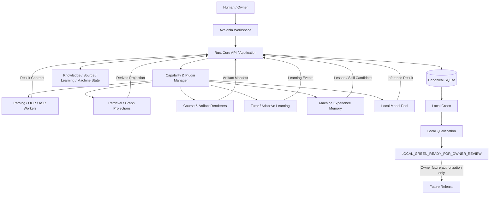
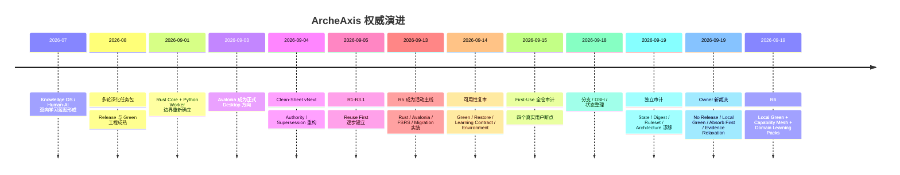
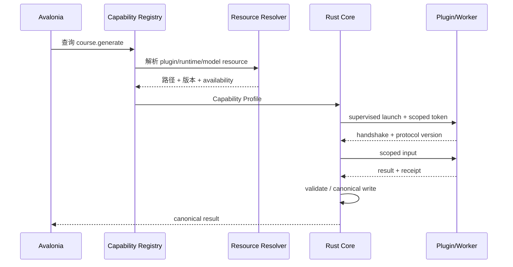
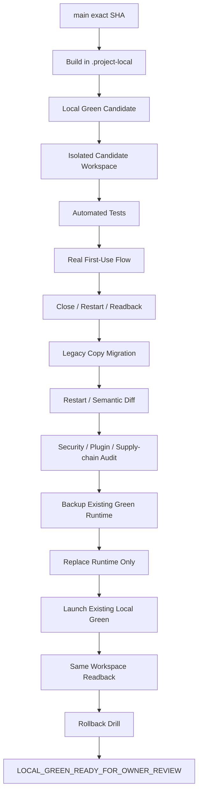

# ArcheAxis Knowledge OS 最终成熟方案：历史权威重构、Absorb-First 能力融合与 Local Green 收敛

## 执行摘要

本报告把 ArcheAxis 从 2026 年 7 月至 9 月的历史规划、R5 实施与审计、9 月 14/15 日首次使用复审、9 月 18 日状态整理、9 月 19 日独立审计、本次对话中的 Owner 新裁决，以及当前仓库重新出现的 R6 收敛工作，统一成一条新的权威路线。

本轮 GitHub 读取显示，仓库默认主线已经继续前进，当前读取到的 HEAD 为 **`0e934f33ee9a5f6082c04abda454c67df1055097`**，因此此前以 `d1375b9...` 为 HEAD 的 9 月 19 日审计只能作为历史基线，不能再直接当“当前状态”。[当前 HEAD](https://github.com/DTALEX66/ArcheAxis-Knowledge-OS/commit/0e934f33ee9a5f6082c04abda454c67df1055097)

最终建议不是继续在 R5 上追加补丁，而是把项目正式收敛到：

> **R6 = Local Green Convergence + Capability Absorption + Human/Machine Learning + Domain Learning Packs**

并确立以下不可再摇摆的顶层原则：

**第一，GitHub `main` 不再承担产品版本推进语义。** 历史 `v0.6.14`、Tag、Release、Release Evidence 保留作为不可改写的历史事实；`main` 是持续开发线。必要的包版本、协议版本、Schema 版本仍保留，但它们不是新的产品发布版本。

**第二，发布全面冻结。** 当前所有修复、功能吸收、迁移、UI、课程、模型和插件工作，最终只生成 **Local Green Candidate**；通过本机完整资格验证后，可以替换 `D:\All projects\ArcheAxis.Knowledge.Green-x64` 中现有 Green 运行时，但仍不创建 Tag、不创建 GitHub Release、不产生 `v0.6.15/v0.7.0`。只有 Owner 后续明确授权才重新启动 Release 工作。

**第三，ArcheAxis 不再追求“大量自研”。** 采用：

> **Absorb First → Integrate Second → Build Last**

知识解析、OCR、RAG、图谱、Memory、课程生成、互动课件、Notebook、学习路径、Tutor、ASR、Embedding、Reranker 等，只要已有成熟方案，优先吸收。ArcheAxis 自研重点缩到 **Canonical Truth、权限、契约、知识生命周期、人/机学习状态、Domain Pack、插件治理、迁移和 Local Green 生命周期**。

**第四，第三方能力必须插件化，而不是继续堆进核心。** OpenMAIC、H5P、LearningMAP、DeepTutor、RAG-Anything、LightRAG、Graphiti、MemOS 等可以成为 Provider/Renderer/Worker/Sidecar，但任何一个都不得成为第二个 ArcheAxis Canonical Store。

**第五，Evidence 不再是 Knowledge Admission Gate。** `personal_experience`、`personal_note`、`project_observation` 可以没有外部证据而合法成为用户自己的 Accepted Knowledge；机器输出即使有引用，也只能先进入 Candidate。外部证据、置信度、风险、有效时间、来源类型是独立维度。

**第六，学习系统必须从“文档→总结→Quiz”升级为领域化教学系统。** 不同知识领域必须使用不同的 ontology、knowledge components、prerequisites、pedagogy、assessment、renderer 和 model profile，这就是新的 **Domain Learning Pack**。

**第七，本地 Green 才是最终真实性验收环境。** CI 证明代码可构建，不证明用户能用；单元测试不证明 Green 重启后数据还在；模拟 `correct=true` 不证明学习闭环。最终唯一有效的是本机真实：

```text
资料
→ 解析
→ 阅读
→ 知识
→ 课程/学习资产
→ 真人学习
→ 真实回答
→ 掌握状态
→ 机器使用
→ 失败/修正
→ Lesson/Skill
→ 重启
→ 同一 Workspace 回读
```

完整目标架构如下：



其中 **虚线的 Release 路径当前关闭**。

## 权威历史、当前基线与差距

ArcheAxis 的历史不能简单理解成“旧任务已经过期”。正确做法是把历史分为 **设计来源、实施事实、审计事实和当前权威**。R5 不删除，它是重要工程证据；但 R6 应成为唯一活动计划。

历史演进可以收敛成：



当前优先级建议明确为：

```text
Owner 本次对话裁决
        ↓
R6 当前权威任务 / Contract
        ↓
Current code + tests + GitHub live configuration
        ↓
R5 implementation evidence
        ↓
R3/R2/旧 TaskPack
        ↓
Historical release / legacy architecture
```

也就是说，当旧任务写“必须有 evidence 才能进入 knowledge”，而 Owner 当前裁决允许个人经验无外证入库时，**以当前 Owner 裁决为准，并由 R6 把它写成正式仓库 Authority**。

### 历史发现 → 当前结果 → R6 深化

| 历史发现 | 当前是否已修复、已有证据 | 新权威下的深化与任务 |
|---|---|---|
| **9/14：执行环境可能不是合法 Git 根** | 已有修复提交 `93faebc`，强化 execution preflight。[commit](https://github.com/DTALEX66/ArcheAxis-Knowledge-OS/commit/93faebc) | **P1 / A02**：所有 Worker/Adapter/Sidecar 统一使用 Capability Resolver；禁止自行猜 PATH、CWD、模型路径。 |
| **9/14：Restore 只证明 SQLite 能打开，不证明是正确的 ArcheAxis Backup** | `a3ea5f1` 增加 backup identity metadata。[commit](https://github.com/DTALEX66/ArcheAxis-Knowledge-OS/commit/a3ea5f1) | **P0 / A13**：升级为 workspace-id + schema + manifest digest + snapshot identity + semantic readback；Migration 激活前必须 dry-run。 |
| **9/14：Learning Review Contract 过弱** | `e50e444` 增加版本化 Learning Review Evidence Contract。[commit](https://github.com/DTALEX66/ArcheAxis-Knowledge-OS/commit/e50e444) | **P0 / A08**：扩展为 learning objective、KC、item/version、knowledge/version、response、hints、pedagogy、assessment rubric、mastery delta。 |
| **9/14：环境/外部资源依靠 PATH 与隐式探测** | `debabd0` 建立只读 Capability Resolver；9/15 又有 `6643208`、`1f76cb6` 强化共享工具路径。[debabd0](https://github.com/DTALEX66/ArcheAxis-Knowledge-OS/commit/debabd0) · [6643208](https://github.com/DTALEX66/ArcheAxis-Knowledge-OS/commit/6643208) | **P0 / A02-A03**：合并为统一 `Capability Profile + Resource ID`；插件只引用资源 ID，不硬编码路径。 |
| **9/14：Avalonia 有桌面壳，但真人 Review 链不完整** | `32ba061` 接通 desktop review → Core，`258744e` 增加 review provenance。[32ba061](https://github.com/DTALEX66/ArcheAxis-Knowledge-OS/commit/32ba061) | **P0 / A08-A12**：从“提交 Review”升级成 Course → Activity → Answer → Assessment → Mastery → Review 全学习工作区。 |
| **9/14：Capability Receipt 没有足够真实版本信息** | `d5d8ab0` 记录真实 capability tool version。[commit](https://github.com/DTALEX66/ArcheAxis-Knowledge-OS/commit/d5d8ab0) | **P1 / A03**：Receipt 增加 plugin id/source pin/model/quant/runtime/config/input digest。 |
| **9/14：正式 Avalonia 架构与旧发布/Tauri 链不一致** | `4903c4d` 曾增加 formal desktop architecture gate。[commit](https://github.com/DTALEX66/ArcheAxis-Knowledge-OS/commit/4903c4d) | **P0 / A01**：不再修“新 Release”；旧 Release 留历史。CI 改为 Local Green qualification，不得创建发布。 |
| **9/15：Import 可能只生成 Source，而未形成可读内容** | 后续 R5 已增加 import→job→execution，但历史审计证明不能以 API 存在代替真人验证。 | **P0 / A05-A14**：真实 `ceshi` 文件进入 Source 后必须自动 Transform、Anchor、Reader 可见；最终 Golden Journey 做回归。 |
| **9/15：空库没有第一份 Learning Item** | Review/Queue 已增强，但“谁生成第一次学习资产”是结构性问题。 | **P0 / A08-A10**：由 Domain Pack + Course Planner 从 Accepted Knowledge 生成第一份 LearningArtifact，不允许靠预灌 learning event。 |
| **9/15：DEV 临时 DB 被误当 Green 持久 Workspace** | 历史测试已识别此问题，但必须保持长期 Gate。 | **P0 / A13-A14**：DEV/TEST/LOCAL-GREEN 三种 workspace profile 完全分开；最终资格只能使用隔离的 Local Green candidate workspace。 |
| **9/15：Journey 可人为写 `correct=true` 制造假闭环** | `f5847b9` 等提交强化 first-use boundary。[commit](https://github.com/DTALEX66/ArcheAxis-Knowledge-OS/commit/f5847b9) | **P0 / A14**：最终资格禁止 SQL、seed correct、mock model result、synthetic success；必须真人作答和重启回读。 |
| **9/15：模型资产/工具资产容易复制进入项目** | `19f9ac1`、`7eaad3f`、`6643208`、`1f76cb6` 已向共享资源 Registry 收敛。[19f9ac1](https://github.com/DTALEX66/ArcheAxis-Knowledge-OS/commit/19f9ac1) | **P0 / A02-A11**：所有本地模型继续驻留 `D:\All projects\Model library`；插件 manifest 只存 resource ref。 |
| **9/15：DeepTutor custody 与外部依赖需要明确** | `4b746d1`、`df859df` 分别处理 DeepTutor custody 和外部依赖 inventory。[4b746d1](https://github.com/DTALEX66/ArcheAxis-Knowledge-OS/commit/4b746d1) | **P1 / A03-A08**：不再固定旧 DeepTutor 行为面；重新 pin 1.6.x 能力，按 Sidecar/Adapter 吸收。 |
| **9/18：历史分支、DSH 结果和当前任务状态混在一起** | 9/18 已有整理，但此前仍存在大量 squash 后远端分支。 | **P1 / A00**：按 merged-by-squash/blob-equivalence/disposition ledger 清分支；不能按 ahead/behind 粗暴删除。 |
| **9/19：`TASKS.json` 与 `R5-STATE.json` 出现两个 Current Truth** | 这是独立审计发现；当前 R6 应视为新的活动层，但必须彻底消除“双写状态”。 | **P0 / A00**：唯一可写 Task SSOT；状态页、报告、Dashboard 全部生成，不得人工维护第二份 Current。 |
| **9/19：digest authority 存在死路径/命名漂移** | 历史审计确认问题。 | **P0 / A00**：canonicalization profile 只保留一个真实路径和 profile id；CI 做引用存在性验证。 |
| **9/19：PROJECT_CONTRACT required checks 与 GitHub live ruleset 不一致** | 当时独立审计读到 live `main` required check 为 `a0-gates`，而 contract 曾声明其他名字。当前 HEAD 后 live 状态未在本轮完整复验。 | **P0 / A00-A01**：只保留一个最终 aggregate gate；仓库 Contract 必须从 live ruleset 反向证明一致。 |
| **9/19：Green Candidate 不一定进入最终聚合 Gate** | 历史 `green-candidate-vnext` 与 `a0-gates` 存在潜在断口。 | **P0 / A01-A13**：重命名语义为 `local-green-candidate`，纳入 aggregate gate；但 CI Candidate ≠ 本机 Green Qualified。 |
| **9/19：Release Ledger / README / evidence 出现版本真相漂移** | 历史 `v0.6.14` evidence 有效，但不同文档曾显示不同“current stable”。 | **P0 / A01**：main 不再声明 current product version；历史 Release Index 从 evidence 自动生成。 |
| **9/19：CURRENT_ARCHITECTURE / SYSTEM_BOUNDARY 仍残留 Python/Tauri 主产品描述** | Avalonia/Rust 已成为正式方向，旧文档存在历史漂移。 | **P0 / A00**：Current 只画 Avalonia→Rust→Worker；Python/Tauri 移为 `LEGACY_ARCHITECTURE`。 |
| **9/19：16 格式没有任何一个达到原定义的 Complete** | 历史 R5 矩阵是 **0 Complete / 14 Partial / 2 Custody Only**。 | **P1 / A05**：不降低 Complete 定义；利用 RAG-Anything/Docling/PaddleOCR 等减少自研，把核心格式逐个真正闭环。 |
| **本次 Owner：个人经验经常天然无证据** | 这是新的最高权威，覆盖过去过于严格的 evidence admission。 | **P0 / A04**：`personal_experience/personal_note/project_observation` 可 Accepted；禁止伪造证据，Evidence 改成独立属性。 |
| **本次 Owner：不能不断发新版本** | 明确新裁决。 | **P0 / A01**：Release Freeze；终态只能 `LOCAL_GREEN_READY_FOR_OWNER_REVIEW`。 |
| **本次 Owner：成熟能力全部优先吸收** | 将历史 Reuse First 升级。 | **P0 / A03**：建立 Capability Absorption Registry；任何新增算法先做 upstream check。 |

旧 R5 的格式快照必须继续保留，因为它是衡量 R6 是否真正进步的重要基线，而不是“为了新任务包重新把状态写好看”：

| 格式族 | R5 历史状态 | R6 处理方向 |
|---|---|---|
| Text / Markdown / CSV / JSON / XML / Code | Partial | 内部基础 Parser + mature parser fallback |
| HTML | Partial | static DOM + normalized structure |
| 动态网页 | Partial | provider/connector，不把浏览器运行时写进核心 |
| PNG/JPG/OCR | Partial | PaddleOCR/Tesseract + VLM fallback |
| Native PDF | Partial | Docling/RAG-Anything/PyMuPDF 组合 |
| Scanned PDF | Partial | render → OCR → page anchor 回写 |
| DOCX | Partial | mature Office parser |
| PPTX | Partial | slide hierarchy + speaker notes + images |
| XLSX | Partial | sheet/table/formula/region |
| Audio | Partial | SenseVoice/faster-whisper |
| Video | Partial | scene/audio/subtitle multimodal |
| SRT/VTT/Canvas | Partial | time anchors / graph structure |
| EPUB/EML/ODT 等 | Partial | provider adapters |
| ZIP/目录 | Partial | custody + recursive source membership |
| DOC/PPT/XLS legacy | Custody Only | LibreOffice/conversion provider，原件保留 |
| PSD/AI/CDR/CAD/3D | Custody Only | 专业 provider/preview，暂不伪称完整语义支持 |

重要的是：**“Complete”应该变难而不是变容易。** Complete 至少意味着原件/来源、Transform、Structure、Anchor、Loss、Engine Version、Quality、Reader/Query、重启回读均成立。

当前 Rust 边界则属于应该继续保留的成功成果：

```text
Avalonia         ─┐
Python Worker    ─┼─ X → raw SQLite
Third-party      ─┘

Rust Application
       ↓
Rust Store / Writer
       ↓
Canonical SQLite
```

这条边界不因吸收更多开源项目而改变。

另一个必须保留的历史事实是：此前公开稳定 Release `v0.6.14` 已经有完整历史资产/evidence。R6 不删除这些材料；**只是取消它对 `main` 当前产品身份的控制**。历史 Release 与 Local Green Development Line 从此分离。

本轮唯一无法完整重新确认的是 **HEAD `0e934f3...` 之后所有远端分支的精确数量、live ruleset 当前实时状态以及每个 R6 文件的最终路径**。此前审计快照曾记录 17 个非 `main` 分支，但不能把该数字冒充 2026-09-19 当前 HEAD 后重新枚举的实时结果；因此 R6 A00 的第一个机器动作必须重新导出 branch/ruleset/workflow snapshot，而不是复用旧数字。

## 最终架构与本地插件化

最终架构应从“核心不断新增 feature module”改变为：

> **Canonical Kernel + Capability Mesh + Domain Learning Packs + Local Green**

ArcheAxis Core 必须自己拥有的东西很少，但这些东西必须牢牢掌握：

| 必须由 ArcheAxis 掌握 | 原因 |
|---|---|
| Canonical Source / Knowledge | 避免第三方形成第二真相 |
| Knowledge lifecycle/version/supersession | 决定知识如何变化 |
| Personal / External / Machine provenance | 解决证据与个人经验问题 |
| Human learning canonical state | Tutor 可以换，学习历史不能丢 |
| Machine task/competence measurement | Memory/Agent 可以换，测量事实不能丢 |
| Authority / permissions | 插件不能自封权威 |
| Capability contracts | Upstream 可替换 |
| Domain Pack contract | 学科教学逻辑不绑定某 Tutor |
| Migration | 只 ArcheAxis 知道自己的历史语义 |
| Local Green lifecycle | 本地真实运行资格 |
| Audit receipts | 可证明发生了什么 |

其余能力尽量插件化。

建议正式引入以下插件类型：

```text
provider        外部研究/模型/API Provider
worker          bounded stdio/process worker
renderer        LearningArtifact 渲染器
sidecar         独立本地服务
projection      Derived index / graph / memory
tool            确定性工具
ui-contribution 声明式菜单/面板贡献
```

**目录结构建议：**

```text
ArcheAxis-Knowledge-OS/
├─ config/
│  ├─ capabilities/
│  ├─ plugins/
│  └─ domain-packs/
├─ plugins/
│  ├─ builtin/
│  │  ├─ openmaic-adapter/
│  │  ├─ h5p-renderer/
│  │  ├─ jupyterlite-renderer/
│  │  ├─ rag-anything-worker/
│  │  └─ memos-agent/
│  └─ sdk/
├─ crates/
│  ├─ archeaxis-plugin-contracts/
│  └─ archeaxis-capability-registry/
└─ .project-local/
   ├─ plugin-cache/
   ├─ green-candidates/
   ├─ receipts/
   └─ qualification/
```

本地 Green 中：

```text
D:\All projects\ArcheAxis.Knowledge.Green-x64\
├─ plugins\
│  ├─ manifests\
│  └─ adapters\
```

但 **模型和大型第三方 Runtime 不复制进 `plugins/`**。它们继续通过 Resource ID 解析：

```text
model:qwen-general
    → D:\All projects\Model library\...

tool:ffmpeg
    → D:\All projects\OS External Configuration\...

capability:openmaic
    → external runtime resolver
```

推荐的 Plugin Manifest：

```json
{
  "schema": "archeaxis.plugin/v1",
  "id": "org.archeaxis.openmaic",
  "display_name": "OpenMAIC Course Adapter",
  "plugin_version": "adapter-dev",
  "type": "sidecar",
  "source": {
    "project": "THU-MAIC/OpenMAIC",
    "pin": "PIN_REQUIRED",
    "license": "VERIFY_AT_PIN"
  },
  "protocol": {
    "name": "archeaxis-capability",
    "major": 1
  },
  "capabilities": [
    "course.plan",
    "artifact.slide.generate",
    "artifact.interactive.generate"
  ],
  "runtime": {
    "resource_id": "runtime:openmaic",
    "launch_mode": "supervised"
  },
  "permissions": {
    "knowledge": ["read-scoped"],
    "learning_artifact": ["write-candidate"],
    "filesystem": ["temporary-scoped"],
    "network": ["declared-provider-only"],
    "canonical_database": []
  },
  "ui": {
    "menu": [
      {
        "surface": "knowledge",
        "label": "生成课程",
        "command": "course.plan"
      }
    ]
  },
  "healthcheck": {
    "required": true
  }
}
```

**核心安全规则：**

插件绝不获得 SQLite path。

插件不会因为被安装就获得全部 Knowledge。

Core 发给插件的应该是：

```text
scoped input
+ capability token
+ temporary source handle
+ explicit command
```

结果返回：

```text
Result Contract
+ provenance
+ tool/model version
+ input digest
+ output digest
+ loss/warnings
```

然后由 Rust Core 决定是否写 Canonical DB。

对于能执行任意代码的 `.NET DLL` 插件，**默认不允许第三方运行时动态装入 Avalonia 主进程**。更安全的策略是：

```text
Trusted built-in UI
       ↓
Declarative UI contribution
       ↓
Core command
       ↓
Isolated Worker / Sidecar
```

只有随 ArcheAxis 构建、Hash 固定、经过供应链审计的 in-process 组件才能例外。

推荐的 UI 插件菜单：

```text
ArcheAxis
├─ 知识
│  ├─ 创建知识
│  ├─ 研究
│  └─ 生成学习内容 ▸
│       ├─ 生成课程          [OpenMAIC]
│       ├─ 生成互动练习      [H5P]
│       ├─ 生成 Notebook     [JupyterLite]
│       └─ 自适应学习路径    [LearningMAP]
│
├─ 学习
│  ├─ 我的路径
│  ├─ 今日复习
│  ├─ 课程
│  └─ 学习方式 ▸
│       ├─ Guided Tutor
│       ├─ Feynman
│       ├─ Socratic
│       └─ Project Learning
│
└─ 设置
   └─ 扩展
      ├─ 已启用
      ├─ 可用能力
      ├─ 模型与运行时
      ├─ 权限
      └─ 诊断
```

注册发现流程：



这解决了未来能力快速变化的问题：OpenMAIC 被更好的项目替代时，只替换 Provider；Knowledge Core 不改。

## 能力吸收与供应链

ArcheAxis 的“吸收全部成熟能力”不能理解成把所有仓库 vendor 到一起。正确原则是：

> **一个能力一个默认主实现；其他只能是 fallback、benchmark、optional provider 或 donor。**

以下 Registry 是 R6 的初版。外部项目的 **精确 Git commit 必须在真正吸收 PR 中 pin**；这里没有伪造当前 upstream HEAD，未完成精确 pin 的统一标记为 `PIN_REQUIRED`。

### Capability Absorption Registry 初版

| capability_id | 能力 / upstream | License 初判 | Runtime / 本地资源 | 吸收模式 | Authority / Data Boundary | Benchmark | 状态 / Task |
|---|---|---|---|---|---|---|---|
| `course.openmaic` | [THU-MAIC/OpenMAIC](https://github.com/THU-MAIC/OpenMAIC), `PIN_REQUIRED` | MIT 路线，吸收前读 exact LICENSE | 独立 Web/Python/Node 运行面；模型走 Resource Registry | **ADAPTER + SIDECAR** | 只生成 Course/Artifact Candidate；无 DB 权限 | objective coverage、scene validity、offline artifact、人工可编辑性 | **PILOT / A10** |
| `artifact.h5p` | [H5P](https://github.com/h5p), `PIN_REQUIRED` | H5P 生态按核心/Content Type逐项审计，不假定全生态同一许可 | JS/HTML renderer | **ADAPTER** | LearningArtifact renderer；不拥有学习真相 | package validity、offline render、event mapping | **ABSORB / A10** |
| `learning.learningmap` | [ai-for-edu/LearningMAP](https://github.com/ai-for-edu/LearningMAP), `PIN_REQUIRED` | Apache-2.0 路线，精确 pin 前复核 | Python/LLM | **ADAPTER + ALGORITHM DONOR** | KC/Pedagogy/diagnosis 供体；mastery 写入必须经 Core | prerequisite accuracy、diagnosis consistency、lesson relevance | **PILOT / A08-A09** |
| `tutor.deeptutor` | [HKUDS/DeepTutor](https://github.com/HKUDS/DeepTutor), pin 当前 1.6.x 后冻结 | exact LICENSE 在集成 PR 重新确认 | Sidecar + LLM | **SIDECAR + ADAPTER** | Learning Experience Provider；无 Canonical ownership | source grounding、session recovery、learning path | **PILOT / A08** |
| `learning.opentutor` | [zijinz456/OpenTutor](https://github.com/zijinz456/OpenTutor), `PIN_REQUIRED` | 初判 MIT，需 exact LICENSE 验证 | Web/LLM | **ALGORITHM/UX DONOR** | block/question/adaptive patterns | question variety、difficulty adaptation、cognitive-load usefulness | **EVALUATE / A08** |
| `parse.raganything` | [HKUDS/RAG-Anything](https://github.com/HKUDS/RAG-Anything), `PIN_REQUIRED` | 初判 MIT，exact pin 验证 | Python + parser/OCR/media deps | **WORKER** | 只产 Transform/Structure；原件和 canonical Source 归 Core | structure retention、table/formula/image、loss、latency | **HIGH / A05** |
| `retrieval.lightrag` | [HKUDS/LightRAG](https://github.com/HKUDS/LightRAG), `PIN_REQUIRED` | 初判 MIT，exact pin 验证 | Python + embedding/graph | **WORKER / PROJECTION** | Derived index，可删可重建 | Recall@k、nDCG/MRR、citation grounding、rebuild | **HIGH / A06** |
| `graph.graphiti` | [getzep/graphiti](https://github.com/getzep/graphiti), `PIN_REQUIRED` | Apache-2.0 路线，pin 时验证 | Python + graph backend | **SIDECAR / PROJECTION** | Temporal graph 是投影；事实状态以 Core 为准 | temporal precision、supersession、rebuild | **PILOT / A06** |
| `memory.memos` | [MemTensor/MemOS](https://github.com/MemTensor/MemOS), `PIN_REQUIRED` | exact LICENSE 必须再核验 | Python/service + model | **SIDECAR** | Agent Experience only；不能提升 Human Knowledge | recall、feedback correction、pollution rate、skill reuse | **PILOT / A07** |
| `workspace.weknora` | [Tencent/WeKnora](https://github.com/Tencent/WeKnora), `PIN_REQUIRED` | exact LICENSE 再核验 | 独立完整应用栈，较重 | **UX/ALGORITHM DONOR** | 吸收 revision/diff/folder/activity UX，不吸收其 DB authority | revision UX、rollback correctness | **REFERENCE / A12** |
| `artifact.jupyterlite` | [jupyterlite/jupyterlite](https://github.com/jupyterlite/jupyterlite), `PIN_REQUIRED` | BSD 系许可路线，pin 时验证 | 静态 Web / Pyodide 等 | **DIRECT/ADAPTER RENDERER** | 代码 Lab renderer；执行结果转 Learning Event | notebook launch、exercise、result capture | **HIGH / A09-A10** |
| `learning.oppia` | [oppia/oppia](https://github.com/oppia/oppia), `PIN_REQUIRED` | Apache-2.0 | 完整平台较重 | **ALGORITHM/UX DONOR** | branching tutor / misconception routing 供体 | branching correctness、hint routing | **REFERENCE / A08** |
| `parse.docling` | [DS4SD/docling](https://github.com/docling-project/docling), `PIN_REQUIRED` | exact current LICENSE 验证 | Python/models | **WORKER** | document Transform Provider | layout/table/reading-order fidelity | **PILOT / A05** |
| `ocr.paddleocr` | [PaddlePaddle/PaddleOCR](https://github.com/PaddlePaddle/PaddleOCR), `PIN_REQUIRED` | Apache-2.0 路线 | Python/models | **WORKER** | OCR facts only；不决定 knowledge truth | CER/WER、bbox、tables、VRAM | **HIGH / A05-A11** |
| `asr.sensevoice` | [FunAudioLLM/SenseVoice](https://github.com/FunAudioLLM/SenseVoice), `PIN_REQUIRED` | 代码/模型分别审计 | model library | **WORKER** | ASR transform only | WER、speed、language robustness | **EVALUATE / A05-A11** |

这里尤其要注意：**Sidecar 不是规避许可证的办法。** 对 GPL/AGPL、模型特殊许可证、商业组件等，进程隔离只是工程边界；许可证义务仍应根据实际复制、修改、分发、网络服务方式判断。

完整 Registry 推荐使用以下 CSV 作为机器初始文件：

```csv
capability_id,name,upstream_project,source_pin,license,runtime_req,local_resource,absorption_mode,authority_boundary,data_boundary,benchmark,fallback,status,task_id
course.openmaic,OpenMAIC Course Engine,https://github.com/THU-MAIC/OpenMAIC,PIN_REQUIRED,VERIFY_EXACT,sidecar runtime,runtime:openmaic,ADAPTER+SIDECAR,artifact candidate only,no canonical DB,objective coverage+artifact validity,internal basic planner,PILOT,A10
artifact.h5p,H5P Renderer,https://github.com/h5p,PIN_REQUIRED,PER_COMPONENT_AUDIT,HTML/JS renderer,runtime:h5p,ADAPTER,renderer only,no canonical DB,package validity+offline render,static renderer,ABSORB,A10
learning.learningmap,LearningMAP,https://github.com/ai-for-edu/LearningMAP,PIN_REQUIRED,VERIFY_EXACT,Python+LLM,runtime:learningmap,ADAPTER,KC and pedagogy provider,mastery writes via Core,diagnosis+lesson relevance,internal learning planner,PILOT,A08-A09
tutor.deeptutor,DeepTutor,https://github.com/HKUDS/DeepTutor,PIN_CURRENT_1_6_X,VERIFY_EXACT,sidecar+LLM,runtime:deeptutor,SIDECAR+ADAPTER,learning experience only,no canonical DB,grounding+recovery+path,internal reader,PILOT,A08
learning.opentutor,OpenTutor,https://github.com/zijinz456/OpenTutor,PIN_REQUIRED,VERIFY_EXACT,web+LLM,runtime:opentutor,REFERENCE+ADAPTER,adaptive learning donor,no canonical DB,question types+difficulty,LearningMAP,EVALUATE,A08
parse.raganything,RAG-Anything,https://github.com/HKUDS/RAG-Anything,PIN_REQUIRED,VERIFY_EXACT,Python+media stack,runtime:raganything,WORKER,transform provider,source canonical in Core,structure fidelity+loss,Docling,HIGH,A05
retrieval.lightrag,LightRAG,https://github.com/HKUDS/LightRAG,PIN_REQUIRED,VERIFY_EXACT,Python+embedding,runtime:lightrag,WORKER+PROJECTION,retrieval projection,rebuildable only,Recall@nDCG+grounding,FTS5,HIGH,A06
graph.graphiti,Graphiti,https://github.com/getzep/graphiti,PIN_REQUIRED,VERIFY_EXACT,Python+graph,runtime:graphiti,SIDECAR+PROJECTION,temporal derived graph,rebuildable only,temporal+supersession precision,Core temporal fields,PILOT,A06
memory.memos,MemOS,https://github.com/MemTensor/MemOS,PIN_REQUIRED,VERIFY_EXACT,service+models,runtime:memos,SIDECAR,machine experience only,no human truth promotion,memory recall+pollution+skill reuse,Core receipts,PILOT,A07
workspace.weknora,WeKnora,https://github.com/Tencent/WeKnora,PIN_REQUIRED,VERIFY_EXACT,full application,runtime:weknora,REFERENCE,UX donor,no canonical ownership,revision+rollback UX,ArcheAxis native UI,REFERENCE,A12
artifact.jupyterlite,JupyterLite,https://github.com/jupyterlite/jupyterlite,PIN_REQUIRED,VERIFY_EXACT,static web,runtime:jupyterlite,ADAPTER,lab renderer,no DB access,launch+exercise+event capture,static code renderer,HIGH,A09-A10
learning.oppia,Oppia,https://github.com/oppia/oppia,PIN_REQUIRED,Apache-2.0,full web application,runtime:oppia,REFERENCE,branching pedagogy donor,no canonical ownership,misconception+hint routing,internal branching model,REFERENCE,A08
parse.docling,Docling,https://github.com/docling-project/docling,PIN_REQUIRED,VERIFY_EXACT,Python+models,runtime:docling,WORKER,document transform,no canonical ownership,layout+table+reading order,RAG-Anything,PILOT,A05
ocr.paddleocr,PaddleOCR,https://github.com/PaddlePaddle/PaddleOCR,PIN_REQUIRED,VERIFY_EXACT,Python+models,model:paddleocr,WORKER,OCR facts,no knowledge promotion,CER+layout+bbox,Tesseract,HIGH,A05-A11
asr.sensevoice,SenseVoice,https://github.com/FunAudioLLM/SenseVoice,PIN_REQUIRED,VERIFY_CODE_AND_WEIGHT_LICENSE,local model,model:sensevoice,WORKER,ASR transform,no knowledge promotion,WER+RTF+memory,faster-whisper,EVALUATE,A05-A11
```

供应链则不能等发布时才想起来做。Local Green Candidate 自己也必须生成：

```text
runtime-manifest.json
source-identity.json
plugin-lock.json
model-manifest.json
sbom.spdx.json 或 cyclonedx.json
THIRD_PARTY_NOTICES
LICENSE inventory
SHA-256 inventory
qualification receipt
```

**这些是 Local Green 资格证据，不意味着发布。**

供应链需要明确分离：

```text
code_license
dependency_license
model_weight_license
dataset_license
content_license
API/SaaS terms
```

不能因为 Python 包是 Apache/MIT，就推断它下载的模型权重也是同一许可证。

## 学科课程、知识学习与本地模型

ArcheAxis 的最大产品机会不是继续做一个更大的 RAG，而是建立：

> **Knowledge → Learning Design → Course → Artifact → Activity → Assessment → Mastery → Experience**

其中最重要的新抽象是 `DomainLearningPack`。

它不能只是一个 Prompt。它至少应该决定：

```text
这个领域有哪些知识对象？
它们的先修关系是什么？
哪些错误最典型？
应该怎样教？
应该用什么活动？
如何判断掌握？
用什么工具验证？
什么 Renderer 最合适？
需要什么模型？
哪些知识使用时需要证据？
```

统一模板：

```yaml
schema: archeaxis.domain-learning-pack/v1

id: example-domain
display_name: Example Domain

ontology:
  entity_types: []
  relation_types: []

knowledge_components:
  decomposition: []
  prerequisite_policy: explicit
  misconception_model: enabled

learning_objectives:
  levels:
    - recognize
    - explain
    - apply
    - analyze
    - create

pedagogy:
  default:
    - scaffolding
    - socratic
    - retrieval_practice
  optional: []

lesson_templates: []
activity_templates: []
assessment_types: []
mastery_rules: {}

renderers: []

model_profile:
  general_tutor: local:general
  reasoning: local:reasoning
  vision: null
  embedding: local:embedding
  reranker: local:reranker

evidence_policy:
  personal_experience_allowed: true
  external_evidence_required_for_admission: false
  machine_generated_default: candidate
  high_risk_real_world_use: current_authoritative_reference_required
```

四个首批 Pack 建议直接这样落地：

```yaml
schema: archeaxis.domain-learning-pack/v1
id: general
display_name: General Knowledge

ontology:
  entity_types: [concept, fact, procedure, case, person, event, method]
  relation_types: [depends_on, explains, contrasts_with, example_of, supersedes]

knowledge_components:
  decomposition: semantic
  prerequisite_policy: inferred_then_reviewed
  misconception_model: enabled

pedagogy:
  default: [scaffolding, retrieval_practice, feynman]
  optional: [socratic, case_based]

lesson_templates:
  - explain_example_practice
  - compare_contrast
  - case_reflection

renderers:
  - builtin.lesson
  - h5p.quiz
  - openmaic.slides
  - openmaic.interactive

model_profile:
  general_tutor: local:qwen-small
  embedding: local:qwen-embedding-small
  reranker: local:qwen-reranker-small

evidence_policy:
  personal_experience_allowed: true
  external_evidence_required_for_admission: false
  machine_generated_default: candidate
```

```yaml
schema: archeaxis.domain-learning-pack/v1
id: math
display_name: Mathematics

ontology:
  entity_types: [definition, theorem, lemma, formula, proof, problem, method]
  relation_types: [prerequisite_of, proves, derives, special_case_of]

knowledge_components:
  decomposition: fine_grained
  prerequisite_policy: strict
  misconception_model: required

pedagogy:
  default: [worked_example, scaffolding, socratic, retrieval_practice]
  optional: [feynman]

lesson_templates:
  - concept_derivation_example_practice
  - proof_reconstruction
  - error_diagnosis

activity_templates:
  - symbolic_problem
  - graph_interaction
  - proof_step
  - simulation

assessment_types:
  - exact_answer
  - symbolic_equivalence
  - step_rubric
  - proof_rubric

renderers:
  - builtin.math
  - jupyterlite.lab
  - h5p.quiz
  - openmaic.simulation

model_profile:
  general_tutor: local:qwen-small
  reasoning: local:qwen-medium
  tool_first: [sympy, calculator]
  embedding: local:qwen-embedding-small

evidence_policy:
  personal_experience_allowed: true
  machine_generated_default: candidate
```

```yaml
schema: archeaxis.domain-learning-pack/v1
id: programming
display_name: Programming

ontology:
  entity_types: [concept, API, syntax, pattern, algorithm, bug, test, project]
  relation_types: [uses, implements, calls, fails_because, fixes, depends_on]

knowledge_components:
  decomposition: executable_skill
  prerequisite_policy: explicit
  misconception_model: required

pedagogy:
  default: [learn_by_doing, debugging, project_based, code_review]
  optional: [socratic]

lesson_templates:
  - explain_run_modify
  - failing_test_debug
  - small_project
  - refactoring_review

activity_templates:
  - runnable_code
  - unit_test
  - debug_trace
  - implementation_task

assessment_types:
  - compile
  - unit_test
  - hidden_test
  - static_analysis
  - rubric

renderers:
  - jupyterlite.lab
  - builtin.code_lab
  - h5p.quiz

model_profile:
  coding: local:qwen-small-or-medium
  rule: model_score_never_replaces_execution
  embedding: local:qwen-embedding-small

evidence_policy:
  personal_experience_allowed: true
  machine_generated_default: candidate
```

```yaml
schema: archeaxis.domain-learning-pack/v1
id: design
display_name: Visual Design

ontology:
  entity_types: [artifact, layout, typography, color, composition, reference, style, critique]
  relation_types: [inspired_by, contrasts_with, improves, violates, exemplifies]

knowledge_components:
  decomposition: principle_and_skill
  prerequisite_policy: flexible
  misconception_model: rubric_based

pedagogy:
  default: [example_comparison, critique, project_based, iterative_revision]
  optional: [feynman, socratic]

lesson_templates:
  - observe_analyze_redesign
  - compare_examples
  - critique_revision
  - constrained_project

activity_templates:
  - image_comparison
  - hotspot_analysis
  - moodboard
  - artifact_critique
  - redesign_task

assessment_types:
  - rubric
  - comparative_review
  - self_reflection
  - revision_delta

renderers:
  - builtin.visual
  - h5p.image_hotspot
  - h5p.image_comparison
  - openmaic.visual_course

model_profile:
  general_tutor: local:qwen-small
  vision: local:qwen-vl-small
  multimodal_embedding: local:qwen-vl-embedding
  multimodal_reranker: local:qwen-vl-reranker

evidence_policy:
  personal_experience_allowed: true
  taste_and_judgment_can_be_personal: true
  machine_generated_default: candidate
```

这个体系回答了此前一个非常核心的问题：

> OpenMAIC、H5P、JupyterLite、DeepTutor 到底谁是“课程系统”？

答案是：**都不是 ArcheAxis 的课程权威。**

ArcheAxis 自己拥有：

```text
LearningObjective
KnowledgeComponent
CourseManifest
LearningArtifact
Activity
Assessment
Mastery
```

OpenMAIC/H5P/JupyterLite 等只负责某个阶段。

推荐 Course Manifest：

```text
Knowledge
   ↓
Domain Pack
   ↓
Learning Objective
   ↓
Course Planner
   ↓
Course Manifest
   ├─ Unit
   │  ├─ Lesson
   │  ├─ Activity
   │  └─ Assessment
   │
   └─ Artifact Router
      ├─ OpenMAIC
      ├─ H5P
      ├─ JupyterLite
      ├─ Built-in
      └─ future renderer
```

知识准入模型同步调整为：

```text
Knowledge
├─ personal_experience
├─ personal_note
├─ project_observation
├─ external_document
├─ authoritative_reference
├─ derived_inference
├─ research_result
├─ imported_legacy
└─ machine_candidate
```

并把以下字段彻底分开：

```text
source_type
owner
status
support_level
confidence
risk_level
valid_from
valid_to
supersedes
superseded_by
```

例如：

```yaml
source_type: personal_experience
owner: human
status: accepted
external_evidence: null
support_level: self_reported
confidence: high
```

完全合法。

而：

```yaml
source_type: machine_candidate
owner: machine
status: candidate
external_sources:
  - source-a
  - source-b
confidence: high
```

即使有两个来源，也**不能自己变 Accepted**。

同样，`original` 也不能再成为所有 Knowledge 的硬要求：

- 从文件导入的 Source：有原件就保留原件/Hash/Custody；
- 用户直接输入的个人经验：本身就是原始 Human Statement；
- Derived inference：保留输入 Knowledge version；
- Machine candidate：保留 Prompt/Model/Input refs；
- 不允许为了满足 schema 编造“原件”。

### 本地模型池

RTX 5060 8GB + 64GB RAM + Windows 的核心原则不是追逐最大模型，而是：

> **小模型常驻、岗位分工、工具优先、较大模型按需加载。**

理论上 4-bit 权重的纯参数下限约为 `0.5 byte/parameter`，实际运行还要额外考虑量化元数据、KV cache、视觉 encoder、CUDA buffers 和运行时开销。因此 8GB VRAM 不应该用“14B 4bit≈7GB，所以能跑满显存”这种算法规划产品。

推荐：

| role | 首选模型/能力族 | Quant | Runtime | 8GB 策略 |
|---|---|---|---|---|
| `general_tutor` | Qwen 3 系约 4B 档 | Q4_K_M / Q5_K_M | llama.cpp/Ollama-compatible runtime | **默认常驻** |
| `reasoning` | Qwen 3 系约 8B 档 | Q4_K_M | llama.cpp，必要时 CPU offload | 按需加载、缩短 context |
| `coding` | 4B/8B 通用或 Code 模型 + 编译器 | Q4 | llama.cpp + real executor | 模型不负责最终正确性 |
| `vision` | Qwen-VL 约 4B 档 | 4-bit | 独立 Python/VL worker | 与大文本模型避免同时占满 GPU |
| `embedding` | Qwen3-Embedding 0.6B 档 | FP16/INT8/合适量化 | local worker | 可常驻 |
| `reranker` | Qwen3-Reranker 0.6B 档 | 轻量 | local worker | 可常驻或 CPU |
| `multimodal_embedding` | 小型 Qwen-VL Embedding | 低精度 | worker | 设计/图片 Pack 按需 |
| `multimodal_reranker` | 小型 VL Reranker | 低精度 | worker | 按需 |
| `ocr` | PaddleOCR + Tesseract | 原生 | worker | 确定性 OCR 优先 |
| `asr` | SenseVoice / faster-whisper | FP16/INT8 | worker | 不与 VL 同时长期驻 GPU |
| `math` | 通用 LLM + SymPy/calculator | N/A | tool-first | 计算工具优先 |
| `programming_eval` | compiler/test/linter | N/A | native sandbox | 不用 LLM 分数替代测试 |

模型资料应继续从官方模型/项目源进行精确 pin，例如 [QwenLM](https://github.com/QwenLM)、[PaddleOCR](https://github.com/PaddlePaddle/PaddleOCR)、[SenseVoice](https://github.com/FunAudioLLM/SenseVoice)。由于本轮最终综合阶段未重新逐个读取 2026-09-19 每个模型仓库的最新模型卡，**最终模型 ID、权重许可证和 GGUF 量化版本必须在 A11 实机 inventory 后锁定，不能把上表中的“模型族建议”写死成已安装事实。**

真正的 Model Profile 应该由本机 benchmark 产生：

```yaml
role: general_tutor
provider: local
model_resource_id: model:qwen-general-small
quantization: Q4_K_M
runtime_resource_id: runtime:llama
max_context_qualified: 8192

qualification:
  cold_start_ms: measured
  prompt_tokens_per_second: measured
  generation_tokens_per_second: measured
  peak_vram_mb: measured
  peak_ram_mb: measured
  task_score: measured

fallback:
  - model:qwen-general-medium-cpu-offload
```

不允许把厂商 benchmark 冒充本机能力。

## Local Green 与任务路线图

Local Green 不是“构建一个 ZIP 看起来没问题”。

它应该成为 ArcheAxis 最严格的 Qualification Environment。

最终生命周期：



### Local Green Candidate 替换清单

| 阶段 | 必须完成 | 失败处理 |
|---|---|---|
| Source identity | exact commit、tree、dirty=false、build manifest | 停止 |
| Build | Avalonia、Rust、Workers、built-in plugins | 停止 |
| Dependency lock | plugin pin、model resource、tool resource | 停止 |
| SBOM | code/dependency/model license inventory | 有未知许可证则阻塞相关插件 |
| Automated | unit/integration/boundary/contract | 停止 |
| Test corpus | 仅使用 `D:\All projects\ceshi` | 不碰真实资料库 |
| First-use | UI 完成 import→read→knowledge→learning | 停止 |
| First learning | 空库可生成真实第一 LearningArtifact | 停止 |
| Human review | 用户实际回答，不写 synthetic correct | 停止 |
| Machine task | 使用同一 knowledge 完成真实机器任务 | 停止 |
| Failure | 至少一条真实失败→correction→retest | 停止 |
| Restart | 关闭全部进程，重新启动后同库读取 | 停止 |
| Migration | Legacy DB **copy** → staging；semantic diff | 不激活 |
| Backup | Hash-addressed backup 当前 Green runtime | 无备份则不得替换 |
| Runtime replace | 只替换 Runtime，不删除用户 data/material | 失败立即 rollback |
| Production-local boot | 从真实 Green 启动入口启动 | 失败 rollback |
| Readback | 原 workspace、learning、knowledge、receipts | 差异则 rollback |
| Rollback drill | 恢复旧 runtime 并验证 | 失败则 Candidate 不合格 |
| Final state | `LOCAL_GREEN_READY_FOR_OWNER_REVIEW` | **不得 Release** |

Local Green 的身份建议：

```json
{
  "distribution": "local-green",
  "historical_public_release_base": "v0.6.14",
  "source_commit": "<exact-sha>",
  "source_tree": "<tree-sha>",
  "runtime_manifest_digest": "<sha256>",
  "published": false,
  "release_authorized": false
}
```

这个字段中的 `v0.6.14` 只是 provenance，不表示当前 GitHub `main` 是 v0.6.14。

### 最终任务包

建议正式 Plan ID：

```text
AAK-R6-LOCAL-GREEN-ABSORB-FIRST-CONVERGENCE
```

任务图：

| Task | 目标 | Priority | Owner Role | Gate |
|---|---|---:|---|---|
| `A00 Authority Convergence` | R6 唯一活动 SSOT；历史 supersession；修 digest/architecture/state | P0 | Engineer + QA | G0 |
| `A01 No-Release & CI Convergence` | 冻结 Release；统一 GitHub Contract/ruleset；Local Green gate | P0 | Engineer + Owner | G1 |
| `A02 Resource Authority` | 共享模型/工具/路径 resolver，禁止 PATH guessing | P0 | Engineer | G2 |
| `A03 Capability Registry & Plugin SDK` | Registry、manifest、permissions、discovery、receipts | P0 | Integrator | G3 |
| `A04 Knowledge/Source V3` | personal/external/machine + temporal/support/risk | P0 | Engineer | G4 |
| `A05 Multiformat Pipeline` | RAG-Anything/Docling/OCR/ASR 等 | P1 | Integrator | G5 |
| `A06 Retrieval/Graph/Research` | FTS+Embedding+Rerank+LightRAG+Graphiti | P1 | Integrator | G5 |
| `A07 Machine Experience` | MemOS 或等价 capability；Lesson/Skill candidate | P1 | Integrator | G6 |
| `A08 Human Learning Kernel` | FSRS + diagnostic + adaptive + teach-back | P0 | Engineer | G6 |
| `A09 Domain Learning Packs` | General/Math/Programming/Design | P0 | Integrator | G7 |
| `A10 Courseware Mesh` | OpenMAIC/H5P/JupyterLite/renderer router | P0 | Integrator | G7 |
| `A11 Local Model Pool` | 实机 inventory/benchmark/router | P1 | Integrator + QA | G8 |
| `A12 Avalonia Workspace` | 正式 surfaces + 插件 UX + 真实 Core | P0 | Engineer | G8 |
| `A13 Migration & Local Green` | nonempty legacy copy、diff、backup、replace、rollback | P0 | Engineer + QA | G9 |
| `A14 Human↔Machine Full Loop` | 真正的双向学习纵切 | P0 | QA + Integrator | G10 |
| `A15 Independent Audit` | Authority/Security/Data/UX/Supply chain independent check | P0 | QA | G11 |
| `A16 Owner Gate` | 仅 Owner 做最终判断 | P0 | Owner | G12 |

Gate 定义：

```text
G0  Single Authority
G1  Release Freeze + CI/Ruleset Consistency
G2  Environment/Path/Resource Determinism
G3  Plugin Security & Registry
G4  Knowledge V3
G5  Source/Parse/Retrieval Reality
G6  Human/Machine Learning State
G7  Domain-aware Courseware
G8  Local Model + Avalonia First Use
G9  Migration + Restart + Rollback
G10 Full Real Closed Loop
G11 Independent Audit
G12 Owner Review
```

**G12 通过也不自动发布。** 它只允许 Owner 决定是否另建未来 Release TaskPack。

### 短期、中期、长期路线

以 2026 年 9 月 19 日为基准：

| 时间窗 | 必须完成 | 角色 |
|---|---|---|
| **至 2026-10-19，约 30 天** | A00-A04；Release Freeze；live ruleset 重核；Capability Registry；Plugin Contract；Knowledge V3；共享资源权威；Avalonia route 骨架 | Owner / Engineer / Integrator / QA |
| **至 2026-12-18，约 90 天** | A05-A12 主干；核心格式增强；LightRAG/Graphiti pilot；OpenMAIC/H5P/JupyterLite；4 个 Domain Pack；DeepTutor/LearningMAP 适配；Local Model benchmark；Avalonia first-use | Engineer / Integrator / QA |
| **至 2027-03-18，约 180 天** | A07/A13/A14/A15；Machine experience；真实 legacy copy migration；Human↔Machine closed loop；完整 restart/readback/rollback；Local Green replacement eligibility | Owner / Engineer / Integrator / QA |

30 天内**不建议**做的事情包括：

- 再造新 RAG；
- 自己从零写互动课件播放器；
- 自己从零写 Notebook；
- 再创建一套 Memory DB；
- 扩充大量 UI 页面但没有真实 Core；
- 修新 Release installer；
- 花时间决定“v0.7 叫什么”。

90 天的衡量标准也不是“接了多少 GitHub 项目”，而应该是：

```text
多少 Capability 真正通过 Contract 接入
+
多少可以卸载/替换
+
多少用户链真正跑通
```

真正的 R6 Golden Journey 建议固定为：

```text
真实测试资料
→ Import
→ Parse
→ Reader
→ Anchor
→ Human Knowledge
→ Personal Experience 补充
→ Knowledge Component
→ Domain Pack
→ Course Manifest
→ Learning Artifact
→ 真人完成 Activity
→ Assessment
→ Mastery
→ Restart
→ Review
→ Machine Task
→ Failure
→ Correction
→ Agent Experience
→ Lesson/Skill Candidate
→ Human Review
→ Retest
→ Restart
→ Full Readback
```

任何 `PASS` 如果绕过其中对应步骤，都不得冒充 Full Loop。

## 风险、Owner Gate 与研究限制

最主要风险已经不是“代码写不出来”，而是**吸收太多成熟项目后再次形成新的架构混乱**。因此 R6 必须用边界治理来换取开放性。

| 风险 | 典型后果 | 缓解 |
|---|---|---|
| 多个 Canonical Store | WeKnora/MemOS/LightRAG/DeepTutor 各有一份“真相” | 只有 Rust SQLite canonical；其他全可重建 |
| Plugin 任意代码执行 | 读取用户文件、token、DB | 默认进程隔离；scoped token；无 raw SQLite |
| 网络泄露 | Local knowledge 被第三方 provider 获取 | 默认 deny egress；按 capability 显式授权 |
| 供应链 | 上游被替换/恶意更新 | exact commit/release pin + hash + SBOM |
| License contagion/违规 | 分发义务、源代码义务 | 每 capability 独立 license review；Sidecar 不视为规避许可证 |
| 模型许可证 | code 开源但 weights 限制不同 | code/model license 分栏 |
| Prompt injection | 文件内容诱导 Worker 越权 | content 永远是 data，不是 authority；工具权限由 Core 控制 |
| Personal experience 无证据 | 被误当外部客观事实 | source_type + owner + support_level 清晰显示 |
| Machine hallucination | 自动污染 Knowledge | machine 默认 candidate，不得自升 Accepted |
| Temporal knowledge | 旧经验覆盖新事实或反之 | valid_from/to + supersedes + temporal projection |
| High-risk domain | 医疗/法律等错误现实决策 | 可存储无证据经验，但现实决策输出强制 current authoritative reference + human review |
| 8GB VRAM | 模型堆叠导致 OOM/卡顿 | role router、小模型常驻、按需加载、CPU offload |
| Course generation 幻觉 | 课件看起来漂亮但教学错误 | CourseManifest → Knowledge refs → assessment validation → human edit |
| Migration | 新系统破坏真实 Green | 只读 snapshot/copy/staging/diff/activation/rollback |
| CI 假安全 | CI PASS 但用户本机坏 | Local Green qualification 是更高层 Gate |
| 版本重新漂移 | 又开始为了修复不停发版 | Owner-only Release authorization |

对于 Evidence，最终策略应形成一句简单且稳定的产品原则：

> **ArcheAxis 保存“谁认为了什么、依据是什么、什么时候有效”，而不是只保存“有证据才允许存在的知识”。**

因此：

```text
无证据
≠
无知识价值

有证据
≠
自动正确

AI 有引用
≠
可自行 Accepted

用户个人经验
≠
必须找论文证明
```

而对于医疗、法律、财务、安全标准这类高风险场景：

```text
Personal Knowledge 可以保存
        ↓
用于现实高风险判断
        ↓
必须追加当前、权威、适用辖区/时间的依据
        ↓
Human Review
```

这兼容了个人知识库与专业风险控制，而不是二选一。

Owner 最终应只审核以下事项：

1. **ArcheAxis 是否仍只有一个 Canonical Truth。**
2. **个人经验是否真的能自然进入，而没有被 Evidence 卡死。**
3. **AI 是否依然不能自我提升为 Accepted Knowledge。**
4. **不同领域是否真的表现出不同课程/学习形态，而不是换 Prompt。**
5. **OpenMAIC/H5P/DeepTutor 等是否成为可替换能力，而不是新的产品主权。**
6. **所有外部模型和工具是否继续通过共享 Resource Authority 使用，没有重复下载和私自扫描。**
7. **Avalonia 是否可以从零完成完整用户 Journey。**
8. **Legacy 数据是否通过真实非空 copy 完成迁移和语义 diff。**
9. **Local Green 新 runtime 是否经过真实 restart/readback/rollback。**
10. **有没有任何代码、CI 或自动化绕过 Owner 创建新 Release。**

最终唯一允许的自动化结论是：

```text
LOCAL_GREEN_READY_FOR_OWNER_REVIEW
```

不能写：

```text
RELEASE_READY
```

更不能自动创建 Release。

可直接作为新的 PR / TaskPack 顶部说明：

```text
Plan:
AAK-R6-LOCAL-GREEN-ABSORB-FIRST-CONVERGENCE

Mission:
Converge ArcheAxis into a local-first canonical knowledge,
human-learning and machine-learning system by absorbing mature
capabilities behind replaceable contracts rather than rebuilding
mature upstream functionality.

Authority:
1. Current Owner decisions dated 2026-09-19.
2. R6 active authority.
3. Current code/contracts/live repository configuration.
4. R5 evidence and historical audits.
5. Older plans as historical input only.

Hard constraints:
- NO new product release.
- NO new Git tag.
- NO GitHub Release.
- NO product-version progression on main.
- Historical v0.6.14 remains immutable provenance.
- Local Green is the qualification target.
- A qualified new Local Green may replace the existing local runtime.
- Release requires separate explicit Owner authorization.
- Canonical SQLite has one Rust-controlled write boundary.
- Avalonia, Python workers and third-party plugins never write it directly.
- Personal experience may be accepted without external evidence.
- Machine-generated knowledge remains Candidate until authorized review.
- Mature upstream capability must be evaluated before self-build.
- One default implementation per capability.
- Sidecars/projections/memory/indexes never become canonical truth.
- Final qualification requires real first-use, restart, readback,
  nonempty migration, failure/retest and rollback.
- Synthetic PASS is forbidden.

Final automated status:
LOCAL_GREEN_READY_FOR_OWNER_REVIEW
```

本报告仍有三项需要在 **A00/A03/A11 的第一轮机器执行**中补成可审计附件：当前 HEAD `0e934f3...` 下的完整远端 branch snapshot、GitHub live ruleset/workflow snapshot，以及每个外部供体截至实际吸收日的 exact commit/license/model-weight pin。本轮最终综合阶段没有继续进行这些最后的在线读取，因此这里明确标为 **待 pin 的实施证据**，而没有用旧快照或猜测冒充当前事实。

这不会改变整体路线：**ArcheAxis 现在最成熟的终局不是继续扩张一个巨型单体，而是把 Rust Canonical Kernel 做小而牢，把成熟开源能力做成可替换 Capability Mesh，再用 Domain Learning Pack 把“知识”真正变成因人、因学科、因任务而不同的课程与学习体验；最后全部在现有 Local Green 上跑通，停在 Owner Gate，绝不自行发布。**