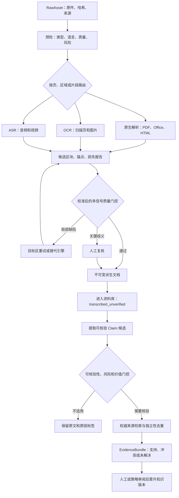

# OS学习项目

来源：conversations-000.json，记录序号 97，唯一键 000:097
归属：AAOS项目
依据：标题与正文上下文复核

以下保留导出中的全部消息节点（含分支），按节点时间排列；完整结构见同名 JSON。

## user · f1dd5136-bfe0-44a7-b0e4-3021a321dd94

父节点：client-created-root；时间戳：1786349043.371

读取并遵循《ArcheAxis_Workspace_Context_Handoff_2026-08-10.md》，然后等待我让你重新审计，先理解项目，不用推进后续项目，该项目正在执行中。

## assistant · e417333d-8361-4215-a2ba-411a33149af4

父节点：f1dd5136-bfe0-44a7-b0e4-3021a321dd94；时间戳：1786349052.854281

{
  "content_type": "thoughts",
  "source_analysis_msg_id": "e417333d-8361-4215-a2ba-411a33149af4",
  "thoughts": []
}

## assistant · 1fae770b-0d41-5a5f-b7ca-dfebd36d4954

父节点：e417333d-8361-4215-a2ba-411a33149af4；时间戳：1786349055.921562

我会先读取交接文档，并结合已有项目上下文核对定位、边界、当前执行状态；这一步只建立理解，不做审计、改动或推进。

## assistant · cb75a9aa-0c89-4e89-8564-e69af0c5c1b7

父节点：1fae770b-0d41-5a5f-b7ca-dfebd36d4954；时间戳：1786349060.683705

{
  "content_type": "thoughts",
  "source_analysis_msg_id": "b50454cb-97a8-417c-80f0-9c411ad9fbbe",
  "thoughts": [
    {
      "chunks": [],
      "content": "",
      "finished": true,
      "summary": "读取工作区上下文交接文档"
    }
  ]
}

## assistant · 6787b1e7-b38a-5305-b53a-382e62c0ad6b

父节点：cb75a9aa-0c89-4e89-8564-e69af0c5c1b7；时间戳：1786349060.686507

我会使用“个人上下文”校验项目的既有约束，避免把旧的 WORK-LAB / Cognitive-Loop-OS 表述误带回当前产品定义；仍然只做理解与待命。

## assistant · a1449a68-2f48-4088-b41c-e84cd6c3a648

父节点：6787b1e7-b38a-5305-b53a-382e62c0ad6b；时间戳：1786349078.546192

{
  "content_type": "thoughts",
  "source_analysis_msg_id": "373f3c54-5c7a-47eb-97cc-4358910c88c6",
  "thoughts": [
    {
      "chunks": [],
      "content": "",
      "finished": true,
      "summary": "读取个人上下文技能指南"
    }
  ]
}

## assistant · bdd9e1cb-38d2-4ac1-b67d-1a79af39549e

父节点：a1449a68-2f48-4088-b41c-e84cd6c3a648；时间戳：1786349090.70443

{
  "content_type": "thoughts",
  "source_analysis_msg_id": "8268e88a-b359-41c1-8a1f-2479f501db75",
  "thoughts": [
    {
      "chunks": [],
      "content": "",
      "finished": true,
      "summary": "确认接收 ArcheAxis Workspace 交接信息"
    }
  ]
}

## assistant · 1cfcaa21-a022-4a06-973e-3e8f37071ed7

父节点：bdd9e1cb-38d2-4ac1-b67d-1a79af39549e；时间戳：1786349090.706884

{
  "content": "思考了 38s",
  "content_type": "reasoning_recap"
}

## assistant · 89fcc0a8-3593-5598-874d-fb6e81106f39

父节点：1cfcaa21-a022-4a06-973e-3e8f37071ed7；时间戳：1786349090.708503

已读取并理解交接摘要，当前保持待命，不进行审计、代码修改或项目推进。

我会严格以 **ArcheAxis Workspace / 元枢工作台** 的定位与 v4 主任务包为准，并避免旧 Cognitive-Loop-OS、WORK-LAB、HERMES 等概念回流污染。等你下达“重新审计”指令后，再基于最新云端与仓库事实开展工作。

## user · 7f341a3e-e764-43de-902c-bb328c82a080

父节点：89fcc0a8-3593-5598-874d-fb6e81106f39；时间戳：1786349119.43

可以读取分析记录蓝图规划，防止漂移

## assistant · 3e2c4cf5-559a-4f3c-a957-fbb8ef9235ee

父节点：7f341a3e-e764-43de-902c-bb328c82a080；时间戳：1786349128.263293

{
  "content_type": "thoughts",
  "source_analysis_msg_id": "3e2c4cf5-559a-4f3c-a957-fbb8ef9235ee",
  "thoughts": []
}

## assistant · 89491515-60dd-5aff-a5c6-583e1b2da193

父节点：3e2c4cf5-559a-4f3c-a957-fbb8ef9235ee；时间戳：1786349132.496279

{
  "content_type": "thoughts",
  "source_analysis_msg_id": "89491515-60dd-5aff-a5c6-583e1b2da193",
  "thoughts": [
    {
      "chunks": [],
      "content": "**Planning analysis of blueprint files**",
      "finished": true,
      "summary": "Planning analysis of blueprint files"
    },
    {
      "chunks": [],
      "content": "",
      "finished": true,
      "summary": "规划蓝图文件分析方案"
    }
  ]
}

## assistant · 392ba431-ada8-5bf5-82e8-8db414a18664

父节点：89491515-60dd-5aff-a5c6-583e1b2da193；时间戳：1786349132.904503

可以。我会只读取现有的分析记录、蓝图和任务包，提炼其中仍有效的长期约束与已决策项，用来防漂移；不据此启动任务或改动项目。

## assistant · 897ec8f4-f41d-41b4-a3e5-c780cc1b6083

父节点：392ba431-ada8-5bf5-82e8-8db414a18664；时间戳：1786349143.319948

{
  "content_type": "thoughts",
  "source_analysis_msg_id": "f227cea1-b5a0-405d-9caa-beabb5d42438",
  "thoughts": [
    {
      "chunks": [],
      "content": "",
      "finished": true,
      "summary": "查找项目文档与配置文件"
    }
  ]
}

## assistant · 1700058e-f59b-5d93-a7f7-aa448ed83c53

父节点：897ec8f4-f41d-41b4-a3e5-c780cc1b6083；时间戳：1786349143.323182

当前工作区里只有交接摘要；我会通过你的文件库查找同项目的主任务包、蓝图与分析记录，仅读取，不会修改或移动任何文件。

## assistant · cd0eb37f-8b8e-4548-bf11-2710e0b86a27

父节点：1700058e-f59b-5d93-a7f7-aa448ed83c53；时间戳：1786349162.331524

{
  "content_type": "thoughts",
  "source_analysis_msg_id": "1b86f8ed-29a3-4795-9265-82d70d52761d",
  "thoughts": [
    {
      "chunks": [],
      "content": "",
      "finished": true,
      "summary": "读取库技能说明"
    }
  ]
}

## assistant · 09943f5d-f0ec-58ce-bfa0-3510b1708bd0

父节点：cd0eb37f-8b8e-4548-bf11-2710e0b86a27；时间戳：1786349179.474845

{
  "content_type": "thoughts",
  "source_analysis_msg_id": "09943f5d-f0ec-58ce-bfa0-3510b1708bd0",
  "thoughts": [
    {
      "chunks": [],
      "content": "**Planning segmented file reading**",
      "finished": true,
      "summary": "Planning segmented file reading"
    },
    {
      "chunks": [],
      "content": "**Designing sequential multi-line reading**",
      "finished": true,
      "summary": "Designing sequential multi-line reading"
    },
    {
      "chunks": [],
      "content": "",
      "finished": true,
      "summary": "规划分段文件读取与顺序多行读取方案"
    }
  ]
}

## assistant · fb87484d-455e-4234-b3d7-12adc0454c05

父节点：09943f5d-f0ec-58ce-bfa0-3510b1708bd0；时间戳：1786349180.887139

{
  "content_type": "thoughts",
  "source_analysis_msg_id": "979a7a11-72ce-4abe-b7e8-c5321dba7e6c",
  "thoughts": [
    {
      "chunks": [],
      "content": "",
      "finished": true,
      "summary": "检索ArcheAxis工作区蓝图并读取隐式链接库文件"
    }
  ]
}

## assistant · 48222085-c18d-5076-91e9-93175282edbc

父节点：fb87484d-455e-4234-b3d7-12adc0454c05；时间戳：1786349180.889911

已定位到权威的 v4 总任务包（4,650 行）。我会分段完整读取它，重点固化已裁决的产品边界、长期能力保留规则、阶段门槛与反漂移合同，不把旧材料重新变成执行指令。

## assistant · 123fad25-fcf1-54ea-bedb-0a32cb3f512d

父节点：48222085-c18d-5076-91e9-93175282edbc；时间戳：1786349198.03445

{
  "content_type": "thoughts",
  "source_analysis_msg_id": "123fad25-fcf1-54ea-bedb-0a32cb3f512d",
  "thoughts": [
    {
      "chunks": [],
      "content": "**Planning segmented document extraction**",
      "finished": true,
      "summary": "Planning segmented document extraction"
    },
    {
      "chunks": [],
      "content": "**Designing sequential chunk reading strategy**",
      "finished": true,
      "summary": "Designing sequential chunk reading strategy"
    },
    {
      "chunks": [],
      "content": "",
      "finished": true,
      "summary": "规划分段文档提取与顺序读取策略"
    }
  ]
}

## assistant · 9e3a2f19-a18b-4f8e-b8df-efe39244c1c1

父节点：123fad25-fcf1-54ea-bedb-0a32cb3f512d；时间戳：1786349215.285945

{
  "content_type": "thoughts",
  "source_analysis_msg_id": "c2c72911-3132-4d06-948c-5f04a2553785",
  "thoughts": [
    {
      "chunks": [],
      "content": "",
      "finished": true,
      "summary": "读取文档段落及库文件内容并检索防漂移反删除信息"
    }
  ]
}

## assistant · ffe436b7-f164-5b48-a29b-d2206ec66409

父节点：9e3a2f19-a18b-4f8e-b8df-efe39244c1c1；时间戳：1786349215.288393

蓝图中防漂移最关键的机制已确认：当前执行队列可以很窄，但完整能力图谱必须保留；长期能力只能调整阶段与证据门槛，不能因“暂不做”被删除。我会继续读终局 Horizon 与机器化防删合同，然后回到待命。

## assistant · dae0abe9-eac3-5641-add0-f4e7cc036dab

父节点：ffe436b7-f164-5b48-a29b-d2206ec66409；时间戳：1786349229.338013

{
  "content_type": "thoughts",
  "source_analysis_msg_id": "dae0abe9-eac3-5641-add0-f4e7cc036dab",
  "thoughts": [
    {
      "chunks": [],
      "content": "**Confirming baseline and updated rules**",
      "finished": true,
      "summary": "Confirming baseline and updated rules"
    },
    {
      "chunks": [],
      "content": "",
      "finished": true,
      "summary": "确认基线与更新后的规则"
    }
  ]
}

## assistant · 5aa385f2-9d7f-47c6-9809-b4505172e313

父节点：dae0abe9-eac3-5641-add0-f4e7cc036dab；时间戳：1786349229.579856

{
  "content_type": "thoughts",
  "source_analysis_msg_id": "3c771ed6-4b53-4469-bf9f-e1579c689a8c",
  "thoughts": [
    {
      "chunks": [],
      "content": "",
      "finished": true,
      "summary": "读取隐式链接库文件内容"
    }
  ]
}

## assistant · 3f479275-33ce-40c5-993f-7d74fd0727ac

父节点：5aa385f2-9d7f-47c6-9809-b4505172e313；时间戳：1786349229.58272

{
  "content": "思考了 1m 41s",
  "content_type": "reasoning_recap"
}

## assistant · c285c20e-a60e-5e34-9f85-7e0d8ff86651

父节点：3f479275-33ce-40c5-993f-7d74fd0727ac；时间戳：1786349229.584897

已读取并纳入 v4 总蓝图、长期能力图谱与防漂移合同。当前仍只理解、待命，不启动任何任务。

我会固定遵守：

- 当前唯一产品：**ArcheAxis Workspace / 元枢工作台**，不是 OS、Agent 平台或 WORK-LAB 延伸。
- 当前执行只走 H0 的真实 PDF 生存闭环；长期能力不抢占当前 Release。
- Research、知识生产、完整学习方法、课程/课件、动画、模拟、2.5D/3D/VR/AR、同步、SDK 等均为正式长期路线，允许延期，绝不因“暂不做”删除。
- 长期能力与当前任务分开记录：技术、学习效果、互操作、许可证/分发四条状态轴不能混用。
- 任何后续审计或任务都以最新仓库事实为准，并将对照 Capability Atlas、Requirement Trace、Scope Ledger、Task Graph；不得让旧名、旧 HERMES/WORK-LAB、测试数量或 CI 绿灯冒充产品事实。
- 每次只允许一个原子任务、一个分支、一个冻结事实基线；未获你指令不会推进。

## user · 301db34d-2a02-429f-887a-b1482ebdc971

父节点：c285c20e-a60e-5e34-9f85-7e0d8ff86651；时间戳：1786454313.301

# 提示词：请独立评审"多格式内容识别转译 + 全网验证"的管线方案

请以资深系统架构师身份，客观分析下面这个内容识别转译管线的两个候选方案，给出你的独立判断和建议。**不要预设任何结论，不要因为这是中文输入就顺着我的倾向**。先理解问题，再逐条分析，最后给结论。

## 背景（请先理解）

我们要构建一个本地优先、证据驱动的学习/知识工作台。核心流程是：把各种格式的原始材料（PDF、图片、音频、视频、Office 文档等）识别转译成文本，然后进入知识库。关键约束：

1. **成本敏感**：优先用本地/外置引擎（不费 LLM token），模型（LLM）识别只在必要时用，因为 token 贵。
2. **准确性要求高**：识别转译出的文本要准确，且其中的"可查证事实"（年份、人名、概念定义、数字、理论归属等公共知识）要用公开权威来源（Wikipedia API、官方文档、百科、教材、图书馆/学术数据库）做全网交叉核验。
3. **两层验证必须分开**：
   - **识别转译层**：文本转得准不准（用 CER/WER 字符/词错误率对金标准衡量）。
   - **内容事实层**：转译出的内容对不对（用全网权威来源交叉对比）。
   - 识别转译的置信度/准确率**永远不能**当作内容事实的准确性。
4. 已有可用的本地引擎：markitdown（文字 PDF/Office）、pdfplumber、trafilatura（HTML）、EasyOCR/PaddleOCR/Tesseract（扫描件 OCR）、FunASR SenseVoice/faster-whisper（音视频 ASR）。全部为可选引擎，可按需调用。
5. 项目原则：记录差异不自动覆盖、不可查证内容不强行验证、低置信进人工复核队列、不伪造证据、不把模型置信度当准确率。

## 方案 A：线性瀑布流（用户最初提出的）

```
外置软件/技能识别（省 token）
    ↓
模型识别辅助（LLM 辅助）
    ↓
模型识别（LLM 完整识别）
    ↓
全网验证（权威来源交叉核验）
```

特点：成本递增、准确性递增。先便宜的本地引擎，不行再上贵的模型，最后统一全网验证。

## 方案 B：分叉 + 门控 + 解耦（我提出的修改建议）

```
识别转译层（CER/WER 质量门控）：
  ├─ 文字型格式（文字PDF/Office/HTML）→ 本地引擎（markitdown/trafilatura）→ 质量够？
  ├─ 扫描型格式（扫描PDF/图片）→ OCR（EasyOCR等）→ 置信度够？→ 不够才上模型辅助
  └─ 音视频 → ASR（whisper等）→ CER够？→ 不够才上模型辅助
全网交叉验证层（内容事实，与识别层解耦）：
  ├─ 可查证事实 → 权威来源交叉对比
  ├─ 争议/差异 → 记录差异，不自动覆盖
  └─ 不可查证内容 → 跳过验证，标注"无法全网验证"
待人工复核队列：验证存疑/冲突/低置信 → 进人工队列
```

特点：按格式分叉走不同本地引擎；用准确性阈值（CER/置信度）门控决定何时升级到模型；识别层与验证层解耦；不可查证内容不强制验证；人工复核兜底。

## 请你分析的问题

1. **方案 A 的问题在哪？** 哪些设计是合理的，哪些会造成浪费/误判？特别评估"线性逐级升级"是否真的必要，还是多数文件一步到位即可。
2. **方案 B 是否更合理？** 分叉 + 门控 + 解耦这三点的逻辑是否成立？有没有过度设计？
3. **门控的具体设计**：用什么指标判断"本地引擎够了，不用上模型"？CER/WER 阈值怎么定？没有金标准对时怎么办（很多场景没有人工 truth/prediction 对）？
4. **全网验证的边界**：哪些内容值得全网验证？哪些不该（私人记录、非公开信息、纯转译噪声）？如何避免无效验证浪费？
5. **有没有方案 A/B 都没覆盖的盲点？** 例如：多引擎结果的融合策略（同一文件不同引擎给出不同文本怎么办）、去重、增量处理、失败恢复。
6. **最终建议**：如果让你定，你会采用什么结构？给出一个你认为最优的管线设计（可以是对 A/B 的修改、组合或全新设计），并说明理由。

## 输出要求

- 结论要有具体理由，不要泛泛而谈。
- 如果某个判断需要前提假设，请明确说明假设。
- 最后给出一个清晰的"我推荐的设计"结构图或步骤列表。
- 允许对两种方案都提出批评，也可以说"你俩都不够好，应该这样"。

## assistant · 687823a1-2a54-4d31-ab39-316c6fbcfeba

父节点：301db34d-2a02-429f-887a-b1482ebdc971；时间戳：1786454314.550796

{
  "content_type": "thoughts",
  "source_analysis_msg_id": "687823a1-2a54-4d31-ab39-316c6fbcfeba",
  "thoughts": []
}

## assistant · 8b53b3b9-528e-5208-9266-3be8edffbdf1

父节点：687823a1-2a54-4d31-ab39-316c6fbcfeba；时间戳：1786454323.244644

{
  "content_type": "thoughts",
  "source_analysis_msg_id": "8b53b3b9-528e-5208-9266-3be8edffbdf1",
  "thoughts": [
    {
      "chunks": [],
      "content": "**Deciding to skip personal context browsing**",
      "finished": true,
      "summary": "Deciding to skip personal context browsing"
    },
    {
      "chunks": [],
      "content": "**Planning comprehensive architecture review**",
      "finished": true,
      "summary": "Planning comprehensive architecture review"
    },
    {
      "chunks": [],
      "content": "**Gathering official metric definitions**",
      "finished": true,
      "summary": "Gathering official metric definitions"
    },
    {
      "chunks": [],
      "content": "",
      "finished": true,
      "summary": "规划全面架构审查并收集官方指标定义"
    }
  ]
}

## assistant · f38f3ad5-9196-50af-84cd-ff48d0bd8611

父节点：8b53b3b9-528e-5208-9266-3be8edffbdf1；时间戳：1786454328.377753

我会按“架构正确性、质量度量、事实验证边界、成本与可恢复性”四条线独立评审，并核对相关引擎与评测指标的官方资料。重点会检查一个关键问题：方案 B 里把“没有金标准时的置信度”当成 CER/WER 替代品，是否仍然会造成误判。

## assistant · d6490284-1ac7-59bb-a41b-dc745aedad4d

父节点：f38f3ad5-9196-50af-84cd-ff48d0bd8611；时间戳：1786454335.842649

{
  "content_type": "thoughts",
  "source_analysis_msg_id": "d6490284-1ac7-59bb-a41b-dc745aedad4d",
  "thoughts": [
    {
      "chunks": [],
      "content": "**Planning official documentation searches**",
      "finished": true,
      "summary": "Planning official documentation searches"
    },
    {
      "chunks": [],
      "content": "",
      "finished": true,
      "summary": "规划官方文档搜索"
    }
  ]
}

## assistant · e4a40db2-5361-5346-81f0-de64eb53395b

父节点：d6490284-1ac7-59bb-a41b-dc745aedad4d；时间戳：1786454349.938447

{
  "content_type": "thoughts",
  "source_analysis_msg_id": "e4a40db2-5361-5346-81f0-de64eb53395b",
  "thoughts": [
    {
      "chunks": [],
      "content": "**Reviewing OCR confidence documentation**",
      "finished": true,
      "summary": "Reviewing OCR confidence documentation"
    },
    {
      "chunks": [],
      "content": "**Checking MarkItDown README**",
      "finished": true,
      "summary": "Checking MarkItDown README"
    },
    {
      "chunks": [],
      "content": "",
      "finished": true,
      "summary": "Reviewed OCR documentation and MarkItDown README"
    }
  ]
}

## assistant · 80f37c4d-b82c-5a59-9328-3192c595540e

父节点：e4a40db2-5361-5346-81f0-de64eb53395b；时间戳：1786454361.164879

{
  "content_type": "thoughts",
  "source_analysis_msg_id": "80f37c4d-b82c-5a59-9328-3192c595540e",
  "thoughts": [
    {
      "chunks": [],
      "content": "**Searching configuration lines for tesseract and Paddle**",
      "finished": true,
      "summary": "Searching configuration lines for tesseract and Paddle"
    },
    {
      "chunks": [],
      "content": "",
      "finished": true,
      "summary": "搜索了 tesseract 和 Paddle 的配置行"
    }
  ]
}

## assistant · 98305e5e-8dba-5e8c-9642-9a8ffa2c8263

父节点：80f37c4d-b82c-5a59-9328-3192c595540e；时间戳：1786454366.195226

{
  "content_type": "thoughts",
  "source_analysis_msg_id": "98305e5e-8dba-5e8c-9642-9a8ffa2c8263",
  "thoughts": [
    {
      "chunks": [],
      "content": "**Researching official WER/CER references**",
      "finished": true,
      "summary": "Researching official WER/CER references"
    },
    {
      "chunks": [],
      "content": "",
      "finished": true,
      "summary": "查找官方WER/CER参考资料"
    }
  ]
}

## assistant · 2e4ae83d-b27d-585f-bbd3-2dea7422c7ac

父节点：98305e5e-8dba-5e8c-9642-9a8ffa2c8263；时间戳：1786454372.734527

{
  "content_type": "thoughts",
  "source_analysis_msg_id": "2e4ae83d-b27d-585f-bbd3-2dea7422c7ac",
  "thoughts": [
    {
      "chunks": [],
      "content": "**Clarifying CER/WER dependencies and recommending method C**",
      "finished": true,
      "summary": "Clarifying CER/WER dependencies and recommending method C"
    },
    {
      "chunks": [],
      "content": "**Refining architecture choice favoring multi-stage orchestration**",
      "finished": true,
      "summary": "Refining architecture choice favoring multi-stage orchestration"
    },
    {
      "chunks": [],
      "content": "**Assessing lightweight router with per-page classification**",
      "finished": true,
      "summary": "Assessing lightweight router with per-page classification"
    },
    {
      "chunks": [],
      "content": "",
      "finished": true,
      "summary": "明确CER/WER依赖并优化多阶段路由架构"
    }
  ]
}

## assistant · 4bc529cd-8aeb-5d0b-b043-1beed0f4b761

父节点：2e4ae83d-b27d-585f-bbd3-2dea7422c7ac；时间戳：1786454385.815918

{
  "content_type": "thoughts",
  "source_analysis_msg_id": "4bc529cd-8aeb-5d0b-b043-1beed0f4b761",
  "thoughts": [
    {
      "chunks": [],
      "content": "**Defining validation and error metrics**",
      "finished": true,
      "summary": "Defining validation and error metrics"
    },
    {
      "chunks": [],
      "content": "**Establishing benchmark thresholds and calibration**",
      "finished": true,
      "summary": "Establishing benchmark thresholds and calibration"
    },
    {
      "chunks": [],
      "content": "",
      "finished": true,
      "summary": "定义验证指标并校准基准阈值"
    }
  ]
}

## assistant · 4f1fdf89-9d7b-525d-9c28-35aadeef2916

父节点：4bc529cd-8aeb-5d0b-b043-1beed0f4b761；时间戳：1786454398.285697

{
  "content_type": "thoughts",
  "source_analysis_msg_id": "4f1fdf89-9d7b-525d-9c28-35aadeef2916",
  "thoughts": [
    {
      "chunks": [],
      "content": "**Defining acceptance criteria and calibration methods**",
      "finished": true,
      "summary": "Defining acceptance criteria and calibration methods"
    },
    {
      "chunks": [],
      "content": "**Establishing claim extraction and verification boundaries**",
      "finished": true,
      "summary": "Establishing claim extraction and verification boundaries"
    },
    {
      "chunks": [],
      "content": "",
      "finished": true,
      "summary": "制定了验收标准并明确声明核验边界"
    }
  ]
}

## assistant · 65513e07-b428-56ac-8cd2-728b8935d03d

父节点：4f1fdf89-9d7b-525d-9c28-35aadeef2916；时间戳：1786454411.067081

{
  "content_type": "thoughts",
  "source_analysis_msg_id": "65513e07-b428-56ac-8cd2-728b8935d03d",
  "thoughts": [
    {
      "chunks": [],
      "content": "**Outlining adjudication and deduplication strategies**",
      "finished": true,
      "summary": "Outlining adjudication and deduplication strategies"
    },
    {
      "chunks": [],
      "content": "**Detailing provenance, cost, and UX considerations**",
      "finished": true,
      "summary": "Detailing provenance, cost, and UX considerations"
    },
    {
      "chunks": [],
      "content": "",
      "finished": true,
      "summary": "制定裁决去重策略并梳理溯源成本与用户体验考量"
    }
  ]
}

## assistant · 88f6af8c-8e43-5a4d-8713-2b9a4894dd5d

父节点：65513e07-b428-56ac-8cd2-728b8935d03d；时间戳：1786454422.937631

{
  "content_type": "thoughts",
  "source_analysis_msg_id": "88f6af8c-8e43-5a4d-8713-2b9a4894dd5d",
  "thoughts": [
    {
      "chunks": [],
      "content": "**Designing multi-stage evidence processing pipeline**",
      "finished": true,
      "summary": "Designing multi-stage evidence processing pipeline"
    },
    {
      "chunks": [],
      "content": "**Planning asynchronous verification and citation integration**",
      "finished": true,
      "summary": "Planning asynchronous verification and citation integration"
    },
    {
      "chunks": [],
      "content": "**Identifying source for error rate definitions**",
      "finished": true,
      "summary": "Identifying source for error rate definitions"
    },
    {
      "chunks": [],
      "content": "",
      "finished": true,
      "summary": "设计多阶段证据处理与异步引用核验流程"
    }
  ]
}

## assistant · 399ada45-14f9-4c36-ab2b-02acbaf8006f

父节点：88f6af8c-8e43-5a4d-8713-2b9a4894dd5d；时间戳：1786454431.900426

{
  "content_type": "thoughts",
  "source_analysis_msg_id": "a42afd84-b283-4bfa-9a00-f346251610fb",
  "thoughts": [
    {
      "chunks": [],
      "content": "",
      "finished": true,
      "summary": "已搜索 3 个网站"
    }
  ]
}

## assistant · b08fc122-d4a5-5864-92f1-26785a676092

父节点：399ada45-14f9-4c36-ab2b-02acbaf8006f；时间戳：1786454431.902355

初步判断已经很明确：B 的方向优于 A，但 B 里“CER 够不够”在真实生产文件上通常无法直接计算，因为没有参考真值；OCR/ASR 自带的 confidence 也只是各引擎内部评分，不能跨引擎等价比较。最终设计需要把它改成“校准后的多信号质量门控”，而不是单一阈值门控。

## assistant · 276cbaed-376e-5d89-befc-505fbf63d2eb

父节点：b08fc122-d4a5-5864-92f1-26785a676092；时间戳：1786454439.464705

{
  "content_type": "thoughts",
  "source_analysis_msg_id": "276cbaed-376e-5d89-befc-505fbf63d2eb",
  "thoughts": [
    {
      "chunks": [],
      "content": "**Planning citation strategy**",
      "finished": true,
      "summary": "Planning citation strategy"
    },
    {
      "chunks": [],
      "content": "",
      "finished": true,
      "summary": "制定了引用策略"
    }
  ]
}

## assistant · 84a378ef-4f66-57fe-8e20-7439a6b4e172

父节点：276cbaed-376e-5d89-befc-505fbf63d2eb；时间戳：1786454446.836105

{
  "content_type": "thoughts",
  "source_analysis_msg_id": "84a378ef-4f66-57fe-8e20-7439a6b4e172",
  "thoughts": [
    {
      "chunks": [],
      "content": "**Formulating detailed Chinese recommendation**",
      "finished": true,
      "summary": "Formulating detailed Chinese recommendation"
    },
    {
      "chunks": [],
      "content": "**Defining nuanced extraction strategies and quality metrics**",
      "finished": true,
      "summary": "Defining nuanced extraction strategies and quality metrics"
    },
    {
      "chunks": [],
      "content": "**Clarifying avg_logprob metric usage**",
      "finished": true,
      "summary": "Clarifying avg_logprob metric usage"
    },
    {
      "chunks": [],
      "content": "",
      "finished": true,
      "summary": "制定中文推荐方案并明确提取策略与avg_logprob指标"
    }
  ]
}

## assistant · 6b57efb0-6f7b-511f-b5c9-6e841c2d9385

父节点：84a378ef-4f66-57fe-8e20-7439a6b4e172；时间戳：1786454460.150708

{
  "content_type": "thoughts",
  "source_analysis_msg_id": "6b57efb0-6f7b-511f-b5c9-6e841c2d9385",
  "thoughts": [
    {
      "chunks": [],
      "content": "**Defining provisional CER thresholds**",
      "finished": true,
      "summary": "Defining provisional CER thresholds"
    },
    {
      "chunks": [],
      "content": "**Establishing nuanced CER/WER use-case thresholds**",
      "finished": true,
      "summary": "Establishing nuanced CER/WER use-case thresholds"
    },
    {
      "chunks": [],
      "content": "**Designing multi-factor quality scoring**",
      "finished": true,
      "summary": "Designing multi-factor quality scoring"
    },
    {
      "chunks": [],
      "content": "",
      "finished": true,
      "summary": "制定CER/WER阈值并设计多因素质量评分"
    }
  ]
}

## assistant · d605fd75-c9c4-521d-ba1d-d66f6037c5d8

父节点：6b57efb0-6f7b-511f-b5c9-6e841c2d9385；时间戳：1786454476.052252

{
  "content_type": "thoughts",
  "source_analysis_msg_id": "d605fd75-c9c4-521d-ba1d-d66f6037c5d8",
  "thoughts": [
    {
      "chunks": [],
      "content": "**Defining claim verification pipeline**",
      "finished": true,
      "summary": "Defining claim verification pipeline"
    },
    {
      "chunks": [],
      "content": "**Establishing risk scoring and verification criteria**",
      "finished": true,
      "summary": "Establishing risk scoring and verification criteria"
    },
    {
      "chunks": [],
      "content": "**Planning duplicate detection and failure recovery**",
      "finished": true,
      "summary": "Planning duplicate detection and failure recovery"
    },
    {
      "chunks": [],
      "content": "",
      "finished": true,
      "summary": "建立声明核验、风险评分及去重恢复流程"
    }
  ]
}

## assistant · 6d3b6597-959a-5a28-a5fc-376ab6cafb71

父节点：d605fd75-c9c4-521d-ba1d-d66f6037c5d8；时间戳：1786454485.513061

{
  "content_type": "thoughts",
  "source_analysis_msg_id": "6d3b6597-959a-5a28-a5fc-376ab6cafb71",
  "thoughts": [
    {
      "chunks": [],
      "content": "**Defining job stage and idempotency handling**",
      "finished": true,
      "summary": "Defining job stage and idempotency handling"
    },
    {
      "chunks": [],
      "content": "**Clarifying OCR capabilities and verification flow**",
      "finished": true,
      "summary": "Clarifying OCR capabilities and verification flow"
    },
    {
      "chunks": [],
      "content": "**Establishing citation and usage guidelines**",
      "finished": true,
      "summary": "Establishing citation and usage guidelines"
    },
    {
      "chunks": [],
      "content": "",
      "finished": true,
      "summary": "明确任务阶段、幂等处理及OCR引用规范"
    }
  ]
}

## assistant · 276884f4-78fb-5322-bb64-b2a1c580e364

父节点：6d3b6597-959a-5a28-a5fc-376ab6cafb71；时间戳：1786454504.142656

{
  "content_type": "thoughts",
  "source_analysis_msg_id": "276884f4-78fb-5322-bb64-b2a1c580e364",
  "thoughts": [
    {
      "chunks": [],
      "content": "**Outlining detailed Chinese conclusion structure**",
      "finished": true,
      "summary": "Outlining detailed Chinese conclusion structure"
    },
    {
      "chunks": [],
      "content": "**Designing detailed Mermaid flowchart labels**",
      "finished": true,
      "summary": "Designing detailed Mermaid flowchart labels"
    },
    {
      "chunks": [],
      "content": "**Mapping flowchart edge labels with outcomes**",
      "finished": true,
      "summary": "Mapping flowchart edge labels with outcomes"
    },
    {
      "chunks": [],
      "content": "",
      "finished": true,
      "summary": "设计中文结论结构并绘制标注结果的流程图"
    }
  ]
}

## assistant · 91b923fd-7d0a-415d-af6a-c9057afa9b88

父节点：276884f4-78fb-5322-bb64-b2a1c580e364；时间戳：1786454512.083897

{
  "content_type": "thoughts",
  "source_analysis_msg_id": "e0bae175-bdab-476d-abce-a4e67a08a11f",
  "thoughts": [
    {
      "chunks": [],
      "content": "",
      "finished": true,
      "summary": "已搜索 3 个网站"
    }
  ]
}

## assistant · 700f5642-d341-46c3-a90a-2961874f9c29

父节点：91b923fd-7d0a-415d-af6a-c9057afa9b88；时间戳：1786454512.110808

{
  "content": "思考了 3m 17s",
  "content_type": "reasoning_recap"
}

## assistant · 87362ec2-f72f-5bf9-9549-424e657eb790

父节点：700f5642-d341-46c3-a90a-2961874f9c29；时间戳：1786454512.112961

## 独立结论

我不会采用方案 A，也不会原样采用方案 B。

我的判断是：

- 方案 A 只能保留“成本逐级升级”的思想，不能作为实际管线结构。
- 方案 B 的“分叉、门控、识别与事实核验解耦”方向正确，明显优于 A。
- 但 B 有一个关键漏洞：**生产环境通常没有金标准，无法直接计算单文件 CER/WER；OCR/ASR 自带置信度也不能代替 CER/WER，更不能跨引擎直接比较。**
- 最优结构应当是方案 C：**Raw-first 原件优先保存 + 页/区域级路由 + 校准后的多信号质量门控 + 争议区域选择性升级 + Claim 级异步事实核验 + 人工裁决。**

简单说：多数正常文件应当“一次解析通过”；只有异常页面、区块或音频片段才升级，不能让整个文件机械地跑完“本地→LLM辅助→LLM完整识别”。

以下判断基于三个前提：

- 原件永久保留，任何识别、修订、事实核验结果都是派生版本；
- “进入资料库”和“晋升为已核验知识”是两个不同状态；
- 联网、云模型和私人资料出机都需要明确授权。

---

## 1. 方案 A：合理部分与根本问题

### 合理部分

方案 A 有三个值得保留的思想：

- 成本优先：先本地、后付费模型；
- 允许升级：基础引擎失败后有后备方案；
- 最终不把识别文本自动当成事实。

这些思想可以成为“升级策略”，但不能直接成为“处理拓扑”。

### 根本问题

#### 1. 把成本等级误当成准确性等级

“外置软件→模型辅助→模型完整识别”并不意味着准确率必然递增。

例如：

- 数字型 PDF 的原生文本层通常比视觉模型重新看图更忠实；
- DOCX/XLSX 的结构化解析比 LLM 观察截图可靠；
- LLM 可能把错字“合理化”、补全缺失内容、重写表达；
- 专用 OCR/ASR 在特定语言、版式或术语上可能优于通用多模态模型。

因此，升级依据应是“当前错误类型能否被下一个引擎解决”，而不是“下一个引擎更贵”。

#### 2. 全文件线性重跑造成大量浪费

一个 300 页 PDF 可能只有 6 页是扫描页、2 个表格识别失败。合理做法是只重跑这 8 个局部，而不是让整个文件依次通过三套引擎。

多数文件确实可以一步到位：

- 正常 HTML：Trafilatura 一次；
- 正常 DOCX/PPTX/XLSX：格式专用解析器一次；
- 有效文本层的普通 PDF：PDF 文本解析一次；
- 清晰扫描件：一套经过校准的主 OCR 一次；
- 清晰单人语音：一套主 ASR 一次。

但“一步到位比例有多高”不能凭经验写成 80% 或 90%，必须由真实语料基准集得出。

#### 3. 没有明确停止条件

A 没说明什么叫“本地识别不行”，容易出现：

- 本地结果已经够用，仍调用模型；
- 模型结果与本地结果不同，却默认模型胜出；
- 三层都失败，仍生成一个看似完整的最终文本。

#### 4. LLM 同时承担识别、纠错和裁决

这是危险的职责混合。LLM 可以产生一个新的候选文本，但不能用自己的流畅程度证明自己更准确。

#### 5. “统一全网验证”范围过大

私人笔记、访谈、主观判断、内部资料、创作文本和纯识别噪声都不适合全网验证。强行搜索只会增加成本，并制造错误关联。

### 对 A 的最终评价

A 可以保留为：

> “遇到具体质量缺陷时，从低成本 Provider 升级到能解决该缺陷的 Provider。”

不能保留为：

> “每份文件依次运行本地、LLM辅助、LLM完整识别、全网验证。”

---

## 2. 方案 B：方向正确，但还不够完整

### 分叉成立

不同格式的失真机制完全不同，必须分路：

- 数字文档关注结构、阅读顺序、表格、公式、脚注；
- OCR 关注字符、版面、旋转、清晰度和语言；
- ASR 关注口音、噪声、说话人、时间戳、专有名词；
- HTML 关注正文抽取、导航噪声、动态内容和网页版本。

但不应只按文件扩展名分叉，而应按**页、区域、对象或时间片段**分叉。混合 PDF 可能同时包含文本页、扫描页、图片、表格和手写批注。

### 门控成立，但不能只用一个阈值

B 中“CER/置信度够不够”的表达过于简单：

- CER/WER 必须同时有 reference 和 prediction，生产文件没有人工真值时算不出来；CER 本质是参考文本与预测文本之间的编辑距离。[Hugging Face CER 指标说明](https://huggingface.co/spaces/evaluate-metric/cer/blame/878a3dbe0c2bfd507fc9a9119fd97fd8c508688a/README.md)
- Tesseract 会给单词或区块 confidence，PaddleOCR 会返回 `rec_score`，但这些只是各自模型内部评分，不等于“字符正确率”。[Tesseract API](https://tesseract-ocr.github.io/tessdoc/APIExample.html)、[PaddleOCR 文档](https://www.paddleocr.ai/latest/en/version3.x/module_usage/text_recognition.html)
- 同样的 0.90，在不同引擎、语言、字体和图像质量下没有可比性。
- ASR 性能会随语言和数据集显著变化，Whisper 官方也按不同语言分别报告 WER/CER，而不是给出统一阈值。[Whisper 官方说明](https://github.com/openai/whisper)

因此，生产门控需要“校准后的多信号判断”，不能直接写成：

```text
OCR confidence > 0.9 → 通过
```

### 解耦完全成立

这是 B 最重要的改进：

- 识别层回答：“原件上写了什么？”
- 事实层回答：“原件中的公开主张是否得到外部证据支持？”

即使转录 100% 忠实，原资料也可能事实错误；即使原资料事实正确，OCR 也可能把 `1998` 识别成 `1988`。

### 是否过度设计

只要实现成“统一任务编排器 + Provider 适配器 + 少量状态合同”，就不算过度设计。

真正的过度设计是：

- 每个文件默认跑多个引擎；
- 一开始建设复杂自动融合模型；
- 用一个神秘综合分数掩盖各种错误；
- 为尚未出现的格式建立大量空接口。

---

## 3. 门控应该怎么设计

### 有金标准时

CER/WER适合用于：

- 引擎选型；
- 版本升级回归；
- 阈值校准；
- 不同格式、语言、清晰度、领域的能力基线。

不能只测总 CER/WER，还要测：

| 类型 | 建议指标 |
|---|---|
| 中文 OCR/ASR | CER、数字/日期/人名/术语精确率 |
| 英文及有稳定分词语言 | WER + CER |
| PDF/Office | 页覆盖率、阅读顺序、标题、表格单元格、公式、脚注 |
| ASR | WER/CER、时间戳偏差、说话人错误率、漏语音比例 |
| 证据用途 | 引用区块、数字、单位、实体必须精确回到原件 |

CER/WER不能覆盖结构错误。例如双栏 PDF 的每个字都识别正确，但左右两栏交叉拼接，CER可能仍很好，语义却不可用。

### 建议的初始阈值

这些只能作为**内部基准集的起点**，不是通用行业标准：

| 用途 | OCR CER | ASR WER | 额外要求 |
|---|---:|---:|---|
| 草稿搜索/粗读 | ≤5% | ≤15% | 无大段漏失、错序 |
| 正式阅读/学习材料 | ≤2–3% | ≤8–10% | 结构基本正确 |
| 引用、证据、数字抽取 | ≤1% | ≤5–8% | 关键实体/数字必须逐项确认 |
| 高风险知识晋升 | 总体指标不能单独放行 | 总体指标不能单独放行 | 关键片段原件回读或人工确认 |

更合理的阈值选择方法是：

1. 建立按“格式×语言×版式×质量×领域”分层的真实测试集；
2. 对每套引擎采集 confidence、质量特征和真实 CER/WER；
3. 用保留测试集把内部 confidence 校准成“达到目标质量的概率”；
4. 根据使用场景决定容忍度；
5. 引擎或预处理版本变化后重新校准。

### 没有金标准时

此时不能声称正在计算 CER/WER，只能计算“无参考质量信号”：

- 原件质量：DPI、模糊、倾斜、对比度、音频信噪比、削波；
- 覆盖：是否有空白异常页、页面/幻灯片/工作表是否全部处理；
- 结构：标题、段落、表格、列顺序、时间戳是否合理；
- 文本异常：乱码、控制字符、异常重复、语言错判；
- 引擎内部信号：低置信区块比例、最低分位数，而不只是平均值；
- 关键内容：数字、日期、人名、单位、公式是否存在冲突；
- 局部双引擎一致性：只对抽样区块和风险区块运行第二引擎；
- 锚点完整性：每个派生区块能否回到页、区域、单元格或时间段。

最终门控不应只输出“通过/失败”，而应输出：

```text
ACCEPT
ACCEPT_WITH_WARNINGS
TARGETED_RETRY
ALTERNATE_ENGINE
HUMAN_REVIEW
UNSUPPORTED
```

硬错误必须覆盖综合分数。例如页面缺失、锚点丢失、数字冲突时，即使平均 confidence 很高也不能放行。

---

## 4. 全网验证的正确边界

### 应该验证

- 人名、机构、年份、日期、数字、单位；
- 概念定义、理论归属、标准和法律条款；
- 论文、图书、政策、产品版本等引用信息；
- 影响学习结论的因果或比较性主张；
- 高风险医疗、法律、财务内容；
- 来源之间已有明显冲突的主张；
- OCR/ASR 中疑似识别错误的关键实体。

### 不应该自动验证

- 私人日记、会议纪要、个人经历；
- 企业内部数据和非公开信息；
- 主观评价、情绪、创作、隐喻；
- 用户自己的研究观察和尚未发表结果；
- 原件直译或原话本身——它应对照原件，不应拿互联网改写；
- 明显乱码、断句噪声和无法形成原子主张的文本。

### 不能只标“无法全网验证”

建议区分：

```text
not_applicable                不适用
private_source_only           只能由私人原件证明
insufficient_public_evidence  公开证据不足
access_restricted             来源不可访问
contested                     公开来源互相冲突
outdated_or_version_mismatch  时间/版本不匹配
```

### 核验结果不能覆盖原文

正确的数据关系应是：

```text
原件说了什么
≠
系统判断它是否得到外部证据支持
```

核验只能生成独立 EvidenceBundle：

- Claim；
- 原件锚点；
- 支持、反驳或限制性来源；
- 来源作者、机构、日期、版本、检索时间；
- 来源独立性；
- 适用范围、时效、司法辖区；
- supported / contradicted / mixed / unresolved 等状态。

Wikipedia适合做发现入口和普通参考来源，但不能统一充当最高权威；应根据主张类型选择官方原始资料、标准、论文、教材、图书馆记录或高质量二手来源。

---

## 5. A/B 都没充分覆盖的盲点

### 原件和结构不能退化成“一段文本”

知识库的正式派生对象应至少保留：

```text
DerivedDocument
DerivedBlock
EvidenceAnchor
LossReport
ConversionRun
```

表格、公式、图表、页码、脚注、说话人、时间戳都不能只压平成纯文本。

MarkItDown适合作为轻量 baseline，但官方明确说明它主要面向 LLM/文本分析管线，并不保证面向人工消费的高保真转换；因此不能把它当所有 PDF/Office 的唯一标准解析器。[MarkItDown 官方说明](https://github.com/microsoft/markitdown)

### 多引擎结果不能简单投票或拼接

推荐策略：

1. 每类文档确定一个经过基准验证的主引擎；
2. 只对低质量或关键区块调用第二引擎；
3. 按页、区块、行、时间片进行对齐；
4. 一致部分保留主结果；
5. 差异部分生成候选和差异记录；
6. 数字、日期、实体、单位冲突直接升级；
7. LLM只能提出第三候选，不能自动充当裁判；
8. 所有候选、引擎版本和原件锚点均保留。

“两个引擎一致”只能降低不确定性，不能证明两者都正确，因为它们可能共享同一种训练偏差或解析缺陷。

### 去重与来源独立性

至少需要：

- 原件哈希：完全相同文件去重；
- 页面/图片感知哈希：扫描副本识别；
- 规范化文本指纹：近重复内容识别；
- 来源谱系：转载、镜像、引用同一论文不能算多个独立证据。

### 增量处理

转换缓存键建议包含：

```text
raw_asset_hash
+ preprocessing_profile_hash
+ engine_revision
+ model_or_weight_revision
+ conversion_policy_revision
```

只要这些没变，就不重复转换。引擎升级时生成新 revision，不覆盖旧结果。

事实验证也应按 `claim_hash + verification_policy + source_snapshot` 缓存，并对时效性事实设置重新核验周期。

### 失败恢复

必须先保存 RawAsset，再启动转换，而不是转换成功后才保存原件。

每个文件独立拥有：

- 幂等任务 ID；
- 阶段 checkpoint；
- 超时、内存和外部进程预算；
- cancel/retry/resume；
- 失败原因和可行动建议；
- 毒性文件隔离；
- 局部成功与局部失败；
- 重启后继续处理。

### 安全与隐私

还需要覆盖：

- 恶意 PDF/Office、压缩炸弹和解析器漏洞；
- 网页抓取 SSRF；
- 文档隐藏提示词和提示注入；
- 私人内容出机权限；
- 云模型和全网验证的数据最小化；
- 引擎、模型权重、语言包和许可证记录。

---

## 6. 我推荐的设计



### 最终步骤

1. 原件先保存，建立哈希、来源、权限和版本。
2. 预检文件内容，而不是只看扩展名。
3. 按页、区域、对象、音频片段路由到主引擎。
4. 生成结构化区块、锚点和 LossReport。
5. 使用硬规则、校准信号、局部抽样和关键字段检测进行门控。
6. 只对失败区域调用替代引擎或模型。
7. 差异不自动融合，关键差异进入人工队列。
8. 派生文档可以先进入资料库，但标记 `transcribed_unverified`。
9. 单独提取原子 Claim，判断是否值得联网核验。
10. 对公开且高价值的 Claim 建立多来源 EvidenceBundle。
11. 外部核验不修改原文，只决定知识候选能否晋升。
12. 全流程支持缓存、增量、重启恢复、回滚和版本对比。

最终一句话判断：

> **B 是正确的骨架，但必须把“CER/置信度门控”升级为“按场景校准的多信号质量门控”，再补上 Raw-first、局部升级、多引擎差异治理、Claim 级核验和可恢复任务系统。这样才能同时满足成本、准确性、证据边界和长期工程可维护性。**

## user · 2fc438e0-daca-4f47-8b90-a0575cfcea76

父节点：87362ec2-f72f-5bf9-9549-424e657eb790；时间戳：1786454737.987

a/D:\All projects\Cognitive-Loop-OS.hermes\task-runtime\project-pipelines-inventory.md → b/D:\All projects\Cognitive-Loop-OS.hermes\task-runtime\project-pipelines-inventory.md

@@ -0,0 +1,158 @@

+# Cognitive-Loop-OS 项目管线全景图

\+

+> 生成：2026-08-11。目的：列出项目全部管线，供外部 AI（GPT/Claude）独立审核"识别转译 + 全网验证"机制应在哪些管线接入、当前是否已接入。

+> 依据：源码扫描（`app/`、`shared/`、`knowledge_base/`）与技能文档（`obsidian-knowledge-pipeline`、`obsidian-web-crosscheck`）。

\+

+---

\+

+## 0. 阅读指引（给评审者）

\+

+本项目是一个**本地优先、证据驱动的学习/知识工作台**。核心是：多格式材料 → 识别转译成文本 → 知识治理 → 学习闭环 → 全网验证。下面按"输入 → 处理 → 输出"列出所有管线。**关键关注点**：在每条管线里，识别转译（OCR/ASR/提取）和全网交叉验证（内容事实核验）分别处于什么状态——是已实现、未接入、还是缺失。

\+

+两层验证的既有定义：

+- **识别转译层**：文本转得准不准（CER/WER 对金标准）。

+- **内容事实层**：转译出的内容对不对（公开权威来源交叉核验）。

+- 识别置信度永远不等于内容事实准确性。

\+

+---

\+

+## 1. 统一摄取管线 `shared/pipeline.py::run_pipeline`

\+

+**入口**：`POST /pipeline`（`app/main.py` 下方/工具层）。

+**输入**：`url | text | youtube | file | rss | search`。

+**阶段**（按 actions 组合）：

+1. **extract**：URL→`shared.web_search.extract_content`(trafilatura)；text→passthrough；file→`ApprovedRoots`(UTF-8, ≤2MB)；youtube→`youtube_extractor.get_transcript`；rss→`feed_collector`；search→`duckduckgo+trafilatura`。

+2. **tag/recognize**：`shared.auto_tagger`（suggest\_tags / extract\_keywords / detect\_atomicity）。

+3. **summarize**：`shared.auto_tagger.progressive_summarize`。

+4. **facts**：`shared.fact_extractor`。

+5. **index**：`shared.storage.insert` + FTS5 + `knowledge_base.search.vector_search` + `shared.backlinks`。

+6. **crossref**：`shared.cross_reference.score_credibility`。

\+

+**⚠️ 现状**：这是最接近"统一管线"的地方，但**只支持文本/URL/YouTube/RSS**，`file` 仅限 UTF-8 文本 ≤2MB，**不支持二进制多格式**。**无 OCR/ASR**。**无全网交叉验证**（只有 `score_credibility` 一个内部可信度打分，不是权威来源核验）。

\+

+---

\+

+## 2. 多格式文件摄取 `app/ingestion/multi_format.py`

\+

+**入口**：`POST /ingest/file`、`POST /ingest/directory`、`convert_file`、`convert_directory_resumable`。

+**格式→引擎优先序**：

+| 格式 | 引擎链 |

+|---|---|

+| PDF | markitdown → pdfplumber |

+| DOCX/PPTX/XLSX/CSV | markitdown（+mammoth/pptx/openpyxl/pandas 备选） |

+| HTML | trafilatura → safe-http+raw |

+| Image | pytesseract+tesseract（OCR，但**未接入知识转换链**，仅 metadata） |

+| 音频/视频 | 仅 ffprobe metadata（**无 ASR**） |

\+

+**关键函数**：`detect_format`、`format_capabilities`（诚实报告 degraded）、`convert_file`、`convert_url`、`convert_directory`、`convert_directory_resumable`（+`shared/processing_manifest.py` 断点续跑/去重）。

\+

+**⚠️ 现状**：

+- **文字型格式**（PDF 文字版/Office/HTML）：markitdown 提取 → 已实现。

+- **扫描型**（图片/扫描PDF）：OCR 存在但**未接入知识转换链**（`format_capabilities` 明示 image/media 仅 metadata）。

+- **音视频**：仅 metadata，**无 ASR 转写**。

+- **全网交叉验证**：**未接入**。此管线是识别转译 + 全网验证最应接入的地方，但两者都缺失/不完整。

\+

+---

\+

+## 3. Workspace 摄取与治理 `app/workspace/service.py`

\+

+**入口**：`/workspace/api/intake/url`、`intake/upload`、`/workspace/api/jobs`、`/workspace/api/delivery`、`/workspace/api/lifecycle`。

+**能力**：intake\_url / intake\_upload → `_intake_before_commit`（单事务写 job+outbox+receipt，复用 `job_outbox.py`）；workspace\_jobs / workspace\_delivery（Outbox/Receipt 投影，不暴露内部 ID）；dispatch\_delivery\_once / retry\_failed\_delivery（按需 dispatcher）；research\_review\_queue → promote\_research → start\_learning → approve\_learning → record\_practice（治理闭环）。

\+

+**⚠️ 现状**：

+- **事务/Outbox/Receipt 治理已成熟**（AXW-021 已完成）。

+- **识别转译**：intake\_url/upload 走多格式转换，但同样受 §2 限制（无 OCR/ASR 内容）。

+- **全网交叉验证**：`research_review_queue` 是人工审查队列，**不是全网权威来源核验**。治理链路（promote→learning→practice）基于人工审核，不含自动全网交叉对比。

\+

+---

\+

+## 4. Workspace Worker 与调度 `app/workspace/worker.py`

\+

+**入口**：worker CLI（`run_worker`）。

+**能力**：调度/执行持久化任务，配合 Outbox dispatcher。

\+

+**⚠️ 现状**：执行层。识别转译/全网验证若接入，应在此作为 worker 任务类型。

\+

+---

\+

+## 5. Runtime 核心 `app/facades/runtime.py`、`app/facades/research_runtime.py`

… omitted 80 diff line(s) across 1 additional file(s)/section(s)      你可以全网搜索能增强所有管线的开源项目或者是开源引擎或软件，以降低TOKEN为基线（我记得历史记录里都有，你重新复查下，结合全网），给我一个完整任务增强包

## assistant · fda5ee21-998f-4d26-93c0-c3d96f615eb3

父节点：2fc438e0-daca-4f47-8b90-a0575cfcea76；时间戳：1786454739.784826

{
  "content_type": "thoughts",
  "source_analysis_msg_id": "fda5ee21-998f-4d26-93c0-c3d96f615eb3",
  "thoughts": []
}

## assistant · 46c8a0d9-44af-5751-ba0c-3ee67a8125df

父节点：fda5ee21-998f-4d26-93c0-c3d96f615eb3；时间戳：1786454747.53671

{
  "content_type": "thoughts",
  "source_analysis_msg_id": "46c8a0d9-44af-5751-ba0c-3ee67a8125df",
  "thoughts": [
    {
      "chunks": [],
      "content": "**Clarifying task scope and resources**",
      "finished": true,
      "summary": "Clarifying task scope and resources"
    },
    {
      "chunks": [],
      "content": "**Planning multi-skill repository analysis**",
      "finished": true,
      "summary": "Planning multi-skill repository analysis"
    },
    {
      "chunks": [],
      "content": "**Implementing concurrent skill loading**",
      "finished": true,
      "summary": "Implementing concurrent skill loading"
    },
    {
      "chunks": [],
      "content": "",
      "finished": true,
      "summary": "澄清任务范围并实现并发技能加载"
    }
  ]
}

## assistant · d0f6ec20-abba-5fa6-83c4-4804f555c3b3

父节点：46c8a0d9-44af-5751-ba0c-3ee67a8125df；时间戳：1786454756.800951

这次我会按三个层次工作：先用项目历史约束防漂移，再核对云端仓库当前真实管线，最后只依据官方资料与开源上游重新做选型，形成一份可直接交给 Codex 执行的完整增强任务包。重点不会是“堆项目清单”，而是把每个开源组件绑定到具体管线、失败模式、许可证、Token 节省点、替换与回滚路径。

## assistant · 57e44370-bf85-541a-bc98-137351157e96

父节点：d0f6ec20-abba-5fa6-83c4-4804f555c3b3；时间戳：1786454762.459241

{
  "content_type": "thoughts",
  "source_analysis_msg_id": "57e44370-bf85-541a-bc98-137351157e96",
  "thoughts": [
    {
      "chunks": [],
      "content": "**Planning personal context and tool usage**",
      "finished": true,
      "summary": "Planning personal context and tool usage"
    },
    {
      "chunks": [],
      "content": "",
      "finished": true,
      "summary": "规划个人背景与工具使用"
    }
  ]
}

## assistant · 497cb4b5-a065-4ae5-925c-cfae16aefa73

父节点：57e44370-bf85-541a-bc98-137351157e96；时间戳：1786454764.672781

{
  "content_type": "thoughts",
  "source_analysis_msg_id": "f6d134af-a2e4-4e90-8e7f-bb430d75d21f",
  "thoughts": [
    {
      "chunks": [],
      "content": "",
      "finished": true,
      "summary": "读取 GitHub、个人上下文和库技能说明"
    }
  ]
}

## assistant · b7a19e29-516a-5413-a313-9236ac522b79

父节点：497cb4b5-a065-4ae5-925c-cfae16aefa73；时间戳：1786454783.508815

{
  "content_type": "thoughts",
  "source_analysis_msg_id": "b7a19e29-516a-5413-a313-9236ac522b79",
  "thoughts": [
    {
      "chunks": [],
      "content": "**Inspecting repository with GitHub tools**",
      "finished": true,
      "summary": "Inspecting repository with GitHub tools"
    },
    {
      "chunks": [],
      "content": "",
      "finished": true,
      "summary": "检查了代码仓库"
    }
  ]
}

## assistant · aa5e735c-967f-55a9-aef6-fcb8874f8dbf

父节点：b7a19e29-516a-5413-a313-9236ac522b79；时间戳：1786454787.341619

{
  "content_type": "thoughts",
  "source_analysis_msg_id": "aa5e735c-967f-55a9-aef6-fcb8874f8dbf",
  "thoughts": [
    {
      "chunks": [],
      "content": "**Gathering tool schemas for repo access**",
      "finished": true,
      "summary": "Gathering tool schemas for repo access"
    },
    {
      "chunks": [],
      "content": "",
      "finished": true,
      "summary": "获取仓库访问工具架构"
    }
  ]
}

## assistant · 4fa2e04f-bf15-5424-8284-54d88c47e17d

父节点：aa5e735c-967f-55a9-aef6-fcb8874f8dbf；时间戳：1786454792.073333

{
  "content_type": "thoughts",
  "source_analysis_msg_id": "4fa2e04f-bf15-5424-8284-54d88c47e17d",
  "thoughts": [
    {
      "chunks": [],
      "content": "**Planning parallel GitHub data fetching**",
      "finished": true,
      "summary": "Planning parallel GitHub data fetching"
    },
    {
      "chunks": [],
      "content": "",
      "finished": true,
      "summary": "规划并行获取GitHub数据"
    }
  ]
}

## assistant · e2c32830-e3e1-4efb-9b22-7ede4f3e671f

父节点：4fa2e04f-bf15-5424-8284-54d88c47e17d；时间戳：1786454792.477088

{
  "content_type": "thoughts",
  "source_analysis_msg_id": "1439c4ff-9017-4cc2-ae72-cbe77abc486f",
  "thoughts": [
    {
      "chunks": [],
      "content": "",
      "finished": true,
      "summary": "梳理了认知循环操作系统增强任务包"
    }
  ]
}

## assistant · cc138e5e-ed0d-5775-9ca4-28b167e81e4a

父节点：e2c32830-e3e1-4efb-9b22-7ede4f3e671f；时间戳：1786454792.479031

我先冻结云端 `main`、最近提交、开放 PR 和关键管线文件。你贴出的 inventory 是本地 Hermes 运行时文件，不能直接当作仓库真相；我会把它当审计线索，再逐项回到源码验证。

## assistant · 1948dba5-22ba-572d-a7cf-996c9a72b2a3

父节点：cc138e5e-ed0d-5775-9ca4-28b167e81e4a；时间戳：1786454812.352799

{
  "content_type": "thoughts",
  "source_analysis_msg_id": "1948dba5-22ba-572d-a7cf-996c9a72b2a3",
  "thoughts": [
    {
      "chunks": [],
      "content": "**Planning targeted file fetching**",
      "finished": true,
      "summary": "Planning targeted file fetching"
    },
    {
      "chunks": [],
      "content": "**Planning parallel commit and file fetching**",
      "finished": true,
      "summary": "Planning parallel commit and file fetching"
    },
    {
      "chunks": [],
      "content": "",
      "finished": true,
      "summary": "规划定向文件获取与提交并行处理"
    }
  ]
}

## assistant · 31f96301-ccca-5afd-a4b9-5c8ae1b0b4c4

父节点：1948dba5-22ba-572d-a7cf-996c9a72b2a3；时间戳：1786454831.170944

{
  "content_type": "thoughts",
  "source_analysis_msg_id": "31f96301-ccca-5afd-a4b9-5c8ae1b0b4c4",
  "thoughts": [
    {
      "chunks": [],
      "content": "**Planning full repository fetching strategy**",
      "finished": true,
      "summary": "Planning full repository fetching strategy"
    },
    {
      "chunks": [],
      "content": "",
      "finished": true,
      "summary": "规划完整仓库获取策略"
    }
  ]
}

## assistant · 66aeed9c-d0bd-5944-8244-e27fc9a3c427

父节点：31f96301-ccca-5afd-a4b9-5c8ae1b0b4c4；时间戳：1786454835.499321

{
  "content_type": "thoughts",
  "source_analysis_msg_id": "66aeed9c-d0bd-5944-8244-e27fc9a3c427",
  "thoughts": [
    {
      "chunks": [],
      "content": "**Planning code fetching strategy**",
      "finished": true,
      "summary": "Planning code fetching strategy"
    },
    {
      "chunks": [],
      "content": "**Preparing to fetch key pipeline files**",
      "finished": true,
      "summary": "Preparing to fetch key pipeline files"
    },
    {
      "chunks": [],
      "content": "",
      "finished": true,
      "summary": "规划代码获取策略并准备提取关键流水线文件"
    }
  ]
}

## assistant · 8e53fb83-cee4-5e8e-bc8c-985d94490bdf

父节点：66aeed9c-d0bd-5944-8244-e27fc9a3c427；时间戳：1786454845.785815

{
  "content_type": "thoughts",
  "source_analysis_msg_id": "8e53fb83-cee4-5e8e-bc8c-985d94490bdf",
  "thoughts": [
    {
      "chunks": [],
      "content": "**Identifying relevant metadata functions**",
      "finished": true,
      "summary": "Identifying relevant metadata functions"
    },
    {
      "chunks": [],
      "content": "",
      "finished": true,
      "summary": "识别相关元数据函数"
    }
  ]
}

## assistant · 9cd519ee-c47b-53ac-9193-ffe137d31c18

父节点：8e53fb83-cee4-5e8e-bc8c-985d94490bdf；时间戳：1786454854.379609

{
  "content_type": "thoughts",
  "source_analysis_msg_id": "9cd519ee-c47b-53ac-9193-ffe137d31c18",
  "thoughts": [
    {
      "chunks": [],
      "content": "**Planning incremental code fetching strategy**",
      "finished": true,
      "summary": "Planning incremental code fetching strategy"
    },
    {
      "chunks": [],
      "content": "",
      "finished": true,
      "summary": "Planned incremental code fetching strategy"
    }
  ]
}

## assistant · 5ecb6ee1-3a20-5165-a616-cda885cb1d99

父节点：9cd519ee-c47b-53ac-9193-ffe137d31c18；时间戳：1786454875.233403

{
  "content_type": "thoughts",
  "source_analysis_msg_id": "5ecb6ee1-3a20-5165-a616-cda885cb1d99",
  "thoughts": [
    {
      "chunks": [],
      "content": "**Planning unified intake refactor**",
      "finished": true,
      "summary": "Planning unified intake refactor"
    },
    {
      "chunks": [],
      "content": "",
      "finished": true,
      "summary": "Planned unified intake refactor"
    }
  ]
}

## assistant · 9e4f42cd-5281-59c8-b0b9-2b50dd1b92b5

父节点：5ecb6ee1-3a20-5165-a616-cda885cb1d99；时间戳：1786454884.176561

{
  "content_type": "thoughts",
  "source_analysis_msg_id": "9e4f42cd-5281-59c8-b0b9-2b50dd1b92b5",
  "thoughts": [
    {
      "chunks": [],
      "content": "**Planning GitHub API tree fetching**",
      "finished": true,
      "summary": "Planning GitHub API tree fetching"
    },
    {
      "chunks": [],
      "content": "",
      "finished": true,
      "summary": "规划 GitHub API 树获取流程"
    }
  ]
}

## assistant · 62fbf68e-a4da-421f-a04f-c13ff26d0ab4

父节点：9e4f42cd-5281-59c8-b0b9-2b50dd1b92b5；时间戳：1786454886.2941

{
  "content_type": "thoughts",
  "source_analysis_msg_id": "b2fbf723-4886-4f50-bb75-b0fcc3223a8c",
  "thoughts": [
    {
      "chunks": [],
      "content": "",
      "finished": true,
      "summary": "完成 Cognitive-Loop-OS 项目代码、功能、配置与未来执行蓝图审查"
    }
  ]
}

## assistant · 4c514799-54fc-5da6-b3a3-0a63220bcab3

父节点：62fbf68e-a4da-421f-a04f-c13ff26d0ab4；时间戳：1786454889.336742

{
  "content_type": "thoughts",
  "source_analysis_msg_id": "4c514799-54fc-5da6-b3a3-0a63220bcab3",
  "thoughts": [
    {
      "chunks": [],
      "content": "**Planning GitHub HTML tree search**",
      "finished": true,
      "summary": "Planning GitHub HTML tree search"
    },
    {
      "chunks": [],
      "content": "",
      "finished": true,
      "summary": "规划 GitHub HTML 树搜索"
    }
  ]
}

## assistant · c666b483-3d51-5e57-834b-c862ce05699d

父节点：4c514799-54fc-5da6-b3a3-0a63220bcab3；时间戳：1786454895.848886

{
  "content_type": "thoughts",
  "source_analysis_msg_id": "c666b483-3d51-5e57-834b-c862ce05699d",
  "thoughts": [
    {
      "chunks": [],
      "content": "**Attempting partial repo fetch from allowed source**",
      "finished": true,
      "summary": "Attempting partial repo fetch from allowed source"
    },
    {
      "chunks": [],
      "content": "",
      "finished": true,
      "summary": "尝试从允许来源获取部分仓库内容"
    }
  ]
}

## assistant · 565a3416-30b6-4176-810d-df5c4033d39e

父节点：c666b483-3d51-5e57-834b-c862ce05699d；时间戳：1786454899.972711

{
  "content_type": "thoughts",
  "source_analysis_msg_id": "09ef7ec6-8e9f-40bd-adc9-39fa0838aa12",
  "thoughts": [
    {
      "chunks": [],
      "content": "",
      "finished": true,
      "summary": "正在搜索 https://github.com/DTALEX66/Cognitive-Loop-OS/tree/fba208f2551f26acc64d82613500656159fc6801/docs/truth"
    }
  ]
}

## assistant · 50f1aeb6-0a0e-58f1-a100-d71032089fa3

父节点：565a3416-30b6-4176-810d-df5c4033d39e；时间戳：1786454907.288866

{
  "content_type": "thoughts",
  "source_analysis_msg_id": "50f1aeb6-0a0e-58f1-a100-d71032089fa3",
  "thoughts": [
    {
      "chunks": [],
      "content": "**Fetching full README content**",
      "finished": true,
      "summary": "Fetching full README content"
    },
    {
      "chunks": [],
      "content": "",
      "finished": true,
      "summary": "获取完整README内容"
    }
  ]
}

## assistant · 083db2d9-3c3c-53b6-bd2e-dcdae206ef71

父节点：50f1aeb6-0a0e-58f1-a100-d71032089fa3；时间戳：1786454912.13181

{
  "content_type": "thoughts",
  "source_analysis_msg_id": "083db2d9-3c3c-53b6-bd2e-dcdae206ef71",
  "thoughts": [
    {
      "chunks": [],
      "content": "**Locating required authority documents**",
      "finished": true,
      "summary": "Locating required authority documents"
    },
    {
      "chunks": [],
      "content": "",
      "finished": true,
      "summary": "查找所需授权文件"
    }
  ]
}

## user · 2ee978b4-9e7b-43b3-858e-e9da53003d52

父节点：f4b1356d-bff2-461f-afa4-7dc05ebb04b6；时间戳：1786454955.805

## 项目管线全景图已生成

[Open All](#) projects/Cognitive-Loop-OS/.hermes/task-runtime/project-pipelines-inventory.md

### 清单内容（9 条管线 + 接入现状汇总）

我梳理出了项目全部管线：

| **#管线入口识别转译全网验证** |                |                    |                        |                     |
| ----------------- | -------------- | ------------------ | ---------------------- | ------------------- |
| 1                 | 统一摄取           | `/pipeline`        | ❌ 仅文本/URL              | ❌ 仅内部可信度            |
| 2                 | 多格式文件          | `/ingest/file`     | ⚠️ 文字OK/OCR未入链/音视频无ASR | ❌                   |
| 3                 | Workspace 摄取治理 | `/workspace/api/*` | ⚠️ 同§2                 | ❌ 人工审查队列            |
| 4                 | Worker 调度      | worker CLI         | —                      | —                   |
| 5                 | Runtime 认知     | `/run`             | 无关                     | 无关                  |
| 6                 | Knowledge-Base | `/kb/*`            | ⚠️                     | ❌ 内部质量审计            |
| 7                 | Research       | research\_runtime  | —                      | ❌ 人工核验              |
| 8                 | Obsidian 课程管线  | 技能侧                | ✅ OCR/ASR              | ✅ 课程 web-crosscheck |
| 9                 | 发布/构建          | release/desktop    | 无关                     | 无关                  |

### 核心发现（给 GPT 的重点）

**识别转译 + 全网验证的能力已存在，但分散未打通：**

- §8 技能侧（`obsidian-knowledge-pipeline` + `obsidian-web-crosscheck`）**已有完整闭环**（OCR/ASR + 课程全网交叉校验），但它是 Hermes 技能，未接入核心 repo 自动链
- §2 有引擎（markitdown/OCR），但扫描件 OCR 未入知识转换链、音视频无 ASR
- 核心自动摄取链（§1/§2/§3）**两头都缺**：无 OCR/ASR 内容，无全网权威来源核验

### 供 GPT 评审的 5 个关键问题

1. 两层验证接成统一管线 vs 各管线独立接入？
2. 多格式引擎的门控升级（何时上 LLM）放哪层？
3. 全网验证应自动强制 vs 异步/人工触发？
4. 如何与既有人工治理链衔接避免重复？
5. 技能侧成熟能力如何下沉到 repo 自动管线？

你可以把这个文件内容复制给 GPT，连同之前那份评审提示词一起让它审核。GPT 结论发我后，我据它确定接入方案。  这段内容也是DEEPSEEK审计发现的，你结合这段看下

## assistant · 7f2f1139-796c-4756-ba5f-0e07674dbe83

父节点：083db2d9-3c3c-53b6-bd2e-dcdae206ef71；时间戳：1786455032.580451

{
  "content_type": "thoughts",
  "source_analysis_msg_id": "7b4c2425-ce26-437c-b928-bb0759bbd198",
  "thoughts": [
    {
      "chunks": [],
      "content": "",
      "finished": true,
      "summary": "审阅并总结Cognitive-Loop-OS项目契约、配置与执行状态"
    }
  ]
}

## assistant · f4b1356d-bff2-461f-afa4-7dc05ebb04b6

父节点：7f2f1139-796c-4756-ba5f-0e07674dbe83；时间戳：1786455032.582753

{
  "content": "思考了 4m 52s",
  "content_type": "reasoning_recap"
}

## assistant · 80ed256b-f497-5fa7-be3b-feddcb1bc99e

父节点：2ee978b4-9e7b-43b3-858e-e9da53003d52；时间戳：1786455032.64744

{
  "content_type": "thoughts",
  "source_analysis_msg_id": "80ed256b-f497-5fa7-be3b-feddcb1bc99e",
  "thoughts": [
    {
      "chunks": [],
      "content": "**Announcing repo status and preparing browsing**",
      "finished": true,
      "summary": "Announcing repo status and preparing browsing"
    },
    {
      "chunks": [],
      "content": "",
      "finished": true,
      "summary": "宣布仓库状态并准备浏览"
    }
  ]
}

## assistant · f41482bb-15c9-50b3-882a-c5d156820590

父节点：80ed256b-f497-5fa7-be3b-feddcb1bc99e；时间戳：1786455033.15253

我已先校正一个关键事实：云端 `main` 已在 2026-08-11 合并 H1 对象与治理后端，因此增强包会建立在 `RawAsset → ConversionRun/DerivedDocument/Block/LossReport → EvidenceAnchor/Claim/EvidenceBundle` 这条真实主链上，不再按旧状态文档把 H1 当作“待合并”。接下来我会核验各候选项目的官方仓库、许可证、模型权重限制与 Windows/离线可用性，并把“建议采用、仅作备选、明确排除”分开。

## assistant · fd80608a-bfa9-5231-90a8-35145817af1a

父节点：f41482bb-15c9-50b3-882a-c5d156820590；时间戳：1786455036.699972

{
  "content_type": "thoughts",
  "source_analysis_msg_id": "fd80608a-bfa9-5231-90a8-35145817af1a",
  "thoughts": [
    {
      "chunks": [],
      "content": "**Searching batch official documentation**",
      "finished": true,
      "summary": "Searching batch official documentation"
    },
    {
      "chunks": [],
      "content": "",
      "finished": true,
      "summary": "搜索批处理官方文档"
    }
  ]
}

## assistant · 4aa2c9aa-2a41-5c88-ab6e-4228ce7e3aa0

父节点：fd80608a-bfa9-5231-90a8-35145817af1a；时间戳：1786455043.462002

{
  "content_type": "thoughts",
  "source_analysis_msg_id": "4aa2c9aa-2a41-5c88-ab6e-4228ce7e3aa0",
  "thoughts": [
    {
      "chunks": [],
      "content": "**Listing workspace files for inventory**",
      "finished": true,
      "summary": "Listing workspace files for inventory"
    },
    {
      "chunks": [],
      "content": "**Clarifying integration approach and commentary**",
      "finished": true,
      "summary": "Clarifying integration approach and commentary"
    },
    {
      "chunks": [],
      "content": "",
      "finished": true,
      "summary": "盘点工作区文件并明确集成方案"
    }
  ]
}

## assistant · 9b789643-5728-4330-b860-45c0b4e7f69c

父节点：4aa2c9aa-2a41-5c88-ab6e-4228ce7e3aa0；时间戳：1786455047.282654

{
  "content_type": "thoughts",
  "source_analysis_msg_id": "d565c9e4-99e4-467c-b80a-a823c26a6206",
  "thoughts": [
    {
      "chunks": [],
      "content": "",
      "finished": true,
      "summary": "已搜索 3 个网站"
    }
  ]
}

## assistant · b4518e17-a681-5c81-8fe6-99991011c566

父节点：9b789643-5728-4330-b860-45c0b4e7f69c；时间戳：1786455047.284988

这段审计补上了“能力并非完全不存在，而是技能侧与核心仓分裂”的关键视角，我会纳入。但我会修正两处表述：

- `obsidian-knowledge-pipeline + obsidian-web-crosscheck` 只能先视为“可复用的参考实现/流程资产”，不能直接等同于产品已具备能力；还要核验其源码、依赖、证据对象、许可证、失败恢复和 Windows 安装证据。
- 发布/构建管线并非完全“无关”：OCR/ASR 模型、FFmpeg/Tesseract、能力探测、离线包、模型许可证和升级回滚都必须在该管线落地。

架构上我不会让 9 条管线各自复制 OCR/ASR/验证逻辑，而会提出一个核心服务层/任务协议，由统一摄取、多格式、Workspace、KB、Research 与技能侧分别作为入口或消费者；Runtime 保持隔离。

## assistant · 6e2399e1-6bf9-553f-b672-10e79d2d8fc2

父节点：b4518e17-a681-5c81-8fe6-99991011c566；时间戳：1786455053.659207

{
  "content_type": "thoughts",
  "source_analysis_msg_id": "6e2399e1-6bf9-553f-b672-10e79d2d8fc2",
  "thoughts": [
    {
      "chunks": [],
      "content": "**Inspecting local files with ripgrep**",
      "finished": true,
      "summary": "Inspecting local files with ripgrep"
    },
    {
      "chunks": [],
      "content": "",
      "finished": true,
      "summary": "检查本地文件并使用 ripgrep 检索"
    }
  ]
}

## assistant · ebdc7748-86e3-5e6b-8a3c-d1e04f6fe1c9

父节点：6e2399e1-6bf9-553f-b672-10e79d2d8fc2；时间戳：1786455057.81662

{
  "content_type": "thoughts",
  "source_analysis_msg_id": "ebdc7748-86e3-5e6b-8a3c-d1e04f6fe1c9",
  "thoughts": [
    {
      "chunks": [],
      "content": "**Planning complete read with sed**",
      "finished": true,
      "summary": "Planning complete read with sed"
    },
    {
      "chunks": [],
      "content": "",
      "finished": true,
      "summary": "规划使用sed完成完整读取"
    }
  ]
}

## assistant · d719b38b-2d0c-5686-91ca-0d2ef72796d6

父节点：ebdc7748-86e3-5e6b-8a3c-d1e04f6fe1c9；时间戳：1786455063.509671

{
  "content_type": "thoughts",
  "source_analysis_msg_id": "d719b38b-2d0c-5686-91ca-0d2ef72796d6",
  "thoughts": [
    {
      "chunks": [],
      "content": "**Planning systematic web research**",
      "finished": true,
      "summary": "Planning systematic web research"
    },
    {
      "chunks": [],
      "content": "",
      "finished": true,
      "summary": "规划系统化网络研究"
    }
  ]
}

## assistant · 2e83f708-bca9-48b1-ae2d-62003e418fa5

父节点：d719b38b-2d0c-5686-91ca-0d2ef72796d6；时间戳：1786455066.629756

{
  "content_type": "thoughts",
  "source_analysis_msg_id": "81323301-3651-4359-ab47-063438ff4193",
  "thoughts": [
    {
      "chunks": [],
      "content": "",
      "finished": true,
      "summary": "查找项目上下文并检查工作区交接文件"
    }
  ]
}

## assistant · 398eae72-60c5-5cbe-9041-ffd141ad8c4d

父节点：2e83f708-bca9-48b1-ae2d-62003e418fa5；时间戳：1786455069.247024

{
  "content_type": "thoughts",
  "source_analysis_msg_id": "398eae72-60c5-5cbe-9041-ffd141ad8c4d",
  "thoughts": [
    {
      "chunks": [],
      "content": "**Searching for ASR references**",
      "finished": true,
      "summary": "Searching for ASR references"
    },
    {
      "chunks": [],
      "content": "",
      "finished": true,
      "summary": "搜索了ASR相关参考资料"
    }
  ]
}

## assistant · 16ad0f15-0262-5fce-9bbe-3af64d6487dd

父节点：398eae72-60c5-5cbe-9041-ffd141ad8c4d；时间戳：1786455074.093307

{
  "content_type": "thoughts",
  "source_analysis_msg_id": "16ad0f15-0262-5fce-9bbe-3af64d6487dd",
  "thoughts": [
    {
      "chunks": [],
      "content": "**Verifying SenseVoice license type**",
      "finished": true,
      "summary": "Verifying SenseVoice license type"
    },
    {
      "chunks": [],
      "content": "",
      "finished": true,
      "summary": "核实SenseVoice许可证类型"
    }
  ]
}

## assistant · 2b616db6-7824-57ee-9aeb-94c77d603135

父节点：16ad0f15-0262-5fce-9bbe-3af64d6487dd；时间戳：1786455080.73697

{
  "content_type": "thoughts",
  "source_analysis_msg_id": "2b616db6-7824-57ee-9aeb-94c77d603135",
  "thoughts": [
    {
      "chunks": [],
      "content": "**Identifying license and revision details**",
      "finished": true,
      "summary": "Identifying license and revision details"
    },
    {
      "chunks": [],
      "content": "",
      "finished": true,
      "summary": "识别许可证和修订详情"
    }
  ]
}

## assistant · 89c98114-d3dc-5ab8-a4a7-cbeaee7506f9

父节点：2b616db6-7824-57ee-9aeb-94c77d603135；时间戳：1786455086.047889

{
  "content_type": "thoughts",
  "source_analysis_msg_id": "89c98114-d3dc-5ab8-a4a7-cbeaee7506f9",
  "thoughts": [
    {
      "chunks": [],
      "content": "**Checking MODEL_LICENSE file**",
      "finished": true,
      "summary": "Checking MODEL_LICENSE file"
    },
    {
      "chunks": [],
      "content": "",
      "finished": true,
      "summary": "检查了MODEL_LICENSE文件"
    }
  ]
}

## assistant · 89394415-2c8c-5d76-ad8c-6fa273831fef

父节点：89c98114-d3dc-5ab8-a4a7-cbeaee7506f9；时间戳：1786455090.881472

{
  "content_type": "thoughts",
  "source_analysis_msg_id": "89394415-2c8c-5d76-ad8c-6fa273831fef",
  "thoughts": [
    {
      "chunks": [],
      "content": "**Classifying SenseVoice weights for review**",
      "finished": true,
      "summary": "Classifying SenseVoice weights for review"
    },
    {
      "chunks": [],
      "content": "",
      "finished": true,
      "summary": "评估SenseVoice权重以供审查"
    }
  ]
}

## assistant · 26fad4ab-b1cf-5dfc-8871-c9fd291f321e

父节点：89394415-2c8c-5d76-ad8c-6fa273831fef；时间戳：1786455097.652526

{
  "content_type": "thoughts",
  "source_analysis_msg_id": "26fad4ab-b1cf-5dfc-8871-c9fd291f321e",
  "thoughts": [
    {
      "chunks": [],
      "content": "**Deciding SearXNG optional use and fallback approach**",
      "finished": true,
      "summary": "Deciding SearXNG optional use and fallback approach"
    },
    {
      "chunks": [],
      "content": "",
      "finished": true,
      "summary": "确定SearXNG可选使用及回退方案"
    }
  ]
}

## assistant · 0651a7ad-1ca0-56a1-af80-13948fbc44dd

父节点：26fad4ab-b1cf-5dfc-8871-c9fd291f321e；时间戳：1786455104.034423

{
  "content_type": "thoughts",
  "source_analysis_msg_id": "0651a7ad-1ca0-56a1-af80-13948fbc44dd",
  "thoughts": [
    {
      "chunks": [],
      "content": "**Noting OpenAlex API key credit details**",
      "finished": true,
      "summary": "Noting OpenAlex API key credit details"
    },
    {
      "chunks": [],
      "content": "",
      "finished": true,
      "summary": "记录OpenAlex API密钥额度详情"
    }
  ]
}

## assistant · 5bb42095-e534-5e14-9105-effd6ed52ab9

父节点：0651a7ad-1ca0-56a1-af80-13948fbc44dd；时间戳：1786455111.285323

{
  "content_type": "thoughts",
  "source_analysis_msg_id": "5bb42095-e534-5e14-9105-effd6ed52ab9",
  "thoughts": [
    {
      "chunks": [],
      "content": "**Researching additional validation APIs**",
      "finished": true,
      "summary": "Researching additional validation APIs"
    },
    {
      "chunks": [],
      "content": "",
      "finished": true,
      "summary": "研究了其他验证API"
    }
  ]
}

## assistant · 5935ce0d-189d-5694-845d-83abfe8e86f7

父节点：5bb42095-e534-5e14-9105-effd6ed52ab9；时间戳：1786455117.741165

{
  "content_type": "thoughts",
  "source_analysis_msg_id": "5935ce0d-189d-5694-845d-83abfe8e86f7",
  "thoughts": [
    {
      "chunks": [],
      "content": "**Planning metadata extraction tools**",
      "finished": true,
      "summary": "Planning metadata extraction tools"
    },
    {
      "chunks": [],
      "content": "",
      "finished": true,
      "summary": "规划元数据提取工具"
    }
  ]
}

## assistant · 5efacf55-f7c8-5efa-a814-7d5c8961c8a8

父节点：5935ce0d-189d-5694-845d-83abfe8e86f7；时间戳：1786455122.598819

{
  "content_type": "thoughts",
  "source_analysis_msg_id": "5efacf55-f7c8-5efa-a814-7d5c8961c8a8",
  "thoughts": [
    {
      "chunks": [],
      "content": "**Researching PDF library licenses**",
      "finished": true,
      "summary": "Researching PDF library licenses"
    },
    {
      "chunks": [],
      "content": "",
      "finished": true,
      "summary": "研究了PDF库许可证"
    }
  ]
}

## assistant · d8175da8-4009-5466-a7d2-6406f80f881e

父节点：5efacf55-f7c8-5efa-a814-7d5c8961c8a8；时间戳：1786455128.128619

{
  "content_type": "thoughts",
  "source_analysis_msg_id": "d8175da8-4009-5466-a7d2-6406f80f881e",
  "thoughts": [
    {
      "chunks": [],
      "content": "**Searching pdfplumber official resources**",
      "finished": true,
      "summary": "Searching pdfplumber official resources"
    },
    {
      "chunks": [],
      "content": "",
      "finished": true,
      "summary": "搜索了pdfplumber官方资源"
    }
  ]
}

## assistant · b629fac5-7666-5945-bb45-ebcfda8bb99b

父节点：d8175da8-4009-5466-a7d2-6406f80f881e；时间戳：1786455135.906435

{
  "content_type": "thoughts",
  "source_analysis_msg_id": "b629fac5-7666-5945-bb45-ebcfda8bb99b",
  "thoughts": [
    {
      "chunks": [],
      "content": "**Searching libraries and licenses**",
      "finished": true,
      "summary": "Searching libraries and licenses"
    },
    {
      "chunks": [],
      "content": "",
      "finished": true,
      "summary": "调查了相关库及其许可证"
    }
  ]
}

## assistant · cb0bb439-7d79-52fc-aae4-651614a70ee1

父节点：b629fac5-7666-5945-bb45-ebcfda8bb99b；时间戳：1786455140.971665

{
  "content_type": "thoughts",
  "source_analysis_msg_id": "cb0bb439-7d79-52fc-aae4-651614a70ee1",
  "thoughts": [
    {
      "chunks": [],
      "content": "**Opening official MarkItDown source**",
      "finished": true,
      "summary": "Opening official MarkItDown source"
    },
    {
      "chunks": [],
      "content": "",
      "finished": true,
      "summary": "打开官方MarkItDown源代码"
    }
  ]
}

## assistant · cba89ef0-649d-5a03-ab72-28fc1310fc88

父节点：cb0bb439-7d79-52fc-aae4-651614a70ee1；时间戳：1786455146.961752

{
  "content_type": "thoughts",
  "source_analysis_msg_id": "cba89ef0-649d-5a03-ab72-28fc1310fc88",
  "thoughts": [
    {
      "chunks": [],
      "content": "**Evaluating MarkItDown audio and OCR support**",
      "finished": true,
      "summary": "Evaluating MarkItDown audio and OCR support"
    },
    {
      "chunks": [],
      "content": "",
      "finished": true,
      "summary": "评估 MarkItDown 的音频与 OCR 支持"
    }
  ]
}

## assistant · 71a1bbc7-7aab-58a3-8a04-b4e71434546f

父节点：cba89ef0-649d-5a03-ab72-28fc1310fc88；时间戳：1786455154.150332

{
  "content_type": "thoughts",
  "source_analysis_msg_id": "71a1bbc7-7aab-58a3-8a04-b4e71434546f",
  "thoughts": [
    {
      "chunks": [],
      "content": "**Evaluating ClamAV for malware scanning**",
      "finished": true,
      "summary": "Evaluating ClamAV for malware scanning"
    },
    {
      "chunks": [],
      "content": "",
      "finished": true,
      "summary": "评估ClamAV恶意软件扫描能力"
    }
  ]
}

## assistant · 15c569c2-48b5-5148-a6c3-bae41a4ecec3

父节点：71a1bbc7-7aab-58a3-8a04-b4e71434546f；时间戳：1786455160.89472

{
  "content_type": "thoughts",
  "source_analysis_msg_id": "15c569c2-48b5-5148-a6c3-bae41a4ecec3",
  "thoughts": [
    {
      "chunks": [],
      "content": "**Planning security baseline and OCR evaluation**",
      "finished": true,
      "summary": "Planning security baseline and OCR evaluation"
    },
    {
      "chunks": [],
      "content": "",
      "finished": true,
      "summary": "制定安全基线并评估OCR方案"
    }
  ]
}

## assistant · 834722b7-b57b-5b37-a48e-16dc25b79d21

父节点：15c569c2-48b5-5148-a6c3-bae41a4ecec3；时间戳：1786455170.892085

{
  "content_type": "thoughts",
  "source_analysis_msg_id": "834722b7-b57b-5b37-a48e-16dc25b79d21",
  "thoughts": [
    {
      "chunks": [],
      "content": "**Evaluating local NLP options**",
      "finished": true,
      "summary": "Evaluating local NLP options"
    },
    {
      "chunks": [],
      "content": "",
      "finished": true,
      "summary": "评估本地自然语言处理选项"
    }
  ]
}

## assistant · 2db1e47a-570d-51ed-b469-4d6bdf70a53f

父节点：834722b7-b57b-5b37-a48e-16dc25b79d21；时间戳：1786455175.421471

{
  "content_type": "thoughts",
  "source_analysis_msg_id": "2db1e47a-570d-51ed-b469-4d6bdf70a53f",
  "thoughts": [
    {
      "chunks": [],
      "content": "**Evaluating audio diarization and VAD options**",
      "finished": true,
      "summary": "Evaluating audio diarization and VAD options"
    },
    {
      "chunks": [],
      "content": "",
      "finished": true,
      "summary": "评估音频说话人分离与语音活动检测方案"
    }
  ]
}

## assistant · 6364df7f-14c8-58e0-9218-77e6d83d3f68

父节点：2db1e47a-570d-51ed-b469-4d6bdf70a53f；时间戳：1786455185.444106

{
  "content_type": "thoughts",
  "source_analysis_msg_id": "6364df7f-14c8-58e0-9218-77e6d83d3f68",
  "thoughts": [
    {
      "chunks": [],
      "content": "**Planning offline claim extraction architecture**",
      "finished": true,
      "summary": "Planning offline claim extraction architecture"
    },
    {
      "chunks": [],
      "content": "",
      "finished": true,
      "summary": "规划离线声明提取架构"
    }
  ]
}

## assistant · 7bbc9406-116c-56f6-80bd-f1ef7996b2b1

父节点：6364df7f-14c8-58e0-9218-77e6d83d3f68；时间戳：1786455190.371439

{
  "content_type": "thoughts",
  "source_analysis_msg_id": "7bbc9406-116c-56f6-80bd-f1ef7996b2b1",
  "thoughts": [
    {
      "chunks": [],
      "content": "**Evaluating local embedding options**",
      "finished": true,
      "summary": "Evaluating local embedding options"
    },
    {
      "chunks": [],
      "content": "",
      "finished": true,
      "summary": "评估了本地嵌入选项"
    }
  ]
}

## assistant · 1d48a41b-b95a-5b70-b045-70de5919f6f0

父节点：7bbc9406-116c-56f6-80bd-f1ef7996b2b1；时间戳：1786455202.571267

{
  "content_type": "thoughts",
  "source_analysis_msg_id": "1d48a41b-b95a-5b70-b045-70de5919f6f0",
  "thoughts": [
    {
      "chunks": [],
      "content": "**Verifying license for asg017/sqlite-vec**",
      "finished": true,
      "summary": "Verifying license for asg017/sqlite-vec"
    },
    {
      "chunks": [],
      "content": "",
      "finished": true,
      "summary": "确认了 asg017/sqlite-vec 的许可证"
    }
  ]
}

## assistant · dcf99eea-a526-5aa9-ab8f-b80251637b49

父节点：1d48a41b-b95a-5b70-b045-70de5919f6f0；时间戳：1786455207.620107

{
  "content_type": "thoughts",
  "source_analysis_msg_id": "dcf99eea-a526-5aa9-ab8f-b80251637b49",
  "thoughts": [
    {
      "chunks": [],
      "content": "**Examining embedding and transcript extraction options**",
      "finished": true,
      "summary": "Examining embedding and transcript extraction options"
    },
    {
      "chunks": [],
      "content": "",
      "finished": true,
      "summary": "评估嵌入与转录提取方案"
    }
  ]
}

## assistant · b68681b0-ce87-5c7b-b5fd-6150bd2f40cc

父节点：dcf99eea-a526-5aa9-ab8f-b80251637b49；时间戳：1786455212.663653

{
  "content_type": "thoughts",
  "source_analysis_msg_id": "b68681b0-ce87-5c7b-b5fd-6150bd2f40cc",
  "thoughts": [
    {
      "chunks": [],
      "content": "**Verifying yt-dlp current license**",
      "finished": true,
      "summary": "Verifying yt-dlp current license"
    },
    {
      "chunks": [],
      "content": "",
      "finished": true,
      "summary": "核实了yt-dlp当前许可证"
    }
  ]
}

## assistant · 6fdb6c22-4aeb-5473-ae0f-0ddd42aa0e59

父节点：b68681b0-ce87-5c7b-b5fd-6150bd2f40cc；时间戳：1786455218.960646

{
  "content_type": "thoughts",
  "source_analysis_msg_id": "6fdb6c22-4aeb-5473-ae0f-0ddd42aa0e59",
  "thoughts": [
    {
      "chunks": [],
      "content": "**Planning dataset scope and compliance**",
      "finished": true,
      "summary": "Planning dataset scope and compliance"
    },
    {
      "chunks": [],
      "content": "",
      "finished": true,
      "summary": "规划数据集范围与合规性"
    }
  ]
}

## assistant · 820bdbb8-5590-5a40-a41c-7d1834ca37e1

父节点：6fdb6c22-4aeb-5473-ae0f-0ddd42aa0e59；时间戳：1786455228.57212

{
  "content_type": "thoughts",
  "source_analysis_msg_id": "820bdbb8-5590-5a40-a41c-7d1834ca37e1",
  "thoughts": [
    {
      "chunks": [],
      "content": "**Planning token budget governor using local estimation**",
      "finished": true,
      "summary": "Planning token budget governor using local estimation"
    },
    {
      "chunks": [],
      "content": "",
      "finished": true,
      "summary": "规划基于本地估算的令牌预算控制器"
    }
  ]
}

## assistant · c2e93f4a-dc65-500b-8cea-b0b246e930c1

父节点：820bdbb8-5590-5a40-a41c-7d1834ca37e1；时间戳：1786455359.198448

{
  "content_type": "thoughts",
  "source_analysis_msg_id": "c2e93f4a-dc65-500b-8cea-b0b246e930c1",
  "thoughts": [
    {
      "chunks": [],
      "content": "**Planning environment inspection and task packaging**",
      "finished": true,
      "summary": "Planning environment inspection and task packaging"
    },
    {
      "chunks": [],
      "content": "**Updating commentary and planning next steps**",
      "finished": true,
      "summary": "Updating commentary and planning next steps"
    },
    {
      "chunks": [],
      "content": "",
      "finished": true,
      "summary": "规划环境检查与任务打包并更新后续步骤"
    }
  ]
}

## assistant · 15c24dac-9b04-42dd-8bea-103977aaedbc

父节点：c2e93f4a-dc65-500b-8cea-b0b246e930c1；时间戳：1786455360.008962

{
  "content_type": "thoughts",
  "source_analysis_msg_id": "43576f05-bede-408c-8a11-bc030b81b805",
  "thoughts": [
    {
      "chunks": [],
      "content": "",
      "finished": true,
      "summary": "已搜索 74 个网站"
    }
  ]
}

## assistant · abe5d72c-ca81-565f-9bad-bcb98e031d70

父节点：15c24dac-9b04-42dd-8bea-103977aaedbc；时间戳：1786455360.012062

DeepSeek 的审计结论与源码事实基本同向，但最终方案会做三项校正：采用“一套核心阶段协议、多入口接入”，而不是九条管线分别复制能力；把技能侧视为可迁移的参考实现而非已完成的核心能力；把发布构建纳入模型、二进制、许可证与离线能力的验收范围。现在我正把选型、门控、事实核验、恢复机制和原子任务拆成可执行任务包。

## assistant · 586e71b9-bd5c-5648-9357-2b489559a696

父节点：abe5d72c-ca81-565f-9bad-bcb98e031d70；时间戳：1786455369.635651

{
  "content_type": "thoughts",
  "source_analysis_msg_id": "586e71b9-bd5c-5648-9357-2b489559a696",
  "thoughts": [
    {
      "chunks": [],
      "content": "**Refining search with precise prefix**",
      "finished": true,
      "summary": "Refining search with precise prefix"
    },
    {
      "chunks": [],
      "content": "",
      "finished": true,
      "summary": "优化了带精确前缀的搜索"
    }
  ]
}

## assistant · e50f8959-ce31-5c9c-aa12-9bb59a52dedb

父节点：586e71b9-bd5c-5648-9357-2b489559a696；时间戳：1786455373.369613

{
  "content_type": "thoughts",
  "source_analysis_msg_id": "e50f8959-ce31-5c9c-aa12-9bb59a52dedb",
  "thoughts": [
    {
      "chunks": [],
      "content": "**Planning citation verification and sourcing**",
      "finished": true,
      "summary": "Planning citation verification and sourcing"
    },
    {
      "chunks": [],
      "content": "**Initiating targeted repository license searches**",
      "finished": true,
      "summary": "Initiating targeted repository license searches"
    },
    {
      "chunks": [],
      "content": "",
      "finished": true,
      "summary": "规划引用核验并启动仓库许可证检索"
    }
  ]
}

## assistant · fd043e1f-d6f0-5e4b-a0a0-51999efefe31

父节点：e50f8959-ce31-5c9c-aa12-9bb59a52dedb；时间戳：1786455384.749634

{
  "content_type": "thoughts",
  "source_analysis_msg_id": "fd043e1f-d6f0-5e4b-a0a0-51999efefe31",
  "thoughts": [
    {
      "chunks": [],
      "content": "**Searching for faster-whisper availability**",
      "finished": true,
      "summary": "Searching for faster-whisper availability"
    },
    {
      "chunks": [],
      "content": "",
      "finished": true,
      "summary": "查询 faster-whisper 的可用性"
    }
  ]
}

## assistant · 227561e4-cb6a-54ff-9736-d89e141b9fb8

父节点：fd043e1f-d6f0-5e4b-a0a0-51999efefe31；时间戳：1786455426.052056

{
  "content_type": "thoughts",
  "source_analysis_msg_id": "227561e4-cb6a-54ff-9736-d89e141b9fb8",
  "thoughts": [
    {
      "chunks": [],
      "content": "**Testing direct URL access**",
      "finished": true,
      "summary": "Testing direct URL access"
    },
    {
      "chunks": [],
      "content": "",
      "finished": true,
      "summary": "测试了直接网址访问"
    }
  ]
}

## assistant · 8b2498a8-d226-5cb2-9cc7-da2d0e8b7656

父节点：227561e4-cb6a-54ff-9736-d89e141b9fb8；时间戳：1786455448.007978

{
  "content_type": "thoughts",
  "source_analysis_msg_id": "8b2498a8-d226-5cb2-9cc7-da2d0e8b7656",
  "thoughts": [
    {
      "chunks": [],
      "content": "**Identifying license candidates for artifacts**",
      "finished": true,
      "summary": "Identifying license candidates for artifacts"
    },
    {
      "chunks": [],
      "content": "",
      "finished": true,
      "summary": "确定工件的许可证候选者"
    }
  ]
}

## assistant · 150ae5b1-84e9-5339-952f-84f9ff5d0cd4

父节点：8b2498a8-d226-5cb2-9cc7-da2d0e8b7656；时间戳：1786455451.233048

{
  "content_type": "thoughts",
  "source_analysis_msg_id": "150ae5b1-84e9-5339-952f-84f9ff5d0cd4",
  "thoughts": [
    {
      "chunks": [],
      "content": "**Verifying FunASR model license**",
      "finished": true,
      "summary": "Verifying FunASR model license"
    },
    {
      "chunks": [],
      "content": "",
      "finished": true,
      "summary": "核实FunASR模型许可证信息"
    }
  ]
}

## assistant · e755f5e7-bca8-5787-a150-f03a3f3a9e9b

父节点：150ae5b1-84e9-5339-952f-84f9ff5d0cd4；时间戳：1786455455.160354

{
  "content_type": "thoughts",
  "source_analysis_msg_id": "e755f5e7-bca8-5787-a150-f03a3f3a9e9b",
  "thoughts": [
    {
      "chunks": [],
      "content": "**Reviewing license conditions from line 192**",
      "finished": true,
      "summary": "Reviewing license conditions from line 192"
    },
    {
      "chunks": [],
      "content": "",
      "finished": true,
      "summary": "Reviewed license conditions from line 192"
    }
  ]
}

## assistant · 81042b7a-7aa4-5dde-b4a5-9baede5ea053

父节点：e755f5e7-bca8-5787-a150-f03a3f3a9e9b；时间戳：1786455459.954044

{
  "content_type": "thoughts",
  "source_analysis_msg_id": "81042b7a-7aa4-5dde-b4a5-9baede5ea053",
  "thoughts": [
    {
      "chunks": [],
      "content": "**Researching baseline parser licenses**",
      "finished": true,
      "summary": "Researching baseline parser licenses"
    },
    {
      "chunks": [],
      "content": "",
      "finished": true,
      "summary": "研究了基线解析器许可证"
    }
  ]
}

## assistant · dfd361c1-8a1a-51a8-8e30-4478a6146b09

父节点：81042b7a-7aa4-5dde-b4a5-9baede5ea053；时间戳：1786455474.455018

{
  "content_type": "thoughts",
  "source_analysis_msg_id": "dfd361c1-8a1a-51a8-8e30-4478a6146b09",
  "thoughts": [
    {
      "chunks": [],
      "content": "**Planning license inclusion and repo verification**",
      "finished": true,
      "summary": "Planning license inclusion and repo verification"
    },
    {
      "chunks": [],
      "content": "**Planning local repo inspection**",
      "finished": true,
      "summary": "Planning local repo inspection"
    },
    {
      "chunks": [],
      "content": "",
      "finished": true,
      "summary": "规划许可证纳入并检查本地仓库"
    }
  ]
}

## assistant · de23c470-0543-48d7-a261-7ecfbde3e781

父节点：dfd361c1-8a1a-51a8-8e30-4478a6146b09；时间戳：1786455476.970675

{
  "content_type": "thoughts",
  "source_analysis_msg_id": "82a5e50c-01b5-4076-9137-0569c633da4c",
  "thoughts": [
    {
      "chunks": [],
      "content": "",
      "finished": true,
      "summary": "已搜索 19 个网站"
    }
  ]
}

## assistant · 8e28e3b3-5f84-5cea-b736-10097fe816e1

父节点：de23c470-0543-48d7-a261-7ecfbde3e781；时间戳：1786455480.507997

{
  "content_type": "thoughts",
  "source_analysis_msg_id": "8e28e3b3-5f84-5cea-b736-10097fe816e1",
  "thoughts": [
    {
      "chunks": [],
      "content": "**Inspecting handoff file for task pack details**",
      "finished": true,
      "summary": "Inspecting handoff file for task pack details"
    },
    {
      "chunks": [],
      "content": "",
      "finished": true,
      "summary": "检查交接文件中的任务包详情"
    }
  ]
}

## assistant · 6bcf6d95-67ee-5194-bace-c07af39ada25

父节点：8e28e3b3-5f84-5cea-b736-10097fe816e1；时间戳：1786455488.222417

{
  "content_type": "thoughts",
  "source_analysis_msg_id": "6bcf6d95-67ee-5194-bace-c07af39ada25",
  "thoughts": [
    {
      "chunks": [],
      "content": "**Outlining change proposal package**",
      "finished": true,
      "summary": "Outlining change proposal package"
    },
    {
      "chunks": [],
      "content": "**Designing unified ingestion architecture**",
      "finished": true,
      "summary": "Designing unified ingestion architecture"
    },
    {
      "chunks": [],
      "content": "**Correcting image adapter behavior**",
      "finished": true,
      "summary": "Correcting image adapter behavior"
    },
    {
      "chunks": [],
      "content": "",
      "finished": true,
      "summary": "制定统一摄取架构并修正图像适配器行为"
    }
  ]
}

## assistant · 155d278d-fb5a-56b0-9992-e43b10a6052a

父节点：6bcf6d95-67ee-5194-bace-c07af39ada25；时间戳：1786455497.879919

{
  "content_type": "thoughts",
  "source_analysis_msg_id": "155d278d-fb5a-56b0-9992-e43b10a6052a",
  "thoughts": [
    {
      "chunks": [],
      "content": "**Planning document processing candidate matrix**",
      "finished": true,
      "summary": "Planning document processing candidate matrix"
    },
    {
      "chunks": [],
      "content": "**Evaluating OCR and extraction tool licenses**",
      "finished": true,
      "summary": "Evaluating OCR and extraction tool licenses"
    },
    {
      "chunks": [],
      "content": "**Assessing license impacts on parsing tools**",
      "finished": true,
      "summary": "Assessing license impacts on parsing tools"
    },
    {
      "chunks": [],
      "content": "",
      "finished": true,
      "summary": "评估文档处理工具许可及解析影响"
    }
  ]
}

## assistant · 2a9a8439-9417-5510-8181-bd0f118c28fb

父节点：155d278d-fb5a-56b0-9992-e43b10a6052a；时间戳：1786455525.744233

{
  "content_type": "thoughts",
  "source_analysis_msg_id": "2a9a8439-9417-5510-8181-bd0f118c28fb",
  "thoughts": [
    {
      "chunks": [],
      "content": "**Designing PDF page classification**",
      "finished": true,
      "summary": "Designing PDF page classification"
    },
    {
      "chunks": [],
      "content": "**Defining multimedia processing and fact triage rules**",
      "finished": true,
      "summary": "Defining multimedia processing and fact triage rules"
    },
    {
      "chunks": [],
      "content": "**Establishing source tiering and evidence tracking**",
      "finished": true,
      "summary": "Establishing source tiering and evidence tracking"
    },
    {
      "chunks": [],
      "content": "",
      "finished": true,
      "summary": "制定PDF分类、多媒体处理及证据分级规则"
    }
  ]
}

## assistant · afb5ddfa-17e8-5fe5-8e25-6a8bcb27f02b

父节点：2a9a8439-9417-5510-8181-bd0f118c28fb；时间戳：1786455527.55885

{
  "content_type": "thoughts",
  "source_analysis_msg_id": "afb5ddfa-17e8-5fe5-8e25-6a8bcb27f02b",
  "thoughts": [
    {
      "chunks": [],
      "content": "**Planning calibration evaluation strategy**",
      "finished": true,
      "summary": "Planning calibration evaluation strategy"
    },
    {
      "chunks": [],
      "content": "**Defining quality thresholds and multi-engine use**",
      "finished": true,
      "summary": "Defining quality thresholds and multi-engine use"
    },
    {
      "chunks": [],
      "content": "**Designing failure recovery mechanisms**",
      "finished": true,
      "summary": "Designing failure recovery mechanisms"
    },
    {
      "chunks": [],
      "content": "",
      "finished": true,
      "summary": "制定校准评估、质量阈值及多引擎恢复策略"
    }
  ]
}

## assistant · c830924c-6815-592a-9f1f-5e724a07cedb

父节点：afb5ddfa-17e8-5fe5-8e25-6a8bcb27f02b；时间戳：1786455539.237174

{
  "content_type": "thoughts",
  "source_analysis_msg_id": "c830924c-6815-592a-9f1f-5e724a07cedb",
  "thoughts": [
    {
      "chunks": [],
      "content": "**Planning data model extensions**",
      "finished": true,
      "summary": "Planning data model extensions"
    },
    {
      "chunks": [],
      "content": "**Mapping data models and defining tasks**",
      "finished": true,
      "summary": "Mapping data models and defining tasks"
    },
    {
      "chunks": [],
      "content": "",
      "finished": true,
      "summary": "规划数据模型扩展并定义任务"
    }
  ]
}

## assistant · ac1ac68a-14eb-54d5-a402-84cd504f254c

父节点：c830924c-6815-592a-9f1f-5e724a07cedb；时间戳：1786455542.156038

{
  "content_type": "thoughts",
  "source_analysis_msg_id": "ac1ac68a-14eb-54d5-a402-84cd504f254c",
  "thoughts": [
    {
      "chunks": [],
      "content": "**Mapping schema to reusable data model**",
      "finished": true,
      "summary": "Mapping schema to reusable data model"
    },
    {
      "chunks": [],
      "content": "**Planning comprehensive verification task pack**",
      "finished": true,
      "summary": "Planning comprehensive verification task pack"
    },
    {
      "chunks": [],
      "content": "**Outlining detailed verification task components**",
      "finished": true,
      "summary": "Outlining detailed verification task components"
    },
    {
      "chunks": [],
      "content": "",
      "finished": true,
      "summary": "规划可复用数据模型及全面验证任务包"
    }
  ]
}

## assistant · bcbbd028-8b1d-54c8-9033-c482ca37a202

父节点：ac1ac68a-14eb-54d5-a402-84cd504f254c；时间戳：1786455550.370097

{
  "content_type": "thoughts",
  "source_analysis_msg_id": "bcbbd028-8b1d-54c8-9033-c482ca37a202",
  "thoughts": [
    {
      "chunks": [],
      "content": "**Defining execution rules for tasks**",
      "finished": true,
      "summary": "Defining execution rules for tasks"
    },
    {
      "chunks": [],
      "content": "",
      "finished": true,
      "summary": "定义任务执行规则"
    }
  ]
}

## assistant · b3d7e1c8-db94-42cf-a896-17cb786ecdc5

父节点：bcbbd028-8b1d-54c8-9033-c482ca37a202；时间戳：1786455550.77402

{
  "content_type": "thoughts",
  "source_analysis_msg_id": "bdb56980-6a93-41c5-a492-9d0295df6ef5",
  "thoughts": [
    {
      "chunks": [],
      "content": "",
      "finished": true,
      "summary": "查找项目上下文并读取ArcheAxis交接文档"
    }
  ]
}

## assistant · 4ae57cd6-cd19-5871-8fe0-371a64487123

父节点：b3d7e1c8-db94-42cf-a896-17cb786ecdc5；时间戳：1786455550.776234

开源选型已出现两个需要特别写进任务包的“反直觉”结论：上游名称看起来开源，并不代表模型权重或当前版本仍是宽松许可。例如 MinerU 2026 年改为“Apache 2.0 + 附加条件”，FunASR 代码是 MIT 但模型采用可自动修订的自定义协议；它们都会进入“许可证复核后才可启用”，不会被当作默认低成本捷径。另一个更新是 OpenAlex 当前 API 已采用按端点计费/免费额度模式，因此验证层必须有来源缓存和预算账本，不能再按旧资料假设无限免费。

## assistant · e86c0532-639e-5a7a-968f-8bf575e21df5

父节点：4ae57cd6-cd19-5871-8fe0-371a64487123；时间戳：1786455948.381738

{
  "content_type": "thoughts",
  "source_analysis_msg_id": "e86c0532-639e-5a7a-968f-8bf575e21df5",
  "thoughts": [
    {
      "chunks": [],
      "content": "**Inspecting file structure and license claims**",
      "finished": true,
      "summary": "Inspecting file structure and license claims"
    },
    {
      "chunks": [],
      "content": "**Verifying licenses for key open-source tools**",
      "finished": true,
      "summary": "Verifying licenses for key open-source tools"
    },
    {
      "chunks": [],
      "content": "",
      "finished": true,
      "summary": "检查文件结构并核实开源工具许可证声明"
    }
  ]
}

## assistant · 765f3d9c-6564-4a58-b38b-8ae25ce34474

父节点：e86c0532-639e-5a7a-968f-8bf575e21df5；时间戳：1786455953.857432

{
  "content_type": "thoughts",
  "source_analysis_msg_id": "e754ff23-7150-44f1-9ae2-a11c143e92b9",
  "thoughts": [
    {
      "chunks": [],
      "content": "",
      "finished": true,
      "summary": "Applied patches to modify code"
    }
  ]
}

## assistant · 8757202d-2450-5a04-911f-1664e96fa173

父节点：765f3d9c-6564-4a58-b38b-8ae25ce34474；时间戳：1786455957.141092

{
  "content_type": "thoughts",
  "source_analysis_msg_id": "8757202d-2450-5a04-911f-1664e96fa173",
  "thoughts": [
    {
      "chunks": [],
      "content": "**Searching for unnecessary libraries**",
      "finished": true,
      "summary": "Searching for unnecessary libraries"
    },
    {
      "chunks": [],
      "content": "",
      "finished": true,
      "summary": "搜索不必要的库"
    }
  ]
}

## assistant · 64557bcc-d491-5174-b9b7-4f7e4215cf1f

父节点：8757202d-2450-5a04-911f-1664e96fa173；时间戳：1786455965.069127

{
  "content_type": "thoughts",
  "source_analysis_msg_id": "64557bcc-d491-5174-b9b7-4f7e4215cf1f",
  "thoughts": [
    {
      "chunks": [],
      "content": "**Planning validation and scanning tasks**",
      "finished": true,
      "summary": "Planning validation and scanning tasks"
    },
    {
      "chunks": [],
      "content": "**Adjusting URL validation approach**",
      "finished": true,
      "summary": "Adjusting URL validation approach"
    },
    {
      "chunks": [],
      "content": "",
      "finished": true,
      "summary": "规划验证与扫描任务并调整URL验证方案"
    }
  ]
}

## assistant · c0bc9a61-3400-4023-8cef-a6c6e503a302

父节点：64557bcc-d491-5174-b9b7-4f7e4215cf1f；时间戳：1786455966.179681

{
  "content_type": "thoughts",
  "source_analysis_msg_id": "c34048d7-b264-48a9-89a0-ba6eb26c7bb6",
  "thoughts": [
    {
      "chunks": [],
      "content": "",
      "finished": true,
      "summary": "已搜索 1 个网站"
    }
  ]
}

## assistant · 78c25fef-38d3-53f1-91ef-3457f691cf4b

父节点：c0bc9a61-3400-4023-8cef-a6c6e503a302；时间戳：1786455966.18228

任务包初稿已生成，接下来我只做校验，不会改仓库或启动实现。校验重点是：是否覆盖九条管线、每个任务是否有依赖/验收/回滚、是否把两层验证混在一起、是否把受限许可证误列为默认，以及是否出现产品定位漂移。

## assistant · efc767d7-a655-5fe3-a268-bd0572a70e70

父节点：78c25fef-38d3-53f1-91ef-3457f691cf4b；时间戳：1786455978.806755

{
  "content_type": "thoughts",
  "source_analysis_msg_id": "efc767d7-a655-5fe3-a268-bd0572a70e70",
  "thoughts": [
    {
      "chunks": [],
      "content": "**Validating task count and references**",
      "finished": true,
      "summary": "Validating task count and references"
    },
    {
      "chunks": [],
      "content": "**Inspecting library tool schema**",
      "finished": true,
      "summary": "Inspecting library tool schema"
    },
    {
      "chunks": [],
      "content": "",
      "finished": true,
      "summary": "验证任务数量并检查库工具模式"
    }
  ]
}

## assistant · 4b4526e4-8a3d-5c0f-8603-864fccc89266

父节点：efc767d7-a655-5fe3-a268-bd0572a70e70；时间戳：1786455982.530846

{
  "content_type": "thoughts",
  "source_analysis_msg_id": "4b4526e4-8a3d-5c0f-8603-864fccc89266",
  "thoughts": [
    {
      "chunks": [],
      "content": "**Searching exact title**",
      "finished": true,
      "summary": "Searching exact title"
    },
    {
      "chunks": [],
      "content": "",
      "finished": true,
      "summary": "搜索精确标题"
    }
  ]
}

## assistant · 3fe93b1a-6616-4969-9162-a7684e1e825d

父节点：4b4526e4-8a3d-5c0f-8603-864fccc89266；时间戳：1786455982.939055

{
  "content_type": "thoughts",
  "source_analysis_msg_id": "b539c907-918e-45ff-9099-b13cc9dbe0e7",
  "thoughts": [
    {
      "chunks": [],
      "content": "",
      "finished": true,
      "summary": "检查多格式任务包完整性"
    }
  ]
}

## assistant · 02601d0f-c999-58ea-a812-eac374c5b973

父节点：3fe93b1a-6616-4969-9162-a7684e1e825d；时间戳：1786455986.10681

{
  "content_type": "thoughts",
  "source_analysis_msg_id": "02601d0f-c999-58ea-a812-eac374c5b973",
  "thoughts": [
    {
      "chunks": [],
      "content": "**Planning post-creation xattr setting**",
      "finished": true,
      "summary": "Planning post-creation xattr setting"
    },
    {
      "chunks": [],
      "content": "",
      "finished": true,
      "summary": "规划创建后设置扩展属性"
    }
  ]
}

## assistant · 92b10801-c19d-5320-8700-410d573d19f0

父节点：02601d0f-c999-58ea-a812-eac374c5b973；时间戳：1786455993.581366

{
  "content_type": "thoughts",
  "source_analysis_msg_id": "92b10801-c19d-5320-8700-410d573d19f0",
  "thoughts": [
    {
      "chunks": [],
      "content": "**Setting xattr and calculating file hash**",
      "finished": true,
      "summary": "Setting xattr and calculating file hash"
    },
    {
      "chunks": [],
      "content": "",
      "finished": true,
      "summary": "设置扩展属性并计算文件哈希"
    }
  ]
}

## assistant · 96329efd-ffaa-423b-b85f-5e838ebf9c71

父节点：92b10801-c19d-5320-8700-410d573d19f0；时间戳：1786455996.559197

{
  "content_type": "thoughts",
  "source_analysis_msg_id": "f0f15e1c-45cc-4421-9dd2-4d10acffef2c",
  "thoughts": [
    {
      "chunks": [],
      "content": "",
      "finished": true,
      "summary": "创建并检索多格式识别网页验证增强任务包"
    }
  ]
}

## assistant · c48c8d91-b81c-5a81-9276-d284daffccb9

父节点：96329efd-ffaa-423b-b85f-5e838ebf9c71；时间戳：1786456001.449874

{
  "content_type": "thoughts",
  "source_analysis_msg_id": "c48c8d91-b81c-5a81-9276-d284daffccb9",
  "thoughts": [
    {
      "chunks": [],
      "content": "**Verifying library read content**",
      "finished": true,
      "summary": "Verifying library read content"
    },
    {
      "chunks": [],
      "content": "",
      "finished": true,
      "summary": "验证了图书馆阅读内容"
    }
  ]
}

## assistant · 7d15894f-f6c3-4527-acf6-ca1de0c94f8a

父节点：c48c8d91-b81c-5a81-9276-d284daffccb9；时间戳：1786456001.760789

{
  "content_type": "thoughts",
  "source_analysis_msg_id": "9d4f276f-db5e-4214-97e2-c9e7d244d3ee",
  "thoughts": [
    {
      "chunks": [],
      "content": "",
      "finished": true,
      "summary": "校验并标记任务文件版本"
    }
  ]
}

## assistant · 0f261f15-78f9-5dad-9104-1fbeec9498af

父节点：7d15894f-f6c3-4527-acf6-ca1de0c94f8a；时间戳：1786456006.641916

{
  "content_type": "thoughts",
  "source_analysis_msg_id": "0f261f15-78f9-5dad-9104-1fbeec9498af",
  "thoughts": [
    {
      "chunks": [],
      "content": "**Planning final summary with citations**",
      "finished": true,
      "summary": "Planning final summary with citations"
    },
    {
      "chunks": [],
      "content": "",
      "finished": true,
      "summary": "规划带引用的最终摘要"
    }
  ]
}

## assistant · 2f8c286a-12c9-426a-93f9-432e6e98192b

父节点：0f261f15-78f9-5dad-9104-1fbeec9498af；时间戳：1786456007.148914

{
  "content_type": "thoughts",
  "source_analysis_msg_id": "b53ad832-1ecd-4a19-a096-e0b554c50412",
  "thoughts": [
    {
      "chunks": [],
      "content": "",
      "finished": true,
      "summary": "检索多格式识别与网页验证任务包"
    }
  ]
}

## assistant · 7821d19c-e101-5de0-947f-117bd1321d81

父节点：2f8c286a-12c9-426a-93f9-432e6e98192b；时间戳：1786456007.151024

校验已通过：任务包共 966 行、26 个唯一原子任务，代码围栏完整；九条管线、质量门、证据连接器、Token/API 预算、失败恢复、Windows 发布与回滚均有覆盖。文件已保存到 ChatGPT Library；本轮没有修改云端仓库、没有启动任何任务，也没有推进正在执行的项目。

## assistant · 220964ed-c5fa-5be4-a273-acb11254c404

父节点：7821d19c-e101-5de0-947f-117bd1321d81；时间戳：1786456022.486792

{
  "content_type": "thoughts",
  "source_analysis_msg_id": "220964ed-c5fa-5be4-a273-acb11254c404",
  "thoughts": [
    {
      "chunks": [],
      "content": "**Linking local artifact sandbox path**",
      "finished": true,
      "summary": "Linking local artifact sandbox path"
    },
    {
      "chunks": [],
      "content": "**Summarizing audit and citation decisions**",
      "finished": true,
      "summary": "Summarizing audit and citation decisions"
    },
    {
      "chunks": [],
      "content": "**Formulating precise license citations and references**",
      "finished": true,
      "summary": "Formulating precise license citations and references"
    },
    {
      "chunks": [],
      "content": "",
      "finished": true,
      "summary": "整理本地工件链接及审计许可引用 തീരുമാനations"
    }
  ]
}

## assistant · 74194c9f-bb0a-4e47-a978-5ea3e573a9ad

父节点：220964ed-c5fa-5be4-a273-acb11254c404；时间戳：1786456028.923479

{
  "content": "思考了 16m 36s",
  "content_type": "reasoning_recap"
}

## assistant · 29e223bc-3696-542a-8e56-35247e42ca8e

父节点：74194c9f-bb0a-4e47-a978-5ea3e573a9ad；时间戳：1786456029.000223

已完成独立复核与完整任务增强包：

[下载完整任务包](sandbox:/workspace/scratch/1e27cf9800fd/ArcheAxis_Workspace_Multiformat_Recognition_Web_Verification_Enhancement_TaskPack_v1_2026-08-11.md)

同时已保存至 ChatGPT Library：

- Library ID：`libfile_573eac3ffbd88191ab70e4b1aa268412`
- SHA-256：`5331fdfa20ecf6ded5a8a770e0e6a4bfe3f4eb226d24e0c12082db44d6419609`

核心结论：

- 不直接采用 A，也不原样采用 B；推荐方案 C：`RawAsset-first + 页/区域/时间段路由 + 校准质量门 + 局部多引擎/LLM 升级 + Claim 级异步验证 + 人工授权`。
- 多数原生 PDF、Office、HTML、已有字幕材料应一次本地处理结束，不应线性经过完整 LLM。
- 九条管线不分别复制 OCR/ASR/验证能力，而应共享一套核心阶段协议；入口负责接入，Worker 执行，Workspace/KB/Research 负责投影与治理。
- DeepSeek 关于“技能侧已有能力但核心仓未打通”的判断成立；但技能侧目前只能算参考实现。Release 管线也必须纳入模型、FFmpeg、Tesseract、许可证和安装版资格。
- CER/WER 只在有金标准时计算；无金标准时使用结构覆盖、乱码、阅读顺序、关键字段差异、静音幻觉等校准信号，不制造伪准确率。
- 全网验证默认异步，只处理值得公开查证的 Claim；私人、主观、原创和疑似转译噪声不自动发网。
- 默认低 Token 候选包括 MarkItDown、pdfplumber/pypdf、Tesseract、faster-whisper、Silero VAD 和 Trafilatura；PaddleOCR、Docling 先经过真实 fixture 与模型许可证资格测试。[MarkItDown](https://github.com/microsoft/markitdown)、[PaddleOCR](https://github.com/PaddlePaddle/PaddleOCR)、[faster-whisper](https://github.com/SYSTRAN/faster-whisper)
- MinerU 当前是 Apache 2.0 加附加条件，FunASR 模型使用自定义且可修订协议，PyMuPDF/PyMuPDF4LLM 是 AGPL/商业双轨，因此均未列入默认安装包。[MinerU 许可](https://github.com/opendatalab/MinerU/blob/master/LICENSE.md)、[FunASR 模型许可](https://github.com/modelscope/FunASR/blob/main/MODEL_LICENSE)、[PyMuPDF4LLM](https://github.com/pymupdf/pymupdf4llm)
- OpenAlex 当前 API 已采用免费额度加超额计费模式，任务包已加入连接器成本账本、缓存和额度门控；Crossref 也按当前速率政策设计退避与缓存。[OpenAlex 当前认证与计费](https://developers.openalex.org/api-reference/authentication)、[Crossref REST API](https://support.crossref.org/hc/en-us/articles/214320426-REST-API)

任务包包含 26 个原子任务、依赖图、验收条件、失败测试、回滚方案和 Windows 安装版资格。本轮未修改项目仓库，也未启动或推进任何实施任务。

## user · 3e3e43cf-742c-4edb-a36d-fe8e29f6ac05

父节点：29e223bc-3696-542a-8e56-35247e42ca8e；时间戳：1786456928.662

整理所有关于本项目的内容，搜索历史，把所有调研搜索的可吸收并入的开源项目重新更新后给我一份文档

## assistant · c869a1d0-5233-470e-8cf6-41ac27f34a9e

父节点：3e3e43cf-742c-4edb-a36d-fe8e29f6ac05；时间戳：1786456931.194568

{
  "content_type": "thoughts",
  "source_analysis_msg_id": "c869a1d0-5233-470e-8cf6-41ac27f34a9e",
  "thoughts": []
}

## assistant · add75df6-4454-5bca-9c6a-3e547f672853

父节点：c869a1d0-5233-470e-8cf6-41ac27f34a9e；时间戳：1786456936.850549

{
  "content_type": "thoughts",
  "source_analysis_msg_id": "add75df6-4454-5bca-9c6a-3e547f672853",
  "thoughts": [
    {
      "chunks": [],
      "content": "**Planning project content compilation**",
      "finished": true,
      "summary": "Planning project content compilation"
    },
    {
      "chunks": [],
      "content": "**Confirming skill usage and reading context**",
      "finished": true,
      "summary": "Confirming skill usage and reading context"
    },
    {
      "chunks": [],
      "content": "",
      "finished": true,
      "summary": "规划项目内容汇编并确认技能与上下文"
    }
  ]
}

## assistant · dbc611e6-09ec-5f82-b876-3f50eaa5ded5

父节点：add75df6-4454-5bca-9c6a-3e547f672853；时间戳：1786456941.578689

这次我会使用三项现有能力：先用“个人上下文”回收本项目历次定位、蓝图、任务包和开源调研，防止只整理当前对话；再用 GitHub 核对云端仓库的最新真实状态；最后通过 Library 生成一份可长期复用的总文档。所有开源项目会重新按官方上游、许可证、模型/资产许可、Windows/离线能力、当前吸收状态和替换路径更新，不会把历史候选原样堆回来。

## assistant · 11523289-3353-5b83-8109-6cc52558d9bb

父节点：dbc611e6-09ec-5f82-b876-3f50eaa5ded5；时间戳：1786456954.145651

{
  "content_type": "thoughts",
  "source_analysis_msg_id": "11523289-3353-5b83-8109-6cc52558d9bb",
  "thoughts": [
    {
      "chunks": [],
      "content": "**Identifying personal context and library tools**",
      "finished": true,
      "summary": "Identifying personal context and library tools"
    },
    {
      "chunks": [],
      "content": "",
      "finished": true,
      "summary": "识别个人背景与图书馆工具"
    }
  ]
}

## assistant · 8f29bf11-0b02-55df-b02e-3e2baa51c7a1

父节点：11523289-3353-5b83-8109-6cc52558d9bb；时间戳：1786456958.672749

{
  "content_type": "thoughts",
  "source_analysis_msg_id": "8f29bf11-0b02-55df-b02e-3e2baa51c7a1",
  "thoughts": [
    {
      "chunks": [],
      "content": "**Planning sequential project history searches**",
      "finished": true,
      "summary": "Planning sequential project history searches"
    },
    {
      "chunks": [],
      "content": "**Initiating broad project history query**",
      "finished": true,
      "summary": "Initiating broad project history query"
    },
    {
      "chunks": [],
      "content": "",
      "finished": true,
      "summary": "规划并发起项目历史顺序检索"
    }
  ]
}

## assistant · 2a59b3e4-ecf8-4cbf-9dc3-7eb88d6693ec

父节点：8f29bf11-0b02-55df-b02e-3e2baa51c7a1；时间戳：1786456968.137617

{
  "content_type": "thoughts",
  "source_analysis_msg_id": "8a5ce481-e2f6-4dcf-b886-7d40386cc416",
  "thoughts": [
    {
      "chunks": [],
      "content": "",
      "finished": true,
      "summary": "读取个人上下文、GitHub及库技能说明"
    }
  ]
}

## assistant · be41f396-36fa-5280-8f16-6dd3daf75ddc

父节点：2a59b3e4-ecf8-4cbf-9dc3-7eb88d6693ec；时间戳：1786456986.510352

{
  "content_type": "thoughts",
  "source_analysis_msg_id": "be41f396-36fa-5280-8f16-6dd3daf75ddc",
  "thoughts": [
    {
      "chunks": [],
      "content": "**Planning comprehensive library search**",
      "finished": true,
      "summary": "Planning comprehensive library search"
    },
    {
      "chunks": [],
      "content": "**Defining precise library search queries**",
      "finished": true,
      "summary": "Defining precise library search queries"
    },
    {
      "chunks": [],
      "content": "",
      "finished": true,
      "summary": "规划全面且精准的图书馆检索方案"
    }
  ]
}

## assistant · 8cfbcfc3-02fd-4f73-8c3c-5567e2c78f1f

父节点：be41f396-36fa-5280-8f16-6dd3daf75ddc；时间戳：1786456989.026823

{
  "content_type": "thoughts",
  "source_analysis_msg_id": "383e33ff-8191-4ed6-b3d1-c6c3012278e1",
  "thoughts": [
    {
      "chunks": [],
      "content": "",
      "finished": true,
      "summary": "Interacted with Personal Context"
    }
  ]
}

## assistant · 534b2b17-f2c9-5560-8793-3f5b81fa2b70

父节点：8cfbcfc3-02fd-4f73-8c3c-5567e2c78f1f；时间戳：1786456989.129152

历史检索已经找到两份此前没有在当前对话里展开的开源清单：一份是 57 个项目、45 个能力域的总表，另一份是早期 STAR 候选表。它们会和 v4 主任务包、最新多格式增强包一起作为历史输入；但早期包含的通用 Agent/CLI/平台项目不会因为“曾被收集”就自动纳入产品，必须重新按当前产品定位筛选。

## assistant · 7f34fc7b-7c8f-507c-978a-75acca3b77aa

父节点：534b2b17-f2c9-5560-8793-3f5b81fa2b70；时间戳：1786456998.993294

{
  "content_type": "thoughts",
  "source_analysis_msg_id": "7f34fc7b-7c8f-507c-978a-75acca3b77aa",
  "thoughts": [
    {
      "chunks": [],
      "content": "**Planning comprehensive targeted searches**",
      "finished": true,
      "summary": "Planning comprehensive targeted searches"
    },
    {
      "chunks": [],
      "content": "**Preparing spreadsheet skill utilization**",
      "finished": true,
      "summary": "Preparing spreadsheet skill utilization"
    },
    {
      "chunks": [],
      "content": "",
      "finished": true,
      "summary": "规划定向搜索并准备使用电子表格技能"
    }
  ]
}

## assistant · 4535c4c4-4869-4b9b-b1cf-b4e2728e4904

父节点：7f34fc7b-7c8f-507c-978a-75acca3b77aa；时间戳：1786457002.679326

{
  "content_type": "thoughts",
  "source_analysis_msg_id": "11009954-39dc-4aa7-8d31-46fbb573257f",
  "thoughts": [
    {
      "chunks": [],
      "content": "",
      "finished": true,
      "summary": "检索知识库工作区与执行框架"
    }
  ]
}

## assistant · 25d895e9-8fa1-5a26-aec0-8cf6cd3ede8c

父节点：4535c4c4-4869-4b9b-b1cf-b4e2728e4904；时间戳：1786457002.682241

为了把两份历史 Excel 清单里的候选、分类和许可状态真正合并进去，我还会使用电子表格分析能力读取其全部工作表；否则只靠历史摘要会漏掉项目名和字段。它只用于提取与交叉校验，不会修改原清单。

## assistant · a3504e2f-bea3-538e-b927-00f794609b1d

父节点：25d895e9-8fa1-5a26-aec0-8cf6cd3ede8c；时间戳：1786457008.868841

{
  "content_type": "thoughts",
  "source_analysis_msg_id": "a3504e2f-bea3-538e-b927-00f794609b1d",
  "thoughts": [
    {
      "chunks": [],
      "content": "**Clarifying spreadsheet read-only analysis scope**",
      "finished": true,
      "summary": "Clarifying spreadsheet read-only analysis scope"
    },
    {
      "chunks": [],
      "content": "**Confirming need to read other documents**",
      "finished": true,
      "summary": "Confirming need to read other documents"
    },
    {
      "chunks": [],
      "content": "",
      "finished": true,
      "summary": "明确电子表格只读分析范围及其他文档读取需求"
    }
  ]
}

## assistant · dc52a494-cc99-5258-977f-af42c0a8e5b4

父节点：a3504e2f-bea3-538e-b927-00f794609b1d；时间戳：1786457014.469186

{
  "content_type": "thoughts",
  "source_analysis_msg_id": "dc52a494-cc99-5258-977f-af42c0a8e5b4",
  "thoughts": [
    {
      "chunks": [],
      "content": "**Verifying complete file read**",
      "finished": true,
      "summary": "Verifying complete file read"
    },
    {
      "chunks": [],
      "content": "",
      "finished": true,
      "summary": "已完成文件完整读取验证"
    }
  ]
}

## assistant · 98b3c445-a7b6-5d8d-ba57-b96552818d10

父节点：dc52a494-cc99-5258-977f-af42c0a8e5b4；时间戳：1786457037.28295

{
  "content_type": "thoughts",
  "source_analysis_msg_id": "98b3c445-a7b6-5d8d-ba57-b96552818d10",
  "thoughts": [
    {
      "chunks": [],
      "content": "**Planning comprehensive project extraction**",
      "finished": true,
      "summary": "Planning comprehensive project extraction"
    },
    {
      "chunks": [],
      "content": "**Defining project catalog scope and data sources**",
      "finished": true,
      "summary": "Defining project catalog scope and data sources"
    },
    {
      "chunks": [],
      "content": "",
      "finished": true,
      "summary": "规划项目提取范围与数据源"
    }
  ]
}

## assistant · 01f41b75-e35e-5e7b-b945-1a081590ab8f

父节点：98b3c445-a7b6-5d8d-ba57-b96552818d10；时间戳：1786457042.859515

{
  "content_type": "thoughts",
  "source_analysis_msg_id": "01f41b75-e35e-5e7b-b945-1a081590ab8f",
  "thoughts": [
    {
      "chunks": [],
      "content": "**Planning exact library file retrieval**",
      "finished": true,
      "summary": "Planning exact library file retrieval"
    },
    {
      "chunks": [],
      "content": "**Designing JSON-based helper invocation**",
      "finished": true,
      "summary": "Designing JSON-based helper invocation"
    },
    {
      "chunks": [],
      "content": "**Implementing safe shell JSON quoting**",
      "finished": true,
      "summary": "Implementing safe shell JSON quoting"
    },
    {
      "chunks": [],
      "content": "",
      "finished": true,
      "summary": "设计库文件检索与安全JSON调用方案"
    }
  ]
}

## assistant · 4da2f9f6-a566-5371-9c87-255da1f21dc4

父节点：01f41b75-e35e-5e7b-b945-1a081590ab8f；时间戳：1786457055.096345

{
  "content_type": "thoughts",
  "source_analysis_msg_id": "4da2f9f6-a566-5371-9c87-255da1f21dc4",
  "thoughts": [
    {
      "chunks": [],
      "content": "**Planning exact multi-source searches**",
      "finished": true,
      "summary": "Planning exact multi-source searches"
    },
    {
      "chunks": [],
      "content": "**Designing indexed exact search automation**",
      "finished": true,
      "summary": "Designing indexed exact search automation"
    },
    {
      "chunks": [],
      "content": "",
      "finished": true,
      "summary": "设计多源精确搜索自动化方案"
    }
  ]
}

## assistant · 0ee2eb49-e8a6-4876-ab90-4a70ddcb581a

父节点：4da2f9f6-a566-5371-9c87-255da1f21dc4；时间戳：1786457064.323672

{
  "content_type": "thoughts",
  "source_analysis_msg_id": "a47c3c15-1331-40c4-b098-27d37337c5b6",
  "thoughts": [
    {
      "chunks": [],
      "content": "",
      "finished": true,
      "summary": "阅读电子表格指南与工具文档"
    }
  ]
}

## assistant · 753b7da9-57bd-4197-9df0-b5a860c3a64a

父节点：0ee2eb49-e8a6-4876-ab90-4a70ddcb581a；时间戳：1786457066.095328

{
  "content_type": "thoughts",
  "source_analysis_msg_id": "c49af32f-58f2-4b85-9f95-2a57365e18c1",
  "thoughts": [
    {
      "chunks": [],
      "content": "",
      "finished": true,
      "summary": "检索了 ArcheAxis 工作区核心文档"
    }
  ]
}

## assistant · 5749cda8-826a-51e5-a5ad-4bc189199033

父节点：753b7da9-57bd-4197-9df0-b5a860c3a64a；时间戳：1786457076.744709

{
  "content_type": "thoughts",
  "source_analysis_msg_id": "5749cda8-826a-51e5-a5ad-4bc189199033",
  "thoughts": [
    {
      "chunks": [],
      "content": "**Planning second batch file inventory**",
      "finished": true,
      "summary": "Planning second batch file inventory"
    },
    {
      "chunks": [],
      "content": "",
      "finished": true,
      "summary": "规划第二批文件清单"
    }
  ]
}

## assistant · 3c613d1a-3fe3-4abf-a2d6-1ad26cfe7f2c

父节点：5749cda8-826a-51e5-a5ad-4bc189199033；时间戳：1786457079.371895

{
  "content_type": "thoughts",
  "source_analysis_msg_id": "0261cab8-2ec7-41cf-ba76-f817d6a278a2",
  "thoughts": [
    {
      "chunks": [],
      "content": "",
      "finished": true,
      "summary": "下载工作区任务文档"
    }
  ]
}

## assistant · 93614f3d-9bef-5e21-aad7-2d348fe2c60b

父节点：3c613d1a-3fe3-4abf-a2d6-1ad26cfe7f2c；时间戳：1786457085.723515

{
  "content_type": "thoughts",
  "source_analysis_msg_id": "93614f3d-9bef-5e21-aad7-2d348fe2c60b",
  "thoughts": [
    {
      "chunks": [],
      "content": "**Investigating duplicate table versions**",
      "finished": true,
      "summary": "Investigating duplicate table versions"
    },
    {
      "chunks": [],
      "content": "**Planning downloads for dataset inspection**",
      "finished": true,
      "summary": "Planning downloads for dataset inspection"
    },
    {
      "chunks": [],
      "content": "",
      "finished": true,
      "summary": "调查重复表版本并规划数据集下载"
    }
  ]
}

## assistant · 464f5ba2-c057-4820-8e45-015aa6b8d5e4

父节点：93614f3d-9bef-5e21-aad7-2d348fe2c60b；时间戳：1786457095.203848

{
  "content_type": "thoughts",
  "source_analysis_msg_id": "a57b3f95-cf7f-449a-8b3b-c3b8dfe3b1ef",
  "thoughts": [
    {
      "chunks": [],
      "content": "",
      "finished": true,
      "summary": "搜索认知循环操作系统及开源项目资料"
    }
  ]
}

## assistant · c59f5df3-f5ad-51fe-9e07-f87031a288d4

父节点：464f5ba2-c057-4820-8e45-015aa6b8d5e4；时间戳：1786457113.054722

{
  "content_type": "thoughts",
  "source_analysis_msg_id": "c59f5df3-f5ad-51fe-9e07-f87031a288d4",
  "thoughts": [
    {
      "chunks": [],
      "content": "**Identifying relevant task packs for download**",
      "finished": true,
      "summary": "Identifying relevant task packs for download"
    },
    {
      "chunks": [],
      "content": "",
      "finished": true,
      "summary": "确定了相关任务包以供下载"
    }
  ]
}

## assistant · 2cd63057-09d4-4743-9d7e-2cb84e3ef2bd

父节点：c59f5df3-f5ad-51fe-9e07-f87031a288d4；时间戳：1786457113.761604

{
  "content_type": "thoughts",
  "source_analysis_msg_id": "48cd7e59-975a-4b21-9b30-8cc8758efe86",
  "thoughts": [
    {
      "chunks": [],
      "content": "",
      "finished": true,
      "summary": "下载了认知循环项目文件"
    }
  ]
}

## assistant · af1f4636-b386-443a-8a1c-e27abe7683a3

父节点：2cd63057-09d4-4743-9d7e-2cb84e3ef2bd；时间戳：1786457114.783246

{
  "content_type": "thoughts",
  "source_analysis_msg_id": "76b53399-3fbd-466f-8b6b-76486fa1e5fc",
  "thoughts": [
    {
      "chunks": [],
      "content": "",
      "finished": true,
      "summary": "检索ArcheAxis项目审计与知识库文档"
    }
  ]
}

## assistant · e691b173-19f1-5034-9815-27c16b864c15

父节点：af1f4636-b386-443a-8a1c-e27abe7683a3；时间戳：1786457122.135415

{
  "content_type": "thoughts",
  "source_analysis_msg_id": "e691b173-19f1-5034-9815-27c16b864c15",
  "thoughts": [
    {
      "chunks": [],
      "content": "**Planning pipeline inventory inspection**",
      "finished": true,
      "summary": "Planning pipeline inventory inspection"
    },
    {
      "chunks": [],
      "content": "",
      "finished": true,
      "summary": "规划了流水线库存检查"
    }
  ]
}

## assistant · a9f021ba-133d-57f2-8f8d-a384e45094e6

父节点：e691b173-19f1-5034-9815-27c16b864c15；时间戳：1786457129.8224

{
  "content_type": "thoughts",
  "source_analysis_msg_id": "a9f021ba-133d-57f2-8f8d-a384e45094e6",
  "thoughts": [
    {
      "chunks": [],
      "content": "**Planning temporary directory setup**",
      "finished": true,
      "summary": "Planning temporary directory setup"
    },
    {
      "chunks": [],
      "content": "**Evaluating patching and symlink strategies**",
      "finished": true,
      "summary": "Evaluating patching and symlink strategies"
    },
    {
      "chunks": [],
      "content": "**Deciding to use bundled Python pandas**",
      "finished": true,
      "summary": "Deciding to use bundled Python pandas"
    },
    {
      "chunks": [],
      "content": "",
      "finished": true,
      "summary": "规划临时目录、补丁链接策略并采用内置Python pandas"
    }
  ]
}

## assistant · 55d89224-4472-5455-8912-d7414f086253

父节点：a9f021ba-133d-57f2-8f8d-a384e45094e6；时间戳：1786457138.299739

{
  "content_type": "thoughts",
  "source_analysis_msg_id": "55d89224-4472-5455-8912-d7414f086253",
  "thoughts": [
    {
      "chunks": [],
      "content": "**Planning spreadsheet inspection with pandas**",
      "finished": true,
      "summary": "Planning spreadsheet inspection with pandas"
    },
    {
      "chunks": [],
      "content": "**Preparing workbook inspection script**",
      "finished": true,
      "summary": "Preparing workbook inspection script"
    },
    {
      "chunks": [],
      "content": "",
      "finished": true,
      "summary": "准备使用pandas检查工作簿并编写检查脚本"
    }
  ]
}

## assistant · 6b224b58-91cc-5836-92b9-e0fcdd7c1a07

父节点：55d89224-4472-5455-8912-d7414f086253；时间戳：1786457156.030824

{
  "content_type": "thoughts",
  "source_analysis_msg_id": "6b224b58-91cc-5836-92b9-e0fcdd7c1a07",
  "thoughts": [
    {
      "chunks": [],
      "content": "**Extracting project rows to JSON**",
      "finished": true,
      "summary": "Extracting project rows to JSON"
    },
    {
      "chunks": [],
      "content": "",
      "finished": true,
      "summary": "提取项目行并转换为JSON"
    }
  ]
}

## assistant · 46e5aa2a-5b84-5a34-a23f-3a6248cede38

父节点：6b224b58-91cc-5836-92b9-e0fcdd7c1a07；时间戳：1786457161.627535

{
  "content_type": "thoughts",
  "source_analysis_msg_id": "46e5aa2a-5b84-5a34-a23f-3a6248cede38",
  "thoughts": [
    {
      "chunks": [],
      "content": "**Inspecting AI matrix and registry patch safely**",
      "finished": true,
      "summary": "Inspecting AI matrix and registry patch safely"
    },
    {
      "chunks": [],
      "content": "",
      "finished": true,
      "summary": "检查AI矩阵与注册表补丁安全性"
    }
  ]
}

## assistant · 1135606e-8d5e-5588-b25c-7a2d20ee334f

父节点：46e5aa2a-5b84-5a34-a23f-3a6248cede38；时间戳：1786457171.445476

{
  "content_type": "thoughts",
  "source_analysis_msg_id": "1135606e-8d5e-5588-b25c-7a2d20ee334f",
  "thoughts": [
    {
      "chunks": [],
      "content": "**Extracting inventory data to JSON**",
      "finished": true,
      "summary": "Extracting inventory data to JSON"
    },
    {
      "chunks": [],
      "content": "",
      "finished": true,
      "summary": "提取库存数据并转换为JSON"
    }
  ]
}

## assistant · 7e3e288a-e2b2-511e-bb60-17f6621e0e5c

父节点：1135606e-8d5e-5588-b25c-7a2d20ee334f；时间戳：1786457183.114543

{
  "content_type": "thoughts",
  "source_analysis_msg_id": "7e3e288a-e2b2-511e-bb60-17f6621e0e5c",
  "thoughts": [
    {
      "chunks": [],
      "content": "**Planning reclassification and extraction script**",
      "finished": true,
      "summary": "Planning reclassification and extraction script"
    },
    {
      "chunks": [],
      "content": "",
      "finished": true,
      "summary": "规划重分类与提取脚本"
    }
  ]
}

## assistant · 347f6caa-6272-5242-9bdc-356dc5241530

父节点：7e3e288a-e2b2-511e-bb60-17f6621e0e5c；时间戳：1786457191.072533

{
  "content_type": "thoughts",
  "source_analysis_msg_id": "347f6caa-6272-5242-9bdc-356dc5241530",
  "thoughts": [
    {
      "chunks": [],
      "content": "**Listing new projects for appendix**",
      "finished": true,
      "summary": "Listing new projects for appendix"
    },
    {
      "chunks": [],
      "content": "**Planning programmatic project data extraction**",
      "finished": true,
      "summary": "Planning programmatic project data extraction"
    },
    {
      "chunks": [],
      "content": "",
      "finished": true,
      "summary": "列出附录新项目并规划数据提取"
    }
  ]
}

## assistant · ad2577cc-8be8-5a27-be99-24c7552f5188

父节点：347f6caa-6272-5242-9bdc-356dc5241530；时间戳：1786457320.550295

{
  "content_type": "thoughts",
  "source_analysis_msg_id": "ad2577cc-8be8-5a27-be99-24c7552f5188",
  "thoughts": [
    {
      "chunks": [],
      "content": "**Planning repository inspection**",
      "finished": true,
      "summary": "Planning repository inspection"
    },
    {
      "chunks": [],
      "content": "",
      "finished": true,
      "summary": "规划了仓库检查方案"
    }
  ]
}

## assistant · 897df369-ab62-4766-a22f-6594d1707a54

父节点：ad2577cc-8be8-5a27-be99-24c7552f5188；时间戳：1786457320.957599

{
  "content_type": "thoughts",
  "source_analysis_msg_id": "0e602375-d0e6-4314-9df4-8fc1c7fed8c5",
  "thoughts": [
    {
      "chunks": [],
      "content": "",
      "finished": true,
      "summary": "完成产品审计资料与历史资产清单的提取汇总"
    }
  ]
}

## assistant · 4f513259-67eb-51cf-8824-f9284909ab32

父节点：897df369-ab62-4766-a22f-6594d1707a54；时间戳：1786457320.962253

我现在进入“重新核验而非简单汇编”阶段：会先把 v4、历史总清单、57 项能力表、103 项早期候选、最新多格式任务包和云端仓库事实做成同一套口径；随后只对仍与产品边界相关的候选做官方上游复核，过时的 Agent OS、安全实验室、通用编码代理会保留在历史附录，但不会混进推荐栈。

## assistant · d19fc5f2-d432-52f3-9034-303393da8ce3

父节点：4f513259-67eb-51cf-8824-f9284909ab32；时间戳：1786457323.298011

{
  "content_type": "thoughts",
  "source_analysis_msg_id": "d19fc5f2-d432-52f3-9034-303393da8ce3",
  "thoughts": [
    {
      "chunks": [],
      "content": "**Planning GitHub search for functions**",
      "finished": true,
      "summary": "Planning GitHub search for functions"
    },
    {
      "chunks": [],
      "content": "",
      "finished": true,
      "summary": "规划GitHub函数搜索方案"
    }
  ]
}

## assistant · 5b8c2867-c5c5-5723-bc0c-0229aad4705c

父节点：d19fc5f2-d432-52f3-9034-303393da8ce3；时间戳：1786457325.366455

{
  "content_type": "thoughts",
  "source_analysis_msg_id": "5b8c2867-c5c5-5723-bc0c-0229aad4705c",
  "thoughts": [
    {
      "chunks": [],
      "content": "**Refining name filtering criteria**",
      "finished": true,
      "summary": "Refining name filtering criteria"
    },
    {
      "chunks": [],
      "content": "",
      "finished": true,
      "summary": "优化姓名筛选条件"
    }
  ]
}

## assistant · bdfe023c-d62c-55f9-9b6b-2bfdfea673a2

父节点：5b8c2867-c5c5-5723-bc0c-0229aad4705c；时间戳：1786457328.498552

{
  "content_type": "thoughts",
  "source_analysis_msg_id": "bdfe023c-d62c-55f9-9b6b-2bfdfea673a2",
  "thoughts": [
    {
      "chunks": [],
      "content": "**Investigating repository name truncation**",
      "finished": true,
      "summary": "Investigating repository name truncation"
    },
    {
      "chunks": [],
      "content": "",
      "finished": true,
      "summary": "调查仓库名称截断问题"
    }
  ]
}

## assistant · c5a94fc3-b25c-54c4-aaa3-0e9725d50423

父节点：bdfe023c-d62c-55f9-9b6b-2bfdfea673a2；时间戳：1786457331.088074

{
  "content_type": "thoughts",
  "source_analysis_msg_id": "c5a94fc3-b25c-54c4-aaa3-0e9725d50423",
  "thoughts": [
    {
      "chunks": [],
      "content": "**Planning schema definitions for repo and commit queries**",
      "finished": true,
      "summary": "Planning schema definitions for repo and commit queries"
    },
    {
      "chunks": [],
      "content": "",
      "finished": true,
      "summary": "规划仓库与提交查询的模式定义"
    }
  ]
}

## assistant · 25c61c16-285b-5c49-b1b1-e69c3711d516

父节点：c5a94fc3-b25c-54c4-aaa3-0e9725d50423；时间戳：1786457334.583777

{
  "content_type": "thoughts",
  "source_analysis_msg_id": "25c61c16-285b-5c49-b1b1-e69c3711d516",
  "thoughts": [
    {
      "chunks": [],
      "content": "**Implementing parallel fetch for commits and PRs**",
      "finished": true,
      "summary": "Implementing parallel fetch for commits and PRs"
    },
    {
      "chunks": [],
      "content": "",
      "finished": true,
      "summary": "实现提交与PR的并行获取"
    }
  ]
}

## assistant · c7e61807-176c-53f4-a3f8-256ca449e359

父节点：25c61c16-285b-5c49-b1b1-e69c3711d516；时间戳：1786457344.216603

{
  "content_type": "thoughts",
  "source_analysis_msg_id": "c7e61807-176c-53f4-a3f8-256ca449e359",
  "thoughts": [
    {
      "chunks": [],
      "content": "**Planning repo cloning and README search**",
      "finished": true,
      "summary": "Planning repo cloning and README search"
    },
    {
      "chunks": [],
      "content": "",
      "finished": true,
      "summary": "规划仓库克隆与README搜索"
    }
  ]
}

## assistant · 3cf80d66-51f4-40e1-b48a-55f272378142

父节点：c7e61807-176c-53f4-a3f8-256ca449e359；时间戳：1786457345.121523

{
  "content_type": "thoughts",
  "source_analysis_msg_id": "795f1bf0-c225-42c5-be96-0f6ea8320cfe",
  "thoughts": [
    {
      "chunks": [],
      "content": "",
      "finished": true,
      "summary": "检索并分析 Cognitive-Loop-OS 仓库及执行矩阵定义"
    }
  ]
}

## assistant · 8a0ff639-5aff-4379-9f17-0eac908b73af

父节点：3cf80d66-51f4-40e1-b48a-55f272378142；时间戳：1786457348.803272

{
  "content_type": "thoughts",
  "source_analysis_msg_id": "6b4d0058-13b7-4f83-9444-7a12f2bda134",
  "thoughts": [
    {
      "chunks": [],
      "content": "",
      "finished": true,
      "summary": "检索吸收执行矩阵资料"
    }
  ]
}

## assistant · 73987db0-f12c-509e-8bc4-5b8d3dba52df

父节点：8a0ff639-5aff-4379-9f17-0eac908b73af；时间戳：1786457366.056703

{
  "content_type": "thoughts",
  "source_analysis_msg_id": "73987db0-f12c-509e-8bc4-5b8d3dba52df",
  "thoughts": [
    {
      "chunks": [],
      "content": "**Fetching project status and registry files**",
      "finished": true,
      "summary": "Fetching project status and registry files"
    },
    {
      "chunks": [],
      "content": "",
      "finished": true,
      "summary": "获取项目状态及注册表文件"
    }
  ]
}

## assistant · 0a3e4642-4b6d-40fd-86d1-5c127a1544da

父节点：73987db0-f12c-509e-8bc4-5b8d3dba52df；时间戳：1786457366.876971

{
  "content_type": "thoughts",
  "source_analysis_msg_id": "e1f23170-da37-460e-a98f-1c47929971e0",
  "thoughts": [
    {
      "chunks": [],
      "content": "",
      "finished": true,
      "summary": "梳理 Cognitive Loop OS 项目、执行矩阵及许可归属"
    }
  ]
}

## assistant · 2328dd70-80c8-565a-922a-4329cadc9e05

父节点：0a3e4642-4b6d-40fd-86d1-5c127a1544da；时间戳：1786457366.879162

云端事实已经更新到今天的新提交：`main` 已不再停在 H1 批次，当前头为 `ebf7124`，并已合入原始 PDF 字节服务及 PDF.js 证据阅读器；因此历史文档里“PDF.js 尚未接入”“H1 仍在 PR”的表述会标成过时，而不是继续沿用。下一步我正把仓库自己的 101 项 registry/ledger 与两份外部历史清单对账，避免出现“历史调研有项目、仓库账本没有”或“文档写已吸收、实际只是适配器占位”的错判。

## assistant · 08079fc7-20e4-5662-922e-a89f77d68eab

父节点：2328dd70-80c8-565a-922a-4329cadc9e05；时间戳：1786457374.404575

{
  "content_type": "thoughts",
  "source_analysis_msg_id": "08079fc7-20e4-5662-922e-a89f77d68eab",
  "thoughts": [
    {
      "chunks": [],
      "content": "**Planning separate registry and ledger fetching**",
      "finished": true,
      "summary": "Planning separate registry and ledger fetching"
    },
    {
      "chunks": [],
      "content": "",
      "finished": true,
      "summary": "规划分离注册表与账本获取"
    }
  ]
}

## assistant · c5fa4f35-ce71-596c-9f36-da8e5b920122

父节点：08079fc7-20e4-5662-922e-a89f77d68eab；时间戳：1786457381.720144

{
  "content_type": "thoughts",
  "source_analysis_msg_id": "c5fa4f35-ce71-596c-9f36-da8e5b920122",
  "thoughts": [
    {
      "chunks": [],
      "content": "**Requesting ledger statuses and parsing previous results**",
      "finished": true,
      "summary": "Requesting ledger statuses and parsing previous results"
    },
    {
      "chunks": [],
      "content": "",
      "finished": true,
      "summary": "已请求并解析账本状态及先前结果"
    }
  ]
}

## assistant · f38f5d1c-35bc-52e9-9359-d9a8f085a5ee

父节点：c5fa4f35-ce71-596c-9f36-da8e5b920122；时间戳：1786457387.822291

{
  "content_type": "thoughts",
  "source_analysis_msg_id": "f38f5d1c-35bc-52e9-9359-d9a8f085a5ee",
  "thoughts": [
    {
      "chunks": [],
      "content": "**Fixing summary key execution_state**",
      "finished": true,
      "summary": "Fixing summary key execution_state"
    },
    {
      "chunks": [],
      "content": "",
      "finished": true,
      "summary": "修复摘要键执行状态"
    }
  ]
}

## assistant · 70febc5c-0160-58cf-8586-cf645f2d8192

父节点：f38f5d1c-35bc-52e9-9359-d9a8f085a5ee；时间戳：1786457393.315846

{
  "content_type": "thoughts",
  "source_analysis_msg_id": "70febc5c-0160-58cf-8586-cf645f2d8192",
  "thoughts": [
    {
      "chunks": [],
      "content": "**Extracting v4 OSS and master list headers**",
      "finished": true,
      "summary": "Extracting v4 OSS and master list headers"
    },
    {
      "chunks": [],
      "content": "",
      "finished": true,
      "summary": "提取v4 OSS与主列表标题"
    }
  ]
}

## assistant · 77130b75-e063-4c8c-be5c-4f174ce34792

父节点：70febc5c-0160-58cf-8586-cf645f2d8192；时间戳：1786457395.143019

{
  "content_type": "thoughts",
  "source_analysis_msg_id": "48e2946a-419c-404f-aac2-503b6bb08eac",
  "thoughts": [
    {
      "chunks": [],
      "content": "",
      "finished": true,
      "summary": "总结 Cognitive-Loop-OS 状态及开源吸收记录"
    }
  ]
}

## assistant · 40587b62-2966-5e91-ae49-4d6e163ab2b1

父节点：77130b75-e063-4c8c-be5c-4f174ce34792；时间戳：1786457399.277161

{
  "content_type": "thoughts",
  "source_analysis_msg_id": "40587b62-2966-5e91-ae49-4d6e163ab2b1",
  "thoughts": [
    {
      "chunks": [],
      "content": "**Planning segmented reading of v4 sections**",
      "finished": true,
      "summary": "Planning segmented reading of v4 sections"
    },
    {
      "chunks": [],
      "content": "",
      "finished": true,
      "summary": "规划分段阅读v4各章节"
    }
  ]
}

## assistant · b4b6e13a-c3e5-55a0-91db-e6e384439da0

父节点：40587b62-2966-5e91-ae49-4d6e163ab2b1；时间戳：1786457403.430965

{
  "content_type": "thoughts",
  "source_analysis_msg_id": "b4b6e13a-c3e5-55a0-91db-e6e384439da0",
  "thoughts": [
    {
      "chunks": [],
      "content": "**Planning project output extraction**",
      "finished": true,
      "summary": "Planning project output extraction"
    },
    {
      "chunks": [],
      "content": "",
      "finished": true,
      "summary": "规划项目输出提取方案"
    }
  ]
}

## assistant · 63b73318-9f29-5e6e-bd32-c539a787c647

父节点：b4b6e13a-c3e5-55a0-91db-e6e384439da0；时间戳：1786457406.64198

{
  "content_type": "thoughts",
  "source_analysis_msg_id": "63b73318-9f29-5e6e-bd32-c539a787c647",
  "thoughts": [
    {
      "chunks": [],
      "content": "**Planning to parse names from master list**",
      "finished": true,
      "summary": "Planning to parse names from master list"
    },
    {
      "chunks": [],
      "content": "",
      "finished": true,
      "summary": "规划从主名单中解析姓名"
    }
  ]
}

## assistant · 25aa8151-2414-5f2f-8382-81194eec9f78

父节点：63b73318-9f29-5e6e-bd32-c539a787c647；时间戳：1786457411.872241

{
  "content_type": "thoughts",
  "source_analysis_msg_id": "25aa8151-2414-5f2f-8382-81194eec9f78",
  "thoughts": [
    {
      "chunks": [],
      "content": "**Planning exhaustive research document**",
      "finished": true,
      "summary": "Planning exhaustive research document"
    },
    {
      "chunks": [],
      "content": "**Evaluating GitHub API for metadata retrieval**",
      "finished": true,
      "summary": "Evaluating GitHub API for metadata retrieval"
    },
    {
      "chunks": [],
      "content": "**Planning batch GitHub API queries**",
      "finished": true,
      "summary": "Planning batch GitHub API queries"
    },
    {
      "chunks": [],
      "content": "",
      "finished": true,
      "summary": "规划详尽研究并批量查询GitHub元数据"
    }
  ]
}

## assistant · 090751d8-b682-5b6e-a325-80ed1f1143bb

父节点：25aa8151-2414-5f2f-8382-81194eec9f78；时间戳：1786457423.440607

{
  "content_type": "thoughts",
  "source_analysis_msg_id": "090751d8-b682-5b6e-a325-80ed1f1143bb",
  "thoughts": [
    {
      "chunks": [],
      "content": "**Planning GitHub repo metadata fetching**",
      "finished": true,
      "summary": "Planning GitHub repo metadata fetching"
    },
    {
      "chunks": [],
      "content": "**Enumerating and verifying dependencies licenses**",
      "finished": true,
      "summary": "Enumerating and verifying dependencies licenses"
    },
    {
      "chunks": [],
      "content": "",
      "finished": true,
      "summary": "规划GitHub仓库元数据获取并核验依赖许可证"
    }
  ]
}

## assistant · 90b79eff-86ab-5d6b-a792-315045438da9

父节点：090751d8-b682-5b6e-a325-80ed1f1143bb；时间戳：1786457434.174044

{
  "content_type": "thoughts",
  "source_analysis_msg_id": "90b79eff-86ab-5d6b-a792-315045438da9",
  "thoughts": [
    {
      "chunks": [],
      "content": "**Summarizing project licenses**",
      "finished": true,
      "summary": "Summarizing project licenses"
    },
    {
      "chunks": [],
      "content": "**Cataloging software and model licenses**",
      "finished": true,
      "summary": "Cataloging software and model licenses"
    },
    {
      "chunks": [],
      "content": "",
      "finished": true,
      "summary": "总结项目及软件模型许可证信息"
    }
  ]
}

## assistant · 713c5df3-0910-5234-aa6f-638f0affc432

父节点：90b79eff-86ab-5d6b-a792-315045438da9；时间戳：1786457444.146677

{
  "content_type": "thoughts",
  "source_analysis_msg_id": "713c5df3-0910-5234-aa6f-638f0affc432",
  "thoughts": [
    {
      "chunks": [],
      "content": "**Assessing open source licenses**",
      "finished": true,
      "summary": "Assessing open source licenses"
    },
    {
      "chunks": [],
      "content": "**Evaluating licenses of AI tools and frameworks**",
      "finished": true,
      "summary": "Evaluating licenses of AI tools and frameworks"
    },
    {
      "chunks": [],
      "content": "",
      "finished": true,
      "summary": "评估开源许可证及人工智能工具框架许可协议"
    }
  ]
}

## assistant · 962f13c4-89ce-51db-87b9-99bedf0f2ab8

父节点：713c5df3-0910-5234-aa6f-638f0affc432；时间戳：1786457453.529892

{
  "content_type": "thoughts",
  "source_analysis_msg_id": "962f13c4-89ce-51db-87b9-99bedf0f2ab8",
  "thoughts": [
    {
      "chunks": [],
      "content": "**Planning license provenance automation**",
      "finished": true,
      "summary": "Planning license provenance automation"
    },
    {
      "chunks": [],
      "content": "",
      "finished": true,
      "summary": "规划许可证来源自动化"
    }
  ]
}

## assistant · 93c311d2-4b54-4d45-b4f4-b3fd3330d9d1

父节点：962f13c4-89ce-51db-87b9-99bedf0f2ab8；时间戳：1786457455.141459

{
  "content_type": "thoughts",
  "source_analysis_msg_id": "2db8e344-065a-4f69-85af-913a9d69aaad",
  "thoughts": [
    {
      "chunks": [],
      "content": "",
      "finished": true,
      "summary": "读取任务包及开源研究列表并提取文档标题结构"
    }
  ]
}

## assistant · 12a0359b-c315-5a9b-9795-b75e2b7c45ae

父节点：93c311d2-4b54-4d45-b4f4-b3fd3330d9d1；时间戳：1786457467.354585

{
  "content_type": "thoughts",
  "source_analysis_msg_id": "12a0359b-c315-5a9b-9795-b75e2b7c45ae",
  "thoughts": [
    {
      "chunks": [],
      "content": "**Planning concurrent license fetching**",
      "finished": true,
      "summary": "Planning concurrent license fetching"
    },
    {
      "chunks": [],
      "content": "**Evaluating data storage and citation methods**",
      "finished": true,
      "summary": "Evaluating data storage and citation methods"
    },
    {
      "chunks": [],
      "content": "**Categorizing core and document tools**",
      "finished": true,
      "summary": "Categorizing core and document tools"
    },
    {
      "chunks": [],
      "content": "",
      "finished": true,
      "summary": "规划并分类许可证获取、数据存储及文档工具方案"
    }
  ]
}

## assistant · b78e5c7c-f834-5c99-a535-73ec9d7525d1

父节点：12a0359b-c315-5a9b-9795-b75e2b7c45ae；时间戳：1786457478.851494

{
  "content_type": "thoughts",
  "source_analysis_msg_id": "b78e5c7c-f834-5c99-a535-73ec9d7525d1",
  "thoughts": [
    {
      "chunks": [],
      "content": "**Listing relevant tools and libraries**",
      "finished": true,
      "summary": "Listing relevant tools and libraries"
    },
    {
      "chunks": [],
      "content": "**Designing license checking function**",
      "finished": true,
      "summary": "Designing license checking function"
    },
    {
      "chunks": [],
      "content": "",
      "finished": true,
      "summary": "设计工具库清单并规划许可证检查函数"
    }
  ]
}

## assistant · c5e08e6f-b258-4ee6-8db5-f94517f6b98b

父节点：b78e5c7c-f834-5c99-a535-73ec9d7525d1；时间戳：1786457483.615114

{
  "content_type": "thoughts",
  "source_analysis_msg_id": "fc868d42-7693-4fcf-b949-4bd54a81090d",
  "thoughts": [
    {
      "chunks": [],
      "content": "",
      "finished": true,
      "summary": "获取并核查多个开源项目仓库及许可证信息"
    }
  ]
}

## assistant · 542bd4cc-1043-567b-9f39-35a38f37f5f4

父节点：c5e08e6f-b258-4ee6-8db5-f94517f6b98b；时间戳：1786457483.617025

对账已经揭示两个必须写进总文档的治理问题：一是仓库 registry 有 101 行但含重复 canonical 项（例如 MinerU、Marker、Firecrawl、browser-use、sqlite-vec），不能再把“行数”当项目数；二是部分旧选型已经发生实质变化——例如 Kùzu 上游现已归档，tldraw 当前根许可证限制生产使用，LiteLLM 则是“核心 MIT、enterprise 子目录另行许可”。这些不会被一句“开源”概括掉，而会分别进入替代、阻断或组件级审查。

## assistant · 16910d95-6097-5acd-8f64-353e53a7fb63

父节点：542bd4cc-1043-567b-9f39-35a38f37f5f4；时间戳：1786457523.444071

{
  "content_type": "thoughts",
  "source_analysis_msg_id": "16910d95-6097-5acd-8f64-353e53a7fb63",
  "thoughts": [
    {
      "chunks": [],
      "content": "**Planning wait after script execution**",
      "finished": true,
      "summary": "Planning wait after script execution"
    },
    {
      "chunks": [],
      "content": "",
      "finished": true,
      "summary": "计划脚本执行后的等待时间"
    }
  ]
}

## assistant · f0b74de7-0e87-598f-80ba-82a2060a967d

父节点：16910d95-6097-5acd-8f64-353e53a7fb63；时间戳：1786457530.833076

{
  "content_type": "thoughts",
  "source_analysis_msg_id": "f0b74de7-0e87-598f-80ba-82a2060a967d",
  "thoughts": [
    {
      "chunks": [],
      "content": "**Identifying documentation candidates**",
      "finished": true,
      "summary": "Identifying documentation candidates"
    },
    {
      "chunks": [],
      "content": "",
      "finished": true,
      "summary": "确定文档候选项"
    }
  ]
}

## assistant · dc8d1be3-aaa1-5fd2-9928-4e2559f1803b

父节点：f0b74de7-0e87-598f-80ba-82a2060a967d；时间戳：1786457579.622827

{
  "content_type": "thoughts",
  "source_analysis_msg_id": "dc8d1be3-aaa1-5fd2-9928-4e2559f1803b",
  "thoughts": [
    {
      "chunks": [],
      "content": "**Verifying Marker license and README terms**",
      "finished": true,
      "summary": "Verifying Marker license and README terms"
    },
    {
      "chunks": [],
      "content": "",
      "finished": true,
      "summary": "核实 Marker 许可证及 README 条款"
    }
  ]
}

## assistant · c83bdf29-146c-56b1-81b7-9eb4e6c1569c

父节点：dc8d1be3-aaa1-5fd2-9928-4e2559f1803b；时间戳：1786457632.233902

{
  "content_type": "thoughts",
  "source_analysis_msg_id": "c83bdf29-146c-56b1-81b7-9eb4e6c1569c",
  "thoughts": [
    {
      "chunks": [],
      "content": "**Clarifying repository maintenance status**",
      "finished": true,
      "summary": "Clarifying repository maintenance status"
    },
    {
      "chunks": [],
      "content": "",
      "finished": true,
      "summary": "澄清仓库维护状态"
    }
  ]
}

## assistant · c32a5ca9-b23b-5e01-9f2e-dfc6a70d533d

父节点：c83bdf29-146c-56b1-81b7-9eb4e6c1569c；时间戳：1786457691.067084

{
  "content_type": "thoughts",
  "source_analysis_msg_id": "c32a5ca9-b23b-5e01-9f2e-dfc6a70d533d",
  "thoughts": [
    {
      "chunks": [],
      "content": "**Planning web searches for documentation**",
      "finished": true,
      "summary": "Planning web searches for documentation"
    },
    {
      "chunks": [],
      "content": "",
      "finished": true,
      "summary": "规划文档资料的网络搜索"
    }
  ]
}

## assistant · 2d1f2e79-2f29-43da-aad3-22d9542eae16

父节点：c32a5ca9-b23b-5e01-9f2e-dfc6a70d533d；时间戳：1786457694.611403

{
  "content_type": "thoughts",
  "source_analysis_msg_id": "23757191-7a9d-4160-8f6c-005ac9261020",
  "thoughts": [
    {
      "chunks": [],
      "content": "",
      "finished": true,
      "summary": "检索并汇总多类开源项目仓库及许可证信息"
    }
  ]
}

## assistant · 376f65c2-4a70-5cbb-9ed0-7cf56f77b69f

父节点：2d1f2e79-2f29-43da-aad3-22d9542eae16；时间戳：1786457696.719271

{
  "content_type": "thoughts",
  "source_analysis_msg_id": "376f65c2-4a70-5cbb-9ed0-7cf56f77b69f",
  "thoughts": [
    {
      "chunks": [],
      "content": "**Adjusting JSON output formatting**",
      "finished": true,
      "summary": "Adjusting JSON output formatting"
    },
    {
      "chunks": [],
      "content": "",
      "finished": true,
      "summary": "调整了JSON输出格式"
    }
  ]
}

## assistant · bef4cc80-5185-5e65-a99a-a6c2d0dd7b84

父节点：376f65c2-4a70-5cbb-9ed0-7cf56f77b69f；时间戳：1786457702.96432

{
  "content_type": "thoughts",
  "source_analysis_msg_id": "bef4cc80-5185-5e65-a99a-a6c2d0dd7b84",
  "thoughts": [
    {
      "chunks": [],
      "content": "**Exploring additional evidence providers**",
      "finished": true,
      "summary": "Exploring additional evidence providers"
    },
    {
      "chunks": [],
      "content": "",
      "finished": true,
      "summary": "探索了更多证据提供方"
    }
  ]
}

## assistant · 64bd0535-5e2f-5853-9d72-84b153d3eefe

父节点：bef4cc80-5185-5e65-a99a-a6c2d0dd7b84；时间戳：1786457715.639694

{
  "content_type": "thoughts",
  "source_analysis_msg_id": "64bd0535-5e2f-5853-9d72-84b153d3eefe",
  "thoughts": [
    {
      "chunks": [],
      "content": "**Planning license verification and referencing**",
      "finished": true,
      "summary": "Planning license verification and referencing"
    },
    {
      "chunks": [],
      "content": "**Planning comprehensive license document assembly**",
      "finished": true,
      "summary": "Planning comprehensive license document assembly"
    },
    {
      "chunks": [],
      "content": "**Reviewing handoff attachment content**",
      "finished": true,
      "summary": "Reviewing handoff attachment content"
    },
    {
      "chunks": [],
      "content": "",
      "finished": true,
      "summary": "规划许可证核验、文件汇编及交接附件审阅"
    }
  ]
}

## assistant · 29128fc6-fd57-4c54-94d4-ca2bfd86c7c1

父节点：64bd0535-5e2f-5853-9d72-84b153d3eefe；时间戳：1786457721.496409

{
  "content_type": "thoughts",
  "source_analysis_msg_id": "861b9dd4-4ca6-4103-96ec-4c217f1e04db",
  "thoughts": [
    {
      "chunks": [],
      "content": "",
      "finished": true,
      "summary": "已搜索 12 个网站"
    }
  ]
}

## assistant · e6adce9f-0785-5eef-ae99-cab3f5a8410e

父节点：29128fc6-fd57-4c54-94d4-ca2bfd86c7c1；时间戳：1786457724.227829

{
  "content_type": "thoughts",
  "source_analysis_msg_id": "e6adce9f-0785-5eef-ae99-cab3f5a8410e",
  "thoughts": [
    {
      "chunks": [],
      "content": "**Planning extraction of MFX decision matrix lines**",
      "finished": true,
      "summary": "Planning extraction of MFX decision matrix lines"
    },
    {
      "chunks": [],
      "content": "",
      "finished": true,
      "summary": "规划提取MFX决策矩阵条目"
    }
  ]
}

## assistant · f6bbf7cf-0f41-503c-bb4b-59f84efe2064

父节点：e6adce9f-0785-5eef-ae99-cab3f5a8410e；时间戳：1786457729.200177

{
  "content_type": "thoughts",
  "source_analysis_msg_id": "f6bbf7cf-0f41-503c-bb4b-59f84efe2064",
  "thoughts": [
    {
      "chunks": [],
      "content": "**Identifying license inconsistency**",
      "finished": true,
      "summary": "Identifying license inconsistency"
    },
    {
      "chunks": [],
      "content": "",
      "finished": true,
      "summary": "识别许可证不一致"
    }
  ]
}

## assistant · 900f03a5-6ca0-45d6-93ab-98f349cf33d2

父节点：f6bbf7cf-0f41-503c-bb4b-59f84efe2064；时间戳：1786457730.81513

{
  "content_type": "thoughts",
  "source_analysis_msg_id": "7bd502c7-ffed-423a-8f9f-d0636f6d6bf7",
  "thoughts": [
    {
      "chunks": [],
      "content": "",
      "finished": true,
      "summary": "检索项目文档并读取任务包关键章节"
    }
  ]
}

## assistant · 1bf956f2-f089-5037-a33d-b3e6e00705c3

父节点：900f03a5-6ca0-45d6-93ab-98f349cf33d2；时间戳：1786457736.448533

{
  "content_type": "thoughts",
  "source_analysis_msg_id": "1bf956f2-f089-5037-a33d-b3e6e00705c3",
  "thoughts": [
    {
      "chunks": [],
      "content": "**Gathering current commit and docs status**",
      "finished": true,
      "summary": "Gathering current commit and docs status"
    },
    {
      "chunks": [],
      "content": "**Planning comprehensive project list aggregation**",
      "finished": true,
      "summary": "Planning comprehensive project list aggregation"
    },
    {
      "chunks": [],
      "content": "**Computing unique curated registry counts**",
      "finished": true,
      "summary": "Computing unique curated registry counts"
    },
    {
      "chunks": [],
      "content": "",
      "finished": true,
      "summary": "汇总项目列表并统计精选注册表唯一数量"
    }
  ]
}

## assistant · 3d3752d0-c266-5a41-90d6-dbfc41c7c00c

父节点：1bf956f2-f089-5037-a33d-b3e6e00705c3；时间戳：1786457745.52115

{
  "content_type": "thoughts",
  "source_analysis_msg_id": "3d3752d0-c266-5a41-90d6-dbfc41c7c00c",
  "thoughts": [
    {
      "chunks": [],
      "content": "**Computing exact lowercase duplicates**",
      "finished": true,
      "summary": "Computing exact lowercase duplicates"
    },
    {
      "chunks": [],
      "content": "",
      "finished": true,
      "summary": "计算小写重复项"
    }
  ]
}

## assistant · 222bbe31-028d-446d-8e2a-7883d2938419

父节点：3d3752d0-c266-5a41-90d6-dbfc41c7c00c；时间戳：1786457748.723775

{
  "content_type": "thoughts",
  "source_analysis_msg_id": "90378e18-8824-4db5-977d-3bbf1f73e4b4",
  "thoughts": [
    {
      "chunks": [],
      "content": "",
      "finished": true,
      "summary": "介绍Marker并评估其权重商业许可模型"
    }
  ]
}

## assistant · 7c7a05c0-8f63-54d2-89fd-374b58c09173

父节点：222bbe31-028d-446d-8e2a-7883d2938419；时间戳：1786457753.151049

{
  "content_type": "thoughts",
  "source_analysis_msg_id": "7c7a05c0-8f63-54d2-89fd-374b58c09173",
  "thoughts": [
    {
      "chunks": [],
      "content": "**Planning detailed category documentation structure**",
      "finished": true,
      "summary": "Planning detailed category documentation structure"
    },
    {
      "chunks": [],
      "content": "**Designing patch-based documentation generation**",
      "finished": true,
      "summary": "Designing patch-based documentation generation"
    },
    {
      "chunks": [],
      "content": "**Assessing installed versus release qualification**",
      "finished": true,
      "summary": "Assessing installed versus release qualification"
    },
    {
      "chunks": [],
      "content": "",
      "finished": true,
      "summary": "规划分类文档结构、补丁生成及发布资格评估"
    }
  ]
}

## assistant · 38e4d26b-1d5b-58a4-9c58-06bbb2eabef0

父节点：7c7a05c0-8f63-54d2-89fd-374b58c09173；时间戳：1786457765.339506

{
  "content_type": "thoughts",
  "source_analysis_msg_id": "38e4d26b-1d5b-58a4-9c58-06bbb2eabef0",
  "thoughts": [
    {
      "chunks": [],
      "content": "**Assessing baseline dependencies integration**",
      "finished": true,
      "summary": "Assessing baseline dependencies integration"
    },
    {
      "chunks": [],
      "content": "**Defining evaluation and adoption criteria**",
      "finished": true,
      "summary": "Defining evaluation and adoption criteria"
    },
    {
      "chunks": [],
      "content": "",
      "finished": true,
      "summary": "评估基线依赖集成并定义评测采用标准"
    }
  ]
}

## assistant · c845476d-b620-5f2d-a2bd-f50d7dc62f8f

父节点：38e4d26b-1d5b-58a4-9c58-06bbb2eabef0；时间戳：1786457773.00845

{
  "content_type": "thoughts",
  "source_analysis_msg_id": "c845476d-b620-5f2d-a2bd-f50d7dc62f8f",
  "thoughts": [
    {
      "chunks": [],
      "content": "**Reviewing Firecrawl AGPL license**",
      "finished": true,
      "summary": "Reviewing Firecrawl AGPL license"
    },
    {
      "chunks": [],
      "content": "",
      "finished": true,
      "summary": "审查 Firecrawl 的 AGPL 许可证"
    }
  ]
}

## assistant · ce103e36-483b-485b-9b06-239048eaade1

父节点：c845476d-b620-5f2d-a2bd-f50d7dc62f8f；时间戳：1786457777.725557

{
  "content_type": "thoughts",
  "source_analysis_msg_id": "9d1ec9e1-c42c-4c5e-aa0a-02023cdeecf7",
  "thoughts": [
    {
      "chunks": [],
      "content": "",
      "finished": true,
      "summary": "检查历史库存数据与主清单重复项"
    }
  ]
}

## assistant · 6d827474-1c4a-5d3d-9919-6bc2304e163b

父节点：ce103e36-483b-485b-9b06-239048eaade1；时间戳：1786457832.182177

{
  "content_type": "thoughts",
  "source_analysis_msg_id": "6d827474-1c4a-5d3d-9919-6bc2304e163b",
  "thoughts": [
    {
      "chunks": [],
      "content": "**Searching for license file location**",
      "finished": true,
      "summary": "Searching for license file location"
    },
    {
      "chunks": [],
      "content": "",
      "finished": true,
      "summary": "查找许可证文件位置"
    }
  ]
}

## assistant · 0bff63c7-af03-5241-9fd4-efb99272bbee

父节点：6d827474-1c4a-5d3d-9919-6bc2304e163b；时间戳：1786457845.327733

{
  "content_type": "thoughts",
  "source_analysis_msg_id": "0bff63c7-af03-5241-9fd4-efb99272bbee",
  "thoughts": [
    {
      "chunks": [],
      "content": "**Verifying license location in mono repo**",
      "finished": true,
      "summary": "Verifying license location in mono repo"
    },
    {
      "chunks": [],
      "content": "",
      "finished": true,
      "summary": "确认单仓库中的许可证位置"
    }
  ]
}

## assistant · 09e7797b-c10b-49e7-8f03-b1ff4ae370ac

父节点：0bff63c7-af03-5241-9fd4-efb99272bbee；时间戳：1786457851.105159

{
  "content_type": "thoughts",
  "source_analysis_msg_id": "88b431af-e97b-4599-a5d5-88eeb9b418ed",
  "thoughts": [
    {
      "chunks": [],
      "content": "",
      "finished": true,
      "summary": "分析多个开源仓库功能并审查其许可证信息"
    }
  ]
}

## assistant · cdb1dad9-7794-5137-a715-d4b593c49ec9

父节点：09e7797b-c10b-49e7-8f03-b1ff4ae370ac；时间戳：1786457856.547616

{
  "content_type": "thoughts",
  "source_analysis_msg_id": "cdb1dad9-7794-5137-a715-d4b593c49ec9",
  "thoughts": [
    {
      "chunks": [],
      "content": "**Clarifying current license and README versions**",
      "finished": true,
      "summary": "Clarifying current license and README versions"
    },
    {
      "chunks": [],
      "content": "**Updating license and repository status corrections**",
      "finished": true,
      "summary": "Updating license and repository status corrections"
    },
    {
      "chunks": [],
      "content": "**Identifying unreliable PR search results**",
      "finished": true,
      "summary": "Identifying unreliable PR search results"
    },
    {
      "chunks": [],
      "content": "",
      "finished": true,
      "summary": "澄清许可证与README版本并修正仓库状态，识别不可靠PR搜索结果"
    }
  ]
}

## assistant · 2fc9fc08-e2ad-534b-b858-470f015c2a10

父节点：cdb1dad9-7794-5137-a715-d4b593c49ec9；时间戳：1786457866.633772

{
  "content_type": "thoughts",
  "source_analysis_msg_id": "2fc9fc08-e2ad-534b-b858-470f015c2a10",
  "thoughts": [
    {
      "chunks": [],
      "content": "**Reviewing pipeline integration and library tools**",
      "finished": true,
      "summary": "Reviewing pipeline integration and library tools"
    },
    {
      "chunks": [],
      "content": "",
      "finished": true,
      "summary": "Reviewed pipeline integration and library tools"
    }
  ]
}

## assistant · 64b494da-ec51-5acf-b510-362605846a55

父节点：2fc9fc08-e2ad-534b-b858-470f015c2a10；时间戳：1786457868.446351

{
  "content_type": "thoughts",
  "source_analysis_msg_id": "64b494da-ec51-5acf-b510-362605846a55",
  "thoughts": [
    {
      "chunks": [],
      "content": "**Generating historical group mappings**",
      "finished": true,
      "summary": "Generating historical group mappings"
    },
    {
      "chunks": [],
      "content": "**Designing detailed component mapping**",
      "finished": true,
      "summary": "Designing detailed component mapping"
    },
    {
      "chunks": [],
      "content": "",
      "finished": true,
      "summary": "生成历史分组映射并设计详细组件映射"
    }
  ]
}

## assistant · dae03fab-1794-5d2b-9d68-0825fbfa2706

父节点：64b494da-ec51-5acf-b510-362605846a55；时间戳：1786457878.002552

{
  "content_type": "thoughts",
  "source_analysis_msg_id": "dae03fab-1794-5d2b-9d68-0825fbfa2706",
  "thoughts": [
    {
      "chunks": [],
      "content": "**Compiling categorized name lists**",
      "finished": true,
      "summary": "Compiling categorized name lists"
    },
    {
      "chunks": [],
      "content": "**Outlining product history timeline**",
      "finished": true,
      "summary": "Outlining product history timeline"
    },
    {
      "chunks": [],
      "content": "",
      "finished": true,
      "summary": "整理分类名称列表并概述产品历史时间线"
    }
  ]
}

## assistant · 3adad10b-29f0-53ef-8668-22c339f9ad6b

父节点：dae03fab-1794-5d2b-9d68-0825fbfa2706；时间戳：1786457889.102618

{
  "content_type": "thoughts",
  "source_analysis_msg_id": "3adad10b-29f0-53ef-8668-22c339f9ad6b",
  "thoughts": [
    {
      "chunks": [],
      "content": "**Mapping technical stages to product horizon**",
      "finished": true,
      "summary": "Mapping technical stages to product horizon"
    },
    {
      "chunks": [],
      "content": "**Cataloging OSS components and alternatives**",
      "finished": true,
      "summary": "Cataloging OSS components and alternatives"
    },
    {
      "chunks": [],
      "content": "",
      "finished": true,
      "summary": "梳理技术阶段与产品路线并盘点开源组件替代方案"
    }
  ]
}

## assistant · fefd4ca8-1dd3-52f4-b106-3678e0999c19

父节点：3adad10b-29f0-53ef-8668-22c339f9ad6b；时间戳：1786457902.506904

{
  "content_type": "thoughts",
  "source_analysis_msg_id": "fefd4ca8-1dd3-52f4-b106-3678e0999c19",
  "thoughts": [
    {
      "chunks": [],
      "content": "**Assessing backup and supply chain tools**",
      "finished": true,
      "summary": "Assessing backup and supply chain tools"
    },
    {
      "chunks": [],
      "content": "**Defining core workflow and evaluation scope**",
      "finished": true,
      "summary": "Defining core workflow and evaluation scope"
    },
    {
      "chunks": [],
      "content": "",
      "finished": true,
      "summary": "评估备份供应链工具并明确核心工作流范围"
    }
  ]
}

## assistant · 3d9ecfc1-9a41-52ac-9c98-85e6e30e5c1b

父节点：fefd4ca8-1dd3-52f4-b106-3678e0999c19；时间戳：1786457911.610411

{
  "content_type": "thoughts",
  "source_analysis_msg_id": "3d9ecfc1-9a41-52ac-9c98-85e6e30e5c1b",
  "thoughts": [
    {
      "chunks": [],
      "content": "**Compiling source evidence levels**",
      "finished": true,
      "summary": "Compiling source evidence levels"
    },
    {
      "chunks": [],
      "content": "**Flagging documentation and dependency drift**",
      "finished": true,
      "summary": "Flagging documentation and dependency drift"
    },
    {
      "chunks": [],
      "content": "",
      "finished": true,
      "summary": "编制证据等级并标记文档依赖漂移"
    }
  ]
}

## assistant · 44a840d2-9ae8-48ba-8fcf-81ae549a9a23

父节点：3d9ecfc1-9a41-52ac-9c98-85e6e30e5c1b；时间戳：1786457918.193171

{
  "content_type": "thoughts",
  "source_analysis_msg_id": "0737b6bb-e84d-4085-89be-94c4c6b9962c",
  "thoughts": [
    {
      "chunks": [],
      "content": "",
      "finished": true,
      "summary": "已搜索 1 个网站"
    }
  ]
}

## assistant · 37aed303-1875-5edc-8a1c-7c54e81e1093

父节点：44a840d2-9ae8-48ba-8fcf-81ae549a9a23；时间戳：1786457918.195294

外部复核已完成首轮高价值候选检查，出现了多项会改变路线的更新：Marker 的当前代码已改为 Apache-2.0，但权重仍是带规模门槛的修改版 OpenRAIL；H5P 当前根仓库是 GPL-3.0，不是旧表里的“core MIT”；Phoenix 是 ELv2；Meilisearch 是 MIT 与 BUSL 混合；Firecrawl 当前主体是 AGPL；CodeMirror/ProseMirror 的旧“总仓库”已归档但组件族不能据此判死。总文档会把“项目名级许可”改成“组件/目录/模型/资产级许可”，并专列这些历史纠错。

## assistant · 1bbaf0f0-2dcf-59eb-9cca-b19721d81a5c

父节点：37aed303-1875-5edc-8a1c-7c54e81e1093；时间戳：1786457930.906481

{
  "content_type": "thoughts",
  "source_analysis_msg_id": "1bbaf0f0-2dcf-59eb-9cca-b19721d81a5c",
  "thoughts": [
    {
      "chunks": [],
      "content": "**Planning document structure and appendix**",
      "finished": true,
      "summary": "Planning document structure and appendix"
    },
    {
      "chunks": [],
      "content": "**Outlining detailed document sections and patch strategy**",
      "finished": true,
      "summary": "Outlining detailed document sections and patch strategy"
    },
    {
      "chunks": [],
      "content": "**Updating document progress tracking**",
      "finished": true,
      "summary": "Updating document progress tracking"
    },
    {
      "chunks": [],
      "content": "",
      "finished": true,
      "summary": "规划文档结构、附录及补丁策略并更新进度跟踪"
    }
  ]
}

## assistant · 917493a9-6cbd-54cf-a8d8-e7bc472668cf

父节点：1bbaf0f0-2dcf-59eb-9cca-b19721d81a5c；时间戳：1786457944.030052

{
  "content_type": "thoughts",
  "source_analysis_msg_id": "917493a9-6cbd-54cf-a8d8-e7bc472668cf",
  "thoughts": [
    {
      "chunks": [],
      "content": "**Preparing main document body**",
      "finished": true,
      "summary": "Preparing main document body"
    },
    {
      "chunks": [],
      "content": "",
      "finished": true,
      "summary": "准备主文档正文"
    }
  ]
}

## assistant · aad98166-6cbc-40a7-9b18-84292c379a43

父节点：917493a9-6cbd-54cf-a8d8-e7bc472668cf；时间戳：1786458195.831579

{
  "content_type": "thoughts",
  "source_analysis_msg_id": "ace89e6f-86e2-4396-9a97-3068c38642c2",
  "thoughts": [
    {
      "chunks": [],
      "content": "",
      "finished": true,
      "summary": "已搜索 1 个网站"
    }
  ]
}

## assistant · 50fdd306-5b1f-591a-a95d-fdb4c6df75b6

父节点：aad98166-6cbc-40a7-9b18-84292c379a43；时间戳：1786458199.19605

{
  "content_type": "thoughts",
  "source_analysis_msg_id": "50fdd306-5b1f-591a-a95d-fdb4c6df75b6",
  "thoughts": [
    {
      "chunks": [],
      "content": "**Verifying patch application on absolute path**",
      "finished": true,
      "summary": "Verifying patch application on absolute path"
    },
    {
      "chunks": [],
      "content": "",
      "finished": true,
      "summary": "验证绝对路径上的补丁应用情况"
    }
  ]
}

## assistant · 01ee51d0-9e4c-5bd1-8af0-ed0fc71b6e82

父节点：50fdd306-5b1f-591a-a95d-fdb4c6df75b6；时间戳：1786458205.072043

{
  "content_type": "thoughts",
  "source_analysis_msg_id": "01ee51d0-9e4c-5bd1-8af0-ed0fc71b6e82",
  "thoughts": [
    {
      "chunks": [],
      "content": "**Planning category extraction and counting**",
      "finished": true,
      "summary": "Planning category extraction and counting"
    },
    {
      "chunks": [],
      "content": "",
      "finished": true,
      "summary": "规划类别提取与计数"
    }
  ]
}

## assistant · 748d4ca2-94ac-5e29-94fc-a5a778286ca8

父节点：01ee51d0-9e4c-5bd1-8af0-ed0fc71b6e82；时间戳：1786458211.340755

{
  "content_type": "thoughts",
  "source_analysis_msg_id": "748d4ca2-94ac-5e29-94fc-a5a778286ca8",
  "thoughts": [
    {
      "chunks": [],
      "content": "**Appending dispositions and sources index**",
      "finished": true,
      "summary": "Appending dispositions and sources index"
    },
    {
      "chunks": [],
      "content": "",
      "finished": true,
      "summary": "附加处置意见及来源索引"
    }
  ]
}

## assistant · 52f1ba79-8464-50df-b8ec-33b4ad8effd5

父节点：748d4ca2-94ac-5e29-94fc-a5a778286ca8；时间戳：1786458383.517482

{
  "content_type": "thoughts",
  "source_analysis_msg_id": "52f1ba79-8464-50df-b8ec-33b4ad8effd5",
  "thoughts": [
    {
      "chunks": [],
      "content": "**Validating document completeness and name coverage**",
      "finished": true,
      "summary": "Validating document completeness and name coverage"
    },
    {
      "chunks": [],
      "content": "",
      "finished": true,
      "summary": "验证文档完整性及名称覆盖情况"
    }
  ]
}

## assistant · 3ecada65-4ea0-4f59-8092-0db755db536f

父节点：52f1ba79-8464-50df-b8ec-33b4ad8effd5；时间戳：1786458383.92372

{
  "content_type": "thoughts",
  "source_analysis_msg_id": "45248042-a582-4a5b-9bbc-ccc60b2d0266",
  "thoughts": [
    {
      "chunks": [],
      "content": "",
      "finished": true,
      "summary": "应用补丁并检查项目历史文档内容"
    }
  ]
}

## assistant · 64e4e0f6-123e-523e-bc56-a70ca58ddf4b

父节点：3ecada65-4ea0-4f59-8092-0db755db536f；时间戳：1786458383.925693

总文档主体和全量附录已经写成：它不只给“推荐项目”，还保留了 57 项精选表、约 103 项 STAR 表和 369 项高召回池的全部身份，并为每一大类给出今天的默认处置。现在我在做三类机械校验：候选是否漏名、Markdown 结构是否闭合、历史许可结论与最新官方上游是否互相矛盾。

## assistant · 116abb82-5281-5eb6-9690-24e3f9f7be3f

父节点：64e4e0f6-123e-523e-bc56-a70ca58ddf4b；时间戳：1786458400.01373

{
  "content_type": "thoughts",
  "source_analysis_msg_id": "116abb82-5281-5eb6-9690-24e3f9f7be3f",
  "thoughts": [
    {
      "chunks": [],
      "content": "**Inspecting stale phrase occurrence**",
      "finished": true,
      "summary": "Inspecting stale phrase occurrence"
    },
    {
      "chunks": [],
      "content": "",
      "finished": true,
      "summary": "检查过时短语出现情况"
    }
  ]
}

## assistant · 378c30bf-691c-59a3-85e5-dac7ad3f4a16

父节点：116abb82-5281-5eb6-9690-24e3f9f7be3f；时间戳：1786458406.951153

{
  "content_type": "thoughts",
  "source_analysis_msg_id": "378c30bf-691c-59a3-85e5-dac7ad3f4a16",
  "thoughts": [
    {
      "chunks": [],
      "content": "**Verifying Kreuzberg repository URL**",
      "finished": true,
      "summary": "Verifying Kreuzberg repository URL"
    },
    {
      "chunks": [],
      "content": "",
      "finished": true,
      "summary": "验证了Kreuzberg仓库网址"
    }
  ]
}

## assistant · eec32781-72f3-4883-bc28-cd92719336e3

父节点：378c30bf-691c-59a3-85e5-dac7ad3f4a16；时间戳：1786458407.45689

{
  "content_type": "thoughts",
  "source_analysis_msg_id": "d68455c6-d9d7-4e17-b007-4e1d5cc87e77",
  "thoughts": [
    {
      "chunks": [],
      "content": "",
      "finished": true,
      "summary": "验证主图谱完整性并搜索项目开源引用"
    }
  ]
}

## assistant · ad5e972b-9a85-57cb-983e-94b49d42c78b

父节点：eec32781-72f3-4883-bc28-cd92719336e3；时间戳：1786458416.45247

{
  "content_type": "thoughts",
  "source_analysis_msg_id": "ad5e972b-9a85-57cb-983e-94b49d42c78b",
  "thoughts": [
    {
      "chunks": [],
      "content": "**Correcting repository links and updating aliases**",
      "finished": true,
      "summary": "Correcting repository links and updating aliases"
    },
    {
      "chunks": [],
      "content": "**Verifying and updating repository URLs**",
      "finished": true,
      "summary": "Verifying and updating repository URLs"
    },
    {
      "chunks": [],
      "content": "",
      "finished": true,
      "summary": "修正并验证仓库链接及别名"
    }
  ]
}

## assistant · 78200f04-80b2-49fd-a51d-e22734f98d94

父节点：ad5e972b-9a85-57cb-983e-94b49d42c78b；时间戳：1786458429.179131

{
  "content_type": "thoughts",
  "source_analysis_msg_id": "21532bb7-85af-4549-9721-90ad754f6469",
  "thoughts": [
    {
      "chunks": [],
      "content": "",
      "finished": true,
      "summary": "分析并获取 Kreuzberg 与 Firecrawl 仓库信息"
    }
  ]
}

## assistant · fecc0174-83db-5ccd-bb9d-8a399b64cc03

父节点：78200f04-80b2-49fd-a51d-e22734f98d94；时间戳：1786458432.049667

{
  "content_type": "thoughts",
  "source_analysis_msg_id": "fecc0174-83db-5ccd-bb9d-8a399b64cc03",
  "thoughts": [
    {
      "chunks": [],
      "content": "**Planning full validation and exact checks**",
      "finished": true,
      "summary": "Planning full validation and exact checks"
    },
    {
      "chunks": [],
      "content": "",
      "finished": true,
      "summary": "完成全面验证与精确检查规划"
    }
  ]
}

## assistant · 73b2d795-a6fe-5f1f-ba71-6747a1bb46f3

父节点：fecc0174-83db-5ccd-bb9d-8a399b64cc03；时间戳：1786458446.996541

{
  "content_type": "thoughts",
  "source_analysis_msg_id": "73b2d795-a6fe-5f1f-ba71-6747a1bb46f3",
  "thoughts": [
    {
      "chunks": [],
      "content": "**Adding Chinese names and aliases**",
      "finished": true,
      "summary": "Adding Chinese names and aliases"
    },
    {
      "chunks": [],
      "content": "",
      "finished": true,
      "summary": "添加中文名称与别名"
    }
  ]
}

## assistant · 8ee7fcb2-41f5-505c-91b9-1d31c302be77

父节点：73b2d795-a6fe-5f1f-ba71-6747a1bb46f3；时间戳：1786458456.353982

{
  "content_type": "thoughts",
  "source_analysis_msg_id": "8ee7fcb2-41f5-505c-91b9-1d31c302be77",
  "thoughts": [
    {
      "chunks": [],
      "content": "**Verifying repository licenses and links**",
      "finished": true,
      "summary": "Verifying repository licenses and links"
    },
    {
      "chunks": [],
      "content": "**Reclassifying PDF.js qualification status**",
      "finished": true,
      "summary": "Reclassifying PDF.js qualification status"
    },
    {
      "chunks": [],
      "content": "**Updating PDF.js version and status notes**",
      "finished": true,
      "summary": "Updating PDF.js version and status notes"
    },
    {
      "chunks": [],
      "content": "",
      "finished": true,
      "summary": "核验仓库许可证并更新 PDF.js 版本状态备注"
    }
  ]
}

## assistant · 2991c463-2250-5cca-aa67-945786ac71be

父节点：8ee7fcb2-41f5-505c-91b9-1d31c302be77；时间戳：1786458466.748569

{
  "content_type": "thoughts",
  "source_analysis_msg_id": "2991c463-2250-5cca-aa67-945786ac71be",
  "thoughts": [
    {
      "chunks": [],
      "content": "**Confirming model licenses and cost details**",
      "finished": true,
      "summary": "Confirming model licenses and cost details"
    },
    {
      "chunks": [],
      "content": "**Verifying licenses and repository statuses**",
      "finished": true,
      "summary": "Verifying licenses and repository statuses"
    },
    {
      "chunks": [],
      "content": "**Planning library tool integration**",
      "finished": true,
      "summary": "Planning library tool integration"
    },
    {
      "chunks": [],
      "content": "",
      "finished": true,
      "summary": "确认模型许可、费用及仓库状态并规划库工具集成"
    }
  ]
}

## assistant · 7c332ac2-52f0-511f-a44e-7a35e178f93a

父节点：2991c463-2250-5cca-aa67-945786ac71be；时间戳：1786458483.180153

{
  "content_type": "thoughts",
  "source_analysis_msg_id": "7c332ac2-52f0-511f-a44e-7a35e178f93a",
  "thoughts": [
    {
      "chunks": [],
      "content": "**Planning schema and workflow integration**",
      "finished": true,
      "summary": "Planning schema and workflow integration"
    },
    {
      "chunks": [],
      "content": "",
      "finished": true,
      "summary": "规划架构与工作流集成"
    }
  ]
}

## assistant · a6961845-34b6-5419-b50a-1eeed62b868d

父节点：7c332ac2-52f0-511f-a44e-7a35e178f93a；时间戳：1786458547.449836

{
  "content_type": "thoughts",
  "source_analysis_msg_id": "a6961845-34b6-5419-b50a-1eeed62b868d",
  "thoughts": [
    {
      "chunks": [],
      "content": "**Planning patch for row update**",
      "finished": true,
      "summary": "Planning patch for row update"
    },
    {
      "chunks": [],
      "content": "",
      "finished": true,
      "summary": "Planned patch for row update"
    }
  ]
}

## assistant · ea3157ff-6353-464e-85c4-0f1947211745

父节点：a6961845-34b6-5419-b50a-1eeed62b868d；时间戳：1786458547.907693

{
  "content_type": "thoughts",
  "source_analysis_msg_id": "a4320443-26db-4a8e-9fb3-dce1af9e9a15",
  "thoughts": [
    {
      "chunks": [],
      "content": "",
      "finished": true,
      "summary": "应用补丁并校验项目历史文档完整性"
    }
  ]
}

## assistant · 4bdd64c2-67ad-5af2-b753-3e7f501d4d16

父节点：ea3157ff-6353-464e-85c4-0f1947211745；时间戳：1786458547.9099

覆盖核对已基本通过；我现在只做最后的措辞校准与机械验证，然后把定稿保存到 Library。不会修改项目仓库，也不会启动任何后续实施任务。

## assistant · bcb17425-dbf4-5e43-b048-22597eb2f3ba

父节点：4bdd64c2-67ad-5af2-b753-3e7f501d4d16；时间戳：1786458552.457798

{
  "content_type": "thoughts",
  "source_analysis_msg_id": "bcb17425-dbf4-5e43-b048-22597eb2f3ba",
  "thoughts": [
    {
      "chunks": [],
      "content": "**Correcting command argument usage**",
      "finished": true,
      "summary": "Correcting command argument usage"
    },
    {
      "chunks": [],
      "content": "",
      "finished": true,
      "summary": "纠正命令参数用法"
    }
  ]
}

## assistant · 41748528-41be-5e6c-929d-d6bd2af42bf4

父节点：bcb17425-dbf4-5e43-b048-22597eb2f3ba；时间戳：1786458556.386075

{
  "content_type": "thoughts",
  "source_analysis_msg_id": "41748528-41be-5e6c-929d-d6bd2af42bf4",
  "thoughts": [
    {
      "chunks": [],
      "content": "**Planning patch application**",
      "finished": true,
      "summary": "Planning patch application"
    },
    {
      "chunks": [],
      "content": "",
      "finished": true,
      "summary": "Planned patch application"
    }
  ]
}

## assistant · bc4cf785-529d-5519-85b0-27bb532c2a5e

父节点：41748528-41be-5e6c-929d-d6bd2af42bf4；时间戳：1786458563.322756

{
  "content_type": "thoughts",
  "source_analysis_msg_id": "bc4cf785-529d-5519-85b0-27bb532c2a5e",
  "thoughts": [
    {
      "chunks": [],
      "content": "**Listing potential missing inventory files**",
      "finished": true,
      "summary": "Listing potential missing inventory files"
    },
    {
      "chunks": [],
      "content": "",
      "finished": true,
      "summary": "列出了可能缺失的库存文件"
    }
  ]
}

## assistant · 3b5929d8-8149-5000-bd97-8fe2899680ad

父节点：bc4cf785-529d-5519-85b0-27bb532c2a5e；时间戳：1786458566.997051

{
  "content_type": "thoughts",
  "source_analysis_msg_id": "3b5929d8-8149-5000-bd97-8fe2899680ad",
  "thoughts": [
    {
      "chunks": [],
      "content": "**Inspecting historical_inventories.json structure**",
      "finished": true,
      "summary": "Inspecting historical_inventories.json structure"
    },
    {
      "chunks": [],
      "content": "",
      "finished": true,
      "summary": "检查 historical_inventories.json 文件结构"
    }
  ]
}

## assistant · afb2bc47-ae25-5352-a2ea-926a3910c5de

父节点：3b5929d8-8149-5000-bd97-8fe2899680ad；时间戳：1786458571.861551

{
  "content_type": "thoughts",
  "source_analysis_msg_id": "afb2bc47-ae25-5352-a2ea-926a3910c5de",
  "thoughts": [
    {
      "chunks": [],
      "content": "**Planning extraction of JSON structures**",
      "finished": true,
      "summary": "Planning extraction of JSON structures"
    },
    {
      "chunks": [],
      "content": "",
      "finished": true,
      "summary": "规划JSON结构提取方案"
    }
  ]
}

## assistant · 70d3416a-85c9-5daf-a6ff-ad1d3a0b2627

父节点：afb2bc47-ae25-5352-a2ea-926a3910c5de；时间戳：1786458576.644725

{
  "content_type": "thoughts",
  "source_analysis_msg_id": "70d3416a-85c9-5daf-a6ff-ad1d3a0b2627",
  "thoughts": [
    {
      "chunks": [],
      "content": "**Inspecting name list format**",
      "finished": true,
      "summary": "Inspecting name list format"
    },
    {
      "chunks": [],
      "content": "",
      "finished": true,
      "summary": "检查姓名列表格式"
    }
  ]
}

## assistant · eb673a5a-f2ab-5789-bc17-a5cd1bef3855

父节点：70d3416a-85c9-5daf-a6ff-ad1d3a0b2627；时间戳：1786458583.435202

{
  "content_type": "thoughts",
  "source_analysis_msg_id": "eb673a5a-f2ab-5789-bc17-a5cd1bef3855",
  "thoughts": [
    {
      "chunks": [],
      "content": "**Planning name coverage script**",
      "finished": true,
      "summary": "Planning name coverage script"
    },
    {
      "chunks": [],
      "content": "",
      "finished": true,
      "summary": "规划姓名覆盖脚本"
    }
  ]
}

## assistant · 7ca27ac5-2221-507c-ae4c-704957e322cd

父节点：eb673a5a-f2ab-5789-bc17-a5cd1bef3855；时间戳：1786458598.948179

{
  "content_type": "thoughts",
  "source_analysis_msg_id": "7ca27ac5-2221-507c-ae4c-704957e322cd",
  "thoughts": [
    {
      "chunks": [],
      "content": "**Preparing coverage report and verifying handoff**",
      "finished": true,
      "summary": "Preparing coverage report and verifying handoff"
    },
    {
      "chunks": [],
      "content": "",
      "finished": true,
      "summary": "完成覆盖报告并核实交接"
    }
  ]
}

## assistant · 0a9aee93-5616-56b1-9f75-552db1e5cfcd

父节点：7ca27ac5-2221-507c-ae4c-704957e322cd；时间戳：1786458604.039731

{
  "content_type": "thoughts",
  "source_analysis_msg_id": "0a9aee93-5616-56b1-9f75-552db1e5cfcd",
  "thoughts": [
    {
      "chunks": [],
      "content": "**Locating and validating library tools**",
      "finished": true,
      "summary": "Locating and validating library tools"
    },
    {
      "chunks": [],
      "content": "",
      "finished": true,
      "summary": "定位并验证图书馆工具"
    }
  ]
}

## assistant · 03ce1a70-2911-437e-b697-9bcb2060a0f4

父节点：0a9aee93-5616-56b1-9f75-552db1e5cfcd；时间戳：1786458604.546807

{
  "content_type": "thoughts",
  "source_analysis_msg_id": "3bdd4cce-84d8-400a-9c27-254654517757",
  "thoughts": [
    {
      "chunks": [],
      "content": "",
      "finished": true,
      "summary": "检查ArcheAxis项目历史、依赖、库存与开源清单并应用补丁"
    }
  ]
}

## assistant · 17757078-2f27-55ff-92db-7796a6b8975d

父节点：03ce1a70-2911-437e-b697-9bcb2060a0f4；时间戳：1786458604.549113

文档已通过三组反遗漏校验：369 个高召回候选、57 项精选表、103 项早期清单均为 0 缺失；代码围栏、占位符、历史别名也已检查。接下来执行 Library 去重保存与回读确认。

## assistant · 6202ed44-c321-5b2b-94f6-5da7f2c4385c

父节点：17757078-2f27-55ff-92db-7796a6b8975d；时间戳：1786458610.329807

{
  "content_type": "thoughts",
  "source_analysis_msg_id": "6202ed44-c321-5b2b-94f6-5da7f2c4385c",
  "thoughts": [
    {
      "chunks": [],
      "content": "**Planning exact title search execution**",
      "finished": true,
      "summary": "Planning exact title search execution"
    },
    {
      "chunks": [],
      "content": "",
      "finished": true,
      "summary": "规划精确标题搜索执行"
    }
  ]
}

## assistant · f5b9fb85-c7ab-5c62-9d18-85a335685462

父节点：6202ed44-c321-5b2b-94f6-5da7f2c4385c；时间戳：1786458614.6588

{
  "content_type": "thoughts",
  "source_analysis_msg_id": "f5b9fb85-c7ab-5c62-9d18-85a335685462",
  "thoughts": [
    {
      "chunks": [],
      "content": "**Creating primary results**",
      "finished": true,
      "summary": "Creating primary results"
    },
    {
      "chunks": [],
      "content": "",
      "finished": true,
      "summary": "创建主要结果"
    }
  ]
}

## assistant · 67f683a2-6f4b-5656-b7a5-eb9e2cbd6974

父节点：f5b9fb85-c7ab-5c62-9d18-85a335685462；时间戳：1786458624.648084

{
  "content_type": "thoughts",
  "source_analysis_msg_id": "67f683a2-6f4b-5656-b7a5-eb9e2cbd6974",
  "thoughts": [
    {
      "chunks": [],
      "content": "**Implementing xattr application via JSON stdin**",
      "finished": true,
      "summary": "Implementing xattr application via JSON stdin"
    },
    {
      "chunks": [],
      "content": "",
      "finished": true,
      "summary": "实现通过JSON标准输入应用扩展属性"
    }
  ]
}

## assistant · 61395bf4-3651-485e-8faa-8fe132b95434

父节点：67f683a2-6f4b-5656-b7a5-eb9e2cbd6974；时间戳：1786458627.666026

{
  "content_type": "thoughts",
  "source_analysis_msg_id": "c5de6bf4-15dc-4f7c-a6d2-566e36e79cb6",
  "thoughts": [
    {
      "chunks": [],
      "content": "",
      "finished": true,
      "summary": "创建了 ArcheAxis 项目历史与开源吸收主图谱"
    }
  ]
}

## assistant · d412258c-97c7-5c5a-bd53-6a7057a7be27

父节点：61395bf4-3651-485e-8faa-8fe132b95434；时间戳：1786458630.606423

{
  "content_type": "thoughts",
  "source_analysis_msg_id": "d412258c-97c7-5c5a-bd53-6a7057a7be27",
  "thoughts": [
    {
      "chunks": [],
      "content": "**Locating skill directory path**",
      "finished": true,
      "summary": "Locating skill directory path"
    },
    {
      "chunks": [],
      "content": "",
      "finished": true,
      "summary": "定位技能目录路径"
    }
  ]
}

## assistant · 0214253d-3d71-5920-aec2-882b0c62960d

父节点：d412258c-97c7-5c5a-bd53-6a7057a7be27；时间戳：1786458631.846447

{
  "content_type": "thoughts",
  "source_analysis_msg_id": "0214253d-3d71-5920-aec2-882b0c62960d",
  "thoughts": [
    {
      "chunks": [],
      "content": "**Verifying plugin cache directory existence**",
      "finished": true,
      "summary": "Verifying plugin cache directory existence"
    },
    {
      "chunks": [],
      "content": "",
      "finished": true,
      "summary": "已验证插件缓存目录是否存在"
    }
  ]
}

## assistant · fd24aedc-5296-5ac7-b5b1-4f00f92f164a

父节点：0214253d-3d71-5920-aec2-882b0c62960d；时间戳：1786458645.183399

{
  "content_type": "thoughts",
  "source_analysis_msg_id": "fd24aedc-5296-5ac7-b5b1-4f00f92f164a",
  "thoughts": [
    {
      "chunks": [],
      "content": "**Planning xattr setting with setfattr**",
      "finished": true,
      "summary": "Planning xattr setting with setfattr"
    },
    {
      "chunks": [],
      "content": "",
      "finished": true,
      "summary": "规划使用setfattr设置扩展属性"
    }
  ]
}

## assistant · ce6b6fe0-e81f-5586-926c-d3ea95433e32

父节点：fd24aedc-5296-5ac7-b5b1-4f00f92f164a；时间戳：1786458656.231284

{
  "content_type": "thoughts",
  "source_analysis_msg_id": "ce6b6fe0-e81f-5586-926c-d3ea95433e32",
  "thoughts": [
    {
      "chunks": [],
      "content": "**Verifying library exact title**",
      "finished": true,
      "summary": "Verifying library exact title"
    },
    {
      "chunks": [],
      "content": "",
      "finished": true,
      "summary": "核实图书馆的准确标题"
    }
  ]
}

## assistant · 60a0b68c-c117-4aa3-8cd8-cc178f9976e9

父节点：ce6b6fe0-e81f-5586-926c-d3ea95433e32；时间戳：1786458656.674571

{
  "content_type": "thoughts",
  "source_analysis_msg_id": "7309d53a-79f7-4488-a943-3794d4e6f32a",
  "thoughts": [
    {
      "chunks": [],
      "content": "",
      "finished": true,
      "summary": "设置文档库文件版本及传输元数据"
    }
  ]
}

## assistant · 14babe35-95c9-59f9-b1cc-82a6077895e2

父节点：60a0b68c-c117-4aa3-8cd8-cc178f9976e9；时间戳：1786458658.800775

{
  "content_type": "thoughts",
  "source_analysis_msg_id": "14babe35-95c9-59f9-b1cc-82a6077895e2",
  "thoughts": [
    {
      "chunks": [],
      "content": "**Planning update execution**",
      "finished": true,
      "summary": "Planning update execution"
    },
    {
      "chunks": [],
      "content": "",
      "finished": true,
      "summary": "Planned update execution"
    }
  ]
}

## assistant · 1cae4ad5-527f-5d6f-b963-c4c24c2ef3b2

父节点：14babe35-95c9-59f9-b1cc-82a6077895e2；时间戳：1786458667.779469

{
  "content_type": "thoughts",
  "source_analysis_msg_id": "1cae4ad5-527f-5d6f-b963-c4c24c2ef3b2",
  "thoughts": [
    {
      "chunks": [],
      "content": "**Planning final summary format**",
      "finished": true,
      "summary": "Planning final summary format"
    },
    {
      "chunks": [],
      "content": "**Summarizing key corrections and document coverage**",
      "finished": true,
      "summary": "Summarizing key corrections and document coverage"
    },
    {
      "chunks": [],
      "content": "**Drafting concise final summary with citations**",
      "finished": true,
      "summary": "Drafting concise final summary with citations"
    },
    {
      "chunks": [],
      "content": "",
      "finished": true,
      "summary": "撰写涵盖关键更正的文档摘要并添加引用"
    }
  ]
}

## assistant · d43f67b2-8077-4efb-a0e3-58f4f3038b21

父节点：1cae4ad5-527f-5d6f-b963-c4c24c2ef3b2；时间戳：1786458675.168688

{
  "content_type": "thoughts",
  "source_analysis_msg_id": "5f5645ee-abec-43e6-86c6-417eec28ef0c",
  "thoughts": [
    {
      "chunks": [],
      "content": "",
      "finished": true,
      "summary": "搜索并梳理 ArcheAxis 项目历史与开源吸收图谱"
    }
  ]
}

## assistant · faacb97c-aa39-422a-9f5e-5dddb88b6d1e

父节点：d43f67b2-8077-4efb-a0e3-58f4f3038b21；时间戳：1786458675.319711

{
  "content": "思考了 29m 4s",
  "content_type": "reasoning_recap"
}

## assistant · 0aeae07d-2f99-505e-bda4-13496ca2ec8e

父节点：faacb97c-aa39-422a-9f5e-5dddb88b6d1e；时间戳：1786458675.329362

已完成并定稿：

[打开/下载《ArcheAxis Workspace 项目历史、现状与开源吸收总图谱 v1.0》](sandbox:/workspace/scratch/1e27cf9800fd/ArcheAxis_Workspace_Project_History_and_OSS_Absorption_Master_Atlas_v1_2026-08-11.md)

文档已保存至 ChatGPT Library：

- Library ID：`libfile_2b9114805b688191b702dde32f322a0e`
- 规模：948 行，70,568 bytes
- SHA-256：`ec7f2631025acb089ba266b26080a740b7a86bef3e86380819eb21406d49170c`

本次整理包括：

- 当前可访问的项目历史、交接文档、蓝图、审计记录与任务包；
- 369 个历史高召回候选、57 项精选能力表、103 项早期清单，机械校验均为零遗漏；
- 当前仓库事实与旧文档漂移，包括 PDF.js/H1 已进入当前 `main` 的事实点：[当前提交](https://github.com/DTALEX66/Cognitive-Loop-OS/commit/ebf712474b466f3cd90dc1b32d66eb08492a75f6)；
- 九条项目管线与“多入口、一核心、多投影”的统一接入建议；
- 每类项目的 `当前吸收 / 评测候选 / Sidecar / 参考 / 后置 / 排除` 裁决；
- 上游变化重新核验，例如 Marker 的代码与模型许可分离、[Kùzu 已归档](https://github.com/kuzudb/kuzu)、[tldraw 生产使用限制](https://github.com/tldraw/tldraw/blob/main/LICENSE.md)、[H5P PHP library 为 GPL-3.0](https://github.com/h5p/h5p-php-library/blob/master/LICENSE.txt)；
- canonical ledger、版本固定、模型/资产独立许可、Windows/离线资格和回滚门禁。

核心裁决仍是：369 个项目是研究池，不是待办数量；当前应优先打通 RawAsset、识别转译、Evidence、学习与 AI 使用闭环，默认零 LLM token，不让 Agent/RAG/Memory 平台重新带偏产品定位。

本轮没有修改项目仓库，也没有推进任何后续 Horizon 或实施任务。

## user · 91550740-84e2-42d1-bc63-0808f75f8644

父节点：0aeae07d-2f99-505e-bda4-13496ca2ec8e；时间戳：1786465337.8

命名体系在帮我仔细思考下

## assistant · 89308d02-3995-49b4-b005-e8e00bb3aad9

父节点：91550740-84e2-42d1-bc63-0808f75f8644；时间戳：1786465341.239652

{
  "content_type": "thoughts",
  "source_analysis_msg_id": "89308d02-3995-49b4-b005-e8e00bb3aad9",
  "thoughts": []
}

## assistant · 25cbed92-7cca-54be-a2a9-561f85e5fd3d

父节点：89308d02-3995-49b4-b005-e8e00bb3aad9；时间戳：1786465346.932962

{
  "content_type": "thoughts",
  "source_analysis_msg_id": "25cbed92-7cca-54be-a2a9-561f85e5fd3d",
  "thoughts": [
    {
      "chunks": [],
      "content": "**Planning project naming analysis**",
      "finished": true,
      "summary": "Planning project naming analysis"
    },
    {
      "chunks": [],
      "content": "**Reviewing naming context and hierarchy**",
      "finished": true,
      "summary": "Reviewing naming context and hierarchy"
    },
    {
      "chunks": [],
      "content": "**Defining module naming conventions**",
      "finished": true,
      "summary": "Defining module naming conventions"
    },
    {
      "chunks": [],
      "content": "",
      "finished": true,
      "summary": "制定项目与模块命名规范"
    }
  ]
}

## assistant · b0ed1ac3-a880-5573-b85e-f5c4cc87914e

父节点：25cbed92-7cca-54be-a2a9-561f85e5fd3d；时间戳：1786465358.729406

{
  "content_type": "thoughts",
  "source_analysis_msg_id": "b0ed1ac3-a880-5573-b85e-f5c4cc87914e",
  "thoughts": [
    {
      "chunks": [],
      "content": "**Planning product naming and GitHub rename**",
      "finished": true,
      "summary": "Planning product naming and GitHub rename"
    },
    {
      "chunks": [],
      "content": "**Evaluating timing and options for repo rename**",
      "finished": true,
      "summary": "Evaluating timing and options for repo rename"
    },
    {
      "chunks": [],
      "content": "",
      "finished": true,
      "summary": "规划产品命名与GitHub仓库重命名时机"
    }
  ]
}

## assistant · c0aab037-f579-5405-bc38-daf56bb24a8e

父节点：b0ed1ac3-a880-5573-b85e-f5c4cc87914e；时间戳：1786465379.737244

我会把它当成一次“防漂移命名审计”，不是只评价名字好不好。我先回读既有命名决策，再核查当前公开重名与语义冲突，最后给出品牌名、产品名、仓库名、模块名、版本/任务编号的一整套规则；这轮只分析，不改仓库。个人上下文技能会用于确认你之前已经冻结过的定位，避免重新发散。

## assistant · 034aebfc-35c2-5e1f-974e-d8a1e7dd8304

父节点：c0aab037-f579-5405-bc38-daf56bb24a8e；时间戳：1786465394.832027

{
  "content_type": "thoughts",
  "source_analysis_msg_id": "034aebfc-35c2-5e1f-974e-d8a1e7dd8304",
  "thoughts": [
    {
      "chunks": [],
      "content": "**Discovering available tools**",
      "finished": true,
      "summary": "Discovering available tools"
    },
    {
      "chunks": [],
      "content": "",
      "finished": true,
      "summary": "发现可用工具"
    }
  ]
}

## assistant · 56e15397-c767-558b-bcf5-79a6c12df23d

父节点：034aebfc-35c2-5e1f-974e-d8a1e7dd8304；时间戳：1786465404.347717

{
  "content_type": "thoughts",
  "source_analysis_msg_id": "56e15397-c767-558b-bcf5-79a6c12df23d",
  "thoughts": [
    {
      "chunks": [],
      "content": "**Planning exact self-contained search**",
      "finished": true,
      "summary": "Planning exact self-contained search"
    },
    {
      "chunks": [],
      "content": "",
      "finished": true,
      "summary": "规划了精确的自包含搜索"
    }
  ]
}

## assistant · c0a45ddc-dd8e-48f5-a4c4-a4f8d6b47bcc

父节点：56e15397-c767-558b-bcf5-79a6c12df23d；时间戳：1786465404.898786

{
  "content_type": "thoughts",
  "source_analysis_msg_id": "8e0e869a-e1e3-4123-b5ed-2764e1174e37",
  "thoughts": [
    {
      "chunks": [],
      "content": "",
      "finished": true,
      "summary": "读取个人上下文技能说明"
    }
  ]
}

## assistant · e7253c16-e681-50f9-837c-1a7923ea8315

父节点：c0a45ddc-dd8e-48f5-a4c4-a4f8d6b47bcc；时间戳：1786465419.09967

{
  "content_type": "thoughts",
  "source_analysis_msg_id": "e7253c16-e681-50f9-837c-1a7923ea8315",
  "thoughts": [
    {
      "chunks": [],
      "content": "**Inspecting historical naming audit documentation**",
      "finished": true,
      "summary": "Inspecting historical naming audit documentation"
    },
    {
      "chunks": [],
      "content": "",
      "finished": true,
      "summary": "检查历史命名审计文档"
    }
  ]
}

## assistant · c673737c-13a3-4f0f-9266-818a37ce71ce

父节点：e7253c16-e681-50f9-837c-1a7923ea8315；时间戳：1786465425.090999

{
  "content_type": "thoughts",
  "source_analysis_msg_id": "f20f2d8e-49b4-4867-8e79-0dad3f5ef672",
  "thoughts": [
    {
      "chunks": [],
      "content": "",
      "finished": true,
      "summary": "审计并设计完整命名体系"
    }
  ]
}

## assistant · 5c9767f1-8efc-5375-8542-ecf352e2777a

父节点：c673737c-13a3-4f0f-9266-818a37ce71ce；时间戳：1786465428.372977

{
  "content_type": "thoughts",
  "source_analysis_msg_id": "5c9767f1-8efc-5375-8542-ecf352e2777a",
  "thoughts": [
    {
      "chunks": [],
      "content": "**Preparing to extract contract sections and audit lines**",
      "finished": true,
      "summary": "Preparing to extract contract sections and audit lines"
    },
    {
      "chunks": [],
      "content": "",
      "finished": true,
      "summary": "准备提取合同条款并审计相关行"
    }
  ]
}

## assistant · 8c781154-95f8-5b78-a060-b0cd9c851c4d

父节点：5c9767f1-8efc-5375-8542-ecf352e2777a；时间戳：1786465434.329691

{
  "content_type": "thoughts",
  "source_analysis_msg_id": "8c781154-95f8-5b78-a060-b0cd9c851c4d",
  "thoughts": [
    {
      "chunks": [],
      "content": "**Planning public name collision search**",
      "finished": true,
      "summary": "Planning public name collision search"
    },
    {
      "chunks": [],
      "content": "",
      "finished": true,
      "summary": "规划公开名称冲突搜索"
    }
  ]
}

## assistant · 0b8e9717-31db-4464-af87-39833f3d46c7

父节点：8c781154-95f8-5b78-a060-b0cd9c851c4d；时间戳：1786465438.499046

{
  "content_type": "thoughts",
  "source_analysis_msg_id": "1f6f8fa4-f02a-452e-929e-4073e4a3e615",
  "thoughts": [
    {
      "chunks": [],
      "content": "",
      "finished": true,
      "summary": "检索产品命名兼容性并查看ArcheAxis文档片段"
    }
  ]
}

## assistant · 8ca1de40-b3be-5834-9ca2-f1cb1d3dc963

父节点：0b8e9717-31db-4464-af87-39833f3d46c7；时间戳：1786465447.792499

{
  "content_type": "thoughts",
  "source_analysis_msg_id": "8ca1de40-b3be-5834-9ca2-f1cb1d3dc963",
  "thoughts": [
    {
      "chunks": [],
      "content": "**Planning broader ArcheAxis searches**",
      "finished": true,
      "summary": "Planning broader ArcheAxis searches"
    },
    {
      "chunks": [],
      "content": "**Verifying ArcheAxis availability across platforms**",
      "finished": true,
      "summary": "Verifying ArcheAxis availability across platforms"
    },
    {
      "chunks": [],
      "content": "",
      "finished": true,
      "summary": "规划并核实 ArcheAxis 的多平台可用性"
    }
  ]
}

## assistant · ff49442f-cfad-4bd1-8e11-9738903982b4

父节点：8ca1de40-b3be-5834-9ca2-f1cb1d3dc963；时间戳：1786465454.504126

{
  "content_type": "thoughts",
  "source_analysis_msg_id": "80fde10b-2f3e-4976-8140-9c4799b71cc2",
  "thoughts": [
    {
      "chunks": [],
      "content": "",
      "finished": true,
      "summary": "已搜索 11 个网站"
    }
  ]
}

## assistant · f080ef84-2c6b-5803-9884-a90c687850fd

父节点：ff49442f-cfad-4bd1-8e11-9738903982b4；时间戳：1786465454.506528

历史命名合同其实已经很完整，但公开重名核查发现了一个不能忽略的新问题：英文 `ArcheAxis` 目前辨识度很高，中文裸名“元枢”却已被至少一个 App 和一个 AI 聚合服务使用。我要进一步核查仓库、包名和域名层面的占用，再判断是保留双语现状、调整中文品牌，还是只改变中文展示规则。

## assistant · 382b5411-347b-5d53-a754-6c7064f0dfa7

父节点：f080ef84-2c6b-5803-9884-a90c687850fd；时间戳：1786465468.84892

{
  "content_type": "thoughts",
  "source_analysis_msg_id": "382b5411-347b-5d53-a754-6c7064f0dfa7",
  "thoughts": [
    {
      "chunks": [],
      "content": "**Evaluating network access for registry queries**",
      "finished": true,
      "summary": "Evaluating network access for registry queries"
    },
    {
      "chunks": [],
      "content": "**Analyzing Chinese brand naming options**",
      "finished": true,
      "summary": "Analyzing Chinese brand naming options"
    },
    {
      "chunks": [],
      "content": "**Brainstorming refined Chinese names**",
      "finished": true,
      "summary": "Brainstorming refined Chinese names"
    },
    {
      "chunks": [],
      "content": "",
      "finished": true,
      "summary": "评估注册查询网络并构思优化中文品牌名称"
    }
  ]
}

## assistant · f3138831-7b45-5ab6-9379-eb6789b48a26

父节点：382b5411-347b-5d53-a754-6c7064f0dfa7；时间戳：1786465480.842966

{
  "content_type": "thoughts",
  "source_analysis_msg_id": "f3138831-7b45-5ab6-9379-eb6789b48a26",
  "thoughts": [
    {
      "chunks": [],
      "content": "**Evaluating product naming options**",
      "finished": true,
      "summary": "Evaluating product naming options"
    },
    {
      "chunks": [],
      "content": "**Clarifying pronunciation and semantics**",
      "finished": true,
      "summary": "Clarifying pronunciation and semantics"
    },
    {
      "chunks": [],
      "content": "",
      "finished": true,
      "summary": "评估产品命名并澄清发音语义"
    }
  ]
}

## assistant · df1eecc1-d11a-56a5-89a2-efa683a10060

父节点：f3138831-7b45-5ab6-9379-eb6789b48a26；时间戳：1786465505.024218

{
  "content_type": "thoughts",
  "source_analysis_msg_id": "df1eecc1-d11a-56a5-89a2-efa683a10060",
  "thoughts": [
    {
      "chunks": [],
      "content": "**Evaluating canonical tagline options**",
      "finished": true,
      "summary": "Evaluating canonical tagline options"
    },
    {
      "chunks": [],
      "content": "**Confirming tagline and version naming conventions**",
      "finished": true,
      "summary": "Confirming tagline and version naming conventions"
    },
    {
      "chunks": [],
      "content": "",
      "finished": true,
      "summary": "确定主标语及版本命名规范"
    }
  ]
}

## assistant · 7559a56d-bd99-5755-b01a-f3dacbf739a0

父节点：df1eecc1-d11a-56a5-89a2-efa683a10060；时间戳：1786465506.176855

{
  "content_type": "thoughts",
  "source_analysis_msg_id": "7559a56d-bd99-5755-b01a-f3dacbf739a0",
  "thoughts": [
    {
      "chunks": [],
      "content": "**Identifying naming inconsistencies**",
      "finished": true,
      "summary": "Identifying naming inconsistencies"
    },
    {
      "chunks": [],
      "content": "**Clarifying subdomain structures and naming conventions**",
      "finished": true,
      "summary": "Clarifying subdomain structures and naming conventions"
    },
    {
      "chunks": [],
      "content": "",
      "finished": true,
      "summary": "澄清子域结构并统一命名规范"
    }
  ]
}

## assistant · bf186f35-dbb4-54ee-b78d-1e143ce427e4

父节点：7559a56d-bd99-5755-b01a-f3dacbf739a0；时间戳：1786465518.199151

{
  "content_type": "thoughts",
  "source_analysis_msg_id": "bf186f35-dbb4-54ee-b78d-1e143ce427e4",
  "thoughts": [
    {
      "chunks": [],
      "content": "**Planning improved stable ID prefixes**",
      "finished": true,
      "summary": "Planning improved stable ID prefixes"
    },
    {
      "chunks": [],
      "content": "**Defining task and capability ID formats**",
      "finished": true,
      "summary": "Defining task and capability ID formats"
    },
    {
      "chunks": [],
      "content": "",
      "finished": true,
      "summary": "定义任务与能力ID格式并规划稳定前缀"
    }
  ]
}

## assistant · 38ec4ae7-5993-5ada-ae05-efc0a4947638

父节点：bf186f35-dbb4-54ee-b78d-1e143ce427e4；时间戳：1786465530.60636

{
  "content_type": "thoughts",
  "source_analysis_msg_id": "38ec4ae7-5993-5ada-ae05-efc0a4947638",
  "thoughts": [
    {
      "chunks": [],
      "content": "**Defining versioning and naming conventions**",
      "finished": true,
      "summary": "Defining versioning and naming conventions"
    },
    {
      "chunks": [],
      "content": "**Refining bilingual UI nomenclature and labels**",
      "finished": true,
      "summary": "Refining bilingual UI nomenclature and labels"
    },
    {
      "chunks": [],
      "content": "",
      "finished": true,
      "summary": "定义版本及双语界面命名规范"
    }
  ]
}

## assistant · 458a2d23-bf9a-543d-93ec-1d9ed3d4d36c

父节点：38ec4ae7-5993-5ada-ae05-efc0a4947638；时间戳：1786465531.62393

{
  "content_type": "thoughts",
  "source_analysis_msg_id": "458a2d23-bf9a-543d-93ec-1d9ed3d4d36c",
  "thoughts": [
    {
      "chunks": [],
      "content": "**Clarifying brand naming conventions**",
      "finished": true,
      "summary": "Clarifying brand naming conventions"
    },
    {
      "chunks": [],
      "content": "**Defining canonical brand and product hierarchy**",
      "finished": true,
      "summary": "Defining canonical brand and product hierarchy"
    },
    {
      "chunks": [],
      "content": "",
      "finished": true,
      "summary": "明确品牌命名规范并定义品牌产品层级"
    }
  ]
}

## assistant · 4f18fc4f-3681-5793-96cb-df5dbcca716e

父节点：458a2d23-bf9a-543d-93ec-1d9ed3d4d36c；时间戳：1786465536.670225

{
  "content_type": "thoughts",
  "source_analysis_msg_id": "4f18fc4f-3681-5793-96cb-df5dbcca716e",
  "thoughts": [
    {
      "chunks": [],
      "content": "**Evaluating Chinese naming alternatives**",
      "finished": true,
      "summary": "Evaluating Chinese naming alternatives"
    },
    {
      "chunks": [],
      "content": "**Planning cross-project naming strategy**",
      "finished": true,
      "summary": "Planning cross-project naming strategy"
    },
    {
      "chunks": [],
      "content": "**Recommending freezing current version**",
      "finished": true,
      "summary": "Recommending freezing current version"
    },
    {
      "chunks": [],
      "content": "",
      "finished": true,
      "summary": "评估中文命名方案并规划跨项目策略ҭах?"
    }
  ]
}

## assistant · ce7cd616-1421-5292-a804-69ffd8abd112

父节点：4f18fc4f-3681-5793-96cb-df5dbcca716e；时间戳：1786465545.106901

{
  "content_type": "thoughts",
  "source_analysis_msg_id": "ce7cd616-1421-5292-a804-69ffd8abd112",
  "thoughts": [
    {
      "chunks": [],
      "content": "**Planning trademark and domain availability check**",
      "finished": true,
      "summary": "Planning trademark and domain availability check"
    },
    {
      "chunks": [],
      "content": "",
      "finished": true,
      "summary": "规划商标与域名可用性检查"
    }
  ]
}

## assistant · 16c07fc0-3fa7-531c-8d49-02a750f8d7ec

父节点：ce7cd616-1421-5292-a804-69ffd8abd112；时间戳：1786465551.205033

{
  "content_type": "thoughts",
  "source_analysis_msg_id": "16c07fc0-3fa7-531c-8d49-02a750f8d7ec",
  "thoughts": [
    {
      "chunks": [],
      "content": "**Assessing GitHub repo existence**",
      "finished": true,
      "summary": "Assessing GitHub repo existence"
    },
    {
      "chunks": [],
      "content": "**Researching arche and 元枢 meanings**",
      "finished": true,
      "summary": "Researching arche and 元枢 meanings"
    },
    {
      "chunks": [],
      "content": "",
      "finished": true,
      "summary": "检查 GitHub 仓库并研究 arche 与元枢含义"
    }
  ]
}

## assistant · 2d5b6c73-0216-5184-9ef0-3be380d58eab

父节点：16c07fc0-3fa7-531c-8d49-02a750f8d7ec；时间戳：1786465560.729389

{
  "content_type": "thoughts",
  "source_analysis_msg_id": "2d5b6c73-0216-5184-9ef0-3be380d58eab",
  "thoughts": [
    {
      "chunks": [],
      "content": "**Clarifying ArcheAxis naming strategy**",
      "finished": true,
      "summary": "Clarifying ArcheAxis naming strategy"
    },
    {
      "chunks": [],
      "content": "**Refining bilingual branding and naming conventions**",
      "finished": true,
      "summary": "Refining bilingual branding and naming conventions"
    },
    {
      "chunks": [],
      "content": "**Standardizing technical identifier casing**",
      "finished": true,
      "summary": "Standardizing technical identifier casing"
    },
    {
      "chunks": [],
      "content": "",
      "finished": true,
      "summary": "Refined ArcheAxis bilingual naming and identifier casing"
    }
  ]
}

## assistant · dfe3db76-e299-5bab-b081-5744e59a49f0

父节点：2d5b6c73-0216-5184-9ef0-3be380d58eab；时间戳：1786465571.365413

{
  "content_type": "thoughts",
  "source_analysis_msg_id": "dfe3db76-e299-5bab-b081-5744e59a49f0",
  "thoughts": [
    {
      "chunks": [],
      "content": "**Deciding repository naming conventions**",
      "finished": true,
      "summary": "Deciding repository naming conventions"
    },
    {
      "chunks": [],
      "content": "**Recommending consistent Python package naming**",
      "finished": true,
      "summary": "Recommending consistent Python package naming"
    },
    {
      "chunks": [],
      "content": "",
      "finished": true,
      "summary": "确定仓库与Python包命名规范"
    }
  ]
}

## assistant · 463e720c-639b-5290-bbde-14ce9c70d7c9

父节点：dfe3db76-e299-5bab-b081-5744e59a49f0；时间戳：1786465582.377332

{
  "content_type": "thoughts",
  "source_analysis_msg_id": "463e720c-639b-5290-bbde-14ce9c70d7c9",
  "thoughts": [
    {
      "chunks": [],
      "content": "**Refining event prefix naming convention**",
      "finished": true,
      "summary": "Refining event prefix naming convention"
    },
    {
      "chunks": [],
      "content": "**Defining comprehensive naming conventions and policies**",
      "finished": true,
      "summary": "Defining comprehensive naming conventions and policies"
    },
    {
      "chunks": [],
      "content": "",
      "finished": true,
      "summary": "制定事件前缀及综合命名规范"
    }
  ]
}

## assistant · 138d67ea-c58f-5dea-94d6-d803312648fa

父节点：463e720c-639b-5290-bbde-14ce9c70d7c9；时间戳：1786465589.671521

{
  "content_type": "thoughts",
  "source_analysis_msg_id": "138d67ea-c58f-5dea-94d6-d803312648fa",
  "thoughts": [
    {
      "chunks": [],
      "content": "**Analyzing migration timing and versioning strategy**",
      "finished": true,
      "summary": "Analyzing migration timing and versioning strategy"
    },
    {
      "chunks": [],
      "content": "**Defining consistent product and naming conventions**",
      "finished": true,
      "summary": "Defining consistent product and naming conventions"
    },
    {
      "chunks": [],
      "content": "",
      "finished": true,
      "summary": "分析迁移时机并统一产品命名规范"
    }
  ]
}

## assistant · bf352fa8-cb51-56a5-8caf-095f81c0d06f

父节点：138d67ea-c58f-5dea-94d6-d803312648fa；时间戳：1786465601.487495

{
  "content_type": "thoughts",
  "source_analysis_msg_id": "bf352fa8-cb51-56a5-8caf-095f81c0d06f",
  "thoughts": [
    {
      "chunks": [],
      "content": "**Deciding pronunciation recommendation**",
      "finished": true,
      "summary": "Deciding pronunciation recommendation"
    },
    {
      "chunks": [],
      "content": "**Verifying arche pronunciation online**",
      "finished": true,
      "summary": "Verifying arche pronunciation online"
    },
    {
      "chunks": [],
      "content": "",
      "finished": true,
      "summary": "核实arche发音并确定推荐读法"
    }
  ]
}

## assistant · 3f19a0f5-6ca1-5574-a27d-c0fa4a93620e

父节点：bf352fa8-cb51-56a5-8caf-095f81c0d06f；时间戳：1786465609.213422

{
  "content_type": "thoughts",
  "source_analysis_msg_id": "3f19a0f5-6ca1-5574-a27d-c0fa4a93620e",
  "thoughts": [
    {
      "chunks": [],
      "content": "**Creating decision matrix for naming**",
      "finished": true,
      "summary": "Creating decision matrix for naming"
    },
    {
      "chunks": [],
      "content": "**Finalizing brand naming rationale**",
      "finished": true,
      "summary": "Finalizing brand naming rationale"
    },
    {
      "chunks": [],
      "content": "",
      "finished": true,
      "summary": "完成品牌命名决策矩阵并确定命名理由"
    }
  ]
}

## assistant · 34449d4f-c4c9-5805-922b-54f8e2b5f405

父节点：3f19a0f5-6ca1-5574-a27d-c0fa4a93620e；时间戳：1786465618.024634

{
  "content_type": "thoughts",
  "source_analysis_msg_id": "34449d4f-c4c9-5805-922b-54f8e2b5f405",
  "thoughts": [
    {
      "chunks": [],
      "content": "**Planning concise comparative summary**",
      "finished": true,
      "summary": "Planning concise comparative summary"
    },
    {
      "chunks": [],
      "content": "**Defining naming and import conventions**",
      "finished": true,
      "summary": "Defining naming and import conventions"
    },
    {
      "chunks": [],
      "content": "",
      "finished": true,
      "summary": "规划简洁对比总结并定义命名导入规范"
    }
  ]
}

## assistant · b12e1232-3f40-5a9e-bcaa-99372a4696f5

父节点：34449d4f-c4c9-5805-922b-54f8e2b5f405；时间戳：1786465639.310628

{
  "content_type": "thoughts",
  "source_analysis_msg_id": "b12e1232-3f40-5a9e-bcaa-99372a4696f5",
  "thoughts": [
    {
      "chunks": [],
      "content": "**Recommending domain naming conventions**",
      "finished": true,
      "summary": "Recommending domain naming conventions"
    },
    {
      "chunks": [],
      "content": "**Defining naming scopes and milestones**",
      "finished": true,
      "summary": "Defining naming scopes and milestones"
    },
    {
      "chunks": [],
      "content": "",
      "finished": true,
      "summary": "制定域名命名规范与范围里程碑"
    }
  ]
}

## assistant · 812f43fb-b054-577f-8f65-8ffb8c921db9

父节点：b12e1232-3f40-5a9e-bcaa-99372a4696f5；时间戳：1786465640.519695

{
  "content_type": "thoughts",
  "source_analysis_msg_id": "812f43fb-b054-577f-8f65-8ffb8c921db9",
  "thoughts": [
    {
      "chunks": [],
      "content": "**Refining product tagline and naming considerations**",
      "finished": true,
      "summary": "Refining product tagline and naming considerations"
    },
    {
      "chunks": [],
      "content": "**Defining ArcheAxis naming conventions and migration plan**",
      "finished": true,
      "summary": "Defining ArcheAxis naming conventions and migration plan"
    },
    {
      "chunks": [],
      "content": "",
      "finished": true,
      "summary": "完善产品标语并制定ArcheAxis命名迁移计划"
    }
  ]
}

## assistant · 005d52a6-b327-5370-ba2a-1ab8ee578455

父节点：812f43fb-b054-577f-8f65-8ffb8c921db9；时间戳：1786465659.292263

{
  "content_type": "thoughts",
  "source_analysis_msg_id": "005d52a6-b327-5370-ba2a-1ab8ee578455",
  "thoughts": [
    {
      "chunks": [],
      "content": "**Finalizing citation formatting and phrasing**",
      "finished": true,
      "summary": "Finalizing citation formatting and phrasing"
    },
    {
      "chunks": [],
      "content": "**Planning naming system matrix inclusion**",
      "finished": true,
      "summary": "Planning naming system matrix inclusion"
    },
    {
      "chunks": [],
      "content": "",
      "finished": true,
      "summary": "完善引用格式并规划命名系统矩阵纳入方案"
    }
  ]
}

## assistant · fc0ab440-2fce-4344-a753-aa4794bde247

父节点：005d52a6-b327-5370-ba2a-1ab8ee578455；时间戳：1786465660.097018

{
  "content_type": "thoughts",
  "source_analysis_msg_id": "9f739fbd-38e1-43f0-8ee6-5559c222a936",
  "thoughts": [
    {
      "chunks": [],
      "content": "",
      "finished": true,
      "summary": "已搜索 8 个网站"
    }
  ]
}

## assistant · fcf0b627-e6b5-4de5-8aa7-9c28675f5ccf

父节点：fc0ab440-2fce-4344-a753-aa4794bde247；时间戳：1786465660.101024

{
  "content": "思考了 5m 19s",
  "content_type": "reasoning_recap"
}

## assistant · 2c5c56a0-4bc4-56f4-b9fa-e730d652dca7

父节点：fcf0b627-e6b5-4de5-8aa7-9c28675f5ccf；时间戳：1786465660.103367

我重新从品牌语义、公开重名、产品定位、防漂移、技术迁移五个层面审了一遍。结论是：

> 不需要推翻 `ArcheAxis Workspace`，但需要修正“中文裸品牌”和内部技术命名。  
> 最稳妥的结构是：英文品牌唯一化、中文名称本地化、技术标识统一化、内部模块职责化。

## 一、最终推荐命名

| 层级 | 推荐名称 | 使用规则 |
|---|---|---|
| 唯一品牌 | `ArcheAxis` | 全球、代码、Logo、官网统一使用 |
| 英文产品全名 | `ArcheAxis Workspace` | README、Release、安装器、About、文档 |
| 中文本地化名 | `元枢工作台` | 中文 UI、中文文档使用 |
| 中文首次出现 | `元枢工作台（ArcheAxis Workspace）` | 建立中英文唯一对应 |
| 产品类别 | `本地优先、证据驱动的人机学习与知识工作台` | 描述，不是第二品牌 |
| 固定短句 | `同一份可信知识，人学得更深，AI 用得更准。` | 统一替换“开放格式资料”等漂移版本 |
| 项目状态 | `Personal Research Project / 个人研究项目` | 状态标签，不是 Edition |
| 当前版本 | `ArcheAxis Workspace v0.5.0` | 不把 Alpha 写进产品名 |
| 当前阶段 | `Workspace Foundation` | 内部里程碑，不形成子产品 |

## 二、对“ArcheAxis / 元枢”的重新判断

### 1. `ArcheAxis` 应当保留

这个名字的语义实际上与项目相当吻合：

- `Arche` 有“起点、根本原则、原初基础”的含义；词典也将其解释为 first principle/original。[Merriam-Webster](https://www.merriam-webster.com/dictionary/arche)
- `Axis` 是轴心、连接和组织多个方向的中心。
- 对应中文正好是“元”与“枢”：可信知识的基础与人/AI 学习的连接枢纽。
- 本轮一般网页、GitHub、PyPI 等初步检索没有发现明显的完全同名软件。这只是初筛，不能代替正式商标和域名核验。

建议固定品牌读法：

> `AR-kee-AX-is`，近似“阿基—阿克西斯”。

固定拼写：

- 正确：`ArcheAxis`
- 禁止：`Archeaxis`、`Arche Axis`、`Arche-Axis`、`ArcheAXIS`

### 2. “元枢”不能再作为裸品牌单独使用

这是本轮最重要的新发现。

中文“元枢”已经存在同名数字文化 App，也存在直接使用“元枢 AI”的模型聚合服务。[App Store 同名“元枢”](https://apps.apple.com/cn/app/%E5%85%83%E6%9E%A2/id1661509912)、[元枢 AI](https://www.yuanshu.ai/)

因此建议把原合同中的：

> 品牌：`ArcheAxis / 元枢`

修正为：

> 品牌：`ArcheAxis`  
> 中文本地化产品名：`元枢工作台`

也就是说：

- 不再在 Logo、官网标题、应用商店或搜索关键词中单独使用“元枢”；
- 中文场景必须使用完整的“元枢工作台”；
- 最好同时保留英文 wordmark `ArcheAxis`；
- 如果未来进行正式公开发行或商业化，必须在 v1.0 前完成商标、域名、应用商店和软件类别检索；
- 如果正式检索仍有冲突，优先删除中文品牌翻译，改用 `ArcheAxis 学习与知识工作台`，不要再造第三个诗性品牌。

因此，我目前不建议马上换掉“元枢工作台”，但建议取消“元枢”作为独立品牌的资格。

## 三、为什么仍然使用 Workspace

几个候选类别都有明显问题：

| 名称 | 问题 |
|---|---|
| `ArcheAxis OS` | 容易重新漂移成 Agent OS、运行时或平台 |
| `Cognitive Loop OS` | 偏研究概念，用户不知道实际能做什么 |
| `Knowledge Workspace` | 只突出知识库，弱化人的学习闭环 |
| `Learning Workspace` | 弱化证据、资料治理和 AI 资产 |
| `Evidence Workspace` | 容易被理解成审计、法律或科研取证工具 |
| `Human–AI Workspace` | 太泛，也容易被理解成 Agent 协作平台 |
| `ArcheAxis Workspace` | 能同时容纳资料、证据、学习、AI 使用与开放互操作 |

所以 `Workspace / 工作台` 仍然是目前最不容易造成路线漂移的产品类别。

## 四、技术命名需要进一步收口

我建议把现有 Naming Contract 的技术部分调整为：

| 对象 | 推荐标识 |
|---|---|
| machine ID | `archeaxis-workspace` |
| 未来 GitHub 目标 | `DTALEX66/archeaxis-workspace` |
| Python distribution | `archeaxis-workspace` |
| Python 根包 | `archeaxis` |
| CLI | `archeaxis` |
| 环境变量 | `ARCHEAXIS_*` |
| 配置命名空间 | `archeaxis.*` |
| URI Scheme | `archeaxis://` |
| API | `/api/v1/...` |
| Event | `archeaxis.<domain>.<event>.v1` |
| Tauri productName | `ArcheAxis Workspace` |
| Bundle ID | `com.archeaxis.workspace` |
| Windows 数据根 | `%LOCALAPPDATA%\ArcheAxis\Workspace` |
| 可执行文件 | `ArcheAxis.exe` |
| 本地服务 | `archeaxis-local-service` |
| 任务 ID | `AXW-NNN` |
| 分支 | `codex/axw-NNN-short-slug` |

这里我建议把原计划的 Python import `archeaxis_workspace` 简化为 `archeaxis`。品牌、CLI 和代码根命名空间统一，未来增加子包时也更干净：

```text
archeaxis.source
archeaxis.asset
archeaxis.conversion
archeaxis.evidence
archeaxis.learning
archeaxis.ai_asset
```

## 五、内部模块不要继续堆 `*-core`

现有 `library-core`、`memory-core`、`rules-core`、`skills-core` 容易让系统再次看起来像多套平台拼装。

建议一级领域只保留：

```text
workspace
source
asset
conversion
document
evidence
knowledge
learning
ai_asset
search
vault
adapter
job
desktop
release
```

其中下面这些都降为 `ai_asset` 的子类型：

```text
ai_asset.memory
ai_asset.rule
ai_asset.skill
ai_asset.standard
ai_asset.context
ai_asset.evaluation
```

这样可以避免“Memory OS”“Skills Platform”“Agent Runtime”等概念再次变成一级产品方向。

`library` 建议只作为 UI 中的“资料库”名称，不再作为模糊的核心领域名。

## 六、第三方名称也要降级

`Obsidian-compatible Workspace` 不适合长期作为阶段主名，因为它会让外界误以为产品是 Obsidian 克隆。

建议改成：

- 内部阶段：`Open Vault Foundation`
- 能力说明：`Obsidian Markdown/Canvas Interoperability Profile C1–C4`
- UI：不出现 Obsidian 品牌，除非用户正在配置对应导入/导出 Adapter

同理：

- `Obsidian`
- `OpenHuman`
- `Hermes`
- `Codex`
- `WORK-LAB`

都只能出现在 Provider、Adapter、开发环境或历史来源中，不能成为 ArcheAxis 的产品名、一级模块名或导航名。

## 七、最终冻结建议

我建议将命名合同升级为以下五条不可漂移规则：

1. 唯一品牌是 `ArcheAxis`。
2. 唯一产品全名是 `ArcheAxis Workspace / 元枢工作台`。
3. 中文不得单独用“元枢”作为公开品牌。
4. `Cognitive-Loop-OS`、`OS`、`Runtime` 只允许出现在历史与兼容迁移语境。
5. 技术命名统一以 `archeaxis` 为根，内部领域只按职责命名。

真正需要修改的不是主产品名，而是把当前“两个品牌、多套技术标识、第三方里程碑名、过多 core 模块”的体系收紧。仓库名、CLI、Bundle ID 和数据目录仍必须分别迁移，不能一次批量改名。

## user · dafcaa24-8fe4-4838-9339-739860e04c8b

父节点：2c5c56a0-4bc4-56f4-b9fa-e730d652dca7；时间戳：1786466163.455

搜索下原先发你的项目定位

## assistant · 5ff91420-db52-4719-b12c-1edc9b377bbb

父节点：dafcaa24-8fe4-4838-9339-739860e04c8b；时间戳：1786466166.697016

{
  "content_type": "thoughts",
  "source_analysis_msg_id": "5ff91420-db52-4719-b12c-1edc9b377bbb",
  "thoughts": []
}

## assistant · d5972353-34a8-56da-bdf3-f13d7fdbe447

父节点：5ff91420-db52-4719-b12c-1edc9b377bbb；时间戳：1786466171.098409

{
  "content_type": "thoughts",
  "source_analysis_msg_id": "d5972353-34a8-56da-bdf3-f13d7fdbe447",
  "thoughts": [
    {
      "chunks": [],
      "content": "**Planning original project positioning search**",
      "finished": true,
      "summary": "Planning original project positioning search"
    },
    {
      "chunks": [],
      "content": "",
      "finished": true,
      "summary": "制定原始项目定位搜索计划"
    }
  ]
}

## assistant · e2d98322-c3e9-5741-84bd-686f86008fa9

父节点：d5972353-34a8-56da-bdf3-f13d7fdbe447；时间戳：1786466171.502037

我先回查你最早提交的项目定位原文与后续冻结版本，区分“原始愿景”“后来收敛后的定位”和“当前不应恢复的旧称呼”，避免把后续审计结论误当作最初定义。这里会用个人上下文检索来定位原始材料。

## assistant · 0b16fa85-344e-53da-be93-8eef203eca38

父节点：e2d98322-c3e9-5741-84bd-686f86008fa9；时间戳：1786466175.588208

{
  "content_type": "thoughts",
  "source_analysis_msg_id": "0b16fa85-344e-53da-be93-8eef203eca38",
  "thoughts": [
    {
      "chunks": [],
      "content": "**Planning precise name search**",
      "finished": true,
      "summary": "Planning precise name search"
    },
    {
      "chunks": [],
      "content": "",
      "finished": true,
      "summary": "规划精确姓名搜索"
    }
  ]
}

## assistant · 03b0613f-8e38-4f8c-97d2-fdd6ae287a01

父节点：0b16fa85-344e-53da-be93-8eef203eca38；时间戳：1786466180.385941

{
  "content_type": "thoughts",
  "source_analysis_msg_id": "42a74198-c2cd-40f6-85db-5aaeae793cf4",
  "thoughts": [
    {
      "chunks": [],
      "content": "",
      "finished": true,
      "summary": "读取个人上下文技能说明"
    }
  ]
}

## assistant · 8233910c-ea3e-5ece-9b43-f96ab25eb1a1

父节点：03b0613f-8e38-4f8c-97d2-fdd6ae287a01；时间戳：1786466194.414597

{
  "content_type": "thoughts",
  "source_analysis_msg_id": "8233910c-ea3e-5ece-9b43-f96ab25eb1a1",
  "thoughts": [
    {
      "chunks": [],
      "content": "**Evaluating library file access for search**",
      "finished": true,
      "summary": "Evaluating library file access for search"
    },
    {
      "chunks": [],
      "content": "**Confirming library retrieval method**",
      "finished": true,
      "summary": "Confirming library retrieval method"
    },
    {
      "chunks": [],
      "content": "",
      "finished": true,
      "summary": "确认图书馆文件访问与检索方法"
    }
  ]
}

## assistant · 68ff7437-0dc7-4bf6-892c-72fa6d0dc4ef

父节点：8233910c-ea3e-5ece-9b43-f96ab25eb1a1；时间戳：1786466195.379866

{
  "content_type": "thoughts",
  "source_analysis_msg_id": "ac5c7ac0-e1d3-4a62-b332-4264b4596678",
  "thoughts": [
    {
      "chunks": [],
      "content": "",
      "finished": true,
      "summary": "检索项目最初定位及其演变依据"
    }
  ]
}

## assistant · d690933d-e3e7-53b1-a727-56ca483d0a2e

父节点：68ff7437-0dc7-4bf6-892c-72fa6d0dc4ef；时间戳：1786466195.382215

已定位到三份关键原始材料：7 月 28 日的早期主任务包、8 月 6 日的最小产品面任务包、8 月 9 日未来蓝图。前两份不在当前临时工作区，我会从资料库检索原文，按时间顺序把“最初愿景”和“后来的最小闭环”并排还原。

## assistant · ce8cadd5-3d21-5df1-a94e-5c59addaa106

父节点：d690933d-e3e7-53b1-a727-56ca483d0a2e；时间戳：1786466199.233012

{
  "content_type": "thoughts",
  "source_analysis_msg_id": "ce8cadd5-3d21-5df1-a94e-5c59addaa106",
  "thoughts": [
    {
      "chunks": [],
      "content": "**Planning exact title search**",
      "finished": true,
      "summary": "Planning exact title search"
    },
    {
      "chunks": [],
      "content": "",
      "finished": true,
      "summary": "规划精确标题搜索"
    }
  ]
}

## assistant · 07164031-c122-455c-a059-7cb17b467600

父节点：ce8cadd5-3d21-5df1-a94e-5c59addaa106；时间戳：1786466201.603051

{
  "content_type": "thoughts",
  "source_analysis_msg_id": "1d72293d-21cf-4461-bcf7-2b0bef8a4fe1",
  "thoughts": [
    {
      "chunks": [],
      "content": "",
      "finished": true,
      "summary": "读取库技能说明"
    }
  ]
}

## assistant · e6664439-94d6-5d22-bdcc-aca58fa1a68b

父节点：07164031-c122-455c-a059-7cb17b467600；时间戳：1786466204.411292

{
  "content_type": "thoughts",
  "source_analysis_msg_id": "e6664439-94d6-5d22-bdcc-aca58fa1a68b",
  "thoughts": [
    {
      "chunks": [],
      "content": "**Planning parallel full reads**",
      "finished": true,
      "summary": "Planning parallel full reads"
    },
    {
      "chunks": [],
      "content": "",
      "finished": true,
      "summary": "规划并行完整读取方案"
    }
  ]
}

## assistant · 0be698df-59c2-5215-8957-113d227c189b

父节点：e6664439-94d6-5d22-bdcc-aca58fa1a68b；时间戳：1786466211.33424

{
  "content_type": "thoughts",
  "source_analysis_msg_id": "0be698df-59c2-5215-8957-113d227c189b",
  "thoughts": [
    {
      "chunks": [],
      "content": "**Planning targeted content searches**",
      "finished": true,
      "summary": "Planning targeted content searches"
    },
    {
      "chunks": [],
      "content": "",
      "finished": true,
      "summary": "规划定向内容搜索"
    }
  ]
}

## assistant · e4cc9b45-dd18-5040-a136-cd4b1a135662

父节点：0be698df-59c2-5215-8957-113d227c189b；时间戳：1786466219.026809

{
  "content_type": "thoughts",
  "source_analysis_msg_id": "e4cc9b45-dd18-5040-a136-cd4b1a135662",
  "thoughts": [
    {
      "chunks": [],
      "content": "**Planning taxonomy extraction strategy**",
      "finished": true,
      "summary": "Planning taxonomy extraction strategy"
    },
    {
      "chunks": [],
      "content": "",
      "finished": true,
      "summary": "制定分类体系提取策略"
    }
  ]
}

## assistant · ec157419-e040-5577-99dc-4fb910fa76ac

父节点：e4cc9b45-dd18-5040-a136-cd4b1a135662；时间戳：1786466241.141777

{
  "content_type": "thoughts",
  "source_analysis_msg_id": "ec157419-e040-5577-99dc-4fb910fa76ac",
  "thoughts": [
    {
      "chunks": [],
      "content": "**Summarizing original project定位**",
      "finished": true,
      "summary": "Summarizing original project定位"
    },
    {
      "chunks": [],
      "content": "**Clarifying project naming and positioning**",
      "finished": true,
      "summary": "Clarifying project naming and positioning"
    },
    {
      "chunks": [],
      "content": "**Detailing original positioning with dates**",
      "finished": true,
      "summary": "Detailing original positioning with dates"
    },
    {
      "chunks": [],
      "content": "",
      "finished": true,
      "summary": "明确项目命名定位及原始定位时间线"
    }
  ]
}

## assistant · 396703b9-c552-53a8-8178-af4c30c6321a

父节点：ec157419-e040-5577-99dc-4fb910fa76ac；时间戳：1786466242.728782

{
  "content_type": "thoughts",
  "source_analysis_msg_id": "396703b9-c552-53a8-8178-af4c30c6321a",
  "thoughts": [
    {
      "chunks": [],
      "content": "**Outlining dual human-AI learning system**",
      "finished": true,
      "summary": "Outlining dual human-AI learning system"
    },
    {
      "chunks": [],
      "content": "**Clarifying product naming and positioning**",
      "finished": true,
      "summary": "Clarifying product naming and positioning"
    },
    {
      "chunks": [],
      "content": "**Evaluating slogan wording options**",
      "finished": true,
      "summary": "Evaluating slogan wording options"
    },
    {
      "chunks": [],
      "content": "",
      "finished": true,
      "summary": "规划人机协同学习系统并明确产品定位口号"
    }
  ]
}

## assistant · db548c87-fbc3-5c48-85c4-9340ceaf1c9b

父节点：396703b9-c552-53a8-8178-af4c30c6321a；时间戳：1786466245.118929

{
  "content_type": "thoughts",
  "source_analysis_msg_id": "db548c87-fbc3-5c48-85c4-9340ceaf1c9b",
  "thoughts": [
    {
      "chunks": [],
      "content": "**Listing original and evolved phrases with fidelity**",
      "finished": true,
      "summary": "Listing original and evolved phrases with fidelity"
    },
    {
      "chunks": [],
      "content": "",
      "finished": true,
      "summary": "列出原始与演变短语并保持忠实"
    }
  ]
}

## assistant · 771bf47c-d6fc-461a-9d36-ca347323dd99

父节点：db548c87-fbc3-5c48-85c4-9340ceaf1c9b；时间戳：1786466245.379743

{
  "content_type": "thoughts",
  "source_analysis_msg_id": "9f498b8b-79e7-4c0d-95f2-653ec6186397",
  "thoughts": [
    {
      "chunks": [],
      "content": "",
      "finished": true,
      "summary": "分析 ArcheAxis 主任务包、资料及链接库代码"
    }
  ]
}

## assistant · 7cd12084-b857-455d-8d0b-2022ac9b2e45

父节点：771bf47c-d6fc-461a-9d36-ca347323dd99；时间戳：1786466245.383073

{
  "content": "思考了 1m 18s",
  "content_type": "reasoning_recap"
}

## assistant · 8442a41d-8022-5dcb-812c-061c969e710c

父节点：7cd12084-b857-455d-8d0b-2022ac9b2e45；时间戳：1786466245.384739

找到了。最早明确、完整的原始定位在 2026-07-28 的《元枢系统：今日对话归档与 HERMES 任务包》中，不是后来才出现的 Workspace 定位。

原始定位原文是：

> **元枢系统 ArcheAxis OS，是一套面向个人与 AI 协同使用的、本地优先、证据驱动的双向重型学习知识系统。**

核心短句原文：

> **同一份知识，人学得更深，AI 用得更准。**

它的核心不是“做一个知识库”或“做一个 Obsidian 替代品”，而是：

```text
原始资料 / Source Asset / Evidence
        ↓
受治理的统一知识底座
        ↓
个人学习链  ←→  AI 使用链
        ↓
人工审核与双向知识演进
```

原始的人类学习链是：

```text
资料 → 理解 → 结构化 → 课程/笔记 → 练习 → 复习
→ 掌握 → 应用 → Teach Back → 迁移
```

原始的 AI 学习/使用链是：

```text
Knowledge Unit → Retrieval → Context Pack → Machine Knowledge
→ Task Support → Tool / Agent → Trace → Evaluation → Candidate Lesson
```

而且当时已经明确：

- 人的笔记、纠错、错题、Teach Back、实践案例、审批决定、领域经验，进入 AI 链之前都只是 Candidate；
- AI 提出的新来源、主张、冲突、解释、练习、案例、失败经验，也都只能先是 Candidate；
- “重型”不等于界面复杂，而是长期承载多格式原件、来源与证据、多版本知识、多年学习记录、掌握度、AI 可用知识、任务 Trace、评估、备份、迁移与恢复；
- 它当时就已经否定了“认知操作系统、通用认知 OS、Agent OS、个人 AI OS、自主认知系统”作为对外主定位。

所以，原始定位真正要保留的是：

> **一源、双学、双向反馈、长期知识资产、证据治理、人与 AI 可相互转化和共同校正。**

不是“Cognitive OS”或“通用 Agent 平台”。

后续演变不是推翻原定位，而是把“实现顺序”收紧了：

| 时间 | 发生的变化 |
|---|---|
| 7 月 28 日 | 长期愿景：双向重型学习知识系统 |
| 8 月 6 日 | 先完成可安装、可持续使用的 Human–AI Learning Workspace；Obsidian/Markdown/JSON Canvas 成为首条高保真纵切 |
| 8 月 9 日 | 正式产品名收敛为 `ArcheAxis Workspace / 元枢工作台`；真实资料、来源保真、阅读编辑、搜索引用、开放导出成为最小产品面 |

因此，最准确的关系应当是：

```text
产品名 / 用户入口：
ArcheAxis Workspace / 元枢工作台

长期产品本质：
本地优先、证据驱动的人机双向学习与知识系统

当前最小闭环：
开放兼容的资料与知识工作台
```

这也意味着我刚才对命名的判断需要补一条重要修正：

- `Workspace / 工作台` 应作为对外产品名和当前用户入口；
- `人机双向学习与知识系统` 应作为产品定位、架构愿景和长期能力定义；
- 不该把“系统”一概废掉；
- 真正该废掉的是把产品叫成 `Cognitive OS`、通用 `Agent OS` 或 `Runtime`。

换句话说，元枢不是一个只做文件管理和笔记的 Workspace；Workspace 只是它当前和未来用户接触系统的主界面。它原来的野心——人类学习系统与 AI 学习系统基于同一证据底座共同演进——仍然应该是核心。

## user · ea3b93ef-8bc4-446e-83bd-7826150c75ff

父节点：8442a41d-8022-5dcb-812c-061c969e710c；时间戳：1786466326.746

加入未来蓝图内容，整和所有项目描述和蓝图任务，给我完整的项目介绍

## assistant · 0903851a-2e87-4a28-8ae6-2f07d926d754

父节点：ea3b93ef-8bc4-446e-83bd-7826150c75ff；时间戳：1786466330.051905

{
  "content_type": "thoughts",
  "source_analysis_msg_id": "0903851a-2e87-4a28-8ae6-2f07d926d754",
  "thoughts": []
}

## assistant · a73e35cc-49b5-4abe-baff-d8783f5ee4c6

父节点：0903851a-2e87-4a28-8ae6-2f07d926d754；时间戳：1786466337.986287

{
  "content": "已停止思考",
  "content_type": "reasoning_recap"
}

## user · f17f1594-50f6-4efb-b931-b5f46fc557d7

父节点：a73e35cc-49b5-4abe-baff-d8783f5ee4c6；时间戳：1786466344.984

加入未来蓝图内容，整和所有项目描述和蓝图内容，给我完整的项目介绍

## assistant · 7ff8e670-a9b2-4ac5-80b9-fd11488b5e14

父节点：f17f1594-50f6-4efb-b931-b5f46fc557d7；时间戳：1786466348.176318

{
  "content_type": "thoughts",
  "source_analysis_msg_id": "7ff8e670-a9b2-4ac5-80b9-fd11488b5e14",
  "thoughts": []
}

## assistant · 622acadf-061d-5b9d-9459-ec2bed15c299

父节点：7ff8e670-a9b2-4ac5-80b9-fd11488b5e14；时间戳：1786466354.831489

{
  "content_type": "thoughts",
  "source_analysis_msg_id": "622acadf-061d-5b9d-9459-ec2bed15c299",
  "thoughts": [
    {
      "chunks": [],
      "content": "**Planning comprehensive project introduction**",
      "finished": true,
      "summary": "Planning comprehensive project introduction"
    },
    {
      "chunks": [],
      "content": "**Preparing to integrate extensive project documents**",
      "finished": true,
      "summary": "Preparing to integrate extensive project documents"
    },
    {
      "chunks": [],
      "content": "**Outlining complete project introduction structure**",
      "finished": true,
      "summary": "Outlining complete project introduction structure"
    },
    {
      "chunks": [],
      "content": "",
      "finished": true,
      "summary": "规划并整合项目资料，拟定完整项目介绍结构"
    }
  ]
}

## assistant · eb72b80b-a418-5d7e-a79b-54a81f9110d2

父节点：622acadf-061d-5b9d-9459-ec2bed15c299；时间戳：1786466364.277142

{
  "content_type": "thoughts",
  "source_analysis_msg_id": "eb72b80b-a418-5d7e-a79b-54a81f9110d2",
  "thoughts": [
    {
      "chunks": [],
      "content": "**Creating reusable documentation file**",
      "finished": true,
      "summary": "Creating reusable documentation file"
    },
    {
      "chunks": [],
      "content": "",
      "finished": true,
      "summary": "创建可复用文档文件"
    }
  ]
}

## assistant · e3caedba-a670-5224-8e51-c622b9fe51a4

父节点：eb72b80b-a418-5d7e-a79b-54a81f9110d2；时间戳：1786466364.484087

我会把它整理成一份可直接作为“项目总介绍 / 蓝图总览”的独立文档：同时保留最初的“一源、双学、双向反馈”长期目标，说明当前 Workspace 最小闭环，并把未来资料转译、证据核验、学习、AI 资产、开放兼容、视觉空间、桌面发布等蓝图统一进来。不会把未来能力写成已经实现，也不会改仓库。为避免遗漏，我会回读已冻结的历史定位、未来蓝图和当前总图谱。

## assistant · 3042da71-d53f-5bec-a8ef-d49e19a042b5

父节点：e3caedba-a670-5224-8e51-c622b9fe51a4；时间戳：1786466375.12383

{
  "content_type": "thoughts",
  "source_analysis_msg_id": "3042da71-d53f-5bec-a8ef-d49e19a042b5",
  "thoughts": [
    {
      "chunks": [],
      "content": "**Planning skills retrieval**",
      "finished": true,
      "summary": "Planning skills retrieval"
    },
    {
      "chunks": [],
      "content": "",
      "finished": true,
      "summary": "规划技能检索方案"
    }
  ]
}

## assistant · f5531247-65df-5aa5-9e5e-828c245debf2

父节点：3042da71-d53f-5bec-a8ef-d49e19a042b5；时间戳：1786466378.332849

{
  "content_type": "thoughts",
  "source_analysis_msg_id": "f5531247-65df-5aa5-9e5e-828c245debf2",
  "thoughts": [
    {
      "chunks": [],
      "content": "**Planning personal context tool discovery**",
      "finished": true,
      "summary": "Planning personal context tool discovery"
    },
    {
      "chunks": [],
      "content": "",
      "finished": true,
      "summary": "规划个人背景工具发现"
    }
  ]
}

## assistant · 9a69c9cd-ba87-5ecf-b349-473d763d66be

父节点：f5531247-65df-5aa5-9e5e-828c245debf2；时间戳：1786466383.618088

{
  "content_type": "thoughts",
  "source_analysis_msg_id": "9a69c9cd-ba87-5ecf-b349-473d763d66be",
  "thoughts": [
    {
      "chunks": [],
      "content": "**Planning cross-version querying**",
      "finished": true,
      "summary": "Planning cross-version querying"
    },
    {
      "chunks": [],
      "content": "",
      "finished": true,
      "summary": "规划跨版本查询"
    }
  ]
}

## assistant · 26d10fef-962d-4f56-8994-520cbf1baeb0

父节点：9a69c9cd-ba87-5ecf-b349-473d763d66be；时间戳：1786466387.180347

{
  "content_type": "thoughts",
  "source_analysis_msg_id": "ac5fa032-dd29-4b74-a061-23d5c9871603",
  "thoughts": [
    {
      "chunks": [],
      "content": "",
      "finished": true,
      "summary": "读取个人上下文与库技能"
    }
  ]
}

## assistant · 75f888e4-0516-5bb5-ab9a-550871831217

父节点：26d10fef-962d-4f56-8994-520cbf1baeb0；时间戳：1786466399.605843

{
  "content_type": "thoughts",
  "source_analysis_msg_id": "75f888e4-0516-5bb5-ab9a-550871831217",
  "thoughts": [
    {
      "chunks": [],
      "content": "**Planning document synthesis from local files**",
      "finished": true,
      "summary": "Planning document synthesis from local files"
    },
    {
      "chunks": [],
      "content": "",
      "finished": true,
      "summary": "规划本地文件文档综合方案"
    }
  ]
}

## assistant · d1351f04-30a2-4d28-8267-98932b1fead3

父节点：75f888e4-0516-5bb5-ab9a-550871831217；时间戳：1786466403.023888

{
  "content_type": "thoughts",
  "source_analysis_msg_id": "a3e9491e-9354-409a-9fe4-fe770ac11b79",
  "thoughts": [
    {
      "chunks": [],
      "content": "",
      "finished": true,
      "summary": "撰写了 ArcheAxis Workspace 完整项目介绍"
    }
  ]
}

## assistant · 195a3c14-9855-5c80-a8a3-4192ffb3ad66

父节点：d1351f04-30a2-4d28-8267-98932b1fead3；时间戳：1786466408.434958

{
  "content_type": "thoughts",
  "source_analysis_msg_id": "195a3c14-9855-5c80-a8a3-4192ffb3ad66",
  "thoughts": [
    {
      "chunks": [],
      "content": "**Planning concise project documentation**",
      "finished": true,
      "summary": "Planning concise project documentation"
    },
    {
      "chunks": [],
      "content": "**Planning detailed section review**",
      "finished": true,
      "summary": "Planning detailed section review"
    },
    {
      "chunks": [],
      "content": "",
      "finished": true,
      "summary": "规划项目文档及章节详细审阅"
    }
  ]
}

## assistant · c718bcb7-3841-5e2a-9aa1-06c3bff3e6d7

父节点：195a3c14-9855-5c80-a8a3-4192ffb3ad66；时间戳：1786466433.879534

{
  "content_type": "thoughts",
  "source_analysis_msg_id": "c718bcb7-3841-5e2a-9aa1-06c3bff3e6d7",
  "thoughts": [
    {
      "chunks": [],
      "content": "**Planning multi-step update strategy**",
      "finished": true,
      "summary": "Planning multi-step update strategy"
    },
    {
      "chunks": [],
      "content": "",
      "finished": true,
      "summary": "制定了多步骤更新策略"
    }
  ]
}

## assistant · e8d9f66a-1932-5478-b657-29512c486dbb

父节点：c718bcb7-3841-5e2a-9aa1-06c3bff3e6d7；时间戳：1786466447.935733

{
  "content_type": "thoughts",
  "source_analysis_msg_id": "e8d9f66a-1932-5478-b657-29512c486dbb",
  "thoughts": [
    {
      "chunks": [],
      "content": "**Planning comprehensive project documentation**",
      "finished": true,
      "summary": "Planning comprehensive project documentation"
    },
    {
      "chunks": [],
      "content": "**Outlining detailed documentation sections and roadmap**",
      "finished": true,
      "summary": "Outlining detailed documentation sections and roadmap"
    },
    {
      "chunks": [],
      "content": "**Separating recognition quality from factual validation**",
      "finished": true,
      "summary": "Separating recognition quality from factual validation"
    },
    {
      "chunks": [],
      "content": "",
      "finished": true,
      "summary": "规划项目文档结构、路线图及质量验证框架"
    }
  ]
}

## assistant · 6df71ad8-08d8-4952-85a4-2c6f60acc858

父节点：e8d9f66a-1932-5478-b657-29512c486dbb；时间戳：1786466452.256642

{
  "content_type": "thoughts",
  "source_analysis_msg_id": "8825ebe2-948e-41bb-9326-6e39c980ae84",
  "thoughts": [
    {
      "chunks": [],
      "content": "",
      "finished": true,
      "summary": "检索并提取 ArcheAxis 项目文档关键章节"
    }
  ]
}

## assistant · 90d28d39-a858-51c3-ae07-2dab4e964361

父节点：6df71ad8-08d8-4952-85a4-2c6f60acc858；时间戳：1786466452.259996

材料已对齐：最初的“重型双向学习知识系统”没有被删除，后来的 Workspace 是它的日常产品入口与最小闭环；未来蓝图中的课程、模拟、空间记忆、3D/VR 等也会被保留为分期能力，而不会误写成当前完成项。我现在生成总介绍文档。

## assistant · 11a572af-10c9-5e4d-b3f7-a88e38885744

父节点：90d28d39-a858-51c3-ae07-2dab4e964361；时间戳：1786466607.68521

{
  "content_type": "thoughts",
  "source_analysis_msg_id": "11a572af-10c9-5e4d-b3f7-a88e38885744",
  "thoughts": [
    {
      "chunks": [],
      "content": "**Validating document structure and titles**",
      "finished": true,
      "summary": "Validating document structure and titles"
    },
    {
      "chunks": [],
      "content": "**Inspecting document headings and closures**",
      "finished": true,
      "summary": "Inspecting document headings and closures"
    },
    {
      "chunks": [],
      "content": "",
      "finished": true,
      "summary": "检查文档结构、标题及结尾完整性"
    }
  ]
}

## assistant · 3e28ccaf-0b6d-55a4-b009-1c4d1151e948

父节点：11a572af-10c9-5e4d-b3f7-a88e38885744；时间戳：1786466617.295622

{
  "content_type": "thoughts",
  "source_analysis_msg_id": "3e28ccaf-0b6d-55a4-b009-1c4d1151e948",
  "thoughts": [
    {
      "chunks": [],
      "content": "**Verifying subset around H14 and planning library save**",
      "finished": true,
      "summary": "Verifying subset around H14 and planning library save"
    },
    {
      "chunks": [],
      "content": "",
      "finished": true,
      "summary": "验证H14子集并规划库保存"
    }
  ]
}

## assistant · cdb00f15-80c6-465e-b469-d3cec38d5011

父节点：3e28ccaf-0b6d-55a4-b009-1c4d1151e948；时间戳：1786466617.805119

{
  "content_type": "thoughts",
  "source_analysis_msg_id": "aee411a2-25c6-4652-8c14-2348bda8d57d",
  "thoughts": [
    {
      "chunks": [],
      "content": "",
      "finished": true,
      "summary": "应用代码补丁并检查蓝图文档结构内容"
    }
  ]
}

## assistant · 43681b32-a3bc-5e5e-a40a-11c4c70ad26c

父节点：cdb00f15-80c6-465e-b469-d3cec38d5011；时间戳：1786466617.80812

总介绍已完成：它把“原始长期系统愿景”和“当前 Workspace 最小闭环”明确分层，同时纳入证据治理、多格式转译、学习与 AI 资产、开放互操作、LER/课件/模拟/空间记忆、3D/VR、技术与发布路线。现在做最终校验并保存到 Library。

## assistant · 8be92f59-2ae0-5229-b9f7-434a5e10596c

父节点：43681b32-a3bc-5e5e-a40a-11c4c70ad26c；时间戳：1786466628.019808

{
  "content_type": "thoughts",
  "source_analysis_msg_id": "8be92f59-2ae0-5229-b9f7-434a5e10596c",
  "thoughts": [
    {
      "chunks": [],
      "content": "**Applying xattr with setfattr fallback**",
      "finished": true,
      "summary": "Applying xattr with setfattr fallback"
    },
    {
      "chunks": [],
      "content": "",
      "finished": true,
      "summary": "应用xattr并使用setfattr回退方案"
    }
  ]
}

## assistant · 0ad158bf-62a3-4cda-b6e5-81e3dab9fb53

父节点：8be92f59-2ae0-5229-b9f7-434a5e10596c；时间戳：1786466631.475092

{
  "content_type": "thoughts",
  "source_analysis_msg_id": "364f0598-5281-4e1a-b584-319444643c3a",
  "thoughts": [
    {
      "chunks": [],
      "content": "",
      "finished": true,
      "summary": "检索并创建 ArcheAxis 项目介绍与集成蓝图"
    }
  ]
}

## assistant · bd095e57-b494-57aa-80a5-cc6fde8320f4

父节点：0ad158bf-62a3-4cda-b6e5-81e3dab9fb53；时间戳：1786466635.111667

{
  "content_type": "thoughts",
  "source_analysis_msg_id": "bd095e57-b494-57aa-80a5-cc6fde8320f4",
  "thoughts": [
    {
      "chunks": [],
      "content": "**Verifying library choice**",
      "finished": true,
      "summary": "Verifying library choice"
    },
    {
      "chunks": [],
      "content": "",
      "finished": true,
      "summary": "验证了库的选择"
    }
  ]
}

## assistant · 0a43ef76-db48-4ba6-8cb0-496324e9758d

父节点：bd095e57-b494-57aa-80a5-cc6fde8320f4；时间戳：1786466637.829797

{
  "content_type": "thoughts",
  "source_analysis_msg_id": "7812b18a-a9b8-4a04-8971-06b79ef0dff5",
  "thoughts": [
    {
      "chunks": [],
      "content": "",
      "finished": true,
      "summary": "设置项目文件版本元数据"
    }
  ]
}

## assistant · fb722564-cdbf-5187-966b-6f81333505bb

父节点：0a43ef76-db48-4ba6-8cb0-496324e9758d；时间戳：1786466640.029116

{
  "content_type": "thoughts",
  "source_analysis_msg_id": "fb722564-cdbf-5187-966b-6f81333505bb",
  "thoughts": [
    {
      "chunks": [],
      "content": "**Completing update plan**",
      "finished": true,
      "summary": "Completing update plan"
    },
    {
      "chunks": [],
      "content": "",
      "finished": true,
      "summary": "完成更新计划"
    }
  ]
}

## assistant · 4b5e6549-3a80-548b-89f4-03fab5b8191d

父节点：fb722564-cdbf-5187-966b-6f81333505bb；时间戳：1786466647.329249

{
  "content_type": "thoughts",
  "source_analysis_msg_id": "4b5e6549-3a80-548b-89f4-03fab5b8191d",
  "thoughts": [
    {
      "chunks": [],
      "content": "**Finalizing documentation link format**",
      "finished": true,
      "summary": "Finalizing documentation link format"
    },
    {
      "chunks": [],
      "content": "**Confirming final integration summary**",
      "finished": true,
      "summary": "Confirming final integration summary"
    },
    {
      "chunks": [],
      "content": "",
      "finished": true,
      "summary": "确认文档链接格式并完成集成总结"
    }
  ]
}

## assistant · 5efa3b8a-3b97-428a-b348-7e70ce3c51fd

父节点：4b5e6549-3a80-548b-89f4-03fab5b8191d；时间戳：1786466653.607609

{
  "content_type": "thoughts",
  "source_analysis_msg_id": "6d1f6e5f-f6ed-4a51-bc28-d8b947407380",
  "thoughts": [
    {
      "chunks": [],
      "content": "",
      "finished": true,
      "summary": "搜索 ArcheAxis 工作区项目文档"
    }
  ]
}

## assistant · 1c4ebec1-c0d3-47d7-9024-4224beccfcf8

父节点：5efa3b8a-3b97-428a-b348-7e70ce3c51fd；时间戳：1786466653.796905

{
  "content": "思考了 5m 5s",
  "content_type": "reasoning_recap"
}

## assistant · b2783633-c408-5525-aaf7-77e3a966fc2a

父节点：1c4ebec1-c0d3-47d7-9024-4224beccfcf8；时间戳：1786466653.808205

已完成完整项目介绍与整合蓝图：

[打开《ArcheAxis Workspace 完整项目介绍与整合蓝图 v1.0》](</workspace/scratch/1e27cf9800fd/ArcheAxis_Workspace_Complete_Project_Introduction_and_Integrated_Blueprint_v1_2026-08-11.md>)

已保存至 Library：

- Library ID：`libfile_85e9a4dc24c481918f63256bde1fdabf`
- 476 行，28,685 bytes
- SHA-256：`207f6ab469c6163663f46246aa3ada33d8f162545521a3e32f77c5dfd79c2d93`

文档已统一：

- 最初的“一源、双学、双向反馈、重型学习知识系统”愿景；
- 当前 `ArcheAxis Workspace / 元枢工作台` 的产品入口与最小闭环；
- 原件、转换、证据、全网核验、人类学习、AI 资产的完整主链；
- H0–H10 路线，以及课程、动画、模拟、空间记忆、3D/VR/AR 等长期蓝图；
- 开放兼容、Obsidian C0–C5、开源吸收、隐私、Windows、发布与质量门禁；
- 当前已具备的底座、未完成能力与严格防漂移边界。

我特别将“当前工作台”与“长期学习知识系统”分开描述：Workspace 是用户入口，双向学习与知识系统才是项目完整本质。未修改项目仓库或推进实施。

## user · 100678e9-c63d-471d-bb25-29af392b861d

父节点：b2783633-c408-5525-aaf7-77e3a966fc2a；时间戳：1786466683.33

打包给我，链接打不开

## assistant · 74cbc105-17ac-4866-865e-760da9ecb2be

父节点：100678e9-c63d-471d-bb25-29af392b861d；时间戳：1786466686.285253

{
  "content_type": "thoughts",
  "source_analysis_msg_id": "74cbc105-17ac-4866-865e-760da9ecb2be",
  "thoughts": []
}

## assistant · 9a315150-16b4-50d4-9bba-9800e47d0b78

父节点：74cbc105-17ac-4866-865e-760da9ecb2be；时间戳：1786466693.275327

{
  "content_type": "thoughts",
  "source_analysis_msg_id": "9a315150-16b4-50d4-9bba-9800e47d0b78",
  "thoughts": [
    {
      "chunks": [],
      "content": "**Planning ZIP package creation**",
      "finished": true,
      "summary": "Planning ZIP package creation"
    },
    {
      "chunks": [],
      "content": "**Compiling complete documentation ZIP**",
      "finished": true,
      "summary": "Compiling complete documentation ZIP"
    },
    {
      "chunks": [],
      "content": "**Adjusting ZIP download link format**",
      "finished": true,
      "summary": "Adjusting ZIP download link format"
    },
    {
      "chunks": [],
      "content": "",
      "finished": true,
      "summary": "编制完整文档压缩包并调整下载链接格式"
    }
  ]
}

## assistant · fa9e0968-7f41-527b-8925-6a98f35a5cdb

父节点：9a315150-16b4-50d4-9bba-9800e47d0b78；时间戳：1786466702.476778

{
  "content_type": "thoughts",
  "source_analysis_msg_id": "fa9e0968-7f41-527b-8925-6a98f35a5cdb",
  "thoughts": [
    {
      "chunks": [],
      "content": "**Planning ZIP packaging and linking**",
      "finished": true,
      "summary": "Planning ZIP packaging and linking"
    },
    {
      "chunks": [],
      "content": "**Deciding to use local path links**",
      "finished": true,
      "summary": "Deciding to use local path links"
    },
    {
      "chunks": [],
      "content": "",
      "finished": true,
      "summary": "规划ZIP打包并采用本地路径链接"
    }
  ]
}

## assistant · 32afe802-cf28-5de8-954b-8de15ccdebf9

父节点：fa9e0968-7f41-527b-8925-6a98f35a5cdb；时间戳：1786466704.092516

我会把总介绍做成可下载的 ZIP，并同时保存到 Library，避免依赖刚才的本地 Markdown 链接。压缩包只包含最终项目介绍文档，不会混入仓库文件或修改项目内容。

## assistant · d736d6dd-ca8f-54f5-a5f0-674a8e8fb423

父节点：32afe802-cf28-5de8-954b-8de15ccdebf9；时间戳：1786466744.677323

{
  "content_type": "thoughts",
  "source_analysis_msg_id": "d736d6dd-ca8f-54f5-a5f0-674a8e8fb423",
  "thoughts": [
    {
      "chunks": [],
      "content": "**Planning commentary and packaging**",
      "finished": true,
      "summary": "Planning commentary and packaging"
    },
    {
      "chunks": [],
      "content": "",
      "finished": true,
      "summary": "规划评论内容并完成打包"
    }
  ]
}

## assistant · 8dae1538-dc74-4034-b796-dca937bb1586

父节点：d736d6dd-ca8f-54f5-a5f0-674a8e8fb423；时间戳：1786466745.252842

{
  "content_type": "thoughts",
  "source_analysis_msg_id": "facd37c0-c55b-43be-89c2-e09689dd2e3a",
  "thoughts": [
    {
      "chunks": [],
      "content": "",
      "finished": true,
      "summary": "读取库技能指南"
    }
  ]
}

## assistant · e213b165-72ce-5194-bd51-e98a9ca3d540

父节点：8dae1538-dc74-4034-b796-dca937bb1586；时间戳：1786466745.254579

正在将最终项目介绍单独压缩为 ZIP，并会同步保存到资料库，便于你直接下载。

## assistant · 28f5de80-c326-4426-aeed-f36a7f50bfa5

父节点：e213b165-72ce-5194-bd51-e98a9ca3d540；时间戳：1786466755.929736

{
  "content_type": "thoughts",
  "source_analysis_msg_id": "ac3b0e4b-1876-4190-bef7-eaa767022923",
  "thoughts": [
    {
      "chunks": [],
      "content": "",
      "finished": true,
      "summary": "已打包并验证项目蓝图压缩包"
    }
  ]
}

## assistant · e5eb6448-ba65-5d9d-ae0c-56ab09925dac

父节点：28f5de80-c326-4426-aeed-f36a7f50bfa5；时间戳：1786466764.128367

{
  "content_type": "thoughts",
  "source_analysis_msg_id": "e5eb6448-ba65-5d9d-ae0c-56ab09925dac",
  "thoughts": [
    {
      "chunks": [],
      "content": "**Setting xattr verification**",
      "finished": true,
      "summary": "Setting xattr verification"
    },
    {
      "chunks": [],
      "content": "",
      "finished": true,
      "summary": "完成扩展属性验证设置"
    }
  ]
}

## assistant · e3a90999-33a3-4ffe-b75b-f6c40675e641

父节点：e5eb6448-ba65-5d9d-ae0c-56ab09925dac；时间戳：1786466766.030359

{
  "content_type": "thoughts",
  "source_analysis_msg_id": "7ef67148-a649-40a0-92f6-d7fef91c853b",
  "thoughts": [
    {
      "chunks": [],
      "content": "",
      "finished": true,
      "summary": "检索并导出 ArcheAxis 项目完整蓝图 ZIP 文件"
    }
  ]
}

## assistant · 74f99d9b-e018-4bfb-a4db-c8910a9f32b6

父节点：e3a90999-33a3-4ffe-b75b-f6c40675e641；时间戳：1786466774.078804

{
  "content_type": "thoughts",
  "source_analysis_msg_id": "50b5abde-c671-4977-86e5-b54bde6ec0da",
  "thoughts": [
    {
      "chunks": [],
      "content": "",
      "finished": true,
      "summary": "设置并验证文件及压缩包库版本元数据"
    }
  ]
}

## assistant · 620996da-af73-4ef9-96d5-fe05f1a45bd6

父节点：74f99d9b-e018-4bfb-a4db-c8910a9f32b6；时间戳：1786466775.958805

{
  "content_type": "thoughts",
  "source_analysis_msg_id": "8c5863a0-bd46-4a23-b142-ccc36c8e8006",
  "thoughts": [
    {
      "chunks": [],
      "content": "",
      "finished": true,
      "summary": "搜索并整合 ArcheAxis 项目介绍与蓝图"
    }
  ]
}

## assistant · 28d70e45-92a0-461f-b19c-67d2b62979db

父节点：620996da-af73-4ef9-96d5-fe05f1a45bd6；时间戳：1786466775.962327

{
  "content": "思考了 1m 29s",
  "content_type": "reasoning_recap"
}

## assistant · 76e9cd03-6c9f-53d7-a80d-4b394f0deaa8

父节点：28d70e45-92a0-461f-b19c-67d2b62979db；时间戳：1786466775.964289

已打包完成并保存到资料库。

[下载 ZIP 包](</workspace/scratch/1e27cf9800fd/ArcheAxis_Workspace_Complete_Project_Introduction_and_Integrated_Blueprint_v1_2026-08-11.zip>)

包内仅含完整项目介绍 Markdown 文档，已验证压缩包可正常解压。若链接仍无法打开，请从本对话的资料库文件列表下载同名 ZIP。

## user · 640fb8a3-7a51-48bc-ac9f-cae93e379cd0

父节点：76e9cd03-6c9f-53d7-a80d-4b394f0deaa8；时间戳：1786466821.129

{
  "asset_pointer": "sediment://file_00000000eda081f893c1f0cb7088c691",
  "content_type": "image_asset_pointer",
  "fovea": null,
  "height": 286,
  "metadata": {
    "asset_pointer_link": null,
    "container_pixel_height": null,
    "container_pixel_width": null,
    "dalle": null,
    "emu_omit_glimpse_image": null,
    "emu_patches_override": null,
    "generation": null,
    "gizmo": null,
    "is_no_auth_placeholder": null,
    "lpe_delta_encoding_channel": null,
    "lpe_keep_patch_ijhw": null,
    "sanitized": true,
    "segmentation": null,
    "watermarked_asset_pointer": null
  },
  "size_bytes": 16774,
  "width": 545
}


## assistant · ade69446-7d3d-4290-b71a-3641e23ca30b

父节点：640fb8a3-7a51-48bc-ac9f-cae93e379cd0；时间戳：1786466826.233645

{
  "content_type": "thoughts",
  "source_analysis_msg_id": "ade69446-7d3d-4290-b71a-3641e23ca30b",
  "thoughts": []
}

## assistant · b14547a3-f9f3-57ef-8aab-f4f5e6663926

父节点：ade69446-7d3d-4290-b71a-3641e23ca30b；时间戳：1786466829.929608

{
  "content_type": "thoughts",
  "source_analysis_msg_id": "b14547a3-f9f3-57ef-8aab-f4f5e6663926",
  "thoughts": [
    {
      "chunks": [],
      "content": "**Planning library usage for file delivery**",
      "finished": true,
      "summary": "Planning library usage for file delivery"
    },
    {
      "chunks": [],
      "content": "",
      "finished": true,
      "summary": "规划文件交付的库使用方案"
    }
  ]
}

## assistant · 12204205-98c8-5a1e-b0f2-4be4d2f85bf5

父节点：b14547a3-f9f3-57ef-8aab-f4f5e6663926；时间戳：1786466830.441212

看到了，是下载链接指向的临时路径被前端拦截，返回了 404。压缩包本身已生成且校验正常；我现在改用对话资料库的文件交付方式，给你一个可在当前对话直接取到的文件。

## assistant · e4a2b940-a188-506a-bcb0-51df80225a7d

父节点：12204205-98c8-5a1e-b0f2-4be4d2f85bf5；时间戳：1786466836.655769

{
  "content_type": "thoughts",
  "source_analysis_msg_id": "e4a2b940-a188-506a-bcb0-51df80225a7d",
  "thoughts": [
    {
      "chunks": [],
      "content": "**Correcting markdown link to sandbox path**",
      "finished": true,
      "summary": "Correcting markdown link to sandbox path"
    },
    {
      "chunks": [],
      "content": "**Fixing sandbox link to zip file**",
      "finished": true,
      "summary": "Fixing sandbox link to zip file"
    },
    {
      "chunks": [],
      "content": "",
      "finished": true,
      "summary": "修正sandbox压缩包链接"
    }
  ]
}

## assistant · 0e1f2c9d-0d15-4eb7-b297-9739e198b4ac

父节点：e4a2b940-a188-506a-bcb0-51df80225a7d；时间戳：1786466837.518357

{
  "content_type": "thoughts",
  "source_analysis_msg_id": "7aa103d9-eded-4fe5-b126-17f58254b53b",
  "thoughts": [
    {
      "chunks": [],
      "content": "",
      "finished": true,
      "summary": "读取库技能说明"
    }
  ]
}

## assistant · ded2eaaf-4d8c-443c-9e55-de8168bde2fa

父节点：0e1f2c9d-0d15-4eb7-b297-9739e198b4ac；时间戳：1786466837.521319

{
  "content": "思考了 11s",
  "content_type": "reasoning_recap"
}

## assistant · d2674779-b96f-5b90-b11a-22981893843c

父节点：ded2eaaf-4d8c-443c-9e55-de8168bde2fa；时间戳：1786466837.523177

刚才链接格式不对。请用这个直接下载：

[下载完整项目介绍 ZIP 包](sandbox:/workspace/scratch/1e27cf9800fd/ArcheAxis_Workspace_Complete_Project_Introduction_and_Integrated_Blueprint_v1_2026-08-11.zip)

压缩包内是完整项目介绍与整合蓝图 Markdown 文档。

## user · 3e85b449-d41f-426f-aee4-24e3593bb176

父节点：d2674779-b96f-5b90-b11a-22981893843c；时间戳：1786467884.09

# 最终定稿命名方案（星轨学习工作台）

## 一、全套固定命名层级 & 使用规则

1. 全球唯一主品牌：ArcheAxis

    适用：Logo、官网、商标、代码根、全局标识；固定拼写，禁止 Archeaxis / Arche Axis / Arche-Axis 等变形
2. 英文产品全名：ArcheAxis Learning Workspace

    适用：README、Release、安装器、About 面板、英文文档、版本号、Tauri 打包名
3. 中文本地化完整名称：星轨学习工作台

    适用：中文 UI、中文手册、国内宣传、应用商店展示
4. 中文首次出场强制格式：星轨学习工作台（ArcheAxis Learning Workspace）

    适用：所有中文介绍、蓝图、落地页、白皮书第一次提及产品，绑定中英文唯一对应关系
5. 标准版本书写：ArcheAxis Learning Workspace v0.5.0
6. 固定宣传短句（不变）：同一份可信知识，人学得更深，AI 用得更准。
7. 项目公开状态：Personal Research Project / 个人研究项目

## 二、中文名称硬性风控规则

市面存在同名「元枢」系列产品，本次彻底规避冲突；

**禁止单独裸用 “星轨” 二字对外展示**，所有公开场景必须完整使用「星轨学习工作台」，不单独出现 “星轨” 作为独立品牌。

## 三、完整版官方产品定位（全覆盖项目内核，证据驱动描述完整）

### 一句话标准定位（文档、官网、宣讲统一）

本地优先、原件永久保全、全链路证据锚定交叉核验、开放全格式兼容、数据主权可控的人机双向学习与可信知识治理工作台。

### 完整分层释义

1. **本地优先，完整数据主权**

    所有文件解析、内容转换、证据提取、知识管理、人类学习流程、AI 资产存储与调用默认在本地设备离线运行；无强制云端上传、无必须联网才能使用的核心功能，低配设备、断网环境可运行完整基础闭环。软件不会自动扫描、读取用户未授权目录与私人资料库，所有联网验证、云端模型调用均需用户手动授权，原始文件、派生内容、AI 资产所有权完全归属用户。
2. **原件保全，原始资料不可篡改**

    支持导入 PDF、Office 文档、图片、扫描件、音视频、网页、Markdown、JSON Canvas、表格等全类型素材，原始文件独立哈希存档永久保留；OCR、ASR、文本提取、AI 摘要、向量索引等派生处理流程，绝不修改、覆盖、损毁原件。所有转换产物、注释、索引均可随时重建、删除，不影响原始素材；完整记录导入时间、文件路径、版本快照、修改记录，支持一键回滚任意历史版本。
3. **全链路证据驱动完整闭环**

    以「来源可追溯、主张可核验、冲突可留存、结论可撤销」为底层可信机制：

- 从原始材料中提取可判别真伪的事实陈述（Claim），绑定页码、图片坐标、音频时间戳等物理锚点，生成待核验证据候选；
- 提供多独立来源交叉验证能力，自动区分佐证权威性、时效、适用边界，同步记录内容冲突、观点分歧；
- 经人工复核通过后生成标准化证据束 EvidenceBundle，作为全部知识、学习内容、AI 资产的唯一可信基底；
- 严格分层区分层级：仅记录文件存在 ≠ 内容事实成立；OCR 识别置信度、大模型输出、单一网页资料，不得自动升级为可信结论；
- 人类学习素材、AI 记忆 / 规则 / 技能 / 规范 / 上下文资产，必须绑定对应证据束才可生效，所有 AI 输出仅作为待审核候选，禁止自动转正为可靠知识。

4. **人机双向双学习核心架构**

    同一套可信证据基底同时支撑两条独立、双向反馈的学习链路：

- 面向人类：基于证据开展理解、概念拆解、练习检索、间隔复习、知识迁移、反向输出（Teach Back），记录掌握程度、认知误区，形成可追溯的个人学习路径；
- 面向本地 AI：将核验完成的证据批量转化为可控 AI 资产，包含记忆、规则、可执行技能、行业规范、限定上下文与效果评测集；AI 调用全程附带来源引用，执行结果可复核、可撤销、可替换；
- 双向互通：人类学习产生的修正、补充、质疑会反向更新证据库；AI 使用过程中发现的资料矛盾、证据缺失，同步推送人工审阅，形成持续迭代闭环。

5. **开放格式兼容，无数据锁定**

    原生兼容 Obsidian Vault、Markdown、Canvas、学术文献格式、笔记软件导出文件，提供标准化双向互操作规范；支持完整导出全部原件、证据、学习记录、AI 资产为通用开放格式，可自由迁移至其他工具。各类外部软件、模型、文档格式均通过独立 Adapter 适配层接入，不依赖第三方产品作为核心底座，不做单一软件克隆。
6. **可信知识全生命周期治理**

    完整覆盖素材摄入→转换提取→证据核验→知识沉淀→人机复用→修订撤销全流程管控；所有知识版本、AI 资产均带有效期、适用范围、冲突记录；支持人工驳回、替换、标记失效、永久归档，不存在永久固化、不可修改的 “标准答案”，完整保留内容不确定性与争议记录。
7. **产品边界防漂移补充**

    本产品定位为知识工作台，不做通用 Agent 操作系统、运行时平台、纯 PDF 阅读器、单纯文件管理器、聊天 AI 工具；AI 仅作为辅助能力存在，不占据产品首页核心工作面，聊天、自动执行能力仅作为可选附属适配器。

## 四、配套意境说明（可用于宣传简介）

星轨学习工作台：

 每一份原始素材、证据碎片如同独立星辰，以完整可追溯的证据轨迹串联所有人、AI、知识链路；循着事物本源轨道，构建可信、双向互通的个人知识体系。

还有命名体系

# 星轨学习工作台・完整命名体系定稿

## 一、品牌 & 产品对外命名规范（对外宣传、UI、文档、发布专用）

### 1. 层级对照表

表格

| **使用层级标准名称固定使用场景禁用规则** |                                       |                                                        |                                                                      |
| ---------------------- | ------------------------------------- | ------------------------------------------------------ | -------------------------------------------------------------------- |
| 全球唯一主品牌                | ArcheAxis                             | Logo、域名、商标、官网、全局品牌标识、代码根命名                             | 禁止变形：Archeaxis / Arche Axis / Arche-Axis / ArcheAXIS，大小写、空格、连字符一律不允许 |
| 英文完整产品名                | ArcheAxis Learning Workspace          | GitHub README、Release、安装器、客户端 About、英文手册、版本号、Tauri 打包名 | 不得简写、替换为 OS/Runtime/Platform 等概念                                     |
| 中文完整产品名                | 星轨学习工作台                               | 中文客户端 UI、中文文档、国内商店、中文宣传物料                              | 严禁单独裸用「星轨」二字作为标题、品牌关键词、商店名称                                          |
| 中文首次出场标准格式             | 星轨学习工作台（ArcheAxis Learning Workspace） | 所有中文白皮书、项目介绍、落地页、文档开篇第一次提及产品                           | 不可颠倒中英文顺序，不可省略任意一端                                                   |
| 版本标准写法                 | ArcheAxis Learning Workspace v0.5.0   | 安装包、更新日志、构建产物、Git Release 标签                           | Alpha/Beta 仅内部备注，不写入公开产品全名                                           |
| 项目公开状态标签               | Personal Research Project / 个人研究项目    | 仓库简介、文档页脚、客户端关于页面                                      | 不标注 Edition、商用版本字样                                                   |
| 统一固定宣传短句               | 同一份可信知识，人学得更深，AI 用得更准。                | 全场景简介、首页标语、文档总结                                        | 不使用旧版漂移文案替换                                                          |

### 2. 品牌读音规范

ArcheAxis 标准读法：AR-kee-AX-is，口语近似：阿基 — 阿克西斯

### 3. 内部里程碑名称（仅研发内部使用，不对外展示）

1. Workspace Foundation：基础工作台底座阶段
2. Open Vault Foundation：开放库兼容迭代阶段

    配套兼容描述：Obsidian Markdown/Canvas Interoperability Profile C1–C4

> 约束：UI 界面不展示 Obsidian 等第三方名称，仅导入导出适配器配置页可溯源标注

### 4. 第三方 / 历史名称禁令

Obsidian、OpenHuman、Hermes、Codex、WORK-LAB、Cognitive-Loop-OS

 仅允许存在于：适配器代码、开发注释、历史迭代日志、兼容迁移文档；

 禁止用作：产品名、一级模块名、导航栏文字、对外阶段名称、宣传文案。

## 二、技术工程统一命名标识（代码、打包、环境、路径全统一，根为 archeaxis）

表格

| **技术对象标准标识**     |                                    |
| ---------------- | ---------------------------------- |
| Machine ID       | archeaxis-workspace                |
| GitHub 目标仓库      | DTALEX66/archeaxis-workspace       |
| Python 发行包名      | archeaxis-workspace                |
| Python 根导入包      | archeaxis                          |
| 全局 CLI 命令        | archeaxis                          |
| 环境变量统一前缀         | ARCHEAXIS\_\*                      |
| 配置文件命名空间         | archeaxis.\*                       |
| 自定义 URI 协议       | archeaxis\://                      |
| API 根路由          | /api/v1/                           |
| 系统事件命名规范         | archeaxis.\<domain>.\<event>.v1    |
| Tauri 打包产品名      | ArcheAxis Learning Workspace       |
| 桌面 Bundle ID     | com.archeaxis.workspace            |
| Windows 本地数据目录   | %LOCALAPPDATA%\ArcheAxis\Workspace |
| Windows 主程序可执行文件 | ArcheAxis.exe                      |
| 本地后台常驻服务         | archeaxis-local-service            |
| 异步任务统一 ID 前缀     | AXW-NNN                            |
| Git 分支规范         | codex/axw-NNN-short-slug           |

## 三、Python 底层模块命名体系（废弃全部 \*-core 后缀，按业务分层）

### 顶层一级领域包（固定，不新增、不堆 core）

workspace、source、asset、conversion、document、evidence、knowledge、learning、ai\_asset、search、vault、adapter、job、desktop、release

### ai\_asset 收拢所有 AI 相关子模块（杜绝独立 AI 平台概念）

archeaxis.ai\_asset.memory

 archeaxis.ai\_asset.rule

 archeaxis.ai\_asset.skill

 archeaxis.ai\_asset.standard

 archeaxis.ai\_asset.context

 archeaxis.ai\_asset.evaluation

### 其余核心业务子包结构

archeaxis.source 来源接入、原始文件溯源

 archeaxis.asset 原件资产、版本哈希管理

 archeaxis.conversion OCR/ASR/ 文档解析、转换任务、损失报告

 archeaxis.document 派生文档、块结构、页面 / 时间锚点

 archeaxis.evidence 主张提取、交叉核验、证据束管理

 archeaxis.knowledge 知识版本、修订、失效复核

 archeaxis.learning 人类学习路径、练习、复习、Teach Back

 archeaxis.search 全文检索、关联反链检索

 archeaxis.vault 开放 Vault 兼容层

 archeaxis.adapter 全外部格式 / 模型第三方适配层

 archeaxis.job 后台任务调度、重试恢复

 archeaxis.desktop Tauri 桌面生命周期、窗口管理

 archeaxis.release 打包、升级、版本校验门禁

### 名词边界约束

Library 仅保留为 UI 界面中文菜单「资料库」，不再作为底层代码模块名。

## 四、全局不可漂移 5 条核心铁则（命名最高约束）

1. 唯一主品牌固定为 ArcheAxis，无第二套英文品牌；
2. 唯一完整产品名：英文 ArcheAxis Learning Workspace / 中文 星轨学习工作台；
3. 中文禁止单独使用裸词「星轨」对外展示，所有公开场景必须带完整后缀；
4. OS、Runtime、Cognitive-Loop、Agent Platform 仅用于历史兼容文档，不做产品定位、模块名；
5. 所有技术资源统一以 archeaxis 为根命名，底层模块按业务职责命名，废除 \*-core 泛滥后缀。

## 五、落地迁移补充说明

1. 无需一次性全量改名，按「文档→UI→打包产物→代码仓库→底层模块」分批灰度迁移；
2. 原历史仓库名 Cognitive-Loop-OS 仅作兼容备注，不再用于新文档、新版本发布；
3. v1.0 正式发布前完成商标、域名、应用商店检索核验；若出现中文名称冲突，备用中文定名：ArcheAxis 学习与知识工作台。看看这个体系合适吗？

## assistant · 5db66775-2d99-407e-9b9c-e245c05e512b

父节点：3e85b449-d41f-426f-aee4-24e3593bb176；时间戳：1786467887.347696

{
  "content_type": "thoughts",
  "source_analysis_msg_id": "5db66775-2d99-407e-9b9c-e245c05e512b",
  "thoughts": []
}

## assistant · 9736f9b6-f8c3-5d24-9ce7-4f8f8b845b4f

父节点：5db66775-2d99-407e-9b9c-e245c05e512b；时间戳：1786467890.386432

我会按你项目既有定位与这份新命名稿做一次“品牌—产品—技术—迁移”一致性审查，重点找会造成未来冲突、迁移成本或产品漂移的地方。

## assistant · 89267872-cc9b-47a2-8a65-e6a68d295f72

父节点：9736f9b6-f8c3-5d24-9ce7-4f8f8b845b4f；时间戳：1786467899.348831

{
  "content_type": "thoughts",
  "source_analysis_msg_id": "5eab3a78-748b-4d0b-bb9a-54888fd2336d",
  "thoughts": [
    {
      "chunks": [],
      "content": "",
      "finished": true,
      "summary": "读取个人上下文技能说明"
    }
  ]
}

## assistant · 04df5241-c08f-5efb-917e-e861ae403456

父节点：89267872-cc9b-47a2-8a65-e6a68d295f72；时间戳：1786467913.003606

{
  "content_type": "thoughts",
  "source_analysis_msg_id": "04df5241-c08f-5efb-917e-e861ae403456",
  "thoughts": [
    {
      "chunks": [],
      "content": "**Planning trademark uniqueness verification**",
      "finished": true,
      "summary": "Planning trademark uniqueness verification"
    },
    {
      "chunks": [],
      "content": "**Evaluating ArcheAxis brand presence**",
      "finished": true,
      "summary": "Evaluating ArcheAxis brand presence"
    },
    {
      "chunks": [],
      "content": "",
      "finished": true,
      "summary": "评估ArcheAxis品牌并规划商标独特性核验"
    }
  ]
}

## assistant · b05dcea5-26a6-4f9b-981e-2756545d20b1

父节点：04df5241-c08f-5efb-917e-e861ae403456；时间戳：1786467917.946677

{
  "content_type": "thoughts",
  "source_analysis_msg_id": "dcb74e2c-dc13-454e-9b55-481c41345392",
  "thoughts": [
    {
      "chunks": [],
      "content": "",
      "finished": true,
      "summary": "评估了 ArcheAxis 学习工作台命名体系"
    }
  ]
}

## assistant · ddba48c6-3059-539b-86a0-eb2acdfd05c6

父节点：b05dcea5-26a6-4f9b-981e-2756545d20b1；时间戳：1786467922.846264

{
  "content_type": "thoughts",
  "source_analysis_msg_id": "ddba48c6-3059-539b-86a0-eb2acdfd05c6",
  "thoughts": [
    {
      "chunks": [],
      "content": "**Clarifying product naming and claims**",
      "finished": true,
      "summary": "Clarifying product naming and claims"
    },
    {
      "chunks": [],
      "content": "**Defining baseline requirements and data policies**",
      "finished": true,
      "summary": "Defining baseline requirements and data policies"
    },
    {
      "chunks": [],
      "content": "**Designing asset verification gating system**",
      "finished": true,
      "summary": "Designing asset verification gating system"
    },
    {
      "chunks": [],
      "content": "",
      "finished": true,
      "summary": "设计资产验证门控系统及产品数据规范"
    }
  ]
}

## assistant · ea0b1b7e-d25d-57fd-ae16-ae5be7263a34

父节点：ddba48c6-3059-539b-86a0-eb2acdfd05c6；时间戳：1786467932.526946

{
  "content_type": "thoughts",
  "source_analysis_msg_id": "ea0b1b7e-d25d-57fd-ae16-ae5be7263a34",
  "thoughts": [
    {
      "chunks": [],
      "content": "**Checking package name availability**",
      "finished": true,
      "summary": "Checking package name availability"
    },
    {
      "chunks": [],
      "content": "",
      "finished": true,
      "summary": "检查包名可用性"
    }
  ]
}

## assistant · 0d446d33-b162-5368-86e9-0ce5cd7145c0

父节点：ea0b1b7e-d25d-57fd-ae16-ae5be7263a34；时间戳：1786467944.555802

{
  "content_type": "thoughts",
  "source_analysis_msg_id": "0d446d33-b162-5368-86e9-0ce5cd7145c0",
  "thoughts": [
    {
      "chunks": [],
      "content": "**Summarizing naming constitution validation**",
      "finished": true,
      "summary": "Summarizing naming constitution validation"
    },
    {
      "chunks": [],
      "content": "**Refining naming conventions and CLI strategy**",
      "finished": true,
      "summary": "Refining naming conventions and CLI strategy"
    },
    {
      "chunks": [],
      "content": "",
      "finished": true,
      "summary": "完善命名规范并制定命令行策略"
    }
  ]
}

## assistant · cd15f3a6-b2f4-5924-b111-7ee833860b9c

父节点：0d446d33-b162-5368-86e9-0ce5cd7145c0；时间戳：1786467982.18289

{
  "content_type": "thoughts",
  "source_analysis_msg_id": "cd15f3a6-b2f4-5924-b111-7ee833860b9c",
  "thoughts": [
    {
      "chunks": [],
      "content": "**Reviewing module naming conventions**",
      "finished": true,
      "summary": "Reviewing module naming conventions"
    },
    {
      "chunks": [],
      "content": "**Advising package role definitions**",
      "finished": true,
      "summary": "Advising package role definitions"
    },
    {
      "chunks": [],
      "content": "**Defining authorization and evidence handling**",
      "finished": true,
      "summary": "Defining authorization and evidence handling"
    },
    {
      "chunks": [],
      "content": "",
      "finished": true,
      "summary": "定义模块命名、包职责及授权证据处理规范"
    }
  ]
}

## assistant · 736a050a-3eea-5154-adcd-54c0c74e74d8

父节点：cd15f3a6-b2f4-5924-b111-7ee833860b9c；时间戳：1786467988.344164

{
  "content_type": "thoughts",
  "source_analysis_msg_id": "736a050a-3eea-5154-adcd-54c0c74e74d8",
  "thoughts": [
    {
      "chunks": [],
      "content": "**Clarifying evidence source confidence**",
      "finished": true,
      "summary": "Clarifying evidence source confidence"
    },
    {
      "chunks": [],
      "content": "**Finalizing branding and versioning plan**",
      "finished": true,
      "summary": "Finalizing branding and versioning plan"
    },
    {
      "chunks": [],
      "content": "",
      "finished": true,
      "summary": "明确证据来源可信度并敲定品牌版本计划"
    }
  ]
}

## assistant · e730ac59-c25c-5fce-9997-acd81487f310

父节点：736a050a-3eea-5154-adcd-54c0c74e74d8；时间戳：1786467995.05742

{
  "content_type": "thoughts",
  "source_analysis_msg_id": "e730ac59-c25c-5fce-9997-acd81487f310",
  "thoughts": [
    {
      "chunks": [],
      "content": "**Finalizing naming recommendations**",
      "finished": true,
      "summary": "Finalizing naming recommendations"
    },
    {
      "chunks": [],
      "content": "**Evaluating product naming and branding**",
      "finished": true,
      "summary": "Evaluating product naming and branding"
    },
    {
      "chunks": [],
      "content": "**Clarifying branding and licensing terms**",
      "finished": true,
      "summary": "Clarifying branding and licensing terms"
    },
    {
      "chunks": [],
      "content": "",
      "finished": true,
      "summary": "完成产品命名、品牌评估及许可术语澄清"
    }
  ]
}

## assistant · ef52ac2d-56ff-51b4-bc67-d4fa4bf670e2

父节点：e730ac59-c25c-5fce-9997-acd81487f310；时间戳：1786468019.400109

{
  "content_type": "thoughts",
  "source_analysis_msg_id": "ef52ac2d-56ff-51b4-bc67-d4fa4bf670e2",
  "thoughts": [
    {
      "chunks": [],
      "content": "**Defining naming conventions and brand scope**",
      "finished": true,
      "summary": "Defining naming conventions and brand scope"
    },
    {
      "chunks": [],
      "content": "**Establishing trademark and versioning guidelines**",
      "finished": true,
      "summary": "Establishing trademark and versioning guidelines"
    },
    {
      "chunks": [],
      "content": "",
      "finished": true,
      "summary": "制定了命名规范、品牌范围及商标版本指南"
    }
  ]
}

## assistant · 256ef7da-b4bf-57ad-8635-6995c25fcf5f

父节点：ef52ac2d-56ff-51b4-bc67-d4fa4bf670e2；时间戳：1786468020.607561

{
  "content_type": "thoughts",
  "source_analysis_msg_id": "256ef7da-b4bf-57ad-8635-6995c25fcf5f",
  "thoughts": [
    {
      "chunks": [],
      "content": "**Planning app ID migration strategy**",
      "finished": true,
      "summary": "Planning app ID migration strategy"
    },
    {
      "chunks": [],
      "content": "**Planning migration docs and naming registry**",
      "finished": true,
      "summary": "Planning migration docs and naming registry"
    },
    {
      "chunks": [],
      "content": "",
      "finished": true,
      "summary": "规划应用ID迁移策略及文档命名注册表"
    }
  ]
}

## assistant · 985d932e-0bc7-483d-afab-57b1d2f5b5d1

父节点：256ef7da-b4bf-57ad-8635-6995c25fcf5f；时间戳：1786468021.287496

{
  "content_type": "thoughts",
  "source_analysis_msg_id": "18c8731a-9ea5-42f0-918e-1acd24a007f5",
  "thoughts": [
    {
      "chunks": [],
      "content": "",
      "finished": true,
      "summary": "已搜索 6 个网站"
    }
  ]
}

## assistant · b121bc04-b6ed-4884-bd54-5ed11e024a7b

父节点：985d932e-0bc7-483d-afab-57b1d2f5b5d1；时间戳：1786468021.291721

{
  "content": "思考了 2m 14s",
  "content_type": "reasoning_recap"
}

## assistant · 0d60c6ed-d737-5a63-9cae-c36f605c0f77

父节点：b121bc04-b6ed-4884-bd54-5ed11e024a7b；时间戳：1786468021.294139

总体判断：合适，方向也比“元枢工作台”更安全、更统一。  
`ArcheAxis → ArcheAxis Learning Workspace → 星轨学习工作台` 这三级关系清楚，既保留国际化技术品牌，又避免中文市场的“元枢”同名混淆；“星轨”与证据轨迹、知识链路的意象也匹配。

但我不建议原样立刻称为“最终不可变定稿”。先完成以下几处修订，它就可以作为项目的正式《命名与身份契约 v1.0》。

## 必须修订的 6 点

1. “全球唯一主品牌”改为“唯一主品牌”

“全球唯一”是法律与市场事实，不能仅靠内部规则宣布成立。建议正式表述为：

> ArcheAxis 是本项目唯一主品牌；在完成商标、域名、代码命名空间及应用商店检索前，不宣称其全球唯一或已获得排他权。

WIPO 也明确说明：未在其数据库中发现，不代表名称可自由使用；仍应检索目标国家或地区的官方注册库，并在需要时咨询商标专业人士。[WIPO Global Brand Database FAQ](https://www.wipo.int/en/web/global-brand-database/faqs_branddb)

至少核验：

- `ArcheAxis`、`Arche Axis`、`Arche-Axis`、发音近似词；
- 中文“星轨学习工作台”“星轨 + 学习/知识/软件”等组合；
- 软件、教育、知识管理相关类别；
- GitHub、PyPI、npm、Winget、域名与应用商店名称。

2. 产品定位必须分为“当前能力”和“未来承诺”

你写的定位非常完整，但其中“全格式”“永久保留”“一键回滚任意版本”“低配离线完整闭环”“全部 AI 资产必须有 EvidenceBundle”等，部分仍是蓝图目标，不是 v0.5 已完成能力。

否则会出现产品文案领先实现、反而违背项目“证据驱动”的原则。

建议每份公开介绍固定加能力标记：

| 标记 | 含义 |
|---|---|
| 已支持 | 当前版本可稳定使用 |
| 适配中 | 已有设计或 Adapter，但未完成稳定交付 |
| 未来蓝图 | 已确认方向，不作为当前功能承诺 |

尤其多格式 OCR/ASR、全网核验、证据束、回滚与 AI 资产治理，应明确为“目标架构 / 分阶段落地”，直到验收完成。

3. “永久保全”改成可实现、可验证的承诺

建议改为：

> 受管原件在用户未主动删除、未触发其自定义保留策略前，采用内容哈希、不可变版本记录与独立派生产物机制保存；任何转换、摘要、索引和 AI 处理均不得覆盖原件。

这样既保留“原件不被处理链破坏”的核心，又不做无法保障的物理永久性承诺。

4. EvidenceBundle 不能把私有知识全部挡在门外

你的可信规则正确，但要增加状态分层，避免私人笔记、个人经验、未公开资料、尚待核验的研究素材无法使用。

我建议固定为：

```text
原件资产 Immutable Asset
  → 派生内容 Derived Content
  → 待确认主张 Claim Candidate
  → 来源锚定 Anchored Claim
  → 交叉核验 Verified Claim
  → 人工批准 Approved EvidenceBundle
  → 可信知识 / 受治理 AI 资产
```

其中：

- 私人记录可停留在“来源锚定”或“仅个人陈述”，不得伪装成公共事实；
- 不可公开核验的内容标记“无法全网验证”，而不是强行判错；
- AI 资产可分为“实验资产”和“受治理可信资产”；
- 只有后者才能默认进入学习主链与高可信 AI 调用。

这能保住你最重要的边界：OCR/ASR 置信度、单一网页、模型输出，永远不能自动升级为事实。

5. 技术命名基本正确，但要调整两项

`archeaxis-workspace` 作为发行包名、`archeaxis` 作为 Python 导入根、CLI、事件与配置前缀，这组设计是合理的。

但建议修订：

- 分支规则不要强制全部使用 `codex/`。它会把具体开发工具写进永久工程规范。  
  推荐：

```text
feat/axw-0001-short-slug
fix/axw-0001-short-slug
docs/axw-0001-short-slug
codex/axw-0001-short-slug   # 仅 AI 协作分支可用
```

- 任务编号不要限制为 `AXW-NNN`。推荐 `AXW-0001` 起步，未来不会因三位数耗尽而改制。

另外，`com.archeaxis.workspace` 应在首次正式公开安装器前锁定。若已发布过旧 Bundle ID，不能直接切换，否则 Windows 数据目录、升级识别和用户配置迁移会断开；需做一次显式迁移。

6. 一级模块不要写成“永远不得新增”

你列出的业务边界是好的，特别是把 AI 收拢在 `ai_asset` 下，避免漂移为 Agent Platform。

但“固定，不新增”会让未来合理扩展也变成违规。建议改成：

> 顶层领域包采用受控扩展制：新增一级包必须通过架构评审，说明领域边界、替代方案、依赖方向和迁移影响；不得以 `*-core`、`common`、`utils` 逃避领域建模。

另有两点建议：

- `desktop` 的 Tauri/Rust 主体不必强行塞进 Python 包；Python 侧只保留桌面桥接与生命周期接口。
- `release` 更接近构建与交付治理，可保留，但不应成为核心业务依赖方向。

## 我建议锁定的最终版本

```text
主品牌
ArcheAxis

英文产品全名
ArcheAxis Learning Workspace

中文产品全名
星轨学习工作台

中文首次出现
星轨学习工作台（ArcheAxis Learning Workspace）

标准版本展示
ArcheAxis Learning Workspace v0.5.0

固定短句
同一份可信知识，人学得更深，AI 用得更准。

公开状态
Personal Research Project / 个人研究项目
```

英文名本身是成立的。它虽然没有把“Knowledge”直接写入名称，但不会造成定位缺失：知识治理应放在标准定位和副标题中，而非让产品名变成长串说明书。

建议统一副标题为：

> Evidence-driven Knowledge & Learning

中文标准定位可保留你原意，但官网首屏用更易读的版本：

> 一套本地优先、原件保全、证据可追溯、开放互操作的人机双向学习与可信知识治理工作台。

你原来的长版定位则作为“官方完整定义”，用于白皮书、README 和蓝图。

## 迁移判断

你的顺序“文档 → UI → 打包产物 → 代码仓库 → 底层模块”是对的，不能全量硬改。

建议补一条名称迁移门禁：

```text
NAME-000  商标、域名、PyPI、GitHub、应用商店、CLI 名称检索
NAME-010  命名契约冻结，建立旧名 → 新名映射表
NAME-020  文档与 UI 灰度切换
NAME-030  安装器、Bundle ID、数据目录迁移验证
NAME-040  仓库改名与兼容重定向验证
NAME-050  两个稳定版本后再移除旧别名
```

GitHub 改仓库名后，旧仓库链接与 Git 操作通常会重定向；但若旧仓库被作为 GitHub Action 引用，则不会自动重定向，迁移前需要单独检查工作流引用。[GitHub 官方说明](https://docs.github.com/en/enterprise-cloud%40latest/repositories/creating-and-managing-repositories/renaming-a-repository)

结论：这套体系可以作为正式方向，且比此前名称体系成熟很多。只要把“全球唯一”降为待核验事实、把蓝图能力与当前能力分开、补齐证据状态层和迁移门禁，就可以定为 `ArcheAxis / 星轨学习工作台` 的正式命名宪章。此前包含“元枢工作台”“ArcheAxis Workspace”的项目介绍与任务包，应在后续统一按此契约更新，但不应静默批量替换。

## user · 0f167272-ec11-4310-a5ba-789e5f69ed74

父节点：0d60c6ed-d737-5a63-9cae-c36f605c0f77；时间戳：1786468492.202

项目定位里和整体内容里和未来蓝图里还是要加入，未来肯定是系统级项目，所有功能未来的蓝图功能也都要保留所有涉及的能力（包含各种3D/视觉/3D记忆宫殿/动态视觉课件/动画展示等相关内容，我记得还有很功能，但我说的可能不全面），根据发你的内容，你审计的内容，加上最后这段话，给我一个让HERMES全面更新的任务包，这么说你能明白吗？

## assistant · 7ae18519-9e7b-4b21-9318-aa2f73538be1

父节点：0f167272-ec11-4310-a5ba-789e5f69ed74；时间戳：1786468496.3166

{
  "content_type": "thoughts",
  "source_analysis_msg_id": "7ae18519-9e7b-4b21-9318-aa2f73538be1",
  "thoughts": []
}

## assistant · 69723f80-d124-5cdc-be3f-ec2bc218e021

父节点：7ae18519-9e7b-4b21-9318-aa2f73538be1；时间戳：1786468512.917837

{
  "content_type": "thoughts",
  "source_analysis_msg_id": "69723f80-d124-5cdc-be3f-ec2bc218e021",
  "thoughts": [
    {
      "chunks": [],
      "content": "**Preparing task package creation**",
      "finished": true,
      "summary": "Preparing task package creation"
    },
    {
      "chunks": [],
      "content": "**Inspecting user handoff document**",
      "finished": true,
      "summary": "Inspecting user handoff document"
    },
    {
      "chunks": [],
      "content": "",
      "finished": true,
      "summary": "准备任务包并检查用户交接文档"
    }
  ]
}

## assistant · 884db4c3-6ccb-5742-a8f4-f0581f42ac85

父节点：69723f80-d124-5cdc-be3f-ec2bc218e021；时间戳：1786468513.92537

明白。你要的不是把项目缩成“轻量知识工作台”，而是把它重新定义为：**当前以工作台最小闭环落地、未来演进为完整系统级学习与可信知识系统**；此前所有已讨论的能力都必须进入可追溯蓝图，不能因暂缓开发而从定位和任务体系中消失。  
我会据此整理一份可直接交给 HERMES 执行的“全面更新任务包”，明确当前边界、未来系统蓝图、能力保留清单、命名契约和分阶段更新规则。

## assistant · ed19e147-8bb4-4f04-9a8e-88bda0e335ac

父节点：884db4c3-6ccb-5742-a8f4-f0581f42ac85；时间戳：1786468517.681856

{
  "content_type": "thoughts",
  "source_analysis_msg_id": "d2a9abff-f0d1-4da3-a77b-e652f5c2e41b",
  "thoughts": [
    {
      "chunks": [],
      "content": "",
      "finished": true,
      "summary": "读取个人上下文技能并搜索相关文件"
    }
  ]
}

## assistant · 0e4c2509-030e-5070-98a8-8c9189ab6f5f

父节点：ed19e147-8bb4-4f04-9a8e-88bda0e335ac；时间戳：1786468526.837078

{
  "content_type": "thoughts",
  "source_analysis_msg_id": "0e4c2509-030e-5070-98a8-8c9189ab6f5f",
  "thoughts": [
    {
      "chunks": [],
      "content": "**Identifying required library usage**",
      "finished": true,
      "summary": "Identifying required library usage"
    },
    {
      "chunks": [],
      "content": "",
      "finished": true,
      "summary": "确定所需库的使用方式"
    }
  ]
}

## assistant · d05b8104-38ff-4339-b5cd-189067e2b190

父节点：0e4c2509-030e-5070-98a8-8c9189ab6f5f；时间戳：1786468527.242806

{
  "content_type": "thoughts",
  "source_analysis_msg_id": "bbd1ae41-6242-4f97-b70a-7af201988c88",
  "thoughts": [
    {
      "chunks": [],
      "content": "",
      "finished": true,
      "summary": "整理 ArcheAxis 任务包与范围约束"
    }
  ]
}

## assistant · 3c2b4be6-b797-5fa5-a729-11d749bc42bf

父节点：d05b8104-38ff-4339-b5cd-189067e2b190；时间戳：1786468527.244762

我会使用资料库交付方式保存任务包，避免再次出现临时链接失效；同时会把这次新的“星轨学习工作台 / ArcheAxis Learning Workspace”命名契约作为最高覆盖规则写入。

## assistant · 4a45fd34-4e6d-56e2-a067-0ad900e24798

父节点：3c2b4be6-b797-5fa5-a729-11d749bc42bf；时间戳：1786468534.268457

{
  "content_type": "thoughts",
  "source_analysis_msg_id": "4a45fd34-4e6d-56e2-a067-0ad900e24798",
  "thoughts": [
    {
      "chunks": [],
      "content": "**Planning comprehensive document analysis**",
      "finished": true,
      "summary": "Planning comprehensive document analysis"
    },
    {
      "chunks": [],
      "content": "",
      "finished": true,
      "summary": "规划了全面的文档分析方案"
    }
  ]
}

## assistant · eb7f318f-dee7-5eaf-ac5b-8093c9f36589

父节点：4a45fd34-4e6d-56e2-a067-0ad900e24798；时间戳：1786468541.484214

{
  "content_type": "thoughts",
  "source_analysis_msg_id": "eb7f318f-dee7-5eaf-ac5b-8093c9f36589",
  "thoughts": [
    {
      "chunks": [],
      "content": "**Planning selective heading extraction**",
      "finished": true,
      "summary": "Planning selective heading extraction"
    },
    {
      "chunks": [],
      "content": "",
      "finished": true,
      "summary": "规划选择性标题提取方案"
    }
  ]
}

## assistant · 9603ed69-e0d4-579f-8993-19f3a32a162f

父节点：eb7f318f-dee7-5eaf-ac5b-8093c9f36589；时间戳：1786468564.637751

{
  "content_type": "thoughts",
  "source_analysis_msg_id": "9603ed69-e0d4-579f-8993-19f3a32a162f",
  "thoughts": [
    {
      "chunks": [],
      "content": "**Planning blueprint inspection**",
      "finished": true,
      "summary": "Planning blueprint inspection"
    },
    {
      "chunks": [],
      "content": "",
      "finished": true,
      "summary": "制定蓝图检查计划"
    }
  ]
}

## assistant · eacaf316-5fde-5f69-9734-ab6e7648bc62

父节点：9603ed69-e0d4-579f-8993-19f3a32a162f；时间戳：1786468568.797092

{
  "content_type": "thoughts",
  "source_analysis_msg_id": "eacaf316-5fde-5f69-9734-ab6e7648bc62",
  "thoughts": [
    {
      "chunks": [],
      "content": "**Planning comprehensive capability task pack**",
      "finished": true,
      "summary": "Planning comprehensive capability task pack"
    },
    {
      "chunks": [],
      "content": "**Defining Hermes taskpack structure and scope**",
      "finished": true,
      "summary": "Defining Hermes taskpack structure and scope"
    },
    {
      "chunks": [],
      "content": "",
      "finished": true,
      "summary": "规划并定义Hermes综合能力任务包结构与范围"
    }
  ]
}

## assistant · 2716f24f-9658-478d-953d-371f8090081f

父节点：eacaf316-5fde-5f69-9734-ab6e7648bc62；时间戳：1786468603.994303

{
  "content_type": "thoughts",
  "source_analysis_msg_id": "18327169-ae44-4688-a33b-1b5e092967e4",
  "thoughts": [
    {
      "chunks": [],
      "content": "",
      "finished": true,
      "summary": "读取项目文档并提取蓝图章节内容"
    }
  ]
}

## assistant · 504be6c2-43f3-5e5b-87d6-73e93c20de3d

父节点：2716f24f-9658-478d-953d-371f8090081f；时间戳：1786468608.878359

{
  "content_type": "thoughts",
  "source_analysis_msg_id": "504be6c2-43f3-5e5b-87d6-73e93c20de3d",
  "thoughts": [
    {
      "chunks": [],
      "content": "**Planning large patch content design**",
      "finished": true,
      "summary": "Planning large patch content design"
    },
    {
      "chunks": [],
      "content": "**Defining capabilities and task naming scheme**",
      "finished": true,
      "summary": "Defining capabilities and task naming scheme"
    },
    {
      "chunks": [],
      "content": "**Setting AXW-1200 task group with deduplication**",
      "finished": true,
      "summary": "Setting AXW-1200 task group with deduplication"
    },
    {
      "chunks": [],
      "content": "",
      "finished": true,
      "summary": "规划大型补丁内容、能力定义及AXW-1200任务分组去重"
    }
  ]
}

## assistant · faa4eca6-6658-53b2-9134-37e514a98ee7

父节点：504be6c2-43f3-5e5b-87d6-73e93c20de3d；时间戳：1786468618.184527

{
  "content_type": "thoughts",
  "source_analysis_msg_id": "faa4eca6-6658-53b2-9134-37e514a98ee7",
  "thoughts": [
    {
      "chunks": [],
      "content": "**Outlining Atlas update package phases**",
      "finished": true,
      "summary": "Outlining Atlas update package phases"
    },
    {
      "chunks": [],
      "content": "**Defining HERMES doc paths and naming**",
      "finished": true,
      "summary": "Defining HERMES doc paths and naming"
    },
    {
      "chunks": [],
      "content": "",
      "finished": true,
      "summary": "规划Atlas更新阶段并定义HERMES文档路径命名"
    }
  ]
}

## assistant · de50a72b-8a2f-50b6-8b1b-e82fb62de00e

父节点：faa4eca6-6658-53b2-9134-37e514a98ee7；时间戳：1786468627.049965

{
  "content_type": "thoughts",
  "source_analysis_msg_id": "de50a72b-8a2f-50b6-8b1b-e82fb62de00e",
  "thoughts": [
    {
      "chunks": [],
      "content": "**Planning deliverable creation with MD and ZIP**",
      "finished": true,
      "summary": "Planning deliverable creation with MD and ZIP"
    },
    {
      "chunks": [],
      "content": "**Implementing batch file creation and zipping**",
      "finished": true,
      "summary": "Implementing batch file creation and zipping"
    },
    {
      "chunks": [],
      "content": "",
      "finished": true,
      "summary": "创建并打包MD交付文件"
    }
  ]
}

## assistant · bc960c3d-c071-4822-91b0-b37a68570b62

父节点：de50a72b-8a2f-50b6-8b1b-e82fb62de00e；时间戳：1786468628.198073

{
  "content_type": "thoughts",
  "source_analysis_msg_id": "e2a29352-3aaa-458c-a127-77d43a90c00a",
  "thoughts": [
    {
      "chunks": [],
      "content": "",
      "finished": true,
      "summary": "搜索学习工作区系统蓝图文件"
    }
  ]
}

## assistant · 56a08018-de79-5894-89d2-439b29a297c7

父节点：bc960c3d-c071-4822-91b0-b37a68570b62；时间戳：1786468628.199997

我已把“系统级”重新界定为完整的个人学习与可信知识系统，而不是通用 Agent OS：未来能力全部保留在能力图谱中，但只能按 Horizon 激活，绝不反向拖慢当前 PDF、多格式、开放 Vault 和证据学习闭环。现在开始生成可执行任务包。

## user · 86cdf2d7-3938-49cb-ab5d-50f33eb7b489

父节点：f1e1d16b-0b8d-4d3d-98c9-d3905804786b；时间戳：1786468669.963

是双向学习系统，不要忘了，人类能深度学习，机器AI可以调用，复用等

## assistant · f1e1d16b-0b8d-4d3d-98c9-d3905804786b

父节点：56a08018-de79-5894-89d2-439b29a297c7；时间戳：1786468830.293482

{
  "content": "思考了 5m 34s",
  "content_type": "reasoning_recap"
}

## assistant · 57c47d1a-0771-5193-91a9-dab9875371e9

父节点：86cdf2d7-3938-49cb-ab5d-50f33eb7b489；时间戳：1786468833.308848

{
  "content_type": "thoughts",
  "source_analysis_msg_id": "57c47d1a-0771-5193-91a9-dab9875371e9",
  "thoughts": [
    {
      "chunks": [],
      "content": "**Updating documentation with user steering changes**",
      "finished": true,
      "summary": "Updating documentation with user steering changes"
    },
    {
      "chunks": [],
      "content": "",
      "finished": true,
      "summary": "更新文档中的用户引导变更"
    }
  ]
}

## assistant · 40b04b0a-d8d5-4eb3-af81-84d2d20365af

父节点：57c47d1a-0771-5193-91a9-dab9875371e9；时间戳：1786468833.713471

{
  "content_type": "thoughts",
  "source_analysis_msg_id": "d7a108db-76a4-4035-bbf0-ce830a62ffc2",
  "thoughts": [
    {
      "chunks": [],
      "content": "",
      "finished": true,
      "summary": "应用代码补丁"
    }
  ]
}

## assistant · 5cea26e6-da15-52e8-a518-424633168da9

父节点：40b04b0a-d8d5-4eb3-af81-84d2d20365af；时间戳：1786468833.715494

对，这个核心不能只写成“人类学习 + AI 资产治理”。我会把它提升为贯穿定位、能力图谱和验收条件的**双向学习系统**：人类通过理解、练习、迁移和教学形成可追溯能力；AI 则把经治理的知识转为可调用、可复用、可评测、可撤销的资产；两边的修正与发现共同回流证据层。

## assistant · f61bfbc1-5639-53c4-b8d7-c3732bb8a3d8

父节点：5cea26e6-da15-52e8-a518-424633168da9；时间戳：1786468874.300757

{
  "content_type": "thoughts",
  "source_analysis_msg_id": "f61bfbc1-5639-53c4-b8d7-c3732bb8a3d8",
  "thoughts": [
    {
      "chunks": [],
      "content": "**Planning content validation and naming corrections**",
      "finished": true,
      "summary": "Planning content validation and naming corrections"
    },
    {
      "chunks": [],
      "content": "",
      "finished": true,
      "summary": "规划内容验证与命名修正"
    }
  ]
}

## assistant · fab01fdd-4525-5cf3-840b-b1583c6ab941

父节点：f61bfbc1-5639-53c4-b8d7-c3732bb8a3d8；时间戳：1786468885.327483

{
  "content_type": "thoughts",
  "source_analysis_msg_id": "fab01fdd-4525-5cf3-840b-b1583c6ab941",
  "thoughts": [
    {
      "chunks": [],
      "content": "**Verifying library entry existence before creation**",
      "finished": true,
      "summary": "Verifying library entry existence before creation"
    },
    {
      "chunks": [],
      "content": "",
      "finished": true,
      "summary": "验证库条目是否存在以避免重复创建"
    }
  ]
}

## assistant · c3d1dfbf-5e07-456d-ac28-b9559ba0eb48

父节点：fab01fdd-4525-5cf3-840b-b1583c6ab941；时间戳：1786468885.833179

{
  "content_type": "thoughts",
  "source_analysis_msg_id": "fd223b17-5258-4a56-a819-f5291f7c53ae",
  "thoughts": [
    {
      "chunks": [],
      "content": "",
      "finished": true,
      "summary": "应用代码补丁并验证归档学习工作台蓝图"
    }
  ]
}

## assistant · ae6a74e4-7f6c-5863-9dc6-35c02d54450c

父节点：c3d1dfbf-5e07-456d-ac28-b9559ba0eb48；时间戳：1786468885.83539

任务包已完成并完成结构校验：双向学习链、人类深度学习、AI 调用/复用/评测/撤销，以及 3D、动态课件、动画、仿真和空间记忆都已写成不可静默删除的能力合同。现在将 Markdown 与 ZIP 一并保存到资料库。

## assistant · d533a66e-3c24-5ce0-8f67-019ef820ca53

父节点：ae6a74e4-7f6c-5863-9dc6-35c02d54450c；时间戳：1786468890.809274

{
  "content_type": "thoughts",
  "source_analysis_msg_id": "d533a66e-3c24-5ce0-8f67-019ef820ca53",
  "thoughts": [
    {
      "chunks": [],
      "content": "**Creating sequential calls**",
      "finished": true,
      "summary": "Creating sequential calls"
    },
    {
      "chunks": [],
      "content": "",
      "finished": true,
      "summary": "创建了连续调用"
    }
  ]
}

## assistant · e49578f1-5da4-5cb7-82b6-2a8163b66854

父节点：d533a66e-3c24-5ce0-8f67-019ef820ca53；时间戳：1786468898.780543

{
  "content_type": "thoughts",
  "source_analysis_msg_id": "e49578f1-5da4-5cb7-82b6-2a8163b66854",
  "thoughts": [
    {
      "chunks": [],
      "content": "**Applying xattrs with Python multiprocessing**",
      "finished": true,
      "summary": "Applying xattrs with Python multiprocessing"
    },
    {
      "chunks": [],
      "content": "",
      "finished": true,
      "summary": "应用Python多进程设置扩展属性"
    }
  ]
}

## assistant · ade60677-08a9-4b16-9971-204a68bee8c2

父节点：e49578f1-5da4-5cb7-82b6-2a8163b66854；时间戳：1786468901.741717

{
  "content_type": "thoughts",
  "source_analysis_msg_id": "2e16ee01-882d-45a7-83ad-b6d0a7f97404",
  "thoughts": [
    {
      "chunks": [],
      "content": "",
      "finished": true,
      "summary": "已搜索并创建ArcheAxis学习工作区蓝图及HERMES任务包压缩包"
    }
  ]
}

## assistant · bb561841-bfa6-503e-8e7b-d4f6a457986e

父节点：ade60677-08a9-4b16-9971-204a68bee8c2；时间戳：1786468905.760811

{
  "content_type": "thoughts",
  "source_analysis_msg_id": "bb561841-bfa6-503e-8e7b-d4f6a457986e",
  "thoughts": [
    {
      "chunks": [],
      "content": "**Preparing final taskpack summary**",
      "finished": true,
      "summary": "Preparing final taskpack summary"
    },
    {
      "chunks": [],
      "content": "**Clarifying taskpack contents and links**",
      "finished": true,
      "summary": "Clarifying taskpack contents and links"
    },
    {
      "chunks": [],
      "content": "",
      "finished": true,
      "summary": "整理任务包内容并澄清相关链接"
    }
  ]
}

## assistant · c1b97db0-d4c7-4482-9baf-98128ae107e6

父节点：bb561841-bfa6-503e-8e7b-d4f6a457986e；时间戳：1786468906.862765

{
  "content_type": "thoughts",
  "source_analysis_msg_id": "2720faab-7b96-465d-b51a-d3aaaab30834",
  "thoughts": [
    {
      "chunks": [],
      "content": "",
      "finished": true,
      "summary": "设置学习工作区文件版本属性"
    }
  ]
}

## assistant · 0923817d-686c-4935-bff7-b8ad379cec3e

父节点：c1b97db0-d4c7-4482-9baf-98128ae107e6；时间戳：1786468906.866034

{
  "content": "思考了 1m 16s",
  "content_type": "reasoning_recap"
}

## assistant · 42a321df-51f3-5571-881c-497cde837983

父节点：0923817d-686c-4935-bff7-b8ad379cec3e；时间戳：1786468906.86762

明白，已按“人机双向学习系统”重做任务包：

- 人类：理解、记忆、练习、迁移、Teach Back、项目输出；
- AI：将经治理知识转为可调用、可组合、可复用、可评测、可撤销的 Memory / Rule / Skill / Standard / Context / Evaluation；
- 双方产生的修正、冲突、缺口与评测结果都回流证据与人工审阅；
- 课程、动态视觉课件、动画、仿真、2D/2.5D 空间记忆、3D/VR/AR、同步、扩展等均写入不可静默删除的长期能力图谱；
- 同时保证当前 H0–H5 不被未来重型能力拖慢。

[下载 HERMES 全面更新任务包 ZIP](sandbox:/workspace/scratch/1e27cf9800fd/ArcheAxis_Learning_Workspace_System_Blueprint_and_HERMES_Update_TaskPack_v1_2026-08-11.zip)

[查看 Markdown 原文](sandbox:/workspace/scratch/1e27cf9800fd/ArcheAxis_Learning_Workspace_System_Blueprint_and_HERMES_Update_TaskPack_v1_2026-08-11.md)

文件也已保存到当前对话资料库。

## user · 9b78a7e5-055f-4b02-b4a7-a22ff314bf1c

父节点：42a321df-51f3-5571-881c-497cde837983；时间戳：1786495976.153

命名体系有更新，（星环知识平台｜ArcheAxis Learning Workspace 完整打包命名体系文档

## 顶层 5 条不可漂移强制铁则（最高优先级）

1. 全球唯一主品牌固定为 **ArcheAxis**，禁止任何大小写、空格、连字符变形（Archeaxis / Arche Axis / Arche-Axis / ArcheAXIS 全部禁用）。
2. 产品标准全称永久绑定一对：

    正式英文全称：`ArcheAxis Learning Workspace`

    中文完整产品名：`星环知识平台`

    二者一一对应，正式书面场景不可拆分、替换、删减。
3. 中文对外硬性约束：**禁止单独裸用 “星环” 二字** 用于商店标题、官网主标题、白皮书、安装包名称、宣传正文；仅团队内部沟通、客户端窗口标题、启动页视觉简称可用 “星环”。
4. 视觉意象补充规则：Logo、启动页、海报、官网封面可标注视觉副标题 `ArcheAxis · Star`；所有正式文档、发布包、代码标识、应用资质文案**严禁只用 ArcheAxis Star**，必须使用完整正式英文名。
5. 概念防漂移：Cognitive-Loop-OS、OS、Runtime、Agent Platform、WORK-LAB 仅留存于历史兼容迁移文档，禁止用于产品定位、模块命名、UI 导航、对外介绍文案。
6. 全链路技术资源统一根标识 `archeaxis`；底层业务模块按领域划分，彻底废弃泛滥 `*-core` 后缀。

---

## 一、对外品牌 & 产品公开命名规范

### 1. 层级对照表

表格

| **使用层级标准定名适用场景禁用规范** |                                      |                                                                    |                                                 |
| -------------------- | ------------------------------------ | ------------------------------------------------------------------ | ----------------------------------------------- |
| 全球主品牌                | ArcheAxis                            | Logo、域名、商标、品牌视觉、代码根命名、全局标识                                         | 禁止各类拼写变形                                        |
| 正式英文产品全名             | ArcheAxis Learning Workspace         | GitHub README、Release、安装程序、客户端 About、英文手册、Tauri 打包展示名、版本标识、PyPI 包名 | 不得简写、替换 OS/Runtime/Platform、不得单用 ArcheAxis Star |
| 视觉宣传副标题              | ArcheAxis · Star                     | 启动页、海报、官网封面、Logo 下方小字、短视频封面                                        | 仅视觉装饰，不替代正式产品名                                  |
| 中文完整产品名              | 星环知识平台                               | 中文 UI、中文文档、应用商店、国内宣传物料、官网中文主标题                                     | 禁止单独只写 “星环”                                     |
| 中文首次出场标准格式           | 星环知识平台（ArcheAxis Learning Workspace） | 白皮书、项目蓝图、落地页、文档开篇第一次提及产品                                           | 不可颠倒中英文、不可省略任意一端                                |
| 标准版本书写格式             | ArcheAxis Learning Workspace v0.5.0  | 安装包、更新日志、Git Release 标签、构建产物                                       | Alpha/Beta 仅内部备注，不写入公开产品名                       |
| 固定宣传短句               | 同一份可信知识，人学得更深，AI 用得更准。               | 首页标语、文档总结、全场景简介                                                    | 不使用旧版漂移文案替换                                     |
| 项目公开状态标签             | Personal Research Project / 个人研究项目   | 仓库简介、客户端关于页面、文档页脚                                                  | 不标注 Edition、商用版本字样                              |

### 2. 品牌读音规范

ArcheAxis 标准读法：AR-kee-AX-is，口语近似：阿基 — 阿克西斯

### 3. 内部研发里程碑（仅内部使用，不对外展示）

1. Workspace Foundation：工作台底层底座阶段
2. Open Vault Foundation：开放 Vault 互通兼容阶段

    配套兼容能力标准描述：Obsidian Markdown/Canvas Interoperability Profile C1–C4

    约束：UI 界面不展示 Obsidian 第三方品牌，仅导入导出适配器配置页可溯源标注兼容关系

### 4. 第三方 / 历史名称禁令

Obsidian、OpenHuman、Hermes、Codex、WORK-LAB、Cognitive-Loop-OS

 允许范围：代码注释、开发日志、历史迭代文档、兼容迁移说明

 禁止范围：产品名、一级模块名、UI 导航文字、对外宣传、阶段命名

---

## 二、全栈技术工程统一标识（代码、打包、环境、路径统一根 archeaxis）

表格

| **技术对象标准标识**     |                                    |
| ---------------- | ---------------------------------- |
| Machine ID       | archeaxis-workspace                |
| GitHub 目标仓库      | DTALEX66/archeaxis-workspace       |
| Python 发行包名      | archeaxis-workspace                |
| Python 根导入包      | archeaxis                          |
| 全局 CLI 命令        | archeaxis                          |
| 环境变量统一前缀         | ARCHEAXIS\_\*                      |
| 配置文件命名空间         | archeaxis.\*                       |
| 自定义 URI 协议       | archeaxis\://                      |
| API 根路由          | /api/v1/                           |
| 系统事件命名规范         | archeaxis.\<domain>.\<event>.v1    |
| Tauri 打包正式展示名    | ArcheAxis Learning Workspace       |
| 桌面 Bundle ID     | com.archeaxis.workspace            |
| Windows 本地数据根目录  | %LOCALAPPDATA%\ArcheAxis\Workspace |
| Windows 主程序可执行文件 | ArcheAxis.exe                      |
| 本地后台常驻服务         | archeaxis-local-service            |
| 异步任务统一 ID 前缀     | AXW-NNN                            |
| Git 分支命名规范       | codex/axw-NNN-short-slug           |

---

## 三、Python 底层领域模块命名架构（去除全部 \*-core）

### 1. 顶层一级固定领域包（不可新增、不可删减）

workspace、source、asset、conversion、document、evidence、knowledge、learning、ai\_asset、search、vault、adapter、job、desktop、release

### 2. AI 能力统一收拢至 ai\_asset 子模块（杜绝独立 AI 平台概念）

archeaxis.ai\_asset.memory

 archeaxis.ai\_asset.rule

 archeaxis.ai\_asset.skill

 archeaxis.ai\_asset.standard

 archeaxis.ai\_asset.context

 archeaxis.ai\_asset.evaluation

### 3. 各一级包业务职责说明

- archeaxis.source：来源接入、原始文件溯源、权限管控
- archeaxis.asset：原件资产、文件哈希、版本快照、原件保全
- archeaxis.conversion：OCR/ASR/ 文档解析、转换任务、转换损失报告
- archeaxis.document：派生文档、文本块、页面 / 时间锚点管理
- archeaxis.evidence：陈述提取、交叉核验、证据束、冲突记录
- archeaxis.knowledge：知识版本、修订、失效、人工复核流程
- archeaxis.learning：人类学习目标、练习、间隔复习、Teach Back、掌握评估
- archeaxis.search：全文检索、关联检索、反链检索
- archeaxis.vault：开放 Vault 兼容、Markdown/Canvas 双向互操作
- archeaxis.adapter：所有外部格式、第三方模型、外部工具适配层
- archeaxis.job：后台异步任务、重试、恢复、任务生命周期
- archeaxis.desktop：Tauri 桌面壳、窗口管理、客户端生命周期
- archeaxis.release：打包、版本校验、升级、安装门禁校验

### 4. 名词边界约束

Library 仅保留为 UI 界面中文菜单文字「资料库」，不再作为底层代码模块名。

---

## 四、完整官方产品定位（适配星环知识平台，求真、人机双主体、资产可互换）

### 一句话标准定位（官网、文档、宣讲统一使用）

本地优先、原件永久保全、全链路证据锚定交叉核验、开放全格式兼容、数据主权可控，面向人与 AI 双主体、资产自由互通互换的求真型知识治理平台。

### 完整分层释义

1. **本地优先，完整数据主权**

    所有文件解析、转换、证据提取、知识管理、人类学习、AI 资产存储与调用默认离线本地运行；无强制云端上传，低配 / 断网环境可用完整基础闭环；软件不自动扫描未授权目录，联网验证、云端模型全部需用户手动授权，全部素材与资产所有权归属用户。
2. **原件保全，事实求真基底**

    支持 PDF、Office、图片、音视频、网页、Markdown、JSON Canvas 等全格式素材，原始文件哈希存档永久隔离；OCR、AI 摘要、向量索引等派生处理绝不修改原件，所有派生产物可随时重建删除；完整留存导入时间、版本快照、修改记录，支持完整回滚，以原始一手资料作为追寻真理的唯一底层依据。
3. **全链路证据驱动求真闭环**

    以来源可追溯、主张可核验、冲突可留存、结论可撤销为可信底层逻辑：从原文提取可判别真伪的陈述，绑定页码、坐标、时间锚点生成证据候选；支持多独立来源交叉验证，区分佐证权威性、时效、适用边界；人工复核后生成标准化证据束，作为人类学习、AI 资产生效的唯一可信基底；严格区分 “文件存在记录” 与 “客观事实”，OCR 置信度、AI 输出、单一网页不可自动升格为可信结论。
4. **人 + AI 双主体共用，资产自由互换流转**

    同一套证据底座支撑两条双向互通链路：

- 人类侧：基于证据完成理解、练习、复习、知识迁移、反向输出教学，沉淀个人认知；
- AI 侧：核验完成的证据可转化为可控记忆、规则、技能、规范、评测集，AI 调用全程附带来源，结果可复核、撤销、替换；
- 双向互换机制：人类学习产生的修正、质疑反向更新证据库；AI 使用发现的证据缺失、资料冲突推送人工审阅；全部原件、证据、学习记录、AI 资产支持完整导出、跨工具迁移、双向复用流转。

5. **开放格式无锁定，全生态互通**

    原生兼容 Obsidian Vault、Markdown、Canvas、学术文献等开放格式，提供标准化双向互操作规范；所有内容可导出通用开放格式自由迁移；外部软件、模型、文档统一通过独立 Adapter 接入，不依附第三方产品作为核心底座。
6. **全生命周期知识治理**

    覆盖素材摄入→转换提取→证据核验→知识沉淀→人机复用→修订撤销完整流程；所有知识、AI 资产带有效期、适用范围、冲突记录，支持人工驳回、标记失效、归档，无永久固化 “标准答案”，完整保留争议与不确定性记录。
7. **产品边界防漂移**

    定位为知识治理平台，不做通用 Agent 操作系统、运行时、纯阅读器、文件管理器、聊天工具；AI 仅作为辅助能力，不占据首页核心工作面，自动执行能力仅为可选附属适配器。

---

## 五、品牌意象宣传文案（可直接用于首页、简介、海报）

星环知识平台（ArcheAxis Learning Workspace・Star）

 万千原始素材与可信证据如同星辰，环绕同一真理轴心形成环形闭环；人与 AI 共享统一证据基底，知识、记忆、技能沿环形轨道双向流转、自由互换，循着原始本源持续求索客观真实。）

## assistant · f7c91ec3-613c-434b-beb6-a95fffbb470d

父节点：9b78a7e5-055f-4b02-b4a7-a22ff314bf1c；时间戳：1786495985.246286

{
  "content_type": "thoughts",
  "source_analysis_msg_id": "f7c91ec3-613c-434b-beb6-a95fffbb470d",
  "thoughts": []
}

## assistant · 05c2b312-d11b-5036-bd7c-4cd3ac138495

父节点：f7c91ec3-613c-434b-beb6-a95fffbb470d；时间戳：1786495990.028298

{
  "content_type": "thoughts",
  "source_analysis_msg_id": "05c2b312-d11b-5036-bd7c-4cd3ac138495",
  "thoughts": [
    {
      "chunks": [],
      "content": "**Updating naming to 星环知识平台**",
      "finished": true,
      "summary": "Updating naming to 星环知识平台"
    },
    {
      "chunks": [],
      "content": "**Reconciling naming and localization inconsistencies**",
      "finished": true,
      "summary": "Reconciling naming and localization inconsistencies"
    },
    {
      "chunks": [],
      "content": "**Applying fixed naming and branch rules**",
      "finished": true,
      "summary": "Applying fixed naming and branch rules"
    },
    {
      "chunks": [],
      "content": "",
      "finished": true,
      "summary": "统一星环知识平台命名、本地化与分支规则"
    }
  ]
}

## assistant · 6299a020-bfbf-5794-abc6-0bca8a5f9c50

父节点：05c2b312-d11b-5036-bd7c-4cd3ac138495；时间戳：1786495998.926539

{
  "content_type": "thoughts",
  "source_analysis_msg_id": "6299a020-bfbf-5794-abc6-0bca8a5f9c50",
  "thoughts": [
    {
      "chunks": [],
      "content": "**Planning Hermes naming update**",
      "finished": true,
      "summary": "Planning Hermes naming update"
    },
    {
      "chunks": [],
      "content": "**Preparing updated taskpack v1.1**",
      "finished": true,
      "summary": "Preparing updated taskpack v1.1"
    },
    {
      "chunks": [],
      "content": "",
      "finished": true,
      "summary": "更新Hermes命名并准备任务包v1.1"
    }
  ]
}

## assistant · a541cdef-6994-5c4d-a7f9-e492204229fe

父节点：6299a020-bfbf-5794-abc6-0bca8a5f9c50；时间戳：1786496001.341161

收到。这份新规则覆盖刚才的“星轨学习工作台”方案：正式中文名改为 **星环知识平台**，并强化“求真、人 + AI 双主体、资产可互换流转”。我会把它作为最高命名契约更新进 HERMES 任务包，同时保留“人类深度学习 ↔ AI 可调用/复用资产”的双向学习内核，不让“知识平台”把学习系统弱化掉。

## assistant · aa129893-58b5-40b6-a4f6-7444bc79a676

父节点：a541cdef-6994-5c4d-a7f9-e492204229fe；时间戳：1786496008.615237

{
  "content_type": "thoughts",
  "source_analysis_msg_id": "19050df3-9a3c-469c-ab83-d61af9c89529",
  "thoughts": [
    {
      "chunks": [],
      "content": "",
      "finished": true,
      "summary": "读取个人上下文与库技能指南"
    }
  ]
}

## assistant · ae3007df-d6ac-54b6-bc3a-b6179de31eee

父节点：aa129893-58b5-40b6-a4f6-7444bc79a676；时间戳：1786496019.865754

{
  "content_type": "thoughts",
  "source_analysis_msg_id": "ae3007df-d6ac-54b6-bc3a-b6179de31eee",
  "thoughts": [
    {
      "chunks": [],
      "content": "**Planning library file verification before patching**",
      "finished": true,
      "summary": "Planning library file verification before patching"
    },
    {
      "chunks": [],
      "content": "",
      "finished": true,
      "summary": "规划补丁前的库文件验证"
    }
  ]
}

## assistant · f803697e-9e00-4296-9e19-8ded8767ddff

父节点：ae3007df-d6ac-54b6-bc3a-b6179de31eee；时间戳：1786496024.379367

{
  "content_type": "thoughts",
  "source_analysis_msg_id": "aed20ed3-c909-4061-b9f3-c37b9ad29193",
  "thoughts": [
    {
      "chunks": [],
      "content": "",
      "finished": true,
      "summary": "更新HERMES任务包命名与知识治理定位"
    }
  ]
}

## assistant · b27d1d24-625d-5bf2-9cde-dd0e4121bc32

父节点：f803697e-9e00-4296-9e19-8ded8767ddff；时间戳：1786496031.208282

{
  "content_type": "thoughts",
  "source_analysis_msg_id": "b27d1d24-625d-5bf2-9cde-dd0e4121bc32",
  "thoughts": [
    {
      "chunks": [],
      "content": "**Planning detailed patch updates**",
      "finished": true,
      "summary": "Planning detailed patch updates"
    },
    {
      "chunks": [],
      "content": "**Refining naming conventions and UI text**",
      "finished": true,
      "summary": "Refining naming conventions and UI text"
    },
    {
      "chunks": [],
      "content": "**Deciding on patch application method**",
      "finished": true,
      "summary": "Deciding on patch application method"
    },
    {
      "chunks": [],
      "content": "",
      "finished": true,
      "summary": "规划补丁更新、命名规范及应用方法"
    }
  ]
}

## assistant · 9a30f4c8-6f3c-5443-b512-cae798724c10

父节点：b27d1d24-625d-5bf2-9cde-dd0e4121bc32；时间戳：1786496074.420491

{
  "content_type": "thoughts",
  "source_analysis_msg_id": "9a30f4c8-6f3c-5443-b512-cae798724c10",
  "thoughts": [
    {
      "chunks": [],
      "content": "**Inspecting relevant code lines**",
      "finished": true,
      "summary": "Inspecting relevant code lines"
    },
    {
      "chunks": [],
      "content": "",
      "finished": true,
      "summary": "检查相关代码行"
    }
  ]
}

## assistant · 4d24dde8-9c80-432b-b19c-0fc072f6926e

父节点：9a30f4c8-6f3c-5443-b512-cae798724c10；时间戳：1786496077.047332

{
  "content_type": "thoughts",
  "source_analysis_msg_id": "ffc29eea-bfa5-41a8-b654-10a6022182d4",
  "thoughts": [
    {
      "chunks": [],
      "content": "",
      "finished": true,
      "summary": "检索了ArcheAxis学习工作区系统蓝图"
    }
  ]
}

## assistant · a2f274a6-6704-58ee-b930-060fca9f1b47

父节点：4d24dde8-9c80-432b-b19c-0fc072f6926e；时间戳：1786496078.976189

{
  "content_type": "thoughts",
  "source_analysis_msg_id": "a2f274a6-6704-58ee-b930-060fca9f1b47",
  "thoughts": [
    {
      "chunks": [],
      "content": "**Planning more granular patch**",
      "finished": true,
      "summary": "Planning more granular patch"
    },
    {
      "chunks": [],
      "content": "",
      "finished": true,
      "summary": "规划更细粒度的补丁方案"
    }
  ]
}

## assistant · 4af51c18-fc2c-5612-9527-da2f0c762773

父节点：a2f274a6-6704-58ee-b930-060fca9f1b47；时间戳：1786496124.754249

{
  "content_type": "thoughts",
  "source_analysis_msg_id": "4af51c18-fc2c-5612-9527-da2f0c762773",
  "thoughts": [
    {
      "chunks": [],
      "content": "**Requesting task AXW1201 details and docs**",
      "finished": true,
      "summary": "Requesting task AXW1201 details and docs"
    },
    {
      "chunks": [],
      "content": "",
      "finished": true,
      "summary": "请求任务 AXW1201 详情及文档"
    }
  ]
}

## assistant · a86840f0-58c6-5c92-80b3-9fc9af2557e2

父节点：4af51c18-fc2c-5612-9527-da2f0c762773；时间戳：1786496134.848431

{
  "content_type": "thoughts",
  "source_analysis_msg_id": "a86840f0-58c6-5c92-80b3-9fc9af2557e2",
  "thoughts": [
    {
      "chunks": [],
      "content": "**Preparing final checklist and rule review**",
      "finished": true,
      "summary": "Preparing final checklist and rule review"
    },
    {
      "chunks": [],
      "content": "",
      "finished": true,
      "summary": "完成最终检查清单并复核规则"
    }
  ]
}

## assistant · 537fa588-8c18-5a7e-9b3a-8ceee7e42d5e

父节点：a86840f0-58c6-5c92-80b3-9fc9af2557e2；时间戳：1786496141.492863

{
  "content_type": "thoughts",
  "source_analysis_msg_id": "537fa588-8c18-5a7e-9b3a-8ceee7e42d5e",
  "thoughts": [
    {
      "chunks": [],
      "content": "**Refining README and technical table**",
      "finished": true,
      "summary": "Refining README and technical table"
    },
    {
      "chunks": [],
      "content": "**Updating technical table with Tauri display and module responsibilities**",
      "finished": true,
      "summary": "Updating technical table with Tauri display and module responsibilities"
    },
    {
      "chunks": [],
      "content": "",
      "finished": true,
      "summary": "完善 README 技术表并更新 Tauri 展示与模块职责"
    }
  ]
}

## assistant · d9bc360a-b227-51f8-91d8-4e64e0387d86

父节点：537fa588-8c18-5a7e-9b3a-8ceee7e42d5e；时间戳：1786496156.52226

{
  "content_type": "thoughts",
  "source_analysis_msg_id": "d9bc360a-b227-51f8-91d8-4e64e0387d86",
  "thoughts": [
    {
      "chunks": [],
      "content": "**Updating task titles and verifying third-party restrictions**",
      "finished": true,
      "summary": "Updating task titles and verifying third-party restrictions"
    },
    {
      "chunks": [],
      "content": "",
      "finished": true,
      "summary": "更新任务标题并核实第三方限制"
    }
  ]
}

## assistant · 5ca3c112-8c40-5ea1-84b1-abb63f905021

父节点：d9bc360a-b227-51f8-91d8-4e64e0387d86；时间戳：1786496177.178503

{
  "content_type": "thoughts",
  "source_analysis_msg_id": "5ca3c112-8c40-5ea1-84b1-abb63f905021",
  "thoughts": [
    {
      "chunks": [],
      "content": "**Planning zip library replacement**",
      "finished": true,
      "summary": "Planning zip library replacement"
    },
    {
      "chunks": [],
      "content": "",
      "finished": true,
      "summary": "规划了 zip 库替换方案"
    }
  ]
}

## assistant · 1692ae1c-b119-549a-954d-36e78259b2be

父节点：5ca3c112-8c40-5ea1-84b1-abb63f905021；时间戳：1786496179.62639

{
  "content_type": "thoughts",
  "source_analysis_msg_id": "1692ae1c-b119-549a-954d-36e78259b2be",
  "thoughts": [
    {
      "chunks": [],
      "content": "**Replacing sequential with expected version 0**",
      "finished": true,
      "summary": "Replacing sequential with expected version 0"
    },
    {
      "chunks": [],
      "content": "",
      "finished": true,
      "summary": "替换顺序版本为预期版本"
    }
  ]
}

## assistant · d7764d25-3596-42ad-a3f8-fe5037ab51ae

父节点：1692ae1c-b119-549a-954d-36e78259b2be；时间戳：1786496180.132892

{
  "content_type": "thoughts",
  "source_analysis_msg_id": "82c9d629-f8a4-4d20-8c95-f7180140cd82",
  "thoughts": [
    {
      "chunks": [],
      "content": "",
      "finished": true,
      "summary": "读取蓝图并应用补丁，校验文档后完成归档"
    }
  ]
}

## assistant · 44b903d7-caec-51fb-9f14-df8d57785e17

父节点：d7764d25-3596-42ad-a3f8-fe5037ab51ae；时间戳：1786496180.135426

已将新命名规则写入任务包：旧“星轨学习工作台”已降为迁移历史；“星环知识平台（ArcheAxis Learning Workspace）”成为正式中文首次出现格式，`ArcheAxis · Star` 被严格限制为视觉副标题。正在更新资料库中的同一份任务包版本。

## assistant · 68e9849d-e2ac-5195-a44e-51d268627d57

父节点：44b903d7-caec-51fb-9f14-df8d57785e17；时间戳：1786496191.00569

{
  "content_type": "thoughts",
  "source_analysis_msg_id": "68e9849d-e2ac-5195-a44e-51d268627d57",
  "thoughts": [
    {
      "chunks": [],
      "content": "**Setting extended attributes in Python**",
      "finished": true,
      "summary": "Setting extended attributes in Python"
    },
    {
      "chunks": [],
      "content": "",
      "finished": true,
      "summary": "使用Python设置扩展属性"
    }
  ]
}

## assistant · 3263095d-c494-49d4-a62a-d337e598764c

父节点：68e9849d-e2ac-5195-a44e-51d268627d57；时间戳：1786496194.011804

{
  "content_type": "thoughts",
  "source_analysis_msg_id": "8c42fcb4-d8b7-4e26-b301-dbb49d092c87",
  "thoughts": [
    {
      "chunks": [],
      "content": "",
      "finished": true,
      "summary": "更新ArcheAxis学习工作区蓝图及星环知识平台命名契约"
    }
  ]
}

## assistant · d48a2d50-cf32-54f9-b339-3446353afd59

父节点：3263095d-c494-49d4-a62a-d337e598764c；时间戳：1786496196.436859

{
  "content_type": "thoughts",
  "source_analysis_msg_id": "d48a2d50-cf32-54f9-b339-3446353afd59",
  "thoughts": [
    {
      "chunks": [],
      "content": "**Confirming final summary with normalization note**",
      "finished": true,
      "summary": "Confirming final summary with normalization note"
    },
    {
      "chunks": [],
      "content": "",
      "finished": true,
      "summary": "确认最终摘要并注明规范化说明"
    }
  ]
}

## assistant · e1fa8089-52c7-46a5-8bde-b01904912e7b

父节点：d48a2d50-cf32-54f9-b339-3446353afd59；时间戳：1786496196.760118

{
  "content_type": "thoughts",
  "source_analysis_msg_id": "81a1a49e-f256-423a-82a4-3003c0114ef1",
  "thoughts": [
    {
      "chunks": [],
      "content": "",
      "finished": true,
      "summary": "设置学习工作区文件版本属性"
    }
  ]
}

## assistant · 273fb35e-6030-4f6c-82b1-2d4a9ef78c22

父节点：e1fa8089-52c7-46a5-8bde-b01904912e7b；时间戳：1786496196.764138

{
  "content": "思考了 3m 32s",
  "content_type": "reasoning_recap"
}

## assistant · 3ea79c02-118a-580e-a5a2-538d464a34b7

父节点：273fb35e-6030-4f6c-82b1-2d4a9ef78c22；时间戳：1786496196.768219

已更新为 v1.1，并覆盖旧中文名方案。

本次已固定：

- 正式中文名：**星环知识平台**
- 正式英文名：**ArcheAxis Learning Workspace**
- 中文首次出现：**星环知识平台（ArcheAxis Learning Workspace）**
- `ArcheAxis · Star`：仅作启动页、海报、封面等视觉副标题
- 保留核心：人类深度学习 ↔ AI 可调用、可复用、可评测、可撤销资产的双向学习系统
- 旧“星轨学习工作台”仅保留为迁移历史
- 技术根、固定领域包、产品边界、未来 3D/动画/课件/仿真/空间记忆蓝图均已同步更新

[下载更新版 HERMES 任务包 ZIP](sandbox:/workspace/scratch/1e27cf9800fd/ArcheAxis_Learning_Workspace_System_Blueprint_and_HERMES_Update_TaskPack_v1_2026-08-11.zip)

[查看更新版 Markdown](sandbox:/workspace/scratch/1e27cf9800fd/ArcheAxis_Learning_Workspace_System_Blueprint_and_HERMES_Update_TaskPack_v1_2026-08-11.md)

资料库中的同名文件也已更新为版本 1。

## user · 117d4568-e705-4275-91d5-cb4a88930622

父节点：3ea79c02-118a-580e-a5a2-538d464a34b7；时间戳：1786496296.543

# ArcheAxis Knowledge｜星环知识平台

## 完整命名体系（最终梳理版）

> 核心分层逻辑

1. **大产品（对外完整产品）**：`ArcheAxis Knowledge` / 中文：**星环知识平台**
2. **内部前端交互工作台（子视图，仅软件内显示，不对外作为产品名称）**：`ArcheAxis Learning Workspace`
3. 已完全删除 `ArcheAxis · Star`，所有物料、界面不再使用
4. **底层技术标识符保持不变**：`archeaxis‑workspace`，避免大规模重构迁移

---

## 🔒顶层强制铁则（不可修改）

1. 品牌词根固定 **ArcheAxis**，禁止变形：`Archeaxis / Arche Axis / Arche‑Axis` 全部禁用。
2. 严格区分两层名称： 
   - 对外大产品：`ArcheAxis Knowledge｜星环知识平台`
   - 软件内部工作台界面：`ArcheAxis Learning Workspace`，**禁止对外当作产品全称发布**。
3. 中文约束：公开场景禁止单独裸写 “星环”；仅内部沟通、客户端窗口简称可以叫 “星环”。
4. 正式发布物（README、Release、安装包、文档）必须使用完整大产品名 `ArcheAxis Knowledge`。
5. 底层技术根固定 `archeaxis‑workspace`；模块按业务领域命名，废弃 `‑core` 后缀。
6. 历史概念：`Cognitive‑Loop‑OS、OS、Runtime、Agent Platform、WORK‑LAB`，仅允许放在历史迁移文档，禁止产品定位、UI、对外文案。

---

## 一、对外 & UI 命名对照表

表格

| **使用层级标准名称使用场景禁止行为** |                                    |                                                |                                 |
| -------------------- | ---------------------------------- | ---------------------------------------------- | ------------------------------- |
| 品牌词根                 | ArcheAxis                          | Logo、域名、商标、全局标识                                | 拼写变形                            |
| ✅大产品对外全名             | ArcheAxis Knowledge                | GitHub 首页、Release、About、版本号、Tauri 主窗口标题、安装包展示名 | 不要写 Learning Workspace，不使用 Star |
| ✅内部工作台页面标题           | ArcheAxis Learning Workspace       | 软件内工作台头部、Tab 标题，仅客户端内部渲染                       | 禁止用在 README、商店、宣传材料             |
| 中文产品全名               | 星环知识平台                             | 中文 UI、官网、白皮书、商店                                | 禁止单独写 “星环”                      |
| 文档首次出现格式             | 星环知识平台（ArcheAxis Knowledge）        | 白皮书、蓝图、文档开篇                                    | 不可省略、颠倒中英文                      |
| 版本书写格式               | ArcheAxis Knowledge v0.5.0         | Release 标签、更新日志、安装包文件名                         | Alpha/Beta 只做内部备注               |
| 固定 slogan            | 同一份可信知识，人学得更深，AI 用得更准。             | 首页、简介、文档                                       | 不得替换                            |
| 项目状态                 | Personal Research Project / 个人研究项目 | 仓库简介、关于页、页脚                                    | 不标注商用 Edition                   |

> 读音：ArcheAxis → AR‑kee‑AX‑is，口语：阿基 — 阿克西斯

### 内部研发里程碑（仅内部文档）

1. Workspace Foundation：工作台底层底座阶段
2. Open Vault Foundation：开放 Vault 互通兼容阶段

> 兼容描述：Obsidian Markdown/Canvas Interoperability Profile C1‑C4
>
>  UI 不展示 Obsidian 品牌，仅适配器配置页标注兼容关系。

### 历史 / 第三方名称白‑黑名单

允许：代码注释、开发日志、迁移文档写 Obsidian、OpenHuman、Hermes、Codex、WORK‑LAB、Cognitive‑Loop‑OS

 禁止：产品名、一级对外模块名、UI 导航、对外宣传文案。

---

## 二、工程技术标识符（全部不变，Tauri 配置重点）

> Tauri 配置要点
>
> - product\_name（窗口标题、安装包显示）：`ArcheAxis Knowledge`
> - bundle\_id /machine\_id/ 仓库名 /python 包名**继续保留 workspace**，不改名
> - 前端页面内，工作台组件 header 渲染文本：`ArcheAxis Learning Workspace`

表格

| **技术对象值**       |                                    |
| --------------- | ---------------------------------- |
| Machine ID      | archeaxis‑workspace                |
| GitHub 仓库       | DTALEX66/archeaxis‑workspace       |
| Python 发行包      | archeaxis‑workspace                |
| Python 根导入      | archeaxis                          |
| CLI 命令          | archeaxis                          |
| 环境变量前缀          | ARCHEAXIS\_\*                      |
| 配置命名空间          | archeaxis.\*                       |
| URI 协议          | archeaxis\://                      |
| API 根路由         | /api/v1/                           |
| 事件格式            | archeaxis.\<domain>.\<event>.v1    |
| Tauri Bundle ID | com.archeaxis.workspace            |
| Windows 数据目录    | %LOCALAPPDATA%\ArcheAxis\Workspace |
| Windows 可执行文件   | ArcheAxis.exe                      |
| 后台服务            | archeaxis‑local‑service            |
| 任务 ID 前缀        | AXW‑NNN                            |
| Git 分支规范        | codex/axw‑NNN‑short‑slug           |

---

## 三、Python 模块结构

### 一级领域包（固定集合，不能随意增减）

`workspace、source、asset、conversion、document、evidence、knowledge、learning、ai_asset、search、vault、adapter、job、desktop、release`

### ai\_asset 子模块

plaintext

```
archeaxis.ai_asset.memory
archeaxis.ai_asset.rule
archeaxis.ai_asset.skill
archeaxis.ai_asset.standard
archeaxis.ai_asset.context
archeaxis.ai_asset.evaluation

```

### 模块职责摘要

- `archeaxis.workspace`：前端工作台业务层，对应界面 `ArcheAxis Learning Workspace`
- `archeaxis.source`：来源接入、原始文件溯源、权限
- `archeaxis.asset`：原件资产、哈希、快照、原件保全
- `archeaxis.conversion`：OCR/ASR、文档解析、转换任务
- `archeaxis.document`：派生文档、文本块、锚点
- `archeaxis.evidence`：陈述提取、交叉核验、证据束、冲突记录
- `archeaxis.knowledge`：知识版本、修订、人工复核
- `archeaxis.learning`：人类学习目标、练习、间隔复习、掌握评估
- `archeaxis.search`：全文、关联、反链检索
- `archeaxis.vault`：Vault 双向互操作
- `archeaxis.adapter`：外部模型、格式适配层
- `archeaxis.job`：异步后台任务、重试恢复
- `archeaxis.desktop`：Tauri 桌面客户端生命周期
- `archeaxis.release`：打包、版本校验、升级

> 约束：`Library` 仅用作 UI 菜单文字「资料库」，不作为代码模块。

---

## 四、产品定位与宣传文案

### 一句话定位（统一对外）

本地优先、原件永久保全、全链路证据锚定交叉核验、开放全格式兼容、数据主权可控，面向人与 AI 双主体、资产自由互通互换的求真型知识治理平台。

### 完整对外简介文案

> **星环知识平台（ArcheAxis Knowledge）**
>
>  万千原始素材与可信证据如同星辰，环绕同一真理轴心形成环形闭环；人与 AI 共享统一证据基底，知识、记忆、技能沿环形轨道双向流转、自由互换，循着原始本源持续求索客观真实。
>
>  平台内置交互工作台：**ArcheAxis Learning Workspace**，提供素材处理、证据核验、人机学习的操作界面。

### 产品边界

定位为知识治理平台，**不是通用 Agent 操作系统、运行时、纯阅读器、文件管理器、聊天工具**；AI 为辅助能力，非核心工作面。

---

## 📌极简落地检查清单（开发时对照）

1. 对外所有地方写：`ArcheAxis Knowledge｜星环知识平台`
2. 只有软件工作台页面内部显示：`ArcheAxis Learning Workspace`
3. 完全移除所有 `Star` 相关文字
4. 底层代码、仓库、BundleID 依然是 `‑workspace`，不改动
5. 公开输出不要单独出现 “星环” 二字。

## assistant · 5e63b36c-beaa-4ae1-8fcd-2da44e54b5c0

父节点：117d4568-e705-4275-91d5-cb4a88930622；时间戳：1786496304.823625

{
  "content_type": "thoughts",
  "source_analysis_msg_id": "5e63b36c-beaa-4ae1-8fcd-2da44e54b5c0",
  "thoughts": []
}

## assistant · 1be47dfa-482d-5233-9d05-5f573c1a6f60

父节点：5e63b36c-beaa-4ae1-8fcd-2da44e54b5c0；时间戳：1786496309.438027

{
  "content_type": "thoughts",
  "source_analysis_msg_id": "1be47dfa-482d-5233-9d05-5f573c1a6f60",
  "thoughts": [
    {
      "chunks": [],
      "content": "**Updating taskpack to new scheme**",
      "finished": true,
      "summary": "Updating taskpack to new scheme"
    },
    {
      "chunks": [],
      "content": "",
      "finished": true,
      "summary": "更新taskpack至新方案"
    }
  ]
}

## assistant · ea3454d8-96f8-5c85-b59c-e305cda4e99e

父节点：1be47dfa-482d-5233-9d05-5f573c1a6f60；时间戳：1786496310.652225

明白，这次层级已经清晰了，且比上一版更稳：

- 对外大产品：**ArcheAxis Knowledge｜星环知识平台**
- 软件内部操作工作台：**ArcheAxis Learning Workspace**
- `ArcheAxis · Star` 完全删除
- 底层 `archeaxis-workspace` 保持不动，避免无谓迁移

我会把这套关系覆盖进 HERMES 任务包，尤其修正 Tauri 的 `product_name`、README/Release/安装包展示名与内部页面 Header 的不同职责。

## assistant · a1e420b3-4dfb-5627-b30a-b8d448a02d74

父节点：ea3454d8-96f8-5c85-b59c-e305cda4e99e；时间戳：1786496316.313745

{
  "content_type": "thoughts",
  "source_analysis_msg_id": "a1e420b3-4dfb-5627-b30a-b8d448a02d74",
  "thoughts": [
    {
      "chunks": [],
      "content": "**Planning personal search call**",
      "finished": true,
      "summary": "Planning personal search call"
    },
    {
      "chunks": [],
      "content": "",
      "finished": true,
      "summary": "规划个人搜索调用"
    }
  ]
}

## assistant · f0ca5835-94b7-4b17-a2a3-e78d0f6baf9f

父节点：a1e420b3-4dfb-5627-b30a-b8d448a02d74；时间戳：1786496321.58841

{
  "content": "已停止思考",
  "content_type": "reasoning_recap"
}

## user · e3c196fd-9f4e-494c-87bb-8ceecb8c3ae8

父节点：f0ca5835-94b7-4b17-a2a3-e78d0f6baf9f；时间戳：1786496385.344

先不着急更新，按这个帮我重新审计下现在的项目，包括所有目录，子文件，分析优化后，给我全套命名体系任务包

## assistant · be5aa482-146a-4bf3-a59b-eb7b5890e3f7

父节点：e3c196fd-9f4e-494c-87bb-8ceecb8c3ae8；时间戳：1786496392.103839

{
  "content_type": "thoughts",
  "source_analysis_msg_id": "be5aa482-146a-4bf3-a59b-eb7b5890e3f7",
  "thoughts": []
}

## assistant · edf4cd7b-4a5c-5e64-9557-0e919ab82793

父节点：be5aa482-146a-4bf3-a59b-eb7b5890e3f7；时间戳：1786496398.96209

{
  "content_type": "thoughts",
  "source_analysis_msg_id": "edf4cd7b-4a5c-5e64-9557-0e919ab82793",
  "thoughts": [
    {
      "chunks": [],
      "content": "**Planning comprehensive project audit**",
      "finished": true,
      "summary": "Planning comprehensive project audit"
    },
    {
      "chunks": [],
      "content": "**Preparing GitHub repository access**",
      "finished": true,
      "summary": "Preparing GitHub repository access"
    },
    {
      "chunks": [],
      "content": "",
      "finished": true,
      "summary": "规划项目审计并准备GitHub仓库访问"
    }
  ]
}

## assistant · 35c8f7dc-bf4d-52e6-8307-c074bedf042e

父节点：edf4cd7b-4a5c-5e64-9557-0e919ab82793；时间戳：1786496402.084034

明白，先不改任何命名或仓库内容。我会先做只读全量审计：以当前云端仓库为事实源，检查目录树、代码、配置、打包、文档、UI 文案、历史别名、数据路径和发布标识，再根据你这份“ArcheAxis Knowledge / 星环知识平台 / 内部 Learning Workspace”分层方案，输出一份可执行、可回滚、避免漏改和误改的完整命名任务包。

我会使用项目连续性信息校正既有约束、用 GitHub 仓库审计能力读取当前事实，最后把任务包保存为可下载文件；本轮不提交、不改仓库、不触发发布。

## assistant · 5163a6d6-2ee0-5cb5-b3ec-76ad822d532c

父节点：35c8f7dc-bf4d-52e6-8307-c074bedf042e；时间戳：1786496410.149281

{
  "content_type": "thoughts",
  "source_analysis_msg_id": "5163a6d6-2ee0-5cb5-b3ec-76ad822d532c",
  "thoughts": [
    {
      "chunks": [],
      "content": "**Planning personal search phase**",
      "finished": true,
      "summary": "Planning personal search phase"
    },
    {
      "chunks": [],
      "content": "",
      "finished": true,
      "summary": "规划个人搜索阶段"
    }
  ]
}

## assistant · 074ece00-2052-5a1a-9f17-63ff463750e6

父节点：5163a6d6-2ee0-5cb5-b3ec-76ad822d532c；时间戳：1786496412.951566

{
  "content_type": "thoughts",
  "source_analysis_msg_id": "074ece00-2052-5a1a-9f17-63ff463750e6",
  "thoughts": [
    {
      "chunks": [],
      "content": "**Filtering GitHub tool names**",
      "finished": true,
      "summary": "Filtering GitHub tool names"
    },
    {
      "chunks": [],
      "content": "",
      "finished": true,
      "summary": "筛选GitHub工具名称"
    }
  ]
}

## assistant · e2329d04-3043-52ed-87c6-17c41f657615

父节点：074ece00-2052-5a1a-9f17-63ff463750e6；时间戳：1786496417.016843

{
  "content_type": "thoughts",
  "source_analysis_msg_id": "e2329d04-3043-52ed-87c6-17c41f657615",
  "thoughts": [
    {
      "chunks": [],
      "content": "**Identifying required schemas for fetch operations**",
      "finished": true,
      "summary": "Identifying required schemas for fetch operations"
    },
    {
      "chunks": [],
      "content": "",
      "finished": true,
      "summary": "确定获取操作所需的模式"
    }
  ]
}

## assistant · 2510d741-0c95-5c1d-939b-a2de36e3488b

父节点：e2329d04-3043-52ed-87c6-17c41f657615；时间戳：1786496423.300233

{
  "content_type": "thoughts",
  "source_analysis_msg_id": "2510d741-0c95-5c1d-939b-a2de36e3488b",
  "thoughts": [
    {
      "chunks": [],
      "content": "**Planning repository metadata retrieval**",
      "finished": true,
      "summary": "Planning repository metadata retrieval"
    },
    {
      "chunks": [],
      "content": "",
      "finished": true,
      "summary": "规划仓库元数据检索方案"
    }
  ]
}

## assistant · 63e95233-9354-45f3-8acf-3f45c72f10ed

父节点：2510d741-0c95-5c1d-939b-a2de36e3488b；时间戳：1786496423.603464

{
  "content_type": "thoughts",
  "source_analysis_msg_id": "da63bfa6-ce4a-4387-914c-dfbf961d4058",
  "thoughts": [
    {
      "chunks": [],
      "content": "",
      "finished": true,
      "summary": "读取 GitHub 技能说明"
    }
  ]
}

## assistant · a36959ab-33a1-56f7-81a8-17cde68103d6

父节点：63e95233-9354-45f3-8acf-3f45c72f10ed；时间戳：1786496436.107897

{
  "content_type": "thoughts",
  "source_analysis_msg_id": "a36959ab-33a1-56f7-81a8-17cde68103d6",
  "thoughts": [
    {
      "chunks": [],
      "content": "**Fetching repository metadata and tree**",
      "finished": true,
      "summary": "Fetching repository metadata and tree"
    },
    {
      "chunks": [],
      "content": "",
      "finished": true,
      "summary": "获取仓库元数据和文件树"
    }
  ]
}

## assistant · afe8dd91-b9c0-4527-9c5f-13d6fd6d8a0c

父节点：a36959ab-33a1-56f7-81a8-17cde68103d6；时间戳：1786496437.533427

{
  "content_type": "thoughts",
  "source_analysis_msg_id": "06ffef52-feb0-465d-abbf-537a2dc8f3b8",
  "thoughts": [
    {
      "chunks": [],
      "content": "",
      "finished": true,
      "summary": "审计仓库目录与文件命名规范"
    }
  ]
}

## assistant · 1edee839-ee8e-5d1d-b56c-462c5561fb29

父节点：afe8dd91-b9c0-4527-9c5f-13d6fd6d8a0c；时间戳：1786496441.205351

{
  "content_type": "thoughts",
  "source_analysis_msg_id": "1edee839-ee8e-5d1d-b56c-462c5561fb29",
  "thoughts": [
    {
      "chunks": [],
      "content": "**Fetching new project endpoint**",
      "finished": true,
      "summary": "Fetching new project endpoint"
    },
    {
      "chunks": [],
      "content": "",
      "finished": true,
      "summary": "获取了新项目端点"
    }
  ]
}

## assistant · fc0af6c6-3e52-4e2f-83b2-578d3a333957

父节点：1edee839-ee8e-5d1d-b56c-462c5561fb29；时间戳：1786496441.711236

{
  "content_type": "thoughts",
  "source_analysis_msg_id": "f5160d5e-906e-459f-b8e0-8b01f7b85222",
  "thoughts": [
    {
      "chunks": [],
      "content": "",
      "finished": true,
      "summary": "分析 Cognitive-Loop-OS 仓库与项目结构"
    }
  ]
}

## assistant · 2003e084-940c-5fab-8b9e-61f16a0bf4ff

父节点：fc0af6c6-3e52-4e2f-83b2-578d3a333957；时间戳：1786496441.714853

先确认到一个关键事实：云端仓库已经从旧地址重定向到 `DTALEX66/archeaxis-workspace`，说明“仓库技术标识继续保留 workspace”在当前云端已经成立。接下来我会以新地址的 `main` 为唯一审计对象，同时把旧地址仅记录为历史重定向，不把它误判成仍需执行的改名任务。

## assistant · f2f425a2-e920-5ae9-a5cc-a9d69bce9d26

父节点：2003e084-940c-5fab-8b9e-61f16a0bf4ff；时间戳：1786496448.628465

{
  "content_type": "thoughts",
  "source_analysis_msg_id": "f2f425a2-e920-5ae9-a5cc-a9d69bce9d26",
  "thoughts": [
    {
      "chunks": [],
      "content": "**Planning repository tree parsing and summarization**",
      "finished": true,
      "summary": "Planning repository tree parsing and summarization"
    },
    {
      "chunks": [],
      "content": "**Evaluating efficient GitHub repository fetching methods**",
      "finished": true,
      "summary": "Evaluating efficient GitHub repository fetching methods"
    },
    {
      "chunks": [],
      "content": "**Deciding to use GitHub search API for auditing**",
      "finished": true,
      "summary": "Deciding to use GitHub search API for auditing"
    },
    {
      "chunks": [],
      "content": "",
      "finished": true,
      "summary": "规划仓库树解析、GitHub 获取及搜索审计方案"
    }
  ]
}

## assistant · 5445be70-531e-520c-b219-5c6a0d707503

父节点：f2f425a2-e920-5ae9-a5cc-a9d69bce9d26；时间戳：1786496458.304779

{
  "content_type": "thoughts",
  "source_analysis_msg_id": "5445be70-531e-520c-b219-5c6a0d707503",
  "thoughts": [
    {
      "chunks": [],
      "content": "**Planning directory inventory and content audit**",
      "finished": true,
      "summary": "Planning directory inventory and content audit"
    },
    {
      "chunks": [],
      "content": "**Testing GitHub repo accessibility**",
      "finished": true,
      "summary": "Testing GitHub repo accessibility"
    },
    {
      "chunks": [],
      "content": "",
      "finished": true,
      "summary": "规划目录清单并测试GitHub仓库访问权限"
    }
  ]
}

## assistant · 1843b6df-e5a7-4bf8-9282-cee852195835

父节点：5445be70-531e-520c-b219-5c6a0d707503；时间戳：1786496463.469083

{
  "content_type": "thoughts",
  "source_analysis_msg_id": "d9f2f89b-2a66-4eae-9e9d-026e58f300b1",
  "thoughts": [
    {
      "chunks": [],
      "content": "",
      "finished": true,
      "summary": "分析了Archeaxis工作区项目结构"
    }
  ]
}

## assistant · 540da795-b4f8-5fee-a2dd-6e8c4a653c97

父节点：1843b6df-e5a7-4bf8-9282-cee852195835；时间戳：1786496473.839879

{
  "content_type": "thoughts",
  "source_analysis_msg_id": "540da795-b4f8-5fee-a2dd-6e8c4a653c97",
  "thoughts": [
    {
      "chunks": [],
      "content": "**Planning shallow read-only clone**",
      "finished": true,
      "summary": "Planning shallow read-only clone"
    },
    {
      "chunks": [],
      "content": "",
      "finished": true,
      "summary": "规划浅层只读克隆方案"
    }
  ]
}

## assistant · 2d51fbd6-7200-57f7-a8a6-0122c02fbcf2

父节点：540da795-b4f8-5fee-a2dd-6e8c4a653c97；时间戳：1786496493.903114

{
  "content_type": "thoughts",
  "source_analysis_msg_id": "2d51fbd6-7200-57f7-a8a6-0122c02fbcf2",
  "thoughts": [
    {
      "chunks": [],
      "content": "**Auditing repository including AGENTS.md**",
      "finished": true,
      "summary": "Auditing repository including AGENTS.md"
    },
    {
      "chunks": [],
      "content": "",
      "finished": true,
      "summary": "审计仓库并检查AGENTS.md"
    }
  ]
}

## assistant · 6bad6ae0-992c-57bc-9264-62b342436288

父节点：2d51fbd6-7200-57f7-a8a6-0122c02fbcf2；时间戳：1786496504.395461

{
  "content_type": "thoughts",
  "source_analysis_msg_id": "6bad6ae0-992c-57bc-9264-62b342436288",
  "thoughts": [
    {
      "chunks": [],
      "content": "**Planning repository audit and inventory**",
      "finished": true,
      "summary": "Planning repository audit and inventory"
    },
    {
      "chunks": [],
      "content": "**Designing file inventory using shell commands**",
      "finished": true,
      "summary": "Designing file inventory using shell commands"
    },
    {
      "chunks": [],
      "content": "**Implementing parallel shell command execution**",
      "finished": true,
      "summary": "Implementing parallel shell command execution"
    },
    {
      "chunks": [],
      "content": "",
      "finished": true,
      "summary": "规划仓库审计、文件清单及并行命令执行"
    }
  ]
}

## assistant · 7e823880-a1cf-4282-81dd-3205d179e6a6

父节点：6bad6ae0-992c-57bc-9264-62b342436288；时间戳：1786496509.809532

{
  "content_type": "thoughts",
  "source_analysis_msg_id": "d023fd7b-fcd0-4ce2-8b8b-d7a8bb721f06",
  "thoughts": [
    {
      "chunks": [],
      "content": "",
      "finished": true,
      "summary": "查询并读取 Archeaxis 仓库分支及项目状态"
    }
  ]
}

## assistant · 18694a6c-73e0-53bd-843a-a9a9e3d4c1b3

父节点：7e823880-a1cf-4282-81dd-3205d179e6a6；时间戳：1786496509.811342

当前 `main` 已经在今天合入过一次命名迁移（提交 `2694d861…`，PR #131），但仓库运行指南仍把“星轨学习工作台 / ArcheAxis Learning Workspace”当成对外产品名，且远端说明仍残留旧仓库地址。也就是说，这次不能做简单替换，必须先区分：上一轮已迁移的技术标识应保留，上一轮错误的展示命名需要重新分层。

## assistant · d557b572-28b6-53f1-b1a8-e6bc3636c3ce

父节点：18694a6c-73e0-53bd-843a-a9a9e3d4c1b3；时间戳：1786496533.00695

{
  "content_type": "thoughts",
  "source_analysis_msg_id": "d557b572-28b6-53f1-b1a8-e6bc3636c3ce",
  "thoughts": [
    {
      "chunks": [],
      "content": "**Auditing quoted file paths**",
      "finished": true,
      "summary": "Auditing quoted file paths"
    },
    {
      "chunks": [],
      "content": "",
      "finished": true,
      "summary": "审计了引用的文件路径"
    }
  ]
}

## assistant · 0616820c-0327-5cca-92ad-e2524e1bc2e0

父节点：d557b572-28b6-53f1-b1a8-e6bc3636c3ce；时间戳：1786496547.845634

{
  "content_type": "thoughts",
  "source_analysis_msg_id": "0616820c-0327-5cca-92ad-e2524e1bc2e0",
  "thoughts": [
    {
      "chunks": [],
      "content": "**Fixing git path quoting**",
      "finished": true,
      "summary": "Fixing git path quoting"
    },
    {
      "chunks": [],
      "content": "",
      "finished": true,
      "summary": "修复了Git路径引用"
    }
  ]
}

## assistant · 851c6b0e-27c3-5959-8cf5-ef8321d67766

父节点：0616820c-0327-5cca-92ad-e2524e1bc2e0；时间戳：1786496568.134742

{
  "content_type": "thoughts",
  "source_analysis_msg_id": "851c6b0e-27c3-5959-8cf5-ef8321d67766",
  "thoughts": [
    {
      "chunks": [],
      "content": "**Planning audit of naming patterns**",
      "finished": true,
      "summary": "Planning audit of naming patterns"
    },
    {
      "chunks": [],
      "content": "**Planning filename and path naming audit**",
      "finished": true,
      "summary": "Planning filename and path naming audit"
    },
    {
      "chunks": [],
      "content": "",
      "finished": true,
      "summary": "规划了文件名和路径命名规范审计"
    }
  ]
}

## assistant · 0f9215ab-f542-5b77-bc56-067d5d89c5d9

父节点：851c6b0e-27c3-5959-8cf5-ef8321d67766；时间戳：1786496575.983999

{
  "content_type": "thoughts",
  "source_analysis_msg_id": "0f9215ab-f542-5b77-bc56-067d5d89c5d9",
  "thoughts": [
    {
      "chunks": [],
      "content": "**Refining command output for counting matches**",
      "finished": true,
      "summary": "Refining command output for counting matches"
    },
    {
      "chunks": [],
      "content": "",
      "finished": true,
      "summary": "优化了匹配计数的命令输出"
    }
  ]
}

## assistant · c2748e1b-1a2d-5775-9821-711d3833f53a

父节点：0f9215ab-f542-5b77-bc56-067d5d89c5d9；时间戳：1786496595.275176

{
  "content_type": "thoughts",
  "source_analysis_msg_id": "c2748e1b-1a2d-5775-9821-711d3833f53a",
  "thoughts": [
    {
      "chunks": [],
      "content": "**Auditing paths for missing star subtitles**",
      "finished": true,
      "summary": "Auditing paths for missing star subtitles"
    },
    {
      "chunks": [],
      "content": "",
      "finished": true,
      "summary": "审计路径以查找缺失的星标字幕"
    }
  ]
}

## assistant · ddcf658f-3c2a-5004-933f-26f99de78c66

父节点：c2748e1b-1a2d-5775-9821-711d3833f53a；时间戳：1786496614.867507

{
  "content_type": "thoughts",
  "source_analysis_msg_id": "ddcf658f-3c2a-5004-933f-26f99de78c66",
  "thoughts": [
    {
      "chunks": [],
      "content": "**Listing critical files for inspection**",
      "finished": true,
      "summary": "Listing critical files for inspection"
    },
    {
      "chunks": [],
      "content": "**Assessing package structure and migration strategy**",
      "finished": true,
      "summary": "Assessing package structure and migration strategy"
    },
    {
      "chunks": [],
      "content": "**Verifying .worklab config allowance**",
      "finished": true,
      "summary": "Verifying .worklab config allowance"
    },
    {
      "chunks": [],
      "content": "",
      "finished": true,
      "summary": "检查关键文件、包结构及.worklab配置迁移策略"
    }
  ]
}

## assistant · 1c60dad2-6477-56dd-8be0-2210fa5c0be1

父节点：ddcf658f-3c2a-5004-933f-26f99de78c66；时间戳：1786496622.114642

{
  "content_type": "thoughts",
  "source_analysis_msg_id": "1c60dad2-6477-56dd-8be0-2210fa5c0be1",
  "thoughts": [
    {
      "chunks": [],
      "content": "**Deciding governance config placement**",
      "finished": true,
      "summary": "Deciding governance config placement"
    },
    {
      "chunks": [],
      "content": "**Flagging external config for owner decision**",
      "finished": true,
      "summary": "Flagging external config for owner decision"
    },
    {
      "chunks": [],
      "content": "**Planning parallel audit of critical files**",
      "finished": true,
      "summary": "Planning parallel audit of critical files"
    },
    {
      "chunks": [],
      "content": "",
      "finished": true,
      "summary": "确定治理配置位置并规划关键文件并行审计"
    }
  ]
}

## assistant · 056ebd88-e4f3-5ded-b978-67be060d27fd

父节点：1c60dad2-6477-56dd-8be0-2210fa5c0be1；时间戳：1786496637.2862

{
  "content_type": "thoughts",
  "source_analysis_msg_id": "056ebd88-e4f3-5ded-b978-67be060d27fd",
  "thoughts": [
    {
      "chunks": [],
      "content": "**Planning targeted file inspections**",
      "finished": true,
      "summary": "Planning targeted file inspections"
    },
    {
      "chunks": [],
      "content": "",
      "finished": true,
      "summary": "规划定向文件检查"
    }
  ]
}

## assistant · 86444f01-8cdf-5d34-9970-dc13b39522e5

父节点：056ebd88-e4f3-5ded-b978-67be060d27fd；时间戳：1786496735.045596

{
  "content_type": "thoughts",
  "source_analysis_msg_id": "86444f01-8cdf-5d34-9970-dc13b39522e5",
  "thoughts": [
    {
      "chunks": [],
      "content": "**Preparing reusable skill package update**",
      "finished": true,
      "summary": "Preparing reusable skill package update"
    },
    {
      "chunks": [],
      "content": "**Planning skill packaging and saving approach**",
      "finished": true,
      "summary": "Planning skill packaging and saving approach"
    },
    {
      "chunks": [],
      "content": "",
      "finished": true,
      "summary": "规划可复用技能包更新与保存方案"
    }
  ]
}

## assistant · ec02f9ec-dad5-4caf-a91a-607e0c5412aa

父节点：86444f01-8cdf-5d34-9970-dc13b39522e5；时间戳：1786496737.271201

{
  "content_type": "thoughts",
  "source_analysis_msg_id": "605cfc50-d3b2-49df-bc37-906f950d8c84",
  "thoughts": [
    {
      "chunks": [],
      "content": "",
      "finished": true,
      "summary": "统计并检索项目结构、关键词及产品命名配置"
    }
  ]
}

## assistant · 4d759f00-8e4b-586f-af2c-8b5172ac6587

父节点：ec02f9ec-dad5-4caf-a91a-607e0c5412aa；时间戳：1786496737.273602

我会保持只读审计：不改仓库、不推进实现。现在已确认仓库已更名为 `archeaxis-workspace`，但对外产品名、内部工作台名、打包名、旧兼容标识仍混在一起；我正在按“公开界面 / 内部视图 / 技术标识 / 历史兼容”逐文件分类，最后会给你一个可直接交给 HERMES 执行的完整任务包和压缩包。

## assistant · 7ff07d7e-9610-599d-86c4-4f27b2c5a6ff

父节点：4d759f00-8e4b-586f-af2c-8b5172ac6587；时间戳：1786496738.795287

{
  "content_type": "thoughts",
  "source_analysis_msg_id": "7ff07d7e-9610-599d-86c4-4f27b2c5a6ff",
  "thoughts": [
    {
      "chunks": [],
      "content": "**Updating tool acquisition plan**",
      "finished": true,
      "summary": "Updating tool acquisition plan"
    },
    {
      "chunks": [],
      "content": "",
      "finished": true,
      "summary": "更新工具获取计划"
    }
  ]
}

## assistant · 46efb7bc-9b1e-5a49-b63b-b5a847eb4dda

父节点：7ff07d7e-9610-599d-86c4-4f27b2c5a6ff；时间戳：1786496744.798172

{
  "content_type": "thoughts",
  "source_analysis_msg_id": "46efb7bc-9b1e-5a49-b63b-b5a847eb4dda",
  "thoughts": [
    {
      "chunks": [],
      "content": "**Planning parallel exec calls**",
      "finished": true,
      "summary": "Planning parallel exec calls"
    },
    {
      "chunks": [],
      "content": "",
      "finished": true,
      "summary": "规划并行执行调用"
    }
  ]
}

## assistant · 6848c33c-d10b-515a-bc01-8af34673a058

父节点：46efb7bc-9b1e-5a49-b63b-b5a847eb4dda；时间戳：1786496751.631062

{
  "content_type": "thoughts",
  "source_analysis_msg_id": "6848c33c-d10b-515a-bc01-8af34673a058",
  "thoughts": [
    {
      "chunks": [],
      "content": "**Continuing scan with naming rules**",
      "finished": true,
      "summary": "Continuing scan with naming rules"
    },
    {
      "chunks": [],
      "content": "",
      "finished": true,
      "summary": "继续按命名规则扫描"
    }
  ]
}

## assistant · c0340eee-ba86-5e22-a5c1-659d6472fb26

父节点：6848c33c-d10b-515a-bc01-8af34673a058；时间戳：1786496759.942427

{
  "content_type": "thoughts",
  "source_analysis_msg_id": "c0340eee-ba86-5e22-a5c1-659d6472fb26",
  "thoughts": [
    {
      "chunks": [],
      "content": "**Planning directory classification and naming inspection**",
      "finished": true,
      "summary": "Planning directory classification and naming inspection"
    },
    {
      "chunks": [],
      "content": "",
      "finished": true,
      "summary": "规划目录分类与命名检查"
    }
  ]
}

## assistant · fa9b58e2-2b25-5887-b71c-90d8b9038011

父节点：c0340eee-ba86-5e22-a5c1-659d6472fb26；时间戳：1786496767.710189

{
  "content_type": "thoughts",
  "source_analysis_msg_id": "fa9b58e2-2b25-5887-b71c-90d8b9038011",
  "thoughts": [
    {
      "chunks": [],
      "content": "**Planning naming extraction script**",
      "finished": true,
      "summary": "Planning naming extraction script"
    },
    {
      "chunks": [],
      "content": "",
      "finished": true,
      "summary": "规划命名提取脚本"
    }
  ]
}

## assistant · 3084ebac-08ac-57c9-a714-fbda8ad33ac8

父节点：fa9b58e2-2b25-5887-b71c-90d8b9038011；时间戳：1786496774.795729

{
  "content_type": "thoughts",
  "source_analysis_msg_id": "3084ebac-08ac-57c9-a714-fbda8ad33ac8",
  "thoughts": [
    {
      "chunks": [],
      "content": "**Running convention scanner on manifest**",
      "finished": true,
      "summary": "Running convention scanner on manifest"
    },
    {
      "chunks": [],
      "content": "",
      "finished": true,
      "summary": "运行清单约定扫描器"
    }
  ]
}

## assistant · 5ebdcb38-bb82-5ece-a1f3-85b51a7e490b

父节点：3084ebac-08ac-57c9-a714-fbda8ad33ac8；时间戳：1786496779.84184

{
  "content_type": "thoughts",
  "source_analysis_msg_id": "5ebdcb38-bb82-5ece-a1f3-85b51a7e490b",
  "thoughts": [
    {
      "chunks": [],
      "content": "**Planning exhaustive naming hit inventory**",
      "finished": true,
      "summary": "Planning exhaustive naming hit inventory"
    },
    {
      "chunks": [],
      "content": "**Defining naming patterns and file criteria**",
      "finished": true,
      "summary": "Defining naming patterns and file criteria"
    },
    {
      "chunks": [],
      "content": "",
      "finished": true,
      "summary": "规划命名命中清单并定义文件筛选标准"
    }
  ]
}

## assistant · a2f986e3-9adf-5c76-a9ba-f48aba62fbfa

父节点：5ebdcb38-bb82-5ece-a1f3-85b51a7e490b；时间戳：1786496797.421781

{
  "content_type": "thoughts",
  "source_analysis_msg_id": "a2f986e3-9adf-5c76-a9ba-f48aba62fbfa",
  "thoughts": [
    {
      "chunks": [],
      "content": "**Planning directory inventory script**",
      "finished": true,
      "summary": "Planning directory inventory script"
    },
    {
      "chunks": [],
      "content": "",
      "finished": true,
      "summary": "规划目录清单脚本"
    }
  ]
}

## assistant · 046bd040-5559-5545-9335-75929d7313a5

父节点：a2f986e3-9adf-5c76-a9ba-f48aba62fbfa；时间戳：1786496805.858438

{
  "content_type": "thoughts",
  "source_analysis_msg_id": "046bd040-5559-5545-9335-75929d7313a5",
  "thoughts": [
    {
      "chunks": [],
      "content": "**Planning binary list with icons**",
      "finished": true,
      "summary": "Planning binary list with icons"
    },
    {
      "chunks": [],
      "content": "",
      "finished": true,
      "summary": "规划带图标的二进制列表"
    }
  ]
}

## assistant · 3b79771d-bbfa-51db-abaa-9778bf6b6440

父节点：046bd040-5559-5545-9335-75929d7313a5；时间戳：1786496813.955622

{
  "content_type": "thoughts",
  "source_analysis_msg_id": "3b79771d-bbfa-51db-abaa-9778bf6b6440",
  "thoughts": [
    {
      "chunks": [],
      "content": "**Planning source structure audit**",
      "finished": true,
      "summary": "Planning source structure audit"
    },
    {
      "chunks": [],
      "content": "**Auditing technical ID naming consistency**",
      "finished": true,
      "summary": "Auditing technical ID naming consistency"
    },
    {
      "chunks": [],
      "content": "**Defining decision gate for bundle ID**",
      "finished": true,
      "summary": "Defining decision gate for bundle ID"
    },
    {
      "chunks": [],
      "content": "",
      "finished": true,
      "summary": "规划来源结构与技术ID命名审计并定义捆绑ID决策门槛"
    }
  ]
}

## assistant · 7ec4b662-c31f-5881-b5d0-d9da486efa87

父节点：3b79771d-bbfa-51db-abaa-9778bf6b6440；时间戳：1786496823.224689

{
  "content_type": "thoughts",
  "source_analysis_msg_id": "7ec4b662-c31f-5881-b5d0-d9da486efa87",
  "thoughts": [
    {
      "chunks": [],
      "content": "**Assessing Tauri app identifier migration**",
      "finished": true,
      "summary": "Assessing Tauri app identifier migration"
    },
    {
      "chunks": [],
      "content": "**Planning GitHub release audit for migration**",
      "finished": true,
      "summary": "Planning GitHub release audit for migration"
    },
    {
      "chunks": [],
      "content": "",
      "finished": true,
      "summary": "评估Tauri应用标识迁移并规划GitHub发布审计"
    }
  ]
}

## assistant · c0bbc169-20f2-5a96-9d36-35d1d4ba5f18

父节点：7ec4b662-c31f-5881-b5d0-d9da486efa87；时间戳：1786496828.954037

{
  "content_type": "thoughts",
  "source_analysis_msg_id": "c0bbc169-20f2-5a96-9d36-35d1d4ba5f18",
  "thoughts": [
    {
      "chunks": [],
      "content": "**Filtering function names for releases**",
      "finished": true,
      "summary": "Filtering function names for releases"
    },
    {
      "chunks": [],
      "content": "",
      "finished": true,
      "summary": "筛选发布相关函数名称"
    }
  ]
}

## assistant · 2a64e1f7-a69f-5558-a4f3-43bf513f8250

父节点：c0bbc169-20f2-5a96-9d36-35d1d4ba5f18；时间戳：1786496832.467069

{
  "content_type": "thoughts",
  "source_analysis_msg_id": "2a64e1f7-a69f-5558-a4f3-43bf513f8250",
  "thoughts": [
    {
      "chunks": [],
      "content": "**Retrieving repository metadata**",
      "finished": true,
      "summary": "Retrieving repository metadata"
    },
    {
      "chunks": [],
      "content": "",
      "finished": true,
      "summary": "Retrieved repository metadata"
    }
  ]
}

## assistant · a0601273-995c-5441-90d1-a738c7a97eb1

父节点：2a64e1f7-a69f-5558-a4f3-43bf513f8250；时间戳：1786496834.68338

{
  "content_type": "thoughts",
  "source_analysis_msg_id": "a0601273-995c-5441-90d1-a738c7a97eb1",
  "thoughts": [
    {
      "chunks": [],
      "content": "**Setting get_repo to read-only**",
      "finished": true,
      "summary": "Setting get_repo to read-only"
    },
    {
      "chunks": [],
      "content": "",
      "finished": true,
      "summary": "设置 get_repo 为只读模式"
    }
  ]
}

## assistant · 16af56b1-8dc5-48c5-b218-c18212c91bea

父节点：a0601273-995c-5441-90d1-a738c7a97eb1；时间戳：1786496834.988292

{
  "content_type": "thoughts",
  "source_analysis_msg_id": "9cc51607-8497-48f5-9487-b2070b6c0706",
  "thoughts": [
    {
      "chunks": [],
      "content": "",
      "finished": true,
      "summary": "审阅产品命名规范并检查仓库品牌遗留引用"
    }
  ]
}

## assistant · a81d2d4f-67ff-5546-8848-1e90fdf721cd

父节点：16af56b1-8dc5-48c5-b218-c18212c91bea；时间戳：1786496841.072351

{
  "content_type": "thoughts",
  "source_analysis_msg_id": "a81d2d4f-67ff-5546-8848-1e90fdf721cd",
  "thoughts": [
    {
      "chunks": [],
      "content": "**Planning GitHub release verification**",
      "finished": true,
      "summary": "Planning GitHub release verification"
    },
    {
      "chunks": [],
      "content": "**Confirming GitHub as primary source**",
      "finished": true,
      "summary": "Confirming GitHub as primary source"
    },
    {
      "chunks": [],
      "content": "",
      "finished": true,
      "summary": "确认GitHub为主要来源并规划发布验证"
    }
  ]
}

## assistant · c6308466-fb55-4692-b824-6517aacc7698

父节点：a81d2d4f-67ff-5546-8848-1e90fdf721cd；时间戳：1786496845.044533

{
  "content_type": "thoughts",
  "source_analysis_msg_id": "35c89622-62c0-4d4f-8dc6-c74086b3988e",
  "thoughts": [
    {
      "chunks": [],
      "content": "",
      "finished": true,
      "summary": "获取了archeaxis-workspace仓库信息"
    }
  ]
}

## assistant · 0463c787-ef19-5262-ac5c-b0ac8747b107

父节点：c6308466-fb55-4692-b824-6517aacc7698；时间戳：1786496851.405566

{
  "content_type": "thoughts",
  "source_analysis_msg_id": "0463c787-ef19-5262-ac5c-b0ac8747b107",
  "thoughts": [
    {
      "chunks": [],
      "content": "**Inspecting local git tags**",
      "finished": true,
      "summary": "Inspecting local git tags"
    },
    {
      "chunks": [],
      "content": "",
      "finished": true,
      "summary": "检查了本地 Git 标签"
    }
  ]
}

## assistant · b16dee9e-90b8-4405-b58f-21ed8098324b

父节点：0463c787-ef19-5262-ac5c-b0ac8747b107；时间戳：1786496852.212184

{
  "content_type": "thoughts",
  "source_analysis_msg_id": "6a29d32b-d1fb-4023-a3ef-65087990561f",
  "thoughts": [
    {
      "chunks": [],
      "content": "",
      "finished": true,
      "summary": "已搜索 2 个网站"
    }
  ]
}

## assistant · 87358c13-f2c8-5fd5-ae72-4fd4bdc80845

父节点：b16dee9e-90b8-4405-b58f-21ed8098324b；时间戳：1786496856.726509

{
  "content_type": "thoughts",
  "source_analysis_msg_id": "87358c13-f2c8-5fd5-ae72-4fd4bdc80845",
  "thoughts": [
    {
      "chunks": [],
      "content": "**Inspecting source import roots and domain mapping**",
      "finished": true,
      "summary": "Inspecting source import roots and domain mapping"
    },
    {
      "chunks": [],
      "content": "**Mapping app directories to domain packages**",
      "finished": true,
      "summary": "Mapping app directories to domain packages"
    },
    {
      "chunks": [],
      "content": "**Planning archival for historical tool names**",
      "finished": true,
      "summary": "Planning archival for historical tool names"
    },
    {
      "chunks": [],
      "content": "",
      "finished": true,
      "summary": "检查源码导入根目录并规划历史工具名称归档"
    }
  ]
}

## assistant · b9f9da6b-649b-5d39-a315-0347a47c3626

父节点：87358c13-f2c8-5fd5-ae72-4fd4bdc80845；时间戳：1786496865.654849

{
  "content_type": "thoughts",
  "source_analysis_msg_id": "b9f9da6b-649b-5d39-a315-0347a47c3626",
  "thoughts": [
    {
      "chunks": [],
      "content": "**Planning task ID scheme**",
      "finished": true,
      "summary": "Planning task ID scheme"
    },
    {
      "chunks": [],
      "content": "**Searching for highest task ID**",
      "finished": true,
      "summary": "Searching for highest task ID"
    },
    {
      "chunks": [],
      "content": "",
      "finished": true,
      "summary": "规划任务编号方案并查找最大任务编号"
    }
  ]
}

## assistant · 9d975785-4fb3-5cb3-99c6-4e376b576a7c

父节点：b9f9da6b-649b-5d39-a315-0347a47c3626；时间戳：1786496871.451886

{
  "content_type": "thoughts",
  "source_analysis_msg_id": "9d975785-4fb3-5cb3-99c6-4e376b576a7c",
  "thoughts": [
    {
      "chunks": [],
      "content": "**Inspecting latest commit changes**",
      "finished": true,
      "summary": "Inspecting latest commit changes"
    },
    {
      "chunks": [],
      "content": "",
      "finished": true,
      "summary": "检查最新提交变更"
    }
  ]
}

## assistant · 5f522d44-afbf-572f-a047-25723b324f30

父节点：9d975785-4fb3-5cb3-99c6-4e376b576a7c；时间戳：1786496876.135676

{
  "content_type": "thoughts",
  "source_analysis_msg_id": "5f522d44-afbf-572f-a047-25723b324f30",
  "thoughts": [
    {
      "chunks": [],
      "content": "**Checking current git remote**",
      "finished": true,
      "summary": "Checking current git remote"
    },
    {
      "chunks": [],
      "content": "",
      "finished": true,
      "summary": "检查当前 Git 远程仓库配置"
    }
  ]
}

## assistant · 5ae03819-5281-56f4-a2d7-94e4392e5653

父节点：5f522d44-afbf-572f-a047-25723b324f30；时间戳：1786496879.178622

{
  "content_type": "thoughts",
  "source_analysis_msg_id": "5ae03819-5281-56f4-a2d7-94e4392e5653",
  "thoughts": [
    {
      "chunks": [],
      "content": "**Inspecting root index.html for fallback**",
      "finished": true,
      "summary": "Inspecting root index.html for fallback"
    },
    {
      "chunks": [],
      "content": "",
      "finished": true,
      "summary": "检查根目录 index.html 备用内容"
    }
  ]
}

## assistant · f85e7c55-4393-563d-839a-f2b937ca2883

父节点：5ae03819-5281-56f4-a2d7-94e4392e5653；时间戳：1786496887.314059

{
  "content_type": "thoughts",
  "source_analysis_msg_id": "f85e7c55-4393-563d-839a-f2b937ca2883",
  "thoughts": [
    {
      "chunks": [],
      "content": "**Analyzing root index classification**",
      "finished": true,
      "summary": "Analyzing root index classification"
    },
    {
      "chunks": [],
      "content": "",
      "finished": true,
      "summary": "分析了根索引分类"
    }
  ]
}

## assistant · 8c12edd0-05eb-5e2f-9fc1-7176eb89a0cb

父节点：f85e7c55-4393-563d-839a-f2b937ca2883；时间戳：1786496895.230553

{
  "content_type": "thoughts",
  "source_analysis_msg_id": "8c12edd0-05eb-5e2f-9fc1-7176eb89a0cb",
  "thoughts": [
    {
      "chunks": [],
      "content": "**Searching UI navigation definitions**",
      "finished": true,
      "summary": "Searching UI navigation definitions"
    },
    {
      "chunks": [],
      "content": "",
      "finished": true,
      "summary": "搜索了UI导航定义"
    }
  ]
}

## assistant · 5d1619fb-eca4-58ef-935b-0b27c2428b5a

父节点：8c12edd0-05eb-5e2f-9fc1-7176eb89a0cb；时间戳：1786496901.926689

{
  "content_type": "thoughts",
  "source_analysis_msg_id": "5d1619fb-eca4-58ef-935b-0b27c2428b5a",
  "thoughts": [
    {
      "chunks": [],
      "content": "**Assessing navigation label discrepancies**",
      "finished": true,
      "summary": "Assessing navigation label discrepancies"
    },
    {
      "chunks": [],
      "content": "**Planning UI label renaming and API aliasing**",
      "finished": true,
      "summary": "Planning UI label renaming and API aliasing"
    },
    {
      "chunks": [],
      "content": "**Designing env var aliasing with conflict rules**",
      "finished": true,
      "summary": "Designing env var aliasing with conflict rules"
    },
    {
      "chunks": [],
      "content": "",
      "finished": true,
      "summary": "规划导航标签重命名与环境变量别名方案"
    }
  ]
}

## assistant · d905cc49-394f-59b5-8f5e-6e189b7c2f12

父节点：5d1619fb-eca4-58ef-935b-0b27c2428b5a；时间戳：1786496911.696214

{
  "content_type": "thoughts",
  "source_analysis_msg_id": "d905cc49-394f-59b5-8f5e-6e189b7c2f12",
  "thoughts": [
    {
      "chunks": [],
      "content": "**Planning database migration and URL updates**",
      "finished": true,
      "summary": "Planning database migration and URL updates"
    },
    {
      "chunks": [],
      "content": "**Defining naming conventions for releases and installers**",
      "finished": true,
      "summary": "Defining naming conventions for releases and installers"
    },
    {
      "chunks": [],
      "content": "",
      "finished": true,
      "summary": "规划数据库迁移、URL更新及发布安装程序命名规范"
    }
  ]
}

## assistant · a6746471-a53e-5d0a-9b57-4d04d3394a1a

父节点：d905cc49-394f-59b5-8f5e-6e189b7c2f12；时间戳：1786496919.633647

{
  "content_type": "thoughts",
  "source_analysis_msg_id": "a6746471-a53e-5d0a-9b57-4d04d3394a1a",
  "thoughts": [
    {
      "chunks": [],
      "content": "**Inspecting Tauri identifier handling**",
      "finished": true,
      "summary": "Inspecting Tauri identifier handling"
    },
    {
      "chunks": [],
      "content": "",
      "finished": true,
      "summary": "检查了 Tauri 标识符处理方式"
    }
  ]
}

## assistant · e894d501-bb21-55f3-a2d8-609518b89247

父节点：a6746471-a53e-5d0a-9b57-4d04d3394a1a；时间戳：1786496929.36441

{
  "content_type": "thoughts",
  "source_analysis_msg_id": "e894d501-bb21-55f3-a2d8-609518b89247",
  "thoughts": [
    {
      "chunks": [],
      "content": "**Distinguishing Hermes runtime dependencies and renaming plan**",
      "finished": true,
      "summary": "Distinguishing Hermes runtime dependencies and renaming plan"
    },
    {
      "chunks": [],
      "content": "**Planning Archeaxis renaming and retaining .worklab adapter**",
      "finished": true,
      "summary": "Planning Archeaxis renaming and retaining .worklab adapter"
    },
    {
      "chunks": [],
      "content": "",
      "finished": true,
      "summary": "规划Hermes依赖区分与Archeaxis重命名方案"
    }
  ]
}

## assistant · ce1af303-9120-5de1-a25c-5a8ca0afcc64

父节点：e894d501-bb21-55f3-a2d8-609518b89247；时间戳：1786496938.515842

{
  "content_type": "thoughts",
  "source_analysis_msg_id": "ce1af303-9120-5de1-a25c-5a8ca0afcc64",
  "thoughts": [
    {
      "chunks": [],
      "content": "**Assessing product name exemptions**",
      "finished": true,
      "summary": "Assessing product name exemptions"
    },
    {
      "chunks": [],
      "content": "**Proposing new product naming registry schema**",
      "finished": true,
      "summary": "Proposing new product naming registry schema"
    },
    {
      "chunks": [],
      "content": "",
      "finished": true,
      "summary": "评估产品名称豁免并提出命名注册表方案"
    }
  ]
}

## assistant · 5a948834-5a12-56a7-8a62-4134389c2df8

父节点：ce1af303-9120-5de1-a25c-5a8ca0afcc64；时间戳：1786496947.283838

{
  "content_type": "thoughts",
  "source_analysis_msg_id": "5a948834-5a12-56a7-8a62-4134389c2df8",
  "thoughts": [
    {
      "chunks": [],
      "content": "**Defining naming and alias restrictions**",
      "finished": true,
      "summary": "Defining naming and alias restrictions"
    },
    {
      "chunks": [],
      "content": "**Auditing active and historical files**",
      "finished": true,
      "summary": "Auditing active and historical files"
    },
    {
      "chunks": [],
      "content": "",
      "finished": true,
      "summary": "审计文件并明确命名与别名限制"
    }
  ]
}

## assistant · 62c54fad-3b47-5e0f-b754-9918f29e5b1f

父节点：5a948834-5a12-56a7-8a62-4134389c2df8；时间戳：1786496956.835864

{
  "content_type": "thoughts",
  "source_analysis_msg_id": "62c54fad-3b47-5e0f-b754-9918f29e5b1f",
  "thoughts": [
    {
      "chunks": [],
      "content": "**Classifying `.codex.example` as allowed config**",
      "finished": true,
      "summary": "Classifying .codex.example as allowed config"
    },
    {
      "chunks": [],
      "content": "**Planning renaming for third-party and historical files**",
      "finished": true,
      "summary": "Planning renaming for third-party and historical files"
    },
    {
      "chunks": [],
      "content": "**Distinguishing generic terms from product names in code**",
      "finished": true,
      "summary": "Distinguishing generic terms from product names in code"
    },
    {
      "chunks": [],
      "content": "",
      "finished": true,
      "summary": "规划配置分类及第三方历史文件重命名并区分产品名"
    }
  ]
}

## assistant · e7ad609e-959b-5ab7-885a-22a9dc50378e

父节点：62c54fad-3b47-5e0f-b754-9918f29e5b1f；时间戳：1786496966.580742

{
  "content_type": "thoughts",
  "source_analysis_msg_id": "e7ad609e-959b-5ab7-885a-22a9dc50378e",
  "thoughts": [
    {
      "chunks": [],
      "content": "**Refining service naming and API aliasing**",
      "finished": true,
      "summary": "Refining service naming and API aliasing"
    },
    {
      "chunks": [],
      "content": "**Planning P2 compatibility alias integration**",
      "finished": true,
      "summary": "Planning P2 compatibility alias integration"
    },
    {
      "chunks": [],
      "content": "",
      "finished": true,
      "summary": "规划服务命名与P2兼容别名集成"
    }
  ]
}

## assistant · 36b20a32-5cb1-54c8-812e-27dcff770e07

父节点：e7ad609e-959b-5ab7-885a-22a9dc50378e；时间戳：1786496981.159877

{
  "content_type": "thoughts",
  "source_analysis_msg_id": "36b20a32-5cb1-54c8-812e-27dcff770e07",
  "thoughts": [
    {
      "chunks": [],
      "content": "**Planning targeted naming tests**",
      "finished": true,
      "summary": "Planning targeted naming tests"
    },
    {
      "chunks": [],
      "content": "",
      "finished": true,
      "summary": "规划了针对性的命名测试"
    }
  ]
}

## assistant · 5dd9ade5-ebbd-4d65-977a-9c3f5dc30348

父节点：36b20a32-5cb1-54c8-812e-27dcff770e07；时间戳：1786496981.666016

{
  "content_type": "thoughts",
  "source_analysis_msg_id": "4ae570b6-c045-446d-846a-09855332f9e2",
  "thoughts": [
    {
      "chunks": [],
      "content": "",
      "finished": true,
      "summary": "检查 Git、配置、源码、页面及契约测试并检索项目引用"
    }
  ]
}

## assistant · 3f2e8807-fb8a-5da1-9fa9-6ccdc7b10e12

父节点：5dd9ade5-ebbd-4d65-977a-9c3f5dc30348；时间戳：1786496981.667808

初步结论已经很明确：当前仓库的“旧命名门禁”会显示通过，但它只检查少量文档格式，漏掉了 HTML、JSON、Python、Rust、Tauri、安装器和发布脚本，因此 `ArcheAxis OS`、`元枢`、旧中文名仍能出现在真实产品表面。我会把这类“假绿灯”作为最高优先级修复项，而不是只做文字替换。

## assistant · feb68315-544c-5162-9082-6bbe4396802b

父节点：3f2e8807-fb8a-5da1-9fa9-6ccdc7b10e12；时间戳：1786496984.716715

{
  "content_type": "thoughts",
  "source_analysis_msg_id": "feb68315-544c-5162-9082-6bbe4396802b",
  "thoughts": [
    {
      "chunks": [],
      "content": "**Noting pytest absence but proceeding**",
      "finished": true,
      "summary": "Noting pytest absence but proceeding"
    },
    {
      "chunks": [],
      "content": "",
      "finished": true,
      "summary": "记录未安装pytest并继续执行"
    }
  ]
}

## assistant · c3956fab-9b50-53f5-8769-1a2bb21c6724

父节点：feb68315-544c-5162-9082-6bbe4396802b；时间戳：1786496991.641958

{
  "content_type": "thoughts",
  "source_analysis_msg_id": "c3956fab-9b50-53f5-8769-1a2bb21c6724",
  "thoughts": [
    {
      "chunks": [],
      "content": "**Reading original handoff file**",
      "finished": true,
      "summary": "Reading original handoff file"
    },
    {
      "chunks": [],
      "content": "",
      "finished": true,
      "summary": "读取原始交接文件"
    }
  ]
}

## assistant · f97a1d8a-a493-55c7-8778-2db043b26087

父节点：c3956fab-9b50-53f5-8769-1a2bb21c6724；时间戳：1786496997.119397

{
  "content_type": "thoughts",
  "source_analysis_msg_id": "f97a1d8a-a493-55c7-8778-2db043b26087",
  "thoughts": [
    {
      "chunks": [],
      "content": "**Fixing command path quoting**",
      "finished": true,
      "summary": "Fixing command path quoting"
    },
    {
      "chunks": [],
      "content": "",
      "finished": true,
      "summary": "修正命令路径引号"
    }
  ]
}

## assistant · cd6b63fb-dcf9-54ed-a91c-7c6d8cb19575

父节点：f97a1d8a-a493-55c7-8778-2db043b26087；时间戳：1786497013.077374

{
  "content_type": "thoughts",
  "source_analysis_msg_id": "cd6b63fb-dcf9-54ed-a91c-7c6d8cb19575",
  "thoughts": [
    {
      "chunks": [],
      "content": "**Planning naming audit deliverables**",
      "finished": true,
      "summary": "Planning naming audit deliverables"
    },
    {
      "chunks": [],
      "content": "**Designing detailed audit document structure**",
      "finished": true,
      "summary": "Designing detailed audit document structure"
    },
    {
      "chunks": [],
      "content": "",
      "finished": true,
      "summary": "规划命名审计交付物及详细文档结构"
    }
  ]
}

## assistant · c45c054c-309a-5669-9468-38c3c6504c86

父节点：cd6b63fb-dcf9-54ed-a91c-7c6d8cb19575；时间戳：1786497020.301742

{
  "content_type": "thoughts",
  "source_analysis_msg_id": "c45c054c-309a-5669-9468-38c3c6504c86",
  "thoughts": [
    {
      "chunks": [],
      "content": "**Finalizing naming hierarchy and scope policies**",
      "finished": true,
      "summary": "Finalizing naming hierarchy and scope policies"
    },
    {
      "chunks": [],
      "content": "**Defining internal and external branding distinctions**",
      "finished": true,
      "summary": "Defining internal and external branding distinctions"
    },
    {
      "chunks": [],
      "content": "",
      "finished": true,
      "summary": "明确命名层级、范围政策及内外部品牌区分"
    }
  ]
}

## assistant · 4610244b-00a8-5ffc-8d3a-3db429a2f157

父节点：c45c054c-309a-5669-9468-38c3c6504c86；时间戳：1786497029.357644

{
  "content_type": "thoughts",
  "source_analysis_msg_id": "4610244b-00a8-5ffc-8d3a-3db429a2f157",
  "thoughts": [
    {
      "chunks": [],
      "content": "**Reviewing project directory structure**",
      "finished": true,
      "summary": "Reviewing project directory structure"
    },
    {
      "chunks": [],
      "content": "**Planning app matrix and naming registry update**",
      "finished": true,
      "summary": "Planning app matrix and naming registry update"
    },
    {
      "chunks": [],
      "content": "",
      "finished": true,
      "summary": "审查项目目录并规划应用矩阵命名更新"
    }
  ]
}

## assistant · dc3b779b-b53e-5beb-be79-e20fef6a697f

父节点：4610244b-00a8-5ffc-8d3a-3db429a2f157；时间戳：1786497038.802177

{
  "content_type": "thoughts",
  "source_analysis_msg_id": "dc3b779b-b53e-5beb-be79-e20fef6a697f",
  "thoughts": [
    {
      "chunks": [],
      "content": "**Planning incremental migration tasks**",
      "finished": true,
      "summary": "Planning incremental migration tasks"
    },
    {
      "chunks": [],
      "content": "**Defining migration constraints and naming refinements**",
      "finished": true,
      "summary": "Defining migration constraints and naming refinements"
    },
    {
      "chunks": [],
      "content": "**Specifying bilingual title format**",
      "finished": true,
      "summary": "Specifying bilingual title format"
    },
    {
      "chunks": [],
      "content": "",
      "finished": true,
      "summary": "规划增量迁移任务及双语标题规范"
    }
  ]
}

## assistant · de14964b-a80e-580c-9df6-6cad6f8f6348

父节点：dc3b779b-b53e-5beb-be79-e20fef6a697f；时间戳：1786497048.470916

{
  "content_type": "thoughts",
  "source_analysis_msg_id": "de14964b-a80e-580c-9df6-6cad6f8f6348",
  "thoughts": [
    {
      "chunks": [],
      "content": "**Planning CSV ledger classification**",
      "finished": true,
      "summary": "Planning CSV ledger classification"
    },
    {
      "chunks": [],
      "content": "**Designing comprehensive file classification rules**",
      "finished": true,
      "summary": "Designing comprehensive file classification rules"
    },
    {
      "chunks": [],
      "content": "**Planning CSV patch application**",
      "finished": true,
      "summary": "Planning CSV patch application"
    },
    {
      "chunks": [],
      "content": "",
      "finished": true,
      "summary": "规划CSV分类规则并设计补丁应用流程"
    }
  ]
}

## assistant · 8bfc7de0-4962-59ab-98f8-10a5f9d89bab

父节点：de14964b-a80e-580c-9df6-6cad6f8f6348；时间戳：1786497054.698987

{
  "content_type": "thoughts",
  "source_analysis_msg_id": "8bfc7de0-4962-59ab-98f8-10a5f9d89bab",
  "thoughts": [
    {
      "chunks": [],
      "content": "**Completing step 3**",
      "finished": true,
      "summary": "Completing step 3"
    },
    {
      "chunks": [],
      "content": "",
      "finished": true,
      "summary": "Completed step 3"
    }
  ]
}

## assistant · 0230c62b-6cf0-598e-9362-0f8e09d960e3

父节点：8bfc7de0-4962-59ab-98f8-10a5f9d89bab；时间戳：1786497059.964426

{
  "content_type": "thoughts",
  "source_analysis_msg_id": "0230c62b-6cf0-598e-9362-0f8e09d960e3",
  "thoughts": [
    {
      "chunks": [],
      "content": "**Listing new public occurrences**",
      "finished": true,
      "summary": "Listing new public occurrences"
    },
    {
      "chunks": [],
      "content": "",
      "finished": true,
      "summary": "列出了新的公开出现记录"
    }
  ]
}

## assistant · 408f70bf-f1b9-5816-9123-504afb1cacf3

父节点：0230c62b-6cf0-598e-9362-0f8e09d960e3；时间戳：1786497068.57518

{
  "content_type": "thoughts",
  "source_analysis_msg_id": "408f70bf-f1b9-5816-9123-504afb1cacf3",
  "thoughts": [
    {
      "chunks": [],
      "content": "**Drafting primary documentation**",
      "finished": true,
      "summary": "Drafting primary documentation"
    },
    {
      "chunks": [],
      "content": "",
      "finished": true,
      "summary": "起草主要文档"
    }
  ]
}

## assistant · 2b0f8e4a-44d7-5d58-91ac-641f90a014de

父节点：408f70bf-f1b9-5816-9123-504afb1cacf3；时间戳：1786497248.719629

{
  "content_type": "thoughts",
  "source_analysis_msg_id": "2b0f8e4a-44d7-5d58-91ac-641f90a014de",
  "thoughts": [
    {
      "chunks": [],
      "content": "**Creating README_FIRST with findings**",
      "finished": true,
      "summary": "Creating README_FIRST with findings"
    },
    {
      "chunks": [],
      "content": "",
      "finished": true,
      "summary": "Created README_FIRST with findings"
    }
  ]
}

## assistant · 9b075f29-76a0-5544-a774-9de2335afbcc

父节点：2b0f8e4a-44d7-5d58-91ac-641f90a014de；时间戳：1786497263.713798

{
  "content_type": "thoughts",
  "source_analysis_msg_id": "9b075f29-76a0-5544-a774-9de2335afbcc",
  "thoughts": [
    {
      "chunks": [],
      "content": "**Applying registry YAML patch**",
      "finished": true,
      "summary": "Applying registry YAML patch"
    },
    {
      "chunks": [],
      "content": "",
      "finished": true,
      "summary": "应用了注册表 YAML 补丁"
    }
  ]
}

## assistant · cd2cd842-ceb9-52ca-89e3-c394bd27caea

父节点：9b075f29-76a0-5544-a774-9de2335afbcc；时间戳：1786497340.940786

{
  "content_type": "thoughts",
  "source_analysis_msg_id": "cd2cd842-ceb9-52ca-89e3-c394bd27caea",
  "thoughts": [
    {
      "chunks": [],
      "content": "**Creating JSON snapshot and applying patch**",
      "finished": true,
      "summary": "Creating JSON snapshot and applying patch"
    },
    {
      "chunks": [],
      "content": "",
      "finished": true,
      "summary": "创建JSON快照并应用补丁"
    }
  ]
}

## assistant · a9bc48c6-4f4b-5025-94a6-db56fbb650e7

父节点：cd2cd842-ceb9-52ca-89e3-c394bd27caea；时间戳：1786497380.480038

{
  "content_type": "thoughts",
  "source_analysis_msg_id": "a9bc48c6-4f4b-5025-94a6-db56fbb650e7",
  "thoughts": [
    {
      "chunks": [],
      "content": "**Generating tracked-file inventory script**",
      "finished": true,
      "summary": "Generating tracked-file inventory script"
    },
    {
      "chunks": [],
      "content": "**Classifying files by activity and priority**",
      "finished": true,
      "summary": "Classifying files by activity and priority"
    },
    {
      "chunks": [],
      "content": "",
      "finished": true,
      "summary": "生成并分类跟踪文件清单脚本"
    }
  ]
}

## assistant · d31732e2-9a6e-5aea-a55d-f546f16965cc

父节点：a9bc48c6-4f4b-5025-94a6-db56fbb650e7；时间戳：1786497387.747936

{
  "content_type": "thoughts",
  "source_analysis_msg_id": "d31732e2-9a6e-5aea-a55d-f546f16965cc",
  "thoughts": [
    {
      "chunks": [],
      "content": "**Planning SHA256 hashing implementation**",
      "finished": true,
      "summary": "Planning SHA256 hashing implementation"
    },
    {
      "chunks": [],
      "content": "**Deciding git blob OID usage for file tracking**",
      "finished": true,
      "summary": "Deciding git blob OID usage for file tracking"
    },
    {
      "chunks": [],
      "content": "",
      "finished": true,
      "summary": "规划SHA256哈希实现与Git Blob对象标识使用"
    }
  ]
}

## assistant · ce278d07-e6da-5153-9bfe-76aec06ddea3

父节点：d31732e2-9a6e-5aea-a55d-f546f16965cc；时间戳：1786497425.298576

{
  "content_type": "thoughts",
  "source_analysis_msg_id": "ce278d07-e6da-5153-9bfe-76aec06ddea3",
  "thoughts": [
    {
      "chunks": [],
      "content": "**Planning naming ledger creation**",
      "finished": true,
      "summary": "Planning naming ledger creation"
    },
    {
      "chunks": [],
      "content": "",
      "finished": true,
      "summary": "规划创建命名台账"
    }
  ]
}

## assistant · 96b0e21a-86ca-57eb-a1cb-cc5c56274dfc

父节点：ce278d07-e6da-5153-9bfe-76aec06ddea3；时间戳：1786497436.280643

{
  "content_type": "thoughts",
  "source_analysis_msg_id": "96b0e21a-86ca-57eb-a1cb-cc5c56274dfc",
  "thoughts": [
    {
      "chunks": [],
      "content": "**Planning file validation and inventory review**",
      "finished": true,
      "summary": "Planning file validation and inventory review"
    },
    {
      "chunks": [],
      "content": "",
      "finished": true,
      "summary": "规划文件验证与清单审查"
    }
  ]
}

## assistant · a1ffdb03-4ace-500a-95d6-2106863d2238

父节点：96b0e21a-86ca-57eb-a1cb-cc5c56274dfc；时间戳：1786497449.509592

{
  "content_type": "thoughts",
  "source_analysis_msg_id": "a1ffdb03-4ace-500a-95d6-2106863d2238",
  "thoughts": [
    {
      "chunks": [],
      "content": "**Planning SHA256SUMS generation**",
      "finished": true,
      "summary": "Planning SHA256SUMS generation"
    },
    {
      "chunks": [],
      "content": "",
      "finished": true,
      "summary": "规划生成 SHA256SUMS 文件"
    }
  ]
}

## assistant · 0d87b994-4e59-5dfa-b632-1e33484dc080

父节点：a1ffdb03-4ace-500a-95d6-2106863d2238；时间戳：1786497457.359052

{
  "content_type": "thoughts",
  "source_analysis_msg_id": "0d87b994-4e59-5dfa-b632-1e33484dc080",
  "thoughts": [
    {
      "chunks": [],
      "content": "**Creating ZIP archive for deliverables**",
      "finished": true,
      "summary": "Creating ZIP archive for deliverables"
    },
    {
      "chunks": [],
      "content": "",
      "finished": true,
      "summary": "创建交付文件ZIP压缩包"
    }
  ]
}

## assistant · 26f5ca25-496f-56fe-bb48-094640b956c8

父节点：0d87b994-4e59-5dfa-b632-1e33484dc080；时间戳：1786497461.286835

{
  "content_type": "thoughts",
  "source_analysis_msg_id": "26f5ca25-496f-56fe-bb48-094640b956c8",
  "thoughts": [
    {
      "chunks": [],
      "content": "**Validating zip test and checksums**",
      "finished": true,
      "summary": "Validating zip test and checksums"
    },
    {
      "chunks": [],
      "content": "",
      "finished": true,
      "summary": "验证压缩包测试及校验和"
    }
  ]
}

## assistant · 8b07a50e-fa10-55ab-b991-e8d09ff3e3c1

父节点：26f5ca25-496f-56fe-bb48-094640b956c8；时间戳：1786497470.034287

{
  "content_type": "thoughts",
  "source_analysis_msg_id": "8b07a50e-fa10-55ab-b991-e8d09ff3e3c1",
  "thoughts": [
    {
      "chunks": [],
      "content": "**Planning archive SHA file creation**",
      "finished": true,
      "summary": "Planning archive SHA file creation"
    },
    {
      "chunks": [],
      "content": "",
      "finished": true,
      "summary": "规划创建归档SHA文件"
    }
  ]
}

## assistant · d573d940-2a3c-5d0f-834e-17bb119e205c

父节点：8b07a50e-fa10-55ab-b991-e8d09ff3e3c1；时间戳：1786497477.265116

{
  "content_type": "thoughts",
  "source_analysis_msg_id": "d573d940-2a3c-5d0f-834e-17bb119e205c",
  "thoughts": [
    {
      "chunks": [],
      "content": "**Inspecting available Library tools**",
      "finished": true,
      "summary": "Inspecting available Library tools"
    },
    {
      "chunks": [],
      "content": "",
      "finished": true,
      "summary": "检查可用的Library工具"
    }
  ]
}

## assistant · aeb81b6a-f9b9-5744-b095-27d48ad0174f

父节点：d573d940-2a3c-5d0f-834e-17bb119e205c；时间戳：1786497481.711202

{
  "content_type": "thoughts",
  "source_analysis_msg_id": "aeb81b6a-f9b9-5744-b095-27d48ad0174f",
  "thoughts": [
    {
      "chunks": [],
      "content": "**Inspecting upload and create workflows**",
      "finished": true,
      "summary": "Inspecting upload and create workflows"
    },
    {
      "chunks": [],
      "content": "",
      "finished": true,
      "summary": "检查上传与创建工作流"
    }
  ]
}

## assistant · 94437bc7-f66c-472c-8c51-11a3a51b4c85

父节点：aeb81b6a-f9b9-5744-b095-27d48ad0174f；时间戳：1786497482.116123

{
  "content_type": "thoughts",
  "source_analysis_msg_id": "e421f33d-2228-4b4f-b424-700af5c102f3",
  "thoughts": [
    {
      "chunks": [],
      "content": "",
      "finished": true,
      "summary": "完成命名审计、代码修改、校验并打包任务包"
    }
  ]
}

## assistant · 0456617e-2176-5942-bf3e-8fff98d91d4a

父节点：94437bc7-f66c-472c-8c51-11a3a51b4c85；时间戳：1786497482.117998

为避免你上次遇到的 404，我会按 Library 交付规范把同一份 ZIP 再保存到你的文件库；本地下载链接仍会同时保留。这个动作只保存审计包，不会触碰项目仓库。

## assistant · 07571564-5f29-5a92-ab54-f7a6ab6f754b

父节点：0456617e-2176-5942-bf3e-8fff98d91d4a；时间戳：1786497489.253069

{
  "content_type": "thoughts",
  "source_analysis_msg_id": "07571564-5f29-5a92-ab54-f7a6ab6f754b",
  "thoughts": [
    {
      "chunks": [],
      "content": "**Deciding to save only ZIP package**",
      "finished": true,
      "summary": "Deciding to save only ZIP package"
    },
    {
      "chunks": [],
      "content": "",
      "finished": true,
      "summary": "决定仅保存ZIP压缩包"
    }
  ]
}

## assistant · add3d97a-0909-5406-bd7c-bbe97aceaf84

父节点：07571564-5f29-5a92-ab54-f7a6ab6f754b；时间戳：1786497496.480942

{
  "content_type": "thoughts",
  "source_analysis_msg_id": "add3d97a-0909-5406-bd7c-bbe97aceaf84",
  "thoughts": [
    {
      "chunks": [],
      "content": "**Planning to set xattr with setfattr**",
      "finished": true,
      "summary": "Planning to set xattr with setfattr"
    },
    {
      "chunks": [],
      "content": "",
      "finished": true,
      "summary": "计划使用 setfattr 设置 xattr"
    }
  ]
}

## assistant · 05ed2adb-1a55-4db5-bc8c-811658d307fc

父节点：add3d97a-0909-5406-bd7c-bbe97aceaf84；时间戳：1786497497.990878

{
  "content_type": "thoughts",
  "source_analysis_msg_id": "e2615ec4-2338-446c-84a1-a60f77994110",
  "thoughts": [
    {
      "chunks": [],
      "content": "",
      "finished": true,
      "summary": "创建了 ArcheAxis 知识命名审计任务包"
    }
  ]
}

## assistant · f9bdddd2-4425-5beb-86e8-9a660bfbc555

父节点：05ed2adb-1a55-4db5-bc8c-811658d307fc；时间戳：1786497500.499591

{
  "content_type": "thoughts",
  "source_analysis_msg_id": "f9bdddd2-4425-5beb-86e8-9a660bfbc555",
  "thoughts": [
    {
      "chunks": [],
      "content": "**Implementing os.setxattr usage**",
      "finished": true,
      "summary": "Implementing os.setxattr usage"
    },
    {
      "chunks": [],
      "content": "",
      "finished": true,
      "summary": "实现 os.setxattr 用法"
    }
  ]
}

## assistant · 056102e1-d603-531e-a396-cc4a102da3ed

父节点：f9bdddd2-4425-5beb-86e8-9a660bfbc555；时间戳：1786497506.634125

{
  "content_type": "thoughts",
  "source_analysis_msg_id": "056102e1-d603-531e-a396-cc4a102da3ed",
  "thoughts": [
    {
      "chunks": [],
      "content": "**Finalizing update plan**",
      "finished": true,
      "summary": "Finalizing update plan"
    },
    {
      "chunks": [],
      "content": "",
      "finished": true,
      "summary": "制定了更新计划"
    }
  ]
}

## assistant · 0f60e1f9-b559-51d2-bf62-2b8c059fdd20

父节点：056102e1-d603-531e-a396-cc4a102da3ed；时间戳：1786497513.593785

{
  "content_type": "thoughts",
  "source_analysis_msg_id": "0f60e1f9-b559-51d2-bf62-2b8c059fdd20",
  "thoughts": [
    {
      "chunks": [],
      "content": "**Preparing final concise response in Chinese**",
      "finished": true,
      "summary": "Preparing final concise response in Chinese"
    },
    {
      "chunks": [],
      "content": "**Summarizing audit results and package details**",
      "finished": true,
      "summary": "Summarizing audit results and package details"
    },
    {
      "chunks": [],
      "content": "",
      "finished": true,
      "summary": "总结审计结果与软件包详情"
    }
  ]
}

## assistant · 528cedfa-c0f1-4bc4-af54-21c6b6cf2bca

父节点：0f60e1f9-b559-51d2-bf62-2b8c059fdd20；时间戳：1786497520.994385

{
  "content_type": "thoughts",
  "source_analysis_msg_id": "e3e79ea9-207e-41c3-962f-4a716742b098",
  "thoughts": [
    {
      "chunks": [],
      "content": "",
      "finished": true,
      "summary": "设置知识库文件版本属性"
    }
  ]
}

## assistant · 5157ed9c-84bc-4c34-9769-63f86c37a718

父节点：528cedfa-c0f1-4bc4-af54-21c6b6cf2bca；时间戳：1786497521.207371

{
  "content": "思考了 18m 48s",
  "content_type": "reasoning_recap"
}

## assistant · 83ef7b4a-b94a-5f02-a2de-3864c486e0fa

父节点：5157ed9c-84bc-4c34-9769-63f86c37a718；时间戳：1786497521.212229

已完成只读全仓审计，项目仓库未作任何修改，工作树保持 clean。

核心结论：

- 两层命名结构成立：对外使用 `ArcheAxis Knowledge / 星环知识平台`，内部工作台视图使用 `ArcheAxis Learning Workspace`，机器身份继续 `archeaxis-workspace`。
- 扫描了 745 个跟踪文件、140 个目录。
- 新产品名当前均为 0 次；旧中文名、`ArcheAxis OS`、`元枢`、Cognitive 系列仍广泛存在。
- 当前命名门禁虽然报告 0 issue，但漏扫 HTML、JSON、Python、Rust、Tauri、SVG 和安装器，是“假绿灯”。
- 最大阻断项是 Bundle ID：目标为 `com.archeaxis.workspace`，当前实际为 `com.archeaxis.cognitive-workspace`，必须先完成 Owner 决策和数据迁移取证，不能直接替换。
- 任务包已拆为 `AXW-1300`～`AXW-1318`，规定一次只执行一个原子任务。

下载：

- [完整命名审计任务包 ZIP](sandbox:/workspace/scratch/1e27cf9800fd/deliverables/ArcheAxis_Knowledge_Naming_Audit_TaskPack_v1_2026-08-12.zip)
- [主审计与 HERMES 任务包](sandbox:/workspace/scratch/1e27cf9800fd/deliverables/archeaxis-knowledge-naming-audit-2026-08-12/ArcheAxis_Knowledge_Naming_Audit_and_HERMES_TaskPack_v1_2026-08-12.md)
- [ZIP 校验值](sandbox:/workspace/scratch/1e27cf9800fd/deliverables/ArcheAxis_Knowledge_Naming_Audit_TaskPack_v1_2026-08-12.zip.sha256)

ZIP 已同时保存到 Library：`ArcheAxis_Knowledge_Naming_Audit_TaskPack_v1_2026-08-12.zip`。  
SHA-256：`5ac440cb485a6e72be5e6079aab6baf418631447934607726d4aa57efd203f91`

## user · 5982876d-69ee-42dc-90f5-77847d3de0be

父节点：83ef7b4a-b94a-5f02-a2de-3864c486e0fa；时间戳：1786497715.574

结合最新本项目，整理所有本项目UI界面相关的内容，包括以前发你的灵感构想图，给我一套能发给OPEN DESIGN的UI界面的任务包，只涉及前端界面/布局/架构/配色/动画等等，现在我这台电脑上还没有项目整体文件，想先分开留接口，定下来后在回到主项目电脑做同步与绑定

## assistant · 8eee1500-58c1-40a9-8c55-7685df69897a

父节点：5982876d-69ee-42dc-90f5-77847d3de0be；时间戳：1786497723.850242

{
  "content_type": "thoughts",
  "source_analysis_msg_id": "8eee1500-58c1-40a9-8c55-7685df69897a",
  "thoughts": []
}

## assistant · 10142dc2-047f-572c-a49f-245920b133b3

父节点：8eee1500-58c1-40a9-8c55-7685df69897a；时间戳：1786497728.766038

{
  "content_type": "thoughts",
  "source_analysis_msg_id": "10142dc2-047f-572c-a49f-245920b133b3",
  "thoughts": [
    {
      "chunks": [],
      "content": "**Planning UI task package creation**",
      "finished": true,
      "summary": "Planning UI task package creation"
    },
    {
      "chunks": [],
      "content": "**Reviewing skills for task package assembly**",
      "finished": true,
      "summary": "Reviewing skills for task package assembly"
    },
    {
      "chunks": [],
      "content": "",
      "finished": true,
      "summary": "规划并审核UI任务包组装技能"
    }
  ]
}

## assistant · 571461b0-5d91-5d7b-b640-a1012eb023a4

父节点：10142dc2-047f-572c-a49f-245920b133b3；时间戳：1786497733.619871

我会先用“个人上下文”把你之前关于 ArcheAxis / OPEN DESIGN 的 UI 构想、界面约束和灵感图线索重新归并，再用 Library 规范生成一个独立可下载任务包。这个包只定义前端界面、信息架构、布局、视觉、动效和未来接口占位，不依赖当前电脑上的主项目源码，也不会改动或绑定主仓库。

## assistant · ab3a1898-faa1-5508-9dfc-aa2808258c38

父节点：571461b0-5d91-5d7b-b640-a1012eb023a4；时间戳：1786497733.721525

{
  "content_type": "thoughts",
  "source_analysis_msg_id": "ab3a1898-faa1-5508-9dfc-aa2808258c38",
  "thoughts": [
    {
      "chunks": [],
      "content": "**Reading skill files**",
      "finished": true,
      "summary": "Reading skill files"
    },
    {
      "chunks": [],
      "content": "",
      "finished": true,
      "summary": "读取技能文件"
    }
  ]
}

## assistant · 440ae882-32eb-543b-bc9b-cc81ba9ce8ea

父节点：ab3a1898-faa1-5508-9dfc-aa2808258c38；时间戳：1786497740.851063

{
  "content_type": "thoughts",
  "source_analysis_msg_id": "440ae882-32eb-543b-bc9b-cc81ba9ce8ea",
  "thoughts": [
    {
      "chunks": [],
      "content": "**Searching personal context tool**",
      "finished": true,
      "summary": "Searching personal context tool"
    },
    {
      "chunks": [],
      "content": "",
      "finished": true,
      "summary": "搜索个人上下文工具"
    }
  ]
}

## assistant · 9213c974-d7cf-5447-b3cd-a35479597c3e

父节点：440ae882-32eb-543b-bc9b-cc81ba9ce8ea；时间戳：1786497744.012006

{
  "content_type": "thoughts",
  "source_analysis_msg_id": "9213c974-d7cf-5447-b3cd-a35479597c3e",
  "thoughts": [
    {
      "chunks": [],
      "content": "**Requesting full tool schema**",
      "finished": true,
      "summary": "Requesting full tool schema"
    },
    {
      "chunks": [],
      "content": "",
      "finished": true,
      "summary": "Requested full tool schema"
    }
  ]
}

## assistant · 793f610b-9f55-54cc-9cce-49526ff08808

父节点：9213c974-d7cf-5447-b3cd-a35479597c3e；时间戳：1786497747.57157

{
  "content_type": "thoughts",
  "source_analysis_msg_id": "793f610b-9f55-54cc-9cce-49526ff08808",
  "thoughts": [
    {
      "chunks": [],
      "content": "**Requesting prior UI ideas and constraints**",
      "finished": true,
      "summary": "Requesting prior UI ideas and constraints"
    },
    {
      "chunks": [],
      "content": "",
      "finished": true,
      "summary": "了解此前的界面构想与约束"
    }
  ]
}

## assistant · ba76a712-91cf-4f16-82d7-0f123f91e613

父节点：793f610b-9f55-54cc-9cce-49526ff08808；时间戳：1786497750.610067

{
  "content_type": "thoughts",
  "source_analysis_msg_id": "73b577a0-a835-43ae-ab07-a72d494dc475",
  "thoughts": [
    {
      "chunks": [],
      "content": "",
      "finished": true,
      "summary": "读取个人上下文与库技能说明"
    }
  ]
}

## assistant · b187cb4c-b04c-5547-a968-8b77a145644a

父节点：ba76a712-91cf-4f16-82d7-0f123f91e613；时间戳：1786497761.314805

{
  "content_type": "thoughts",
  "source_analysis_msg_id": "b187cb4c-b04c-5547-a968-8b77a145644a",
  "thoughts": [
    {
      "chunks": [],
      "content": "**Planning exact library image searches**",
      "finished": true,
      "summary": "Planning exact library image searches"
    },
    {
      "chunks": [],
      "content": "",
      "finished": true,
      "summary": "规划精确的图书馆图片搜索"
    }
  ]
}

## assistant · 2f45ce6f-9d0a-5e0c-aeb3-9eac5a9ed372

父节点：b187cb4c-b04c-5547-a968-8b77a145644a；时间戳：1786497763.695777

{
  "content_type": "thoughts",
  "source_analysis_msg_id": "2f45ce6f-9d0a-5e0c-aeb3-9eac5a9ed372",
  "thoughts": [
    {
      "chunks": [],
      "content": "**Searching exact titles**",
      "finished": true,
      "summary": "Searching exact titles"
    },
    {
      "chunks": [],
      "content": "",
      "finished": true,
      "summary": "搜索了精确标题"
    }
  ]
}

## assistant · 0acc2262-dfad-4831-89a0-e595b752ce17

父节点：2f45ce6f-9d0a-5e0c-aeb3-9eac5a9ed372；时间戳：1786497767.171187

{
  "content_type": "thoughts",
  "source_analysis_msg_id": "c2a5bf5d-2599-4220-8d4c-4541ee637d93",
  "thoughts": [
    {
      "chunks": [],
      "content": "",
      "finished": true,
      "summary": "整理了星环知识平台前端界面设计规范"
    }
  ]
}

## assistant · 4d4df9ca-9f03-59a1-9f7d-7a29925e7616

父节点：0acc2262-dfad-4831-89a0-e595b752ce17；时间戳：1786497771.993119

{
  "content_type": "thoughts",
  "source_analysis_msg_id": "4d4df9ca-9f03-59a1-9f7d-7a29925e7616",
  "thoughts": [
    {
      "chunks": [],
      "content": "**Planning file content retrieval and storage**",
      "finished": true,
      "summary": "Planning file content retrieval and storage"
    },
    {
      "chunks": [],
      "content": "**Planning comprehensive image materialization**",
      "finished": true,
      "summary": "Planning comprehensive image materialization"
    },
    {
      "chunks": [],
      "content": "",
      "finished": true,
      "summary": "规划文件内容检索与图像材料完整落地"
    }
  ]
}

## assistant · 62ba8713-ba92-5e55-8935-efcededdd601

父节点：4d4df9ca-9f03-59a1-9f7d-7a29925e7616；时间戳：1786497787.444559

{
  "content_type": "thoughts",
  "source_analysis_msg_id": "62ba8713-ba92-5e55-8935-efcededdd601",
  "thoughts": [
    {
      "chunks": [],
      "content": "**Identifying relevant UI concept images**",
      "finished": true,
      "summary": "Identifying relevant UI concept images"
    },
    {
      "chunks": [],
      "content": "**Planning batch downloading of UI images**",
      "finished": true,
      "summary": "Planning batch downloading of UI images"
    },
    {
      "chunks": [],
      "content": "**Preparing to read markdown files**",
      "finished": true,
      "summary": "Preparing to read markdown files"
    },
    {
      "chunks": [],
      "content": "",
      "finished": true,
      "summary": "识别UI概念图并规划批量下载读取Markdown文件"
    }
  ]
}

## assistant · 92196ff0-aae0-5ea4-92f4-44c62c49736b

父节点：62ba8713-ba92-5e55-8935-efcededdd601；时间戳：1786497792.935596

{
  "content_type": "thoughts",
  "source_analysis_msg_id": "92196ff0-aae0-5ea4-92f4-44c62c49736b",
  "thoughts": [
    {
      "chunks": [],
      "content": "**Inspecting tool file_refs support**",
      "finished": true,
      "summary": "Inspecting tool file_refs support"
    },
    {
      "chunks": [],
      "content": "",
      "finished": true,
      "summary": "检查工具文件引用支持"
    }
  ]
}

## assistant · 9e2d1b13-23a7-58e3-bd22-59cbde01a425

父节点：92196ff0-aae0-5ea4-92f4-44c62c49736b；时间戳：1786497798.375098

{
  "content_type": "thoughts",
  "source_analysis_msg_id": "9e2d1b13-23a7-58e3-bd22-59cbde01a425",
  "thoughts": [
    {
      "chunks": [],
      "content": "**Planning batch reading of UI documents**",
      "finished": true,
      "summary": "Planning batch reading of UI documents"
    },
    {
      "chunks": [],
      "content": "**Fetching key UI and design documents**",
      "finished": true,
      "summary": "Fetching key UI and design documents"
    },
    {
      "chunks": [],
      "content": "",
      "finished": true,
      "summary": "规划批量读取并获取关键界面设计文档"
    }
  ]
}

## assistant · 239c7240-1b55-5240-aa8c-3fdcb67b2401

父节点：9e2d1b13-23a7-58e3-bd22-59cbde01a425；时间戳：1786497909.862399

{
  "content_type": "thoughts",
  "source_analysis_msg_id": "239c7240-1b55-5240-aa8c-3fdcb67b2401",
  "thoughts": [
    {
      "chunks": [],
      "content": "**Identifying relevant nested tools**",
      "finished": true,
      "summary": "Identifying relevant nested tools"
    },
    {
      "chunks": [],
      "content": "",
      "finished": true,
      "summary": "识别相关嵌套工具"
    }
  ]
}

## assistant · 02945fe3-6a15-440e-bac3-f2feb37cdaf9

父节点：239c7240-1b55-5240-aa8c-3fdcb67b2401；时间戳：1786497910.436741

{
  "content_type": "thoughts",
  "source_analysis_msg_id": "b9efa5de-f3b7-4fea-a1a9-e53003afc173",
  "thoughts": [
    {
      "chunks": [],
      "content": "",
      "finished": true,
      "summary": "检索并分析设计文档及学习应用界面参考"
    }
  ]
}

## assistant · 5311aced-694f-552b-8aae-e7c171ef8ad2

父节点：02945fe3-6a15-440e-bac3-f2feb37cdaf9；时间戳：1786497910.447807

我会把它做成一套“可脱离主仓运行、以后可无痛绑定”的 OPEN DESIGN 前端任务包。先把历史构想图逐张归档并提炼可吸收的视觉基因，再固定最新命名、六大信息架构、页面/状态/动效/设计令牌与前端接口占位；整个过程不改主项目、不假设后端接口已经存在。

## assistant · 89246fa7-6266-5466-8610-2c6ed34be2b7

父节点：5311aced-694f-552b-8aae-e7c171ef8ad2；时间戳：1786497915.975521

{
  "content_type": "thoughts",
  "source_analysis_msg_id": "89246fa7-6266-5466-8610-2c6ed34be2b7",
  "thoughts": [
    {
      "chunks": [],
      "content": "**Identifying image download tools**",
      "finished": true,
      "summary": "Identifying image download tools"
    },
    {
      "chunks": [],
      "content": "",
      "finished": true,
      "summary": "确定图像下载工具"
    }
  ]
}

## assistant · 33e84ca0-48f5-5cae-b148-5f4aba06d2ab

父节点：89246fa7-6266-5466-8610-2c6ed34be2b7；时间戳：1786497918.396317

{
  "content_type": "thoughts",
  "source_analysis_msg_id": "33e84ca0-48f5-5cae-b148-5f4aba06d2ab",
  "thoughts": [
    {
      "chunks": [],
      "content": "**Clarifying exact library tool names**",
      "finished": true,
      "summary": "Clarifying exact library tool names"
    },
    {
      "chunks": [],
      "content": "",
      "finished": true,
      "summary": "确认了精确的库工具名称"
    }
  ]
}

## assistant · 7745316c-3bdf-5c65-87d3-33ae6f9fea20

父节点：33e84ca0-48f5-5cae-b148-5f4aba06d2ab；时间戳：1786497922.307547

{
  "content_type": "thoughts",
  "source_analysis_msg_id": "7745316c-3bdf-5c65-87d3-33ae6f9fea20",
  "thoughts": [
    {
      "chunks": [],
      "content": "**Verifying skill instructions for materialization**",
      "finished": true,
      "summary": "Verifying skill instructions for materialization"
    },
    {
      "chunks": [],
      "content": "**Planning batch library_search calls**",
      "finished": true,
      "summary": "Planning batch library_search calls"
    },
    {
      "chunks": [],
      "content": "",
      "finished": true,
      "summary": "核实了具体化技能说明并规划批量库搜索 ಕರೆ"
    }
  ]
}

## assistant · 740502ef-1caa-5b2b-9fe1-a1fbac6f9df6

父节点：7745316c-3bdf-5c65-87d3-33ae6f9fea20；时间戳：1786497932.52339

{
  "content_type": "thoughts",
  "source_analysis_msg_id": "740502ef-1caa-5b2b-9fe1-a1fbac6f9df6",
  "thoughts": [
    {
      "chunks": [],
      "content": "**Planning direct materialize call with stored JSON**",
      "finished": true,
      "summary": "Planning direct materialize call with stored JSON"
    },
    {
      "chunks": [],
      "content": "**Inspecting library_download.py helper script**",
      "finished": true,
      "summary": "Inspecting library_download.py helper script"
    },
    {
      "chunks": [],
      "content": "",
      "finished": true,
      "summary": "规划直接物化调用并检查下载辅助脚本"
    }
  ]
}

## assistant · 3d43c5df-571d-4e35-8973-69efe68301e2

父节点：740502ef-1caa-5b2b-9fe1-a1fbac6f9df6；时间戳：1786497938.468281

{
  "content_type": "thoughts",
  "source_analysis_msg_id": "272a5d47-81e7-47eb-917c-016d604317d3",
  "thoughts": [
    {
      "chunks": [],
      "content": "",
      "finished": true,
      "summary": "搜索知识库仪表盘界面参考"
    }
  ]
}

## assistant · bb1e5389-7000-50ff-a287-2041a1f7266e

父节点：3d43c5df-571d-4e35-8973-69efe68301e2；时间戳：1786497939.994032

{
  "content_type": "thoughts",
  "source_analysis_msg_id": "bb1e5389-7000-50ff-a287-2041a1f7266e",
  "thoughts": [
    {
      "chunks": [],
      "content": "**Listing library skill directory contents**",
      "finished": true,
      "summary": "Listing library skill directory contents"
    },
    {
      "chunks": [],
      "content": "",
      "finished": true,
      "summary": "列出库技能目录内容"
    }
  ]
}

## assistant · 9362fc8d-42ea-52a1-b285-0636c28a0c75

父节点：bb1e5389-7000-50ff-a287-2041a1f7266e；时间戳：1786497943.133281

{
  "content_type": "thoughts",
  "source_analysis_msg_id": "9362fc8d-42ea-52a1-b285-0636c28a0c75",
  "thoughts": [
    {
      "chunks": [],
      "content": "**Verifying skill directory path**",
      "finished": true,
      "summary": "Verifying skill directory path"
    },
    {
      "chunks": [],
      "content": "",
      "finished": true,
      "summary": "已验证技能目录路径"
    }
  ]
}

## assistant · 5b854f78-8c0b-5448-a233-a21d942228fd

父节点：9362fc8d-42ea-52a1-b285-0636c28a0c75；时间戳：1786497946.662106

{
  "content_type": "thoughts",
  "source_analysis_msg_id": "5b854f78-8c0b-5448-a233-a21d942228fd",
  "thoughts": [
    {
      "chunks": [],
      "content": "**Invoking hosted apps API**",
      "finished": true,
      "summary": "Invoking hosted apps API"
    },
    {
      "chunks": [],
      "content": "",
      "finished": true,
      "summary": "调用托管应用程序接口"
    }
  ]
}

## assistant · 40146d39-d186-5a18-be65-9e25b1d1de48

父节点：5b854f78-8c0b-5448-a233-a21d942228fd；时间戳：1786497954.008631

{
  "content_type": "thoughts",
  "source_analysis_msg_id": "40146d39-d186-5a18-be65-9e25b1d1de48",
  "thoughts": [
    {
      "chunks": [],
      "content": "**Requesting additional batches**",
      "finished": true,
      "summary": "Requesting additional batches"
    },
    {
      "chunks": [],
      "content": "",
      "finished": true,
      "summary": "请求更多批次"
    }
  ]
}

## assistant · e2a2f107-c1ca-4a12-a3d3-10d135f31adc

父节点：40146d39-d186-5a18-be65-9e25b1d1de48；时间戳：1786497957.760678

{
  "content_type": "thoughts",
  "source_analysis_msg_id": "312320f8-d4b2-44ef-a426-1f7a9d3e345b",
  "thoughts": [
    {
      "chunks": [],
      "content": "",
      "finished": true,
      "summary": "查看下载脚本与插件文件并下载知识库界面设计图片"
    }
  ]
}

## assistant · 0a395ff1-d0e5-4868-89fb-86e0f788a310

父节点：e2a2f107-c1ca-4a12-a3d3-10d135f31adc；时间戳：1786497963.013466

{
  "content_type": "thoughts",
  "source_analysis_msg_id": "4ae15a7c-6d96-4990-b8a4-ef66ef685903",
  "thoughts": [
    {
      "chunks": [],
      "content": "",
      "finished": true,
      "summary": "搜索元枢系统与智能工作台界面资料"
    }
  ]
}

## assistant · fc507b61-143d-4a48-bc9d-bb8d07dd8f59

父节点：0a395ff1-d0e5-4868-89fb-86e0f788a310；时间戳：1786497969.106168

{
  "content_type": "thoughts",
  "source_analysis_msg_id": "0bea7de5-5552-4849-8798-8f013c4706fd",
  "thoughts": [
    {
      "chunks": [],
      "content": "",
      "finished": true,
      "summary": "下载了库中匹配的界面图片"
    }
  ]
}

## assistant · 00bff818-67df-4fca-ba61-0b9585d934c6

父节点：fc507b61-143d-4a48-bc9d-bb8d07dd8f59；时间戳：1786497974.899144

{
  "content_type": "thoughts",
  "source_analysis_msg_id": "71217ee8-1de0-4492-8e5b-2e218c8f8030",
  "thoughts": [
    {
      "chunks": [],
      "content": "",
      "finished": true,
      "summary": "搜索了 ArcheAxis 知识工作区与暗色工作台图表素材"
    }
  ]
}

## assistant · 36996152-b930-5ad6-8a5c-11c811435900

父节点：00bff818-67df-4fca-ba61-0b9585d934c6；时间戳：1786497981.326963

{
  "content_type": "thoughts",
  "source_analysis_msg_id": "36996152-b930-5ad6-8a5c-11c811435900",
  "thoughts": [
    {
      "chunks": [],
      "content": "**Listing image filenames with dimensions**",
      "finished": true,
      "summary": "Listing image filenames with dimensions"
    },
    {
      "chunks": [],
      "content": "",
      "finished": true,
      "summary": "列出图像文件名及尺寸"
    }
  ]
}

## assistant · 4a2db070-81b0-5461-84db-3ff676a6808f

父节点：36996152-b930-5ad6-8a5c-11c811435900；时间戳：1786497986.706611

{
  "content_type": "thoughts",
  "source_analysis_msg_id": "4a2db070-81b0-5461-84db-3ff676a6808f",
  "thoughts": [
    {
      "chunks": [],
      "content": "**Planning image inspection with concurrency**",
      "finished": true,
      "summary": "Planning image inspection with concurrency"
    },
    {
      "chunks": [],
      "content": "",
      "finished": true,
      "summary": "规划并发图像检查方案"
    }
  ]
}

## assistant · d624c22e-5964-4018-8039-10b70fa707f0

父节点：4a2db070-81b0-5461-84db-3ff676a6808f；时间戳：1786497987.280427

{
  "content_type": "thoughts",
  "source_analysis_msg_id": "b995dbfb-9a6a-43fe-acd2-9815bf8f97c6",
  "thoughts": [
    {
      "chunks": [],
      "content": "",
      "finished": true,
      "summary": "下载知识库图片并检查设计资源尺寸"
    }
  ]
}

## assistant · cbe61ba8-e19b-5779-8d77-2274a9140d9d

父节点：d624c22e-5964-4018-8039-10b70fa707f0；时间戳：1786497987.308008

历史素材已经找齐：不是只拿两张图，而是把此前与项目相关的浅色工作台、暗色研究台、证据空间、四屏系统、学习复习界面等构想一起纳入。接下来我会逐张做“可吸收 / 必须舍弃”审计，尤其剥离旧的「元枢 / OS / Star / 旧产品名」与容易造成 AI 仪表盘感的元素。

## assistant · ff1500de-60b7-5a50-9e3b-e71cbbc0216e

父节点：cbe61ba8-e19b-5779-8d77-2274a9140d9d；时间戳：1786498000.949407

{
  "content_type": "thoughts",
  "source_analysis_msg_id": "ff1500de-60b7-5a50-9e3b-e71cbbc0216e",
  "thoughts": [
    {
      "chunks": [],
      "content": "**Planning inspection of remaining items**",
      "finished": true,
      "summary": "Planning inspection of remaining items"
    },
    {
      "chunks": [],
      "content": "",
      "finished": true,
      "summary": "规划剩余物品检查方案"
    }
  ]
}

## assistant · 0ea672fa-e9ad-5674-9dd5-657f585e92ca

父节点：ff1500de-60b7-5a50-9e3b-e71cbbc0216e；时间戳：1786498011.542079

{
  "content_type": "thoughts",
  "source_analysis_msg_id": "0ea672fa-e9ad-5674-9dd5-657f585e92ca",
  "thoughts": [
    {
      "chunks": [],
      "content": "**Listing project directory contents**",
      "finished": true,
      "summary": "Listing project directory contents"
    },
    {
      "chunks": [],
      "content": "",
      "finished": true,
      "summary": "列出项目目录内容"
    }
  ]
}

## assistant · d30b6021-3e25-524e-b3f0-b0ed7999d94e

父节点：0ea672fa-e9ad-5674-9dd5-657f585e92ca；时间戳：1786498020.620217

{
  "content_type": "thoughts",
  "source_analysis_msg_id": "d30b6021-3e25-524e-b3f0-b0ed7999d94e",
  "thoughts": [
    {
      "chunks": [],
      "content": "**Planning UI source inspection**",
      "finished": true,
      "summary": "Planning UI source inspection"
    },
    {
      "chunks": [],
      "content": "",
      "finished": true,
      "summary": "规划UI源代码检查"
    }
  ]
}

## assistant · 78338242-e9b0-5d4e-a972-664cd63c517d

父节点：d30b6021-3e25-524e-b3f0-b0ed7999d94e；时间戳：1786498025.509701

{
  "content_type": "thoughts",
  "source_analysis_msg_id": "78338242-e9b0-5d4e-a972-664cd63c517d",
  "thoughts": [
    {
      "chunks": [],
      "content": "**Planning route mapping inspection**",
      "finished": true,
      "summary": "Planning route mapping inspection"
    }
  ]
}

## assistant · 9486107b-6259-5381-ad61-cba0d7a211f4

父节点：78338242-e9b0-5d4e-a972-664cd63c517d；时间戳：1786498030.993436

{
  "content_type": "thoughts",
  "source_analysis_msg_id": "9486107b-6259-5381-ad61-cba0d7a211f4",
  "thoughts": [
    {
      "chunks": [],
      "content": "**Reviewing initial code lines for navigation setup**",
      "finished": true,
      "summary": "Reviewing initial code lines for navigation setup"
    },
    {
      "chunks": [],
      "content": "",
      "finished": true,
      "summary": "审查初始代码中的导航设置"
    }
  ]
}

## assistant · c5bac1c3-2027-5bfe-a291-09e0cd27cda1

父节点：9486107b-6259-5381-ad61-cba0d7a211f4；时间戳：1786498036.512907

{
  "content_type": "thoughts",
  "source_analysis_msg_id": "c5bac1c3-2027-5bfe-a291-09e0cd27cda1",
  "thoughts": [
    {
      "chunks": [],
      "content": "**Planning comprehensive file creation**",
      "finished": true,
      "summary": "Planning comprehensive file creation"
    },
    {
      "chunks": [],
      "content": "**Organizing project and excluded images**",
      "finished": true,
      "summary": "Organizing project and excluded images"
    },
    {
      "chunks": [],
      "content": "",
      "finished": true,
      "summary": "规划并组织项目文件及排除图片"
    }
  ]
}

## assistant · 17800ee9-eea4-540d-b7d9-ac5c829a421b

父节点：c5bac1c3-2027-5bfe-a291-09e0cd27cda1；时间戳：1786498053.599239

{
  "content_type": "thoughts",
  "source_analysis_msg_id": "17800ee9-eea4-540d-b7d9-ac5c829a421b",
  "thoughts": [
    {
      "chunks": [],
      "content": "**Starting README creation in Chinese**",
      "finished": true,
      "summary": "Starting README creation in Chinese"
    },
    {
      "chunks": [],
      "content": "",
      "finished": true,
      "summary": "开始创建中文README"
    }
  ]
}

## assistant · d7c1ce15-b643-5040-9188-1fef430c66fa

父节点：17800ee9-eea4-540d-b7d9-ac5c829a421b；时间戳：1786498114.258555

{
  "content_type": "thoughts",
  "source_analysis_msg_id": "d7c1ce15-b643-5040-9188-1fef430c66fa",
  "thoughts": [
    {
      "chunks": [],
      "content": "**Verifying applied patch effects**",
      "finished": true,
      "summary": "Verifying applied patch effects"
    },
    {
      "chunks": [],
      "content": "",
      "finished": true,
      "summary": "验证补丁应用效果"
    }
  ]
}

## assistant · ce1efd5a-ab2c-5d72-a496-d53d88abb644

父节点：d7c1ce15-b643-5040-9188-1fef430c66fa；时间戳：1786498119.795436

{
  "content_type": "thoughts",
  "source_analysis_msg_id": "ce1efd5a-ab2c-5d72-a496-d53d88abb644",
  "thoughts": [
    {
      "chunks": [],
      "content": "**Retrieving git commit and status**",
      "finished": true,
      "summary": "Retrieving git commit and status"
    },
    {
      "chunks": [],
      "content": "",
      "finished": true,
      "summary": "获取Git提交记录和状态"
    }
  ]
}

## assistant · a340b3fb-7247-50ee-bc95-333bb0bd2213

父节点：ce1efd5a-ab2c-5d72-a496-d53d88abb644；时间戳：1786498123.353932

{
  "content_type": "thoughts",
  "source_analysis_msg_id": "a340b3fb-7247-50ee-bc95-333bb0bd2213",
  "thoughts": [
    {
      "chunks": [],
      "content": "**Drafting audit and IA matrices**",
      "finished": true,
      "summary": "Drafting audit and IA matrices"
    },
    {
      "chunks": [],
      "content": "",
      "finished": true,
      "summary": "Drafted audit and IA matrices"
    }
  ]
}

## assistant · 1c836716-eeea-538a-a399-35c03f582ed4

父节点：a340b3fb-7247-50ee-bc95-333bb0bd2213；时间戳：1786498211.775997

{
  "content_type": "thoughts",
  "source_analysis_msg_id": "1c836716-eeea-538a-a399-35c03f582ed4",
  "thoughts": [
    {
      "chunks": [],
      "content": "**Planning design system foundation**",
      "finished": true,
      "summary": "Planning design system foundation"
    },
    {
      "chunks": [],
      "content": "",
      "finished": true,
      "summary": "规划设计系统基础"
    }
  ]
}

## assistant · 20e1751d-9a49-539a-a00d-7502af53a7f6

父节点：1c836716-eeea-538a-a399-35c03f582ed4；时间戳：1786498270.392706

{
  "content_type": "thoughts",
  "source_analysis_msg_id": "20e1751d-9a49-539a-a00d-7502af53a7f6",
  "thoughts": [
    {
      "chunks": [],
      "content": "**Planning 3D motion integration**",
      "finished": true,
      "summary": "Planning 3D motion integration"
    },
    {
      "chunks": [],
      "content": "",
      "finished": true,
      "summary": "规划了3D动效整合方案"
    }
  ]
}

## assistant · cbd9e165-1028-596d-8ea9-2a48fc02cdb5

父节点：20e1751d-9a49-539a-a00d-7502af53a7f6；时间戳：1786498312.932498

{
  "content_type": "thoughts",
  "source_analysis_msg_id": "cbd9e165-1028-596d-8ea9-2a48fc02cdb5",
  "thoughts": [
    {
      "chunks": [],
      "content": "**Drafting frontend architecture document**",
      "finished": true,
      "summary": "Drafting frontend architecture document"
    },
    {
      "chunks": [],
      "content": "",
      "finished": true,
      "summary": "起草了前端架构文档"
    }
  ]
}

## assistant · 6287c3f1-a404-52fd-aa24-ca59e265d69c

父节点：cbd9e165-1028-596d-8ea9-2a48fc02cdb5；时间戳：1786498363.278876

{
  "content_type": "thoughts",
  "source_analysis_msg_id": "6287c3f1-a404-52fd-aa24-ca59e265d69c",
  "thoughts": [
    {
      "chunks": [],
      "content": "**Creating image atlas analysis table**",
      "finished": true,
      "summary": "Creating image atlas analysis table"
    },
    {
      "chunks": [],
      "content": "",
      "finished": true,
      "summary": "创建图集分析表"
    }
  ]
}

## assistant · 4e6ff4f3-2b3a-5ac6-b09a-112466de9971

父节点：6287c3f1-a404-52fd-aa24-ca59e265d69c；时间戳：1786498423.749207

{
  "content_type": "thoughts",
  "source_analysis_msg_id": "4e6ff4f3-2b3a-5ac6-b09a-112466de9971",
  "thoughts": [
    {
      "chunks": [],
      "content": "**Planning deliverables and sync strategy**",
      "finished": true,
      "summary": "Planning deliverables and sync strategy"
    },
    {
      "chunks": [],
      "content": "",
      "finished": true,
      "summary": "规划交付成果与同步策略"
    }
  ]
}

## assistant · 9ce9d9dc-a34f-5fee-a55f-b3b650923df9

父节点：4e6ff4f3-2b3a-5ac6-b09a-112466de9971；时间戳：1786498497.997016

{
  "content_type": "thoughts",
  "source_analysis_msg_id": "9ce9d9dc-a34f-5fee-a55f-b3b650923df9",
  "thoughts": [
    {
      "chunks": [],
      "content": "**Drafting comprehensive master prompt**",
      "finished": true,
      "summary": "Drafting comprehensive master prompt"
    },
    {
      "chunks": [],
      "content": "",
      "finished": true,
      "summary": "起草了综合主提示词"
    }
  ]
}

## assistant · e6bb95db-d636-5d21-8437-5fabe6fd07bd

父节点：9ce9d9dc-a34f-5fee-a55f-b3b650923df9；时间戳：1786498567.173292

{
  "content_type": "thoughts",
  "source_analysis_msg_id": "e6bb95db-d636-5d21-8437-5fabe6fd07bd",
  "thoughts": [
    {
      "chunks": [],
      "content": "**Designing data contracts with schemas and formats**",
      "finished": true,
      "summary": "Designing data contracts with schemas and formats"
    },
    {
      "chunks": [],
      "content": "",
      "finished": true,
      "summary": "设计了数据契约及其模式格式"
    }
  ]
}

## assistant · 3238a43f-9af8-57dc-8841-00818757c164

父节点：e6bb95db-d636-5d21-8437-5fabe6fd07bd；时间戳：1786498747.566268

{
  "content_type": "thoughts",
  "source_analysis_msg_id": "3238a43f-9af8-57dc-8841-00818757c164",
  "thoughts": [
    {
      "chunks": [],
      "content": "**Planning reference manifest creation**",
      "finished": true,
      "summary": "Planning reference manifest creation"
    },
    {
      "chunks": [],
      "content": "",
      "finished": true,
      "summary": "Planned reference manifest creation"
    }
  ]
}

## assistant · 82610128-0930-51a7-8ed2-bd9fe99ae483

父节点：3238a43f-9af8-57dc-8841-00818757c164；时间戳：1786498773.181943

{
  "content_type": "thoughts",
  "source_analysis_msg_id": "82610128-0930-51a7-8ed2-bd9fe99ae483",
  "thoughts": [
    {
      "chunks": [],
      "content": "**Planning UI copy and content rules file**",
      "finished": true,
      "summary": "Planning UI copy and content rules file"
    },
    {
      "chunks": [],
      "content": "",
      "finished": true,
      "summary": "规划界面文案与内容规则文件"
    }
  ]
}

## assistant · c9db3437-a673-516d-9d95-e3e28e4ba109

父节点：82610128-0930-51a7-8ed2-bd9fe99ae483；时间戳：1786498811.152527

{
  "content_type": "thoughts",
  "source_analysis_msg_id": "c9db3437-a673-516d-9d95-e3e28e4ba109",
  "thoughts": [
    {
      "chunks": [],
      "content": "**Updating README navigation**",
      "finished": true,
      "summary": "Updating README navigation"
    },
    {
      "chunks": [],
      "content": "",
      "finished": true,
      "summary": "更新了README导航"
    }
  ]
}

## assistant · 727e6182-e1c2-5ba8-8ca7-ce3f16166f6b

父节点：c9db3437-a673-516d-9d95-e3e28e4ba109；时间戳：1786498818.068345

{
  "content_type": "thoughts",
  "source_analysis_msg_id": "727e6182-e1c2-5ba8-8ca7-ce3f16166f6b",
  "thoughts": [
    {
      "chunks": [],
      "content": "**Planning audit provenance manifest**",
      "finished": true,
      "summary": "Planning audit provenance manifest"
    },
    {
      "chunks": [],
      "content": "",
      "finished": true,
      "summary": "规划审计溯源清单"
    }
  ]
}

## assistant · 25841681-69ce-54fc-ab8a-7cec36f93b96

父节点：727e6182-e1c2-5ba8-8ca7-ce3f16166f6b；时间戳：1786498849.639339

{
  "content_type": "thoughts",
  "source_analysis_msg_id": "25841681-69ce-54fc-ab8a-7cec36f93b96",
  "thoughts": [
    {
      "chunks": [],
      "content": "**Planning multi-format file validation**",
      "finished": true,
      "summary": "Planning multi-format file validation"
    },
    {
      "chunks": [],
      "content": "",
      "finished": true,
      "summary": "Planned multi格式文件验证"
    }
  ]
}

## assistant · 3787f9fb-a400-4b22-97fb-524131fe1362

父节点：25841681-69ce-54fc-ab8a-7cec36f93b96；时间戳：1786498850.291366

{
  "content_type": "thoughts",
  "source_analysis_msg_id": "13fc2cef-9b29-4f10-b715-fe7a1489d5a0",
  "thoughts": [
    {
      "chunks": [],
      "content": "",
      "finished": true,
      "summary": "检查项目文件与界面代码并应用多项补丁"
    }
  ]
}

## assistant · 8471257f-5f2f-596f-a0aa-a679b5b9f731

父节点：3787f9fb-a400-4b22-97fb-524131fe1362；时间戳：1786498850.29341

任务包主体已经成型：六大空间、16 个核心/蓝图页面、Light/Dark × Full/Compact、证据/学习/AI 资产领域组件、动态课件与 3D 记忆宫殿的动效约束，以及 Mock-first 的稳定接口占位都已写入。现在进入一致性校验，重点检查旧命名残留、JSON/YAML 可解析性、图片是否齐全和压缩包可恢复性。

## assistant · dbf13c49-f403-5121-adb2-f429c8a1e6e3

父节点：8471257f-5f2f-596f-a0aa-a679b5b9f731；时间戳：1786498868.172911

{
  "content_type": "thoughts",
  "source_analysis_msg_id": "dbf13c49-f403-5121-adb2-f429c8a1e6e3",
  "thoughts": [
    {
      "chunks": [],
      "content": "**Planning image validation and contact sheet generation**",
      "finished": true,
      "summary": "Planning image validation and contact sheet generation"
    },
    {
      "chunks": [],
      "content": "**Designing labeled contact sheet with montage**",
      "finished": true,
      "summary": "Designing labeled contact sheet with montage"
    },
    {
      "chunks": [],
      "content": "",
      "finished": true,
      "summary": "规划图像验证与标注拼贴图生成"
    }
  ]
}

## assistant · b76e76a9-8309-56a9-b74a-0af94d11353a

父节点：dbf13c49-f403-5121-adb2-f429c8a1e6e3；时间戳：1786498890.452606

{
  "content_type": "thoughts",
  "source_analysis_msg_id": "b76e76a9-8309-56a9-b74a-0af94d11353a",
  "thoughts": [
    {
      "chunks": [],
      "content": "**Planning contact sheet verification**",
      "finished": true,
      "summary": "Planning contact sheet verification"
    },
    {
      "chunks": [],
      "content": "",
      "finished": true,
      "summary": "Planned contact sheet verification"
    }
  ]
}

## assistant · e114423e-3f16-5b59-849d-c6ba8fb44cef

父节点：b76e76a9-8309-56a9-b74a-0af94d11353a；时间戳：1786498896.110603

{
  "content_type": "thoughts",
  "source_analysis_msg_id": "e114423e-3f16-5b59-849d-c6ba8fb44cef",
  "thoughts": [
    {
      "chunks": [],
      "content": "**Adding manifest and README updates**",
      "finished": true,
      "summary": "Adding manifest and README updates"
    },
    {
      "chunks": [],
      "content": "",
      "finished": true,
      "summary": "更新了清单文件和README"
    }
  ]
}

## assistant · 5aa8c8f5-a813-5143-856c-89b275f1de7b

父节点：e114423e-3f16-5b59-849d-c6ba8fb44cef；时间戳：1786498906.035086

{
  "content_type": "thoughts",
  "source_analysis_msg_id": "5aa8c8f5-a813-5143-856c-89b275f1de7b",
  "thoughts": [
    {
      "chunks": [],
      "content": "**Planning SHA256SUMS generation with apply_patch**",
      "finished": true,
      "summary": "Planning SHA256SUMS generation with apply_patch"
    },
    {
      "chunks": [],
      "content": "**Designing PACKAGE_MANIFEST.json with metadata**",
      "finished": true,
      "summary": "Designing PACKAGE_MANIFEST.json with metadata"
    },
    {
      "chunks": [],
      "content": "",
      "finished": true,
      "summary": "规划 SHA256SUMS 生成与 PACKAGE_MANIFEST.json 元数据设计"
    }
  ]
}

## assistant · ef0ae372-4793-5db4-89f9-458b4f78af90

父节点：5aa8c8f5-a813-5143-856c-89b275f1de7b；时间戳：1786498924.044765

{
  "content_type": "thoughts",
  "source_analysis_msg_id": "ef0ae372-4793-5db4-89f9-458b4f78af90",
  "thoughts": [
    {
      "chunks": [],
      "content": "**Updating machine-readable contracts count**",
      "finished": true,
      "summary": "Updating machine-readable contracts count"
    },
    {
      "chunks": [],
      "content": "",
      "finished": true,
      "summary": "更新机器可读合同数量"
    }
  ]
}

## assistant · 97b9944c-0d19-531f-ace0-a51588566360

父节点：ef0ae372-4793-5db4-89f9-458b4f78af90；时间戳：1786498934.51602

{
  "content_type": "thoughts",
  "source_analysis_msg_id": "97b9944c-0d19-531f-ace0-a51588566360",
  "thoughts": [
    {
      "chunks": [],
      "content": "**Validating manifest and applying checksums**",
      "finished": true,
      "summary": "Validating manifest and applying checksums"
    },
    {
      "chunks": [],
      "content": "",
      "finished": true,
      "summary": "验证清单并应用校验和"
    }
  ]
}

## assistant · c65972c9-893a-5d16-bef8-a6b86807643e

父节点：97b9944c-0d19-531f-ace0-a51588566360；时间戳：1786498944.948227

{
  "content_type": "thoughts",
  "source_analysis_msg_id": "c65972c9-893a-5d16-bef8-a6b86807643e",
  "thoughts": [
    {
      "chunks": [],
      "content": "**Planning final validations and zipping process**",
      "finished": true,
      "summary": "Planning final validations and zipping process"
    },
    {
      "chunks": [],
      "content": "**Proceeding with validations and zipping**",
      "finished": true,
      "summary": "Proceeding with validations and zipping"
    },
    {
      "chunks": [],
      "content": "",
      "finished": true,
      "summary": "完成最终验证并打包文件"
    }
  ]
}

## assistant · 58fbc2b3-05b4-50df-821b-3032d993e2d7

父节点：c65972c9-893a-5d16-bef8-a6b86807643e；时间戳：1786498959.127641

{
  "content_type": "thoughts",
  "source_analysis_msg_id": "58fbc2b3-05b4-50df-821b-3032d993e2d7",
  "thoughts": [
    {
      "chunks": [],
      "content": "**Creating zip of contact sheet**",
      "finished": true,
      "summary": "Creating zip of contact sheet"
    },
    {
      "chunks": [],
      "content": "",
      "finished": true,
      "summary": "创建了联系表压缩包"
    }
  ]
}

## assistant · c293c204-9453-59ef-b2b7-7443805dba0e

父节点：58fbc2b3-05b4-50df-821b-3032d993e2d7；时间戳：1786498973.002513

{
  "content_type": "thoughts",
  "source_analysis_msg_id": "c293c204-9453-59ef-b2b7-7443805dba0e",
  "thoughts": [
    {
      "chunks": [],
      "content": "**Creating .sha256 file via patch**",
      "finished": true,
      "summary": "Creating .sha256 file via patch"
    },
    {
      "chunks": [],
      "content": "",
      "finished": true,
      "summary": "Created .sha256 file via patch"
    }
  ]
}

## assistant · 525f6287-7c37-5dd4-96e0-aa6aade3054b

父节点：c293c204-9453-59ef-b2b7-7443805dba0e；时间戳：1786498979.144029

{
  "content_type": "thoughts",
  "source_analysis_msg_id": "525f6287-7c37-5dd4-96e0-aa6aade3054b",
  "thoughts": [
    {
      "chunks": [],
      "content": "**Inspecting ALL_TOOLS entry description**",
      "finished": true,
      "summary": "Inspecting ALL_TOOLS entry description"
    },
    {
      "chunks": [],
      "content": "",
      "finished": true,
      "summary": "检查了ALL_TOOLS条目描述"
    }
  ]
}

## assistant · 75eedd34-7531-5d00-ad3a-acc4b54b93c4

父节点：525f6287-7c37-5dd4-96e0-aa6aade3054b；时间戳：1786498983.782218

{
  "content_type": "thoughts",
  "source_analysis_msg_id": "75eedd34-7531-5d00-ad3a-acc4b54b93c4",
  "thoughts": [
    {
      "chunks": [],
      "content": "**Planning artifact packaging and upload**",
      "finished": true,
      "summary": "Planning artifact packaging and upload"
    },
    {
      "chunks": [],
      "content": "**Implementing batch upload with xattrs**",
      "finished": true,
      "summary": "Implementing batch upload with xattrs"
    },
    {
      "chunks": [],
      "content": "",
      "finished": true,
      "summary": "实现带扩展属性的批量上传并打包制品"
    }
  ]
}

## assistant · 9e3450d5-849c-43ba-96c1-731d0f256cf0

父节点：75eedd34-7531-5d00-ad3a-acc4b54b93c4；时间戳：1786498986.205644

{
  "content_type": "thoughts",
  "source_analysis_msg_id": "a0a37853-e76d-459e-99f4-6bc45e2e8d0c",
  "thoughts": [
    {
      "chunks": [],
      "content": "",
      "finished": true,
      "summary": "完成设计任务包验证、代码更新、参考图整理及压缩校验"
    }
  ]
}

## assistant · 270fa32c-ac9c-52d9-bfc4-3b5dc29ccd03

父节点：9e3450d5-849c-43ba-96c1-731d0f256cf0；时间戳：1786498986.207893

校验已通过：33 个包内文件、11 张项目构想图、1 张明确排除的 WORK-LAB 参考、R01–R11 总览图、28 行页面状态矩阵、11 阶段 OPEN DESIGN 任务图均可解析；ZIP 完整性测试无错误。现在把 ZIP 和可单独复制的总提示词保存到文件库，避免再次遇到临时链接失效。

## assistant · 5122e40c-fae6-5805-9c0b-17d2963412bb

父节点：270fa32c-ac9c-52d9-bfc4-3b5dc29ccd03；时间戳：1786498999.554789

{
  "content_type": "thoughts",
  "source_analysis_msg_id": "5122e40c-fae6-5805-9c0b-17d2963412bb",
  "thoughts": [
    {
      "chunks": [],
      "content": "**Inspecting xattrs helper usage**",
      "finished": true,
      "summary": "Inspecting xattrs helper usage"
    },
    {
      "chunks": [],
      "content": "",
      "finished": true,
      "summary": "检查xattrs辅助工具用法"
    }
  ]
}

## assistant · c9bff470-59a3-4156-93e9-0907489b3b67

父节点：5122e40c-fae6-5805-9c0b-17d2963412bb；时间戳：1786499001.358286

{
  "content_type": "thoughts",
  "source_analysis_msg_id": "d3588af6-23eb-441e-82c3-3b2c84b18649",
  "thoughts": [
    {
      "chunks": [],
      "content": "",
      "finished": true,
      "summary": "整理了 ArcheAxis 开放设计任务包"
    }
  ]
}

## assistant · b0d9a437-5b93-5f12-9a97-40aa9f913bf2

父节点：c9bff470-59a3-4156-93e9-0907489b3b67；时间戳：1786499016.23416

{
  "content_type": "thoughts",
  "source_analysis_msg_id": "b0d9a437-5b93-5f12-9a97-40aa9f913bf2",
  "thoughts": [
    {
      "chunks": [],
      "content": "**Planning JSON stdin handling**",
      "finished": true,
      "summary": "Planning JSON stdin handling"
    },
    {
      "chunks": [],
      "content": "",
      "finished": true,
      "summary": "规划JSON标准输入处理"
    }
  ]
}

## assistant · 68ab02ac-7a98-562b-bab8-4f2a6480504d

父节点：b0d9a437-5b93-5f12-9a97-40aa9f913bf2；时间戳：1786499028.60628

{
  "content_type": "thoughts",
  "source_analysis_msg_id": "68ab02ac-7a98-562b-bab8-4f2a6480504d",
  "thoughts": [
    {
      "chunks": [],
      "content": "**Confirming packaging and sandbox link strategy**",
      "finished": true,
      "summary": "Confirming packaging and sandbox link strategy"
    },
    {
      "chunks": [],
      "content": "**Finalizing package links and summary**",
      "finished": true,
      "summary": "Finalizing package links and summary"
    },
    {
      "chunks": [],
      "content": "",
      "finished": true,
      "summary": "确认包装及沙箱链接并完成摘要"
    }
  ]
}

## assistant · 4e892010-44e5-5963-9400-e0d2c0c4889e

父节点：68ab02ac-7a98-562b-bab8-4f2a6480504d；时间戳：1786499037.976192

{
  "content_type": "thoughts",
  "source_analysis_msg_id": "4e892010-44e5-5963-9400-e0d2c0c4889e",
  "thoughts": [
    {
      "chunks": [],
      "content": "**Summarizing final package details**",
      "finished": true,
      "summary": "Summarizing final package details"
    },
    {
      "chunks": [],
      "content": "",
      "finished": true,
      "summary": "总结最终包裹详情"
    }
  ]
}

## assistant · a1b29a45-49c7-49c2-8f06-61b81e15a73e

父节点：4e892010-44e5-5963-9400-e0d2c0c4889e；时间戳：1786499038.268475

{
  "content_type": "thoughts",
  "source_analysis_msg_id": "1f8f9829-8e53-49a7-a150-3ba2c9e73d37",
  "thoughts": [
    {
      "chunks": [],
      "content": "",
      "finished": true,
      "summary": "查看文件传输帮助并应用验证版本属性"
    }
  ]
}

## assistant · f7bf9971-7919-43ff-a717-bd4a98eaca89

父节点：a1b29a45-49c7-49c2-8f06-61b81e15a73e；时间戳：1786499038.2719

{
  "content": "思考了 21m 55s",
  "content_type": "reasoning_recap"
}

## assistant · a6edfa7f-35d1-5d06-967b-24ea47a5bbb0

父节点：f7bf9971-7919-43ff-a717-bd4a98eaca89；时间戳：1786499038.274686

已完成并打包。这是一套可直接交给 OPEN DESIGN 的独立 UI 任务包，不依赖当前主项目源码，所有真实接口均标记为 `UNBOUND`，以后通过 Adapter 绑定。

- [下载完整 UI 任务包 ZIP](sandbox:/workspace/scratch/1e27cf9800fd/deliverables/ArcheAxis-Knowledge-OPEN-DESIGN-UI-TaskPack-v1-2026-08-12.zip)
- [单独打开 OPEN DESIGN 总提示词](sandbox:/workspace/scratch/1e27cf9800fd/deliverables/ArcheAxis-Knowledge-OPEN-DESIGN-UI-TaskPack-v1-2026-08-12/00_OPEN_DESIGN_MASTER_BRIEF.md)
- [查看 ZIP SHA256](sandbox:/workspace/scratch/1e27cf9800fd/deliverables/ArcheAxis-Knowledge-OPEN-DESIGN-UI-TaskPack-v1-2026-08-12.zip.sha256)

任务包包含：

- 最新 `ArcheAxis Knowledge｜星环知识平台` 命名与防漂移规则。
- 工作台、资料库、证据、学习、AI 资产、设置六大固定空间。
- 14 个核心页面及动态视觉课件、3D 记忆宫殿两个未来蓝图页面。
- Light/Dark × Full/Compact 设计系统。
- 配色、字体、材质、组件、交互、动画与 reduced-motion 规范。
- Mock-first 前端架构、28 页面状态矩阵和稳定接口合同。
- 11 张历史项目构想图、逐图吸收/淘汰审计及 R01–R11 总览图。
- OPEN DESIGN 三方向探索、独立 Jury、82 分质量门槛与生产交付标准。
- 回主项目电脑后的分阶段同步、绑定与回滚方案。

ZIP 共 33 个文件，约 24 MB，已通过格式、图片、校验和与压缩包完整性检查。ZIP 和总提示词也已保存至文件库；若下载链接仍异常，可在文件库搜索完整文件名：

`ArcheAxis-Knowledge-OPEN-DESIGN-UI-TaskPack-v1-2026-08-12.zip`

本轮没有修改主项目代码、配置、数据库或真实接口。

## user · 852f6ae1-b94e-4be2-a838-c243921438cf

父节点：a6edfa7f-35d1-5d06-967b-24ea47a5bbb0；时间戳：1786588434.129

把以前的本项目的视觉资产打包给我，各种UI界面，布局，前端的资产，打包发我

## assistant · 35e59565-96da-4b00-b4fe-91d73b8fbfed

父节点：852f6ae1-b94e-4be2-a838-c243921438cf；时间戳：1786588440.022814

{
  "content_type": "thoughts",
  "source_analysis_msg_id": "35e59565-96da-4b00-b4fe-91d73b8fbfed",
  "thoughts": []
}

## assistant · 752b3cd2-4b7c-593b-b026-675f1260ea04

父节点：35e59565-96da-4b00-b4fe-91d73b8fbfed；时间戳：1786588475.856197

{
  "content_type": "thoughts",
  "source_analysis_msg_id": "752b3cd2-4b7c-593b-b026-675f1260ea04",
  "thoughts": [
    {
      "chunks": [],
      "content": "**Planning asset gathering from project repositories**",
      "finished": true,
      "summary": "Planning asset gathering from project repositories"
    },
    {
      "chunks": [],
      "content": "**Scanning repositories for comprehensive UI assets**",
      "finished": true,
      "summary": "Scanning repositories for comprehensive UI assets"
    },
    {
      "chunks": [],
      "content": "",
      "finished": true,
      "summary": "规划并扫描项目仓库以收集完整界面资源"
    }
  ]
}

## assistant · 2398c43a-5621-5215-8dcd-709b3384d9eb

父节点：752b3cd2-4b7c-593b-b026-675f1260ea04；时间戳：1786588480.758648

我会按“历史构想图 + 当前/历史 UI 源文件 + 布局与设计系统资产 + 桌面端图标 + 来源与许可清单”重新做一个独立视觉资产包，不把后端、数据库和业务代码混进去。因为你说的是“以前的本项目”，我会先用个人上下文与文件库复查遗漏，再从现有审计快照中提取所有前端相关资产；旧命名会保留原文件但在清单里明确标成历史资产。

## assistant · 5043b7d3-454a-4571-84c1-b9eac8af1a18

父节点：2398c43a-5621-5215-8dcd-709b3384d9eb；时间戳：1786588519.353745

{
  "content_type": "thoughts",
  "source_analysis_msg_id": "0fec5f52-c405-48ee-975d-cd2b66c33590",
  "thoughts": [
    {
      "chunks": [],
      "content": "",
      "finished": true,
      "summary": "读取个人上下文与库技能"
    }
  ]
}

## assistant · a479ecf9-1f87-5ca7-9f6b-e09c8fd171de

父节点：5043b7d3-454a-4571-84c1-b9eac8af1a18；时间戳：1786588538.903717

{
  "content_type": "thoughts",
  "source_analysis_msg_id": "a479ecf9-1f87-5ca7-9f6b-e09c8fd171de",
  "thoughts": [
    {
      "chunks": [],
      "content": "**Planning broad library image search**",
      "finished": true,
      "summary": "Planning broad library image search"
    },
    {
      "chunks": [],
      "content": "**Executing targeted library image searches**",
      "finished": true,
      "summary": "Executing targeted library image searches"
    },
    {
      "chunks": [],
      "content": "",
      "finished": true,
      "summary": "规划并执行图书馆图片搜索"
    }
  ]
}

## assistant · 7682c8f4-9a9b-46f8-b283-54feb148778e

父节点：a479ecf9-1f87-5ca7-9f6b-e09c8fd171de；时间戳：1786588543.061744

{
  "content_type": "thoughts",
  "source_analysis_msg_id": "84daca7d-a279-4e9d-9ee0-0a467611550d",
  "thoughts": [
    {
      "chunks": [],
      "content": "",
      "finished": true,
      "summary": "整理ArcheAxis Knowledge视觉资产包"
    }
  ]
}

## assistant · 6e602cf3-efeb-58b9-b5d3-bfb617691de3

父节点：7682c8f4-9a9b-46f8-b283-54feb148778e；时间戳：1786588554.175878

{
  "content_type": "thoughts",
  "source_analysis_msg_id": "6e602cf3-efeb-58b9-b5d3-bfb617691de3",
  "thoughts": [
    {
      "chunks": [],
      "content": "**Inspecting and verifying project visual assets**",
      "finished": true,
      "summary": "Inspecting and verifying project visual assets"
    },
    {
      "chunks": [],
      "content": "**Planning structured UI asset archive**",
      "finished": true,
      "summary": "Planning structured UI asset archive"
    },
    {
      "chunks": [],
      "content": "",
      "finished": true,
      "summary": "检查并规划项目视觉资产归档"
    }
  ]
}

## assistant · 7ecaac2b-a07b-5a75-adc6-b7e5c73ab42f

父节点：6e602cf3-efeb-58b9-b5d3-bfb617691de3；时间戳：1786588567.645561

{
  "content_type": "thoughts",
  "source_analysis_msg_id": "7ecaac2b-a07b-5a75-adc6-b7e5c73ab42f",
  "thoughts": [
    {
      "chunks": [],
      "content": "**Planning targeted title-only searches**",
      "finished": true,
      "summary": "Planning targeted title-only searches"
    },
    {
      "chunks": [],
      "content": "**Gathering and packaging frontend assets**",
      "finished": true,
      "summary": "Gathering and packaging frontend assets"
    },
    {
      "chunks": [],
      "content": "**Considering shell output for file inventory**",
      "finished": true,
      "summary": "Considering shell output for file inventory"
    },
    {
      "chunks": [],
      "content": "",
      "finished": true,
      "summary": "规划标题搜索并整理前端资产清单"
    }
  ]
}

## assistant · 56aca9e3-400e-5fee-af6b-473d438c785c

父节点：7ecaac2b-a07b-5a75-adc6-b7e5c73ab42f；时间戳：1786588575.340695

{
  "content_type": "thoughts",
  "source_analysis_msg_id": "56aca9e3-400e-5fee-af6b-473d438c785c",
  "thoughts": [
    {
      "chunks": [],
      "content": "**Deciding patch and shell command usage**",
      "finished": true,
      "summary": "Deciding patch and shell command usage"
    },
    {
      "chunks": [],
      "content": "**Initiating update plan**",
      "finished": true,
      "summary": "Initiating update plan"
    },
    {
      "chunks": [],
      "content": "",
      "finished": true,
      "summary": "规划补丁应用并启动更新方案"
    }
  ]
}

## assistant · fcf79701-4a79-5a3d-836a-214a79daba18

父节点：56aca9e3-400e-5fee-af6b-473d438c785c；时间戳：1786588606.667962

{
  "content_type": "thoughts",
  "source_analysis_msg_id": "fcf79701-4a79-5a3d-836a-214a79daba18",
  "thoughts": [
    {
      "chunks": [],
      "content": "**Exploring unnamed early UI images**",
      "finished": true,
      "summary": "Exploring unnamed early UI images"
    },
    {
      "chunks": [],
      "content": "**Extending OCR image search with dates**",
      "finished": true,
      "summary": "Extending OCR image search with dates"
    },
    {
      "chunks": [],
      "content": "",
      "finished": true,
      "summary": "扩展日期筛选并探索未命名早期界面图片"
    }
  ]
}

## assistant · 92e1b447-3f00-5160-98f1-75f1436a9d7d

父节点：fcf79701-4a79-5a3d-836a-214a79daba18；时间戳：1786588620.541089

{
  "content_type": "thoughts",
  "source_analysis_msg_id": "92e1b447-3f00-5160-98f1-75f1436a9d7d",
  "thoughts": [
    {
      "chunks": [],
      "content": "**Planning image asset inspection**",
      "finished": true,
      "summary": "Planning image asset inspection"
    },
    {
      "chunks": [],
      "content": "**Selecting and preparing project images for inspection**",
      "finished": true,
      "summary": "Selecting and preparing project images for inspection"
    },
    {
      "chunks": [],
      "content": "",
      "finished": true,
      "summary": "规划并准备项目图片以供检查"
    }
  ]
}

## assistant · 796719c2-0a59-5e2f-853e-538182b18d93

父节点：92e1b447-3f00-5160-98f1-75f1436a9d7d；时间戳：1786588628.18071

{
  "content_type": "thoughts",
  "source_analysis_msg_id": "796719c2-0a59-5e2f-853e-538182b18d93",
  "thoughts": [
    {
      "chunks": [],
      "content": "**Planning comprehensive asset search**",
      "finished": true,
      "summary": "Planning comprehensive asset search"
    },
    {
      "chunks": [],
      "content": "",
      "finished": true,
      "summary": "规划全面的资产搜索"
    }
  ]
}

## assistant · 99f89979-90f4-431e-902f-e54af3867666

父节点：796719c2-0a59-5e2f-853e-538182b18d93；时间戳：1786588653.627935

{
  "content_type": "thoughts",
  "source_analysis_msg_id": "1c96eb6d-60a2-478c-8e97-275a9178a6ad",
  "thoughts": [
    {
      "chunks": [],
      "content": "",
      "finished": true,
      "summary": "搜索并整理工作台与知识区界面设计参考"
    }
  ]
}

## assistant · c0efd920-b553-4668-aeda-01b49d529df6

父节点：99f89979-90f4-431e-902f-e54af3867666；时间戳：1786588668.815267

{
  "content_type": "thoughts",
  "source_analysis_msg_id": "782222ab-f6d9-4011-8ab8-dd2394c11241",
  "thoughts": [
    {
      "chunks": [],
      "content": "",
      "finished": true,
      "summary": "搜索并下载库中匹配的图片文件"
    }
  ]
}

## assistant · 0b2078bd-4785-41d3-97eb-6255df2e7af0

父节点：c0efd920-b553-4668-aeda-01b49d529df6；时间戳：1786588681.909083

{
  "content_type": "thoughts",
  "source_analysis_msg_id": "940e39a1-83ac-4d88-b515-455ea082983a",
  "thoughts": [
    {
      "chunks": [],
      "content": "",
      "finished": true,
      "summary": "搜索并定位指定图像文件"
    }
  ]
}

## assistant · 900b3a03-aec2-4a99-9be7-cdb012ae6a0e

父节点：0b2078bd-4785-41d3-97eb-6255df2e7af0；时间戳：1786588696.45401

{
  "content_type": "thoughts",
  "source_analysis_msg_id": "d7dcc052-06ba-4c89-98ec-9dc03a100e8b",
  "thoughts": [
    {
      "chunks": [],
      "content": "",
      "finished": true,
      "summary": "下载并处理图片文件"
    }
  ]
}

## assistant · f35f9530-46cd-4bff-b960-de07e47ecc58

父节点：900b3a03-aec2-4a99-9be7-cdb012ae6a0e；时间戳：1786588707.003733

{
  "content_type": "thoughts",
  "source_analysis_msg_id": "6983bf73-0277-48b2-b06d-d370f99f2d08",
  "thoughts": [
    {
      "chunks": [],
      "content": "",
      "finished": true,
      "summary": "搜索图像生成文件"
    }
  ]
}

## assistant · e9209830-65b3-5768-b608-0a8b68ab2d77

父节点：f35f9530-46cd-4bff-b960-de07e47ecc58；时间戳：1786588869.689741

{
  "content_type": "thoughts",
  "source_analysis_msg_id": "e9209830-65b3-5768-b608-0a8b68ab2d77",
  "thoughts": [
    {
      "chunks": [],
      "content": "**Searching tools for archiving functionality**",
      "finished": true,
      "summary": "Searching tools for archiving functionality"
    },
    {
      "chunks": [],
      "content": "**Performing targeted library search**",
      "finished": true,
      "summary": "Performing targeted library search"
    },
    {
      "chunks": [],
      "content": "",
      "finished": true,
      "summary": "搜索归档功能并完成定向库检索"
    }
  ]
}

## assistant · aa2b4690-2a30-448d-b6d7-656420eac13d

父节点：e9209830-65b3-5768-b608-0a8b68ab2d77；时间戳：1786588870.773135

{
  "content_type": "thoughts",
  "source_analysis_msg_id": "9ab3067f-6255-49ad-9a65-40823405cafa",
  "thoughts": [
    {
      "chunks": [],
      "content": "",
      "finished": true,
      "summary": "下载并检查图像及界面视觉资源需求"
    }
  ]
}

## assistant · 00cc24ec-d638-5563-8dd1-6b60f5424036

父节点：aa2b4690-2a30-448d-b6d7-656420eac13d；时间戳：1786588870.776272

我继续按“历史项目资产归档”口径收口：会把已确认的 15 张项目 UI 构想图、当前/历史前端源码、布局与主题规范、桌面图标和接口契约统一打包；WORK-LAB、OPEN DESIGN 自身界面、企业项目与外部灵感截图只进排除清单，不混入资产包。旧名称会保留原文件，但逐项标为历史状态。

## assistant · 5c413577-cad4-5a77-8ec5-6f06b1ac7014

父节点：00cc24ec-d638-5563-8dd1-6b60f5424036；时间戳：1786588872.193203

{
  "content_type": "thoughts",
  "source_analysis_msg_id": "5c413577-cad4-5a77-8ec5-6f06b1ac7014",
  "thoughts": [
    {
      "chunks": [],
      "content": "**Initiating tools discovery**",
      "finished": true,
      "summary": "Initiating tools discovery"
    },
    {
      "chunks": [],
      "content": "",
      "finished": true,
      "summary": "启动工具发现"
    }
  ]
}

## assistant · 50501692-8648-54f9-906b-079479e20d14

父节点：5c413577-cad4-5a77-8ec5-6f06b1ac7014；时间戳：1786588880.794236

{
  "content_type": "thoughts",
  "source_analysis_msg_id": "50501692-8648-54f9-906b-079479e20d14",
  "thoughts": [
    {
      "chunks": [],
      "content": "**Initiating batch library search**",
      "finished": true,
      "summary": "Initiating batch library search"
    },
    {
      "chunks": [],
      "content": "",
      "finished": true,
      "summary": "启动批量图书馆搜索"
    }
  ]
}

## assistant · f120a765-95c3-5d1b-9963-619a5580e0ee

父节点：50501692-8648-54f9-906b-079479e20d14；时间戳：1786588889.019696

{
  "content_type": "thoughts",
  "source_analysis_msg_id": "f120a765-95c3-5d1b-9963-619a5580e0ee",
  "thoughts": [
    {
      "chunks": [],
      "content": "**Listing relevant filesystem contents**",
      "finished": true,
      "summary": "Listing relevant filesystem contents"
    },
    {
      "chunks": [],
      "content": "",
      "finished": true,
      "summary": "列出了相关文件系统内容"
    }
  ]
}

## assistant · c18765e2-16f3-5275-97c9-ec624799214b

父节点：f120a765-95c3-5d1b-9963-619a5580e0ee；时间戳：1786588895.379523

{
  "content_type": "thoughts",
  "source_analysis_msg_id": "c18765e2-16f3-5275-97c9-ec624799214b",
  "thoughts": [
    {
      "chunks": [],
      "content": "**Listing relevant directories**",
      "finished": true,
      "summary": "Listing relevant directories"
    },
    {
      "chunks": [],
      "content": "",
      "finished": true,
      "summary": "列出了相关目录"
    }
  ]
}

## assistant · 93403506-d90c-482b-a958-0497c41406a4

父节点：c18765e2-16f3-5275-97c9-ec624799214b；时间戳：1786588897.892618

{
  "content_type": "thoughts",
  "source_analysis_msg_id": "9a919718-965d-4c81-b200-509f0d9f9582",
  "thoughts": [
    {
      "chunks": [],
      "content": "",
      "finished": true,
      "summary": "搜索紫色宝石Obsidian工作区素材"
    }
  ]
}

## assistant · 393c7391-535c-5b2c-9c43-32e904a8ac25

父节点：93403506-d90c-482b-a958-0497c41406a4；时间戳：1786588901.961342

{
  "content_type": "thoughts",
  "source_analysis_msg_id": "393c7391-535c-5b2c-9c43-32e904a8ac25",
  "thoughts": [
    {
      "chunks": [],
      "content": "**Listing all package directory files**",
      "finished": true,
      "summary": "Listing all package directory files"
    },
    {
      "chunks": [],
      "content": "",
      "finished": true,
      "summary": "列出了所有软件包目录文件"
    }
  ]
}

## assistant · 2305c034-9a60-56aa-b4cf-06b42b176ee9

父节点：393c7391-535c-5b2c-9c43-32e904a8ac25；时间戳：1786588909.728374

{
  "content_type": "thoughts",
  "source_analysis_msg_id": "2305c034-9a60-56aa-b4cf-06b42b176ee9",
  "thoughts": [
    {
      "chunks": [],
      "content": "**Locating archeaxis directory**",
      "finished": true,
      "summary": "Locating archeaxis directory"
    },
    {
      "chunks": [],
      "content": "",
      "finished": true,
      "summary": "定位了 archeaxis 目录"
    }
  ]
}

## assistant · 742a4b53-bcca-52bb-9844-725c467445c3

父节点：2305c034-9a60-56aa-b4cf-06b42b176ee9；时间戳：1786588921.364475

{
  "content_type": "thoughts",
  "source_analysis_msg_id": "742a4b53-bcca-52bb-9844-725c467445c3",
  "thoughts": [
    {
      "chunks": [],
      "content": "**Inspecting UI asset files**",
      "finished": true,
      "summary": "Inspecting UI asset files"
    },
    {
      "chunks": [],
      "content": "**Reviewing UI endpoint documentation**",
      "finished": true,
      "summary": "Reviewing UI endpoint documentation"
    },
    {
      "chunks": [],
      "content": "",
      "finished": true,
      "summary": "检查UI资源文件并审阅端点文档"
    }
  ]
}

## assistant · f02ee010-a1f9-40f5-ae38-f5851cdcd04f

父节点：742a4b53-bcca-52bb-9844-725c467445c3；时间戳：1786588922.42161

{
  "content_type": "thoughts",
  "source_analysis_msg_id": "26fbc8f9-9a09-4f4c-a716-52db04901aac",
  "thoughts": [
    {
      "chunks": [],
      "content": "",
      "finished": true,
      "summary": "检查项目文件、参考资料及前端界面文件"
    }
  ]
}

## assistant · 9aa00684-0ab8-5e38-9d2b-8a68889fc891

父节点：f02ee010-a1f9-40f5-ae38-f5851cdcd04f；时间戳：1786588922.424075

审计快照里已定位到两代可复用前端：一套当前 Workspace 单页 UI（HTML/CSS/JS/PDF.js），一套更早的知识库 Dashboard；另有桌面启动壳、Tauri 图标与旧版 26 页原型说明。我现在逐项标注“可直接复用 / 仅作历史灵感 / 第三方依赖”，避免把概念图误当成已实现界面。

## assistant · 05ed9585-ebbf-5b0b-95fb-b098fafd6399

父节点：9aa00684-0ab8-5e38-9d2b-8a68889fc891；时间戳：1786588931.426954

{
  "content_type": "thoughts",
  "source_analysis_msg_id": "05ed9585-ebbf-5b0b-95fb-b098fafd6399",
  "thoughts": [
    {
      "chunks": [],
      "content": "**Planning asset packaging and file assembly**",
      "finished": true,
      "summary": "Planning asset packaging and file assembly"
    },
    {
      "chunks": [],
      "content": "**Confirming file operation constraints and checksum strategy**",
      "finished": true,
      "summary": "Confirming file operation constraints and checksum strategy"
    },
    {
      "chunks": [],
      "content": "**Inspecting reference atlas and manifest files**",
      "finished": true,
      "summary": "Inspecting reference atlas and manifest files"
    },
    {
      "chunks": [],
      "content": "",
      "finished": true,
      "summary": "规划资产打包、校验策略并检查参考文件"
    }
  ]
}

## assistant · fcb4e5cf-7ca3-5f04-9940-1f726ccc3d67

父节点：05ed9585-ebbf-5b0b-95fb-b098fafd6399；时间戳：1786588948.549978

{
  "content_type": "thoughts",
  "source_analysis_msg_id": "fcb4e5cf-7ca3-5f04-9940-1f726ccc3d67",
  "thoughts": [
    {
      "chunks": [],
      "content": "**Planning asset naming and cataloging**",
      "finished": true,
      "summary": "Planning asset naming and cataloging"
    },
    {
      "chunks": [],
      "content": "**Confirming file handling and manifest creation rules**",
      "finished": true,
      "summary": "Confirming file handling and manifest creation rules"
    },
    {
      "chunks": [],
      "content": "**Clarifying manifest writing and checksum generation**",
      "finished": true,
      "summary": "Clarifying manifest writing and checksum generation"
    },
    {
      "chunks": [],
      "content": "",
      "finished": true,
      "summary": "规划资产命名、编目及清单校验规则"
    }
  ]
}

## assistant · f17ea3b7-e9ef-555f-871f-3ead48b6df7b

父节点：fcb4e5cf-7ca3-5f04-9940-1f726ccc3d67；时间戳：1786588957.916372

{
  "content_type": "thoughts",
  "source_analysis_msg_id": "f17ea3b7-e9ef-555f-871f-3ead48b6df7b",
  "thoughts": [
    {
      "chunks": [],
      "content": "**Planning sha256sum output capturing**",
      "finished": true,
      "summary": "Planning sha256sum output capturing"
    },
    {
      "chunks": [],
      "content": "**Planning manifest and snapshot generation**",
      "finished": true,
      "summary": "Planning manifest and snapshot generation"
    },
    {
      "chunks": [],
      "content": "",
      "finished": true,
      "summary": "规划sha256sum输出捕获及清单快照生成"
    }
  ]
}

## assistant · 7950af0a-5b97-5339-b68b-e9741883ff78

父节点：f17ea3b7-e9ef-555f-871f-3ead48b6df7b；时间戳：1786588968.044108

{
  "content_type": "thoughts",
  "source_analysis_msg_id": "7950af0a-5b97-5339-b68b-e9741883ff78",
  "thoughts": [
    {
      "chunks": [],
      "content": "**Planning Playwright screenshot script**",
      "finished": true,
      "summary": "Planning Playwright screenshot script"
    },
    {
      "chunks": [],
      "content": "**Evaluating static server setup options**",
      "finished": true,
      "summary": "Evaluating static server setup options"
    },
    {
      "chunks": [],
      "content": "**Planning staging setup with symlinks**",
      "finished": true,
      "summary": "Planning staging setup with symlinks"
    },
    {
      "chunks": [],
      "content": "",
      "finished": true,
      "summary": "规划Playwright截图脚本及静态服务器软链接部署方案"
    }
  ]
}

## assistant · 1f7ce73b-b318-5891-88c5-b82c9e97b014

父节点：7950af0a-5b97-5339-b68b-e9741883ff78；时间戳：1786588979.057619

{
  "content_type": "thoughts",
  "source_analysis_msg_id": "1f7ce73b-b318-5891-88c5-b82c9e97b014",
  "thoughts": [
    {
      "chunks": [],
      "content": "**Setting up symlinked preview server**",
      "finished": true,
      "summary": "Setting up symlinked preview server"
    },
    {
      "chunks": [],
      "content": "**Considering UI screenshot with placeholders**",
      "finished": true,
      "summary": "Considering UI screenshot with placeholders"
    },
    {
      "chunks": [],
      "content": "",
      "finished": true,
      "summary": "设置符号链接预览服务器并考虑占位符界面截图"
    }
  ]
}

## assistant · 1eb2074c-6959-50ca-a712-95cb2eeadd63

父节点：1f7ce73b-b318-5891-88c5-b82c9e97b014；时间戳：1786588989.031455

{
  "content_type": "thoughts",
  "source_analysis_msg_id": "1eb2074c-6959-50ca-a712-95cb2eeadd63",
  "thoughts": [
    {
      "chunks": [],
      "content": "**Planning file edits with apply_patch**",
      "finished": true,
      "summary": "Planning file edits with apply_patch"
    },
    {
      "chunks": [],
      "content": "**Deciding manifest generation approach**",
      "finished": true,
      "summary": "Deciding manifest generation approach"
    },
    {
      "chunks": [],
      "content": "**Locating Playwright Chromium browser**",
      "finished": true,
      "summary": "Locating Playwright Chromium browser"
    },
    {
      "chunks": [],
      "content": "",
      "finished": true,
      "summary": "规划文件编辑、清单生成及定位Playwright Chromium浏览器"
    }
  ]
}

## assistant · 2adbd128-bd0c-510d-a7e6-2259a9035c2c

父节点：1eb2074c-6959-50ca-a712-95cb2eeadd63；时间戳：1786588999.040454

{
  "content_type": "thoughts",
  "source_analysis_msg_id": "2adbd128-bd0c-510d-a7e6-2259a9035c2c",
  "thoughts": [
    {
      "chunks": [],
      "content": "**Planning static server and screenshot setup**",
      "finished": true,
      "summary": "Planning static server and screenshot setup"
    },
    {
      "chunks": [],
      "content": "**Planning server start and Playwright screenshots**",
      "finished": true,
      "summary": "Planning server start and Playwright screenshots"
    },
    {
      "chunks": [],
      "content": "",
      "finished": true,
      "summary": "规划静态服务器启动及Playwright截图流程"
    }
  ]
}

## assistant · e6834881-3c6e-5ab9-bf71-83b6c9815c74

父节点：2adbd128-bd0c-510d-a7e6-2259a9035c2c；时间戳：1786589011.048526

{
  "content_type": "thoughts",
  "source_analysis_msg_id": "e6834881-3c6e-5ab9-bf71-83b6c9815c74",
  "thoughts": [
    {
      "chunks": [],
      "content": "**Planning package creation constraints**",
      "finished": true,
      "summary": "Planning package creation constraints"
    },
    {
      "chunks": [],
      "content": "**Planning contact sheet creation with labels**",
      "finished": true,
      "summary": "Planning contact sheet creation with labels"
    },
    {
      "chunks": [],
      "content": "",
      "finished": true,
      "summary": "规划带标签联系表的包创建约束"
    }
  ]
}

## assistant · 720ae7f8-0f13-5d2b-89f9-e115bd5a5e16

父节点：e6834881-3c6e-5ab9-bf71-83b6c9815c74；时间戳：1786589022.598862

{
  "content_type": "thoughts",
  "source_analysis_msg_id": "720ae7f8-0f13-5d2b-89f9-e115bd5a5e16",
  "thoughts": [
    {
      "chunks": [],
      "content": "**Planning frontend rendering and patching workflow**",
      "finished": true,
      "summary": "Planning frontend rendering and patching workflow"
    },
    {
      "chunks": [],
      "content": "**Planning Playwright screenshot with patched script**",
      "finished": true,
      "summary": "Planning Playwright screenshot with patched script"
    },
    {
      "chunks": [],
      "content": "**Designing temporary preview server with assets**",
      "finished": true,
      "summary": "Designing temporary preview server with assets"
    },
    {
      "chunks": [],
      "content": "",
      "finished": true,
      "summary": "规划前端渲染、脚本补丁及临时预览服务器 workflow"
    }
  ]
}

## assistant · 1584ef13-38eb-5a3c-b0f1-2a4a6ed37d19

父节点：720ae7f8-0f13-5d2b-89f9-e115bd5a5e16；时间戳：1786589032.532421

{
  "content_type": "thoughts",
  "source_analysis_msg_id": "1584ef13-38eb-5a3c-b0f1-2a4a6ed37d19",
  "thoughts": [
    {
      "chunks": [],
      "content": "**Testing Playwright setup for local screenshot**",
      "finished": true,
      "summary": "Testing Playwright setup for local screenshot"
    },
    {
      "chunks": [],
      "content": "**Planning comprehensive UI screenshots for all pages**",
      "finished": true,
      "summary": "Planning comprehensive UI screenshots for all pages"
    },
    {
      "chunks": [],
      "content": "**Planning themed UI screenshots with mock data**",
      "finished": true,
      "summary": "Planning themed UI screenshots with mock data"
    },
    {
      "chunks": [],
      "content": "",
      "finished": true,
      "summary": "规划使用模拟数据完成全页面主题化UI截图"
    }
  ]
}

## assistant · 14eb9a42-1b27-5d6b-ab1c-ce236bac831d

父节点：1584ef13-38eb-5a3c-b0f1-2a4a6ed37d19；时间戳：1786589043.570047

{
  "content_type": "thoughts",
  "source_analysis_msg_id": "14eb9a42-1b27-5d6b-ab1c-ce236bac831d",
  "thoughts": [
    {
      "chunks": [],
      "content": "**Planning descriptive image filenames**",
      "finished": true,
      "summary": "Planning descriptive image filenames"
    },
    {
      "chunks": [],
      "content": "**Planning archival asset packaging**",
      "finished": true,
      "summary": "Planning archival asset packaging"
    },
    {
      "chunks": [],
      "content": "**Adding README to asset ZIP**",
      "finished": true,
      "summary": "Adding README to asset ZIP"
    },
    {
      "chunks": [],
      "content": "",
      "finished": true,
      "summary": "规划图片命名、归档打包并添加说明文件"
    }
  ]
}

## assistant · 0dab9267-2c96-5c76-8318-85fc552bb5e8

父节点：14eb9a42-1b27-5d6b-ab1c-ce236bac831d；时间戳：1786589053.686595

{
  "content_type": "thoughts",
  "source_analysis_msg_id": "0dab9267-2c96-5c76-8318-85fc552bb5e8",
  "thoughts": [
    {
      "chunks": [],
      "content": "**Planning organized file upload**",
      "finished": true,
      "summary": "Planning organized file upload"
    },
    {
      "chunks": [],
      "content": "**Deciding visual identity documentation**",
      "finished": true,
      "summary": "Deciding visual identity documentation"
    },
    {
      "chunks": [],
      "content": "",
      "finished": true,
      "summary": "规划文件上传并确定视觉识别文档"
    }
  ]
}

## assistant · 07ad5260-9df1-5f18-8d30-06999fa6ef8a

父节点：0dab9267-2c96-5c76-8318-85fc552bb5e8；时间戳：1786589063.469306

{
  "content_type": "thoughts",
  "source_analysis_msg_id": "07ad5260-9df1-5f18-8d30-06999fa6ef8a",
  "thoughts": [
    {
      "chunks": [],
      "content": "**Planning package creation with asset catalog**",
      "finished": true,
      "summary": "Planning package creation with asset catalog"
    },
    {
      "chunks": [],
      "content": "**Defining packaging file operations and asset generation**",
      "finished": true,
      "summary": "Defining packaging file operations and asset generation"
    },
    {
      "chunks": [],
      "content": "",
      "finished": true,
      "summary": "规划素材目录并定义包装文件生成操作"
    }
  ]
}

## assistant · a71e0ce3-979f-5c0e-ae86-9011296e7e2e

父节点：07ad5260-9df1-5f18-8d30-06999fa6ef8a；时间戳：1786589075.998852

{
  "content_type": "thoughts",
  "source_analysis_msg_id": "a71e0ce3-979f-5c0e-ae86-9011296e7e2e",
  "thoughts": [
    {
      "chunks": [],
      "content": "**Clarifying file edit and creation methods**",
      "finished": true,
      "summary": "Clarifying file edit and creation methods"
    },
    {
      "chunks": [],
      "content": "**Designing UI screenshot staging and server setup**",
      "finished": true,
      "summary": "Designing UI screenshot staging and server setup"
    },
    {
      "chunks": [],
      "content": "**Planning themed UI viewport screenshots**",
      "finished": true,
      "summary": "Planning themed UI viewport screenshots"
    },
    {
      "chunks": [],
      "content": "",
      "finished": true,
      "summary": "规划主题化界面截图与服务器搭建"
    }
  ]
}

## assistant · fc55e960-0c3d-5634-a025-25e6f8bdd004

父节点：a71e0ce3-979f-5c0e-ae86-9011296e7e2e；时间戳：1786589086.140783

{
  "content_type": "thoughts",
  "source_analysis_msg_id": "fc55e960-0c3d-5634-a025-25e6f8bdd004",
  "thoughts": [
    {
      "chunks": [],
      "content": "**Planning screenshots of old and current dashboards**",
      "finished": true,
      "summary": "Planning screenshots of old and current dashboards"
    },
    {
      "chunks": [],
      "content": "**Describing early concept images and planning manifest**",
      "finished": true,
      "summary": "Describing early concept images and planning manifest"
    },
    {
      "chunks": [],
      "content": "**Establishing shell-based manifest generation method**",
      "finished": true,
      "summary": "Establishing shell-based manifest generation method"
    },
    {
      "chunks": [],
      "content": "",
      "finished": true,
      "summary": "规划旧版与当前仪表板截图及清单生成方法"
    }
  ]
}

## assistant · cd41dfb6-0d97-5a66-b347-b7e32bc8e255

父节点：fc55e960-0c3d-5634-a025-25e6f8bdd004；时间戳：1786589095.340137

{
  "content_type": "thoughts",
  "source_analysis_msg_id": "cd41dfb6-0d97-5a66-b347-b7e32bc8e255",
  "thoughts": [
    {
      "chunks": [],
      "content": "**Planning checksum and asset counting**",
      "finished": true,
      "summary": "Planning checksum and asset counting"
    },
    {
      "chunks": [],
      "content": "**Assessing package size for upload**",
      "finished": true,
      "summary": "Assessing package size for upload"
    },
    {
      "chunks": [],
      "content": "",
      "finished": true,
      "summary": "评估上传包大小并规划校验和及资源计数"
    }
  ]
}

## assistant · bd27e37c-7bb0-56e6-ac90-6cf2cb4a2bfc

父节点：cd41dfb6-0d97-5a66-b347-b7e32bc8e255；时间戳：1786589104.337587

{
  "content_type": "thoughts",
  "source_analysis_msg_id": "bd27e37c-7bb0-56e6-ac90-6cf2cb4a2bfc",
  "thoughts": [
    {
      "chunks": [],
      "content": "**Planning packaging with apply_patch**",
      "finished": true,
      "summary": "Planning packaging with apply_patch"
    },
    {
      "chunks": [],
      "content": "**Verifying packaging strategy for visual assets**",
      "finished": true,
      "summary": "Verifying packaging strategy for visual assets"
    },
    {
      "chunks": [],
      "content": "**Planning inclusion of historical UI assets**",
      "finished": true,
      "summary": "Planning inclusion of historical UI assets"
    },
    {
      "chunks": [],
      "content": "",
      "finished": true,
      "summary": "规划并验证视觉及历史界面资源的打包策略"
    }
  ]
}

## assistant · b1b2906e-98f4-5079-bcf2-fc5a2af74e15

父节点：bd27e37c-7bb0-56e6-ac90-6cf2cb4a2bfc；时间戳：1786589115.681749

{
  "content_type": "thoughts",
  "source_analysis_msg_id": "b1b2906e-98f4-5079-bcf2-fc5a2af74e15",
  "thoughts": [
    {
      "chunks": [],
      "content": "**Setting up local preview server with symlink**",
      "finished": true,
      "summary": "Setting up local preview server with symlink"
    },
    {
      "chunks": [],
      "content": "**Planning sanitized fixture for theme testing**",
      "finished": true,
      "summary": "Planning sanitized fixture for theme testing"
    },
    {
      "chunks": [],
      "content": "**Planning multi-theme UI screenshots**",
      "finished": true,
      "summary": "Planning multi-theme UI screenshots"
    },
    {
      "chunks": [],
      "content": "",
      "finished": true,
      "summary": "搭建预览服务器并规划主题测试截图方案"
    }
  ]
}

## assistant · 48c871fd-029c-5509-af2a-56e987d7cf47

父节点：b1b2906e-98f4-5079-bcf2-fc5a2af74e15；时间戳：1786589122.520791

{
  "content_type": "thoughts",
  "source_analysis_msg_id": "48c871fd-029c-5509-af2a-56e987d7cf47",
  "thoughts": [
    {
      "chunks": [],
      "content": "**Planning manifest generation approach**",
      "finished": true,
      "summary": "Planning manifest generation approach"
    },
    {
      "chunks": [],
      "content": "**Designing asset packaging and naming**",
      "finished": true,
      "summary": "Designing asset packaging and naming"
    },
    {
      "chunks": [],
      "content": "**Identifying additional icon assets and scripts**",
      "finished": true,
      "summary": "Identifying additional icon assets and scripts"
    },
    {
      "chunks": [],
      "content": "",
      "finished": true,
      "summary": "规划清单生成、资源打包命名及图标脚本识别"
    }
  ]
}

## assistant · cbb10bce-6c91-52b3-b7c3-c74697b527f9

父节点：48c871fd-029c-5509-af2a-56e987d7cf47；时间戳：1786589133.858888

{
  "content_type": "thoughts",
  "source_analysis_msg_id": "cbb10bce-6c91-52b3-b7c3-c74697b527f9",
  "thoughts": [
    {
      "chunks": [],
      "content": "**Selecting front-end assets for inclusion**",
      "finished": true,
      "summary": "Selecting front-end assets for inclusion"
    },
    {
      "chunks": [],
      "content": "**Planning package documentation structure**",
      "finished": true,
      "summary": "Planning package documentation structure"
    },
    {
      "chunks": [],
      "content": "",
      "finished": true,
      "summary": "选定前端资源并规划包文档结构"
    }
  ]
}

## assistant · 7b80f350-8588-56bd-a5b6-cbeb3f5608b9

父节点：cbb10bce-6c91-52b3-b7c3-c74697b527f9；时间戳：1786589142.567455

{
  "content_type": "thoughts",
  "source_analysis_msg_id": "7b80f350-8588-56bd-a5b6-cbeb3f5608b9",
  "thoughts": [
    {
      "chunks": [],
      "content": "**Deciding UI elements for reuse and rejection**",
      "finished": true,
      "summary": "Deciding UI elements for reuse and rejection"
    },
    {
      "chunks": [],
      "content": "**Planning labeled contact sheet generation and UI snapshotting**",
      "finished": true,
      "summary": "Planning labeled contact sheet generation and UI snapshotting"
    },
    {
      "chunks": [],
      "content": "**Exploring local HTTP server for Playwright staging**",
      "finished": true,
      "summary": "Exploring local HTTP server for Playwright staging"
    },
    {
      "chunks": [],
      "content": "",
      "finished": true,
      "summary": "规划可复用界面元素、标注截图及Playwright环境搭建"
    }
  ]
}

## assistant · 6ffe554a-85c6-5d55-a36c-d8eb5b370774

父节点：7b80f350-8588-56bd-a5b6-cbeb3f5608b9；时间戳：1786589153.001743

{
  "content_type": "thoughts",
  "source_analysis_msg_id": "6ffe554a-85c6-5d55-a36c-d8eb5b370774",
  "thoughts": [
    {
      "chunks": [],
      "content": "**Designing HTTP server file mappings**",
      "finished": true,
      "summary": "Designing HTTP server file mappings"
    },
    {
      "chunks": [],
      "content": "**Planning static UI screenshot captures**",
      "finished": true,
      "summary": "Planning static UI screenshot captures"
    },
    {
      "chunks": [],
      "content": "",
      "finished": true,
      "summary": "设计HTTP服务器文件映射并规划静态界面截图"
    }
  ]
}

## assistant · fda977f3-41ca-5578-944c-33dc360bb9de

父节点：6ffe554a-85c6-5d55-a36c-d8eb5b370774；时间戳：1786589165.920197

{
  "content_type": "thoughts",
  "source_analysis_msg_id": "fda977f3-41ca-5578-944c-33dc360bb9de",
  "thoughts": [
    {
      "chunks": [],
      "content": "**Clarifying file operation constraints**",
      "finished": true,
      "summary": "Clarifying file operation constraints"
    },
    {
      "chunks": [],
      "content": "**Planning UI screenshot setup with staging server**",
      "finished": true,
      "summary": "Planning UI screenshot setup with staging server"
    },
    {
      "chunks": [],
      "content": "**Implementing UI navigation clicks for screenshots**",
      "finished": true,
      "summary": "Implementing UI navigation clicks for screenshots"
    },
    {
      "chunks": [],
      "content": "",
      "finished": true,
      "summary": "完成截图前端导航与界面设置"
    }
  ]
}

## assistant · 424b942b-d128-5ed3-adce-78a408805077

父节点：fda977f3-41ca-5578-944c-33dc360bb9de；时间戳：1786589177.7899

{
  "content_type": "thoughts",
  "source_analysis_msg_id": "424b942b-d128-5ed3-adce-78a408805077",
  "thoughts": [
    {
      "chunks": [],
      "content": "**Planning UI snapshot and fixtures**",
      "finished": true,
      "summary": "Planning UI snapshot and fixtures"
    },
    {
      "chunks": [],
      "content": "**Planning legacy dashboard screenshot with fixture banner**",
      "finished": true,
      "summary": "Planning legacy dashboard screenshot with fixture banner"
    },
    {
      "chunks": [],
      "content": "**Verifying jinja2 and font availability for contact sheets**",
      "finished": true,
      "summary": "Verifying jinja2 and font availability for contact sheets"
    },
    {
      "chunks": [],
      "content": "",
      "finished": true,
      "summary": "规划界面快照、旧版仪表板截图及字体依赖验证"
    }
  ]
}

## assistant · dd7eee41-3de3-5260-a445-7733f29b6067

父节点：424b942b-d128-5ed3-adce-78a408805077；时间戳：1786589208.354094

{
  "content_type": "thoughts",
  "source_analysis_msg_id": "dd7eee41-3de3-5260-a445-7733f29b6067",
  "thoughts": [
    {
      "chunks": [],
      "content": "**Planning patch-based package creation**",
      "finished": true,
      "summary": "Planning patch-based package creation"
    },
    {
      "chunks": [],
      "content": "**Designing screenshot contact sheet with labels**",
      "finished": true,
      "summary": "Designing screenshot contact sheet with labels"
    },
    {
      "chunks": [],
      "content": "**Implementing ImageMagick montage for labeled contact sheet**",
      "finished": true,
      "summary": "Implementing ImageMagick montage for labeled contact sheet"
    },
    {
      "chunks": [],
      "content": "",
      "finished": true,
      "summary": "设计带标签的补丁包截图联系表格"
    }
  ]
}

## assistant · 93ace855-aed3-5d9a-8b80-7b8f1eb5af4a

父节点：dd7eee41-3de3-5260-a445-7733f29b6067；时间戳：1786589219.671746

{
  "content_type": "thoughts",
  "source_analysis_msg_id": "93ace855-aed3-5d9a-8b80-7b8f1eb5af4a",
  "thoughts": [
    {
      "chunks": [],
      "content": "**Planning UI screenshot handling with fixture data**",
      "finished": true,
      "summary": "Planning UI screenshot handling with fixture data"
    },
    {
      "chunks": [],
      "content": "**Designing local server for UI asset routing**",
      "finished": true,
      "summary": "Designing local server for UI asset routing"
    },
    {
      "chunks": [],
      "content": "**Choosing 503 to indicate no data**",
      "finished": true,
      "summary": "Choosing 503 to indicate no data"
    },
    {
      "chunks": [],
      "content": "",
      "finished": true,
      "summary": "规划UI截图处理、本地资源路由及无数据503响应"
    }
  ]
}

## assistant · 5b9207f9-03eb-56dd-b58a-ebb7ba10c6eb

父节点：93ace855-aed3-5d9a-8b80-7b8f1eb5af4a；时间戳：1786589230.248042

{
  "content_type": "thoughts",
  "source_analysis_msg_id": "5b9207f9-03eb-56dd-b58a-ebb7ba10c6eb",
  "thoughts": [
    {
      "chunks": [],
      "content": "**Planning dashboard preview rendering**",
      "finished": true,
      "summary": "Planning dashboard preview rendering"
    },
    {
      "chunks": [],
      "content": "**Designing static dashboard preview script**",
      "finished": true,
      "summary": "Designing static dashboard preview script"
    },
    {
      "chunks": [],
      "content": "**Assessing historical context file inclusion**",
      "finished": true,
      "summary": "Assessing historical context file inclusion"
    },
    {
      "chunks": [],
      "content": "",
      "finished": true,
      "summary": "规划仪表板预览脚本并评估历史上下文文件 સમાવેશ"
    }
  ]
}

## assistant · 29bd3cb2-dd38-5d4e-8ef7-8f93e867c5f6

父节点：5b9207f9-03eb-56dd-b58a-ebb7ba10c6eb；时间戳：1786589239.676691

{
  "content_type": "thoughts",
  "source_analysis_msg_id": "29bd3cb2-dd38-5d4e-8ef7-8f93e867c5f6",
  "thoughts": [
    {
      "chunks": [],
      "content": "**Inspecting visual asset references**",
      "finished": true,
      "summary": "Inspecting visual asset references"
    },
    {
      "chunks": [],
      "content": "",
      "finished": true,
      "summary": "检查视觉资产引用"
    }
  ]
}

## assistant · 97fb7b67-9087-50b9-b8cf-d3051f576421

父节点：29bd3cb2-dd38-5d4e-8ef7-8f93e867c5f6；时间戳：1786589249.350215

{
  "content_type": "thoughts",
  "source_analysis_msg_id": "97fb7b67-9087-50b9-b8cf-d3051f576421",
  "thoughts": [
    {
      "chunks": [],
      "content": "**Planning asset packaging with mkdir and cp**",
      "finished": true,
      "summary": "Planning asset packaging with mkdir and cp"
    },
    {
      "chunks": [],
      "content": "**Evaluating manifest and checksum generation methods**",
      "finished": true,
      "summary": "Evaluating manifest and checksum generation methods"
    },
    {
      "chunks": [],
      "content": "**Analyzing server routing for UI asset paths**",
      "finished": true,
      "summary": "Analyzing server routing for UI asset paths"
    },
    {
      "chunks": [],
      "content": "",
      "finished": true,
      "summary": "规划资源打包、校验清单生成及界面资源路由分析"
    }
  ]
}

## assistant · 4bcc6d75-a3d5-534f-b716-d25945ab437f

父节点：97fb7b67-9087-50b9-b8cf-d3051f576421；时间戳：1786589260.237205

{
  "content_type": "thoughts",
  "source_analysis_msg_id": "4bcc6d75-a3d5-534f-b716-d25945ab437f",
  "thoughts": [
    {
      "chunks": [],
      "content": "**Planning temporary asset path patching**",
      "finished": true,
      "summary": "Planning temporary asset path patching"
    },
    {
      "chunks": [],
      "content": "**Designing temporary server with symlinks for assets**",
      "finished": true,
      "summary": "Designing temporary server with symlinks for assets"
    },
    {
      "chunks": [],
      "content": "**Planning template tag sanitization script**",
      "finished": true,
      "summary": "Planning template tag sanitization script"
    },
    {
      "chunks": [],
      "content": "",
      "finished": true,
      "summary": "规划临时资源路径补丁及模板标签清理方案"
    }
  ]
}

## assistant · 04a57797-7337-5cc4-b8f1-8b0fadb85d78

父节点：4bcc6d75-a3d5-534f-b716-d25945ab437f；时间戳：1786589270.954375

{
  "content_type": "thoughts",
  "source_analysis_msg_id": "04a57797-7337-5cc4-b8f1-8b0fadb85d78",
  "thoughts": [
    {
      "chunks": [],
      "content": "**Planning deliverables package structure**",
      "finished": true,
      "summary": "Planning deliverables package structure"
    },
    {
      "chunks": [],
      "content": "**Designing comprehensive asset metadata manifest**",
      "finished": true,
      "summary": "Designing comprehensive asset metadata manifest"
    },
    {
      "chunks": [],
      "content": "",
      "finished": true,
      "summary": "规划交付包结构并设计资产元数据清单"
    }
  ]
}

## assistant · 3fc442d2-c3d9-5180-a7cb-1825f6a74e3d

父节点：04a57797-7337-5cc4-b8f1-8b0fadb85d78；时间戳：1786589281.390338

{
  "content_type": "thoughts",
  "source_analysis_msg_id": "3fc442d2-c3d9-5180-a7cb-1825f6a74e3d",
  "thoughts": [
    {
      "chunks": [],
      "content": "**Finalizing task pack document inclusion**",
      "finished": true,
      "summary": "Finalizing task pack document inclusion"
    },
    {
      "chunks": [],
      "content": "**Planning comprehensive asset catalog and UI screenshots**",
      "finished": true,
      "summary": "Planning comprehensive asset catalog and UI screenshots"
    },
    {
      "chunks": [],
      "content": "**Considering Python script for block removal**",
      "finished": true,
      "summary": "Considering Python script for block removal"
    },
    {
      "chunks": [],
      "content": "",
      "finished": true,
      "summary": "完成任务包文档整合并规划资产目录与界面截图清理脚本"
    }
  ]
}

## assistant · 6c661e19-79f9-565d-a49e-1b77507e7f32

父节点：3fc442d2-c3d9-5180-a7cb-1825f6a74e3d；时间戳：1786589290.138308

{
  "content_type": "thoughts",
  "source_analysis_msg_id": "6c661e19-79f9-565d-a49e-1b77507e7f32",
  "thoughts": [
    {
      "chunks": [],
      "content": "**Creating Jinja removal script**",
      "finished": true,
      "summary": "Creating Jinja removal script"
    },
    {
      "chunks": [],
      "content": "**Compiling frontend assets and tests**",
      "finished": true,
      "summary": "Compiling frontend assets and tests"
    },
    {
      "chunks": [],
      "content": "",
      "finished": true,
      "summary": "创建Jinja移除脚本并编译前端资源及测试"
    }
  ]
}

## assistant · 85e7ccaa-1309-5db6-a1ad-c145f8d233dc

父节点：6c661e19-79f9-565d-a49e-1b77507e7f32；时间戳：1786589298.485091

{
  "content_type": "thoughts",
  "source_analysis_msg_id": "85e7ccaa-1309-5db6-a1ad-c145f8d233dc",
  "thoughts": [
    {
      "chunks": [],
      "content": "**Filtering relevant UI test files**",
      "finished": true,
      "summary": "Filtering relevant UI test files"
    },
    {
      "chunks": [],
      "content": "**Planning asset packaging and library upload**",
      "finished": true,
      "summary": "Planning asset packaging and library upload"
    },
    {
      "chunks": [],
      "content": "**Verifying filename compatibility and copying assets**",
      "finished": true,
      "summary": "Verifying filename compatibility and copying assets"
    },
    {
      "chunks": [],
      "content": "",
      "finished": true,
      "summary": "筛选UI测试文件并规划资产上传与兼容性复制"
    }
  ]
}

## assistant · 12420658-6901-5138-97d9-f5a8fb2ec8f8

父节点：85e7ccaa-1309-5db6-a1ad-c145f8d233dc；时间戳：1786589310.462863

{
  "content_type": "thoughts",
  "source_analysis_msg_id": "12420658-6901-5138-97d9-f5a8fb2ec8f8",
  "thoughts": [
    {
      "chunks": [],
      "content": "**Planning asset catalog and manifests**",
      "finished": true,
      "summary": "Planning asset catalog and manifests"
    },
    {
      "chunks": [],
      "content": "**Designing labeled contact sheet with montage**",
      "finished": true,
      "summary": "Designing labeled contact sheet with montage"
    },
    {
      "chunks": [],
      "content": "",
      "finished": true,
      "summary": "规划资产目录清单并设计标注蒙太奇联系表"
    }
  ]
}

## assistant · cda724c1-d01a-5e6b-89db-b8f89468de82

父节点：12420658-6901-5138-97d9-f5a8fb2ec8f8；时间戳：1786589319.69103

{
  "content_type": "thoughts",
  "source_analysis_msg_id": "cda724c1-d01a-5e6b-89db-b8f89468de82",
  "thoughts": [
    {
      "chunks": [],
      "content": "**Designing preview rendering with local assets**",
      "finished": true,
      "summary": "Designing preview rendering with local assets"
    },
    {
      "chunks": [],
      "content": "**Planning local server preview workflow**",
      "finished": true,
      "summary": "Planning local server preview workflow"
    },
    {
      "chunks": [],
      "content": "",
      "finished": true,
      "summary": "设计本地资源预览渲染与服务器工作流"
    }
  ]
}

## assistant · 28df40ce-faac-5b41-ad29-a521f39cab48

父节点：cda724c1-d01a-5e6b-89db-b8f89468de82；时间戳：1786589327.839332

{
  "content_type": "thoughts",
  "source_analysis_msg_id": "28df40ce-faac-5b41-ad29-a521f39cab48",
  "thoughts": [
    {
      "chunks": [],
      "content": "**Confirming app URL hash handling**",
      "finished": true,
      "summary": "Confirming app URL hash handling"
    },
    {
      "chunks": [],
      "content": "**Planning portable Playwright preview script**",
      "finished": true,
      "summary": "Planning portable Playwright preview script"
    },
    {
      "chunks": [],
      "content": "**Designing contact and icon sheets generation**",
      "finished": true,
      "summary": "Designing contact and icon sheets generation"
    },
    {
      "chunks": [],
      "content": "",
      "finished": true,
      "summary": "规划可移植预览脚本及联系图标页生成"
    }
  ]
}

## assistant · 9594f452-d877-5edc-a17e-704166253ae6

父节点：28df40ce-faac-5b41-ad29-a521f39cab48；时间戳：1786589338.020007

{
  "content_type": "thoughts",
  "source_analysis_msg_id": "9594f452-d877-5edc-a17e-704166253ae6",
  "thoughts": [
    {
      "chunks": [],
      "content": "**Designing package checksum and zip process**",
      "finished": true,
      "summary": "Designing package checksum and zip process"
    },
    {
      "chunks": [],
      "content": "**Planning targeted image search by date and content**",
      "finished": true,
      "summary": "Planning targeted image search by date and content"
    },
    {
      "chunks": [],
      "content": "**Enhancing library search with semantic queries**",
      "finished": true,
      "summary": "Enhancing library search with semantic queries"
    },
    {
      "chunks": [],
      "content": "",
      "finished": true,
      "summary": "设计校验和压缩流程并规划语义图像搜索"
    }
  ]
}

## assistant · f00703fc-0819-54b0-bc18-d5d0ef0d3b5b

父节点：9594f452-d877-5edc-a17e-704166253ae6；时间戳：1786589346.042731

{
  "content_type": "thoughts",
  "source_analysis_msg_id": "f00703fc-0819-54b0-bc18-d5d0ef0d3b5b",
  "thoughts": [
    {
      "chunks": [],
      "content": "**Parsing and printing JSON IDs and names**",
      "finished": true,
      "summary": "Parsing and printing JSON IDs and names"
    },
    {
      "chunks": [],
      "content": "",
      "finished": true,
      "summary": "解析并打印JSON中的ID和名称"
    }
  ]
}

## assistant · af53e776-7264-4fa7-8c3b-2a465ccb37a5

父节点：f00703fc-0819-54b0-bc18-d5d0ef0d3b5b；时间戳：1786589348.367396

{
  "content_type": "thoughts",
  "source_analysis_msg_id": "32feb05d-2f0e-4e8e-9adb-3320c22de51d",
  "thoughts": [
    {
      "chunks": [],
      "content": "",
      "finished": true,
      "summary": "审查工作区界面、资源、字体、代码与交接文档"
    }
  ]
}

## assistant · 1e671717-67db-5a1e-b050-48c7a857afe6

父节点：af53e776-7264-4fa7-8c3b-2a465ccb37a5；时间戳：1786589356.966874

{
  "content_type": "thoughts",
  "source_analysis_msg_id": "1e671717-67db-5a1e-b050-48c7a857afe6",
  "thoughts": [
    {
      "chunks": [],
      "content": "**Inspecting June 21 image batches**",
      "finished": true,
      "summary": "Inspecting June 21 image batches"
    },
    {
      "chunks": [],
      "content": "**Preparing to download and materialize image batches**",
      "finished": true,
      "summary": "Preparing to download and materialize image batches"
    },
    {
      "chunks": [],
      "content": "",
      "finished": true,
      "summary": "检查六月二十一日图片批次并准备下载展平崔"
    }
  ]
}

## assistant · 9684f8a2-c99b-492b-ad4e-92f5403230cf

父节点：1e671717-67db-5a1e-b050-48c7a857afe6；时间戳：1786589361.756347

{
  "content_type": "thoughts",
  "source_analysis_msg_id": "f34427d2-4ea8-415d-b908-a2a652ef31a1",
  "thoughts": [
    {
      "chunks": [],
      "content": "",
      "finished": true,
      "summary": "搜索学习工作台与知识可视化界面"
    }
  ]
}

## assistant · f1f2953a-36cb-5cf8-a862-d7d37dea65f0

父节点：9684f8a2-c99b-492b-ad4e-92f5403230cf；时间戳：1786589361.759707

复查又发现两组更早的匿名生成图（共 18 张，文件名只有 `image-gen-*`）。这类最容易漏包，也最容易混入其他设计项目。我先把它们做成缩略联系表逐张辨认；只有能从画面内容确认属于本项目的才会纳入。

## assistant · 883664e7-c6bc-4d5d-95e7-ec42b1d05cf1

父节点：f1f2953a-36cb-5cf8-a862-d7d37dea65f0；时间戳：1786589433.694551

{
  "content_type": "thoughts",
  "source_analysis_msg_id": "35140421-4c09-4734-bdd9-08273eb30c8a",
  "thoughts": [
    {
      "chunks": [],
      "content": "",
      "finished": true,
      "summary": "筛选近期生成的目标图像并准备审查素材"
    }
  ]
}

## assistant · 399d580c-c087-5ca9-aca0-d68d2fad608b

父节点：883664e7-c6bc-4d5d-95e7-ec42b1d05cf1；时间戳：1786589453.394871

{
  "content_type": "thoughts",
  "source_analysis_msg_id": "399d580c-c087-5ca9-aca0-d68d2fad608b",
  "thoughts": [
    {
      "chunks": [],
      "content": "**Investigating Lumina AI project relation**",
      "finished": true,
      "summary": "Investigating Lumina AI project relation"
    },
    {
      "chunks": [],
      "content": "",
      "finished": true,
      "summary": "调查Lumina AI项目关系"
    }
  ]
}

## assistant · 956caaa5-e9f4-4e1b-a77b-993025f2b2c8

父节点：399d580c-c087-5ca9-aca0-d68d2fad608b；时间戳：1786589456.385536

{
  "content_type": "thoughts",
  "source_analysis_msg_id": "782b18f1-1c32-4ddd-aa7d-a0c49c641bd4",
  "thoughts": [
    {
      "chunks": [],
      "content": "",
      "finished": true,
      "summary": "生成匿名早期视觉资产联系表"
    }
  ]
}

## assistant · 280f0eb5-b3da-543e-b322-dd91e56368be

父节点：956caaa5-e9f4-4e1b-a77b-993025f2b2c8；时间戳：1786589470.680788

{
  "content_type": "thoughts",
  "source_analysis_msg_id": "280f0eb5-b3da-543e-b322-dd91e56368be",
  "thoughts": [
    {
      "chunks": [],
      "content": "**Refining Lumina image selection**",
      "finished": true,
      "summary": "Refining Lumina image selection"
    },
    {
      "chunks": [],
      "content": "**Listing images by creation time**",
      "finished": true,
      "summary": "Listing images by creation time"
    },
    {
      "chunks": [],
      "content": "",
      "finished": true,
      "summary": "优化Lumina图片选择并按创建时间列出"
    }
  ]
}

## assistant · 6770215c-1781-4b61-b733-b828ab0ccc67

父节点：280f0eb5-b3da-543e-b322-dd91e56368be；时间戳：1786589475.546794

{
  "content_type": "thoughts",
  "source_analysis_msg_id": "17b17045-e429-47b2-9a57-e53de9bc0d73",
  "thoughts": [
    {
      "chunks": [],
      "content": "",
      "finished": true,
      "summary": "厘清了Lumina AI与ArcheAxis项目关系"
    }
  ]
}

## assistant · 16eba9ac-c2eb-40ef-9c4c-8e95360c299c

父节点：6770215c-1781-4b61-b733-b828ab0ccc67；时间戳：1786589491.270677

{
  "content_type": "thoughts",
  "source_analysis_msg_id": "6936261e-f84e-4000-979b-fa1ea3c181cc",
  "thoughts": [
    {
      "chunks": [],
      "content": "",
      "finished": true,
      "summary": "查找并列出近期生成的图片文件"
    }
  ]
}

## assistant · 0dbe3499-6c9b-5882-ae2b-2113e1a3d9ef

父节点：16eba9ac-c2eb-40ef-9c4c-8e95360c299c；时间戳：1786589504.922734

{
  "content_type": "thoughts",
  "source_analysis_msg_id": "0dbe3499-6c9b-5882-ae2b-2113e1a3d9ef",
  "thoughts": [
    {
      "chunks": [],
      "content": "**Planning inclusion of Lumina source documents**",
      "finished": true,
      "summary": "Planning inclusion of Lumina source documents"
    },
    {
      "chunks": [],
      "content": "**Evaluating inclusion of Lumina spreadsheets**",
      "finished": true,
      "summary": "Evaluating inclusion of Lumina spreadsheets"
    },
    {
      "chunks": [],
      "content": "**Deciding to exclude spreadsheet files from package**",
      "finished": true,
      "summary": "Deciding to exclude spreadsheet files from package"
    },
    {
      "chunks": [],
      "content": "",
      "finished": true,
      "summary": "决定纳入Lumina文档并排除电子表格文件"
    }
  ]
}

## assistant · af1d06d8-7835-550e-9966-eecbc9c4ac50

父节点：0dbe3499-6c9b-5882-ae2b-2113e1a3d9ef；时间戳：1786589513.346869

{
  "content_type": "thoughts",
  "source_analysis_msg_id": "af1d06d8-7835-550e-9966-eecbc9c4ac50",
  "thoughts": [
    {
      "chunks": [],
      "content": "**Exploring frontend directory structure**",
      "finished": true,
      "summary": "Exploring frontend directory structure"
    },
    {
      "chunks": [],
      "content": "",
      "finished": true,
      "summary": "检查了前端目录结构"
    }
  ]
}

## assistant · 1211a5d7-fa23-4c40-a3ba-e5712719d55a

父节点：af1d06d8-7835-550e-9966-eecbc9c4ac50；时间戳：1786589515.294448

{
  "content_type": "thoughts",
  "source_analysis_msg_id": "24891dc5-3dfe-4acc-b212-ecc1f86d2e4d",
  "thoughts": [
    {
      "chunks": [],
      "content": "",
      "finished": true,
      "summary": "检索历史视觉资产与产品阶段"
    }
  ]
}

## assistant · 61ff0ace-391c-528a-8c3b-a95d1d243812

父节点：1211a5d7-fa23-4c40-a3ba-e5712719d55a；时间戳：1786589530.929437

{
  "content_type": "thoughts",
  "source_analysis_msg_id": "61ff0ace-391c-528a-8c3b-a95d1d243812",
  "thoughts": [
    {
      "chunks": [],
      "content": "**Deciding Lumina visual assets inclusion**",
      "finished": true,
      "summary": "Deciding Lumina visual assets inclusion"
    },
    {
      "chunks": [],
      "content": "**Compiling Lumina images and design docs**",
      "finished": true,
      "summary": "Compiling Lumina images and design docs"
    },
    {
      "chunks": [],
      "content": "**Planning file packaging and copying methods**",
      "finished": true,
      "summary": "Planning file packaging and copying methods"
    },
    {
      "chunks": [],
      "content": "",
      "finished": true,
      "summary": "整理Lumina视觉资产并规划文件打包复制方法"
    }
  ]
}

## assistant · be4f08e0-8fb4-5ee3-a431-660a51f5b81f

父节点：61ff0ace-391c-528a-8c3b-a95d1d243812；时间戳：1786589539.674498

{
  "content_type": "thoughts",
  "source_analysis_msg_id": "be4f08e0-8fb4-5ee3-a431-660a51f5b81f",
  "thoughts": [
    {
      "chunks": [],
      "content": "**Planning safe file creation methods**",
      "finished": true,
      "summary": "Planning safe file creation methods"
    },
    {
      "chunks": [],
      "content": "**Designing checksum manifest generation**",
      "finished": true,
      "summary": "Designing checksum manifest generation"
    },
    {
      "chunks": [],
      "content": "**Planning HTML preview generation with Playwright**",
      "finished": true,
      "summary": "Planning HTML preview generation with Playwright"
    },
    {
      "chunks": [],
      "content": "",
      "finished": true,
      "summary": "规划安全文件创建、校验清单及HTML预览生成"
    }
  ]
}

## assistant · dbdbdadb-6501-57a4-a86d-8b89ec3d3973

父节点：be4f08e0-8fb4-5ee3-a431-660a51f5b81f；时间戳：1786589552.86626

{
  "content_type": "thoughts",
  "source_analysis_msg_id": "dbdbdadb-6501-57a4-a86d-8b89ec3d3973",
  "thoughts": [
    {
      "chunks": [],
      "content": "**Preparing temporary staging for UI assets**",
      "finished": true,
      "summary": "Preparing temporary staging for UI assets"
    },
    {
      "chunks": [],
      "content": "**Planning UI screenshots with theme and route variations**",
      "finished": true,
      "summary": "Planning UI screenshots with theme and route variations"
    },
    {
      "chunks": [],
      "content": "",
      "finished": true,
      "summary": "准备UI素材暂存并规划多主题路由截图"
    }
  ]
}

## assistant · 7b0614b1-7dc4-59b3-a2bc-cd12d777625f

父节点：dbdbdadb-6501-57a4-a86d-8b89ec3d3973；时间戳：1786589580.032749

{
  "content_type": "thoughts",
  "source_analysis_msg_id": "7b0614b1-7dc4-59b3-a2bc-cd12d777625f",
  "thoughts": [
    {
      "chunks": [],
      "content": "**Planning Lumina asset search and packaging**",
      "finished": true,
      "summary": "Planning Lumina asset search and packaging"
    },
    {
      "chunks": [],
      "content": "**Expanding Lumina and Obsidian image search**",
      "finished": true,
      "summary": "Expanding Lumina and Obsidian image search"
    },
    {
      "chunks": [],
      "content": "",
      "finished": true,
      "summary": "规划Lumina与Obsidian图片搜索及素材打包"
    }
  ]
}

## assistant · 65cbf408-9d98-5d49-ab2a-b3817fb22798

父节点：7b0614b1-7dc4-59b3-a2bc-cd12d777625f；时间戳：1786589610.561284

{
  "content_type": "thoughts",
  "source_analysis_msg_id": "65cbf408-9d98-5d49-ab2a-b3817fb22798",
  "thoughts": [
    {
      "chunks": [],
      "content": "**Planning packaging of visual assets**",
      "finished": true,
      "summary": "Planning packaging of visual assets"
    },
    {
      "chunks": [],
      "content": "**Searching for additional Lumina assets**",
      "finished": true,
      "summary": "Searching for additional Lumina assets"
    },
    {
      "chunks": [],
      "content": "**Conducting focused asset searches**",
      "finished": true,
      "summary": "Conducting focused asset searches"
    },
    {
      "chunks": [],
      "content": "",
      "finished": true,
      "summary": "规划视觉资产包装并搜索更多Lumina素材"
    }
  ]
}

## assistant · 02818f50-19ca-4f0d-b167-fbab6517826c

父节点：65cbf408-9d98-5d49-ab2a-b3817fb22798；时间戳：1786589618.614257

{
  "content_type": "thoughts",
  "source_analysis_msg_id": "718ee75f-6de3-4398-806f-68c1e4b1b43f",
  "thoughts": [
    {
      "chunks": [],
      "content": "",
      "finished": true,
      "summary": "检查项目资源并整理视觉学习训练资料"
    }
  ]
}

## assistant · 79132711-4f16-52eb-af4b-5856311ff648

父节点：02818f50-19ca-4f0d-b167-fbab6517826c；时间戳：1786589630.908065

{
  "content_type": "thoughts",
  "source_analysis_msg_id": "79132711-4f16-52eb-af4b-5856311ff648",
  "thoughts": [
    {
      "chunks": [],
      "content": "**Listing candidate images for June 24 inspection**",
      "finished": true,
      "summary": "Listing candidate images for June 24 inspection"
    },
    {
      "chunks": [],
      "content": "**Preparing image list for detailed review**",
      "finished": true,
      "summary": "Preparing image list for detailed review"
    },
    {
      "chunks": [],
      "content": "",
      "finished": true,
      "summary": "列出并准备6月24日检查的候选图片"
    }
  ]
}

## assistant · 8451f9b1-5396-4fc3-acc2-49671f415fda

父节点：79132711-4f16-52eb-af4b-5856311ff648；时间戳：1786589656.434517

{
  "content_type": "thoughts",
  "source_analysis_msg_id": "d501ba95-f09f-438a-9ab8-f9bc781fabd1",
  "thoughts": [
    {
      "chunks": [],
      "content": "",
      "finished": true,
      "summary": "搜索 Lumina AI 学习素材并准备视觉候选集"
    }
  ]
}

## assistant · 4c55e299-4cfa-424e-a638-fa79dc964269

父节点：8451f9b1-5396-4fc3-acc2-49671f415fda；时间戳：1786589669.999393

{
  "content_type": "thoughts",
  "source_analysis_msg_id": "9b5c1430-8fde-49d3-ba88-ea620d0dca5d",
  "thoughts": [
    {
      "chunks": [],
      "content": "",
      "finished": true,
      "summary": "生成六月候选视觉资产联系表"
    }
  ]
}

## assistant · eeadacfc-bc51-451f-b6af-62158523f387

父节点：4c55e299-4cfa-424e-a638-fa79dc964269；时间戳：1786589694.744394

{
  "content_type": "thoughts",
  "source_analysis_msg_id": "e8023f3c-b6bb-4335-aceb-e1352d4a73f5",
  "thoughts": [
    {
      "chunks": [],
      "content": "",
      "finished": true,
      "summary": "列出指定时间生成的图片并搜索相关界面素材"
    }
  ]
}

## user · 8562081c-3e96-4944-b2f2-f1082b3e840c

父节点：372a97de-8f9a-490e-9f59-eb7fe6d1a818；时间戳：1786590088.669

好了吗？

## assistant · 007983a5-f546-4cea-9546-1146f70d1269

父节点：eeadacfc-bc51-451f-b6af-62158523f387；时间戳：1786590096.742551

{
  "content_type": "thoughts",
  "source_analysis_msg_id": "171a8887-4caf-424c-997f-3de966be9db6",
  "thoughts": [
    {
      "chunks": [],
      "content": "",
      "finished": true,
      "summary": "审查规范并更新代码，渲染视觉资源与检查测试归档"
    }
  ]
}

## assistant · 372a97de-8f9a-490e-9f59-eb7fe6d1a818

父节点：007983a5-f546-4cea-9546-1146f70d1269；时间戳：1786590096.745372

{
  "content": "思考了 27m 37s",
  "content_type": "reasoning_recap"
}

## assistant · b7a0da5d-f47f-5fe3-9f70-681ca6f026fa

父节点：8562081c-3e96-4944-b2f2-f1082b3e840c；时间戳：1786590102.86329

{
  "content_type": "thoughts",
  "source_analysis_msg_id": "b7a0da5d-f47f-5fe3-9f70-681ca6f026fa",
  "thoughts": [
    {
      "chunks": [],
      "content": "**Updating with progress status and final validations**",
      "finished": true,
      "summary": "Updating with progress status and final validations"
    },
    {
      "chunks": [],
      "content": "**Creating and compressing ZIP package for upload**",
      "finished": true,
      "summary": "Creating and compressing ZIP package for upload"
    },
    {
      "chunks": [],
      "content": "**Validating asset counts and exclusions**",
      "finished": true,
      "summary": "Validating asset counts and exclusions"
    },
    {
      "chunks": [],
      "content": "",
      "finished": true,
      "summary": "完成更新进度并验证压缩包资产数量与排除项"
    }
  ]
}

## assistant · c8e93ccc-b47e-4aa8-ac3e-d35b74182114

父节点：b7a0da5d-f47f-5fe3-9f70-681ca6f026fa；时间戳：1786590111.448162

{
  "content_type": "thoughts",
  "source_analysis_msg_id": "f8e39c32-2fb1-4729-87c9-78ef81b185e6",
  "thoughts": [
    {
      "chunks": [],
      "content": "",
      "finished": true,
      "summary": "生成资产清单并统计交付包"
    }
  ]
}

## assistant · 2666f4f5-85bd-5f7f-ae4b-81044d623c18

父节点：c8e93ccc-b47e-4aa8-ac3e-d35b74182114；时间戳：1786590111.45356

快好了。主体已经整理完成：33 张历史 UI 构想图、当前与早期前端源码、布局/主题/动效/接口合同、桌面图标和未来视觉学习蓝图都已归档；跨项目资产已隔离。现在只剩最后的校验、压缩和 Library 上传，大约这一轮就能给你可下载 ZIP。

## assistant · 37e9e931-ac16-511a-9bf2-b128a91d56fe

父节点：2666f4f5-85bd-5f7f-ae4b-81044d623c18；时间戳：1786590169.557081

{
  "content_type": "thoughts",
  "source_analysis_msg_id": "37e9e931-ac16-511a-9bf2-b128a91d56fe",
  "thoughts": [
    {
      "chunks": [],
      "content": "**Verifying file status before upload**",
      "finished": true,
      "summary": "Verifying file status before upload"
    },
    {
      "chunks": [],
      "content": "",
      "finished": true,
      "summary": "验证上传前的文件状态"
    }
  ]
}

## assistant · fe326a2c-2df0-49dc-9c1c-d62494b7e648

父节点：37e9e931-ac16-511a-9bf2-b128a91d56fe；时间戳：1786590170.204151

{
  "content_type": "thoughts",
  "source_analysis_msg_id": "fa290a37-f1b9-4c2e-b259-7cae12ab434a",
  "thoughts": [
    {
      "chunks": [],
      "content": "",
      "finished": true,
      "summary": "验证并打包视觉前端资产交付包"
    }
  ]
}

## assistant · 6da13913-0380-53c6-83e0-983dd406d518

父节点：fe326a2c-2df0-49dc-9c1c-d62494b7e648；时间戳：1786590170.205049

好了，压缩包已完成并通过完整性测试。我现在把同一份 ZIP 同步保存到资料库，给你“直接下载 + 资料库副本”两种取回方式，避免再次出现 404。

## assistant · 5c11af46-da01-5b73-a79d-00b303a798c0

父节点：6da13913-0380-53c6-83e0-983dd406d518；时间戳：1786590173.958486

{
  "content_type": "thoughts",
  "source_analysis_msg_id": "5c11af46-da01-5b73-a79d-00b303a798c0",
  "thoughts": [
    {
      "chunks": [],
      "content": "**Planning call upload implementation**",
      "finished": true,
      "summary": "Planning call upload implementation"
    },
    {
      "chunks": [],
      "content": "",
      "finished": true,
      "summary": "规划通话上传实现方案"
    }
  ]
}

## assistant · f4d8bdd3-36ea-5285-9177-36f96d6e1173

父节点：5c11af46-da01-5b73-a79d-00b303a798c0；时间戳：1786590188.735543

{
  "content_type": "thoughts",
  "source_analysis_msg_id": "f4d8bdd3-36ea-5285-9177-36f96d6e1173",
  "thoughts": [
    {
      "chunks": [],
      "content": "**Planning to apply xattr with exec command**",
      "finished": true,
      "summary": "Planning to apply xattr with exec command"
    },
    {
      "chunks": [],
      "content": "",
      "finished": true,
      "summary": "规划使用exec命令应用xattr"
    }
  ]
}

## assistant · 418f02a3-7be7-471c-9689-b48aee975928

父节点：f4d8bdd3-36ea-5285-9177-36f96d6e1173；时间戳：1786590191.824807

{
  "content_type": "thoughts",
  "source_analysis_msg_id": "f4dde14a-bd89-45cf-98d1-e2ca9dd5a976",
  "thoughts": [
    {
      "chunks": [],
      "content": "",
      "finished": true,
      "summary": "创建历史视觉前端资产压缩包"
    }
  ]
}

## assistant · 1c6b6177-86db-5983-8da8-1c7f880add8a

父节点：418f02a3-7be7-471c-9689-b48aee975928；时间戳：1786590195.128213

{
  "content_type": "thoughts",
  "source_analysis_msg_id": "1c6b6177-86db-5983-8da8-1c7f880add8a",
  "thoughts": [
    {
      "chunks": [],
      "content": "**Planning xattr application with Python fallback**",
      "finished": true,
      "summary": "Planning xattr application with Python fallback"
    },
    {
      "chunks": [],
      "content": "",
      "finished": true,
      "summary": "规划使用Python回退方案应用扩展属性"
    }
  ]
}

## assistant · 6e6cdfa1-5fb5-5008-ac40-1a803d0017d5

父节点：1c6b6177-86db-5983-8da8-1c7f880add8a；时间戳：1786590200.682494

{
  "content_type": "thoughts",
  "source_analysis_msg_id": "6e6cdfa1-5fb5-5008-ac40-1a803d0017d5",
  "thoughts": [
    {
      "chunks": [],
      "content": "**Updating plan with completion status**",
      "finished": true,
      "summary": "Updating plan with completion status"
    },
    {
      "chunks": [],
      "content": "",
      "finished": true,
      "summary": "更新计划完成状态"
    }
  ]
}

## assistant · 5331b39e-90de-5102-8611-f021db5d1db9

父节点：6e6cdfa1-5fb5-5008-ac40-1a803d0017d5；时间戳：1786590207.559763

{
  "content_type": "thoughts",
  "source_analysis_msg_id": "5331b39e-90de-5102-8611-f021db5d1db9",
  "thoughts": [
    {
      "chunks": [],
      "content": "**Preparing final concise package summary**",
      "finished": true,
      "summary": "Preparing final concise package summary"
    },
    {
      "chunks": [],
      "content": "**Finalizing detailed package contents and links**",
      "finished": true,
      "summary": "Finalizing detailed package contents and links"
    },
    {
      "chunks": [],
      "content": "",
      "finished": true,
      "summary": "完成详细包裹内容及链接汇总"
    }
  ]
}

## assistant · 67829d24-d8ac-496b-aee2-e2122f376922

父节点：5331b39e-90de-5102-8611-f021db5d1db9；时间戳：1786590211.585423

{
  "content_type": "thoughts",
  "source_analysis_msg_id": "83e35023-99f9-442c-8844-ef9216901a9a",
  "thoughts": [
    {
      "chunks": [],
      "content": "",
      "finished": true,
      "summary": "设置并验证文件及文件库版本属性"
    }
  ]
}

## assistant · 4c838d0d-87c2-4f24-b006-4c4b425cdbc4

父节点：67829d24-d8ac-496b-aee2-e2122f376922；时间戳：1786590211.880113

{
  "content": "思考了 1m 54s",
  "content_type": "reasoning_recap"
}

## assistant · 4ec70afb-01b0-5902-b43c-ffd2f8ce0d0e

父节点：4c838d0d-87c2-4f24-b006-4c4b425cdbc4；时间戳：1786590211.900311

好了。星环知识平台（ArcheAxis Knowledge）历史视觉与前端资产包已完成并校验。

[下载完整 ZIP 资产包（约 66 MB）](sandbox:/workspace/scratch/1e27cf9800fd/deliverables/ArcheAxis-Knowledge-Historical-Visual-Frontend-Assets-v1-2026-08-13.zip)

同时已保存到 ChatGPT Library，文件名相同。若上方链接仍失效，可直接在资料库中搜索该文件名。

包内包括：

- 33 张历史 UI/交互构想图
- 当前 Workspace 前端源码、布局与样式
- 旧版知识仪表盘、桌面启动页与 Tauri 图标资产
- 配色、设计令牌、组件、动效和前端接口约定
- 3D 记忆宫殿、动态视觉课件、空间学习等未来蓝图
- 3 份视觉联系表
- 完整资产目录、来源记录、命名状态、排除清单与校验文件

已排除 WORK-LAB、OPEN DESIGN 自身界面、企业/客户设计项目、OBS Studio 构想及无关外部软件截图。历史名称未擅自篡改，但均已标注为历史状态。

SHA-256：`a374cf616ea11a20ca8b49875a185634a1d8b36e1dddce27352be426fa1822c6`

## user · 4539cba7-e183-4464-b054-c903b58d8ccf

父节点：4ec70afb-01b0-5902-b43c-ffd2f8ce0d0e；时间戳：1786593676.473

根据你的整理的生成真实界面效果图，全套UI界面效果图？

## assistant · 191b7f2c-01b0-4249-a6ff-9d285384c9c5

父节点：4539cba7-e183-4464-b054-c903b58d8ccf；时间戳：1786593683.484114

{
  "content_type": "thoughts",
  "source_analysis_msg_id": "191b7f2c-01b0-4249-a6ff-9d285384c9c5",
  "thoughts": []
}

## assistant · 2b528dea-c9c9-58ba-b6ac-b63c912aca95

父节点：191b7f2c-01b0-4249-a6ff-9d285384c9c5；时间戳：1786593687.921268

{
  "content_type": "thoughts",
  "source_analysis_msg_id": "2b528dea-c9c9-58ba-b6ac-b63c912aca95",
  "thoughts": [
    {
      "chunks": [],
      "content": "**Clarifying UI image generation scope**",
      "finished": true,
      "summary": "Clarifying UI image generation scope"
    },
    {
      "chunks": [],
      "content": "**Planning multi-screen UI image generation**",
      "finished": true,
      "summary": "Planning multi-screen UI image generation"
    },
    {
      "chunks": [],
      "content": "**Creating batch plan for UI renderings**",
      "finished": true,
      "summary": "Creating batch plan for UI renderings"
    },
    {
      "chunks": [],
      "content": "",
      "finished": true,
      "summary": "规划多屏UI图像批量生成方案"
    }
  ]
}

## assistant · 150fdbef-14f8-5d2e-b828-29e279a7f558

父节点：2b528dea-c9c9-58ba-b6ac-b63c912aca95；时间戳：1786593695.156226

可以，而且这次会按“真实可落地桌面产品界面”来生成，不再只做概念拼贴。我会先从刚整理的历史资产与现行命名中提取统一视觉母版，再分批生成主工作台、资料摄取、证据核验、人类学习、AI 资产、知识图谱、3D 记忆宫殿、动态课件和系统设置等完整界面。接下来我会使用历史上下文技能防止项目定位漂移，并用图像生成技能产出效果图。

## assistant · 5fd12ac5-3936-52de-a98a-f247d0beaafd

父节点：150fdbef-14f8-5d2e-b828-29e279a7f558；时间戳：1786593701.761935

{
  "content_type": "thoughts",
  "source_analysis_msg_id": "5fd12ac5-3936-52de-a98a-f247d0beaafd",
  "thoughts": [
    {
      "chunks": [],
      "content": "**Discovering personal_context tool and sample prompts**",
      "finished": true,
      "summary": "Discovering personal_context tool and sample prompts"
    },
    {
      "chunks": [],
      "content": "",
      "finished": true,
      "summary": "发现个人上下文工具及示例提示"
    }
  ]
}

## assistant · 836df2bc-7346-51a7-99cb-0f8365df1b67

父节点：5fd12ac5-3936-52de-a98a-f247d0beaafd；时间戳：1786593703.706567

{
  "content_type": "thoughts",
  "source_analysis_msg_id": "836df2bc-7346-51a7-99cb-0f8365df1b67",
  "thoughts": [
    {
      "chunks": [],
      "content": "**Querying prior visual concepts for ArcheAxis**",
      "finished": true,
      "summary": "Querying prior visual concepts for ArcheAxis"
    },
    {
      "chunks": [],
      "content": "",
      "finished": true,
      "summary": "查询了ArcheAxis的既有视觉概念"
    }
  ]
}

## assistant · afa5098f-5cac-472b-9ae7-8f08b773955f

父节点：836df2bc-7346-51a7-99cb-0f8365df1b67；时间戳：1786593707.741213

{
  "content_type": "thoughts",
  "source_analysis_msg_id": "86a538b7-7b5a-40be-8a1c-45a440ccfe1a",
  "thoughts": [
    {
      "chunks": [],
      "content": "",
      "finished": true,
      "summary": "读取个人上下文并准备图像生成技能"
    }
  ]
}

## assistant · fe470d15-7d25-5d3d-9d48-ec250723997f

父节点：afa5098f-5cac-472b-9ae7-8f08b773955f；时间戳：1786593718.203531

{
  "content_type": "thoughts",
  "source_analysis_msg_id": "fe470d15-7d25-5d3d-9d48-ec250723997f",
  "thoughts": [
    {
      "chunks": [],
      "content": "**Inspecting deliverable archive and contact sheets**",
      "finished": true,
      "summary": "Inspecting deliverable archive and contact sheets"
    },
    {
      "chunks": [],
      "content": "",
      "finished": true,
      "summary": "检查交付存档与联系表"
    }
  ]
}

## assistant · d2fb698d-4ff2-4894-9cff-c6af121a1603

父节点：fe470d15-7d25-5d3d-9d48-ec250723997f；时间戳：1786593721.522241

{
  "content_type": "thoughts",
  "source_analysis_msg_id": "1654a30e-9535-4548-94fb-32cb63b7d8c7",
  "thoughts": [
    {
      "chunks": [],
      "content": "",
      "finished": true,
      "summary": "整理了 ArcheAxis 知识平台 UI 设计方案"
    }
  ]
}

## assistant · c9f16a91-07b9-57de-8c3b-d216f0f945a4

父节点：d2fb698d-4ff2-4894-9cff-c6af121a1603；时间戳：1786593723.752936

{
  "content_type": "thoughts",
  "source_analysis_msg_id": "c9f16a91-07b9-57de-8c3b-d216f0f945a4",
  "thoughts": [
    {
      "chunks": [],
      "content": "**Listing workspace archive files**",
      "finished": true,
      "summary": "Listing workspace archive files"
    },
    {
      "chunks": [],
      "content": "",
      "finished": true,
      "summary": "列出工作区归档文件"
    }
  ]
}

## assistant · 14ae45cc-aaf3-577d-b74f-7ece58fb57dc

父节点：c9f16a91-07b9-57de-8c3b-d216f0f945a4；时间戳：1786593729.43272

{
  "content_type": "thoughts",
  "source_analysis_msg_id": "14ae45cc-aaf3-577d-b74f-7ece58fb57dc",
  "thoughts": [
    {
      "chunks": [],
      "content": "**Planning parallel contact sheet viewing**",
      "finished": true,
      "summary": "Planning parallel contact sheet viewing"
    },
    {
      "chunks": [],
      "content": "",
      "finished": true,
      "summary": "规划并行查看联系表格"
    }
  ]
}

## assistant · f11cd50c-5afa-4512-9201-a22cb84c388d

父节点：14ae45cc-aaf3-577d-b74f-7ece58fb57dc；时间戳：1786593730.051947

{
  "content_type": "thoughts",
  "source_analysis_msg_id": "567447f6-6d3a-4850-8e85-817e7d754191",
  "thoughts": [
    {
      "chunks": [],
      "content": "",
      "finished": true,
      "summary": "阅读图像生成指南并列出历史视觉前端资产文件"
    }
  ]
}

## assistant · ee3e9cef-5427-5bf8-8b5e-5af0b23ce184

父节点：f11cd50c-5afa-4512-9201-a22cb84c388d；时间戳：1786593730.057773

历史检索已经把关键约束重新锁定：一级导航只保留 Workspace、Library、Evidence、Learning、AI Assets、Settings；Canvas/Graph 属于中央工作区视图；“识别质量”和“事实核验”必须在视觉上分层；未来的动态课件与 2.5D/3D 空间学习保留，但不能把产品画成 Agent OS 或聊天机器人。现在我在比对三组历史视觉母版，提取可复用而不过时的布局语言。

## assistant · 547cd705-4950-5eb5-ac40-222eec6b1712

父节点：ee3e9cef-5427-5bf8-8b5e-5af0b23ce184；时间戳：1786593742.917762

{
  "content_type": "thoughts",
  "source_analysis_msg_id": "547cd705-4950-5eb5-ac40-222eec6b1712",
  "thoughts": [
    {
      "chunks": [],
      "content": "**Planning visual master generation**",
      "finished": true,
      "summary": "Planning visual master generation"
    },
    {
      "chunks": [],
      "content": "**Planning full UI image generation process**",
      "finished": true,
      "summary": "Planning full UI image generation process"
    },
    {
      "chunks": [],
      "content": "**Inspecting UI specification files**",
      "finished": true,
      "summary": "Inspecting UI specification files"
    },
    {
      "chunks": [],
      "content": "",
      "finished": true,
      "summary": "规划视觉主图及完整UI生成流程并检查规范文件"
    }
  ]
}

## assistant · 3a5231ff-30cb-5914-a84b-74fd105f2c32

父节点：547cd705-4950-5eb5-ac40-222eec6b1712；时间戳：1786593761.154141

{
  "content_type": "thoughts",
  "source_analysis_msg_id": "3a5231ff-30cb-5914-a84b-74fd105f2c32",
  "thoughts": [
    {
      "chunks": [],
      "content": "**Planning consistent screen list design**",
      "finished": true,
      "summary": "Planning consistent screen list design"
    },
    {
      "chunks": [],
      "content": "**Outlining detailed screen list with variants**",
      "finished": true,
      "summary": "Outlining detailed screen list with variants"
    },
    {
      "chunks": [],
      "content": "**Planning UI design system board generation**",
      "finished": true,
      "summary": "Planning UI design system board generation"
    },
    {
      "chunks": [],
      "content": "",
      "finished": true,
      "summary": "规划统一屏幕列表及UI设计系统看板生成"
    }
  ]
}

## assistant · 784cba8c-b87d-5100-a939-5b24aa82cb9f

父节点：3a5231ff-30cb-5914-a84b-74fd105f2c32；时间戳：1786593769.990578

{
  "content_type": "thoughts",
  "source_analysis_msg_id": "784cba8c-b87d-5100-a939-5b24aa82cb9f",
  "thoughts": [
    {
      "chunks": [],
      "content": "**Planning high-fidelity design generation**",
      "finished": true,
      "summary": "Planning high-fidelity design generation"
    },
    {
      "chunks": [],
      "content": "**Preparing image generation with exact text**",
      "finished": true,
      "summary": "Preparing image generation with exact text"
    },
    {
      "chunks": [],
      "content": "",
      "finished": true,
      "summary": "规划高保真设计并准备精确文字图像生成"
    }
  ]
}

## assistant · 395e7cc4-62c8-5cde-b97e-35de64d29bc3

父节点：784cba8c-b87d-5100-a939-5b24aa82cb9f；时间戳：1786593777.236679

{
  "content_type": "thoughts",
  "source_analysis_msg_id": "395e7cc4-62c8-5cde-b97e-35de64d29bc3",
  "thoughts": [
    {
      "chunks": [],
      "content": "**Preparing detailed imagegen prompt**",
      "finished": true,
      "summary": "Preparing detailed imagegen prompt"
    },
    {
      "chunks": [],
      "content": "",
      "finished": true,
      "summary": "准备详细图像生成提示词"
    }
  ]
}

## assistant · e2f80c1a-4993-40f7-af2b-840d0190dad6

父节点：395e7cc4-62c8-5cde-b97e-35de64d29bc3；时间戳：1786593777.440989

{
  "content_type": "thoughts",
  "source_analysis_msg_id": "ae69134a-ca4d-47d2-a746-ddee83c4a563",
  "thoughts": [
    {
      "chunks": [],
      "content": "",
      "finished": true,
      "summary": "读取设计规范并创建知识界面交付目录"
    }
  ]
}

## assistant · 2f9472c5-2540-5745-b64d-7b433bccfbd1

父节点：e2f80c1a-4993-40f7-af2b-840d0190dad6；时间戳：1786593777.443108

第一张先作为整套界面的“视觉母版”：浅色宽桌面、真实软件截图、四区壳层、任务导向而非 KPI 仪表盘。母版通过后，其余页面会继承同一导航、间距、字体、状态色和 Inspector 结构，保证不是十几张互不相关的概念图。

## assistant · 6f316beb-5c79-5007-9dc6-95d079da8c6c

父节点：2f9472c5-2540-5745-b64d-7b433bccfbd1；时间戳：1786593919.017257

{
  "content_type": "thoughts",
  "source_analysis_msg_id": "6f316beb-5c79-5007-9dc6-95d079da8c6c",
  "thoughts": [
    {
      "chunks": [],
      "content": "**Planning file copying with apply_patch**",
      "finished": true,
      "summary": "Planning file copying with apply_patch"
    },
    {
      "chunks": [],
      "content": "**Evaluating concurrent image generation calls**",
      "finished": true,
      "summary": "Evaluating concurrent image generation calls"
    },
    {
      "chunks": [],
      "content": "**Planning batch image generation concurrency**",
      "finished": true,
      "summary": "Planning batch image generation concurrency"
    },
    {
      "chunks": [],
      "content": "",
      "finished": true,
      "summary": "规划批量图片生成与文件复制方案"
    }
  ]
}

## assistant · a289990d-65d3-5793-893e-63e1bb361bf3

父节点：6f316beb-5c79-5007-9dc6-95d079da8c6c；时间戳：1786593928.55357

{
  "content_type": "thoughts",
  "source_analysis_msg_id": "a289990d-65d3-5793-893e-63e1bb361bf3",
  "thoughts": [
    {
      "chunks": [],
      "content": "**Planning concurrency with yield control**",
      "finished": true,
      "summary": "Planning concurrency with yield control"
    },
    {
      "chunks": [],
      "content": "**Designing timed yield and notifications**",
      "finished": true,
      "summary": "Designing timed yield and notifications"
    },
    {
      "chunks": [],
      "content": "**Planning batch screen generation**",
      "finished": true,
      "summary": "Planning batch screen generation"
    },
    {
      "chunks": [],
      "content": "",
      "finished": true,
      "summary": "规划带定时通知的批量屏幕生成并发控制"
    }
  ]
}

## assistant · 77d50f02-9b2a-55f3-810e-546ab34f5113

父节点：a289990d-65d3-5793-893e-63e1bb361bf3；时间戳：1786593937.771821

{
  "content_type": "thoughts",
  "source_analysis_msg_id": "77d50f02-9b2a-55f3-810e-546ab34f5113",
  "thoughts": [
    {
      "chunks": [],
      "content": "**Verifying image output accessibility**",
      "finished": true,
      "summary": "Verifying image output accessibility"
    },
    {
      "chunks": [],
      "content": "**Mapping and copying image outputs**",
      "finished": true,
      "summary": "Mapping and copying image outputs"
    },
    {
      "chunks": [],
      "content": "",
      "finished": true,
      "summary": "验证并复制图像输出"
    }
  ]
}

## assistant · bafe4577-0a02-59bf-9089-3c7cdb7974d7

父节点：77d50f02-9b2a-55f3-810e-546ab34f5113；时间戳：1786593947.981117

{
  "content_type": "thoughts",
  "source_analysis_msg_id": "bafe4577-0a02-59bf-9089-3c7cdb7974d7",
  "thoughts": [
    {
      "chunks": [],
      "content": "**Designing batch intake and review interface**",
      "finished": true,
      "summary": "Designing batch intake and review interface"
    },
    {
      "chunks": [],
      "content": "**Implementing parallel image generation calls**",
      "finished": true,
      "summary": "Implementing parallel image generation calls"
    },
    {
      "chunks": [],
      "content": "",
      "finished": true,
      "summary": "设计批量接收审核界面并实现并行图像生成调用"
    }
  ]
}

## assistant · f330e6ab-4464-4c60-a039-be01c74ae22b

父节点：bafe4577-0a02-59bf-9089-3c7cdb7974d7；时间戳：1786593949.197615

{
  "content_type": "thoughts",
  "source_analysis_msg_id": "3e81ef60-b613-44e7-b679-de783fb421a5",
  "thoughts": [
    {
      "chunks": [],
      "content": "",
      "finished": true,
      "summary": "复制了知识界面预览图"
    }
  ]
}

## assistant · e6ecf380-610d-5172-b777-7a9d5cee9a08

父节点：f330e6ab-4464-4c60-a039-be01c74ae22b；时间戳：1786593949.199967

母版已经形成了正确方向：层级真实、中文可读、不是营销页，也没有滑向监控大屏。下一批正在生成“资料进入系统”的三张核心界面：通用摄取、资料库浏览、多格式阅读器；它们会把原件保全、转换质量门控和事实核验边界真正画出来。

## assistant · 065641fc-32de-5618-ab2a-68f5d49fecb5

父节点：e6ecf380-610d-5172-b777-7a9d5cee9a08；时间戳：1786594111.067892

{
  "content_type": "thoughts",
  "source_analysis_msg_id": "065641fc-32de-5618-ab2a-68f5d49fecb5",
  "thoughts": [
    {
      "chunks": [],
      "content": "**Implementing wait for image generation**",
      "finished": true,
      "summary": "Implementing wait for image generation"
    },
    {
      "chunks": [],
      "content": "",
      "finished": true,
      "summary": "实现了等待图像生成功能"
    }
  ]
}

## assistant · 072eaa0d-d77d-56fa-ae24-abc126db3161

父节点：065641fc-32de-5618-ab2a-68f5d49fecb5；时间戳：1786594111.764153

通用摄取这一屏已经生成，另外两张仍在渲染。当前重点是保证三件事在界面上不混淆：原件是否安全、转换文本是否忠实、内容事实是否有公开证据；每一层都使用不同字段和状态，不会合成一个虚假的“可信度百分比”。

## assistant · 7790aecb-917d-55f8-97f0-d506d3069f97

父节点：072eaa0d-d77d-56fa-ae24-abc126db3161；时间戳：1786594177.662377

{
  "content_type": "thoughts",
  "source_analysis_msg_id": "7790aecb-917d-55f8-97f0-d506d3069f97",
  "thoughts": [
    {
      "chunks": [],
      "content": "**Preparing to copy Batch B files**",
      "finished": true,
      "summary": "Preparing to copy Batch B files"
    },
    {
      "chunks": [],
      "content": "",
      "finished": true,
      "summary": "准备复制批次B文件"
    }
  ]
}

## assistant · 4e6834f2-f3f1-5f83-a823-e574c43bb6c3

父节点：7790aecb-917d-55f8-97f0-d506d3069f97；时间戳：1786594190.620711

{
  "content_type": "thoughts",
  "source_analysis_msg_id": "4e6834f2-f3f1-5f83-a823-e574c43bb6c3",
  "thoughts": [
    {
      "chunks": [],
      "content": "**Designing evidence workbench UI themes**",
      "finished": true,
      "summary": "Designing evidence workbench UI themes"
    },
    {
      "chunks": [],
      "content": "**Defining canvas graph visualization elements**",
      "finished": true,
      "summary": "Defining canvas graph visualization elements"
    },
    {
      "chunks": [],
      "content": "",
      "finished": true,
      "summary": "设计证据工作台主题与画布图谱元素"
    }
  ]
}

## assistant · 87901254-376c-43c3-9a8c-46e56e961b2f

父节点：4e6834f2-f3f1-5f83-a823-e574c43bb6c3；时间戳：1786594191.918464

{
  "content_type": "thoughts",
  "source_analysis_msg_id": "f852bcee-a026-45c5-9637-8027ecd78fb0",
  "thoughts": [
    {
      "chunks": [],
      "content": "",
      "finished": true,
      "summary": "复制并验证了界面效果截图"
    }
  ]
}

## assistant · eaf0372d-1c04-51b6-a7f2-bce17df289b5

父节点：87901254-376c-43c3-9a8c-46e56e961b2f；时间戳：1786594191.920926

资料进入链路的三张已经完成，风格与母版一致。现在进入最关键的“证据层”：我会分别生成 Claim–Evidence 工作台、人工复核/冲突队列和 Canvas/Graph，重点表现“支持、反驳、背景、不适用、尚不明确”，并保留来源独立性、时效、适用范围与可撤销人工结论。

## assistant · 4fbe9ce9-994e-52fe-a35c-fef9e5c404d7

父节点：eaf0372d-1c04-51b6-a7f2-bce17df289b5；时间戳：1786594356.153877

证据工作台已出图，另外两张还在渲染。这里我已经主动去掉了历史构想里最容易误导的设计：不存在“AI 已验证 86%”这种总分，也不会用绿色就暗示事实成立；每条证据都必须显示立场、来源、独立性、时效、范围和人工决定。

## assistant · 6fb4c16d-a5c9-59b6-bfca-4d3a53bebb45

父节点：4fbe9ce9-994e-52fe-a35c-fef9e5c404d7；时间戳：1786594465.864654

{
  "content_type": "thoughts",
  "source_analysis_msg_id": "6fb4c16d-a5c9-59b6-bfca-4d3a53bebb45",
  "thoughts": [
    {
      "chunks": [],
      "content": "**Planning multi-screen batch generation**",
      "finished": true,
      "summary": "Planning multi-screen batch generation"
    },
    {
      "chunks": [],
      "content": "**Detailing screen content structures**",
      "finished": true,
      "summary": "Detailing screen content structures"
    },
    {
      "chunks": [],
      "content": "",
      "finished": true,
      "summary": "规划多屏批量生成及内容结构"
    }
  ]
}

## assistant · 8c6b77f2-516d-4375-9397-b2cb5b4c2845

父节点：6fb4c16d-a5c9-59b6-bfca-4d3a53bebb45；时间戳：1786594475.300689

{
  "content_type": "thoughts",
  "source_analysis_msg_id": "4964fd10-537b-42d2-82b0-1c26ec7bd5e3",
  "thoughts": [
    {
      "chunks": [],
      "content": "",
      "finished": true,
      "summary": "复制界面截图并检查尺寸"
    }
  ]
}

## assistant · ab9fac92-3dd4-55f9-949b-835cd2b4ac6c

父节点：8c6b77f2-516d-4375-9397-b2cb5b4c2845；时间戳：1786594475.30339

证据层三张已完成。下一批转向“双向学习”本体：学习路线、专注复习、Teach Back/迁移、AI 资产治理。人类侧不会做成打卡游戏；AI 侧也不会做成模型控制台，而是把 EvidenceBundle 转成可审批、可评测、可撤销、可回滚的 Memory / Rule / Skill / Standard / Context / Evaluation。

## assistant · 8c197e7a-89b1-5988-8a6a-542d672f4484

父节点：ab9fac92-3dd4-55f9-949b-835cd2b4ac6c；时间戳：1786594649.212237

学习主页已生成，其余三张仍在渲染。这组界面会明确呈现双向闭环：人的误解、质疑和补充可回流 Evidence；只有经过 EvidenceBundle、作用域和评测审批的资产，AI 才能调用，候选资产默认不可用。

## assistant · 84e6214d-4661-5ac2-a524-784a6dac1337

父节点：8c197e7a-89b1-5988-8a6a-542d672f4484；时间戳：1786594777.850239

专注复习也已完成，剩余 Teach Back 与 AI 资产治理仍在生成。当前画面坚持真实学习信号，不使用连续签到、金币、排行榜或虚构掌握度；复习间隔尚未计算时直接显示“—”，不伪造预测。

## assistant · fe9c8aa3-50a8-56e7-a8ed-3a3d599f3b2e

父节点：84e6214d-4661-5ac2-a524-784a6dac1337；时间戳：1786594888.116311

{
  "content_type": "thoughts",
  "source_analysis_msg_id": "fe9c8aa3-50a8-56e7-a8ed-3a3d599f3b2e",
  "thoughts": [
    {
      "chunks": [],
      "content": "**Planning dynamic visual lesson components**",
      "finished": true,
      "summary": "Planning dynamic visual lesson components"
    },
    {
      "chunks": [],
      "content": "**Planning responsive UI variants and job center screen**",
      "finished": true,
      "summary": "Planning responsive UI variants and job center screen"
    },
    {
      "chunks": [],
      "content": "",
      "finished": true,
      "summary": "规划动态课程组件与响应式求职中心界面"
    }
  ]
}

## assistant · cbd549f6-f121-5147-abdd-126d41a4578b

父节点：fe9c8aa3-50a8-56e7-a8ed-3a3d599f3b2e；时间戳：1786594903.102514

{
  "content_type": "thoughts",
  "source_analysis_msg_id": "cbd549f6-f121-5147-abdd-126d41a4578b",
  "thoughts": [
    {
      "chunks": [],
      "content": "**Planning to review visual specs**",
      "finished": true,
      "summary": "Planning to review visual specs"
    },
    {
      "chunks": [],
      "content": "",
      "finished": true,
      "summary": "计划审查视觉规范"
    }
  ]
}

## assistant · 46286c6e-fa51-5cce-a2c7-1ab33ddaa24d

父节点：cbd549f6-f121-5147-abdd-126d41a4578b；时间戳：1786594911.766155

{
  "content_type": "thoughts",
  "source_analysis_msg_id": "46286c6e-fa51-5cce-a2c7-1ab33ddaa24d",
  "thoughts": [
    {
      "chunks": [],
      "content": "**Designing visual lesson editor layout**",
      "finished": true,
      "summary": "Designing visual lesson editor layout"
    },
    {
      "chunks": [],
      "content": "**Planning UI settings and job center**",
      "finished": true,
      "summary": "Planning UI settings and job center"
    },
    {
      "chunks": [],
      "content": "",
      "finished": true,
      "summary": "设计可视化课程编辑器及任务中心界面"
    }
  ]
}

## assistant · fe2b97a4-25e2-43ab-b8db-9f43829c0dc7

父节点：46286c6e-fa51-5cce-a2c7-1ab33ddaa24d；时间戳：1786594916.504796

{
  "content_type": "thoughts",
  "source_analysis_msg_id": "74f58e67-b3c9-4655-bf79-b79e441d5ccf",
  "thoughts": [
    {
      "chunks": [],
      "content": "",
      "finished": true,
      "summary": "复制验证知识界面截图并检索视觉空间学习蓝图内容"
    }
  ]
}

## assistant · 48c9cd32-c488-5258-9627-102d46a454ad

父节点：fe2b97a4-25e2-43ab-b8db-9f43829c0dc7；时间戳：1786594916.507072

常规双向学习与 AI 资产四张已完成。最后一批补齐系统级未来蓝图和失败恢复：动态视觉课件编辑/播放、空间记忆与 3D 记忆宫殿、能力矩阵设置、任务回执与断点恢复。未来能力会明确标注“实验原型/未来蓝图”，不会伪装成已经落地。

## assistant · f895d045-f807-577d-a4ba-62d4620a8e2f

父节点：48c9cd32-c488-5258-9627-102d46a454ad；时间戳：1786595100.013863

动态课件编辑器已生成，另外四张仍在渲染。编辑器里已经预留 Scene/Step、时间轴、旁白字幕、证据脚注、暂停/提问点、静态分镜和低动效降级；这不是把视频播放器贴进系统，而是可审阅、可追源的教学资产编辑面。

## assistant · 9f4dcf8e-8fdd-54cf-ad8f-f1f2227a0b14

父节点：f895d045-f807-577d-a4ba-62d4620a8e2f；时间戳：1786595226.043325

课件播放模式与空间记忆界面也已出图。空间学习明确提供 3D、2D 地图、列表和文字路线四种等价入口，并标出低 GPU、减少动效和静态光照降级；3D 只帮助记忆组织，绝不改变知识的证据状态。能力矩阵和失败恢复还在生成。

## assistant · 48768aa8-4a41-5e46-b7fe-de3d2a4d8a4b

父节点：9f4dcf8e-8fdd-54cf-ad8f-f1f2227a0b14；时间戳：1786595354.061584

能力矩阵已完成，最后只剩“任务与回执/失败恢复”。这张会把用户真正需要的恢复信息放在前面：哪里中断、原件是否安全、已完成草稿是否保留、如何从断点重试或换引擎，而不是只给一个错误码。

## assistant · b920a84b-f167-5f8f-a976-63252fab78da

父节点：48768aa8-4a41-5e46-b7fe-de3d2a4d8a4b；时间戳：1786595405.599753

{
  "content_type": "thoughts",
  "source_analysis_msg_id": "b920a84b-f167-5f8f-a976-63252fab78da",
  "thoughts": [
    {
      "chunks": [],
      "content": "**Planning visual QA and documentation**",
      "finished": true,
      "summary": "Planning visual QA and documentation"
    },
    {
      "chunks": [],
      "content": "**Creating prompt set and image package**",
      "finished": true,
      "summary": "Creating prompt set and image package"
    },
    {
      "chunks": [],
      "content": "**Preparing to use Library skill for ZIP**",
      "finished": true,
      "summary": "Preparing to use Library skill for ZIP"
    },
    {
      "chunks": [],
      "content": "",
      "finished": true,
      "summary": "准备视觉质检文档并创建提示图像包"
    }
  ]
}

## assistant · 12ed779a-f1da-51d5-b15f-fe184fd27508

父节点：b920a84b-f167-5f8f-a976-63252fab78da；时间戳：1786595427.520807

{
  "content_type": "thoughts",
  "source_analysis_msg_id": "12ed779a-f1da-51d5-b15f-fe184fd27508",
  "thoughts": [
    {
      "chunks": [],
      "content": "**Planning labeled contact sheet creation**",
      "finished": true,
      "summary": "Planning labeled contact sheet creation"
    },
    {
      "chunks": [],
      "content": "**Planning asset manifest and documentation**",
      "finished": true,
      "summary": "Planning asset manifest and documentation"
    },
    {
      "chunks": [],
      "content": "**Inspecting generated images for issues**",
      "finished": true,
      "summary": "Inspecting generated images for issues"
    },
    {
      "chunks": [],
      "content": "",
      "finished": true,
      "summary": "规划联系表、资产清单及图像检查"
    }
  ]
}

## assistant · 2c419c09-81e8-53a6-af19-5a568bca9216

父节点：12ed779a-f1da-51d5-b15f-fe184fd27508；时间戳：1786595434.257525

{
  "content_type": "thoughts",
  "source_analysis_msg_id": "2c419c09-81e8-53a6-af19-5a568bca9216",
  "thoughts": [
    {
      "chunks": [],
      "content": "**Deciding on neutral logo placeholder**",
      "finished": true,
      "summary": "Deciding on neutral logo placeholder"
    },
    {
      "chunks": [],
      "content": "**Flagging match for user decision**",
      "finished": true,
      "summary": "Flagging match for user decision"
    },
    {
      "chunks": [],
      "content": "",
      "finished": true,
      "summary": "确定中性标志占位符并标记待用户决策匹配"
    }
  ]
}

## assistant · 77bd2950-0085-4eb0-a359-34f64773e5f6

父节点：2c419c09-81e8-53a6-af19-5a568bca9216；时间戳：1786595435.265297

{
  "content_type": "thoughts",
  "source_analysis_msg_id": "fd566aee-208a-4a16-95f6-07b96a650476",
  "thoughts": [
    {
      "chunks": [],
      "content": "",
      "finished": true,
      "summary": "复制界面截图并核验尺寸"
    }
  ]
}

## assistant · 51249a14-2051-592d-978a-0e1ba04ebf95

父节点：77bd2950-0085-4eb0-a359-34f64773e5f6；时间戳：1786595435.267374

16 张完整效果图已经全部生成，覆盖浅色/深色、当前核心闭环和未来系统能力。接下来只做交付整理：逐张编号、生成总览联系表、写清“当前可落地 / 实验原型 / 未来蓝图”边界并校验压缩包；我会使用资料库技能保存整包副本，避免下载链接再次失效。

## assistant · 8467bb4c-b9a1-51da-b8d7-ce25e9879735

父节点：51249a14-2051-592d-978a-0e1ba04ebf95；时间戳：1786595442.57242

{
  "content_type": "thoughts",
  "source_analysis_msg_id": "8467bb4c-b9a1-51da-b8d7-ce25e9879735",
  "thoughts": [
    {
      "chunks": [],
      "content": "**Planning image upload and contact sheet creation**",
      "finished": true,
      "summary": "Planning image upload and contact sheet creation"
    },
    {
      "chunks": [],
      "content": "",
      "finished": true,
      "summary": "规划图像上传与联系表创建"
    }
  ]
}

## assistant · 3e10a095-922b-5b7b-95c4-830188ce4595

父节点：8467bb4c-b9a1-51da-b8d7-ce25e9879735；时间戳：1786595458.000812

{
  "content_type": "thoughts",
  "source_analysis_msg_id": "3e10a095-922b-5b7b-95c4-830188ce4595",
  "thoughts": [
    {
      "chunks": [],
      "content": "**Planning image format optimization**",
      "finished": true,
      "summary": "Planning image format optimization"
    },
    {
      "chunks": [],
      "content": "**Evaluating archive size options**",
      "finished": true,
      "summary": "Evaluating archive size options"
    },
    {
      "chunks": [],
      "content": "",
      "finished": true,
      "summary": "评估图片格式优化与归档大小方案"
    }
  ]
}

## assistant · 50ecc443-ebc8-5e99-8e6d-2dd9d2e9e4c2

父节点：3e10a095-922b-5b7b-95c4-830188ce4595；时间戳：1786595465.782949

{
  "content_type": "thoughts",
  "source_analysis_msg_id": "50ecc443-ebc8-5e99-8e6d-2dd9d2e9e4c2",
  "thoughts": [
    {
      "chunks": [],
      "content": "**Drafting README and prompt summary**",
      "finished": true,
      "summary": "Drafting README and prompt summary"
    },
    {
      "chunks": [],
      "content": "**Creating handoff and documentation files**",
      "finished": true,
      "summary": "Creating handoff and documentation files"
    },
    {
      "chunks": [],
      "content": "**Marking placeholder logos and mock data**",
      "finished": true,
      "summary": "Marking placeholder logos and mock data"
    },
    {
      "chunks": [],
      "content": "",
      "finished": true,
      "summary": "撰写README并创建交接文档及占位标识说明"
    }
  ]
}

## assistant · e491c8bf-473d-5f4e-8234-8de13f79b270

父节点：50ecc443-ebc8-5e99-8e6d-2dd9d2e9e4c2；时间戳：1786595473.311879

{
  "content_type": "thoughts",
  "source_analysis_msg_id": "e491c8bf-473d-5f4e-8234-8de13f79b270",
  "thoughts": [
    {
      "chunks": [],
      "content": "**Applying prompt normalization patch**",
      "finished": true,
      "summary": "Applying prompt normalization patch"
    },
    {
      "chunks": [],
      "content": "",
      "finished": true,
      "summary": "应用提示词规范化补丁"
    }
  ]
}

## assistant · 0fb83b44-0544-5f6c-a7f3-95e53ae3698a

父节点：e491c8bf-473d-5f4e-8234-8de13f79b270；时间戳：1786595563.549219

{
  "content_type": "thoughts",
  "source_analysis_msg_id": "0fb83b44-0544-5f6c-a7f3-95e53ae3698a",
  "thoughts": [
    {
      "chunks": [],
      "content": "**Verifying patch application success**",
      "finished": true,
      "summary": "Verifying patch application success"
    },
    {
      "chunks": [],
      "content": "",
      "finished": true,
      "summary": "验证补丁应用成功"
    }
  ]
}

## assistant · cdb67213-b88b-5fd0-aac4-0490f7a8d0e7

父节点：0fb83b44-0544-5f6c-a7f3-95e53ae3698a；时间戳：1786595571.98953

{
  "content_type": "thoughts",
  "source_analysis_msg_id": "cdb67213-b88b-5fd0-aac4-0490f7a8d0e7",
  "thoughts": [
    {
      "chunks": [],
      "content": "**Planning contact sheet inspection and thumbnail creation**",
      "finished": true,
      "summary": "Planning contact sheet inspection and thumbnail creation"
    },
    {
      "chunks": [],
      "content": "",
      "finished": true,
      "summary": "规划联系表检查与缩略图创建"
    }
  ]
}

## assistant · f4c165b4-c531-5654-9523-42279c741766

父节点：cdb67213-b88b-5fd0-aac4-0490f7a8d0e7；时间戳：1786595582.68035

{
  "content_type": "thoughts",
  "source_analysis_msg_id": "f4c165b4-c531-5654-9523-42279c741766",
  "thoughts": [
    {
      "chunks": [],
      "content": "**Planning image validation and checksum creation**",
      "finished": true,
      "summary": "Planning image validation and checksum creation"
    },
    {
      "chunks": [],
      "content": "**Creating preview image and packaging files**",
      "finished": true,
      "summary": "Creating preview image and packaging files"
    },
    {
      "chunks": [],
      "content": "",
      "finished": true,
      "summary": "规划图像校验、校验和及预览文件打包"
    }
  ]
}

## assistant · 540543e7-ff97-50f5-b58b-42f4c9afd354

父节点：f4c165b4-c531-5654-9523-42279c741766；时间戳：1786595597.082795

{
  "content_type": "thoughts",
  "source_analysis_msg_id": "540543e7-ff97-50f5-b58b-42f4c9afd354",
  "thoughts": [
    {
      "chunks": [],
      "content": "**Planning direct ZIP library upload**",
      "finished": true,
      "summary": "Planning direct ZIP library upload"
    },
    {
      "chunks": [],
      "content": "",
      "finished": true,
      "summary": "规划直接上传ZIP库方案"
    }
  ]
}

## assistant · a8af0d6f-798a-42a4-8660-4391035287ab

父节点：540543e7-ff97-50f5-b58b-42f4c9afd354；时间戳：1786595597.779291

{
  "content_type": "thoughts",
  "source_analysis_msg_id": "49cef253-4119-4add-8e86-a03ee1824d43",
  "thoughts": [
    {
      "chunks": [],
      "content": "",
      "finished": true,
      "summary": "读取说明并更新代码，生成预览打包校验交付文件"
    }
  ]
}

## assistant · 50a34776-d0fa-51e6-bfa1-e566a0ebd2a9

父节点：a8af0d6f-798a-42a4-8660-4391035287ab；时间戳：1786595597.781743

整套已整理成 16 张单图、高清联系表、轻量预览、提示词集、OPEN DESIGN 交接说明和校验清单；ZIP 已通过解压完整性测试。现在保存最终压缩包到资料库。

## assistant · f89355c4-02ca-563f-b694-57997738c406

父节点：50a34776-d0fa-51e6-bfa1-e566a0ebd2a9；时间戳：1786595610.99594

{
  "content_type": "thoughts",
  "source_analysis_msg_id": "f89355c4-02ca-563f-b694-57997738c406",
  "thoughts": [
    {
      "chunks": [],
      "content": "**Applying xattrs helper in file transfer**",
      "finished": true,
      "summary": "Applying xattrs helper in file transfer"
    },
    {
      "chunks": [],
      "content": "",
      "finished": true,
      "summary": "应用文件传输中的扩展属性辅助函数"
    }
  ]
}

## assistant · 5ea9aa57-e89a-49b5-ae66-86e4444f0ba0

父节点：f89355c4-02ca-563f-b694-57997738c406；时间戳：1786595614.600017

{
  "content_type": "thoughts",
  "source_analysis_msg_id": "9752b7ba-2a59-494c-be15-2b8d76274b8e",
  "thoughts": [
    {
      "chunks": [],
      "content": "",
      "finished": true,
      "summary": "整理并打包完整界面效果图交付文件"
    }
  ]
}

## assistant · 7bdbfb3a-9f96-5a81-9268-dd8ccbd863ca

父节点：5ea9aa57-e89a-49b5-ae66-86e4444f0ba0；时间戳：1786595618.325821

{
  "content_type": "thoughts",
  "source_analysis_msg_id": "7bdbfb3a-9f96-5a81-9268-dd8ccbd863ca",
  "thoughts": [
    {
      "chunks": [],
      "content": "**Verifying update plan and zip entries**",
      "finished": true,
      "summary": "Verifying update plan and zip entries"
    },
    {
      "chunks": [],
      "content": "",
      "finished": true,
      "summary": "核验更新计划及压缩包条目"
    }
  ]
}

## assistant · 8e651794-09c5-513a-9144-74295ed28f18

父节点：7bdbfb3a-9f96-5a81-9268-dd8ccbd863ca；时间戳：1786595628.044276

{
  "content_type": "thoughts",
  "source_analysis_msg_id": "8e651794-09c5-513a-9144-74295ed28f18",
  "thoughts": [
    {
      "chunks": [],
      "content": "**Summarizing final deliverables and links**",
      "finished": true,
      "summary": "Summarizing final deliverables and links"
    },
    {
      "chunks": [],
      "content": "**Listing final UI screens with details**",
      "finished": true,
      "summary": "Listing final UI screens with details"
    },
    {
      "chunks": [],
      "content": "",
      "finished": true,
      "summary": "汇总最终交付物链接并列出UI界面详情"
    }
  ]
}

## assistant · ab7c2348-b9bc-4046-84c2-ceed730d4100

父节点：8e651794-09c5-513a-9144-74295ed28f18；时间戳：1786595635.432077

{
  "content_type": "thoughts",
  "source_analysis_msg_id": "59e7894b-0772-4948-9f00-332c8d0eb09f",
  "thoughts": [
    {
      "chunks": [],
      "content": "",
      "finished": true,
      "summary": "应用知识库文件元数据"
    }
  ]
}

## assistant · ea779eb6-4d56-4067-8bad-22d9d662fe80

父节点：ab7c2348-b9bc-4046-84c2-ceed730d4100；时间戳：1786595635.746819

{
  "content": "思考了 32m 33s",
  "content_type": "reasoning_recap"
}

## assistant · f0898939-b455-566d-9016-3d062c4e83de

父节点：ea779eb6-4d56-4067-8bad-22d9d662fe80；时间戳：1786595635.752307

好了，已生成一套统一视觉体系的真实桌面端 UI 效果图，共 16 张，单图分辨率均为 `1672 × 941`。

[下载完整 UI 效果图压缩包（约 31 MB）](sandbox:/workspace/scratch/1e27cf9800fd/deliverables/ArcheAxis-Knowledge-Full-UI-Effect-Screens-v1-2026-08-13.zip)

[查看 16 屏总览预览图](sandbox:/workspace/scratch/1e27cf9800fd/deliverables/ArcheAxis-Knowledge-UI-Effect-Screens-v1-2026-08-13/00_ALL_SCREENS_CONTACT_SHEET_PREVIEW.jpg)

本套包含：

- 工作台总览、通用摄取、资料库
- 多格式阅读器、Claim–Evidence 工作台
- 人工复核、冲突队列、Canvas / Graph
- 学习主页、专注复习、Teach Back 与迁移
- AI 资产注册表与治理
- 动态视觉课件编辑器与播放器
- 空间记忆 / 3D 记忆宫殿
- 设置与能力矩阵
- 任务回执与失败恢复
- 最终提示词集和 OPEN DESIGN 执行交接文档

已同步保存到 ChatGPT Library。当前没有修改或绑定主项目仓库。

注意：图中蓝色产品图标只是效果图占位符，不代表正式 Logo；所有资料和数字均为演示数据。生产阶段应由 OPEN DESIGN 重绘为可编辑组件，不能直接把截图切图上线。

ZIP SHA-256：`70a0daa361de14cdc4fcec5cc11f55311a77a01a405f179e53bd653278111ff3`

## user · 5205da71-bf8e-4c2a-a3fd-61235420c269

父节点：f0898939-b455-566d-9016-3d062c4e83de；时间戳：1786596723.960322

通用agent和编程agent区别吗 ？针对这个项目还有更好的agent吗 更好的工作流吗？全网全量深度搜索下对比下找到真实测评

## assistant · 3300189b-a391-40be-ae38-03abb553b5eb

父节点：5205da71-bf8e-4c2a-a3fd-61235420c269；时间戳：1786596726.668514

{
  "content_type": "thoughts",
  "source_analysis_msg_id": "3300189b-a391-40be-ae38-03abb553b5eb",
  "thoughts": []
}

## assistant · 8c2570d3-082c-5d54-85e0-5e7822ec5868

父节点：3300189b-a391-40be-ae38-03abb553b5eb；时间戳：1786596800.945864

我明白：你要的不是泛泛解释，而是针对星环知识平台当前开发阶段，系统比较通用 Agent、编程 Agent，以及更合适的研究、设计、浏览器、测试与本地自动化 Agent，并用真实测评和官方能力做交叉验证，最后给出可执行工作流。我会先锁定你现有工具链与项目约束，再检索 2026 年仍有效的一手资料和独立实测。

## assistant · 208eb85d-531e-456c-9364-fec8d0dd9b9f

父节点：8c2570d3-082c-5d54-85e0-5e7822ec5868；时间戳：1786596830.778708

{
  "content_type": "thoughts",
  "source_analysis_msg_id": "e55b0e7c-02ff-44a7-aa7c-d2c3b636eac1",
  "thoughts": [
    {
      "chunks": [],
      "content": "",
      "finished": true,
      "summary": "评估了Agent与工作流工具的分工"
    }
  ]
}

## assistant · 82c1c60b-52cf-45b9-bfc2-71866d6383a4

父节点：208eb85d-531e-456c-9364-fec8d0dd9b9f；时间戳：1786596842.348495

{
  "content_type": "thoughts",
  "source_analysis_msg_id": "a673bbfd-22bc-4160-8c2b-f312e6410ee6",
  "thoughts": [
    {
      "chunks": [],
      "content": "",
      "finished": true,
      "summary": "已搜索 14 个网站"
    }
  ]
}

## assistant · 0f6925a6-5868-56cd-a820-363c7c1e523f

父节点：82c1c60b-52cf-45b9-bfc2-71866d6383a4；时间戳：1786596842.350925

第一轮搜索里已经出现一个重要问题：大量“2026 排行榜文章”混用了厂商自报、不同脚手架、best-of-k 和不可复现数字，有些甚至包含明显可疑的未来型号与事件，不能直接当真实测评。我会把这类内容降为线索，只用官方文档、公开基准方法、开源仓库和能说明测试条件的独立实测来形成结论。

## assistant · 9e62816b-2b2c-47f8-85d0-5f6ce3063a0e

父节点：0f6925a6-5868-56cd-a820-363c7c1e523f；时间戳：1786596944.191447

{
  "content_type": "thoughts",
  "source_analysis_msg_id": "2d72cb4c-d657-4a6d-95be-034e38cf4154",
  "thoughts": [
    {
      "chunks": [],
      "content": "",
      "finished": true,
      "summary": "已搜索 33 个网站"
    }
  ]
}

## assistant · ce21762f-18e7-479d-bf51-1271f2aae005

父节点：9e62816b-2b2c-47f8-85d0-5f6ce3063a0e；时间戳：1786596944.198691

{
  "content": "思考了 3m 37s",
  "content_type": "reasoning_recap"
}

## assistant · e65c37ef-8127-50e3-93fb-840029ea3bcb

父节点：ce21762f-18e7-479d-bf51-1271f2aae005；时间戳：1786596944.506108

有明显区别。对星环知识平台（ArcheAxis Knowledge）来说，最优方案不是找一个“什么都做的超级 Agent”，而是让通用 Agent、编程 Agent、研究 Agent、视觉设计链和只读观测层各守边界。

先给结论：

> 保留 Hermes 作为任务入口与研究协调层；以 Codex 作为主要编程执行 Agent；增加一个异构模型的独立审计 Agent；OpenCode/Aider 作为本地化与模型切换后备；GitHub 作为唯一远端事实源；WORK-LAB 只做工作流控制与只读观测；OPEN DESIGN 继续独立承担视觉设计。

不建议用 OpenHands、Goose、Cursor 或任何“通用 Agent 平台”整体替换现有链路。

## 一、通用 Agent 和编程 Agent到底有什么区别

| 维度 | 通用 Agent | 编程 Agent |
|---|---|---|
| 核心目标 | 研究、写作、浏览器、文件、自动化、跨应用协作 | 理解代码库、修改文件、运行命令、测试、提交 PR |
| 上下文组织 | 围绕对话、记忆、任务和外部工具 | 围绕仓库、Git diff、依赖、测试和编译环境 |
| 修改方式 | 常常生成文本或调用通用工具 | 精确 patch、跨文件重构、lint/test/fix 循环 |
| 验证依据 | 资料、引用、工具回执 | 编译、单测、集成测试、类型检查、Git diff |
| 权限风险 | 浏览器、邮件、文件、系统权限范围很广 | 主要风险集中在源码、终端、依赖和部署 |
| 长处 | 需求澄清、研究、任务拆解、信息汇总 | 实现功能、修复 Bug、重构、CI、代码审查 |
| 弱点 | 容易“说得完整但代码没验证” | 不擅长长期产品定位、全网研究和跨业务判断 |
| 典型代表 | Hermes、Goose、ChatGPT Agent | Codex、Claude Code、Cursor Agent、Aider、OpenCode |

Hermes 本身已经具备终端、文件、浏览器、媒体、记忆、定时任务和子任务委派能力，是典型的通用 Agent/编排入口；它可以写代码，但其核心优势不是对复杂仓库进行最可靠的工程闭环。[Hermes 官方工具说明](https://github.com/NousResearch/hermes-agent/blob/main/website/docs/user-guide/features/tools.md)

Codex 的核心环境则天然围绕代码仓库、沙箱、文件修改、命令执行、测试、Diff 和独立工作树设计，更适合作为工程执行端。Codex 桌面端已经支持 Windows、多 Agent 并行和隔离 worktree。[OpenAI Codex App 官方介绍](https://openai.com/index/introducing-the-codex-app/)

所以：

- Hermes 更像研究主管、调度员和任务入口。
- Codex 更像能直接进入仓库施工并交付可验证补丁的工程师。
- 两者不是简单的上下级，也不应该互相替代。

## 二、真实测评告诉了我们什么

### 1. 编程 Agent 的测试成绩不能只看模型

Terminal-Bench 测试的是“Agent 脚手架 + 模型 + 终端执行环境”的组合，而不是只测语言模型。截至其 2.0 榜单快照，Codex CLI 与对应 GPT 编程模型组合取得了约 82.2% 的公开成绩，但同一个模型放进不同 Agent 脚手架，结果仍可能明显变化。[Terminal-Bench 2.0 官方榜单](https://www.tbench.ai/leaderboard/terminal-bench/2.0)

这意味着：

- “哪个模型最强”不等于“哪个 Agent 最好”。
- 搜索、上下文选择、补丁策略、测试循环和权限设计都很重要。
- 网上把不同模型、不同 Agent、不同采样次数混在一起排名的文章，可信度很低。

Terminal-Bench 还公开承认排行榜出现过作弊和 reward hacking，后来要求提交执行轨迹并审查通过任务。因此，即使是公开榜单，也只能作为能力线索，不能直接变成采购结论。[Terminal-Bench 排行榜完整性说明](https://www.tbench.ai/news/leaderboard-integrity-update)

### 2. 高基准分不代表你的项目一定提速

METR 的随机对照实验让 16 名熟悉自己代码库的资深开源开发者完成 246 个真实任务。使用当时主流 AI 编程工具后，实际耗时反而增加了 19%，但参与者主观上仍认为自己快了约 20%。[METR 研究页面](https://metr.org/research/)、[原始论文](https://arxiv.org/abs/2507.09089)

2026 年 METR 扩大到了 57 名开发者、143 个仓库和 800 多个任务，但因为“拒绝不用 AI”的选择偏差，团队决定调整实验设计，而没有给出一个可以普遍套用的提速结论。[METR 2026 更新](https://metr.org/blog/2026-02-24-uplift-update/)

可靠结论不是“AI 一定快”或“一定慢”，而是：

- 新仓库探索、样板代码、测试补全、重复迁移往往收益较高。
- 复杂架构决策、熟悉代码库中的精细改动，审查成本可能抵消收益。
- 必须在星环知识平台自己的真实任务上测，不应借用厂商数字。

### 3. 通用电脑操作 Agent 还不能承担关键工程闭环

OpenAI 公布的 Computer-Using Agent 在当时 OSWorld 上是 38.1%，人工基线约 72.4%；WebArena 是 58.1%，人工约 78.2%。这说明通用屏幕点击 Agent 即使能操作浏览器和桌面，也不应直接承担迁移、发布、密钥配置或关键仓库写入。[OpenAI Computer-Using Agent 评测](https://openai.com/index/computer-using-agent/)

GUI Agent适合：

- 重复的低风险界面操作；
- 不能通过 API/CLI 完成的辅助动作；
- 有截图回执、人工确认的短流程。

不适合：

- 数据库迁移；
- Release 发布；
- 凭据处理；
- 证据审批；
- 大范围源码自动修改。

## 三、候选 Agent 对星环知识平台的适配判断

以下分数是针对你的项目约束作出的架构适配评价，不是通用排行榜。

| Agent | 定位 | 项目适配 | 建议 |
|---|---|---:|---|
| Hermes | 通用 Agent、研究与编排入口 | 9.0/10 | 保留为主入口 |
| Codex | 仓库级编程、测试、审查、多任务 | 9.4/10 | 主编程执行端 |
| Claude Code | 深度代码理解、重构、独立审计 | 8.9/10 | 适合作第二审计端 |
| OpenCode | 开源、多模型、桌面/CLI、本地模型 | 8.5/10 | 最佳中立后备层 |
| Aider | 精确结对编程、Repo Map、Git 友好 | 8.1/10 | 小中型修改和本地模型试验 |
| Cursor Agent | IDE 内交互和前端快速迭代 | 7.8/10 | 可选，不替换主链 |
| Goose | 开源通用 Agent、MCP、桌面自动化 | 7.5/10 | 适合实验，不必当前引入 |
| OpenHands | 自主软件工程平台、SDK、Docker | 7.0/10 | 暂不纳入主链 |
| GitHub Copilot Agent | Issue/PR 原生、仓库自动任务 | 7.8/10 | 后期 GitHub 任务入口候选 |
| GUI/Computer Agent | 跨桌面软件操作 | 5.5/10 | 只做低风险辅助 |

### Codex：最适合当主工程执行端

优势：

- 本地 CLI、桌面、IDE、云任务可以共用上下文。
- 支持沙箱、审批和 worktree 隔离。
- 适合 Python、FastAPI、SQLite、Rust/Tauri、PowerShell、CI 的混合仓库。
- 可以按任务并行，但保持每个任务独立工作树。
- 你已有 ChatGPT/Codex 使用链，新增成本和迁移成本最低。

风险：

- 不能让多个 Agent 直接共享同一脏工作树。
- 超长蓝图不能直接作为一个开发任务投进去。
- 仍需 exact-SHA、测试门禁和独立审查。

### Claude Code：最适合做异构审计端

Claude Code 支持 MCP，并可连接外部数据与工具；在 Windows 原生环境中，部分本地 MCP 服务需要 `cmd /c` 包装，因此你的 Windows 链路需要额外配置验证。[Claude Code MCP 官方文档](https://docs.anthropic.com/en/docs/claude-code/mcp)

适合：

- 架构审查；
- 大规模跨文件关系分析；
- 独立查看 Codex 的补丁；
- 找遗漏测试和边界问题。

但你目前未明确有 Anthropic API/订阅，因此应将其定位为“可选第二审计器”，不应让主链依赖它。

### OpenCode：最值得增加的开放后备 Agent

OpenCode 支持：

- Windows、macOS、Linux；
- 终端、桌面和 IDE；
- 多会话并行；
- 75+ 模型供应商；
- 本地模型；
- ChatGPT/Copilot 等已有账户接入。[OpenCode 官方说明](https://dev.opencode.ai/)、[模型文档](https://opencode.ai/docs/models)

它对你的价值不是取代 Codex，而是：

- 防止被单一厂商锁定；
- 为 DeepSeek、Kimi、OpenAI兼容接口或未来本地模型提供统一入口；
- 作为 WORK-LAB Adapter 的中立实现样本；
- 在主 Agent 出现额度或服务问题时承担后备任务。

### Aider：适合小范围精确施工

Aider 具备代码库映射、Git 集成、多文件修改、测试循环和本地模型接入，Apache-2.0 开源。[Aider 官方仓库](https://github.com/Aider-AI/aider)

适合：

- 指定模块的小型修复；
- 明确文件范围的重构；
- 本地模型低成本试验；
- 强模型负责 Architect、本地/便宜模型负责 Editor。

不适合担任整个系统项目的任务总控。

### OpenHands：能力强，但目前过重

OpenHands 提供 CLI、SDK、本地 GUI、Docker 沙箱以及大规模并发能力，核心部分采用 MIT 许可。[OpenHands 官方仓库](https://github.com/All-Hands-AI/OpenHands/)

但对你当前阶段有几个问题：

- 引入第二套 Agent 平台和运行时；
- Docker/沙箱/浏览器运行环境带来额外维护成本；
- 与 Hermes、Codex、WORK-LAB 的职责重叠；
- 本地小模型即使能运行，也可能因为工具调用和长任务稳定性不足而失去实用性。

适合等星环知识平台进入大规模 Issue 自动处理阶段后，再做隔离实验。

### Cursor：适合 IDE 前端迭代，但不符合本地优先主链

Cursor 后台 Agent 在云端隔离 Ubuntu VM 中工作，需要 GitHub 读写权限，并会自动运行终端命令；官方也明确提示联网自动执行带来提示注入和数据外传风险。[Cursor Background Agents 文档](https://docs.cursor.com/background-agent)

它适合：

- 前端组件快速迭代；
- 人在 IDE 中随时接管；
- 中小型 PR 初稿。

但星环知识平台强调本地优先、数据主权和原件保全，因此 Cursor Background Agent 不应接触：

- 私人资料样本；
- 未脱敏知识库；
- 本地 EvidenceBundle；
- 用户真实 AI 资产；
- 密钥与授权配置。

## 四、我推荐的 Agent 架构

```text
用户
  │
  ▼
Hermes：任务入口 / 研究协调 / 需求澄清
  │
  ├── 研究任务
  │     └── Web Research Agent
  │           → 来源清单 → 证据摘录 → 调研报告
  │
  ├── 视觉任务
  │     └── OPEN DESIGN
  │           → UI 合同 → 可编辑设计稿 → 前端交接
  │
  ├── 编程任务
  │     └── Codex 主执行 Agent
  │           → 独立 worktree → 修改 → 测试 → Diff → 候选 PR
  │
  ├── 独立审计
  │     └── Claude Code 或 OpenCode + 异构模型
  │           → 只读审查 → 风险清单 → 缺失测试
  │
  └── 低成本/后备任务
        └── OpenCode / Aider
              → 本地模型或便宜 API → 小范围机械任务

GitHub
  └── 远端唯一事实源：Issue / Commit / PR / CI / Release

WORK-LAB
  ├── Workflow Assistance：规则、门禁、Adapter、回读与恢复
  └── Observer：严格只读，不生成第二套项目真值
```

## 五、针对本项目更好的完整工作流

### 阶段 1：需求与证据冻结

Hermes 负责：

1. 判断是研究、设计、代码、数据还是发布任务。
2. 读取项目定位、当前状态、未来蓝图和命名铁则。
3. 生成 Task Contract：

```text
任务 ID
目标
非目标
允许修改目录
禁止修改目录
输入证据
验收命令
失败恢复方法
是否允许联网
是否允许云模型看到内容
目标 commit SHA
```

任务合同未完整，不进入编码。

### 阶段 2：研究与工程分离

研究 Agent 只能输出：

- 来源清单；
- 证据摘录；
- 结论与不确定性；
- 候选技术方案；
- 许可证和维护状态。

不能直接修改生产代码。

编程 Agent只读取已经批准的技术决定和任务合同，避免“一边搜索一边改架构”。

### 阶段 3：Codex 独立施工

每个任务：

```text
main exact SHA
   └─ codex/axw-NNN-short-slug
        └─ 独立 worktree
```

Codex执行：

1. 审计相关文件。
2. 先写或更新测试。
3. 最小范围实现。
4. 运行局部测试。
5. 运行受影响模块测试。
6. 生成 Diff、风险和未解决项。
7. 不自行合并。

### 阶段 4：异构 Agent 独立审计

第二 Agent 不继承 Codex 的推理，只获得：

- Task Contract；
- Base SHA；
- Candidate SHA；
- Git diff；
- 测试结果；
- 项目规则。

审核内容：

- 需求是否完整实现；
- 是否越界；
- 是否破坏本地优先；
- 是否混淆识别质量与事实核验；
- 是否修改原件；
- 是否缺少回滚；
- 是否引入未经批准的云依赖；
- 是否存在伪成功或伪测试。

让同一个 Agent“写完再夸自己”不能算独立审计。

### 阶段 5：确定性门禁

Agent的文字声明不算通过，必须执行：

- Python：单测、类型检查、lint；
- FastAPI：契约测试、权限与错误路径；
- SQLite：迁移、WAL、回滚、幂等；
- Tauri/Rust：cargo check/test；
- 前端：组件测试、浏览器 smoke、视觉回归；
- 多格式转换：真实 fixture；
- Evidence：冲突、未知、私人内容、跳过核验 fixture；
- Release：exact-SHA、安装器哈希、下载回读。

### 阶段 6：人工批准与 GitHub 合并

只有以下证据齐全才能合并：

```text
Task Contract
+ Candidate SHA
+ Tests
+ Independent Review
+ Risk Notes
+ Migration/Rollback
+ Exact-SHA CI
```

高风险任务必须人工批准：

- 数据迁移；
- EvidenceBundle 结构变更；
- AI 资产批准逻辑；
- 权限与隐私；
- 外部联网；
- Release；
- 删除或大规模改名。

### 阶段 7：项目内真实 A/B 测评

不要用公开榜单替代本项目测评。建立 `ArcheAxis-Agent-Eval`：

| 类别 | 示例 |
|---|---|
| 小修复 | 修复一个 API 校验 Bug |
| 多文件功能 | OCR 结果进入派生文档链 |
| 架构任务 | conversion/evidence 解耦 |
| 前端任务 | 实现 Reader Inspector |
| Windows 任务 | PowerShell/Tauri 构建修复 |
| 恢复任务 | ASR 中断后断点续跑 |
| 安全任务 | 防止未授权目录访问 |
| 审计任务 | 找出识别置信与事实可信混用 |

记录：

- 完成率；
- 人工干预次数；
- 首次测试通过率；
- 回归缺陷；
- Token/API 成本；
- 总耗时；
- Review 修改量；
- 越界次数；
- 伪成功次数。

跑满至少 30–50 个真实任务后，再决定是否增加 Claude Code、Cursor、OpenHands 或其他 Agent。

## 六、最终工具组合建议

### 当前立即采用

- Hermes：统一入口、研究、任务拆解、协调。
- Codex：唯一主要源码写入 Agent。
- GitHub：远端 SSOT、PR、CI 和 Release。
- WORK-LAB：门禁、Adapter、审计、恢复、只读观察。
- OPEN DESIGN：独立视觉/UI 生产链。
- CC Switch：配置切换辅助，不承担模型网关和事实源职责。

### 建议新增

- OpenCode：模型中立、本地模型、订阅/API 后备。
- 一个异构审计配置：优先 Claude Code；没有 Anthropic 账户时使用 OpenCode 接 DeepSeek/Kimi 等不同模型。
- 项目专属 Agent Eval：比再安装五个 Agent 更有价值。

### 暂不建议加入主链

- OpenHands：平台过重、职责重叠。
- Goose：与 Hermes 重叠明显。
- Cursor Background Agent：云端执行和仓库权限与本地优先存在张力。
- 通用 GUI Agent：可靠性和权限风险不适合核心工程任务。
- 多 Agent 自由讨论式“Agent 团队”：Token 高、责任不清、容易相互确认错误。

最终判断是：

> 对星环知识平台，最好的 Agent 不是单一产品，而是一套“通用 Agent 定义任务、编程 Agent 实施、异构 Agent 审计、确定性工具验收、人工批准、GitHub 留痕”的证据驱动工程流程。

你现有的 `Hermes + Codex + GitHub + WORK-LAB + OPEN DESIGN` 方向本身是对的。需要优化的重点不是整体换平台，而是加入独立审计 Agent、项目专属真实评测集、worktree 隔离和 exact-SHA 验收。

## user · 23cebc08-4486-423b-a402-e6c8f13754ce

父节点：e65c37ef-8127-50e3-93fb-840029ea3bcb；时间戳：1786613117.856

回到本项目，审计云端仓库，项目进度，是否漂移，还有哪些有问题的？项目配置或者用户配置是否过重，门禁验证原先改过一次，还有什么办法能加速进度，现在进度太慢了

## assistant · 88b77362-194c-4681-a00f-d506bfa3229c

父节点：23cebc08-4486-423b-a402-e6c8f13754ce；时间戳：1786613122.227815

{
  "content_type": "thoughts",
  "source_analysis_msg_id": "88b77362-194c-4681-a00f-d506bfa3229c",
  "thoughts": []
}

## user · 8148a381-403a-49fd-b198-2aed1d6f6502

父节点：176f848d-f4db-4451-835c-68d0b6acce05；时间戳：1786613170.166

跑个哈希 出个幂 要么就是CI 各种认证 过审 严重拖慢进度，太慢了

## assistant · 176f848d-f4db-4451-835c-68d0b6acce05

父节点：88b77362-194c-4681-a00f-d506bfa3229c；时间戳：1786613203.606948

{
  "content": "思考了 1m 22s",
  "content_type": "reasoning_recap"
}

## assistant · 814ceb0f-1545-58bb-a799-3f8c1a01ed24

父节点：8148a381-403a-49fd-b198-2aed1d6f6502；时间戳：1786613203.956612

{
  "content_type": "thoughts",
  "source_analysis_msg_id": "814ceb0f-1545-58bb-a799-3f8c1a01ed24",
  "thoughts": [
    {
      "chunks": [],
      "content": "**Preparing GitHub browsing skill**",
      "finished": true,
      "summary": "Preparing GitHub browsing skill"
    },
    {
      "chunks": [],
      "content": "",
      "finished": true,
      "summary": "准备GitHub浏览技能"
    }
  ]
}

## assistant · 7b0f6fd9-941e-5b8b-8e06-5ea595ac6acb

父节点：814ceb0f-1545-58bb-a799-3f8c1a01ed24；时间戳：1786613204.462869

明白，这次回到星环知识平台（ArcheAxis Knowledge）本身，只做云端仓库审计，不推进实现。我会把“项目进度慢”拆成四类证据检查：真实完成度与漂移、配置/用户规则负担、门禁与 CI 等待成本、任务拆分和 Agent 工作流损耗；先以 GitHub 当前 main、Actions、分支和项目文档为准，不沿用旧结论。现在使用 GitHub 审计技能读取仓库真值，并用历史上下文核对是否偏离既定定位。

## assistant · 835b6736-db8b-547f-888e-c03ceccf4bf0

父节点：7b0f6fd9-941e-5b8b-8e06-5ea595ac6acb；时间戳：1786613225.634093

{
  "content_type": "thoughts",
  "source_analysis_msg_id": "835b6736-db8b-547f-888e-c03ceccf4bf0",
  "thoughts": [
    {
      "chunks": [],
      "content": "**Searching tools for GitHub audit**",
      "finished": true,
      "summary": "Searching tools for GitHub audit"
    },
    {
      "chunks": [],
      "content": "",
      "finished": true,
      "summary": "搜索工具进行 GitHub 审计"
    }
  ]
}

## assistant · ece9afcc-0a16-4969-9cf7-24baf5996aa5

父节点：835b6736-db8b-547f-888e-c03ceccf4bf0；时间戳：1786613226.416944

{
  "content_type": "thoughts",
  "source_analysis_msg_id": "7e03497a-022a-4295-a459-1b060320ae9a",
  "thoughts": [
    {
      "chunks": [],
      "content": "",
      "finished": true,
      "summary": "读取 GitHub 与个人上下文技能"
    }
  ]
}

## assistant · cd3f202a-4caf-503c-96ca-e14d13ee8ba6

父节点：ece9afcc-0a16-4969-9cf7-24baf5996aa5；时间戳：1786613226.42005

你指出的是核心症状：现在很可能不是“功能开发难”，而是每个微小变更都被哈希、幂等、CI、签名、证明材料和多重审计按 Release 级别处理，固定开销已经超过实际编码时间。我会重点计算“门禁税”：哪些必须每次运行，哪些只应在合并、nightly 或 Release 执行，哪些属于重复证明、可以合并或删除。审计仍保持只读，不会改仓库配置。

## assistant · 918e319b-2a13-5663-ba42-0605f07c1986

父节点：cd3f202a-4caf-503c-96ca-e14d13ee8ba6；时间戳：1786613241.866695

{
  "content_type": "thoughts",
  "source_analysis_msg_id": "918e319b-2a13-5663-ba42-0605f07c1986",
  "thoughts": [
    {
      "chunks": [],
      "content": "**Planning GitHub tool search strategy**",
      "finished": true,
      "summary": "Planning GitHub tool search strategy"
    },
    {
      "chunks": [],
      "content": "",
      "finished": true,
      "summary": "规划 GitHub 工具搜索策略"
    }
  ]
}

## assistant · ab461e8c-85c5-44eb-b3ab-fcae2ca39d9a

父节点：918e319b-2a13-5663-ba42-0605f07c1986；时间戳：1786613287.941018

{
  "content_type": "thoughts",
  "source_analysis_msg_id": "70276101-fe08-4902-828d-12e4f67ed6e8",
  "thoughts": [
    {
      "chunks": [],
      "content": "",
      "finished": true,
      "summary": "审计 Cognitive-Loop-OS 仓库现状与阻塞"
    }
  ]
}

## assistant · abf177b4-121c-5d81-af09-9f2c4a49f46d

父节点：ab461e8c-85c5-44eb-b3ab-fcae2ca39d9a；时间戳：1786613309.116136

{
  "content_type": "thoughts",
  "source_analysis_msg_id": "abf177b4-121c-5d81-af09-9f2c4a49f46d",
  "thoughts": [
    {
      "chunks": [],
      "content": "**Auditing renamed repository and fetching commits**",
      "finished": true,
      "summary": "Auditing renamed repository and fetching commits"
    },
    {
      "chunks": [],
      "content": "",
      "finished": true,
      "summary": "审计重命名仓库并获取提交记录"
    }
  ]
}

## assistant · 92060bab-06fc-49a9-93d0-bc390e7537b3

父节点：abf177b4-121c-5d81-af09-9f2c4a49f46d；时间戳：1786613309.876067

{
  "content_type": "thoughts",
  "source_analysis_msg_id": "a03e5418-3d50-4032-8cbe-0611003c53fa",
  "thoughts": [
    {
      "chunks": [],
      "content": "",
      "finished": true,
      "summary": "汇总 Cognitive-Loop-OS 仓库提交、请求、问题与分支"
    }
  ]
}

## assistant · 1473225e-c43a-5120-9e9c-f2dc56fad72e

父节点：92060bab-06fc-49a9-93d0-bc390e7537b3；时间戳：1786613309.878715

已确认一个重要变化：云端仓库已经从 `DTALEX66/Cognitive-Loop-OS` 更名为 `DTALEX66/ArcheAxis-Knowledge-OS`，但技术标识和产品命名是否同步、是否造成第二轮命名迁移负担，需要单独核查。旧仓库查询失败不是仓库消失，而是重命名后的入口变化；我现在改以新仓库 main 为准，读取提交、PR、Actions 和配置树。

## assistant · be98c9d1-04fb-53c2-98ae-136f29b42292

父节点：1473225e-c43a-5120-9e9c-f2dc56fad72e；时间戳：1786613414.157282

{
  "content_type": "thoughts",
  "source_analysis_msg_id": "be98c9d1-04fb-53c2-98ae-136f29b42292",
  "thoughts": [
    {
      "chunks": [],
      "content": "**Inspecting nested GitHub tools**",
      "finished": true,
      "summary": "Inspecting nested GitHub tools"
    },
    {
      "chunks": [],
      "content": "",
      "finished": true,
      "summary": "检查嵌套 GitHub 工具"
    }
  ]
}

## assistant · f197e9b6-fab0-4bfc-a046-9f39572ba2ce

父节点：be98c9d1-04fb-53c2-98ae-136f29b42292；时间戳：1786613414.893753

{
  "content_type": "thoughts",
  "source_analysis_msg_id": "818a1df6-2741-4893-9de7-cf3abf686221",
  "thoughts": [
    {
      "chunks": [],
      "content": "",
      "finished": true,
      "summary": "分析并汇总 ArcheAxis 知识操作系统仓库状态"
    }
  ]
}

## assistant · 1d5013a0-9211-5c53-8b95-db174cf4e2ab

父节点：f197e9b6-fab0-4bfc-a046-9f39572ba2ce；时间戳：1786613414.896304

我已经抓到一个很关键的症状：现在不是“验证少”，而是把发布级证明散落到了开发迭代里。哈希、幂等、身份回读、安装器、CI 审批本来各有价值，但执行频率与触发边界错了，就会让每次小改动都像发正式版。接下来我会把云端工作流、最近运行耗时、分支/PR、配置和命名漂移量化后，给你一套“保留可信门禁，但把日常反馈压到分钟级”的整改优先级。

## assistant · e13bed52-b814-595d-977f-1a55290724fa

父节点：1d5013a0-9211-5c53-8b95-db174cf4e2ab；时间戳：1786613422.320865

{
  "content_type": "thoughts",
  "source_analysis_msg_id": "e13bed52-b814-595d-977f-1a55290724fa",
  "thoughts": [
    {
      "chunks": [],
      "content": "**Clarifying tool name requirements**",
      "finished": true,
      "summary": "Clarifying tool name requirements"
    },
    {
      "chunks": [],
      "content": "",
      "finished": true,
      "summary": "澄清工具名称要求"
    }
  ]
}

## assistant · eeaae44b-26d6-56d5-a66d-a0de83edbb4b

父节点：e13bed52-b814-595d-977f-1a55290724fa；时间戳：1786613432.143874

{
  "content_type": "thoughts",
  "source_analysis_msg_id": "eeaae44b-26d6-56d5-a66d-a0de83edbb4b",
  "thoughts": [
    {
      "chunks": [],
      "content": "**Inspecting compact shape directly**",
      "finished": true,
      "summary": "Inspecting compact shape directly"
    },
    {
      "chunks": [],
      "content": "",
      "finished": true,
      "summary": "检查紧凑形状"
    }
  ]
}

## assistant · c02291d1-c0d6-5996-8024-08ef60d14130

父节点：eeaae44b-26d6-56d5-a66d-a0de83edbb4b；时间戳：1786613438.668332

{
  "content_type": "thoughts",
  "source_analysis_msg_id": "c02291d1-c0d6-5996-8024-08ef60d14130",
  "thoughts": [
    {
      "chunks": [],
      "content": "**Planning parallel fetch for recent data**",
      "finished": true,
      "summary": "Planning parallel fetch for recent data"
    },
    {
      "chunks": [],
      "content": "",
      "finished": true,
      "summary": "规划并行获取近期数据"
    }
  ]
}

## assistant · 4de85c26-e6e2-52b4-80ae-03e4aa3aa50d

父节点：c02291d1-c0d6-5996-8024-08ef60d14130；时间戳：1786613472.422341

{
  "content_type": "thoughts",
  "source_analysis_msg_id": "4de85c26-e6e2-52b4-80ae-03e4aa3aa50d",
  "thoughts": [
    {
      "chunks": [],
      "content": "**Fetching latest CI workflow file**",
      "finished": true,
      "summary": "Fetching latest CI workflow file"
    },
    {
      "chunks": [],
      "content": "",
      "finished": true,
      "summary": "获取最新CI工作流文件"
    }
  ]
}

## assistant · 8271f00e-6e07-523a-90d9-b12678d66794

父节点：4de85c26-e6e2-52b4-80ae-03e4aa3aa50d；时间戳：1786613492.215982

{
  "content_type": "thoughts",
  "source_analysis_msg_id": "8271f00e-6e07-523a-90d9-b12678d66794",
  "thoughts": [
    {
      "chunks": [],
      "content": "**Planning targeted CI file parsing**",
      "finished": true,
      "summary": "Planning targeted CI file parsing"
    },
    {
      "chunks": [],
      "content": "**Planning CI job parsing and performance analysis**",
      "finished": true,
      "summary": "Planning CI job parsing and performance analysis"
    },
    {
      "chunks": [],
      "content": "**Analyzing recent CI run frequency and failure rate**",
      "finished": true,
      "summary": "Analyzing recent CI run frequency and failure rate"
    },
    {
      "chunks": [],
      "content": "",
      "finished": true,
      "summary": "分析CI文件、任务性能及近期运行失败率"
    }
  ]
}

## user · 5684fdb9-a86f-401f-90fe-c94e78973ee2

父节点：7faf5fb3-070c-4ea9-b99d-7ad104d3ef89；时间戳：1786613495.817

最短真实时间内完成项目闭环，还差什么？常规格式全部可用，可转化，管线层面全部打通，项目全流程全链路都跑通，更高难度的目标或者未来蓝图先延后

## assistant · 229caec3-ce53-41ee-b690-d0b94892645c

父节点：8271f00e-6e07-523a-90d9-b12678d66794；时间戳：1786613498.396983

{
  "content_type": "thoughts",
  "source_analysis_msg_id": "505809f8-e3fe-4e37-841b-563d9ee6588c",
  "thoughts": [
    {
      "chunks": [],
      "content": "",
      "finished": true,
      "summary": "评估 ArcheAxis-Knowledge-OS 代码库及其开发配置"
    }
  ]
}

## assistant · 7faf5fb3-070c-4ea9-b99d-7ad104d3ef89

父节点：229caec3-ce53-41ee-b690-d0b94892645c；时间戳：1786613498.399758

{
  "content": "思考了 4m 54s",
  "content_type": "reasoning_recap"
}

## assistant · a90b7b29-b556-5902-85d0-3501c82789d4

父节点：5684fdb9-a86f-401f-90fe-c94e78973ee2；时间戳：1786613503.470572

{
  "content_type": "thoughts",
  "source_analysis_msg_id": "a90b7b29-b556-5902-85d0-3501c82789d4",
  "thoughts": [
    {
      "chunks": [],
      "content": "**Calculating PR type distribution**",
      "finished": true,
      "summary": "Calculating PR type distribution"
    },
    {
      "chunks": [],
      "content": "**Inspecting CI workflow for gate logic**",
      "finished": true,
      "summary": "Inspecting CI workflow for gate logic"
    },
    {
      "chunks": [],
      "content": "",
      "finished": true,
      "summary": "计算PR类型分布并检查CI门禁逻辑"
    }
  ]
}

## assistant · fbf05c6b-903f-5495-948c-2d4e3c60ca2c

父节点：a90b7b29-b556-5902-85d0-3501c82789d4；时间戳：1786613523.940698

{
  "content_type": "thoughts",
  "source_analysis_msg_id": "fbf05c6b-903f-5495-948c-2d4e3c60ca2c",
  "thoughts": [
    {
      "chunks": [],
      "content": "**Planning codebase audit and search**",
      "finished": true,
      "summary": "Planning codebase audit and search"
    },
    {
      "chunks": [],
      "content": "**Fetching repository file tree and key files**",
      "finished": true,
      "summary": "Fetching repository file tree and key files"
    },
    {
      "chunks": [],
      "content": "",
      "finished": true,
      "summary": "规划代码库审计并获取文件结构核心文件"
    }
  ]
}

## assistant · 5ad9ed25-02b7-451e-b6d6-8ff6b7f3a653

父节点：fbf05c6b-903f-5495-948c-2d4e3c60ca2c；时间戳：1786613526.85411

{
  "content_type": "thoughts",
  "source_analysis_msg_id": "c979b1e3-4d08-479f-b77c-3ee5114415c5",
  "thoughts": [
    {
      "chunks": [],
      "content": "",
      "finished": true,
      "summary": "检索政策并分析代码库及工作流配置"
    }
  ]
}

## assistant · 02b08b9d-f6bd-5a40-b2db-cedb78d30ca6

父节点：5ad9ed25-02b7-451e-b6d6-8ff6b7f3a653；时间戳：1786613526.856795

目标现在清楚了：不追求“蓝图完成”，只追求一个可安装、可重启、常规格式都能进入同一证据/知识/学习链的真实闭环。这个目标比现有路线图小很多。我会据此把任务砍成最短关键路径，并明确哪些现有门禁、幂等证明、全网核验和未来功能该保留，哪些应移到夜间或发布阶段。

## assistant · d07349e5-46a4-5766-8f4e-3319ac5bd5f0

父节点：02b08b9d-f6bd-5a40-b2db-cedb78d30ca6；时间戳：1786613559.1807

{
  "content_type": "thoughts",
  "source_analysis_msg_id": "d07349e5-46a4-5766-8f4e-3319ac5bd5f0",
  "thoughts": [
    {
      "chunks": [],
      "content": "**Analyzing classifier impact on build times**",
      "finished": true,
      "summary": "Analyzing classifier impact on build times"
    },
    {
      "chunks": [],
      "content": "**Auditing CI duplication and pipeline limitations**",
      "finished": true,
      "summary": "Auditing CI duplication and pipeline limitations"
    },
    {
      "chunks": [],
      "content": "**Reviewing multi-format pipeline support**",
      "finished": true,
      "summary": "Reviewing multi-format pipeline support"
    },
    {
      "chunks": [],
      "content": "",
      "finished": true,
      "summary": "分析分类器构建影响及 CI 流水线支持限制"
    }
  ]
}

## assistant · fdbc8ead-71b2-5e3b-9c82-f9aca1175404

父节点：d07349e5-46a4-5766-8f4e-3319ac5bd5f0；时间戳：1786613569.823854

{
  "content_type": "thoughts",
  "source_analysis_msg_id": "fdbc8ead-71b2-5e3b-9c82-f9aca1175404",
  "thoughts": [
    {
      "chunks": [],
      "content": "**Planning claim verification pipeline**",
      "finished": true,
      "summary": "Planning claim verification pipeline"
    },
    {
      "chunks": [],
      "content": "**Assessing media format handling and ingestion limits**",
      "finished": true,
      "summary": "Assessing media format handling and ingestion limits"
    },
    {
      "chunks": [],
      "content": "**Checking raw asset preservation in intake**",
      "finished": true,
      "summary": "Checking raw asset preservation in intake"
    },
    {
      "chunks": [],
      "content": "",
      "finished": true,
      "summary": "规划索赔核验流程并检查媒体摄取与原始资产保留能力"
    }
  ]
}

## user · eca07434-2406-40cb-bf24-4d05d23e76a8

父节点：e4f78563-fbe8-4fdd-a61d-ca8591f768c0；时间戳：1786613574.934

未来功能都要保留，只要求上面的内容，格式可不是单一格式 你明白吗

## assistant · 45c159a8-e0fa-40f6-b20c-b57cf3394d09

父节点：fdbc8ead-71b2-5e3b-9c82-f9aca1175404；时间戳：1786613576.303159

{
  "content_type": "thoughts",
  "source_analysis_msg_id": "1a2f1105-59dc-4cde-b8ef-6b62be50a60d",
  "thoughts": [
    {
      "chunks": [],
      "content": "",
      "finished": true,
      "summary": "完成 ArcheAxis 系统代码、数据处理与项目配置审查"
    }
  ]
}

## assistant · e4f78563-fbe8-4fdd-a61d-ca8591f768c0

父节点：45c159a8-e0fa-40f6-b20c-b57cf3394d09；时间戳：1786613576.305771

{
  "content": "思考了 1m 17s",
  "content_type": "reasoning_recap"
}

## assistant · 6f0b475d-7787-58ed-8c33-61deca8a81a4

父节点：eca07434-2406-40cb-bf24-4d05d23e76a8；时间戳：1786613589.816998

{
  "content_type": "thoughts",
  "source_analysis_msg_id": "6f0b475d-7787-58ed-8c33-61deca8a81a4",
  "thoughts": [
    {
      "chunks": [],
      "content": "**Clarifying audit scope and format capabilities**",
      "finished": true,
      "summary": "Clarifying audit scope and format capabilities"
    },
    {
      "chunks": [],
      "content": "**Identifying pipeline integration and format verification issues**",
      "finished": true,
      "summary": "Identifying pipeline integration and format verification issues"
    },
    {
      "chunks": [],
      "content": "**Defining minimal supported format list**",
      "finished": true,
      "summary": "Defining minimal supported format list"
    },
    {
      "chunks": [],
      "content": "",
      "finished": true,
      "summary": "明确审计范围并定义支持格式清单"
    }
  ]
}

## assistant · 4b10ad74-7213-43ff-b436-6bc038f621f1

父节点：6f0b475d-7787-58ed-8c33-61deca8a81a4；时间戳：1786613600.979259

{
  "content_type": "thoughts",
  "source_analysis_msg_id": "256c1390-7348-4913-a5c5-4d2e4715a279",
  "thoughts": [
    {
      "chunks": [],
      "content": "",
      "finished": true,
      "summary": "审查工作区服务与多格式数据处理配置"
    }
  ]
}

## assistant · 0fabcc05-a9f1-5a6c-b7ae-3ff3e95fe838

父节点：4b10ad74-7213-43ff-b436-6bc038f621f1；时间戳：1786613600.983201

明白。范围不是“先把 PDF 跑通”，而是：

- 保留完整未来蓝图、3D/视觉/高级学习/系统级能力及任务定义，不删除、不降级，只统一标成 `DEFERRED/PARKED`，不进入当前关键路径。
- 当前必须闭环的是“一组常规格式”，不是单一格式：文本/Markdown、PDF（文字与扫描）、DOCX、PPTX、XLSX/CSV、HTML/网页、常见图片、常见音频、常见视频，以及已有的 JSON Canvas/Vault 输入。
- 每种格式都必须真的产生可用正文，并进入同一条原件保全 → 转换 → 质量门控 → 文档/锚点 → Claim/Evidence → 人工治理 → Knowledge → Learning → AI Asset 候选链；不能拿 metadata、import 成功或单元测试冒充格式可用。
- 当前只延期高难目标，不延期“多格式统一管线”和“全链路真实跑通”。

我会按这个口径给结论，不会把任务偷换成 PDF MVP。

## assistant · 36cc9548-4552-5b4f-9853-6999e6502fee

父节点：0fabcc05-a9f1-5a6c-b7ae-3ff3e95fe838；时间戳：1786613604.018449

{
  "content_type": "thoughts",
  "source_analysis_msg_id": "36cc9548-4552-5b4f-9853-6999e6502fee",
  "thoughts": [
    {
      "chunks": [],
      "content": "**Analyzing CI job run bottlenecks**",
      "finished": true,
      "summary": "Analyzing CI job run bottlenecks"
    },
    {
      "chunks": [],
      "content": "**Fetching workflow run job durations**",
      "finished": true,
      "summary": "Fetching workflow run job durations"
    },
    {
      "chunks": [],
      "content": "",
      "finished": true,
      "summary": "分析CI任务瓶颈并获取工作流运行时长"
    }
  ]
}

## assistant · 3cbdded0-73ad-5a88-9e90-819d84d17c8a

父节点：36cc9548-4552-5b4f-9853-6999e6502fee；时间戳：1786613620.559122

{
  "content_type": "thoughts",
  "source_analysis_msg_id": "3cbdded0-73ad-5a88-9e90-819d84d17c8a",
  "thoughts": [
    {
      "chunks": [],
      "content": "**Inspecting ASR tests and pipelines**",
      "finished": true,
      "summary": "Inspecting ASR tests and pipelines"
    },
    {
      "chunks": [],
      "content": "",
      "finished": true,
      "summary": "检查了ASR测试与处理流程"
    }
  ]
}

## assistant · 36d1a8ce-3eef-5d55-9bec-0e0d5644e6a0

父节点：3cbdded0-73ad-5a88-9e90-819d84d17c8a；时间戳：1786613631.772418

{
  "content_type": "thoughts",
  "source_analysis_msg_id": "36d1a8ce-3eef-5d55-9bec-0e0d5644e6a0",
  "thoughts": [
    {
      "chunks": [],
      "content": "**Inspecting test ingestion and adapter fixtures**",
      "finished": true,
      "summary": "Inspecting test ingestion and adapter fixtures"
    },
    {
      "chunks": [],
      "content": "",
      "finished": true,
      "summary": "检查了测试摄取流程和适配器夹具"
    }
  ]
}

## assistant · bf119061-e765-5866-9e27-89b8799763c9

父节点：36d1a8ce-3eef-5d55-9bec-0e0d5644e6a0；时间戳：1786613650.014996

{
  "content_type": "thoughts",
  "source_analysis_msg_id": "bf119061-e765-5866-9e27-89b8799763c9",
  "thoughts": [
    {
      "chunks": [],
      "content": "**Planning audit conclusion and task package**",
      "finished": true,
      "summary": "Planning audit conclusion and task package"
    },
    {
      "chunks": [],
      "content": "**Summarizing CI audit metrics and commit categories**",
      "finished": true,
      "summary": "Summarizing CI audit metrics and commit categories"
    },
    {
      "chunks": [],
      "content": "**Identifying ingress entrypoint bottleneck**",
      "finished": true,
      "summary": "Identifying ingress entrypoint bottleneck"
    },
    {
      "chunks": [],
      "content": "",
      "finished": true,
      "summary": "规划审计结论与任务包并识别入口瓶颈"
    }
  ]
}

## assistant · 94835a41-3df6-54f9-adf2-b7649e95bb2e

父节点：bf119061-e765-5866-9e27-89b8799763c9；时间戳：1786613659.207899

{
  "content_type": "thoughts",
  "source_analysis_msg_id": "94835a41-3df6-54f9-adf2-b7649e95bb2e",
  "thoughts": [
    {
      "chunks": [],
      "content": "**Assessing format support and media limitations**",
      "finished": true,
      "summary": "Assessing format support and media limitations"
    },
    {
      "chunks": [],
      "content": "**Identifying gaps in format conversion and document anchoring**",
      "finished": true,
      "summary": "Identifying gaps in format conversion and document anchoring"
    },
    {
      "chunks": [],
      "content": "",
      "finished": true,
      "summary": "评估格式支持及文档锚定转换缺口"
    }
  ]
}

## assistant · c04a4577-1a76-599d-ae8e-e1a74b22de8e

父节点：94835a41-3df6-54f9-adf2-b7649e95bb2e；时间戳：1786613675.764685

{
  "content_type": "thoughts",
  "source_analysis_msg_id": "c04a4577-1a76-599d-ae8e-e1a74b22de8e",
  "thoughts": [
    {
      "chunks": [],
      "content": "**Inspecting persist_workspace_document function**",
      "finished": true,
      "summary": "Inspecting persist_workspace_document function"
    },
    {
      "chunks": [],
      "content": "",
      "finished": true,
      "summary": "检查了持久化工作区文档函数"
    }
  ]
}

## assistant · 3933b911-8e50-5152-bb05-04dc6f2c0ea4

父节点：c04a4577-1a76-599d-ae8e-e1a74b22de8e；时间戳：1786613699.784484

{
  "content_type": "thoughts",
  "source_analysis_msg_id": "3933b911-8e50-5152-bb05-04dc6f2c0ea4",
  "thoughts": [
    {
      "chunks": [],
      "content": "**Planning commit classification and format support**",
      "finished": true,
      "summary": "Planning commit classification and format support"
    },
    {
      "chunks": [],
      "content": "**Defining format support and preserving originals**",
      "finished": true,
      "summary": "Defining format support and preserving originals"
    },
    {
      "chunks": [],
      "content": "**Planning unified ingestion and ASR integration**",
      "finished": true,
      "summary": "Planning unified ingestion and ASR integration"
    },
    {
      "chunks": [],
      "content": "",
      "finished": true,
      "summary": "规划提交分类、格式支持及统一摄取与ASR集成"
    }
  ]
}

## assistant · f0985c0d-9cb0-50f2-a938-2e09787085ce

父节点：3933b911-8e50-5152-bb05-04dc6f2c0ea4；时间戳：1786613709.6949

{
  "content_type": "thoughts",
  "source_analysis_msg_id": "f0985c0d-9cb0-50f2-a938-2e09787085ce",
  "thoughts": [
    {
      "chunks": [],
      "content": "**Planning transcript extraction with quality checks**",
      "finished": true,
      "summary": "Planning transcript extraction with quality checks"
    },
    {
      "chunks": [],
      "content": "**Designing multi-claim pipeline and large file handling**",
      "finished": true,
      "summary": "Designing multi-claim pipeline and large file handling"
    },
    {
      "chunks": [],
      "content": "**Rewiring ingestion and assessing model packaging**",
      "finished": true,
      "summary": "Rewiring ingestion and assessing model packaging"
    },
    {
      "chunks": [],
      "content": "",
      "finished": true,
      "summary": "规划转录提取、文件处理及模型打包流程"
    }
  ]
}

## assistant · edd0d100-f047-5329-80f6-28d9b4ed50c9

父节点：f0985c0d-9cb0-50f2-a938-2e09787085ce；时间戳：1786613720.054767

{
  "content_type": "thoughts",
  "source_analysis_msg_id": "edd0d100-f047-5329-80f6-28d9b4ed50c9",
  "thoughts": [
    {
      "chunks": [],
      "content": "**Planning offline model installer with optional downloads**",
      "finished": true,
      "summary": "Planning offline model installer with optional downloads"
    },
    {
      "chunks": [],
      "content": "**Designing modular model bundling and engine packaging**",
      "finished": true,
      "summary": "Designing modular model bundling and engine packaging"
    },
    {
      "chunks": [],
      "content": "**Recommending branch protection with PR consolidation**",
      "finished": true,
      "summary": "Recommending branch protection with PR consolidation"
    },
    {
      "chunks": [],
      "content": "",
      "finished": true,
      "summary": "规划离线模型安装器、模块化打包及分支保护策略"
    }
  ]
}

## assistant · 4562dd1e-c75a-5faf-a7f4-b7e08f1270cd

父节点：edd0d100-f047-5329-80f6-28d9b4ed50c9；时间戳：1786613731.592311

{
  "content_type": "thoughts",
  "source_analysis_msg_id": "4562dd1e-c75a-5faf-a7f4-b7e08f1270cd",
  "thoughts": [
    {
      "chunks": [],
      "content": "**Analyzing CI runtime and failure patterns**",
      "finished": true,
      "summary": "Analyzing CI runtime and failure patterns"
    },
    {
      "chunks": [],
      "content": "**Assessing naming inconsistencies and preparing final audit**",
      "finished": true,
      "summary": "Assessing naming inconsistencies and preparing final audit"
    },
    {
      "chunks": [],
      "content": "**Planning shortest task closure package**",
      "finished": true,
      "summary": "Planning shortest task closure package"
    },
    {
      "chunks": [],
      "content": "",
      "finished": true,
      "summary": "完成CI运行与命名审计并规划最简收尾方案"
    }
  ]
}

## assistant · 8771e03e-a40c-58f7-854c-0242d86be4b9

父节点：4562dd1e-c75a-5faf-a7f4-b7e08f1270cd；时间戳：1786613741.746047

{
  "content_type": "thoughts",
  "source_analysis_msg_id": "8771e03e-a40c-58f7-854c-0242d86be4b9",
  "thoughts": [
    {
      "chunks": [],
      "content": "**Planning citation strategy with repo links**",
      "finished": true,
      "summary": "Planning citation strategy with repo links"
    },
    {
      "chunks": [],
      "content": "**Estimating development timeline and resources**",
      "finished": true,
      "summary": "Estimating development timeline and resources"
    },
    {
      "chunks": [],
      "content": "**Recommending single-writer multi-agent workflow**",
      "finished": true,
      "summary": "Recommending single-writer multi-agent workflow"
    },
    {
      "chunks": [],
      "content": "",
      "finished": true,
      "summary": "规划引用、开发周期及单人多智能体工作流"
    }
  ]
}

## assistant · 27b9a123-8665-503e-a3cb-58c8403ccce7

父节点：8771e03e-a40c-58f7-854c-0242d86be4b9；时间戳：1786613752.527234

{
  "content_type": "thoughts",
  "source_analysis_msg_id": "27b9a123-8665-503e-a3cb-58c8403ccce7",
  "thoughts": [
    {
      "chunks": [],
      "content": "**Clarifying verification scope for public facts**",
      "finished": true,
      "summary": "Clarifying verification scope for public facts"
    },
    {
      "chunks": [],
      "content": "**Prioritizing format conversion and fixing file retention**",
      "finished": true,
      "summary": "Prioritizing format conversion and fixing file retention"
    },
    {
      "chunks": [],
      "content": "**Fixing content hash and provenance tracking**",
      "finished": true,
      "summary": "Fixing content hash and provenance tracking"
    },
    {
      "chunks": [],
      "content": "",
      "finished": true,
      "summary": "明确公开事实核验范围并修复文件转换与溯源追踪"
    }
  ]
}

## assistant · b90ab941-13a8-51a6-b670-1dd6061bcf45

父节点：27b9a123-8665-503e-a3cb-58c8403ccce7；时间戳：1786613761.266508

{
  "content_type": "thoughts",
  "source_analysis_msg_id": "b90ab941-13a8-51a6-b670-1dd6061bcf45",
  "thoughts": [
    {
      "chunks": [],
      "content": "**Identifying process and naming inconsistencies**",
      "finished": true,
      "summary": "Identifying process and naming inconsistencies"
    },
    {
      "chunks": [],
      "content": "**Planning branch hygiene and documentation cleanup**",
      "finished": true,
      "summary": "Planning branch hygiene and documentation cleanup"
    },
    {
      "chunks": [],
      "content": "**Analyzing CI failure rates and protections**",
      "finished": true,
      "summary": "Analyzing CI failure rates and protections"
    },
    {
      "chunks": [],
      "content": "",
      "finished": true,
      "summary": "审查流程命名、分支文档及CI失败保护"
    }
  ]
}

## assistant · 69205259-50d5-5347-8150-a46163ad37e2

父节点：b90ab941-13a8-51a6-b670-1dd6061bcf45；时间戳：1786613771.983186

{
  "content_type": "thoughts",
  "source_analysis_msg_id": "69205259-50d5-5347-8150-a46163ad37e2",
  "thoughts": [
    {
      "chunks": [],
      "content": "**Freezing repo naming deviation**",
      "finished": true,
      "summary": "Freezing repo naming deviation"
    },
    {
      "chunks": [],
      "content": "**Preserving naming deviation for speed**",
      "finished": true,
      "summary": "Preserving naming deviation for speed"
    },
    {
      "chunks": [],
      "content": "**Refining project progress assessment**",
      "finished": true,
      "summary": "Refining project progress assessment"
    },
    {
      "chunks": [],
      "content": "",
      "finished": true,
      "summary": "评估项目进展并保留仓库命名偏差"
    }
  ]
}

## assistant · 88946e9b-d8a2-5c06-bafb-183c6415c8c0

父节点：69205259-50d5-5347-8150-a46163ad37e2；时间戳：1786613783.498982

{
  "content_type": "thoughts",
  "source_analysis_msg_id": "88946e9b-d8a2-5c06-bafb-183c6415c8c0",
  "thoughts": [
    {
      "chunks": [],
      "content": "**Planning PDF engine quality gating**",
      "finished": true,
      "summary": "Planning PDF engine quality gating"
    },
    {
      "chunks": [],
      "content": "**Designing PDF OCR and ASR routing**",
      "finished": true,
      "summary": "Designing PDF OCR and ASR routing"
    },
    {
      "chunks": [],
      "content": "**Outlining project deliverables and timeline**",
      "finished": true,
      "summary": "Outlining project deliverables and timeline"
    },
    {
      "chunks": [],
      "content": "",
      "finished": true,
      "summary": "规划PDF质量门控、OCR与ASR路由及项目时间线"
    }
  ]
}

## assistant · 8c664ebe-a3ba-5375-bf57-5268bdc4ded1

父节点：88946e9b-d8a2-5c06-bafb-183c6415c8c0；时间戳：1786613794.535513

{
  "content_type": "thoughts",
  "source_analysis_msg_id": "8c664ebe-a3ba-5375-bf57-5268bdc4ded1",
  "thoughts": [
    {
      "chunks": [],
      "content": "**Defining precise hash and idempotency boundaries**",
      "finished": true,
      "summary": "Defining precise hash and idempotency boundaries"
    },
    {
      "chunks": [],
      "content": "**Setting CI approval and gating policies**",
      "finished": true,
      "summary": "Setting CI approval and gating policies"
    },
    {
      "chunks": [],
      "content": "**Outlining audit summary and deliverables**",
      "finished": true,
      "summary": "Outlining audit summary and deliverables"
    },
    {
      "chunks": [],
      "content": "",
      "finished": true,
      "summary": "定义哈希幂等边界并制定 CI 审批审计方案"
    }
  ]
}

## assistant · d6468d54-3c74-481e-9839-d92b8069e4e4

父节点：8c664ebe-a3ba-5375-bf57-5268bdc4ded1；时间戳：1786613801.515374

{
  "content_type": "thoughts",
  "source_analysis_msg_id": "00df6ff4-e506-4759-825f-e7a8781c7fab",
  "thoughts": [
    {
      "chunks": [],
      "content": "",
      "finished": true,
      "summary": "分析 GitHub 作业及 ArcheAxis 知识系统实现"
    }
  ]
}

## assistant · 6ddc8e25-8a77-4081-8c94-213a212c4a4f

父节点：d6468d54-3c74-481e-9839-d92b8069e4e4；时间戳：1786613801.855071

{
  "content": "思考了 3m 44s",
  "content_type": "reasoning_recap"
}

## assistant · 0365e7b2-791e-5b5c-9032-7ac80c65c416

父节点：6ddc8e25-8a77-4081-8c94-213a212c4a4f；时间戳：1786613801.863615

明白：未来蓝图全部保留，但本轮只完成“常规多格式 → 统一转换 → 证据治理 → 人类学习 → AI 资产复用”的真实闭环，不再扩展高难能力。

## 审计结论

当前项目不是缺功能模块，而是模块已经很多、关键接缝没有真正打通。

按本轮闭环目标估算：

- 基础组件完成度约 70%：摄取、OCR、文档转换、证据对象、知识治理、学习、AI 候选、Job/Outbox、桌面安装器大多已有。
- 真实统一闭环约 45%～55%：多数能力仍分散在不同入口、测试和实验脚本中。
- 当前不能宣称“常规格式全部可用”。仓库自己的 [CURRENT_STATE_TRUTH](https://github.com/DTALEX66/ArcheAxis-Knowledge-OS/blob/main/docs/truth/CURRENT_STATE_TRUTH.md) 也仍将安装版全格式支持标为 `UNVERIFIED / BLOCKED`。

最关键的不是继续补蓝图，而是完成下面五个接缝。

## 还差什么

### 1. 统一摄取入口仍未统一

目前存在两条不一致的入口：

- [`shared/pipeline.py`](https://github.com/DTALEX66/ArcheAxis-Knowledge-OS/blob/main/shared/pipeline.py) 的 `file` 仍只读取 UTF-8、限制 2MB，没有走多格式转换。
- Workspace 上传虽然调用 [`multi_format.py`](https://github.com/DTALEX66/ArcheAxis-Knowledge-OS/blob/main/app/ingestion/multi_format.py)，但仍是同步转换、25MB 上限，长音视频不适用。

必须收口为一个 `Canonical Intake Service`，所有入口只负责提交来源，后续全部进入同一异步任务链。

### 2. 音视频只有实验能力，没有产品能力

当前生产转换链明确写着：

```text
Media → FFmpeg metadata only；no ASR
```

`faster-whisper` 只存在于 bake-off 测试，不在正式 `convert_file()` 链中，而且实验实现把分段合并成字符串，丢失了时间戳。

必须补：

- 音频：FFmpeg 标准化 → faster-whisper → 分段文本与时间锚点。
- 视频：音轨提取 → ASR；保留视频时间戳。
- 关键帧 OCR 可作为增强，但不能阻塞首轮闭环。
- 视频视觉语义理解、动作识别、LLM 视觉分析延期。

### 3. 转换质量门控存在，但没有控制引擎升级

现在是“第一个产生非空文本的引擎即成功”。这会造成：

- 扫描 PDF 被 MarkItDown 提取出少量乱码后提前结束，不能继续 OCR。
- Tesseract 结果质量低时不会自动尝试 RapidOCR。
- `quality=True` 只是返回报告，不会改变引擎选择。
- 没有金标准时只有字符数量、控制字符和大小比值，判断力度不足。

应改成：

```text
格式识别
  → 首选本地引擎
  → 结构/文本质量门控
  → PASS：接受
  → WARN：尝试第二本地引擎并比较
  → FAIL：人工队列或可选 LLM 辅助
```

本轮默认不上 LLM；本地引擎确实失败后才允许用户授权。

### 4. 原件、派生文档和证据锚点没有接成一条链

这是最严重的结构问题。

Workspace 当前流程是先转换，再保存哈希文件；转换失败会删除临时原件。它没有复用已有的 `RawAssetStore` 和 `ConversionRun`。

仓库内部甚至有合同冲突：

- `RawAssetStore` 声明“转换失败仍保留原件”。
- `run_import_with_receipt()` 转换失败时又删除原件。

此外：

- `ConversionRun/DerivedBlock/LossReport` 已实现，但 Workspace 摄取未调用。
- Workspace 文档图只提取第一条非空文本作为一个 Claim。
- Evidence 锚点只是 `document:first-claim`，不是页码、区域、幻灯片、单元格或时间戳。
- 原始文件哈希与派生文本哈希没有完整绑定。

必须统一为：

```text
RawAsset（原件哈希、永久保全）
  → ConversionRun
  → DerivedDocument
  → DerivedBlock + 物理锚点
  → ClaimCandidate
  → EvidenceCandidate
```

### 5. 全网验证已接 API，但没有接到 Workspace 主链

目前有 Crossref、DataCite、OpenAlex、Wikidata，但只是公开元数据检索：

- Workspace 文件摄取不自动进入这一步。
- 还不是 Claim 级 `supports/refutes/qualifies` 对比。
- 结果没有真正绑定对应 Claim/EvidenceBundle。
- 私人内容、观点内容与公开事实没有先做验证资格分类。

正确边界应是：

```text
ClaimCandidate
  → public_verifiable：异步权威来源核验
  → private/non-public：跳过，标记不可公开验证
  → opinion/subjective：不做事实验证
  → extraction_noise：退回转换复核
```

全网验证不得阻塞导入；离线时状态应为 `not_checked_offline`，不能算失败。

## 常规格式本轮固定范围

这不是单一 PDF MVP。本轮闭环至少覆盖：

| 类别 | 格式 |
|---|---|
| 纯文本 | TXT、Markdown |
| 结构数据 | CSV、JSON Canvas |
| 文档 | PDF 文字版、PDF 扫描版、DOCX、PPTX、XLSX |
| 旧 Office | DOC、PPT、XLS，通过 LibreOffice Adapter；不能继续伪装成 OOXML |
| 网页 | HTML、本地网页、公开 URL |
| 图片 | PNG、JPG/JPEG、WebP、BMP、TIFF |
| 音频 | WAV、MP3、M4A、FLAC |
| 视频 | MP4、MOV、MKV、WebM |
| Vault | Markdown、附件、Canvas 的已有兼容入口 |

邮件、压缩包递归、EPUB、CAD、医学影像、复杂公式重建、视频视觉理解暂不进入当前完成标准。

## 推荐的最短统一管线

```text
本地文件 / URL / Vault / 文件夹
                │
                ▼
1. Source Intake + 权限确认
                │
                ▼
2. RawAsset 原件先保存、流式 SHA-256、不可变
                │
                ▼
3. Format Router
   ├─ 文本/Office/HTML
   ├─ 文字 PDF
   ├─ 扫描 PDF/图片 OCR
   └─ 音视频 FFmpeg + ASR
                │
                ▼
4. ConversionRun
   DerivedDocument + Blocks + LossReport + Anchors
                │
                ▼
5. Quality Gate
   PASS / WARN / FAIL / NEEDS_REVIEW
                │
                ▼
6. Claim Candidate 提取
                │
                ├─ 不可公开查证 → 标记并跳过
                └─ 可公开查证 → 异步公开来源交叉核验
                ▼
7. 人工审核 → EvidenceBundle
                │
         ┌──────┴──────┐
         ▼             ▼
8A. Knowledge      8B. Learning
                         │
                         ▼
9. AI Asset Candidate → 人工批准 → 调用/撤销/重建
                │
                ▼
10. 重启读回 + 搜索 + 引用回跳 + 开放导出
```

## 给 Hermes 的最短闭环任务包

### AXW-CL0：冻结范围与停止漂移

预计 0.5 天。

- 冻结命名、UI 重设计、CI 重构和依赖调研。
- 建立唯一格式验收矩阵。
- 未来 H6～H10 及 3D、VR、视觉课件、动画、记忆宫殿、系统级能力全部保留为 `DEFERRED`，不得删除。
- 当前只允许一个实现分支和一个聚合 PR。

### AXW-CL1：统一 Canonical Intake

预计 1～1.5 天。

- `/pipeline`、Workspace 上传、目录摄取、Vault、URL 全部调用同一服务。
- 原件先保存，再创建异步 Job。
- 大文件改流式处理，不把视频完整读入内存。
- 修复失败转换删除原件的合同冲突。
- 统一 Job/Outbox/Receipt，不再建设第二套任务系统。

### AXW-CL2：补齐正式格式 Adapter

预计 2～3 天。

- 正式接入扫描 PDF OCR。
- RapidOCR 作为中文/混合文字候选，Tesseract 作为基础回退。
- faster-whisper 从 bake-off 下沉到生产 Adapter。
- ASR 保留 segment 起止时间。
- LibreOffice headless 处理 DOC/PPT/XLS。
- 所有格式失败必须诚实返回，禁止 metadata-only success。

### AXW-CL3：质量、文档块与锚点

预计 1.5～2 天。

统一锚点：

- PDF：页码、字符范围，条件允许时加区域。
- PPTX：幻灯片号、对象序号。
- XLSX/CSV：sheet、range/cell。
- DOCX/HTML/Markdown：标题路径、块号、字符范围。
- 图片：区域坐标。
- 音视频：开始/结束时间。

质量门控不再只报告，而是控制是否尝试第二引擎或进入人工队列。

### AXW-CL4：Claim 级全网核验

预计 1～1.5 天。

- 从 DerivedBlock 提取多个 ClaimCandidate，不再只取第一行。
- 先分类是否值得公开验证。
- Crossref/DataCite/OpenAlex/Wikidata 接入 Workspace 异步任务。
- 输出 `supports/refutes/qualifies/insufficient/not_applicable`。
- 不自动覆盖原文，不自动升级 verified。

### AXW-CL5：复用现有知识、学习与 AI 治理链

预计 1 天。

- 文件来源走通现有 `Research → Knowledge → Learning → AI Candidate`。
- UI 中将旧 Runtime/Evolution 语义投影为 AI Assets/学习状态；本轮不做大规模目录改名。
- 完成批准、撤销、重新核验、来源回跳。

### AXW-CL6：真实安装态全格式验收

预计 2 天。

在干净 Windows 安装版上，每个格式至少一个真实小型语料，执行：

```text
导入
→ 原件哈希读回
→ 正文转换
→ 锚点读回
→ Claim
→ 核验或明确跳过
→ 人工批准
→ Knowledge
→ Learning
→ AI Asset Candidate
→ 重启
→ 搜索与来源回跳
→ 导出
```

任何格式若只通过单元测试、源码运行或 metadata，均不算完成。

## CI 为什么慢，以及怎么立即止损

最近 50 次运行中：

- 30 次成功；
- 14 次失败；
- 6 次取消；
- PR CI 中位数约 7 分 52 秒；
- main push 中位数约 11 分；
- 最慢约 36 分 33 秒。

但最新选择性门禁已经有效：

- 纯文档提交约 35 秒。
- 多格式后端提交约 167 秒。
- 真正拖慢的是反复修改 CI、命名、Tauri 和安装器，这些路径会触发完整资格验证。

[`ci.yml`](https://github.com/DTALEX66/ArcheAxis-Knowledge-OS/blob/main/.github/workflows/ci.yml) 已达 716 行、11 个 Job；当前不要再重构第二轮。

立即执行以下纪律：

- 开发中：只跑受影响测试，目标 30～90 秒。
- 普通 PR：静态检查、定向测试、wheel smoke，目标 2～4 分钟。
- Nightly：完整 Python、兼容矩阵、浏览器、Windows。
- Release：NSIS、安装升级卸载、SBOM、exact-SHA、下载回读。
- 原件哈希只在摄取时计算一次；派生产物落盘一次；发布制品一次。
- 幂等只用于 Job、重试、Outbox、迁移、外部写入，不要给纯函数和每次读取反复做幂等认证。
- 一个垂直切片一次 push，不再每个测试、文档、换行各建 PR。
- 依赖/许可证审查仅在锁文件或发布 payload 改变时触发。
- 只保留一个稳定总门禁 `a0-gates`，不要求低风险改动重复人工 reviewer。

云端 `main` 当前显示为未保护分支，说明大量“过审”并非 GitHub 强制，而是项目流程和代理规则自我叠加。

## 漂移与配置负担

仓库目前有：

- 852 个文件；
- 220 个 Markdown；
- 155 个 `docs/` 文件；
- 19 个 TaskPack；
- 16 个 truth 文件；
- 0 个开放 Issue；
- 16 条远端分支。

问题不是文档绝对数量，而是实际任务散落在蓝图、handoff、truth、taskpack 中，GitHub 却没有活跃任务视图。

此外存在明确命名冲突：

- 云端仓库是 `ArcheAxis-Knowledge-OS`；
- `.worklab` 仍声明 `DTALEX66/archeaxis-workspace`；
- 最新命名规则又禁止对外使用 `OS`；
- 活跃代码仍存在 `COGNITIVE_*`、`cognitive_os.sqlite`、`runtime/evolution` 等遗留名。

为了最快闭环，本轮不要再做全仓命名扫描。把它登记为已知偏差，等闭环通过后一次处理。

## 现实工期

假设：

- 一个持续主写 Agent；
- 一个只读审计/测试 Agent；
- 用户能在 Windows 安装态验收；
- 不在中途再次更换命名、UI 和架构；
- 复用现有组件，不重写。

那么：

- 代码级多格式统一闭环：约 5～7 个集中工作日。
- 干净 Windows 安装态全格式闭环：约 8～12 个工作日。
- 若继续同时推进命名、UI、CI、3D、Agent、开源调研和发布认证，时间会重新扩张到数周且无法形成可信完成点。

最终唯一完成判据不是“所有测试绿”，而是：同一个安装制品对上述每种常规格式都完成原件保全、正文转换、锚点、证据治理、人类学习、AI 候选、重启读回和导出。未来蓝图完整保留，但不得进入这条当前关键路径。

## user · 4241076b-9a65-4d85-b6c2-23960b51be7f

父节点：0365e7b2-791e-5b5c-9032-7ac80c65c416；时间戳：1786614643.76

给我任务包

## assistant · ffe23050-348b-4ff9-a3cd-4bf96b23d98b

父节点：4241076b-9a65-4d85-b6c2-23960b51be7f；时间戳：1786614648.284496

{
  "content_type": "thoughts",
  "source_analysis_msg_id": "ffe23050-348b-4ff9-a3cd-4bf96b23d98b",
  "thoughts": []
}

## assistant · 459e9711-42f8-592f-a1dc-94a61d226d42

父节点：ffe23050-348b-4ff9-a3cd-4bf96b23d98b；时间戳：1786614654.722864

{
  "content_type": "thoughts",
  "source_analysis_msg_id": "459e9711-42f8-592f-a1dc-94a61d226d42",
  "thoughts": [
    {
      "chunks": [],
      "content": "**Planning reusable task pack creation**",
      "finished": true,
      "summary": "Planning reusable task pack creation"
    },
    {
      "chunks": [],
      "content": "",
      "finished": true,
      "summary": "规划可复用任务包创建"
    }
  ]
}

## assistant · ce54c9c0-e4ff-5e8c-8302-ef02c2790bfb

父节点：459e9711-42f8-592f-a1dc-94a61d226d42；时间戳：1786614655.228659

我会把它整理成可直接交给 Hermes 执行的正式任务包：当前只收口“常规多格式统一全链路闭环”，未来蓝图完整保留为延期项，同时把日常 CI、哈希、幂等和发布认证降到正确触发层级。为确保你能下载和复用，我会同时生成 Markdown 原件和 ZIP 包；这里会使用 Library 文件交付规范来保存成正式产物。

## assistant · fe11286a-b875-5c42-b539-471cf2719ade

父节点：ce54c9c0-e4ff-5e8c-8302-ef02c2790bfb；时间戳：1786614665.209209

{
  "content_type": "thoughts",
  "source_analysis_msg_id": "fe11286a-b875-5c42-b539-471cf2719ade",
  "thoughts": [
    {
      "chunks": [],
      "content": "**Planning comprehensive Chinese taskpack creation**",
      "finished": true,
      "summary": "Planning comprehensive Chinese taskpack creation"
    },
    {
      "chunks": [],
      "content": "**Discovering file creation tools for taskpack**",
      "finished": true,
      "summary": "Discovering file creation tools for taskpack"
    },
    {
      "chunks": [],
      "content": "",
      "finished": true,
      "summary": "规划中文任务包创建并查找文件工具"
    }
  ]
}

## assistant · 4650bf0c-fdcd-51cd-8564-00b1c764fd0a

父节点：fe11286a-b875-5c42-b539-471cf2719ade；时间戳：1786614673.295587

{
  "content_type": "thoughts",
  "source_analysis_msg_id": "4650bf0c-fdcd-51cd-8564-00b1c764fd0a",
  "thoughts": [
    {
      "chunks": [],
      "content": "**Planning Hermes taskpack creation**",
      "finished": true,
      "summary": "Planning Hermes taskpack creation"
    },
    {
      "chunks": [],
      "content": "**Detailing taskpack structure and scope**",
      "finished": true,
      "summary": "Detailing taskpack structure and scope"
    },
    {
      "chunks": [],
      "content": "",
      "finished": true,
      "summary": "规划Hermes任务包结构与范围"
    }
  ]
}

## assistant · a0ec5488-18ff-54ce-9cfb-b52f32bfc700

父节点：4650bf0c-fdcd-51cd-8564-00b1c764fd0a；时间戳：1786614683.338782

{
  "content_type": "thoughts",
  "source_analysis_msg_id": "a0ec5488-18ff-54ce-9cfb-b52f32bfc700",
  "thoughts": [
    {
      "chunks": [],
      "content": "**Refining supported file format list**",
      "finished": true,
      "summary": "Refining supported file format list"
    },
    {
      "chunks": [],
      "content": "**Defining core supported formats and legacy tiers**",
      "finished": true,
      "summary": "Defining core supported formats and legacy tiers"
    },
    {
      "chunks": [],
      "content": "",
      "finished": true,
      "summary": "明确核心支持格式及旧版格式层级"
    }
  ]
}

## assistant · d4233661-aa86-5bab-8948-c8af8805d0cc

父节点：a0ec5488-18ff-54ce-9cfb-b52f32bfc700；时间戳：1786614691.673606

{
  "content_type": "thoughts",
  "source_analysis_msg_id": "d4233661-aa86-5bab-8948-c8af8805d0cc",
  "thoughts": [
    {
      "chunks": [],
      "content": "**Creating task pack files and preparing zip**",
      "finished": true,
      "summary": "Creating task pack files and preparing zip"
    },
    {
      "chunks": [],
      "content": "**Preparing deliverables with markdown and zip files**",
      "finished": true,
      "summary": "Preparing deliverables with markdown and zip files"
    },
    {
      "chunks": [],
      "content": "",
      "finished": true,
      "summary": "创建任务包并准备Markdown及压缩文件交付物"
    }
  ]
}

## assistant · 1e6cb1b6-0455-5085-9986-37d7f2d32727

父节点：d4233661-aa86-5bab-8948-c8af8805d0cc；时间戳：1786614886.797628

{
  "content_type": "thoughts",
  "source_analysis_msg_id": "1e6cb1b6-0455-5085-9986-37d7f2d32727",
  "thoughts": [
    {
      "chunks": [],
      "content": "**Planning task pack README and ZIP packaging**",
      "finished": true,
      "summary": "Planning task pack README and ZIP packaging"
    },
    {
      "chunks": [],
      "content": "**Creating and verifying ZIP package before upload**",
      "finished": true,
      "summary": "Creating and verifying ZIP package before upload"
    },
    {
      "chunks": [],
      "content": "",
      "finished": true,
      "summary": "规划任务包说明并创建验证ZIP压缩包"
    }
  ]
}

## assistant · 9b18aeb2-4db0-4daa-9424-411944f7304d

父节点：1e6cb1b6-0455-5085-9986-37d7f2d32727；时间戳：1786614888.729679

{
  "content_type": "thoughts",
  "source_analysis_msg_id": "3f59c369-a399-4911-b20c-fc3a0101d714",
  "thoughts": [
    {
      "chunks": [],
      "content": "",
      "finished": true,
      "summary": "阅读技能说明并应用补丁修改代码"
    }
  ]
}

## assistant · 732d2627-6227-57ef-b410-847c4790fbfe

父节点：9b18aeb2-4db0-4daa-9424-411944f7304d；时间戳：1786614888.732883

任务包主体已经完成。我把执行范围锁成 17 类 REQUIRED 常规输入、旧 Office 外置兼容，并把工作拆为 3 个聚合 PR，避免再次出现几十个测试/命名/换行 PR。现在只做交付校验和打包，不再增加新蓝图。

## assistant · 5adeffad-98c9-4db6-9615-c2228e57f0c8

父节点：732d2627-6227-57ef-b410-847c4790fbfe；时间戳：1786614895.601584

{
  "content_type": "thoughts",
  "source_analysis_msg_id": "8071c20d-7d4a-4eb0-a9d1-b0e19c27116d",
  "thoughts": [
    {
      "chunks": [],
      "content": "",
      "finished": true,
      "summary": "验证任务包并创建压缩归档"
    }
  ]
}

## assistant · df7051e0-f18b-5ff0-b6c6-f28b0e7458c8

父节点：5adeffad-98c9-4db6-9615-c2228e57f0c8；时间戳：1786614895.6047

正在把 Markdown 原件和 ZIP 压缩包保存为可长期复用的交付文件。

## assistant · c52b8824-001c-44b2-a438-65de790f5977

父节点：df7051e0-f18b-5ff0-b6c6-f28b0e7458c8；时间戳：1786614908.995117

{
  "content_type": "thoughts",
  "source_analysis_msg_id": "376a2c42-b9ee-4bd6-b34f-0b845882ed2a",
  "thoughts": [
    {
      "chunks": [],
      "content": "",
      "finished": true,
      "summary": "创建并打包了 ArcheAxis HERMES 任务资料"
    }
  ]
}

## assistant · c962c833-e61d-44b8-97db-c599e3662908

父节点：c52b8824-001c-44b2-a438-65de790f5977；时间戳：1786614911.849734

{
  "content_type": "thoughts",
  "source_analysis_msg_id": "64f2ed83-7401-47ea-9a15-9d73c5384e9b",
  "thoughts": [
    {
      "chunks": [],
      "content": "",
      "finished": true,
      "summary": "应用知识库文件扩展及版本属性"
    }
  ]
}

## assistant · a3ee67ee-2d92-4b14-82e9-2b163ced6235

父节点：c962c833-e61d-44b8-97db-c599e3662908；时间戳：1786614911.857203

{
  "content": "思考了 4m 24s",
  "content_type": "reasoning_recap"
}

## assistant · ca3707df-8b0b-57f2-a58a-a0d424d6b40c

父节点：a3ee67ee-2d92-4b14-82e9-2b163ced6235；时间戳：1786614911.859773

任务包已完成并打包，包含：

- 17 类常规格式统一摄取、OCR/ASR、质量门控
- 原件保全、转换记录、物理锚点
- Claim 级全网核验与人工复核
- Knowledge → 人类学习 → AI Asset 双向闭环
- Job 重试、恢复、重启读回、搜索、引用、开放导出
- CI、哈希、幂等、安装认证分层减负
- 未来 3D/VR、记忆宫殿、动态课件、动画、系统级能力完整保留为延期项
- MCL-000～MCL-EXIT 完整任务、验收标准、三批聚合 PR 与 GO/NO-GO 判定

下载：

- [ZIP 完整任务包](sandbox:/workspace/scratch/1e27cf9800fd/deliverables/ArcheAxis_Knowledge_MultiFormat_ClosedLoop_HERMES_TaskPack_2026-08-13.zip)
- [Markdown 原始任务包](sandbox:/workspace/scratch/1e27cf9800fd/deliverables/ArcheAxis_Knowledge_MultiFormat_ClosedLoop_HERMES_TaskPack_2026-08-13.md)

两份文件也已经保存到 Library，避免链接失效。

## user · 9874a476-616a-4d1b-80d2-fa9036670c64

父节点：ca3707df-8b0b-57f2-a58a-a0d424d6b40c；时间戳：1786615351.456

项目测试审计哈希幂验证CL CI 各种审计验证，不能按照项目每完成一个大阶段在批量验证审计？

## assistant · b95a8a82-738b-45fc-bacb-890552076db3

父节点：9874a476-616a-4d1b-80d2-fa9036670c64；时间戳：1786615355.853708

{
  "content_type": "thoughts",
  "source_analysis_msg_id": "b95a8a82-738b-45fc-bacb-890552076db3",
  "thoughts": []
}

## assistant · 2f067d4b-d775-572d-873c-ae7b96c124bc

父节点：b95a8a82-738b-45fc-bacb-890552076db3；时间戳：1786615360.789182

{
  "content_type": "thoughts",
  "source_analysis_msg_id": "2f067d4b-d775-572d-873c-ae7b96c124bc",
  "thoughts": [
    {
      "chunks": [],
      "content": "**Designing phase batch validation cadence**",
      "finished": true,
      "summary": "Designing phase batch validation cadence"
    },
    {
      "chunks": [],
      "content": "**Defining atomic phases with gated CI workflows**",
      "finished": true,
      "summary": "Defining atomic phases with gated CI workflows"
    },
    {
      "chunks": [],
      "content": "**Formulating concise release gate policy**",
      "finished": true,
      "summary": "Formulating concise release gate policy"
    },
    {
      "chunks": [],
      "content": "",
      "finished": true,
      "summary": "制定分阶段验证与发布门禁策略"
    }
  ]
}

## assistant · 2e7c1d53-1dc3-4293-8fb6-350cf0a25fdf

父节点：2f067d4b-d775-572d-873c-ae7b96c124bc；时间戳：1786615368.58087

{
  "content": "思考了 13s",
  "content_type": "reasoning_recap"
}

## assistant · 05765c85-0752-5f04-aa00-b1ccb73631e8

父节点：2e7c1d53-1dc3-4293-8fb6-350cf0a25fdf；时间戳：1786615368.582689

可以，而且针对当前项目，这才是合理方式。

但要区分两类验证：

- 可以阶段末批量执行：全量测试、全仓审计、架构审计、跨格式矩阵、Windows 安装器、exact-SHA、SBOM、制品下载哈希回读。
- 不能拖到阶段末：原件保存失败、安全越权、数据库迁移错误、依赖/许可证变化等可能造成数据损坏或合规问题的验证。

核心原则是：

> 开发期间做最小定向验证；每完成一个大阶段，冻结代码树后统一进行一次完整审计和 CI；正式发布时才执行发布级认证。

## 推荐验证层级

| 层级 | 执行时间 | 验证内容 | 目标耗时 |
|---|---|---|---:|
| 开发循环 | 每个行为完成后 | 受影响单测、changed-file Ruff、基础语法 | 30～90 秒 |
| 本地 checkpoint | 一个小任务完成后 | 定向测试、diff 检查；只提交，不跑全套 | 1～3 分钟 |
| 大阶段验收 | 一个大阶段完成后 | 全测试、架构、格式矩阵、幂等恢复、聚合 CI | 10～20 分钟 |
| RC 候选版 | 三大阶段全部完成后 | Windows 构建、安装态全格式闭环、升级/卸载 | 20～40 分钟 |
| 正式 Release | 准备发布时 | exact-SHA、SBOM、签名、checksum、下载回读 | 按需 |

## 本项目按三个大阶段批量验证

### 第一阶段：统一摄取与转换底座

包含：

- Canonical Intake
- RawAsset 原件保全
- Format Router
- ConversionRun
- 基础质量门控
- 文本、Markdown、CSV、Canvas、PDF 基础链

开发过程中只跑定向测试。

阶段完成后统一跑一次：

- 全部 Python 测试；
- Intake/RawAsset 故障注入；
- 原件哈希一致性；
- 转换失败保全；
- 数据库与 Job/Outbox 幂等恢复；
- 一次聚合 CI。

### 第二阶段：常规多格式与证据链

包含：

- 文字/扫描 PDF；
- 图片 OCR；
- DOCX/PPTX/XLSX；
- HTML/网页；
- 音频/视频 ASR；
- 多引擎质量门控；
- Claim、公开核验、人工 EvidenceBundle。

阶段完成后统一跑一次：

- 全格式真实 corpus；
- OCR CER、ASR CER/WER；
- 页面、坐标、单元格、时间锚点；
- 多引擎差异保留；
- 网络失败与离线降级；
- Claim 级核验边界；
- 一次聚合 CI。

### 第三阶段：人机双向学习闭环

包含：

- Knowledge；
- 人类 Learning；
- AI Asset Candidate；
- 人工批准、撤销；
- Job Center；
- 重启读回；
- 搜索、引用回跳、开放导出。

阶段完成后统一跑一次：

- 全链路 E2E；
- 重试、取消、崩溃恢复；
- 重启数据读回；
- Knowledge → Learning → AI Asset；
- 权限与治理；
- 一次聚合 CI。

完成三个阶段后，再统一跑一次 RC 安装态验证。不要每个阶段都反复构建安装器。

## 哈希也必须分层

不是所有哈希都能延期，也不是所有哈希都要频繁跑。

### 必须实时计算

这些属于产品业务本身：

- RawAsset 原件 SHA-256；
- 派生内容 revision；
- 重复导入识别；
- Evidence 与原始来源绑定。

这些哈希不能删除，否则原件保全、去重、证据追踪都会失效。

### 大阶段只算一次

- 阶段冻结代码树 SHA；
- 测试 corpus manifest SHA；
- 聚合 CI 对应 SHA；
- 阶段验证证据关联。

### 只在 RC/Release 执行

- wheel、EXE、NSIS 安装器 checksum；
- exact-SHA qualification；
- SBOM；
- 签名；
- Release 资产下载哈希回读；
- 安装器身份认证。

不能每次修改 Python、文档或测试都重新执行这些。

## 幂等验证也不需要到处跑

只对有副作用的操作要求幂等：

- 文件摄取；
- RawAsset 写入；
- Job/Outbox；
- 数据库迁移；
- 网络核验任务；
- 人工批准、撤销；
- 导出和外部写入。

普通文本转换、质量计算、查询、UI 渲染不需要反复做幂等认证。

开发时只运行相关定向测试；完整的崩溃、重试、重复提交矩阵放在阶段验收。

## 四类例外不能等到阶段末

以下变更必须当场单独验证：

1. 数据库 Schema 或 Migration；
2. 权限、安全、路径与网络访问边界；
3. 新增依赖、模型、二进制或许可证变化；
4. CI、Release、Tauri、安装器自身配置变化。

这些一旦错了，可能造成数据损坏、安全问题，或者让后续所有阶段验证失真。

即使是例外，也只验证对应风险，不意味着每次都跑全套安装器和发布认证。

## 给 Hermes 的强制补充指令

可以直接追加到任务包：

```text
【阶段批量验证强制策略】

本项目采用“定向开发验证 + 大阶段批量资格验证 + 发布级最终认证”。

1. 开发循环：
   - 只运行受影响单元测试、changed-file Ruff 和必要语法检查；
   - 目标反馈时间 30～90 秒；
   - 不执行全仓审计、完整 pytest、Windows 安装器、exact-SHA、
     SBOM、签名、Release checksum 或下载哈希回读。

2. 小任务 checkpoint：
   - 形成可回滚本地 commit；
   - 运行对应定向测试；
   - 不逐个 push，不逐个建立 PR，不逐个触发完整 CI。

3. 大阶段完成：
   - 冻结聚合代码树；
   - 统一执行一次完整测试、架构审计、对应格式矩阵、
     幂等/重试/恢复验证；
   - 统一 push，一次聚合 PR，一次 GitHub CI；
   - 同一 frozen tree 禁止重复执行等价门禁。

4. RC：
   - 三个大阶段全部完成后，才执行 Windows desktop build、
     安装态全格式 E2E、升级、卸载、重启读回；
   - 只对最终候选树执行一次。

5. Release：
   - exact-SHA、安装器 checksum、SBOM、签名、下载回读和发布资产认证
     只在正式 Release 或所有者显式要求时运行。

6. 以下高风险变化不得等到阶段末：
   - 数据库 migration；
   - 权限、安全、ApprovedRoots、Safe HTTP；
   - 新依赖、模型、许可证、锁文件；
   - CI、Tauri、安装器和 Release 配置。
   这些变化只运行对应的独立高风险门禁，不自动扩展成全部发布认证。

7. 原件 SHA-256、派生 revision 和 Evidence 来源绑定属于产品业务数据，
   必须在实际摄取时计算；不得以“减少验证”为由取消。

8. 幂等只验证有副作用的写入、任务、迁移、外部请求和人工治理操作；
   纯读取、纯转换计算、查询和 UI 渲染不重复进行幂等认证。

9. 一个阶段最长控制在一个可验收纵向切片或约 3～5 个集中工作日，
   不允许积累数周后才首次验证。
```

最终建议就是：

- 三个开发大阶段，各做一次完整资格验证；
- 三个阶段完成后，做一次 Windows RC 安装态验证；
- 真正发布时，再做一次发布级认证；
- 平时只做定向测试。

这样不会牺牲可信性，但能把原来每次都要等待十几到三十多分钟的验证，压缩为日常几十秒、阶段末集中验证。

## user · f6e35575-c294-426a-87a4-51a66e50cda8

父节点：05765c85-0752-5f04-aa00-b1ccb73631e8；时间戳：1786615708.465

1. [DTALEX66](https://github.com/DTALEX66)
2. [**WORK-LAB**](https://github.com/DTALEX66/WORK-LAB)   **这个是负责全局配置管理的项目，现在我的工作流就是这个项目管理全局，本项目是项目级配置，你帮我审核下，也就是说WORK LAB项目你来审核全局配置，本项目结合你刚才分析的本项目的各类配置规则，重新梳理下，等于WORK LAB管理全局配置（各种审核门禁验证登），本项目是项目级内部配置管理（各种审核门禁验证登），有没有冲突，重复，过重的问题，以前已经修改过好多回了，这么说你明白了吗？**

## assistant · 09590a67-b6cf-4a0b-8ce0-e2f0fcf3d1d7

父节点：f6e35575-c294-426a-87a4-51a66e50cda8；时间戳：1786615713.401516

{
  "content_type": "thoughts",
  "source_analysis_msg_id": "09590a67-b6cf-4a0b-8ce0-e2f0fcf3d1d7",
  "thoughts": []
}

## assistant · 758dad11-fdf3-5aa3-8243-366919a397ed

父节点：09590a67-b6cf-4a0b-8ce0-e2f0fcf3d1d7；时间戳：1786615718.335446

{
  "content_type": "thoughts",
  "source_analysis_msg_id": "758dad11-fdf3-5aa3-8243-366919a397ed",
  "thoughts": [
    {
      "chunks": [],
      "content": "**Planning audit of WORK-LAB and current repos**",
      "finished": true,
      "summary": "Planning audit of WORK-LAB and current repos"
    },
    {
      "chunks": [],
      "content": "**Identifying key files for repo audit**",
      "finished": true,
      "summary": "Identifying key files for repo audit"
    },
    {
      "chunks": [],
      "content": "",
      "finished": true,
      "summary": "规划 WORK-LAB 及当前仓库审计并确定关键文件"
    }
  ]
}

## assistant · 23fe6718-b0b6-5b87-b53f-e60a93bd789e

父节点：758dad11-fdf3-5aa3-8243-366919a397ed；时间戳：1786615721.760133

明白，而且这里必须按“两级配置权威”重新审计，不能只看某一个仓库：

- `WORK-LAB`：负责全局通用规则、Agent 编排、统一审计框架、门禁协议、观测与跨项目治理。
- `ArcheAxis Knowledge`：只保留本项目特有的风险分类、格式管线验收、数据/证据边界、测试语料和发布要求。
- 我要重点查四件事：同一规则是否复制两份、全局规则是否越权进入项目业务、本项目是否重复实现全局 runner/审计器、两层 fail-closed 叠加后是否把普通开发变成发布级验证。

这次我会使用 GitHub 仓库审计流程，并结合之前已经确认的“阶段批量验证”原则，直接对两个云端 `main` 的真实配置做对照，不凭历史任务包下结论。

## assistant · 96577714-f0e8-4d85-8108-24fae580c541

父节点：23fe6718-b0b6-5b87-b53f-e60a93bd789e；时间戳：1786615740.887594

{
  "content_type": "thoughts",
  "source_analysis_msg_id": "70bdb88a-2abd-4200-8ddc-4159d97fb84d",
  "thoughts": [
    {
      "chunks": [],
      "content": "",
      "finished": true,
      "summary": "读取 GitHub 与个人上下文技能"
    }
  ]
}

## assistant · a2d8e9fb-78fc-57c6-b340-57616f81d74f

父节点：96577714-f0e8-4d85-8108-24fae580c541；时间戳：1786615751.440141

{
  "content_type": "thoughts",
  "source_analysis_msg_id": "a2d8e9fb-78fc-57c6-b340-57616f81d74f",
  "thoughts": [
    {
      "chunks": [],
      "content": "**Auditing WORK-LAB repository structure**",
      "finished": true,
      "summary": "Auditing WORK-LAB repository structure"
    },
    {
      "chunks": [],
      "content": "",
      "finished": true,
      "summary": "审计了WORK-LAB仓库结构"
    }
  ]
}

## assistant · 99e3b8c3-34af-465a-811c-65a09786ea1d

父节点：a2d8e9fb-78fc-57c6-b340-57616f81d74f；时间戳：1786615763.577871

{
  "content_type": "thoughts",
  "source_analysis_msg_id": "880348b4-1aa5-45c5-937b-2af7de5b55ff",
  "thoughts": [
    {
      "chunks": [],
      "content": "",
      "finished": true,
      "summary": "审计了WORK-LAB与ArcheAxis职责划分"
    }
  ]
}

## assistant · bf79423f-397f-5d00-a8ec-3198caaa608c

父节点：99e3b8c3-34af-465a-811c-65a09786ea1d；时间戳：1786615775.742063

{
  "content_type": "thoughts",
  "source_analysis_msg_id": "bf79423f-397f-5d00-a8ec-3198caaa608c",
  "thoughts": [
    {
      "chunks": [],
      "content": "**Planning WORK-LAB config audit**",
      "finished": true,
      "summary": "Planning WORK-LAB config audit"
    },
    {
      "chunks": [],
      "content": "**Inspecting config overlaps and duplicates**",
      "finished": true,
      "summary": "Inspecting config overlaps and duplicates"
    },
    {
      "chunks": [],
      "content": "**Reviewing project-global config overlaps**",
      "finished": true,
      "summary": "Reviewing project-global config overlaps"
    },
    {
      "chunks": [],
      "content": "",
      "finished": true,
      "summary": "完成WORK-LAB配置审计并检查项目全局重复配置"
    }
  ]
}

## assistant · 58abbc3b-f22f-473c-8fbb-3861e71e339d

父节点：bf79423f-397f-5d00-a8ec-3198caaa608c；时间戳：1786615784.271898

{
  "content_type": "thoughts",
  "source_analysis_msg_id": "28ec6930-8f8c-4416-99c1-9b27d0407379",
  "thoughts": [
    {
      "chunks": [],
      "content": "",
      "finished": true,
      "summary": "获取并分析 GitHub 项目、提交及工作流信息"
    }
  ]
}

## assistant · e841a292-3139-5a33-a4a5-c1b143441936

父节点：58abbc3b-f22f-473c-8fbb-3861e71e339d；时间戳：1786615784.274416

初步数据已经说明“以前确实改对了一半”：

- WORK-LAB 的自身门禁现在约 60～80 秒，已经相对轻量；
- ArcheAxis 已经有 `.worklab/project-validation` 这种“全局协议、项目填参数”的正确雏形；
- 但 ArcheAxis 仍同时保留 AGENTS、Verification Policy、Gate Registry、CI 分类器、Codex 示例、TaskPack、Handoff 和多套 config；WORK-LAB 又保存项目 profile、runner、规则模板、技能和验证器。这里仍可能存在“协议实例合理重复”与“同一执行逻辑错误复制”混在一起。

我现在正在逐项判断哪些是必要的项目声明，哪些应删成一个指针或移回 WORK-LAB。

## user · 26b230a7-a882-41d3-9c34-5ceb8b98fd22

父节点：b31907fc-797e-4a6f-8e18-b62cf670c544；时间戳：1786615813.702

分别给我WORK LAB 任务包    OS项目任务包  （云端已经全面更新命名体系你不要审计错了[DTALEX66](https://github.com/DTALEX66)

1. [**ArcheAxis-Knowledge-OS**](https://github.com/DTALEX66/ArcheAxis-Knowledge-OS)）

## assistant · 3a256de4-740a-43ef-86c4-6a0695c35640

父节点：e841a292-3139-5a33-a4a5-c1b143441936；时间戳：1786615815.927406

{
  "content_type": "thoughts",
  "source_analysis_msg_id": "747149fc-effb-40a0-9653-70a08dc3f1a4",
  "thoughts": [
    {
      "chunks": [],
      "content": "",
      "finished": true,
      "summary": "审查项目指导文档与知识操作系统配置"
    }
  ]
}

## assistant · b31907fc-797e-4a6f-8e18-b62cf670c544

父节点：3a256de4-740a-43ef-86c4-6a0695c35640；时间戳：1786615815.929859

{
  "content": "思考了 1m 42s",
  "content_type": "reasoning_recap"
}

## assistant · 78dfb1e3-2ed8-5219-8c0f-a040141ab0fa

父节点：26b230a7-a882-41d3-9c34-5ceb8b98fd22；时间戳：1786615825.476284

{
  "content_type": "thoughts",
  "source_analysis_msg_id": "78dfb1e3-2ed8-5219-8c0f-a040141ab0fa",
  "thoughts": [
    {
      "chunks": [],
      "content": "**Preparing to reread Library artifacts**",
      "finished": true,
      "summary": "Preparing to reread Library artifacts"
    },
    {
      "chunks": [],
      "content": "**Synthesizing detailed task packages**",
      "finished": true,
      "summary": "Synthesizing detailed task packages"
    },
    {
      "chunks": [],
      "content": "**Examining WORK-LAB project validation paths**",
      "finished": true,
      "summary": "Examining WORK-LAB project validation paths"
    },
    {
      "chunks": [],
      "content": "",
      "finished": true,
      "summary": "检查项目验证路径并综合任务包"
    }
  ]
}

## assistant · 15b0755d-06e7-535d-8da5-c84a0a0c0fff

父节点：78dfb1e3-2ed8-5219-8c0f-a040141ab0fa；时间戳：1786615834.424758

{
  "content_type": "thoughts",
  "source_analysis_msg_id": "15b0755d-06e7-535d-8da5-c84a0a0c0fff",
  "thoughts": [
    {
      "chunks": [],
      "content": "**Inspecting duplicate CI workflow triggers**",
      "finished": true,
      "summary": "Inspecting duplicate CI workflow triggers"
    },
    {
      "chunks": [],
      "content": "**Identifying global config inefficiencies and cleanup tasks**",
      "finished": true,
      "summary": "Identifying global config inefficiencies and cleanup tasks"
    },
    {
      "chunks": [],
      "content": "**Clarifying global config loading and gate authority**",
      "finished": true,
      "summary": "Clarifying global config loading and gate authority"
    },
    {
      "chunks": [],
      "content": "",
      "finished": true,
      "summary": "检查重复CI触发、全局配置清理及门控权限"
    }
  ]
}

## assistant · 8ef9053c-a8b6-5c53-9886-8d9da559a3e4

父节点：15b0755d-06e7-535d-8da5-c84a0a0c0fff；时间戳：1786615844.90271

{
  "content_type": "thoughts",
  "source_analysis_msg_id": "8ef9053c-a8b6-5c53-9886-8d9da559a3e4",
  "thoughts": [
    {
      "chunks": [],
      "content": "**Planning artifact hashing and CI workflows**",
      "finished": true,
      "summary": "Planning artifact hashing and CI workflows"
    },
    {
      "chunks": [],
      "content": "**Defining config precedence and task packages**",
      "finished": true,
      "summary": "Defining config precedence and task packages"
    },
    {
      "chunks": [],
      "content": "",
      "finished": true,
      "summary": "规划产物哈希、CI 工作流及配置优先级任务包"
    }
  ]
}

## assistant · 442c139b-de04-472e-8f7c-30cbe270a3cb

父节点：8ef9053c-a8b6-5c53-9886-8d9da559a3e4；时间戳：1786615848.904781

{
  "content_type": "thoughts",
  "source_analysis_msg_id": "71f1a20f-b9f4-42cd-bac8-106173c710c5",
  "thoughts": [
    {
      "chunks": [],
      "content": "",
      "finished": true,
      "summary": "审查并验证GitHub Actions工作流及质量门禁配置"
    }
  ]
}

## assistant · 7ea74c3b-2da1-51d7-b058-753bf442965a

父节点：442c139b-de04-472e-8f7c-30cbe270a3cb；时间戳：1786615848.907743

明白，我会分别输出两个互相配套、但不互相越权的任务包：

1. WORK-LAB：处理全局配置权威、Agent/TaskPack 编排、跨项目门禁协议、全局审计、Observer 和 exact-SHA 证据协调。
2. ArcheAxis-Knowledge-OS：只处理本项目自己的业务配置、格式风险、数据迁移、证据治理、测试矩阵和项目 CI。

命名以你刚确认的云端现状为准：仓库就是 `DTALEX66/ArcheAxis-Knowledge-OS`，公开产品是 `ArcheAxis Knowledge｜星环知识平台`。这次不会把仓库名中的 `OS` 再判成命名错误，也不会安排改仓库名。交付会使用文件保存规范，生成两个 Markdown 和一个合并 ZIP。

## assistant · 4f4def56-82fd-4a70-9be4-dce4464f2fdd

父节点：7ea74c3b-2da1-51d7-b058-753bf442965a；时间戳：1786616003.533402

{
  "content_type": "thoughts",
  "source_analysis_msg_id": "960fb28a-c672-470a-bfd3-fa7fd90b51d1",
  "thoughts": [
    {
      "chunks": [],
      "content": "",
      "finished": true,
      "summary": "读取技能说明并应用代码补丁"
    }
  ]
}

## assistant · 328f4842-b590-5933-a0a0-95d75af75563

父节点：4f4def56-82fd-4a70-9be4-dce4464f2fdd；时间戳：1786616003.535878

两个任务包已经按权限边界拆开了。关键处理是：

- WORK-LAB 不再保存 ArcheAxis 的业务路径和测试命令，只保存项目注册指针、通用协议和全局 runner；
- ArcheAxis 不再保存全局 Codex/Hermes 配置或 runner，只声明项目风险和本项目 Gate；
- 业务原件哈希仍实时保留；exact-SHA、安装器哈希、SBOM 等移到 RC/Release；
- 项目配置去重明确锁定了 `settings.yaml`/`defaults.yaml`、失效 `.codex.example`、unknown→full、716 行 CI 和写死全局路径这些具体问题；
- `ArcheAxis-Knowledge-OS` 已作为正式仓库名冻结，不安排改名。

我正在做任务编号、边界词和 ZIP 完整性校验。

## assistant · 82117f25-a58b-4eb2-b7cc-dd21c099c4d1

父节点：328f4842-b590-5933-a0a0-95d75af75563；时间戳：1786616015.062558

{
  "content_type": "thoughts",
  "source_analysis_msg_id": "473d5975-fdfe-43ba-8412-e638c8855f21",
  "thoughts": [
    {
      "chunks": [],
      "content": "",
      "finished": true,
      "summary": "校验并打包配置治理任务包"
    }
  ]
}

## assistant · b5fcc17c-5c21-5f9d-9d10-785315ef4a3a

父节点：82117f25-a58b-4eb2-b7cc-dd21c099c4d1；时间戳：1786616015.064947

正在把两个独立任务包和合并 ZIP 保存成可长期下载的交付文件。

## assistant · 6492586b-0e64-4237-9cbe-14eda831074e

父节点：b5fcc17c-5c21-5f9d-9d10-785315ef4a3a；时间戳：1786616035.287556

{
  "content_type": "thoughts",
  "source_analysis_msg_id": "e05dcf62-88ff-4b4a-b18c-10fb18734cfd",
  "thoughts": [
    {
      "chunks": [],
      "content": "",
      "finished": true,
      "summary": "创建配置治理去重任务包"
    }
  ]
}

## assistant · 80927814-40d5-409e-9332-200014bb64c7

父节点：6492586b-0e64-4237-9cbe-14eda831074e；时间戳：1786616037.786867

{
  "content_type": "thoughts",
  "source_analysis_msg_id": "124a3059-ab41-4e2e-bd0b-17bb42143f26",
  "thoughts": [
    {
      "chunks": [],
      "content": "",
      "finished": true,
      "summary": "应用文件版本元数据及扩展属性"
    }
  ]
}

## assistant · a07d5707-0c1c-4d8b-ab49-4092d4f8bc39

父节点：80927814-40d5-409e-9332-200014bb64c7；时间戳：1786616037.793531

{
  "content": "思考了 3m 41s",
  "content_type": "reasoning_recap"
}

## assistant · c0c9463e-c5be-5f08-b3d1-2ea4620d55f7

父节点：a07d5707-0c1c-4d8b-ab49-4092d4f8bc39；时间戳：1786616037.796483

已按两个仓库的实际职责，分别生成任务包。

命名已经锁定：

- 正式云端仓库：`DTALEX66/ArcheAxis-Knowledge-OS`
- 对外产品：`ArcheAxis Knowledge｜星环知识平台`
- 不把仓库名中的 `OS` 判为漂移
- 不安排仓库改名

下载文件：

- [WORK-LAB 全局配置治理任务包](sandbox:/workspace/scratch/1e27cf9800fd/deliverables/WORK-LAB_Global_Config_Governance_DeDup_TaskPack_2026-08-13.md)
- [ArcheAxis-Knowledge-OS 项目级配置与 CI 任务包](sandbox:/workspace/scratch/1e27cf9800fd/deliverables/ArcheAxis-Knowledge-OS_Project_Config_CI_DeDup_TaskPack_2026-08-13.md)
- [两个任务包合并 ZIP](sandbox:/workspace/scratch/1e27cf9800fd/deliverables/WORK-LAB_and_ArcheAxis-Knowledge-OS_Config_Governance_TaskPacks_2026-08-13.zip)

核心分工已经写死：

- WORK-LAB：全局配置权威、Agent/TaskPack 编排、单 Writer、全局 Runner、跨项目协议、审计框架、Observer。
- ArcheAxis-Knowledge-OS：产品运行配置、多格式风险、数据库、证据、知识、学习、项目测试、项目 CI 与发布。
- 日常开发只做定向验证；三个大阶段各一次聚合 CI；RC 才跑安装态；Release 才跑 exact-SHA、SBOM、签名和下载哈希回读。
- 原件哈希、证据锚点、数据恢复等业务可信机制继续保留。
- 两个任务包及 ZIP 也已保存至 Library。

## user · 6bcc2fcc-ec97-4fb7-a690-161e7bec5cf0

父节点：c0c9463e-c5be-5f08-b3d1-2ea4620d55f7；时间戳：1786616077.352

注意这是两个项目，不要误判成一个项目里的子模块

## assistant · db1596fd-244c-4875-ba99-4598f92c8434

父节点：6bcc2fcc-ec97-4fb7-a690-161e7bec5cf0；时间戳：1786616082.3219

{
  "content_type": "thoughts",
  "source_analysis_msg_id": "db1596fd-244c-4875-ba99-4598f92c8434",
  "thoughts": []
}

## assistant · 0255fa7d-0a56-4b17-ab56-d8ba078174f9

父节点：db1596fd-244c-4875-ba99-4598f92c8434；时间戳：1786616084.348405

{
  "content": "思考了两秒",
  "content_type": "reasoning_recap"
}

## assistant · 8f7517e5-6bf1-576d-98b4-7a7d77a3f981

父节点：0255fa7d-0a56-4b17-ab56-d8ba078174f9；时间戳：1786616084.350798

明白，后续严格按两个完全独立的 GitHub 项目处理：

- `DTALEX66/WORK-LAB`：独立的全局工作流与配置治理项目。
- `DTALEX66/ArcheAxis-Knowledge-OS`：独立的知识治理与人机双向学习产品项目。

两者关系仅是外部协议协作：

```text
WORK-LAB ──读取项目声明/观察 CI──> ArcheAxis-Knowledge-OS
WORK-LAB <──返回任务与验证状态──── ArcheAxis-Knowledge-OS
```

强制边界：

- 不是 monorepo 父子模块。
- 不共享源码目录、数据库、任务状态或发布制品。
- 不跨仓库直接写文件。
- 不把 ArcheAxis 注册成 WORK-LAB 内部 module。
- WORK-LAB 只能保存外部项目的注册信息、仓库地址和协议指针。
- ArcheAxis 只声明兼容协议，不依赖 WORK-LAB 内部文件路径。
- 任一项目必须可以独立运行、独立 CI、独立发布。
- 跨项目修改必须拆成两个独立分支、两个 PR、两套回滚与验收。

此前任务包中“正式注册 ArcheAxis 项目”的准确含义是：在 WORK-LAB 的外部项目 registry 中登记只读协作端点，不是把它纳入 WORK-LAB 项目树或子模块。后续我会固定使用“外部独立项目注册”，避免再产生歧义。

## user · 079a5db9-e23c-47a0-a3be-28767098e39b

父节点：8f7517e5-6bf1-576d-98b4-7a7d77a3f981；时间戳：1786616115.178

你任务包里是这么定义的吗？

## assistant · 0c38f07c-7045-44bf-ad04-e6bd9e3532c7

父节点：079a5db9-e23c-47a0-a3be-28767098e39b；时间戳：1786616120.818767

{
  "content_type": "thoughts",
  "source_analysis_msg_id": "0c38f07c-7045-44bf-ad04-e6bd9e3532c7",
  "thoughts": []
}

## assistant · 2a62f942-79e1-5940-b528-ba33884df73f

父节点：0c38f07c-7045-44bf-ad04-e6bd9e3532c7；时间戳：1786616124.125928

{
  "content_type": "thoughts",
  "source_analysis_msg_id": "2a62f942-79e1-5940-b528-ba33884df73f",
  "thoughts": [
    {
      "chunks": [],
      "content": "**Planning inspection of task pack files**",
      "finished": true,
      "summary": "Planning inspection of task pack files"
    },
    {
      "chunks": [],
      "content": "",
      "finished": true,
      "summary": "规划任务包文件检查"
    }
  ]
}

## assistant · fcc6731b-6328-5eca-bd83-5e983c586c38

父节点：2a62f942-79e1-5940-b528-ba33884df73f；时间戳：1786616124.634218

我现在按任务包原文逐条核对，不凭刚才的口头解释。如果里面有任何“模块化、纳管、注册”为内部子模块的歧义，我会直接指出具体位置和是否需要修订。

## assistant · 46c72114-2cf3-5912-8a3d-27b555b8a31e

父节点：fcc6731b-6328-5eca-bd83-5e983c586c38；时间戳：1786616132.869504

{
  "content_type": "thoughts",
  "source_analysis_msg_id": "46c72114-2cf3-5912-8a3d-27b555b8a31e",
  "thoughts": [
    {
      "chunks": [],
      "content": "**Clarifying taskpack definition ambiguities**",
      "finished": true,
      "summary": "Clarifying taskpack definition ambiguities"
    },
    {
      "chunks": [],
      "content": "**Reporting taskpack ambiguities and revision suggestions**",
      "finished": true,
      "summary": "Reporting taskpack ambiguities and revision suggestions"
    },
    {
      "chunks": [],
      "content": "**Clarifying project orchestration and repo independence**",
      "finished": true,
      "summary": "Clarifying project orchestration and repo independence"
    },
    {
      "chunks": [],
      "content": "",
      "finished": true,
      "summary": "澄清任务包定义与项目编排并提出修订建议"
    }
  ]
}

## assistant · f7ab5b18-cc3b-40b3-b832-75896b7d0939

父节点：46c72114-2cf3-5912-8a3d-27b555b8a31e；时间戳：1786616140.174897

{
  "content_type": "thoughts",
  "source_analysis_msg_id": "d6267f4f-0ecb-445c-a1ba-7f523ae55653",
  "thoughts": [
    {
      "chunks": [],
      "content": "",
      "finished": true,
      "summary": "检索项目配置去重任务包"
    }
  ]
}

## assistant · a5e4ef96-3ba0-4877-96a0-0be3a68bec64

父节点：f7ab5b18-cc3b-40b3-b832-75896b7d0939；时间戳：1786616140.494565

{
  "content": "思考了 19s",
  "content_type": "reasoning_recap"
}

## assistant · 6512b1c0-0c7a-57ac-8def-421f9ec6ccc9

父节点：a5e4ef96-3ba0-4877-96a0-0be3a68bec64；时间戳：1786616140.507588

我核对了原文：总体边界写对了，但还没有做到“完全无歧义”。你的提醒是对的。

已经正确写明的部分：

- 两份任务包分别指定两个独立仓库。
- WORK-LAB 不拥有 ArcheAxis 的业务配置、数据库、测试、CI 和发布。
- ArcheAxis 独立维护自己的 CI、Release、Gate 与产品配置。
- WORK-LAB 只读观察外部项目结果，不写项目数据库。
- 外部项目的大阶段验证由外部项目 CI 自己执行。
- 禁止把 WORK-LAB 变成 ArcheAxis 的第二套 CI。
- ArcheAxis 在没有 WORK-LAB 时仍必须独立运行。

但 WORK-LAB 任务包中有三处表述存在误判风险：

1. `WLG-020｜正式注册 ArcheAxis 项目`

“注册项目”可能被理解为将 ArcheAxis 纳入 WORK-LAB 内部项目树。应该改成：

> `WLG-020｜登记独立外部项目协作端点`

并明确：不是模块、子模块、submodule、monorepo package 或内部产品。

2. `WLG-010` 中的这句话：

> WORK-LAB 仅在 owner 批准的 bootstrap/apply 流程投影项目 AGENTS/rules/skills。

这仍给 WORK-LAB 留下了跨仓修改项目文件的权力，不够干净。应该改成：

> WORK-LAB 只验证外部项目声明的 schema 和引用，不创建、不投影、不覆盖项目 AGENTS、Rules、Skills 或 Gate 文件。需要修改时，必须在目标项目建立独立任务、分支、PR 和回滚记录。

3. 架构图把 WORK-LAB 与 ArcheAxis 连续列在同一代码块里

虽然原意是权威对照，但视觉上可能被误认为同一项目树。应改为：

```text
独立仓库 A：DTALEX66/WORK-LAB
  └─ 全局工作流与配置治理

              外部版本化协议/API
                      │
                      ▼

独立仓库 B：DTALEX66/ArcheAxis-Knowledge-OS
  └─ 项目业务、项目配置、项目 CI、独立发布
```

还应补上四条最高级铁则：

- 两个独立 Git 仓库、独立目录、独立版本、独立 CI、独立 Release。
- 不使用 Git submodule/subtree、monorepo module 或源码目录嵌套。
- WORK-LAB 的 registry 只保存外部仓库地址和协议元数据，不保存或镜像项目配置正文。
- 跨项目变更必须拆成两个任务、两个分支、两个 PR、两套测试和两套回滚；任何一边失败不能污染另一边。

所以准确结论是：

> 当前任务包的实质分工基本正确，但 WORK-LAB 包中的“正式注册”“bootstrap/apply 投影”和架构图仍有歧义，尚未达到你要求的绝对独立定义。需要修订为 v1.1 后再交给 Hermes 执行，当前 v1.0 不建议直接执行。

## user · 349c794a-b485-4784-8534-86ccb646e846

父节点：6512b1c0-0c7a-57ac-8def-421f9ec6ccc9；时间戳：1786616200.547

给我最终两个项目的独立任务包

## assistant · 4509fd54-0bb6-4fc9-a665-8c9b7af9fd73

父节点：349c794a-b485-4784-8534-86ccb646e846；时间戳：1786616204.585802

{
  "content_type": "thoughts",
  "source_analysis_msg_id": "4509fd54-0bb6-4fc9-a665-8c9b7af9fd73",
  "thoughts": []
}

## assistant · e2bdccf7-9890-50ac-ac93-979657a87140

父节点：4509fd54-0bb6-4fc9-a665-8c9b7af9fd73；时间戳：1786616250.151778

{
  "content_type": "thoughts",
  "source_analysis_msg_id": "e2bdccf7-9890-50ac-ac93-979657a87140",
  "thoughts": [
    {
      "chunks": [],
      "content": "**Planning taskpack and library updates**",
      "finished": true,
      "summary": "Planning taskpack and library updates"
    },
    {
      "chunks": [],
      "content": "",
      "finished": true,
      "summary": "规划任务包与库更新"
    }
  ]
}

## assistant · 713854bb-e7f7-5471-8e79-e9f904d5e979

父节点：e2bdccf7-9890-50ac-ac93-979657a87140；时间戳：1786616250.835825

我会把现有两份任务包修订为最终版 v1.1：明确 WORK-LAB 与 ArcheAxis-Knowledge-OS 是两个完全独立仓库，只保留外部协议协作；同时更新打包文件并保留原有文档身份与版本历史。我先按“历史上下文”和“Library 文件更新”规范核对，再直接产出。

## assistant · 3c66f4f5-d053-51c1-be56-0013c28bb1d0

父节点：713854bb-e7f7-5471-8e79-e9f904d5e979；时间戳：1786616259.753102

{
  "content_type": "thoughts",
  "source_analysis_msg_id": "3c66f4f5-d053-51c1-be56-0013c28bb1d0",
  "thoughts": [
    {
      "chunks": [],
      "content": "**Initiating personal context tool search**",
      "finished": true,
      "summary": "Initiating personal context tool search"
    },
    {
      "chunks": [],
      "content": "",
      "finished": true,
      "summary": "启动个人上下文搜索"
    }
  ]
}

## assistant · aa5a2054-9c41-53a0-918c-2563a7268b1c

父节点：3c66f4f5-d053-51c1-be56-0013c28bb1d0；时间戳：1786616263.955553

{
  "content_type": "thoughts",
  "source_analysis_msg_id": "aa5a2054-9c41-53a0-918c-2563a7268b1c",
  "thoughts": [
    {
      "chunks": [],
      "content": "**Planning multi-step inspection tasks**",
      "finished": true,
      "summary": "Planning multi-step inspection tasks"
    },
    {
      "chunks": [],
      "content": "",
      "finished": true,
      "summary": "规划多步骤检查任务"
    }
  ]
}

## assistant · baaa1314-8e0d-4dc1-b186-13ce0a47ec2b

父节点：aa5a2054-9c41-53a0-918c-2563a7268b1c；时间戳：1786616268.889503

{
  "content_type": "thoughts",
  "source_analysis_msg_id": "92af9a7c-21d6-470f-b779-fe3fd902616c",
  "thoughts": [
    {
      "chunks": [],
      "content": "",
      "finished": true,
      "summary": "读取个人上下文与库技能"
    }
  ]
}

## assistant · d31ee8e0-ad5f-5d6d-b634-97c9acb562af

父节点：baaa1314-8e0d-4dc1-b186-13ce0a47ec2b；时间戳：1786616278.79702

{
  "content_type": "thoughts",
  "source_analysis_msg_id": "d31ee8e0-ad5f-5d6d-b634-97c9acb562af",
  "thoughts": [
    {
      "chunks": [],
      "content": "**Inspecting existing files with sed**",
      "finished": true,
      "summary": "Inspecting existing files with sed"
    },
    {
      "chunks": [],
      "content": "",
      "finished": true,
      "summary": "检查现有文件内容"
    }
  ]
}

## assistant · 5d0c2c37-a7bd-49cb-bd26-6f29271f74ab

父节点：d31ee8e0-ad5f-5d6d-b634-97c9acb562af；时间戳：1786616281.31568

{
  "content_type": "thoughts",
  "source_analysis_msg_id": "fea94e6a-e062-49a9-ba71-f705f23a0c0f",
  "thoughts": [
    {
      "chunks": [],
      "content": "",
      "finished": true,
      "summary": "厘清两项目职责与协作边界"
    }
  ]
}

## assistant · 712ba6df-7b9f-5a9a-8a1e-a81cc431057f

父节点：5d0c2c37-a7bd-49cb-bd26-6f29271f74ab；时间戳：1786616284.552323

{
  "content_type": "thoughts",
  "source_analysis_msg_id": "712ba6df-7b9f-5a9a-8a1e-a81cc431057f",
  "thoughts": [
    {
      "chunks": [],
      "content": "**Planning further code inspection from line 260**",
      "finished": true,
      "summary": "Planning further code inspection from line 260"
    },
    {
      "chunks": [],
      "content": "",
      "finished": true,
      "summary": "规划从第260行继续检查代码"
    }
  ]
}

## assistant · 2fe38431-a647-5f31-a2a7-1f802431b0b9

父节点：712ba6df-7b9f-5a9a-8a1e-a81cc431057f；时间戳：1786616289.628707

{
  "content_type": "thoughts",
  "source_analysis_msg_id": "2fe38431-a647-5f31-a2a7-1f802431b0b9",
  "thoughts": [
    {
      "chunks": [],
      "content": "**Planning patch application with zipping**",
      "finished": true,
      "summary": "Planning patch application with zipping"
    },
    {
      "chunks": [],
      "content": "",
      "finished": true,
      "summary": "规划补丁应用并压缩文件"
    }
  ]
}

## assistant · 25347c11-49f3-45d0-bcaa-a6ef96c36282

父节点：2fe38431-a647-5f31-a2a7-1f802431b0b9；时间戳：1786616290.034374

{
  "content_type": "thoughts",
  "source_analysis_msg_id": "27e80192-7018-4686-ab1e-7e655a3be277",
  "thoughts": [
    {
      "chunks": [],
      "content": "",
      "finished": true,
      "summary": "统计并查看交付文档及配置治理任务包内容"
    }
  ]
}

## assistant · 77e96607-dd8f-50c8-900b-8f8300ec1e7f

父节点：25347c11-49f3-45d0-bcaa-a6ef96c36282；时间戳：1786616290.036786

已核对：最终版会消除 v1.0 中“注册项目”“投影项目规则”和同树结构图造成的父子关系歧义。两份任务包将分别可独立执行；任何跨仓改动都强制拆成两项任务、两分支、两 PR、两套验证与回滚。

## assistant · 7dd05d64-efda-5276-ad2e-5208eeb2f764

父节点：77e96607-dd8f-50c8-900b-8f8300ec1e7f；时间戳：1786616367.881055

{
  "content_type": "thoughts",
  "source_analysis_msg_id": "7dd05d64-efda-5276-ad2e-5208eeb2f764",
  "thoughts": [
    {
      "chunks": [],
      "content": "**Inspecting and packaging final task packs**",
      "finished": true,
      "summary": "Inspecting and packaging final task packs"
    },
    {
      "chunks": [],
      "content": "**Fixing heading typos and verifying syntax**",
      "finished": true,
      "summary": "Fixing heading typos and verifying syntax"
    },
    {
      "chunks": [],
      "content": "",
      "finished": true,
      "summary": "检查并打包任务包，修正标题拼写及语法"
    }
  ]
}

## assistant · 0f6c1da0-82e6-5fd0-9a2c-768d10f7f810

父节点：7dd05d64-efda-5276-ad2e-5208eeb2f764；时间戳：1786616379.710158

{
  "content_type": "thoughts",
  "source_analysis_msg_id": "0f6c1da0-82e6-5fd0-9a2c-768d10f7f810",
  "thoughts": [
    {
      "chunks": [],
      "content": "**Refining WORK-LAB task authority and dependencies**",
      "finished": true,
      "summary": "Refining WORK-LAB task authority and dependencies"
    },
    {
      "chunks": [],
      "content": "**Planning separate independent task pack zips**",
      "finished": true,
      "summary": "Planning separate independent task pack zips"
    },
    {
      "chunks": [],
      "content": "",
      "finished": true,
      "summary": "Refined WORK-LAB task authority and planned independent task pack zips"
    }
  ]
}

## assistant · 0f5de944-34b8-56bf-b182-1c0ffe075e63

父节点：0f6c1da0-82e6-5fd0-9a2c-768d10f7f810；时间戳：1786616395.980269

{
  "content_type": "thoughts",
  "source_analysis_msg_id": "0f5de944-34b8-56bf-b182-1c0ffe075e63",
  "thoughts": [
    {
      "chunks": [],
      "content": "**Planning final deliverable packaging**",
      "finished": true,
      "summary": "Planning final deliverable packaging"
    },
    {
      "chunks": [],
      "content": "**Validating and scripting taskpack zipping**",
      "finished": true,
      "summary": "Validating and scripting taskpack zipping"
    },
    {
      "chunks": [],
      "content": "",
      "finished": true,
      "summary": "规划最终交付物打包并验证任务包压缩脚本"
    }
  ]
}

## assistant · e569ab08-d1e8-56ed-95eb-8e9724518d9b

父节点：0f5de944-34b8-56bf-b182-1c0ffe075e63；时间戳：1786616413.086789

{
  "content_type": "thoughts",
  "source_analysis_msg_id": "e569ab08-d1e8-56ed-95eb-8e9724518d9b",
  "thoughts": [
    {
      "chunks": [],
      "content": "**Planning safe zip update and recovery**",
      "finished": true,
      "summary": "Planning safe zip update and recovery"
    },
    {
      "chunks": [],
      "content": "",
      "finished": true,
      "summary": "规划安全的ZIP更新与恢复方案"
    }
  ]
}

## assistant · ff458989-141e-4a3e-8015-31a00ac86bed

父节点：e569ab08-d1e8-56ed-95eb-8e9724518d9b；时间戳：1786616414.072104

{
  "content_type": "thoughts",
  "source_analysis_msg_id": "d546a943-458d-4c04-b6b0-a81c538c5b20",
  "thoughts": [
    {
      "chunks": [],
      "content": "",
      "finished": true,
      "summary": "应用代码补丁并检索项目配置治理任务包"
    }
  ]
}

## assistant · 862a1fc4-b853-5a12-8004-8c2bb4205d3d

父节点：ff458989-141e-4a3e-8015-31a00ac86bed；时间戳：1786616414.074084

内容校验已通过到打包步骤；工具拦截了我用于覆盖旧 ZIP 的删除命令。我会改用非破坏性的增量更新方式重建压缩包，不影响两份文档。

## assistant · 3e5f4d0a-3050-5d34-a8ad-90566fe991a6

父节点：862a1fc4-b853-5a12-8004-8c2bb4205d3d；时间戳：1786616426.54318

{
  "content_type": "thoughts",
  "source_analysis_msg_id": "3e5f4d0a-3050-5d34-a8ad-90566fe991a6",
  "thoughts": [
    {
      "chunks": [],
      "content": "**Planning library update and schema replacement**",
      "finished": true,
      "summary": "Planning library update and schema replacement"
    },
    {
      "chunks": [],
      "content": "",
      "finished": true,
      "summary": "规划库更新与架构替换"
    }
  ]
}

## assistant · 41c8fa5b-8423-5d43-adaa-4ce48df61c40

父节点：3e5f4d0a-3050-5d34-a8ad-90566fe991a6；时间戳：1786616432.025237

{
  "content_type": "thoughts",
  "source_analysis_msg_id": "41c8fa5b-8423-5d43-adaa-4ce48df61c40",
  "thoughts": [
    {
      "chunks": [],
      "content": "**Planning sequential upload replacements**",
      "finished": true,
      "summary": "Planning sequential upload replacements"
    },
    {
      "chunks": [],
      "content": "",
      "finished": true,
      "summary": "规划了按顺序替换上传内容"
    }
  ]
}

## assistant · d361c2d5-a547-483d-9545-8ea40da14070

父节点：41c8fa5b-8423-5d43-adaa-4ce48df61c40；时间戳：1786616432.430501

{
  "content_type": "thoughts",
  "source_analysis_msg_id": "80709acc-4768-481d-a92b-b1f01a5baa14",
  "thoughts": [
    {
      "chunks": [],
      "content": "",
      "finished": true,
      "summary": "验证并打包双项目治理任务包"
    }
  ]
}

## assistant · 9563e340-267c-54d0-98ac-45d95a334eee

父节点：d361c2d5-a547-483d-9545-8ea40da14070；时间戳：1786616432.4332

两份最终文档和 ZIP 已通过完整性检查。现在把 v1.1 写回原有 Library 文件，保留原链接身份与版本历史。

## assistant · 44894791-e022-4532-8a7f-25c8f2cf1943

父节点：9563e340-267c-54d0-98ac-45d95a334eee；时间戳：1786616442.051562

{
  "content_type": "thoughts",
  "source_analysis_msg_id": "e94b1426-fec8-4fa2-95fc-2d06367c7fdb",
  "thoughts": [
    {
      "chunks": [],
      "content": "",
      "finished": true,
      "summary": "更新全局配置治理去重任务包"
    }
  ]
}

## assistant · 9aa6da2d-7a1b-5554-8b44-ef9ff48165f4

父节点：44894791-e022-4532-8a7f-25c8f2cf1943；时间戳：1786616446.689114

{
  "content_type": "thoughts",
  "source_analysis_msg_id": "9aa6da2d-7a1b-5554-8b44-ef9ff48165f4",
  "thoughts": [
    {
      "chunks": [],
      "content": "**Verifying skill path with root access**",
      "finished": true,
      "summary": "Verifying skill path with root access"
    },
    {
      "chunks": [],
      "content": "",
      "finished": true,
      "summary": "验证了技能路径及根目录访问权限"
    }
  ]
}

## assistant · f58ed06c-0f74-4a08-978a-a03b38eec84c

父节点：9aa6da2d-7a1b-5554-8b44-ef9ff48165f4；时间戳：1786616461.845929

{
  "content_type": "thoughts",
  "source_analysis_msg_id": "229b9f06-1b5b-4247-afaf-72a2f9f9122a",
  "thoughts": [
    {
      "chunks": [],
      "content": "",
      "finished": true,
      "summary": "应用文件元数据属性并查找传输脚本"
    }
  ]
}

## assistant · aca094e2-3d04-489d-807f-0ac5ab6e2dca

父节点：f58ed06c-0f74-4a08-978a-a03b38eec84c；时间戳：1786616469.874706

{
  "content_type": "thoughts",
  "source_analysis_msg_id": "4b8a3f25-b946-4acc-bf85-7da475bd648e",
  "thoughts": [
    {
      "chunks": [],
      "content": "",
      "finished": true,
      "summary": "Interacted with Library"
    }
  ]
}

## assistant · 35a14578-367b-494b-a77d-ed494781208c

父节点：aca094e2-3d04-489d-807f-0ac5ab6e2dca；时间戳：1786616474.69624

{
  "content_type": "thoughts",
  "source_analysis_msg_id": "eb7d8ff4-f348-4395-bd90-3c2dcc2030df",
  "thoughts": [
    {
      "chunks": [],
      "content": "",
      "finished": true,
      "summary": "应用知识库文件版本属性"
    }
  ]
}

## assistant · fdd5c46b-bec9-40aa-b58a-e418acc8b1f5

父节点：35a14578-367b-494b-a77d-ed494781208c；时间戳：1786616482.009605

{
  "content_type": "thoughts",
  "source_analysis_msg_id": "7a0a8c03-9239-4486-b8b1-8b61dde1660b",
  "thoughts": [
    {
      "chunks": [],
      "content": "",
      "finished": true,
      "summary": "替换知识库配置治理任务包"
    }
  ]
}

## assistant · d3aaab32-445f-411c-b647-87aa1f580d50

父节点：fdd5c46b-bec9-40aa-b58a-e418acc8b1f5；时间戳：1786616488.700957

{
  "content_type": "thoughts",
  "source_analysis_msg_id": "873fe4d4-3278-4b12-8ef1-c39f74a60f71",
  "thoughts": [
    {
      "chunks": [],
      "content": "",
      "finished": true,
      "summary": "应用知识库文件版本属性"
    }
  ]
}

## assistant · e52bd84f-5cf1-4432-8425-c372d9d481bf

父节点：d3aaab32-445f-411c-b647-87aa1f580d50；时间戳：1786616488.706878

{
  "content": "思考了 4m 44s",
  "content_type": "reasoning_recap"
}

## assistant · 43ae4104-d84e-519f-a869-134e55e2cdba

父节点：e52bd84f-5cf1-4432-8425-c372d9d481bf；时间戳：1786616488.709221

最终版 v1.1 已完成。两份任务包严格定义为两个完全独立项目，并已重新打包。

- [下载完整 ZIP 包](sandbox:/workspace/scratch/1e27cf9800fd/deliverables/WORK-LAB_and_ArcheAxis-Knowledge-OS_Config_Governance_TaskPacks_2026-08-13.zip)
- [WORK-LAB 独立任务包](sandbox:/workspace/scratch/1e27cf9800fd/deliverables/WORK-LAB_Global_Config_Governance_DeDup_TaskPack_2026-08-13.md)
- [ArcheAxis-Knowledge-OS 独立任务包](sandbox:/workspace/scratch/1e27cf9800fd/deliverables/ArcheAxis-Knowledge-OS_Project_Config_CI_DeDup_TaskPack_2026-08-13.md)

最终边界已锁定：

- 两个独立仓库、独立 CI、独立 Release、独立状态和回滚链。
- 不属于同一 monorepo，不是父子模块、Git submodule/subtree 或内部组件。
- 只通过版本化外部协议、CLI/API 和只读状态观察协作。
- 跨仓修改必须拆成两个任务、两个分支、两个 PR、两套验证与回滚。
- ArcheAxis 在没有 WORK-LAB 时仍能独立运行、验证和发布。
- `DTALEX66/ArcheAxis-Knowledge-OS` 是确认后的正式仓库名，不作为命名漂移处理。
- 未来蓝图完整保留，但当前优先完成常规多格式全链路闭环。
- 日常采用定向验证，大阶段聚合 CI，RC/Release 才执行安装态与 exact-SHA 制品认证。

ZIP 已通过解压完整性检查，两份原 Library 文件也已更新并保留版本历史。

## user · 30699969-e0a7-48d9-a93e-9bd50cdf219d

父节点：43ae4104-d84e-519f-a869-134e55e2cdba；时间戳：1786666503.66

重新审计本项目

## assistant · c151f07f-8ef5-40c0-ba72-2fca11b16335

父节点：30699969-e0a7-48d9-a93e-9bd50cdf219d；时间戳：1786666511.034559

{
  "content_type": "thoughts",
  "source_analysis_msg_id": "c151f07f-8ef5-40c0-ba72-2fca11b16335",
  "thoughts": []
}

## assistant · 856b8dbf-5c87-5ba5-9815-429c7a1bfa21

父节点：c151f07f-8ef5-40c0-ba72-2fca11b16335；时间戳：1786666516.030892

{
  "content_type": "thoughts",
  "source_analysis_msg_id": "856b8dbf-5c87-5ba5-9815-429c7a1bfa21",
  "thoughts": [
    {
      "chunks": [],
      "content": "**Clarifying ambiguous project reference**",
      "finished": true,
      "summary": "Clarifying ambiguous project reference"
    },
    {
      "chunks": [],
      "content": "**Deciding to ask user for project clarification**",
      "finished": true,
      "summary": "Deciding to ask user for project clarification"
    },
    {
      "chunks": [],
      "content": "",
      "finished": true,
      "summary": "澄清项目指代并请求用户补充信息"
    }
  ]
}

## assistant · 0cafeacb-a1a7-4166-9adf-9a77e1a60e9c

父节点：856b8dbf-5c87-5ba5-9815-429c7a1bfa21；时间戳：1786666518.595508

{
  "content": "思考了 8s",
  "content_type": "reasoning_recap"
}

## assistant · 546f817f-cef2-5059-96d8-9f2ecf84c2de

父节点：0cafeacb-a1a7-4166-9adf-9a77e1a60e9c；时间戳：1786666518.597325

可以，但现在上下文包含两个完全独立项目，为防止再次误判，请明确本次审计对象：

1. `DTALEX66/WORK-LAB`
2. `DTALEX66/ArcheAxis-Knowledge-OS`
3. 两个都审计，但分别输出独立报告和任务包

回复序号即可。

## user · 5234af82-7253-4f2d-8ac0-2c25dc33c860

父节点：546f817f-cef2-5059-96d8-9f2ecf84c2de；时间戳：1786666580.752

DTALEX66/WORK-LAB  

## assistant · 23d6024d-a9af-46f4-90d4-8acf662dba42

父节点：5234af82-7253-4f2d-8ac0-2c25dc33c860；时间戳：1786666585.829829

{
  "content_type": "thoughts",
  "source_analysis_msg_id": "23d6024d-a9af-46f4-90d4-8acf662dba42",
  "thoughts": []
}

## assistant · 5a6b40a6-aaaa-5c30-b4d5-3ac1cf4ba4c8

父节点：23d6024d-a9af-46f4-90d4-8acf662dba42；时间戳：1786666589.878786

{
  "content_type": "thoughts",
  "source_analysis_msg_id": "5a6b40a6-aaaa-5c30-b4d5-3ac1cf4ba4c8",
  "thoughts": [
    {
      "chunks": [],
      "content": "**Planning deep cloud repo audit**",
      "finished": true,
      "summary": "Planning deep cloud repo audit"
    },
    {
      "chunks": [],
      "content": "**Preparing audit document approach**",
      "finished": true,
      "summary": "Preparing audit document approach"
    },
    {
      "chunks": [],
      "content": "",
      "finished": true,
      "summary": "规划深度云端仓库审计文档方案"
    }
  ]
}

## assistant · 262b880b-fbda-513b-8b0f-ad1bb7027e5d

父节点：5a6b40a6-aaaa-5c30-b4d5-3ac1cf4ba4c8；时间戳：1786666591.688164

明白，本次只审计独立仓库 `DTALEX66/WORK-LAB`，不会把 ArcheAxis、DESIGN-LAB 或其他项目当作其内部模块。我会按最新云端 `main` 重新检查定位、全部目录与活动权威、Observer、Runner、配置所有权、CI/门禁、任务状态和近期提交；本轮先做只读审计，不修改仓库。

## assistant · 8a42f55b-f141-52f2-bc92-bc965f4719c3

父节点：262b880b-fbda-513b-8b0f-ad1bb7027e5d；时间戳：1786666596.932911

{
  "content_type": "thoughts",
  "source_analysis_msg_id": "8a42f55b-f141-52f2-bc92-bc965f4719c3",
  "thoughts": [
    {
      "chunks": [],
      "content": "**Planning GitHub tool discovery**",
      "finished": true,
      "summary": "Planning GitHub tool discovery"
    },
    {
      "chunks": [],
      "content": "",
      "finished": true,
      "summary": "规划 GitHub 工具发现方案"
    }
  ]
}

## assistant · e10ed6d8-9343-5a13-988e-05129d148a5f

父节点：8a42f55b-f141-52f2-bc92-bc965f4719c3；时间戳：1786666600.556292

{
  "content_type": "thoughts",
  "source_analysis_msg_id": "e10ed6d8-9343-5a13-988e-05129d148a5f",
  "thoughts": [
    {
      "chunks": [],
      "content": "**Planning GitHub API metadata retrieval**",
      "finished": true,
      "summary": "Planning GitHub API metadata retrieval"
    },
    {
      "chunks": [],
      "content": "",
      "finished": true,
      "summary": "规划 GitHub API 元数据获取方式"
    }
  ]
}

## assistant · bbb515e4-babf-5537-9d6f-f6b6b60ce578

父节点：e10ed6d8-9343-5a13-988e-05129d148a5f；时间戳：1786666606.028834

{
  "content_type": "thoughts",
  "source_analysis_msg_id": "bbb515e4-babf-5537-9d6f-f6b6b60ce578",
  "thoughts": [
    {
      "chunks": [],
      "content": "**Planning sequential and parallel GitHub calls**",
      "finished": true,
      "summary": "Planning sequential and parallel GitHub calls"
    },
    {
      "chunks": [],
      "content": "",
      "finished": true,
      "summary": "规划串并行 GitHub 调用流程"
    }
  ]
}

## assistant · 9c1178b7-6f3c-4126-aaf1-53ccc8d40108

父节点：bbb515e4-babf-5537-9d6f-f6b6b60ce578；时间戳：1786666610.063934

{
  "content_type": "thoughts",
  "source_analysis_msg_id": "121957a3-c7ae-4521-93f4-978abaee4720",
  "thoughts": [
    {
      "chunks": [],
      "content": "",
      "finished": true,
      "summary": "读取 GitHub 与个人上下文技能"
    }
  ]
}

## assistant · 6e130786-a7e1-53b7-b7c8-d9ec7504d2ee

父节点：9c1178b7-6f3c-4126-aaf1-53ccc8d40108；时间戳：1786666620.092828

{
  "content_type": "thoughts",
  "source_analysis_msg_id": "6e130786-a7e1-53b7-b7c8-d9ec7504d2ee",
  "thoughts": [
    {
      "chunks": [],
      "content": "**Fetching current repo data**",
      "finished": true,
      "summary": "Fetching current repo data"
    },
    {
      "chunks": [],
      "content": "",
      "finished": true,
      "summary": "获取当前仓库数据"
    }
  ]
}

## assistant · b1fee677-fa53-499b-84f6-fea1ae337f01

父节点：6e130786-a7e1-53b7-b7c8-d9ec7504d2ee；时间戳：1786666623.362744

{
  "content_type": "thoughts",
  "source_analysis_msg_id": "77a2a7d6-f391-430b-94ec-1621bd8d46d7",
  "thoughts": [
    {
      "chunks": [],
      "content": "",
      "finished": true,
      "summary": "重新审计 WORK-LAB 架构与任务结论"
    }
  ]
}

## assistant · 789d5064-d617-5c9f-905e-1c4dd144f9ec

父节点：b1fee677-fa53-499b-84f6-fea1ae337f01；时间戳：1786666632.797669

{
  "content_type": "thoughts",
  "source_analysis_msg_id": "789d5064-d617-5c9f-905e-1c4dd144f9ec",
  "thoughts": [
    {
      "chunks": [],
      "content": "**Planning structured content parsing**",
      "finished": true,
      "summary": "Planning structured content parsing"
    },
    {
      "chunks": [],
      "content": "",
      "finished": true,
      "summary": "规划结构化内容解析方案"
    }
  ]
}

## assistant · 2be9b1d6-cb6d-5f02-9aa7-5e24f3f02594

父节点：789d5064-d617-5c9f-905e-1c4dd144f9ec；时间戳：1786666642.593324

{
  "content_type": "thoughts",
  "source_analysis_msg_id": "2be9b1d6-cb6d-5f02-9aa7-5e24f3f02594",
  "thoughts": [
    {
      "chunks": [],
      "content": "**Planning commit and PR inspection**",
      "finished": true,
      "summary": "Planning commit and PR inspection"
    },
    {
      "chunks": [],
      "content": "",
      "finished": true,
      "summary": "规划提交与PR检查"
    }
  ]
}

## assistant · 3f91225d-d59b-5e93-98f4-3ecd4f89ccd1

父节点：2be9b1d6-cb6d-5f02-9aa7-5e24f3f02594；时间戳：1786666669.038074

{
  "content_type": "thoughts",
  "source_analysis_msg_id": "3f91225d-d59b-5e93-98f4-3ecd4f89ccd1",
  "thoughts": [
    {
      "chunks": [],
      "content": "**Planning file retrieval and tree inspection**",
      "finished": true,
      "summary": "Planning file retrieval and tree inspection"
    },
    {
      "chunks": [],
      "content": "",
      "finished": true,
      "summary": "规划文件检索与目录树检查"
    }
  ]
}

## assistant · 18f9e177-0212-4bbb-8f74-6f1fcd5d33fb

父节点：3f91225d-d59b-5e93-98f4-3ecd4f89ccd1；时间戳：1786666669.342356

{
  "content_type": "thoughts",
  "source_analysis_msg_id": "01b9f14a-b344-426b-9db8-3b265d8024c6",
  "thoughts": [
    {
      "chunks": [],
      "content": "",
      "finished": true,
      "summary": "分析 WORK-LAB 仓库结构及近期开发状态"
    }
  ]
}

## assistant · 3259c775-10f6-50e1-a10d-bbe2ae443198

父节点：18f9e177-0212-4bbb-8f74-6f1fcd5d33fb；时间戳：1786666669.34428

云端已明显推进到此前任务包之后：`main` 已从旧基线 `72d55c1` 前进到 `6c6ae8a`，WLG-000～130 的三批核心整改基本已合并。接下来重点不是重复确认“有没有实现”，而是核查实现是否真正减负、是否产生新漂移，以及仓库仍为何显得越来越重。

## assistant · 32c3a4b5-9730-5a4b-a18b-07d4f4052c56

父节点：3259c775-10f6-50e1-a10d-bbe2ae443198；时间戳：1786666677.510996

{
  "content_type": "thoughts",
  "source_analysis_msg_id": "32c3a4b5-9730-5a4b-a18b-07d4f4052c56",
  "thoughts": [
    {
      "chunks": [],
      "content": "**Planning batch file fetching**",
      "finished": true,
      "summary": "Planning batch file fetching"
    },
    {
      "chunks": [],
      "content": "",
      "finished": true,
      "summary": "规划批量文件获取流程"
    }
  ]
}

## assistant · 13cb62f0-f3f4-56a5-b5f7-d84f3853167f

父节点：32c3a4b5-9730-5a4b-a18b-07d4f4052c56；时间戳：1786666696.457136

{
  "content_type": "thoughts",
  "source_analysis_msg_id": "13cb62f0-f3f4-56a5-b5f7-d84f3853167f",
  "thoughts": [
    {
      "chunks": [],
      "content": "**Identifying missing files and documentation conflicts**",
      "finished": true,
      "summary": "Identifying missing files and documentation conflicts"
    },
    {
      "chunks": [],
      "content": "**Assessing global config scope and observer monitoring conflicts**",
      "finished": true,
      "summary": "Assessing global config scope and observer monitoring conflicts"
    },
    {
      "chunks": [],
      "content": "**Fetching project profiles for inspection**",
      "finished": true,
      "summary": "Fetching project profiles for inspection"
    },
    {
      "chunks": [],
      "content": "",
      "finished": true,
      "summary": "检查项目配置并识别文件与监控冲突"
    }
  ]
}

## assistant · c38f50b4-ec36-50da-94fa-cde3b6adea82

父节点：13cb62f0-f3f4-56a5-b5f7-d84f3853167f；时间戳：1786666715.922679

{
  "content_type": "thoughts",
  "source_analysis_msg_id": "c38f50b4-ec36-50da-94fa-cde3b6adea82",
  "thoughts": [
    {
      "chunks": [],
      "content": "**Fetching full workflow YAML for analysis**",
      "finished": true,
      "summary": "Fetching full workflow YAML for analysis"
    },
    {
      "chunks": [],
      "content": "",
      "finished": true,
      "summary": "获取完整工作流 YAML 进行分析"
    }
  ]
}

## assistant · 3af55831-6c6c-5f92-a01a-3374fa7b3665

父节点：c38f50b4-ec36-50da-94fa-cde3b6adea82；时间戳：1786666726.593387

{
  "content_type": "thoughts",
  "source_analysis_msg_id": "3af55831-6c6c-5f92-a01a-3374fa7b3665",
  "thoughts": [
    {
      "chunks": [],
      "content": "**Auditing active project detection logic**",
      "finished": true,
      "summary": "Auditing active project detection logic"
    },
    {
      "chunks": [],
      "content": "**Fetching project registry and tests**",
      "finished": true,
      "summary": "Fetching project registry and tests"
    },
    {
      "chunks": [],
      "content": "",
      "finished": true,
      "summary": "审计活跃项目检测逻辑并获取项目注册表与测试"
    }
  ]
}

## assistant · 9ef569bf-75f2-5b02-9aa8-7bc05f11201b

父节点：3af55831-6c6c-5f92-a01a-3374fa7b3665；时间戳：1786666738.911759

{
  "content_type": "thoughts",
  "source_analysis_msg_id": "9ef569bf-75f2-5b02-9aa8-7bc05f11201b",
  "thoughts": [
    {
      "chunks": [],
      "content": "**Inspecting project status state handling**",
      "finished": true,
      "summary": "Inspecting project status state handling"
    },
    {
      "chunks": [],
      "content": "",
      "finished": true,
      "summary": "检查项目状态处理逻辑"
    }
  ]
}

## assistant · af3ba2a4-7370-5f37-bb74-8597fd560adf

父节点：9ef569bf-75f2-5b02-9aa8-7bc05f11201b；时间戳：1786666746.333086

{
  "content_type": "thoughts",
  "source_analysis_msg_id": "af3ba2a4-7370-5f37-bb74-8597fd560adf",
  "thoughts": [
    {
      "chunks": [],
      "content": "**Planning data fetching and parsing**",
      "finished": true,
      "summary": "Planning data fetching and parsing"
    },
    {
      "chunks": [],
      "content": "",
      "finished": true,
      "summary": "规划数据获取与解析流程"
    }
  ]
}

## assistant · 764e2136-66ad-5319-8260-0cfdb1d7e9ee

父节点：af3ba2a4-7370-5f37-bb74-8597fd560adf；时间戳：1786666766.166697

{
  "content_type": "thoughts",
  "source_analysis_msg_id": "764e2136-66ad-5319-8260-0cfdb1d7e9ee",
  "thoughts": [
    {
      "chunks": [],
      "content": "**Fetching PRs and branch protection details**",
      "finished": true,
      "summary": "Fetching PRs and branch protection details"
    },
    {
      "chunks": [],
      "content": "**Assessing docs staleness and reproducibility issues**",
      "finished": true,
      "summary": "Assessing docs staleness and reproducibility issues"
    },
    {
      "chunks": [],
      "content": "**Confirming repository rename and file discrepancies**",
      "finished": true,
      "summary": "Confirming repository rename and file discrepancies"
    },
    {
      "chunks": [],
      "content": "",
      "finished": true,
      "summary": "检查PR、分支保护及文档与仓库一致性"
    }
  ]
}

## assistant · 80644133-868c-52c0-99dd-11f2c38ebca0

父节点：764e2136-66ad-5319-8260-0cfdb1d7e9ee；时间戳：1786666774.563383

{
  "content_type": "thoughts",
  "source_analysis_msg_id": "80644133-868c-52c0-99dd-11f2c38ebca0",
  "thoughts": [
    {
      "chunks": [],
      "content": "**Verifying repository existence on GitHub**",
      "finished": true,
      "summary": "Verifying repository existence on GitHub"
    },
    {
      "chunks": [],
      "content": "",
      "finished": true,
      "summary": "验证了 GitHub 仓库是否存在"
    }
  ]
}

## assistant · 95a8e736-e3ca-5c4e-a2d1-a016d8b8b378

父节点：80644133-868c-52c0-99dd-11f2c38ebca0；时间戳：1786666787.477317

{
  "content_type": "thoughts",
  "source_analysis_msg_id": "95a8e736-e3ca-5c4e-a2d1-a016d8b8b378",
  "thoughts": [
    {
      "chunks": [],
      "content": "**Assessing branch protection and repo topics**",
      "finished": true,
      "summary": "Assessing branch protection and repo topics"
    },
    {
      "chunks": [],
      "content": "**Analyzing repo size and CI clone delays**",
      "finished": true,
      "summary": "Analyzing repo size and CI clone delays"
    },
    {
      "chunks": [],
      "content": "**Identifying CI inefficiencies and redundancy**",
      "finished": true,
      "summary": "Identifying CI inefficiencies and redundancy"
    },
    {
      "chunks": [],
      "content": "",
      "finished": true,
      "summary": "评估仓库保护设置、规模及持续集成效率"
    }
  ]
}

## assistant · b50fe6a3-8936-537c-bcc0-3968250dae55

父节点：95a8e736-e3ca-5c4e-a2d1-a016d8b8b378；时间戳：1786666799.528739

{
  "content_type": "thoughts",
  "source_analysis_msg_id": "b50fe6a3-8936-537c-bcc0-3968250dae55",
  "thoughts": [
    {
      "chunks": [],
      "content": "**Optimizing GitHub Actions workflow depth and concurrency**",
      "finished": true,
      "summary": "Optimizing GitHub Actions workflow depth and concurrency"
    },
    {
      "chunks": [],
      "content": "**Identifying redundant test executions in workflows**",
      "finished": true,
      "summary": "Identifying redundant test executions in workflows"
    },
    {
      "chunks": [],
      "content": "",
      "finished": true,
      "summary": "优化GitHub Actions工作流深度并识别重复测试执行"
    }
  ]
}

## assistant · 865f9959-386e-57af-9927-7f5ab6ac308b

父节点：b50fe6a3-8936-537c-bcc0-3968250dae55；时间戳：1786666802.83277

{
  "content_type": "thoughts",
  "source_analysis_msg_id": "865f9959-386e-57af-9927-7f5ab6ac308b",
  "thoughts": [
    {
      "chunks": [],
      "content": "**Inspecting run_quality_gate process**",
      "finished": true,
      "summary": "Inspecting run_quality_gate process"
    },
    {
      "chunks": [],
      "content": "",
      "finished": true,
      "summary": "检查了run_quality_gate流程"
    }
  ]
}

## assistant · adbc8384-84d5-5784-b022-3198126a906c

父节点：865f9959-386e-57af-9927-7f5ab6ac308b；时间戳：1786666813.612213

{
  "content_type": "thoughts",
  "source_analysis_msg_id": "adbc8384-84d5-5784-b022-3198126a906c",
  "thoughts": [
    {
      "chunks": [],
      "content": "**Identifying tier inconsistencies in project profiles**",
      "finished": true,
      "summary": "Identifying tier inconsistencies in project profiles"
    },
    {
      "chunks": [],
      "content": "**Analyzing metadata schema for repo and config inconsistencies**",
      "finished": true,
      "summary": "Analyzing metadata schema for repo and config inconsistencies"
    },
    {
      "chunks": [],
      "content": "**Evaluating external project management and agent capabilities**",
      "finished": true,
      "summary": "Evaluating external project management and agent capabilities"
    },
    {
      "chunks": [],
      "content": "",
      "finished": true,
      "summary": "分析项目层级、元数据及外部管理代理能力 inconsistencies"
    }
  ]
}

## assistant · 149555c7-c3da-5324-9047-7dc19c508551

父节点：adbc8384-84d5-5784-b022-3198126a906c；时间戳：1786666822.225109

{
  "content_type": "thoughts",
  "source_analysis_msg_id": "149555c7-c3da-5324-9047-7dc19c508551",
  "thoughts": [
    {
      "chunks": [],
      "content": "**Identifying configuration conflicts between user settings and global overrides**",
      "finished": true,
      "summary": "Identifying configuration conflicts between user settings and global overrides"
    },
    {
      "chunks": [],
      "content": "**Detecting adapter registry and manifest inconsistencies**",
      "finished": true,
      "summary": "Detecting adapter registry and manifest inconsistencies"
    },
    {
      "chunks": [],
      "content": "**Uncovering project ID collision risk and test coverage gaps**",
      "finished": true,
      "summary": "Uncovering project ID collision risk and test coverage gaps"
    },
    {
      "chunks": [],
      "content": "",
      "finished": true,
      "summary": "识别配置冲突适配器不一致及项目ID碰撞风险"
    }
  ]
}

## assistant · 8ffceaed-7fd9-5149-a6d3-0f89616edcf6

父节点：149555c7-c3da-5324-9047-7dc19c508551；时间戳：1786666831.842698

{
  "content_type": "thoughts",
  "source_analysis_msg_id": "8ffceaed-7fd9-5149-a6d3-0f89616edcf6",
  "thoughts": [
    {
      "chunks": [],
      "content": "**Evaluating git root detection impact**",
      "finished": true,
      "summary": "Evaluating git root detection impact"
    },
    {
      "chunks": [],
      "content": "**Planning explicit root and activity detection redesign**",
      "finished": true,
      "summary": "Planning explicit root and activity detection redesign"
    },
    {
      "chunks": [],
      "content": "**Revising project activity source and confidence model**",
      "finished": true,
      "summary": "Revising project activity source and confidence model"
    },
    {
      "chunks": [],
      "content": "",
      "finished": true,
      "summary": "重新设计项目根目录与活动检测及置信度模型"
    }
  ]
}

## assistant · 3feae4c8-8132-58cc-86b4-1f1216944ca3

父节点：8ffceaed-7fd9-5149-a6d3-0f89616edcf6；时间戳：1786666842.424685

{
  "content_type": "thoughts",
  "source_analysis_msg_id": "3feae4c8-8132-58cc-86b4-1f1216944ca3",
  "thoughts": [
    {
      "chunks": [],
      "content": "**Evaluating observer-derived cache usage**",
      "finished": true,
      "summary": "Evaluating observer-derived cache usage"
    },
    {
      "chunks": [],
      "content": "**Assessing project governance and release management**",
      "finished": true,
      "summary": "Assessing project governance and release management"
    },
    {
      "chunks": [],
      "content": "**Highlighting stale workflow documentation**",
      "finished": true,
      "summary": "Highlighting stale workflow documentation"
    },
    {
      "chunks": [],
      "content": "",
      "finished": true,
      "summary": "评估缓存使用、项目治理与过时流程文档"
    }
  ]
}

## assistant · e93a4a64-7b00-50da-96bf-0a87cad3da6c

父节点：3feae4c8-8132-58cc-86b4-1f1216944ca3；时间戳：1786666853.640195

{
  "content_type": "thoughts",
  "source_analysis_msg_id": "e93a4a64-7b00-50da-96bf-0a87cad3da6c",
  "thoughts": [
    {
      "chunks": [],
      "content": "**Identifying state-readback consistency gap**",
      "finished": true,
      "summary": "Identifying state-readback consistency gap"
    },
    {
      "chunks": [],
      "content": "**Proposing repo authority and CI improvements**",
      "finished": true,
      "summary": "Proposing repo authority and CI improvements"
    },
    {
      "chunks": [],
      "content": "**Recommending ignoring runtime state to reduce noise**",
      "finished": true,
      "summary": "Recommending ignoring runtime state to reduce noise"
    },
    {
      "chunks": [],
      "content": "",
      "finished": true,
      "summary": "识别状态一致性问题并提出仓库与CI改进建议"
    }
  ]
}

## assistant · f32e7b4f-c659-5696-9cd1-0f57268ed0ba

父节点：e93a4a64-7b00-50da-96bf-0a87cad3da6c；时间戳：1786666864.996847

{
  "content_type": "thoughts",
  "source_analysis_msg_id": "f32e7b4f-c659-5696-9cd1-0f57268ed0ba",
  "thoughts": [
    {
      "chunks": [],
      "content": "**Identifying workflow duplication inefficiencies**",
      "finished": true,
      "summary": "Identifying workflow duplication inefficiencies"
    },
    {
      "chunks": [],
      "content": "**Analyzing workflow event inconsistencies and tier integration gaps**",
      "finished": true,
      "summary": "Analyzing workflow event inconsistencies and tier integration gaps"
    },
    {
      "chunks": [],
      "content": "**Inspecting exact CI risk level mapping**",
      "finished": true,
      "summary": "Inspecting exact CI risk level mapping"
    },
    {
      "chunks": [],
      "content": "",
      "finished": true,
      "summary": "分析工作流重复、事件不一致及CI风险等级映射"
    }
  ]
}

## assistant · 389cd3fa-701c-5428-8f8f-c41273c16280

父节点：f32e7b4f-c659-5696-9cd1-0f57268ed0ba；时间戳：1786666879.630322

{
  "content_type": "thoughts",
  "source_analysis_msg_id": "389cd3fa-701c-5428-8f8f-c41273c16280",
  "thoughts": [
    {
      "chunks": [],
      "content": "**Preparing TaskPackRunner remainder**",
      "finished": true,
      "summary": "Preparing TaskPackRunner remainder"
    },
    {
      "chunks": [],
      "content": "",
      "finished": true,
      "summary": "准备TaskPackRunner余项"
    }
  ]
}

## assistant · 7456a75e-0081-5eb9-a26a-0fc0dc7447fc

父节点：389cd3fa-701c-5428-8f8f-c41273c16280；时间戳：1786666888.603876

{
  "content_type": "thoughts",
  "source_analysis_msg_id": "7456a75e-0081-5eb9-a26a-0fc0dc7447fc",
  "thoughts": [
    {
      "chunks": [],
      "content": "**Identifying publish prompt contradictions**",
      "finished": true,
      "summary": "Identifying publish prompt contradictions"
    },
    {
      "chunks": [],
      "content": "**Analyzing risk overclassification causes**",
      "finished": true,
      "summary": "Analyzing risk overclassification causes"
    },
    {
      "chunks": [],
      "content": "",
      "finished": true,
      "summary": "分析发布提示矛盾及风险过度分类原因"
    }
  ]
}

## assistant · 6d98d6a3-fede-51c3-928a-489bcfaf99d1

父节点：7456a75e-0081-5eb9-a26a-0fc0dc7447fc；时间戳：1786666899.892063

{
  "content_type": "thoughts",
  "source_analysis_msg_id": "6d98d6a3-fede-51c3-928a-489bcfaf99d1",
  "thoughts": [
    {
      "chunks": [],
      "content": "**Diagnosing broad root change impact**",
      "finished": true,
      "summary": "Diagnosing broad root change impact"
    },
    {
      "chunks": [],
      "content": "**Auditing release workflow gaps**",
      "finished": true,
      "summary": "Auditing release workflow gaps"
    },
    {
      "chunks": [],
      "content": "",
      "finished": true,
      "summary": "诊断根目录变更影响并审查发布流程缺口"
    }
  ]
}

## assistant · 60604471-5154-54ae-8a24-643bd39c8fab

父节点：6d98d6a3-fede-51c3-928a-489bcfaf99d1；时间戳：1786666913.557726

{
  "content_type": "thoughts",
  "source_analysis_msg_id": "60604471-5154-54ae-8a24-643bd39c8fab",
  "thoughts": [
    {
      "chunks": [],
      "content": "**Assessing release artifacts and workflow**",
      "finished": true,
      "summary": "Assessing release artifacts and workflow"
    },
    {
      "chunks": [],
      "content": "**Fetching workflow run job details**",
      "finished": true,
      "summary": "Fetching workflow run job details"
    },
    {
      "chunks": [],
      "content": "",
      "finished": true,
      "summary": "评估发布制品并获取工作流作业详情"
    }
  ]
}

## assistant · 3595891e-e24d-5f6e-9a48-5a9f055a8df9

父节点：60604471-5154-54ae-8a24-643bd39c8fab；时间戳：1786666923.245126

{
  "content_type": "thoughts",
  "source_analysis_msg_id": "3595891e-e24d-5f6e-9a48-5a9f055a8df9",
  "thoughts": [
    {
      "chunks": [],
      "content": "**Reassessing token monitor necessity and audit report planning**",
      "finished": true,
      "summary": "Reassessing token monitor necessity and audit report planning"
    },
    {
      "chunks": [],
      "content": "**Planning detailed audit report with findings and next steps**",
      "finished": true,
      "summary": "Planning detailed audit report with findings and next steps"
    },
    {
      "chunks": [],
      "content": "**Assessing CI action success and failure rates**",
      "finished": true,
      "summary": "Assessing CI action success and failure rates"
    },
    {
      "chunks": [],
      "content": "",
      "finished": true,
      "summary": "评估令牌监控与CI状态并规划审计报告"
    }
  ]
}

## assistant · 5bb11698-0d3a-5d43-bc3e-f256e0d42b4a

父节点：3595891e-e24d-5f6e-9a48-5a9f055a8df9；时间戳：1786666933.060281

{
  "content_type": "thoughts",
  "source_analysis_msg_id": "5bb11698-0d3a-5d43-bc3e-f256e0d42b4a",
  "thoughts": [
    {
      "chunks": [],
      "content": "**Evaluating token-monitor positioning**",
      "finished": true,
      "summary": "Evaluating token-monitor positioning"
    },
    {
      "chunks": [],
      "content": "**Flagging license and release policy gaps**",
      "finished": true,
      "summary": "Flagging license and release policy gaps"
    },
    {
      "chunks": [],
      "content": "**Identifying drift in project positioning**",
      "finished": true,
      "summary": "Identifying drift in project positioning"
    },
    {
      "chunks": [],
      "content": "",
      "finished": true,
      "summary": "评估令牌监控定位并识别许可发布及项目定位偏差"
    }
  ]
}

## assistant · 3a5bc25f-1daa-5038-982a-28d12d65bb04

父节点：5bb11698-0d3a-5d43-bc3e-f256e0d42b4a；时间戳：1786666942.556289

{
  "content_type": "thoughts",
  "source_analysis_msg_id": "3a5bc25f-1daa-5038-982a-28d12d65bb04",
  "thoughts": [
    {
      "chunks": [],
      "content": "**Designing first-class external-project adapter**",
      "finished": true,
      "summary": "Designing first-class external-project adapter"
    },
    {
      "chunks": [],
      "content": "**Identifying adapter-registry inconsistencies and project ID risks**",
      "finished": true,
      "summary": "Identifying adapter-registry inconsistencies and project ID risks"
    },
    {
      "chunks": [],
      "content": "**Separating external-project endpoints and refining config management**",
      "finished": true,
      "summary": "Separating external-project endpoints and refining config management"
    },
    {
      "chunks": [],
      "content": "",
      "finished": true,
      "summary": "设计外部项目适配器并完善端点配置管理"
    }
  ]
}

## assistant · b996353d-1ce0-5203-a53f-5b7fe1a6bfc2

父节点：3a5bc25f-1daa-5038-982a-28d12d65bb04；时间戳：1786666953.888563

{
  "content_type": "thoughts",
  "source_analysis_msg_id": "b996353d-1ce0-5203-a53f-5b7fe1a6bfc2",
  "thoughts": [
    {
      "chunks": [],
      "content": "**Evaluating sandbox permission mismatch**",
      "finished": true,
      "summary": "Evaluating sandbox permission mismatch"
    },
    {
      "chunks": [],
      "content": "**Identifying skill count discrepancy**",
      "finished": true,
      "summary": "Identifying skill count discrepancy"
    },
    {
      "chunks": [],
      "content": "",
      "finished": true,
      "summary": "评估沙盒权限不匹配并识别技能数量差异"
    }
  ]
}

## assistant · bfb1503c-7130-5b90-b988-538ce2cc6a6c

父节点：b996353d-1ce0-5203-a53f-5b7fe1a6bfc2；时间戳：1786666960.809219

{
  "content_type": "thoughts",
  "source_analysis_msg_id": "bfb1503c-7130-5b90-b988-538ce2cc6a6c",
  "thoughts": [
    {
      "chunks": [],
      "content": "**Analyzing skill file sizes versus baseline**",
      "finished": true,
      "summary": "Analyzing skill file sizes versus baseline"
    },
    {
      "chunks": [],
      "content": "",
      "finished": true,
      "summary": "分析技能文件大小与基准差异"
    }
  ]
}

## assistant · 763b8da0-6062-57dc-b8bc-8db006b3dffb

父节点：bfb1503c-7130-5b90-b988-538ce2cc6a6c；时间戳：1786666971.654675

{
  "content_type": "thoughts",
  "source_analysis_msg_id": "763b8da0-6062-57dc-b8bc-8db006b3dffb",
  "thoughts": [
    {
      "chunks": [],
      "content": "**Analyzing code duplication in skills and assets**",
      "finished": true,
      "summary": "Analyzing code duplication in skills and assets"
    },
    {
      "chunks": [],
      "content": "**Identifying source-of-truth ambiguity in skills**",
      "finished": true,
      "summary": "Identifying source-of-truth ambiguity in skills"
    },
    {
      "chunks": [],
      "content": "",
      "finished": true,
      "summary": "分析技能与资产重复及权威来源歧义"
    }
  ]
}

## assistant · 314677c0-c7ad-5a18-97f0-644c756f7f93

父节点：763b8da0-6062-57dc-b8bc-8db006b3dffb；时间戳：1786666983.324672

{
  "content_type": "thoughts",
  "source_analysis_msg_id": "314677c0-c7ad-5a18-97f0-644c756f7f93",
  "thoughts": [
    {
      "chunks": [],
      "content": "**Clarifying taxonomy naming and scanning key components**",
      "finished": true,
      "summary": "Clarifying taxonomy naming and scanning key components"
    },
    {
      "chunks": [],
      "content": "**Planning structural scan with prioritized fix list**",
      "finished": true,
      "summary": "Planning structural scan with prioritized fix list"
    },
    {
      "chunks": [],
      "content": "**Verifying issue closure and missing taskpack file**",
      "finished": true,
      "summary": "Verifying issue closure and missing taskpack file"
    },
    {
      "chunks": [],
      "content": "",
      "finished": true,
      "summary": "检查分类命名、规划结构扫描并核验问题闭环"
    }
  ]
}

## assistant · 0200b48d-8530-5bc4-b0a8-11aaae307add

父节点：314677c0-c7ad-5a18-97f0-644c756f7f93；时间戳：1786666994.264843

{
  "content_type": "thoughts",
  "source_analysis_msg_id": "0200b48d-8530-5bc4-b0a8-11aaae307add",
  "thoughts": [
    {
      "chunks": [],
      "content": "**Flagging missing external taskpack tracking**",
      "finished": true,
      "summary": "Flagging missing external taskpack tracking"
    },
    {
      "chunks": [],
      "content": "**Planning taskpack audit report creation**",
      "finished": true,
      "summary": "Planning taskpack audit report creation"
    },
    {
      "chunks": [],
      "content": "",
      "finished": true,
      "summary": "标记外部任务包跟踪缺失并规划审计报告"
    }
  ]
}

## assistant · a4ac7dc5-2068-4531-b39b-7a130f0282bb

父节点：0200b48d-8530-5bc4-b0a8-11aaae307add；时间戳：1786666997.75586

{
  "content_type": "thoughts",
  "source_analysis_msg_id": "1bc8feae-93b2-4530-ba57-6a31562ba15f",
  "thoughts": [
    {
      "chunks": [],
      "content": "",
      "finished": true,
      "summary": "分析WORK-LAB项目结构、治理配置与GitHub工作流"
    }
  ]
}

## assistant · e317cda1-d966-5867-a763-b816560d98e1

父节点：a4ac7dc5-2068-4531-b39b-7a130f0282bb；时间戳：1786666997.759761

阶段结论已经清楚：核心定位没有大漂移，WLG 三批整改也确实落地；但“减负”和“全局项目识别”尚未真正闭环。当前最严重的是：同一 PR 重复跑两套 Actions、普通文档/技能变更误触发 Windows Rust Token Monitor、外部项目端点合同与实际 JSON 不一致、活动项目识别仍会误判。我会把证据和修复优先级整理成可保存的正式审计报告。使用 Library 规范是为了让报告保留稳定链接和版本历史。

## assistant · 57503636-fb23-52d4-8f18-d0675651da91

父节点：e317cda1-d966-5867-a763-b816560d98e1；时间戳：1786667005.66867

{
  "content_type": "thoughts",
  "source_analysis_msg_id": "57503636-fb23-52d4-8f18-d0675651da91",
  "thoughts": [
    {
      "chunks": [],
      "content": "**Planning audit report structure**",
      "finished": true,
      "summary": "Planning audit report structure"
    },
    {
      "chunks": [],
      "content": "",
      "finished": true,
      "summary": "规划审计报告结构"
    }
  ]
}

## assistant · 0b305316-a7ab-5df2-be4d-8a26b2e80980

父节点：57503636-fb23-52d4-8f18-d0675651da91；时间戳：1786667010.887742

{
  "content_type": "thoughts",
  "source_analysis_msg_id": "0b305316-a7ab-5df2-be4d-8a26b2e80980",
  "thoughts": [
    {
      "chunks": [],
      "content": "**Allowing mkdir via exec and patch**",
      "finished": true,
      "summary": "Allowing mkdir via exec and patch"
    },
    {
      "chunks": [],
      "content": "",
      "finished": true,
      "summary": "允许通过exec和patch创建目录"
    }
  ]
}

## assistant · 75060b84-1227-5a80-9fdf-930114210ff1

父节点：0b305316-a7ab-5df2-be4d-8a26b2e80980；时间戳：1786667015.927738

{
  "content_type": "thoughts",
  "source_analysis_msg_id": "75060b84-1227-5a80-9fdf-930114210ff1",
  "thoughts": [
    {
      "chunks": [],
      "content": "**Applying comprehensive patch**",
      "finished": true,
      "summary": "Applying comprehensive patch"
    },
    {
      "chunks": [],
      "content": "",
      "finished": true,
      "summary": "Applied comprehensive patch"
    }
  ]
}

## assistant · 62948da4-ce00-51d7-8a70-cfb315dfdc0d

父节点：75060b84-1227-5a80-9fdf-930114210ff1；时间戳：1786667166.884943

{
  "content_type": "thoughts",
  "source_analysis_msg_id": "62948da4-ce00-51d7-8a70-cfb315dfdc0d",
  "thoughts": [
    {
      "chunks": [],
      "content": "**Inspecting report and updating commentary**",
      "finished": true,
      "summary": "Inspecting report and updating commentary"
    },
    {
      "chunks": [],
      "content": "",
      "finished": true,
      "summary": "检查报告并更新评论"
    }
  ]
}

## assistant · feb22828-0cf2-457d-86f6-cef85bd9f4dc

父节点：62948da4-ce00-51d7-8a70-cfb315dfdc0d；时间戳：1786667167.555416

{
  "content_type": "thoughts",
  "source_analysis_msg_id": "9c9d2aa7-e647-4d55-b131-7790663102ae",
  "thoughts": [
    {
      "chunks": [],
      "content": "",
      "finished": true,
      "summary": "读取技能说明并创建目录应用代码补丁"
    }
  ]
}

## assistant · 8d22df7a-a51e-566f-95b2-6640c44d9c91

父节点：feb22828-0cf2-457d-86f6-cef85bd9f4dc；时间戳：1786667167.557897

审计主体已经完成。我正在做最后两件事：校验报告内容与文件哈希，并把报告保存成可直接下载的交付文件；不会修改 WORK-LAB 云端仓库。

## assistant · 91b55666-2cfe-5ffc-a32c-ebef1688c8fd

父节点：8d22df7a-a51e-566f-95b2-6640c44d9c91；时间戳：1786667175.895563

{
  "content_type": "thoughts",
  "source_analysis_msg_id": "91b55666-2cfe-5ffc-a32c-ebef1688c8fd",
  "thoughts": [
    {
      "chunks": [],
      "content": "**Preparing direct upload execution**",
      "finished": true,
      "summary": "Preparing direct upload execution"
    },
    {
      "chunks": [],
      "content": "",
      "finished": true,
      "summary": "准备执行直接上传"
    }
  ]
}

## assistant · 4766def2-9309-41a2-b265-e0e4585dbac0

父节点：91b55666-2cfe-5ffc-a32c-ebef1688c8fd；时间戳：1786667176.300989

{
  "content_type": "thoughts",
  "source_analysis_msg_id": "11ca045b-db00-493d-a697-fd9cd9852e67",
  "thoughts": [
    {
      "chunks": [],
      "content": "",
      "finished": true,
      "summary": "核验云审计交付文档"
    }
  ]
}

## assistant · 26e8011f-513c-5cae-b03e-f874d9bb44f0

父节点：4766def2-9309-41a2-b265-e0e4585dbac0；时间戳：1786667180.428905

{
  "content_type": "thoughts",
  "source_analysis_msg_id": "26e8011f-513c-5cae-b03e-f874d9bb44f0",
  "thoughts": [
    {
      "chunks": [],
      "content": "**Inspecting xattrs helper usage**",
      "finished": true,
      "summary": "Inspecting xattrs helper usage"
    },
    {
      "chunks": [],
      "content": "",
      "finished": true,
      "summary": "检查xattrs辅助函数使用情况"
    }
  ]
}

## assistant · 68757ca3-b94d-4b56-921c-b78877c46122

父节点：26e8011f-513c-5cae-b03e-f874d9bb44f0；时间戳：1786667181.884168

{
  "content_type": "thoughts",
  "source_analysis_msg_id": "75065617-6a78-48b2-92ef-ec6890c2de6b",
  "thoughts": [
    {
      "chunks": [],
      "content": "",
      "finished": true,
      "summary": "创建了云端复核工作文档"
    }
  ]
}

## assistant · 8378681a-e0aa-5afb-ba83-e53dcf4ca82c

父节点：68757ca3-b94d-4b56-921c-b78877c46122；时间戳：1786667193.930483

{
  "content_type": "thoughts",
  "source_analysis_msg_id": "8378681a-e0aa-5afb-ba83-e53dcf4ca82c",
  "thoughts": [
    {
      "chunks": [],
      "content": "**Planning JSON stdin injection via TTY session**",
      "finished": true,
      "summary": "Planning JSON stdin injection via TTY session"
    },
    {
      "chunks": [],
      "content": "",
      "finished": true,
      "summary": "规划通过TTY会话注入JSON标准输入"
    }
  ]
}

## assistant · 384181de-b5a2-57f2-985d-8871c33f2122

父节点：8378681a-e0aa-5afb-ba83-e53dcf4ca82c；时间戳：1786667200.324717

{
  "content_type": "thoughts",
  "source_analysis_msg_id": "384181de-b5a2-57f2-985d-8871c33f2122",
  "thoughts": [
    {
      "chunks": [],
      "content": "**Planning JSON input method**",
      "finished": true,
      "summary": "Planning JSON input method"
    },
    {
      "chunks": [],
      "content": "",
      "finished": true,
      "summary": "规划了JSON输入方法"
    }
  ]
}

## assistant · 31319370-f70b-5f20-be7a-c4b65a5d697d

父节点：384181de-b5a2-57f2-985d-8871c33f2122；时间戳：1786667205.989074

{
  "content_type": "thoughts",
  "source_analysis_msg_id": "31319370-f70b-5f20-be7a-c4b65a5d697d",
  "thoughts": [
    {
      "chunks": [],
      "content": "**Passing array as string argument**",
      "finished": true,
      "summary": "Passing array as string argument"
    },
    {
      "chunks": [],
      "content": "",
      "finished": true,
      "summary": "传递数组作为字符串参数"
    }
  ]
}

## assistant · e6944093-dffa-5817-8beb-fef721189a3c

父节点：31319370-f70b-5f20-be7a-c4b65a5d697d；时间戳：1786667212.907904

{
  "content_type": "thoughts",
  "source_analysis_msg_id": "e6944093-dffa-5817-8beb-fef721189a3c",
  "thoughts": [
    {
      "chunks": [],
      "content": "**Planning update invocation**",
      "finished": true,
      "summary": "Planning update invocation"
    },
    {
      "chunks": [],
      "content": "",
      "finished": true,
      "summary": "计划更新调用"
    }
  ]
}

## assistant · 610d1a2a-b772-56d0-ae95-d66248f50e72

父节点：e6944093-dffa-5817-8beb-fef721189a3c；时间戳：1786667220.600468

{
  "content_type": "thoughts",
  "source_analysis_msg_id": "610d1a2a-b772-56d0-ae95-d66248f50e72",
  "thoughts": [
    {
      "chunks": [],
      "content": "**Finalizing Chinese report with citations**",
      "finished": true,
      "summary": "Finalizing Chinese report with citations"
    },
    {
      "chunks": [],
      "content": "",
      "finished": true,
      "summary": "完成带引用的中文报告"
    }
  ]
}

## assistant · a8de7fc4-e851-464a-9ac3-4fd9962d0e2d

父节点：610d1a2a-b772-56d0-ae95-d66248f50e72；时间戳：1786667220.932824

{
  "content_type": "thoughts",
  "source_analysis_msg_id": "01c0d926-37e9-4883-8adf-f98e518278b9",
  "thoughts": [
    {
      "chunks": [],
      "content": "",
      "finished": true,
      "summary": "查看帮助并应用文件扩展属性与版本元数据"
    }
  ]
}

## assistant · efff04c4-1611-43a3-90c4-c3e4d292af28

父节点：a8de7fc4-e851-464a-9ac3-4fd9962d0e2d；时间戳：1786667220.937286

{
  "content": "思考了 10m 35s",
  "content_type": "reasoning_recap"
}

## assistant · ac301e28-4420-51ff-b84a-137be0b7e633

父节点：efff04c4-1611-43a3-90c4-c3e4d292af28；时间戳：1786667220.93874

已完成对独立项目 `DTALEX66/WORK-LAB` 的云端只读复审。结论：**核心定位未明显漂移，但当前只能判定为 CONDITIONAL GO（有条件继续）**。

当前事实：

- `main` 基线为 [`6c6ae8a5`](https://github.com/DTALEX66/WORK-LAB/commit/6c6ae8a5aefe0aa0e280fbc182c1bd95e088c754)，WLG 三批整改已合并。
- 最新 [`main` CI](https://github.com/DTALEX66/WORK-LAB/actions/runs/31727057616) 通过。
- WORK-LAB 仍是独立的全局工作流治理项目；ArcheAxis、DESIGN-LAB 等是外部独立项目，不是其子模块。

必须先解决的四项 P0：

1. **CI 减负尚未真正完成**  
   分支 push 与 PR 对同一 SHA 重复运行；缺少并发取消；普通文档、技能变更也可能触发完整矩阵及耗时约 5 分钟的 Windows Rust 检查。

2. **外部项目登记越权**  
   `project-profiles.json` 保存了 ArcheAxis 内部模块、路径和风险区，却没有真正的仓库端点。这与“WORK-LAB 只管理外部项目地址和协议元数据”的边界不一致。

3. **活动项目检测不可靠**  
   当前主要依赖进程名和 `.hermes/.codex/.agents` 文件修改时间，可能产生误报、漏报及同名目录冲突。应改为由受管 Runner 写入带有效期的明确 heartbeat lease。

4. **Adapter Registry 存在语义错位**  
   注册表缺少 OpenHuman、Open Design 条目，Cursor、Claude、WorkBuddy 的数组索引发生偏移，但现有 CI 没有发现，说明验证器只检查了结构，没有检查跨文件 ID 语义。

随后还需要处理：验证层级词汇未真正接入 Runner、自然语言风险正则误判、`CURRENT_STATE` 哈希噪声、技能多份复制、DESIGN-LAB 旧名残留、过期交付状态，以及约 403MB Git 历史体积问题。

完整报告包含目录级判断、证据、P0/P1/P2 分级、最短四批修复顺序和闭环标准：

[下载 WORK-LAB 云端重新审计报告](sandbox:/workspace/scratch/1e27cf9800fd/deliverables/WORK-LAB_Cloud_Reaudit_2026-08-14.md)

报告 SHA-256：

`9ad90174423db7e97cee8cf837f64991d5d46064619362fe7840cd66de5926cd`

报告也已保存到 ChatGPT Library。此次没有修改 WORK-LAB 仓库、配置、分支或 Actions。

## user · 1f2688d4-5249-497d-8da3-504efeee1968

父节点：ac301e28-4420-51ff-b84a-137be0b7e633；时间戳：1786679851.359

重新审计云端项目

## assistant · 3820bde1-8717-454a-b42a-76bae19ca918

父节点：1f2688d4-5249-497d-8da3-504efeee1968；时间戳：1786679859.15248

{
  "content_type": "thoughts",
  "source_analysis_msg_id": "3820bde1-8717-454a-b42a-76bae19ca918",
  "thoughts": []
}

## assistant · e9bfa944-588e-56c5-bf9d-160b44ef05ed

父节点：3820bde1-8717-454a-b42a-76bae19ca918；时间戳：1786679862.370655

{
  "content_type": "thoughts",
  "source_analysis_msg_id": "e9bfa944-588e-56c5-bf9d-160b44ef05ed",
  "thoughts": [
    {
      "chunks": [],
      "content": "**Planning re-audit for WORK-LAB cloud project**",
      "finished": true,
      "summary": "Planning re-audit for WORK-LAB cloud project"
    },
    {
      "chunks": [],
      "content": "",
      "finished": true,
      "summary": "规划 WORK-LAB 云项目复审"
    }
  ]
}

## assistant · 347af5f3-7e4a-5f7c-a080-ebb05b705b24

父节点：e9bfa944-588e-56c5-bf9d-160b44ef05ed；时间戳：1786679862.97734

我会按独立项目 `DTALEX66/WORK-LAB` 重新做云端只读审计：以最新 `main`、近期提交、CI、配置/门禁与观测层为准，不会修改仓库。为避免把旧结论带入新状态，我会重新取证对比。

## assistant · ed888920-31a9-5c62-9c83-389434ce68ca

父节点：347af5f3-7e4a-5f7c-a080-ebb05b705b24；时间戳：1786679867.856158

{
  "content_type": "thoughts",
  "source_analysis_msg_id": "ed888920-31a9-5c62-9c83-389434ce68ca",
  "thoughts": [
    {
      "chunks": [],
      "content": "**Planning comprehensive code search**",
      "finished": true,
      "summary": "Planning comprehensive code search"
    },
    {
      "chunks": [],
      "content": "",
      "finished": true,
      "summary": "规划全面的代码搜索"
    }
  ]
}

## assistant · f5ce3f11-5014-4882-bb1c-66eee8a1ae23

父节点：ed888920-31a9-5c62-9c83-389434ce68ca；时间戳：1786679872.428374

{
  "content_type": "thoughts",
  "source_analysis_msg_id": "55f8d4c8-2a7e-4913-88b7-894c09682260",
  "thoughts": [
    {
      "chunks": [],
      "content": "",
      "finished": true,
      "summary": "读取 GitHub 与个人上下文技能"
    }
  ]
}

## assistant · 3278105d-ec3c-5f04-ac59-290710471bdc

父节点：f5ce3f11-5014-4882-bb1c-66eee8a1ae23；时间戳：1786679881.20439

{
  "content_type": "thoughts",
  "source_analysis_msg_id": "3278105d-ec3c-5f04-ac59-290710471bdc",
  "thoughts": [
    {
      "chunks": [],
      "content": "**Planning audit and tool discovery**",
      "finished": true,
      "summary": "Planning audit and tool discovery"
    },
    {
      "chunks": [],
      "content": "",
      "finished": true,
      "summary": "规划了审计流程并完成工具发现"
    }
  ]
}

## assistant · 8b7df629-5bb0-517c-bc3d-aed5ffc347aa

父节点：3278105d-ec3c-5f04-ac59-290710471bdc；时间戳：1786679885.780411

{
  "content_type": "thoughts",
  "source_analysis_msg_id": "8b7df629-5bb0-517c-bc3d-aed5ffc347aa",
  "thoughts": [
    {
      "chunks": [],
      "content": "**Planning GitHub data retrieval strategy**",
      "finished": true,
      "summary": "Planning GitHub data retrieval strategy"
    },
    {
      "chunks": [],
      "content": "",
      "finished": true,
      "summary": "规划GitHub数据检索策略"
    }
  ]
}

## assistant · 97cdafa2-cbaa-5eb1-ac1b-ff344e01b501

父节点：8b7df629-5bb0-517c-bc3d-aed5ffc347aa；时间戳：1786679889.404912

{
  "content_type": "thoughts",
  "source_analysis_msg_id": "97cdafa2-cbaa-5eb1-ac1b-ff344e01b501",
  "thoughts": [
    {
      "chunks": [],
      "content": "**Planning GitHub repository access for audit**",
      "finished": true,
      "summary": "Planning GitHub repository access for audit"
    },
    {
      "chunks": [],
      "content": "",
      "finished": true,
      "summary": "规划GitHub仓库审计访问方案"
    }
  ]
}

## assistant · 14538031-89fa-41e4-bc25-7ff953195f27

父节点：97cdafa2-cbaa-5eb1-ac1b-ff344e01b501；时间戳：1786679891.640279

{
  "content_type": "thoughts",
  "source_analysis_msg_id": "4410012a-a92e-4b05-9d92-3aa3c505b013",
  "thoughts": [
    {
      "chunks": [],
      "content": "",
      "finished": true,
      "summary": "重新审计WORK-LAB云项目治理与风险"
    }
  ]
}

## assistant · 136d56f3-5466-4e96-9ec2-9eaaa765e4fa

父节点：14538031-89fa-41e4-bc25-7ff953195f27；时间戳：1786679893.837133

{
  "content_type": "thoughts",
  "source_analysis_msg_id": "a6b1daf5-68f3-47e7-93ae-64d9d72981e2",
  "thoughts": [
    {
      "chunks": [],
      "content": "",
      "finished": true,
      "summary": "正在搜索 https://api.github.com/repos/DTALEX66/WORK-LAB"
    }
  ]
}

## assistant · ebe21be5-be2f-4465-88c7-17add3793666

父节点：136d56f3-5466-4e96-9ec2-9eaaa765e4fa；时间戳：1786679893.842468

{
  "content": "思考了 35s",
  "content_type": "reasoning_recap"
}

## assistant · 3e50339e-513b-56f7-a0a1-c1e50509665f

父节点：ebe21be5-be2f-4465-88c7-17add3793666；时间戳：1786679893.844131

我已按 `DTALEX66/WORK-LAB` 独立项目范围启动重新云端审计，并严格保留边界：WORK-LAB 只负责全局 Workflow 与只读 Observer；ArcheAxis、DESIGN-LAB 不是其子模块，不能被回收、扫描或改造成 Agent/模型网关。

本轮会重新以最新 `main` 为证据检查：

- 最新提交与 PR 合并后是否引入新漂移；
- Actions 是否仍有重复触发、全量门禁误触发与耗时过重；
- Observer 是否依然严格只读，是否存在伪 LIVE、推断项目状态或第二事件库；
- 外部项目注册是否只保留端点/协议元数据；
- 活动项目检测、Adapter Registry、DESIGN-LAB 名称迁移、配置权威源与发布证据是否已修复。

上一轮的 P0 不会默认视为已解决；我会以本次云端最新代码和运行记录重新判定。

## user · c0d2b8fc-ec08-425c-87d8-069f82b28a56

父节点：3e50339e-513b-56f7-a0a1-c1e50509665f；时间戳：1786679926.193

继续啊，审计

## assistant · 7157c2dc-22d5-486a-8a07-100901d5953f

父节点：c0d2b8fc-ec08-425c-87d8-069f82b28a56；时间戳：1786679932.781068

{
  "content_type": "thoughts",
  "source_analysis_msg_id": "7157c2dc-22d5-486a-8a07-100901d5953f",
  "thoughts": []
}

## assistant · bfc1e98c-4d25-561e-940a-6688f70c178b

父节点：7157c2dc-22d5-486a-8a07-100901d5953f；时间戳：1786679936.932138

继续。我现在直接拉取 WORK-LAB 的云端元数据、最新提交、Actions 和关键配置文件，依据实际结果完成审计结论。

## assistant · 908a146f-3be4-4162-ad4d-341766e76943

父节点：bfc1e98c-4d25-561e-940a-6688f70c178b；时间戳：1786679941.733857

{
  "content": "已停止思考",
  "content_type": "reasoning_recap"
}

## user · ab0ebb30-d6fd-4108-aafc-437cc42f9966

父节点：908a146f-3be4-4162-ad4d-341766e76943；时间戳：1786679976.68

1. [DTALEX66](https://github.com/DTALEX66)
2. [**ArcheAxis-Knowledge-OS**](https://github.com/DTALEX66/ArcheAxis-Knowledge-OS)  **你漂移了，重新说下这个是该对话，工作空间的唯一云端项目**

## assistant · f69177c1-6239-4159-8a18-deab22d90623

父节点：ab0ebb30-d6fd-4108-aafc-437cc42f9966；时间戳：1786679984.209714

{
  "content_type": "thoughts",
  "source_analysis_msg_id": "f69177c1-6239-4159-8a18-deab22d90623",
  "thoughts": []
}

## assistant · ca19da41-689f-5e7d-b4d2-2f56742fe6ed

父节点：f69177c1-6239-4159-8a18-deab22d90623；时间戳：1786679988.570671

{
  "content_type": "thoughts",
  "source_analysis_msg_id": "ca19da41-689f-5e7d-b4d2-2f56742fe6ed",
  "thoughts": [
    {
      "chunks": [],
      "content": "**Planning ArcheAxis audit and clarification**",
      "finished": true,
      "summary": "Planning ArcheAxis audit and clarification"
    },
    {
      "chunks": [],
      "content": "",
      "finished": true,
      "summary": "规划并澄清 ArcheAxis 审计方案"
    }
  ]
}

## assistant · 97c4c34e-8bb8-58a5-95fe-2d8b5f861678

父节点：ca19da41-689f-5e7d-b4d2-2f56742fe6ed；时间戳：1786679989.177482

你说得对，是我把上一段 WORK-LAB 上下文错误延续到了这里。此对话的唯一云端项目现在明确固定为 `DTALEX66/ArcheAxis-Knowledge-OS`；WORK-LAB 只作为外部全局治理项目背景，**不在本轮审计范围内**。我立即按 ArcheAxis 当前命名、定位与最小闭环重新审计。

## user · 5afd89a0-4c29-4fe5-a9e9-2fc3600e7e24

父节点：a5f629d8-9e0f-4311-9182-43a54af460b0；时间戳：1786679990.616

审计的是这个

## assistant · 397055a6-a621-54db-b23c-834eb8d97e5f

父节点：97c4c34e-8bb8-58a5-95fe-2d8b5f861678；时间戳：1786679990.900396

{
  "content_type": "thoughts",
  "source_analysis_msg_id": "397055a6-a621-54db-b23c-834eb8d97e5f",
  "thoughts": [
    {
      "chunks": [],
      "content": "**Planning schema inspection via exec search**",
      "finished": true,
      "summary": "Planning schema inspection via exec search"
    },
    {
      "chunks": [],
      "content": "",
      "finished": true,
      "summary": "规划通过执行搜索检查架构"
    }
  ]
}

## assistant · adf566b6-1f31-42fc-b7c4-da76cb74545e

父节点：397055a6-a621-54db-b23c-834eb8d97e5f；时间戳：1786679994.544603

{
  "content_type": "thoughts",
  "source_analysis_msg_id": "4f2708ee-1ffd-465b-a718-6fb3453d2dba",
  "thoughts": [
    {
      "chunks": [],
      "content": "",
      "finished": true,
      "summary": "概述了 ArcheAxis 知识操作系统"
    }
  ]
}

## assistant · a5f629d8-9e0f-4311-9182-43a54af460b0

父节点：adf566b6-1f31-42fc-b7c4-da76cb74545e；时间戳：1786679994.547353

{
  "content": "思考了 10s",
  "content_type": "reasoning_recap"
}

## assistant · fda4bfeb-7775-5839-8e1a-2e4d8f346fb3

父节点：5afd89a0-4c29-4fe5-a9e9-2fc3600e7e24；时间戳：1786679994.642531

{
  "content_type": "thoughts",
  "source_analysis_msg_id": "fda4bfeb-7775-5839-8e1a-2e4d8f346fb3",
  "thoughts": [
    {
      "chunks": [],
      "content": "**Requesting tool exact schema**",
      "finished": true,
      "summary": "Requesting tool exact schema"
    },
    {
      "chunks": [],
      "content": "",
      "finished": true,
      "summary": "请求工具完整架构"
    }
  ]
}

## assistant · 4d8226d9-d424-5951-93d8-e76a24df6b43

父节点：fda4bfeb-7775-5839-8e1a-2e4d8f346fb3；时间戳：1786679996.804252

确认：现在且仅审计 `DTALEX66/ArcheAxis-Knowledge-OS`。我会把它作为星环知识平台的唯一云端代码库，从最新 main、目录、配置、CI、任务状态、命名与“多格式最小闭环”完整复核。

## assistant · 65fef09e-2f99-5515-86d6-9cbf737cc532

父节点：4d8226d9-d424-5951-93d8-e76a24df6b43；时间戳：1786680002.329012

{
  "content_type": "thoughts",
  "source_analysis_msg_id": "65fef09e-2f99-5515-86d6-9cbf737cc532",
  "thoughts": [
    {
      "chunks": [],
      "content": "**Planning parallel GitHub file fetching**",
      "finished": true,
      "summary": "Planning parallel GitHub file fetching"
    },
    {
      "chunks": [],
      "content": "",
      "finished": true,
      "summary": "规划并行获取 GitHub 文件流程"
    }
  ]
}

## assistant · 095b24d7-ea7c-5dca-bd6b-5e213a3a45ac

父节点：65fef09e-2f99-5515-86d6-9cbf737cc532；时间戳：1786680010.95735

{
  "content_type": "thoughts",
  "source_analysis_msg_id": "095b24d7-ea7c-5dca-bd6b-5e213a3a45ac",
  "thoughts": [
    {
      "chunks": [],
      "content": "**Planning audit with updated naming V2**",
      "finished": true,
      "summary": "Planning audit with updated naming V2"
    },
    {
      "chunks": [],
      "content": "",
      "finished": true,
      "summary": "Planned audit with updated naming V2"
    }
  ]
}

## assistant · 2338c533-db40-53cd-b7d0-1a4bc4bfae0d

父节点：095b24d7-ea7c-5dca-bd6b-5e213a3a45ac；时间戳：1786680019.257157

{
  "content_type": "thoughts",
  "source_analysis_msg_id": "2338c533-db40-53cd-b7d0-1a4bc4bfae0d",
  "thoughts": [
    {
      "chunks": [],
      "content": "**Planning GitHub commit searches**",
      "finished": true,
      "summary": "Planning GitHub commit searches"
    },
    {
      "chunks": [],
      "content": "",
      "finished": true,
      "summary": "规划GitHub提交搜索"
    }
  ]
}

## assistant · 4e049581-8680-5ebd-a386-274f23cecc96

父节点：2338c533-db40-53cd-b7d0-1a4bc4bfae0d；时间戳：1786680028.027585

{
  "content_type": "thoughts",
  "source_analysis_msg_id": "4e049581-8680-5ebd-a386-274f23cecc96",
  "thoughts": [
    {
      "chunks": [],
      "content": "**Verifying CI status and triggers**",
      "finished": true,
      "summary": "Verifying CI status and triggers"
    },
    {
      "chunks": [],
      "content": "**Identifying critical README and naming contradictions**",
      "finished": true,
      "summary": "Identifying critical README and naming contradictions"
    },
    {
      "chunks": [],
      "content": "**Assessing workflow and release inconsistencies**",
      "finished": true,
      "summary": "Assessing workflow and release inconsistencies"
    },
    {
      "chunks": [],
      "content": "",
      "finished": true,
      "summary": "评估CI状态触发器及文档发布不一致性"
    }
  ]
}

## assistant · 78c8f18a-4462-4b7c-9316-c360a29a654a

父节点：4e049581-8680-5ebd-a386-274f23cecc96；时间戳：1786680036.441931

{
  "content_type": "thoughts",
  "source_analysis_msg_id": "c3a8083a-df3e-4b97-adfc-4020fc70127d",
  "thoughts": [
    {
      "chunks": [],
      "content": "",
      "finished": true,
      "summary": "审阅 ArcheAxis 知识库架构、策略与持续集成状态"
    }
  ]
}

## assistant · 9aec8a09-5146-4460-9f62-1f1328a5276d

父节点：78c8f18a-4462-4b7c-9316-c360a29a654a；时间戳：1786680037.114238

{
  "content": "思考了 41s",
  "content_type": "reasoning_recap"
}

## assistant · 54cc352c-1839-5ee1-930a-00f644c84320

父节点：9aec8a09-5146-4460-9f62-1f1328a5276d；时间戳：1786680037.151885

已重新审计，范围只限唯一云端仓库：`DTALEX66/ArcheAxis-Knowledge-OS`。结论是：**产品定位没有漂移，但“命名事实源”和“当前状态事实源”出现了需要立即收口的冲突。**

当前主线的正确部分：

- 对外产品已正确定位为 **ArcheAxis Knowledge／星环知识平台**；`ArcheAxis Learning Workspace` 被限定为软件内部工作台视图。未来的 3D 空间学习、记忆宫殿、动态视觉课件、动画、VR/AR 等能力明确保留为长期正式蓝图，不应删减。  
  [命名契约 V2](https://github.com/DTALEX66/ArcheAxis-Knowledge-OS/blob/main/docs/truth/NAMING_CONTRACT_V2.md) · [产品身份 V2](https://github.com/DTALEX66/ArcheAxis-Knowledge-OS/blob/main/docs/truth/PRODUCT_IDENTITY_V2.md)
- 多格式基础链已比此前完整：PDF/Office/HTML、图像 OCR、转换质量基准、处理清单、可恢复批处理、Evidence 接入与学习调度均已有实现记录；ASR 和人工真值准确率仍未闭环。
- 验证策略已明显减负：开发只跑定向测试；一个大阶段才跑一次完整 CI；nightly 跑兼容/长期矩阵；RC 与 Release 才进入安装器、exact-SHA、下载回读。这个方向是对的。  
  [验证策略](https://github.com/DTALEX66/ArcheAxis-Knowledge-OS/blob/main/docs/VERIFICATION_POLICY.md)
- CI 的若干真实缺口已被修复：UI BFF 未触发浏览器测试、目标门禁“计划但未执行”、nightly 未实际跑浏览器/集成测试等问题都有对应修复记录。最新 main 为 [`e05765e`](https://github.com/DTALEX66/ArcheAxis-Knowledge-OS/commit/e05765e0d97978b831493eafbf650b91219b0f53)。

但有三项必须先修正：

1. **P0：仓库身份与命名契约冲突。**  
   V2 写“GitHub 仓库 `DTALEX66/archeaxis-workspace` 已完成”，但实际唯一云端仓库仍是 `DTALEX66/ArcheAxis-Knowledge-OS`；`.worklab` profile 也仍把旧仓库名当 `project_id`。这不是历史文档问题，而是当前活跃配置与权威契约冲突。必须由 Owner 定一次：  
   - 要么正式重命名仓库并修所有活跃链接/CI/Release；  
   - 要么修订 V2，明确保留 `ArcheAxis-Knowledge-OS` 为云端仓库技术身份。  
   在此之前，不能声称“仓库改名已完成”。

2. **P1：当前状态文档自相矛盾且过期标记明显。**  
   `PROJECT_STATUS.md` 顶部仍标注“更新：2026-08-09”，正文却包含 8 月 13 日后的 H2、OCR、bake-off 内容；它同时写“仍缺 SSE/异步 Worker”，README 又称 SSE、lease-fenced Worker 已接入。应拆成：
   - `CURRENT_VERIFIED_STATE`：只写 main 已验证事实；
   - `ROADMAP_REMAINING`：只写未完成项；
   - 历史日志不再反向覆盖当前状态。  
   [当前状态](https://github.com/DTALEX66/ArcheAxis-Knowledge-OS/blob/main/docs/PROJECT_STATUS.md)

3. **P1：最小闭环应收敛，不要再扩张。**  
   现在最短真实闭环应锁为：

   `常规格式导入 → 原件哈希保全 → 文字提取/OCR → 可解释派生文档 → 证据锚点 → Candidate 人工复核 → 知识/学习/AI Asset 受控复用 → 导出与重启回读`

   其中真正未闭合的关键不是 3D、VR 或新 Agent，而是：
   - 音频/视频 ASR 与时间戳；
   - OCR/ASR 的人工真值 CER/WER；
   - 转换质量与内容事实核验的严格分层；
   - Tauri WebView 点击级回读；
   - 失败→重试→回放的 UI 证据。

我的判定：**Conditional Go**。继续推进 H2 的 ASR、质量门和桌面回读可以；但在修复“仓库命名事实”和“当前状态单一真相”前，不应继续叠加新蓝图、门禁或文档层。

## user · 5d58b6e2-0ba4-4f4d-a9e6-3ec0afdf08b3

父节点：54cc352c-1839-5ee1-930a-00f644c84320；时间戳：1786702260.212

先不分析，还有文件

## assistant · d619a967-f7e1-4099-ac90-339fcf5a4831

父节点：5d58b6e2-0ba4-4f4d-a9e6-3ec0afdf08b3；时间戳：1786702272.71202

{
  "content_type": "thoughts",
  "source_analysis_msg_id": "d619a967-f7e1-4099-ac90-339fcf5a4831",
  "thoughts": []
}

## assistant · c8ce32eb-c4ac-48c1-9686-25cd6beb37e6

父节点：d619a967-f7e1-4099-ac90-339fcf5a4831；时间戳：1786702274.306971

{
  "content": "思考了几秒",
  "content_type": "reasoning_recap"
}

## assistant · 9139b2f4-ecfa-5959-88bf-2be26560f466

父节点：c8ce32eb-c4ac-48c1-9686-25cd6beb37e6；时间戳：1786702274.310982

好的，我先不继续分析或下结论。

你继续把剩余文件发过来；等你明确说“开始审计/开始分析”后，我会把这份 Markdown 和前面云端仓库的实际状态一起纳入同一轮审计。

## user · ac8aa16f-da9d-4327-a8e6-79bbb0275c57

父节点：9139b2f4-ecfa-5959-88bf-2be26560f466；时间戳：1786702290.68

这个也是，还有一个文件

## assistant · 0af62573-b2e2-4d70-b415-bdc6f742f6ae

父节点：ac8aa16f-da9d-4327-a8e6-79bbb0275c57；时间戳：1786702300.313872

{
  "content_type": "thoughts",
  "source_analysis_msg_id": "0af62573-b2e2-4d70-b415-bdc6f742f6ae",
  "thoughts": []
}

## assistant · bf9551cb-238b-4154-bf02-53cce67ec94d

父节点：0af62573-b2e2-4d70-b415-bdc6f742f6ae；时间戳：1786702302.928608

{
  "content": "思考了两秒",
  "content_type": "reasoning_recap"
}

## assistant · b51adb83-c6fd-5f6c-b2d4-9c8b50c84ac4

父节点：bf9551cb-238b-4154-bf02-53cce67ec94d；时间戳：1786702302.931766

收到第二份文件。现在不分析、不合并结论，等你把最后一个文件也发完。

## user · e18d0194-9f63-4772-a743-415e836516bc

父节点：b51adb83-c6fd-5f6c-b2d4-9c8b50c84ac4；时间戳：1786702715.786

就这两个文档，先载入本项目的项目定位，第一点  总结是 是我要好看并且功能性兼容高效率的界面，第二点 总结 是 现在项目太臃肿了，DEEPSEEK的平台一切插件化给了我灵感，在保持本项目完整核心的基础上（怎么实现有别于世面上同类项目软件，有强大的核心技术、核心算法，以及怎么实现核心技术的突破），其他能力都是附加的插件可随意更换，我描述的上述信息可能不完整，不准确 需要你来整合该项目所有内容上下文及全量审计现有云端仓库

## assistant · b3889c3c-52db-415a-9b1b-d00234c918ee

父节点：e18d0194-9f63-4772-a743-415e836516bc；时间戳：1786702725.577528

{
  "content_type": "thoughts",
  "source_analysis_msg_id": "b3889c3c-52db-415a-9b1b-d00234c918ee",
  "thoughts": []
}

## assistant · 1c6ee01b-a2a1-5cb9-8d1d-2a49b08a200e

父节点：b3889c3c-52db-415a-9b1b-d00234c918ee；时间戳：1786702731.84149

{
  "content_type": "thoughts",
  "source_analysis_msg_id": "1c6ee01b-a2a1-5cb9-8d1d-2a49b08a200e",
  "thoughts": [
    {
      "chunks": [],
      "content": "**Starting comprehensive audit planning**",
      "finished": true,
      "summary": "Starting comprehensive audit planning"
    },
    {
      "chunks": [],
      "content": "",
      "finished": true,
      "summary": "开始全面审计规划"
    }
  ]
}

## assistant · 591857e5-1216-5138-b92e-5f2d0ec82e7a

父节点：1c6ee01b-a2a1-5cb9-8d1d-2a49b08a200e；时间戳：1786702732.349164

明白。我会把两份文档作为新增设计输入，但不把其中的灵感直接当成产品事实；先恢复本项目既定定位与未来蓝图，再对 `DTALEX66/ArcheAxis-Knowledge-OS` 全量复审。重点回答两件事：怎样做到“真正好看、功能兼容、高效率”，以及怎样把臃肿的模块化单体收敛成“强核心 + 可替换插件”，同时不牺牲人机双向学习、证据治理和长期视觉/空间能力。  
这一轮我会使用个人上下文能力恢复既有裁决，并使用 GitHub 审计流程核对云端真实实现。

## assistant · 492b513a-391c-5e94-a502-c038455e849f

父节点：591857e5-1216-5138-b92e-5f2d0ec82e7a；时间戳：1786702740.508826

{
  "content_type": "thoughts",
  "source_analysis_msg_id": "492b513a-391c-5e94-a502-c038455e849f",
  "thoughts": [
    {
      "chunks": [],
      "content": "**Inspecting personal tool instructions**",
      "finished": true,
      "summary": "Inspecting personal tool instructions"
    },
    {
      "chunks": [],
      "content": "",
      "finished": true,
      "summary": "检查个人工具指令"
    }
  ]
}

## assistant · dd6d1684-0b98-4e7c-9b26-5fd165ef81ff

父节点：492b513a-391c-5e94-a502-c038455e849f；时间戳：1786702745.526675

{
  "content_type": "thoughts",
  "source_analysis_msg_id": "9f1bd476-2be5-4458-9413-c96b0428da90",
  "thoughts": [
    {
      "chunks": [],
      "content": "",
      "finished": true,
      "summary": "读取个人上下文与 GitHub 技能"
    }
  ]
}

## assistant · 4b384582-a866-5f1d-b893-8eef3274cc72

父节点：dd6d1684-0b98-4e7c-9b26-5fd165ef81ff；时间戳：1786702756.143911

{
  "content_type": "thoughts",
  "source_analysis_msg_id": "4b384582-a866-5f1d-b893-8eef3274cc72",
  "thoughts": [
    {
      "chunks": [],
      "content": "**Deciding on file reading tools**",
      "finished": true,
      "summary": "Deciding on file reading tools"
    },
    {
      "chunks": [],
      "content": "",
      "finished": true,
      "summary": "决定文件读取工具"
    }
  ]
}

## assistant · 64dbdcb7-133f-4d87-8380-d2fac23f6f49

父节点：4b384582-a866-5f1d-b893-8eef3274cc72；时间戳：1786702756.448862

{
  "content_type": "thoughts",
  "source_analysis_msg_id": "8c366064-0c66-4851-b156-c81ce6ffb009",
  "thoughts": [
    {
      "chunks": [],
      "content": "",
      "finished": true,
      "summary": "评估并重构星环知识平台架构"
    }
  ]
}

## assistant · 7ae24f57-85c9-51bb-96c3-53401b11e529

父节点：64dbdcb7-133f-4d87-8380-d2fac23f6f49；时间戳：1786702756.451618

两份文件我会完整读取，不只看摘要；接着逐项映射到当前云端的产品真相、模块边界、UI 实现和依赖关系，区分“可吸收设计原则”“插件候选”“必须留在核心的能力”。

## assistant · 9065ead0-885c-5a72-a8a4-e9aba2dbbb16

父节点：7ae24f57-85c9-51bb-96c3-53401b11e529；时间戳：1786702763.380599

{
  "content_type": "thoughts",
  "source_analysis_msg_id": "9065ead0-885c-5a72-a8a4-e9aba2dbbb16",
  "thoughts": [
    {
      "chunks": [],
      "content": "**Planning chunked file reading strategy**",
      "finished": true,
      "summary": "Planning chunked file reading strategy"
    },
    {
      "chunks": [],
      "content": "",
      "finished": true,
      "summary": "规划分块文件读取策略"
    }
  ]
}

## assistant · 3543d0d9-1f68-5993-b1bd-a263d124f02e

父节点：9065ead0-885c-5a72-a8a4-e9aba2dbbb16；时间戳：1786702770.609496

{
  "content_type": "thoughts",
  "source_analysis_msg_id": "3543d0d9-1f68-5993-b1bd-a263d124f02e",
  "thoughts": [
    {
      "chunks": [],
      "content": "**Planning attachment chunking strategy**",
      "finished": true,
      "summary": "Planning attachment chunking strategy"
    },
    {
      "chunks": [],
      "content": "",
      "finished": true,
      "summary": "规划附件分块策略"
    }
  ]
}

## assistant · 0f246674-6711-5130-b064-128e47bbae64

父节点：3543d0d9-1f68-5993-b1bd-a263d124f02e；时间戳：1786702779.310204

{
  "content_type": "thoughts",
  "source_analysis_msg_id": "0f246674-6711-5130-b064-128e47bbae64",
  "thoughts": [
    {
      "chunks": [],
      "content": "**Starting second document review**",
      "finished": true,
      "summary": "Starting second document review"
    },
    {
      "chunks": [],
      "content": "",
      "finished": true,
      "summary": "开始审阅第二份文档"
    }
  ]
}

## assistant · b0916910-637d-5a0a-ac16-55a822d0aa8d

父节点：0f246674-6711-5130-b064-128e47bbae64；时间戳：1786702783.416571

{
  "content_type": "thoughts",
  "source_analysis_msg_id": "b0916910-637d-5a0a-ac16-55a822d0aa8d",
  "thoughts": [
    {
      "chunks": [],
      "content": "**Searching for GitHub tree method**",
      "finished": true,
      "summary": "Searching for GitHub tree method"
    },
    {
      "chunks": [],
      "content": "",
      "finished": true,
      "summary": "搜索了 GitHub 树方法"
    }
  ]
}

## assistant · c8d3563c-c246-40d9-b554-92e872dbbb65

父节点：b0916910-637d-5a0a-ac16-55a822d0aa8d；时间戳：1786702783.921368

{
  "content_type": "thoughts",
  "source_analysis_msg_id": "869d9195-f271-47f3-bb85-02ba9fd91ba6",
  "thoughts": [
    {
      "chunks": [],
      "content": "",
      "finished": true,
      "summary": "读取并查看Markdown文件内容"
    }
  ]
}

## assistant · 8abbb4b3-37d7-5e85-9d3a-7943601c6ed4

父节点：c8d3563c-c246-40d9-b554-92e872dbbb65；时间戳：1786702783.923641

两份文件已完整读完。初步已经能确定：第一份“共享三个项目桌面壳/Monorepo”的部分与当前独立项目边界冲突，不能直接采用；第二份“可信微内核 + 内置插件 + 外部 Adapter”与 ArcheAxis 的证据制度更吻合。下一步我会用仓库实际依赖图和目录事实验证，而不是凭研究报告的估算下结论。

## assistant · e54e60b6-de2a-5445-b448-803f4aceea56

父节点：8abbb4b3-37d7-5e85-9d3a-7943601c6ed4；时间戳：1786702789.111571

{
  "content_type": "thoughts",
  "source_analysis_msg_id": "e54e60b6-de2a-5445-b448-803f4aceea56",
  "thoughts": [
    {
      "chunks": [],
      "content": "**Exploring GitHub API options**",
      "finished": true,
      "summary": "Exploring GitHub API options"
    },
    {
      "chunks": [],
      "content": "",
      "finished": true,
      "summary": "Explored GitHub API options"
    }
  ]
}

## assistant · b5fc096f-7ed2-5c27-b0af-f1aa8730e2fb

父节点：e54e60b6-de2a-5445-b448-803f4aceea56；时间戳：1786702793.477071

{
  "content_type": "thoughts",
  "source_analysis_msg_id": "b5fc096f-7ed2-5c27-b0af-f1aa8730e2fb",
  "thoughts": [
    {
      "chunks": [],
      "content": "**Identifying API fetch wrapper**",
      "finished": true,
      "summary": "Identifying API fetch wrapper"
    },
    {
      "chunks": [],
      "content": "",
      "finished": true,
      "summary": "识别API获取封装器"
    }
  ]
}

## assistant · e1eddec1-9c1f-58da-b037-a25d5657f75b

父节点：b5fc096f-7ed2-5c27-b0af-f1aa8730e2fb；时间戳：1786702797.414451

{
  "content_type": "thoughts",
  "source_analysis_msg_id": "e1eddec1-9c1f-58da-b037-a25d5657f75b",
  "thoughts": [
    {
      "chunks": [],
      "content": "**Implementing parallel fetch API calls**",
      "finished": true,
      "summary": "Implementing parallel fetch API calls"
    },
    {
      "chunks": [],
      "content": "",
      "finished": true,
      "summary": "实现并行获取API调用"
    }
  ]
}

## assistant · f62292e3-01e7-5394-a286-a0dc36c714f1

父节点：e1eddec1-9c1f-58da-b037-a25d5657f75b；时间戳：1786702809.84078

{
  "content_type": "thoughts",
  "source_analysis_msg_id": "f62292e3-01e7-5394-a286-a0dc36c714f1",
  "thoughts": [
    {
      "chunks": [],
      "content": "**Parsing and summarizing stored audit tree**",
      "finished": true,
      "summary": "Parsing and summarizing stored audit tree"
    },
    {
      "chunks": [],
      "content": "",
      "finished": true,
      "summary": "解析并总结存储的审计树"
    }
  ]
}

## assistant · b66e167c-90a4-5d95-ab60-1f48e70f1a03

父节点：f62292e3-01e7-5394-a286-a0dc36c714f1；时间戳：1786702812.760234

{
  "content_type": "thoughts",
  "source_analysis_msg_id": "b66e167c-90a4-5d95-ab60-1f48e70f1a03",
  "thoughts": [
    {
      "chunks": [],
      "content": "**Parsing structured content JSON**",
      "finished": true,
      "summary": "Parsing structured content JSON"
    },
    {
      "chunks": [],
      "content": "",
      "finished": true,
      "summary": "解析结构化内容JSON"
    }
  ]
}

## assistant · 2bca4618-c2a0-56af-87a0-ae29a43d12dd

父节点：b66e167c-90a4-5d95-ab60-1f48e70f1a03；时间戳：1786702821.460056

{
  "content_type": "thoughts",
  "source_analysis_msg_id": "2bca4618-c2a0-56af-87a0-ae29a43d12dd",
  "thoughts": [
    {
      "chunks": [],
      "content": "**Inspecting failing nightly workflow jobs**",
      "finished": true,
      "summary": "Inspecting failing nightly workflow jobs"
    },
    {
      "chunks": [],
      "content": "",
      "finished": true,
      "summary": "检查夜间工作流失败任务"
    }
  ]
}

## assistant · fd659dc1-0289-4ae9-939a-6fa6f13fe7e0

父节点：2bca4618-c2a0-56af-87a0-ae29a43d12dd；时间戳：1786702822.345286

{
  "content_type": "thoughts",
  "source_analysis_msg_id": "2826375e-e133-4af5-8f9d-7d5623967c53",
  "thoughts": [
    {
      "chunks": [],
      "content": "",
      "finished": true,
      "summary": "评估 ArcheAxis 知识操作系统仓库及其开发状态"
    }
  ]
}

## assistant · 8997c598-a9bb-5a66-942f-67d8a31d9467

父节点：fd659dc1-0289-4ae9-939a-6fa6f13fe7e0；时间戳：1786702822.348076

云端已发现一个不能忽略的新事实：最新 `main` 的普通 CI 成功，但定时 nightly 第 7 次运行失败；这推翻了状态日志里“预计会绿”的结论。我正在读取失败 Job 和日志，确认它是产品缺陷、门禁缺陷还是环境波动。

## assistant · e4f7b99e-c640-5e4a-bdea-95412a359020

父节点：8997c598-a9bb-5a66-942f-67d8a31d9467；时间戳：1786702826.427047

{
  "content_type": "thoughts",
  "source_analysis_msg_id": "e4f7b99e-c640-5e4a-bdea-95412a359020",
  "thoughts": [
    {
      "chunks": [],
      "content": "**Planning job log retrieval**",
      "finished": true,
      "summary": "Planning job log retrieval"
    },
    {
      "chunks": [],
      "content": "",
      "finished": true,
      "summary": "Planned job log retrieval"
    }
  ]
}

## assistant · bca7bfdc-587f-50e8-a336-cd22cf419b69

父节点：e4f7b99e-c640-5e4a-bdea-95412a359020；时间戳：1786702839.69923

{
  "content_type": "thoughts",
  "source_analysis_msg_id": "bca7bfdc-587f-50e8-a336-cd22cf419b69",
  "thoughts": [
    {
      "chunks": [],
      "content": "**Planning partial repo audit via archive**",
      "finished": true,
      "summary": "Planning partial repo audit via archive"
    },
    {
      "chunks": [],
      "content": "**Analyzing repo tree to identify key files**",
      "finished": true,
      "summary": "Analyzing repo tree to identify key files"
    },
    {
      "chunks": [],
      "content": "",
      "finished": true,
      "summary": "分析仓库结构并规划归档审计"
    }
  ]
}

## assistant · 0baa3cfd-9f7c-5d18-b749-6e6bbaa8e11b

父节点：bca7bfdc-587f-50e8-a336-cd22cf419b69；时间戳：1786702850.711113

{
  "content_type": "thoughts",
  "source_analysis_msg_id": "0baa3cfd-9f7c-5d18-b749-6e6bbaa8e11b",
  "thoughts": [
    {
      "chunks": [],
      "content": "**Planning code bloat inspection**",
      "finished": true,
      "summary": "Planning code bloat inspection"
    },
    {
      "chunks": [],
      "content": "",
      "finished": true,
      "summary": "规划代码膨胀检查"
    }
  ]
}

## assistant · 97ab978f-0dfa-5ac8-b68e-14cb6c29dd1f

父节点：0baa3cfd-9f7c-5d18-b749-6e6bbaa8e11b；时间戳：1786702864.750906

{
  "content_type": "thoughts",
  "source_analysis_msg_id": "97ab978f-0dfa-5ac8-b68e-14cb6c29dd1f",
  "thoughts": [
    {
      "chunks": [],
      "content": "**Inspecting document content patterns**",
      "finished": true,
      "summary": "Inspecting document content patterns"
    },
    {
      "chunks": [],
      "content": "",
      "finished": true,
      "summary": "检查文档内容模式"
    }
  ]
}

## assistant · 2f477c12-3a01-54bf-b408-17d79b6bbd59

父节点：97ab978f-0dfa-5ac8-b68e-14cb6c29dd1f；时间戳：1786702869.738075

{
  "content_type": "thoughts",
  "source_analysis_msg_id": "2f477c12-3a01-54bf-b408-17d79b6bbd59",
  "thoughts": [
    {
      "chunks": [],
      "content": "**Planning codebase inspection and analysis**",
      "finished": true,
      "summary": "Planning codebase inspection and analysis"
    },
    {
      "chunks": [],
      "content": "",
      "finished": true,
      "summary": "规划代码库检查与分析"
    }
  ]
}

## assistant · bfaa3cf7-7a36-5968-8bbf-5d8b710d4796

父节点：2f477c12-3a01-54bf-b408-17d79b6bbd59；时间戳：1786702875.822435

{
  "content_type": "thoughts",
  "source_analysis_msg_id": "bfaa3cf7-7a36-5968-8bbf-5d8b710d4796",
  "thoughts": [
    {
      "chunks": [],
      "content": "**Reviewing app.js initial lines**",
      "finished": true,
      "summary": "Reviewing app.js initial lines"
    },
    {
      "chunks": [],
      "content": "",
      "finished": true,
      "summary": "检查了 app.js 初始代码行"
    }
  ]
}

## assistant · c276c29a-3af8-50c9-8b91-774f98fe058a

父节点：bfaa3cf7-7a36-5968-8bbf-5d8b710d4796；时间戳：1786702883.749476

{
  "content_type": "thoughts",
  "source_analysis_msg_id": "c276c29a-3af8-50c9-8b91-774f98fe058a",
  "thoughts": [
    {
      "chunks": [],
      "content": "**Identifying UI inconsistencies and naming violations**",
      "finished": true,
      "summary": "Identifying UI inconsistencies and naming violations"
    },
    {
      "chunks": [],
      "content": "**Reviewing navigation and route discrepancies**",
      "finished": true,
      "summary": "Reviewing navigation and route discrepancies"
    },
    {
      "chunks": [],
      "content": "",
      "finished": true,
      "summary": "识别界面不一致并检查导航路由差异"
    }
  ]
}

## assistant · 8cbf7401-4add-5c6f-915d-23f7440c8301

父节点：c276c29a-3af8-50c9-8b91-774f98fe058a；时间戳：1786702888.482927

{
  "content_type": "thoughts",
  "source_analysis_msg_id": "8cbf7401-4add-5c6f-915d-23f7440c8301",
  "thoughts": [
    {
      "chunks": [],
      "content": "**Planning plugin code classification**",
      "finished": true,
      "summary": "Planning plugin code classification"
    },
    {
      "chunks": [],
      "content": "",
      "finished": true,
      "summary": "规划插件代码分类"
    }
  ]
}

## assistant · cf9fe894-c0a4-5afb-b4ff-af6760573857

父节点：8cbf7401-4add-5c6f-915d-23f7440c8301；时间戳：1786702904.72561

{
  "content_type": "thoughts",
  "source_analysis_msg_id": "cf9fe894-c0a4-5afb-b4ff-af6760573857",
  "thoughts": [
    {
      "chunks": [],
      "content": "**Verifying repository name parameter**",
      "finished": true,
      "summary": "Verifying repository name parameter"
    },
    {
      "chunks": [],
      "content": "",
      "finished": true,
      "summary": "验证了仓库名称参数"
    }
  ]
}

## assistant · 2a0e9bb2-bab9-542e-9c96-2855fe6f4776

父节点：cf9fe894-c0a4-5afb-b4ff-af6760573857；时间戳：1786702909.341765

{
  "content_type": "thoughts",
  "source_analysis_msg_id": "2a0e9bb2-bab9-542e-9c96-2855fe6f4776",
  "thoughts": [
    {
      "chunks": [],
      "content": "**Planning contract and registry inspection**",
      "finished": true,
      "summary": "Planning contract and registry inspection"
    },
    {
      "chunks": [],
      "content": "",
      "finished": true,
      "summary": "规划合同与注册表检查"
    }
  ]
}

## assistant · b26b5622-d544-547c-a23d-a2eea62216ce

父节点：2a0e9bb2-bab9-542e-9c96-2855fe6f4776；时间戳：1786702922.574459

{
  "content_type": "thoughts",
  "source_analysis_msg_id": "b26b5622-d544-547c-a23d-a2eea62216ce",
  "thoughts": [
    {
      "chunks": [],
      "content": "**Inspecting recent workflow runs and repository rules**",
      "finished": true,
      "summary": "Inspecting recent workflow runs and repository rules"
    },
    {
      "chunks": [],
      "content": "**Assessing release naming consistency and dependency bloat**",
      "finished": true,
      "summary": "Assessing release naming consistency and dependency bloat"
    },
    {
      "chunks": [],
      "content": "**Identifying monolithic app with optional plugin imports**",
      "finished": true,
      "summary": "Identifying monolithic app with optional plugin imports"
    },
    {
      "chunks": [],
      "content": "",
      "finished": true,
      "summary": "检查工作流、发布命名与插件依赖问题"
    }
  ]
}

## assistant · 70608e17-47de-5e4b-9384-4bcbb0f1c733

父节点：b26b5622-d544-547c-a23d-a2eea62216ce；时间戳：1786702932.374375

{
  "content_type": "thoughts",
  "source_analysis_msg_id": "70608e17-47de-5e4b-9384-4bcbb0f1c733",
  "thoughts": [
    {
      "chunks": [],
      "content": "**Outlining core technical breakthrough**",
      "finished": true,
      "summary": "Outlining core technical breakthrough"
    },
    {
      "chunks": [],
      "content": "**Defining algorithmic architecture and UI migration**",
      "finished": true,
      "summary": "Defining algorithmic architecture and UI migration"
    },
    {
      "chunks": [],
      "content": "**Inspecting Tauri desktop package**",
      "finished": true,
      "summary": "Inspecting Tauri desktop package"
    },
    {
      "chunks": [],
      "content": "",
      "finished": true,
      "summary": "概述技术突破并检查Tauri桌面架构"
    }
  ]
}

## assistant · e6dcdab2-4805-51e0-a661-dad85a60a8cb

父节点：70608e17-47de-5e4b-9384-4bcbb0f1c733；时间戳：1786703064.748571

{
  "content_type": "thoughts",
  "source_analysis_msg_id": "e6dcdab2-4805-51e0-a661-dad85a60a8cb",
  "thoughts": [
    {
      "chunks": [],
      "content": "**Listing available GitHub tools**",
      "finished": true,
      "summary": "Listing available GitHub tools"
    },
    {
      "chunks": [],
      "content": "",
      "finished": true,
      "summary": "列出可用的GitHub工具"
    }
  ]
}

## assistant · 2ac8e66d-2add-442b-822b-ca6a35e97e21

父节点：e6dcdab2-4805-51e0-a661-dad85a60a8cb；时间戳：1786703065.610096

{
  "content_type": "thoughts",
  "source_analysis_msg_id": "8987f65c-eb06-4665-b83b-a07db3b211d1",
  "thoughts": [
    {
      "chunks": [],
      "content": "",
      "finished": true,
      "summary": "审阅并分析 ArcheAxis 系统架构、代码及适配器实现"
    }
  ]
}

## assistant · b0cd4314-b56f-5fce-b1c9-2d222280f98e

父节点：2ac8e66d-2add-442b-822b-ca6a35e97e21；时间戳：1786703065.613108

两份文档已载入，当前最关键的结论已经明确：应采用“可信内核 + 能力插件化”，而不是把知识、证据、事务与权限也拆成普通插件。接下来我在补齐桌面壳、发布门禁和命名真相源的证据，随后会给你一份可直接交给 Hermes 执行的完整审计与任务包。

## assistant · cc6a4b4b-eb97-56e0-876f-4d18979b87cf

父节点：b0cd4314-b56f-5fce-b1c9-2d222280f98e；时间戳：1786703070.349676

{
  "content_type": "thoughts",
  "source_analysis_msg_id": "cc6a4b4b-eb97-56e0-876f-4d18979b87cf",
  "thoughts": [
    {
      "chunks": [],
      "content": "**Locating exact fetch tool schema**",
      "finished": true,
      "summary": "Locating exact fetch tool schema"
    },
    {
      "chunks": [],
      "content": "",
      "finished": true,
      "summary": "查找精确的获取工具架构"
    }
  ]
}

## assistant · fd0eed3b-988f-5fbc-a228-3de0e75bc7e7

父节点：cc6a4b4b-eb97-56e0-876f-4d18979b87cf；时间戳：1786703073.376729

{
  "content_type": "thoughts",
  "source_analysis_msg_id": "fd0eed3b-988f-5fbc-a228-3de0e75bc7e7",
  "thoughts": [
    {
      "chunks": [],
      "content": "**Planning parallel data fetching**",
      "finished": true,
      "summary": "Planning parallel data fetching"
    },
    {
      "chunks": [],
      "content": "",
      "finished": true,
      "summary": "规划并行数据获取方案"
    }
  ]
}

## assistant · df78c3c9-878d-5aea-b8d1-3fbec3b71b6f

父节点：fd0eed3b-988f-5fbc-a228-3de0e75bc7e7；时间戳：1786703082.170205

{
  "content_type": "thoughts",
  "source_analysis_msg_id": "df78c3c9-878d-5aea-b8d1-3fbec3b71b6f",
  "thoughts": [
    {
      "chunks": [],
      "content": "**Identifying naming registry inconsistency bug**",
      "finished": true,
      "summary": "Identifying naming registry inconsistency bug"
    },
    {
      "chunks": [],
      "content": "",
      "finished": true,
      "summary": "发现命名注册表不一致漏洞"
    }
  ]
}

## assistant · 2a2b6550-ee30-5fab-a918-e8a1047f0d70

父节点：df78c3c9-878d-5aea-b8d1-3fbec3b71b6f；时间戳：1786703094.142785

{
  "content_type": "thoughts",
  "source_analysis_msg_id": "2a2b6550-ee30-5fab-a918-e8a1047f0d70",
  "thoughts": [
    {
      "chunks": [],
      "content": "**Planning user-facing documentation**",
      "finished": true,
      "summary": "Planning user-facing documentation"
    },
    {
      "chunks": [],
      "content": "",
      "finished": true,
      "summary": "规划用户文档"
    }
  ]
}

## assistant · 04407fd2-038e-45ed-8dd9-ecab240584c3

父节点：2a2b6550-ee30-5fab-a918-e8a1047f0d70；时间戳：1786703094.54818

{
  "content_type": "thoughts",
  "source_analysis_msg_id": "ccf2c7e3-0dc2-4726-b81c-5854f950493f",
  "thoughts": [
    {
      "chunks": [],
      "content": "",
      "finished": true,
      "summary": "审查 ArcheAxis 应用代码、配置及 GitHub 工作流"
    }
  ]
}

## assistant · 67c5cd77-d362-53b4-9157-d2949e1021df

父节点：04407fd2-038e-45ed-8dd9-ecab240584c3；时间戳：1786703094.551107

补证据时发现了几处比“臃肿”更紧急的真相源问题：命名注册表把当前正式名 `ArcheAxis Knowledge` 同时列成了 legacy；命名契约声称仓库已改名，但云端实际仍是 `ArcheAxis-Knowledge-OS`；发布流程把版本 `0.5.0` 写死。也就是说，先不要直接大规模插件化，必须先修复这些会让后续迁移继续漂移的根问题。接下来我会用 Library 能力生成一份可下载、可复用的正式审计任务包。

## assistant · b91bd86e-d601-54bd-813e-fed68368dc87

父节点：67c5cd77-d362-53b4-9157-d2949e1021df；时间戳：1786703097.197739

{
  "content_type": "thoughts",
  "source_analysis_msg_id": "b91bd86e-d601-54bd-813e-fed68368dc87",
  "thoughts": [
    {
      "chunks": [],
      "content": "**Identifying library reading skills**",
      "finished": true,
      "summary": "Identifying library reading skills"
    },
    {
      "chunks": [],
      "content": "",
      "finished": true,
      "summary": "识别图书馆阅读技能"
    }
  ]
}

## assistant · 6f49e32a-372c-5354-9932-3f244c24ddbb

父节点：b91bd86e-d601-54bd-813e-fed68368dc87；时间戳：1786703100.341531

{
  "content_type": "thoughts",
  "source_analysis_msg_id": "6f49e32a-372c-5354-9932-3f244c24ddbb",
  "thoughts": [
    {
      "chunks": [],
      "content": "**Searching for library creation tools**",
      "finished": true,
      "summary": "Searching for library creation tools"
    },
    {
      "chunks": [],
      "content": "",
      "finished": true,
      "summary": "搜索了图书馆创建工具"
    }
  ]
}

## assistant · 601da28a-e53e-5855-b9ca-2ca92e6af38c

父节点：6f49e32a-372c-5354-9932-3f244c24ddbb；时间戳：1786703104.784208

{
  "content_type": "thoughts",
  "source_analysis_msg_id": "601da28a-e53e-5855-b9ca-2ca92e6af38c",
  "thoughts": [
    {
      "chunks": [],
      "content": "**Planning audit report structure**",
      "finished": true,
      "summary": "Planning audit report structure"
    },
    {
      "chunks": [],
      "content": "**Defining audit priority issue list**",
      "finished": true,
      "summary": "Defining audit priority issue list"
    },
    {
      "chunks": [],
      "content": "",
      "finished": true,
      "summary": "规划审计报告结构并确定重点问题清单"
    }
  ]
}

## assistant · f17e8f05-0465-5e0d-a22f-db82830c96c7

父节点：601da28a-e53e-5855-b9ca-2ca92e6af38c；时间戳：1786703114.708859

{
  "content_type": "thoughts",
  "source_analysis_msg_id": "f17e8f05-0465-5e0d-a22f-db82830c96c7",
  "thoughts": [
    {
      "chunks": [],
      "content": "**Defining deliverables and verification policy**",
      "finished": true,
      "summary": "Defining deliverables and verification policy"
    },
    {
      "chunks": [],
      "content": "**Specifying UI aesthetics and performance budgets**",
      "finished": true,
      "summary": "Specifying UI aesthetics and performance budgets"
    },
    {
      "chunks": [],
      "content": "**Planning algorithm evaluation metrics**",
      "finished": true,
      "summary": "Planning algorithm evaluation metrics"
    },
    {
      "chunks": [],
      "content": "",
      "finished": true,
      "summary": "定义交付物、界面规范与算法评估指标"
    }
  ]
}

## assistant · 3e6d4109-1fa9-5977-887c-1c171220cc39

父节点：f17e8f05-0465-5e0d-a22f-db82830c96c7；时间戳：1786703123.615226

{
  "content_type": "thoughts",
  "source_analysis_msg_id": "3e6d4109-1fa9-5977-887c-1c171220cc39",
  "thoughts": [
    {
      "chunks": [],
      "content": "**Drafting detailed workflow documentation**",
      "finished": true,
      "summary": "Drafting detailed workflow documentation"
    },
    {
      "chunks": [],
      "content": "",
      "finished": true,
      "summary": "起草详细工作流程文档"
    }
  ]
}

## assistant · b4aedd55-f7be-41ea-b954-8aa44aa84d0e

父节点：3e6d4109-1fa9-5977-887c-1c171220cc39；时间戳：1786703124.119363

{
  "content_type": "thoughts",
  "source_analysis_msg_id": "66272284-da89-425a-8c78-bd9e2f92b1a8",
  "thoughts": [
    {
      "chunks": [],
      "content": "",
      "finished": true,
      "summary": "读取库技能说明"
    }
  ]
}

## assistant · d608f122-03a4-5673-8db3-32a27ce3f984

父节点：b4aedd55-f7be-41ea-b954-8aa44aa84d0e；时间戳：1786703124.121961

我现在开始落成正式文档。文档会把“项目定位、现状证据、插件边界、核心技术/算法突破路线、UI 架构、分阶段任务、验收门禁”放在同一份任务包里，并明确禁止把 WORK-LAB、DESIGN-LAB 或通用 Agent 能力重新耦合进本项目。

## assistant · 44f7483f-c851-57f8-a5e8-0661fe5ae685

父节点：d608f122-03a4-5673-8db3-32a27ce3f984；时间戳：1786703329.268934

{
  "content_type": "thoughts",
  "source_analysis_msg_id": "44f7483f-c851-57f8-a5e8-0661fe5ae685",
  "thoughts": [
    {
      "chunks": [],
      "content": "**Verifying patch application output**",
      "finished": true,
      "summary": "Verifying patch application output"
    },
    {
      "chunks": [],
      "content": "",
      "finished": true,
      "summary": "验证补丁应用输出"
    }
  ]
}

## assistant · 824a24d2-9f9f-548e-a250-e59bf6dd423b

父节点：44f7483f-c851-57f8-a5e8-0661fe5ae685；时间戳：1786703334.48709

{
  "content_type": "thoughts",
  "source_analysis_msg_id": "824a24d2-9f9f-548e-a250-e59bf6dd423b",
  "thoughts": [
    {
      "chunks": [],
      "content": "**Planning patch validation and upload**",
      "finished": true,
      "summary": "Planning patch validation and upload"
    },
    {
      "chunks": [],
      "content": "",
      "finished": true,
      "summary": "规划补丁验证与上传"
    }
  ]
}

## assistant · b39b6d82-4955-4acb-84e2-cbb958bafdb7

父节点：824a24d2-9f9f-548e-a250-e59bf6dd423b；时间戳：1786703334.891279

{
  "content_type": "thoughts",
  "source_analysis_msg_id": "d990a33f-75f0-4f45-be6d-1f006caad787",
  "thoughts": [
    {
      "chunks": [],
      "content": "",
      "finished": true,
      "summary": "应用补丁并检查任务包文件内容"
    }
  ]
}

## assistant · 5ee707e8-e59a-5596-a039-03fbfe66b9e1

父节点：b39b6d82-4955-4acb-84e2-cbb958bafdb7；时间戳：1786703334.893572

文档已生成并完成结构校验，共 614 行。现在保存为可复用文件；保存后我会直接给你下载入口，并在消息里只提最需要你先决策的几项。

## assistant · 5bf763a6-cf6c-5a83-95db-3b2ae7930eac

父节点：5ee707e8-e59a-5596-a039-03fbfe66b9e1；时间戳：1786703343.578608

{
  "content_type": "thoughts",
  "source_analysis_msg_id": "5bf763a6-cf6c-5a83-95db-3b2ae7930eac",
  "thoughts": [
    {
      "chunks": [],
      "content": "**Applying xattrs helper with exec command**",
      "finished": true,
      "summary": "Applying xattrs helper with exec command"
    },
    {
      "chunks": [],
      "content": "",
      "finished": true,
      "summary": "应用xattrs辅助程序执行命令"
    }
  ]
}

## assistant · 26f54266-12f3-499d-beee-3c3c552db947

父节点：5bf763a6-cf6c-5a83-95db-3b2ae7930eac；时间戳：1786703347.073005

{
  "content_type": "thoughts",
  "source_analysis_msg_id": "b3a8f8ad-1cf5-47eb-9272-902c8c0f76d2",
  "thoughts": [
    {
      "chunks": [],
      "content": "",
      "finished": true,
      "summary": "创建 ArcheAxis 知识云审计插件核心任务包"
    }
  ]
}

## assistant · b48fd06d-3fed-5c94-b926-efaccba88ed6

父节点：26f54266-12f3-499d-beee-3c3c552db947；时间戳：1786703350.820153

{
  "content_type": "thoughts",
  "source_analysis_msg_id": "b48fd06d-3fed-5c94-b926-efaccba88ed6",
  "thoughts": [
    {
      "chunks": [],
      "content": "**Listing skill and script directories**",
      "finished": true,
      "summary": "Listing skill and script directories"
    },
    {
      "chunks": [],
      "content": "",
      "finished": true,
      "summary": "列出了技能和脚本目录"
    }
  ]
}

## assistant · 1a8f3e54-1229-540f-a814-0b3ad0864ee3

父节点：b48fd06d-3fed-5c94-b926-efaccba88ed6；时间戳：1786703365.455898

{
  "content_type": "thoughts",
  "source_analysis_msg_id": "1a8f3e54-1229-540f-a814-0b3ad0864ee3",
  "thoughts": [
    {
      "chunks": [],
      "content": "**Completing update plan**",
      "finished": true,
      "summary": "Completing update plan"
    },
    {
      "chunks": [],
      "content": "",
      "finished": true,
      "summary": "完成更新计划"
    }
  ]
}

## assistant · b34531b4-a110-5a25-96d8-52a8d7f0f338

父节点：1a8f3e54-1229-540f-a814-0b3ad0864ee3；时间戳：1786703396.012793

{
  "content_type": "thoughts",
  "source_analysis_msg_id": "b34531b4-a110-5a25-96d8-52a8d7f0f338",
  "thoughts": [
    {
      "chunks": [],
      "content": "**Summarizing audit scope and limitations**",
      "finished": true,
      "summary": "Summarizing audit scope and limitations"
    },
    {
      "chunks": [],
      "content": "**Detailing audit findings and file availability**",
      "finished": true,
      "summary": "Detailing audit findings and file availability"
    },
    {
      "chunks": [],
      "content": "",
      "finished": true,
      "summary": "总结审计范围限制及发现与文件可用性"
    }
  ]
}

## assistant · 1b93ce9d-0686-45da-aff8-ec9bb53cf43d

父节点：b34531b4-a110-5a25-96d8-52a8d7f0f338；时间戳：1786703401.809446

{
  "content_type": "thoughts",
  "source_analysis_msg_id": "2f0cd7d6-df8c-4c53-9249-840aaa1da958",
  "thoughts": [
    {
      "chunks": [],
      "content": "",
      "finished": true,
      "summary": "应用知识库与文档库文件元数据并查找传输脚本位置"
    }
  ]
}

## assistant · 9a139d0a-c763-4e98-b081-77a2f7e5818e

父节点：1b93ce9d-0686-45da-aff8-ec9bb53cf43d；时间戳：1786703402.216685

{
  "content": "思考了 11m 16s",
  "content_type": "reasoning_recap"
}

## assistant · 61c19b58-ed07-57c8-94f0-9151d9088170

父节点：9a139d0a-c763-4e98-b081-77a2f7e5818e；时间戳：1786703402.242518

已完成。核心裁决是：

> ArcheAxis Knowledge 应采用“不可替换的可信知识与双向学习内核 + 可替换的能力插件 + 受控外部运行时适配器”，不能字面化为“一切皆插件”。

当前最优先的不是继续扩展功能或全面重写，而是先修复五项基础问题：

1. 最新 Nightly 仍有批处理暂停/恢复竞态，项目并非全绿。
2. 命名真相源互相冲突，甚至把当前正式名称同时标成 legacy。
3. Release 流程把 `0.5.0` 写死，下一版本发布会出错。
4. OCR 临时文件和 ASR 模型下载策略可能违反原件隔离、本地优先承诺。
5. `main` 没有 ruleset/分支保护，削弱了现有 exact-SHA 发布验证。

架构建议已经定入任务包：

- 保留 Tauri，不因通用 Agent 场景改成 Electron。
- 前端渐进迁移至 React + TypeScript + Vite。
- 固定六大产品空间：Workspace、Library、Evidence、Learning、AI Assets、Settings。
- OCR、ASR、格式解析、搜索、向量、模型、核验来源、可视化均可插件化。
- 原件身份、证据状态机、人工复核、事务、权限、审计和知识撤销机制留在内核。
- 动态课件、动画、模拟、2D/2.5D/3D 记忆宫殿、VR/AR 全部保留，通过引擎无关的表现层插件延后实现。
- WORK-LAB、DESIGN-LAB 明确保持独立，不建立共享数据库或运行时耦合。

完整文档包含云端审计证据、核心算法路线、UI 架构、插件分级、数据所有权、六批 Hermes 任务、验收标准及可直接复制的 Hermes 启动指令：

[下载完整审计与 Hermes 任务包](sandbox:/workspace/scratch/1e27cf9800fd/ArcheAxis_Knowledge_Cloud_Audit_Plugin_Core_UI_HERMES_TaskPack_2026-08-14.md)

同名文件也已保存到你的 Library。此次只做了审计和任务设计，没有修改云端仓库。

## user · a18520c8-3513-47b8-bc1c-b15ddfea3431

父节点：61c19b58-ed07-57c8-94f0-9151d9088170；时间戳：1786707801.732692

是不是能改为用户登录桌面或者是进入桌面过后,优先选择引导用户去进行选择第一,证据库,第二,原件库,第三,人类学习知识库,第四,机器学习知识库,先让用户去确定这四个库的位置,就自个选择嘛。因为人类知识库是大部分,因为大部分的就是组件,转化管线的组件都是在人类这儿的。知识的AI知识转化的文档基本上都是麦克档。

## assistant · e69d6da6-9966-4c73-a942-5485d23ad6b0

父节点：a18520c8-3513-47b8-bc1c-b15ddfea3431；时间戳：1786707808.323788

{
  "content_type": "thoughts",
  "source_analysis_msg_id": "e69d6da6-9966-4c73-a942-5485d23ad6b0",
  "thoughts": []
}

## assistant · ef3ef81c-a836-4a0b-930b-03019fc585bc

父节点：e69d6da6-9966-4c73-a942-5485d23ad6b0；时间戳：1786707813.520503

{
  "content": "思考了 6s",
  "content_type": "reasoning_recap"
}

## assistant · 9bf8974f-f18a-5863-8c27-b604463b82de

父节点：ef3ef81c-a836-4a0b-930b-03019fc585bc；时间戳：1786707813.523613

可以，而且这个方向更符合“本地优先、数据主权可控”。但建议稍微修正：不是让普通用户一上来分别配置四套复杂路径，而是先选择一个“工作区根目录”，系统自动建立四个逻辑库；高级用户再分别修改位置。

另外，你说的“麦克档”如果指的是 Markdown，那么判断基本正确：人类知识库应以 Markdown 为主；机器知识库也可以保留 Markdown 可读层，但不能只有 Markdown，还需要结构化 JSON/YAML 和索引。

## 推荐启动方式

本地优先产品不应强制账号登录。推荐流程：

```text
启动 ArcheAxis Knowledge
        ↓
选择本地身份
├─ 新建本地用户
├─ 打开已有工作区
└─ 可选登录云端账户（只用于同步/协作，不影响离线使用）
        ↓
选择“工作区根目录”
        ↓
系统自动建立四个逻辑库
        ↓
扫描权限与写入测试
        ↓
展示存储规划摘要
        ↓
进入 ArcheAxis Learning Workspace
```

首次进入时提供两种模式：

- 快速设置：只选择一个总目录，由系统自动规划。
- 高级设置：分别指定四个库的位置，也可以放在不同硬盘。

## 四库结构

### 1. 原件库 Raw Asset Library

负责保存用户导入的原始材料：

- PDF、Office、网页快照；
- 图片、扫描件；
- 音频、视频；
- Markdown、Canvas；
- ZIP、EPUB及其他未来格式。

规则：

- 原件只读保全；
- 按内容哈希识别，不覆盖原文件；
- OCR、ASR、缩略图和索引不能写入原件目录；
- 可以放在容量较大的独立硬盘。

建议目录：

```text
ArcheAxis/
└─ originals/
```

### 2. 证据库 Evidence Library

这里要区分“证据文件”和“证据数据库”。

证据库不能只设计成一个普通文件夹，它至少包括：

- Claim；
- EvidenceCandidate；
- EvidenceBundle；
- 原件物理锚点；
- 页码、坐标、时间戳；
- 支持、反驳、冲突、未知状态；
- 来源版本、有效期、人工复核记录；
- SQLite 核心数据库和开放格式导出。

建议目录：

```text
ArcheAxis/
└─ evidence/
   ├─ database/
   ├─ bundles/
   ├─ citations/
   └─ exports/
```

SQLite 是运行真相源，JSON/Markdown 是可阅读、可迁移的开放投影。不能把 Markdown 文件直接当作完整事务数据库。

### 3. 人类学习知识库 Human Learning Library

这是用户日常接触最多的主体空间，适合以 Markdown/Vault 为核心：

- 笔记与知识文档；
- 概念卡片；
- 课程与章节；
- 练习和错题；
- 间隔复习；
- Teach Back；
- Canvas、图谱；
- 动态课件描述；
- 未来空间学习和记忆宫殿的内容定义。

建议目录：

```text
ArcheAxis/
└─ human/
   ├─ notes/
   ├─ courses/
   ├─ exercises/
   ├─ reviews/
   ├─ canvas/
   └─ representations/
```

Markdown 应当是这里的主要开放格式，但掌握度、复习时间、评分历史等事务数据仍应进入数据库，并提供可导出投影。

### 4. AI知识与资产库 AI Knowledge & Asset Library

“机器学习知识库”容易被理解为模型训练数据或模型权重，建议在产品里叫：

- 中文：AI 资产库
- 英文：AI Assets

内容包括：

- AI Memory；
- Rules；
- Skills；
- Standards；
- Context Packages；
- Evaluation Sets；
- Tool/Capability 描述；
- 证据绑定和适用边界；
- 版本、撤销与失效状态。

建议目录：

```text
ArcheAxis/
└─ ai-assets/
   ├─ memory/
   ├─ rules/
   ├─ skills/
   ├─ standards/
   ├─ contexts/
   └─ evaluations/
```

文件格式不应只有 Markdown：

- Markdown：供人类阅读、审核；
- JSON/YAML：供机器稳定调用；
- SQLite：保存批准状态、版本和证据关系；
- 向量索引：可删除、可重建；
- 模型文件：进入独立 Model Store，不混入 AI 资产库。

## 一个重要架构修正

转换管线不应归属于“人类学习知识库”。

OCR、ASR、格式转换、锚点提取首先服务于共同的可信文档层，然后再分别流向人类学习和 AI 资产：

```text
原件库
   ↓
共享转换管线
   ↓
派生文档与物理锚点
   ↓
证据库
   ├─ 人类学习知识库
   └─ AI 资产库
```

如果把转换组件都放在人类库下面，以后容易出现：

- AI 资产依赖人类 UI 才能生成；
- 同一材料被重复转换；
- 人类笔记和机器资产使用不同原文版本；
- AI 无法稳定追溯原件；
- 插件边界再次变得臃肿。

正确设计是“转换层共享，最终产物分流”。

## 默认目录与自定义路径

推荐默认结构：

```text
D:\ArcheAxis\
├─ originals\
├─ evidence\
├─ human\
├─ ai-assets\
├─ derived\
├─ models\
├─ plugins\
├─ cache\
└─ backups\
```

用户可以在高级设置中改成：

```text
原件库：          E:\ArcheAxis-Originals
证据库：          D:\ArcheAxis\Evidence
人类学习知识库：   D:\Knowledge\MyVault
AI 资产库：        D:\ArcheAxis\AI-Assets
模型库：          F:\Local-AI-Models
```

其中 `derived`、`cache`、`models`、`plugins` 不必在首次引导中全部展示，放进“高级存储设置”即可，避免第一屏太复杂。

## 首次引导界面建议

第一屏只问：

> 你的知识存放在哪里？

提供三个大按钮：

1. 新建 ArcheAxis 工作区
2. 连接已有 Markdown/Vault 知识库
3. 打开已有 ArcheAxis 工作区

选择后展示四张库卡片：

- 原件库：原始资料，永久保全
- 证据库：来源、主张、核验和冲突
- 人类学习库：Markdown、课程、练习与复习
- AI 资产库：记忆、规则、技能与评测

默认全部随工作区建立，并提供“自定义每个位置”入口。

最后执行：

- 路径合法性检查；
- 读写权限测试；
- 磁盘空间检查；
- 重复目录和循环嵌套检查；
- 原件库只读策略检查；
- 已有 Vault 内容扫描预览；
- 生成配置预览；
- 用户确认后再创建，不自动扫描其他目录。

## 最终建议

这个四库思路可以正式纳入产品，但应定义成：

> 一套可信工作区、四个逻辑资产域、一个共享转换与证据主链。

不是四套互相隔离的软件，也不是四个完全独立数据库。用户看到的是四个清晰空间，底层仍由统一身份、证据、事务和权限内核维持一致性。

尤其要坚持：

```text
原件是本源
证据是可信基底
人类学习库服务人类深度学习
AI 资产库服务机器调用与复用
转换管线由两者共同使用
```

这比简单让用户选择四个文件夹更加完整，也能避免插件化以后再次形成四套重复管线。

## user · 43057eb2-8843-4552-b90d-51b84469d673

父节点：9bf8974f-f18a-5863-8c27-b604463b82de；时间戳：1786707912.893583

应该加入一个库外置依赖环境组件插件库等

## assistant · 6f6ff755-fafd-4339-be78-c1bdca960d78

父节点：43057eb2-8843-4552-b90d-51b84469d673；时间戳：1786707918.481218

{
  "content_type": "thoughts",
  "source_analysis_msg_id": "6f6ff755-fafd-4339-be78-c1bdca960d78",
  "thoughts": []
}

## assistant · 1f637d58-d7d1-49cb-80e6-60534bc08618

父节点：6f6ff755-fafd-4339-be78-c1bdca960d78；时间戳：1786707923.390482

{
  "content": "思考了 4s",
  "content_type": "reasoning_recap"
}

## assistant · 7370cd61-8327-59be-891f-6ce439db40f5

父节点：1f637d58-d7d1-49cb-80e6-60534bc08618；时间戳：1786707923.393713

应该加入，而且必须与四个知识数据域隔离。它不是“知识库”，建议正式命名为：

- 中文：能力与运行资源库
- 英文：Capability & Runtime Store
- 技术标识：`capability_store`

这样形成“一个工作区、四个数据域、一个运行资源域”。

## 五域结构

```text
ArcheAxis Workspace
├─ 原件库 Originals
├─ 证据库 Evidence
├─ 人类学习库 Human Knowledge
├─ AI 资产库 AI Assets
└─ 能力与运行资源库 Capability & Runtime Store
```

能力与运行资源库负责保存：

- OCR、ASR、文档解析等外置引擎；
- Python、Node、Rust 或其他隔离运行环境；
- 插件及插件依赖；
- 本地模型与模型清单；
- FFmpeg、Tesseract 等外部二进制组件；
- 字体、渲染器、编解码器；
- 3D、动画、课件、模拟和 VR/AR 渲染插件；
- 插件配置、权限、版本锁、许可证；
- 下载包、运行缓存和可重建索引。

## 推荐内部结构

```text
CapabilityStore/
├─ plugins/
│  ├─ builtin/
│  ├─ installed/
│  ├─ disabled/
│  └─ quarantine/
├─ engines/
│  ├─ ocr/
│  ├─ asr/
│  ├─ document/
│  ├─ media/
│  └─ rendering/
├─ models/
│  ├─ manifests/
│  ├─ weights/
│  ├─ tokenizers/
│  └─ licenses/
├─ runtimes/
│  ├─ python/
│  ├─ node/
│  ├─ native/
│  └─ wasm/
├─ dependencies/
├─ fonts/
├─ codecs/
├─ projections/
├─ cache/
├─ downloads/
├─ logs/
└─ registry/
```

## 需要进一步区分三类内容

### 1. 插件本体

例如：

- PDF 转换插件；
- RapidOCR 插件；
- faster-whisper 插件；
- Wikipedia 核验连接器；
- sqlite-vec 搜索插件；
- FSRS 学习调度插件；
- 动画、3D、记忆宫殿渲染器。

每个插件必须带有：

```yaml
plugin_id: archeaxis.ocr.rapidocr
version: 1.0.0
contract_version: 1
capabilities:
  - conversion.ocr
permissions:
  filesystem: derived-only
  network: denied
dependencies:
  runtime: python
  packages:
    - rapidocr-onnxruntime
models:
  - rapidocr-default
data_ownership: projection-only
```

### 2. 外部引擎与运行环境

Tesseract、FFmpeg、Python 环境等不应被伪装成普通插件文件。插件只是调用它们的适配器。

```text
OCR Plugin → Capability Gateway → Tesseract Engine
ASR Plugin → Capability Gateway → faster-whisper Runtime
Video Plugin → Capability Gateway → FFmpeg
```

这样更换 OCR 插件时，不需要破坏整个 Python 主环境。

### 3. 模型资源

模型权重应进入独立 `models/`，不能塞进插件包，也不能混进 AI 资产库。

AI 资产库保存“机器应当知道和遵循什么”，模型库保存“机器依靠什么模型执行”。

两者不能混为一谈。

## 全局库与项目库的关系

能力与运行资源库最好支持两级：

```text
全局 Capability Store
├─ 公共插件
├─ 公共引擎
├─ 公共模型
└─ 公共运行环境

Workspace
├─ 四个知识数据域
└─ capability-lock.yaml
```

一个模型或 FFmpeg 不应在每个工作区重复安装。工作区只保存它使用的版本锁和权限：

```yaml
workspace_id: axw_xxx

capabilities:
  conversion.pdf:
    plugin: archeaxis.document.markitdown
    version: 1.2.0

  conversion.ocr:
    plugin: archeaxis.ocr.rapidocr
    version: 1.0.0

  conversion.asr:
    plugin: archeaxis.asr.faster-whisper
    version: 1.1.0
    model: whisper-small
```

这类似“全局能力仓库 + 工作区能力清单”，能明显减少磁盘占用和环境重复。

## 首次启动界面怎么安排

不要把第五个库与前四个库等量展示给普通用户。

推荐：

```text
基础设置
├─ 原件库
├─ 证据库
├─ 人类学习库
└─ AI 资产库

高级设置
└─ 能力与运行资源库
   ├─ 默认位置
   ├─ 可用空间
   ├─ 已安装组件
   ├─ 模型下载策略
   └─ 插件安全策略
```

用户首次只需选择工作区根目录。系统可以把能力库默认放在：

```text
%LOCALAPPDATA%\ArcheAxis\CapabilityStore
```

如果用户模型较多，可改到大容量磁盘：

```text
F:\ArcheAxis-CapabilityStore
```

## 必须具备的治理规则

能力库不能成为新的依赖垃圾场，至少需要：

- 插件、引擎和模型统一 Manifest；
- 版本锁和兼容范围；
- 文件哈希和来源记录；
- 许可证记录；
- 明确网络、文件、GPU、模型权限；
- 安装前体积预估；
- 下载必须用户授权；
- 插件隔离与故障熔断；
- 禁用、回滚和卸载；
- 引用计数，防止删除仍被工作区使用的组件；
- 缓存可清理，核心组件不可误删；
- 插件升级前生成兼容性检查；
- 未受信任插件进入 `quarantine/`；
- 不允许插件直接读写核心数据库。

最终结构可以正式概括为：

> **四库一仓：原件库、证据库、人类学习库、AI 资产库，加一个能力与运行资源仓。**

其中四库保存用户资产，能力仓保存可更换的工具、模型、环境和插件。这样既能保持数据主权，也能真正实现“核心稳定、能力随意替换”。

## user · 2c99bd2b-1602-4981-a5de-4603cb5976e9

父节点：7370cd61-8327-59be-891f-6ce439db40f5；时间戳：1786708049.884388

重新划分下 仔细思考下

## assistant · eb658497-a946-47eb-9c66-6ae93722e62f

父节点：2c99bd2b-1602-4981-a5de-4603cb5976e9；时间戳：1786708055.04613

{
  "content_type": "thoughts",
  "source_analysis_msg_id": "eb658497-a946-47eb-9c66-6ae93722e62f",
  "thoughts": []
}

## assistant · 767dc5ac-35b6-4d16-a430-1d049696e599

父节点：eb658497-a946-47eb-9c66-6ae93722e62f；时间戳：1786708071.341507

{
  "content": "思考了 16s",
  "content_type": "reasoning_recap"
}

## assistant · 0d6b652c-acb9-53a5-bda5-2d329456d938

父节点：767dc5ac-35b6-4d16-a430-1d049696e599；时间戳：1786708071.34399

重新思考后，前面的“四库一仓”还不够严谨，主要问题是把“用户看到的知识空间”“底层数据库”“插件运行环境”“缓存和备份”放在同一个层级了。

更合理的最终划分是：

> **一个工作区、三层架构、四个用户资产域、一个全局能力仓、两个系统辅助区。**

---

# 一、最终总体划分

```text
ArcheAxis Knowledge
│
├─ 第一层：用户资产层（每个工作区独立）
│  ├─ 1. 原始资料库 Source Archive
│  ├─ 2. 可信证据与知识库 Evidence & Knowledge Ledger
│  ├─ 3. 人类学习库 Human Learning Vault
│  └─ 4. AI 资产库 AI Asset Vault
│
├─ 第二层：能力运行层（全局共享）
│  └─ 5. 能力资源仓 Capability Store
│
└─ 第三层：系统运行层（系统管理）
   ├─ 6. 派生与缓存区 Derived & Cache
   └─ 7. 备份与恢复区 Backup & Recovery
```

这里最重要的变化是：

- 证据库与“可信知识核心”合并；
- 人类学习库和 AI 资产库成为可信知识的两个消费方向；
- 插件、模型、依赖、环境完全独立；
- 缓存和备份不再伪装成知识库；
- 转换管线属于能力层，不属于人类学习库。

---

# 二、第一层：四个用户资产域

这四个才是用户真正需要理解和管理的“库”。

## 1. 原始资料库

正式建议名称：

- 中文：原始资料库
- 英文：Source Archive
- 技术标识：`source_archive`

它保存所有未经修改的输入材料：

- PDF；
- Word、Excel、PPT；
- 图片和扫描件；
- 音频、视频；
- 网页快照；
- Markdown；
- JSON Canvas；
- EPUB；
- 邮件、数据集和未来格式。

### 核心规则

- 原件只进不改；
- 内容哈希去重；
- 同名文件可以有不同版本；
- OCR、ASR、缩略图不能写进原件目录；
- 删除原件必须经过显式确认；
- 原件路径变化后可以通过哈希重新关联；
- 支持“托管复制”和“外部引用”两种模式。

### 两种保存方式

```text
托管模式
导入文件 → 复制到 ArcheAxis 原始资料库

引用模式
保留文件原位置 → ArcheAxis 只登记路径、哈希和权限
```

为了保证长期可靠，重要材料建议使用托管模式。

---

## 2. 可信证据与知识库

正式建议名称：

- 中文：可信证据与知识库
- 英文：Evidence & Knowledge Ledger
- 技术标识：`knowledge_ledger`

原来只叫“证据库”不完整，因为证据不是终点。经过复核的证据还会形成可信知识版本。

这里保存：

- Document；
- Chunk；
- 页面、坐标、时间戳锚点；
- Claim；
- EvidenceCandidate；
- EvidenceBundle；
- 支持、反驳、冲突和未知；
- KnowledgeVersion；
- 来源权威性、时效和适用范围；
- 人工复核记录；
- 撤销、失效和替换记录；
- 从原件到人类/AI资产的完整派生关系。

### 它是整个系统的可信中轴

```text
原件存在
    ≠
文本转换准确
    ≠
内容事实成立
    ≠
可信知识生效
```

这四个状态必须分别记录。

### 存储形式

该库不能只是 Markdown 文件夹，应采用：

```text
knowledge-ledger/
├─ database/        # SQLite 事务真相源
├─ bundles/         # EvidenceBundle 开放导出
├─ citations/       # 引用与物理锚点
├─ conflicts/       # 冲突和争议记录
├─ snapshots/       # 知识状态快照
└─ exports/         # JSON / JSON-LD / Markdown 等
```

SQLite 管运行一致性，JSON/Markdown 管开放迁移和人工阅读。

---

## 3. 人类学习库

正式建议名称：

- 中文：人类学习库
- 英文：Human Learning Vault
- 技术标识：`human_vault`

这是用户日常使用面积最大的空间，也是 Markdown、Canvas 和视觉课件最集中的地方。

保存：

- Markdown 知识文档；
- 笔记和概念卡；
- 课程、章节；
- 问题和练习；
- 间隔复习；
- 错题和误区；
- Teach Back；
- 学习目标和路径；
- Canvas、图谱；
- 动态课件定义；
- 视觉解释；
- 未来记忆宫殿和空间学习内容。

### 需要纠正的一点

OCR、ASR、PDF 转换组件不属于人类学习库。

人类学习库只接收转换完成、经过治理的学习资产：

```text
原件
  ↓
共享转换能力
  ↓
可信证据与知识库
  ↓
人类学习资产
```

### 推荐格式

- 内容主体：Markdown；
- 关系与画布：JSON Canvas；
- 元数据：YAML Frontmatter；
- 学习状态：SQLite；
- 开放导出：Markdown + JSON；
- 动画、模拟和空间内容：Learning Representation。

因此，你说“大部分转化后的文档是 Markdown”是合理的；但练习状态、掌握度和复习历史不能只依赖 Markdown。

---

## 4. AI资产库

正式建议名称：

- 中文 UI：AI 资产库
- 英文：AI Asset Vault
- 技术标识：`ai_asset_vault`

不建议公开叫“机器学习知识库”，因为容易被误解为模型训练数据库或模型权重库。

它保存的是“可供 AI 调用和复用的受控资产”：

- Memory；
- Rule；
- Skill；
- Standard；
- Context Package；
- Prompt Template；
- Tool Instruction；
- Evaluation Set；
- 限制条件；
- 适用范围；
- 证据引用；
- 版本与有效期；
- 批准、失效、撤销状态。

### 三层文件表达

每个 AI 资产建议同时具备：

```text
可阅读层：Markdown
可执行层：JSON / YAML
治理层：SQLite 状态与证据关系
```

例如：

```text
ai-assets/
├─ memory/
├─ rules/
├─ skills/
├─ standards/
├─ contexts/
├─ evaluations/
├─ manifests/
└─ exports/
```

### 机器资产不能自动生效

```text
AI 生成候选
    ↓
证据绑定
    ↓
一致性检查
    ↓
人工批准
    ↓
AI 资产生效
```

模型输出、OCR 置信度或单一网页不能让资产自动转正。

---

# 三、第二层：全局能力资源仓

## 5. 能力资源仓

正式建议名称：

- 中文：能力资源仓
- 英文：Capability Store
- 技术标识：`capability_store`

它不是某一个工作区的知识库，而是整个 ArcheAxis 安装实例共享的运行资源中心。

保存五类资源：

```text
Capability Store
├─ plugins/        # 插件
├─ engines/        # 外置软件和原生引擎
├─ runtimes/       # Python、Node、WASM 等环境
├─ models/         # 本地模型
└─ resources/      # 字体、编解码器、渲染资源
```

## 插件区

```text
plugins/
├─ builtin/
├─ installed/
├─ disabled/
├─ staging/
└─ quarantine/
```

包含：

- PDF/Office 转换插件；
- OCR 插件；
- ASR 插件；
- 网页提取插件；
- 证据来源连接器；
- 搜索、向量、图谱插件；
- 学习调度插件；
- AI模型 Provider；
- 动态课件插件；
- 3D/VR/AR 渲染插件。

## 引擎区

```text
engines/
├─ document/
├─ ocr/
├─ asr/
├─ media/
├─ browser/
└─ rendering/
```

保存：

- Tesseract；
- FFmpeg；
- 外置 Office 转换器；
- OCR Runtime；
- 音视频编解码器；
- 未来 3D/动画渲染引擎。

插件是“适配和调用逻辑”，引擎是“真正执行的软件”，二者不能混为一体。

## 环境区

```text
runtimes/
├─ python/
├─ node/
├─ native/
└─ wasm/
```

每个重型能力可以有隔离环境，避免全部依赖塞进主 Python 环境。

例如：

```text
PDF 插件 → Python 文档环境
OCR 插件 → ONNX OCR 环境
ASR 插件 → Whisper/CT2 环境
视觉插件 → GPU 推理环境
3D 插件 → 独立渲染进程
```

## 模型区

```text
models/
├─ manifests/
├─ weights/
├─ tokenizers/
├─ licenses/
└─ benchmarks/
```

模型与 AI 资产必须分开：

- 模型：AI 用什么计算；
- AI 资产：AI 应该知道、遵守和执行什么。

## 全局共享、工作区锁定

能力资源仓全局只保存一份资源，每个工作区只记录自己使用的能力版本：

```text
Workspace A ─┐
Workspace B ─┼─→ Global Capability Store
Workspace C ─┘
```

工作区保存：

```yaml
capability_lock:
  pdf:
    plugin: archeaxis.conversion.markitdown
    version: 1.2.0

  ocr:
    plugin: archeaxis.conversion.rapidocr
    version: 1.0.0

  asr:
    plugin: archeaxis.conversion.faster-whisper
    version: 1.1.0
    model: whisper-small
```

这样不会在每个工作区重复下载几GB模型和运行环境。

---

# 四、第三层：两个系统辅助区

这两个不能让用户误认为知识库。

## 6. 派生与缓存区

正式名称：

- 中文：派生与缓存区
- 英文：Derived & Cache
- 技术标识：`derived_store`

保存：

- OCR 中间图片；
- ASR 临时音轨；
- PDF 页面渲染；
- 缩略图；
- 波形；
- 转换中间结果；
- 向量索引；
- 图谱 projection；
- 网页缓存；
- 3D/动画渲染缓存；
- 临时下载。

核心原则：

- 可以删除；
- 可以重建；
- 不等于用户原件；
- 不等于可信知识；
- 不写入原件目录；
- 必须有自动清理和空间上限。

---

## 7. 备份与恢复区

正式名称：

- 中文：备份与恢复区
- 英文：Backup & Recovery
- 技术标识：`backup_store`

保存：

- 数据库一致性快照；
- 工作区配置；
- 原件索引；
- 证据状态；
- 人类学习库增量；
- AI 资产版本；
- 插件锁文件；
- 迁移前快照；
- 恢复清单。

不建议默认把大模型、可下载插件和全部缓存放进备份，否则体积会失控。

备份重点是：

```text
用户不可替代数据
+
恢复系统所需的版本清单
```

可重新下载的模型、引擎和插件只备份 manifest、版本、来源和哈希。

---

# 五、物理目录的最终建议

## 工作区内

```text
D:\ArcheAxis Workspaces\My Workspace\
├─ workspace.yaml
├─ source-archive\
├─ knowledge-ledger\
├─ human-vault\
├─ ai-assets\
├─ derived\
└─ .archeaxis\
   ├─ database\
   ├─ jobs\
   ├─ receipts\
   ├─ locks\
   └─ capability-lock.yaml
```

## 全局系统目录

```text
%LOCALAPPDATA%\ArcheAxis\
├─ CapabilityStore\
├─ RuntimeState\
├─ Logs\
└─ Updates\
```

## 可选大容量目录

```text
F:\ArcheAxis Resources\
├─ Models\
├─ Engines\
├─ PluginRuntimes\
└─ DownloadCache\
```

## 独立备份目录

```text
E:\ArcheAxis Backups\
└─ My Workspace\
```

---

# 六、首次启动不应该让用户选择七个目录

底层虽然有七个区域，但首次引导必须控制复杂度。

## 推荐首次引导

### 第一步：选择工作区

```text
新建工作区
连接已有 Markdown/Vault
打开已有 ArcheAxis 工作区
```

### 第二步：选择主要位置

只要求选择：

1. 工作区位置；
2. 原件处理方式；
3. 已有人类知识库位置；
4. 备份位置是否现在设置。

### 第三步：展示自动规划

```text
原始资料库：D:\...\source-archive
可信证据库：D:\...\knowledge-ledger
人类学习库：D:\...\human-vault
AI 资产库：D:\...\ai-assets
能力资源仓：系统默认位置
```

### 第四步：高级自定义

高级用户才可以分别修改：

- 四个用户资产域；
- 能力资源仓；
- 模型目录；
- 缓存目录；
- 备份目录。

---

# 七、最终命名建议

| 类型 | 中文名称 | 英文名称 | 用户可见性 |
|---|---|---|---|
| 用户资产 | 原始资料库 | Source Archive | 一级空间 |
| 用户资产 | 可信证据与知识库 | Evidence & Knowledge Ledger | 一级空间 |
| 用户资产 | 人类学习库 | Human Learning Vault | 一级空间 |
| 用户资产 | AI 资产库 | AI Asset Vault | 一级空间 |
| 系统能力 | 能力资源仓 | Capability Store | 设置/插件中心 |
| 系统运行 | 派生与缓存区 | Derived & Cache | 高级设置 |
| 系统安全 | 备份与恢复区 | Backup & Recovery | 设置 |

产品首页可以把四个用户资产域展示为主要入口，但不建议把它们全部叫“知识库”。

---

# 八、最终架构定义

我建议正式冻结为：

> **一工作区、四资产域、一能力仓、两系统区。**

对应关系：

```text
一个工作区
│
├─ 四资产域
│  ├─ 原件
│  ├─ 证据与可信知识
│  ├─ 人类学习
│  └─ AI 资产
│
├─ 一能力仓
│  └─ 插件、引擎、模型、依赖、运行环境
│
└─ 两系统区
   ├─ 派生与缓存
   └─ 备份与恢复
```

数据主链则固定为：

```text
原始资料库
    ↓
能力资源仓提供转换能力
    ↓
派生与缓存区保存中间结果
    ↓
可信证据与知识库
    ├─→ 人类学习库
    └─→ AI 资产库
            ↓
    人类修正与 AI 发现共同反馈证据库
```

这个划分比“四个文件夹 + 一个插件库”更稳定：既保持用户认知清晰，又能真正支撑本地优先、插件替换、人机双向学习、开放格式以及未来视觉和空间学习能力。

## user · 4bdcaf0d-9b55-48d1-8330-4a51ffb87491

父节点：0d6b652c-acb9-53a5-bda5-2d329456d938；时间戳：1786711638.948

重新复审下，项目架构，结构，布局，（项目外置依赖区D:\All projects\OS External Configuration），所有你能想到的，发布版相关结构布局，多角度多维度，评审，审计，深度优化，给我最终任务包，发布版要绿色版，便携版，最好是能安装发布版完成后，打开前端界面，后端可以随时修改的，方便各种测试

## assistant · 5aa38990-3d7b-4856-8bd7-1b3f31fe9bc3

父节点：4bdcaf0d-9b55-48d1-8330-4a51ffb87491；时间戳：1786711643.442062

{
  "content_type": "thoughts",
  "source_analysis_msg_id": "5aa38990-3d7b-4856-8bd7-1b3f31fe9bc3",
  "thoughts": []
}

## assistant · 7793aa60-d494-57e6-b451-cf9bb26d3c0f

父节点：5aa38990-3d7b-4856-8bd7-1b3f31fe9bc3；时间戳：1786711648.72435

{
  "content_type": "thoughts",
  "source_analysis_msg_id": "7793aa60-d494-57e6-b451-cf9bb26d3c0f",
  "thoughts": [
    {
      "chunks": [],
      "content": "**Planning fresh cloud audit with GitHub**",
      "finished": true,
      "summary": "Planning fresh cloud audit with GitHub"
    },
    {
      "chunks": [],
      "content": "**Initiating cloud repo audit and documentation**",
      "finished": true,
      "summary": "Initiating cloud repo audit and documentation"
    },
    {
      "chunks": [],
      "content": "",
      "finished": true,
      "summary": "规划并启动 GitHub 云端仓库审计文档整理"
    }
  ]
}

## assistant · 25feb4e4-b037-57b3-8803-9b07ba59f6e0

父节点：7793aa60-d494-57e6-b451-cf9bb26d3c0f；时间戳：1786711650.740412

我会把这次当作“发布架构复审”，不是在上一份任务包后面简单加一段。重点会重新核对云端最新 HEAD、桌面壳、后端生命周期、数据目录、外置依赖区、安装版/绿色版/便携版、升级回滚和测试开发模式，再重新划定目录与发布矩阵。由于涉及当前 GitHub 仓库事实，我会先按 GitHub 审计流程读取最新云端状态。

## assistant · 7f491708-435a-5790-963f-5eb7b27c9d6d

父节点：25feb4e4-b037-57b3-8803-9b07ba59f6e0；时间戳：1786711664.588139

{
  "content_type": "thoughts",
  "source_analysis_msg_id": "7f491708-435a-5790-963f-5eb7b27c9d6d",
  "thoughts": [
    {
      "chunks": [],
      "content": "**Planning parallel repo metadata fetching**",
      "finished": true,
      "summary": "Planning parallel repo metadata fetching"
    },
    {
      "chunks": [],
      "content": "",
      "finished": true,
      "summary": "规划并行获取仓库元数据方案"
    }
  ]
}

## assistant · f571e475-2803-4405-a23b-be24593f848b

父节点：7f491708-435a-5790-963f-5eb7b27c9d6d；时间戳：1786711668.232209

{
  "content_type": "thoughts",
  "source_analysis_msg_id": "b0e357b7-7a87-47fd-a735-382cec0e4eac",
  "thoughts": [
    {
      "chunks": [],
      "content": "",
      "finished": true,
      "summary": "读取了 GitHub 技能说明文档"
    }
  ]
}

## assistant · 1eb8a97c-f8df-58f6-a75f-435f321c1a72

父节点：f571e475-2803-4405-a23b-be24593f848b；时间戳：1786711678.530321

{
  "content_type": "thoughts",
  "source_analysis_msg_id": "1eb8a97c-f8df-58f6-a75f-435f321c1a72",
  "thoughts": [
    {
      "chunks": [],
      "content": "**Planning targeted file inspections**",
      "finished": true,
      "summary": "Planning targeted file inspections"
    },
    {
      "chunks": [],
      "content": "",
      "finished": true,
      "summary": "规划了针对性文件检查方案"
    }
  ]
}

## assistant · 8d33a428-c726-4b30-8f63-f645f469c0d4

父节点：1eb8a97c-f8df-58f6-a75f-435f321c1a72；时间戳：1786711679.353949

{
  "content_type": "thoughts",
  "source_analysis_msg_id": "9fc81ef7-3d39-472b-8dc6-88b4d7ce1503",
  "thoughts": [
    {
      "chunks": [],
      "content": "",
      "finished": true,
      "summary": "评估 ArcheAxis 知识操作系统仓库及其运行状态"
    }
  ]
}

## assistant · 61320440-a591-57cb-a18f-24b9a7124121

父节点：8d33a428-c726-4b30-8f63-f645f469c0d4；时间戳：1786711679.356364

最新云端 HEAD 仍是 `e05765e`，说明上一轮审计基线没有变化；但这次关注点不同。仓库描述已经把 MinerU、FunASR、H5P、SearXNG 等列为 external，却还没有形成你要求的 Windows 外置资源仓、安装版/绿色版/开发可替换后端三种运行模型。我正在核对现有 Tauri 启动器到底怎样定位 Python 后端、数据目录和便携根目录。

## assistant · 70f21535-481a-55bb-aee9-a6036bfaee36

父节点：61320440-a591-57cb-a18f-24b9a7124121；时间戳：1786711697.120062

{
  "content_type": "thoughts",
  "source_analysis_msg_id": "70f21535-481a-55bb-aee9-a6036bfaee36",
  "thoughts": [
    {
      "chunks": [],
      "content": "**Extracting runtime.rs functions in detail**",
      "finished": true,
      "summary": "Extracting runtime.rs functions in detail"
    },
    {
      "chunks": [],
      "content": "",
      "finished": true,
      "summary": "提取了runtime.rs中的函数详情"
    }
  ]
}

## assistant · dfd84ac9-45fe-5a29-9d05-966ef485efe0

父节点：70f21535-481a-55bb-aee9-a6036bfaee36；时间戳：1786711709.658951

{
  "content_type": "thoughts",
  "source_analysis_msg_id": "dfd84ac9-45fe-5a29-9d05-966ef485efe0",
  "thoughts": [
    {
      "chunks": [],
      "content": "**Designing release variants with backend override**",
      "finished": true,
      "summary": "Designing release variants with backend override"
    },
    {
      "chunks": [],
      "content": "**Planning frontend-backend decoupling and dev mode**",
      "finished": true,
      "summary": "Planning frontend-backend decoupling and dev mode"
    },
    {
      "chunks": [],
      "content": "**Assessing portable release variants and WebView2 dependencies**",
      "finished": true,
      "summary": "Assessing portable release variants and WebView2 dependencies"
    },
    {
      "chunks": [],
      "content": "",
      "finished": true,
      "summary": "设计支持后端覆盖的便携式发布变体方案"
    }
  ]
}

## assistant · a568847b-6f4d-5ae9-b98d-52d1190cb58f

父节点：dfd84ac9-45fe-5a29-9d05-966ef485efe0；时间戳：1786711720.236133

{
  "content_type": "thoughts",
  "source_analysis_msg_id": "a568847b-6f4d-5ae9-b98d-52d1190cb58f",
  "thoughts": [
    {
      "chunks": [],
      "content": "**Planning official Tauri WebView2 installation search**",
      "finished": true,
      "summary": "Planning official Tauri WebView2 installation search"
    },
    {
      "chunks": [],
      "content": "",
      "finished": true,
      "summary": "规划Tauri WebView2官方安装搜索"
    }
  ]
}

## assistant · c96a3ce5-97cb-43e6-ad3b-5d0a8ddc44fc

父节点：a568847b-6f4d-5ae9-b98d-52d1190cb58f；时间戳：1786711720.741133

{
  "content_type": "thoughts",
  "source_analysis_msg_id": "717ffa61-3ba1-49d4-9033-5d1ad2b9e3ff",
  "thoughts": [
    {
      "chunks": [],
      "content": "",
      "finished": true,
      "summary": "审查桌面知识系统及其构建发布配置"
    }
  ]
}

## assistant · fe7faa06-3bd2-5850-b427-48e798a86bb9

父节点：c96a3ce5-97cb-43e6-ad3b-5d0a8ddc44fc；时间戳：1786711720.742964

现有实现已经具备三个好基础：Tauri 会先迁移数据库、随机选择 loopback 端口、等待后端 readiness，并在窗口关闭时回收 Python 子进程；开发态也能从仓库 `.venv` 启动。但当前前端实际上由后端 `/workspace` 提供，所以“安装后保持前端打开、随时替换后端”还没有真正解耦。正确做法不是让正式版任意加载被修改的后端，而是增加明确的 Developer Runtime Profile，让正式内置后端、绿色内置后端和外接开发后端三种模式共用同一个桌面壳。

## assistant · 24410463-4eaf-5ed7-ba38-483eb6b71762

父节点：fe7faa06-3bd2-5850-b427-48e798a86bb9；时间戳：1786711732.152441

{
  "content_type": "thoughts",
  "source_analysis_msg_id": "24410463-4eaf-5ed7-ba38-483eb6b71762",
  "thoughts": [
    {
      "chunks": [],
      "content": "**Planning external config restructuring**",
      "finished": true,
      "summary": "Planning external config restructuring"
    },
    {
      "chunks": [],
      "content": "**Defining runtime capability store locations**",
      "finished": true,
      "summary": "Defining runtime capability store locations"
    },
    {
      "chunks": [],
      "content": "",
      "finished": true,
      "summary": "规划外部配置重构并定义运行时能力存储位置"
    }
  ]
}

## assistant · b913519f-7c33-5c67-aeea-7fb8e4a49a69

父节点：24410463-4eaf-5ed7-ba38-483eb6b71762；时间戳：1786711740.701709

{
  "content_type": "thoughts",
  "source_analysis_msg_id": "b913519f-7c33-5c67-aeea-7fb8e4a49a69",
  "thoughts": [
    {
      "chunks": [],
      "content": "**Proposing guarded Developer Mode for backend modification**",
      "finished": true,
      "summary": "Proposing guarded Developer Mode for backend modification"
    },
    {
      "chunks": [],
      "content": "**Designing backend handshake and test workspace isolation**",
      "finished": true,
      "summary": "Designing backend handshake and test workspace isolation"
    },
    {
      "chunks": [],
      "content": "**Clarifying fixed top-level package constraints**",
      "finished": true,
      "summary": "Clarifying fixed top-level package constraints"
    },
    {
      "chunks": [],
      "content": "",
      "finished": true,
      "summary": "设计受保护开发模式及后端隔离握手方案"
    }
  ]
}

## assistant · d1dd1c9f-7a01-55c7-ba97-059594cd94e7

父节点：b913519f-7c33-5c67-aeea-7fb8e4a49a69；时间戳：1786711753.091836

{
  "content_type": "thoughts",
  "source_analysis_msg_id": "d1dd1c9f-7a01-55c7-ba97-059594cd94e7",
  "thoughts": [
    {
      "chunks": [],
      "content": "**Organizing codebase domain structure**",
      "finished": true,
      "summary": "Organizing codebase domain structure"
    },
    {
      "chunks": [],
      "content": "**Defining repo and config directory layouts**",
      "finished": true,
      "summary": "Defining repo and config directory layouts"
    },
    {
      "chunks": [],
      "content": "",
      "finished": true,
      "summary": "规划代码库领域与配置目录结构"
    }
  ]
}

## assistant · 3e986d31-64fc-5016-848e-bd0faadfa592

父节点：d1dd1c9f-7a01-55c7-ba97-059594cd94e7；时间戳：1786711762.527199

{
  "content_type": "thoughts",
  "source_analysis_msg_id": "3e986d31-64fc-5016-848e-bd0faadfa592",
  "thoughts": [
    {
      "chunks": [],
      "content": "**Assessing portable packaging gaps**",
      "finished": true,
      "summary": "Assessing portable packaging gaps"
    },
    {
      "chunks": [],
      "content": "**Planning staged backend update mechanism**",
      "finished": true,
      "summary": "Planning staged backend update mechanism"
    },
    {
      "chunks": [],
      "content": "",
      "finished": true,
      "summary": "评估便携式打包缺口并规划分阶段后端更新机制"
    }
  ]
}

## assistant · 8b63c2ce-13b7-4f62-b20b-ec177b06aae2

父节点：3e986d31-64fc-5016-848e-bd0faadfa592；时间戳：1786711767.663962

{
  "content_type": "thoughts",
  "source_analysis_msg_id": "ae3390a5-32ae-4cb3-bbc1-c88f0b302901",
  "thoughts": [
    {
      "chunks": [],
      "content": "",
      "finished": true,
      "summary": "已搜索 2 个网站"
    }
  ]
}

## assistant · 90ea1dc6-54a9-5337-81e2-b2c7dfd1a97b

父节点：8b63c2ce-13b7-4f62-b20b-ec177b06aae2；时间戳：1786711773.446384

{
  "content_type": "thoughts",
  "source_analysis_msg_id": "90ea1dc6-54a9-5337-81e2-b2c7dfd1a97b",
  "thoughts": [
    {
      "chunks": [],
      "content": "**Inspecting latest release assets**",
      "finished": true,
      "summary": "Inspecting latest release assets"
    },
    {
      "chunks": [],
      "content": "",
      "finished": true,
      "summary": "检查了最新发布资源"
    }
  ]
}

## assistant · 2f370689-c9a2-5b26-a9c1-307b48387408

父节点：90ea1dc6-54a9-5337-81e2-b2c7dfd1a97b；时间戳：1786711782.748267

{
  "content_type": "thoughts",
  "source_analysis_msg_id": "2f370689-c9a2-5b26-a9c1-307b48387408",
  "thoughts": [
    {
      "chunks": [],
      "content": "**Planning comprehensive package structure**",
      "finished": true,
      "summary": "Planning comprehensive package structure"
    },
    {
      "chunks": [],
      "content": "",
      "finished": true,
      "summary": "规划了完整的包结构"
    }
  ]
}

## assistant · 6d647df8-9a66-4308-8a41-4868908326b2

父节点：2f370689-c9a2-5b26-a9c1-307b48387408；时间戳：1786711783.519459

{
  "content_type": "thoughts",
  "source_analysis_msg_id": "eb3a55d9-4eb8-4d33-bd74-27d96205557e",
  "thoughts": [
    {
      "chunks": [],
      "content": "",
      "finished": true,
      "summary": "搜索并获取 ArcheAxis 配置、版本及工作流信息"
    }
  ]
}

## assistant · e2ef02b1-3cfb-59f1-afec-0b249d22ea6b

父节点：6d647df8-9a66-4308-8a41-4868908326b2；时间戳：1786711783.557475

发布面已经出现明确断层：仓库里有便携启动脚本和便携数据边界测试，但公开 Release 只发布了安装器、wheel、identity 和 checksum，没有生成绿色 ZIP；现有 v0.5.0 仍叫 `ArcheAxis OS`，资产也还是旧命名。与此同时，`OS External Configuration` 文档把开发工具、运行时引擎、CI 虚拟环境和模型缓存混在一起，并且“会话变量”与 `setx` 永久写入相互矛盾。最终任务包会把开发外置区、用户能力仓、正式运行时和工作区数据彻底分开。

## assistant · a6d24c88-00ee-58f4-9414-c324e0441768

父节点：e2ef02b1-3cfb-59f1-afec-0b249d22ea6b；时间戳：1786711785.056421

{
  "content_type": "thoughts",
  "source_analysis_msg_id": "a6d24c88-00ee-58f4-9414-c324e0441768",
  "thoughts": [
    {
      "chunks": [],
      "content": "**Planning inspection of storage and UI components**",
      "finished": true,
      "summary": "Planning inspection of storage and UI components"
    },
    {
      "chunks": [],
      "content": "",
      "finished": true,
      "summary": "规划存储与用户界面组件检查"
    }
  ]
}

## assistant · 575a4c51-c360-52c0-9153-0a43af0ea7e6

父节点：a6d24c88-00ee-58f4-9414-c324e0441768；时间戳：1786711799.193931

{
  "content_type": "thoughts",
  "source_analysis_msg_id": "575a4c51-c360-52c0-9153-0a43af0ea7e6",
  "thoughts": [
    {
      "chunks": [],
      "content": "**Reviewing config and update plan phases**",
      "finished": true,
      "summary": "Reviewing config and update plan phases"
    },
    {
      "chunks": [],
      "content": "",
      "finished": true,
      "summary": "审查配置并规划更新阶段"
    }
  ]
}

## assistant · b6c75a5e-d279-55e1-81a1-99500411ff40

父节点：575a4c51-c360-52c0-9153-0a43af0ea7e6；时间戳：1786711807.608279

{
  "content_type": "thoughts",
  "source_analysis_msg_id": "b6c75a5e-d279-55e1-81a1-99500411ff40",
  "thoughts": [
    {
      "chunks": [],
      "content": "**Preparing final documentation**",
      "finished": true,
      "summary": "Preparing final documentation"
    },
    {
      "chunks": [],
      "content": "",
      "finished": true,
      "summary": "完成最终文档准备"
    }
  ]
}

## assistant · 3b62e204-1a05-4657-b900-02161294cd73

父节点：b6c75a5e-d279-55e1-81a1-99500411ff40；时间戳：1786711809.569125

{
  "content_type": "thoughts",
  "source_analysis_msg_id": "41bd4447-e15d-4c1b-9c38-adc0e594846b",
  "thoughts": [
    {
      "chunks": [],
      "content": "",
      "finished": true,
      "summary": "分析共享存储、备份迁移脚本及桌面端配置实现"
    }
  ]
}

## assistant · 3c5c3750-a344-515b-8c0e-bd5aa11bd2df

父节点：3b62e204-1a05-4657-b900-02161294cd73；时间戳：1786711809.602091

架构上我会采用“四种运行配置、三种公开/内部产物”，避免混淆：正式安装版使用不可变内置后端；绿色便携版使用相邻内置后端和相邻数据；开发测试版让同一前端壳连接 `D:\All projects` 下可热重载的源码后端；完整离线便携版可选捆绑固定 WebView2，但会额外增加约 250MB 以上，所以不应成为默认绿色版。正式版绝不能默认允许修改其生产后端或直接拿生产库做热重载测试。

## assistant · 3e19230c-9874-5102-b885-cb1916f12fb2

父节点：3c5c3750-a344-515b-8c0e-bd5aa11bd2df；时间戳：1786711817.13821

{
  "content_type": "thoughts",
  "source_analysis_msg_id": "3e19230c-9874-5102-b885-cb1916f12fb2",
  "thoughts": [
    {
      "chunks": [],
      "content": "**Drafting comprehensive Markdown doc**",
      "finished": true,
      "summary": "Drafting comprehensive Markdown doc"
    },
    {
      "chunks": [],
      "content": "**Outlining detailed doc sections and editions**",
      "finished": true,
      "summary": "Outlining detailed doc sections and editions"
    },
    {
      "chunks": [],
      "content": "**Defining Green, Portable, and Dev editions**",
      "finished": true,
      "summary": "Defining Green, Portable, and Dev editions"
    },
    {
      "chunks": [],
      "content": "",
      "finished": true,
      "summary": "起草并规划Green、Portable与Dev版综合文档"
    }
  ]
}

## assistant · 89b195aa-54a4-5c65-acf9-99481c4e5e6f

父节点：3e19230c-9874-5102-b885-cb1916f12fb2；时间戳：1786711839.829086

{
  "content_type": "thoughts",
  "source_analysis_msg_id": "89b195aa-54a4-5c65-acf9-99481c4e5e6f",
  "thoughts": [
    {
      "chunks": [],
      "content": "**Planning developer mode access and restrictions**",
      "finished": true,
      "summary": "Planning developer mode access and restrictions"
    },
    {
      "chunks": [],
      "content": "**Designing dynamic backend connection with token handshake**",
      "finished": true,
      "summary": "Designing dynamic backend connection with token handshake"
    },
    {
      "chunks": [],
      "content": "**Confirming global workspace directory location**",
      "finished": true,
      "summary": "Confirming global workspace directory location"
    },
    {
      "chunks": [],
      "content": "",
      "finished": true,
      "summary": "规划开发者模式、令牌握手及全局工作区目录"
    }
  ]
}

## assistant · 916578a3-e3a8-5359-9279-a7be796dc06a

父节点：89b195aa-54a4-5c65-acf9-99481c4e5e6f；时间戳：1786711842.558447

{
  "content_type": "thoughts",
  "source_analysis_msg_id": "916578a3-e3a8-5359-9279-a7be796dc06a",
  "thoughts": [
    {
      "chunks": [],
      "content": "**Planning data migration and storage paths**",
      "finished": true,
      "summary": "Planning data migration and storage paths"
    },
    {
      "chunks": [],
      "content": "**Designing repository layout and migration roadmap**",
      "finished": true,
      "summary": "Designing repository layout and migration roadmap"
    },
    {
      "chunks": [],
      "content": "",
      "finished": true,
      "summary": "规划数据迁移、存储路径及仓库布局路线图"
    }
  ]
}

## assistant · fc82e69c-9272-50f0-8c53-f0d937873398

父节点：916578a3-e3a8-5359-9279-a7be796dc06a；时间戳：1786711846.088148

{
  "content_type": "thoughts",
  "source_analysis_msg_id": "fc82e69c-9272-50f0-8c53-f0d937873398",
  "thoughts": [
    {
      "chunks": [],
      "content": "**Planning portable launcher and installer enhancements**",
      "finished": true,
      "summary": "Planning portable launcher and installer enhancements"
    },
    {
      "chunks": [],
      "content": "**Specifying installer behavior and external path handling**",
      "finished": true,
      "summary": "Specifying installer behavior and external path handling"
    },
    {
      "chunks": [],
      "content": "**Optimizing CI builds and packaging strategy**",
      "finished": true,
      "summary": "Optimizing CI builds and packaging strategy"
    },
    {
      "chunks": [],
      "content": "",
      "finished": true,
      "summary": "规划便携启动器、安装程序及CI打包优化"
    }
  ]
}

## assistant · f45a26ca-e8a3-4cbb-ac55-8e639cc4f6a9

父节点：fc82e69c-9272-50f0-8c53-f0d937873398；时间戳：1786711853.945967

{
  "content_type": "thoughts",
  "source_analysis_msg_id": "a9fa8682-ad9e-4e4c-8455-e7cfb7ddd749",
  "thoughts": [
    {
      "chunks": [],
      "content": "",
      "finished": true,
      "summary": "读取库技能说明"
    }
  ]
}

## assistant · 62e66c7b-5c05-57f3-9b80-41d28f5e3d4e

父节点：f45a26ca-e8a3-4cbb-ac55-8e639cc4f6a9；时间戳：1786711853.948726

最终任务包会明确一个容易被忽略的原则：`D:\All projects\OS External Configuration` 只能是你这台开发机的“开发能力仓”，不能成为安装版运行依赖。公开发布必须在任意用户电脑上自洽；安装版使用 `%LOCALAPPDATA%` 下的用户能力仓，绿色版和随身便携版使用各自边界，三者只共享清单格式，绝不共享硬编码路径。

## assistant · 8ad19251-e89e-513f-b726-eb2f9aee42dc

父节点：62e66c7b-5c05-57f3-9b80-41d28f5e3d4e；时间戳：1786712118.278726

{
  "content_type": "thoughts",
  "source_analysis_msg_id": "8ad19251-e89e-513f-b726-eb2f9aee42dc",
  "thoughts": [
    {
      "chunks": [],
      "content": "**Verifying file integrity**",
      "finished": true,
      "summary": "Verifying file integrity"
    },
    {
      "chunks": [],
      "content": "",
      "finished": true,
      "summary": "已验证文件完整性"
    }
  ]
}

## assistant · 6d7ba459-674d-5de6-bed1-a1d6daad763a

父节点：8ad19251-e89e-513f-b726-eb2f9aee42dc；时间戳：1786712123.763392

{
  "content_type": "thoughts",
  "source_analysis_msg_id": "6d7ba459-674d-5de6-bed1-a1d6daad763a",
  "thoughts": [
    {
      "chunks": [],
      "content": "**Inspecting relevant sections for malformations**",
      "finished": true,
      "summary": "Inspecting relevant sections for malformations"
    },
    {
      "chunks": [],
      "content": "",
      "finished": true,
      "summary": "检查相关章节以识别畸形"
    }
  ]
}

## assistant · 8c736094-992b-5798-a5b9-ceb117bdb678

父节点：6d7ba459-674d-5de6-bed1-a1d6daad763a；时间戳：1786712131.682491

{
  "content_type": "thoughts",
  "source_analysis_msg_id": "8c736094-992b-5798-a5b9-ceb117bdb678",
  "thoughts": [
    {
      "chunks": [],
      "content": "**Preparing final task pack for upload**",
      "finished": true,
      "summary": "Preparing final task pack for upload"
    },
    {
      "chunks": [],
      "content": "",
      "finished": true,
      "summary": "准备上传最终任务包"
    }
  ]
}

## assistant · 597864d9-3536-4068-a768-d18e507c9571

父节点：8c736094-992b-5798-a5b9-ceb117bdb678；时间戳：1786712132.089172

{
  "content_type": "thoughts",
  "source_analysis_msg_id": "9b5c592c-0270-4034-8f23-9b5e81723e2d",
  "thoughts": [
    {
      "chunks": [],
      "content": "",
      "finished": true,
      "summary": "应用补丁并检查架构任务包关键内容"
    }
  ]
}

## assistant · f02b4d9e-1d6b-5fec-af8d-09b3508c99e3

父节点：597864d9-3536-4068-a768-d18e507c9571；时间戳：1786712132.091704

任务包已经完成，包含 21 个章节、8 个执行批次和三类公开发布矩阵。它没有把绿色版与便携版混为一谈：绿色版是“应用免安装、数据可放用户目录”；便携版是“程序、数据、能力、配置全部随目录移动”。现在保存正式文件。

## assistant · d0d2a401-c28a-5a93-ab58-1e25bcfdb108

父节点：f02b4d9e-1d6b-5fec-af8d-09b3508c99e3；时间戳：1786712138.924268

{
  "content_type": "thoughts",
  "source_analysis_msg_id": "d0d2a401-c28a-5a93-ab58-1e25bcfdb108",
  "thoughts": [
    {
      "chunks": [],
      "content": "**Applying xattrs to correct path**",
      "finished": true,
      "summary": "Applying xattrs to correct path"
    },
    {
      "chunks": [],
      "content": "",
      "finished": true,
      "summary": "已将扩展属性应用至正确路径"
    }
  ]
}

## assistant · 5f1977fd-ad43-456a-b61d-15629311d0b9

父节点：d0d2a401-c28a-5a93-ab58-1e25bcfdb108；时间戳：1786712141.470767

{
  "content_type": "thoughts",
  "source_analysis_msg_id": "060010d4-1047-4659-8c85-a81a066a55f2",
  "thoughts": [
    {
      "chunks": [],
      "content": "",
      "finished": true,
      "summary": "创建 ArcheAxis 知识架构外部存储发布任务包"
    }
  ]
}

## assistant · 2ee4e6ea-f1f2-5db2-951e-05dd5aedf11e

父节点：5f1977fd-ad43-456a-b61d-15629311d0b9；时间戳：1786712145.840796

{
  "content_type": "thoughts",
  "source_analysis_msg_id": "2ee4e6ea-f1f2-5db2-951e-05dd5aedf11e",
  "thoughts": [
    {
      "chunks": [],
      "content": "**Completing update plan**",
      "finished": true,
      "summary": "Completing update plan"
    },
    {
      "chunks": [],
      "content": "",
      "finished": true,
      "summary": "完成更新计划"
    }
  ]
}

## assistant · 0873e1b7-dcbc-5dbf-9054-09eaa98e1550

父节点：2ee4e6ea-f1f2-5db2-951e-05dd5aedf11e；时间戳：1786712153.318366

{
  "content_type": "thoughts",
  "source_analysis_msg_id": "0873e1b7-dcbc-5dbf-9054-09eaa98e1550",
  "thoughts": [
    {
      "chunks": [],
      "content": "**Compiling final summary with audit and citations**",
      "finished": true,
      "summary": "Compiling final summary with audit and citations"
    },
    {
      "chunks": [],
      "content": "",
      "finished": true,
      "summary": "编写带审计和引用的最终总结"
    }
  ]
}

## assistant · 4cd7c040-493f-4624-a8b6-b4c74912a3f1

父节点：0873e1b7-dcbc-5dbf-9054-09eaa98e1550；时间戳：1786712153.657374

{
  "content_type": "thoughts",
  "source_analysis_msg_id": "ead4e3cd-ae21-45c1-92af-22e7a3afd927",
  "thoughts": [
    {
      "chunks": [],
      "content": "",
      "finished": true,
      "summary": "应用知识库文件版本元数据"
    }
  ]
}

## assistant · e3cddd9a-bb3f-43c6-862b-4e0536e548d8

父节点：4cd7c040-493f-4624-a8b6-b4c74912a3f1；时间戳：1786712153.662001

{
  "content": "思考了 8m 30s",
  "content_type": "reasoning_recap"
}

## assistant · a16e8df9-d655-5d3a-aa2a-cbaea7020317

父节点：e3cddd9a-bb3f-43c6-862b-4e0536e548d8；时间戳：1786712153.663348

复审完成。最终架构不是简单增加一个外置目录，而是完整划分为：

> 一个可信内核、独立前端壳、可切换后端、四个用户资产域、一个能力资源仓、两个系统辅助区、四种运行配置。

关键决策如下：

- `D:\All projects\OS External Configuration` 定义为本机“项目级开发能力仓”，管理工具链、运行环境、OCR/ASR 引擎、模型、插件、缓存、测试素材和构建暂存。
- 它不能保存用户知识、正式数据库、密钥，也不能成为公开安装版的硬编码依赖。
- Tauri 前端需要脱离 Python `/workspace`，作为独立常驻壳。后端崩溃、迁移或热重载时，前端仍能显示日志、重启、恢复和运行配置。
- 正式安装版使用经过验证的不可变内置后端。
- 开发者模式可以让已安装前端切换到外接源码后端，修改 Python 后自动重启，前端自动重连。
- 外接开发后端默认使用隔离测试工作区，不能直接拿正式数据库热重载。
- 绿色版与便携版明确区分：
  - 绿色版：应用免安装，数据可放本机用户目录或自选位置。
  - 便携版：程序、数据、能力、配置和 WebView profile 全部随目录移动。
- 可选提供完整离线便携版，但固定 WebView2 会增加约 250MB 以上，微软也更推荐普通应用采用自动更新的 Evergreen Runtime，因此不作为默认包。[Tauri Windows Installer](https://v2.tauri.app/distribute/windows-installer/) / [Microsoft WebView2 Distribution](https://learn.microsoft.com/en-us/microsoft-edge/webview2/concepts/distribution)

云端现状仍存在这些发布阻断：

- 最新 Nightly 并非全绿；
- 当前公开 v0.5.0 仍使用旧 `ArcheAxis OS` 名称；
- Release 版本仍硬编码 `0.5.0`；
- 没有真正发布绿色 ZIP、便携 ZIP；
- `main` 没有 ruleset/保护；
- CSP 仍为空；
- 便携模式数据、日志、缓存、插件尚未分区；
- 外置依赖文档仍混合规范、实际环境和人工操作说明。

完整任务包已保存，包含：

- 当前云端事实审计；
- 最终项目架构；
- 外置依赖区完整目录；
- 安装版、绿色版、便携版、完整离线版、开发套件布局；
- 前端常驻与后端热重载方案；
- Capability Store 与插件包；
- 数据迁移、升级与回滚；
- CI/门禁减负；
- 8 个执行批次；
- 18 条发布完成标准；
- 可直接复制给 Hermes 的启动指令。

[下载最终架构与发布任务包](sandbox:/workspace/scratch/1e27cf9800fd/ArcheAxis_Knowledge_Final_Architecture_ExternalStore_Release_HERMES_TaskPack_2026-08-14.md)

同名文件也已保存到 Library。本轮没有修改云端仓库。

## user · f09b31b3-ff35-424f-a743-7919ea2a5175

父节点：a16e8df9-d655-5d3a-aa2a-cbaea7020317；时间戳：1786752418.074

1. [starmynd-org](https://github.com/starmynd-org)
2. [**infinite-brain-os**](https://github.com/starmynd-org/infinite-brain-os)    https://crew10x.com/     https://cognitive-os.org/  看看这三个内容，调研下

## assistant · bbea8e43-26ef-4282-a0be-40050b433f17

父节点：f09b31b3-ff35-424f-a743-7919ea2a5175；时间戳：1786752423.910766

{
  "content_type": "thoughts",
  "source_analysis_msg_id": "bbea8e43-26ef-4282-a0be-40050b433f17",
  "thoughts": []
}

## assistant · f3ee52b9-c252-588b-ad69-34ed28373214

父节点：bbea8e43-26ef-4282-a0be-40050b433f17；时间戳：1786752428.835522

{
  "content_type": "thoughts",
  "source_analysis_msg_id": "f3ee52b9-c252-588b-ad69-34ed28373214",
  "thoughts": [
    {
      "chunks": [],
      "content": "**Planning personal-context web research**",
      "finished": true,
      "summary": "Planning personal-context web research"
    },
    {
      "chunks": [],
      "content": "**Confirming using web browsing for repo inspection**",
      "finished": true,
      "summary": "Confirming using web browsing for repo inspection"
    },
    {
      "chunks": [],
      "content": "",
      "finished": true,
      "summary": "规划个人背景网络调研并确认浏览仓库"
    }
  ]
}

## assistant · c8a325bb-7d45-52dc-8672-4f79c267f8cb

父节点：f3ee52b9-c252-588b-ad69-34ed28373214；时间戳：1786752430.245981

我会把这三个对象放到星环知识平台的定位里做“可吸收、只能借鉴、明确不该吸收”三层调研，重点看它们的真实架构、界面、插件化、数据边界和是否会把 ArcheAxis 带回通用 Agent/OS 漂移。为避免沿用旧判断，我先读取你的项目连续性约束，再查它们当前公开内容。

## assistant · a04303d0-6f80-5422-ab86-88d1c83f39c8

父节点：c8a325bb-7d45-52dc-8672-4f79c267f8cb；时间戳：1786752435.553313

{
  "content_type": "thoughts",
  "source_analysis_msg_id": "a04303d0-6f80-5422-ab86-88d1c83f39c8",
  "thoughts": [
    {
      "chunks": [],
      "content": "**Searching for personal context tool**",
      "finished": true,
      "summary": "Searching for personal context tool"
    },
    {
      "chunks": [],
      "content": "",
      "finished": true,
      "summary": "搜索个人上下文工具"
    }
  ]
}

## assistant · 4155e343-66a4-52f2-93d7-70c8511686e7

父节点：a04303d0-6f80-5422-ab86-88d1c83f39c8；时间戳：1786752438.787498

{
  "content_type": "thoughts",
  "source_analysis_msg_id": "4155e343-66a4-52f2-93d7-70c8511686e7",
  "thoughts": [
    {
      "chunks": [],
      "content": "**Planning function call search**",
      "finished": true,
      "summary": "Planning function call search"
    },
    {
      "chunks": [],
      "content": "",
      "finished": true,
      "summary": "计划函数调用搜索"
    }
  ]
}

## assistant · e17d4a6b-e477-4d5e-8ef0-5f508bd1e8be

父节点：4155e343-66a4-52f2-93d7-70c8511686e7；时间戳：1786752440.100524

{
  "content_type": "thoughts",
  "source_analysis_msg_id": "fe6312ea-7087-4185-b90e-7608085f2275",
  "thoughts": [
    {
      "chunks": [],
      "content": "",
      "finished": true,
      "summary": "读取个人上下文技能指南"
    }
  ]
}

## assistant · 9d0e29ca-d587-57c0-b964-14b44e093ba5

父节点：e17d4a6b-e477-4d5e-8ef0-5f508bd1e8be；时间戳：1786752449.196258

{
  "content_type": "thoughts",
  "source_analysis_msg_id": "9d0e29ca-d587-57c0-b964-14b44e093ba5",
  "thoughts": [
    {
      "chunks": [],
      "content": "**Planning targeted web searches**",
      "finished": true,
      "summary": "Planning targeted web searches"
    },
    {
      "chunks": [],
      "content": "",
      "finished": true,
      "summary": "规划定向网页搜索"
    }
  ]
}

## assistant · dfa1feb8-6c35-4382-b9e7-4bf9702e3519

父节点：9d0e29ca-d587-57c0-b964-14b44e093ba5；时间戳：1786752451.210317

{
  "content_type": "thoughts",
  "source_analysis_msg_id": "a819e1dd-fdde-4471-b1fc-8cf8fc21856a",
  "thoughts": [
    {
      "chunks": [],
      "content": "",
      "finished": true,
      "summary": "评估了知识项目的定位与架构边界"
    }
  ]
}

## assistant · ca5a41a3-a289-50ed-b98a-33ff2ae981ae

父节点：dfa1feb8-6c35-4382-b9e7-4bf9702e3519；时间戳：1786752525.683783

{
  "content_type": "thoughts",
  "source_analysis_msg_id": "ca5a41a3-a289-50ed-b98a-33ff2ae981ae",
  "thoughts": [
    {
      "chunks": [],
      "content": "**Planning deeper GitHub code inspection**",
      "finished": true,
      "summary": "Planning deeper GitHub code inspection"
    },
    {
      "chunks": [],
      "content": "**Clarifying AI OS project distinctions**",
      "finished": true,
      "summary": "Clarifying AI OS project distinctions"
    },
    {
      "chunks": [],
      "content": "**Summarizing project role distinctions**",
      "finished": true,
      "summary": "Summarizing project role distinctions"
    },
    {
      "chunks": [],
      "content": "",
      "finished": true,
      "summary": "澄清AI操作系统项目定位并总结角色区别"
    }
  ]
}

## assistant · c0244d0a-110e-5cc3-9b7a-a4b7c311b7de

父节点：ca5a41a3-a289-50ed-b98a-33ff2ae981ae；时间戳：1786752535.063351

{
  "content_type": "thoughts",
  "source_analysis_msg_id": "c0244d0a-110e-5cc3-9b7a-a4b7c311b7de",
  "thoughts": [
    {
      "chunks": [],
      "content": "**Clarifying data flow and validation roles**",
      "finished": true,
      "summary": "Clarifying data flow and validation roles"
    },
    {
      "chunks": [],
      "content": "**Planning capability registration and documentation scope**",
      "finished": true,
      "summary": "Planning capability registration and documentation scope"
    },
    {
      "chunks": [],
      "content": "**Incorporating source disclaimers and citations**",
      "finished": true,
      "summary": "Incorporating source disclaimers and citations"
    },
    {
      "chunks": [],
      "content": "",
      "finished": true,
      "summary": "澄清数据流并规划能力文档及来源引用"
    }
  ]
}

## assistant · d94f45b4-03d7-4163-a135-4eb0e76a52a4

父节点：c0244d0a-110e-5cc3-9b7a-a4b7c311b7de；时间戳：1786752542.301603

{
  "content_type": "thoughts",
  "source_analysis_msg_id": "b9d2b7a7-0538-4476-8fe9-5beada10f60e",
  "thoughts": [
    {
      "chunks": [],
      "content": "",
      "finished": true,
      "summary": "已搜索 7 个网站"
    }
  ]
}

## assistant · 30e3967b-b95e-4aff-840f-7f86a89e0c17

父节点：d94f45b4-03d7-4163-a135-4eb0e76a52a4；时间戳：1786752542.744081

{
  "content": "思考了 1m 59s",
  "content_type": "reasoning_recap"
}

## assistant · 36d96396-66c0-5c17-8982-35fa90950fac

父节点：30e3967b-b95e-4aff-840f-7f86a89e0c17；时间戳：1786752542.751945

看完了。三者都能提供局部灵感，但都不应改变 ArcheAxis Knowledge 的定位或成为底座。

| 对象 | 本质 | 对 ArcheAxis 的价值 | 结论 |
|---|---|---|---|
| Infinite Brain OS | Git/Markdown 驱动的企业知识与 AI Agent 执行系统 | 最高：开放文本投影、人工批准晋升、类型化资产、校验器、执行留痕 | 作为“互操作参考”，不直接依赖或照搬 |
| Crew10x | 自主 Agent/多智能体操作平台概念与视觉表达 | 可借鉴系统状态、关系图、治理可视化 | 只借 UI 表达；不采纳其产品路线 |
| CognitiveOS | AI 直接控制设备、软件和硬件的 Linux 操作系统 | 可借鉴能力注册、健康检查、适配层隔离 | 架构边界相反，不进入产品核心 |

### 1. Infinite Brain OS：最值得研究，但不能变成你的底层

它将知识、规则、技能、工作流、命令等放入 Git 管理的 Markdown/YAML 目录，并强调“人工批准后才进入正式知识”、结构校验、输出谱系与会话审计。[Infinite Brain OS](https://github.com/starmynd-org/infinite-brain-os)

这与 ArcheAxis 的“证据 → 人工复核 → 可复用人类/AI资产”很接近。建议吸收以下模式：

- 用开放 Markdown/YAML 作为**可导入、可导出、可审阅的投影格式**；
- 为 AI 记忆、规则、技能、评测集建立类型化清单；
- 引入“候选 → 证据绑定 → 人工批准 → 生效资产”的晋升路径；
- 对资产引用、字段完整性、版本关系做本地契约校验；
- 记录 AI 产生候选时使用的来源、证据束、模型/插件版本与操作结果。

但必须保留你的差异化核心：

- Git 不能成为原件、证据、事务状态的唯一数据库；
- 原文件仍在原件库，哈希、版本、页码/坐标/时间锚点仍归 ArcheAxis 管理；
- 不能把“Agent 可读”误当作“事实已验证”；
- `.claude`、`.codex` 等仅作为外置 Runtime Adapter，不能绕过证据库、权限与人工批准；
- 不引入其企业部门、Agent swarm、自动执行治理模型。

建议未来增加一个可选的 `Git Knowledge Projection Adapter`：将已批准的知识与 AI 资产投影为 Markdown/YAML；导入内容则一律回到候选态，而非直接进入可信知识。

### 2. Crew10x：有视觉灵感，没有可作为技术基线的证据

Crew10x 的公开定位是 “Cognitive Agents OS”，突出多 Agent 协作、治理、执行和实时系统图，同时展示了大量性能与自治能力表述。[Crew10x](https://crew10x.com/)

它最有价值的不是架构，而是“复杂系统如何让用户一眼看懂”的表达方式：

- 输入 → 记忆/知识 → 推理 → 治理 → 执行的分层状态图；
- 关系网络、运行轨迹、健康度、失败与回滚的可视化；
- 将复杂能力折叠在高级诊断层，而非铺满首页。

这些可以转化为 ArcheAxis 的**开发者诊断页/插件健康页/任务追踪页**，但不要进入核心首页。首页仍应围绕：

`原件库 → 证据与知识账本 → 人类学习库 → AI资产库`

不建议吸收其 Agent 中心化、群体自治、组织/经济/治理叙事，也不应以官网上的性能数字作为架构选型依据。

### 3. CognitiveOS：技术路线与本项目边界相反

CognitiveOS 明确把自己定义为 AI-native operating system：AI 控制硬件、资源、软件生命周期与交互；没有传统桌面、设置界面或权限分组，使用 Alpine Linux、守护进程、模型层与 MCP 硬件桥接。[CognitiveOS 介绍](https://cognitive-os.org/docs/intro/) [架构说明](https://cognitive-os.org/docs/architecture/overview/)

这与 ArcheAxis Knowledge 的原则直接冲突：

- 你是“用户拥有数据、明确授权、人工可复核”的知识治理平台；
- 它是“AI 拥有系统控制权、意图驱动代替应用”的操作系统；
- 你需要清晰稳定的桌面工作台、资料库选择向导、可控插件；
- 它刻意取消传统桌面与设置界面。

可吸收的仅是工程方法：

- 插件/能力要有注册表、版本约束、健康检查、兼容性判定；
- Adapter 必须隔离外部能力；
- 后台服务的启动、停止、故障状态应可观察。

但绝不采用“AI 无限制权限”“AI 自行安装/卸载能力”“AI 直接接管硬件”的模式。

### 最终判断

ArcheAxis 的正确路线不是再造第四个 “AI OS”，而是建立一个更稀缺的可信知识底座：

```text
原件保全
  → 多格式转换
  → 证据锚定与交叉核验
  → 人工批准的知识版本
  ├─ 人类深度学习资产
  └─ AI 可调用、可撤销、可追溯资产

外部 Agent / 模型 / Git / OCR / ASR / 视觉引擎
  → Adapter + Capability Gateway
  → 权限、契约、审计
  → 只产生候选，不直接改写可信核心
```

优先级上，建议仅把 Infinite Brain 的“开放投影 + 晋升机制 + 校验器”纳入未来互操作蓝图；Crew10x 作为诊断 UI 灵感；CognitiveOS 作为反向边界案例与能力注册参考。三者均不应进入当前 MVP 闭环或扩大项目范围。

## user · 4d4b9d2f-02ed-417f-b535-69dc6d7ff81b

父节点：36d96396-66c0-5c17-8982-35fa90950fac；时间戳：1786758540.922975

那就算了 重新审计项目 云端有更新

## assistant · 3bab7b2b-167a-488e-b170-da7f72666cb9

父节点：4d4b9d2f-02ed-417f-b535-69dc6d7ff81b；时间戳：1786758548.583013

{
  "content_type": "thoughts",
  "source_analysis_msg_id": "3bab7b2b-167a-488e-b170-da7f72666cb9",
  "thoughts": []
}

## assistant · 73fe2d13-8b6d-5e54-bdf1-ec8a900e8c13

父节点：3bab7b2b-167a-488e-b170-da7f72666cb9；时间戳：1786758551.082981

明白，前面三个项目先不纳入。现在只重新审计唯一云端项目 `DTALEX66/ArcheAxis-Knowledge-OS`。我会先调用项目历史上下文，锁定上次审计基线，再核对最新提交、目录、命名、管线、CI/Release、插件化边界和最短闭环进度；全程只读，不修改仓库。

## assistant · 451671ee-5d77-481d-bede-d46b3e7d13de

父节点：73fe2d13-8b6d-5e54-bdf1-ec8a900e8c13；时间戳：1786758561.803762

{
  "content_type": "thoughts",
  "source_analysis_msg_id": "aa14cf20-ba86-4631-be15-bf00d66ef1dc",
  "thoughts": [
    {
      "chunks": [],
      "content": "",
      "finished": true,
      "summary": "读取个人上下文技能说明"
    }
  ]
}

## assistant · dc76188c-4412-45dc-8424-ac7a7657cb53

父节点：451671ee-5d77-481d-bede-d46b3e7d13de；时间戳：1786758571.819877

{
  "content_type": "thoughts",
  "source_analysis_msg_id": "de12ed72-f346-4b8a-9301-3cb68e531c78",
  "thoughts": [
    {
      "chunks": [],
      "content": "",
      "finished": true,
      "summary": "审查更新仓库架构与发布回归"
    }
  ]
}

## assistant · d04765be-bbca-5cba-b508-441de8fc8857

父节点：dc76188c-4412-45dc-8424-ac7a7657cb53；时间戳：1786758571.830586

历史基线已锁定：上次 HEAD 为 `e05765e…`，已知问题包括 Nightly 并发竞态、Release 版本硬编码、旧发布命名、绿色/便携版缺失、前端依赖后端存活，以及 `main` 无保护。现在开始逐项核对更新是否真正修复这些问题，并检查新增代码是否引入新的架构漂移。

## assistant · 3e828f10-e41f-46b4-a7f5-070dfff1ed0b

父节点：d04765be-bbca-5cba-b508-441de8fc8857；时间戳：1786758600.175273

{
  "content_type": "thoughts",
  "source_analysis_msg_id": "cb589f8c-bb4c-4e7b-94cd-6e3500840d30",
  "thoughts": [
    {
      "chunks": [],
      "content": "",
      "finished": true,
      "summary": "已搜索 7 个网站"
    }
  ]
}

## assistant · b691e63e-d0ce-4aec-8604-c75d4aa63e90

父节点：3e828f10-e41f-46b4-a7f5-070dfff1ed0b；时间戳：1786758626.933263

{
  "content_type": "thoughts",
  "source_analysis_msg_id": "6f3668e7-b7bc-4874-9c7c-65c6454a059b",
  "thoughts": [
    {
      "chunks": [],
      "content": "",
      "finished": true,
      "summary": "检查主分支并克隆检出知识库仓库"
    }
  ]
}

## assistant · 781f55e8-4f42-504a-9aad-44f2e3468757

父节点：b691e63e-d0ce-4aec-8604-c75d4aa63e90；时间戳：1786758626.936279

已确认云端确实更新：最新 `main` 为 `16f3f454…`，不再是上次的 `e05765e…`。我已经取得最新仓库的只读审计副本，接下来重点分析这段提交差异，而不是把旧问题原样重复一遍。

## assistant · 043050be-33e1-4721-91b4-bf62da98a838

父节点：781f55e8-4f42-504a-9aad-44f2e3468757；时间戳：1786758739.121733

{
  "content_type": "thoughts",
  "source_analysis_msg_id": "ddd0e73b-e21b-4a0e-8846-9182c902d278",
  "thoughts": [
    {
      "chunks": [],
      "content": "",
      "finished": true,
      "summary": "检查项目指南、提交变更及 GitHub 工作流配置状态"
    }
  ]
}

## assistant · 24fbd388-f0ed-54c4-8a3f-ae5525dea89b

父节点：043050be-33e1-4721-91b4-bf62da98a838；时间戳：1786758739.124807

静态核对已经发现一个需要特别区分的事实：这次更新大幅补齐了架构骨架，但“代码存在”“CI 绿色”“用户可用发布版”仍不是同一件事。比如 React 新前端已经入库，却尚未接入 Tauri/Release；当前公开 v0.5.0 仍是旧资产。现在我会分别验证新增 Python 主链、React 前端、Rust 桌面壳，防止被文档里的完成声明带偏。

## assistant · 3158cec5-d27a-476c-9997-0b3a55e2e664

父节点：24fbd388-f0ed-54c4-8a3f-ae5525dea89b；时间戳：1786759208.254449

{
  "content_type": "thoughts",
  "source_analysis_msg_id": "a5337d6f-3967-4139-9208-edc52f9f4ee9",
  "thoughts": [
    {
      "chunks": [],
      "content": "",
      "finished": true,
      "summary": "完成依赖构建测试、代码审查、配置检查及工作流验证"
    }
  ]
}

## assistant · 6909926e-18af-4ae3-82d9-0c71743f3200

父节点：3158cec5-d27a-476c-9997-0b3a55e2e664；时间戳：1786759208.261168

{
  "content": "思考了 11m 1s",
  "content_type": "reasoning_recap"
}

## assistant · 200d5541-bc5d-5a05-8259-88d8e2b911ff

父节点：6909926e-18af-4ae3-82d9-0c71743f3200；时间戳：1786759208.791232

重新审计完成。结论很明确：

> 这次云端更新是真进展，解决了部分旧问题，但项目仍然没有达到“常规多格式全部可用、四库真正生效、插件管线全部打通、真实前端可用、三种发布形态闭环”的状态。现在属于“架构骨架明显完善，但产品主链尚未收口”，不适合马上发新正式版。

审计基线：

- 仓库：[`DTALEX66/ArcheAxis-Knowledge-OS`](https://github.com/DTALEX66/ArcheAxis-Knowledge-OS)
- 最新 `main`：`16f3f4548d21d6baa1dd72de26de43280a9a3013`
- 相比上次 `e05765e…`：新增 21 个提交、114 个变更文件、约 15,099 行
- 最新 CI：[`31852203786`](https://github.com/DTALEX66/ArcheAxis-Knowledge-OS/actions/runs/31852203786)，显示成功
- 我独立执行新增后端定向测试：`159 passed / 2 skipped`
- 仓库 Ruleset 已启用：`main` 防删除/防强推/要求 `a0-gates`，Tag 防修改/删除

## 一、这次真正完成的内容

之前指出的几个问题已有实质修复：

- Nightly 批量暂停/恢复竞态已修复，并有一次修复后的 Nightly 全绿记录。
- Release 不再硬编码 `0.5.0`，版本从 Tag、Python、Tauri、桌面包统一校验。
- 增加 Setup、Green、Portable 三种发布资产的组装脚本。
- 增加 Runtime Profile：
  - `installed-stable`
  - `green-stable`
  - `portable-stable`
  - `external-dev`
- 增加四资产域 Workspace Manifest：
  - 原件库
  - 证据与知识账本
  - 人类学习库
  - AI 资产库
- 增加 Capability Store、插件 Manifest、隔离区、暂存区、禁用区和哈希校验。
- 增加 Recovery Shell、后端握手、状态接口和安全响应头。
- React + TypeScript + Vite 前端骨架已建立。
- 文本、Markdown、HTML、部分 DOCX 已出现完整的“摄取→证据→学习→AI资产”测试。

方向基本符合此前确定的可信内核、可替换能力层和双向学习架构，没有漂移成通用 Agent OS。

## 二、当前最重要的真实缺口

### P0-1：新 React 前端尚未成为真实产品界面

现在存在三套界面：

1. `app/workspace/ui`：当前实际业务界面；
2. `desktop/bootstrap`：Recovery Shell；
3. `frontend`：新 React App Shell。

Release 仍将 `desktop/bootstrap` 打入绿色版和便携版，启动后再跳转到后端提供的旧 `/workspace` 页面。新 React 界面只有导航骨架和占位页面，尚未接入 Tauri、Setup、真实数据和 Release。

因此：

- 新界面“存在”，但用户实际用不到；
- 目前仍然是后端一停，主要工作界面也不可用；
- 新 UI 不能作为产品完成度证据。

### P0-2：首次引导没有让用户选择四库位置

当前 `POST /api/v1/setup/initialize` 不接收任何路径参数，只会在固定数据根下创建：

```text
workspaces/workspace/
├─ source_archive
├─ evidence_ledger
├─ human_learning_vault
└─ ai_asset_vault
```

这不等于此前确定的首次引导：

- 用户选择原件库；
- 用户选择证据库；
- 用户选择人类学习库；
- 用户选择 AI 资产库；
- 单独选择能力组件库、缓存和备份位置。

而且目前只有 Setup 后端接口，没有真正的首次启动引导界面。

### P0-3：四库 Manifest 尚未接管真实运行时

这是本轮最关键的架构断点。

当前 Workspace API 仍统一使用导入时固定的：

```python
shared.storage.DB_PATH
```

而不是从 Workspace Manifest 动态解析 `evidence_ledger`。

上传的原件则保存在：

```text
<数据库父目录>/intake_uploads/
```

并没有真正写入 Manifest 指定的 `source_archive`。

更严重的是，新 E2E 测试为了完成四库链路，在测试代码中手工完成了两件产品代码尚未实现的工作：

- 手工构造并写入人类学习 Markdown；
- 手工把批准后的 AI 资产写成 JSON 放入 AI Asset Vault。

测试文件自己也明确标注了 `GAP-1` 和 `GAP-2`。所以现在的所谓“完整主链 E2E”，有一部分其实是测试夹具补齐的，不是用户操作自然经过的生产链路。

### P0-4：插件转换器已经写好，但没有接入摄取主链

[`app/capability/conversion.py`](https://github.com/DTALEX66/ArcheAxis-Knowledge-OS/blob/16f3f4548d21d6baa1dd72de26de43280a9a3013/app/capability/conversion.py) 明确写着：

> Integration point documented, NOT wired into those endpoints yet.

也就是说：

- Capability Store 能登记插件；
- 内置 OCR、Office、HTML、媒体转换器能被激活；
- 但 `/ingest`、Workspace 上传和批量转换仍走旧 `_ENGINES`；
- 插件启用/禁用目前不会真正改变用户的转换结果。

“一切能力插件化”目前是契约和存储骨架，还不是生产运行机制。

### P0-5：音视频 ASR 仍未接入主链

仓库里已有 `faster-whisper` 转写适配器和时间戳块，但 `multi_format.py` 的音视频主链仍使用 `convert_ffmpeg`。文件自身说明这是 metadata-only，不是 ASR 内容转换。

当前主链真实覆盖：

- TXT：可用；
- Markdown：可用；
- HTML：可用；
- DOCX：有条件可用；
- PDF：文字提取/OCR有实现，但没有完整发布环境验收；
- 图片 OCR：有实现，但没有进入四库完整纵向验收；
- PPTX/XLSX：解析能力存在，但没有产品级端到端验收；
- 音视频：ASR 未接入摄取主链；
- Human Learning Vault/AI Asset Vault：缺正式写入器。

因此不能宣称“常规全格式已经全部打通”。

### P0-6：热重载和 Backend Supervisor 目前是模拟状态机

Python `BackendSupervisor.restart()` 的源码明确说明是：

```text
Simulated restart
```

它只做：

```text
ready → reconnecting → ready
```

不会杀掉、重启或重新加载后端进程。

`HotReloadWatcher` 也没有在生产启动代码中实例化。Rust/Tauri 目前只暴露 `backend_info`，没有真实的：

- restart backend；
- switch runtime；
- attach external backend；
- reload external source；
- preserve frontend while backend restarts。

所以“安装版前端保持打开、外部开发后端随时修改和热重载”的目标目前尚未完成。

## 三、CI 和 Release 仍然存在真实性缺口

### 1. 最新绿色 CI 只执行了 lint

最新 HEAD `16f3f454…` 的 CI 虽然显示成功，但实际 Job 是：

- `gateplan`：成功；
- `lint`：成功；
- 其他 Python、Rust、桌面、浏览器、安装生命周期全部跳过；
- `a0-gates`：成功。

这是因为最新提交是文档提交。问题在于 Release 只要求“该 SHA 存在一个成功 CI”，所以文档型、仅 lint 的成功 CI，也可以满足 exact-SHA Release 前置条件。

这不是真正的 Release Qualification。

### 2. 新增前端不在 CI 门禁中

`.worklab/project-validation.v1.yaml` 的 UI 路径包含旧 UI 和 `desktop/src/**/*.tsx`，但没有：

```text
frontend/**
desktop/bootstrap/**
```

CI 也没有 `npm ci + vitest + vite build` Job。Rust改动和新前端没有得到一致的云端门禁覆盖。

### 3. 新增大批代码尚未经过最新 Nightly

截至审计时，最近一次 Nightly 全绿发生在大批 R1–R8 代码进入之前。新的四库、Capability Store、React、热重载和发布资产链尚未在同一个最新 HEAD 上跑过完整 Nightly。

### 4. 公开 Release 仍是旧资产

当前公开 [`v0.5.0`](https://github.com/DTALEX66/ArcheAxis-Knowledge-OS/releases/tag/v0.5.0) 虽已改名为“历史品牌”，但附件仍然是：

```text
ArcheAxis.OS-Windows-x64-setup.exe
cognitive_loop_os-0.5.0-py3-none-any.whl
release-identity.json
SHA256SUMS.txt
```

没有：

- 新命名 Setup；
- Green ZIP；
- Portable ZIP；
- SBOM；
- Third-party notices；
- 新 Release Manifest。

新 Release 工作流只是写好了，尚未真实执行。

### 5. 前端锁文件绑定国内镜像

`frontend/package-lock.json` 中约 224 个依赖地址固定为 `registry.npmmirror.com`。这会造成：

- 海外 GitHub Runner 或其他开发环境不稳定；
- 改 npm registry 也可能继续读取锁文件里的镜像 URL；
- 供应链来源不统一。

我在当前审计环境重跑前端安装时就遇到了大量镜像包读取异常，因此没有把这次失败算作代码测试失败，但它证明了锁文件的可移植性风险。

## 四、臃肿问题仍未真正解决

新架构没有明显方向漂移，但采用的是“在旧架构上继续叠加新架构”，尚未完成收敛：

```text
旧 Workspace UI
+ Recovery Shell
+ 新 React UI
+ OSUI 灵感工程
+ legacy knowledge_base
+ inspiration_research
+ app/agent、rag、workflow 等历史模块
+ 新 capability/setup/workspace 层
```

仓库 Git 对象本身不大，真正的问题是活动真相源太多：

- 三套 UI；
- 两套运行配置体系；
- 旧 DB_PATH 与新 Workspace Manifest 并存；
- 旧引擎链与新 Capability Dispatcher 并存；
- 测试夹具承担了生产写入器职责；
- 文档状态比真实产品路径领先。

未来蓝图不需要删除，但应该冻结在 Capability Atlas/Blueprint，不继续进入当前活动运行时。

## 五、我建议的最短收口顺序

### 第一批：修正“测试与发布真相”

- 将 `frontend/**`、`desktop/bootstrap/**` 纳入 UI 门禁；
- 增加 React `npm ci → test → build`；
- Release 必须强制运行 exact-SHA Full Qualification，不能接受文档型 lint-only CI；
- 在最新 HEAD 上跑一次完整 Nightly；
- 当前新版本在完成前保持 `unreleased`。

### 第二批：让四库真正成为运行时真相源

- Setup 请求接收四库、能力仓、缓存、备份路径；
- 增加 Windows/Tauri 原生目录选择器；
- 所有 API 从 Workspace Context 解析 Ledger；
- 上传原件原子写入 Source Archive；
- 派生文档、证据、学习资产、AI资产分别进入对应域；
- 停止生产代码直接依赖全局 `DB_PATH`。

### 第三批：打通转换能力主链

```text
Upload
→ Format Detection
→ Capability Gateway
→ 本地转换器/OCR/ASR
→ 质量门控
→ 原件与派生文本锚定
→ Evidence candidate
→ 人工复核
→ Human Learning / AI Asset
```

至少覆盖真实样本：

- TXT/MD/HTML；
- PDF 文字版；
- PDF 扫描版；
- DOCX/PPTX/XLSX；
- PNG/JPG；
- MP3/WAV；
- MP4。

### 第四批：只保留一套真实前端

- React 成为 Tauri 正式 `frontendDist`；
- Recovery Shell 保留为后端故障界面；
- 旧 Workspace UI 进入兼容冻结；
- 补齐首次引导、导入、任务状态、证据审查、学习、AI资产、设置；
- UI 对接真实四库，而非占位内容。

### 第五批：实现真实外部开发后端

- Rust/Tauri 成为真正的 Backend Process Supervisor；
- IPC 支持启动、停止、重启、切换 bundled/external；
- 外部后端使用明确配置路径，不靠目录猜测；
- 测试数据与正式数据物理隔离；
- 前端在后端重启时留在 Recovery 状态，不退出窗口。

### 第六批：完成三种真实发布

```text
Setup
Green ZIP
Portable ZIP
```

三者都要完成：

- 启动；
- 首次四库选择；
- 多格式导入；
- 重启回读；
- 原件哈希核验；
- 升级/回滚；
- 卸载不误删用户库；
- 下载后哈希与 Release Identity 回读。

## 最终判断

当前完成度可以概括为：

| 维度 | 状态 |
|---|---|
| 定位和命名 | 基本稳定 |
| 可信内核语义 | 良好 |
| 四库数据模型 | 有骨架，未接管运行时 |
| 插件体系 | 有合同和存储，未接主链 |
| 多格式转换 | 部分可用，ASR未通 |
| 人类学习→AI资产 | 有后端构件，生产投影器缺失 |
| 新 UI | 骨架/占位，未发布 |
| 热重载 | 模拟状态，不是真实进程重载 |
| Green/Portable | 有组装脚本，未公开实发 |
| CI/Release | 普通 CI 改善，但 Release 资格仍有漏洞 |

最短闭环现在不缺更多蓝图、不缺更多开源调研，也不缺新模块。真正只差一次强制收敛：**停止继续扩展，把四库、转换、证据、人类学习、AI资产、React、Tauri、三种发布串成同一条真实用户路径。**

## user · 324e2715-e431-44d3-8cd2-538ce9a9be62

父节点：200d5541-bc5d-5a05-8259-88d8e2b911ff；时间戳：1786762257.689923

任务包

## assistant · 1d5151ed-6ba0-4600-87ce-a07d14c24f5f

父节点：324e2715-e431-44d3-8cd2-538ce9a9be62；时间戳：1786762263.065383

{
  "content_type": "thoughts",
  "source_analysis_msg_id": "1d5151ed-6ba0-4600-87ce-a07d14c24f5f",
  "thoughts": []
}

## assistant · fb035a52-90b6-5b22-9cc0-2efbadfdc89f

父节点：1d5151ed-6ba0-4600-87ce-a07d14c24f5f；时间戳：1786762272.555446

可以。我会把刚才的审计直接收束成一份给 Hermes 执行的“最短真实闭环任务包”，不再增加调研和未来功能开发；未来蓝图只登记冻结，不删除。任务包会明确：唯一仓库、最新基线、禁止漂移项、6 个执行批次、每批验收、阶段化 CI、最终三形态发布，以及哪些“已有代码”不能再误报为完成。为保持与此前任务包和项目硬约束一致，我先调取项目历史决策再生成文件。

## assistant · 485e6159-93e2-4c83-8c6c-8ad43ddde2a0

父节点：fb035a52-90b6-5b22-9cc0-2efbadfdc89f；时间戳：1786762281.384275

{
  "content_type": "thoughts",
  "source_analysis_msg_id": "8e1bf6a5-b665-4345-9ba3-ea6edfd6b7f7",
  "thoughts": [
    {
      "chunks": [],
      "content": "",
      "finished": true,
      "summary": "读取个人上下文技能说明"
    }
  ]
}

## assistant · a340c53c-a994-446c-96ac-5c31bd9b873e

父节点：485e6159-93e2-4c83-8c6c-8ad43ddde2a0；时间戳：1786762317.163236

{
  "content_type": "thoughts",
  "source_analysis_msg_id": "b4f9dfe8-ec4c-4aad-8c84-0158870c438f",
  "thoughts": [
    {
      "chunks": [],
      "content": "",
      "finished": true,
      "summary": "制定Hermes执行任务包"
    }
  ]
}

## assistant · e999ba76-c5ae-5094-91c7-949ec9c797f6

父节点：a340c53c-a994-446c-96ac-5c31bd9b873e；时间戳：1786762317.165311

任务包的执行策略已经确定：采用“任务内定向测试 → 批次集成测试 → 关键里程碑全量测试 → Release 生命周期验证”，不会再每改一点就重复全套哈希、CI和审计。核心顺序是先修门禁真实性，再让四库接管运行时，然后打通全格式、双向学习投影、真实前端/外置开发后端，最后只做一次完整三形态发布验收。

## assistant · f8ab97ee-7488-4465-895a-3eec6625c1f8

父节点：e999ba76-c5ae-5094-91c7-949ec9c797f6；时间戳：1786762559.41105

{
  "content_type": "thoughts",
  "source_analysis_msg_id": "03443a8a-1b90-4a19-9427-4fc2aa347ce2",
  "thoughts": [
    {
      "chunks": [],
      "content": "",
      "finished": true,
      "summary": "应用程序补丁已应用"
    }
  ]
}

## assistant · 167c4d82-6a5b-52b3-99ff-e27dc815e27d

父节点：f8ab97ee-7488-4465-895a-3eec6625c1f8；时间戳：1786762559.413271

任务包已经生成。我现在做最后一次完整性检查，确认关键批次、门禁降负和发布闭环都写进去了，再把可下载文件交给你。

## assistant · f46d1547-4ac3-431c-a774-52c7200af062

父节点：167c4d82-6a5b-52b3-99ff-e27dc815e27d；时间戳：1786762575.802126

{
  "content_type": "thoughts",
  "source_analysis_msg_id": "4743524d-0615-4598-a635-4c220380f971",
  "thoughts": [
    {
      "chunks": [],
      "content": "",
      "finished": true,
      "summary": "核查任务完成标记并检索文档标题结构"
    }
  ]
}

## assistant · 5af478d2-2c20-43e7-8cef-253d2964a8dd

父节点：f46d1547-4ac3-431c-a774-52c7200af062；时间戳：1786762575.808232

{
  "content": "思考了 5m 12s",
  "content_type": "reasoning_recap"
}

## assistant · 4b833e6a-4a06-554c-ad53-87180d66e317

父节点：5af478d2-2c20-43e7-8cef-253d2964a8dd；时间戳：1786762575.81051

已完成。任务包共 1176 行，基于最新云端审计基线 `16f3f454…` 编排，可直接交给 Hermes 执行：

[下载《ArcheAxis Knowledge 最短真实闭环・Hermes 最终执行任务包》](sandbox:/workspace/scratch/1e27cf9800fd/ArcheAxis_Knowledge_Shortest_Real_Closure_HERMES_TaskPack_2026-08-15.md)

任务包已经覆盖：

- R0：修复 CI、GatePlan、exact-SHA 验证真实性
- R1：四库及外置依赖、缓存、备份路径统一
- R2：常规多格式、OCR、ASR 转换主链
- R3：证据、人类学习、AI 资产真实写入
- R4：React 正式界面和首次启动引导
- R5：可修改、可重启的外置开发后端
- R6：Setup、Green、Portable 三种真实发布
- 分阶段批量验证，取消每个小改动重复跑全量审计
- 去臃肿、活动真相源、配置收敛
- 保留全部未来蓝图，但不进入本轮关键路径
- 最终三条真实用户场景与严格 Definition of Done

Hermes 应从 `R0` 顺序执行，不跳批、不同时展开未来功能，也不再启动新的开源项目调研。

## user · fd02658b-6932-4af5-b9b8-8dc8cc47f81b

父节点：4b833e6a-4a06-554c-ad53-87180d66e317；时间戳：1786774740.575

管线摄取层，该怎么摄取微信小程序（比如我喜欢这个小程序的所有内容，喜欢这个程序，喜欢这个界面）该怎么提取出来交给AI进行审计和转化提取，，抖音/B站/YOUTUBE/X/小红书，所有这种媒体平台或者小程序平台，该怎么解决

## assistant · f2937255-4071-43d4-bd9a-11aaeaf3eae8

父节点：fd02658b-6932-4af5-b9b8-8dc8cc47f81b；时间戳：1786774751.362416

{
  "content_type": "thoughts",
  "source_analysis_msg_id": "f2937255-4071-43d4-bd9a-11aaeaf3eae8",
  "thoughts": []
}

## assistant · 31df2633-aaa8-5ab8-81d3-a57e337a09d2

父节点：f2937255-4071-43d4-bd9a-11aaeaf3eae8；时间戳：1786774753.555442

{
  "content_type": "thoughts",
  "source_analysis_msg_id": "31df2633-aaa8-5ab8-81d3-a57e337a09d2",
  "thoughts": [
    {
      "chunks": [],
      "content": "**Clarifying architectural requirements**",
      "finished": true,
      "summary": "Clarifying architectural requirements"
    },
    {
      "chunks": [],
      "content": "",
      "finished": true,
      "summary": "明确了架构需求"
    }
  ]
}

## assistant · 55940861-ea6f-5b67-b95c-03414e5a29a3

父节点：31df2633-aaa8-5ab8-81d3-a57e337a09d2；时间戳：1786774754.162325

我会把它纳入星环知识平台的“受授权的多媒体/应用采集”能力来设计：不把平台页面当作普通网页硬抓，而是分成公开内容、用户明确导出的内容、用户自己录制的交互证据三条合法输入路径。先对现有平台的官方导出/API边界做一次核查，再给你一套可落地的摄取架构。

## assistant · f15c32ad-3013-5016-b606-0879f86ac829

父节点：55940861-ea6f-5b67-b95c-03414e5a29a3；时间戳：1786774760.555196

{
  "content_type": "thoughts",
  "source_analysis_msg_id": "f15c32ad-3013-5016-b606-0879f86ac829",
  "thoughts": [
    {
      "chunks": [],
      "content": "**Planning comprehensive tool discovery**",
      "finished": true,
      "summary": "Planning comprehensive tool discovery"
    },
    {
      "chunks": [],
      "content": "",
      "finished": true,
      "summary": "规划了全面的工具发现方案"
    }
  ]
}

## assistant · b8124d24-0abf-530f-8b09-ff88e74439b3

父节点：f15c32ad-3013-5016-b606-0879f86ac829；时间戳：1786774762.266703

{
  "content_type": "thoughts",
  "source_analysis_msg_id": "b8124d24-0abf-530f-8b09-ff88e74439b3",
  "thoughts": [
    {
      "chunks": [],
      "content": "**Prioritizing skill reading call**",
      "finished": true,
      "summary": "Prioritizing skill reading call"
    },
    {
      "chunks": [],
      "content": "",
      "finished": true,
      "summary": "优先阅读技能调用内容"
    }
  ]
}

## assistant · 2932e8df-1ca6-4152-92fb-0f301e403c72

父节点：b8124d24-0abf-530f-8b09-ff88e74439b3；时间戳：1786774765.714789

{
  "content_type": "thoughts",
  "source_analysis_msg_id": "0ecc2490-2dd9-452f-99d0-4053052e8bac",
  "thoughts": [
    {
      "chunks": [],
      "content": "",
      "finished": true,
      "summary": "读取个人上下文技能说明"
    }
  ]
}

## assistant · 3e4dcd80-7389-4183-a28f-5eef9e41e273

父节点：2932e8df-1ca6-4152-92fb-0f301e403c72；时间戳：1786774777.928659

{
  "content_type": "thoughts",
  "source_analysis_msg_id": "8f993bf1-d59a-462b-b7f0-653c24217613",
  "thoughts": [
    {
      "chunks": [],
      "content": "",
      "finished": true,
      "summary": "设计了跨平台内容采集与证据驱动转换架构"
    }
  ]
}

## assistant · 75fc2e9c-6d17-49dd-ade7-9ee78cc928f3

父节点：3e4dcd80-7389-4183-a28f-5eef9e41e273；时间戳：1786774778.927409

{
  "content_type": "thoughts",
  "source_analysis_msg_id": "96d2fccf-267b-45fa-a360-a56be6a720b9",
  "thoughts": [
    {
      "chunks": [],
      "content": "",
      "finished": true,
      "summary": "已搜索 1 个网站"
    }
  ]
}

## assistant · d665d42a-d8c4-4387-9567-7257a8ce4911

父节点：75fc2e9c-6d17-49dd-ade7-9ee78cc928f3；时间戳：1786774778.934056

{
  "content": "思考了 29s",
  "content_type": "reasoning_recap"
}

## assistant · b73d5fc8-1ecf-5839-96ef-414ce0fd94d5

父节点：d665d42a-d8c4-4387-9567-7257a8ce4911；时间戳：1786774778.936165

能解决，但不能用“一个爬虫抓所有平台”的思路。对星环知识平台，正确做法是建立一个受授权的「多媒体与交互应用采集层」：平台链接只是入口；真正进入系统的是用户有权保存的原件、录屏、导出包、页面快照、字幕、交互轨迹和结构化元数据。

核心原则是：你喜欢一个小程序或界面，不代表系统应绕过平台限制去复制其完整源码或批量抓取私有数据；但你可以把自己看见、操作、导出或明确授权的内容，完整保全为可审计的“体验证据包”。

```text
平台链接 / 用户导出 / 用户录屏 / 截图 / 可授权 API
                     ↓
       Platform Adapter（按平台插件化）
                     ↓
     Capture Package（原件永久保全）
  视频｜音频｜字幕｜截图｜页面快照｜交互日志｜元数据
                     ↓
       转换层：OCR / ASR / UI 结构识别 / 视觉检索
                     ↓
      Candidate：内容、功能、界面、交互、设计模式
                     ↓
    Evidence：时间锚点、截图坐标、来源链接、版本、授权记录
                     ↓
  人类学习库 / AI 资产库 / 设计灵感库 / 审计报告
```

我建议新增一个一级可插拔能力域：`archeaxis.adapter.platform_capture`，但它不能直写证据库或知识库，必须走现有 `Capability Gateway → Source Archive → Document → Evidence` 主链。

采集对象应拆成五类，而不是只提取“文字”：

| 采集层 | 保存什么 | 给 AI 做什么 |
|---|---|---|
| 来源层 | URL、平台、作者/账号、发布时间、许可、采集时间 | 可追溯、去重、更新检测 |
| 原件层 | 视频、音频、截图、页面 HTML/PDF、用户导出文件 | 永久保全，后续可重建 |
| 结构层 | 标题、字幕、OCR、页面区块、组件树、交互路径 | 内容理解与功能拆解 |
| 视觉层 | 截图、关键帧、颜色、排版、组件、动效片段 | UI/UX、风格、布局审计 |
| 证据层 | 时间戳、截图坐标、录屏片段、来源链接、哈希 | 防止 AI 把推断说成事实 |

各平台应该这样接：

| 平台 | 首选摄取方式 | 次选方式 | 不应承诺的能力 |
|---|---|---|---|
| 微信小程序 | 用户录屏 + 全页截图 + 手动填写交互任务 + 开发者导出/授权材料 | 手机上的辅助采集工具生成步骤日志 | 任意小程序完整源码、后台数据、私有接口 |
| 抖音 / 小红书 | 用户分享链接的公开元数据 + 用户保存的视频/图片/笔记截图 | 录屏、OCR、ASR、关键帧抽取 | 绕过限制批量下载、抓取私密内容 |
| B 站 | 公开页面元数据、用户下载/导出的媒体、字幕、录屏 | ASR 补转写、弹幕作为低可信上下文 | 将弹幕或评论当作事实依据 |
| YouTube | 官方 API 的公开元数据；用户有权限的视频及字幕使用 OAuth/API | 用户保存视频后本地 ASR | 自动下载所有第三方视频字幕；官方字幕下载通常需要相应授权。 [YouTube Data API](https://developers.google.com/youtube/v3/docs) |
| X | 官方 API / 用户导出档 / 公开帖链接与截图 | 对话线程截图、网页存档 | 绕过登录、私有帖与付费内容限制 |
| 普通网页 / Web App | 浏览器“保存页面”、PDF、HAR、截图、录屏、可访问 DOM | 手动标注交互流程 | 复制受保护的源码、密钥、后台接口 |

微信小程序尤其要专门设计，因为它不是普通网页。建议做成“体验采集会话”：

1. 用户在星环知识平台里新建“应用体验审计”。
2. 填写小程序名称、入口二维码/链接、审计目的，例如“喜欢其首页视觉与课程购买流程”。
3. 手机端录屏，同时按任务路线操作：启动页 → 首页 → 搜索 → 内容详情 → 收藏 → 支付前页等。
4. 每到关键页面，一键截屏；可选录入“我喜欢这里什么”“这个交互的问题是什么”。
5. 导入到桌面端后，系统自动切关键帧、OCR、识别 UI 区块、提取颜色/字体层级/间距/组件重复模式、ASR 识别语音。
6. AI 输出必须分栏：
   - 可直接观察：截图中确实存在的布局、按钮、文案；
   - 合理推断：可能的用户流程、交互目的；
   - 不可证明：后端逻辑、源码实现、真实转化率等。
7. 最终形成 `ExperienceEvidenceBundle`，包含每条结论对应的截图坐标或录屏时间点。

这会让“我喜欢这个小程序/界面”变成可复用资产，而不是一句模糊收藏。最终 AI 可以生成：

- UI 信息架构图与页面地图；
- 视觉 token：色板、圆角、间距、字阶、阴影、玻璃质感；
- 组件清单：导航、卡片、播放器、列表、搜索、引导、空状态；
- 交互流程：触发条件、页面跳转、反馈、异常状态；
- 设计审计：优点、可访问性风险、性能风险、可借鉴原则；
- “受启发实现方案”：只提炼设计规律，不复制受版权保护的具体内容或标识。

对你当前“最短闭环”目标，优先级应是：

1. 通用 `Capture Package` 合同与 Source Archive 保全；
2. 用户导入：视频、图片、录屏、字幕、PDF、网页快照；
3. OCR + ASR + 关键帧抽取 + UI 视觉审计；
4. 微信小程序“体验采集会话”；
5. YouTube/B站/抖音/小红书/X 的链接元数据适配器；
6. 最后才做平台 OAuth、更新订阅和更深的官方 API 集成。

不要在当前版本做“全平台自动爬取器”。它既会把项目重新做成平台抓取工具，又会带来账号、风控、版权和长期维护负担。星环知识平台该做的是：让用户把自己有权采集的数字体验，变成可追溯、可审计、可学习、可被 AI 调用的证据资产。

## user · 58d281f6-ca4f-4f7a-bdc0-80aafe7ee4c1

父节点：b73d5fc8-1ecf-5839-96ef-414ce0fd94d5；时间戳：1786774845.316

不商业化，不公开，不交易，纯粹学术研究，个人爱好方向研究，需要能绕过的方式方法

## assistant · e3b96fc0-5e0e-43a4-a0ef-6292bb0b7c53

父节点：58d281f6-ca4f-4f7a-bdc0-80aafe7ee4c1；时间戳：1786774853.250537

{
  "content_type": "thoughts",
  "source_analysis_msg_id": "e3b96fc0-5e0e-43a4-a0ef-6292bb0b7c53",
  "thoughts": []
}

## assistant · 7c60323f-a7b8-4df4-9aa1-e702d3963c79

父节点：e3b96fc0-5e0e-43a4-a0ef-6292bb0b7c53；时间戳：1786774856.31095

{
  "content": "思考了几秒",
  "content_type": "reasoning_recap"
}

## assistant · 9d897a59-4361-541c-94cd-1dbefc629400

父节点：7c60323f-a7b8-4df4-9aa1-e702d3963c79；时间戳：1786774856.315911

即使是个人、非商业、研究用途，我也不能帮你设计绕过平台访问控制、反爬机制、登录限制、DRM、私有接口或批量下载限制的方法。用途不改变这类行为的风险。

但你要的“审计与转化”其实不需要破解平台，可以做成个人研究采集模式：

- 你自己正常登录、正常浏览；
- 用系统级录屏、截图、浏览器保存页、公开分享链接、平台允许的下载/导出；
- 导入你已获得的视频、图片、字幕、收藏导出、笔记；
- 小程序通过手机端“体验采集会话”：录屏 + 关键页截图 + 操作步骤标注；
- 平台允许 OAuth/API 的，才通过用户授权读取；
- AI 基于录屏关键帧、OCR、ASR、页面结构和交互路径做界面/内容审计；
- 所有结论强制绑定截图坐标、视频时间戳和来源 URL。

这样你仍然能完整研究“我喜欢这个小程序的哪些页面、交互、视觉、内容组织”，并生成可复用的 UI 结构、设计 token、用户旅程和功能拆解，同时不会把星环知识平台变成高风险抓取工具。

## user · e20145a9-0c0c-4e03-8376-f50f5301d0e0

父节点：9d897a59-4361-541c-94cd-1dbefc629400；时间戳：1786775000.5

能不能交给你采集登录浏览

## assistant · 5749d36a-d49f-47bf-adcc-cf4c44bb25f8

父节点：e20145a9-0c0c-4e03-8376-f50f5301d0e0；时间戳：1786775007.680922

{
  "content_type": "thoughts",
  "source_analysis_msg_id": "5749d36a-d49f-47bf-adcc-cf4c44bb25f8",
  "thoughts": []
}

## assistant · 2014d18a-b333-5d31-8bf5-1fb43f0095e1

父节点：5749d36a-d49f-47bf-adcc-cf4c44bb25f8；时间戳：1786775009.728085

{
  "content_type": "thoughts",
  "source_analysis_msg_id": "2014d18a-b333-5d31-8bf5-1fb43f0095e1",
  "thoughts": [
    {
      "chunks": [],
      "content": "**Clarifying browser skill requirements**",
      "finished": true,
      "summary": "Clarifying browser skill requirements"
    },
    {
      "chunks": [],
      "content": "",
      "finished": true,
      "summary": "澄清浏览器技能要求"
    }
  ]
}

## assistant · f8b0423d-1169-5026-b653-0d79b44a6957

父节点：2014d18a-b333-5d31-8bf5-1fb43f0095e1；时间戳：1786775010.233646

可以协助你在已登录会话里做“你明确指定页面”的人工浏览与取证，但不会代替你输入账号、验证码，也不会扩大采集范围或绕过平台限制。我先确认可用的浏览操作边界。

## assistant · f4ad7ae4-adb7-53cc-a6b6-d7f70669372e

父节点：f8b0423d-1169-5026-b653-0d79b44a6957；时间戳：1786775015.281042

{
  "content_type": "thoughts",
  "source_analysis_msg_id": "f4ad7ae4-adb7-53cc-a6b6-d7f70669372e",
  "thoughts": [
    {
      "chunks": [],
      "content": "**Clarifying browsing limitations and session requirements**",
      "finished": true,
      "summary": "Clarifying browsing limitations and session requirements"
    },
    {
      "chunks": [],
      "content": "",
      "finished": true,
      "summary": "澄清浏览限制和会话要求"
    }
  ]
}

## assistant · 6251a9f9-0caa-419e-a21e-8263422ad415

父节点：f4ad7ae4-adb7-53cc-a6b6-d7f70669372e；时间戳：1786775015.720264

{
  "content_type": "thoughts",
  "source_analysis_msg_id": "f0328923-6db0-49ba-bef8-df5c5296c196",
  "thoughts": [
    {
      "chunks": [],
      "content": "",
      "finished": true,
      "summary": "阅读浏览器技能说明"
    }
  ]
}

## assistant · 728a3108-d75c-43c8-97f5-ced812714824

父节点：6251a9f9-0caa-419e-a21e-8263422ad415；时间戳：1786775015.725613

{
  "content": "思考了 8s",
  "content_type": "reasoning_recap"
}

## assistant · e303197b-9b9e-5727-a207-76e7357931dc

父节点：728a3108-d75c-43c8-97f5-ced812714824；时间戳：1786775015.727242

可以，但要分清两种：

- 网页平台：你明确让我打开某个页面、查看哪些内容、采集到什么范围时，我可以在浏览器中协助浏览、截图、整理公开页面信息和可见结构。遇到登录、验证码、短信验证时由你亲自接管完成；我不接收账号密码，也不绕过限制。
- 微信小程序：它主要运行在你手机微信内，我无法直接接管你的本机微信小程序会话。最可靠方式是你正常登录并操作，我通过你提供的录屏、截图、页面链接/二维码、导出资料进行结构化审计；后续可给项目做一个手机端“体验采集器”。

你可以这样下指令：

> 打开这个链接/平台；我登录后你只采集这个账号公开可见的 XX 页面；保存页面结构、截图、文案、功能路径和我喜欢的设计点；不要进入私信、支付、个人隐私页，也不要下载或绕过平台限制。

对于一个喜欢的小程序，建议你给我：

1. 小程序名和你想研究的范围；
2. 首页到关键功能的完整录屏；
3. 每个关键页截图；
4. 你喜欢/不喜欢的点。

我就能把它转成星环知识平台可摄取的 `Experience Evidence Bundle`：来源、录屏时间轴、页面地图、UI 组件、视觉规范、交互流程、可复用设计原则，以及明确的“观察事实 / AI 推断 / 未证实项”三层审计。

## user · 2a11b790-9070-46b9-a006-bd9259260652

父节点：e303197b-9b9e-5727-a207-76e7357931dc；时间戳：1786782392.493

整理对话上下文，历史记录，审计云端项目，载入项目定位，将三个文档深度整理吸收并入本项目

## assistant · 07aff76e-6938-43dc-ac6d-a8befb7f17b8

父节点：2a11b790-9070-46b9-a006-bd9259260652；时间戳：1786782400.987483

{
  "content_type": "thoughts",
  "source_analysis_msg_id": "07aff76e-6938-43dc-ac6d-a8befb7f17b8",
  "thoughts": []
}

## assistant · d7a97714-c9ab-51e3-85f2-50026ad11082

父节点：07aff76e-6938-43dc-ac6d-a8befb7f17b8；时间戳：1786782405.250797

{
  "content_type": "thoughts",
  "source_analysis_msg_id": "d7a97714-c9ab-51e3-85f2-50026ad11082",
  "thoughts": [
    {
      "chunks": [],
      "content": "**Planning cloud repo audit and integration**",
      "finished": true,
      "summary": "Planning cloud repo audit and integration"
    },
    {
      "chunks": [],
      "content": "**Confirming GitHub access and planning doc review**",
      "finished": true,
      "summary": "Confirming GitHub access and planning doc review"
    },
    {
      "chunks": [],
      "content": "",
      "finished": true,
      "summary": "规划云端仓库审计并确认GitHub文档访问"
    }
  ]
}

## assistant · 249f6418-381d-543b-b2d5-9e855dcbb886

父节点：d7a97714-c9ab-51e3-85f2-50026ad11082；时间戳：1786782408.053751

我会按“唯一云端项目 `DTALEX66/ArcheAxis-Knowledge-OS`”处理：先恢复项目定位和既有架构约束，再完整读取三份文档，随后核对云端最新代码、文档、CI、发布和实际接入状态。这里会用个人上下文能力避免把 WORK-LAB、DESIGN-LAB 或旧命名混进来；最终给出吸收结果，并把可直接交给 Hermes/Codex 执行的整合包落成文件。

## assistant · 94f180d6-254d-5f3d-91ba-be471bd822ac

父节点：249f6418-381d-543b-b2d5-9e855dcbb886；时间戳：1786782417.544104

{
  "content_type": "thoughts",
  "source_analysis_msg_id": "94f180d6-254d-5f3d-91ba-be471bd822ac",
  "thoughts": [
    {
      "chunks": [],
      "content": "**Planning call rediscovery**",
      "finished": true,
      "summary": "Planning call rediscovery"
    },
    {
      "chunks": [],
      "content": "",
      "finished": true,
      "summary": "规划通话重新发现方案"
    }
  ]
}

## assistant · 9a884f7d-3a9f-4ed3-90c4-3725e0d7ce4f

父节点：94f180d6-254d-5f3d-91ba-be471bd822ac；时间戳：1786782423.281942

{
  "content_type": "thoughts",
  "source_analysis_msg_id": "9a497afa-56e0-4276-967a-371302206209",
  "thoughts": [
    {
      "chunks": [],
      "content": "",
      "finished": true,
      "summary": "读取个人上下文技能说明"
    }
  ]
}

## assistant · c9521e6d-64a1-5fee-87a7-baa0f696ee28

父节点：9a884f7d-3a9f-4ed3-90c4-3725e0d7ce4f；时间戳：1786782434.436688

{
  "content_type": "thoughts",
  "source_analysis_msg_id": "c9521e6d-64a1-5fee-87a7-baa0f696ee28",
  "thoughts": [
    {
      "chunks": [],
      "content": "**Inspecting documentation files**",
      "finished": true,
      "summary": "Inspecting documentation files"
    },
    {
      "chunks": [],
      "content": "",
      "finished": true,
      "summary": "检查了文档文件"
    }
  ]
}

## assistant · 763e571a-e757-4a94-9708-6f77b1311f7f

父节点：c9521e6d-64a1-5fee-87a7-baa0f696ee28；时间戳：1786782436.860856

{
  "content_type": "thoughts",
  "source_analysis_msg_id": "4fc9e4c2-9865-40e0-9598-50aafc88a69c",
  "thoughts": [
    {
      "chunks": [],
      "content": "",
      "finished": true,
      "summary": "整理 ArcheAxis Knowledge 项目架构与整合基线"
    }
  ]
}

## assistant · a20fcfde-fe5e-53a4-aa95-4f6d6da7dcc6

父节点：763e571a-e757-4a94-9708-6f77b1311f7f；时间戳：1786782443.593341

{
  "content_type": "thoughts",
  "source_analysis_msg_id": "a20fcfde-fe5e-53a4-aa95-4f6d6da7dcc6",
  "thoughts": [
    {
      "chunks": [],
      "content": "**Planning audit using GitHub API**",
      "finished": true,
      "summary": "Planning audit using GitHub API"
    },
    {
      "chunks": [],
      "content": "",
      "finished": true,
      "summary": "规划使用 GitHub API 进行审计"
    }
  ]
}

## assistant · 5fc3c104-9397-4ba9-8d12-b2f978aebaae

父节点：a20fcfde-fe5e-53a4-aa95-4f6d6da7dcc6；时间戳：1786782444.571421

{
  "content_type": "thoughts",
  "source_analysis_msg_id": "1453630a-fa3e-4337-8b34-ca8e5d74ba17",
  "thoughts": [
    {
      "chunks": [],
      "content": "",
      "finished": true,
      "summary": "计算文件行数、校验哈希并汇总项目文档"
    }
  ]
}

## assistant · 1cf2fdfa-6b3b-5273-aa21-ad6b3abcbc11

父节点：5fc3c104-9397-4ba9-8d12-b2f978aebaae；时间戳：1786782444.574377

三份文档已经完整读完。初步判断：它们不是三套独立方案，而是“任务包正文 + 启动粘贴块 + 使用说明”；内容有价值，但其中的仓库事实属于编写时快照，不能直接当作当前真相。我现在开始核对最新 `main`、已有任务状态和这些能力是否已经被实现，避免把旧任务重复塞回项目。

## assistant · 12a57143-1e57-5c08-b86d-4b4be5742337

父节点：1cf2fdfa-6b3b-5273-aa21-ad6b3abcbc11；时间戳：1786782458.153288

{
  "content_type": "thoughts",
  "source_analysis_msg_id": "12a57143-1e57-5c08-b86d-4b4be5742337",
  "thoughts": [
    {
      "chunks": [],
      "content": "**Testing read-only GitHub access via git**",
      "finished": true,
      "summary": "Testing read-only GitHub access via git"
    },
    {
      "chunks": [],
      "content": "",
      "finished": true,
      "summary": "测试通过Git进行只读GitHub访问"
    }
  ]
}

## assistant · 7f4f3abc-0ef6-49d6-93dc-64a85c760514

父节点：12a57143-1e57-5c08-b86d-4b4be5742337；时间戳：1786782460.077018

{
  "content_type": "thoughts",
  "source_analysis_msg_id": "8ff09119-3368-44f2-b370-8d7d449f67d6",
  "thoughts": [
    {
      "chunks": [],
      "content": "",
      "finished": true,
      "summary": "已搜索 1 个网站"
    }
  ]
}

## assistant · 8d1123fb-66b6-5d17-8c45-67b8f16f415d

父节点：7f4f3abc-0ef6-49d6-93dc-64a85c760514；时间戳：1786782467.497123

{
  "content_type": "thoughts",
  "source_analysis_msg_id": "8d1123fb-66b6-5d17-8c45-67b8f16f415d",
  "thoughts": [
    {
      "chunks": [],
      "content": "**Planning non-destructive cloning with depth**",
      "finished": true,
      "summary": "Planning non-destructive cloning with depth"
    },
    {
      "chunks": [],
      "content": "",
      "finished": true,
      "summary": "规划带深度的非破坏性克隆方案"
    }
  ]
}

## assistant · cf78643c-7b80-5e15-99ae-51df4d6103dd

父节点：8d1123fb-66b6-5d17-8c45-67b8f16f415d；时间戳：1786782485.665546

{
  "content_type": "thoughts",
  "source_analysis_msg_id": "cf78643c-7b80-5e15-99ae-51df4d6103dd",
  "thoughts": [
    {
      "chunks": [],
      "content": "**Inspecting AGENTS module**",
      "finished": true,
      "summary": "Inspecting AGENTS module"
    },
    {
      "chunks": [],
      "content": "",
      "finished": true,
      "summary": "检查了AGENTS模块"
    }
  ]
}

## assistant · 6e1611f1-eb51-598a-932b-6bf3b7b80eba

父节点：cf78643c-7b80-5e15-99ae-51df4d6103dd；时间戳：1786782488.815633

{
  "content_type": "thoughts",
  "source_analysis_msg_id": "6e1611f1-eb51-598a-932b-6bf3b7b80eba",
  "thoughts": [
    {
      "chunks": [],
      "content": "**Planning full agent review**",
      "finished": true,
      "summary": "Planning full agent review"
    },
    {
      "chunks": [],
      "content": "",
      "finished": true,
      "summary": "规划完成全面代理审查"
    }
  ]
}

## assistant · d433d8a4-6f14-515e-a203-35ef0ecbbcc8

父节点：6e1611f1-eb51-598a-932b-6bf3b7b80eba；时间戳：1786782492.832714

{
  "content_type": "thoughts",
  "source_analysis_msg_id": "d433d8a4-6f14-515e-a203-35ef0ecbbcc8",
  "thoughts": [
    {
      "chunks": [],
      "content": "**Planning deep audit with parallel git commands**",
      "finished": true,
      "summary": "Planning deep audit with parallel git commands"
    },
    {
      "chunks": [],
      "content": "",
      "finished": true,
      "summary": "规划并行 Git 命令深度审计"
    }
  ]
}

## assistant · 8940f9db-5af2-5cce-b1ce-daf3ab93ba38

父节点：d433d8a4-6f14-515e-a203-35ef0ecbbcc8；时间戳：1786782507.931108

{
  "content_type": "thoughts",
  "source_analysis_msg_id": "8940f9db-5af2-5cce-b1ce-daf3ab93ba38",
  "thoughts": [
    {
      "chunks": [],
      "content": "**Checking GitHub CLI installation**",
      "finished": true,
      "summary": "Checking GitHub CLI installation"
    },
    {
      "chunks": [],
      "content": "",
      "finished": true,
      "summary": "Checked GitHub CLI installation"
    }
  ]
}

## assistant · 4ff3b4b2-7578-5b04-a39e-e4fecf7c5c8b

父节点：8940f9db-5af2-5cce-b1ce-daf3ab93ba38；时间戳：1786782518.201278

{
  "content_type": "thoughts",
  "source_analysis_msg_id": "4ff3b4b2-7578-5b04-a39e-e4fecf7c5c8b",
  "thoughts": [
    {
      "chunks": [],
      "content": "**Planning repo naming drift investigation**",
      "finished": true,
      "summary": "Planning repo naming drift investigation"
    },
    {
      "chunks": [],
      "content": "",
      "finished": true,
      "summary": "规划仓库命名漂移调查"
    }
  ]
}

## assistant · 8079e709-616a-5290-9955-eb6e1b2224b4

父节点：4ff3b4b2-7578-5b04-a39e-e4fecf7c5c8b；时间戳：1786782538.504341

{
  "content_type": "thoughts",
  "source_analysis_msg_id": "8079e709-616a-5290-9955-eb6e1b2224b4",
  "thoughts": [
    {
      "chunks": [],
      "content": "**Inspecting specific jobs in latest runs**",
      "finished": true,
      "summary": "Inspecting specific jobs in latest runs"
    },
    {
      "chunks": [],
      "content": "",
      "finished": true,
      "summary": "检查最新运行中的指定任务"
    }
  ]
}

## assistant · 9e092054-570e-537f-8db2-a31c4b47efc0

父节点：8079e709-616a-5290-9955-eb6e1b2224b4；时间戳：1786782553.571548

{
  "content_type": "thoughts",
  "source_analysis_msg_id": "9e092054-570e-537f-8db2-a31c4b47efc0",
  "thoughts": [
    {
      "chunks": [],
      "content": "**Planning document integration into repo**",
      "finished": true,
      "summary": "Planning document integration into repo"
    },
    {
      "chunks": [],
      "content": "**Assessing task pack consolidation challenges**",
      "finished": true,
      "summary": "Assessing task pack consolidation challenges"
    },
    {
      "chunks": [],
      "content": "**Reconciling task pack brand integration**",
      "finished": true,
      "summary": "Reconciling task pack brand integration"
    },
    {
      "chunks": [],
      "content": "",
      "finished": true,
      "summary": "规划任务包品牌整合及文档并入仓库"
    }
  ]
}

## assistant · 47fe7d9d-6bb2-52b1-8a69-391e32135692

父节点：9e092054-570e-537f-8db2-a31c4b47efc0；时间戳：1786782563.872854

{
  "content_type": "thoughts",
  "source_analysis_msg_id": "47fe7d9d-6bb2-52b1-8a69-391e32135692",
  "thoughts": [
    {
      "chunks": [],
      "content": "**Planning browser-assisted capture import design**",
      "finished": true,
      "summary": "Planning browser-assisted capture import design"
    },
    {
      "chunks": [],
      "content": "",
      "finished": true,
      "summary": "规划浏览器辅助的采集导入设计"
    }
  ]
}

## assistant · db797a51-882f-5699-9f8e-261fdd0b3902

父节点：47fe7d9d-6bb2-52b1-8a69-391e32135692；时间戳：1786782572.461505

{
  "content_type": "thoughts",
  "source_analysis_msg_id": "db797a51-882f-5699-9f8e-261fdd0b3902",
  "thoughts": [
    {
      "chunks": [],
      "content": "**Locating convert_url function boundaries**",
      "finished": true,
      "summary": "Locating convert_url function boundaries"
    },
    {
      "chunks": [],
      "content": "",
      "finished": true,
      "summary": "定位了convert_url函数边界"
    }
  ]
}

## assistant · 174a98b0-4069-5b42-b71a-ef4e086fb00f

父节点：db797a51-882f-5699-9f8e-261fdd0b3902；时间戳：1786782579.759596

{
  "content_type": "thoughts",
  "source_analysis_msg_id": "174a98b0-4069-5b42-b71a-ef4e086fb00f",
  "thoughts": [
    {
      "chunks": [],
      "content": "**Planning targeted module testing and audit**",
      "finished": true,
      "summary": "Planning targeted module testing and audit"
    },
    {
      "chunks": [],
      "content": "**Fixing markdown and verifying dependency versions**",
      "finished": true,
      "summary": "Fixing markdown and verifying dependency versions"
    },
    {
      "chunks": [],
      "content": "",
      "finished": true,
      "summary": "规划模块测试审计并修复Markdown依赖版本"
    }
  ]
}

## assistant · 6e208f16-1e82-4220-8be2-2bc85381c931

父节点：174a98b0-4069-5b42-b71a-ef4e086fb00f；时间戳：1786782585.009948

{
  "content_type": "thoughts",
  "source_analysis_msg_id": "2f3e3202-493f-4340-9bd1-468d496dc122",
  "thoughts": [
    {
      "chunks": [],
      "content": "",
      "finished": true,
      "summary": "检查仓库结构、配置、工作流及网页摄取实现"
    }
  ]
}

## assistant · d7423bb2-b387-5d18-a6d2-3f518cb3c8ee

父节点：6e208f16-1e82-4220-8be2-2bc85381c931；时间戳：1786782585.013409

云端当前 `main` 没有继续前移，仍是 `16f3f454…`；但最新定时 Nightly 已经在这个 exact SHA 上跑绿，包含全量 Python、真实浏览器、Windows runtime 和 Python 3.11/3.13。与此同时，Web 摄取缺口仍然真实存在：`app/ingestion/web.py` 还是空壳，`convert_url()` 没有调用 Crawl4AI，现有 Crawl4AI 适配器只是回绕旧路径。下一步我会把三份文档修成“当前仓库可执行版本”，并处理它们与能力插件化、权威顺序和最短闭环之间的冲突。

## assistant · ebe7d95f-cf3c-50d3-aa89-7153c9572b50

父节点：d7423bb2-b387-5d18-a6d2-3f518cb3c8ee；时间戳：1786782592.506255

{
  "content_type": "thoughts",
  "source_analysis_msg_id": "ebe7d95f-cf3c-50d3-aa89-7153c9572b50",
  "thoughts": [
    {
      "chunks": [],
      "content": "**Correcting version reference to 0.4.11**",
      "finished": true,
      "summary": "Correcting version reference to 0.4.11"
    },
    {
      "chunks": [],
      "content": "",
      "finished": true,
      "summary": "修正版本引用为0.4.11"
    }
  ]
}

## assistant · bcc537f6-d797-4f7a-a56a-4b4c131e156b

父节点：ebe7d95f-cf3c-50d3-aa89-7153c9572b50；时间戳：1786782594.776459

{
  "content_type": "thoughts",
  "source_analysis_msg_id": "eb341490-011e-42de-a114-da15b30781a8",
  "thoughts": [
    {
      "chunks": [],
      "content": "",
      "finished": true,
      "summary": "已搜索 2 个网站"
    }
  ]
}

## assistant · 99456f91-9a1d-581a-8548-5eacea9fe290

父节点：bcc537f6-d797-4f7a-a56a-4b4c131e156b；时间戳：1786782600.293102

{
  "content_type": "thoughts",
  "source_analysis_msg_id": "99456f91-9a1d-581a-8548-5eacea9fe290",
  "thoughts": [
    {
      "chunks": [],
      "content": "**Planning taskpack implementation and documentation**",
      "finished": true,
      "summary": "Planning taskpack implementation and documentation"
    },
    {
      "chunks": [],
      "content": "**Preparing merged documentation files and logs**",
      "finished": true,
      "summary": "Preparing merged documentation files and logs"
    },
    {
      "chunks": [],
      "content": "",
      "finished": true,
      "summary": "规划任务包实现并整理合并文档日志"
    }
  ]
}

## assistant · 775dcd13-2e59-5dfa-bfe3-cef18b4b3f4c

父节点：99456f91-9a1d-581a-8548-5eacea9fe290；时间戳：1786782613.090897

{
  "content_type": "thoughts",
  "source_analysis_msg_id": "775dcd13-2e59-5dfa-bfe3-cef18b4b3f4c",
  "thoughts": [
    {
      "chunks": [],
      "content": "**Planning task pack v3 and targeted testing**",
      "finished": true,
      "summary": "Planning task pack v3 and targeted testing"
    },
    {
      "chunks": [],
      "content": "",
      "finished": true,
      "summary": "规划任务包v3并开展针对性测试"
    }
  ]
}

## assistant · 546c7ebe-51a1-5399-b134-697995cee4e6

父节点：775dcd13-2e59-5dfa-bfe3-cef18b4b3f4c；时间戳：1786782616.334904

{
  "content_type": "thoughts",
  "source_analysis_msg_id": "546c7ebe-51a1-5399-b134-697995cee4e6",
  "thoughts": [
    {
      "chunks": [],
      "content": "**Inspecting test script usage**",
      "finished": true,
      "summary": "Inspecting test script usage"
    },
    {
      "chunks": [],
      "content": "",
      "finished": true,
      "summary": "检查测试脚本用法"
    }
  ]
}

## assistant · b50ce586-f87b-532f-9df5-5dde9a5580cd

父节点：546c7ebe-51a1-5399-b134-697995cee4e6；时间戳：1786782624.831046

{
  "content_type": "thoughts",
  "source_analysis_msg_id": "b50ce586-f87b-532f-9df5-5dde9a5580cd",
  "thoughts": [
    {
      "chunks": [],
      "content": "**Planning targeted test script improvements**",
      "finished": true,
      "summary": "Planning targeted test script improvements"
    },
    {
      "chunks": [],
      "content": "**Incorporating platform capture and project audit**",
      "finished": true,
      "summary": "Incorporating platform capture and project audit"
    },
    {
      "chunks": [],
      "content": "**Prioritizing docs reconciliation and capture design**",
      "finished": true,
      "summary": "Prioritizing docs reconciliation and capture design"
    },
    {
      "chunks": [],
      "content": "",
      "finished": true,
      "summary": "规划定向测试脚本改进并审计平台文档"
    }
  ]
}

## assistant · 65980491-f9df-5c20-ad03-6aa5e73bfd9f

父节点：b50ce586-f87b-532f-9df5-5dde9a5580cd；时间戳：1786782635.783545

{
  "content_type": "thoughts",
  "source_analysis_msg_id": "65980491-f9df-5c20-ad03-6aa5e73bfd9f",
  "thoughts": [
    {
      "chunks": [],
      "content": "**Defining assisted capture session parameters**",
      "finished": true,
      "summary": "Defining assisted capture session parameters"
    },
    {
      "chunks": [],
      "content": "**Outlining platform capture architecture and data flow**",
      "finished": true,
      "summary": "Outlining platform capture architecture and data flow"
    },
    {
      "chunks": [],
      "content": "**Planning inclusion of three revised documents**",
      "finished": true,
      "summary": "Planning inclusion of three revised documents"
    },
    {
      "chunks": [],
      "content": "",
      "finished": true,
      "summary": "规划辅助采集参数、平台架构及三份修订文档"
    }
  ]
}

## assistant · 5fd701d0-00b2-5416-89d6-fbdb0d36d2f3

父节点：65980491-f9df-5c20-ad03-6aa5e73bfd9f；时间戳：1786782644.841504

{
  "content_type": "thoughts",
  "source_analysis_msg_id": "5fd701d0-00b2-5416-89d6-fbdb0d36d2f3",
  "thoughts": [
    {
      "chunks": [],
      "content": "**Locating HERMES_CODEX_WEB_BOOTSTRAP documentation**",
      "finished": true,
      "summary": "Locating HERMES_CODEX_WEB_BOOTSTRAP documentation"
    },
    {
      "chunks": [],
      "content": "",
      "finished": true,
      "summary": "查找 HERMES_CODEX_WEB_BOOTSTRAP 文档"
    }
  ]
}

## assistant · 25d81ded-e9cd-5e4c-9f15-be76196a8731

父节点：5fd701d0-00b2-5416-89d6-fbdb0d36d2f3；时间戳：1786782651.321543

{
  "content_type": "thoughts",
  "source_analysis_msg_id": "25d81ded-e9cd-5e4c-9f15-be76196a8731",
  "thoughts": [
    {
      "chunks": [],
      "content": "**Planning documentation consolidation and status updates**",
      "finished": true,
      "summary": "Planning documentation consolidation and status updates"
    },
    {
      "chunks": [],
      "content": "**Correcting naming contracts and project status**",
      "finished": true,
      "summary": "Correcting naming contracts and project status"
    },
    {
      "chunks": [],
      "content": "**Planning detailed audit task pack**",
      "finished": true,
      "summary": "Planning detailed audit task pack"
    },
    {
      "chunks": [],
      "content": "",
      "finished": true,
      "summary": "规划文档整合、命名规范及审计任务包"
    }
  ]
}

## assistant · e7b3697d-8a72-5812-b6f1-0517128e04af

父节点：25d81ded-e9cd-5e4c-9f15-be76196a8731；时间戳：1786782659.530729

{
  "content_type": "thoughts",
  "source_analysis_msg_id": "e7b3697d-8a72-5812-b6f1-0517128e04af",
  "thoughts": [
    {
      "chunks": [],
      "content": "**Evaluating file length for addition**",
      "finished": true,
      "summary": "Evaluating file length for addition"
    },
    {
      "chunks": [],
      "content": "",
      "finished": true,
      "summary": "评估文件长度以便添加"
    }
  ]
}

## assistant · 729ba677-f457-4f62-b254-0b004329326a

父节点：e7b3697d-8a72-5812-b6f1-0517128e04af；时间戳：1786782659.734773

{
  "content_type": "thoughts",
  "source_analysis_msg_id": "3c8a7ac2-cc10-4d59-a656-0f0e532be9f0",
  "thoughts": [
    {
      "chunks": [],
      "content": "",
      "finished": true,
      "summary": "检查仓库状态、测试脚本及相关文档"
    }
  ]
}

## assistant · 386b6afb-59a9-5978-80e3-93c4637cdf4f

父节点：729ba677-f457-4f62-b254-0b004329326a；时间戳：1786782659.737077

我已经确认了一个必须先修的漂移：权威命名文档仍把 GitHub 目标写成已改名的 `DTALEX66/archeaxis-workspace`，而当前用户决策和实际远端都是 `DTALEX66/ArcheAxis-Knowledge-OS`；`PROJECT_STATUS` 也仍链接已废止的命名 V1。整合时我会同步修正这些“真相脊柱”引用，再新增 Web/平台采集 v3 任务包；不修改冻结的旧基线原文。

## assistant · 36f322cf-ddee-5b9b-ad09-c2710de15ca9

父节点：386b6afb-59a9-5978-80e3-93c4637cdf4f；时间戳：1786782842.92196

{
  "content_type": "thoughts",
  "source_analysis_msg_id": "36f322cf-ddee-5b9b-ad09-c2710de15ca9",
  "thoughts": [
    {
      "chunks": [],
      "content": "**Investigating patch failure with exact line search**",
      "finished": true,
      "summary": "Investigating patch failure with exact line search"
    },
    {
      "chunks": [],
      "content": "",
      "finished": true,
      "summary": "调查补丁失败并精确搜索对应行"
    }
  ]
}

## assistant · 3cca2718-5f5b-5650-86bf-c83ffc9b688e

父节点：36f322cf-ddee-5b9b-ad09-c2710de15ca9；时间戳：1786782843.88167

第一次补丁因 `PROJECT_STATUS` 的现有长段落与审计输出中的换行不一致而被安全拒绝，没有产生半成品。我会拆成小补丁：先落新增文档，再逐项修正真相文件，避免误覆盖用户已有内容。

## assistant · aa6e8679-b88f-569c-af4c-fc3d2244e707

父节点：3cca2718-5f5b-5650-86bf-c83ffc9b688e；时间戳：1786782850.226144

{
  "content_type": "thoughts",
  "source_analysis_msg_id": "aa6e8679-b88f-569c-af4c-fc3d2244e707",
  "thoughts": [
    {
      "chunks": [],
      "content": "**Retrying file addition with apply_patch**",
      "finished": true,
      "summary": "Retrying file addition with apply_patch"
    },
    {
      "chunks": [],
      "content": "",
      "finished": true,
      "summary": "重试使用 apply_patch 添加文件"
    }
  ]
}

## assistant · d355638a-f33e-5338-b1c2-6050b8acf299

父节点：aa6e8679-b88f-569c-af4c-fc3d2244e707；时间戳：1786782985.751268

{
  "content_type": "thoughts",
  "source_analysis_msg_id": "d355638a-f33e-5338-b1c2-6050b8acf299",
  "thoughts": [
    {
      "chunks": [],
      "content": "**Patching PROJECT_STATUS line in docs**",
      "finished": true,
      "summary": "Patching PROJECT_STATUS line in docs"
    },
    {
      "chunks": [],
      "content": "",
      "finished": true,
      "summary": "Updated PROJECT_STATUS line in documentation"
    }
  ]
}

## assistant · 33462253-5da6-5c50-a3e2-5e1f0add29af

父节点：d355638a-f33e-5338-b1c2-6050b8acf299；时间戳：1786783003.574665

{
  "content_type": "thoughts",
  "source_analysis_msg_id": "33462253-5da6-5c50-a3e2-5e1f0add29af",
  "thoughts": [
    {
      "chunks": [],
      "content": "**Patching date substring using apply_patch**",
      "finished": true,
      "summary": "Patching date substring using apply_patch"
    },
    {
      "chunks": [],
      "content": "",
      "finished": true,
      "summary": "已使用补丁更新日期字符串"
    }
  ]
}

## assistant · 03f0428a-fdf6-5133-bdaf-5f6fcf02b26b

父节点：33462253-5da6-5c50-a3e2-5e1f0add29af；时间戳：1786783026.755351

{
  "content_type": "thoughts",
  "source_analysis_msg_id": "03f0428a-fdf6-5133-bdaf-5f6fcf02b26b",
  "thoughts": [
    {
      "chunks": [],
      "content": "**Appending status log at EOF context**",
      "finished": true,
      "summary": "Appending status log at EOF context"
    },
    {
      "chunks": [],
      "content": "",
      "finished": true,
      "summary": "已在文件末尾追加状态日志"
    }
  ]
}

## assistant · 23b1ec9e-5ba7-5d6c-ae1c-ca3ce855a335

父节点：03f0428a-fdf6-5133-bdaf-5f6fcf02b26b；时间戳：1786783045.485567

{
  "content_type": "thoughts",
  "source_analysis_msg_id": "23b1ec9e-5ba7-5d6c-ae1c-ca3ce855a335",
  "thoughts": [
    {
      "chunks": [],
      "content": "**Inspecting git diff and status for inconsistencies**",
      "finished": true,
      "summary": "Inspecting git diff and status for inconsistencies"
    },
    {
      "chunks": [],
      "content": "",
      "finished": true,
      "summary": "检查了 Git 差异和状态以发现不一致"
    }
  ]
}

## assistant · 140e27a6-de58-5c29-bd60-f7c03ee0b932

父节点：23b1ec9e-5ba7-5d6c-ae1c-ca3ce855a335；时间戳：1786783058.67557

{
  "content_type": "thoughts",
  "source_analysis_msg_id": "140e27a6-de58-5c29-bd60-f7c03ee0b932",
  "thoughts": [
    {
      "chunks": [],
      "content": "**Refining audit baseline naming**",
      "finished": true,
      "summary": "Refining audit baseline naming"
    },
    {
      "chunks": [],
      "content": "",
      "finished": true,
      "summary": "优化审计基线命名"
    }
  ]
}

## assistant · 33f6bba0-b66d-5b9f-be35-f7d03af51f8d

父节点：140e27a6-de58-5c29-bd60-f7c03ee0b932；时间戳：1786783062.178166

{
  "content_type": "thoughts",
  "source_analysis_msg_id": "33f6bba0-b66d-5b9f-be35-f7d03af51f8d",
  "thoughts": [
    {
      "chunks": [],
      "content": "**Running coding conventions**",
      "finished": true,
      "summary": "Running coding conventions"
    },
    {
      "chunks": [],
      "content": "",
      "finished": true,
      "summary": "Checked running coding conventions"
    }
  ]
}

## assistant · 86597c09-1434-56be-97e2-39022b4ae211

父节点：33f6bba0-b66d-5b9f-be35-f7d03af51f8d；时间戳：1786783068.559627

{
  "content_type": "thoughts",
  "source_analysis_msg_id": "86597c09-1434-56be-97e2-39022b4ae211",
  "thoughts": [
    {
      "chunks": [],
      "content": "**Planning patch and zip export**",
      "finished": true,
      "summary": "Planning patch and zip export"
    },
    {
      "chunks": [],
      "content": "**Preparing zip package of modified files**",
      "finished": true,
      "summary": "Preparing zip package of modified files"
    },
    {
      "chunks": [],
      "content": "",
      "finished": true,
      "summary": "准备补丁并打包修改文件"
    }
  ]
}

## assistant · 69945abe-6500-57e2-bed7-9bf47c0e40cb

父节点：86597c09-1434-56be-97e2-39022b4ae211；时间戳：1786783078.23485

{
  "content_type": "thoughts",
  "source_analysis_msg_id": "69945abe-6500-57e2-bed7-9bf47c0e40cb",
  "thoughts": [
    {
      "chunks": [],
      "content": "**Planning audit using API for branch protection and releases**",
      "finished": true,
      "summary": "Planning audit using API for branch protection and releases"
    },
    {
      "chunks": [],
      "content": "",
      "finished": true,
      "summary": "规划使用API审计分支保护与发布配置"
    }
  ]
}

## assistant · be41a4bc-11f4-5f76-8c5d-afe29209df03

父节点：69945abe-6500-57e2-bed7-9bf47c0e40cb；时间戳：1786783094.438827

{
  "content_type": "thoughts",
  "source_analysis_msg_id": "be41a4bc-11f4-5f76-8c5d-afe29209df03",
  "thoughts": [
    {
      "chunks": [],
      "content": "**Planning full cloud audit report**",
      "finished": true,
      "summary": "Planning full cloud audit report"
    },
    {
      "chunks": [],
      "content": "**Designing integrated audit report package**",
      "finished": true,
      "summary": "Designing integrated audit report package"
    },
    {
      "chunks": [],
      "content": "**Refining zip command execution**",
      "finished": true,
      "summary": "Refining zip command execution"
    },
    {
      "chunks": [],
      "content": "",
      "finished": true,
      "summary": "规划云端审计报告并完善集成打包命令"
    }
  ]
}

## assistant · 39391f94-3cdc-4f66-8519-437962422c33

父节点：be41a4bc-11f4-5f76-8c5d-afe29209df03；时间戳：1786783102.193786

{
  "content_type": "thoughts",
  "source_analysis_msg_id": "d6c2ea16-f4fc-40a4-a128-e0b59604b89b",
  "thoughts": [
    {
      "chunks": [],
      "content": "",
      "finished": true,
      "summary": "验证项目规范并应用补丁，检查状态差异及仓库元数据"
    }
  ]
}

## assistant · 8e438cef-efe4-571f-9dd4-1d61d5fddda9

父节点：39391f94-3cdc-4f66-8519-437962422c33；时间戳：1786783102.196936

整合文档和真相修正已经落到审计 checkout。现在做最后两类验证：仓库命名/编码与架构门禁已经通过；接下来核对改动清单、生成一个保持仓库相对路径的整合压缩包，方便你直接交给 Hermes 在主项目电脑应用。不会推送云端或改动 Release。

## assistant · b232f402-0518-577c-a462-d23759ae968a

父节点：8e438cef-efe4-571f-9dd4-1d61d5fddda9；时间戳：1786783108.485141

{
  "content_type": "thoughts",
  "source_analysis_msg_id": "b232f402-0518-577c-a462-d23759ae968a",
  "thoughts": [
    {
      "chunks": [],
      "content": "**Planning final verification steps**",
      "finished": true,
      "summary": "Planning final verification steps"
    },
    {
      "chunks": [],
      "content": "",
      "finished": true,
      "summary": "规划最终验证步骤"
    }
  ]
}

## assistant · 0b8458cb-1578-5aa1-9a45-d9ab1984806d

父节点：b232f402-0518-577c-a462-d23759ae968a；时间戳：1786783114.990672

{
  "content_type": "thoughts",
  "source_analysis_msg_id": "0b8458cb-1578-5aa1-9a45-d9ab1984806d",
  "thoughts": [
    {
      "chunks": [],
      "content": "**Completing plan update**",
      "finished": true,
      "summary": "Completing plan update"
    },
    {
      "chunks": [],
      "content": "",
      "finished": true,
      "summary": "完成了计划更新"
    }
  ]
}

## assistant · 269d8b77-1a3a-561b-93ff-5d01e9dc4570

父节点：0b8458cb-1578-5aa1-9a45-d9ab1984806d；时间戳：1786783121.552521

{
  "content_type": "thoughts",
  "source_analysis_msg_id": "269d8b77-1a3a-561b-93ff-5d01e9dc4570",
  "thoughts": [
    {
      "chunks": [],
      "content": "**Preparing final Chinese summary with citations**",
      "finished": true,
      "summary": "Preparing final Chinese summary with citations"
    },
    {
      "chunks": [],
      "content": "**Compiling audit summary with findings and file links**",
      "finished": true,
      "summary": "Compiling audit summary with findings and file links"
    },
    {
      "chunks": [],
      "content": "",
      "finished": true,
      "summary": "准备中文审计总结并附文件链接"
    }
  ]
}

## assistant · 0bf81ab6-dd01-4dd5-ba40-ebdf52766953

父节点：269d8b77-1a3a-561b-93ff-5d01e9dc4570；时间戳：1786783128.043434

{
  "content_type": "thoughts",
  "source_analysis_msg_id": "eb8364ac-0606-4416-8dbd-ac4154586ab3",
  "thoughts": [
    {
      "chunks": [],
      "content": "",
      "finished": true,
      "summary": "已打包知识库集成文件并验证仓库规范架构交付包"
    }
  ]
}

## assistant · 6476f4dc-eb40-4d46-a8be-b437b121e5f8

父节点：0bf81ab6-dd01-4dd5-ba40-ebdf52766953；时间戳：1786783128.692121

{
  "content": "思考了 12m 8s",
  "content_type": "reasoning_recap"
}

## assistant · df9bef86-1348-593e-ba2e-5c80153d68c7

父节点：6476f4dc-eb40-4d46-a8be-b437b121e5f8；时间戳：1786783128.719461

已完成。三份文档没有机械复制，而是经过最新云端代码、CI、Release、命名契约与项目定位复审后，整合为 Web/媒体平台/交互应用采集 v3 任务体系。

## 审计结论

- 唯一仓库仍是 `DTALEX66/ArcheAxis-Knowledge-OS`。
- 最新 `main`：`16f3f4548d21d6baa1dd72de26de43280a9a3013`。
- 同 SHA 最新 [Nightly](https://github.com/DTALEX66/ArcheAxis-Knowledge-OS/actions/runs/31862956944) 全绿，覆盖全量 Python、浏览器、Windows runtime、Python 3.11/3.13。
- `app/ingestion/web.py` 仍是空内容 stub。
- `convert_url()` 没有真实调用 Crawl4AI，现有 Crawl4AI adapter 只是回绕旧路径。
- Scrapling 目前只是实验适配代码，没有正式进入依赖锁、供应链账本和统一 PolicyGate。
- 原文中的 Scrapling `0.4.14` 并不存在；审计日官方稳定版为 `0.4.11`。[Scrapling PyPI](https://pypi.org/project/scrapling/)
- Crawl4AI 当前仓库锁定 `0.9.2`，与官方当前版本一致，但仍需真实调用和 Windows 运行证据。[Crawl4AI PyPI](https://pypi.org/project/Crawl4AI/)
- 最新公开 Release 仍是旧 `v0.5.0` 四资产，文件名还有 `ArcheAxis.OS`、`cognitive_loop_os`，不代表新 Setup/Green/Portable 发布闭环已经公开。
- 命名契约中错误的 `DTALEX66/archeaxis-workspace` 已修正为正式唯一仓库 `DTALEX66/ArcheAxis-Knowledge-OS`。

## 已整合的新架构

v3 现在统一覆盖：

```text
公开网页抓取
+ 用户文件/导出包导入
+ 官方授权 API
+ 用户完成登录后的辅助浏览采集
+ 视频字幕/ASR/关键帧/OCR
+ 小程序录屏/截图/交互路径
→ 原件保全
→ 转换与损失报告
→ 页面/坐标/时间/交互锚点
→ Candidate
→ 人工复核
→ EvidenceBundle
→ 人类学习库 / AI资产库
```

同时保留核心与插件边界：动态网页、OCR、ASR、平台 Adapter 可以替换；Source、RawAsset、Evidence、人工复核和批准状态不可插件化。

## 文件

- [完整 v3 执行任务包](/workspace/scratch/1e27cf9800fd/ArcheAxis-Knowledge-OS-audit/docs/taskpacks/AXW_WEB_CAPTURE_INGESTION_HARDENING_TaskPack_v3_2026-08-15.md)
- [Hermes/Codex 启动块](/workspace/scratch/1e27cf9800fd/ArcheAxis-Knowledge-OS-audit/docs/taskpacks/AXW_WEB_CAPTURE_INGESTION_v3_BOOTSTRAP.md)
- [输入吸收与纠错记录](/workspace/scratch/1e27cf9800fd/ArcheAxis-Knowledge-OS-audit/workspace/intake/2026-08-15-web-capture-ingestion-v3.md)
- [下载完整整合包 ZIP](/workspace/scratch/1e27cf9800fd/ArcheAxis_Knowledge_Web_Capture_v3_Integration_Package_2026-08-15.zip)

ZIP SHA-256：

```text
d45cf0ebceff470f65a351e210e24b45d26ccfe553adead081a07b72543b0a76
```

仓库约定检查、架构门禁、`git diff --check` 和压缩包完整性均已通过。

目前是“文档已深度吸收、实现尚未执行”，没有推送云端，也没有虚报 Web 管线已经打通。

## user · bf19b799-ba7b-4f80-b0bf-daf3436635ef

父节点：df9bef86-1348-593e-ba2e-5c80153d68c7；时间戳：1786798475.825

任务404错误

## assistant · 84bdd8ac-f480-4cfd-8054-ce49243b1ab9

父节点：bf19b799-ba7b-4f80-b0bf-daf3436635ef；时间戳：1786798483.79446

{
  "content_type": "thoughts",
  "source_analysis_msg_id": "84bdd8ac-f480-4cfd-8054-ce49243b1ab9",
  "thoughts": []
}

## assistant · 07ad2dac-deab-5efe-ac1f-1e2795e0c2a6

父节点：84bdd8ac-f480-4cfd-8054-ce49243b1ab9；时间戳：1786798486.400269

{
  "content_type": "thoughts",
  "source_analysis_msg_id": "07ad2dac-deab-5efe-ac1f-1e2795e0c2a6",
  "thoughts": [
    {
      "chunks": [],
      "content": "**Checking file existence for broken links**",
      "finished": true,
      "summary": "Checking file existence for broken links"
    },
    {
      "chunks": [],
      "content": "",
      "finished": true,
      "summary": "检查了文件是否存在以定位失效链接"
    }
  ]
}

## assistant · 251a3393-8222-565c-ac8b-8046a499fea3

父节点：07ad2dac-deab-5efe-ac1f-1e2795e0c2a6；时间戳：1786798486.804627

我先检查刚才生成的任务包和压缩包是否还在当前工作区；如果文件仍在，我会重新放到更短、更稳定的下载路径，并重新校验压缩包。

## assistant · 0756eb56-1e85-5adc-9637-61d4c255ca7e

父节点：251a3393-8222-565c-ac8b-8046a499fea3；时间戳：1786798495.984004

{
  "content_type": "thoughts",
  "source_analysis_msg_id": "0756eb56-1e85-5adc-9637-61d4c255ca7e",
  "thoughts": [
    {
      "chunks": [],
      "content": "**Evaluating safe file copying methods**",
      "finished": true,
      "summary": "Evaluating safe file copying methods"
    },
    {
      "chunks": [],
      "content": "**Planning local file linking strategy**",
      "finished": true,
      "summary": "Planning local file linking strategy"
    },
    {
      "chunks": [],
      "content": "",
      "finished": true,
      "summary": "评估安全文件复制并规划本地文件链接策略"
    }
  ]
}

## assistant · 34c5f9b2-ef42-5fd5-944b-b9114055f827

父节点：0756eb56-1e85-5adc-9637-61d4c255ca7e；时间戳：1786798509.701134

{
  "content_type": "thoughts",
  "source_analysis_msg_id": "34c5f9b2-ef42-5fd5-944b-b9114055f827",
  "thoughts": [
    {
      "chunks": [],
      "content": "**Deciding on sandbox link usage**",
      "finished": true,
      "summary": "Deciding on sandbox link usage"
    },
    {
      "chunks": [],
      "content": "**Prioritizing absolute workspace links**",
      "finished": true,
      "summary": "Prioritizing absolute workspace links"
    },
    {
      "chunks": [],
      "content": "",
      "finished": true,
      "summary": "确定优先使用绝对工作区链接"
    }
  ]
}

## assistant · 209cf078-7e88-4674-a58b-d6b3562e265e

父节点：34c5f9b2-ef42-5fd5-944b-b9114055f827；时间戳：1786798511.472106

{
  "content_type": "thoughts",
  "source_analysis_msg_id": "a2bbba3f-b9af-4d98-a18a-9305c3a2f68c",
  "thoughts": [
    {
      "chunks": [],
      "content": "",
      "finished": true,
      "summary": "核验知识库集成包文件及校验和"
    }
  ]
}

## assistant · 8ccfb05d-f408-4d88-8739-5ba990c2672b

父节点：209cf078-7e88-4674-a58b-d6b3562e265e；时间戳：1786798511.898601

{
  "content": "思考了 29s",
  "content_type": "reasoning_recap"
}

## assistant · 05bc0b85-c374-57b9-9cd3-a56a7404bc1b

父节点：8ccfb05d-f408-4d88-8739-5ba990c2672b；时间戳：1786798511.916912

已重新复制到短路径并验证压缩包完整，之前是下载路径层级过深导致的。

- [下载完整任务包 ZIP](/workspace/AXW_WEB_CAPTURE_V3.zip)
- [直接打开 Markdown 任务包](/workspace/AXW_WEB_CAPTURE_V3.md)

ZIP 已通过完整性检测，SHA-256：

```text
d45cf0ebceff470f65a351e210e24b45d26ccfe553adead081a07b72543b0a76
```

## user · 25254dc4-1f12-42fe-8b7c-75af2044e7a3

父节点：05bc0b85-c374-57b9-9cd3-a56a7404bc1b；时间戳：1786798672.541

给压缩包

## assistant · a448ab45-3bc3-4cfb-9220-b50655157b6a

父节点：25254dc4-1f12-42fe-8b7c-75af2044e7a3；时间戳：1786798677.547201

{
  "content_type": "thoughts",
  "source_analysis_msg_id": "a448ab45-3bc3-4cfb-9220-b50655157b6a",
  "thoughts": []
}

## assistant · 17a2db7b-e21f-548f-8dda-768f4f8ca854

父节点：a448ab45-3bc3-4cfb-9220-b50655157b6a；时间戳：1786798682.48249

{
  "content_type": "thoughts",
  "source_analysis_msg_id": "17a2db7b-e21f-548f-8dda-768f4f8ca854",
  "thoughts": [
    {
      "chunks": [],
      "content": "**Preparing sandbox zip link**",
      "finished": true,
      "summary": "Preparing sandbox zip link"
    },
    {
      "chunks": [],
      "content": "",
      "finished": true,
      "summary": "准备沙盒压缩包链接"
    }
  ]
}

## assistant · 622f5471-31ce-4faf-85bd-b72939e470a7

父节点：17a2db7b-e21f-548f-8dda-768f4f8ca854；时间戳：1786798682.848861

{
  "content": "思考了 5s",
  "content_type": "reasoning_recap"
}

## assistant · b2047082-2fa3-58c7-b173-c0e1d2ce5a19

父节点：622f5471-31ce-4faf-85bd-b72939e470a7；时间戳：1786798682.850689

[下载压缩包：AXW_WEB_CAPTURE_V3.zip](sandbox:/workspace/AXW_WEB_CAPTURE_V3.zip)

## user · b272a62e-1181-485e-8993-c2d0dee34281

父节点：b2047082-2fa3-58c7-b173-c0e1d2ce5a19；时间戳：1786982806.058

整理整个上下文，形成文档，重开新对话

## assistant · 41b38ca6-75a9-4412-89ee-e3d20d104c7b

父节点：b272a62e-1181-485e-8993-c2d0dee34281；时间戳：1786982811.048811

{
  "content_type": "thoughts",
  "source_analysis_msg_id": "41b38ca6-75a9-4412-89ee-e3d20d104c7b",
  "thoughts": []
}

## assistant · 52f5e092-4c87-5517-ae49-9f287d76f651

父节点：41b38ca6-75a9-4412-89ee-e3d20d104c7b；时间戳：1786982814.380148

{
  "content_type": "thoughts",
  "source_analysis_msg_id": "52f5e092-4c87-5517-ae49-9f287d76f651",
  "thoughts": [
    {
      "chunks": [],
      "content": "**Planning context handoff documentation**",
      "finished": true,
      "summary": "Planning context handoff documentation"
    },
    {
      "chunks": [],
      "content": "",
      "finished": true,
      "summary": "规划了上下文交接文档"
    }
  ]
}

## assistant · 4e74cf4d-4b5c-56ee-be07-059e65dba657

父节点：52f5e092-4c87-5517-ae49-9f287d76f651；时间戳：1786982814.886361

我会把当前项目上下文、命名与边界、三个项目关系、云端审计状态、任务包、工作流和未完成事项整理成一份“新对话启动交接文档”。这次只做归档，不修改任何云端项目，完成后给你压缩包或 Markdown 文件，用于重开新对话。

## assistant · 50b1e166-33a5-5112-8dde-4b73b239ad9a

父节点：4e74cf4d-4b5c-56ee-be07-059e65dba657；时间戳：1786982818.830436

{
  "content_type": "thoughts",
  "source_analysis_msg_id": "50b1e166-33a5-5112-8dde-4b73b239ad9a",
  "thoughts": [
    {
      "chunks": [],
      "content": "**Planning call search implementation**",
      "finished": true,
      "summary": "Planning call search implementation"
    },
    {
      "chunks": [],
      "content": "",
      "finished": true,
      "summary": "Planned call search implementation"
    }
  ]
}

## assistant · af185701-6816-4ace-bdf4-74faf5549046

父节点：50b1e166-33a5-5112-8dde-4b73b239ad9a；时间戳：1786982824.395344

{
  "content_type": "thoughts",
  "source_analysis_msg_id": "aab2e534-a521-4a7a-b14c-2a3bb3ce12fc",
  "thoughts": [
    {
      "chunks": [],
      "content": "",
      "finished": true,
      "summary": "读取个人上下文技能说明"
    }
  ]
}

## assistant · 4e21e218-1e31-5a74-929f-df41d8102615

父节点：af185701-6816-4ace-bdf4-74faf5549046；时间戳：1786982836.267064

{
  "content_type": "thoughts",
  "source_analysis_msg_id": "4e21e218-1e31-5a74-929f-df41d8102615",
  "thoughts": [
    {
      "chunks": [],
      "content": "**Creating comprehensive doc via patch**",
      "finished": true,
      "summary": "Creating comprehensive doc via patch"
    },
    {
      "chunks": [],
      "content": "",
      "finished": true,
      "summary": "创建并完善综合文档"
    }
  ]
}

## assistant · b7790f81-f671-4c20-abb4-1fce67f0784c

父节点：4e21e218-1e31-5a74-929f-df41d8102615；时间戳：1786982836.774214

{
  "content_type": "thoughts",
  "source_analysis_msg_id": "e6dfc68d-dc69-4e30-ba0e-1d5f831e1f13",
  "thoughts": [
    {
      "chunks": [],
      "content": "",
      "finished": true,
      "summary": "汇总项目身份与工作流上下文"
    }
  ]
}

## assistant · e883e412-b634-5471-ac2b-4893ef505838

父节点：b7790f81-f671-4c20-abb4-1fce67f0784c；时间戳：1786982836.777084

历史上下文已载入。交接文档会以最新决策为准，并明确区分“当前身份、历史名称、已完成、未完成、未来冻结、下一步执行”，避免新对话再次把三个项目混为一谈。

## assistant · db42c904-a9f5-5538-949f-386ba887b866

父节点：e883e412-b634-5471-ac2b-4893ef505838；时间戳：1786982891.831976

{
  "content_type": "thoughts",
  "source_analysis_msg_id": "db42c904-a9f5-5538-949f-386ba887b866",
  "thoughts": [
    {
      "chunks": [],
      "content": "**Implementing zip usage**",
      "finished": true,
      "summary": "Implementing zip usage"
    },
    {
      "chunks": [],
      "content": "",
      "finished": true,
      "summary": "实现了zip用法"
    }
  ]
}

## assistant · 90965c53-5c37-53d5-b986-f9c56931635e

父节点：db42c904-a9f5-5538-949f-386ba887b866；时间戳：1786982896.429625

{
  "content_type": "thoughts",
  "source_analysis_msg_id": "90965c53-5c37-53d5-b986-f9c56931635e",
  "thoughts": [
    {
      "chunks": [],
      "content": "**Planning markdown file copying**",
      "finished": true,
      "summary": "Planning markdown file copying"
    },
    {
      "chunks": [],
      "content": "",
      "finished": true,
      "summary": "规划了Markdown文件复制方案"
    }
  ]
}

## assistant · bb02fe68-685c-5667-87a4-c59e4b254721

父节点：90965c53-5c37-53d5-b986-f9c56931635e；时间戳：1786982901.105765

{
  "content_type": "thoughts",
  "source_analysis_msg_id": "bb02fe68-685c-5667-87a4-c59e4b254721",
  "thoughts": [
    {
      "chunks": [],
      "content": "**Preparing concise final summary**",
      "finished": true,
      "summary": "Preparing concise final summary"
    },
    {
      "chunks": [],
      "content": "",
      "finished": true,
      "summary": "准备简洁的最终总结"
    }
  ]
}

## assistant · 2621379d-4bd8-45c0-a7dc-6f6f9f817138

父节点：bb02fe68-685c-5667-87a4-c59e4b254721；时间戳：1786982901.302164

{
  "content_type": "thoughts",
  "source_analysis_msg_id": "498fb048-0ff6-4af7-817f-65b27b29940a",
  "thoughts": [
    {
      "chunks": [],
      "content": "",
      "finished": true,
      "summary": "应用补丁并压缩校验项目交接文件"
    }
  ]
}

## assistant · 4c5195e0-500f-4923-9530-c069e45027a4

父节点：2621379d-4bd8-45c0-a7dc-6f6f9f817138；时间戳：1786982901.309254

{
  "content": "思考了 1m 31s",
  "content_type": "reasoning_recap"
}

## assistant · d502e57a-8641-5038-9546-3a820627973e

父节点：4c5195e0-500f-4923-9530-c069e45027a4；时间戳：1786982901.312099

已整理完成，包含：

- 三个项目的最终身份、定位与边界
- ArcheAxis Knowledge 四库、能力仓、插件化架构
- Web/媒体/小程序摄取路线
- 云端审计基线与当前未完成问题
- WORK-LAB / ArcheAxis / DESIGN-LAB 工作流关系
- 未来蓝图冻结规则
- CI、哈希、幂等和阶段批量验证规则
- 新对话启动粘贴模板

[下载上下文交接文档 ZIP](sandbox:/workspace/ArcheAxis_Project_Context_Handoff_2026-08-17.zip)

[打开 Markdown 文档](sandbox:/workspace/ArcheAxis_Project_Context_Handoff_2026-08-17.md)

## user · c3fbabd8-d7a6-484a-ab22-bd159ae26bf1

父节点：d502e57a-8641-5038-9546-3a820627973e；时间戳：1787070198.547

把最近一次让你审计OS项目的，关于项目分库的内容整理发给我

## assistant · 933fdead-875d-4783-ab5f-3adb3e6d0921

父节点：c3fbabd8-d7a6-484a-ab22-bd159ae26bf1；时间戳：1787070205.974472

{
  "content_type": "thoughts",
  "source_analysis_msg_id": "933fdead-875d-4783-ab5f-3adb3e6d0921",
  "thoughts": []
}

## assistant · 789d0eff-8397-50db-b622-97f57cc84438

父节点：933fdead-875d-4783-ab5f-3adb3e6d0921；时间戳：1787070243.60834

{
  "content_type": "thoughts",
  "source_analysis_msg_id": "789d0eff-8397-50db-b622-97f57cc84438",
  "thoughts": [
    {
      "chunks": [],
      "content": "**Planning audit document organization**",
      "finished": true,
      "summary": "Planning audit document organization"
    },
    {
      "chunks": [],
      "content": "",
      "finished": true,
      "summary": "规划审计文档组织方式"
    }
  ]
}

## assistant · b0d6858e-6d2d-577f-8e72-450b3b73de6d

父节点：789d0eff-8397-50db-b622-97f57cc84438；时间戳：1787070244.734366

我会按最近一次 OS 项目审计的上下文，提取并整理“项目分库/资料库分层”部分，形成一份可直接下载的独立文档。先核对历史上下文与现有交接文件，避免把 WORK-LAB 或 DESIGN-LAB 的职责混进 OS 项目。

## assistant · 2fb2bed1-ba22-5658-959a-38a5144b9dde

父节点：b0d6858e-6d2d-577f-8e72-450b3b73de6d；时间戳：1787070248.177889

{
  "content_type": "thoughts",
  "source_analysis_msg_id": "2fb2bed1-ba22-5658-959a-38a5144b9dde",
  "thoughts": [
    {
      "chunks": [],
      "content": "**Searching for discovery tools**",
      "finished": true,
      "summary": "Searching for discovery tools"
    },
    {
      "chunks": [],
      "content": "",
      "finished": true,
      "summary": "搜索了发现工具"
    }
  ]
}

## assistant · 9d8c6034-a3dc-5045-b0e2-d94f8b1b0ec7

父节点：2fb2bed1-ba22-5658-959a-38a5144b9dde；时间戳：1787070250.464865

{
  "content_type": "thoughts",
  "source_analysis_msg_id": "9d8c6034-a3dc-5045-b0e2-d94f8b1b0ec7",
  "thoughts": [
    {
      "chunks": [],
      "content": "**Executing codebase search**",
      "finished": true,
      "summary": "Executing codebase search"
    },
    {
      "chunks": [],
      "content": "",
      "finished": true,
      "summary": "执行了代码库搜索"
    }
  ]
}

## assistant · 2c2d72ff-a7b0-4f6d-bc35-7bca2067402c

父节点：9d8c6034-a3dc-5045-b0e2-d94f8b1b0ec7；时间戳：1787070253.57388

{
  "content_type": "thoughts",
  "source_analysis_msg_id": "559b6162-594f-4504-bc18-8b971fac0949",
  "thoughts": [
    {
      "chunks": [],
      "content": "",
      "finished": true,
      "summary": "读取个人上下文技能说明"
    }
  ]
}

## assistant · a427a7fb-ea9b-5d18-bb74-69713de3c2ca

父节点：2c2d72ff-a7b0-4f6d-bc35-7bca2067402c；时间戳：1787070271.250406

{
  "content_type": "thoughts",
  "source_analysis_msg_id": "a427a7fb-ea9b-5d18-bb74-69713de3c2ca",
  "thoughts": [
    {
      "chunks": [],
      "content": "**Inspecting existing files for documentation**",
      "finished": true,
      "summary": "Inspecting existing files for documentation"
    },
    {
      "chunks": [],
      "content": "",
      "finished": true,
      "summary": "检查现有文件以编写文档"
    }
  ]
}

## assistant · ed65b8d1-1570-4de4-9cf9-715af10102a4

父节点：a427a7fb-ea9b-5d18-bb74-69713de3c2ca；时间戳：1787070273.35349

{
  "content_type": "thoughts",
  "source_analysis_msg_id": "e215f576-9003-4885-adc3-764af50fa80a",
  "thoughts": [
    {
      "chunks": [],
      "content": "",
      "finished": true,
      "summary": "整理了 OS 项目资料库分层与依赖架构"
    }
  ]
}

## assistant · 60d3d85d-9475-5ab2-9fd1-8d9823223afe

父节点：ed65b8d1-1570-4de4-9cf9-715af10102a4；时间戳：1787070276.231271

{
  "content_type": "thoughts",
  "source_analysis_msg_id": "60d3d85d-9475-5ab2-9fd1-8d9823223afe",
  "thoughts": [
    {
      "chunks": [],
      "content": "**Preparing doc creation and patch application**",
      "finished": true,
      "summary": "Preparing doc creation and patch application"
    },
    {
      "chunks": [],
      "content": "",
      "finished": true,
      "summary": "准备文档创建并应用补丁"
    }
  ]
}

## assistant · c3b4f8dc-15f7-4b0e-9113-b4159227dab0

父节点：60d3d85d-9475-5ab2-9fd1-8d9823223afe；时间戳：1787070276.737722

{
  "content_type": "thoughts",
  "source_analysis_msg_id": "86bd8e1d-9b85-436d-9462-6ee3a608db9a",
  "thoughts": [
    {
      "chunks": [],
      "content": "",
      "finished": true,
      "summary": "查找了项目架构相关文件"
    }
  ]
}

## assistant · 4a9d66ba-9c7e-54b2-9be8-66fd83c4377d

父节点：c3b4f8dc-15f7-4b0e-9113-b4159227dab0；时间戳：1787070276.740117

历史检索确认：最近一次“最终架构裁决”不是把所有东西都拆成独立库，而是“一个可信内核 + 四个用户资产域 + 一个能力资源仓 + 两个系统辅助区”。我现在把这部分单独整理成 OS 项目的分库文档，并明确与 WORK-LAB、DESIGN-LAB 的边界。

## assistant · a02fe2a1-6019-5c22-9f47-a3c6331bebfc

父节点：4a9d66ba-9c7e-54b2-9be8-66fd83c4377d；时间戳：1787070334.307824

{
  "content_type": "thoughts",
  "source_analysis_msg_id": "a02fe2a1-6019-5c22-9f47-a3c6331bebfc",
  "thoughts": [
    {
      "chunks": [],
      "content": "**Planning packaging with zip command**",
      "finished": true,
      "summary": "Planning packaging with zip command"
    },
    {
      "chunks": [],
      "content": "",
      "finished": true,
      "summary": "规划使用zip命令进行打包"
    }
  ]
}

## assistant · 64fd7209-e005-4b58-bb7d-edb5ae8d8632

父节点：a02fe2a1-6019-5c22-9f47-a3c6331bebfc；时间戳：1787070338.539276

{
  "content_type": "thoughts",
  "source_analysis_msg_id": "c24bf075-d579-49cc-b2d6-24a29026706d",
  "thoughts": [
    {
      "chunks": [],
      "content": "",
      "finished": true,
      "summary": "应用代码补丁并打包校验项目架构文件"
    }
  ]
}

## assistant · 31a95277-22fb-4616-b89d-ceb010a8a57f

父节点：64fd7209-e005-4b58-bb7d-edb5ae8d8632；时间戳：1787070338.564736

{
  "content": "思考了 2m 13s",
  "content_type": "reasoning_recap"
}

## assistant · dbe6dab2-5eb8-5db8-acdd-2c197aea5e68

父节点：31a95277-22fb-4616-b89d-ceb010a8a57f；时间戳：1787070338.586964

已整理为 OS 项目独立文档，内容包括：

- 四个用户主库及职责
- 外置依赖/组件/插件库
- 派生缓存区与备份恢复区
- 首次启动选择库位置
- 数据流与写入边界
- 插件安全边界
- 与 WORK-LAB、DESIGN-LAB 的项目隔离
- 当前闭环优先级与未来蓝图保留范围

下载：

- [分库架构文档 ZIP](sandbox:/workspace/ArcheAxis_OS_Project_Library_Architecture_2026-08-18.zip)
- [分库架构文档 Markdown](sandbox:/workspace/ArcheAxis_OS_Project_Library_Architecture_2026-08-18.md)

SHA-256：

`bd013946cad344788c8e91711faa32f942d1f3e126a35aa2e22d82ba8aa8a6bd`

## user · a8f021f4-c1b7-46ac-a16f-64a27cd37b4c

父节点：dbe6dab2-5eb8-5db8-acdd-2c197aea5e68；时间戳：1787100441.928

整理该对话上下文和历史记录，所有有关OS项目系统的内容，我要重开会话

## assistant · 39c5101a-42fd-4497-ac7e-41d5fbe16049

父节点：a8f021f4-c1b7-46ac-a16f-64a27cd37b4c；时间戳：1787100453.24685

{
  "content_type": "thoughts",
  "source_analysis_msg_id": "39c5101a-42fd-4497-ac7e-41d5fbe16049",
  "thoughts": []
}

## assistant · 40f35b0b-0b4e-59ed-8a23-7eedb2084d78

父节点：39c5101a-42fd-4497-ac7e-41d5fbe16049；时间戳：1787100457.075137

{
  "content_type": "thoughts",
  "source_analysis_msg_id": "40f35b0b-0b4e-59ed-8a23-7eedb2084d78",
  "thoughts": [
    {
      "chunks": [],
      "content": "**Planning comprehensive doc creation**",
      "finished": true,
      "summary": "Planning comprehensive doc creation"
    },
    {
      "chunks": [],
      "content": "",
      "finished": true,
      "summary": "制定综合文档创建计划"
    }
  ]
}

## assistant · a14bb148-71f4-5f8e-9ce8-e1c6c4db9cff

父节点：40f35b0b-0b4e-59ed-8a23-7eedb2084d78；时间戳：1787100457.689848

我会把该对话及历史记录中所有与 OS 项目相关的内容，整理成一份新的“会话交接主文档”，并严格排除 WORK-LAB、DESIGN-LAB 和公司客户项目的混入。由于这是历史连续性整理，同时要生成可下载文件，我会使用“个人上下文”和“文件库”两项能力核对并保存最终交付物。

## assistant · e14d3e03-3c74-506b-ab1d-9519f293c56c

父节点：a14bb148-71f4-5f8e-9ce8-e1c6c4db9cff；时间戳：1787100463.551819

{
  "content_type": "thoughts",
  "source_analysis_msg_id": "e14d3e03-3c74-506b-ab1d-9519f293c56c",
  "thoughts": [
    {
      "chunks": [],
      "content": "**Planning tool and context discovery**",
      "finished": true,
      "summary": "Planning tool and context discovery"
    },
    {
      "chunks": [],
      "content": "",
      "finished": true,
      "summary": "规划工具与上下文发现"
    }
  ]
}

## assistant · 05487aa9-652b-51c3-a7aa-c53406e85822

父节点：e14d3e03-3c74-506b-ab1d-9519f293c56c；时间戳：1787100468.237381

{
  "content_type": "thoughts",
  "source_analysis_msg_id": "05487aa9-652b-51c3-a7aa-c53406e85822",
  "thoughts": [
    {
      "chunks": [],
      "content": "**Planning combined personal and library search**",
      "finished": true,
      "summary": "Planning combined personal and library search"
    },
    {
      "chunks": [],
      "content": "",
      "finished": true,
      "summary": "规划个人与图书馆联合搜索"
    }
  ]
}

## assistant · 1d93e9ec-0107-4bc9-87c5-93b2623a496d

父节点：05487aa9-652b-51c3-a7aa-c53406e85822；时间戳：1787100473.97228

{
  "content_type": "thoughts",
  "source_analysis_msg_id": "4a4e9aa1-347f-4241-b4e4-d4b592aeefb9",
  "thoughts": [
    {
      "chunks": [],
      "content": "",
      "finished": true,
      "summary": "读取库技能说明和个人上下文技能指南"
    }
  ]
}

## assistant · 420e289d-35ee-4d07-a79a-0388ee7b3973

父节点：1d93e9ec-0107-4bc9-87c5-93b2623a496d；时间戳：1787100474.583497

{
  "content_type": "thoughts",
  "source_analysis_msg_id": "469b62be-ed6f-4b4f-a29f-16526a107ba3",
  "thoughts": [
    {
      "chunks": [],
      "content": "",
      "finished": true,
      "summary": "汇总了唯一 OS 项目的历史决策与上下文"
    }
  ]
}

## assistant · 29d43ac2-e35c-5646-bb20-82e4eb49fe55

父节点：420e289d-35ee-4d07-a79a-0388ee7b3973；时间戳：1787100485.646096

{
  "content_type": "thoughts",
  "source_analysis_msg_id": "29d43ac2-e35c-5646-bb20-82e4eb49fe55",
  "thoughts": [
    {
      "chunks": [],
      "content": "**Planning exact title searches**",
      "finished": true,
      "summary": "Planning exact title searches"
    },
    {
      "chunks": [],
      "content": "",
      "finished": true,
      "summary": "规划精确标题搜索"
    }
  ]
}

## assistant · d6db0e87-60bc-59a9-848f-e76e64fcd6ca

父节点：29d43ac2-e35c-5646-bb20-82e4eb49fe55；时间戳：1787100490.910983

{
  "content_type": "thoughts",
  "source_analysis_msg_id": "d6db0e87-60bc-59a9-848f-e76e64fcd6ca",
  "thoughts": [
    {
      "chunks": [],
      "content": "**Planning batched document reading**",
      "finished": true,
      "summary": "Planning batched document reading"
    },
    {
      "chunks": [],
      "content": "",
      "finished": true,
      "summary": "规划批量文档读取方案"
    }
  ]
}

## assistant · 91a5e393-0d06-5457-8aa6-8850b6bf06ab

父节点：d6db0e87-60bc-59a9-848f-e76e64fcd6ca；时间戳：1787100497.786633

{
  "content_type": "thoughts",
  "source_analysis_msg_id": "91a5e393-0d06-5457-8aa6-8850b6bf06ab",
  "thoughts": [
    {
      "chunks": [],
      "content": "**Planning to read remaining f1 and f2 lines**",
      "finished": true,
      "summary": "Planning to read remaining f1 and f2 lines"
    },
    {
      "chunks": [],
      "content": "",
      "finished": true,
      "summary": "计划读取剩余f1和f2行"
    }
  ]
}

## assistant · 64d3e74b-4027-4710-8c9a-dc7e66871792

父节点：91a5e393-0d06-5457-8aa6-8850b6bf06ab；时间戳：1787100498.190699

{
  "content_type": "thoughts",
  "source_analysis_msg_id": "832c866e-e0cb-4c6f-963f-f8703cef1e12",
  "thoughts": [
    {
      "chunks": [],
      "content": "",
      "finished": true,
      "summary": "检索并分析 ArcheAxis 架构与交接资料"
    }
  ]
}

## assistant · 2956ba43-a9b9-5875-aabf-538d481fab2b

父节点：64d3e74b-4027-4710-8c9a-dc7e66871792；时间戳：1787100498.192655

我已经核对了上一版交接文档、最终架构任务包、云端审计任务包和三项目边界文档。新版会更新到 2026-08-19，并把“已确认决策、历史审计基线、尚需重新验证的状态、未来蓝图”分开，防止新会话把规划误当成已完成事实。

## assistant · ef4f6b80-0d13-5b61-b9ea-413dd014d155

父节点：2956ba43-a9b9-5875-aabf-538d481fab2b；时间戳：1787100506.539726

{
  "content_type": "thoughts",
  "source_analysis_msg_id": "ef4f6b80-0d13-5b61-b9ea-413dd014d155",
  "thoughts": [
    {
      "chunks": [],
      "content": "**Creating comprehensive project handoff summary**",
      "finished": true,
      "summary": "Creating comprehensive project handoff summary"
    },
    {
      "chunks": [],
      "content": "**Planning detailed system handoff document**",
      "finished": true,
      "summary": "Planning detailed system handoff document"
    },
    {
      "chunks": [],
      "content": "**Planning dual Markdown and ZIP delivery**",
      "finished": true,
      "summary": "Planning dual Markdown and ZIP delivery"
    },
    {
      "chunks": [],
      "content": "",
      "finished": true,
      "summary": "创建项目交接文档并规划Markdown与ZIP交付"
    }
  ]
}

## assistant · 27d3e4bd-c8da-56ee-a0d1-d57686a3f48d

父节点：ef4f6b80-0d13-5b61-b9ea-413dd014d155；时间戳：1787100514.540754

{
  "content_type": "thoughts",
  "source_analysis_msg_id": "27d3e4bd-c8da-56ee-a0d1-d57686a3f48d",
  "thoughts": [
    {
      "chunks": [],
      "content": "**Planning comprehensive ZIP documentation**",
      "finished": true,
      "summary": "Planning comprehensive ZIP documentation"
    },
    {
      "chunks": [],
      "content": "",
      "finished": true,
      "summary": "规划了完整的ZIP文档方案"
    }
  ]
}

## assistant · f6d0732a-179c-418e-8a2e-62dc6a5f3660

父节点：27d3e4bd-c8da-56ee-a0d1-d57686a3f48d；时间戳：1787100692.854741

{
  "content_type": "thoughts",
  "source_analysis_msg_id": "427a9610-b1fc-4ae0-a208-96b669eb6ac4",
  "thoughts": [
    {
      "chunks": [],
      "content": "",
      "finished": true,
      "summary": "读取并分析了文档内容"
    }
  ]
}

## assistant · ddf33dd7-aac7-524e-ac1b-e94c475687bb

父节点：f6d0732a-179c-418e-8a2e-62dc6a5f3660；时间戳：1787100698.477467

{
  "content_type": "thoughts",
  "source_analysis_msg_id": "ddf33dd7-aac7-524e-ac1b-e94c475687bb",
  "thoughts": [
    {
      "chunks": [],
      "content": "**Planning file packaging and validation steps**",
      "finished": true,
      "summary": "Planning file packaging and validation steps"
    },
    {
      "chunks": [],
      "content": "",
      "finished": true,
      "summary": "规划文件打包与验证步骤"
    }
  ]
}

## assistant · 31f6106a-907b-5b46-8733-826e5b7d435f

父节点：ddf33dd7-aac7-524e-ac1b-e94c475687bb；时间戳：1787100705.388666

{
  "content_type": "thoughts",
  "source_analysis_msg_id": "31f6106a-907b-5b46-8733-826e5b7d435f",
  "thoughts": [
    {
      "chunks": [],
      "content": "**Preparing zip package with documents**",
      "finished": true,
      "summary": "Preparing zip package with documents"
    },
    {
      "chunks": [],
      "content": "",
      "finished": true,
      "summary": "准备包含文档的压缩包"
    }
  ]
}

## assistant · 4bffc34f-eb0d-58a6-8346-d71402e5fa78

父节点：31f6106a-907b-5b46-8733-826e5b7d435f；时间戳：1787100714.876375

{
  "content_type": "thoughts",
  "source_analysis_msg_id": "4bffc34f-eb0d-58a6-8346-d71402e5fa78",
  "thoughts": [
    {
      "chunks": [],
      "content": "**Saving files to library**",
      "finished": true,
      "summary": "Saving files to library"
    },
    {
      "chunks": [],
      "content": "",
      "finished": true,
      "summary": "保存文件至资料库"
    }
  ]
}

## assistant · ff7a6e10-a185-49e6-81ec-be97268fedf7

父节点：4bffc34f-eb0d-58a6-8346-d71402e5fa78；时间戳：1787100715.281781

{
  "content_type": "thoughts",
  "source_analysis_msg_id": "b52b5d7f-de38-448e-ab42-e3f1ccf27de1",
  "thoughts": [
    {
      "chunks": [],
      "content": "",
      "finished": true,
      "summary": "应用补丁并检查后打包验证项目交接文件"
    }
  ]
}

## assistant · efd0dfa2-52c0-5fd6-8c12-7d2720ee6e55

父节点：ff7a6e10-a185-49e6-81ec-be97268fedf7；时间戳：1787100715.285546

主交接文档已整理完成，共 19 个章节，并附带“项目分库架构”作为附件；压缩包也已校验无损。现在把这两份交付物保存到文件库，方便你在新会话直接调用，不依赖临时下载链接。

## assistant · 0604d57d-f49c-5d55-9f21-0d1b7e4bc678

父节点：efd0dfa2-52c0-5fd6-8c12-7d2720ee6e55；时间戳：1787100726.04554

{
  "content_type": "thoughts",
  "source_analysis_msg_id": "0604d57d-f49c-5d55-9f21-0d1b7e4bc678",
  "thoughts": [
    {
      "chunks": [],
      "content": "**Implementing parallel exec calls with heredoc inputs**",
      "finished": true,
      "summary": "Implementing parallel exec calls with heredoc inputs"
    },
    {
      "chunks": [],
      "content": "",
      "finished": true,
      "summary": "实现并行执行及Heredoc输入"
    }
  ]
}

## assistant · ca01e042-f60e-4c30-b172-c49672ce94c8

父节点：0604d57d-f49c-5d55-9f21-0d1b7e4bc678；时间戳：1787100730.17284

{
  "content_type": "thoughts",
  "source_analysis_msg_id": "88a38e24-07a5-4504-94b1-1421c6e76d51",
  "thoughts": [
    {
      "chunks": [],
      "content": "",
      "finished": true,
      "summary": "创建了 ArcheAxis OS 上下文交接文件"
    }
  ]
}

## assistant · d6ff4d78-7741-5b32-8808-24f906664f11

父节点：ca01e042-f60e-4c30-b172-c49672ce94c8；时间戳：1787100735.300386

{
  "content_type": "thoughts",
  "source_analysis_msg_id": "d6ff4d78-7741-5b32-8808-24f906664f11",
  "thoughts": [
    {
      "chunks": [],
      "content": "**Formatting documentation with absolute file links**",
      "finished": true,
      "summary": "Formatting documentation with absolute file links"
    },
    {
      "chunks": [],
      "content": "",
      "finished": true,
      "summary": "格式化文档并添加绝对文件链接"
    }
  ]
}

## assistant · 99325083-5e14-4430-aef8-4a4a4c24c384

父节点：d6ff4d78-7741-5b32-8808-24f906664f11；时间戳：1787100735.561628

{
  "content_type": "thoughts",
  "source_analysis_msg_id": "5990bbb3-368d-47e2-8e07-1060f70061aa",
  "thoughts": [
    {
      "chunks": [],
      "content": "",
      "finished": true,
      "summary": "应用文件扩展属性"
    }
  ]
}

## assistant · bb2fe48c-29ac-4125-8ccc-230b1842263b

父节点：99325083-5e14-4430-aef8-4a4a4c24c384；时间戳：1787100735.566713

{
  "content": "思考了 4m 43s",
  "content_type": "reasoning_recap"
}

## assistant · 4da72350-310a-56dd-a118-29ddc666d201

父节点：bb2fe48c-29ac-4125-8ccc-230b1842263b；时间戳：1787100735.571996

已整理完成，并保存到文件库。内容只围绕 `DTALEX66/ArcheAxis-Knowledge-OS`，没有混入 WORK-LAB、DESIGN-LAB 或公司客户项目。

主文档涵盖：

- 最终命名与产品定位
- 人类与 AI 双向学习体系
- 可信内核与能力插件化边界
- 四个用户主库及外置能力仓
- 多格式摄取、OCR/ASR 与两层验证
- 网页、媒体平台、小程序采集边界
- 六项差异化核心技术方向
- UI、Tauri、React 与桌面架构
- Setup、Green、Portable、External Dev 发布模式
- 历次云端审计基线与当前待复核状态
- 最短真实闭环
- CI、哈希、幂等和审计提速
- 3D、动画、动态课件、记忆宫殿、VR/AR 等完整未来蓝图
- 新会话启动提示词和首次审计清单

下载：

- [OS 项目完整上下文交接文档](/workspace/ArcheAxis_OS_Full_Context_Handoff_2026-08-19.md)
- [新会话交接压缩包](/workspace/ArcheAxis_OS_New_Conversation_Handoff_2026-08-19.zip)
- [项目分库架构附件](/workspace/ArcheAxis_OS_Project_Library_Architecture_2026-08-18.md)

两份主要交付物也已保存到你的文件库，名称与上面一致。新开会话后上传主文档，并发送文档第 17 节中的启动提示词即可。

ZIP SHA-256：

`37499f0bb46647d532f5820098a8c12770f9846b8f20180362982368ac5b77ef`

## user · 93bffc46-1dce-47da-ac5c-5cde49d0695b

父节点：4da72350-310a-56dd-a118-29ddc666d201；时间戳：1787100826.536

给我能下载的包

## assistant · ecd2b263-d43e-4e66-a5b3-296533ca9364

父节点：93bffc46-1dce-47da-ac5c-5cde49d0695b；时间戳：1787100840.085486

{
  "content_type": "thoughts",
  "source_analysis_msg_id": "ecd2b263-d43e-4e66-a5b3-296533ca9364",
  "thoughts": []
}

## assistant · 7de8356c-4e44-5de9-971f-4dd96fbfee92

父节点：ecd2b263-d43e-4e66-a5b3-296533ca9364；时间戳：1787100846.473339

{
  "content_type": "thoughts",
  "source_analysis_msg_id": "7de8356c-4e44-5de9-971f-4dd96fbfee92",
  "thoughts": [
    {
      "chunks": [],
      "content": "**Verifying existing files and preparing sandbox package**",
      "finished": true,
      "summary": "Verifying existing files and preparing sandbox package"
    },
    {
      "chunks": [],
      "content": "",
      "finished": true,
      "summary": "已验证现有文件并准备沙盒包"
    }
  ]
}

## assistant · 472ca394-cfe0-52ed-8d29-a419ae72c9bd

父节点：7de8356c-4e44-5de9-971f-4dd96fbfee92；时间戳：1787100846.878203

我检查一下压缩包是否仍在可下载目录，并另外生成一个更短的英文文件名，减少链接失效的概率。

## assistant · 6548e26e-29b9-440e-9636-5843b1c5ba04

父节点：472ca394-cfe0-52ed-8d29-a419ae72c9bd；时间戳：1787100854.257745

{
  "content_type": "thoughts",
  "source_analysis_msg_id": "421fab3e-697d-4cb1-8a8c-8f3d96cb3c8b",
  "thoughts": [
    {
      "chunks": [],
      "content": "",
      "finished": true,
      "summary": "验证并校验 ArcheAxis OS 交接压缩包"
    }
  ]
}

## assistant · 6d9e6ced-a353-4bac-8e2b-612e837af850

父节点：6548e26e-29b9-440e-9636-5843b1c5ba04；时间戳：1787100854.264569

{
  "content": "思考了 14s",
  "content_type": "reasoning_recap"
}

## assistant · 9391e26e-96c7-51f6-bf85-e36cb9904b2a

父节点：6d9e6ced-a353-4bac-8e2b-612e837af850；时间戳：1787100854.271568

[点击下载 ArcheAxis OS 完整交接包](sandbox:/workspace/ArcheAxis_OS_Handoff.zip)

压缩包已校验，包含：

- OS 项目完整上下文交接文档
- 项目分库架构附件

## 本地关联附件

- [file_000000000c7c822faa7d3f5f9493a877.dat](../附件/file_000000000c7c822faa7d3f5f9493a877.dat)
- [file_000000000ed4822fa6f422be52536331.dat](../附件/file_000000000ed4822fa6f422be52536331.dat)
- [file_000000000f0071fd9f6ea969d8e0f98a.dat](../附件/file_000000000f0071fd9f6ea969d8e0f98a.dat)
- [file_000000001cec71fda68272aa87736d24.dat](../附件/file_000000001cec71fda68272aa87736d24.dat)
- [file_00000000204481fd8e1789f699776d2b.dat](../附件/file_00000000204481fd8e1789f699776d2b.dat)
- [user-xmGqFtCUB3bdrgpYNMNMvlhW/4c0628b0-7936-44fc-a3e2-969898c253be.png](../附件/file_00000000208071fd87805a890fc5620a.dat)
- [file_0000000029a871f89bc58365a1110a41.dat](../附件/file_0000000029a871f89bc58365a1110a41.dat)
- [file_0000000037e481fdaf1e4913f401f137.dat](../附件/file_0000000037e481fdaf1e4913f401f137.dat)
- [file_000000003a2481fd8e033d20c9a39fed.dat](../附件/file_000000003a2481fd8e033d20c9a39fed.dat)
- [file_00000000425082309dd86b314326d05d.dat](../附件/file_00000000425082309dd86b314326d05d.dat)
- [file_0000000043b481f7b2f2a2645614ace1.dat](../附件/file_0000000043b481f7b2f2a2645614ace1.dat)
- [file_00000000445081f690e048018cfb46a4.dat](../附件/file_00000000445081f690e048018cfb46a4.dat)
- [file_0000000047fc820d81fa7188a972bdd7.dat](../附件/file_0000000047fc820d81fa7188a972bdd7.dat)
- [粘贴的 markdown (1)。md](../附件/file_000000004a00821194f83e57c5817caa.dat)
- [file_0000000056a081fb956ec4865d28eda3.dat](../附件/file_0000000056a081fb956ec4865d28eda3.dat)
- [file_0000000057a8821190fdb5219981d082.dat](../附件/file_0000000057a8821190fdb5219981d082.dat)
- [file_0000000061e071fba931caf7000ad572.dat](../附件/file_0000000061e071fba931caf7000ad572.dat)
- [file_00000000643c81fba3c166012aab1433.dat](../附件/file_00000000643c81fba3c166012aab1433.dat)
- [file_000000006560822f859b84b4408adcd8.dat](../附件/file_000000006560822f859b84b4408adcd8.dat)
- [file_000000006e5c822fb90a1dee11788dbd.dat](../附件/file_000000006e5c822fb90a1dee11788dbd.dat)
- [file_000000006e5c82309b652979c2b00b15.dat](../附件/file_000000006e5c82309b652979c2b00b15.dat)
- [user-xmGqFtCUB3bdrgpYNMNMvlhW/27d0dc2d-04d1-40b3-8012-0c78a1bbf348.png](../附件/file_000000007aec71f89d786949f5cb3b4e.dat)
- [file_000000007dd881fd95f4d4aa889f403e.dat](../附件/file_000000007dd881fd95f4d4aa889f403e.dat)
- [file_0000000087a081f7842360fdaa9129e5.dat](../附件/file_0000000087a081f7842360fdaa9129e5.dat)
- [file_000000008eec820c8c0a5eefc64099f9.dat](../附件/file_000000008eec820c8c0a5eefc64099f9.dat)
- [file_00000000940481fdaefde2284784c4c1.dat](../附件/file_00000000940481fdaefde2284784c4c1.dat)
- [file_0000000095d471fba01c01ffeb101f3b.dat](../附件/file_0000000095d471fba01c01ffeb101f3b.dat)
- [file_000000009a3881fb8cc23a462a4d23cc.dat](../附件/file_000000009a3881fb8cc23a462a4d23cc.dat)
- [file_00000000a6c0823083ed2df5b8afce72.dat](../附件/file_00000000a6c0823083ed2df5b8afce72.dat)
- [file_00000000ab8481fa924a7648a29ae16c.dat](../附件/file_00000000ab8481fa924a7648a29ae16c.dat)
- [file_00000000b42c81fd8da00fe639f4e5a9.dat](../附件/file_00000000b42c81fd8da00fe639f4e5a9.dat)
- [file_00000000b4c071f8aabdf613dc6cb077.dat](../附件/file_00000000b4c071f8aabdf613dc6cb077.dat)
- [file_00000000bbb081fb8d80935ee475d526.dat](../附件/file_00000000bbb081fb8d80935ee475d526.dat)
- [file_00000000c41481fd8322002a0dc8157c.dat](../附件/file_00000000c41481fd8322002a0dc8157c.dat)
- [file_00000000c9d881fd9e94e45f3a3e04bc.dat](../附件/file_00000000c9d881fd9e94e45f3a3e04bc.dat)
- [粘贴的 markdown (1)。md](../附件/file_00000000ca508211966267b7064f6084.dat)
- [file_00000000ca9c81fdafba90a51e3b0629.dat](../附件/file_00000000ca9c81fdafba90a51e3b0629.dat)
- [file_00000000d38881f7a5f95d9e22b0b8d0.dat](../附件/file_00000000d38881f7a5f95d9e22b0b8d0.dat)
- [file_00000000d6ac81f4978df474de097453.dat](../附件/file_00000000d6ac81f4978df474de097453.dat)
- [file_00000000e4d881fd9638d7f0e25dc55e.dat](../附件/file_00000000e4d881fd9638d7f0e25dc55e.dat)
- [file_00000000fdb081fda7808d2435f78ef1.dat](../附件/file_00000000fdb081fda7808d2435f78ef1.dat)
- [file_00000000fef4820db71ace82f0274599.dat](../附件/file_00000000fef4820db71ace82f0274599.dat)